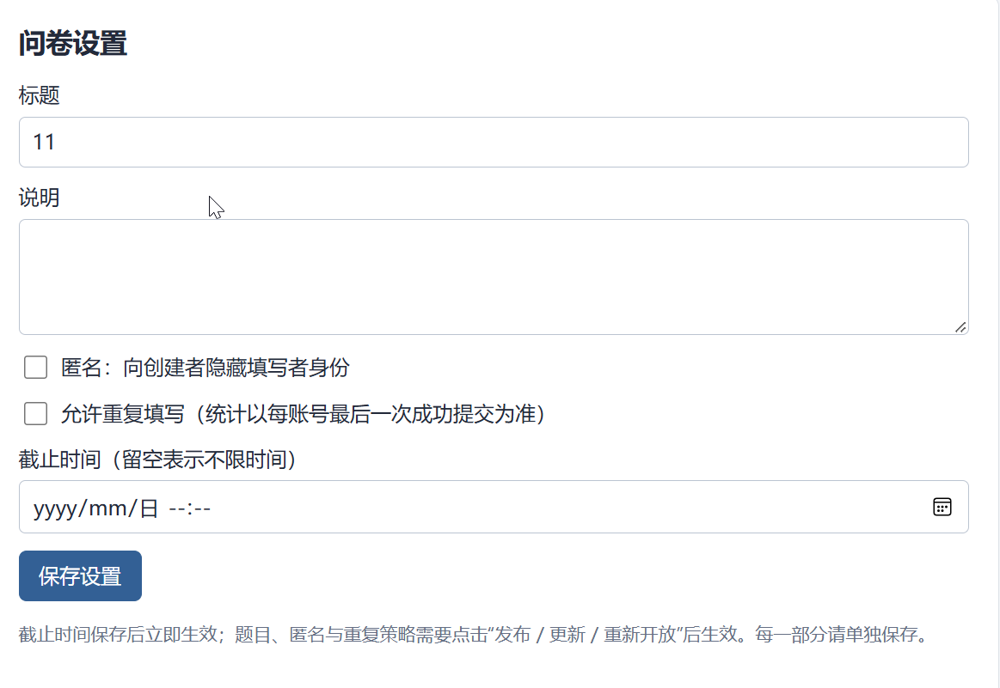
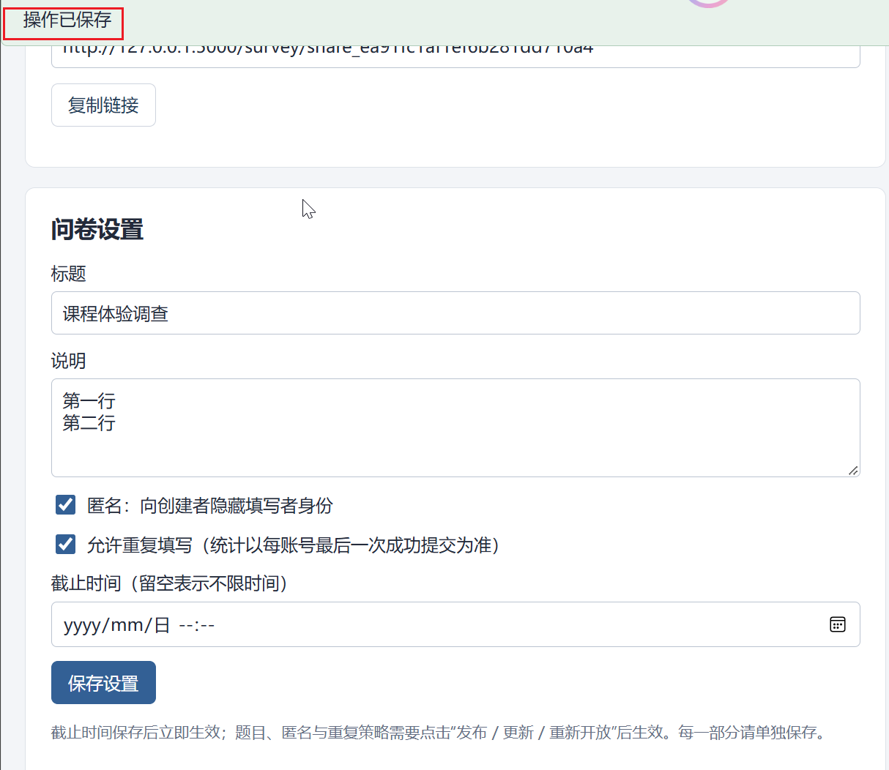

# 创建问卷：测试用例

共14项；每项直接列出步骤、输入、输出与测试结果，无需跨文件跳转。


<a id="tc01-a01"></a>

## TC01-A01 最小创建请求与草稿初始状态

执行方式：API自动化。


### 测试步骤

#### 前置条件

- 专用测试库和支持事务的 MongoDB 副本集已启动。A=创建者，B=另一创建者，U1/U2/U3=填写者，各账号独立 Cookie 会话；账号以运行批次后缀保证唯一，默认密码 TestPass!2026。API 基础路径 /api/v1；写请求带该会话 X-CSRF-Token，管理/填写修改带最新 If-Match。每个用例独立建卷，不继承其他用例的运行结果。

#### 操作步骤

1. A提交创建请求
2. GET详情并只读查询surveys
3. U1 GET分享定义

### 输入

#### 规定输入

```json
{
  "POST /surveys": {
    "title": "课程体验调查"
  }
}
```

#### 实际请求输入

实际请求按执行顺序完整列出（包含准备动作，凭据已脱敏）：

**请求 1：POST /auth/register**

```json
{
  "序号": 1,
  "method": "POST",
  "path": "/auth/register",
  "input": {
    "username": "api_1556826fad6a424b97b3d600d977262f",
    "password": "<redacted>"
  },
  "headers": {
    "Origin": "http://127.0.0.1:61374"
  }
}
```

**请求 2：POST /auth/login**

```json
{
  "序号": 2,
  "method": "POST",
  "path": "/auth/login",
  "input": {
    "username": "api_1556826fad6a424b97b3d600d977262f",
    "password": "<redacted>"
  },
  "headers": {
    "Origin": "http://127.0.0.1:61374"
  }
}
```

**请求 3：POST /surveys**

```json
{
  "序号": 3,
  "method": "POST",
  "path": "/surveys",
  "input": {
    "title": "课程体验调查"
  },
  "headers": {
    "Origin": "http://127.0.0.1:61374",
    "X-CSRF-Token": "<redacted>"
  }
}
```

**请求 4：GET /public-surveys/share_65a0db49e4d6d18c9eff677e**

```json
{
  "序号": 4,
  "method": "GET",
  "path": "/public-surveys/share_65a0db49e4d6d18c9eff677e",
  "input": null,
  "headers": {
    "Origin": "http://127.0.0.1:61374",
    "X-CSRF-Token": "<redacted>"
  }
}
```

**请求 5：GET /surveys/6ad8933437b03374ae337dc6**

```json
{
  "序号": 5,
  "method": "GET",
  "path": "/surveys/6ad8933437b03374ae337dc6",
  "input": null,
  "headers": {
    "Origin": "http://127.0.0.1:61374",
    "X-CSRF-Token": "<redacted>"
  }
}
```


### 输出

#### 预期输出

1. 201，surveyId/publicCode及ETag非空
2. DRAFT，publishedVersion=null，definitionVersion=1；description为空，anonymous=false，allowRepeat=false，deadlineAt=null
3. 409 NOT_COLLECTING

- ownerId为A，未生成发布版本和答卷。

#### 实际输出

本轮实际请求状态分布：HTTP 200：2次；HTTP 201：2次；HTTP 409：1次。

**请求 1：POST /auth/register**

```json
{
  "序号": 1,
  "method": "POST",
  "path": "/auth/register",
  "status": 201,
  "output": {
    "data": {
      "createdAt": "2026-10-21T10:25:55.975Z",
      "userId": "6ad8933337b03374ae337dc4",
      "username": "api_1556826fad6a424b97b3d600d977262f"
    },
    "requestId": "req_6979129f1295e5e9c969"
  },
  "responseHeaders": {
    "Server": "Werkzeug/3.1.9 Python/3.14.7",
    "Date": "Wed, 21 Oct 2026 10:25:55 GMT",
    "Content-Type": "application/json",
    "Content-Length": "175",
    "X-Request-ID": "req_6979129f1295e5e9c969",
    "X-Content-Type-Options": "nosniff",
    "Referrer-Policy": "same-origin",
    "X-Frame-Options": "DENY",
    "Content-Security-Policy": "default-src 'self'; script-src 'self'; style-src 'self'; img-src 'self' data:; connect-src 'self'; frame-ancestors 'none'; base-uri 'self'; form-action 'self'",
    "Cache-Control": "no-store",
    "Connection": "close"
  }
}
```

**请求 2：POST /auth/login**

```json
{
  "序号": 2,
  "method": "POST",
  "path": "/auth/login",
  "status": 200,
  "output": {
    "data": {
      "csrfToken": "<redacted>",
      "user": {
        "createdAt": "2026-10-21T10:25:55.975Z",
        "userId": "6ad8933337b03374ae337dc4",
        "username": "api_1556826fad6a424b97b3d600d977262f"
      }
    },
    "requestId": "req_a8bc300fe416d6014778"
  },
  "responseHeaders": {
    "Server": "Werkzeug/3.1.9 Python/3.14.7",
    "Date": "Wed, 21 Oct 2026 10:25:56 GMT",
    "Content-Type": "application/json",
    "Content-Length": "242",
    "Set-Cookie": "<redacted>",
    "X-Request-ID": "req_a8bc300fe416d6014778",
    "X-Content-Type-Options": "nosniff",
    "Referrer-Policy": "same-origin",
    "X-Frame-Options": "DENY",
    "Content-Security-Policy": "default-src 'self'; script-src 'self'; style-src 'self'; img-src 'self' data:; connect-src 'self'; frame-ancestors 'none'; base-uri 'self'; form-action 'self'",
    "Cache-Control": "no-store",
    "Connection": "close"
  }
}
```

**请求 3：POST /surveys**

```json
{
  "序号": 3,
  "method": "POST",
  "path": "/surveys",
  "status": 201,
  "output": {
    "data": {
      "controlRevision": 0,
      "createdAt": "2026-10-21T10:25:56.104Z",
      "deadlineAt": null,
      "definitionVersion": 1,
      "draft": {
        "description": "",
        "policy": {
          "allowRepeat": false,
          "anonymous": false
        },
        "questions": [],
        "title": "课程体验调查"
      },
      "effectiveState": "DRAFT",
      "publicCode": "share_65a0db49e4d6d18c9eff677e",
      "publishedVersion": null,
      "shareUrl": "/survey/share_65a0db49e4d6d18c9eff677e",
      "state": "DRAFT",
      "surveyId": "6ad8933437b03374ae337dc6",
      "updatedAt": "2026-10-21T10:25:56.104Z"
    },
    "requestId": "req_4fd9d46d543e8dd9e0a0"
  },
  "responseHeaders": {
    "Server": "Werkzeug/3.1.9 Python/3.14.7",
    "Date": "Wed, 21 Oct 2026 10:25:56 GMT",
    "Content-Type": "application/json",
    "Content-Length": "509",
    "ETag": "\"definition-1-control-0\"",
    "X-Request-ID": "req_4fd9d46d543e8dd9e0a0",
    "X-Content-Type-Options": "nosniff",
    "Referrer-Policy": "same-origin",
    "X-Frame-Options": "DENY",
    "Content-Security-Policy": "default-src 'self'; script-src 'self'; style-src 'self'; img-src 'self' data:; connect-src 'self'; frame-ancestors 'none'; base-uri 'self'; form-action 'self'",
    "Cache-Control": "no-store",
    "Connection": "close"
  }
}
```

**请求 4：GET /public-surveys/share_65a0db49e4d6d18c9eff677e**

```json
{
  "序号": 4,
  "method": "GET",
  "path": "/public-surveys/share_65a0db49e4d6d18c9eff677e",
  "status": 409,
  "output": {
    "error": {
      "code": "NOT_COLLECTING",
      "message": "问卷尚未发布、已关闭或已截止"
    },
    "requestId": "req_354816a365435f495696"
  },
  "responseHeaders": {
    "Server": "Werkzeug/3.1.9 Python/3.14.7",
    "Date": "Wed, 21 Oct 2026 10:25:56 GMT",
    "Content-Type": "application/json",
    "Content-Length": "130",
    "X-Request-ID": "req_354816a365435f495696",
    "X-Content-Type-Options": "nosniff",
    "Referrer-Policy": "same-origin",
    "X-Frame-Options": "DENY",
    "Content-Security-Policy": "default-src 'self'; script-src 'self'; style-src 'self'; img-src 'self' data:; connect-src 'self'; frame-ancestors 'none'; base-uri 'self'; form-action 'self'",
    "Cache-Control": "no-store",
    "Connection": "close"
  }
}
```

**请求 5：GET /surveys/6ad8933437b03374ae337dc6**

```json
{
  "序号": 5,
  "method": "GET",
  "path": "/surveys/6ad8933437b03374ae337dc6",
  "status": 200,
  "output": {
    "data": {
      "controlRevision": 0,
      "createdAt": "2026-10-21T10:25:56.104Z",
      "deadlineAt": null,
      "definitionVersion": 1,
      "draft": {
        "description": "",
        "policy": {
          "allowRepeat": false,
          "anonymous": false
        },
        "questions": [],
        "title": "课程体验调查"
      },
      "effectiveState": "DRAFT",
      "publicCode": "share_65a0db49e4d6d18c9eff677e",
      "publishedVersion": null,
      "shareUrl": "/survey/share_65a0db49e4d6d18c9eff677e",
      "state": "DRAFT",
      "surveyId": "6ad8933437b03374ae337dc6",
      "updatedAt": "2026-10-21T10:25:56.104Z"
    },
    "requestId": "req_f61bd91b0ea64d775b00"
  },
  "responseHeaders": {
    "Server": "Werkzeug/3.1.9 Python/3.14.7",
    "Date": "Wed, 21 Oct 2026 10:25:56 GMT",
    "Content-Type": "application/json",
    "Content-Length": "509",
    "ETag": "\"definition-1-control-0\"",
    "X-Request-ID": "req_f61bd91b0ea64d775b00",
    "X-Content-Type-Options": "nosniff",
    "Referrer-Policy": "same-origin",
    "X-Frame-Options": "DENY",
    "Content-Security-Policy": "default-src 'self'; script-src 'self'; style-src 'self'; img-src 'self' data:; connect-src 'self'; frame-ancestors 'none'; base-uri 'self'; form-action 'self'",
    "Cache-Control": "no-store",
    "Connection": "close"
  }
}
```

序号与输入层对应；包含账号、问卷和填写准备请求，不能将首条准备请求当作本例目标接口。

**创建持久化（不含会话或密码）**

```json
{
  "_id": {
    "$oid": "6ad8933437b03374ae337dc6"
  },
  "schemaVersion": 1,
  "ownerId": {
    "$oid": "6ad8933337b03374ae337dc4"
  },
  "publicCode": "share_65a0db49e4d6d18c9eff677e",
  "state": "DRAFT",
  "definitionVersion": 1,
  "controlRevision": 0,
  "publishedVersion": null,
  "deadlineAt": null,
  "draft": {
    "title": "课程体验调查",
    "description": "",
    "policy": {
      "anonymous": false,
      "allowRepeat": false
    },
    "questions": []
  },
  "writeFence": 0,
  "lastGateAt": null,
  "createdAt": {
    "$date": "2026-10-21T10:25:56.104Z"
  },
  "updatedAt": {
    "$date": "2026-10-21T10:25:56.104Z"
  }
}
```

**本例问卷持久化摘要**

```json
[
  {
    "surveyId": {
      "$oid": "6ad8933437b03374ae337dc6"
    },
    "responses": 0,
    "guards": 0,
    "versions": 0,
    "attempts": 0
  }
]
```


### 测试结果

**判定：通过**。

```text
本轮脚本断言通过。实际返回及数据库核对见输出层和Allure附件。
```

**创建持久化（不含会话或密码）**

```json
{
  "_id": {
    "$oid": "6ad8933437b03374ae337dc6"
  },
  "schemaVersion": 1,
  "ownerId": {
    "$oid": "6ad8933337b03374ae337dc4"
  },
  "publicCode": "share_65a0db49e4d6d18c9eff677e",
  "state": "DRAFT",
  "definitionVersion": 1,
  "controlRevision": 0,
  "publishedVersion": null,
  "deadlineAt": null,
  "draft": {
    "title": "课程体验调查",
    "description": "",
    "policy": {
      "anonymous": false,
      "allowRepeat": false
    },
    "questions": []
  },
  "writeFence": 0,
  "lastGateAt": null,
  "createdAt": {
    "$date": "2026-10-21T10:25:56.104Z"
  },
  "updatedAt": {
    "$date": "2026-10-21T10:25:56.104Z"
  }
}
```

**原始测试规格**

```json
{
  "id": "TC01-A01",
  "moduleId": 1,
  "module": "创建问卷",
  "title": "最小创建请求与草稿初始状态",
  "execution": "api",
  "priority": "P0",
  "sourceSteps": [
    1,
    3
  ],
  "preconditions": [
    "专用测试库和支持事务的 MongoDB 副本集已启动。A=创建者，B=另一创建者，U1/U2/U3=填写者，各账号独立 Cookie 会话；账号以运行批次后缀保证唯一，默认密码 TestPass!2026。API 基础路径 /api/v1；写请求带该会话 X-CSRF-Token，管理/填写修改带最新 If-Match。每个用例独立建卷，不继承其他用例的运行结果。"
  ],
  "input": {
    "POST /surveys": {
      "title": "课程体验调查"
    }
  },
  "steps": [
    {
      "action": "A提交创建请求",
      "expected": "201，surveyId/publicCode及ETag非空"
    },
    {
      "action": "GET详情并只读查询surveys",
      "expected": "DRAFT，publishedVersion=null，definitionVersion=1；description为空，anonymous=false，allowRepeat=false，deadlineAt=null"
    },
    {
      "action": "U1 GET分享定义",
      "expected": "409 NOT_COLLECTING"
    }
  ],
  "expected": [
    "ownerId为A，未生成发布版本和答卷。"
  ]
}
```

**HTTP 请求与响应（凭据已脱敏）**

```json
[
  {
    "method": "POST",
    "path": "/auth/register",
    "input": {
      "username": "api_1556826fad6a424b97b3d600d977262f",
      "password": "<redacted>"
    },
    "headers": {
      "Origin": "http://127.0.0.1:61374"
    },
    "status": 201,
    "output": {
      "data": {
        "createdAt": "2026-10-21T10:25:55.975Z",
        "userId": "6ad8933337b03374ae337dc4",
        "username": "api_1556826fad6a424b97b3d600d977262f"
      },
      "requestId": "req_6979129f1295e5e9c969"
    },
    "responseHeaders": {
      "Server": "Werkzeug/3.1.9 Python/3.14.7",
      "Date": "Wed, 21 Oct 2026 10:25:55 GMT",
      "Content-Type": "application/json",
      "Content-Length": "175",
      "X-Request-ID": "req_6979129f1295e5e9c969",
      "X-Content-Type-Options": "nosniff",
      "Referrer-Policy": "same-origin",
      "X-Frame-Options": "DENY",
      "Content-Security-Policy": "default-src 'self'; script-src 'self'; style-src 'self'; img-src 'self' data:; connect-src 'self'; frame-ancestors 'none'; base-uri 'self'; form-action 'self'",
      "Cache-Control": "no-store",
      "Connection": "close"
    }
  },
  {
    "method": "POST",
    "path": "/auth/login",
    "input": {
      "username": "api_1556826fad6a424b97b3d600d977262f",
      "password": "<redacted>"
    },
    "headers": {
      "Origin": "http://127.0.0.1:61374"
    },
    "status": 200,
    "output": {
      "data": {
        "csrfToken": "<redacted>",
        "user": {
          "createdAt": "2026-10-21T10:25:55.975Z",
          "userId": "6ad8933337b03374ae337dc4",
          "username": "api_1556826fad6a424b97b3d600d977262f"
        }
      },
      "requestId": "req_a8bc300fe416d6014778"
    },
    "responseHeaders": {
      "Server": "Werkzeug/3.1.9 Python/3.14.7",
      "Date": "Wed, 21 Oct 2026 10:25:56 GMT",
      "Content-Type": "application/json",
      "Content-Length": "242",
      "Set-Cookie": "<redacted>",
      "X-Request-ID": "req_a8bc300fe416d6014778",
      "X-Content-Type-Options": "nosniff",
      "Referrer-Policy": "same-origin",
      "X-Frame-Options": "DENY",
      "Content-Security-Policy": "default-src 'self'; script-src 'self'; style-src 'self'; img-src 'self' data:; connect-src 'self'; frame-ancestors 'none'; base-uri 'self'; form-action 'self'",
      "Cache-Control": "no-store",
      "Connection": "close"
    }
  },
  {
    "method": "POST",
    "path": "/surveys",
    "input": {
      "title": "课程体验调查"
    },
    "headers": {
      "Origin": "http://127.0.0.1:61374",
      "X-CSRF-Token": "<redacted>"
    },
    "status": 201,
    "output": {
      "data": {
        "controlRevision": 0,
        "createdAt": "2026-10-21T10:25:56.104Z",
        "deadlineAt": null,
        "definitionVersion": 1,
        "draft": {
          "description": "",
          "policy": {
            "allowRepeat": false,
            "anonymous": false
          },
          "questions": [],
          "title": "课程体验调查"
        },
        "effectiveState": "DRAFT",
        "publicCode": "share_65a0db49e4d6d18c9eff677e",
        "publishedVersion": null,
        "shareUrl": "/survey/share_65a0db49e4d6d18c9eff677e",
        "state": "DRAFT",
        "surveyId": "6ad8933437b03374ae337dc6",
        "updatedAt": "2026-10-21T10:25:56.104Z"
      },
      "requestId": "req_4fd9d46d543e8dd9e0a0"
    },
    "responseHeaders": {
      "Server": "Werkzeug/3.1.9 Python/3.14.7",
      "Date": "Wed, 21 Oct 2026 10:25:56 GMT",
      "Content-Type": "application/json",
      "Content-Length": "509",
      "ETag": "\"definition-1-control-0\"",
      "X-Request-ID": "req_4fd9d46d543e8dd9e0a0",
      "X-Content-Type-Options": "nosniff",
      "Referrer-Policy": "same-origin",
      "X-Frame-Options": "DENY",
      "Content-Security-Policy": "default-src 'self'; script-src 'self'; style-src 'self'; img-src 'self' data:; connect-src 'self'; frame-ancestors 'none'; base-uri 'self'; form-action 'self'",
      "Cache-Control": "no-store",
      "Connection": "close"
    }
  },
  {
    "method": "GET",
    "path": "/public-surveys/share_65a0db49e4d6d18c9eff677e",
    "input": null,
    "headers": {
      "Origin": "http://127.0.0.1:61374",
      "X-CSRF-Token": "<redacted>"
    },
    "status": 409,
    "output": {
      "error": {
        "code": "NOT_COLLECTING",
        "message": "问卷尚未发布、已关闭或已截止"
      },
      "requestId": "req_354816a365435f495696"
    },
    "responseHeaders": {
      "Server": "Werkzeug/3.1.9 Python/3.14.7",
      "Date": "Wed, 21 Oct 2026 10:25:56 GMT",
      "Content-Type": "application/json",
      "Content-Length": "130",
      "X-Request-ID": "req_354816a365435f495696",
      "X-Content-Type-Options": "nosniff",
      "Referrer-Policy": "same-origin",
      "X-Frame-Options": "DENY",
      "Content-Security-Policy": "default-src 'self'; script-src 'self'; style-src 'self'; img-src 'self' data:; connect-src 'self'; frame-ancestors 'none'; base-uri 'self'; form-action 'self'",
      "Cache-Control": "no-store",
      "Connection": "close"
    }
  },
  {
    "method": "GET",
    "path": "/surveys/6ad8933437b03374ae337dc6",
    "input": null,
    "headers": {
      "Origin": "http://127.0.0.1:61374",
      "X-CSRF-Token": "<redacted>"
    },
    "status": 200,
    "output": {
      "data": {
        "controlRevision": 0,
        "createdAt": "2026-10-21T10:25:56.104Z",
        "deadlineAt": null,
        "definitionVersion": 1,
        "draft": {
          "description": "",
          "policy": {
            "allowRepeat": false,
            "anonymous": false
          },
          "questions": [],
          "title": "课程体验调查"
        },
        "effectiveState": "DRAFT",
        "publicCode": "share_65a0db49e4d6d18c9eff677e",
        "publishedVersion": null,
        "shareUrl": "/survey/share_65a0db49e4d6d18c9eff677e",
        "state": "DRAFT",
        "surveyId": "6ad8933437b03374ae337dc6",
        "updatedAt": "2026-10-21T10:25:56.104Z"
      },
      "requestId": "req_f61bd91b0ea64d775b00"
    },
    "responseHeaders": {
      "Server": "Werkzeug/3.1.9 Python/3.14.7",
      "Date": "Wed, 21 Oct 2026 10:25:56 GMT",
      "Content-Type": "application/json",
      "Content-Length": "509",
      "ETag": "\"definition-1-control-0\"",
      "X-Request-ID": "req_f61bd91b0ea64d775b00",
      "X-Content-Type-Options": "nosniff",
      "Referrer-Policy": "same-origin",
      "X-Frame-Options": "DENY",
      "Content-Security-Policy": "default-src 'self'; script-src 'self'; style-src 'self'; img-src 'self' data:; connect-src 'self'; frame-ancestors 'none'; base-uri 'self'; form-action 'self'",
      "Cache-Control": "no-store",
      "Connection": "close"
    }
  }
]
```

**本例问卷持久化摘要**

```json
[
  {
    "surveyId": {
      "$oid": "6ad8933437b03374ae337dc6"
    },
    "responses": 0,
    "guards": 0,
    "versions": 0,
    "attempts": 0
  }
]
```


<a id="tc01-a02"></a>

## TC01-A02 完整信息持久化与不同问卷隔离

执行方式：API自动化。


### 测试步骤

#### 前置条件

- 专用测试库和支持事务的 MongoDB 副本集已启动。A=创建者，B=另一创建者，U1/U2/U3=填写者，各账号独立 Cookie 会话；账号以运行批次后缀保证唯一，默认密码 TestPass!2026。API 基础路径 /api/v1；写请求带该会话 X-CSRF-Token，管理/填写修改带最新 If-Match。每个用例独立建卷，不继承其他用例的运行结果。

#### 操作步骤

1. 按输入创建S，再创建title=第二份的S2
2. 重新登录读取S
3. 修改S2标题，再读S

### 输入

#### 规定输入

```json
{
  "title": "  中文问卷🌟  ",
  "description": "第一行\n第二行",
  "anonymous": true,
  "allowRepeat": true,
  "deadlineAt": "2099-12-31T23:59:00+08:00"
}
```

#### 实际请求输入

实际请求按执行顺序完整列出（包含准备动作，凭据已脱敏）：

**请求 1：POST /auth/register**

```json
{
  "序号": 1,
  "method": "POST",
  "path": "/auth/register",
  "input": {
    "username": "api_5c4b9c51d02545afa922baa130336e06",
    "password": "<redacted>"
  },
  "headers": {
    "Origin": "http://127.0.0.1:61374"
  }
}
```

**请求 2：POST /auth/login**

```json
{
  "序号": 2,
  "method": "POST",
  "path": "/auth/login",
  "input": {
    "username": "api_5c4b9c51d02545afa922baa130336e06",
    "password": "<redacted>"
  },
  "headers": {
    "Origin": "http://127.0.0.1:61374"
  }
}
```

**请求 3：POST /surveys**

```json
{
  "序号": 3,
  "method": "POST",
  "path": "/surveys",
  "input": {
    "title": "  中文问卷🌟  ",
    "description": "第一行\n第二行",
    "anonymous": true,
    "allowRepeat": true,
    "deadlineAt": "2099-12-31T23:59:00+08:00"
  },
  "headers": {
    "Origin": "http://127.0.0.1:61374",
    "X-CSRF-Token": "<redacted>"
  }
}
```

**请求 4：GET /public-surveys/share_d9b7999fbf8b942d3c646d7e**

```json
{
  "序号": 4,
  "method": "GET",
  "path": "/public-surveys/share_d9b7999fbf8b942d3c646d7e",
  "input": null,
  "headers": {
    "Origin": "http://127.0.0.1:61374",
    "X-CSRF-Token": "<redacted>"
  }
}
```

**请求 5：GET /surveys/6ad8933437b03374ae337dc9**

```json
{
  "序号": 5,
  "method": "GET",
  "path": "/surveys/6ad8933437b03374ae337dc9",
  "input": null,
  "headers": {
    "Origin": "http://127.0.0.1:61374",
    "X-CSRF-Token": "<redacted>"
  }
}
```

**请求 6：POST /surveys**

```json
{
  "序号": 6,
  "method": "POST",
  "path": "/surveys",
  "input": {
    "title": "另一问卷"
  },
  "headers": {
    "Origin": "http://127.0.0.1:61374",
    "X-CSRF-Token": "<redacted>"
  }
}
```

**请求 7：PATCH /surveys/6ad8933437b03374ae337dca**

```json
{
  "序号": 7,
  "method": "PATCH",
  "path": "/surveys/6ad8933437b03374ae337dca",
  "input": {
    "title": "独立更新"
  },
  "headers": {
    "Origin": "http://127.0.0.1:61374",
    "X-CSRF-Token": "<redacted>",
    "If-Match": "\"definition-1-control-0\""
  }
}
```

**请求 8：POST /auth/login**

```json
{
  "序号": 8,
  "method": "POST",
  "path": "/auth/login",
  "input": {
    "username": "api_5c4b9c51d02545afa922baa130336e06",
    "password": "<redacted>"
  },
  "headers": {
    "Origin": "http://127.0.0.1:61374",
    "X-CSRF-Token": "<redacted>"
  }
}
```

**请求 9：GET /surveys/6ad8933437b03374ae337dc9**

```json
{
  "序号": 9,
  "method": "GET",
  "path": "/surveys/6ad8933437b03374ae337dc9",
  "input": null,
  "headers": {
    "Origin": "http://127.0.0.1:61374",
    "X-CSRF-Token": "<redacted>"
  }
}
```


### 输出

#### 预期输出

1. 均201，问卷和分享标识不同
2. 标题为中文问卷🌟，换行保留，策略true，截止等价2099-12-31T15:59:00Z
3. S不变，列表与详情一致

- 时间为BSON Date，账号由会话确定。

#### 实际输出

本轮实际请求状态分布：HTTP 200：5次；HTTP 201：3次；HTTP 409：1次。

**请求 1：POST /auth/register**

```json
{
  "序号": 1,
  "method": "POST",
  "path": "/auth/register",
  "status": 201,
  "output": {
    "data": {
      "createdAt": "2026-10-21T10:25:56.228Z",
      "userId": "6ad8933437b03374ae337dc7",
      "username": "api_5c4b9c51d02545afa922baa130336e06"
    },
    "requestId": "req_e14206fc9fa778184082"
  },
  "responseHeaders": {
    "Server": "Werkzeug/3.1.9 Python/3.14.7",
    "Date": "Wed, 21 Oct 2026 10:25:56 GMT",
    "Content-Type": "application/json",
    "Content-Length": "175",
    "X-Request-ID": "req_e14206fc9fa778184082",
    "X-Content-Type-Options": "nosniff",
    "Referrer-Policy": "same-origin",
    "X-Frame-Options": "DENY",
    "Content-Security-Policy": "default-src 'self'; script-src 'self'; style-src 'self'; img-src 'self' data:; connect-src 'self'; frame-ancestors 'none'; base-uri 'self'; form-action 'self'",
    "Cache-Control": "no-store",
    "Connection": "close"
  }
}
```

**请求 2：POST /auth/login**

```json
{
  "序号": 2,
  "method": "POST",
  "path": "/auth/login",
  "status": 200,
  "output": {
    "data": {
      "csrfToken": "<redacted>",
      "user": {
        "createdAt": "2026-10-21T10:25:56.228Z",
        "userId": "6ad8933437b03374ae337dc7",
        "username": "api_5c4b9c51d02545afa922baa130336e06"
      }
    },
    "requestId": "req_497deff87f222725beee"
  },
  "responseHeaders": {
    "Server": "Werkzeug/3.1.9 Python/3.14.7",
    "Date": "Wed, 21 Oct 2026 10:25:56 GMT",
    "Content-Type": "application/json",
    "Content-Length": "242",
    "Set-Cookie": "<redacted>",
    "X-Request-ID": "req_497deff87f222725beee",
    "X-Content-Type-Options": "nosniff",
    "Referrer-Policy": "same-origin",
    "X-Frame-Options": "DENY",
    "Content-Security-Policy": "default-src 'self'; script-src 'self'; style-src 'self'; img-src 'self' data:; connect-src 'self'; frame-ancestors 'none'; base-uri 'self'; form-action 'self'",
    "Cache-Control": "no-store",
    "Connection": "close"
  }
}
```

**请求 3：POST /surveys**

```json
{
  "序号": 3,
  "method": "POST",
  "path": "/surveys",
  "status": 201,
  "output": {
    "data": {
      "controlRevision": 0,
      "createdAt": "2026-10-21T10:25:56.330Z",
      "deadlineAt": "2099-12-31T15:59:00.000Z",
      "definitionVersion": 1,
      "draft": {
        "description": "第一行\n第二行",
        "policy": {
          "allowRepeat": true,
          "anonymous": true
        },
        "questions": [],
        "title": "中文问卷🌟"
      },
      "effectiveState": "DRAFT",
      "publicCode": "share_d9b7999fbf8b942d3c646d7e",
      "publishedVersion": null,
      "shareUrl": "/survey/share_d9b7999fbf8b942d3c646d7e",
      "state": "DRAFT",
      "surveyId": "6ad8933437b03374ae337dc9",
      "updatedAt": "2026-10-21T10:25:56.330Z"
    },
    "requestId": "req_164500b333a670dd4258"
  },
  "responseHeaders": {
    "Server": "Werkzeug/3.1.9 Python/3.14.7",
    "Date": "Wed, 21 Oct 2026 10:25:56 GMT",
    "Content-Type": "application/json",
    "Content-Length": "547",
    "ETag": "\"definition-1-control-0\"",
    "X-Request-ID": "req_164500b333a670dd4258",
    "X-Content-Type-Options": "nosniff",
    "Referrer-Policy": "same-origin",
    "X-Frame-Options": "DENY",
    "Content-Security-Policy": "default-src 'self'; script-src 'self'; style-src 'self'; img-src 'self' data:; connect-src 'self'; frame-ancestors 'none'; base-uri 'self'; form-action 'self'",
    "Cache-Control": "no-store",
    "Connection": "close"
  }
}
```

**请求 4：GET /public-surveys/share_d9b7999fbf8b942d3c646d7e**

```json
{
  "序号": 4,
  "method": "GET",
  "path": "/public-surveys/share_d9b7999fbf8b942d3c646d7e",
  "status": 409,
  "output": {
    "error": {
      "code": "NOT_COLLECTING",
      "message": "问卷尚未发布、已关闭或已截止"
    },
    "requestId": "req_3549f56d246008eee041"
  },
  "responseHeaders": {
    "Server": "Werkzeug/3.1.9 Python/3.14.7",
    "Date": "Wed, 21 Oct 2026 10:25:56 GMT",
    "Content-Type": "application/json",
    "Content-Length": "130",
    "X-Request-ID": "req_3549f56d246008eee041",
    "X-Content-Type-Options": "nosniff",
    "Referrer-Policy": "same-origin",
    "X-Frame-Options": "DENY",
    "Content-Security-Policy": "default-src 'self'; script-src 'self'; style-src 'self'; img-src 'self' data:; connect-src 'self'; frame-ancestors 'none'; base-uri 'self'; form-action 'self'",
    "Cache-Control": "no-store",
    "Connection": "close"
  }
}
```

**请求 5：GET /surveys/6ad8933437b03374ae337dc9**

```json
{
  "序号": 5,
  "method": "GET",
  "path": "/surveys/6ad8933437b03374ae337dc9",
  "status": 200,
  "output": {
    "data": {
      "controlRevision": 0,
      "createdAt": "2026-10-21T10:25:56.330Z",
      "deadlineAt": "2099-12-31T15:59:00.000Z",
      "definitionVersion": 1,
      "draft": {
        "description": "第一行\n第二行",
        "policy": {
          "allowRepeat": true,
          "anonymous": true
        },
        "questions": [],
        "title": "中文问卷🌟"
      },
      "effectiveState": "DRAFT",
      "publicCode": "share_d9b7999fbf8b942d3c646d7e",
      "publishedVersion": null,
      "shareUrl": "/survey/share_d9b7999fbf8b942d3c646d7e",
      "state": "DRAFT",
      "surveyId": "6ad8933437b03374ae337dc9",
      "updatedAt": "2026-10-21T10:25:56.330Z"
    },
    "requestId": "req_72dedeb5ec66674ef6b6"
  },
  "responseHeaders": {
    "Server": "Werkzeug/3.1.9 Python/3.14.7",
    "Date": "Wed, 21 Oct 2026 10:25:56 GMT",
    "Content-Type": "application/json",
    "Content-Length": "547",
    "ETag": "\"definition-1-control-0\"",
    "X-Request-ID": "req_72dedeb5ec66674ef6b6",
    "X-Content-Type-Options": "nosniff",
    "Referrer-Policy": "same-origin",
    "X-Frame-Options": "DENY",
    "Content-Security-Policy": "default-src 'self'; script-src 'self'; style-src 'self'; img-src 'self' data:; connect-src 'self'; frame-ancestors 'none'; base-uri 'self'; form-action 'self'",
    "Cache-Control": "no-store",
    "Connection": "close"
  }
}
```

**请求 6：POST /surveys**

```json
{
  "序号": 6,
  "method": "POST",
  "path": "/surveys",
  "status": 201,
  "output": {
    "data": {
      "controlRevision": 0,
      "createdAt": "2026-10-21T10:25:56.381Z",
      "deadlineAt": null,
      "definitionVersion": 1,
      "draft": {
        "description": "",
        "policy": {
          "allowRepeat": false,
          "anonymous": false
        },
        "questions": [],
        "title": "另一问卷"
      },
      "effectiveState": "DRAFT",
      "publicCode": "share_5bb5a64047ed5e443d76a349",
      "publishedVersion": null,
      "shareUrl": "/survey/share_5bb5a64047ed5e443d76a349",
      "state": "DRAFT",
      "surveyId": "6ad8933437b03374ae337dca",
      "updatedAt": "2026-10-21T10:25:56.381Z"
    },
    "requestId": "req_4072e4f5522c67282d01"
  },
  "responseHeaders": {
    "Server": "Werkzeug/3.1.9 Python/3.14.7",
    "Date": "Wed, 21 Oct 2026 10:25:56 GMT",
    "Content-Type": "application/json",
    "Content-Length": "503",
    "ETag": "\"definition-1-control-0\"",
    "X-Request-ID": "req_4072e4f5522c67282d01",
    "X-Content-Type-Options": "nosniff",
    "Referrer-Policy": "same-origin",
    "X-Frame-Options": "DENY",
    "Content-Security-Policy": "default-src 'self'; script-src 'self'; style-src 'self'; img-src 'self' data:; connect-src 'self'; frame-ancestors 'none'; base-uri 'self'; form-action 'self'",
    "Cache-Control": "no-store",
    "Connection": "close"
  }
}
```

**请求 7：PATCH /surveys/6ad8933437b03374ae337dca**

```json
{
  "序号": 7,
  "method": "PATCH",
  "path": "/surveys/6ad8933437b03374ae337dca",
  "status": 200,
  "output": {
    "data": {
      "controlRevision": 1,
      "createdAt": "2026-10-21T10:25:56.381Z",
      "deadlineAt": null,
      "definitionVersion": 2,
      "draft": {
        "description": "",
        "policy": {
          "allowRepeat": false,
          "anonymous": false
        },
        "questions": [],
        "title": "独立更新"
      },
      "effectiveState": "DRAFT",
      "publicCode": "share_5bb5a64047ed5e443d76a349",
      "publishedVersion": null,
      "shareUrl": "/survey/share_5bb5a64047ed5e443d76a349",
      "state": "DRAFT",
      "surveyId": "6ad8933437b03374ae337dca",
      "updatedAt": "2026-10-21T10:25:56.407Z"
    },
    "requestId": "req_91f398d0c598db802392"
  },
  "responseHeaders": {
    "Server": "Werkzeug/3.1.9 Python/3.14.7",
    "Date": "Wed, 21 Oct 2026 10:25:56 GMT",
    "Content-Type": "application/json",
    "Content-Length": "503",
    "ETag": "\"definition-2-control-1\"",
    "X-Request-ID": "req_91f398d0c598db802392",
    "X-Content-Type-Options": "nosniff",
    "Referrer-Policy": "same-origin",
    "X-Frame-Options": "DENY",
    "Content-Security-Policy": "default-src 'self'; script-src 'self'; style-src 'self'; img-src 'self' data:; connect-src 'self'; frame-ancestors 'none'; base-uri 'self'; form-action 'self'",
    "Cache-Control": "no-store",
    "Connection": "close"
  }
}
```

**请求 8：POST /auth/login**

```json
{
  "序号": 8,
  "method": "POST",
  "path": "/auth/login",
  "status": 200,
  "output": {
    "data": {
      "csrfToken": "<redacted>",
      "user": {
        "createdAt": "2026-10-21T10:25:56.228Z",
        "userId": "6ad8933437b03374ae337dc7",
        "username": "api_5c4b9c51d02545afa922baa130336e06"
      }
    },
    "requestId": "req_3563611d5ef9ff00e82e"
  },
  "responseHeaders": {
    "Server": "Werkzeug/3.1.9 Python/3.14.7",
    "Date": "Wed, 21 Oct 2026 10:25:56 GMT",
    "Content-Type": "application/json",
    "Content-Length": "242",
    "Set-Cookie": "<redacted>",
    "X-Request-ID": "req_3563611d5ef9ff00e82e",
    "X-Content-Type-Options": "nosniff",
    "Referrer-Policy": "same-origin",
    "X-Frame-Options": "DENY",
    "Content-Security-Policy": "default-src 'self'; script-src 'self'; style-src 'self'; img-src 'self' data:; connect-src 'self'; frame-ancestors 'none'; base-uri 'self'; form-action 'self'",
    "Cache-Control": "no-store",
    "Connection": "close"
  }
}
```

**请求 9：GET /surveys/6ad8933437b03374ae337dc9**

```json
{
  "序号": 9,
  "method": "GET",
  "path": "/surveys/6ad8933437b03374ae337dc9",
  "status": 200,
  "output": {
    "data": {
      "controlRevision": 0,
      "createdAt": "2026-10-21T10:25:56.330Z",
      "deadlineAt": "2099-12-31T15:59:00.000Z",
      "definitionVersion": 1,
      "draft": {
        "description": "第一行\n第二行",
        "policy": {
          "allowRepeat": true,
          "anonymous": true
        },
        "questions": [],
        "title": "中文问卷🌟"
      },
      "effectiveState": "DRAFT",
      "publicCode": "share_d9b7999fbf8b942d3c646d7e",
      "publishedVersion": null,
      "shareUrl": "/survey/share_d9b7999fbf8b942d3c646d7e",
      "state": "DRAFT",
      "surveyId": "6ad8933437b03374ae337dc9",
      "updatedAt": "2026-10-21T10:25:56.330Z"
    },
    "requestId": "req_ad8ef819cadb5ee3c769"
  },
  "responseHeaders": {
    "Server": "Werkzeug/3.1.9 Python/3.14.7",
    "Date": "Wed, 21 Oct 2026 10:25:56 GMT",
    "Content-Type": "application/json",
    "Content-Length": "547",
    "ETag": "\"definition-1-control-0\"",
    "X-Request-ID": "req_ad8ef819cadb5ee3c769",
    "X-Content-Type-Options": "nosniff",
    "Referrer-Policy": "same-origin",
    "X-Frame-Options": "DENY",
    "Content-Security-Policy": "default-src 'self'; script-src 'self'; style-src 'self'; img-src 'self' data:; connect-src 'self'; frame-ancestors 'none'; base-uri 'self'; form-action 'self'",
    "Cache-Control": "no-store",
    "Connection": "close"
  }
}
```

序号与输入层对应；包含账号、问卷和填写准备请求，不能将首条准备请求当作本例目标接口。

**创建持久化（不含会话或密码）**

```json
{
  "_id": {
    "$oid": "6ad8933437b03374ae337dc9"
  },
  "schemaVersion": 1,
  "ownerId": {
    "$oid": "6ad8933437b03374ae337dc7"
  },
  "publicCode": "share_d9b7999fbf8b942d3c646d7e",
  "state": "DRAFT",
  "definitionVersion": 1,
  "controlRevision": 0,
  "publishedVersion": null,
  "deadlineAt": {
    "$date": "2099-12-31T15:59:00Z"
  },
  "draft": {
    "title": "中文问卷🌟",
    "description": "第一行\n第二行",
    "policy": {
      "anonymous": true,
      "allowRepeat": true
    },
    "questions": []
  },
  "writeFence": 0,
  "lastGateAt": null,
  "createdAt": {
    "$date": "2026-10-21T10:25:56.330Z"
  },
  "updatedAt": {
    "$date": "2026-10-21T10:25:56.330Z"
  }
}
```

**本例问卷持久化摘要**

```json
[
  {
    "surveyId": {
      "$oid": "6ad8933437b03374ae337dc9"
    },
    "responses": 0,
    "guards": 0,
    "versions": 0,
    "attempts": 0
  },
  {
    "surveyId": {
      "$oid": "6ad8933437b03374ae337dca"
    },
    "responses": 0,
    "guards": 0,
    "versions": 0,
    "attempts": 0
  }
]
```


### 测试结果

**判定：通过**。

```text
本轮脚本断言通过。实际返回及数据库核对见输出层和Allure附件。
```

**创建持久化（不含会话或密码）**

```json
{
  "_id": {
    "$oid": "6ad8933437b03374ae337dc9"
  },
  "schemaVersion": 1,
  "ownerId": {
    "$oid": "6ad8933437b03374ae337dc7"
  },
  "publicCode": "share_d9b7999fbf8b942d3c646d7e",
  "state": "DRAFT",
  "definitionVersion": 1,
  "controlRevision": 0,
  "publishedVersion": null,
  "deadlineAt": {
    "$date": "2099-12-31T15:59:00Z"
  },
  "draft": {
    "title": "中文问卷🌟",
    "description": "第一行\n第二行",
    "policy": {
      "anonymous": true,
      "allowRepeat": true
    },
    "questions": []
  },
  "writeFence": 0,
  "lastGateAt": null,
  "createdAt": {
    "$date": "2026-10-21T10:25:56.330Z"
  },
  "updatedAt": {
    "$date": "2026-10-21T10:25:56.330Z"
  }
}
```

**原始测试规格**

```json
{
  "id": "TC01-A02",
  "moduleId": 1,
  "module": "创建问卷",
  "title": "完整信息持久化与不同问卷隔离",
  "execution": "api",
  "priority": "P1",
  "sourceSteps": [
    2,
    3,
    4
  ],
  "preconditions": [
    "专用测试库和支持事务的 MongoDB 副本集已启动。A=创建者，B=另一创建者，U1/U2/U3=填写者，各账号独立 Cookie 会话；账号以运行批次后缀保证唯一，默认密码 TestPass!2026。API 基础路径 /api/v1；写请求带该会话 X-CSRF-Token，管理/填写修改带最新 If-Match。每个用例独立建卷，不继承其他用例的运行结果。"
  ],
  "input": {
    "title": "  中文问卷🌟  ",
    "description": "第一行\n第二行",
    "anonymous": true,
    "allowRepeat": true,
    "deadlineAt": "2099-12-31T23:59:00+08:00"
  },
  "steps": [
    {
      "action": "按输入创建S，再创建title=第二份的S2",
      "expected": "均201，问卷和分享标识不同"
    },
    {
      "action": "重新登录读取S",
      "expected": "标题为中文问卷🌟，换行保留，策略true，截止等价2099-12-31T15:59:00Z"
    },
    {
      "action": "修改S2标题，再读S",
      "expected": "S不变，列表与详情一致"
    }
  ],
  "expected": [
    "时间为BSON Date，账号由会话确定。"
  ]
}
```

**HTTP 请求与响应（凭据已脱敏）**

```json
[
  {
    "method": "POST",
    "path": "/auth/register",
    "input": {
      "username": "api_5c4b9c51d02545afa922baa130336e06",
      "password": "<redacted>"
    },
    "headers": {
      "Origin": "http://127.0.0.1:61374"
    },
    "status": 201,
    "output": {
      "data": {
        "createdAt": "2026-10-21T10:25:56.228Z",
        "userId": "6ad8933437b03374ae337dc7",
        "username": "api_5c4b9c51d02545afa922baa130336e06"
      },
      "requestId": "req_e14206fc9fa778184082"
    },
    "responseHeaders": {
      "Server": "Werkzeug/3.1.9 Python/3.14.7",
      "Date": "Wed, 21 Oct 2026 10:25:56 GMT",
      "Content-Type": "application/json",
      "Content-Length": "175",
      "X-Request-ID": "req_e14206fc9fa778184082",
      "X-Content-Type-Options": "nosniff",
      "Referrer-Policy": "same-origin",
      "X-Frame-Options": "DENY",
      "Content-Security-Policy": "default-src 'self'; script-src 'self'; style-src 'self'; img-src 'self' data:; connect-src 'self'; frame-ancestors 'none'; base-uri 'self'; form-action 'self'",
      "Cache-Control": "no-store",
      "Connection": "close"
    }
  },
  {
    "method": "POST",
    "path": "/auth/login",
    "input": {
      "username": "api_5c4b9c51d02545afa922baa130336e06",
      "password": "<redacted>"
    },
    "headers": {
      "Origin": "http://127.0.0.1:61374"
    },
    "status": 200,
    "output": {
      "data": {
        "csrfToken": "<redacted>",
        "user": {
          "createdAt": "2026-10-21T10:25:56.228Z",
          "userId": "6ad8933437b03374ae337dc7",
          "username": "api_5c4b9c51d02545afa922baa130336e06"
        }
      },
      "requestId": "req_497deff87f222725beee"
    },
    "responseHeaders": {
      "Server": "Werkzeug/3.1.9 Python/3.14.7",
      "Date": "Wed, 21 Oct 2026 10:25:56 GMT",
      "Content-Type": "application/json",
      "Content-Length": "242",
      "Set-Cookie": "<redacted>",
      "X-Request-ID": "req_497deff87f222725beee",
      "X-Content-Type-Options": "nosniff",
      "Referrer-Policy": "same-origin",
      "X-Frame-Options": "DENY",
      "Content-Security-Policy": "default-src 'self'; script-src 'self'; style-src 'self'; img-src 'self' data:; connect-src 'self'; frame-ancestors 'none'; base-uri 'self'; form-action 'self'",
      "Cache-Control": "no-store",
      "Connection": "close"
    }
  },
  {
    "method": "POST",
    "path": "/surveys",
    "input": {
      "title": "  中文问卷🌟  ",
      "description": "第一行\n第二行",
      "anonymous": true,
      "allowRepeat": true,
      "deadlineAt": "2099-12-31T23:59:00+08:00"
    },
    "headers": {
      "Origin": "http://127.0.0.1:61374",
      "X-CSRF-Token": "<redacted>"
    },
    "status": 201,
    "output": {
      "data": {
        "controlRevision": 0,
        "createdAt": "2026-10-21T10:25:56.330Z",
        "deadlineAt": "2099-12-31T15:59:00.000Z",
        "definitionVersion": 1,
        "draft": {
          "description": "第一行\n第二行",
          "policy": {
            "allowRepeat": true,
            "anonymous": true
          },
          "questions": [],
          "title": "中文问卷🌟"
        },
        "effectiveState": "DRAFT",
        "publicCode": "share_d9b7999fbf8b942d3c646d7e",
        "publishedVersion": null,
        "shareUrl": "/survey/share_d9b7999fbf8b942d3c646d7e",
        "state": "DRAFT",
        "surveyId": "6ad8933437b03374ae337dc9",
        "updatedAt": "2026-10-21T10:25:56.330Z"
      },
      "requestId": "req_164500b333a670dd4258"
    },
    "responseHeaders": {
      "Server": "Werkzeug/3.1.9 Python/3.14.7",
      "Date": "Wed, 21 Oct 2026 10:25:56 GMT",
      "Content-Type": "application/json",
      "Content-Length": "547",
      "ETag": "\"definition-1-control-0\"",
      "X-Request-ID": "req_164500b333a670dd4258",
      "X-Content-Type-Options": "nosniff",
      "Referrer-Policy": "same-origin",
      "X-Frame-Options": "DENY",
      "Content-Security-Policy": "default-src 'self'; script-src 'self'; style-src 'self'; img-src 'self' data:; connect-src 'self'; frame-ancestors 'none'; base-uri 'self'; form-action 'self'",
      "Cache-Control": "no-store",
      "Connection": "close"
    }
  },
  {
    "method": "GET",
    "path": "/public-surveys/share_d9b7999fbf8b942d3c646d7e",
    "input": null,
    "headers": {
      "Origin": "http://127.0.0.1:61374",
      "X-CSRF-Token": "<redacted>"
    },
    "status": 409,
    "output": {
      "error": {
        "code": "NOT_COLLECTING",
        "message": "问卷尚未发布、已关闭或已截止"
      },
      "requestId": "req_3549f56d246008eee041"
    },
    "responseHeaders": {
      "Server": "Werkzeug/3.1.9 Python/3.14.7",
      "Date": "Wed, 21 Oct 2026 10:25:56 GMT",
      "Content-Type": "application/json",
      "Content-Length": "130",
      "X-Request-ID": "req_3549f56d246008eee041",
      "X-Content-Type-Options": "nosniff",
      "Referrer-Policy": "same-origin",
      "X-Frame-Options": "DENY",
      "Content-Security-Policy": "default-src 'self'; script-src 'self'; style-src 'self'; img-src 'self' data:; connect-src 'self'; frame-ancestors 'none'; base-uri 'self'; form-action 'self'",
      "Cache-Control": "no-store",
      "Connection": "close"
    }
  },
  {
    "method": "GET",
    "path": "/surveys/6ad8933437b03374ae337dc9",
    "input": null,
    "headers": {
      "Origin": "http://127.0.0.1:61374",
      "X-CSRF-Token": "<redacted>"
    },
    "status": 200,
    "output": {
      "data": {
        "controlRevision": 0,
        "createdAt": "2026-10-21T10:25:56.330Z",
        "deadlineAt": "2099-12-31T15:59:00.000Z",
        "definitionVersion": 1,
        "draft": {
          "description": "第一行\n第二行",
          "policy": {
            "allowRepeat": true,
            "anonymous": true
          },
          "questions": [],
          "title": "中文问卷🌟"
        },
        "effectiveState": "DRAFT",
        "publicCode": "share_d9b7999fbf8b942d3c646d7e",
        "publishedVersion": null,
        "shareUrl": "/survey/share_d9b7999fbf8b942d3c646d7e",
        "state": "DRAFT",
        "surveyId": "6ad8933437b03374ae337dc9",
        "updatedAt": "2026-10-21T10:25:56.330Z"
      },
      "requestId": "req_72dedeb5ec66674ef6b6"
    },
    "responseHeaders": {
      "Server": "Werkzeug/3.1.9 Python/3.14.7",
      "Date": "Wed, 21 Oct 2026 10:25:56 GMT",
      "Content-Type": "application/json",
      "Content-Length": "547",
      "ETag": "\"definition-1-control-0\"",
      "X-Request-ID": "req_72dedeb5ec66674ef6b6",
      "X-Content-Type-Options": "nosniff",
      "Referrer-Policy": "same-origin",
      "X-Frame-Options": "DENY",
      "Content-Security-Policy": "default-src 'self'; script-src 'self'; style-src 'self'; img-src 'self' data:; connect-src 'self'; frame-ancestors 'none'; base-uri 'self'; form-action 'self'",
      "Cache-Control": "no-store",
      "Connection": "close"
    }
  },
  {
    "method": "POST",
    "path": "/surveys",
    "input": {
      "title": "另一问卷"
    },
    "headers": {
      "Origin": "http://127.0.0.1:61374",
      "X-CSRF-Token": "<redacted>"
    },
    "status": 201,
    "output": {
      "data": {
        "controlRevision": 0,
        "createdAt": "2026-10-21T10:25:56.381Z",
        "deadlineAt": null,
        "definitionVersion": 1,
        "draft": {
          "description": "",
          "policy": {
            "allowRepeat": false,
            "anonymous": false
          },
          "questions": [],
          "title": "另一问卷"
        },
        "effectiveState": "DRAFT",
        "publicCode": "share_5bb5a64047ed5e443d76a349",
        "publishedVersion": null,
        "shareUrl": "/survey/share_5bb5a64047ed5e443d76a349",
        "state": "DRAFT",
        "surveyId": "6ad8933437b03374ae337dca",
        "updatedAt": "2026-10-21T10:25:56.381Z"
      },
      "requestId": "req_4072e4f5522c67282d01"
    },
    "responseHeaders": {
      "Server": "Werkzeug/3.1.9 Python/3.14.7",
      "Date": "Wed, 21 Oct 2026 10:25:56 GMT",
      "Content-Type": "application/json",
      "Content-Length": "503",
      "ETag": "\"definition-1-control-0\"",
      "X-Request-ID": "req_4072e4f5522c67282d01",
      "X-Content-Type-Options": "nosniff",
      "Referrer-Policy": "same-origin",
      "X-Frame-Options": "DENY",
      "Content-Security-Policy": "default-src 'self'; script-src 'self'; style-src 'self'; img-src 'self' data:; connect-src 'self'; frame-ancestors 'none'; base-uri 'self'; form-action 'self'",
      "Cache-Control": "no-store",
      "Connection": "close"
    }
  },
  {
    "method": "PATCH",
    "path": "/surveys/6ad8933437b03374ae337dca",
    "input": {
      "title": "独立更新"
    },
    "headers": {
      "Origin": "http://127.0.0.1:61374",
      "X-CSRF-Token": "<redacted>",
      "If-Match": "\"definition-1-control-0\""
    },
    "status": 200,
    "output": {
      "data": {
        "controlRevision": 1,
        "createdAt": "2026-10-21T10:25:56.381Z",
        "deadlineAt": null,
        "definitionVersion": 2,
        "draft": {
          "description": "",
          "policy": {
            "allowRepeat": false,
            "anonymous": false
          },
          "questions": [],
          "title": "独立更新"
        },
        "effectiveState": "DRAFT",
        "publicCode": "share_5bb5a64047ed5e443d76a349",
        "publishedVersion": null,
        "shareUrl": "/survey/share_5bb5a64047ed5e443d76a349",
        "state": "DRAFT",
        "surveyId": "6ad8933437b03374ae337dca",
        "updatedAt": "2026-10-21T10:25:56.407Z"
      },
      "requestId": "req_91f398d0c598db802392"
    },
    "responseHeaders": {
      "Server": "Werkzeug/3.1.9 Python/3.14.7",
      "Date": "Wed, 21 Oct 2026 10:25:56 GMT",
      "Content-Type": "application/json",
      "Content-Length": "503",
      "ETag": "\"definition-2-control-1\"",
      "X-Request-ID": "req_91f398d0c598db802392",
      "X-Content-Type-Options": "nosniff",
      "Referrer-Policy": "same-origin",
      "X-Frame-Options": "DENY",
      "Content-Security-Policy": "default-src 'self'; script-src 'self'; style-src 'self'; img-src 'self' data:; connect-src 'self'; frame-ancestors 'none'; base-uri 'self'; form-action 'self'",
      "Cache-Control": "no-store",
      "Connection": "close"
    }
  },
  {
    "method": "POST",
    "path": "/auth/login",
    "input": {
      "username": "api_5c4b9c51d02545afa922baa130336e06",
      "password": "<redacted>"
    },
    "headers": {
      "Origin": "http://127.0.0.1:61374",
      "X-CSRF-Token": "<redacted>"
    },
    "status": 200,
    "output": {
      "data": {
        "csrfToken": "<redacted>",
        "user": {
          "createdAt": "2026-10-21T10:25:56.228Z",
          "userId": "6ad8933437b03374ae337dc7",
          "username": "api_5c4b9c51d02545afa922baa130336e06"
        }
      },
      "requestId": "req_3563611d5ef9ff00e82e"
    },
    "responseHeaders": {
      "Server": "Werkzeug/3.1.9 Python/3.14.7",
      "Date": "Wed, 21 Oct 2026 10:25:56 GMT",
      "Content-Type": "application/json",
      "Content-Length": "242",
      "Set-Cookie": "<redacted>",
      "X-Request-ID": "req_3563611d5ef9ff00e82e",
      "X-Content-Type-Options": "nosniff",
      "Referrer-Policy": "same-origin",
      "X-Frame-Options": "DENY",
      "Content-Security-Policy": "default-src 'self'; script-src 'self'; style-src 'self'; img-src 'self' data:; connect-src 'self'; frame-ancestors 'none'; base-uri 'self'; form-action 'self'",
      "Cache-Control": "no-store",
      "Connection": "close"
    }
  },
  {
    "method": "GET",
    "path": "/surveys/6ad8933437b03374ae337dc9",
    "input": null,
    "headers": {
      "Origin": "http://127.0.0.1:61374",
      "X-CSRF-Token": "<redacted>"
    },
    "status": 200,
    "output": {
      "data": {
        "controlRevision": 0,
        "createdAt": "2026-10-21T10:25:56.330Z",
        "deadlineAt": "2099-12-31T15:59:00.000Z",
        "definitionVersion": 1,
        "draft": {
          "description": "第一行\n第二行",
          "policy": {
            "allowRepeat": true,
            "anonymous": true
          },
          "questions": [],
          "title": "中文问卷🌟"
        },
        "effectiveState": "DRAFT",
        "publicCode": "share_d9b7999fbf8b942d3c646d7e",
        "publishedVersion": null,
        "shareUrl": "/survey/share_d9b7999fbf8b942d3c646d7e",
        "state": "DRAFT",
        "surveyId": "6ad8933437b03374ae337dc9",
        "updatedAt": "2026-10-21T10:25:56.330Z"
      },
      "requestId": "req_ad8ef819cadb5ee3c769"
    },
    "responseHeaders": {
      "Server": "Werkzeug/3.1.9 Python/3.14.7",
      "Date": "Wed, 21 Oct 2026 10:25:56 GMT",
      "Content-Type": "application/json",
      "Content-Length": "547",
      "ETag": "\"definition-1-control-0\"",
      "X-Request-ID": "req_ad8ef819cadb5ee3c769",
      "X-Content-Type-Options": "nosniff",
      "Referrer-Policy": "same-origin",
      "X-Frame-Options": "DENY",
      "Content-Security-Policy": "default-src 'self'; script-src 'self'; style-src 'self'; img-src 'self' data:; connect-src 'self'; frame-ancestors 'none'; base-uri 'self'; form-action 'self'",
      "Cache-Control": "no-store",
      "Connection": "close"
    }
  }
]
```

**本例问卷持久化摘要**

```json
[
  {
    "surveyId": {
      "$oid": "6ad8933437b03374ae337dc9"
    },
    "responses": 0,
    "guards": 0,
    "versions": 0,
    "attempts": 0
  },
  {
    "surveyId": {
      "$oid": "6ad8933437b03374ae337dca"
    },
    "responses": 0,
    "guards": 0,
    "versions": 0,
    "attempts": 0
  }
]
```


<a id="tc01-a03"></a>

## TC01-A03 标题缺失

执行方式：API自动化。


### 测试步骤

#### 前置条件

- 专用测试库和支持事务的 MongoDB 副本集已启动。A=创建者，B=另一创建者，U1/U2/U3=填写者，各账号独立 Cookie 会话；账号以运行批次后缀保证唯一，默认密码 TestPass!2026。API 基础路径 /api/v1；写请求带该会话 X-CSRF-Token，管理/填写修改带最新 If-Match。每个用例独立建卷，不继承其他用例的运行结果。

#### 操作步骤

1. 记录问卷数量，POST /surveys发送输入
2. 查本人列表与数据库

### 输入

#### 规定输入

```json
{}
```

#### 实际请求输入

实际请求按执行顺序完整列出（包含准备动作，凭据已脱敏）：

**请求 1：POST /auth/register**

```json
{
  "序号": 1,
  "method": "POST",
  "path": "/auth/register",
  "input": {
    "username": "api_18132247a1f14196a811101a2cfb1aa7",
    "password": "<redacted>"
  },
  "headers": {
    "Origin": "http://127.0.0.1:61374"
  }
}
```

**请求 2：POST /auth/login**

```json
{
  "序号": 2,
  "method": "POST",
  "path": "/auth/login",
  "input": {
    "username": "api_18132247a1f14196a811101a2cfb1aa7",
    "password": "<redacted>"
  },
  "headers": {
    "Origin": "http://127.0.0.1:61374"
  }
}
```

**请求 3：POST /surveys**

```json
{
  "序号": 3,
  "method": "POST",
  "path": "/surveys",
  "input": {},
  "headers": {
    "Origin": "http://127.0.0.1:61374",
    "X-CSRF-Token": "<redacted>"
  }
}
```


### 输出

#### 预期输出

1. 422，错误明确
2. 数量不变，无半成品

- 不能返回成功或生成可填写定义。

#### 实际输出

本轮实际请求状态分布：HTTP 200：1次；HTTP 201：1次；HTTP 422：1次。

**请求 1：POST /auth/register**

```json
{
  "序号": 1,
  "method": "POST",
  "path": "/auth/register",
  "status": 201,
  "output": {
    "data": {
      "createdAt": "2026-10-21T10:25:56.601Z",
      "userId": "6ad8933437b03374ae337dcc",
      "username": "api_18132247a1f14196a811101a2cfb1aa7"
    },
    "requestId": "req_8dc7b8f6ac9764979bfb"
  },
  "responseHeaders": {
    "Server": "Werkzeug/3.1.9 Python/3.14.7",
    "Date": "Wed, 21 Oct 2026 10:25:56 GMT",
    "Content-Type": "application/json",
    "Content-Length": "175",
    "X-Request-ID": "req_8dc7b8f6ac9764979bfb",
    "X-Content-Type-Options": "nosniff",
    "Referrer-Policy": "same-origin",
    "X-Frame-Options": "DENY",
    "Content-Security-Policy": "default-src 'self'; script-src 'self'; style-src 'self'; img-src 'self' data:; connect-src 'self'; frame-ancestors 'none'; base-uri 'self'; form-action 'self'",
    "Cache-Control": "no-store",
    "Connection": "close"
  }
}
```

**请求 2：POST /auth/login**

```json
{
  "序号": 2,
  "method": "POST",
  "path": "/auth/login",
  "status": 200,
  "output": {
    "data": {
      "csrfToken": "<redacted>",
      "user": {
        "createdAt": "2026-10-21T10:25:56.601Z",
        "userId": "6ad8933437b03374ae337dcc",
        "username": "api_18132247a1f14196a811101a2cfb1aa7"
      }
    },
    "requestId": "req_ba44dbdbd549a28dba86"
  },
  "responseHeaders": {
    "Server": "Werkzeug/3.1.9 Python/3.14.7",
    "Date": "Wed, 21 Oct 2026 10:25:56 GMT",
    "Content-Type": "application/json",
    "Content-Length": "242",
    "Set-Cookie": "<redacted>",
    "X-Request-ID": "req_ba44dbdbd549a28dba86",
    "X-Content-Type-Options": "nosniff",
    "Referrer-Policy": "same-origin",
    "X-Frame-Options": "DENY",
    "Content-Security-Policy": "default-src 'self'; script-src 'self'; style-src 'self'; img-src 'self' data:; connect-src 'self'; frame-ancestors 'none'; base-uri 'self'; form-action 'self'",
    "Cache-Control": "no-store",
    "Connection": "close"
  }
}
```

**请求 3：POST /surveys**

```json
{
  "序号": 3,
  "method": "POST",
  "path": "/surveys",
  "status": 422,
  "output": {
    "error": {
      "code": "FIELDS_INVALID",
      "details": {
        "missing": [
          "title"
        ],
        "unknown": []
      },
      "message": "存在未知字段或缺少必要字段"
    },
    "requestId": "req_3ce4caf561d0de51240d"
  },
  "responseHeaders": {
    "Server": "Werkzeug/3.1.9 Python/3.14.7",
    "Date": "Wed, 21 Oct 2026 10:25:56 GMT",
    "Content-Type": "application/json",
    "Content-Length": "172",
    "X-Request-ID": "req_3ce4caf561d0de51240d",
    "X-Content-Type-Options": "nosniff",
    "Referrer-Policy": "same-origin",
    "X-Frame-Options": "DENY",
    "Content-Security-Policy": "default-src 'self'; script-src 'self'; style-src 'self'; img-src 'self' data:; connect-src 'self'; frame-ancestors 'none'; base-uri 'self'; form-action 'self'",
    "Cache-Control": "no-store",
    "Connection": "close"
  }
}
```

序号与输入层对应；包含账号、问卷和填写准备请求，不能将首条准备请求当作本例目标接口。

**本例问卷持久化摘要**

```json
[]
```


### 测试结果

**判定：通过**。

```text
本轮脚本断言通过。实际返回及数据库核对见输出层和Allure附件。
```

**原始测试规格**

```json
{
  "id": "TC01-A03",
  "moduleId": 1,
  "module": "创建问卷",
  "title": "标题缺失",
  "execution": "api",
  "priority": "P1",
  "sourceSteps": [
    2,
    3,
    5
  ],
  "preconditions": [
    "专用测试库和支持事务的 MongoDB 副本集已启动。A=创建者，B=另一创建者，U1/U2/U3=填写者，各账号独立 Cookie 会话；账号以运行批次后缀保证唯一，默认密码 TestPass!2026。API 基础路径 /api/v1；写请求带该会话 X-CSRF-Token，管理/填写修改带最新 If-Match。每个用例独立建卷，不继承其他用例的运行结果。"
  ],
  "input": {},
  "steps": [
    {
      "action": "记录问卷数量，POST /surveys发送输入",
      "expected": "422，错误明确"
    },
    {
      "action": "查本人列表与数据库",
      "expected": "数量不变，无半成品"
    }
  ],
  "expected": [
    "不能返回成功或生成可填写定义。"
  ]
}
```

**HTTP 请求与响应（凭据已脱敏）**

```json
[
  {
    "method": "POST",
    "path": "/auth/register",
    "input": {
      "username": "api_18132247a1f14196a811101a2cfb1aa7",
      "password": "<redacted>"
    },
    "headers": {
      "Origin": "http://127.0.0.1:61374"
    },
    "status": 201,
    "output": {
      "data": {
        "createdAt": "2026-10-21T10:25:56.601Z",
        "userId": "6ad8933437b03374ae337dcc",
        "username": "api_18132247a1f14196a811101a2cfb1aa7"
      },
      "requestId": "req_8dc7b8f6ac9764979bfb"
    },
    "responseHeaders": {
      "Server": "Werkzeug/3.1.9 Python/3.14.7",
      "Date": "Wed, 21 Oct 2026 10:25:56 GMT",
      "Content-Type": "application/json",
      "Content-Length": "175",
      "X-Request-ID": "req_8dc7b8f6ac9764979bfb",
      "X-Content-Type-Options": "nosniff",
      "Referrer-Policy": "same-origin",
      "X-Frame-Options": "DENY",
      "Content-Security-Policy": "default-src 'self'; script-src 'self'; style-src 'self'; img-src 'self' data:; connect-src 'self'; frame-ancestors 'none'; base-uri 'self'; form-action 'self'",
      "Cache-Control": "no-store",
      "Connection": "close"
    }
  },
  {
    "method": "POST",
    "path": "/auth/login",
    "input": {
      "username": "api_18132247a1f14196a811101a2cfb1aa7",
      "password": "<redacted>"
    },
    "headers": {
      "Origin": "http://127.0.0.1:61374"
    },
    "status": 200,
    "output": {
      "data": {
        "csrfToken": "<redacted>",
        "user": {
          "createdAt": "2026-10-21T10:25:56.601Z",
          "userId": "6ad8933437b03374ae337dcc",
          "username": "api_18132247a1f14196a811101a2cfb1aa7"
        }
      },
      "requestId": "req_ba44dbdbd549a28dba86"
    },
    "responseHeaders": {
      "Server": "Werkzeug/3.1.9 Python/3.14.7",
      "Date": "Wed, 21 Oct 2026 10:25:56 GMT",
      "Content-Type": "application/json",
      "Content-Length": "242",
      "Set-Cookie": "<redacted>",
      "X-Request-ID": "req_ba44dbdbd549a28dba86",
      "X-Content-Type-Options": "nosniff",
      "Referrer-Policy": "same-origin",
      "X-Frame-Options": "DENY",
      "Content-Security-Policy": "default-src 'self'; script-src 'self'; style-src 'self'; img-src 'self' data:; connect-src 'self'; frame-ancestors 'none'; base-uri 'self'; form-action 'self'",
      "Cache-Control": "no-store",
      "Connection": "close"
    }
  },
  {
    "method": "POST",
    "path": "/surveys",
    "input": {},
    "headers": {
      "Origin": "http://127.0.0.1:61374",
      "X-CSRF-Token": "<redacted>"
    },
    "status": 422,
    "output": {
      "error": {
        "code": "FIELDS_INVALID",
        "details": {
          "missing": [
            "title"
          ],
          "unknown": []
        },
        "message": "存在未知字段或缺少必要字段"
      },
      "requestId": "req_3ce4caf561d0de51240d"
    },
    "responseHeaders": {
      "Server": "Werkzeug/3.1.9 Python/3.14.7",
      "Date": "Wed, 21 Oct 2026 10:25:56 GMT",
      "Content-Type": "application/json",
      "Content-Length": "172",
      "X-Request-ID": "req_3ce4caf561d0de51240d",
      "X-Content-Type-Options": "nosniff",
      "Referrer-Policy": "same-origin",
      "X-Frame-Options": "DENY",
      "Content-Security-Policy": "default-src 'self'; script-src 'self'; style-src 'self'; img-src 'self' data:; connect-src 'self'; frame-ancestors 'none'; base-uri 'self'; form-action 'self'",
      "Cache-Control": "no-store",
      "Connection": "close"
    }
  }
]
```

**本例问卷持久化摘要**

```json
[]
```


<a id="tc01-a04"></a>

## TC01-A04 标题空白

执行方式：API自动化。


### 测试步骤

#### 前置条件

- 专用测试库和支持事务的 MongoDB 副本集已启动。A=创建者，B=另一创建者，U1/U2/U3=填写者，各账号独立 Cookie 会话；账号以运行批次后缀保证唯一，默认密码 TestPass!2026。API 基础路径 /api/v1；写请求带该会话 X-CSRF-Token，管理/填写修改带最新 If-Match。每个用例独立建卷，不继承其他用例的运行结果。

#### 操作步骤

1. 记录问卷数量，POST /surveys发送输入
2. 查本人列表与数据库

### 输入

#### 规定输入

```json
{
  "title": "   "
}
```

#### 实际请求输入

实际请求按执行顺序完整列出（包含准备动作，凭据已脱敏）：

**请求 1：POST /auth/register**

```json
{
  "序号": 1,
  "method": "POST",
  "path": "/auth/register",
  "input": {
    "username": "api_1d2683c634784bd989c74894cdf667bb",
    "password": "<redacted>"
  },
  "headers": {
    "Origin": "http://127.0.0.1:61374"
  }
}
```

**请求 2：POST /auth/login**

```json
{
  "序号": 2,
  "method": "POST",
  "path": "/auth/login",
  "input": {
    "username": "api_1d2683c634784bd989c74894cdf667bb",
    "password": "<redacted>"
  },
  "headers": {
    "Origin": "http://127.0.0.1:61374"
  }
}
```

**请求 3：POST /surveys**

```json
{
  "序号": 3,
  "method": "POST",
  "path": "/surveys",
  "input": {
    "title": "   "
  },
  "headers": {
    "Origin": "http://127.0.0.1:61374",
    "X-CSRF-Token": "<redacted>"
  }
}
```


### 输出

#### 预期输出

1. 422，错误明确
2. 数量不变，无半成品

- 不能返回成功或生成可填写定义。

#### 实际输出

本轮实际请求状态分布：HTTP 200：1次；HTTP 201：1次；HTTP 422：1次。

**请求 1：POST /auth/register**

```json
{
  "序号": 1,
  "method": "POST",
  "path": "/auth/register",
  "status": 201,
  "output": {
    "data": {
      "createdAt": "2026-10-21T10:25:56.778Z",
      "userId": "6ad8933437b03374ae337dce",
      "username": "api_1d2683c634784bd989c74894cdf667bb"
    },
    "requestId": "req_c51bd02cb381617db4a2"
  },
  "responseHeaders": {
    "Server": "Werkzeug/3.1.9 Python/3.14.7",
    "Date": "Wed, 21 Oct 2026 10:25:56 GMT",
    "Content-Type": "application/json",
    "Content-Length": "175",
    "X-Request-ID": "req_c51bd02cb381617db4a2",
    "X-Content-Type-Options": "nosniff",
    "Referrer-Policy": "same-origin",
    "X-Frame-Options": "DENY",
    "Content-Security-Policy": "default-src 'self'; script-src 'self'; style-src 'self'; img-src 'self' data:; connect-src 'self'; frame-ancestors 'none'; base-uri 'self'; form-action 'self'",
    "Cache-Control": "no-store",
    "Connection": "close"
  }
}
```

**请求 2：POST /auth/login**

```json
{
  "序号": 2,
  "method": "POST",
  "path": "/auth/login",
  "status": 200,
  "output": {
    "data": {
      "csrfToken": "<redacted>",
      "user": {
        "createdAt": "2026-10-21T10:25:56.778Z",
        "userId": "6ad8933437b03374ae337dce",
        "username": "api_1d2683c634784bd989c74894cdf667bb"
      }
    },
    "requestId": "req_0c69d3f65946f00b3609"
  },
  "responseHeaders": {
    "Server": "Werkzeug/3.1.9 Python/3.14.7",
    "Date": "Wed, 21 Oct 2026 10:25:56 GMT",
    "Content-Type": "application/json",
    "Content-Length": "242",
    "Set-Cookie": "<redacted>",
    "X-Request-ID": "req_0c69d3f65946f00b3609",
    "X-Content-Type-Options": "nosniff",
    "Referrer-Policy": "same-origin",
    "X-Frame-Options": "DENY",
    "Content-Security-Policy": "default-src 'self'; script-src 'self'; style-src 'self'; img-src 'self' data:; connect-src 'self'; frame-ancestors 'none'; base-uri 'self'; form-action 'self'",
    "Cache-Control": "no-store",
    "Connection": "close"
  }
}
```

**请求 3：POST /surveys**

```json
{
  "序号": 3,
  "method": "POST",
  "path": "/surveys",
  "status": 422,
  "output": {
    "error": {
      "code": "FIELD_INVALID",
      "message": "问卷标题长度应为 1～200 个字符"
    },
    "requestId": "req_d8567689ffd0a3f8ee86"
  },
  "responseHeaders": {
    "Server": "Werkzeug/3.1.9 Python/3.14.7",
    "Date": "Wed, 21 Oct 2026 10:25:56 GMT",
    "Content-Type": "application/json",
    "Content-Length": "129",
    "X-Request-ID": "req_d8567689ffd0a3f8ee86",
    "X-Content-Type-Options": "nosniff",
    "Referrer-Policy": "same-origin",
    "X-Frame-Options": "DENY",
    "Content-Security-Policy": "default-src 'self'; script-src 'self'; style-src 'self'; img-src 'self' data:; connect-src 'self'; frame-ancestors 'none'; base-uri 'self'; form-action 'self'",
    "Cache-Control": "no-store",
    "Connection": "close"
  }
}
```

序号与输入层对应；包含账号、问卷和填写准备请求，不能将首条准备请求当作本例目标接口。

**本例问卷持久化摘要**

```json
[]
```


### 测试结果

**判定：通过**。

```text
本轮脚本断言通过。实际返回及数据库核对见输出层和Allure附件。
```

**原始测试规格**

```json
{
  "id": "TC01-A04",
  "moduleId": 1,
  "module": "创建问卷",
  "title": "标题空白",
  "execution": "api",
  "priority": "P1",
  "sourceSteps": [
    2,
    3,
    5
  ],
  "preconditions": [
    "专用测试库和支持事务的 MongoDB 副本集已启动。A=创建者，B=另一创建者，U1/U2/U3=填写者，各账号独立 Cookie 会话；账号以运行批次后缀保证唯一，默认密码 TestPass!2026。API 基础路径 /api/v1；写请求带该会话 X-CSRF-Token，管理/填写修改带最新 If-Match。每个用例独立建卷，不继承其他用例的运行结果。"
  ],
  "input": {
    "title": "   "
  },
  "steps": [
    {
      "action": "记录问卷数量，POST /surveys发送输入",
      "expected": "422，错误明确"
    },
    {
      "action": "查本人列表与数据库",
      "expected": "数量不变，无半成品"
    }
  ],
  "expected": [
    "不能返回成功或生成可填写定义。"
  ]
}
```

**HTTP 请求与响应（凭据已脱敏）**

```json
[
  {
    "method": "POST",
    "path": "/auth/register",
    "input": {
      "username": "api_1d2683c634784bd989c74894cdf667bb",
      "password": "<redacted>"
    },
    "headers": {
      "Origin": "http://127.0.0.1:61374"
    },
    "status": 201,
    "output": {
      "data": {
        "createdAt": "2026-10-21T10:25:56.778Z",
        "userId": "6ad8933437b03374ae337dce",
        "username": "api_1d2683c634784bd989c74894cdf667bb"
      },
      "requestId": "req_c51bd02cb381617db4a2"
    },
    "responseHeaders": {
      "Server": "Werkzeug/3.1.9 Python/3.14.7",
      "Date": "Wed, 21 Oct 2026 10:25:56 GMT",
      "Content-Type": "application/json",
      "Content-Length": "175",
      "X-Request-ID": "req_c51bd02cb381617db4a2",
      "X-Content-Type-Options": "nosniff",
      "Referrer-Policy": "same-origin",
      "X-Frame-Options": "DENY",
      "Content-Security-Policy": "default-src 'self'; script-src 'self'; style-src 'self'; img-src 'self' data:; connect-src 'self'; frame-ancestors 'none'; base-uri 'self'; form-action 'self'",
      "Cache-Control": "no-store",
      "Connection": "close"
    }
  },
  {
    "method": "POST",
    "path": "/auth/login",
    "input": {
      "username": "api_1d2683c634784bd989c74894cdf667bb",
      "password": "<redacted>"
    },
    "headers": {
      "Origin": "http://127.0.0.1:61374"
    },
    "status": 200,
    "output": {
      "data": {
        "csrfToken": "<redacted>",
        "user": {
          "createdAt": "2026-10-21T10:25:56.778Z",
          "userId": "6ad8933437b03374ae337dce",
          "username": "api_1d2683c634784bd989c74894cdf667bb"
        }
      },
      "requestId": "req_0c69d3f65946f00b3609"
    },
    "responseHeaders": {
      "Server": "Werkzeug/3.1.9 Python/3.14.7",
      "Date": "Wed, 21 Oct 2026 10:25:56 GMT",
      "Content-Type": "application/json",
      "Content-Length": "242",
      "Set-Cookie": "<redacted>",
      "X-Request-ID": "req_0c69d3f65946f00b3609",
      "X-Content-Type-Options": "nosniff",
      "Referrer-Policy": "same-origin",
      "X-Frame-Options": "DENY",
      "Content-Security-Policy": "default-src 'self'; script-src 'self'; style-src 'self'; img-src 'self' data:; connect-src 'self'; frame-ancestors 'none'; base-uri 'self'; form-action 'self'",
      "Cache-Control": "no-store",
      "Connection": "close"
    }
  },
  {
    "method": "POST",
    "path": "/surveys",
    "input": {
      "title": "   "
    },
    "headers": {
      "Origin": "http://127.0.0.1:61374",
      "X-CSRF-Token": "<redacted>"
    },
    "status": 422,
    "output": {
      "error": {
        "code": "FIELD_INVALID",
        "message": "问卷标题长度应为 1～200 个字符"
      },
      "requestId": "req_d8567689ffd0a3f8ee86"
    },
    "responseHeaders": {
      "Server": "Werkzeug/3.1.9 Python/3.14.7",
      "Date": "Wed, 21 Oct 2026 10:25:56 GMT",
      "Content-Type": "application/json",
      "Content-Length": "129",
      "X-Request-ID": "req_d8567689ffd0a3f8ee86",
      "X-Content-Type-Options": "nosniff",
      "Referrer-Policy": "same-origin",
      "X-Frame-Options": "DENY",
      "Content-Security-Policy": "default-src 'self'; script-src 'self'; style-src 'self'; img-src 'self' data:; connect-src 'self'; frame-ancestors 'none'; base-uri 'self'; form-action 'self'",
      "Cache-Control": "no-store",
      "Connection": "close"
    }
  }
]
```

**本例问卷持久化摘要**

```json
[]
```


<a id="tc01-a05"></a>

## TC01-A05 标题类型错误

执行方式：API自动化。


### 测试步骤

#### 前置条件

- 专用测试库和支持事务的 MongoDB 副本集已启动。A=创建者，B=另一创建者，U1/U2/U3=填写者，各账号独立 Cookie 会话；账号以运行批次后缀保证唯一，默认密码 TestPass!2026。API 基础路径 /api/v1；写请求带该会话 X-CSRF-Token，管理/填写修改带最新 If-Match。每个用例独立建卷，不继承其他用例的运行结果。

#### 操作步骤

1. 记录问卷数量，POST /surveys发送输入
2. 查本人列表与数据库

### 输入

#### 规定输入

```json
{
  "title": 123
}
```

#### 实际请求输入

实际请求按执行顺序完整列出（包含准备动作，凭据已脱敏）：

**请求 1：POST /auth/register**

```json
{
  "序号": 1,
  "method": "POST",
  "path": "/auth/register",
  "input": {
    "username": "api_05ff95f108504ed1ac2e9d754e6d572f",
    "password": "<redacted>"
  },
  "headers": {
    "Origin": "http://127.0.0.1:61374"
  }
}
```

**请求 2：POST /auth/login**

```json
{
  "序号": 2,
  "method": "POST",
  "path": "/auth/login",
  "input": {
    "username": "api_05ff95f108504ed1ac2e9d754e6d572f",
    "password": "<redacted>"
  },
  "headers": {
    "Origin": "http://127.0.0.1:61374"
  }
}
```

**请求 3：POST /surveys**

```json
{
  "序号": 3,
  "method": "POST",
  "path": "/surveys",
  "input": {
    "title": 123
  },
  "headers": {
    "Origin": "http://127.0.0.1:61374",
    "X-CSRF-Token": "<redacted>"
  }
}
```


### 输出

#### 预期输出

1. 422，错误明确
2. 数量不变，无半成品

- 不能返回成功或生成可填写定义。

#### 实际输出

本轮实际请求状态分布：HTTP 200：1次；HTTP 201：1次；HTTP 422：1次。

**请求 1：POST /auth/register**

```json
{
  "序号": 1,
  "method": "POST",
  "path": "/auth/register",
  "status": 201,
  "output": {
    "data": {
      "createdAt": "2026-10-21T10:25:57.000Z",
      "userId": "6ad8933437b03374ae337dd1",
      "username": "api_05ff95f108504ed1ac2e9d754e6d572f"
    },
    "requestId": "req_0943cea5191eec4736c8"
  },
  "responseHeaders": {
    "Server": "Werkzeug/3.1.9 Python/3.14.7",
    "Date": "Wed, 21 Oct 2026 10:25:57 GMT",
    "Content-Type": "application/json",
    "Content-Length": "175",
    "X-Request-ID": "req_0943cea5191eec4736c8",
    "X-Content-Type-Options": "nosniff",
    "Referrer-Policy": "same-origin",
    "X-Frame-Options": "DENY",
    "Content-Security-Policy": "default-src 'self'; script-src 'self'; style-src 'self'; img-src 'self' data:; connect-src 'self'; frame-ancestors 'none'; base-uri 'self'; form-action 'self'",
    "Cache-Control": "no-store",
    "Connection": "close"
  }
}
```

**请求 2：POST /auth/login**

```json
{
  "序号": 2,
  "method": "POST",
  "path": "/auth/login",
  "status": 200,
  "output": {
    "data": {
      "csrfToken": "<redacted>",
      "user": {
        "createdAt": "2026-10-21T10:25:57.000Z",
        "userId": "6ad8933437b03374ae337dd1",
        "username": "api_05ff95f108504ed1ac2e9d754e6d572f"
      }
    },
    "requestId": "req_7fcfe652f5bd681c445a"
  },
  "responseHeaders": {
    "Server": "Werkzeug/3.1.9 Python/3.14.7",
    "Date": "Wed, 21 Oct 2026 10:25:57 GMT",
    "Content-Type": "application/json",
    "Content-Length": "242",
    "Set-Cookie": "<redacted>",
    "X-Request-ID": "req_7fcfe652f5bd681c445a",
    "X-Content-Type-Options": "nosniff",
    "Referrer-Policy": "same-origin",
    "X-Frame-Options": "DENY",
    "Content-Security-Policy": "default-src 'self'; script-src 'self'; style-src 'self'; img-src 'self' data:; connect-src 'self'; frame-ancestors 'none'; base-uri 'self'; form-action 'self'",
    "Cache-Control": "no-store",
    "Connection": "close"
  }
}
```

**请求 3：POST /surveys**

```json
{
  "序号": 3,
  "method": "POST",
  "path": "/surveys",
  "status": 422,
  "output": {
    "error": {
      "code": "FIELD_INVALID",
      "message": "问卷标题长度应为 1～200 个字符"
    },
    "requestId": "req_880284ba6ca25d4e8620"
  },
  "responseHeaders": {
    "Server": "Werkzeug/3.1.9 Python/3.14.7",
    "Date": "Wed, 21 Oct 2026 10:25:57 GMT",
    "Content-Type": "application/json",
    "Content-Length": "129",
    "X-Request-ID": "req_880284ba6ca25d4e8620",
    "X-Content-Type-Options": "nosniff",
    "Referrer-Policy": "same-origin",
    "X-Frame-Options": "DENY",
    "Content-Security-Policy": "default-src 'self'; script-src 'self'; style-src 'self'; img-src 'self' data:; connect-src 'self'; frame-ancestors 'none'; base-uri 'self'; form-action 'self'",
    "Cache-Control": "no-store",
    "Connection": "close"
  }
}
```

序号与输入层对应；包含账号、问卷和填写准备请求，不能将首条准备请求当作本例目标接口。

**本例问卷持久化摘要**

```json
[]
```


### 测试结果

**判定：通过**。

```text
本轮脚本断言通过。实际返回及数据库核对见输出层和Allure附件。
```

**原始测试规格**

```json
{
  "id": "TC01-A05",
  "moduleId": 1,
  "module": "创建问卷",
  "title": "标题类型错误",
  "execution": "api",
  "priority": "P1",
  "sourceSteps": [
    2,
    3,
    5
  ],
  "preconditions": [
    "专用测试库和支持事务的 MongoDB 副本集已启动。A=创建者，B=另一创建者，U1/U2/U3=填写者，各账号独立 Cookie 会话；账号以运行批次后缀保证唯一，默认密码 TestPass!2026。API 基础路径 /api/v1；写请求带该会话 X-CSRF-Token，管理/填写修改带最新 If-Match。每个用例独立建卷，不继承其他用例的运行结果。"
  ],
  "input": {
    "title": 123
  },
  "steps": [
    {
      "action": "记录问卷数量，POST /surveys发送输入",
      "expected": "422，错误明确"
    },
    {
      "action": "查本人列表与数据库",
      "expected": "数量不变，无半成品"
    }
  ],
  "expected": [
    "不能返回成功或生成可填写定义。"
  ]
}
```

**HTTP 请求与响应（凭据已脱敏）**

```json
[
  {
    "method": "POST",
    "path": "/auth/register",
    "input": {
      "username": "api_05ff95f108504ed1ac2e9d754e6d572f",
      "password": "<redacted>"
    },
    "headers": {
      "Origin": "http://127.0.0.1:61374"
    },
    "status": 201,
    "output": {
      "data": {
        "createdAt": "2026-10-21T10:25:57.000Z",
        "userId": "6ad8933437b03374ae337dd1",
        "username": "api_05ff95f108504ed1ac2e9d754e6d572f"
      },
      "requestId": "req_0943cea5191eec4736c8"
    },
    "responseHeaders": {
      "Server": "Werkzeug/3.1.9 Python/3.14.7",
      "Date": "Wed, 21 Oct 2026 10:25:57 GMT",
      "Content-Type": "application/json",
      "Content-Length": "175",
      "X-Request-ID": "req_0943cea5191eec4736c8",
      "X-Content-Type-Options": "nosniff",
      "Referrer-Policy": "same-origin",
      "X-Frame-Options": "DENY",
      "Content-Security-Policy": "default-src 'self'; script-src 'self'; style-src 'self'; img-src 'self' data:; connect-src 'self'; frame-ancestors 'none'; base-uri 'self'; form-action 'self'",
      "Cache-Control": "no-store",
      "Connection": "close"
    }
  },
  {
    "method": "POST",
    "path": "/auth/login",
    "input": {
      "username": "api_05ff95f108504ed1ac2e9d754e6d572f",
      "password": "<redacted>"
    },
    "headers": {
      "Origin": "http://127.0.0.1:61374"
    },
    "status": 200,
    "output": {
      "data": {
        "csrfToken": "<redacted>",
        "user": {
          "createdAt": "2026-10-21T10:25:57.000Z",
          "userId": "6ad8933437b03374ae337dd1",
          "username": "api_05ff95f108504ed1ac2e9d754e6d572f"
        }
      },
      "requestId": "req_7fcfe652f5bd681c445a"
    },
    "responseHeaders": {
      "Server": "Werkzeug/3.1.9 Python/3.14.7",
      "Date": "Wed, 21 Oct 2026 10:25:57 GMT",
      "Content-Type": "application/json",
      "Content-Length": "242",
      "Set-Cookie": "<redacted>",
      "X-Request-ID": "req_7fcfe652f5bd681c445a",
      "X-Content-Type-Options": "nosniff",
      "Referrer-Policy": "same-origin",
      "X-Frame-Options": "DENY",
      "Content-Security-Policy": "default-src 'self'; script-src 'self'; style-src 'self'; img-src 'self' data:; connect-src 'self'; frame-ancestors 'none'; base-uri 'self'; form-action 'self'",
      "Cache-Control": "no-store",
      "Connection": "close"
    }
  },
  {
    "method": "POST",
    "path": "/surveys",
    "input": {
      "title": 123
    },
    "headers": {
      "Origin": "http://127.0.0.1:61374",
      "X-CSRF-Token": "<redacted>"
    },
    "status": 422,
    "output": {
      "error": {
        "code": "FIELD_INVALID",
        "message": "问卷标题长度应为 1～200 个字符"
      },
      "requestId": "req_880284ba6ca25d4e8620"
    },
    "responseHeaders": {
      "Server": "Werkzeug/3.1.9 Python/3.14.7",
      "Date": "Wed, 21 Oct 2026 10:25:57 GMT",
      "Content-Type": "application/json",
      "Content-Length": "129",
      "X-Request-ID": "req_880284ba6ca25d4e8620",
      "X-Content-Type-Options": "nosniff",
      "Referrer-Policy": "same-origin",
      "X-Frame-Options": "DENY",
      "Content-Security-Policy": "default-src 'self'; script-src 'self'; style-src 'self'; img-src 'self' data:; connect-src 'self'; frame-ancestors 'none'; base-uri 'self'; form-action 'self'",
      "Cache-Control": "no-store",
      "Connection": "close"
    }
  }
]
```

**本例问卷持久化摘要**

```json
[]
```


<a id="tc01-a06"></a>

## TC01-A06 标题超过200字

执行方式：API自动化。


### 测试步骤

#### 前置条件

- 专用测试库和支持事务的 MongoDB 副本集已启动。A=创建者，B=另一创建者，U1/U2/U3=填写者，各账号独立 Cookie 会话；账号以运行批次后缀保证唯一，默认密码 TestPass!2026。API 基础路径 /api/v1；写请求带该会话 X-CSRF-Token，管理/填写修改带最新 If-Match。每个用例独立建卷，不继承其他用例的运行结果。

#### 操作步骤

1. 记录问卷数量，POST /surveys发送输入
2. 查本人列表与数据库

### 输入

#### 规定输入

```json
{
  "title": "中中中中中中中中中中中中中中中中中中中中中中中中中中中中中中中中中中中中中中中中中中中中中中中中中中中中中中中中中中中中中中中中中中中中中中中中中中中中中中中中中中中中中中中中中中中中中中中中中中中中中中中中中中中中中中中中中中中中中中中中中中中中中中中中中中中中中中中中中中中中中中中中中中中中中中中中中中中中中中中中中中中中中中中中中中中中中中中中中中中中中中中中中中中中中中中中中中中中中中中中中"
}
```

#### 实际请求输入

实际请求按执行顺序完整列出（包含准备动作，凭据已脱敏）：

**请求 1：POST /auth/register**

```json
{
  "序号": 1,
  "method": "POST",
  "path": "/auth/register",
  "input": {
    "username": "api_e518caccf7614da9b75e8baa16fd992f",
    "password": "<redacted>"
  },
  "headers": {
    "Origin": "http://127.0.0.1:61374"
  }
}
```

**请求 2：POST /auth/login**

```json
{
  "序号": 2,
  "method": "POST",
  "path": "/auth/login",
  "input": {
    "username": "api_e518caccf7614da9b75e8baa16fd992f",
    "password": "<redacted>"
  },
  "headers": {
    "Origin": "http://127.0.0.1:61374"
  }
}
```

**请求 3：POST /surveys**

```json
{
  "序号": 3,
  "method": "POST",
  "path": "/surveys",
  "input": {
    "title": "中中中中中中中中中中中中中中中中中中中中中中中中中中中中中中中中中中中中中中中中中中中中中中中中中中中中中中中中中中中中中中中中中中中中中中中中中中中中中中中中中中中中中中中中中中中中中中中中中中中中中中中中中中中中中中中中中中中中中中中中中中中中中中中中中中中中中中中中中中中中中中中中中中中中中中中中中中中中中中中中中中中中中中中中中中中中中中中中中中中中中中中中中中中中中中中中中中中中中中中中中"
  },
  "headers": {
    "Origin": "http://127.0.0.1:61374",
    "X-CSRF-Token": "<redacted>"
  }
}
```


### 输出

#### 预期输出

1. 422，错误明确
2. 数量不变，无半成品

- 不能返回成功或生成可填写定义。

#### 实际输出

本轮实际请求状态分布：HTTP 200：1次；HTTP 201：1次；HTTP 422：1次。

**请求 1：POST /auth/register**

```json
{
  "序号": 1,
  "method": "POST",
  "path": "/auth/register",
  "status": 201,
  "output": {
    "data": {
      "createdAt": "2026-10-21T10:25:57.231Z",
      "userId": "6ad8933537b03374ae337dd4",
      "username": "api_e518caccf7614da9b75e8baa16fd992f"
    },
    "requestId": "req_3f14492d7ff8e9f407ec"
  },
  "responseHeaders": {
    "Server": "Werkzeug/3.1.9 Python/3.14.7",
    "Date": "Wed, 21 Oct 2026 10:25:57 GMT",
    "Content-Type": "application/json",
    "Content-Length": "175",
    "X-Request-ID": "req_3f14492d7ff8e9f407ec",
    "X-Content-Type-Options": "nosniff",
    "Referrer-Policy": "same-origin",
    "X-Frame-Options": "DENY",
    "Content-Security-Policy": "default-src 'self'; script-src 'self'; style-src 'self'; img-src 'self' data:; connect-src 'self'; frame-ancestors 'none'; base-uri 'self'; form-action 'self'",
    "Cache-Control": "no-store",
    "Connection": "close"
  }
}
```

**请求 2：POST /auth/login**

```json
{
  "序号": 2,
  "method": "POST",
  "path": "/auth/login",
  "status": 200,
  "output": {
    "data": {
      "csrfToken": "<redacted>",
      "user": {
        "createdAt": "2026-10-21T10:25:57.231Z",
        "userId": "6ad8933537b03374ae337dd4",
        "username": "api_e518caccf7614da9b75e8baa16fd992f"
      }
    },
    "requestId": "req_3242176c1127509a4033"
  },
  "responseHeaders": {
    "Server": "Werkzeug/3.1.9 Python/3.14.7",
    "Date": "Wed, 21 Oct 2026 10:25:57 GMT",
    "Content-Type": "application/json",
    "Content-Length": "242",
    "Set-Cookie": "<redacted>",
    "X-Request-ID": "req_3242176c1127509a4033",
    "X-Content-Type-Options": "nosniff",
    "Referrer-Policy": "same-origin",
    "X-Frame-Options": "DENY",
    "Content-Security-Policy": "default-src 'self'; script-src 'self'; style-src 'self'; img-src 'self' data:; connect-src 'self'; frame-ancestors 'none'; base-uri 'self'; form-action 'self'",
    "Cache-Control": "no-store",
    "Connection": "close"
  }
}
```

**请求 3：POST /surveys**

```json
{
  "序号": 3,
  "method": "POST",
  "path": "/surveys",
  "status": 422,
  "output": {
    "error": {
      "code": "FIELD_INVALID",
      "message": "问卷标题长度应为 1～200 个字符"
    },
    "requestId": "req_d59aaab706b7d205b34b"
  },
  "responseHeaders": {
    "Server": "Werkzeug/3.1.9 Python/3.14.7",
    "Date": "Wed, 21 Oct 2026 10:25:57 GMT",
    "Content-Type": "application/json",
    "Content-Length": "129",
    "X-Request-ID": "req_d59aaab706b7d205b34b",
    "X-Content-Type-Options": "nosniff",
    "Referrer-Policy": "same-origin",
    "X-Frame-Options": "DENY",
    "Content-Security-Policy": "default-src 'self'; script-src 'self'; style-src 'self'; img-src 'self' data:; connect-src 'self'; frame-ancestors 'none'; base-uri 'self'; form-action 'self'",
    "Cache-Control": "no-store",
    "Connection": "close"
  }
}
```

序号与输入层对应；包含账号、问卷和填写准备请求，不能将首条准备请求当作本例目标接口。

**本例问卷持久化摘要**

```json
[]
```


### 测试结果

**判定：通过**。

```text
本轮脚本断言通过。实际返回及数据库核对见输出层和Allure附件。
```

**原始测试规格**

```json
{
  "id": "TC01-A06",
  "moduleId": 1,
  "module": "创建问卷",
  "title": "标题超过200字",
  "execution": "api",
  "priority": "P1",
  "sourceSteps": [
    2,
    3,
    5
  ],
  "preconditions": [
    "专用测试库和支持事务的 MongoDB 副本集已启动。A=创建者，B=另一创建者，U1/U2/U3=填写者，各账号独立 Cookie 会话；账号以运行批次后缀保证唯一，默认密码 TestPass!2026。API 基础路径 /api/v1；写请求带该会话 X-CSRF-Token，管理/填写修改带最新 If-Match。每个用例独立建卷，不继承其他用例的运行结果。"
  ],
  "input": {
    "title": "中中中中中中中中中中中中中中中中中中中中中中中中中中中中中中中中中中中中中中中中中中中中中中中中中中中中中中中中中中中中中中中中中中中中中中中中中中中中中中中中中中中中中中中中中中中中中中中中中中中中中中中中中中中中中中中中中中中中中中中中中中中中中中中中中中中中中中中中中中中中中中中中中中中中中中中中中中中中中中中中中中中中中中中中中中中中中中中中中中中中中中中中中中中中中中中中中中中中中中中中中"
  },
  "steps": [
    {
      "action": "记录问卷数量，POST /surveys发送输入",
      "expected": "422，错误明确"
    },
    {
      "action": "查本人列表与数据库",
      "expected": "数量不变，无半成品"
    }
  ],
  "expected": [
    "不能返回成功或生成可填写定义。"
  ]
}
```

**HTTP 请求与响应（凭据已脱敏）**

```json
[
  {
    "method": "POST",
    "path": "/auth/register",
    "input": {
      "username": "api_e518caccf7614da9b75e8baa16fd992f",
      "password": "<redacted>"
    },
    "headers": {
      "Origin": "http://127.0.0.1:61374"
    },
    "status": 201,
    "output": {
      "data": {
        "createdAt": "2026-10-21T10:25:57.231Z",
        "userId": "6ad8933537b03374ae337dd4",
        "username": "api_e518caccf7614da9b75e8baa16fd992f"
      },
      "requestId": "req_3f14492d7ff8e9f407ec"
    },
    "responseHeaders": {
      "Server": "Werkzeug/3.1.9 Python/3.14.7",
      "Date": "Wed, 21 Oct 2026 10:25:57 GMT",
      "Content-Type": "application/json",
      "Content-Length": "175",
      "X-Request-ID": "req_3f14492d7ff8e9f407ec",
      "X-Content-Type-Options": "nosniff",
      "Referrer-Policy": "same-origin",
      "X-Frame-Options": "DENY",
      "Content-Security-Policy": "default-src 'self'; script-src 'self'; style-src 'self'; img-src 'self' data:; connect-src 'self'; frame-ancestors 'none'; base-uri 'self'; form-action 'self'",
      "Cache-Control": "no-store",
      "Connection": "close"
    }
  },
  {
    "method": "POST",
    "path": "/auth/login",
    "input": {
      "username": "api_e518caccf7614da9b75e8baa16fd992f",
      "password": "<redacted>"
    },
    "headers": {
      "Origin": "http://127.0.0.1:61374"
    },
    "status": 200,
    "output": {
      "data": {
        "csrfToken": "<redacted>",
        "user": {
          "createdAt": "2026-10-21T10:25:57.231Z",
          "userId": "6ad8933537b03374ae337dd4",
          "username": "api_e518caccf7614da9b75e8baa16fd992f"
        }
      },
      "requestId": "req_3242176c1127509a4033"
    },
    "responseHeaders": {
      "Server": "Werkzeug/3.1.9 Python/3.14.7",
      "Date": "Wed, 21 Oct 2026 10:25:57 GMT",
      "Content-Type": "application/json",
      "Content-Length": "242",
      "Set-Cookie": "<redacted>",
      "X-Request-ID": "req_3242176c1127509a4033",
      "X-Content-Type-Options": "nosniff",
      "Referrer-Policy": "same-origin",
      "X-Frame-Options": "DENY",
      "Content-Security-Policy": "default-src 'self'; script-src 'self'; style-src 'self'; img-src 'self' data:; connect-src 'self'; frame-ancestors 'none'; base-uri 'self'; form-action 'self'",
      "Cache-Control": "no-store",
      "Connection": "close"
    }
  },
  {
    "method": "POST",
    "path": "/surveys",
    "input": {
      "title": "中中中中中中中中中中中中中中中中中中中中中中中中中中中中中中中中中中中中中中中中中中中中中中中中中中中中中中中中中中中中中中中中中中中中中中中中中中中中中中中中中中中中中中中中中中中中中中中中中中中中中中中中中中中中中中中中中中中中中中中中中中中中中中中中中中中中中中中中中中中中中中中中中中中中中中中中中中中中中中中中中中中中中中中中中中中中中中中中中中中中中中中中中中中中中中中中中中中中中中中中中"
    },
    "headers": {
      "Origin": "http://127.0.0.1:61374",
      "X-CSRF-Token": "<redacted>"
    },
    "status": 422,
    "output": {
      "error": {
        "code": "FIELD_INVALID",
        "message": "问卷标题长度应为 1～200 个字符"
      },
      "requestId": "req_d59aaab706b7d205b34b"
    },
    "responseHeaders": {
      "Server": "Werkzeug/3.1.9 Python/3.14.7",
      "Date": "Wed, 21 Oct 2026 10:25:57 GMT",
      "Content-Type": "application/json",
      "Content-Length": "129",
      "X-Request-ID": "req_d59aaab706b7d205b34b",
      "X-Content-Type-Options": "nosniff",
      "Referrer-Policy": "same-origin",
      "X-Frame-Options": "DENY",
      "Content-Security-Policy": "default-src 'self'; script-src 'self'; style-src 'self'; img-src 'self' data:; connect-src 'self'; frame-ancestors 'none'; base-uri 'self'; form-action 'self'",
      "Cache-Control": "no-store",
      "Connection": "close"
    }
  }
]
```

**本例问卷持久化摘要**

```json
[]
```


<a id="tc01-a07"></a>

## TC01-A07 说明超过4000字

执行方式：API自动化。


### 测试步骤

#### 前置条件

- 专用测试库和支持事务的 MongoDB 副本集已启动。A=创建者，B=另一创建者，U1/U2/U3=填写者，各账号独立 Cookie 会话；账号以运行批次后缀保证唯一，默认密码 TestPass!2026。API 基础路径 /api/v1；写请求带该会话 X-CSRF-Token，管理/填写修改带最新 If-Match。每个用例独立建卷，不继承其他用例的运行结果。

#### 操作步骤

1. 记录问卷数量，POST /surveys发送输入
2. 查本人列表与数据库

### 输入

#### 规定输入

```json
{
  "title": "问卷",
  "description": "文文文文文文文文文文文文文文文文文文文文文文文文文文文文文文文文文文文文文文文文文文文文文文文文文文文文文文文文文文文文文文文文文文文文文文文文文文文文文文文文文文文文文文文文文文文文文文文文文文文文文文文文文文文文文文文文文文文文文文文文文文文文文文文文文文文文文文文文文文文文文文文文文文文文文文文文文文文文文文文文文文文文文文文文文文文文文文文文文文文文文文文文文文文文文文文文文文文文文文文文文文文文文文文文文文文文文文文文文文文文文文文文文文文文文文文文文文文文文文文文文文文文文文文文文文文文文文文文文文文文文文文文文文文文文文文文文文文文文文文文文文文文文文文文文文文文文文文文文文文文文文文文文文文文文文文文文文文文文文文文文文文文文文文文文文文文文文文文文文文文文文文文文文文文文文文文文文文文文文文文文文文文文文文文文文文文文文文文文文文文文文文文文文文文文文文文文文文文文文文文文文文文文文文文文文文文文文文文文文文文文文文文文文文文文文文文文文文文文文文文文文文文文文文文文文文文文文文文文文文文文文文文文文文文文文文文文文文文文文文文文文文文文文文文文文文文文文文文文文文文文文文文文文文文文文文文文文文文文文文文文文文文文文文文文文文文文文文文文文文文文文文文文文文文文文文文文文文文文文文文文文文文文文文文文文文文文文文文文文文文文文文文文文文文文文文文文文文文文文文文文文文文文文文文文文文文文文文文文文文文文文文文文文文文文文文文文文文文文文文文文文文文文文文文文文文文文文文文文文文文文文文文文文文文文文文文文文文文文文文文文文文文文文文文文文文文文文文文文文文文文文文文文文文文文文文文文文文文文文文文文文文文文文文文文文文文文文文文文文文文文文文文文文文文文文文文文文文文文文文文文文文文文文文文文文文文文文文文文文文文文文文文文文文文文文文文文文文文文文文文文文文文文文文文文文文文文文文文文文文文文文文文文文文文文文文文文文文文文文文文文文文文文文文文文文文文文文文文文文文文文文文文文文文文文文文文文文文文文文文文文文文文文文文文文文文文文文文文文文文文文文文文文文文文文文文文文文文文文文文文文文文文文文文文文文文文文文文文文文文文文文文文文文文文文文文文文文文文文文文文文文文文文文文文文文文文文文文文文文文文文文文文文文文文文文文文文文文文文文文文文文文文文文文文文文文文文文文文文文文文文文文文文文文文文文文文文文文文文文文文文文文文文文文文文文文文文文文文文文文文文文文文文文文文文文文文文文文文文文文文文文文文文文文文文文文文文文文文文文文文文文文文文文文文文文文文文文文文文文文文文文文文文文文文文文文文文文文文文文文文文文文文文文文文文文文文文文文文文文文文文文文文文文文文文文文文文文文文文文文文文文文文文文文文文文文文文文文文文文文文文文文文文文文文文文文文文文文文文文文文文文文文文文文文文文文文文文文文文文文文文文文文文文文文文文文文文文文文文文文文文文文文文文文文文文文文文文文文文文文文文文文文文文文文文文文文文文文文文文文文文文文文文文文文文文文文文文文文文文文文文文文文文文文文文文文文文文文文文文文文文文文文文文文文文文文文文文文文文文文文文文文文文文文文文文文文文文文文文文文文文文文文文文文文文文文文文文文文文文文文文文文文文文文文文文文文文文文文文文文文文文文文文文文文文文文文文文文文文文文文文文文文文文文文文文文文文文文文文文文文文文文文文文文文文文文文文文文文文文文文文文文文文文文文文文文文文文文文文文文文文文文文文文文文文文文文文文文文文文文文文文文文文文文文文文文文文文文文文文文文文文文文文文文文文文文文文文文文文文文文文文文文文文文文文文文文文文文文文文文文文文文文文文文文文文文文文文文文文文文文文文文文文文文文文文文文文文文文文文文文文文文文文文文文文文文文文文文文文文文文文文文文文文文文文文文文文文文文文文文文文文文文文文文文文文文文文文文文文文文文文文文文文文文文文文文文文文文文文文文文文文文文文文文文文文文文文文文文文文文文文文文文文文文文文文文文文文文文文文文文文文文文文文文文文文文文文文文文文文文文文文文文文文文文文文文文文文文文文文文文文文文文文文文文文文文文文文文文文文文文文文文文文文文文文文文文文文文文文文文文文文文文文文文文文文文文文文文文文文文文文文文文文文文文文文文文文文文文文文文文文文文文文文文文文文文文文文文文文文文文文文文文文文文文文文文文文文文文文文文文文文文文文文文文文文文文文文文文文文文文文文文文文文文文文文文文文文文文文文文文文文文文文文文文文文文文文文文文文文文文文文文文文文文文文文文文文文文文文文文文文文文文文文文文文文文文文文文文文文文文文文文文文文文文文文文文文文文文文文文文文文文文文文文文文文文文文文文文文文文文文文文文文文文文文文文文文文文文文文文文文文文文文文文文文文文文文文文文文文文文文文文文文文文文文文文文文文文文文文文文文文文文文文文文文文文文文文文文文文文文文文文文文文文文文文文文文文文文文文文文文文文文文文文文文文文文文文文文文文文文文文文文文文文文文文文文文文文文文文文文文文文文文文文文文文文文文文文文文文文文文文文文文文文文文文文文文文文文文文文文文文文文文文文文文文文文文文文文文文文文文文文文文文文文文文文文文文文文文文文文文文文文文文文文文文文文文文文文文文文文文文文文文文文文文文文文文文文文文文文文文文文文文文文文文文文文文文文文文文文文文文文文文文文文文文文文文文文文文文文文文文文文文文文文文文文文文文文文文文文文文文文文文文文文文文文文文文文文文文文文文文文文文文文文文文文文文文文文文文文文文文文文文文文文文文文文文文文文文文文文文文文文文文文文文文文文文文文文文文文文文文文文文文文文文文文文文文文文文文文文文文文文文文文文文文文文文文文文文文文文文文文文文文文文文文文文文文文文文文文文文文文文文文文文文文文文文文文文文文文文文文文文文文文文文文文文文文文文文文文文文文文文文文文文文文文文文文文文文文文文文文文文文文文文文文文文文文文文文文文文文文文文文文文文文文文文文文文文文文文文文文文文文文文文文文文文文文文文文文文文文文文文文文文文文文文文文文文文文文文文文文文文文文文文文文文文文文文文文文文文文文文文文文文文文文文文文文文文文文文文文文文文文文文文文文文文文文文文文文文文文文文文文文文文文文文文文文文文文文文文文文文文文文文文文文文文文文文文文文文文文文文文文文文文文文文文文文文文文文文文文文文文文文文文文文文文文文文文文文文文文文文文文文文文文文文文文文文文文文文文文文文文文文文文文文文文文文文文文文文文文文文文文文文文文文文文文文文文文文文文文文文文文文文文文文文文文文文文文文文文文文文文文文文文文文文文文文文文文文文文文文文文文文文文文文文文文文文文文文文文文文文文文文文文文文文文文文文文文文文文文文文文文文文文文文文文文文文文文文文文文文文文文文文文文文文文文文文文文文文文文文文文文文文文文文文文文文文文文文文文文文文文文文文文文文文文文文文文文文文文文文文文文文文文文文文文文文文文文文文文文文文文文文文文文文文文文文文文文文文文文文文文文文文文文文文文文文文文文文文文文文文文文文文文文文文文文文文文文文文文文文文文文文文文文文文文文文文文文文文文文文文文文文文文文文文文文文文文文文文文文文文文文文文文文文文文文文文文文文文文文文文文文文文文文文文文文文文文文文文文文文文文文文文文文文文文文文文文文文文文文文文文文文文文文文文文文文文文文文文文文文文文文文文文文文文文文文文文文文文文文文文文文文文文文文文文文文文文文文文文文文文文文文文文文文文文文文文文文文文文文文文文文文文文文文文文文文文文文文文文文文文文文文文文文文文文文文文文文文文文文文文文文文文文文文文文文文文文文文文文文文文文文文文文文文文文文文文文文文文文文文文文文文文文文文文文文文文文文文文文文文文文文文文文文文文文文文文文文文文文文文文文文文文文文文文文文文文文文文文文文文文文文文文文文文文文文文文文文文文文文文文文文文文文文文文文文文文文文文文文文文文文文文文文文文文文文文文文文文文文文文文文文文文文文文文文文文文文文文文文文文文文文文文文文文文文文文文文文文文文文文文文文文文文文文文文文文文文文文文文文文文文文文文文文文文文文文文文文文文文文文文文文文文文文文文文文文文文文文文文文文文文文文文文文文文文文文文文文文文文文文文文文文文文文文文文文文文文文文文文文文文文文文文文文文文文文文文文文文文文文文文文文文文文文文文文文文文文文文文文文文文文文文文文文文文文文文文文文文文文文文文文文文文文文文文文文文文文文文文文文文文文文文文文文文文文文文文文文文文文文文文文文文文文文文文文文文文文文文文文文文文文文文文文文文文文文文文文文文文文文文文文文文文文文文文文文文文文文文文文文文文文文文文文文文文文文文文文文文文文文文文文文文文文文文文文文文文文文文文文文文文文文文文文文文文文文文文文文文文文文文文文文文文文文文文文文文文文文文文文文文文文文文文文文文文文文文文文文文文文文文文文文文文文文文文文文文文文文文文文文文文文文文文文文文文文文文文文文文文文文文文文文文文文文文文文文文文文文文文文文文文文文文文文文文文文文文文文文文文文文文文文文文文文文文文文文文文文文文文文文文文文文文文文文文文文文文文文文文文文文文文文文文文文文文文文文文文文文文文文文"
}
```

#### 实际请求输入

实际请求按执行顺序完整列出（包含准备动作，凭据已脱敏）：

**请求 1：POST /auth/register**

```json
{
  "序号": 1,
  "method": "POST",
  "path": "/auth/register",
  "input": {
    "username": "api_14db1fc904904250861a0eb48484771c",
    "password": "<redacted>"
  },
  "headers": {
    "Origin": "http://127.0.0.1:61374"
  }
}
```

**请求 2：POST /auth/login**

```json
{
  "序号": 2,
  "method": "POST",
  "path": "/auth/login",
  "input": {
    "username": "api_14db1fc904904250861a0eb48484771c",
    "password": "<redacted>"
  },
  "headers": {
    "Origin": "http://127.0.0.1:61374"
  }
}
```

**请求 3：POST /surveys**

```json
{
  "序号": 3,
  "method": "POST",
  "path": "/surveys",
  "input": {
    "title": "问卷",
    "description": "文文文文文文文文文文文文文文文文文文文文文文文文文文文文文文文文文文文文文文文文文文文文文文文文文文文文文文文文文文文文文文文文文文文文文文文文文文文文文文文文文文文文文文文文文文文文文文文文文文文文文文文文文文文文文文文文文文文文文文文文文文文文文文文文文文文文文文文文文文文文文文文文文文文文文文文文文文文文文文文文文文文文文文文文文文文文文文文文文文文文文文文文文文文文文文文文文文文文文文文文文文文文文文文文文文文文文文文文文文文文文文文文文文文文文文文文文文文文文文文文文文文文文文文文文文文文文文文文文文文文文文文文文文文文文文文文文文文文文文文文文文文文文文文文文文文文文文文文文文文文文文文文文文文文文文文文文文文文文文文文文文文文文文文文文文文文文文文文文文文文文文文文文文文文文文文文文文文文文文文文文文文文文文文文文文文文文文文文文文文文文文文文文文文文文文文文文文文文文文文文文文文文文文文文文文文文文文文文文文文文文文文文文文文文文文文文文文文文文文文文文文文文文文文文文文文文文文文文文文文文文文文文文文文文文文文文文文文文文文文文文文文文文文文文文文文文文文文文文文文文文文文文文文文文文文文文文文文文文文文文文文文文文文文文文文文文文文文文文文文文文文文文文文文文文文文文文文文文文文文文文文文文文文文文文文文文文文文文文文文文文文文文文文文文文文文文文文文文文文文文文文文文文文文文文文文文文文文文文文文文文文文文文文文文文文文文文文文文文文文文文文文文文文文文文文文文文文文文文文文文文文文文文文文文文文文文文文文文文文文文文文文文文文文文文文文文文文文文文文文文文文文文文文文文文文文文文文文文文文文文文文文文文文文文文文文文文文文文文文文文文文文文文文文文文文文文文文文文文文文文文文文文文文文文文文文文文文文文文文文文文文文文文文文文文文文文文文文文文文文文文文文文文文文文文文文文文文文文文文文文文文文文文文文文文文文文文文文文文文文文文文文文文文文文文文文文文文文文文文文文文文文文文文文文文文文文文文文文文文文文文文文文文文文文文文文文文文文文文文文文文文文文文文文文文文文文文文文文文文文文文文文文文文文文文文文文文文文文文文文文文文文文文文文文文文文文文文文文文文文文文文文文文文文文文文文文文文文文文文文文文文文文文文文文文文文文文文文文文文文文文文文文文文文文文文文文文文文文文文文文文文文文文文文文文文文文文文文文文文文文文文文文文文文文文文文文文文文文文文文文文文文文文文文文文文文文文文文文文文文文文文文文文文文文文文文文文文文文文文文文文文文文文文文文文文文文文文文文文文文文文文文文文文文文文文文文文文文文文文文文文文文文文文文文文文文文文文文文文文文文文文文文文文文文文文文文文文文文文文文文文文文文文文文文文文文文文文文文文文文文文文文文文文文文文文文文文文文文文文文文文文文文文文文文文文文文文文文文文文文文文文文文文文文文文文文文文文文文文文文文文文文文文文文文文文文文文文文文文文文文文文文文文文文文文文文文文文文文文文文文文文文文文文文文文文文文文文文文文文文文文文文文文文文文文文文文文文文文文文文文文文文文文文文文文文文文文文文文文文文文文文文文文文文文文文文文文文文文文文文文文文文文文文文文文文文文文文文文文文文文文文文文文文文文文文文文文文文文文文文文文文文文文文文文文文文文文文文文文文文文文文文文文文文文文文文文文文文文文文文文文文文文文文文文文文文文文文文文文文文文文文文文文文文文文文文文文文文文文文文文文文文文文文文文文文文文文文文文文文文文文文文文文文文文文文文文文文文文文文文文文文文文文文文文文文文文文文文文文文文文文文文文文文文文文文文文文文文文文文文文文文文文文文文文文文文文文文文文文文文文文文文文文文文文文文文文文文文文文文文文文文文文文文文文文文文文文文文文文文文文文文文文文文文文文文文文文文文文文文文文文文文文文文文文文文文文文文文文文文文文文文文文文文文文文文文文文文文文文文文文文文文文文文文文文文文文文文文文文文文文文文文文文文文文文文文文文文文文文文文文文文文文文文文文文文文文文文文文文文文文文文文文文文文文文文文文文文文文文文文文文文文文文文文文文文文文文文文文文文文文文文文文文文文文文文文文文文文文文文文文文文文文文文文文文文文文文文文文文文文文文文文文文文文文文文文文文文文文文文文文文文文文文文文文文文文文文文文文文文文文文文文文文文文文文文文文文文文文文文文文文文文文文文文文文文文文文文文文文文文文文文文文文文文文文文文文文文文文文文文文文文文文文文文文文文文文文文文文文文文文文文文文文文文文文文文文文文文文文文文文文文文文文文文文文文文文文文文文文文文文文文文文文文文文文文文文文文文文文文文文文文文文文文文文文文文文文文文文文文文文文文文文文文文文文文文文文文文文文文文文文文文文文文文文文文文文文文文文文文文文文文文文文文文文文文文文文文文文文文文文文文文文文文文文文文文文文文文文文文文文文文文文文文文文文文文文文文文文文文文文文文文文文文文文文文文文文文文文文文文文文文文文文文文文文文文文文文文文文文文文文文文文文文文文文文文文文文文文文文文文文文文文文文文文文文文文文文文文文文文文文文文文文文文文文文文文文文文文文文文文文文文文文文文文文文文文文文文文文文文文文文文文文文文文文文文文文文文文文文文文文文文文文文文文文文文文文文文文文文文文文文文文文文文文文文文文文文文文文文文文文文文文文文文文文文文文文文文文文文文文文文文文文文文文文文文文文文文文文文文文文文文文文文文文文文文文文文文文文文文文文文文文文文文文文文文文文文文文文文文文文文文文文文文文文文文文文文文文文文文文文文文文文文文文文文文文文文文文文文文文文文文文文文文文文文文文文文文文文文文文文文文文文文文文文文文文文文文文文文文文文文文文文文文文文文文文文文文文文文文文文文文文文文文文文文文文文文文文文文文文文文文文文文文文文文文文文文文文文文文文文文文文文文文文文文文文文文文文文文文文文文文文文文文文文文文文文文文文文文文文文文文文文文文文文文文文文文文文文文文文文文文文文文文文文文文文文文文文文文文文文文文文文文文文文文文文文文文文文文文文文文文文文文文文文文文文文文文文文文文文文文文文文文文文文文文文文文文文文文文文文文文文文文文文文文文文文文文文文文文文文文文文文文文文文文文文文文文文文文文文文文文文文文文文文文文文文文文文文文文文文文文文文文文文文文文文文文文文文文文文文文文文文文文文文文文文文文文文文文文文文文文文文文文文文文文文文文文文文文文文文文文文文文文文文文文文文文文文文文文文文文文文文文文文文文文文文文文文文文文文文文文文文文文文文文文文文文文文文文文文文文文文文文文文文文文文文文文文文文文文文文文文文文文文文文文文文文文文文文文文文文文文文文文文文文文文文文文文文文文文文文文文文文文文文文文文文文文文文文文文文文文文文文文文文文文文文文文文文文文文文文文文文文文文文文文文文文文文文文文文文文文文文文文文文文文文文文文文文文文文文文文文文文文文文文文文文文文文文文文文文文文文文文文文文文文文文文文文文文文文文文文文文文文文文文文文文文文文文文文文文文文文文文文文文文文文文文文文文文文文文文文文文文文文文文文文文文文文文文文文文文文文文文文文文文文文文文文文文文文文文文文文文文文文文文文文文文文文文文文文文文文文文文文文文文文文文文文文文文文文文文文文文文文文文文文文文文文文文文文文文文文文文文文文文文文文文文文文文文文文文文文文文文文文文文文文文文文文文文文文文文文文文文文文文文文文文文文文文文文文文文文文文文文文文文文文文文文文文文文文文文文文文文文文文文文文文文文文文文文文文文文文文文文文文文文文文文文文文文文文文文文文文文文文文文文文文文文文文文文文文文文文文文文文文文文文文文文文文文文文文文文文文文文文文文文文文文文文文文文文文文文文文文文文文文文文文文文文文文文文文文文文文文文文文文文文文文文文文文文文文文文文文文文文文文文文文文文文文文文文文文文文文文文文文文文文文文文文文文文文文文文文文文文文文文文文文文文文文文文文文文文文文文文文文文文文文文文文文文文文文文文文文文文文文文文文文文文文文文文文文文文文文文文文文文文文文文文文文文文文文文文文文文文文文文文文文文文文文文文文文文文文文文文文文文文文文文文文文文文文文文文文文文文文文文文文文文文文文文文文文文文文文文文文文文文文文文文文文文文文文文文文文文文文文文文文文文文文文文文文文文文文文文文文文文文文文文文文文文文文文文文文文文文文文文文文文文文文文文文文文文文文文文文文文文文文文文文文文文文文文文文文文文文文文文文文文文文文文文文文文文文文文文文文文文文文文文文文文文文文文文文文文文文文文文文文文文文文文文文文文文文文文文文文文文文文文文文文文文文文文文文文文文文文文文文文文文文文文文文文文文文文文文文文文文文文文文文文文文文文文文文文文文文文文文文文文文文文文文文文文文文文文文文文文文文文文文文文文文文文文文文文文文文文文文文文文文文文文文文文文文文文文文文文文文文文文文文文文文文文文文文文文文文文文文文文文文文文文文文文文文文文文文文文文文文文文文文文文文文文文文文文文文文文文文文文文文文文文文文文文文文文文文文文文文文文文文文文文文文文文文文文文文文文文文文文文文文文文文文文文文文文文文文文文文文文文文文文文文文文文"
  },
  "headers": {
    "Origin": "http://127.0.0.1:61374",
    "X-CSRF-Token": "<redacted>"
  }
}
```


### 输出

#### 预期输出

1. 422，错误明确
2. 数量不变，无半成品

- 不能返回成功或生成可填写定义。

#### 实际输出

本轮实际请求状态分布：HTTP 200：1次；HTTP 201：1次；HTTP 422：1次。

**请求 1：POST /auth/register**

```json
{
  "序号": 1,
  "method": "POST",
  "path": "/auth/register",
  "status": 201,
  "output": {
    "data": {
      "createdAt": "2026-10-21T10:25:57.469Z",
      "userId": "6ad8933537b03374ae337dd7",
      "username": "api_14db1fc904904250861a0eb48484771c"
    },
    "requestId": "req_95b1a7a92cdd1a95fa53"
  },
  "responseHeaders": {
    "Server": "Werkzeug/3.1.9 Python/3.14.7",
    "Date": "Wed, 21 Oct 2026 10:25:57 GMT",
    "Content-Type": "application/json",
    "Content-Length": "175",
    "X-Request-ID": "req_95b1a7a92cdd1a95fa53",
    "X-Content-Type-Options": "nosniff",
    "Referrer-Policy": "same-origin",
    "X-Frame-Options": "DENY",
    "Content-Security-Policy": "default-src 'self'; script-src 'self'; style-src 'self'; img-src 'self' data:; connect-src 'self'; frame-ancestors 'none'; base-uri 'self'; form-action 'self'",
    "Cache-Control": "no-store",
    "Connection": "close"
  }
}
```

**请求 2：POST /auth/login**

```json
{
  "序号": 2,
  "method": "POST",
  "path": "/auth/login",
  "status": 200,
  "output": {
    "data": {
      "csrfToken": "<redacted>",
      "user": {
        "createdAt": "2026-10-21T10:25:57.469Z",
        "userId": "6ad8933537b03374ae337dd7",
        "username": "api_14db1fc904904250861a0eb48484771c"
      }
    },
    "requestId": "req_b44d2bf1eaa60dd2b80e"
  },
  "responseHeaders": {
    "Server": "Werkzeug/3.1.9 Python/3.14.7",
    "Date": "Wed, 21 Oct 2026 10:25:57 GMT",
    "Content-Type": "application/json",
    "Content-Length": "242",
    "Set-Cookie": "<redacted>",
    "X-Request-ID": "req_b44d2bf1eaa60dd2b80e",
    "X-Content-Type-Options": "nosniff",
    "Referrer-Policy": "same-origin",
    "X-Frame-Options": "DENY",
    "Content-Security-Policy": "default-src 'self'; script-src 'self'; style-src 'self'; img-src 'self' data:; connect-src 'self'; frame-ancestors 'none'; base-uri 'self'; form-action 'self'",
    "Cache-Control": "no-store",
    "Connection": "close"
  }
}
```

**请求 3：POST /surveys**

```json
{
  "序号": 3,
  "method": "POST",
  "path": "/surveys",
  "status": 422,
  "output": {
    "error": {
      "code": "FIELD_INVALID",
      "message": "说明长度应为 0～4000 个字符"
    },
    "requestId": "req_186888ef327cc158ec08"
  },
  "responseHeaders": {
    "Server": "Werkzeug/3.1.9 Python/3.14.7",
    "Date": "Wed, 21 Oct 2026 10:25:57 GMT",
    "Content-Type": "application/json",
    "Content-Length": "124",
    "X-Request-ID": "req_186888ef327cc158ec08",
    "X-Content-Type-Options": "nosniff",
    "Referrer-Policy": "same-origin",
    "X-Frame-Options": "DENY",
    "Content-Security-Policy": "default-src 'self'; script-src 'self'; style-src 'self'; img-src 'self' data:; connect-src 'self'; frame-ancestors 'none'; base-uri 'self'; form-action 'self'",
    "Cache-Control": "no-store",
    "Connection": "close"
  }
}
```

序号与输入层对应；包含账号、问卷和填写准备请求，不能将首条准备请求当作本例目标接口。

**本例问卷持久化摘要**

```json
[]
```


### 测试结果

**判定：通过**。

```text
本轮脚本断言通过。实际返回及数据库核对见输出层和Allure附件。
```

**原始测试规格**

```json
{
  "id": "TC01-A07",
  "moduleId": 1,
  "module": "创建问卷",
  "title": "说明超过4000字",
  "execution": "api",
  "priority": "P1",
  "sourceSteps": [
    2,
    3,
    5
  ],
  "preconditions": [
    "专用测试库和支持事务的 MongoDB 副本集已启动。A=创建者，B=另一创建者，U1/U2/U3=填写者，各账号独立 Cookie 会话；账号以运行批次后缀保证唯一，默认密码 TestPass!2026。API 基础路径 /api/v1；写请求带该会话 X-CSRF-Token，管理/填写修改带最新 If-Match。每个用例独立建卷，不继承其他用例的运行结果。"
  ],
  "input": {
    "title": "问卷",
    "description": "文文文文文文文文文文文文文文文文文文文文文文文文文文文文文文文文文文文文文文文文文文文文文文文文文文文文文文文文文文文文文文文文文文文文文文文文文文文文文文文文文文文文文文文文文文文文文文文文文文文文文文文文文文文文文文文文文文文文文文文文文文文文文文文文文文文文文文文文文文文文文文文文文文文文文文文文文文文文文文文文文文文文文文文文文文文文文文文文文文文文文文文文文文文文文文文文文文文文文文文文文文文文文文文文文文文文文文文文文文文文文文文文文文文文文文文文文文文文文文文文文文文文文文文文文文文文文文文文文文文文文文文文文文文文文文文文文文文文文文文文文文文文文文文文文文文文文文文文文文文文文文文文文文文文文文文文文文文文文文文文文文文文文文文文文文文文文文文文文文文文文文文文文文文文文文文文文文文文文文文文文文文文文文文文文文文文文文文文文文文文文文文文文文文文文文文文文文文文文文文文文文文文文文文文文文文文文文文文文文文文文文文文文文文文文文文文文文文文文文文文文文文文文文文文文文文文文文文文文文文文文文文文文文文文文文文文文文文文文文文文文文文文文文文文文文文文文文文文文文文文文文文文文文文文文文文文文文文文文文文文文文文文文文文文文文文文文文文文文文文文文文文文文文文文文文文文文文文文文文文文文文文文文文文文文文文文文文文文文文文文文文文文文文文文文文文文文文文文文文文文文文文文文文文文文文文文文文文文文文文文文文文文文文文文文文文文文文文文文文文文文文文文文文文文文文文文文文文文文文文文文文文文文文文文文文文文文文文文文文文文文文文文文文文文文文文文文文文文文文文文文文文文文文文文文文文文文文文文文文文文文文文文文文文文文文文文文文文文文文文文文文文文文文文文文文文文文文文文文文文文文文文文文文文文文文文文文文文文文文文文文文文文文文文文文文文文文文文文文文文文文文文文文文文文文文文文文文文文文文文文文文文文文文文文文文文文文文文文文文文文文文文文文文文文文文文文文文文文文文文文文文文文文文文文文文文文文文文文文文文文文文文文文文文文文文文文文文文文文文文文文文文文文文文文文文文文文文文文文文文文文文文文文文文文文文文文文文文文文文文文文文文文文文文文文文文文文文文文文文文文文文文文文文文文文文文文文文文文文文文文文文文文文文文文文文文文文文文文文文文文文文文文文文文文文文文文文文文文文文文文文文文文文文文文文文文文文文文文文文文文文文文文文文文文文文文文文文文文文文文文文文文文文文文文文文文文文文文文文文文文文文文文文文文文文文文文文文文文文文文文文文文文文文文文文文文文文文文文文文文文文文文文文文文文文文文文文文文文文文文文文文文文文文文文文文文文文文文文文文文文文文文文文文文文文文文文文文文文文文文文文文文文文文文文文文文文文文文文文文文文文文文文文文文文文文文文文文文文文文文文文文文文文文文文文文文文文文文文文文文文文文文文文文文文文文文文文文文文文文文文文文文文文文文文文文文文文文文文文文文文文文文文文文文文文文文文文文文文文文文文文文文文文文文文文文文文文文文文文文文文文文文文文文文文文文文文文文文文文文文文文文文文文文文文文文文文文文文文文文文文文文文文文文文文文文文文文文文文文文文文文文文文文文文文文文文文文文文文文文文文文文文文文文文文文文文文文文文文文文文文文文文文文文文文文文文文文文文文文文文文文文文文文文文文文文文文文文文文文文文文文文文文文文文文文文文文文文文文文文文文文文文文文文文文文文文文文文文文文文文文文文文文文文文文文文文文文文文文文文文文文文文文文文文文文文文文文文文文文文文文文文文文文文文文文文文文文文文文文文文文文文文文文文文文文文文文文文文文文文文文文文文文文文文文文文文文文文文文文文文文文文文文文文文文文文文文文文文文文文文文文文文文文文文文文文文文文文文文文文文文文文文文文文文文文文文文文文文文文文文文文文文文文文文文文文文文文文文文文文文文文文文文文文文文文文文文文文文文文文文文文文文文文文文文文文文文文文文文文文文文文文文文文文文文文文文文文文文文文文文文文文文文文文文文文文文文文文文文文文文文文文文文文文文文文文文文文文文文文文文文文文文文文文文文文文文文文文文文文文文文文文文文文文文文文文文文文文文文文文文文文文文文文文文文文文文文文文文文文文文文文文文文文文文文文文文文文文文文文文文文文文文文文文文文文文文文文文文文文文文文文文文文文文文文文文文文文文文文文文文文文文文文文文文文文文文文文文文文文文文文文文文文文文文文文文文文文文文文文文文文文文文文文文文文文文文文文文文文文文文文文文文文文文文文文文文文文文文文文文文文文文文文文文文文文文文文文文文文文文文文文文文文文文文文文文文文文文文文文文文文文文文文文文文文文文文文文文文文文文文文文文文文文文文文文文文文文文文文文文文文文文文文文文文文文文文文文文文文文文文文文文文文文文文文文文文文文文文文文文文文文文文文文文文文文文文文文文文文文文文文文文文文文文文文文文文文文文文文文文文文文文文文文文文文文文文文文文文文文文文文文文文文文文文文文文文文文文文文文文文文文文文文文文文文文文文文文文文文文文文文文文文文文文文文文文文文文文文文文文文文文文文文文文文文文文文文文文文文文文文文文文文文文文文文文文文文文文文文文文文文文文文文文文文文文文文文文文文文文文文文文文文文文文文文文文文文文文文文文文文文文文文文文文文文文文文文文文文文文文文文文文文文文文文文文文文文文文文文文文文文文文文文文文文文文文文文文文文文文文文文文文文文文文文文文文文文文文文文文文文文文文文文文文文文文文文文文文文文文文文文文文文文文文文文文文文文文文文文文文文文文文文文文文文文文文文文文文文文文文文文文文文文文文文文文文文文文文文文文文文文文文文文文文文文文文文文文文文文文文文文文文文文文文文文文文文文文文文文文文文文文文文文文文文文文文文文文文文文文文文文文文文文文文文文文文文文文文文文文文文文文文文文文文文文文文文文文文文文文文文文文文文文文文文文文文文文文文文文文文文文文文文文文文文文文文文文文文文文文文文文文文文文文文文文文文文文文文文文文文文文文文文文文文文文文文文文文文文文文文文文文文文文文文文文文文文文文文文文文文文文文文文文文文文文文文文文文文文文文文文文文文文文文文文文文文文文文文文文文文文文文文文文文文文文文文文文文文文文文文文文文文文文文文文文文文文文文文文文文文文文文文文文文文文文文文文文文文文文文文文文文文文文文文文文文文文文文文文文文文文文文文文文文文文文文文文文文文文文文文文文文文文文文文文文文文文文文文文文文文文文文文文文文文文文文文文文文文文文文文文文文文文文文文文文文文文文文文文文文文文文文文文文文文文文文文文文文文文文文文文文文文文文文文文文文文文文文文文文文文文文文文文文文文文文文文文文文文文文文文文文文文文文文文文文文文文文文文文文文文文文文文文文文文文文文文文文文文文文文文文文文文文文文文文文文文文文文文文文文文文文文文文文文文文文文文文文文文文文文文文文文文文文文文文文文文文文文文文文文文文文文文文文文文文文文文文文文文文文文文文文文文文文文文文文文文文文文文文文文文文文文文文文文文文文文文文文文文文文文文文文文文文文文文文文文文文文文文文文文文文文文文文文文文文文文文文文文文文文文文文文文文文文文文文文文文文文文文文文文文文文文文文文文文文文文文文文文文文文文文文文文文文文文文文文文文文文文文文文文文文文文文文文文文文文文文文文文文文文文文文文文文文文文文文文文文文文文文文文文文文文文文文文文文文文文文文文文文文文文文文文文文文文文文文文文文文文文文文文文文文文文文文文文文文文文文文文文文文文文文文文文文文文文文文文文文文文文文文文文文文文文文文文文文文文文文文文文文文文文文文文文文文文文文文文文文文文文文文文文文文文文文文文文文文文文文文文文文文文文文文文文文文文文文文文文文文文文文文文文文文文文文文文文文文文文文文文文文文文文文文文文文文文文文文文文文文文文文文文文文文文文文文文文文文文文文文文文文文文文文文文文文文文文文文文文文文文文文文文文文文文文文文文文文文文文文文文文文文文文文文文文文文文文文文文文文文文文文文文文文文文文文文文文文文文文文文文文文文文文文文文文文文文文文文文文文文文文文文文文文文文文文文文文文文文文文文文文文文文文文文文文文文文文文文文文文文文文文文文文文文文文文文文文文文文文文文文文文文文文文文文文文文文文文文文文文文文文文文文文文文文文文文文文文文文文文文文文文文文文文文文文文文文文文文文文文文文文文文文文文文文文文文文文文文文文文文文文文文文文文文文文文文文文文文文文文文文文文文文文文文文文文文文文文文文文文文文文文文文文文文文文文文文文文文文文文文文文文文文文文文文文文文文文文文文文文文文文文文文文文文文文文文文文文文文文文文文文文文文文文文文文文文文文文文文文文文文文文文文文文文文文文文文文文文文文文文文文文文文文文文文文文文文文文文文文文文文文文文文文文文文文文文文文文文文文文文文文文文文文文文文文文文文文文文文文文文文文文文文文文文文文文文文文文文文文文文文文文文文文文文文文文文文文文文文文文文文文文文文文文文文文文文文文文文文文文文文文文文文文文文文文文文文文文文文文文文文文文文文文文文文文文文文文文文文文文文文文文文文文文文文文文文文文文文文文文文文文文文文文文文文文"
  },
  "steps": [
    {
      "action": "记录问卷数量，POST /surveys发送输入",
      "expected": "422，错误明确"
    },
    {
      "action": "查本人列表与数据库",
      "expected": "数量不变，无半成品"
    }
  ],
  "expected": [
    "不能返回成功或生成可填写定义。"
  ]
}
```

**HTTP 请求与响应（凭据已脱敏）**

```json
[
  {
    "method": "POST",
    "path": "/auth/register",
    "input": {
      "username": "api_14db1fc904904250861a0eb48484771c",
      "password": "<redacted>"
    },
    "headers": {
      "Origin": "http://127.0.0.1:61374"
    },
    "status": 201,
    "output": {
      "data": {
        "createdAt": "2026-10-21T10:25:57.469Z",
        "userId": "6ad8933537b03374ae337dd7",
        "username": "api_14db1fc904904250861a0eb48484771c"
      },
      "requestId": "req_95b1a7a92cdd1a95fa53"
    },
    "responseHeaders": {
      "Server": "Werkzeug/3.1.9 Python/3.14.7",
      "Date": "Wed, 21 Oct 2026 10:25:57 GMT",
      "Content-Type": "application/json",
      "Content-Length": "175",
      "X-Request-ID": "req_95b1a7a92cdd1a95fa53",
      "X-Content-Type-Options": "nosniff",
      "Referrer-Policy": "same-origin",
      "X-Frame-Options": "DENY",
      "Content-Security-Policy": "default-src 'self'; script-src 'self'; style-src 'self'; img-src 'self' data:; connect-src 'self'; frame-ancestors 'none'; base-uri 'self'; form-action 'self'",
      "Cache-Control": "no-store",
      "Connection": "close"
    }
  },
  {
    "method": "POST",
    "path": "/auth/login",
    "input": {
      "username": "api_14db1fc904904250861a0eb48484771c",
      "password": "<redacted>"
    },
    "headers": {
      "Origin": "http://127.0.0.1:61374"
    },
    "status": 200,
    "output": {
      "data": {
        "csrfToken": "<redacted>",
        "user": {
          "createdAt": "2026-10-21T10:25:57.469Z",
          "userId": "6ad8933537b03374ae337dd7",
          "username": "api_14db1fc904904250861a0eb48484771c"
        }
      },
      "requestId": "req_b44d2bf1eaa60dd2b80e"
    },
    "responseHeaders": {
      "Server": "Werkzeug/3.1.9 Python/3.14.7",
      "Date": "Wed, 21 Oct 2026 10:25:57 GMT",
      "Content-Type": "application/json",
      "Content-Length": "242",
      "Set-Cookie": "<redacted>",
      "X-Request-ID": "req_b44d2bf1eaa60dd2b80e",
      "X-Content-Type-Options": "nosniff",
      "Referrer-Policy": "same-origin",
      "X-Frame-Options": "DENY",
      "Content-Security-Policy": "default-src 'self'; script-src 'self'; style-src 'self'; img-src 'self' data:; connect-src 'self'; frame-ancestors 'none'; base-uri 'self'; form-action 'self'",
      "Cache-Control": "no-store",
      "Connection": "close"
    }
  },
  {
    "method": "POST",
    "path": "/surveys",
    "input": {
      "title": "问卷",
      "description": "文文文文文文文文文文文文文文文文文文文文文文文文文文文文文文文文文文文文文文文文文文文文文文文文文文文文文文文文文文文文文文文文文文文文文文文文文文文文文文文文文文文文文文文文文文文文文文文文文文文文文文文文文文文文文文文文文文文文文文文文文文文文文文文文文文文文文文文文文文文文文文文文文文文文文文文文文文文文文文文文文文文文文文文文文文文文文文文文文文文文文文文文文文文文文文文文文文文文文文文文文文文文文文文文文文文文文文文文文文文文文文文文文文文文文文文文文文文文文文文文文文文文文文文文文文文文文文文文文文文文文文文文文文文文文文文文文文文文文文文文文文文文文文文文文文文文文文文文文文文文文文文文文文文文文文文文文文文文文文文文文文文文文文文文文文文文文文文文文文文文文文文文文文文文文文文文文文文文文文文文文文文文文文文文文文文文文文文文文文文文文文文文文文文文文文文文文文文文文文文文文文文文文文文文文文文文文文文文文文文文文文文文文文文文文文文文文文文文文文文文文文文文文文文文文文文文文文文文文文文文文文文文文文文文文文文文文文文文文文文文文文文文文文文文文文文文文文文文文文文文文文文文文文文文文文文文文文文文文文文文文文文文文文文文文文文文文文文文文文文文文文文文文文文文文文文文文文文文文文文文文文文文文文文文文文文文文文文文文文文文文文文文文文文文文文文文文文文文文文文文文文文文文文文文文文文文文文文文文文文文文文文文文文文文文文文文文文文文文文文文文文文文文文文文文文文文文文文文文文文文文文文文文文文文文文文文文文文文文文文文文文文文文文文文文文文文文文文文文文文文文文文文文文文文文文文文文文文文文文文文文文文文文文文文文文文文文文文文文文文文文文文文文文文文文文文文文文文文文文文文文文文文文文文文文文文文文文文文文文文文文文文文文文文文文文文文文文文文文文文文文文文文文文文文文文文文文文文文文文文文文文文文文文文文文文文文文文文文文文文文文文文文文文文文文文文文文文文文文文文文文文文文文文文文文文文文文文文文文文文文文文文文文文文文文文文文文文文文文文文文文文文文文文文文文文文文文文文文文文文文文文文文文文文文文文文文文文文文文文文文文文文文文文文文文文文文文文文文文文文文文文文文文文文文文文文文文文文文文文文文文文文文文文文文文文文文文文文文文文文文文文文文文文文文文文文文文文文文文文文文文文文文文文文文文文文文文文文文文文文文文文文文文文文文文文文文文文文文文文文文文文文文文文文文文文文文文文文文文文文文文文文文文文文文文文文文文文文文文文文文文文文文文文文文文文文文文文文文文文文文文文文文文文文文文文文文文文文文文文文文文文文文文文文文文文文文文文文文文文文文文文文文文文文文文文文文文文文文文文文文文文文文文文文文文文文文文文文文文文文文文文文文文文文文文文文文文文文文文文文文文文文文文文文文文文文文文文文文文文文文文文文文文文文文文文文文文文文文文文文文文文文文文文文文文文文文文文文文文文文文文文文文文文文文文文文文文文文文文文文文文文文文文文文文文文文文文文文文文文文文文文文文文文文文文文文文文文文文文文文文文文文文文文文文文文文文文文文文文文文文文文文文文文文文文文文文文文文文文文文文文文文文文文文文文文文文文文文文文文文文文文文文文文文文文文文文文文文文文文文文文文文文文文文文文文文文文文文文文文文文文文文文文文文文文文文文文文文文文文文文文文文文文文文文文文文文文文文文文文文文文文文文文文文文文文文文文文文文文文文文文文文文文文文文文文文文文文文文文文文文文文文文文文文文文文文文文文文文文文文文文文文文文文文文文文文文文文文文文文文文文文文文文文文文文文文文文文文文文文文文文文文文文文文文文文文文文文文文文文文文文文文文文文文文文文文文文文文文文文文文文文文文文文文文文文文文文文文文文文文文文文文文文文文文文文文文文文文文文文文文文文文文文文文文文文文文文文文文文文文文文文文文文文文文文文文文文文文文文文文文文文文文文文文文文文文文文文文文文文文文文文文文文文文文文文文文文文文文文文文文文文文文文文文文文文文文文文文文文文文文文文文文文文文文文文文文文文文文文文文文文文文文文文文文文文文文文文文文文文文文文文文文文文文文文文文文文文文文文文文文文文文文文文文文文文文文文文文文文文文文文文文文文文文文文文文文文文文文文文文文文文文文文文文文文文文文文文文文文文文文文文文文文文文文文文文文文文文文文文文文文文文文文文文文文文文文文文文文文文文文文文文文文文文文文文文文文文文文文文文文文文文文文文文文文文文文文文文文文文文文文文文文文文文文文文文文文文文文文文文文文文文文文文文文文文文文文文文文文文文文文文文文文文文文文文文文文文文文文文文文文文文文文文文文文文文文文文文文文文文文文文文文文文文文文文文文文文文文文文文文文文文文文文文文文文文文文文文文文文文文文文文文文文文文文文文文文文文文文文文文文文文文文文文文文文文文文文文文文文文文文文文文文文文文文文文文文文文文文文文文文文文文文文文文文文文文文文文文文文文文文文文文文文文文文文文文文文文文文文文文文文文文文文文文文文文文文文文文文文文文文文文文文文文文文文文文文文文文文文文文文文文文文文文文文文文文文文文文文文文文文文文文文文文文文文文文文文文文文文文文文文文文文文文文文文文文文文文文文文文文文文文文文文文文文文文文文文文文文文文文文文文文文文文文文文文文文文文文文文文文文文文文文文文文文文文文文文文文文文文文文文文文文文文文文文文文文文文文文文文文文文文文文文文文文文文文文文文文文文文文文文文文文文文文文文文文文文文文文文文文文文文文文文文文文文文文文文文文文文文文文文文文文文文文文文文文文文文文文文文文文文文文文文文文文文文文文文文文文文文文文文文文文文文文文文文文文文文文文文文文文文文文文文文文文文文文文文文文文文文文文文文文文文文文文文文文文文文文文文文文文文文文文文文文文文文文文文文文文文文文文文文文文文文文文文文文文文文文文文文文文文文文文文文文文文文文文文文文文文文文文文文文文文文文文文文文文文文文文文文文文文文文文文文文文文文文文文文文文文文文文文文文文文文文文文文文文文文文文文文文文文文文文文文文文文文文文文文文文文文文文文文文文文文文文文文文文文文文文文文文文文文文文文文文文文文文文文文文文文文文文文文文文文文文文文文文文文文文文文文文文文文文文文文文文文文文文文文文文文文文文文文文文文文文文文文文文文文文文文文文文文文文文文文文文文文文文文文文文文文文文文文文文文文文文文文文文文文文文文文文文文文文文文文文文文文文文文文文文文文文文文文文文文文文文文文文文文文文文文文文文文文文文文文文文文文文文文文文文文文文文文文文文文文文文文文文文文文文文文文文文文文文文文文文文文文文文文文文文文文文文文文文文文文文文文文文文文文文文文文文文文文文文文文文文文文文文文文文文文文文文文文文文文文文文文文文文文文文文文文文文文文文文文文文文文文文文文文文文文文文文文文文文文文文文文文文文文文文文文文文文文文文文文文文文文文文文文文文文文文文文文文文文文文文文文文文文文文文文文文文文文文文文文文文文文文文文文文文文文文文文文文文文文文文文文文文文文文文文文文文文文文文文文文文文文文文文文文文文文文文文文文文文文文文文文文文文文文文文文文文文文文文文文文文文文文文文文文文文文文文文文文文文文文文文文文文文文文文文文文文文文文文文文文文文文文文文文文文文文文文文文文文文文文文文文文文文文文文文文文文文文文文文文文文文文文文文文文文文文文文文文文文文文文文文文文文文文文文文文文文文文文文文文文文文文文文文文文文文文文文文文文文文文文文文文文文文文文文文文文文文文文文文文文文文文文文文文文文文文文文文文文文文文文文文文文文文文文文文文文文文文文文文文文文文文文文文文文文文文文文文文文文文文文文文文文文文文文文文文文文文文文文文文文文文文文文文文文文文文文文文文文文文文文文文文文文文文文文文文文文文文文文文文文文文文文文文文文文文文文文文文文文文文文文文文文文文文文文文文文文文文文文文文文文文文文文文文文文文文文文文文文文文文文文文文文文文文文文文文文文文文文文文文文文文文文文文文文文文文文文文文文文文文文文文文文文文文文文文文文文文文文文文文文文文文文文文文文文文文文文文文文文文文文文文文文文文文文文文文文文文文文文文文文文文文文文文文文文文文文文文文文文文文文文文文文文文文文文文文文文文文文文文文文文文文文文文文文文文文文文文文文文文文文文文文文文文文文文文文文文文文文文文文文文文文文文文文文文文文文文文文文文文文文文文文文文文文文文文文文文文文文文文文文文文文文文文文文文文文文文文文文文文文文文文文文文文文文文文文文文文文文文文文文文文文文文文文文文文文文文文文文文文文文文文文文文文文文文文文文文文文文文文文文文文文文文文文文文文文文文文文文文文文文文文文文文文文文文文文文文文文文文文文文文文文文文文文文文文文文文文文文文文文文文文文文文文文文文文文文文文文文文文文文文文文文文文文文文文文文文文文文文文文文文文文文文文文文文文文文文文文文文文文文文文文文文文文文文文文文文文文文文文文文文文文文文文文文文文文文文文文文文文文文文文文文文文文文文文文文文文文文文文文文文文文文文文文文文文文文文文文文文文文文文文文文文文文文文文文文文文文文文文文文文文文文文文文文文文文文文文"
    },
    "headers": {
      "Origin": "http://127.0.0.1:61374",
      "X-CSRF-Token": "<redacted>"
    },
    "status": 422,
    "output": {
      "error": {
        "code": "FIELD_INVALID",
        "message": "说明长度应为 0～4000 个字符"
      },
      "requestId": "req_186888ef327cc158ec08"
    },
    "responseHeaders": {
      "Server": "Werkzeug/3.1.9 Python/3.14.7",
      "Date": "Wed, 21 Oct 2026 10:25:57 GMT",
      "Content-Type": "application/json",
      "Content-Length": "124",
      "X-Request-ID": "req_186888ef327cc158ec08",
      "X-Content-Type-Options": "nosniff",
      "Referrer-Policy": "same-origin",
      "X-Frame-Options": "DENY",
      "Content-Security-Policy": "default-src 'self'; script-src 'self'; style-src 'self'; img-src 'self' data:; connect-src 'self'; frame-ancestors 'none'; base-uri 'self'; form-action 'self'",
      "Cache-Control": "no-store",
      "Connection": "close"
    }
  }
]
```

**本例问卷持久化摘要**

```json
[]
```


<a id="tc01-a08"></a>

## TC01-A08 伪造创建者

执行方式：API自动化。


### 测试步骤

#### 前置条件

- 专用测试库和支持事务的 MongoDB 副本集已启动。A=创建者，B=另一创建者，U1/U2/U3=填写者，各账号独立 Cookie 会话；账号以运行批次后缀保证唯一，默认密码 TestPass!2026。API 基础路径 /api/v1；写请求带该会话 X-CSRF-Token，管理/填写修改带最新 If-Match。每个用例独立建卷，不继承其他用例的运行结果。

#### 操作步骤

1. 记录问卷数量，POST /surveys发送输入
2. 查本人列表与数据库

### 输入

#### 规定输入

```json
{
  "title": "问卷",
  "ownerId": "507f1f77bcf86cd799439011"
}
```

#### 实际请求输入

实际请求按执行顺序完整列出（包含准备动作，凭据已脱敏）：

**请求 1：POST /auth/register**

```json
{
  "序号": 1,
  "method": "POST",
  "path": "/auth/register",
  "input": {
    "username": "api_85aab61d08c74a3aa99b6eb1f0c09a2f",
    "password": "<redacted>"
  },
  "headers": {
    "Origin": "http://127.0.0.1:61374"
  }
}
```

**请求 2：POST /auth/login**

```json
{
  "序号": 2,
  "method": "POST",
  "path": "/auth/login",
  "input": {
    "username": "api_85aab61d08c74a3aa99b6eb1f0c09a2f",
    "password": "<redacted>"
  },
  "headers": {
    "Origin": "http://127.0.0.1:61374"
  }
}
```

**请求 3：POST /surveys**

```json
{
  "序号": 3,
  "method": "POST",
  "path": "/surveys",
  "input": {
    "title": "问卷",
    "ownerId": "507f1f77bcf86cd799439011"
  },
  "headers": {
    "Origin": "http://127.0.0.1:61374",
    "X-CSRF-Token": "<redacted>"
  }
}
```


### 输出

#### 预期输出

1. 422，错误明确
2. 数量不变，无半成品

- 不能返回成功或生成可填写定义。

#### 实际输出

本轮实际请求状态分布：HTTP 200：1次；HTTP 201：1次；HTTP 422：1次。

**请求 1：POST /auth/register**

```json
{
  "序号": 1,
  "method": "POST",
  "path": "/auth/register",
  "status": 201,
  "output": {
    "data": {
      "createdAt": "2026-10-21T10:25:57.664Z",
      "userId": "6ad8933537b03374ae337dda",
      "username": "api_85aab61d08c74a3aa99b6eb1f0c09a2f"
    },
    "requestId": "req_696f4eb7bdd907000627"
  },
  "responseHeaders": {
    "Server": "Werkzeug/3.1.9 Python/3.14.7",
    "Date": "Wed, 21 Oct 2026 10:25:57 GMT",
    "Content-Type": "application/json",
    "Content-Length": "175",
    "X-Request-ID": "req_696f4eb7bdd907000627",
    "X-Content-Type-Options": "nosniff",
    "Referrer-Policy": "same-origin",
    "X-Frame-Options": "DENY",
    "Content-Security-Policy": "default-src 'self'; script-src 'self'; style-src 'self'; img-src 'self' data:; connect-src 'self'; frame-ancestors 'none'; base-uri 'self'; form-action 'self'",
    "Cache-Control": "no-store",
    "Connection": "close"
  }
}
```

**请求 2：POST /auth/login**

```json
{
  "序号": 2,
  "method": "POST",
  "path": "/auth/login",
  "status": 200,
  "output": {
    "data": {
      "csrfToken": "<redacted>",
      "user": {
        "createdAt": "2026-10-21T10:25:57.664Z",
        "userId": "6ad8933537b03374ae337dda",
        "username": "api_85aab61d08c74a3aa99b6eb1f0c09a2f"
      }
    },
    "requestId": "req_238b9c3ff547a5cd681c"
  },
  "responseHeaders": {
    "Server": "Werkzeug/3.1.9 Python/3.14.7",
    "Date": "Wed, 21 Oct 2026 10:25:57 GMT",
    "Content-Type": "application/json",
    "Content-Length": "242",
    "Set-Cookie": "<redacted>",
    "X-Request-ID": "req_238b9c3ff547a5cd681c",
    "X-Content-Type-Options": "nosniff",
    "Referrer-Policy": "same-origin",
    "X-Frame-Options": "DENY",
    "Content-Security-Policy": "default-src 'self'; script-src 'self'; style-src 'self'; img-src 'self' data:; connect-src 'self'; frame-ancestors 'none'; base-uri 'self'; form-action 'self'",
    "Cache-Control": "no-store",
    "Connection": "close"
  }
}
```

**请求 3：POST /surveys**

```json
{
  "序号": 3,
  "method": "POST",
  "path": "/surveys",
  "status": 422,
  "output": {
    "error": {
      "code": "FIELDS_INVALID",
      "details": {
        "missing": [],
        "unknown": [
          "ownerId"
        ]
      },
      "message": "存在未知字段或缺少必要字段"
    },
    "requestId": "req_d3f6faf90a91cb20165e"
  },
  "responseHeaders": {
    "Server": "Werkzeug/3.1.9 Python/3.14.7",
    "Date": "Wed, 21 Oct 2026 10:25:57 GMT",
    "Content-Type": "application/json",
    "Content-Length": "174",
    "X-Request-ID": "req_d3f6faf90a91cb20165e",
    "X-Content-Type-Options": "nosniff",
    "Referrer-Policy": "same-origin",
    "X-Frame-Options": "DENY",
    "Content-Security-Policy": "default-src 'self'; script-src 'self'; style-src 'self'; img-src 'self' data:; connect-src 'self'; frame-ancestors 'none'; base-uri 'self'; form-action 'self'",
    "Cache-Control": "no-store",
    "Connection": "close"
  }
}
```

序号与输入层对应；包含账号、问卷和填写准备请求，不能将首条准备请求当作本例目标接口。

**本例问卷持久化摘要**

```json
[]
```


### 测试结果

**判定：通过**。

```text
本轮脚本断言通过。实际返回及数据库核对见输出层和Allure附件。
```

**原始测试规格**

```json
{
  "id": "TC01-A08",
  "moduleId": 1,
  "module": "创建问卷",
  "title": "伪造创建者",
  "execution": "api",
  "priority": "P1",
  "sourceSteps": [
    2,
    3,
    5
  ],
  "preconditions": [
    "专用测试库和支持事务的 MongoDB 副本集已启动。A=创建者，B=另一创建者，U1/U2/U3=填写者，各账号独立 Cookie 会话；账号以运行批次后缀保证唯一，默认密码 TestPass!2026。API 基础路径 /api/v1；写请求带该会话 X-CSRF-Token，管理/填写修改带最新 If-Match。每个用例独立建卷，不继承其他用例的运行结果。"
  ],
  "input": {
    "title": "问卷",
    "ownerId": "507f1f77bcf86cd799439011"
  },
  "steps": [
    {
      "action": "记录问卷数量，POST /surveys发送输入",
      "expected": "422，错误明确"
    },
    {
      "action": "查本人列表与数据库",
      "expected": "数量不变，无半成品"
    }
  ],
  "expected": [
    "不能返回成功或生成可填写定义。"
  ]
}
```

**HTTP 请求与响应（凭据已脱敏）**

```json
[
  {
    "method": "POST",
    "path": "/auth/register",
    "input": {
      "username": "api_85aab61d08c74a3aa99b6eb1f0c09a2f",
      "password": "<redacted>"
    },
    "headers": {
      "Origin": "http://127.0.0.1:61374"
    },
    "status": 201,
    "output": {
      "data": {
        "createdAt": "2026-10-21T10:25:57.664Z",
        "userId": "6ad8933537b03374ae337dda",
        "username": "api_85aab61d08c74a3aa99b6eb1f0c09a2f"
      },
      "requestId": "req_696f4eb7bdd907000627"
    },
    "responseHeaders": {
      "Server": "Werkzeug/3.1.9 Python/3.14.7",
      "Date": "Wed, 21 Oct 2026 10:25:57 GMT",
      "Content-Type": "application/json",
      "Content-Length": "175",
      "X-Request-ID": "req_696f4eb7bdd907000627",
      "X-Content-Type-Options": "nosniff",
      "Referrer-Policy": "same-origin",
      "X-Frame-Options": "DENY",
      "Content-Security-Policy": "default-src 'self'; script-src 'self'; style-src 'self'; img-src 'self' data:; connect-src 'self'; frame-ancestors 'none'; base-uri 'self'; form-action 'self'",
      "Cache-Control": "no-store",
      "Connection": "close"
    }
  },
  {
    "method": "POST",
    "path": "/auth/login",
    "input": {
      "username": "api_85aab61d08c74a3aa99b6eb1f0c09a2f",
      "password": "<redacted>"
    },
    "headers": {
      "Origin": "http://127.0.0.1:61374"
    },
    "status": 200,
    "output": {
      "data": {
        "csrfToken": "<redacted>",
        "user": {
          "createdAt": "2026-10-21T10:25:57.664Z",
          "userId": "6ad8933537b03374ae337dda",
          "username": "api_85aab61d08c74a3aa99b6eb1f0c09a2f"
        }
      },
      "requestId": "req_238b9c3ff547a5cd681c"
    },
    "responseHeaders": {
      "Server": "Werkzeug/3.1.9 Python/3.14.7",
      "Date": "Wed, 21 Oct 2026 10:25:57 GMT",
      "Content-Type": "application/json",
      "Content-Length": "242",
      "Set-Cookie": "<redacted>",
      "X-Request-ID": "req_238b9c3ff547a5cd681c",
      "X-Content-Type-Options": "nosniff",
      "Referrer-Policy": "same-origin",
      "X-Frame-Options": "DENY",
      "Content-Security-Policy": "default-src 'self'; script-src 'self'; style-src 'self'; img-src 'self' data:; connect-src 'self'; frame-ancestors 'none'; base-uri 'self'; form-action 'self'",
      "Cache-Control": "no-store",
      "Connection": "close"
    }
  },
  {
    "method": "POST",
    "path": "/surveys",
    "input": {
      "title": "问卷",
      "ownerId": "507f1f77bcf86cd799439011"
    },
    "headers": {
      "Origin": "http://127.0.0.1:61374",
      "X-CSRF-Token": "<redacted>"
    },
    "status": 422,
    "output": {
      "error": {
        "code": "FIELDS_INVALID",
        "details": {
          "missing": [],
          "unknown": [
            "ownerId"
          ]
        },
        "message": "存在未知字段或缺少必要字段"
      },
      "requestId": "req_d3f6faf90a91cb20165e"
    },
    "responseHeaders": {
      "Server": "Werkzeug/3.1.9 Python/3.14.7",
      "Date": "Wed, 21 Oct 2026 10:25:57 GMT",
      "Content-Type": "application/json",
      "Content-Length": "174",
      "X-Request-ID": "req_d3f6faf90a91cb20165e",
      "X-Content-Type-Options": "nosniff",
      "Referrer-Policy": "same-origin",
      "X-Frame-Options": "DENY",
      "Content-Security-Policy": "default-src 'self'; script-src 'self'; style-src 'self'; img-src 'self' data:; connect-src 'self'; frame-ancestors 'none'; base-uri 'self'; form-action 'self'",
      "Cache-Control": "no-store",
      "Connection": "close"
    }
  }
]
```

**本例问卷持久化摘要**

```json
[]
```


<a id="tc01-a09"></a>

## TC01-A09 匿名类型错误

执行方式：API自动化。


### 测试步骤

#### 前置条件

- 专用测试库和支持事务的 MongoDB 副本集已启动。A=创建者，B=另一创建者，U1/U2/U3=填写者，各账号独立 Cookie 会话；账号以运行批次后缀保证唯一，默认密码 TestPass!2026。API 基础路径 /api/v1；写请求带该会话 X-CSRF-Token，管理/填写修改带最新 If-Match。每个用例独立建卷，不继承其他用例的运行结果。

#### 操作步骤

1. 记录问卷数量，POST /surveys发送输入
2. 查本人列表与数据库

### 输入

#### 规定输入

```json
{
  "title": "问卷",
  "anonymous": "true"
}
```

#### 实际请求输入

实际请求按执行顺序完整列出（包含准备动作，凭据已脱敏）：

**请求 1：POST /auth/register**

```json
{
  "序号": 1,
  "method": "POST",
  "path": "/auth/register",
  "input": {
    "username": "api_628cf6804a0f41b3ab7d4be1e890eff4",
    "password": "<redacted>"
  },
  "headers": {
    "Origin": "http://127.0.0.1:61374"
  }
}
```

**请求 2：POST /auth/login**

```json
{
  "序号": 2,
  "method": "POST",
  "path": "/auth/login",
  "input": {
    "username": "api_628cf6804a0f41b3ab7d4be1e890eff4",
    "password": "<redacted>"
  },
  "headers": {
    "Origin": "http://127.0.0.1:61374"
  }
}
```

**请求 3：POST /surveys**

```json
{
  "序号": 3,
  "method": "POST",
  "path": "/surveys",
  "input": {
    "title": "问卷",
    "anonymous": "true"
  },
  "headers": {
    "Origin": "http://127.0.0.1:61374",
    "X-CSRF-Token": "<redacted>"
  }
}
```


### 输出

#### 预期输出

1. 422，错误明确
2. 数量不变，无半成品

- 不能返回成功或生成可填写定义。

#### 实际输出

本轮实际请求状态分布：HTTP 200：1次；HTTP 201：1次；HTTP 422：1次。

**请求 1：POST /auth/register**

```json
{
  "序号": 1,
  "method": "POST",
  "path": "/auth/register",
  "status": 201,
  "output": {
    "data": {
      "createdAt": "2026-10-21T10:25:57.841Z",
      "userId": "6ad8933537b03374ae337ddc",
      "username": "api_628cf6804a0f41b3ab7d4be1e890eff4"
    },
    "requestId": "req_2d73f5d676caa16a8dce"
  },
  "responseHeaders": {
    "Server": "Werkzeug/3.1.9 Python/3.14.7",
    "Date": "Wed, 21 Oct 2026 10:25:57 GMT",
    "Content-Type": "application/json",
    "Content-Length": "175",
    "X-Request-ID": "req_2d73f5d676caa16a8dce",
    "X-Content-Type-Options": "nosniff",
    "Referrer-Policy": "same-origin",
    "X-Frame-Options": "DENY",
    "Content-Security-Policy": "default-src 'self'; script-src 'self'; style-src 'self'; img-src 'self' data:; connect-src 'self'; frame-ancestors 'none'; base-uri 'self'; form-action 'self'",
    "Cache-Control": "no-store",
    "Connection": "close"
  }
}
```

**请求 2：POST /auth/login**

```json
{
  "序号": 2,
  "method": "POST",
  "path": "/auth/login",
  "status": 200,
  "output": {
    "data": {
      "csrfToken": "<redacted>",
      "user": {
        "createdAt": "2026-10-21T10:25:57.841Z",
        "userId": "6ad8933537b03374ae337ddc",
        "username": "api_628cf6804a0f41b3ab7d4be1e890eff4"
      }
    },
    "requestId": "req_2dc4796a762a8fe830db"
  },
  "responseHeaders": {
    "Server": "Werkzeug/3.1.9 Python/3.14.7",
    "Date": "Wed, 21 Oct 2026 10:25:57 GMT",
    "Content-Type": "application/json",
    "Content-Length": "242",
    "Set-Cookie": "<redacted>",
    "X-Request-ID": "req_2dc4796a762a8fe830db",
    "X-Content-Type-Options": "nosniff",
    "Referrer-Policy": "same-origin",
    "X-Frame-Options": "DENY",
    "Content-Security-Policy": "default-src 'self'; script-src 'self'; style-src 'self'; img-src 'self' data:; connect-src 'self'; frame-ancestors 'none'; base-uri 'self'; form-action 'self'",
    "Cache-Control": "no-store",
    "Connection": "close"
  }
}
```

**请求 3：POST /surveys**

```json
{
  "序号": 3,
  "method": "POST",
  "path": "/surveys",
  "status": 422,
  "output": {
    "error": {
      "code": "FIELD_INVALID",
      "message": "anonymous必须是布尔值"
    },
    "requestId": "req_18b8af3494431e457818"
  },
  "responseHeaders": {
    "Server": "Werkzeug/3.1.9 Python/3.14.7",
    "Date": "Wed, 21 Oct 2026 10:25:57 GMT",
    "Content-Type": "application/json",
    "Content-Length": "114",
    "X-Request-ID": "req_18b8af3494431e457818",
    "X-Content-Type-Options": "nosniff",
    "Referrer-Policy": "same-origin",
    "X-Frame-Options": "DENY",
    "Content-Security-Policy": "default-src 'self'; script-src 'self'; style-src 'self'; img-src 'self' data:; connect-src 'self'; frame-ancestors 'none'; base-uri 'self'; form-action 'self'",
    "Cache-Control": "no-store",
    "Connection": "close"
  }
}
```

序号与输入层对应；包含账号、问卷和填写准备请求，不能将首条准备请求当作本例目标接口。

**本例问卷持久化摘要**

```json
[]
```


### 测试结果

**判定：通过**。

```text
本轮脚本断言通过。实际返回及数据库核对见输出层和Allure附件。
```

**原始测试规格**

```json
{
  "id": "TC01-A09",
  "moduleId": 1,
  "module": "创建问卷",
  "title": "匿名类型错误",
  "execution": "api",
  "priority": "P1",
  "sourceSteps": [
    2,
    3,
    5
  ],
  "preconditions": [
    "专用测试库和支持事务的 MongoDB 副本集已启动。A=创建者，B=另一创建者，U1/U2/U3=填写者，各账号独立 Cookie 会话；账号以运行批次后缀保证唯一，默认密码 TestPass!2026。API 基础路径 /api/v1；写请求带该会话 X-CSRF-Token，管理/填写修改带最新 If-Match。每个用例独立建卷，不继承其他用例的运行结果。"
  ],
  "input": {
    "title": "问卷",
    "anonymous": "true"
  },
  "steps": [
    {
      "action": "记录问卷数量，POST /surveys发送输入",
      "expected": "422，错误明确"
    },
    {
      "action": "查本人列表与数据库",
      "expected": "数量不变，无半成品"
    }
  ],
  "expected": [
    "不能返回成功或生成可填写定义。"
  ]
}
```

**HTTP 请求与响应（凭据已脱敏）**

```json
[
  {
    "method": "POST",
    "path": "/auth/register",
    "input": {
      "username": "api_628cf6804a0f41b3ab7d4be1e890eff4",
      "password": "<redacted>"
    },
    "headers": {
      "Origin": "http://127.0.0.1:61374"
    },
    "status": 201,
    "output": {
      "data": {
        "createdAt": "2026-10-21T10:25:57.841Z",
        "userId": "6ad8933537b03374ae337ddc",
        "username": "api_628cf6804a0f41b3ab7d4be1e890eff4"
      },
      "requestId": "req_2d73f5d676caa16a8dce"
    },
    "responseHeaders": {
      "Server": "Werkzeug/3.1.9 Python/3.14.7",
      "Date": "Wed, 21 Oct 2026 10:25:57 GMT",
      "Content-Type": "application/json",
      "Content-Length": "175",
      "X-Request-ID": "req_2d73f5d676caa16a8dce",
      "X-Content-Type-Options": "nosniff",
      "Referrer-Policy": "same-origin",
      "X-Frame-Options": "DENY",
      "Content-Security-Policy": "default-src 'self'; script-src 'self'; style-src 'self'; img-src 'self' data:; connect-src 'self'; frame-ancestors 'none'; base-uri 'self'; form-action 'self'",
      "Cache-Control": "no-store",
      "Connection": "close"
    }
  },
  {
    "method": "POST",
    "path": "/auth/login",
    "input": {
      "username": "api_628cf6804a0f41b3ab7d4be1e890eff4",
      "password": "<redacted>"
    },
    "headers": {
      "Origin": "http://127.0.0.1:61374"
    },
    "status": 200,
    "output": {
      "data": {
        "csrfToken": "<redacted>",
        "user": {
          "createdAt": "2026-10-21T10:25:57.841Z",
          "userId": "6ad8933537b03374ae337ddc",
          "username": "api_628cf6804a0f41b3ab7d4be1e890eff4"
        }
      },
      "requestId": "req_2dc4796a762a8fe830db"
    },
    "responseHeaders": {
      "Server": "Werkzeug/3.1.9 Python/3.14.7",
      "Date": "Wed, 21 Oct 2026 10:25:57 GMT",
      "Content-Type": "application/json",
      "Content-Length": "242",
      "Set-Cookie": "<redacted>",
      "X-Request-ID": "req_2dc4796a762a8fe830db",
      "X-Content-Type-Options": "nosniff",
      "Referrer-Policy": "same-origin",
      "X-Frame-Options": "DENY",
      "Content-Security-Policy": "default-src 'self'; script-src 'self'; style-src 'self'; img-src 'self' data:; connect-src 'self'; frame-ancestors 'none'; base-uri 'self'; form-action 'self'",
      "Cache-Control": "no-store",
      "Connection": "close"
    }
  },
  {
    "method": "POST",
    "path": "/surveys",
    "input": {
      "title": "问卷",
      "anonymous": "true"
    },
    "headers": {
      "Origin": "http://127.0.0.1:61374",
      "X-CSRF-Token": "<redacted>"
    },
    "status": 422,
    "output": {
      "error": {
        "code": "FIELD_INVALID",
        "message": "anonymous必须是布尔值"
      },
      "requestId": "req_18b8af3494431e457818"
    },
    "responseHeaders": {
      "Server": "Werkzeug/3.1.9 Python/3.14.7",
      "Date": "Wed, 21 Oct 2026 10:25:57 GMT",
      "Content-Type": "application/json",
      "Content-Length": "114",
      "X-Request-ID": "req_18b8af3494431e457818",
      "X-Content-Type-Options": "nosniff",
      "Referrer-Policy": "same-origin",
      "X-Frame-Options": "DENY",
      "Content-Security-Policy": "default-src 'self'; script-src 'self'; style-src 'self'; img-src 'self' data:; connect-src 'self'; frame-ancestors 'none'; base-uri 'self'; form-action 'self'",
      "Cache-Control": "no-store",
      "Connection": "close"
    }
  }
]
```

**本例问卷持久化摘要**

```json
[]
```


<a id="tc01-a10"></a>

## TC01-A10 截止无时区

执行方式：API自动化。


### 测试步骤

#### 前置条件

- 专用测试库和支持事务的 MongoDB 副本集已启动。A=创建者，B=另一创建者，U1/U2/U3=填写者，各账号独立 Cookie 会话；账号以运行批次后缀保证唯一，默认密码 TestPass!2026。API 基础路径 /api/v1；写请求带该会话 X-CSRF-Token，管理/填写修改带最新 If-Match。每个用例独立建卷，不继承其他用例的运行结果。

#### 操作步骤

1. 记录问卷数量，POST /surveys发送输入
2. 查本人列表与数据库

### 输入

#### 规定输入

```json
{
  "title": "问卷",
  "deadlineAt": "2026-10-21T12:00:00"
}
```

#### 实际请求输入

实际请求按执行顺序完整列出（包含准备动作，凭据已脱敏）：

**请求 1：POST /auth/register**

```json
{
  "序号": 1,
  "method": "POST",
  "path": "/auth/register",
  "input": {
    "username": "api_23eb0314ed204b06978a96bbf3729290",
    "password": "<redacted>"
  },
  "headers": {
    "Origin": "http://127.0.0.1:61374"
  }
}
```

**请求 2：POST /auth/login**

```json
{
  "序号": 2,
  "method": "POST",
  "path": "/auth/login",
  "input": {
    "username": "api_23eb0314ed204b06978a96bbf3729290",
    "password": "<redacted>"
  },
  "headers": {
    "Origin": "http://127.0.0.1:61374"
  }
}
```

**请求 3：POST /surveys**

```json
{
  "序号": 3,
  "method": "POST",
  "path": "/surveys",
  "input": {
    "title": "问卷",
    "deadlineAt": "2026-10-21T12:00:00"
  },
  "headers": {
    "Origin": "http://127.0.0.1:61374",
    "X-CSRF-Token": "<redacted>"
  }
}
```


### 输出

#### 预期输出

1. 422，错误明确
2. 数量不变，无半成品

- 不能返回成功或生成可填写定义。

#### 实际输出

本轮实际请求状态分布：HTTP 200：1次；HTTP 201：1次；HTTP 422：1次。

**请求 1：POST /auth/register**

```json
{
  "序号": 1,
  "method": "POST",
  "path": "/auth/register",
  "status": 201,
  "output": {
    "data": {
      "createdAt": "2026-10-21T10:25:58.075Z",
      "userId": "6ad8933637b03374ae337ddf",
      "username": "api_23eb0314ed204b06978a96bbf3729290"
    },
    "requestId": "req_59687d92fc4d47ccf8bf"
  },
  "responseHeaders": {
    "Server": "Werkzeug/3.1.9 Python/3.14.7",
    "Date": "Wed, 21 Oct 2026 10:25:58 GMT",
    "Content-Type": "application/json",
    "Content-Length": "175",
    "X-Request-ID": "req_59687d92fc4d47ccf8bf",
    "X-Content-Type-Options": "nosniff",
    "Referrer-Policy": "same-origin",
    "X-Frame-Options": "DENY",
    "Content-Security-Policy": "default-src 'self'; script-src 'self'; style-src 'self'; img-src 'self' data:; connect-src 'self'; frame-ancestors 'none'; base-uri 'self'; form-action 'self'",
    "Cache-Control": "no-store",
    "Connection": "close"
  }
}
```

**请求 2：POST /auth/login**

```json
{
  "序号": 2,
  "method": "POST",
  "path": "/auth/login",
  "status": 200,
  "output": {
    "data": {
      "csrfToken": "<redacted>",
      "user": {
        "createdAt": "2026-10-21T10:25:58.075Z",
        "userId": "6ad8933637b03374ae337ddf",
        "username": "api_23eb0314ed204b06978a96bbf3729290"
      }
    },
    "requestId": "req_8ff5d086379657a86515"
  },
  "responseHeaders": {
    "Server": "Werkzeug/3.1.9 Python/3.14.7",
    "Date": "Wed, 21 Oct 2026 10:25:58 GMT",
    "Content-Type": "application/json",
    "Content-Length": "242",
    "Set-Cookie": "<redacted>",
    "X-Request-ID": "req_8ff5d086379657a86515",
    "X-Content-Type-Options": "nosniff",
    "Referrer-Policy": "same-origin",
    "X-Frame-Options": "DENY",
    "Content-Security-Policy": "default-src 'self'; script-src 'self'; style-src 'self'; img-src 'self' data:; connect-src 'self'; frame-ancestors 'none'; base-uri 'self'; form-action 'self'",
    "Cache-Control": "no-store",
    "Connection": "close"
  }
}
```

**请求 3：POST /surveys**

```json
{
  "序号": 3,
  "method": "POST",
  "path": "/surveys",
  "status": 422,
  "output": {
    "error": {
      "code": "DEADLINE_INVALID",
      "message": "截止时间须为带时区的 ISO 8601 时间或 null"
    },
    "requestId": "req_7b6ddd8649eedaba4822"
  },
  "responseHeaders": {
    "Server": "Werkzeug/3.1.9 Python/3.14.7",
    "Date": "Wed, 21 Oct 2026 10:25:58 GMT",
    "Content-Type": "application/json",
    "Content-Length": "144",
    "X-Request-ID": "req_7b6ddd8649eedaba4822",
    "X-Content-Type-Options": "nosniff",
    "Referrer-Policy": "same-origin",
    "X-Frame-Options": "DENY",
    "Content-Security-Policy": "default-src 'self'; script-src 'self'; style-src 'self'; img-src 'self' data:; connect-src 'self'; frame-ancestors 'none'; base-uri 'self'; form-action 'self'",
    "Cache-Control": "no-store",
    "Connection": "close"
  }
}
```

序号与输入层对应；包含账号、问卷和填写准备请求，不能将首条准备请求当作本例目标接口。

**本例问卷持久化摘要**

```json
[]
```


### 测试结果

**判定：通过**。

```text
本轮脚本断言通过。实际返回及数据库核对见输出层和Allure附件。
```

**原始测试规格**

```json
{
  "id": "TC01-A10",
  "moduleId": 1,
  "module": "创建问卷",
  "title": "截止无时区",
  "execution": "api",
  "priority": "P1",
  "sourceSteps": [
    2,
    3,
    5
  ],
  "preconditions": [
    "专用测试库和支持事务的 MongoDB 副本集已启动。A=创建者，B=另一创建者，U1/U2/U3=填写者，各账号独立 Cookie 会话；账号以运行批次后缀保证唯一，默认密码 TestPass!2026。API 基础路径 /api/v1；写请求带该会话 X-CSRF-Token，管理/填写修改带最新 If-Match。每个用例独立建卷，不继承其他用例的运行结果。"
  ],
  "input": {
    "title": "问卷",
    "deadlineAt": "2026-10-21T12:00:00"
  },
  "steps": [
    {
      "action": "记录问卷数量，POST /surveys发送输入",
      "expected": "422，错误明确"
    },
    {
      "action": "查本人列表与数据库",
      "expected": "数量不变，无半成品"
    }
  ],
  "expected": [
    "不能返回成功或生成可填写定义。"
  ]
}
```

**HTTP 请求与响应（凭据已脱敏）**

```json
[
  {
    "method": "POST",
    "path": "/auth/register",
    "input": {
      "username": "api_23eb0314ed204b06978a96bbf3729290",
      "password": "<redacted>"
    },
    "headers": {
      "Origin": "http://127.0.0.1:61374"
    },
    "status": 201,
    "output": {
      "data": {
        "createdAt": "2026-10-21T10:25:58.075Z",
        "userId": "6ad8933637b03374ae337ddf",
        "username": "api_23eb0314ed204b06978a96bbf3729290"
      },
      "requestId": "req_59687d92fc4d47ccf8bf"
    },
    "responseHeaders": {
      "Server": "Werkzeug/3.1.9 Python/3.14.7",
      "Date": "Wed, 21 Oct 2026 10:25:58 GMT",
      "Content-Type": "application/json",
      "Content-Length": "175",
      "X-Request-ID": "req_59687d92fc4d47ccf8bf",
      "X-Content-Type-Options": "nosniff",
      "Referrer-Policy": "same-origin",
      "X-Frame-Options": "DENY",
      "Content-Security-Policy": "default-src 'self'; script-src 'self'; style-src 'self'; img-src 'self' data:; connect-src 'self'; frame-ancestors 'none'; base-uri 'self'; form-action 'self'",
      "Cache-Control": "no-store",
      "Connection": "close"
    }
  },
  {
    "method": "POST",
    "path": "/auth/login",
    "input": {
      "username": "api_23eb0314ed204b06978a96bbf3729290",
      "password": "<redacted>"
    },
    "headers": {
      "Origin": "http://127.0.0.1:61374"
    },
    "status": 200,
    "output": {
      "data": {
        "csrfToken": "<redacted>",
        "user": {
          "createdAt": "2026-10-21T10:25:58.075Z",
          "userId": "6ad8933637b03374ae337ddf",
          "username": "api_23eb0314ed204b06978a96bbf3729290"
        }
      },
      "requestId": "req_8ff5d086379657a86515"
    },
    "responseHeaders": {
      "Server": "Werkzeug/3.1.9 Python/3.14.7",
      "Date": "Wed, 21 Oct 2026 10:25:58 GMT",
      "Content-Type": "application/json",
      "Content-Length": "242",
      "Set-Cookie": "<redacted>",
      "X-Request-ID": "req_8ff5d086379657a86515",
      "X-Content-Type-Options": "nosniff",
      "Referrer-Policy": "same-origin",
      "X-Frame-Options": "DENY",
      "Content-Security-Policy": "default-src 'self'; script-src 'self'; style-src 'self'; img-src 'self' data:; connect-src 'self'; frame-ancestors 'none'; base-uri 'self'; form-action 'self'",
      "Cache-Control": "no-store",
      "Connection": "close"
    }
  },
  {
    "method": "POST",
    "path": "/surveys",
    "input": {
      "title": "问卷",
      "deadlineAt": "2026-10-21T12:00:00"
    },
    "headers": {
      "Origin": "http://127.0.0.1:61374",
      "X-CSRF-Token": "<redacted>"
    },
    "status": 422,
    "output": {
      "error": {
        "code": "DEADLINE_INVALID",
        "message": "截止时间须为带时区的 ISO 8601 时间或 null"
      },
      "requestId": "req_7b6ddd8649eedaba4822"
    },
    "responseHeaders": {
      "Server": "Werkzeug/3.1.9 Python/3.14.7",
      "Date": "Wed, 21 Oct 2026 10:25:58 GMT",
      "Content-Type": "application/json",
      "Content-Length": "144",
      "X-Request-ID": "req_7b6ddd8649eedaba4822",
      "X-Content-Type-Options": "nosniff",
      "Referrer-Policy": "same-origin",
      "X-Frame-Options": "DENY",
      "Content-Security-Policy": "default-src 'self'; script-src 'self'; style-src 'self'; img-src 'self' data:; connect-src 'self'; frame-ancestors 'none'; base-uri 'self'; form-action 'self'",
      "Cache-Control": "no-store",
      "Connection": "close"
    }
  }
]
```

**本例问卷持久化摘要**

```json
[]
```


<a id="tc01-a11"></a>

## TC01-A11 标题和说明长度上边界

执行方式：API自动化。


### 测试步骤

#### 前置条件

- 专用测试库和支持事务的 MongoDB 副本集已启动。A=创建者，B=另一创建者，U1/U2/U3=填写者，各账号独立 Cookie 会话；账号以运行批次后缀保证唯一，默认密码 TestPass!2026。API 基础路径 /api/v1；写请求带该会话 X-CSRF-Token，管理/填写修改带最新 If-Match。每个用例独立建卷，不继承其他用例的运行结果。

#### 操作步骤

1. POST /surveys后GET详情

### 输入

#### 规定输入

```json
{
  "title": "中中中中中中中中中中中中中中中中中中中中中中中中中中中中中中中中中中中中中中中中中中中中中中中中中中中中中中中中中中中中中中中中中中中中中中中中中中中中中中中中中中中中中中中中中中中中中中中中中中中中中中中中中中中中中中中中中中中中中中中中中中中中中中中中中中中中中中中中中中中中中中中中中中中中中中中中中中中中中中中中中中中中中中中中中中中中中中中中中中中中中中中中中中中中中中中中中中中中中中中中",
  "description": "文文文文文文文文文文文文文文文文文文文文文文文文文文文文文文文文文文文文文文文文文文文文文文文文文文文文文文文文文文文文文文文文文文文文文文文文文文文文文文文文文文文文文文文文文文文文文文文文文文文文文文文文文文文文文文文文文文文文文文文文文文文文文文文文文文文文文文文文文文文文文文文文文文文文文文文文文文文文文文文文文文文文文文文文文文文文文文文文文文文文文文文文文文文文文文文文文文文文文文文文文文文文文文文文文文文文文文文文文文文文文文文文文文文文文文文文文文文文文文文文文文文文文文文文文文文文文文文文文文文文文文文文文文文文文文文文文文文文文文文文文文文文文文文文文文文文文文文文文文文文文文文文文文文文文文文文文文文文文文文文文文文文文文文文文文文文文文文文文文文文文文文文文文文文文文文文文文文文文文文文文文文文文文文文文文文文文文文文文文文文文文文文文文文文文文文文文文文文文文文文文文文文文文文文文文文文文文文文文文文文文文文文文文文文文文文文文文文文文文文文文文文文文文文文文文文文文文文文文文文文文文文文文文文文文文文文文文文文文文文文文文文文文文文文文文文文文文文文文文文文文文文文文文文文文文文文文文文文文文文文文文文文文文文文文文文文文文文文文文文文文文文文文文文文文文文文文文文文文文文文文文文文文文文文文文文文文文文文文文文文文文文文文文文文文文文文文文文文文文文文文文文文文文文文文文文文文文文文文文文文文文文文文文文文文文文文文文文文文文文文文文文文文文文文文文文文文文文文文文文文文文文文文文文文文文文文文文文文文文文文文文文文文文文文文文文文文文文文文文文文文文文文文文文文文文文文文文文文文文文文文文文文文文文文文文文文文文文文文文文文文文文文文文文文文文文文文文文文文文文文文文文文文文文文文文文文文文文文文文文文文文文文文文文文文文文文文文文文文文文文文文文文文文文文文文文文文文文文文文文文文文文文文文文文文文文文文文文文文文文文文文文文文文文文文文文文文文文文文文文文文文文文文文文文文文文文文文文文文文文文文文文文文文文文文文文文文文文文文文文文文文文文文文文文文文文文文文文文文文文文文文文文文文文文文文文文文文文文文文文文文文文文文文文文文文文文文文文文文文文文文文文文文文文文文文文文文文文文文文文文文文文文文文文文文文文文文文文文文文文文文文文文文文文文文文文文文文文文文文文文文文文文文文文文文文文文文文文文文文文文文文文文文文文文文文文文文文文文文文文文文文文文文文文文文文文文文文文文文文文文文文文文文文文文文文文文文文文文文文文文文文文文文文文文文文文文文文文文文文文文文文文文文文文文文文文文文文文文文文文文文文文文文文文文文文文文文文文文文文文文文文文文文文文文文文文文文文文文文文文文文文文文文文文文文文文文文文文文文文文文文文文文文文文文文文文文文文文文文文文文文文文文文文文文文文文文文文文文文文文文文文文文文文文文文文文文文文文文文文文文文文文文文文文文文文文文文文文文文文文文文文文文文文文文文文文文文文文文文文文文文文文文文文文文文文文文文文文文文文文文文文文文文文文文文文文文文文文文文文文文文文文文文文文文文文文文文文文文文文文文文文文文文文文文文文文文文文文文文文文文文文文文文文文文文文文文文文文文文文文文文文文文文文文文文文文文文文文文文文文文文文文文文文文文文文文文文文文文文文文文文文文文文文文文文文文文文文文文文文文文文文文文文文文文文文文文文文文文文文文文文文文文文文文文文文文文文文文文文文文文文文文文文文文文文文文文文文文文文文文文文文文文文文文文文文文文文文文文文文文文文文文文文文文文文文文文文文文文文文文文文文文文文文文文文文文文文文文文文文文文文文文文文文文文文文文文文文文文文文文文文文文文文文文文文文文文文文文文文文文文文文文文文文文文文文文文文文文文文文文文文文文文文文文文文文文文文文文文文文文文文文文文文文文文文文文文文文文文文文文文文文文文文文文文文文文文文文文文文文文文文文文文文文文文文文文文文文文文文文文文文文文文文文文文文文文文文文文文文文文文文文文文文文文文文文文文文文文文文文文文文文文文文文文文文文文文文文文文文文文文文文文文文文文文文文文文文文文文文文文文文文文文文文文文文文文文文文文文文文文文文文文文文文文文文文文文文文文文文文文文文文文文文文文文文文文文文文文文文文文文文文文文文文文文文文文文文文文文文文文文文文文文文文文文文文文文文文文文文文文文文文文文文文文文文文文文文文文文文文文文文文文文文文文文文文文文文文文文文文文文文文文文文文文文文文文文文文文文文文文文文文文文文文文文文文文文文文文文文文文文文文文文文文文文文文文文文文文文文文文文文文文文文文文文文文文文文文文文文文文文文文文文文文文文文文文文文文文文文文文文文文文文文文文文文文文文文文文文文文文文文文文文文文文文文文文文文文文文文文文文文文文文文文文文文文文文文文文文文文文文文文文文文文文文文文文文文文文文文文文文文文文文文文文文文文文文文文文文文文文文文文文文文文文文文文文文文文文文文文文文文文文文文文文文文文文文文文文文文文文文文文文文文文文文文文文文文文文文文文文文文文文文文文文文文文文文文文文文文文文文文文文文文文文文文文文文文文文文文文文文文文文文文文文文文文文文文文文文文文文文文文文文文文文文文文文文文文文文文文文文文文文文文文文文文文文文文文文文文文文文文文文文文文文文文文文文文文文文文文文文文文文文文文文文文文文文文文文文文文文文文文文文文文文文文文文文文文文文文文文文文文文文文文文文文文文文文文文文文文文文文文文文文文文文文文文文文文文文文文文文文文文文文文文文文文文文文文文文文文文文文文文文文文文文文文文文文文文文文文文文文文文文文文文文文文文文文文文文文文文文文文文文文文文文文文文文文文文文文文文文文文文文文文文文文文文文文文文文文文文文文文文文文文文文文文文文文文文文文文文文文文文文文文文文文文文文文文文文文文文文文文文文文文文文文文文文文文文文文文文文文文文文文文文文文文文文文文文文文文文文文文文文文文文文文文文文文文文文文文文文文文文文文文文文文文文文文文文文文文文文文文文文文文文文文文文文文文文文文文文文文文文文文文文文文文文文文文文文文文文文文文文文文文文文文文文文文文文文文文文文文文文文文文文文文文文文文文文文文文文文文文文文文文文文文文文文文文文文文文文文文文文文文文文文文文文文文文文文文文文文文文文文文文文文文文文文文文文文文文文文文文文文文文文文文文文文文文文文文文文文文文文文文文文文文文文文文文文文文文文文文文文文文文文文文文文文文文文文文文文文文文文文文文文文文文文文文文文文文文文文文文文文文文文文文文文文文文文文文文文文文文文文文文文文文文文文文文文文文文文文文文文文文文文文文文文文文文文文文文文文文文文文文文文文文文文文文文文文文文文文文文文文文文文文文文文文文文文文文文文文文文文文文文文文文文文文文文文文文文文文文文文文文文文文文文文文文文文文文文文文文文文文文文文文文文文文文文文文文文文文文文文文文文文文文文文文文文文文文文文文文文文文文文文文文文文文文文文文文文文文文文文文文文文文文文文文文文文文文文文文文文文文文文文文文文文文文文文文文文文文文文文文文文文文文文文文文文文文文文文文文文文文文文文文文文文文文文文文文文文文文文文文文文文文文文文文文文文文文文文文文文文文文文文文文文文文文文文文文文文文文文文文文文文文文文文文文文文文文文文文文文文文文文文文文文文文文文文文文文文文文文文文文文文文文文文文文文文文文文文文文文文文文文文文文文文文文文文文文文文文文文文文文文文文文文文文文文文文文文文文文文文文文文文文文文文文文文文文文文文文文文文文文文文文文文文文文文文文文文文文文文文文文文文文文文文文文文文文文文文文文文文文文文文文文文文文文文文文文文文文文文文文文文文文文文文文文文文文文文文文文文文文文文文文文文文文文文文文文文文文文文文文文文文文文文文文文文文文文文文文文文文文文文文文文文文文文文文文文文文文文文文文文文文文文文文文文文文文文文文文文文文文文文文文文文文文文文文文文文文文文文文文文文文文文文文文文文文文文文文文文文文文文文文文文文文文文文文文文文文文文文文文文文文文文文文文文文文文文文文文文文文文文文文文文文文文文文文文文文文文文文文文文文文文文文文文文文文文文文文文文文文文文文文文文文文文文文文文文文文文文文文文文文文文文文文文文文文文文文文文文文文文文文文文文文文文文文文文文文文文文文文文文文文文文文文文文文文文文文文文文文文文文文文文文文文文文文文文文文文文文文文文文文文文文文文文文文文文文文文文文文文文文文文文文文文文文文文文文文文文文文文文文文文文文文文文文文文文文文文文文文文文文文文文文文文文文文文文文文文文文文文文文文文文文文文文文文文文文文文文文文文文文文文文文文文文文文文文文文文文文文文文文文文文文文文文文文文文文文文文文文文文文文文文文文文文文文文文文文文文文文文文文文文文文文文文文文文文文文文文文文文文文文文文文文文文文文文文文文文文文文文文文文文文文文文文文文文文文文文文文文文文文文文文文文文文文文文文文文文文文文文文文文文文文文文文文文文文文文文文文文文文文文文文文文文文文文文文文文文文文文文文文文文文文文文文文文文文文文文文文文文文文文文文文文文文文文文文文文文文文文文文文文文文文文文文文文文文文文文文"
}
```

#### 实际请求输入

实际请求按执行顺序完整列出（包含准备动作，凭据已脱敏）：

**请求 1：POST /auth/register**

```json
{
  "序号": 1,
  "method": "POST",
  "path": "/auth/register",
  "input": {
    "username": "api_f52d655636124981a603f1e4876a0eca",
    "password": "<redacted>"
  },
  "headers": {
    "Origin": "http://127.0.0.1:61374"
  }
}
```

**请求 2：POST /auth/login**

```json
{
  "序号": 2,
  "method": "POST",
  "path": "/auth/login",
  "input": {
    "username": "api_f52d655636124981a603f1e4876a0eca",
    "password": "<redacted>"
  },
  "headers": {
    "Origin": "http://127.0.0.1:61374"
  }
}
```

**请求 3：POST /surveys**

```json
{
  "序号": 3,
  "method": "POST",
  "path": "/surveys",
  "input": {
    "title": "中中中中中中中中中中中中中中中中中中中中中中中中中中中中中中中中中中中中中中中中中中中中中中中中中中中中中中中中中中中中中中中中中中中中中中中中中中中中中中中中中中中中中中中中中中中中中中中中中中中中中中中中中中中中中中中中中中中中中中中中中中中中中中中中中中中中中中中中中中中中中中中中中中中中中中中中中中中中中中中中中中中中中中中中中中中中中中中中中中中中中中中中中中中中中中中中中中中中中中中中",
    "description": "文文文文文文文文文文文文文文文文文文文文文文文文文文文文文文文文文文文文文文文文文文文文文文文文文文文文文文文文文文文文文文文文文文文文文文文文文文文文文文文文文文文文文文文文文文文文文文文文文文文文文文文文文文文文文文文文文文文文文文文文文文文文文文文文文文文文文文文文文文文文文文文文文文文文文文文文文文文文文文文文文文文文文文文文文文文文文文文文文文文文文文文文文文文文文文文文文文文文文文文文文文文文文文文文文文文文文文文文文文文文文文文文文文文文文文文文文文文文文文文文文文文文文文文文文文文文文文文文文文文文文文文文文文文文文文文文文文文文文文文文文文文文文文文文文文文文文文文文文文文文文文文文文文文文文文文文文文文文文文文文文文文文文文文文文文文文文文文文文文文文文文文文文文文文文文文文文文文文文文文文文文文文文文文文文文文文文文文文文文文文文文文文文文文文文文文文文文文文文文文文文文文文文文文文文文文文文文文文文文文文文文文文文文文文文文文文文文文文文文文文文文文文文文文文文文文文文文文文文文文文文文文文文文文文文文文文文文文文文文文文文文文文文文文文文文文文文文文文文文文文文文文文文文文文文文文文文文文文文文文文文文文文文文文文文文文文文文文文文文文文文文文文文文文文文文文文文文文文文文文文文文文文文文文文文文文文文文文文文文文文文文文文文文文文文文文文文文文文文文文文文文文文文文文文文文文文文文文文文文文文文文文文文文文文文文文文文文文文文文文文文文文文文文文文文文文文文文文文文文文文文文文文文文文文文文文文文文文文文文文文文文文文文文文文文文文文文文文文文文文文文文文文文文文文文文文文文文文文文文文文文文文文文文文文文文文文文文文文文文文文文文文文文文文文文文文文文文文文文文文文文文文文文文文文文文文文文文文文文文文文文文文文文文文文文文文文文文文文文文文文文文文文文文文文文文文文文文文文文文文文文文文文文文文文文文文文文文文文文文文文文文文文文文文文文文文文文文文文文文文文文文文文文文文文文文文文文文文文文文文文文文文文文文文文文文文文文文文文文文文文文文文文文文文文文文文文文文文文文文文文文文文文文文文文文文文文文文文文文文文文文文文文文文文文文文文文文文文文文文文文文文文文文文文文文文文文文文文文文文文文文文文文文文文文文文文文文文文文文文文文文文文文文文文文文文文文文文文文文文文文文文文文文文文文文文文文文文文文文文文文文文文文文文文文文文文文文文文文文文文文文文文文文文文文文文文文文文文文文文文文文文文文文文文文文文文文文文文文文文文文文文文文文文文文文文文文文文文文文文文文文文文文文文文文文文文文文文文文文文文文文文文文文文文文文文文文文文文文文文文文文文文文文文文文文文文文文文文文文文文文文文文文文文文文文文文文文文文文文文文文文文文文文文文文文文文文文文文文文文文文文文文文文文文文文文文文文文文文文文文文文文文文文文文文文文文文文文文文文文文文文文文文文文文文文文文文文文文文文文文文文文文文文文文文文文文文文文文文文文文文文文文文文文文文文文文文文文文文文文文文文文文文文文文文文文文文文文文文文文文文文文文文文文文文文文文文文文文文文文文文文文文文文文文文文文文文文文文文文文文文文文文文文文文文文文文文文文文文文文文文文文文文文文文文文文文文文文文文文文文文文文文文文文文文文文文文文文文文文文文文文文文文文文文文文文文文文文文文文文文文文文文文文文文文文文文文文文文文文文文文文文文文文文文文文文文文文文文文文文文文文文文文文文文文文文文文文文文文文文文文文文文文文文文文文文文文文文文文文文文文文文文文文文文文文文文文文文文文文文文文文文文文文文文文文文文文文文文文文文文文文文文文文文文文文文文文文文文文文文文文文文文文文文文文文文文文文文文文文文文文文文文文文文文文文文文文文文文文文文文文文文文文文文文文文文文文文文文文文文文文文文文文文文文文文文文文文文文文文文文文文文文文文文文文文文文文文文文文文文文文文文文文文文文文文文文文文文文文文文文文文文文文文文文文文文文文文文文文文文文文文文文文文文文文文文文文文文文文文文文文文文文文文文文文文文文文文文文文文文文文文文文文文文文文文文文文文文文文文文文文文文文文文文文文文文文文文文文文文文文文文文文文文文文文文文文文文文文文文文文文文文文文文文文文文文文文文文文文文文文文文文文文文文文文文文文文文文文文文文文文文文文文文文文文文文文文文文文文文文文文文文文文文文文文文文文文文文文文文文文文文文文文文文文文文文文文文文文文文文文文文文文文文文文文文文文文文文文文文文文文文文文文文文文文文文文文文文文文文文文文文文文文文文文文文文文文文文文文文文文文文文文文文文文文文文文文文文文文文文文文文文文文文文文文文文文文文文文文文文文文文文文文文文文文文文文文文文文文文文文文文文文文文文文文文文文文文文文文文文文文文文文文文文文文文文文文文文文文文文文文文文文文文文文文文文文文文文文文文文文文文文文文文文文文文文文文文文文文文文文文文文文文文文文文文文文文文文文文文文文文文文文文文文文文文文文文文文文文文文文文文文文文文文文文文文文文文文文文文文文文文文文文文文文文文文文文文文文文文文文文文文文文文文文文文文文文文文文文文文文文文文文文文文文文文文文文文文文文文文文文文文文文文文文文文文文文文文文文文文文文文文文文文文文文文文文文文文文文文文文文文文文文文文文文文文文文文文文文文文文文文文文文文文文文文文文文文文文文文文文文文文文文文文文文文文文文文文文文文文文文文文文文文文文文文文文文文文文文文文文文文文文文文文文文文文文文文文文文文文文文文文文文文文文文文文文文文文文文文文文文文文文文文文文文文文文文文文文文文文文文文文文文文文文文文文文文文文文文文文文文文文文文文文文文文文文文文文文文文文文文文文文文文文文文文文文文文文文文文文文文文文文文文文文文文文文文文文文文文文文文文文文文文文文文文文文文文文文文文文文文文文文文文文文文文文文文文文文文文文文文文文文文文文文文文文文文文文文文文文文文文文文文文文文文文文文文文文文文文文文文文文文文文文文文文文文文文文文文文文文文文文文文文文文文文文文文文文文文文文文文文文文文文文文文文文文文文文文文文文文文文文文文文文文文文文文文文文文文文文文文文文文文文文文文文文文文文文文文文文文文文文文文文文文文文文文文文文文文文文文文文文文文文文文文文文文文文文文文文文文文文文文文文文文文文文文文文文文文文文文文文文文文文文文文文文文文文文文文文文文文文文文文文文文文文文文文文文文文文文文文文文文文文文文文文文文文文文文文文文文文文文文文文文文文文文文文文文文文文文文文文文文文文文文文文文文文文文文文文文文文文文文文文文文文文文文文文文文文文文文文文文文文文文文文文文文文文文文文文文文文文文文文文文文文文文文文文文文文文文文文文文文文文文文文文文文文文文文文文文文文文文文文文文文文文文文文文文文文文文文文文文文文文文文文文文文文文文文文文文文文文文文文文文文文文文文文文文文文文文文文文文文文文文文文文文文文文文文文文文文文文文文文文文文文文文文文文文文文文文文文文文文文文文文文文文文文文文文文文文文文文文文文文文文文文文文文文文文文文文文文文文文文文文文文文文文文文文文文文文文文文文文文文文文文文文文文文文文文文文文文文文文文文文文文文文文文文文文文文文文文文文文文文文文文文文文文文文文文文文文文文文文文文文文文文文文文文文文文文文文文文文文文文文文文文文文文文文文文文文文文文文文文文文文文文文文文文文文文文文文文文文文文文文文文文文文文文文文文文文文文文文文文文文文文文文文文文文文文文文文文文文文文文文文文文文文文文文文文文文文文文文文文文文文文文文文文文文文文文文文文文文文文文文文文文文文文文文文文文文文文文文文文文文文文文文文文文文文文文文文文文文文文文文文文文文文文文文文文文文文文文文文文文文文文文文文文文文文文文文文文文文文文文文文文文文文文文文文文文文文文文文文文文文文文文文文文文文文文文文文文文文文文文文文文文文文文文文文文文文文文文文文文文文文文文文文文文文文文文文文文文文文文文文文文文文文文文文文文文文文文文文文文文文文文文文文文文文文文文文文文文文文文文文文文文文文文文文文文文文文文文文文文文文文文文文文文文文文文文文文文文文文文文文文文文文文文文文文文文文文文文文文文文文文文文文文文文文文文文文文文文文文文文文文文文文文文文文文文文文文文文文文文文文文文文文文文文文文文文文文文文文文文文文文文文文文文文文文文文文文文文文文文文文文文文文文文文文文文文文文文文文文文文文文文文文文文文文文文文文文文文文文文文文文文文文文文文文文文文文文文文文文文文文文文文文文文文文文文文文文文文文文文文文文文文文文文文文文文文文文文文文文文文文文文文文文文文文文文文文文文文文文文文文文文文文文文文文文文文文文文文文文文文文文文文文文文文文文文文文文文文文文文文文文文文文文文文文文文文文文文文文文文文文文文文文文文文文文文文文文文文文文文文文文文文文文文文文文文文文文文文文文文文文文文文文文文文文文文文文文文文文文文文文文文文文文文文文文文文文文文文文文文文文文文文文文文文文文文文文文文文文文文文文文文文文文文文文文文文文文文文文文文文文文文文文文文文文文文文文文文文文文文文文文文文文文文文文文文文文文文文文文文文文文文文文文文文文文文文文文文"
  },
  "headers": {
    "Origin": "http://127.0.0.1:61374",
    "X-CSRF-Token": "<redacted>"
  }
}
```

**请求 4：GET /public-surveys/share_eae4f9c193c312d35f5122ed**

```json
{
  "序号": 4,
  "method": "GET",
  "path": "/public-surveys/share_eae4f9c193c312d35f5122ed",
  "input": null,
  "headers": {
    "Origin": "http://127.0.0.1:61374",
    "X-CSRF-Token": "<redacted>"
  }
}
```

**请求 5：GET /surveys/6ad8933637b03374ae337de4**

```json
{
  "序号": 5,
  "method": "GET",
  "path": "/surveys/6ad8933637b03374ae337de4",
  "input": null,
  "headers": {
    "Origin": "http://127.0.0.1:61374",
    "X-CSRF-Token": "<redacted>"
  }
}
```


### 输出

#### 预期输出

1. 201后200，200/4000码点内容原样返回

- 合法边界不误拒绝。

#### 实际输出

本轮实际请求状态分布：HTTP 200：2次；HTTP 201：2次；HTTP 409：1次。

**请求 1：POST /auth/register**

```json
{
  "序号": 1,
  "method": "POST",
  "path": "/auth/register",
  "status": 201,
  "output": {
    "data": {
      "createdAt": "2026-10-21T10:25:58.289Z",
      "userId": "6ad8933637b03374ae337de2",
      "username": "api_f52d655636124981a603f1e4876a0eca"
    },
    "requestId": "req_ecf47947296683c3a225"
  },
  "responseHeaders": {
    "Server": "Werkzeug/3.1.9 Python/3.14.7",
    "Date": "Wed, 21 Oct 2026 10:25:58 GMT",
    "Content-Type": "application/json",
    "Content-Length": "175",
    "X-Request-ID": "req_ecf47947296683c3a225",
    "X-Content-Type-Options": "nosniff",
    "Referrer-Policy": "same-origin",
    "X-Frame-Options": "DENY",
    "Content-Security-Policy": "default-src 'self'; script-src 'self'; style-src 'self'; img-src 'self' data:; connect-src 'self'; frame-ancestors 'none'; base-uri 'self'; form-action 'self'",
    "Cache-Control": "no-store",
    "Connection": "close"
  }
}
```

**请求 2：POST /auth/login**

```json
{
  "序号": 2,
  "method": "POST",
  "path": "/auth/login",
  "status": 200,
  "output": {
    "data": {
      "csrfToken": "<redacted>",
      "user": {
        "createdAt": "2026-10-21T10:25:58.289Z",
        "userId": "6ad8933637b03374ae337de2",
        "username": "api_f52d655636124981a603f1e4876a0eca"
      }
    },
    "requestId": "req_b6f4d95fe641d7f2a17e"
  },
  "responseHeaders": {
    "Server": "Werkzeug/3.1.9 Python/3.14.7",
    "Date": "Wed, 21 Oct 2026 10:25:58 GMT",
    "Content-Type": "application/json",
    "Content-Length": "242",
    "Set-Cookie": "<redacted>",
    "X-Request-ID": "req_b6f4d95fe641d7f2a17e",
    "X-Content-Type-Options": "nosniff",
    "Referrer-Policy": "same-origin",
    "X-Frame-Options": "DENY",
    "Content-Security-Policy": "default-src 'self'; script-src 'self'; style-src 'self'; img-src 'self' data:; connect-src 'self'; frame-ancestors 'none'; base-uri 'self'; form-action 'self'",
    "Cache-Control": "no-store",
    "Connection": "close"
  }
}
```

**请求 3：POST /surveys**

```json
{
  "序号": 3,
  "method": "POST",
  "path": "/surveys",
  "status": 201,
  "output": {
    "data": {
      "controlRevision": 0,
      "createdAt": "2026-10-21T10:25:58.435Z",
      "deadlineAt": null,
      "definitionVersion": 1,
      "draft": {
        "description": "文文文文文文文文文文文文文文文文文文文文文文文文文文文文文文文文文文文文文文文文文文文文文文文文文文文文文文文文文文文文文文文文文文文文文文文文文文文文文文文文文文文文文文文文文文文文文文文文文文文文文文文文文文文文文文文文文文文文文文文文文文文文文文文文文文文文文文文文文文文文文文文文文文文文文文文文文文文文文文文文文文文文文文文文文文文文文文文文文文文文文文文文文文文文文文文文文文文文文文文文文文文文文文文文文文文文文文文文文文文文文文文文文文文文文文文文文文文文文文文文文文文文文文文文文文文文文文文文文文文文文文文文文文文文文文文文文文文文文文文文文文文文文文文文文文文文文文文文文文文文文文文文文文文文文文文文文文文文文文文文文文文文文文文文文文文文文文文文文文文文文文文文文文文文文文文文文文文文文文文文文文文文文文文文文文文文文文文文文文文文文文文文文文文文文文文文文文文文文文文文文文文文文文文文文文文文文文文文文文文文文文文文文文文文文文文文文文文文文文文文文文文文文文文文文文文文文文文文文文文文文文文文文文文文文文文文文文文文文文文文文文文文文文文文文文文文文文文文文文文文文文文文文文文文文文文文文文文文文文文文文文文文文文文文文文文文文文文文文文文文文文文文文文文文文文文文文文文文文文文文文文文文文文文文文文文文文文文文文文文文文文文文文文文文文文文文文文文文文文文文文文文文文文文文文文文文文文文文文文文文文文文文文文文文文文文文文文文文文文文文文文文文文文文文文文文文文文文文文文文文文文文文文文文文文文文文文文文文文文文文文文文文文文文文文文文文文文文文文文文文文文文文文文文文文文文文文文文文文文文文文文文文文文文文文文文文文文文文文文文文文文文文文文文文文文文文文文文文文文文文文文文文文文文文文文文文文文文文文文文文文文文文文文文文文文文文文文文文文文文文文文文文文文文文文文文文文文文文文文文文文文文文文文文文文文文文文文文文文文文文文文文文文文文文文文文文文文文文文文文文文文文文文文文文文文文文文文文文文文文文文文文文文文文文文文文文文文文文文文文文文文文文文文文文文文文文文文文文文文文文文文文文文文文文文文文文文文文文文文文文文文文文文文文文文文文文文文文文文文文文文文文文文文文文文文文文文文文文文文文文文文文文文文文文文文文文文文文文文文文文文文文文文文文文文文文文文文文文文文文文文文文文文文文文文文文文文文文文文文文文文文文文文文文文文文文文文文文文文文文文文文文文文文文文文文文文文文文文文文文文文文文文文文文文文文文文文文文文文文文文文文文文文文文文文文文文文文文文文文文文文文文文文文文文文文文文文文文文文文文文文文文文文文文文文文文文文文文文文文文文文文文文文文文文文文文文文文文文文文文文文文文文文文文文文文文文文文文文文文文文文文文文文文文文文文文文文文文文文文文文文文文文文文文文文文文文文文文文文文文文文文文文文文文文文文文文文文文文文文文文文文文文文文文文文文文文文文文文文文文文文文文文文文文文文文文文文文文文文文文文文文文文文文文文文文文文文文文文文文文文文文文文文文文文文文文文文文文文文文文文文文文文文文文文文文文文文文文文文文文文文文文文文文文文文文文文文文文文文文文文文文文文文文文文文文文文文文文文文文文文文文文文文文文文文文文文文文文文文文文文文文文文文文文文文文文文文文文文文文文文文文文文文文文文文文文文文文文文文文文文文文文文文文文文文文文文文文文文文文文文文文文文文文文文文文文文文文文文文文文文文文文文文文文文文文文文文文文文文文文文文文文文文文文文文文文文文文文文文文文文文文文文文文文文文文文文文文文文文文文文文文文文文文文文文文文文文文文文文文文文文文文文文文文文文文文文文文文文文文文文文文文文文文文文文文文文文文文文文文文文文文文文文文文文文文文文文文文文文文文文文文文文文文文文文文文文文文文文文文文文文文文文文文文文文文文文文文文文文文文文文文文文文文文文文文文文文文文文文文文文文文文文文文文文文文文文文文文文文文文文文文文文文文文文文文文文文文文文文文文文文文文文文文文文文文文文文文文文文文文文文文文文文文文文文文文文文文文文文文文文文文文文文文文文文文文文文文文文文文文文文文文文文文文文文文文文文文文文文文文文文文文文文文文文文文文文文文文文文文文文文文文文文文文文文文文文文文文文文文文文文文文文文文文文文文文文文文文文文文文文文文文文文文文文文文文文文文文文文文文文文文文文文文文文文文文文文文文文文文文文文文文文文文文文文文文文文文文文文文文文文文文文文文文文文文文文文文文文文文文文文文文文文文文文文文文文文文文文文文文文文文文文文文文文文文文文文文文文文文文文文文文文文文文文文文文文文文文文文文文文文文文文文文文文文文文文文文文文文文文文文文文文文文文文文文文文文文文文文文文文文文文文文文文文文文文文文文文文文文文文文文文文文文文文文文文文文文文文文文文文文文文文文文文文文文文文文文文文文文文文文文文文文文文文文文文文文文文文文文文文文文文文文文文文文文文文文文文文文文文文文文文文文文文文文文文文文文文文文文文文文文文文文文文文文文文文文文文文文文文文文文文文文文文文文文文文文文文文文文文文文文文文文文文文文文文文文文文文文文文文文文文文文文文文文文文文文文文文文文文文文文文文文文文文文文文文文文文文文文文文文文文文文文文文文文文文文文文文文文文文文文文文文文文文文文文文文文文文文文文文文文文文文文文文文文文文文文文文文文文文文文文文文文文文文文文文文文文文文文文文文文文文文文文文文文文文文文文文文文文文文文文文文文文文文文文文文文文文文文文文文文文文文文文文文文文文文文文文文文文文文文文文文文文文文文文文文文文文文文文文文文文文文文文文文文文文文文文文文文文文文文文文文文文文文文文文文文文文文文文文文文文文文文文文文文文文文文文文文文文文文文文文文文文文文文文文文文文文文文文文文文文文文文文文文文文文文文文文文文文文文文文文文文文文文文文文文文文文文文文文文文文文文文文文文文文文文文文文文文文文文文文文文文文文文文文文文文文文文文文文文文文文文文文文文文文文文文文文文文文文文文文文文文文文文文文文文文文文文文文文文文文文文文文文文文文文文文文文文文文文文文文文文文文文文文文文文文文文文文文文文文文文文文文文文文文文文文文文文文文文文文文文文文文文文文文文文文文文文文文文文文文文文文文文文文文文文文文文文文文文文文文文文文文文文文文文文文文文文文文文文文文文文文文文文文文文文文文文文文文文文文文文文文文文文文文文文文文文文文文文文文文文文文文文文文文文文文文文文文文文文文文文文文文文文文文文文文文文文文文文文文文文文文文文文文文文文文文文文文文文文文文文文文文文文文文文文文文文文文文文文文文文文文文文文文文文文文文文文文文文文文文文文文文文文文文文文文文文文文文文文文文文文文文文文文文文文文文文文文文文文文文文文文文文文文文文文文文文文文文文文文文文文文文文文文文文文文文文文文文文文文文文文文文文文文文文文文文文文文文文文文文文文文文文文文文文文文文文文文文文文文文文文文文文文文文文文文文文文文文文文文文文文文文文文文文文文文文文文文文文文文文文文文文文文文文文文文文文文文文文文文文文文文文文文文文文文文文文文文文文文文文文文文文文文文文文文文文文文文文文文文文文文文文文文文文文文文文文文文文文文文文文文文文文文文文文文文文文文文文文文文文文文文文文文文文文文文文文文文文文文文文文文文文文文文文文文文文文文文文文文文文文文文文文文文文文文文文文文文文文文文文文文文文文文文文文文文文文文文文文文文文文文文文文文文文文文文文文文文文文文文文文文文文文文文文文文文文文文文文文文文文文文文文文文文文文文文文文文文文文文文文文文文文文文文文文文文文文文文文文文文文文文文文文文文文文文文文文文文文文文文文文文文文文文文文文文文文文文文文文文文文文文文文文文文文文文文文文文文文文文文文文文文文文文文文文文文文文文文文文文文文文文文文文文文文文文文文文文文文文文文文文文文文文文文文文文文文文文文文文文文文文文文文文文文文文文文文文文文文文文文文文文文文文文文文文文文文文文文文文文文文文文文文文文文文文文文文文文文文文文文文文文文文文文文文文文文文文文文文文文文文文文文文文文文文文文文文文文文文文文文文文文文文文文文文文文文文文文文文文文文文文文文文文文文文文文文文文文文文文文文文文文文文文文文文文文文文文文文文文文文文文文文文文文文文文文文文文文文文文文文文文文文文文文文文文文文文文文文文文文文文文文文文文文文文文文文文文文文文文文文文文文文文文文文文文文文文文文文文文文文文文文文文文文文文文文文文文文文文文文文文文文文文文文文文文文文文文文文文文文文文文文文文文文文文文文文文文文文文文文文文文文文文文文文文文文文文文文文文文文文文文文文文文文文文文文文文文文文文文文文文文文文文文文文文文文文文文文文文文文文文文文文文文文文文文文文文文文文文文文文文文文文文文文文文文文文文文文文文文文文文文文文文文文文文文文文文文文文文文文文文文文文文文文文文文文文文文文文文文文文文文文文文文文文文文文文文文文文文文文文文文文文文文文文文文文文文文文文文文文文文文文文文文文文文文文文文文文文文文文文文文文文文文文文文文文文文文文文文文文文文文文文文文文文文文文文文文文文文文文文文文文文文文文文文文文文文文文文文文",
        "policy": {
          "allowRepeat": false,
          "anonymous": false
        },
        "questions": [],
        "title": "中中中中中中中中中中中中中中中中中中中中中中中中中中中中中中中中中中中中中中中中中中中中中中中中中中中中中中中中中中中中中中中中中中中中中中中中中中中中中中中中中中中中中中中中中中中中中中中中中中中中中中中中中中中中中中中中中中中中中中中中中中中中中中中中中中中中中中中中中中中中中中中中中中中中中中中中中中中中中中中中中中中中中中中中中中中中中中中中中中中中中中中中中中中中中中中中中中中中中中中中"
      },
      "effectiveState": "DRAFT",
      "publicCode": "share_eae4f9c193c312d35f5122ed",
      "publishedVersion": null,
      "shareUrl": "/survey/share_eae4f9c193c312d35f5122ed",
      "state": "DRAFT",
      "surveyId": "6ad8933637b03374ae337de4",
      "updatedAt": "2026-10-21T10:25:58.435Z"
    },
    "requestId": "req_40e05ad1ae2cb4ca52fd"
  },
  "responseHeaders": {
    "Server": "Werkzeug/3.1.9 Python/3.14.7",
    "Date": "Wed, 21 Oct 2026 10:25:58 GMT",
    "Content-Type": "application/json",
    "Content-Length": "13091",
    "ETag": "\"definition-1-control-0\"",
    "X-Request-ID": "req_40e05ad1ae2cb4ca52fd",
    "X-Content-Type-Options": "nosniff",
    "Referrer-Policy": "same-origin",
    "X-Frame-Options": "DENY",
    "Content-Security-Policy": "default-src 'self'; script-src 'self'; style-src 'self'; img-src 'self' data:; connect-src 'self'; frame-ancestors 'none'; base-uri 'self'; form-action 'self'",
    "Cache-Control": "no-store",
    "Connection": "close"
  }
}
```

**请求 4：GET /public-surveys/share_eae4f9c193c312d35f5122ed**

```json
{
  "序号": 4,
  "method": "GET",
  "path": "/public-surveys/share_eae4f9c193c312d35f5122ed",
  "status": 409,
  "output": {
    "error": {
      "code": "NOT_COLLECTING",
      "message": "问卷尚未发布、已关闭或已截止"
    },
    "requestId": "req_7284b815a321dadb4749"
  },
  "responseHeaders": {
    "Server": "Werkzeug/3.1.9 Python/3.14.7",
    "Date": "Wed, 21 Oct 2026 10:25:58 GMT",
    "Content-Type": "application/json",
    "Content-Length": "130",
    "X-Request-ID": "req_7284b815a321dadb4749",
    "X-Content-Type-Options": "nosniff",
    "Referrer-Policy": "same-origin",
    "X-Frame-Options": "DENY",
    "Content-Security-Policy": "default-src 'self'; script-src 'self'; style-src 'self'; img-src 'self' data:; connect-src 'self'; frame-ancestors 'none'; base-uri 'self'; form-action 'self'",
    "Cache-Control": "no-store",
    "Connection": "close"
  }
}
```

**请求 5：GET /surveys/6ad8933637b03374ae337de4**

```json
{
  "序号": 5,
  "method": "GET",
  "path": "/surveys/6ad8933637b03374ae337de4",
  "status": 200,
  "output": {
    "data": {
      "controlRevision": 0,
      "createdAt": "2026-10-21T10:25:58.435Z",
      "deadlineAt": null,
      "definitionVersion": 1,
      "draft": {
        "description": "文文文文文文文文文文文文文文文文文文文文文文文文文文文文文文文文文文文文文文文文文文文文文文文文文文文文文文文文文文文文文文文文文文文文文文文文文文文文文文文文文文文文文文文文文文文文文文文文文文文文文文文文文文文文文文文文文文文文文文文文文文文文文文文文文文文文文文文文文文文文文文文文文文文文文文文文文文文文文文文文文文文文文文文文文文文文文文文文文文文文文文文文文文文文文文文文文文文文文文文文文文文文文文文文文文文文文文文文文文文文文文文文文文文文文文文文文文文文文文文文文文文文文文文文文文文文文文文文文文文文文文文文文文文文文文文文文文文文文文文文文文文文文文文文文文文文文文文文文文文文文文文文文文文文文文文文文文文文文文文文文文文文文文文文文文文文文文文文文文文文文文文文文文文文文文文文文文文文文文文文文文文文文文文文文文文文文文文文文文文文文文文文文文文文文文文文文文文文文文文文文文文文文文文文文文文文文文文文文文文文文文文文文文文文文文文文文文文文文文文文文文文文文文文文文文文文文文文文文文文文文文文文文文文文文文文文文文文文文文文文文文文文文文文文文文文文文文文文文文文文文文文文文文文文文文文文文文文文文文文文文文文文文文文文文文文文文文文文文文文文文文文文文文文文文文文文文文文文文文文文文文文文文文文文文文文文文文文文文文文文文文文文文文文文文文文文文文文文文文文文文文文文文文文文文文文文文文文文文文文文文文文文文文文文文文文文文文文文文文文文文文文文文文文文文文文文文文文文文文文文文文文文文文文文文文文文文文文文文文文文文文文文文文文文文文文文文文文文文文文文文文文文文文文文文文文文文文文文文文文文文文文文文文文文文文文文文文文文文文文文文文文文文文文文文文文文文文文文文文文文文文文文文文文文文文文文文文文文文文文文文文文文文文文文文文文文文文文文文文文文文文文文文文文文文文文文文文文文文文文文文文文文文文文文文文文文文文文文文文文文文文文文文文文文文文文文文文文文文文文文文文文文文文文文文文文文文文文文文文文文文文文文文文文文文文文文文文文文文文文文文文文文文文文文文文文文文文文文文文文文文文文文文文文文文文文文文文文文文文文文文文文文文文文文文文文文文文文文文文文文文文文文文文文文文文文文文文文文文文文文文文文文文文文文文文文文文文文文文文文文文文文文文文文文文文文文文文文文文文文文文文文文文文文文文文文文文文文文文文文文文文文文文文文文文文文文文文文文文文文文文文文文文文文文文文文文文文文文文文文文文文文文文文文文文文文文文文文文文文文文文文文文文文文文文文文文文文文文文文文文文文文文文文文文文文文文文文文文文文文文文文文文文文文文文文文文文文文文文文文文文文文文文文文文文文文文文文文文文文文文文文文文文文文文文文文文文文文文文文文文文文文文文文文文文文文文文文文文文文文文文文文文文文文文文文文文文文文文文文文文文文文文文文文文文文文文文文文文文文文文文文文文文文文文文文文文文文文文文文文文文文文文文文文文文文文文文文文文文文文文文文文文文文文文文文文文文文文文文文文文文文文文文文文文文文文文文文文文文文文文文文文文文文文文文文文文文文文文文文文文文文文文文文文文文文文文文文文文文文文文文文文文文文文文文文文文文文文文文文文文文文文文文文文文文文文文文文文文文文文文文文文文文文文文文文文文文文文文文文文文文文文文文文文文文文文文文文文文文文文文文文文文文文文文文文文文文文文文文文文文文文文文文文文文文文文文文文文文文文文文文文文文文文文文文文文文文文文文文文文文文文文文文文文文文文文文文文文文文文文文文文文文文文文文文文文文文文文文文文文文文文文文文文文文文文文文文文文文文文文文文文文文文文文文文文文文文文文文文文文文文文文文文文文文文文文文文文文文文文文文文文文文文文文文文文文文文文文文文文文文文文文文文文文文文文文文文文文文文文文文文文文文文文文文文文文文文文文文文文文文文文文文文文文文文文文文文文文文文文文文文文文文文文文文文文文文文文文文文文文文文文文文文文文文文文文文文文文文文文文文文文文文文文文文文文文文文文文文文文文文文文文文文文文文文文文文文文文文文文文文文文文文文文文文文文文文文文文文文文文文文文文文文文文文文文文文文文文文文文文文文文文文文文文文文文文文文文文文文文文文文文文文文文文文文文文文文文文文文文文文文文文文文文文文文文文文文文文文文文文文文文文文文文文文文文文文文文文文文文文文文文文文文文文文文文文文文文文文文文文文文文文文文文文文文文文文文文文文文文文文文文文文文文文文文文文文文文文文文文文文文文文文文文文文文文文文文文文文文文文文文文文文文文文文文文文文文文文文文文文文文文文文文文文文文文文文文文文文文文文文文文文文文文文文文文文文文文文文文文文文文文文文文文文文文文文文文文文文文文文文文文文文文文文文文文文文文文文文文文文文文文文文文文文文文文文文文文文文文文文文文文文文文文文文文文文文文文文文文文文文文文文文文文文文文文文文文文文文文文文文文文文文文文文文文文文文文文文文文文文文文文文文文文文文文文文文文文文文文文文文文文文文文文文文文文文文文文文文文文文文文文文文文文文文文文文文文文文文文文文文文文文文文文文文文文文文文文文文文文文文文文文文文文文文文文文文文文文文文文文文文文文文文文文文文文文文文文文文文文文文文文文文文文文文文文文文文文文文文文文文文文文文文文文文文文文文文文文文文文文文文文文文文文文文文文文文文文文文文文文文文文文文文文文文文文文文文文文文文文文文文文文文文文文文文文文文文文文文文文文文文文文文文文文文文文文文文文文文文文文文文文文文文文文文文文文文文文文文文文文文文文文文文文文文文文文文文文文文文文文文文文文文文文文文文文文文文文文文文文文文文文文文文文文文文文文文文文文文文文文文文文文文文文文文文文文文文文文文文文文文文文文文文文文文文文文文文文文文文文文文文文文文文文文文文文文文文文文文文文文文文文文文文文文文文文文文文文文文文文文文文文文文文文文文文文文文文文文文文文文文文文文文文文文文文文文文文文文文文文文文文文文文文文文文文文文文文文文文文文文文文文文文文文文文文文文文文文文文文文文文文文文文文文文文文文文文文文文文文文文文文文文文文文文文文文文文文文文文文文文文文文文文文文文文文文文文文文文文文文文文文文文文文文文文文文文文文文文文文文文文文文文文文文文文文文文文文文文文文文文文文文文文文文文文文文文文文文文文文文文文文文文文文文文文文文文文文文文文文文文文文文文文文文文文文文文文文文文文文文文文文文文文文文文文文文文文文文文文文文文文文文文文文文文文文文文文文文文文文文文文文文文文文文文文文文文文文文文文文文文文文文文文文文文文文文文文文文文文文文文文文文文文文文文文文文文文文文文文文文文文文文文文文文文文文文文文文文文文文文文文文文文文文文文文文文文文文文文文文文文文文文文文文文文文文文文文文文文文文文文文文文文文文文文文文文文文文文文文文文文文文文文文文文文文文文文文文文文文文文文文文文文文文文文文文文文文文文文文文文文文文文文文文文文文文文文文文文文文文文文文文文文文文文文文文文文文文文文文文文文文文文文文文文文文文文文文文文文文文文文文文文文文文文文文文文文文文文文文文文文文文文文文文文文文文文文文文文文文文文文文文文文文文文文文文文文文文文文文文文文文文文文文文文文文文文文文文文文文文文文文文文文文文文文文文文文文文文文文文文文文文文文文文文文文文文文文文文文文文文文文文文文文文文文文文文文文文文文文文文文文文文文文文文文文文文文文文文文文文文文文文文文文文文文文文文文文文文文文文文文文文文文文文文文文文文文文文文文文文文文文文文文文文文文文文文文文文文文文文文文文文文文文文文文文文文文文文文文文文文文文文文文文文文文文文文文文文文文文文文文文文文文文文文文文文文文文文文文文文文文文文文文文文文文文文文文文文文文文文文文文文文文文文文文文文文文文文文文文文文文文文文文文文文文文文文文文文文文文文文文文文文文文文文文文文文文文文文文文文文文文文文文文文文文文文文文文文文文文文文文文文文文文文文文文文文文文文文文文文文文文文文文文文文文文文文文文文文文文文文文文文文文文文文文文文文文文文文文文文文文文文文文文文文文文文文文文文文文文文文文文文文文文文文文文文文文文文文文文文文文文文文文文文文文文文文文文文文文文文文文文文文文文文文文文文文文文文文文文文文文文文文文文文文文文文文文文文文文文文文文文文文文文文文文文文文文文文文文文文文文文文文文文文文文文文文文文文文文文文文文文文文文文文文文文文文文文文文文文文文文文文文文文文文文文文文文文文文文文文文文文文文文文文文文文文文文文文文文文文文文文文文文文文文文文文文文文文文文文文文文文文文文文文文文文文文文文文文文文文文文文文文文文文文文文文文文文文文文文文文文文文文文文文文文文文文文文文文文文文文文文文文文文文文文文文文文文文文文文文文文文文文文文文文文文文文文文文文文文文文文文文文文文文文文文文文文文文文文文文文文文文文文文文文文文文文文文文文文文文文文文文文文文文文文文文文文文文文文文文文文文文文文文文文文文文文文文文文文文文文文文文文文文文文文文文文文文文文文文文文文文文文文文文文文文文文文文文文文文文文文文文文文文文文文文文文文文文文文文文文文文文文文文文文文文文文文文文文文文文文文文",
        "policy": {
          "allowRepeat": false,
          "anonymous": false
        },
        "questions": [],
        "title": "中中中中中中中中中中中中中中中中中中中中中中中中中中中中中中中中中中中中中中中中中中中中中中中中中中中中中中中中中中中中中中中中中中中中中中中中中中中中中中中中中中中中中中中中中中中中中中中中中中中中中中中中中中中中中中中中中中中中中中中中中中中中中中中中中中中中中中中中中中中中中中中中中中中中中中中中中中中中中中中中中中中中中中中中中中中中中中中中中中中中中中中中中中中中中中中中中中中中中中中中"
      },
      "effectiveState": "DRAFT",
      "publicCode": "share_eae4f9c193c312d35f5122ed",
      "publishedVersion": null,
      "shareUrl": "/survey/share_eae4f9c193c312d35f5122ed",
      "state": "DRAFT",
      "surveyId": "6ad8933637b03374ae337de4",
      "updatedAt": "2026-10-21T10:25:58.435Z"
    },
    "requestId": "req_430b01ad9e6c9743d4c9"
  },
  "responseHeaders": {
    "Server": "Werkzeug/3.1.9 Python/3.14.7",
    "Date": "Wed, 21 Oct 2026 10:25:58 GMT",
    "Content-Type": "application/json",
    "Content-Length": "13091",
    "ETag": "\"definition-1-control-0\"",
    "X-Request-ID": "req_430b01ad9e6c9743d4c9",
    "X-Content-Type-Options": "nosniff",
    "Referrer-Policy": "same-origin",
    "X-Frame-Options": "DENY",
    "Content-Security-Policy": "default-src 'self'; script-src 'self'; style-src 'self'; img-src 'self' data:; connect-src 'self'; frame-ancestors 'none'; base-uri 'self'; form-action 'self'",
    "Cache-Control": "no-store",
    "Connection": "close"
  }
}
```

序号与输入层对应；包含账号、问卷和填写准备请求，不能将首条准备请求当作本例目标接口。

**创建持久化（不含会话或密码）**

```json
{
  "_id": {
    "$oid": "6ad8933637b03374ae337de4"
  },
  "schemaVersion": 1,
  "ownerId": {
    "$oid": "6ad8933637b03374ae337de2"
  },
  "publicCode": "share_eae4f9c193c312d35f5122ed",
  "state": "DRAFT",
  "definitionVersion": 1,
  "controlRevision": 0,
  "publishedVersion": null,
  "deadlineAt": null,
  "draft": {
    "title": "中中中中中中中中中中中中中中中中中中中中中中中中中中中中中中中中中中中中中中中中中中中中中中中中中中中中中中中中中中中中中中中中中中中中中中中中中中中中中中中中中中中中中中中中中中中中中中中中中中中中中中中中中中中中中中中中中中中中中中中中中中中中中中中中中中中中中中中中中中中中中中中中中中中中中中中中中中中中中中中中中中中中中中中中中中中中中中中中中中中中中中中中中中中中中中中中中中中中中中中中",
    "description": "文文文文文文文文文文文文文文文文文文文文文文文文文文文文文文文文文文文文文文文文文文文文文文文文文文文文文文文文文文文文文文文文文文文文文文文文文文文文文文文文文文文文文文文文文文文文文文文文文文文文文文文文文文文文文文文文文文文文文文文文文文文文文文文文文文文文文文文文文文文文文文文文文文文文文文文文文文文文文文文文文文文文文文文文文文文文文文文文文文文文文文文文文文文文文文文文文文文文文文文文文文文文文文文文文文文文文文文文文文文文文文文文文文文文文文文文文文文文文文文文文文文文文文文文文文文文文文文文文文文文文文文文文文文文文文文文文文文文文文文文文文文文文文文文文文文文文文文文文文文文文文文文文文文文文文文文文文文文文文文文文文文文文文文文文文文文文文文文文文文文文文文文文文文文文文文文文文文文文文文文文文文文文文文文文文文文文文文文文文文文文文文文文文文文文文文文文文文文文文文文文文文文文文文文文文文文文文文文文文文文文文文文文文文文文文文文文文文文文文文文文文文文文文文文文文文文文文文文文文文文文文文文文文文文文文文文文文文文文文文文文文文文文文文文文文文文文文文文文文文文文文文文文文文文文文文文文文文文文文文文文文文文文文文文文文文文文文文文文文文文文文文文文文文文文文文文文文文文文文文文文文文文文文文文文文文文文文文文文文文文文文文文文文文文文文文文文文文文文文文文文文文文文文文文文文文文文文文文文文文文文文文文文文文文文文文文文文文文文文文文文文文文文文文文文文文文文文文文文文文文文文文文文文文文文文文文文文文文文文文文文文文文文文文文文文文文文文文文文文文文文文文文文文文文文文文文文文文文文文文文文文文文文文文文文文文文文文文文文文文文文文文文文文文文文文文文文文文文文文文文文文文文文文文文文文文文文文文文文文文文文文文文文文文文文文文文文文文文文文文文文文文文文文文文文文文文文文文文文文文文文文文文文文文文文文文文文文文文文文文文文文文文文文文文文文文文文文文文文文文文文文文文文文文文文文文文文文文文文文文文文文文文文文文文文文文文文文文文文文文文文文文文文文文文文文文文文文文文文文文文文文文文文文文文文文文文文文文文文文文文文文文文文文文文文文文文文文文文文文文文文文文文文文文文文文文文文文文文文文文文文文文文文文文文文文文文文文文文文文文文文文文文文文文文文文文文文文文文文文文文文文文文文文文文文文文文文文文文文文文文文文文文文文文文文文文文文文文文文文文文文文文文文文文文文文文文文文文文文文文文文文文文文文文文文文文文文文文文文文文文文文文文文文文文文文文文文文文文文文文文文文文文文文文文文文文文文文文文文文文文文文文文文文文文文文文文文文文文文文文文文文文文文文文文文文文文文文文文文文文文文文文文文文文文文文文文文文文文文文文文文文文文文文文文文文文文文文文文文文文文文文文文文文文文文文文文文文文文文文文文文文文文文文文文文文文文文文文文文文文文文文文文文文文文文文文文文文文文文文文文文文文文文文文文文文文文文文文文文文文文文文文文文文文文文文文文文文文文文文文文文文文文文文文文文文文文文文文文文文文文文文文文文文文文文文文文文文文文文文文文文文文文文文文文文文文文文文文文文文文文文文文文文文文文文文文文文文文文文文文文文文文文文文文文文文文文文文文文文文文文文文文文文文文文文文文文文文文文文文文文文文文文文文文文文文文文文文文文文文文文文文文文文文文文文文文文文文文文文文文文文文文文文文文文文文文文文文文文文文文文文文文文文文文文文文文文文文文文文文文文文文文文文文文文文文文文文文文文文文文文文文文文文文文文文文文文文文文文文文文文文文文文文文文文文文文文文文文文文文文文文文文文文文文文文文文文文文文文文文文文文文文文文文文文文文文文文文文文文文文文文文文文文文文文文文文文文文文文文文文文文文文文文文文文文文文文文文文文文文文文文文文文文文文文文文文文文文文文文文文文文文文文文文文文文文文文文文文文文文文文文文文文文文文文文文文文文文文文文文文文文文文文文文文文文文文文文文文文文文文文文文文文文文文文文文文文文文文文文文文文文文文文文文文文文文文文文文文文文文文文文文文文文文文文文文文文文文文文文文文文文文文文文文文文文文文文文文文文文文文文文文文文文文文文文文文文文文文文文文文文文文文文文文文文文文文文文文文文文文文文文文文文文文文文文文文文文文文文文文文文文文文文文文文文文文文文文文文文文文文文文文文文文文文文文文文文文文文文文文文文文文文文文文文文文文文文文文文文文文文文文文文文文文文文文文文文文文文文文文文文文文文文文文文文文文文文文文文文文文文文文文文文文文文文文文文文文文文文文文文文文文文文文文文文文文文文文文文文文文文文文文文文文文文文文文文文文文文文文文文文文文文文文文文文文文文文文文文文文文文文文文文文文文文文文文文文文文文文文文文文文文文文文文文文文文文文文文文文文文文文文文文文文文文文文文文文文文文文文文文文文文文文文文文文文文文文文文文文文文文文文文文文文文文文文文文文文文文文文文文文文文文文文文文文文文文文文文文文文文文文文文文文文文文文文文文文文文文文文文文文文文文文文文文文文文文文文文文文文文文文文文文文文文文文文文文文文文文文文文文文文文文文文文文文文文文文文文文文文文文文文文文文文文文文文文文文文文文文文文文文文文文文文文文文文文文文文文文文文文文文文文文文文文文文文文文文文文文文文文文文文文文文文文文文文文文文文文文文文文文文文文文文文文文文文文文文文文文文文文文文文文文文文文文文文文文文文文文文文文文文文文文文文文文文文文文文文文文文文文文文文文文文文文文文文文文文文文文文文文文文文文文文文文文文文文文文文文文文文文文文文文文文文文文文文文文文文文文文文文文文文文文文文文文文文文文文文文文文文文文文文文文文文文文文文文文文文文文文文文文文文文文文文文文文文文文文文文文文文文文文文文文文文文文文文文文文文文文文文文文文文文文文文文文文文文文文文文文文文文文文文文文文文文文文文文文文文文文文文文文文文文文文文文文文文文文文文文文文文文文文文文文文文文文文文文文文文文文文文文文文文文文文文文文文文文文文文文文文文文文文文文文文文文文文文文文文文文文文文文文文文文文文文文文文文文文文文文文文文文文文文文文文文文文文文文文文文文文文文文文文文文文文文文文文文文文文文文文文文文文文文文文文文文文文文文文文文文文文文文文文文文文文文文文文文文文文文文文文文文文文文文文文文文文文文文文文文文文文文文文文文文文文文文文文文文文文文文文文文文文文文文文文文文文文文文文文文文文文文文文文文文文文文文文文文文文文文文文文文文文文文文文文文文文文文文文文文文文文文文文文文文文文文文文文文文文文文文文文文文文文文文文文文文文文文文文文文文文文文文文文文文文文文文文文文文文文文文文文文文文文文文文文文文文文文文文文文文文文文文文文文文文文文文文文文文文文文文文文文文文文文文文文文文文文文文文文文文文文文文文文文文文文文文文文文文文文文文文文文文文文文文文文文文文文文文文文文文文文文文文文文文文文文文文文文文文文文文文文文文文文文文文文文文文文文文文文文文文文文文文文文文文文文文文文文文文文文文文文文文文文文文文文文文文文文文文文文文文文文文文文文文文文文文文文文文文文文文文文文文文文文文文文文文文文文文文文文文文文文文文文文文文文文文文文文文文文文文文文文文文文文文文文文文文文文文文文文文文文文文文文文文文文文文文文文文文文文文文文文文文文文文文文文文文文文文文文文文文文文文文文文文文文文文文文文文文文文文文文文文文文文文文文文文文文文文文文文文文文文文文文文文文文文文文文文文文文文文文文文文文文文文文文文文文文文文文文文文文文文文文文文文文文文文文文文文文文文文文文文文文文文文文文文文文文文文文文文文文文文文文文文文文文文文文文文文文文文文文文文文文文文文文文文文文文文文文文文文文文文文文文文文文文文文文文文文文文文文文文文文文文文文文文文文文文文文文文文文文文文文文文文文文文文文文文文文文文文文文文文文文文文文文文文文文文文文文文文文文文文文文文文文文文文文文文文文文文文文文文文文文文文文文文文文文文文文文文文文文文文文文文文文文文文文文文文文文文文文文文文文文文文文文文文文文文文文文文文文文文文文文文文文文文文文文文文文文文文文文文文文文文文文文文文文文文文文文文文文文文文文文文文文文文文文文文文文文文文文文文文文文文文文文文文文文文文文文文文文文文文文文文文文文文文文文文文文文文文文文文文文文文文文文文文文文文文文文文文文文文文文文文文文文文文文文文文文文文文文文文文文文文文文文文文文文文文文文文文文文文文文文文文文文文文文文文文文文文文文文文文文文文文文文文文文文文文文文文文文文文文文文文文文文文文文文文文文文文文文文文文文文文文文文文文文文文文文文文文文文文文文文文文文文文文文文文文文文文文文文文文文文文文文文文文文文文文文文文文文文文文文文文文文文文文文文文文文文文文文文文文文文文文文文文文文文文文文文文文文文文文文文文文文文文文文文文文文文文文文文文文文文文文文文文文文文文文文文文文文文文文文文文文文文文文文文文文文文文文文文文文文文文文文文文文文文文文文文文文文文文文文文文文文文文文文文文文文文文文文文文文文文文文文文文文文文文文文文文文文文文文文文文文文文文文文文文文文文文文文文文文文文文",
    "policy": {
      "anonymous": false,
      "allowRepeat": false
    },
    "questions": []
  },
  "writeFence": 0,
  "lastGateAt": null,
  "createdAt": {
    "$date": "2026-10-21T10:25:58.435Z"
  },
  "updatedAt": {
    "$date": "2026-10-21T10:25:58.435Z"
  }
}
```

**本例问卷持久化摘要**

```json
[
  {
    "surveyId": {
      "$oid": "6ad8933637b03374ae337de4"
    },
    "responses": 0,
    "guards": 0,
    "versions": 0,
    "attempts": 0
  }
]
```


### 测试结果

**判定：通过**。

```text
本轮脚本断言通过。实际返回及数据库核对见输出层和Allure附件。
```

**创建持久化（不含会话或密码）**

```json
{
  "_id": {
    "$oid": "6ad8933637b03374ae337de4"
  },
  "schemaVersion": 1,
  "ownerId": {
    "$oid": "6ad8933637b03374ae337de2"
  },
  "publicCode": "share_eae4f9c193c312d35f5122ed",
  "state": "DRAFT",
  "definitionVersion": 1,
  "controlRevision": 0,
  "publishedVersion": null,
  "deadlineAt": null,
  "draft": {
    "title": "中中中中中中中中中中中中中中中中中中中中中中中中中中中中中中中中中中中中中中中中中中中中中中中中中中中中中中中中中中中中中中中中中中中中中中中中中中中中中中中中中中中中中中中中中中中中中中中中中中中中中中中中中中中中中中中中中中中中中中中中中中中中中中中中中中中中中中中中中中中中中中中中中中中中中中中中中中中中中中中中中中中中中中中中中中中中中中中中中中中中中中中中中中中中中中中中中中中中中中中中",
    "description": "文文文文文文文文文文文文文文文文文文文文文文文文文文文文文文文文文文文文文文文文文文文文文文文文文文文文文文文文文文文文文文文文文文文文文文文文文文文文文文文文文文文文文文文文文文文文文文文文文文文文文文文文文文文文文文文文文文文文文文文文文文文文文文文文文文文文文文文文文文文文文文文文文文文文文文文文文文文文文文文文文文文文文文文文文文文文文文文文文文文文文文文文文文文文文文文文文文文文文文文文文文文文文文文文文文文文文文文文文文文文文文文文文文文文文文文文文文文文文文文文文文文文文文文文文文文文文文文文文文文文文文文文文文文文文文文文文文文文文文文文文文文文文文文文文文文文文文文文文文文文文文文文文文文文文文文文文文文文文文文文文文文文文文文文文文文文文文文文文文文文文文文文文文文文文文文文文文文文文文文文文文文文文文文文文文文文文文文文文文文文文文文文文文文文文文文文文文文文文文文文文文文文文文文文文文文文文文文文文文文文文文文文文文文文文文文文文文文文文文文文文文文文文文文文文文文文文文文文文文文文文文文文文文文文文文文文文文文文文文文文文文文文文文文文文文文文文文文文文文文文文文文文文文文文文文文文文文文文文文文文文文文文文文文文文文文文文文文文文文文文文文文文文文文文文文文文文文文文文文文文文文文文文文文文文文文文文文文文文文文文文文文文文文文文文文文文文文文文文文文文文文文文文文文文文文文文文文文文文文文文文文文文文文文文文文文文文文文文文文文文文文文文文文文文文文文文文文文文文文文文文文文文文文文文文文文文文文文文文文文文文文文文文文文文文文文文文文文文文文文文文文文文文文文文文文文文文文文文文文文文文文文文文文文文文文文文文文文文文文文文文文文文文文文文文文文文文文文文文文文文文文文文文文文文文文文文文文文文文文文文文文文文文文文文文文文文文文文文文文文文文文文文文文文文文文文文文文文文文文文文文文文文文文文文文文文文文文文文文文文文文文文文文文文文文文文文文文文文文文文文文文文文文文文文文文文文文文文文文文文文文文文文文文文文文文文文文文文文文文文文文文文文文文文文文文文文文文文文文文文文文文文文文文文文文文文文文文文文文文文文文文文文文文文文文文文文文文文文文文文文文文文文文文文文文文文文文文文文文文文文文文文文文文文文文文文文文文文文文文文文文文文文文文文文文文文文文文文文文文文文文文文文文文文文文文文文文文文文文文文文文文文文文文文文文文文文文文文文文文文文文文文文文文文文文文文文文文文文文文文文文文文文文文文文文文文文文文文文文文文文文文文文文文文文文文文文文文文文文文文文文文文文文文文文文文文文文文文文文文文文文文文文文文文文文文文文文文文文文文文文文文文文文文文文文文文文文文文文文文文文文文文文文文文文文文文文文文文文文文文文文文文文文文文文文文文文文文文文文文文文文文文文文文文文文文文文文文文文文文文文文文文文文文文文文文文文文文文文文文文文文文文文文文文文文文文文文文文文文文文文文文文文文文文文文文文文文文文文文文文文文文文文文文文文文文文文文文文文文文文文文文文文文文文文文文文文文文文文文文文文文文文文文文文文文文文文文文文文文文文文文文文文文文文文文文文文文文文文文文文文文文文文文文文文文文文文文文文文文文文文文文文文文文文文文文文文文文文文文文文文文文文文文文文文文文文文文文文文文文文文文文文文文文文文文文文文文文文文文文文文文文文文文文文文文文文文文文文文文文文文文文文文文文文文文文文文文文文文文文文文文文文文文文文文文文文文文文文文文文文文文文文文文文文文文文文文文文文文文文文文文文文文文文文文文文文文文文文文文文文文文文文文文文文文文文文文文文文文文文文文文文文文文文文文文文文文文文文文文文文文文文文文文文文文文文文文文文文文文文文文文文文文文文文文文文文文文文文文文文文文文文文文文文文文文文文文文文文文文文文文文文文文文文文文文文文文文文文文文文文文文文文文文文文文文文文文文文文文文文文文文文文文文文文文文文文文文文文文文文文文文文文文文文文文文文文文文文文文文文文文文文文文文文文文文文文文文文文文文文文文文文文文文文文文文文文文文文文文文文文文文文文文文文文文文文文文文文文文文文文文文文文文文文文文文文文文文文文文文文文文文文文文文文文文文文文文文文文文文文文文文文文文文文文文文文文文文文文文文文文文文文文文文文文文文文文文文文文文文文文文文文文文文文文文文文文文文文文文文文文文文文文文文文文文文文文文文文文文文文文文文文文文文文文文文文文文文文文文文文文文文文文文文文文文文文文文文文文文文文文文文文文文文文文文文文文文文文文文文文文文文文文文文文文文文文文文文文文文文文文文文文文文文文文文文文文文文文文文文文文文文文文文文文文文文文文文文文文文文文文文文文文文文文文文文文文文文文文文文文文文文文文文文文文文文文文文文文文文文文文文文文文文文文文文文文文文文文文文文文文文文文文文文文文文文文文文文文文文文文文文文文文文文文文文文文文文文文文文文文文文文文文文文文文文文文文文文文文文文文文文文文文文文文文文文文文文文文文文文文文文文文文文文文文文文文文文文文文文文文文文文文文文文文文文文文文文文文文文文文文文文文文文文文文文文文文文文文文文文文文文文文文文文文文文文文文文文文文文文文文文文文文文文文文文文文文文文文文文文文文文文文文文文文文文文文文文文文文文文文文文文文文文文文文文文文文文文文文文文文文文文文文文文文文文文文文文文文文文文文文文文文文文文文文文文文文文文文文文文文文文文文文文文文文文文文文文文文文文文文文文文文文文文文文文文文文文文文文文文文文文文文文文文文文文文文文文文文文文文文文文文文文文文文文文文文文文文文文文文文文文文文文文文文文文文文文文文文文文文文文文文文文文文文文文文文文文文文文文文文文文文文文文文文文文文文文文文文文文文文文文文文文文文文文文文文文文文文文文文文文文文文文文文文文文文文文文文文文文文文文文文文文文文文文文文文文文文文文文文文文文文文文文文文文文文文文文文文文文文文文文文文文文文文文文文文文文文文文文文文文文文文文文文文文文文文文文文文文文文文文文文文文文文文文文文文文文文文文文文文文文文文文文文文文文文文文文文文文文文文文文文文文文文文文文文文文文文文文文文文文文文文文文文文文文文文文文文文文文文文文文文文文文文文文文文文文文文文文文文文文文文文文文文文文文文文文文文文文文文文文文文文文文文文文文文文文文文文文文文文文文文文文文文文文文文文文文文文文文文文文文文文文文文文文文文文文文文文文文文文文文文文文文文文文文文文文文文文文文文文文文文文文文文文文文文文文文文文文文文文文文文文文文文文文文文文文文文文文文文文文文文文文文文文文文文文文文文文文文文文文文文文文文文文文文文文文文文文文文文文文文文文文文文文文文文文文文文文文文文文文文文文文文文文文文文文文文文文文文文文文文文文文文文文文文文文文文文文文文文文文文文文文文文文文文文文文文文文文文文文文文文文文文文文文文文文文文文文文文文文文文文文文文文文文文文文文文文文文文文文文文文文文文文文文文文文文文文文文文文文文文文文文文文文文文文文文文文文文文文文文文文文文文文文文文文文文文文文文文文文文文文文文文文文文文文文文文文文文文文文文文文文文文文文文文文文文文文文文文文文文文文文文文文文文文文文文文文文文文文文文文文文文文文文文文文文文文文文文文文文文文文文文文文文文文文文文文文文文文文文文文文文文文文文文文文文文文文文文文文文文文文文文文文文文文文文文文文文文文文文文文文文文文文文文文文文文文文文文文文文文文文文文文文文文文文文文文文文文文文文文文文文文文文文文文文文文文文文文文文文文文文文文文文文文文文文文文文文文文文文文文文文文文文文文文文文文文文文文文文文文文文文文文文文文文文文文文文文文文文文文文文文文文文文文文文文文文文文文文文文文文文文文文文文文文文文文文文文文文文文文文文文文文文文文文文文文文文文文文文文文文文文文文文文文文文文文文文文文文文文文文文文文文文文文文文文文文文文文文文文文文文文文文文文文文文文文文文文文文文文文文文文文文文文文文文文文文文文文文文文文文文文文文文文文文文文文文文文文文文文文文文文文文文文文文文文文文文文文文文文文文文文文文文文文文文文文文文文文文文文文文文文文文文文文文文文文文文文文文文文文文文文文文文文文文文文文文文文文文文文文文文文文文文文文文文文文文文文文文文文文文文文文文文文文文文文文文文文文文文文文文文文文文文文文文文文文文文文文文文文文文文文文文文文文文文文文文文文文文文文文文文文文文文文文文文文文文文文文文文文文文文文文文文文文文文文文文文文文文文文文文文文文文文文文文文文文文文文文文文文文文文文文文文文文文文文文文文文文文文文文文文文文文文文文文文文文文文文文文文文文文文文文文文文文文文文文文文文文文文文文文文文文文文文文文文文文文文文文文文文文文文文文文文文文文文文文文文文文文文文文文文文文文文文文文文文文文文文文文文文文文文文文文文文文文文文文文文文文文文文文文文文文文文文文文文文文文文文文文文文文文文文文文文文文文文文文文文文文文文文文文文文文文文文文文文文文文文文文文文文文文文文文文文文文文文文文文文文文文文文文文文文文文文文文文文文文文文文文文文文文文文文文文文文文文文文文文文文文文文文文文文文文文文文文文文文文文文文文文文文文文",
    "policy": {
      "anonymous": false,
      "allowRepeat": false
    },
    "questions": []
  },
  "writeFence": 0,
  "lastGateAt": null,
  "createdAt": {
    "$date": "2026-10-21T10:25:58.435Z"
  },
  "updatedAt": {
    "$date": "2026-10-21T10:25:58.435Z"
  }
}
```

**原始测试规格**

```json
{
  "id": "TC01-A11",
  "moduleId": 1,
  "module": "创建问卷",
  "title": "标题和说明长度上边界",
  "execution": "api",
  "priority": "P1",
  "sourceSteps": [
    2
  ],
  "preconditions": [
    "专用测试库和支持事务的 MongoDB 副本集已启动。A=创建者，B=另一创建者，U1/U2/U3=填写者，各账号独立 Cookie 会话；账号以运行批次后缀保证唯一，默认密码 TestPass!2026。API 基础路径 /api/v1；写请求带该会话 X-CSRF-Token，管理/填写修改带最新 If-Match。每个用例独立建卷，不继承其他用例的运行结果。"
  ],
  "input": {
    "title": "中中中中中中中中中中中中中中中中中中中中中中中中中中中中中中中中中中中中中中中中中中中中中中中中中中中中中中中中中中中中中中中中中中中中中中中中中中中中中中中中中中中中中中中中中中中中中中中中中中中中中中中中中中中中中中中中中中中中中中中中中中中中中中中中中中中中中中中中中中中中中中中中中中中中中中中中中中中中中中中中中中中中中中中中中中中中中中中中中中中中中中中中中中中中中中中中中中中中中中中中",
    "description": "文文文文文文文文文文文文文文文文文文文文文文文文文文文文文文文文文文文文文文文文文文文文文文文文文文文文文文文文文文文文文文文文文文文文文文文文文文文文文文文文文文文文文文文文文文文文文文文文文文文文文文文文文文文文文文文文文文文文文文文文文文文文文文文文文文文文文文文文文文文文文文文文文文文文文文文文文文文文文文文文文文文文文文文文文文文文文文文文文文文文文文文文文文文文文文文文文文文文文文文文文文文文文文文文文文文文文文文文文文文文文文文文文文文文文文文文文文文文文文文文文文文文文文文文文文文文文文文文文文文文文文文文文文文文文文文文文文文文文文文文文文文文文文文文文文文文文文文文文文文文文文文文文文文文文文文文文文文文文文文文文文文文文文文文文文文文文文文文文文文文文文文文文文文文文文文文文文文文文文文文文文文文文文文文文文文文文文文文文文文文文文文文文文文文文文文文文文文文文文文文文文文文文文文文文文文文文文文文文文文文文文文文文文文文文文文文文文文文文文文文文文文文文文文文文文文文文文文文文文文文文文文文文文文文文文文文文文文文文文文文文文文文文文文文文文文文文文文文文文文文文文文文文文文文文文文文文文文文文文文文文文文文文文文文文文文文文文文文文文文文文文文文文文文文文文文文文文文文文文文文文文文文文文文文文文文文文文文文文文文文文文文文文文文文文文文文文文文文文文文文文文文文文文文文文文文文文文文文文文文文文文文文文文文文文文文文文文文文文文文文文文文文文文文文文文文文文文文文文文文文文文文文文文文文文文文文文文文文文文文文文文文文文文文文文文文文文文文文文文文文文文文文文文文文文文文文文文文文文文文文文文文文文文文文文文文文文文文文文文文文文文文文文文文文文文文文文文文文文文文文文文文文文文文文文文文文文文文文文文文文文文文文文文文文文文文文文文文文文文文文文文文文文文文文文文文文文文文文文文文文文文文文文文文文文文文文文文文文文文文文文文文文文文文文文文文文文文文文文文文文文文文文文文文文文文文文文文文文文文文文文文文文文文文文文文文文文文文文文文文文文文文文文文文文文文文文文文文文文文文文文文文文文文文文文文文文文文文文文文文文文文文文文文文文文文文文文文文文文文文文文文文文文文文文文文文文文文文文文文文文文文文文文文文文文文文文文文文文文文文文文文文文文文文文文文文文文文文文文文文文文文文文文文文文文文文文文文文文文文文文文文文文文文文文文文文文文文文文文文文文文文文文文文文文文文文文文文文文文文文文文文文文文文文文文文文文文文文文文文文文文文文文文文文文文文文文文文文文文文文文文文文文文文文文文文文文文文文文文文文文文文文文文文文文文文文文文文文文文文文文文文文文文文文文文文文文文文文文文文文文文文文文文文文文文文文文文文文文文文文文文文文文文文文文文文文文文文文文文文文文文文文文文文文文文文文文文文文文文文文文文文文文文文文文文文文文文文文文文文文文文文文文文文文文文文文文文文文文文文文文文文文文文文文文文文文文文文文文文文文文文文文文文文文文文文文文文文文文文文文文文文文文文文文文文文文文文文文文文文文文文文文文文文文文文文文文文文文文文文文文文文文文文文文文文文文文文文文文文文文文文文文文文文文文文文文文文文文文文文文文文文文文文文文文文文文文文文文文文文文文文文文文文文文文文文文文文文文文文文文文文文文文文文文文文文文文文文文文文文文文文文文文文文文文文文文文文文文文文文文文文文文文文文文文文文文文文文文文文文文文文文文文文文文文文文文文文文文文文文文文文文文文文文文文文文文文文文文文文文文文文文文文文文文文文文文文文文文文文文文文文文文文文文文文文文文文文文文文文文文文文文文文文文文文文文文文文文文文文文文文文文文文文文文文文文文文文文文文文文文文文文文文文文文文文文文文文文文文文文文文文文文文文文文文文文文文文文文文文文文文文文文文文文文文文文文文文文文文文文文文文文文文文文文文文文文文文文文文文文文文文文文文文文文文文文文文文文文文文文文文文文文文文文文文文文文文文文文文文文文文文文文文文文文文文文文文文文文文文文文文文文文文文文文文文文文文文文文文文文文文文文文文文文文文文文文文文文文文文文文文文文文文文文文文文文文文文文文文文文文文文文文文文文文文文文文文文文文文文文文文文文文文文文文文文文文文文文文文文文文文文文文文文文文文文文文文文文文文文文文文文文文文文文文文文文文文文文文文文文文文文文文文文文文文文文文文文文文文文文文文文文文文文文文文文文文文文文文文文文文文文文文文文文文文文文文文文文文文文文文文文文文文文文文文文文文文文文文文文文文文文文文文文文文文文文文文文文文文文文文文文文文文文文文文文文文文文文文文文文文文文文文文文文文文文文文文文文文文文文文文文文文文文文文文文文文文文文文文文文文文文文文文文文文文文文文文文文文文文文文文文文文文文文文文文文文文文文文文文文文文文文文文文文文文文文文文文文文文文文文文文文文文文文文文文文文文文文文文文文文文文文文文文文文文文文文文文文文文文文文文文文文文文文文文文文文文文文文文文文文文文文文文文文文文文文文文文文文文文文文文文文文文文文文文文文文文文文文文文文文文文文文文文文文文文文文文文文文文文文文文文文文文文文文文文文文文文文文文文文文文文文文文文文文文文文文文文文文文文文文文文文文文文文文文文文文文文文文文文文文文文文文文文文文文文文文文文文文文文文文文文文文文文文文文文文文文文文文文文文文文文文文文文文文文文文文文文文文文文文文文文文文文文文文文文文文文文文文文文文文文文文文文文文文文文文文文文文文文文文文文文文文文文文文文文文文文文文文文文文文文文文文文文文文文文文文文文文文文文文文文文文文文文文文文文文文文文文文文文文文文文文文文文文文文文文文文文文文文文文文文文文文文文文文文文文文文文文文文文文文文文文文文文文文文文文文文文文文文文文文文文文文文文文文文文文文文文文文文文文文文文文文文文文文文文文文文文文文文文文文文文文文文文文文文文文文文文文文文文文文文文文文文文文文文文文文文文文文文文文文文文文文文文文文文文文文文文文文文文文文文文文文文文文文文文文文文文文文文文文文文文文文文文文文文文文文文文文文文文文文文文文文文文文文文文文文文文文文文文文文文文文文文文文文文文文文文文文文文文文文文文文文文文文文文文文文文文文文文文文文文文文文文文文文文文文文文文文文文文文文文文文文文文文文文文文文文文文文文文文文文文文文文文文文文文文文文文文文文文文文文文文文文文文文文文文文文文文文文文文文文文文文文文文文文文文文文文文文文文文文文文文文文文文文文文文文文文文文文文文文文文文文文文文文文文文文文文文文文文文文文文文文文文文文文文文文文文文文文文文文文文文文文文文文文文文文文文文文文文文文文文文文文文文文文文文文文文文文文文文文文文文文文文文文文文文文文文文文文文文文文文文文文文文文文文文文文文文文文文文文文文文文文文文文文文文文文文文文文文文文文文文文文文文文文文文文文文文文文文文文文文文文文文文文文文文文文文文文文文文文文文文文文文文文文文文文文文文文文文文文文文文文文文文文文文文文文文文文文文文文文文文文文文文文文文文文文文文文文文文文文文文文文文文文文文文文文文文文文文文文文文文文文文文文文文文文文文文文文文文文文文文文文文文文文文文文文文文文文文文文文文文文文文文文文文文文文文文文文文文文文文文文文文文文文文文文文文文文文文文文文文文文文文文文文文文文文文文文文文文文文文文文文文文文文文文文文文文文文文文文文文文文文文文文文文文文文文文文文文文文文文文文文文文文文文文文文文文文文文文文文文文文文文文文文文文文文文文文文文文文文文文文文文文文文文文文文文文文文文文文文文文文文文文文文文文文文文文文文文文文文文文文文文文文文文文文文文文文文文文文文文文文文文文文文文文文文文文文文文文文文文文文文文文文文文文文文文文文文文文文文文文文文文文文文文文文文文文文文文文文文文文文文文文文文文文文文文文文文文文文文文文文文文文文文文文文文文文文文文文文文文文文文文文文文文文文文文文文文文文文文文文文文文文文文文文文文文文文文文文文文文文文文文文文文文文文文文文文文文文文文文文文文文文文文文文文文文文文文文文文文文文文文文文文文文文文文文文文文文文文文文文文文文文文文文文文文文文文文文文文文文文文文文文文文文文文文文文文文文文文文文文文文文文文文文文文文文文文文文文文文文文文文文文文文文文文文文文文文文文文文文文文文文文文文文文文文文文文文文文文文文文文文文文文文文文文文文文文文文文文文文文文文文文文文文文文文文文文文文文文文文文文文文文文文文文文文文文文文文文文文文文文文文文文文文文文文文文文文文文文文文文文文文文文文文文文文文文文文文文文文文文文文文文文文文文文文文文文文文文文文文文文文文文文文文文文文文文文文文文文文文文文文文文文文文文文文文文文文文文文文文文文文文文文文文文文文文文文文文文文文文文文文文文文文文文文文文文文文文文文文文文文文文文文文文文文文文文文文文文文文文文文文文文文文文文文文文文文文文文文文文文文文文文文文文文文文文文文文文文文文文文文文文文文文文文文文文文文文文文文文文文文文文文文文文文文文文文文文文文文文文文文文文文文文文文文文文文文文文文文文文文文文文文文文文文文文文文文文文文文文文文文文文文文文文文文文文文文文文文文文"
  },
  "steps": [
    {
      "action": "POST /surveys后GET详情",
      "expected": "201后200，200/4000码点内容原样返回"
    }
  ],
  "expected": [
    "合法边界不误拒绝。"
  ]
}
```

**HTTP 请求与响应（凭据已脱敏）**

```json
[
  {
    "method": "POST",
    "path": "/auth/register",
    "input": {
      "username": "api_f52d655636124981a603f1e4876a0eca",
      "password": "<redacted>"
    },
    "headers": {
      "Origin": "http://127.0.0.1:61374"
    },
    "status": 201,
    "output": {
      "data": {
        "createdAt": "2026-10-21T10:25:58.289Z",
        "userId": "6ad8933637b03374ae337de2",
        "username": "api_f52d655636124981a603f1e4876a0eca"
      },
      "requestId": "req_ecf47947296683c3a225"
    },
    "responseHeaders": {
      "Server": "Werkzeug/3.1.9 Python/3.14.7",
      "Date": "Wed, 21 Oct 2026 10:25:58 GMT",
      "Content-Type": "application/json",
      "Content-Length": "175",
      "X-Request-ID": "req_ecf47947296683c3a225",
      "X-Content-Type-Options": "nosniff",
      "Referrer-Policy": "same-origin",
      "X-Frame-Options": "DENY",
      "Content-Security-Policy": "default-src 'self'; script-src 'self'; style-src 'self'; img-src 'self' data:; connect-src 'self'; frame-ancestors 'none'; base-uri 'self'; form-action 'self'",
      "Cache-Control": "no-store",
      "Connection": "close"
    }
  },
  {
    "method": "POST",
    "path": "/auth/login",
    "input": {
      "username": "api_f52d655636124981a603f1e4876a0eca",
      "password": "<redacted>"
    },
    "headers": {
      "Origin": "http://127.0.0.1:61374"
    },
    "status": 200,
    "output": {
      "data": {
        "csrfToken": "<redacted>",
        "user": {
          "createdAt": "2026-10-21T10:25:58.289Z",
          "userId": "6ad8933637b03374ae337de2",
          "username": "api_f52d655636124981a603f1e4876a0eca"
        }
      },
      "requestId": "req_b6f4d95fe641d7f2a17e"
    },
    "responseHeaders": {
      "Server": "Werkzeug/3.1.9 Python/3.14.7",
      "Date": "Wed, 21 Oct 2026 10:25:58 GMT",
      "Content-Type": "application/json",
      "Content-Length": "242",
      "Set-Cookie": "<redacted>",
      "X-Request-ID": "req_b6f4d95fe641d7f2a17e",
      "X-Content-Type-Options": "nosniff",
      "Referrer-Policy": "same-origin",
      "X-Frame-Options": "DENY",
      "Content-Security-Policy": "default-src 'self'; script-src 'self'; style-src 'self'; img-src 'self' data:; connect-src 'self'; frame-ancestors 'none'; base-uri 'self'; form-action 'self'",
      "Cache-Control": "no-store",
      "Connection": "close"
    }
  },
  {
    "method": "POST",
    "path": "/surveys",
    "input": {
      "title": "中中中中中中中中中中中中中中中中中中中中中中中中中中中中中中中中中中中中中中中中中中中中中中中中中中中中中中中中中中中中中中中中中中中中中中中中中中中中中中中中中中中中中中中中中中中中中中中中中中中中中中中中中中中中中中中中中中中中中中中中中中中中中中中中中中中中中中中中中中中中中中中中中中中中中中中中中中中中中中中中中中中中中中中中中中中中中中中中中中中中中中中中中中中中中中中中中中中中中中中中",
      "description": "文文文文文文文文文文文文文文文文文文文文文文文文文文文文文文文文文文文文文文文文文文文文文文文文文文文文文文文文文文文文文文文文文文文文文文文文文文文文文文文文文文文文文文文文文文文文文文文文文文文文文文文文文文文文文文文文文文文文文文文文文文文文文文文文文文文文文文文文文文文文文文文文文文文文文文文文文文文文文文文文文文文文文文文文文文文文文文文文文文文文文文文文文文文文文文文文文文文文文文文文文文文文文文文文文文文文文文文文文文文文文文文文文文文文文文文文文文文文文文文文文文文文文文文文文文文文文文文文文文文文文文文文文文文文文文文文文文文文文文文文文文文文文文文文文文文文文文文文文文文文文文文文文文文文文文文文文文文文文文文文文文文文文文文文文文文文文文文文文文文文文文文文文文文文文文文文文文文文文文文文文文文文文文文文文文文文文文文文文文文文文文文文文文文文文文文文文文文文文文文文文文文文文文文文文文文文文文文文文文文文文文文文文文文文文文文文文文文文文文文文文文文文文文文文文文文文文文文文文文文文文文文文文文文文文文文文文文文文文文文文文文文文文文文文文文文文文文文文文文文文文文文文文文文文文文文文文文文文文文文文文文文文文文文文文文文文文文文文文文文文文文文文文文文文文文文文文文文文文文文文文文文文文文文文文文文文文文文文文文文文文文文文文文文文文文文文文文文文文文文文文文文文文文文文文文文文文文文文文文文文文文文文文文文文文文文文文文文文文文文文文文文文文文文文文文文文文文文文文文文文文文文文文文文文文文文文文文文文文文文文文文文文文文文文文文文文文文文文文文文文文文文文文文文文文文文文文文文文文文文文文文文文文文文文文文文文文文文文文文文文文文文文文文文文文文文文文文文文文文文文文文文文文文文文文文文文文文文文文文文文文文文文文文文文文文文文文文文文文文文文文文文文文文文文文文文文文文文文文文文文文文文文文文文文文文文文文文文文文文文文文文文文文文文文文文文文文文文文文文文文文文文文文文文文文文文文文文文文文文文文文文文文文文文文文文文文文文文文文文文文文文文文文文文文文文文文文文文文文文文文文文文文文文文文文文文文文文文文文文文文文文文文文文文文文文文文文文文文文文文文文文文文文文文文文文文文文文文文文文文文文文文文文文文文文文文文文文文文文文文文文文文文文文文文文文文文文文文文文文文文文文文文文文文文文文文文文文文文文文文文文文文文文文文文文文文文文文文文文文文文文文文文文文文文文文文文文文文文文文文文文文文文文文文文文文文文文文文文文文文文文文文文文文文文文文文文文文文文文文文文文文文文文文文文文文文文文文文文文文文文文文文文文文文文文文文文文文文文文文文文文文文文文文文文文文文文文文文文文文文文文文文文文文文文文文文文文文文文文文文文文文文文文文文文文文文文文文文文文文文文文文文文文文文文文文文文文文文文文文文文文文文文文文文文文文文文文文文文文文文文文文文文文文文文文文文文文文文文文文文文文文文文文文文文文文文文文文文文文文文文文文文文文文文文文文文文文文文文文文文文文文文文文文文文文文文文文文文文文文文文文文文文文文文文文文文文文文文文文文文文文文文文文文文文文文文文文文文文文文文文文文文文文文文文文文文文文文文文文文文文文文文文文文文文文文文文文文文文文文文文文文文文文文文文文文文文文文文文文文文文文文文文文文文文文文文文文文文文文文文文文文文文文文文文文文文文文文文文文文文文文文文文文文文文文文文文文文文文文文文文文文文文文文文文文文文文文文文文文文文文文文文文文文文文文文文文文文文文文文文文文文文文文文文文文文文文文文文文文文文文文文文文文文文文文文文文文文文文文文文文文文文文文文文文文文文文文文文文文文文文文文文文文文文文文文文文文文文文文文文文文文文文文文文文文文文文文文文文文文文文文文文文文文文文文文文文文文文文文文文文文文文文文文文文文文文文文文文文文文文文文文文文文文文文文文文文文文文文文文文文文文文文文文文文文文文文文文文文文文文文文文文文文文文文文文文文文文文文文文文文文文文文文文文文文文文文文文文文文文文文文文文文文文文文文文文文文文文文文文文文文文文文文文文文文文文文文文文文文文文文文文文文文文文文文文文文文文文文文文文文文文文文文文文文文文文文文文文文文文文文文文文文文文文文文文文文文文文文文文文文文文文文文文文文文文文文文文文文文文文文文文文文文文文文文文文文文文文文文文文文文文文文文文文文文文文文文文文文文文文文文文文文文文文文文文文文文文文文文文文文文文文文文文文文文文文文文文文文文文文文文文文文文文文文文文文文文文文文文文文文文文文文文文文文文文文文文文文文文文文文文文文文文文文文文文文文文文文文文文文文文文文文文文文文文文文文文文文文文文文文文文文文文文文文文文文文文文文文文文文文文文文文文文文文文文文文文文文文文文文文文文文文文文文文文文文文文文文文文文文文文文文文文文文文文文文文文文文文文文文文文文文文文文文文文文文文文文文文文文文文文文文文文文文文文文文文文文文文文文文文文文文文文文文文文文文文文文文文文文文文文文文文文文文文文文文文文文文文文文文文文文文文文文文文文文文文文文文文文文文文文文文文文文文文文文文文文文文文文文文文文文文文文文文文文文文文文文文文文文文文文文文文文文文文文文文文文文文文文文文文文文文文文文文文文文文文文文文文文文文文文文文文文文文文文文文文文文文文文文文文文文文文文文文文文文文文文文文文文文文文文文文文文文文文文文文文文文文文文文文文文文文文文文文文文文文文文文文文文文文文文文文文文文文文文文文文文文文文文文文文文文文文文文文文文文文文文文文文文文文文文文文文文文文文文文文文文文文文文文文文文文文文文文文文文文文文文文文文文文文文文文文文文文文文文文文文文文文文文文文文文文文文文文文文文文文文文文文文文文文文文文文文文文文文文文文文文文文文文文文文文文文文文文文文文文文文文文文文文文文文文文文文文文文文文文文文文文文文文文文文文文文文文文文文文文文文文文文文文文文文文文文文文文文文文文文文文文文文文文文文文文文文文文文文文文文文文文文文文文文文文文文文文文文文文文文文文文文文文文文文文文文文文文文文文文文文文文文文文文文文文文文文文文文文文文文文文文文文文文文文文文文文文文文文文文文文文文文文文文文文文文文文文文文文文文文文文文文文文文文文文文文文文文文文文文文文文文文文文文文文文文文文文文文文文文文文文文文文文文文文文文文文文文文文文文文文文文文文文文文文文文文文文文文文文文文文文文文文文文文文文文文文文文文文文文文文文文文文文文文文文文文文文文文文文文文文文文文文文文文文文文文文文文文文文文文文文文文文文文文文文文文文文文文文文文文文文文文文文文文文文文文文文文文文文文文文文文文文文文文文文文文文文文文文文文文文文文文文文文文文文文文文文文文文文文文文文文文文文文文文文文文文文文文文文文文文文文文文文文文文文文文文文文文文文文文文文文文文文文文文文文文文文文文文文文文文文文文文文文文文文文文文文文文文文文文文文文文文文文文文文文文文文文文文文文文文文文文文文文文文文文文文文文文文文文文文文文文文文文文文文文文文文文文文文文文文文文文文文文文文文文文文文文文文文文文文文文文文文文文文文文文文文文文文文文文文文文文文文文文文文文文文文文文文文文文文文文文文文文文文文文文文文文文文文文文文文文文文文文文文文文文文文文文文文文文文文文文文文文文文文文文文文文文文文文文文文文文文文文文文文文文文文文文文文文文文文文文文文文文文文文文文文文文文文文文文文文文文文文文文文文文文文文文文文文文文文文文文文文文文文文文文文文文文文文文文文文文文文文文文文文文文文文文文文文文文文文文文文文文文文文文文文文文文文文文文文文文文文文文文文文文文文文文文文文文文文文文文文文文文文文文文文文文文文文文文文文文文文文文文文文文文文文文文文文文文文文文文文文文文文文文文文文文文文文文文文文文文文文文文文文文文文文文文文文文文文文文文文文文文文文文文文文文文文文文文文文文文文文文文文文文文文文文文文文文文文文文文文文文文文文文文文文文文文文文文文文文文文文文文文文文文文文文文文文文文文文文文文文文文文文文文文文文文文文文文文文文文文文文文文文文文文文文文文文文文文文文文文文文文文文文文文文文文文文文文文文文文文文文文文文文文文文文文文文文文文文文文文文文文文文文文文文文文文文文文文文文文文文文文文文文文文文文文文文文文文文文文文文文文文文文文文文文文文文文文文文文文文文文文文文文文文文文文文文文文文文文文文文文文文文文文文文文文文文文文文文文文文文文文文文文文文文文文文文文文文文文文文文文文文文文文文文文文文文文文文文文文文文文文文文文文文文文文文文文文文文文文文文文文文文文文文文文文文文文文文文文文文文文文文文文文文文文文文文文文文文文文文文文文文文文文文文文文文文文文文文文文文文文文文文文文文文文文文文文文文文文文文文文文文文文文文文文文文文文文文文文文文文文文文文文文文文文文文文文文文文文文文文文文文文文文文文文文文文文文文文文文文文文文文文文文文文文文文文文文文文文文文文文文文文文文文文文文文文文文文文文文文文文文文文文文文文文文文文文文文文文文文文文文文文文文文文文文文文文文文文文文文文文文文文文文文文文文文文文文文文文文文文文文文文文文文文文文文文文文文文文文文文文文"
    },
    "headers": {
      "Origin": "http://127.0.0.1:61374",
      "X-CSRF-Token": "<redacted>"
    },
    "status": 201,
    "output": {
      "data": {
        "controlRevision": 0,
        "createdAt": "2026-10-21T10:25:58.435Z",
        "deadlineAt": null,
        "definitionVersion": 1,
        "draft": {
          "description": "文文文文文文文文文文文文文文文文文文文文文文文文文文文文文文文文文文文文文文文文文文文文文文文文文文文文文文文文文文文文文文文文文文文文文文文文文文文文文文文文文文文文文文文文文文文文文文文文文文文文文文文文文文文文文文文文文文文文文文文文文文文文文文文文文文文文文文文文文文文文文文文文文文文文文文文文文文文文文文文文文文文文文文文文文文文文文文文文文文文文文文文文文文文文文文文文文文文文文文文文文文文文文文文文文文文文文文文文文文文文文文文文文文文文文文文文文文文文文文文文文文文文文文文文文文文文文文文文文文文文文文文文文文文文文文文文文文文文文文文文文文文文文文文文文文文文文文文文文文文文文文文文文文文文文文文文文文文文文文文文文文文文文文文文文文文文文文文文文文文文文文文文文文文文文文文文文文文文文文文文文文文文文文文文文文文文文文文文文文文文文文文文文文文文文文文文文文文文文文文文文文文文文文文文文文文文文文文文文文文文文文文文文文文文文文文文文文文文文文文文文文文文文文文文文文文文文文文文文文文文文文文文文文文文文文文文文文文文文文文文文文文文文文文文文文文文文文文文文文文文文文文文文文文文文文文文文文文文文文文文文文文文文文文文文文文文文文文文文文文文文文文文文文文文文文文文文文文文文文文文文文文文文文文文文文文文文文文文文文文文文文文文文文文文文文文文文文文文文文文文文文文文文文文文文文文文文文文文文文文文文文文文文文文文文文文文文文文文文文文文文文文文文文文文文文文文文文文文文文文文文文文文文文文文文文文文文文文文文文文文文文文文文文文文文文文文文文文文文文文文文文文文文文文文文文文文文文文文文文文文文文文文文文文文文文文文文文文文文文文文文文文文文文文文文文文文文文文文文文文文文文文文文文文文文文文文文文文文文文文文文文文文文文文文文文文文文文文文文文文文文文文文文文文文文文文文文文文文文文文文文文文文文文文文文文文文文文文文文文文文文文文文文文文文文文文文文文文文文文文文文文文文文文文文文文文文文文文文文文文文文文文文文文文文文文文文文文文文文文文文文文文文文文文文文文文文文文文文文文文文文文文文文文文文文文文文文文文文文文文文文文文文文文文文文文文文文文文文文文文文文文文文文文文文文文文文文文文文文文文文文文文文文文文文文文文文文文文文文文文文文文文文文文文文文文文文文文文文文文文文文文文文文文文文文文文文文文文文文文文文文文文文文文文文文文文文文文文文文文文文文文文文文文文文文文文文文文文文文文文文文文文文文文文文文文文文文文文文文文文文文文文文文文文文文文文文文文文文文文文文文文文文文文文文文文文文文文文文文文文文文文文文文文文文文文文文文文文文文文文文文文文文文文文文文文文文文文文文文文文文文文文文文文文文文文文文文文文文文文文文文文文文文文文文文文文文文文文文文文文文文文文文文文文文文文文文文文文文文文文文文文文文文文文文文文文文文文文文文文文文文文文文文文文文文文文文文文文文文文文文文文文文文文文文文文文文文文文文文文文文文文文文文文文文文文文文文文文文文文文文文文文文文文文文文文文文文文文文文文文文文文文文文文文文文文文文文文文文文文文文文文文文文文文文文文文文文文文文文文文文文文文文文文文文文文文文文文文文文文文文文文文文文文文文文文文文文文文文文文文文文文文文文文文文文文文文文文文文文文文文文文文文文文文文文文文文文文文文文文文文文文文文文文文文文文文文文文文文文文文文文文文文文文文文文文文文文文文文文文文文文文文文文文文文文文文文文文文文文文文文文文文文文文文文文文文文文文文文文文文文文文文文文文文文文文文文文文文文文文文文文文文文文文文文文文文文文文文文文文文文文文文文文文文文文文文文文文文文文文文文文文文文文文文文文文文文文文文文文文文文文文文文文文文文文文文文文文文文文文文文文文文文文文文文文文文文文文文文文文文文文文文文文文文文文文文文文文文文文文文文文文文文文文文文文文文文文文文文文文文文文文文文文文文文文文文文文文文文文文文文文文文文文文文文文文文文文文文文文文文文文文文文文文文文文文文文文文文文文文文文文文文文文文文文文文文文文文文文文文文文文文文文文文文文文文文文文文文文文文文文文文文文文文文文文文文文文文文文文文文文文文文文文文文文文文文文文文文文文文文文文文文文文文文文文文文文文文文文文文文文文文文文文文文文文文文文文文文文文文文文文文文文文文文文文文文文文文文文文文文文文文文文文文文文文文文文文文文文文文文文文文文文文文文文文文文文文文文文文文文文文文文文文文文文文文文文文文文文文文文文文文文文文文文文文文文文文文文文文文文文文文文文文文文文文文文文文文文文文文文文文文文文文文文文文文文文文文文文文文文文文文文文文文文文文文文文文文文文文文文文文文文文文文文文文文文文文文文文文文文文文文文文文文文文文文文文文文文文文文文文文文文文文文文文文文文文文文文文文文文文文文文文文文文文文文文文文文文文文文文文文文文文文文文文文文文文文文文文文文文文文文文文文文文文文文文文文文文文文文文文文文文文文文文文文文文文文文文文文文文文文文文文文文文文文文文文文文文文文文文文文文文文文文文文文文文文文文文文文文文文文文文文文文文文文文文文文文文文文文文文文文文文文文文文文文文文文文文文文文文文文文文文文文文文文文文文文文文文文文文文文文文文文文文文文文文文文文文文文文文文文文文文文文文文文文文文文文文文文文文文文文文文文文文文文文文文文文文文文文文文文文文文文文文文文文文文文文文文文文文文文文文文文文文文文文文文文文文文文文文文文文文文文文文文文文文文文文文文文文文文文文文文文文文文文文文文文文文文文文文文文文文文文文文文文文文文文文文文文文文文文文文文文文文文文文文文文文文文文文文文文文文文文文文文文文文文文文文文文文文文文文文文文文文文文文文文文文文文文文文文文文文文文文文文文文文文文文文文文文文文文文文文文文文文文文文文文文文文文文文文文文文文文文文文文文文文文文文文文文文文文文文文文文文文文文文文文文文文文文文文文文文文文文文文文文文文文文文文文文文文文文文文文文文文文文文文文文文文文文文文文文文文文文文文文文文文文文文文文文文文文文文文文文文文文文文文文文文文文文文文文文文文文文文文文文文文文文文文文文文文文文文文文文文文文文文文文文文文文文文文文文文文文文文文文文文文文文文文文文文文文文文文文文文文文文文文文文文文文文文文文文文文文文文文文文文文文文文文文文文文文文文文文文文文文文文文文文文文文文文文文文文文文文文文文文文文文文文文文文文文文文文文文文文文文文文文文文文文文文文文文文文文文文文文文文文文文文文文文文文文文文文文文文文文文文文文文文文文文文文文文文文文文文文文文文文文文文文文文文文文文文文文文文文文文文文文文文文文文文文文文文文文文文文文文文文文文文文文文文文文文文文文文文文文文文文文文文文文文文文文文文文文文文文文文文文文文文文文文文文文文文文文文文文文文文文文文文文文文文文文文文文文文文文文文文文文文文文文文文文文文文文文文文文文文文文文文文文文文文文文文文文文文文文文文文文文文文文文文文文文文文文文文文文文文文文文文文文文文文文文文文文文文文文文文文文文文文文文文文文文文文文文文文文文文文文文文文文文文文文文文文文文文文文文文文文文文文文文文文文文文文文文文文文文文文文文文文文文文文文文文文文文文文文文文文文文文文文文文文文文文文文文文文文文文文文文文文文文文文文文文文文文文文文文文文文文文文文文文文文文文文文文文文文文文文文文文文文文文文文文文文文文文文文文文文文文文文文文文文文文文文文文文文文文文文文文文文文文文文文文文文文文文文文文文文文文文文文文文文文文文文文文文文文文文文文文文文文文文文文文文文文文文文文文文文文文文文文文文文文文文文文文文文文文文文文文文文文文文文文文文文文文文文文文文文文文文文文文文文文文文文文文文文文文文文文文文文文文文文文文文文文文文文文文文文文文文文文文文文文文文文文文文文文文文文文文文文文文文文文文文文文文文文文文文文文文文文文文文文文文文文文文文文文文文文文文文文文文文文文文文文文文文文文文文文文文文文文文文文文文文文文文文文文文文文文文文文文文文文文文文文文文文文文文文文文文文文文文文文文文文文文文文文文文文文文文文文文文文文文文文文文文文文文文文文文文文文文文文文文文文文文文文文文文文文文文文文文文文文文文文文文文文文文文文文文文文文文文文文文文文文文文文文文文文文文文文文文文文文文文文文文文文文文文文文文文文文文文文文文文文文文文文文文文文文文文文文文文文文文文文文文文文文文文文文文文文文文文文文文文文文文文文文文文文文文文文文文文文文文文文文文文文文文文文文文文文文文文文文文文文文文文文文文文文文文文文文文文文文文文文文文文文文文文文文文文文文文文文文文文文文文文文文文文文文文文文文文文文文文文文文文文文文文文文文文文文文文文文文文文文文文文文文文文文文文文文文文文文文文文文文文文文文文文文文文文文文文文文文文文文文文文文文文文文文文文文文文文文文文文文文文文文文文文文文文文文文文文文文文文文文文文文文文文文文文文文文文文文文文文文文文文文文文文文文文文文文文文文文文文文文文文文文文文文文文文文文文文文文文文文文文文文文文文文文文文文文文文文文文文文文文文文文文文文文文文文文文文文文文文文文文文文文文文文文文文文文文文文文文文",
          "policy": {
            "allowRepeat": false,
            "anonymous": false
          },
          "questions": [],
          "title": "中中中中中中中中中中中中中中中中中中中中中中中中中中中中中中中中中中中中中中中中中中中中中中中中中中中中中中中中中中中中中中中中中中中中中中中中中中中中中中中中中中中中中中中中中中中中中中中中中中中中中中中中中中中中中中中中中中中中中中中中中中中中中中中中中中中中中中中中中中中中中中中中中中中中中中中中中中中中中中中中中中中中中中中中中中中中中中中中中中中中中中中中中中中中中中中中中中中中中中中中"
        },
        "effectiveState": "DRAFT",
        "publicCode": "share_eae4f9c193c312d35f5122ed",
        "publishedVersion": null,
        "shareUrl": "/survey/share_eae4f9c193c312d35f5122ed",
        "state": "DRAFT",
        "surveyId": "6ad8933637b03374ae337de4",
        "updatedAt": "2026-10-21T10:25:58.435Z"
      },
      "requestId": "req_40e05ad1ae2cb4ca52fd"
    },
    "responseHeaders": {
      "Server": "Werkzeug/3.1.9 Python/3.14.7",
      "Date": "Wed, 21 Oct 2026 10:25:58 GMT",
      "Content-Type": "application/json",
      "Content-Length": "13091",
      "ETag": "\"definition-1-control-0\"",
      "X-Request-ID": "req_40e05ad1ae2cb4ca52fd",
      "X-Content-Type-Options": "nosniff",
      "Referrer-Policy": "same-origin",
      "X-Frame-Options": "DENY",
      "Content-Security-Policy": "default-src 'self'; script-src 'self'; style-src 'self'; img-src 'self' data:; connect-src 'self'; frame-ancestors 'none'; base-uri 'self'; form-action 'self'",
      "Cache-Control": "no-store",
      "Connection": "close"
    }
  },
  {
    "method": "GET",
    "path": "/public-surveys/share_eae4f9c193c312d35f5122ed",
    "input": null,
    "headers": {
      "Origin": "http://127.0.0.1:61374",
      "X-CSRF-Token": "<redacted>"
    },
    "status": 409,
    "output": {
      "error": {
        "code": "NOT_COLLECTING",
        "message": "问卷尚未发布、已关闭或已截止"
      },
      "requestId": "req_7284b815a321dadb4749"
    },
    "responseHeaders": {
      "Server": "Werkzeug/3.1.9 Python/3.14.7",
      "Date": "Wed, 21 Oct 2026 10:25:58 GMT",
      "Content-Type": "application/json",
      "Content-Length": "130",
      "X-Request-ID": "req_7284b815a321dadb4749",
      "X-Content-Type-Options": "nosniff",
      "Referrer-Policy": "same-origin",
      "X-Frame-Options": "DENY",
      "Content-Security-Policy": "default-src 'self'; script-src 'self'; style-src 'self'; img-src 'self' data:; connect-src 'self'; frame-ancestors 'none'; base-uri 'self'; form-action 'self'",
      "Cache-Control": "no-store",
      "Connection": "close"
    }
  },
  {
    "method": "GET",
    "path": "/surveys/6ad8933637b03374ae337de4",
    "input": null,
    "headers": {
      "Origin": "http://127.0.0.1:61374",
      "X-CSRF-Token": "<redacted>"
    },
    "status": 200,
    "output": {
      "data": {
        "controlRevision": 0,
        "createdAt": "2026-10-21T10:25:58.435Z",
        "deadlineAt": null,
        "definitionVersion": 1,
        "draft": {
          "description": "文文文文文文文文文文文文文文文文文文文文文文文文文文文文文文文文文文文文文文文文文文文文文文文文文文文文文文文文文文文文文文文文文文文文文文文文文文文文文文文文文文文文文文文文文文文文文文文文文文文文文文文文文文文文文文文文文文文文文文文文文文文文文文文文文文文文文文文文文文文文文文文文文文文文文文文文文文文文文文文文文文文文文文文文文文文文文文文文文文文文文文文文文文文文文文文文文文文文文文文文文文文文文文文文文文文文文文文文文文文文文文文文文文文文文文文文文文文文文文文文文文文文文文文文文文文文文文文文文文文文文文文文文文文文文文文文文文文文文文文文文文文文文文文文文文文文文文文文文文文文文文文文文文文文文文文文文文文文文文文文文文文文文文文文文文文文文文文文文文文文文文文文文文文文文文文文文文文文文文文文文文文文文文文文文文文文文文文文文文文文文文文文文文文文文文文文文文文文文文文文文文文文文文文文文文文文文文文文文文文文文文文文文文文文文文文文文文文文文文文文文文文文文文文文文文文文文文文文文文文文文文文文文文文文文文文文文文文文文文文文文文文文文文文文文文文文文文文文文文文文文文文文文文文文文文文文文文文文文文文文文文文文文文文文文文文文文文文文文文文文文文文文文文文文文文文文文文文文文文文文文文文文文文文文文文文文文文文文文文文文文文文文文文文文文文文文文文文文文文文文文文文文文文文文文文文文文文文文文文文文文文文文文文文文文文文文文文文文文文文文文文文文文文文文文文文文文文文文文文文文文文文文文文文文文文文文文文文文文文文文文文文文文文文文文文文文文文文文文文文文文文文文文文文文文文文文文文文文文文文文文文文文文文文文文文文文文文文文文文文文文文文文文文文文文文文文文文文文文文文文文文文文文文文文文文文文文文文文文文文文文文文文文文文文文文文文文文文文文文文文文文文文文文文文文文文文文文文文文文文文文文文文文文文文文文文文文文文文文文文文文文文文文文文文文文文文文文文文文文文文文文文文文文文文文文文文文文文文文文文文文文文文文文文文文文文文文文文文文文文文文文文文文文文文文文文文文文文文文文文文文文文文文文文文文文文文文文文文文文文文文文文文文文文文文文文文文文文文文文文文文文文文文文文文文文文文文文文文文文文文文文文文文文文文文文文文文文文文文文文文文文文文文文文文文文文文文文文文文文文文文文文文文文文文文文文文文文文文文文文文文文文文文文文文文文文文文文文文文文文文文文文文文文文文文文文文文文文文文文文文文文文文文文文文文文文文文文文文文文文文文文文文文文文文文文文文文文文文文文文文文文文文文文文文文文文文文文文文文文文文文文文文文文文文文文文文文文文文文文文文文文文文文文文文文文文文文文文文文文文文文文文文文文文文文文文文文文文文文文文文文文文文文文文文文文文文文文文文文文文文文文文文文文文文文文文文文文文文文文文文文文文文文文文文文文文文文文文文文文文文文文文文文文文文文文文文文文文文文文文文文文文文文文文文文文文文文文文文文文文文文文文文文文文文文文文文文文文文文文文文文文文文文文文文文文文文文文文文文文文文文文文文文文文文文文文文文文文文文文文文文文文文文文文文文文文文文文文文文文文文文文文文文文文文文文文文文文文文文文文文文文文文文文文文文文文文文文文文文文文文文文文文文文文文文文文文文文文文文文文文文文文文文文文文文文文文文文文文文文文文文文文文文文文文文文文文文文文文文文文文文文文文文文文文文文文文文文文文文文文文文文文文文文文文文文文文文文文文文文文文文文文文文文文文文文文文文文文文文文文文文文文文文文文文文文文文文文文文文文文文文文文文文文文文文文文文文文文文文文文文文文文文文文文文文文文文文文文文文文文文文文文文文文文文文文文文文文文文文文文文文文文文文文文文文文文文文文文文文文文文文文文文文文文文文文文文文文文文文文文文文文文文文文文文文文文文文文文文文文文文文文文文文文文文文文文文文文文文文文文文文文文文文文文文文文文文文文文文文文文文文文文文文文文文文文文文文文文文文文文文文文文文文文文文文文文文文文文文文文文文文文文文文文文文文文文文文文文文文文文文文文文文文文文文文文文文文文文文文文文文文文文文文文文文文文文文文文文文文文文文文文文文文文文文文文文文文文文文文文文文文文文文文文文文文文文文文文文文文文文文文文文文文文文文文文文文文文文文文文文文文文文文文文文文文文文文文文文文文文文文文文文文文文文文文文文文文文文文文文文文文文文文文文文文文文文文文文文文文文文文文文文文文文文文文文文文文文文文文文文文文文文文文文文文文文文文文文文文文文文文文文文文文文文文文文文文文文文文文文文文文文文文文文文文文文文文文文文文文文文文文文文文文文文文文文文文文文文文文文文文文文文文文文文文文文文文文文文文文文文文文文文文文文文文文文文文文文文文文文文文文文文文文文文文文文文文文文文文文文文文文文文文文文文文文文文文文文文文文文文文文文文文文文文文文文文文文文文文文文文文文文文文文文文文文文文文文文文文文文文文文文文文文文文文文文文文文文文文文文文文文文文文文文文文文文文文文文文文文文文文文文文文文文文文文文文文文文文文文文文文文文文文文文文文文文文文文文文文文文文文文文文文文文文文文文文文文文文文文文文文文文文文文文文文文文文文文文文文文文文文文文文文文文文文文文文文文文文文文文文文文文文文文文文文文文文文文文文文文文文文文文文文文文文文文文文文文文文文文文文文文文文文文文文文文文文文文文文文文文文文文文文文文文文文文文文文文文文文文文文文文文文文文文文文文文文文文文文文文文文文文文文文文文文文文文文文文文文文文文文文文文文文文文文文文文文文文文文文文文文文文文文文文文文文文文文文文文文文文文文文文文文文文文文文文文文文文文文文文文文文文文文文文文文文文文文文文文文文文文文文文文文文文文文文文文文文文文文文文文文文文文文文文文文文文文文文文文文文文文文文文文文文文文文文文文文文文文文文文文文文文文文文文文文文文文文文文文文文文文文文文文文文文文文文文文文文文文文文文文文文文文文文文文文文文文文文文文文文文文文文文文文文文文文文文文文文文文文文文文文文文文文文文文文文文文文文文文文文文文文文文文文文文文文文文文文文文文文文文文文文文文文文文文文文文文文文文文文文文文文文文文文文文文文文文文文文文文文文文文文文文文文文文文文文文文文文文文文文文文文文文文文文文文文文文文文文文文文文文文文文文文文文文文文文文文文文文文文文文文文文文文文文文文文文文文文文文文文文文文文文文文文文文文文文文文文文文文文文文文文文文文文文文文文文文文文文文文文文文文文文文文文文文文文文文文文文文文文文文文文文文文文文文文文文文文文文文文文文文文文文文文文文文文文文文文文文文文文文文文文文文文文文文文文文文文文文文文文文文文文文文文文文文文文文文文文文文文文文文文文文文文文文文文文文文文文文文文文文文文文文文文文文文文文文文文文文文文文文文文文文文文文文文文文文文文文文文文文文文文文文文文文文文文文文文文文文文文文文文文文文文文文文文文文文文文文文文文文文文文文文文文文文文文文文文文文文文文文文文文文文文文文文文文文文文文文文文文文文文文文文文文文文文文文文文文文文文文文文文文文文文文文文文文文文文文文文文文文文文文文文文文文文文文文文文文文文文文文文文文文文文文文文文文文文文文文文文文文文文文文文文文文文文文文文文文文文文文文文文文文文文文文文文文文文文文文文文文文文文文文文文文文文文文文文文文文文文文文文文文文文文文文文文文文文文文文文文文文文文文文文文文文文文文文文文文文文文文文文文文文文文文文文文文文文文文文文文文文文文文文文文文文文文文文文文文文文文文文文文文文文文文文文文文文文文文文文文文文文文文文文文文文文文文文文文文文文文文文文文文文文文文文文文文文文文文文文文文文文文文文文文文文文文文文文文文文文文文文文文文文文文文文文文文文文文文文文文文文文文文文文文文文文文文文文文文文文文文文文文文文文文文文文文文文文文文文文文文文文文文文文文文文文文文文文文文文文文文文文文文文文文文文文文文文文文文文文文文文文文文文文文文文文文文文文文文文文文文文文文文文文文文文文文文文文文文文文文文文文文文文文文文文文文文文文文文文文文文文文文文文文文文文文文文文文文文文文文文文文文文文文文文文文文文文文文文文文文文文文文文文文文文文文文文文文文文文文文文文文文文文文文文文文文文文文文文文文文文文文文文文文文文文文文文文文文文文文文文文文文文文文文文文文文文文文文文文文文文文文文文文文文文文文文文文文文文文文文文文文文文文文文文文文文文文文文文文文文文文文文文文文文文文文文文文文文文文文文文文文文文文文文文文文文文文文文文文文文文文文文文文文文文文文文文文文文文文文文文文文文文文文文文文文文文文文文文文文文文文文文文文文文文文文文文文文文文文文文文文文文文文文文文文文文文文文文文文文文文文文文文文文文文文文文文文文文文文文文文文文文文文文文文文文文文文文文文文文文文文文文文文文文文文文文文文文文文文文文文文文文文文文文文文文文文文文文文文文文文文文文文文文文文文文文文文文文文文文文文文文文文文文文文文文文文文文文文文文文文文文文文文文文文文文文文文文文文文文文文文文文文文文文文文文文文文文文文文文文文文文文文文文文文文文文文文文文文文文文文文文文文文文",
          "policy": {
            "allowRepeat": false,
            "anonymous": false
          },
          "questions": [],
          "title": "中中中中中中中中中中中中中中中中中中中中中中中中中中中中中中中中中中中中中中中中中中中中中中中中中中中中中中中中中中中中中中中中中中中中中中中中中中中中中中中中中中中中中中中中中中中中中中中中中中中中中中中中中中中中中中中中中中中中中中中中中中中中中中中中中中中中中中中中中中中中中中中中中中中中中中中中中中中中中中中中中中中中中中中中中中中中中中中中中中中中中中中中中中中中中中中中中中中中中中中中"
        },
        "effectiveState": "DRAFT",
        "publicCode": "share_eae4f9c193c312d35f5122ed",
        "publishedVersion": null,
        "shareUrl": "/survey/share_eae4f9c193c312d35f5122ed",
        "state": "DRAFT",
        "surveyId": "6ad8933637b03374ae337de4",
        "updatedAt": "2026-10-21T10:25:58.435Z"
      },
      "requestId": "req_430b01ad9e6c9743d4c9"
    },
    "responseHeaders": {
      "Server": "Werkzeug/3.1.9 Python/3.14.7",
      "Date": "Wed, 21 Oct 2026 10:25:58 GMT",
      "Content-Type": "application/json",
      "Content-Length": "13091",
      "ETag": "\"definition-1-control-0\"",
      "X-Request-ID": "req_430b01ad9e6c9743d4c9",
      "X-Content-Type-Options": "nosniff",
      "Referrer-Policy": "same-origin",
      "X-Frame-Options": "DENY",
      "Content-Security-Policy": "default-src 'self'; script-src 'self'; style-src 'self'; img-src 'self' data:; connect-src 'self'; frame-ancestors 'none'; base-uri 'self'; form-action 'self'",
      "Cache-Control": "no-store",
      "Connection": "close"
    }
  }
]
```

**本例问卷持久化摘要**

```json
[
  {
    "surveyId": {
      "$oid": "6ad8933637b03374ae337de4"
    },
    "responses": 0,
    "guards": 0,
    "versions": 0,
    "attempts": 0
  }
]
```


<a id="tc01-a12"></a>

## TC01-A12 创建JSON语法错误

执行方式：API自动化。


### 测试步骤

#### 前置条件

- 专用测试库和支持事务的 MongoDB 副本集已启动。A=创建者，B=另一创建者，U1/U2/U3=填写者，各账号独立 Cookie 会话；账号以运行批次后缀保证唯一，默认密码 TestPass!2026。API 基础路径 /api/v1；写请求带该会话 X-CSRF-Token，管理/填写修改带最新 If-Match。每个用例独立建卷，不继承其他用例的运行结果。

#### 操作步骤

1. POST残缺JSON
2. 查本人列表

### 输入

#### 规定输入

```json
{
  "rawBody": "{\"title\":",
  "Content-Type": "application/json"
}
```

#### 实际请求输入

实际请求按执行顺序完整列出（包含准备动作，凭据已脱敏）：

**请求 1：POST /auth/register**

```json
{
  "序号": 1,
  "method": "POST",
  "path": "/auth/register",
  "input": {
    "username": "api_1680e33b5105470394bed86509d74aa9",
    "password": "<redacted>"
  },
  "headers": {
    "Origin": "http://127.0.0.1:61374"
  }
}
```

**请求 2：POST /auth/login**

```json
{
  "序号": 2,
  "method": "POST",
  "path": "/auth/login",
  "input": {
    "username": "api_1680e33b5105470394bed86509d74aa9",
    "password": "<redacted>"
  },
  "headers": {
    "Origin": "http://127.0.0.1:61374"
  }
}
```

**请求 3：POST /surveys**

```json
{
  "序号": 3,
  "method": "POST",
  "path": "/surveys",
  "input": "<malformed JSON>",
  "headers": {
    "Origin": "http://127.0.0.1:61374",
    "X-CSRF-Token": "<redacted>"
  }
}
```


### 输出

#### 预期输出

1. 400 BAD_JSON
2. 无新增问卷

- 不返回500或内部堆栈。

#### 实际输出

本轮实际请求状态分布：HTTP 200：1次；HTTP 201：1次；HTTP 400：1次。

**请求 1：POST /auth/register**

```json
{
  "序号": 1,
  "method": "POST",
  "path": "/auth/register",
  "status": 201,
  "output": {
    "data": {
      "createdAt": "2026-10-21T10:25:58.586Z",
      "userId": "6ad8933637b03374ae337de5",
      "username": "api_1680e33b5105470394bed86509d74aa9"
    },
    "requestId": "req_640bccda79e174631d32"
  },
  "responseHeaders": {
    "Server": "Werkzeug/3.1.9 Python/3.14.7",
    "Date": "Wed, 21 Oct 2026 10:25:58 GMT",
    "Content-Type": "application/json",
    "Content-Length": "175",
    "X-Request-ID": "req_640bccda79e174631d32",
    "X-Content-Type-Options": "nosniff",
    "Referrer-Policy": "same-origin",
    "X-Frame-Options": "DENY",
    "Content-Security-Policy": "default-src 'self'; script-src 'self'; style-src 'self'; img-src 'self' data:; connect-src 'self'; frame-ancestors 'none'; base-uri 'self'; form-action 'self'",
    "Cache-Control": "no-store",
    "Connection": "close"
  }
}
```

**请求 2：POST /auth/login**

```json
{
  "序号": 2,
  "method": "POST",
  "path": "/auth/login",
  "status": 200,
  "output": {
    "data": {
      "csrfToken": "<redacted>",
      "user": {
        "createdAt": "2026-10-21T10:25:58.586Z",
        "userId": "6ad8933637b03374ae337de5",
        "username": "api_1680e33b5105470394bed86509d74aa9"
      }
    },
    "requestId": "req_578090bac53004cfaebd"
  },
  "responseHeaders": {
    "Server": "Werkzeug/3.1.9 Python/3.14.7",
    "Date": "Wed, 21 Oct 2026 10:25:58 GMT",
    "Content-Type": "application/json",
    "Content-Length": "242",
    "Set-Cookie": "<redacted>",
    "X-Request-ID": "req_578090bac53004cfaebd",
    "X-Content-Type-Options": "nosniff",
    "Referrer-Policy": "same-origin",
    "X-Frame-Options": "DENY",
    "Content-Security-Policy": "default-src 'self'; script-src 'self'; style-src 'self'; img-src 'self' data:; connect-src 'self'; frame-ancestors 'none'; base-uri 'self'; form-action 'self'",
    "Cache-Control": "no-store",
    "Connection": "close"
  }
}
```

**请求 3：POST /surveys**

```json
{
  "序号": 3,
  "method": "POST",
  "path": "/surveys",
  "status": 400,
  "output": {
    "error": {
      "code": "BAD_JSON",
      "message": "请求体必须是 JSON 对象"
    },
    "requestId": "req_80be2306dcb221236345"
  },
  "responseHeaders": {
    "Server": "Werkzeug/3.1.9 Python/3.14.7",
    "Date": "Wed, 21 Oct 2026 10:25:58 GMT",
    "Content-Type": "application/json",
    "Content-Length": "112",
    "X-Request-ID": "req_80be2306dcb221236345",
    "X-Content-Type-Options": "nosniff",
    "Referrer-Policy": "same-origin",
    "X-Frame-Options": "DENY",
    "Content-Security-Policy": "default-src 'self'; script-src 'self'; style-src 'self'; img-src 'self' data:; connect-src 'self'; frame-ancestors 'none'; base-uri 'self'; form-action 'self'",
    "Cache-Control": "no-store",
    "Connection": "close"
  }
}
```

序号与输入层对应；包含账号、问卷和填写准备请求，不能将首条准备请求当作本例目标接口。

**本例问卷持久化摘要**

```json
[]
```


### 测试结果

**判定：通过**。

```text
本轮脚本断言通过。实际返回及数据库核对见输出层和Allure附件。
```

**原始测试规格**

```json
{
  "id": "TC01-A12",
  "moduleId": 1,
  "module": "创建问卷",
  "title": "创建JSON语法错误",
  "execution": "api",
  "priority": "P1",
  "sourceSteps": [
    2,
    5
  ],
  "preconditions": [
    "专用测试库和支持事务的 MongoDB 副本集已启动。A=创建者，B=另一创建者，U1/U2/U3=填写者，各账号独立 Cookie 会话；账号以运行批次后缀保证唯一，默认密码 TestPass!2026。API 基础路径 /api/v1；写请求带该会话 X-CSRF-Token，管理/填写修改带最新 If-Match。每个用例独立建卷，不继承其他用例的运行结果。"
  ],
  "input": {
    "rawBody": "{\"title\":",
    "Content-Type": "application/json"
  },
  "steps": [
    {
      "action": "POST残缺JSON",
      "expected": "400 BAD_JSON"
    },
    {
      "action": "查本人列表",
      "expected": "无新增问卷"
    }
  ],
  "expected": [
    "不返回500或内部堆栈。"
  ]
}
```

**HTTP 请求与响应（凭据已脱敏）**

```json
[
  {
    "method": "POST",
    "path": "/auth/register",
    "input": {
      "username": "api_1680e33b5105470394bed86509d74aa9",
      "password": "<redacted>"
    },
    "headers": {
      "Origin": "http://127.0.0.1:61374"
    },
    "status": 201,
    "output": {
      "data": {
        "createdAt": "2026-10-21T10:25:58.586Z",
        "userId": "6ad8933637b03374ae337de5",
        "username": "api_1680e33b5105470394bed86509d74aa9"
      },
      "requestId": "req_640bccda79e174631d32"
    },
    "responseHeaders": {
      "Server": "Werkzeug/3.1.9 Python/3.14.7",
      "Date": "Wed, 21 Oct 2026 10:25:58 GMT",
      "Content-Type": "application/json",
      "Content-Length": "175",
      "X-Request-ID": "req_640bccda79e174631d32",
      "X-Content-Type-Options": "nosniff",
      "Referrer-Policy": "same-origin",
      "X-Frame-Options": "DENY",
      "Content-Security-Policy": "default-src 'self'; script-src 'self'; style-src 'self'; img-src 'self' data:; connect-src 'self'; frame-ancestors 'none'; base-uri 'self'; form-action 'self'",
      "Cache-Control": "no-store",
      "Connection": "close"
    }
  },
  {
    "method": "POST",
    "path": "/auth/login",
    "input": {
      "username": "api_1680e33b5105470394bed86509d74aa9",
      "password": "<redacted>"
    },
    "headers": {
      "Origin": "http://127.0.0.1:61374"
    },
    "status": 200,
    "output": {
      "data": {
        "csrfToken": "<redacted>",
        "user": {
          "createdAt": "2026-10-21T10:25:58.586Z",
          "userId": "6ad8933637b03374ae337de5",
          "username": "api_1680e33b5105470394bed86509d74aa9"
        }
      },
      "requestId": "req_578090bac53004cfaebd"
    },
    "responseHeaders": {
      "Server": "Werkzeug/3.1.9 Python/3.14.7",
      "Date": "Wed, 21 Oct 2026 10:25:58 GMT",
      "Content-Type": "application/json",
      "Content-Length": "242",
      "Set-Cookie": "<redacted>",
      "X-Request-ID": "req_578090bac53004cfaebd",
      "X-Content-Type-Options": "nosniff",
      "Referrer-Policy": "same-origin",
      "X-Frame-Options": "DENY",
      "Content-Security-Policy": "default-src 'self'; script-src 'self'; style-src 'self'; img-src 'self' data:; connect-src 'self'; frame-ancestors 'none'; base-uri 'self'; form-action 'self'",
      "Cache-Control": "no-store",
      "Connection": "close"
    }
  },
  {
    "method": "POST",
    "path": "/surveys",
    "input": "<malformed JSON>",
    "headers": {
      "Origin": "http://127.0.0.1:61374",
      "X-CSRF-Token": "<redacted>"
    },
    "status": 400,
    "output": {
      "error": {
        "code": "BAD_JSON",
        "message": "请求体必须是 JSON 对象"
      },
      "requestId": "req_80be2306dcb221236345"
    },
    "responseHeaders": {
      "Server": "Werkzeug/3.1.9 Python/3.14.7",
      "Date": "Wed, 21 Oct 2026 10:25:58 GMT",
      "Content-Type": "application/json",
      "Content-Length": "112",
      "X-Request-ID": "req_80be2306dcb221236345",
      "X-Content-Type-Options": "nosniff",
      "Referrer-Policy": "same-origin",
      "X-Frame-Options": "DENY",
      "Content-Security-Policy": "default-src 'self'; script-src 'self'; style-src 'self'; img-src 'self' data:; connect-src 'self'; frame-ancestors 'none'; base-uri 'self'; form-action 'self'",
      "Cache-Control": "no-store",
      "Connection": "close"
    }
  }
]
```

**本例问卷持久化摘要**

```json
[]
```


<a id="tc01-m01"></a>

## TC01-M01 创建入口、必填提示与两步配置是否清楚

执行方式：手动。


### 测试步骤

#### 前置条件

- 问卷应用和测试数据库已启动，使用独立测试数据。A/B为创建者、U1/U2/U3为填写者，通过注册页面建立带批次后缀的账号，默认密码TestPass!2026。不同账号使用不同浏览器配置或独立无痕会话；除登录相关用例外先登录指定账号。

#### 操作步骤

1. 登录A，打开首页，寻找新建入口
2. 标题留空点击新建，再输入标题新建
3. 查看标题、说明、匿名、重复填写和截止设置

### 输入

#### 规定输入

```json
{
  "标题": "课程体验调查",
  "说明": "请按实际体验填写"
}
```

实际人工输入由规定输入及页面截图共同记录；没有接口逐请求日志，不补造精确输入。

### 输出

#### 预期输出

1. 问卷标题和新建按钮可辨认，用户能确定如何开始
2. 空值有可理解提示；成功后进入本问卷编辑页
3. 配置可发现且标签清楚；需要创建后配置时有下一步指引

- 截图：首页入口、必填提示、编辑页。记录不清楚的具体位置。

#### 实际输出

```text
可以找到问卷标题和新建按钮；
标题为空可供填写、存在理解提示、点击后进入问卷编辑页
标题、说明、匿名、重复填写和截止设置均清楚
```

**image.png**


**image.png**




### 测试结果

**判定：通过**。

```text
可以找到问卷标题和新建按钮；
标题为空可供填写、存在理解提示、点击后进入问卷编辑页
标题、说明、匿名、重复填写和截止设置均清楚
```

**image.png**


**image.png**


**用例规格**

```json
{
  "id": "TC01-M01",
  "moduleId": 1,
  "module": "创建问卷",
  "title": "创建入口、必填提示与两步配置是否清楚",
  "execution": "manual",
  "priority": "P1",
  "sourceSteps": [
    1
  ],
  "preconditions": [
    "问卷应用和测试数据库已启动，使用独立测试数据。A/B为创建者、U1/U2/U3为填写者，通过注册页面建立带批次后缀的账号，默认密码TestPass!2026。不同账号使用不同浏览器配置或独立无痕会话；除登录相关用例外先登录指定账号。"
  ],
  "input": {
    "标题": "课程体验调查",
    "说明": "请按实际体验填写"
  },
  "steps": [
    {
      "action": "登录A，打开首页，寻找新建入口",
      "expected": "问卷标题和新建按钮可辨认，用户能确定如何开始"
    },
    {
      "action": "标题留空点击新建，再输入标题新建",
      "expected": "空值有可理解提示；成功后进入本问卷编辑页"
    },
    {
      "action": "查看标题、说明、匿名、重复填写和截止设置",
      "expected": "配置可发现且标签清楚；需要创建后配置时有下一步指引"
    }
  ],
  "expected": [
    "截图：首页入口、必填提示、编辑页。记录不清楚的具体位置。"
  ]
}
```

**实际结果**

```json
{
  "status": "passed",
  "actual": "可以找到问卷标题和新建按钮；\n标题为空可供填写、存在理解提示、点击后进入问卷编辑页\n标题、说明、匿名、重复填写和截止设置均清楚",
  "startedAt": "2026-10-21T07:30:23.692Z",
  "updatedAt": "2026-10-21T07:32:58.026Z",
  "attachments": [
    {
      "id": "7209c4050a27470dbed96c337e21c36e",
      "name": "image.png",
      "path": "c656a769-57f5-4643-963c-e5bb777174a4-attachment.png",
      "contentType": "image/png",
      "size": 16994,
      "sha256": "410b071ac0daf0c9fff963a1c0806b191b8793345112cfc158ced567c1f2dc77",
      "uploadedAt": "2026-10-21T07:30:23.693Z"
    },
    {
      "id": "65ebbc113baf42d98f01d86c7ec5e0f9",
      "name": "image.png",
      "path": "c0d63b95-2f89-4044-b767-cd129dc02ac3-attachment.png",
      "contentType": "image/png",
      "size": 75571,
      "sha256": "7f883d647cc44c8dc12d64d1db811a2ee34742b66bab044b20aa56b00662d336",
      "uploadedAt": "2026-10-21T07:32:33.620Z"
    }
  ]
}
```


<a id="tc01-m02"></a>

## TC01-M02 创建保存、刷新与网络失败反馈

执行方式：手动。


### 测试步骤

#### 前置条件

- 问卷应用和测试数据库已启动，使用独立测试数据。A/B为创建者、U1/U2/U3为填写者，通过注册页面建立带批次后缀的账号，默认密码TestPass!2026。不同账号使用不同浏览器配置或独立无痕会话；除登录相关用例外先登录指定账号。

#### 操作步骤

1. 新建并填写设置后保存
2. 刷新、退出再登录，查看列表及详情
3. 浏览器开发者工具切为离线后尝试另建问卷，再恢复网络

### 输入

#### 规定输入

```json
{
  "标题": "课程体验调查",
  "说明": "第一行\n第二行",
  "匿名": true,
  "重复": true,
  "截止": "留空"
}
```

实际人工输入由规定输入及页面截图共同记录；没有接口逐请求日志，不补造精确输入。

### 输出

#### 预期输出

1. 成功提示对应已保存数据
2. 标题、换行说明和策略保留
3. 无误导性成功提示；结果未知时有重新核对办法

- 分别上传保存后、恢复后、失败提示截图；不将网络结果未知推断为创建失败。

#### 实际输出

```text
成功显示操作已保存；
没有显示换行和策略说明；
离线后可以成功创建问卷；
```

**image.png**



**image.png**


**image.png**


### 测试结果

**判定：失败**。

```text
成功显示操作已保存；
没有显示换行和策略说明；
离线后可以成功创建问卷；
```

**image.png**


**image.png**


**image.png**


**用例规格**

```json
{
  "id": "TC01-M02",
  "moduleId": 1,
  "module": "创建问卷",
  "title": "创建保存、刷新与网络失败反馈",
  "execution": "manual",
  "priority": "P1",
  "sourceSteps": [
    2,
    4,
    5
  ],
  "preconditions": [
    "问卷应用和测试数据库已启动，使用独立测试数据。A/B为创建者、U1/U2/U3为填写者，通过注册页面建立带批次后缀的账号，默认密码TestPass!2026。不同账号使用不同浏览器配置或独立无痕会话；除登录相关用例外先登录指定账号。"
  ],
  "input": {
    "标题": "课程体验调查",
    "说明": "第一行\n第二行",
    "匿名": true,
    "重复": true,
    "截止": "留空"
  },
  "steps": [
    {
      "action": "新建并填写设置后保存",
      "expected": "成功提示对应已保存数据"
    },
    {
      "action": "刷新、退出再登录，查看列表及详情",
      "expected": "标题、换行说明和策略保留"
    },
    {
      "action": "浏览器开发者工具切为离线后尝试另建问卷，再恢复网络",
      "expected": "无误导性成功提示；结果未知时有重新核对办法"
    }
  ],
  "expected": [
    "分别上传保存后、恢复后、失败提示截图；不将网络结果未知推断为创建失败。"
  ]
}
```

**实际结果**

```json
{
  "status": "failed",
  "actual": "成功显示操作已保存；\n没有显示换行和策略说明；\n离线后可以成功创建问卷；",
  "startedAt": "2026-10-21T07:34:04.866Z",
  "updatedAt": "2026-10-21T07:37:39.069Z",
  "attachments": [
    {
      "id": "89c0c11e79de465b8bcce12b92170791",
      "name": "image.png",
      "path": "68c14227-bc57-4acb-b181-f664b62c7b88-attachment.png",
      "contentType": "image/png",
      "size": 105433,
      "sha256": "b51d9e23c87a8c2da1bf3cd1f4b03461cab884966abe4e46f257ddabe95b9d94",
      "uploadedAt": "2026-10-21T07:34:04.866Z"
    },
    {
      "id": "895407eceb0748a2a489f1e6c530f782",
      "name": "image.png",
      "path": "1eb34e81-724a-4d9e-9262-4191eea85a7c-attachment.png",
      "contentType": "image/png",
      "size": 29510,
      "sha256": "be6e71cbd7cff5e357e52fa3b4e8d666864372fc15bcd58bd6b385ac31babb87",
      "uploadedAt": "2026-10-21T07:36:09.630Z"
    },
    {
      "id": "e6a6e0e9374b4fe6b0d201408e8252ce",
      "name": "image.png",
      "path": "f1eee5af-70c5-418f-9616-f1b2ae350656-attachment.png",
      "contentType": "image/png",
      "size": 28984,
      "sha256": "08f0cfad4de81477194f999c3cfdc771e6c25e4f0b4722746da2400e4e80cd2f",
      "uploadedAt": "2026-10-21T07:37:36.080Z"
    }
  ]
}
```


