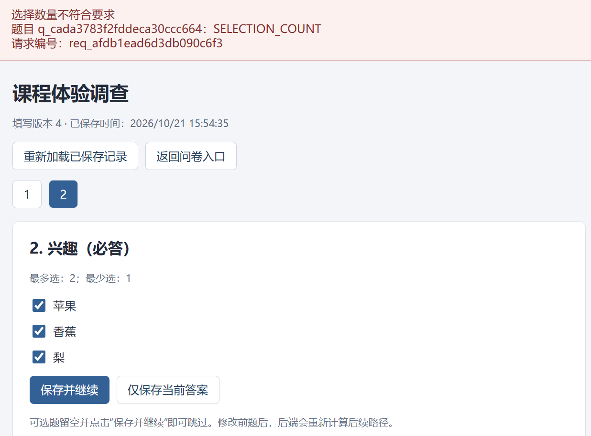
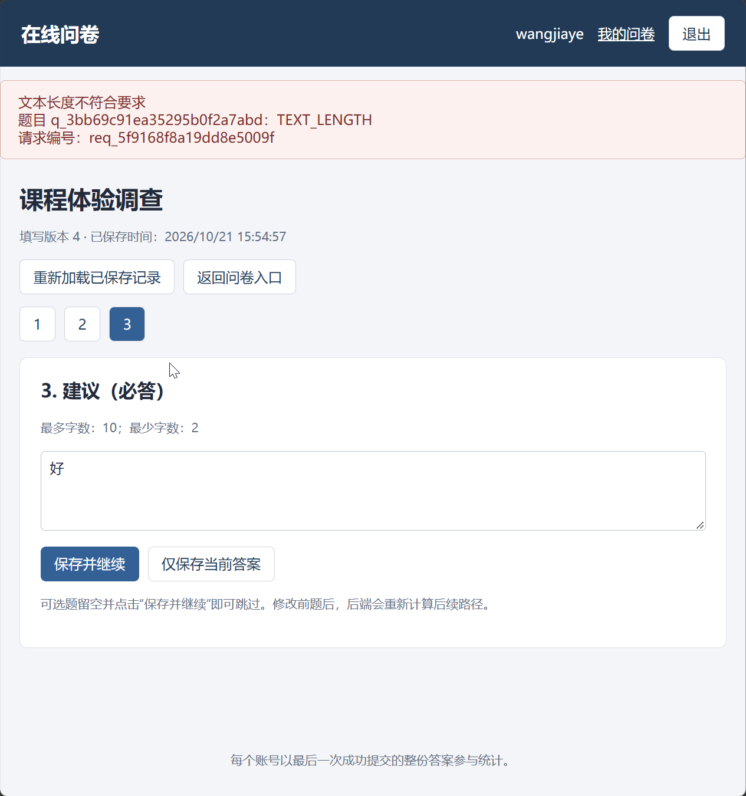
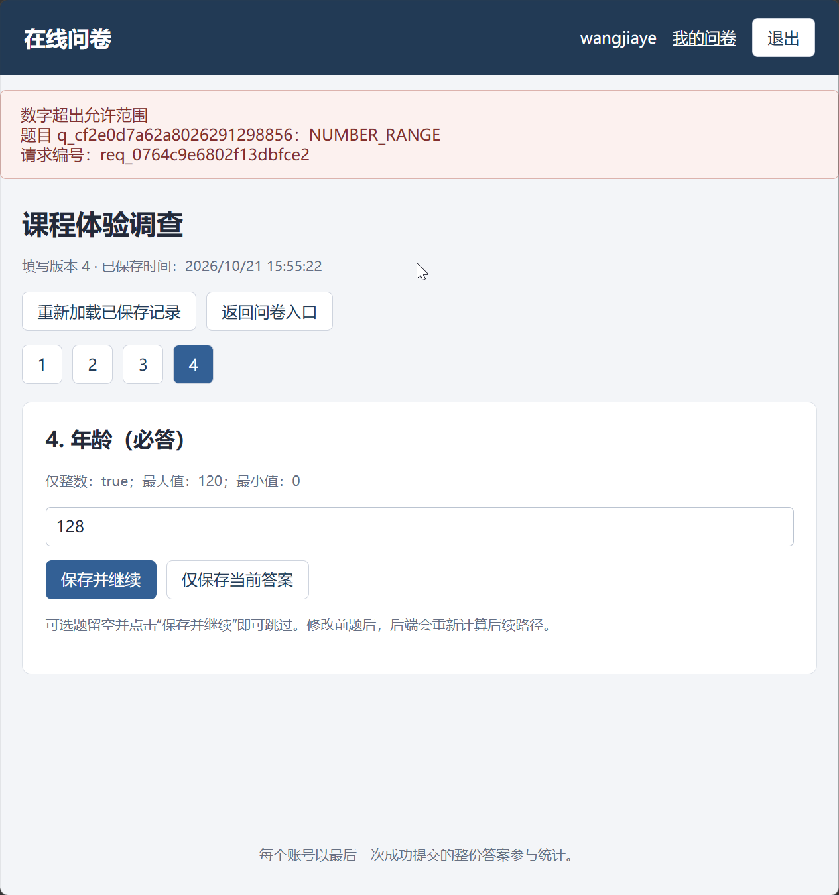

# 校验：测试用例

共29项；每项直接列出步骤、输入、输出与测试结果，无需跨文件跳转。


<a id="tc04-a01"></a>

## TC04-A01 多选上下界冲突

执行方式：API自动化。


### 测试步骤

#### 前置条件

- 专用测试库和支持事务的 MongoDB 副本集已启动。A=创建者，B=另一创建者，U1/U2/U3=填写者，各账号独立 Cookie 会话；账号以运行批次后缀保证唯一，默认密码 TestPass!2026。API 基础路径 /api/v1；写请求带该会话 X-CSRF-Token，管理/填写修改带最新 If-Match。每个用例独立建卷，不继承其他用例的运行结果。
- 新建 S，顺序包含 Q1 单选必答（继续/结束）、Q2 多选必答（苹果/香蕉/梨，minSelections=1,maxSelections=2）、Q3 文本可选（minLength=2,maxLength=10）、Q4 数字必答（minValue=0,maxValue=120,integerOnly=true）。无跳转，发布 V1，无截止，允许重复。Q1～Q4和选项名称均映射为服务端生成的真实ID；不是把名称直接发作ID。

#### 操作步骤

1. 找到对应题，PATCH validation

### 输入

#### 规定输入

```json
{
  "题型": "MULTIPLE",
  "validation": {
    "minSelections": 2,
    "maxSelections": 1
  }
}
```

#### 实际请求输入

实际请求按执行顺序完整列出（包含准备动作，凭据已脱敏）：

**请求 1：POST /auth/register**

```json
{
  "序号": 1,
  "method": "POST",
  "path": "/auth/register",
  "input": {
    "username": "api_7b1f898f991f436e89e221e39588c233",
    "password": "<redacted>"
  },
  "headers": {
    "Origin": "http://127.0.0.1:61374"
  }
}
```

**请求 2：POST /auth/login**

```json
{
  "序号": 2,
  "method": "POST",
  "path": "/auth/login",
  "input": {
    "username": "api_7b1f898f991f436e89e221e39588c233",
    "password": "<redacted>"
  },
  "headers": {
    "Origin": "http://127.0.0.1:61374"
  }
}
```

**请求 3：POST /surveys**

```json
{
  "序号": 3,
  "method": "POST",
  "path": "/surveys",
  "input": {
    "title": "课程体验调查",
    "allowRepeat": true
  },
  "headers": {
    "Origin": "http://127.0.0.1:61374",
    "X-CSRF-Token": "<redacted>"
  }
}
```

**请求 4：POST /surveys/6ad8934f37b03374ae337ebf/questions**

```json
{
  "序号": 4,
  "method": "POST",
  "path": "/surveys/6ad8934f37b03374ae337ebf/questions",
  "input": {
    "type": "SINGLE",
    "title": "Q1",
    "required": true,
    "options": [
      {
        "label": "继续"
      },
      {
        "label": "结束"
      }
    ]
  },
  "headers": {
    "Origin": "http://127.0.0.1:61374",
    "X-CSRF-Token": "<redacted>",
    "If-Match": "\"definition-1-control-0\""
  }
}
```

**请求 5：POST /surveys/6ad8934f37b03374ae337ebf/questions**

```json
{
  "序号": 5,
  "method": "POST",
  "path": "/surveys/6ad8934f37b03374ae337ebf/questions",
  "input": {
    "type": "MULTIPLE",
    "title": "Q2",
    "required": true,
    "options": [
      {
        "label": "苹果"
      },
      {
        "label": "香蕉"
      },
      {
        "label": "梨"
      }
    ],
    "validation": {
      "minSelections": 1,
      "maxSelections": 2
    }
  },
  "headers": {
    "Origin": "http://127.0.0.1:61374",
    "X-CSRF-Token": "<redacted>",
    "If-Match": "\"definition-2-control-1\""
  }
}
```

**请求 6：POST /surveys/6ad8934f37b03374ae337ebf/questions**

```json
{
  "序号": 6,
  "method": "POST",
  "path": "/surveys/6ad8934f37b03374ae337ebf/questions",
  "input": {
    "type": "TEXT",
    "title": "Q3",
    "required": false,
    "validation": {
      "minLength": 2,
      "maxLength": 10
    }
  },
  "headers": {
    "Origin": "http://127.0.0.1:61374",
    "X-CSRF-Token": "<redacted>",
    "If-Match": "\"definition-3-control-2\""
  }
}
```

**请求 7：POST /surveys/6ad8934f37b03374ae337ebf/questions**

```json
{
  "序号": 7,
  "method": "POST",
  "path": "/surveys/6ad8934f37b03374ae337ebf/questions",
  "input": {
    "type": "NUMBER",
    "title": "Q4",
    "required": true,
    "validation": {
      "minValue": "0",
      "maxValue": "120",
      "integerOnly": true
    }
  },
  "headers": {
    "Origin": "http://127.0.0.1:61374",
    "X-CSRF-Token": "<redacted>",
    "If-Match": "\"definition-4-control-3\""
  }
}
```

**请求 8：PATCH /surveys/6ad8934f37b03374ae337ebf/questions/q_079c1df0f70aaa2ce99ccae4**

```json
{
  "序号": 8,
  "method": "PATCH",
  "path": "/surveys/6ad8934f37b03374ae337ebf/questions/q_079c1df0f70aaa2ce99ccae4",
  "input": {
    "validation": {
      "minSelections": 2,
      "maxSelections": 1
    }
  },
  "headers": {
    "Origin": "http://127.0.0.1:61374",
    "X-CSRF-Token": "<redacted>",
    "If-Match": "\"definition-5-control-4\""
  }
}
```

**请求 9：GET /surveys/6ad8934f37b03374ae337ebf**

```json
{
  "序号": 9,
  "method": "GET",
  "path": "/surveys/6ad8934f37b03374ae337ebf",
  "input": null,
  "headers": {
    "Origin": "http://127.0.0.1:61374",
    "X-CSRF-Token": "<redacted>"
  }
}
```


### 输出

#### 预期输出

1. 422 CONSTRAINT_INVALID，旧配置不变

- 请求失败不改变定义和updatedAt。

#### 实际输出

本轮实际请求状态分布：HTTP 200：2次；HTTP 201：6次；HTTP 422：1次。

**请求 1：POST /auth/register**

```json
{
  "序号": 1,
  "method": "POST",
  "path": "/auth/register",
  "status": 201,
  "output": {
    "data": {
      "createdAt": "2026-10-21T10:26:23.704Z",
      "userId": "6ad8934f37b03374ae337ebd",
      "username": "api_7b1f898f991f436e89e221e39588c233"
    },
    "requestId": "req_d08fb1e3e30dfd214e53"
  },
  "responseHeaders": {
    "Server": "Werkzeug/3.1.9 Python/3.14.7",
    "Date": "Wed, 21 Oct 2026 10:26:23 GMT",
    "Content-Type": "application/json",
    "Content-Length": "175",
    "X-Request-ID": "req_d08fb1e3e30dfd214e53",
    "X-Content-Type-Options": "nosniff",
    "Referrer-Policy": "same-origin",
    "X-Frame-Options": "DENY",
    "Content-Security-Policy": "default-src 'self'; script-src 'self'; style-src 'self'; img-src 'self' data:; connect-src 'self'; frame-ancestors 'none'; base-uri 'self'; form-action 'self'",
    "Cache-Control": "no-store",
    "Connection": "close"
  }
}
```

**请求 2：POST /auth/login**

```json
{
  "序号": 2,
  "method": "POST",
  "path": "/auth/login",
  "status": 200,
  "output": {
    "data": {
      "csrfToken": "<redacted>",
      "user": {
        "createdAt": "2026-10-21T10:26:23.704Z",
        "userId": "6ad8934f37b03374ae337ebd",
        "username": "api_7b1f898f991f436e89e221e39588c233"
      }
    },
    "requestId": "req_ca9ab84b9f8c29523a39"
  },
  "responseHeaders": {
    "Server": "Werkzeug/3.1.9 Python/3.14.7",
    "Date": "Wed, 21 Oct 2026 10:26:23 GMT",
    "Content-Type": "application/json",
    "Content-Length": "242",
    "Set-Cookie": "<redacted>",
    "X-Request-ID": "req_ca9ab84b9f8c29523a39",
    "X-Content-Type-Options": "nosniff",
    "Referrer-Policy": "same-origin",
    "X-Frame-Options": "DENY",
    "Content-Security-Policy": "default-src 'self'; script-src 'self'; style-src 'self'; img-src 'self' data:; connect-src 'self'; frame-ancestors 'none'; base-uri 'self'; form-action 'self'",
    "Cache-Control": "no-store",
    "Connection": "close"
  }
}
```

**请求 3：POST /surveys**

```json
{
  "序号": 3,
  "method": "POST",
  "path": "/surveys",
  "status": 201,
  "output": {
    "data": {
      "controlRevision": 0,
      "createdAt": "2026-10-21T10:26:23.805Z",
      "deadlineAt": null,
      "definitionVersion": 1,
      "draft": {
        "description": "",
        "policy": {
          "allowRepeat": true,
          "anonymous": false
        },
        "questions": [],
        "title": "课程体验调查"
      },
      "effectiveState": "DRAFT",
      "publicCode": "share_62cd41c0e0e5d0897825cafc",
      "publishedVersion": null,
      "shareUrl": "/survey/share_62cd41c0e0e5d0897825cafc",
      "state": "DRAFT",
      "surveyId": "6ad8934f37b03374ae337ebf",
      "updatedAt": "2026-10-21T10:26:23.805Z"
    },
    "requestId": "req_63d6f7252a9c3469215c"
  },
  "responseHeaders": {
    "Server": "Werkzeug/3.1.9 Python/3.14.7",
    "Date": "Wed, 21 Oct 2026 10:26:23 GMT",
    "Content-Type": "application/json",
    "Content-Length": "508",
    "ETag": "\"definition-1-control-0\"",
    "X-Request-ID": "req_63d6f7252a9c3469215c",
    "X-Content-Type-Options": "nosniff",
    "Referrer-Policy": "same-origin",
    "X-Frame-Options": "DENY",
    "Content-Security-Policy": "default-src 'self'; script-src 'self'; style-src 'self'; img-src 'self' data:; connect-src 'self'; frame-ancestors 'none'; base-uri 'self'; form-action 'self'",
    "Cache-Control": "no-store",
    "Connection": "close"
  }
}
```

**请求 4：POST /surveys/6ad8934f37b03374ae337ebf/questions**

```json
{
  "序号": 4,
  "method": "POST",
  "path": "/surveys/6ad8934f37b03374ae337ebf/questions",
  "status": 201,
  "output": {
    "data": {
      "controlRevision": 1,
      "createdAt": "2026-10-21T10:26:23.805Z",
      "deadlineAt": null,
      "definitionVersion": 2,
      "draft": {
        "description": "",
        "policy": {
          "allowRepeat": true,
          "anonymous": false
        },
        "questions": [
          {
            "jumpRules": [],
            "options": [
              {
                "label": "继续",
                "optionId": "opt_03d0b8b147e28c45a1a2bc6b"
              },
              {
                "label": "结束",
                "optionId": "opt_70496e4991f3a3c2fa372ac1"
              }
            ],
            "questionId": "q_d749379c6c90664b453bb639",
            "required": true,
            "title": "Q1",
            "type": "SINGLE",
            "validation": {}
          }
        ],
        "title": "课程体验调查"
      },
      "effectiveState": "DRAFT",
      "publicCode": "share_62cd41c0e0e5d0897825cafc",
      "publishedVersion": null,
      "shareUrl": "/survey/share_62cd41c0e0e5d0897825cafc",
      "state": "DRAFT",
      "surveyId": "6ad8934f37b03374ae337ebf",
      "updatedAt": "2026-10-21T10:26:23.824Z"
    },
    "requestId": "req_02ca7958ce541e01fc66"
  },
  "responseHeaders": {
    "Server": "Werkzeug/3.1.9 Python/3.14.7",
    "Date": "Wed, 21 Oct 2026 10:26:23 GMT",
    "Content-Type": "application/json",
    "Content-Length": "761",
    "ETag": "\"definition-2-control-1\"",
    "X-Request-ID": "req_02ca7958ce541e01fc66",
    "X-Content-Type-Options": "nosniff",
    "Referrer-Policy": "same-origin",
    "X-Frame-Options": "DENY",
    "Content-Security-Policy": "default-src 'self'; script-src 'self'; style-src 'self'; img-src 'self' data:; connect-src 'self'; frame-ancestors 'none'; base-uri 'self'; form-action 'self'",
    "Cache-Control": "no-store",
    "Connection": "close"
  }
}
```

**请求 5：POST /surveys/6ad8934f37b03374ae337ebf/questions**

```json
{
  "序号": 5,
  "method": "POST",
  "path": "/surveys/6ad8934f37b03374ae337ebf/questions",
  "status": 201,
  "output": {
    "data": {
      "controlRevision": 2,
      "createdAt": "2026-10-21T10:26:23.805Z",
      "deadlineAt": null,
      "definitionVersion": 3,
      "draft": {
        "description": "",
        "policy": {
          "allowRepeat": true,
          "anonymous": false
        },
        "questions": [
          {
            "jumpRules": [],
            "options": [
              {
                "label": "继续",
                "optionId": "opt_03d0b8b147e28c45a1a2bc6b"
              },
              {
                "label": "结束",
                "optionId": "opt_70496e4991f3a3c2fa372ac1"
              }
            ],
            "questionId": "q_d749379c6c90664b453bb639",
            "required": true,
            "title": "Q1",
            "type": "SINGLE",
            "validation": {}
          },
          {
            "jumpRules": [],
            "options": [
              {
                "label": "苹果",
                "optionId": "opt_c245a00a7c49818916cb998f"
              },
              {
                "label": "香蕉",
                "optionId": "opt_252d19a3251bd0f7ae17ba8b"
              },
              {
                "label": "梨",
                "optionId": "opt_422c91849a9671826c8df505"
              }
            ],
            "questionId": "q_079c1df0f70aaa2ce99ccae4",
            "required": true,
            "title": "Q2",
            "type": "MULTIPLE",
            "validation": {
              "maxSelections": 2,
              "minSelections": 1
            }
          }
        ],
        "title": "课程体验调查"
      },
      "effectiveState": "DRAFT",
      "publicCode": "share_62cd41c0e0e5d0897825cafc",
      "publishedVersion": null,
      "shareUrl": "/survey/share_62cd41c0e0e5d0897825cafc",
      "state": "DRAFT",
      "surveyId": "6ad8934f37b03374ae337ebf",
      "updatedAt": "2026-10-21T10:26:23.839Z"
    },
    "requestId": "req_2a9ed4d2007bdcee7ccf"
  },
  "responseHeaders": {
    "Server": "Werkzeug/3.1.9 Python/3.14.7",
    "Date": "Wed, 21 Oct 2026 10:26:23 GMT",
    "Content-Type": "application/json",
    "Content-Length": "1110",
    "ETag": "\"definition-3-control-2\"",
    "X-Request-ID": "req_2a9ed4d2007bdcee7ccf",
    "X-Content-Type-Options": "nosniff",
    "Referrer-Policy": "same-origin",
    "X-Frame-Options": "DENY",
    "Content-Security-Policy": "default-src 'self'; script-src 'self'; style-src 'self'; img-src 'self' data:; connect-src 'self'; frame-ancestors 'none'; base-uri 'self'; form-action 'self'",
    "Cache-Control": "no-store",
    "Connection": "close"
  }
}
```

**请求 6：POST /surveys/6ad8934f37b03374ae337ebf/questions**

```json
{
  "序号": 6,
  "method": "POST",
  "path": "/surveys/6ad8934f37b03374ae337ebf/questions",
  "status": 201,
  "output": {
    "data": {
      "controlRevision": 3,
      "createdAt": "2026-10-21T10:26:23.805Z",
      "deadlineAt": null,
      "definitionVersion": 4,
      "draft": {
        "description": "",
        "policy": {
          "allowRepeat": true,
          "anonymous": false
        },
        "questions": [
          {
            "jumpRules": [],
            "options": [
              {
                "label": "继续",
                "optionId": "opt_03d0b8b147e28c45a1a2bc6b"
              },
              {
                "label": "结束",
                "optionId": "opt_70496e4991f3a3c2fa372ac1"
              }
            ],
            "questionId": "q_d749379c6c90664b453bb639",
            "required": true,
            "title": "Q1",
            "type": "SINGLE",
            "validation": {}
          },
          {
            "jumpRules": [],
            "options": [
              {
                "label": "苹果",
                "optionId": "opt_c245a00a7c49818916cb998f"
              },
              {
                "label": "香蕉",
                "optionId": "opt_252d19a3251bd0f7ae17ba8b"
              },
              {
                "label": "梨",
                "optionId": "opt_422c91849a9671826c8df505"
              }
            ],
            "questionId": "q_079c1df0f70aaa2ce99ccae4",
            "required": true,
            "title": "Q2",
            "type": "MULTIPLE",
            "validation": {
              "maxSelections": 2,
              "minSelections": 1
            }
          },
          {
            "jumpRules": [],
            "questionId": "q_98eb894f309c8b3d6546e41b",
            "required": false,
            "title": "Q3",
            "type": "TEXT",
            "validation": {
              "maxLength": 10,
              "minLength": 2
            }
          }
        ],
        "title": "课程体验调查"
      },
      "effectiveState": "DRAFT",
      "publicCode": "share_62cd41c0e0e5d0897825cafc",
      "publishedVersion": null,
      "shareUrl": "/survey/share_62cd41c0e0e5d0897825cafc",
      "state": "DRAFT",
      "surveyId": "6ad8934f37b03374ae337ebf",
      "updatedAt": "2026-10-21T10:26:23.850Z"
    },
    "requestId": "req_8d422a10649069ed5c97"
  },
  "responseHeaders": {
    "Server": "Werkzeug/3.1.9 Python/3.14.7",
    "Date": "Wed, 21 Oct 2026 10:26:23 GMT",
    "Content-Type": "application/json",
    "Content-Length": "1257",
    "ETag": "\"definition-4-control-3\"",
    "X-Request-ID": "req_8d422a10649069ed5c97",
    "X-Content-Type-Options": "nosniff",
    "Referrer-Policy": "same-origin",
    "X-Frame-Options": "DENY",
    "Content-Security-Policy": "default-src 'self'; script-src 'self'; style-src 'self'; img-src 'self' data:; connect-src 'self'; frame-ancestors 'none'; base-uri 'self'; form-action 'self'",
    "Cache-Control": "no-store",
    "Connection": "close"
  }
}
```

**请求 7：POST /surveys/6ad8934f37b03374ae337ebf/questions**

```json
{
  "序号": 7,
  "method": "POST",
  "path": "/surveys/6ad8934f37b03374ae337ebf/questions",
  "status": 201,
  "output": {
    "data": {
      "controlRevision": 4,
      "createdAt": "2026-10-21T10:26:23.805Z",
      "deadlineAt": null,
      "definitionVersion": 5,
      "draft": {
        "description": "",
        "policy": {
          "allowRepeat": true,
          "anonymous": false
        },
        "questions": [
          {
            "jumpRules": [],
            "options": [
              {
                "label": "继续",
                "optionId": "opt_03d0b8b147e28c45a1a2bc6b"
              },
              {
                "label": "结束",
                "optionId": "opt_70496e4991f3a3c2fa372ac1"
              }
            ],
            "questionId": "q_d749379c6c90664b453bb639",
            "required": true,
            "title": "Q1",
            "type": "SINGLE",
            "validation": {}
          },
          {
            "jumpRules": [],
            "options": [
              {
                "label": "苹果",
                "optionId": "opt_c245a00a7c49818916cb998f"
              },
              {
                "label": "香蕉",
                "optionId": "opt_252d19a3251bd0f7ae17ba8b"
              },
              {
                "label": "梨",
                "optionId": "opt_422c91849a9671826c8df505"
              }
            ],
            "questionId": "q_079c1df0f70aaa2ce99ccae4",
            "required": true,
            "title": "Q2",
            "type": "MULTIPLE",
            "validation": {
              "maxSelections": 2,
              "minSelections": 1
            }
          },
          {
            "jumpRules": [],
            "questionId": "q_98eb894f309c8b3d6546e41b",
            "required": false,
            "title": "Q3",
            "type": "TEXT",
            "validation": {
              "maxLength": 10,
              "minLength": 2
            }
          },
          {
            "jumpRules": [],
            "questionId": "q_e00b77dab275aae67013bfff",
            "required": true,
            "title": "Q4",
            "type": "NUMBER",
            "validation": {
              "integerOnly": true,
              "maxValue": "120",
              "minValue": "0"
            }
          }
        ],
        "title": "课程体验调查"
      },
      "effectiveState": "DRAFT",
      "publicCode": "share_62cd41c0e0e5d0897825cafc",
      "publishedVersion": null,
      "shareUrl": "/survey/share_62cd41c0e0e5d0897825cafc",
      "state": "DRAFT",
      "surveyId": "6ad8934f37b03374ae337ebf",
      "updatedAt": "2026-10-21T10:26:23.870Z"
    },
    "requestId": "req_a08461f857e3e06ebf66"
  },
  "responseHeaders": {
    "Server": "Werkzeug/3.1.9 Python/3.14.7",
    "Date": "Wed, 21 Oct 2026 10:26:23 GMT",
    "Content-Type": "application/json",
    "Content-Length": "1427",
    "ETag": "\"definition-5-control-4\"",
    "X-Request-ID": "req_a08461f857e3e06ebf66",
    "X-Content-Type-Options": "nosniff",
    "Referrer-Policy": "same-origin",
    "X-Frame-Options": "DENY",
    "Content-Security-Policy": "default-src 'self'; script-src 'self'; style-src 'self'; img-src 'self' data:; connect-src 'self'; frame-ancestors 'none'; base-uri 'self'; form-action 'self'",
    "Cache-Control": "no-store",
    "Connection": "close"
  }
}
```

**请求 8：PATCH /surveys/6ad8934f37b03374ae337ebf/questions/q_079c1df0f70aaa2ce99ccae4**

```json
{
  "序号": 8,
  "method": "PATCH",
  "path": "/surveys/6ad8934f37b03374ae337ebf/questions/q_079c1df0f70aaa2ce99ccae4",
  "status": 422,
  "output": {
    "error": {
      "code": "CONSTRAINT_INVALID",
      "details": [
        {
          "code": "CONSTRAINT_INVALID",
          "questionId": "q_079c1df0f70aaa2ce99ccae4"
        }
      ],
      "message": "多选数量限制冲突或超过选项数"
    },
    "requestId": "req_d7ace4a0c760310efaa3"
  },
  "responseHeaders": {
    "Server": "Werkzeug/3.1.9 Python/3.14.7",
    "Date": "Wed, 21 Oct 2026 10:26:23 GMT",
    "Content-Type": "application/json",
    "Content-Length": "218",
    "X-Request-ID": "req_d7ace4a0c760310efaa3",
    "X-Content-Type-Options": "nosniff",
    "Referrer-Policy": "same-origin",
    "X-Frame-Options": "DENY",
    "Content-Security-Policy": "default-src 'self'; script-src 'self'; style-src 'self'; img-src 'self' data:; connect-src 'self'; frame-ancestors 'none'; base-uri 'self'; form-action 'self'",
    "Cache-Control": "no-store",
    "Connection": "close"
  }
}
```

**请求 9：GET /surveys/6ad8934f37b03374ae337ebf**

```json
{
  "序号": 9,
  "method": "GET",
  "path": "/surveys/6ad8934f37b03374ae337ebf",
  "status": 200,
  "output": {
    "data": {
      "controlRevision": 4,
      "createdAt": "2026-10-21T10:26:23.805Z",
      "deadlineAt": null,
      "definitionVersion": 5,
      "draft": {
        "description": "",
        "policy": {
          "allowRepeat": true,
          "anonymous": false
        },
        "questions": [
          {
            "jumpRules": [],
            "options": [
              {
                "label": "继续",
                "optionId": "opt_03d0b8b147e28c45a1a2bc6b"
              },
              {
                "label": "结束",
                "optionId": "opt_70496e4991f3a3c2fa372ac1"
              }
            ],
            "questionId": "q_d749379c6c90664b453bb639",
            "required": true,
            "title": "Q1",
            "type": "SINGLE",
            "validation": {}
          },
          {
            "jumpRules": [],
            "options": [
              {
                "label": "苹果",
                "optionId": "opt_c245a00a7c49818916cb998f"
              },
              {
                "label": "香蕉",
                "optionId": "opt_252d19a3251bd0f7ae17ba8b"
              },
              {
                "label": "梨",
                "optionId": "opt_422c91849a9671826c8df505"
              }
            ],
            "questionId": "q_079c1df0f70aaa2ce99ccae4",
            "required": true,
            "title": "Q2",
            "type": "MULTIPLE",
            "validation": {
              "maxSelections": 2,
              "minSelections": 1
            }
          },
          {
            "jumpRules": [],
            "questionId": "q_98eb894f309c8b3d6546e41b",
            "required": false,
            "title": "Q3",
            "type": "TEXT",
            "validation": {
              "maxLength": 10,
              "minLength": 2
            }
          },
          {
            "jumpRules": [],
            "questionId": "q_e00b77dab275aae67013bfff",
            "required": true,
            "title": "Q4",
            "type": "NUMBER",
            "validation": {
              "integerOnly": true,
              "maxValue": "120",
              "minValue": "0"
            }
          }
        ],
        "title": "课程体验调查"
      },
      "effectiveState": "DRAFT",
      "publicCode": "share_62cd41c0e0e5d0897825cafc",
      "publishedVersion": null,
      "shareUrl": "/survey/share_62cd41c0e0e5d0897825cafc",
      "state": "DRAFT",
      "surveyId": "6ad8934f37b03374ae337ebf",
      "updatedAt": "2026-10-21T10:26:23.870Z"
    },
    "requestId": "req_7258cb66937597db1451"
  },
  "responseHeaders": {
    "Server": "Werkzeug/3.1.9 Python/3.14.7",
    "Date": "Wed, 21 Oct 2026 10:26:23 GMT",
    "Content-Type": "application/json",
    "Content-Length": "1427",
    "ETag": "\"definition-5-control-4\"",
    "X-Request-ID": "req_7258cb66937597db1451",
    "X-Content-Type-Options": "nosniff",
    "Referrer-Policy": "same-origin",
    "X-Frame-Options": "DENY",
    "Content-Security-Policy": "default-src 'self'; script-src 'self'; style-src 'self'; img-src 'self' data:; connect-src 'self'; frame-ancestors 'none'; base-uri 'self'; form-action 'self'",
    "Cache-Control": "no-store",
    "Connection": "close"
  }
}
```

序号与输入层对应；包含账号、问卷和填写准备请求，不能将首条准备请求当作本例目标接口。

**本例问卷持久化摘要**

```json
[
  {
    "surveyId": {
      "$oid": "6ad8934f37b03374ae337ebf"
    },
    "responses": 0,
    "guards": 0,
    "versions": 0,
    "attempts": 0
  }
]
```


### 测试结果

**判定：通过**。

```text
本轮脚本断言通过。实际返回及数据库核对见输出层和Allure附件。
```

**原始测试规格**

```json
{
  "id": "TC04-A01",
  "moduleId": 4,
  "module": "校验",
  "title": "多选上下界冲突",
  "execution": "api",
  "priority": "P1",
  "sourceSteps": [
    1
  ],
  "preconditions": [
    "专用测试库和支持事务的 MongoDB 副本集已启动。A=创建者，B=另一创建者，U1/U2/U3=填写者，各账号独立 Cookie 会话；账号以运行批次后缀保证唯一，默认密码 TestPass!2026。API 基础路径 /api/v1；写请求带该会话 X-CSRF-Token，管理/填写修改带最新 If-Match。每个用例独立建卷，不继承其他用例的运行结果。",
    "新建 S，顺序包含 Q1 单选必答（继续/结束）、Q2 多选必答（苹果/香蕉/梨，minSelections=1,maxSelections=2）、Q3 文本可选（minLength=2,maxLength=10）、Q4 数字必答（minValue=0,maxValue=120,integerOnly=true）。无跳转，发布 V1，无截止，允许重复。Q1～Q4和选项名称均映射为服务端生成的真实ID；不是把名称直接发作ID。"
  ],
  "input": {
    "题型": "MULTIPLE",
    "validation": {
      "minSelections": 2,
      "maxSelections": 1
    }
  },
  "steps": [
    {
      "action": "找到对应题，PATCH validation",
      "expected": "422 CONSTRAINT_INVALID，旧配置不变"
    }
  ],
  "expected": [
    "请求失败不改变定义和updatedAt。"
  ]
}
```

**HTTP 请求与响应（凭据已脱敏）**

```json
[
  {
    "method": "POST",
    "path": "/auth/register",
    "input": {
      "username": "api_7b1f898f991f436e89e221e39588c233",
      "password": "<redacted>"
    },
    "headers": {
      "Origin": "http://127.0.0.1:61374"
    },
    "status": 201,
    "output": {
      "data": {
        "createdAt": "2026-10-21T10:26:23.704Z",
        "userId": "6ad8934f37b03374ae337ebd",
        "username": "api_7b1f898f991f436e89e221e39588c233"
      },
      "requestId": "req_d08fb1e3e30dfd214e53"
    },
    "responseHeaders": {
      "Server": "Werkzeug/3.1.9 Python/3.14.7",
      "Date": "Wed, 21 Oct 2026 10:26:23 GMT",
      "Content-Type": "application/json",
      "Content-Length": "175",
      "X-Request-ID": "req_d08fb1e3e30dfd214e53",
      "X-Content-Type-Options": "nosniff",
      "Referrer-Policy": "same-origin",
      "X-Frame-Options": "DENY",
      "Content-Security-Policy": "default-src 'self'; script-src 'self'; style-src 'self'; img-src 'self' data:; connect-src 'self'; frame-ancestors 'none'; base-uri 'self'; form-action 'self'",
      "Cache-Control": "no-store",
      "Connection": "close"
    }
  },
  {
    "method": "POST",
    "path": "/auth/login",
    "input": {
      "username": "api_7b1f898f991f436e89e221e39588c233",
      "password": "<redacted>"
    },
    "headers": {
      "Origin": "http://127.0.0.1:61374"
    },
    "status": 200,
    "output": {
      "data": {
        "csrfToken": "<redacted>",
        "user": {
          "createdAt": "2026-10-21T10:26:23.704Z",
          "userId": "6ad8934f37b03374ae337ebd",
          "username": "api_7b1f898f991f436e89e221e39588c233"
        }
      },
      "requestId": "req_ca9ab84b9f8c29523a39"
    },
    "responseHeaders": {
      "Server": "Werkzeug/3.1.9 Python/3.14.7",
      "Date": "Wed, 21 Oct 2026 10:26:23 GMT",
      "Content-Type": "application/json",
      "Content-Length": "242",
      "Set-Cookie": "<redacted>",
      "X-Request-ID": "req_ca9ab84b9f8c29523a39",
      "X-Content-Type-Options": "nosniff",
      "Referrer-Policy": "same-origin",
      "X-Frame-Options": "DENY",
      "Content-Security-Policy": "default-src 'self'; script-src 'self'; style-src 'self'; img-src 'self' data:; connect-src 'self'; frame-ancestors 'none'; base-uri 'self'; form-action 'self'",
      "Cache-Control": "no-store",
      "Connection": "close"
    }
  },
  {
    "method": "POST",
    "path": "/surveys",
    "input": {
      "title": "课程体验调查",
      "allowRepeat": true
    },
    "headers": {
      "Origin": "http://127.0.0.1:61374",
      "X-CSRF-Token": "<redacted>"
    },
    "status": 201,
    "output": {
      "data": {
        "controlRevision": 0,
        "createdAt": "2026-10-21T10:26:23.805Z",
        "deadlineAt": null,
        "definitionVersion": 1,
        "draft": {
          "description": "",
          "policy": {
            "allowRepeat": true,
            "anonymous": false
          },
          "questions": [],
          "title": "课程体验调查"
        },
        "effectiveState": "DRAFT",
        "publicCode": "share_62cd41c0e0e5d0897825cafc",
        "publishedVersion": null,
        "shareUrl": "/survey/share_62cd41c0e0e5d0897825cafc",
        "state": "DRAFT",
        "surveyId": "6ad8934f37b03374ae337ebf",
        "updatedAt": "2026-10-21T10:26:23.805Z"
      },
      "requestId": "req_63d6f7252a9c3469215c"
    },
    "responseHeaders": {
      "Server": "Werkzeug/3.1.9 Python/3.14.7",
      "Date": "Wed, 21 Oct 2026 10:26:23 GMT",
      "Content-Type": "application/json",
      "Content-Length": "508",
      "ETag": "\"definition-1-control-0\"",
      "X-Request-ID": "req_63d6f7252a9c3469215c",
      "X-Content-Type-Options": "nosniff",
      "Referrer-Policy": "same-origin",
      "X-Frame-Options": "DENY",
      "Content-Security-Policy": "default-src 'self'; script-src 'self'; style-src 'self'; img-src 'self' data:; connect-src 'self'; frame-ancestors 'none'; base-uri 'self'; form-action 'self'",
      "Cache-Control": "no-store",
      "Connection": "close"
    }
  },
  {
    "method": "POST",
    "path": "/surveys/6ad8934f37b03374ae337ebf/questions",
    "input": {
      "type": "SINGLE",
      "title": "Q1",
      "required": true,
      "options": [
        {
          "label": "继续"
        },
        {
          "label": "结束"
        }
      ]
    },
    "headers": {
      "Origin": "http://127.0.0.1:61374",
      "X-CSRF-Token": "<redacted>",
      "If-Match": "\"definition-1-control-0\""
    },
    "status": 201,
    "output": {
      "data": {
        "controlRevision": 1,
        "createdAt": "2026-10-21T10:26:23.805Z",
        "deadlineAt": null,
        "definitionVersion": 2,
        "draft": {
          "description": "",
          "policy": {
            "allowRepeat": true,
            "anonymous": false
          },
          "questions": [
            {
              "jumpRules": [],
              "options": [
                {
                  "label": "继续",
                  "optionId": "opt_03d0b8b147e28c45a1a2bc6b"
                },
                {
                  "label": "结束",
                  "optionId": "opt_70496e4991f3a3c2fa372ac1"
                }
              ],
              "questionId": "q_d749379c6c90664b453bb639",
              "required": true,
              "title": "Q1",
              "type": "SINGLE",
              "validation": {}
            }
          ],
          "title": "课程体验调查"
        },
        "effectiveState": "DRAFT",
        "publicCode": "share_62cd41c0e0e5d0897825cafc",
        "publishedVersion": null,
        "shareUrl": "/survey/share_62cd41c0e0e5d0897825cafc",
        "state": "DRAFT",
        "surveyId": "6ad8934f37b03374ae337ebf",
        "updatedAt": "2026-10-21T10:26:23.824Z"
      },
      "requestId": "req_02ca7958ce541e01fc66"
    },
    "responseHeaders": {
      "Server": "Werkzeug/3.1.9 Python/3.14.7",
      "Date": "Wed, 21 Oct 2026 10:26:23 GMT",
      "Content-Type": "application/json",
      "Content-Length": "761",
      "ETag": "\"definition-2-control-1\"",
      "X-Request-ID": "req_02ca7958ce541e01fc66",
      "X-Content-Type-Options": "nosniff",
      "Referrer-Policy": "same-origin",
      "X-Frame-Options": "DENY",
      "Content-Security-Policy": "default-src 'self'; script-src 'self'; style-src 'self'; img-src 'self' data:; connect-src 'self'; frame-ancestors 'none'; base-uri 'self'; form-action 'self'",
      "Cache-Control": "no-store",
      "Connection": "close"
    }
  },
  {
    "method": "POST",
    "path": "/surveys/6ad8934f37b03374ae337ebf/questions",
    "input": {
      "type": "MULTIPLE",
      "title": "Q2",
      "required": true,
      "options": [
        {
          "label": "苹果"
        },
        {
          "label": "香蕉"
        },
        {
          "label": "梨"
        }
      ],
      "validation": {
        "minSelections": 1,
        "maxSelections": 2
      }
    },
    "headers": {
      "Origin": "http://127.0.0.1:61374",
      "X-CSRF-Token": "<redacted>",
      "If-Match": "\"definition-2-control-1\""
    },
    "status": 201,
    "output": {
      "data": {
        "controlRevision": 2,
        "createdAt": "2026-10-21T10:26:23.805Z",
        "deadlineAt": null,
        "definitionVersion": 3,
        "draft": {
          "description": "",
          "policy": {
            "allowRepeat": true,
            "anonymous": false
          },
          "questions": [
            {
              "jumpRules": [],
              "options": [
                {
                  "label": "继续",
                  "optionId": "opt_03d0b8b147e28c45a1a2bc6b"
                },
                {
                  "label": "结束",
                  "optionId": "opt_70496e4991f3a3c2fa372ac1"
                }
              ],
              "questionId": "q_d749379c6c90664b453bb639",
              "required": true,
              "title": "Q1",
              "type": "SINGLE",
              "validation": {}
            },
            {
              "jumpRules": [],
              "options": [
                {
                  "label": "苹果",
                  "optionId": "opt_c245a00a7c49818916cb998f"
                },
                {
                  "label": "香蕉",
                  "optionId": "opt_252d19a3251bd0f7ae17ba8b"
                },
                {
                  "label": "梨",
                  "optionId": "opt_422c91849a9671826c8df505"
                }
              ],
              "questionId": "q_079c1df0f70aaa2ce99ccae4",
              "required": true,
              "title": "Q2",
              "type": "MULTIPLE",
              "validation": {
                "maxSelections": 2,
                "minSelections": 1
              }
            }
          ],
          "title": "课程体验调查"
        },
        "effectiveState": "DRAFT",
        "publicCode": "share_62cd41c0e0e5d0897825cafc",
        "publishedVersion": null,
        "shareUrl": "/survey/share_62cd41c0e0e5d0897825cafc",
        "state": "DRAFT",
        "surveyId": "6ad8934f37b03374ae337ebf",
        "updatedAt": "2026-10-21T10:26:23.839Z"
      },
      "requestId": "req_2a9ed4d2007bdcee7ccf"
    },
    "responseHeaders": {
      "Server": "Werkzeug/3.1.9 Python/3.14.7",
      "Date": "Wed, 21 Oct 2026 10:26:23 GMT",
      "Content-Type": "application/json",
      "Content-Length": "1110",
      "ETag": "\"definition-3-control-2\"",
      "X-Request-ID": "req_2a9ed4d2007bdcee7ccf",
      "X-Content-Type-Options": "nosniff",
      "Referrer-Policy": "same-origin",
      "X-Frame-Options": "DENY",
      "Content-Security-Policy": "default-src 'self'; script-src 'self'; style-src 'self'; img-src 'self' data:; connect-src 'self'; frame-ancestors 'none'; base-uri 'self'; form-action 'self'",
      "Cache-Control": "no-store",
      "Connection": "close"
    }
  },
  {
    "method": "POST",
    "path": "/surveys/6ad8934f37b03374ae337ebf/questions",
    "input": {
      "type": "TEXT",
      "title": "Q3",
      "required": false,
      "validation": {
        "minLength": 2,
        "maxLength": 10
      }
    },
    "headers": {
      "Origin": "http://127.0.0.1:61374",
      "X-CSRF-Token": "<redacted>",
      "If-Match": "\"definition-3-control-2\""
    },
    "status": 201,
    "output": {
      "data": {
        "controlRevision": 3,
        "createdAt": "2026-10-21T10:26:23.805Z",
        "deadlineAt": null,
        "definitionVersion": 4,
        "draft": {
          "description": "",
          "policy": {
            "allowRepeat": true,
            "anonymous": false
          },
          "questions": [
            {
              "jumpRules": [],
              "options": [
                {
                  "label": "继续",
                  "optionId": "opt_03d0b8b147e28c45a1a2bc6b"
                },
                {
                  "label": "结束",
                  "optionId": "opt_70496e4991f3a3c2fa372ac1"
                }
              ],
              "questionId": "q_d749379c6c90664b453bb639",
              "required": true,
              "title": "Q1",
              "type": "SINGLE",
              "validation": {}
            },
            {
              "jumpRules": [],
              "options": [
                {
                  "label": "苹果",
                  "optionId": "opt_c245a00a7c49818916cb998f"
                },
                {
                  "label": "香蕉",
                  "optionId": "opt_252d19a3251bd0f7ae17ba8b"
                },
                {
                  "label": "梨",
                  "optionId": "opt_422c91849a9671826c8df505"
                }
              ],
              "questionId": "q_079c1df0f70aaa2ce99ccae4",
              "required": true,
              "title": "Q2",
              "type": "MULTIPLE",
              "validation": {
                "maxSelections": 2,
                "minSelections": 1
              }
            },
            {
              "jumpRules": [],
              "questionId": "q_98eb894f309c8b3d6546e41b",
              "required": false,
              "title": "Q3",
              "type": "TEXT",
              "validation": {
                "maxLength": 10,
                "minLength": 2
              }
            }
          ],
          "title": "课程体验调查"
        },
        "effectiveState": "DRAFT",
        "publicCode": "share_62cd41c0e0e5d0897825cafc",
        "publishedVersion": null,
        "shareUrl": "/survey/share_62cd41c0e0e5d0897825cafc",
        "state": "DRAFT",
        "surveyId": "6ad8934f37b03374ae337ebf",
        "updatedAt": "2026-10-21T10:26:23.850Z"
      },
      "requestId": "req_8d422a10649069ed5c97"
    },
    "responseHeaders": {
      "Server": "Werkzeug/3.1.9 Python/3.14.7",
      "Date": "Wed, 21 Oct 2026 10:26:23 GMT",
      "Content-Type": "application/json",
      "Content-Length": "1257",
      "ETag": "\"definition-4-control-3\"",
      "X-Request-ID": "req_8d422a10649069ed5c97",
      "X-Content-Type-Options": "nosniff",
      "Referrer-Policy": "same-origin",
      "X-Frame-Options": "DENY",
      "Content-Security-Policy": "default-src 'self'; script-src 'self'; style-src 'self'; img-src 'self' data:; connect-src 'self'; frame-ancestors 'none'; base-uri 'self'; form-action 'self'",
      "Cache-Control": "no-store",
      "Connection": "close"
    }
  },
  {
    "method": "POST",
    "path": "/surveys/6ad8934f37b03374ae337ebf/questions",
    "input": {
      "type": "NUMBER",
      "title": "Q4",
      "required": true,
      "validation": {
        "minValue": "0",
        "maxValue": "120",
        "integerOnly": true
      }
    },
    "headers": {
      "Origin": "http://127.0.0.1:61374",
      "X-CSRF-Token": "<redacted>",
      "If-Match": "\"definition-4-control-3\""
    },
    "status": 201,
    "output": {
      "data": {
        "controlRevision": 4,
        "createdAt": "2026-10-21T10:26:23.805Z",
        "deadlineAt": null,
        "definitionVersion": 5,
        "draft": {
          "description": "",
          "policy": {
            "allowRepeat": true,
            "anonymous": false
          },
          "questions": [
            {
              "jumpRules": [],
              "options": [
                {
                  "label": "继续",
                  "optionId": "opt_03d0b8b147e28c45a1a2bc6b"
                },
                {
                  "label": "结束",
                  "optionId": "opt_70496e4991f3a3c2fa372ac1"
                }
              ],
              "questionId": "q_d749379c6c90664b453bb639",
              "required": true,
              "title": "Q1",
              "type": "SINGLE",
              "validation": {}
            },
            {
              "jumpRules": [],
              "options": [
                {
                  "label": "苹果",
                  "optionId": "opt_c245a00a7c49818916cb998f"
                },
                {
                  "label": "香蕉",
                  "optionId": "opt_252d19a3251bd0f7ae17ba8b"
                },
                {
                  "label": "梨",
                  "optionId": "opt_422c91849a9671826c8df505"
                }
              ],
              "questionId": "q_079c1df0f70aaa2ce99ccae4",
              "required": true,
              "title": "Q2",
              "type": "MULTIPLE",
              "validation": {
                "maxSelections": 2,
                "minSelections": 1
              }
            },
            {
              "jumpRules": [],
              "questionId": "q_98eb894f309c8b3d6546e41b",
              "required": false,
              "title": "Q3",
              "type": "TEXT",
              "validation": {
                "maxLength": 10,
                "minLength": 2
              }
            },
            {
              "jumpRules": [],
              "questionId": "q_e00b77dab275aae67013bfff",
              "required": true,
              "title": "Q4",
              "type": "NUMBER",
              "validation": {
                "integerOnly": true,
                "maxValue": "120",
                "minValue": "0"
              }
            }
          ],
          "title": "课程体验调查"
        },
        "effectiveState": "DRAFT",
        "publicCode": "share_62cd41c0e0e5d0897825cafc",
        "publishedVersion": null,
        "shareUrl": "/survey/share_62cd41c0e0e5d0897825cafc",
        "state": "DRAFT",
        "surveyId": "6ad8934f37b03374ae337ebf",
        "updatedAt": "2026-10-21T10:26:23.870Z"
      },
      "requestId": "req_a08461f857e3e06ebf66"
    },
    "responseHeaders": {
      "Server": "Werkzeug/3.1.9 Python/3.14.7",
      "Date": "Wed, 21 Oct 2026 10:26:23 GMT",
      "Content-Type": "application/json",
      "Content-Length": "1427",
      "ETag": "\"definition-5-control-4\"",
      "X-Request-ID": "req_a08461f857e3e06ebf66",
      "X-Content-Type-Options": "nosniff",
      "Referrer-Policy": "same-origin",
      "X-Frame-Options": "DENY",
      "Content-Security-Policy": "default-src 'self'; script-src 'self'; style-src 'self'; img-src 'self' data:; connect-src 'self'; frame-ancestors 'none'; base-uri 'self'; form-action 'self'",
      "Cache-Control": "no-store",
      "Connection": "close"
    }
  },
  {
    "method": "PATCH",
    "path": "/surveys/6ad8934f37b03374ae337ebf/questions/q_079c1df0f70aaa2ce99ccae4",
    "input": {
      "validation": {
        "minSelections": 2,
        "maxSelections": 1
      }
    },
    "headers": {
      "Origin": "http://127.0.0.1:61374",
      "X-CSRF-Token": "<redacted>",
      "If-Match": "\"definition-5-control-4\""
    },
    "status": 422,
    "output": {
      "error": {
        "code": "CONSTRAINT_INVALID",
        "details": [
          {
            "code": "CONSTRAINT_INVALID",
            "questionId": "q_079c1df0f70aaa2ce99ccae4"
          }
        ],
        "message": "多选数量限制冲突或超过选项数"
      },
      "requestId": "req_d7ace4a0c760310efaa3"
    },
    "responseHeaders": {
      "Server": "Werkzeug/3.1.9 Python/3.14.7",
      "Date": "Wed, 21 Oct 2026 10:26:23 GMT",
      "Content-Type": "application/json",
      "Content-Length": "218",
      "X-Request-ID": "req_d7ace4a0c760310efaa3",
      "X-Content-Type-Options": "nosniff",
      "Referrer-Policy": "same-origin",
      "X-Frame-Options": "DENY",
      "Content-Security-Policy": "default-src 'self'; script-src 'self'; style-src 'self'; img-src 'self' data:; connect-src 'self'; frame-ancestors 'none'; base-uri 'self'; form-action 'self'",
      "Cache-Control": "no-store",
      "Connection": "close"
    }
  },
  {
    "method": "GET",
    "path": "/surveys/6ad8934f37b03374ae337ebf",
    "input": null,
    "headers": {
      "Origin": "http://127.0.0.1:61374",
      "X-CSRF-Token": "<redacted>"
    },
    "status": 200,
    "output": {
      "data": {
        "controlRevision": 4,
        "createdAt": "2026-10-21T10:26:23.805Z",
        "deadlineAt": null,
        "definitionVersion": 5,
        "draft": {
          "description": "",
          "policy": {
            "allowRepeat": true,
            "anonymous": false
          },
          "questions": [
            {
              "jumpRules": [],
              "options": [
                {
                  "label": "继续",
                  "optionId": "opt_03d0b8b147e28c45a1a2bc6b"
                },
                {
                  "label": "结束",
                  "optionId": "opt_70496e4991f3a3c2fa372ac1"
                }
              ],
              "questionId": "q_d749379c6c90664b453bb639",
              "required": true,
              "title": "Q1",
              "type": "SINGLE",
              "validation": {}
            },
            {
              "jumpRules": [],
              "options": [
                {
                  "label": "苹果",
                  "optionId": "opt_c245a00a7c49818916cb998f"
                },
                {
                  "label": "香蕉",
                  "optionId": "opt_252d19a3251bd0f7ae17ba8b"
                },
                {
                  "label": "梨",
                  "optionId": "opt_422c91849a9671826c8df505"
                }
              ],
              "questionId": "q_079c1df0f70aaa2ce99ccae4",
              "required": true,
              "title": "Q2",
              "type": "MULTIPLE",
              "validation": {
                "maxSelections": 2,
                "minSelections": 1
              }
            },
            {
              "jumpRules": [],
              "questionId": "q_98eb894f309c8b3d6546e41b",
              "required": false,
              "title": "Q3",
              "type": "TEXT",
              "validation": {
                "maxLength": 10,
                "minLength": 2
              }
            },
            {
              "jumpRules": [],
              "questionId": "q_e00b77dab275aae67013bfff",
              "required": true,
              "title": "Q4",
              "type": "NUMBER",
              "validation": {
                "integerOnly": true,
                "maxValue": "120",
                "minValue": "0"
              }
            }
          ],
          "title": "课程体验调查"
        },
        "effectiveState": "DRAFT",
        "publicCode": "share_62cd41c0e0e5d0897825cafc",
        "publishedVersion": null,
        "shareUrl": "/survey/share_62cd41c0e0e5d0897825cafc",
        "state": "DRAFT",
        "surveyId": "6ad8934f37b03374ae337ebf",
        "updatedAt": "2026-10-21T10:26:23.870Z"
      },
      "requestId": "req_7258cb66937597db1451"
    },
    "responseHeaders": {
      "Server": "Werkzeug/3.1.9 Python/3.14.7",
      "Date": "Wed, 21 Oct 2026 10:26:23 GMT",
      "Content-Type": "application/json",
      "Content-Length": "1427",
      "ETag": "\"definition-5-control-4\"",
      "X-Request-ID": "req_7258cb66937597db1451",
      "X-Content-Type-Options": "nosniff",
      "Referrer-Policy": "same-origin",
      "X-Frame-Options": "DENY",
      "Content-Security-Policy": "default-src 'self'; script-src 'self'; style-src 'self'; img-src 'self' data:; connect-src 'self'; frame-ancestors 'none'; base-uri 'self'; form-action 'self'",
      "Cache-Control": "no-store",
      "Connection": "close"
    }
  }
]
```

**本例问卷持久化摘要**

```json
[
  {
    "surveyId": {
      "$oid": "6ad8934f37b03374ae337ebf"
    },
    "responses": 0,
    "guards": 0,
    "versions": 0,
    "attempts": 0
  }
]
```


<a id="tc04-a02"></a>

## TC04-A02 恰好数冲突

执行方式：API自动化。


### 测试步骤

#### 前置条件

- 专用测试库和支持事务的 MongoDB 副本集已启动。A=创建者，B=另一创建者，U1/U2/U3=填写者，各账号独立 Cookie 会话；账号以运行批次后缀保证唯一，默认密码 TestPass!2026。API 基础路径 /api/v1；写请求带该会话 X-CSRF-Token，管理/填写修改带最新 If-Match。每个用例独立建卷，不继承其他用例的运行结果。
- 新建 S，顺序包含 Q1 单选必答（继续/结束）、Q2 多选必答（苹果/香蕉/梨，minSelections=1,maxSelections=2）、Q3 文本可选（minLength=2,maxLength=10）、Q4 数字必答（minValue=0,maxValue=120,integerOnly=true）。无跳转，发布 V1，无截止，允许重复。Q1～Q4和选项名称均映射为服务端生成的真实ID；不是把名称直接发作ID。

#### 操作步骤

1. 找到对应题，PATCH validation

### 输入

#### 规定输入

```json
{
  "题型": "MULTIPLE",
  "validation": {
    "minSelections": 1,
    "maxSelections": 2,
    "exactSelections": 3
  }
}
```

#### 实际请求输入

实际请求按执行顺序完整列出（包含准备动作，凭据已脱敏）：

**请求 1：POST /auth/register**

```json
{
  "序号": 1,
  "method": "POST",
  "path": "/auth/register",
  "input": {
    "username": "api_c720519fa49d4911b2fa973b8e0e40e7",
    "password": "<redacted>"
  },
  "headers": {
    "Origin": "http://127.0.0.1:61374"
  }
}
```

**请求 2：POST /auth/login**

```json
{
  "序号": 2,
  "method": "POST",
  "path": "/auth/login",
  "input": {
    "username": "api_c720519fa49d4911b2fa973b8e0e40e7",
    "password": "<redacted>"
  },
  "headers": {
    "Origin": "http://127.0.0.1:61374"
  }
}
```

**请求 3：POST /surveys**

```json
{
  "序号": 3,
  "method": "POST",
  "path": "/surveys",
  "input": {
    "title": "课程体验调查",
    "allowRepeat": true
  },
  "headers": {
    "Origin": "http://127.0.0.1:61374",
    "X-CSRF-Token": "<redacted>"
  }
}
```

**请求 4：POST /surveys/6ad8935037b03374ae337ec2/questions**

```json
{
  "序号": 4,
  "method": "POST",
  "path": "/surveys/6ad8935037b03374ae337ec2/questions",
  "input": {
    "type": "SINGLE",
    "title": "Q1",
    "required": true,
    "options": [
      {
        "label": "继续"
      },
      {
        "label": "结束"
      }
    ]
  },
  "headers": {
    "Origin": "http://127.0.0.1:61374",
    "X-CSRF-Token": "<redacted>",
    "If-Match": "\"definition-1-control-0\""
  }
}
```

**请求 5：POST /surveys/6ad8935037b03374ae337ec2/questions**

```json
{
  "序号": 5,
  "method": "POST",
  "path": "/surveys/6ad8935037b03374ae337ec2/questions",
  "input": {
    "type": "MULTIPLE",
    "title": "Q2",
    "required": true,
    "options": [
      {
        "label": "苹果"
      },
      {
        "label": "香蕉"
      },
      {
        "label": "梨"
      }
    ],
    "validation": {
      "minSelections": 1,
      "maxSelections": 2
    }
  },
  "headers": {
    "Origin": "http://127.0.0.1:61374",
    "X-CSRF-Token": "<redacted>",
    "If-Match": "\"definition-2-control-1\""
  }
}
```

**请求 6：POST /surveys/6ad8935037b03374ae337ec2/questions**

```json
{
  "序号": 6,
  "method": "POST",
  "path": "/surveys/6ad8935037b03374ae337ec2/questions",
  "input": {
    "type": "TEXT",
    "title": "Q3",
    "required": false,
    "validation": {
      "minLength": 2,
      "maxLength": 10
    }
  },
  "headers": {
    "Origin": "http://127.0.0.1:61374",
    "X-CSRF-Token": "<redacted>",
    "If-Match": "\"definition-3-control-2\""
  }
}
```

**请求 7：POST /surveys/6ad8935037b03374ae337ec2/questions**

```json
{
  "序号": 7,
  "method": "POST",
  "path": "/surveys/6ad8935037b03374ae337ec2/questions",
  "input": {
    "type": "NUMBER",
    "title": "Q4",
    "required": true,
    "validation": {
      "minValue": "0",
      "maxValue": "120",
      "integerOnly": true
    }
  },
  "headers": {
    "Origin": "http://127.0.0.1:61374",
    "X-CSRF-Token": "<redacted>",
    "If-Match": "\"definition-4-control-3\""
  }
}
```

**请求 8：PATCH /surveys/6ad8935037b03374ae337ec2/questions/q_421f0c34a21ddd5203f7ff14**

```json
{
  "序号": 8,
  "method": "PATCH",
  "path": "/surveys/6ad8935037b03374ae337ec2/questions/q_421f0c34a21ddd5203f7ff14",
  "input": {
    "validation": {
      "minSelections": 1,
      "maxSelections": 2,
      "exactSelections": 3
    }
  },
  "headers": {
    "Origin": "http://127.0.0.1:61374",
    "X-CSRF-Token": "<redacted>",
    "If-Match": "\"definition-5-control-4\""
  }
}
```

**请求 9：GET /surveys/6ad8935037b03374ae337ec2**

```json
{
  "序号": 9,
  "method": "GET",
  "path": "/surveys/6ad8935037b03374ae337ec2",
  "input": null,
  "headers": {
    "Origin": "http://127.0.0.1:61374",
    "X-CSRF-Token": "<redacted>"
  }
}
```


### 输出

#### 预期输出

1. 422 CONSTRAINT_INVALID，旧配置不变

- 请求失败不改变定义和updatedAt。

#### 实际输出

本轮实际请求状态分布：HTTP 200：2次；HTTP 201：6次；HTTP 422：1次。

**请求 1：POST /auth/register**

```json
{
  "序号": 1,
  "method": "POST",
  "path": "/auth/register",
  "status": 201,
  "output": {
    "data": {
      "createdAt": "2026-10-21T10:26:23.996Z",
      "userId": "6ad8934f37b03374ae337ec0",
      "username": "api_c720519fa49d4911b2fa973b8e0e40e7"
    },
    "requestId": "req_1774adff6dd06bfed55a"
  },
  "responseHeaders": {
    "Server": "Werkzeug/3.1.9 Python/3.14.7",
    "Date": "Wed, 21 Oct 2026 10:26:24 GMT",
    "Content-Type": "application/json",
    "Content-Length": "175",
    "X-Request-ID": "req_1774adff6dd06bfed55a",
    "X-Content-Type-Options": "nosniff",
    "Referrer-Policy": "same-origin",
    "X-Frame-Options": "DENY",
    "Content-Security-Policy": "default-src 'self'; script-src 'self'; style-src 'self'; img-src 'self' data:; connect-src 'self'; frame-ancestors 'none'; base-uri 'self'; form-action 'self'",
    "Cache-Control": "no-store",
    "Connection": "close"
  }
}
```

**请求 2：POST /auth/login**

```json
{
  "序号": 2,
  "method": "POST",
  "path": "/auth/login",
  "status": 200,
  "output": {
    "data": {
      "csrfToken": "<redacted>",
      "user": {
        "createdAt": "2026-10-21T10:26:23.996Z",
        "userId": "6ad8934f37b03374ae337ec0",
        "username": "api_c720519fa49d4911b2fa973b8e0e40e7"
      }
    },
    "requestId": "req_3475e4f84c30a9230458"
  },
  "responseHeaders": {
    "Server": "Werkzeug/3.1.9 Python/3.14.7",
    "Date": "Wed, 21 Oct 2026 10:26:24 GMT",
    "Content-Type": "application/json",
    "Content-Length": "242",
    "Set-Cookie": "<redacted>",
    "X-Request-ID": "req_3475e4f84c30a9230458",
    "X-Content-Type-Options": "nosniff",
    "Referrer-Policy": "same-origin",
    "X-Frame-Options": "DENY",
    "Content-Security-Policy": "default-src 'self'; script-src 'self'; style-src 'self'; img-src 'self' data:; connect-src 'self'; frame-ancestors 'none'; base-uri 'self'; form-action 'self'",
    "Cache-Control": "no-store",
    "Connection": "close"
  }
}
```

**请求 3：POST /surveys**

```json
{
  "序号": 3,
  "method": "POST",
  "path": "/surveys",
  "status": 201,
  "output": {
    "data": {
      "controlRevision": 0,
      "createdAt": "2026-10-21T10:26:24.112Z",
      "deadlineAt": null,
      "definitionVersion": 1,
      "draft": {
        "description": "",
        "policy": {
          "allowRepeat": true,
          "anonymous": false
        },
        "questions": [],
        "title": "课程体验调查"
      },
      "effectiveState": "DRAFT",
      "publicCode": "share_13203226f9fa1378902a42da",
      "publishedVersion": null,
      "shareUrl": "/survey/share_13203226f9fa1378902a42da",
      "state": "DRAFT",
      "surveyId": "6ad8935037b03374ae337ec2",
      "updatedAt": "2026-10-21T10:26:24.112Z"
    },
    "requestId": "req_3bdf7f193ec02bfe9e66"
  },
  "responseHeaders": {
    "Server": "Werkzeug/3.1.9 Python/3.14.7",
    "Date": "Wed, 21 Oct 2026 10:26:24 GMT",
    "Content-Type": "application/json",
    "Content-Length": "508",
    "ETag": "\"definition-1-control-0\"",
    "X-Request-ID": "req_3bdf7f193ec02bfe9e66",
    "X-Content-Type-Options": "nosniff",
    "Referrer-Policy": "same-origin",
    "X-Frame-Options": "DENY",
    "Content-Security-Policy": "default-src 'self'; script-src 'self'; style-src 'self'; img-src 'self' data:; connect-src 'self'; frame-ancestors 'none'; base-uri 'self'; form-action 'self'",
    "Cache-Control": "no-store",
    "Connection": "close"
  }
}
```

**请求 4：POST /surveys/6ad8935037b03374ae337ec2/questions**

```json
{
  "序号": 4,
  "method": "POST",
  "path": "/surveys/6ad8935037b03374ae337ec2/questions",
  "status": 201,
  "output": {
    "data": {
      "controlRevision": 1,
      "createdAt": "2026-10-21T10:26:24.112Z",
      "deadlineAt": null,
      "definitionVersion": 2,
      "draft": {
        "description": "",
        "policy": {
          "allowRepeat": true,
          "anonymous": false
        },
        "questions": [
          {
            "jumpRules": [],
            "options": [
              {
                "label": "继续",
                "optionId": "opt_de933458ffeba2d44bdf1d06"
              },
              {
                "label": "结束",
                "optionId": "opt_37c22743a404b78be1db5d73"
              }
            ],
            "questionId": "q_c4ec167b5350d04c09257cd9",
            "required": true,
            "title": "Q1",
            "type": "SINGLE",
            "validation": {}
          }
        ],
        "title": "课程体验调查"
      },
      "effectiveState": "DRAFT",
      "publicCode": "share_13203226f9fa1378902a42da",
      "publishedVersion": null,
      "shareUrl": "/survey/share_13203226f9fa1378902a42da",
      "state": "DRAFT",
      "surveyId": "6ad8935037b03374ae337ec2",
      "updatedAt": "2026-10-21T10:26:24.136Z"
    },
    "requestId": "req_fc510f2bfcdfc8ab5448"
  },
  "responseHeaders": {
    "Server": "Werkzeug/3.1.9 Python/3.14.7",
    "Date": "Wed, 21 Oct 2026 10:26:24 GMT",
    "Content-Type": "application/json",
    "Content-Length": "761",
    "ETag": "\"definition-2-control-1\"",
    "X-Request-ID": "req_fc510f2bfcdfc8ab5448",
    "X-Content-Type-Options": "nosniff",
    "Referrer-Policy": "same-origin",
    "X-Frame-Options": "DENY",
    "Content-Security-Policy": "default-src 'self'; script-src 'self'; style-src 'self'; img-src 'self' data:; connect-src 'self'; frame-ancestors 'none'; base-uri 'self'; form-action 'self'",
    "Cache-Control": "no-store",
    "Connection": "close"
  }
}
```

**请求 5：POST /surveys/6ad8935037b03374ae337ec2/questions**

```json
{
  "序号": 5,
  "method": "POST",
  "path": "/surveys/6ad8935037b03374ae337ec2/questions",
  "status": 201,
  "output": {
    "data": {
      "controlRevision": 2,
      "createdAt": "2026-10-21T10:26:24.112Z",
      "deadlineAt": null,
      "definitionVersion": 3,
      "draft": {
        "description": "",
        "policy": {
          "allowRepeat": true,
          "anonymous": false
        },
        "questions": [
          {
            "jumpRules": [],
            "options": [
              {
                "label": "继续",
                "optionId": "opt_de933458ffeba2d44bdf1d06"
              },
              {
                "label": "结束",
                "optionId": "opt_37c22743a404b78be1db5d73"
              }
            ],
            "questionId": "q_c4ec167b5350d04c09257cd9",
            "required": true,
            "title": "Q1",
            "type": "SINGLE",
            "validation": {}
          },
          {
            "jumpRules": [],
            "options": [
              {
                "label": "苹果",
                "optionId": "opt_dd14ba6086d31c1910cb67ef"
              },
              {
                "label": "香蕉",
                "optionId": "opt_68eae1ad07206c7756d724a3"
              },
              {
                "label": "梨",
                "optionId": "opt_dc6113c27e10c2a7634a69bd"
              }
            ],
            "questionId": "q_421f0c34a21ddd5203f7ff14",
            "required": true,
            "title": "Q2",
            "type": "MULTIPLE",
            "validation": {
              "maxSelections": 2,
              "minSelections": 1
            }
          }
        ],
        "title": "课程体验调查"
      },
      "effectiveState": "DRAFT",
      "publicCode": "share_13203226f9fa1378902a42da",
      "publishedVersion": null,
      "shareUrl": "/survey/share_13203226f9fa1378902a42da",
      "state": "DRAFT",
      "surveyId": "6ad8935037b03374ae337ec2",
      "updatedAt": "2026-10-21T10:26:24.149Z"
    },
    "requestId": "req_4cc7956268af06db67fd"
  },
  "responseHeaders": {
    "Server": "Werkzeug/3.1.9 Python/3.14.7",
    "Date": "Wed, 21 Oct 2026 10:26:24 GMT",
    "Content-Type": "application/json",
    "Content-Length": "1110",
    "ETag": "\"definition-3-control-2\"",
    "X-Request-ID": "req_4cc7956268af06db67fd",
    "X-Content-Type-Options": "nosniff",
    "Referrer-Policy": "same-origin",
    "X-Frame-Options": "DENY",
    "Content-Security-Policy": "default-src 'self'; script-src 'self'; style-src 'self'; img-src 'self' data:; connect-src 'self'; frame-ancestors 'none'; base-uri 'self'; form-action 'self'",
    "Cache-Control": "no-store",
    "Connection": "close"
  }
}
```

**请求 6：POST /surveys/6ad8935037b03374ae337ec2/questions**

```json
{
  "序号": 6,
  "method": "POST",
  "path": "/surveys/6ad8935037b03374ae337ec2/questions",
  "status": 201,
  "output": {
    "data": {
      "controlRevision": 3,
      "createdAt": "2026-10-21T10:26:24.112Z",
      "deadlineAt": null,
      "definitionVersion": 4,
      "draft": {
        "description": "",
        "policy": {
          "allowRepeat": true,
          "anonymous": false
        },
        "questions": [
          {
            "jumpRules": [],
            "options": [
              {
                "label": "继续",
                "optionId": "opt_de933458ffeba2d44bdf1d06"
              },
              {
                "label": "结束",
                "optionId": "opt_37c22743a404b78be1db5d73"
              }
            ],
            "questionId": "q_c4ec167b5350d04c09257cd9",
            "required": true,
            "title": "Q1",
            "type": "SINGLE",
            "validation": {}
          },
          {
            "jumpRules": [],
            "options": [
              {
                "label": "苹果",
                "optionId": "opt_dd14ba6086d31c1910cb67ef"
              },
              {
                "label": "香蕉",
                "optionId": "opt_68eae1ad07206c7756d724a3"
              },
              {
                "label": "梨",
                "optionId": "opt_dc6113c27e10c2a7634a69bd"
              }
            ],
            "questionId": "q_421f0c34a21ddd5203f7ff14",
            "required": true,
            "title": "Q2",
            "type": "MULTIPLE",
            "validation": {
              "maxSelections": 2,
              "minSelections": 1
            }
          },
          {
            "jumpRules": [],
            "questionId": "q_44342c211c19dccd6cfa5084",
            "required": false,
            "title": "Q3",
            "type": "TEXT",
            "validation": {
              "maxLength": 10,
              "minLength": 2
            }
          }
        ],
        "title": "课程体验调查"
      },
      "effectiveState": "DRAFT",
      "publicCode": "share_13203226f9fa1378902a42da",
      "publishedVersion": null,
      "shareUrl": "/survey/share_13203226f9fa1378902a42da",
      "state": "DRAFT",
      "surveyId": "6ad8935037b03374ae337ec2",
      "updatedAt": "2026-10-21T10:26:24.174Z"
    },
    "requestId": "req_e0cb3fafbeb2339471a5"
  },
  "responseHeaders": {
    "Server": "Werkzeug/3.1.9 Python/3.14.7",
    "Date": "Wed, 21 Oct 2026 10:26:24 GMT",
    "Content-Type": "application/json",
    "Content-Length": "1257",
    "ETag": "\"definition-4-control-3\"",
    "X-Request-ID": "req_e0cb3fafbeb2339471a5",
    "X-Content-Type-Options": "nosniff",
    "Referrer-Policy": "same-origin",
    "X-Frame-Options": "DENY",
    "Content-Security-Policy": "default-src 'self'; script-src 'self'; style-src 'self'; img-src 'self' data:; connect-src 'self'; frame-ancestors 'none'; base-uri 'self'; form-action 'self'",
    "Cache-Control": "no-store",
    "Connection": "close"
  }
}
```

**请求 7：POST /surveys/6ad8935037b03374ae337ec2/questions**

```json
{
  "序号": 7,
  "method": "POST",
  "path": "/surveys/6ad8935037b03374ae337ec2/questions",
  "status": 201,
  "output": {
    "data": {
      "controlRevision": 4,
      "createdAt": "2026-10-21T10:26:24.112Z",
      "deadlineAt": null,
      "definitionVersion": 5,
      "draft": {
        "description": "",
        "policy": {
          "allowRepeat": true,
          "anonymous": false
        },
        "questions": [
          {
            "jumpRules": [],
            "options": [
              {
                "label": "继续",
                "optionId": "opt_de933458ffeba2d44bdf1d06"
              },
              {
                "label": "结束",
                "optionId": "opt_37c22743a404b78be1db5d73"
              }
            ],
            "questionId": "q_c4ec167b5350d04c09257cd9",
            "required": true,
            "title": "Q1",
            "type": "SINGLE",
            "validation": {}
          },
          {
            "jumpRules": [],
            "options": [
              {
                "label": "苹果",
                "optionId": "opt_dd14ba6086d31c1910cb67ef"
              },
              {
                "label": "香蕉",
                "optionId": "opt_68eae1ad07206c7756d724a3"
              },
              {
                "label": "梨",
                "optionId": "opt_dc6113c27e10c2a7634a69bd"
              }
            ],
            "questionId": "q_421f0c34a21ddd5203f7ff14",
            "required": true,
            "title": "Q2",
            "type": "MULTIPLE",
            "validation": {
              "maxSelections": 2,
              "minSelections": 1
            }
          },
          {
            "jumpRules": [],
            "questionId": "q_44342c211c19dccd6cfa5084",
            "required": false,
            "title": "Q3",
            "type": "TEXT",
            "validation": {
              "maxLength": 10,
              "minLength": 2
            }
          },
          {
            "jumpRules": [],
            "questionId": "q_fb24cb88d1cdb5cf18f84a5b",
            "required": true,
            "title": "Q4",
            "type": "NUMBER",
            "validation": {
              "integerOnly": true,
              "maxValue": "120",
              "minValue": "0"
            }
          }
        ],
        "title": "课程体验调查"
      },
      "effectiveState": "DRAFT",
      "publicCode": "share_13203226f9fa1378902a42da",
      "publishedVersion": null,
      "shareUrl": "/survey/share_13203226f9fa1378902a42da",
      "state": "DRAFT",
      "surveyId": "6ad8935037b03374ae337ec2",
      "updatedAt": "2026-10-21T10:26:24.187Z"
    },
    "requestId": "req_e2002211ae06af8c2dbf"
  },
  "responseHeaders": {
    "Server": "Werkzeug/3.1.9 Python/3.14.7",
    "Date": "Wed, 21 Oct 2026 10:26:24 GMT",
    "Content-Type": "application/json",
    "Content-Length": "1427",
    "ETag": "\"definition-5-control-4\"",
    "X-Request-ID": "req_e2002211ae06af8c2dbf",
    "X-Content-Type-Options": "nosniff",
    "Referrer-Policy": "same-origin",
    "X-Frame-Options": "DENY",
    "Content-Security-Policy": "default-src 'self'; script-src 'self'; style-src 'self'; img-src 'self' data:; connect-src 'self'; frame-ancestors 'none'; base-uri 'self'; form-action 'self'",
    "Cache-Control": "no-store",
    "Connection": "close"
  }
}
```

**请求 8：PATCH /surveys/6ad8935037b03374ae337ec2/questions/q_421f0c34a21ddd5203f7ff14**

```json
{
  "序号": 8,
  "method": "PATCH",
  "path": "/surveys/6ad8935037b03374ae337ec2/questions/q_421f0c34a21ddd5203f7ff14",
  "status": 422,
  "output": {
    "error": {
      "code": "CONSTRAINT_INVALID",
      "details": [
        {
          "code": "CONSTRAINT_INVALID",
          "questionId": "q_421f0c34a21ddd5203f7ff14"
        }
      ],
      "message": "多选数量限制冲突或超过选项数"
    },
    "requestId": "req_684c1638824f5fa32473"
  },
  "responseHeaders": {
    "Server": "Werkzeug/3.1.9 Python/3.14.7",
    "Date": "Wed, 21 Oct 2026 10:26:24 GMT",
    "Content-Type": "application/json",
    "Content-Length": "218",
    "X-Request-ID": "req_684c1638824f5fa32473",
    "X-Content-Type-Options": "nosniff",
    "Referrer-Policy": "same-origin",
    "X-Frame-Options": "DENY",
    "Content-Security-Policy": "default-src 'self'; script-src 'self'; style-src 'self'; img-src 'self' data:; connect-src 'self'; frame-ancestors 'none'; base-uri 'self'; form-action 'self'",
    "Cache-Control": "no-store",
    "Connection": "close"
  }
}
```

**请求 9：GET /surveys/6ad8935037b03374ae337ec2**

```json
{
  "序号": 9,
  "method": "GET",
  "path": "/surveys/6ad8935037b03374ae337ec2",
  "status": 200,
  "output": {
    "data": {
      "controlRevision": 4,
      "createdAt": "2026-10-21T10:26:24.112Z",
      "deadlineAt": null,
      "definitionVersion": 5,
      "draft": {
        "description": "",
        "policy": {
          "allowRepeat": true,
          "anonymous": false
        },
        "questions": [
          {
            "jumpRules": [],
            "options": [
              {
                "label": "继续",
                "optionId": "opt_de933458ffeba2d44bdf1d06"
              },
              {
                "label": "结束",
                "optionId": "opt_37c22743a404b78be1db5d73"
              }
            ],
            "questionId": "q_c4ec167b5350d04c09257cd9",
            "required": true,
            "title": "Q1",
            "type": "SINGLE",
            "validation": {}
          },
          {
            "jumpRules": [],
            "options": [
              {
                "label": "苹果",
                "optionId": "opt_dd14ba6086d31c1910cb67ef"
              },
              {
                "label": "香蕉",
                "optionId": "opt_68eae1ad07206c7756d724a3"
              },
              {
                "label": "梨",
                "optionId": "opt_dc6113c27e10c2a7634a69bd"
              }
            ],
            "questionId": "q_421f0c34a21ddd5203f7ff14",
            "required": true,
            "title": "Q2",
            "type": "MULTIPLE",
            "validation": {
              "maxSelections": 2,
              "minSelections": 1
            }
          },
          {
            "jumpRules": [],
            "questionId": "q_44342c211c19dccd6cfa5084",
            "required": false,
            "title": "Q3",
            "type": "TEXT",
            "validation": {
              "maxLength": 10,
              "minLength": 2
            }
          },
          {
            "jumpRules": [],
            "questionId": "q_fb24cb88d1cdb5cf18f84a5b",
            "required": true,
            "title": "Q4",
            "type": "NUMBER",
            "validation": {
              "integerOnly": true,
              "maxValue": "120",
              "minValue": "0"
            }
          }
        ],
        "title": "课程体验调查"
      },
      "effectiveState": "DRAFT",
      "publicCode": "share_13203226f9fa1378902a42da",
      "publishedVersion": null,
      "shareUrl": "/survey/share_13203226f9fa1378902a42da",
      "state": "DRAFT",
      "surveyId": "6ad8935037b03374ae337ec2",
      "updatedAt": "2026-10-21T10:26:24.187Z"
    },
    "requestId": "req_5228a1eeda35d8d1e240"
  },
  "responseHeaders": {
    "Server": "Werkzeug/3.1.9 Python/3.14.7",
    "Date": "Wed, 21 Oct 2026 10:26:24 GMT",
    "Content-Type": "application/json",
    "Content-Length": "1427",
    "ETag": "\"definition-5-control-4\"",
    "X-Request-ID": "req_5228a1eeda35d8d1e240",
    "X-Content-Type-Options": "nosniff",
    "Referrer-Policy": "same-origin",
    "X-Frame-Options": "DENY",
    "Content-Security-Policy": "default-src 'self'; script-src 'self'; style-src 'self'; img-src 'self' data:; connect-src 'self'; frame-ancestors 'none'; base-uri 'self'; form-action 'self'",
    "Cache-Control": "no-store",
    "Connection": "close"
  }
}
```

序号与输入层对应；包含账号、问卷和填写准备请求，不能将首条准备请求当作本例目标接口。

**本例问卷持久化摘要**

```json
[
  {
    "surveyId": {
      "$oid": "6ad8935037b03374ae337ec2"
    },
    "responses": 0,
    "guards": 0,
    "versions": 0,
    "attempts": 0
  }
]
```


### 测试结果

**判定：通过**。

```text
本轮脚本断言通过。实际返回及数据库核对见输出层和Allure附件。
```

**原始测试规格**

```json
{
  "id": "TC04-A02",
  "moduleId": 4,
  "module": "校验",
  "title": "恰好数冲突",
  "execution": "api",
  "priority": "P1",
  "sourceSteps": [
    1
  ],
  "preconditions": [
    "专用测试库和支持事务的 MongoDB 副本集已启动。A=创建者，B=另一创建者，U1/U2/U3=填写者，各账号独立 Cookie 会话；账号以运行批次后缀保证唯一，默认密码 TestPass!2026。API 基础路径 /api/v1；写请求带该会话 X-CSRF-Token，管理/填写修改带最新 If-Match。每个用例独立建卷，不继承其他用例的运行结果。",
    "新建 S，顺序包含 Q1 单选必答（继续/结束）、Q2 多选必答（苹果/香蕉/梨，minSelections=1,maxSelections=2）、Q3 文本可选（minLength=2,maxLength=10）、Q4 数字必答（minValue=0,maxValue=120,integerOnly=true）。无跳转，发布 V1，无截止，允许重复。Q1～Q4和选项名称均映射为服务端生成的真实ID；不是把名称直接发作ID。"
  ],
  "input": {
    "题型": "MULTIPLE",
    "validation": {
      "minSelections": 1,
      "maxSelections": 2,
      "exactSelections": 3
    }
  },
  "steps": [
    {
      "action": "找到对应题，PATCH validation",
      "expected": "422 CONSTRAINT_INVALID，旧配置不变"
    }
  ],
  "expected": [
    "请求失败不改变定义和updatedAt。"
  ]
}
```

**HTTP 请求与响应（凭据已脱敏）**

```json
[
  {
    "method": "POST",
    "path": "/auth/register",
    "input": {
      "username": "api_c720519fa49d4911b2fa973b8e0e40e7",
      "password": "<redacted>"
    },
    "headers": {
      "Origin": "http://127.0.0.1:61374"
    },
    "status": 201,
    "output": {
      "data": {
        "createdAt": "2026-10-21T10:26:23.996Z",
        "userId": "6ad8934f37b03374ae337ec0",
        "username": "api_c720519fa49d4911b2fa973b8e0e40e7"
      },
      "requestId": "req_1774adff6dd06bfed55a"
    },
    "responseHeaders": {
      "Server": "Werkzeug/3.1.9 Python/3.14.7",
      "Date": "Wed, 21 Oct 2026 10:26:24 GMT",
      "Content-Type": "application/json",
      "Content-Length": "175",
      "X-Request-ID": "req_1774adff6dd06bfed55a",
      "X-Content-Type-Options": "nosniff",
      "Referrer-Policy": "same-origin",
      "X-Frame-Options": "DENY",
      "Content-Security-Policy": "default-src 'self'; script-src 'self'; style-src 'self'; img-src 'self' data:; connect-src 'self'; frame-ancestors 'none'; base-uri 'self'; form-action 'self'",
      "Cache-Control": "no-store",
      "Connection": "close"
    }
  },
  {
    "method": "POST",
    "path": "/auth/login",
    "input": {
      "username": "api_c720519fa49d4911b2fa973b8e0e40e7",
      "password": "<redacted>"
    },
    "headers": {
      "Origin": "http://127.0.0.1:61374"
    },
    "status": 200,
    "output": {
      "data": {
        "csrfToken": "<redacted>",
        "user": {
          "createdAt": "2026-10-21T10:26:23.996Z",
          "userId": "6ad8934f37b03374ae337ec0",
          "username": "api_c720519fa49d4911b2fa973b8e0e40e7"
        }
      },
      "requestId": "req_3475e4f84c30a9230458"
    },
    "responseHeaders": {
      "Server": "Werkzeug/3.1.9 Python/3.14.7",
      "Date": "Wed, 21 Oct 2026 10:26:24 GMT",
      "Content-Type": "application/json",
      "Content-Length": "242",
      "Set-Cookie": "<redacted>",
      "X-Request-ID": "req_3475e4f84c30a9230458",
      "X-Content-Type-Options": "nosniff",
      "Referrer-Policy": "same-origin",
      "X-Frame-Options": "DENY",
      "Content-Security-Policy": "default-src 'self'; script-src 'self'; style-src 'self'; img-src 'self' data:; connect-src 'self'; frame-ancestors 'none'; base-uri 'self'; form-action 'self'",
      "Cache-Control": "no-store",
      "Connection": "close"
    }
  },
  {
    "method": "POST",
    "path": "/surveys",
    "input": {
      "title": "课程体验调查",
      "allowRepeat": true
    },
    "headers": {
      "Origin": "http://127.0.0.1:61374",
      "X-CSRF-Token": "<redacted>"
    },
    "status": 201,
    "output": {
      "data": {
        "controlRevision": 0,
        "createdAt": "2026-10-21T10:26:24.112Z",
        "deadlineAt": null,
        "definitionVersion": 1,
        "draft": {
          "description": "",
          "policy": {
            "allowRepeat": true,
            "anonymous": false
          },
          "questions": [],
          "title": "课程体验调查"
        },
        "effectiveState": "DRAFT",
        "publicCode": "share_13203226f9fa1378902a42da",
        "publishedVersion": null,
        "shareUrl": "/survey/share_13203226f9fa1378902a42da",
        "state": "DRAFT",
        "surveyId": "6ad8935037b03374ae337ec2",
        "updatedAt": "2026-10-21T10:26:24.112Z"
      },
      "requestId": "req_3bdf7f193ec02bfe9e66"
    },
    "responseHeaders": {
      "Server": "Werkzeug/3.1.9 Python/3.14.7",
      "Date": "Wed, 21 Oct 2026 10:26:24 GMT",
      "Content-Type": "application/json",
      "Content-Length": "508",
      "ETag": "\"definition-1-control-0\"",
      "X-Request-ID": "req_3bdf7f193ec02bfe9e66",
      "X-Content-Type-Options": "nosniff",
      "Referrer-Policy": "same-origin",
      "X-Frame-Options": "DENY",
      "Content-Security-Policy": "default-src 'self'; script-src 'self'; style-src 'self'; img-src 'self' data:; connect-src 'self'; frame-ancestors 'none'; base-uri 'self'; form-action 'self'",
      "Cache-Control": "no-store",
      "Connection": "close"
    }
  },
  {
    "method": "POST",
    "path": "/surveys/6ad8935037b03374ae337ec2/questions",
    "input": {
      "type": "SINGLE",
      "title": "Q1",
      "required": true,
      "options": [
        {
          "label": "继续"
        },
        {
          "label": "结束"
        }
      ]
    },
    "headers": {
      "Origin": "http://127.0.0.1:61374",
      "X-CSRF-Token": "<redacted>",
      "If-Match": "\"definition-1-control-0\""
    },
    "status": 201,
    "output": {
      "data": {
        "controlRevision": 1,
        "createdAt": "2026-10-21T10:26:24.112Z",
        "deadlineAt": null,
        "definitionVersion": 2,
        "draft": {
          "description": "",
          "policy": {
            "allowRepeat": true,
            "anonymous": false
          },
          "questions": [
            {
              "jumpRules": [],
              "options": [
                {
                  "label": "继续",
                  "optionId": "opt_de933458ffeba2d44bdf1d06"
                },
                {
                  "label": "结束",
                  "optionId": "opt_37c22743a404b78be1db5d73"
                }
              ],
              "questionId": "q_c4ec167b5350d04c09257cd9",
              "required": true,
              "title": "Q1",
              "type": "SINGLE",
              "validation": {}
            }
          ],
          "title": "课程体验调查"
        },
        "effectiveState": "DRAFT",
        "publicCode": "share_13203226f9fa1378902a42da",
        "publishedVersion": null,
        "shareUrl": "/survey/share_13203226f9fa1378902a42da",
        "state": "DRAFT",
        "surveyId": "6ad8935037b03374ae337ec2",
        "updatedAt": "2026-10-21T10:26:24.136Z"
      },
      "requestId": "req_fc510f2bfcdfc8ab5448"
    },
    "responseHeaders": {
      "Server": "Werkzeug/3.1.9 Python/3.14.7",
      "Date": "Wed, 21 Oct 2026 10:26:24 GMT",
      "Content-Type": "application/json",
      "Content-Length": "761",
      "ETag": "\"definition-2-control-1\"",
      "X-Request-ID": "req_fc510f2bfcdfc8ab5448",
      "X-Content-Type-Options": "nosniff",
      "Referrer-Policy": "same-origin",
      "X-Frame-Options": "DENY",
      "Content-Security-Policy": "default-src 'self'; script-src 'self'; style-src 'self'; img-src 'self' data:; connect-src 'self'; frame-ancestors 'none'; base-uri 'self'; form-action 'self'",
      "Cache-Control": "no-store",
      "Connection": "close"
    }
  },
  {
    "method": "POST",
    "path": "/surveys/6ad8935037b03374ae337ec2/questions",
    "input": {
      "type": "MULTIPLE",
      "title": "Q2",
      "required": true,
      "options": [
        {
          "label": "苹果"
        },
        {
          "label": "香蕉"
        },
        {
          "label": "梨"
        }
      ],
      "validation": {
        "minSelections": 1,
        "maxSelections": 2
      }
    },
    "headers": {
      "Origin": "http://127.0.0.1:61374",
      "X-CSRF-Token": "<redacted>",
      "If-Match": "\"definition-2-control-1\""
    },
    "status": 201,
    "output": {
      "data": {
        "controlRevision": 2,
        "createdAt": "2026-10-21T10:26:24.112Z",
        "deadlineAt": null,
        "definitionVersion": 3,
        "draft": {
          "description": "",
          "policy": {
            "allowRepeat": true,
            "anonymous": false
          },
          "questions": [
            {
              "jumpRules": [],
              "options": [
                {
                  "label": "继续",
                  "optionId": "opt_de933458ffeba2d44bdf1d06"
                },
                {
                  "label": "结束",
                  "optionId": "opt_37c22743a404b78be1db5d73"
                }
              ],
              "questionId": "q_c4ec167b5350d04c09257cd9",
              "required": true,
              "title": "Q1",
              "type": "SINGLE",
              "validation": {}
            },
            {
              "jumpRules": [],
              "options": [
                {
                  "label": "苹果",
                  "optionId": "opt_dd14ba6086d31c1910cb67ef"
                },
                {
                  "label": "香蕉",
                  "optionId": "opt_68eae1ad07206c7756d724a3"
                },
                {
                  "label": "梨",
                  "optionId": "opt_dc6113c27e10c2a7634a69bd"
                }
              ],
              "questionId": "q_421f0c34a21ddd5203f7ff14",
              "required": true,
              "title": "Q2",
              "type": "MULTIPLE",
              "validation": {
                "maxSelections": 2,
                "minSelections": 1
              }
            }
          ],
          "title": "课程体验调查"
        },
        "effectiveState": "DRAFT",
        "publicCode": "share_13203226f9fa1378902a42da",
        "publishedVersion": null,
        "shareUrl": "/survey/share_13203226f9fa1378902a42da",
        "state": "DRAFT",
        "surveyId": "6ad8935037b03374ae337ec2",
        "updatedAt": "2026-10-21T10:26:24.149Z"
      },
      "requestId": "req_4cc7956268af06db67fd"
    },
    "responseHeaders": {
      "Server": "Werkzeug/3.1.9 Python/3.14.7",
      "Date": "Wed, 21 Oct 2026 10:26:24 GMT",
      "Content-Type": "application/json",
      "Content-Length": "1110",
      "ETag": "\"definition-3-control-2\"",
      "X-Request-ID": "req_4cc7956268af06db67fd",
      "X-Content-Type-Options": "nosniff",
      "Referrer-Policy": "same-origin",
      "X-Frame-Options": "DENY",
      "Content-Security-Policy": "default-src 'self'; script-src 'self'; style-src 'self'; img-src 'self' data:; connect-src 'self'; frame-ancestors 'none'; base-uri 'self'; form-action 'self'",
      "Cache-Control": "no-store",
      "Connection": "close"
    }
  },
  {
    "method": "POST",
    "path": "/surveys/6ad8935037b03374ae337ec2/questions",
    "input": {
      "type": "TEXT",
      "title": "Q3",
      "required": false,
      "validation": {
        "minLength": 2,
        "maxLength": 10
      }
    },
    "headers": {
      "Origin": "http://127.0.0.1:61374",
      "X-CSRF-Token": "<redacted>",
      "If-Match": "\"definition-3-control-2\""
    },
    "status": 201,
    "output": {
      "data": {
        "controlRevision": 3,
        "createdAt": "2026-10-21T10:26:24.112Z",
        "deadlineAt": null,
        "definitionVersion": 4,
        "draft": {
          "description": "",
          "policy": {
            "allowRepeat": true,
            "anonymous": false
          },
          "questions": [
            {
              "jumpRules": [],
              "options": [
                {
                  "label": "继续",
                  "optionId": "opt_de933458ffeba2d44bdf1d06"
                },
                {
                  "label": "结束",
                  "optionId": "opt_37c22743a404b78be1db5d73"
                }
              ],
              "questionId": "q_c4ec167b5350d04c09257cd9",
              "required": true,
              "title": "Q1",
              "type": "SINGLE",
              "validation": {}
            },
            {
              "jumpRules": [],
              "options": [
                {
                  "label": "苹果",
                  "optionId": "opt_dd14ba6086d31c1910cb67ef"
                },
                {
                  "label": "香蕉",
                  "optionId": "opt_68eae1ad07206c7756d724a3"
                },
                {
                  "label": "梨",
                  "optionId": "opt_dc6113c27e10c2a7634a69bd"
                }
              ],
              "questionId": "q_421f0c34a21ddd5203f7ff14",
              "required": true,
              "title": "Q2",
              "type": "MULTIPLE",
              "validation": {
                "maxSelections": 2,
                "minSelections": 1
              }
            },
            {
              "jumpRules": [],
              "questionId": "q_44342c211c19dccd6cfa5084",
              "required": false,
              "title": "Q3",
              "type": "TEXT",
              "validation": {
                "maxLength": 10,
                "minLength": 2
              }
            }
          ],
          "title": "课程体验调查"
        },
        "effectiveState": "DRAFT",
        "publicCode": "share_13203226f9fa1378902a42da",
        "publishedVersion": null,
        "shareUrl": "/survey/share_13203226f9fa1378902a42da",
        "state": "DRAFT",
        "surveyId": "6ad8935037b03374ae337ec2",
        "updatedAt": "2026-10-21T10:26:24.174Z"
      },
      "requestId": "req_e0cb3fafbeb2339471a5"
    },
    "responseHeaders": {
      "Server": "Werkzeug/3.1.9 Python/3.14.7",
      "Date": "Wed, 21 Oct 2026 10:26:24 GMT",
      "Content-Type": "application/json",
      "Content-Length": "1257",
      "ETag": "\"definition-4-control-3\"",
      "X-Request-ID": "req_e0cb3fafbeb2339471a5",
      "X-Content-Type-Options": "nosniff",
      "Referrer-Policy": "same-origin",
      "X-Frame-Options": "DENY",
      "Content-Security-Policy": "default-src 'self'; script-src 'self'; style-src 'self'; img-src 'self' data:; connect-src 'self'; frame-ancestors 'none'; base-uri 'self'; form-action 'self'",
      "Cache-Control": "no-store",
      "Connection": "close"
    }
  },
  {
    "method": "POST",
    "path": "/surveys/6ad8935037b03374ae337ec2/questions",
    "input": {
      "type": "NUMBER",
      "title": "Q4",
      "required": true,
      "validation": {
        "minValue": "0",
        "maxValue": "120",
        "integerOnly": true
      }
    },
    "headers": {
      "Origin": "http://127.0.0.1:61374",
      "X-CSRF-Token": "<redacted>",
      "If-Match": "\"definition-4-control-3\""
    },
    "status": 201,
    "output": {
      "data": {
        "controlRevision": 4,
        "createdAt": "2026-10-21T10:26:24.112Z",
        "deadlineAt": null,
        "definitionVersion": 5,
        "draft": {
          "description": "",
          "policy": {
            "allowRepeat": true,
            "anonymous": false
          },
          "questions": [
            {
              "jumpRules": [],
              "options": [
                {
                  "label": "继续",
                  "optionId": "opt_de933458ffeba2d44bdf1d06"
                },
                {
                  "label": "结束",
                  "optionId": "opt_37c22743a404b78be1db5d73"
                }
              ],
              "questionId": "q_c4ec167b5350d04c09257cd9",
              "required": true,
              "title": "Q1",
              "type": "SINGLE",
              "validation": {}
            },
            {
              "jumpRules": [],
              "options": [
                {
                  "label": "苹果",
                  "optionId": "opt_dd14ba6086d31c1910cb67ef"
                },
                {
                  "label": "香蕉",
                  "optionId": "opt_68eae1ad07206c7756d724a3"
                },
                {
                  "label": "梨",
                  "optionId": "opt_dc6113c27e10c2a7634a69bd"
                }
              ],
              "questionId": "q_421f0c34a21ddd5203f7ff14",
              "required": true,
              "title": "Q2",
              "type": "MULTIPLE",
              "validation": {
                "maxSelections": 2,
                "minSelections": 1
              }
            },
            {
              "jumpRules": [],
              "questionId": "q_44342c211c19dccd6cfa5084",
              "required": false,
              "title": "Q3",
              "type": "TEXT",
              "validation": {
                "maxLength": 10,
                "minLength": 2
              }
            },
            {
              "jumpRules": [],
              "questionId": "q_fb24cb88d1cdb5cf18f84a5b",
              "required": true,
              "title": "Q4",
              "type": "NUMBER",
              "validation": {
                "integerOnly": true,
                "maxValue": "120",
                "minValue": "0"
              }
            }
          ],
          "title": "课程体验调查"
        },
        "effectiveState": "DRAFT",
        "publicCode": "share_13203226f9fa1378902a42da",
        "publishedVersion": null,
        "shareUrl": "/survey/share_13203226f9fa1378902a42da",
        "state": "DRAFT",
        "surveyId": "6ad8935037b03374ae337ec2",
        "updatedAt": "2026-10-21T10:26:24.187Z"
      },
      "requestId": "req_e2002211ae06af8c2dbf"
    },
    "responseHeaders": {
      "Server": "Werkzeug/3.1.9 Python/3.14.7",
      "Date": "Wed, 21 Oct 2026 10:26:24 GMT",
      "Content-Type": "application/json",
      "Content-Length": "1427",
      "ETag": "\"definition-5-control-4\"",
      "X-Request-ID": "req_e2002211ae06af8c2dbf",
      "X-Content-Type-Options": "nosniff",
      "Referrer-Policy": "same-origin",
      "X-Frame-Options": "DENY",
      "Content-Security-Policy": "default-src 'self'; script-src 'self'; style-src 'self'; img-src 'self' data:; connect-src 'self'; frame-ancestors 'none'; base-uri 'self'; form-action 'self'",
      "Cache-Control": "no-store",
      "Connection": "close"
    }
  },
  {
    "method": "PATCH",
    "path": "/surveys/6ad8935037b03374ae337ec2/questions/q_421f0c34a21ddd5203f7ff14",
    "input": {
      "validation": {
        "minSelections": 1,
        "maxSelections": 2,
        "exactSelections": 3
      }
    },
    "headers": {
      "Origin": "http://127.0.0.1:61374",
      "X-CSRF-Token": "<redacted>",
      "If-Match": "\"definition-5-control-4\""
    },
    "status": 422,
    "output": {
      "error": {
        "code": "CONSTRAINT_INVALID",
        "details": [
          {
            "code": "CONSTRAINT_INVALID",
            "questionId": "q_421f0c34a21ddd5203f7ff14"
          }
        ],
        "message": "多选数量限制冲突或超过选项数"
      },
      "requestId": "req_684c1638824f5fa32473"
    },
    "responseHeaders": {
      "Server": "Werkzeug/3.1.9 Python/3.14.7",
      "Date": "Wed, 21 Oct 2026 10:26:24 GMT",
      "Content-Type": "application/json",
      "Content-Length": "218",
      "X-Request-ID": "req_684c1638824f5fa32473",
      "X-Content-Type-Options": "nosniff",
      "Referrer-Policy": "same-origin",
      "X-Frame-Options": "DENY",
      "Content-Security-Policy": "default-src 'self'; script-src 'self'; style-src 'self'; img-src 'self' data:; connect-src 'self'; frame-ancestors 'none'; base-uri 'self'; form-action 'self'",
      "Cache-Control": "no-store",
      "Connection": "close"
    }
  },
  {
    "method": "GET",
    "path": "/surveys/6ad8935037b03374ae337ec2",
    "input": null,
    "headers": {
      "Origin": "http://127.0.0.1:61374",
      "X-CSRF-Token": "<redacted>"
    },
    "status": 200,
    "output": {
      "data": {
        "controlRevision": 4,
        "createdAt": "2026-10-21T10:26:24.112Z",
        "deadlineAt": null,
        "definitionVersion": 5,
        "draft": {
          "description": "",
          "policy": {
            "allowRepeat": true,
            "anonymous": false
          },
          "questions": [
            {
              "jumpRules": [],
              "options": [
                {
                  "label": "继续",
                  "optionId": "opt_de933458ffeba2d44bdf1d06"
                },
                {
                  "label": "结束",
                  "optionId": "opt_37c22743a404b78be1db5d73"
                }
              ],
              "questionId": "q_c4ec167b5350d04c09257cd9",
              "required": true,
              "title": "Q1",
              "type": "SINGLE",
              "validation": {}
            },
            {
              "jumpRules": [],
              "options": [
                {
                  "label": "苹果",
                  "optionId": "opt_dd14ba6086d31c1910cb67ef"
                },
                {
                  "label": "香蕉",
                  "optionId": "opt_68eae1ad07206c7756d724a3"
                },
                {
                  "label": "梨",
                  "optionId": "opt_dc6113c27e10c2a7634a69bd"
                }
              ],
              "questionId": "q_421f0c34a21ddd5203f7ff14",
              "required": true,
              "title": "Q2",
              "type": "MULTIPLE",
              "validation": {
                "maxSelections": 2,
                "minSelections": 1
              }
            },
            {
              "jumpRules": [],
              "questionId": "q_44342c211c19dccd6cfa5084",
              "required": false,
              "title": "Q3",
              "type": "TEXT",
              "validation": {
                "maxLength": 10,
                "minLength": 2
              }
            },
            {
              "jumpRules": [],
              "questionId": "q_fb24cb88d1cdb5cf18f84a5b",
              "required": true,
              "title": "Q4",
              "type": "NUMBER",
              "validation": {
                "integerOnly": true,
                "maxValue": "120",
                "minValue": "0"
              }
            }
          ],
          "title": "课程体验调查"
        },
        "effectiveState": "DRAFT",
        "publicCode": "share_13203226f9fa1378902a42da",
        "publishedVersion": null,
        "shareUrl": "/survey/share_13203226f9fa1378902a42da",
        "state": "DRAFT",
        "surveyId": "6ad8935037b03374ae337ec2",
        "updatedAt": "2026-10-21T10:26:24.187Z"
      },
      "requestId": "req_5228a1eeda35d8d1e240"
    },
    "responseHeaders": {
      "Server": "Werkzeug/3.1.9 Python/3.14.7",
      "Date": "Wed, 21 Oct 2026 10:26:24 GMT",
      "Content-Type": "application/json",
      "Content-Length": "1427",
      "ETag": "\"definition-5-control-4\"",
      "X-Request-ID": "req_5228a1eeda35d8d1e240",
      "X-Content-Type-Options": "nosniff",
      "Referrer-Policy": "same-origin",
      "X-Frame-Options": "DENY",
      "Content-Security-Policy": "default-src 'self'; script-src 'self'; style-src 'self'; img-src 'self' data:; connect-src 'self'; frame-ancestors 'none'; base-uri 'self'; form-action 'self'",
      "Cache-Control": "no-store",
      "Connection": "close"
    }
  }
]
```

**本例问卷持久化摘要**

```json
[
  {
    "surveyId": {
      "$oid": "6ad8935037b03374ae337ec2"
    },
    "responses": 0,
    "guards": 0,
    "versions": 0,
    "attempts": 0
  }
]
```


<a id="tc04-a03"></a>

## TC04-A03 文本长度冲突

执行方式：API自动化。


### 测试步骤

#### 前置条件

- 专用测试库和支持事务的 MongoDB 副本集已启动。A=创建者，B=另一创建者，U1/U2/U3=填写者，各账号独立 Cookie 会话；账号以运行批次后缀保证唯一，默认密码 TestPass!2026。API 基础路径 /api/v1；写请求带该会话 X-CSRF-Token，管理/填写修改带最新 If-Match。每个用例独立建卷，不继承其他用例的运行结果。
- 新建 S，顺序包含 Q1 单选必答（继续/结束）、Q2 多选必答（苹果/香蕉/梨，minSelections=1,maxSelections=2）、Q3 文本可选（minLength=2,maxLength=10）、Q4 数字必答（minValue=0,maxValue=120,integerOnly=true）。无跳转，发布 V1，无截止，允许重复。Q1～Q4和选项名称均映射为服务端生成的真实ID；不是把名称直接发作ID。

#### 操作步骤

1. 找到对应题，PATCH validation

### 输入

#### 规定输入

```json
{
  "题型": "TEXT",
  "validation": {
    "minLength": 10,
    "maxLength": 2
  }
}
```

#### 实际请求输入

实际请求按执行顺序完整列出（包含准备动作，凭据已脱敏）：

**请求 1：POST /auth/register**

```json
{
  "序号": 1,
  "method": "POST",
  "path": "/auth/register",
  "input": {
    "username": "api_0bec59b081e3452bba92318b783d630e",
    "password": "<redacted>"
  },
  "headers": {
    "Origin": "http://127.0.0.1:61374"
  }
}
```

**请求 2：POST /auth/login**

```json
{
  "序号": 2,
  "method": "POST",
  "path": "/auth/login",
  "input": {
    "username": "api_0bec59b081e3452bba92318b783d630e",
    "password": "<redacted>"
  },
  "headers": {
    "Origin": "http://127.0.0.1:61374"
  }
}
```

**请求 3：POST /surveys**

```json
{
  "序号": 3,
  "method": "POST",
  "path": "/surveys",
  "input": {
    "title": "课程体验调查",
    "allowRepeat": true
  },
  "headers": {
    "Origin": "http://127.0.0.1:61374",
    "X-CSRF-Token": "<redacted>"
  }
}
```

**请求 4：POST /surveys/6ad8935037b03374ae337ec5/questions**

```json
{
  "序号": 4,
  "method": "POST",
  "path": "/surveys/6ad8935037b03374ae337ec5/questions",
  "input": {
    "type": "SINGLE",
    "title": "Q1",
    "required": true,
    "options": [
      {
        "label": "继续"
      },
      {
        "label": "结束"
      }
    ]
  },
  "headers": {
    "Origin": "http://127.0.0.1:61374",
    "X-CSRF-Token": "<redacted>",
    "If-Match": "\"definition-1-control-0\""
  }
}
```

**请求 5：POST /surveys/6ad8935037b03374ae337ec5/questions**

```json
{
  "序号": 5,
  "method": "POST",
  "path": "/surveys/6ad8935037b03374ae337ec5/questions",
  "input": {
    "type": "MULTIPLE",
    "title": "Q2",
    "required": true,
    "options": [
      {
        "label": "苹果"
      },
      {
        "label": "香蕉"
      },
      {
        "label": "梨"
      }
    ],
    "validation": {
      "minSelections": 1,
      "maxSelections": 2
    }
  },
  "headers": {
    "Origin": "http://127.0.0.1:61374",
    "X-CSRF-Token": "<redacted>",
    "If-Match": "\"definition-2-control-1\""
  }
}
```

**请求 6：POST /surveys/6ad8935037b03374ae337ec5/questions**

```json
{
  "序号": 6,
  "method": "POST",
  "path": "/surveys/6ad8935037b03374ae337ec5/questions",
  "input": {
    "type": "TEXT",
    "title": "Q3",
    "required": false,
    "validation": {
      "minLength": 2,
      "maxLength": 10
    }
  },
  "headers": {
    "Origin": "http://127.0.0.1:61374",
    "X-CSRF-Token": "<redacted>",
    "If-Match": "\"definition-3-control-2\""
  }
}
```

**请求 7：POST /surveys/6ad8935037b03374ae337ec5/questions**

```json
{
  "序号": 7,
  "method": "POST",
  "path": "/surveys/6ad8935037b03374ae337ec5/questions",
  "input": {
    "type": "NUMBER",
    "title": "Q4",
    "required": true,
    "validation": {
      "minValue": "0",
      "maxValue": "120",
      "integerOnly": true
    }
  },
  "headers": {
    "Origin": "http://127.0.0.1:61374",
    "X-CSRF-Token": "<redacted>",
    "If-Match": "\"definition-4-control-3\""
  }
}
```

**请求 8：PATCH /surveys/6ad8935037b03374ae337ec5/questions/q_8ab037107c5a1416f33d0afe**

```json
{
  "序号": 8,
  "method": "PATCH",
  "path": "/surveys/6ad8935037b03374ae337ec5/questions/q_8ab037107c5a1416f33d0afe",
  "input": {
    "validation": {
      "minLength": 10,
      "maxLength": 2
    }
  },
  "headers": {
    "Origin": "http://127.0.0.1:61374",
    "X-CSRF-Token": "<redacted>",
    "If-Match": "\"definition-5-control-4\""
  }
}
```

**请求 9：GET /surveys/6ad8935037b03374ae337ec5**

```json
{
  "序号": 9,
  "method": "GET",
  "path": "/surveys/6ad8935037b03374ae337ec5",
  "input": null,
  "headers": {
    "Origin": "http://127.0.0.1:61374",
    "X-CSRF-Token": "<redacted>"
  }
}
```


### 输出

#### 预期输出

1. 422 CONSTRAINT_INVALID，旧配置不变

- 请求失败不改变定义和updatedAt。

#### 实际输出

本轮实际请求状态分布：HTTP 200：2次；HTTP 201：6次；HTTP 422：1次。

**请求 1：POST /auth/register**

```json
{
  "序号": 1,
  "method": "POST",
  "path": "/auth/register",
  "status": 201,
  "output": {
    "data": {
      "createdAt": "2026-10-21T10:26:24.337Z",
      "userId": "6ad8935037b03374ae337ec3",
      "username": "api_0bec59b081e3452bba92318b783d630e"
    },
    "requestId": "req_c5d8b305da9bc072f07b"
  },
  "responseHeaders": {
    "Server": "Werkzeug/3.1.9 Python/3.14.7",
    "Date": "Wed, 21 Oct 2026 10:26:24 GMT",
    "Content-Type": "application/json",
    "Content-Length": "175",
    "X-Request-ID": "req_c5d8b305da9bc072f07b",
    "X-Content-Type-Options": "nosniff",
    "Referrer-Policy": "same-origin",
    "X-Frame-Options": "DENY",
    "Content-Security-Policy": "default-src 'self'; script-src 'self'; style-src 'self'; img-src 'self' data:; connect-src 'self'; frame-ancestors 'none'; base-uri 'self'; form-action 'self'",
    "Cache-Control": "no-store",
    "Connection": "close"
  }
}
```

**请求 2：POST /auth/login**

```json
{
  "序号": 2,
  "method": "POST",
  "path": "/auth/login",
  "status": 200,
  "output": {
    "data": {
      "csrfToken": "<redacted>",
      "user": {
        "createdAt": "2026-10-21T10:26:24.337Z",
        "userId": "6ad8935037b03374ae337ec3",
        "username": "api_0bec59b081e3452bba92318b783d630e"
      }
    },
    "requestId": "req_b1646ff5bbb794ffa214"
  },
  "responseHeaders": {
    "Server": "Werkzeug/3.1.9 Python/3.14.7",
    "Date": "Wed, 21 Oct 2026 10:26:24 GMT",
    "Content-Type": "application/json",
    "Content-Length": "242",
    "Set-Cookie": "<redacted>",
    "X-Request-ID": "req_b1646ff5bbb794ffa214",
    "X-Content-Type-Options": "nosniff",
    "Referrer-Policy": "same-origin",
    "X-Frame-Options": "DENY",
    "Content-Security-Policy": "default-src 'self'; script-src 'self'; style-src 'self'; img-src 'self' data:; connect-src 'self'; frame-ancestors 'none'; base-uri 'self'; form-action 'self'",
    "Cache-Control": "no-store",
    "Connection": "close"
  }
}
```

**请求 3：POST /surveys**

```json
{
  "序号": 3,
  "method": "POST",
  "path": "/surveys",
  "status": 201,
  "output": {
    "data": {
      "controlRevision": 0,
      "createdAt": "2026-10-21T10:26:24.427Z",
      "deadlineAt": null,
      "definitionVersion": 1,
      "draft": {
        "description": "",
        "policy": {
          "allowRepeat": true,
          "anonymous": false
        },
        "questions": [],
        "title": "课程体验调查"
      },
      "effectiveState": "DRAFT",
      "publicCode": "share_891cc7834119063bff1ca064",
      "publishedVersion": null,
      "shareUrl": "/survey/share_891cc7834119063bff1ca064",
      "state": "DRAFT",
      "surveyId": "6ad8935037b03374ae337ec5",
      "updatedAt": "2026-10-21T10:26:24.427Z"
    },
    "requestId": "req_64aa1e027372849a77ac"
  },
  "responseHeaders": {
    "Server": "Werkzeug/3.1.9 Python/3.14.7",
    "Date": "Wed, 21 Oct 2026 10:26:24 GMT",
    "Content-Type": "application/json",
    "Content-Length": "508",
    "ETag": "\"definition-1-control-0\"",
    "X-Request-ID": "req_64aa1e027372849a77ac",
    "X-Content-Type-Options": "nosniff",
    "Referrer-Policy": "same-origin",
    "X-Frame-Options": "DENY",
    "Content-Security-Policy": "default-src 'self'; script-src 'self'; style-src 'self'; img-src 'self' data:; connect-src 'self'; frame-ancestors 'none'; base-uri 'self'; form-action 'self'",
    "Cache-Control": "no-store",
    "Connection": "close"
  }
}
```

**请求 4：POST /surveys/6ad8935037b03374ae337ec5/questions**

```json
{
  "序号": 4,
  "method": "POST",
  "path": "/surveys/6ad8935037b03374ae337ec5/questions",
  "status": 201,
  "output": {
    "data": {
      "controlRevision": 1,
      "createdAt": "2026-10-21T10:26:24.427Z",
      "deadlineAt": null,
      "definitionVersion": 2,
      "draft": {
        "description": "",
        "policy": {
          "allowRepeat": true,
          "anonymous": false
        },
        "questions": [
          {
            "jumpRules": [],
            "options": [
              {
                "label": "继续",
                "optionId": "opt_5c4eac71fbbd291f38d008a4"
              },
              {
                "label": "结束",
                "optionId": "opt_ff5a0832fd500f7987f7c23d"
              }
            ],
            "questionId": "q_ca24190b23e8373e041e85ac",
            "required": true,
            "title": "Q1",
            "type": "SINGLE",
            "validation": {}
          }
        ],
        "title": "课程体验调查"
      },
      "effectiveState": "DRAFT",
      "publicCode": "share_891cc7834119063bff1ca064",
      "publishedVersion": null,
      "shareUrl": "/survey/share_891cc7834119063bff1ca064",
      "state": "DRAFT",
      "surveyId": "6ad8935037b03374ae337ec5",
      "updatedAt": "2026-10-21T10:26:24.445Z"
    },
    "requestId": "req_49f67cf5a3f45fa103f1"
  },
  "responseHeaders": {
    "Server": "Werkzeug/3.1.9 Python/3.14.7",
    "Date": "Wed, 21 Oct 2026 10:26:24 GMT",
    "Content-Type": "application/json",
    "Content-Length": "761",
    "ETag": "\"definition-2-control-1\"",
    "X-Request-ID": "req_49f67cf5a3f45fa103f1",
    "X-Content-Type-Options": "nosniff",
    "Referrer-Policy": "same-origin",
    "X-Frame-Options": "DENY",
    "Content-Security-Policy": "default-src 'self'; script-src 'self'; style-src 'self'; img-src 'self' data:; connect-src 'self'; frame-ancestors 'none'; base-uri 'self'; form-action 'self'",
    "Cache-Control": "no-store",
    "Connection": "close"
  }
}
```

**请求 5：POST /surveys/6ad8935037b03374ae337ec5/questions**

```json
{
  "序号": 5,
  "method": "POST",
  "path": "/surveys/6ad8935037b03374ae337ec5/questions",
  "status": 201,
  "output": {
    "data": {
      "controlRevision": 2,
      "createdAt": "2026-10-21T10:26:24.427Z",
      "deadlineAt": null,
      "definitionVersion": 3,
      "draft": {
        "description": "",
        "policy": {
          "allowRepeat": true,
          "anonymous": false
        },
        "questions": [
          {
            "jumpRules": [],
            "options": [
              {
                "label": "继续",
                "optionId": "opt_5c4eac71fbbd291f38d008a4"
              },
              {
                "label": "结束",
                "optionId": "opt_ff5a0832fd500f7987f7c23d"
              }
            ],
            "questionId": "q_ca24190b23e8373e041e85ac",
            "required": true,
            "title": "Q1",
            "type": "SINGLE",
            "validation": {}
          },
          {
            "jumpRules": [],
            "options": [
              {
                "label": "苹果",
                "optionId": "opt_3fafce4d12adeaf101b6b368"
              },
              {
                "label": "香蕉",
                "optionId": "opt_67fe70a299896c1c3056f575"
              },
              {
                "label": "梨",
                "optionId": "opt_345b19fcc6daa9237e1b4f3a"
              }
            ],
            "questionId": "q_8a9be8aa0f875bf01d2d51d9",
            "required": true,
            "title": "Q2",
            "type": "MULTIPLE",
            "validation": {
              "maxSelections": 2,
              "minSelections": 1
            }
          }
        ],
        "title": "课程体验调查"
      },
      "effectiveState": "DRAFT",
      "publicCode": "share_891cc7834119063bff1ca064",
      "publishedVersion": null,
      "shareUrl": "/survey/share_891cc7834119063bff1ca064",
      "state": "DRAFT",
      "surveyId": "6ad8935037b03374ae337ec5",
      "updatedAt": "2026-10-21T10:26:24.461Z"
    },
    "requestId": "req_363bc7db462fce1e4bd9"
  },
  "responseHeaders": {
    "Server": "Werkzeug/3.1.9 Python/3.14.7",
    "Date": "Wed, 21 Oct 2026 10:26:24 GMT",
    "Content-Type": "application/json",
    "Content-Length": "1110",
    "ETag": "\"definition-3-control-2\"",
    "X-Request-ID": "req_363bc7db462fce1e4bd9",
    "X-Content-Type-Options": "nosniff",
    "Referrer-Policy": "same-origin",
    "X-Frame-Options": "DENY",
    "Content-Security-Policy": "default-src 'self'; script-src 'self'; style-src 'self'; img-src 'self' data:; connect-src 'self'; frame-ancestors 'none'; base-uri 'self'; form-action 'self'",
    "Cache-Control": "no-store",
    "Connection": "close"
  }
}
```

**请求 6：POST /surveys/6ad8935037b03374ae337ec5/questions**

```json
{
  "序号": 6,
  "method": "POST",
  "path": "/surveys/6ad8935037b03374ae337ec5/questions",
  "status": 201,
  "output": {
    "data": {
      "controlRevision": 3,
      "createdAt": "2026-10-21T10:26:24.427Z",
      "deadlineAt": null,
      "definitionVersion": 4,
      "draft": {
        "description": "",
        "policy": {
          "allowRepeat": true,
          "anonymous": false
        },
        "questions": [
          {
            "jumpRules": [],
            "options": [
              {
                "label": "继续",
                "optionId": "opt_5c4eac71fbbd291f38d008a4"
              },
              {
                "label": "结束",
                "optionId": "opt_ff5a0832fd500f7987f7c23d"
              }
            ],
            "questionId": "q_ca24190b23e8373e041e85ac",
            "required": true,
            "title": "Q1",
            "type": "SINGLE",
            "validation": {}
          },
          {
            "jumpRules": [],
            "options": [
              {
                "label": "苹果",
                "optionId": "opt_3fafce4d12adeaf101b6b368"
              },
              {
                "label": "香蕉",
                "optionId": "opt_67fe70a299896c1c3056f575"
              },
              {
                "label": "梨",
                "optionId": "opt_345b19fcc6daa9237e1b4f3a"
              }
            ],
            "questionId": "q_8a9be8aa0f875bf01d2d51d9",
            "required": true,
            "title": "Q2",
            "type": "MULTIPLE",
            "validation": {
              "maxSelections": 2,
              "minSelections": 1
            }
          },
          {
            "jumpRules": [],
            "questionId": "q_8ab037107c5a1416f33d0afe",
            "required": false,
            "title": "Q3",
            "type": "TEXT",
            "validation": {
              "maxLength": 10,
              "minLength": 2
            }
          }
        ],
        "title": "课程体验调查"
      },
      "effectiveState": "DRAFT",
      "publicCode": "share_891cc7834119063bff1ca064",
      "publishedVersion": null,
      "shareUrl": "/survey/share_891cc7834119063bff1ca064",
      "state": "DRAFT",
      "surveyId": "6ad8935037b03374ae337ec5",
      "updatedAt": "2026-10-21T10:26:24.485Z"
    },
    "requestId": "req_9626724663da0a07aaff"
  },
  "responseHeaders": {
    "Server": "Werkzeug/3.1.9 Python/3.14.7",
    "Date": "Wed, 21 Oct 2026 10:26:24 GMT",
    "Content-Type": "application/json",
    "Content-Length": "1257",
    "ETag": "\"definition-4-control-3\"",
    "X-Request-ID": "req_9626724663da0a07aaff",
    "X-Content-Type-Options": "nosniff",
    "Referrer-Policy": "same-origin",
    "X-Frame-Options": "DENY",
    "Content-Security-Policy": "default-src 'self'; script-src 'self'; style-src 'self'; img-src 'self' data:; connect-src 'self'; frame-ancestors 'none'; base-uri 'self'; form-action 'self'",
    "Cache-Control": "no-store",
    "Connection": "close"
  }
}
```

**请求 7：POST /surveys/6ad8935037b03374ae337ec5/questions**

```json
{
  "序号": 7,
  "method": "POST",
  "path": "/surveys/6ad8935037b03374ae337ec5/questions",
  "status": 201,
  "output": {
    "data": {
      "controlRevision": 4,
      "createdAt": "2026-10-21T10:26:24.427Z",
      "deadlineAt": null,
      "definitionVersion": 5,
      "draft": {
        "description": "",
        "policy": {
          "allowRepeat": true,
          "anonymous": false
        },
        "questions": [
          {
            "jumpRules": [],
            "options": [
              {
                "label": "继续",
                "optionId": "opt_5c4eac71fbbd291f38d008a4"
              },
              {
                "label": "结束",
                "optionId": "opt_ff5a0832fd500f7987f7c23d"
              }
            ],
            "questionId": "q_ca24190b23e8373e041e85ac",
            "required": true,
            "title": "Q1",
            "type": "SINGLE",
            "validation": {}
          },
          {
            "jumpRules": [],
            "options": [
              {
                "label": "苹果",
                "optionId": "opt_3fafce4d12adeaf101b6b368"
              },
              {
                "label": "香蕉",
                "optionId": "opt_67fe70a299896c1c3056f575"
              },
              {
                "label": "梨",
                "optionId": "opt_345b19fcc6daa9237e1b4f3a"
              }
            ],
            "questionId": "q_8a9be8aa0f875bf01d2d51d9",
            "required": true,
            "title": "Q2",
            "type": "MULTIPLE",
            "validation": {
              "maxSelections": 2,
              "minSelections": 1
            }
          },
          {
            "jumpRules": [],
            "questionId": "q_8ab037107c5a1416f33d0afe",
            "required": false,
            "title": "Q3",
            "type": "TEXT",
            "validation": {
              "maxLength": 10,
              "minLength": 2
            }
          },
          {
            "jumpRules": [],
            "questionId": "q_42316a0d23138ad4f9ebe5cb",
            "required": true,
            "title": "Q4",
            "type": "NUMBER",
            "validation": {
              "integerOnly": true,
              "maxValue": "120",
              "minValue": "0"
            }
          }
        ],
        "title": "课程体验调查"
      },
      "effectiveState": "DRAFT",
      "publicCode": "share_891cc7834119063bff1ca064",
      "publishedVersion": null,
      "shareUrl": "/survey/share_891cc7834119063bff1ca064",
      "state": "DRAFT",
      "surveyId": "6ad8935037b03374ae337ec5",
      "updatedAt": "2026-10-21T10:26:24.512Z"
    },
    "requestId": "req_1f4fe5aa52982d6179ca"
  },
  "responseHeaders": {
    "Server": "Werkzeug/3.1.9 Python/3.14.7",
    "Date": "Wed, 21 Oct 2026 10:26:24 GMT",
    "Content-Type": "application/json",
    "Content-Length": "1427",
    "ETag": "\"definition-5-control-4\"",
    "X-Request-ID": "req_1f4fe5aa52982d6179ca",
    "X-Content-Type-Options": "nosniff",
    "Referrer-Policy": "same-origin",
    "X-Frame-Options": "DENY",
    "Content-Security-Policy": "default-src 'self'; script-src 'self'; style-src 'self'; img-src 'self' data:; connect-src 'self'; frame-ancestors 'none'; base-uri 'self'; form-action 'self'",
    "Cache-Control": "no-store",
    "Connection": "close"
  }
}
```

**请求 8：PATCH /surveys/6ad8935037b03374ae337ec5/questions/q_8ab037107c5a1416f33d0afe**

```json
{
  "序号": 8,
  "method": "PATCH",
  "path": "/surveys/6ad8935037b03374ae337ec5/questions/q_8ab037107c5a1416f33d0afe",
  "status": 422,
  "output": {
    "error": {
      "code": "CONSTRAINT_INVALID",
      "details": [
        {
          "code": "CONSTRAINT_INVALID",
          "questionId": "q_8ab037107c5a1416f33d0afe"
        }
      ],
      "message": "文本长度范围冲突，最多 10000 字"
    },
    "requestId": "req_1ce0cf6c670f2209d639"
  },
  "responseHeaders": {
    "Server": "Werkzeug/3.1.9 Python/3.14.7",
    "Date": "Wed, 21 Oct 2026 10:26:24 GMT",
    "Content-Type": "application/json",
    "Content-Length": "219",
    "X-Request-ID": "req_1ce0cf6c670f2209d639",
    "X-Content-Type-Options": "nosniff",
    "Referrer-Policy": "same-origin",
    "X-Frame-Options": "DENY",
    "Content-Security-Policy": "default-src 'self'; script-src 'self'; style-src 'self'; img-src 'self' data:; connect-src 'self'; frame-ancestors 'none'; base-uri 'self'; form-action 'self'",
    "Cache-Control": "no-store",
    "Connection": "close"
  }
}
```

**请求 9：GET /surveys/6ad8935037b03374ae337ec5**

```json
{
  "序号": 9,
  "method": "GET",
  "path": "/surveys/6ad8935037b03374ae337ec5",
  "status": 200,
  "output": {
    "data": {
      "controlRevision": 4,
      "createdAt": "2026-10-21T10:26:24.427Z",
      "deadlineAt": null,
      "definitionVersion": 5,
      "draft": {
        "description": "",
        "policy": {
          "allowRepeat": true,
          "anonymous": false
        },
        "questions": [
          {
            "jumpRules": [],
            "options": [
              {
                "label": "继续",
                "optionId": "opt_5c4eac71fbbd291f38d008a4"
              },
              {
                "label": "结束",
                "optionId": "opt_ff5a0832fd500f7987f7c23d"
              }
            ],
            "questionId": "q_ca24190b23e8373e041e85ac",
            "required": true,
            "title": "Q1",
            "type": "SINGLE",
            "validation": {}
          },
          {
            "jumpRules": [],
            "options": [
              {
                "label": "苹果",
                "optionId": "opt_3fafce4d12adeaf101b6b368"
              },
              {
                "label": "香蕉",
                "optionId": "opt_67fe70a299896c1c3056f575"
              },
              {
                "label": "梨",
                "optionId": "opt_345b19fcc6daa9237e1b4f3a"
              }
            ],
            "questionId": "q_8a9be8aa0f875bf01d2d51d9",
            "required": true,
            "title": "Q2",
            "type": "MULTIPLE",
            "validation": {
              "maxSelections": 2,
              "minSelections": 1
            }
          },
          {
            "jumpRules": [],
            "questionId": "q_8ab037107c5a1416f33d0afe",
            "required": false,
            "title": "Q3",
            "type": "TEXT",
            "validation": {
              "maxLength": 10,
              "minLength": 2
            }
          },
          {
            "jumpRules": [],
            "questionId": "q_42316a0d23138ad4f9ebe5cb",
            "required": true,
            "title": "Q4",
            "type": "NUMBER",
            "validation": {
              "integerOnly": true,
              "maxValue": "120",
              "minValue": "0"
            }
          }
        ],
        "title": "课程体验调查"
      },
      "effectiveState": "DRAFT",
      "publicCode": "share_891cc7834119063bff1ca064",
      "publishedVersion": null,
      "shareUrl": "/survey/share_891cc7834119063bff1ca064",
      "state": "DRAFT",
      "surveyId": "6ad8935037b03374ae337ec5",
      "updatedAt": "2026-10-21T10:26:24.512Z"
    },
    "requestId": "req_2a201c9e1ce2b5b69897"
  },
  "responseHeaders": {
    "Server": "Werkzeug/3.1.9 Python/3.14.7",
    "Date": "Wed, 21 Oct 2026 10:26:24 GMT",
    "Content-Type": "application/json",
    "Content-Length": "1427",
    "ETag": "\"definition-5-control-4\"",
    "X-Request-ID": "req_2a201c9e1ce2b5b69897",
    "X-Content-Type-Options": "nosniff",
    "Referrer-Policy": "same-origin",
    "X-Frame-Options": "DENY",
    "Content-Security-Policy": "default-src 'self'; script-src 'self'; style-src 'self'; img-src 'self' data:; connect-src 'self'; frame-ancestors 'none'; base-uri 'self'; form-action 'self'",
    "Cache-Control": "no-store",
    "Connection": "close"
  }
}
```

序号与输入层对应；包含账号、问卷和填写准备请求，不能将首条准备请求当作本例目标接口。

**本例问卷持久化摘要**

```json
[
  {
    "surveyId": {
      "$oid": "6ad8935037b03374ae337ec5"
    },
    "responses": 0,
    "guards": 0,
    "versions": 0,
    "attempts": 0
  }
]
```


### 测试结果

**判定：通过**。

```text
本轮脚本断言通过。实际返回及数据库核对见输出层和Allure附件。
```

**原始测试规格**

```json
{
  "id": "TC04-A03",
  "moduleId": 4,
  "module": "校验",
  "title": "文本长度冲突",
  "execution": "api",
  "priority": "P1",
  "sourceSteps": [
    1
  ],
  "preconditions": [
    "专用测试库和支持事务的 MongoDB 副本集已启动。A=创建者，B=另一创建者，U1/U2/U3=填写者，各账号独立 Cookie 会话；账号以运行批次后缀保证唯一，默认密码 TestPass!2026。API 基础路径 /api/v1；写请求带该会话 X-CSRF-Token，管理/填写修改带最新 If-Match。每个用例独立建卷，不继承其他用例的运行结果。",
    "新建 S，顺序包含 Q1 单选必答（继续/结束）、Q2 多选必答（苹果/香蕉/梨，minSelections=1,maxSelections=2）、Q3 文本可选（minLength=2,maxLength=10）、Q4 数字必答（minValue=0,maxValue=120,integerOnly=true）。无跳转，发布 V1，无截止，允许重复。Q1～Q4和选项名称均映射为服务端生成的真实ID；不是把名称直接发作ID。"
  ],
  "input": {
    "题型": "TEXT",
    "validation": {
      "minLength": 10,
      "maxLength": 2
    }
  },
  "steps": [
    {
      "action": "找到对应题，PATCH validation",
      "expected": "422 CONSTRAINT_INVALID，旧配置不变"
    }
  ],
  "expected": [
    "请求失败不改变定义和updatedAt。"
  ]
}
```

**HTTP 请求与响应（凭据已脱敏）**

```json
[
  {
    "method": "POST",
    "path": "/auth/register",
    "input": {
      "username": "api_0bec59b081e3452bba92318b783d630e",
      "password": "<redacted>"
    },
    "headers": {
      "Origin": "http://127.0.0.1:61374"
    },
    "status": 201,
    "output": {
      "data": {
        "createdAt": "2026-10-21T10:26:24.337Z",
        "userId": "6ad8935037b03374ae337ec3",
        "username": "api_0bec59b081e3452bba92318b783d630e"
      },
      "requestId": "req_c5d8b305da9bc072f07b"
    },
    "responseHeaders": {
      "Server": "Werkzeug/3.1.9 Python/3.14.7",
      "Date": "Wed, 21 Oct 2026 10:26:24 GMT",
      "Content-Type": "application/json",
      "Content-Length": "175",
      "X-Request-ID": "req_c5d8b305da9bc072f07b",
      "X-Content-Type-Options": "nosniff",
      "Referrer-Policy": "same-origin",
      "X-Frame-Options": "DENY",
      "Content-Security-Policy": "default-src 'self'; script-src 'self'; style-src 'self'; img-src 'self' data:; connect-src 'self'; frame-ancestors 'none'; base-uri 'self'; form-action 'self'",
      "Cache-Control": "no-store",
      "Connection": "close"
    }
  },
  {
    "method": "POST",
    "path": "/auth/login",
    "input": {
      "username": "api_0bec59b081e3452bba92318b783d630e",
      "password": "<redacted>"
    },
    "headers": {
      "Origin": "http://127.0.0.1:61374"
    },
    "status": 200,
    "output": {
      "data": {
        "csrfToken": "<redacted>",
        "user": {
          "createdAt": "2026-10-21T10:26:24.337Z",
          "userId": "6ad8935037b03374ae337ec3",
          "username": "api_0bec59b081e3452bba92318b783d630e"
        }
      },
      "requestId": "req_b1646ff5bbb794ffa214"
    },
    "responseHeaders": {
      "Server": "Werkzeug/3.1.9 Python/3.14.7",
      "Date": "Wed, 21 Oct 2026 10:26:24 GMT",
      "Content-Type": "application/json",
      "Content-Length": "242",
      "Set-Cookie": "<redacted>",
      "X-Request-ID": "req_b1646ff5bbb794ffa214",
      "X-Content-Type-Options": "nosniff",
      "Referrer-Policy": "same-origin",
      "X-Frame-Options": "DENY",
      "Content-Security-Policy": "default-src 'self'; script-src 'self'; style-src 'self'; img-src 'self' data:; connect-src 'self'; frame-ancestors 'none'; base-uri 'self'; form-action 'self'",
      "Cache-Control": "no-store",
      "Connection": "close"
    }
  },
  {
    "method": "POST",
    "path": "/surveys",
    "input": {
      "title": "课程体验调查",
      "allowRepeat": true
    },
    "headers": {
      "Origin": "http://127.0.0.1:61374",
      "X-CSRF-Token": "<redacted>"
    },
    "status": 201,
    "output": {
      "data": {
        "controlRevision": 0,
        "createdAt": "2026-10-21T10:26:24.427Z",
        "deadlineAt": null,
        "definitionVersion": 1,
        "draft": {
          "description": "",
          "policy": {
            "allowRepeat": true,
            "anonymous": false
          },
          "questions": [],
          "title": "课程体验调查"
        },
        "effectiveState": "DRAFT",
        "publicCode": "share_891cc7834119063bff1ca064",
        "publishedVersion": null,
        "shareUrl": "/survey/share_891cc7834119063bff1ca064",
        "state": "DRAFT",
        "surveyId": "6ad8935037b03374ae337ec5",
        "updatedAt": "2026-10-21T10:26:24.427Z"
      },
      "requestId": "req_64aa1e027372849a77ac"
    },
    "responseHeaders": {
      "Server": "Werkzeug/3.1.9 Python/3.14.7",
      "Date": "Wed, 21 Oct 2026 10:26:24 GMT",
      "Content-Type": "application/json",
      "Content-Length": "508",
      "ETag": "\"definition-1-control-0\"",
      "X-Request-ID": "req_64aa1e027372849a77ac",
      "X-Content-Type-Options": "nosniff",
      "Referrer-Policy": "same-origin",
      "X-Frame-Options": "DENY",
      "Content-Security-Policy": "default-src 'self'; script-src 'self'; style-src 'self'; img-src 'self' data:; connect-src 'self'; frame-ancestors 'none'; base-uri 'self'; form-action 'self'",
      "Cache-Control": "no-store",
      "Connection": "close"
    }
  },
  {
    "method": "POST",
    "path": "/surveys/6ad8935037b03374ae337ec5/questions",
    "input": {
      "type": "SINGLE",
      "title": "Q1",
      "required": true,
      "options": [
        {
          "label": "继续"
        },
        {
          "label": "结束"
        }
      ]
    },
    "headers": {
      "Origin": "http://127.0.0.1:61374",
      "X-CSRF-Token": "<redacted>",
      "If-Match": "\"definition-1-control-0\""
    },
    "status": 201,
    "output": {
      "data": {
        "controlRevision": 1,
        "createdAt": "2026-10-21T10:26:24.427Z",
        "deadlineAt": null,
        "definitionVersion": 2,
        "draft": {
          "description": "",
          "policy": {
            "allowRepeat": true,
            "anonymous": false
          },
          "questions": [
            {
              "jumpRules": [],
              "options": [
                {
                  "label": "继续",
                  "optionId": "opt_5c4eac71fbbd291f38d008a4"
                },
                {
                  "label": "结束",
                  "optionId": "opt_ff5a0832fd500f7987f7c23d"
                }
              ],
              "questionId": "q_ca24190b23e8373e041e85ac",
              "required": true,
              "title": "Q1",
              "type": "SINGLE",
              "validation": {}
            }
          ],
          "title": "课程体验调查"
        },
        "effectiveState": "DRAFT",
        "publicCode": "share_891cc7834119063bff1ca064",
        "publishedVersion": null,
        "shareUrl": "/survey/share_891cc7834119063bff1ca064",
        "state": "DRAFT",
        "surveyId": "6ad8935037b03374ae337ec5",
        "updatedAt": "2026-10-21T10:26:24.445Z"
      },
      "requestId": "req_49f67cf5a3f45fa103f1"
    },
    "responseHeaders": {
      "Server": "Werkzeug/3.1.9 Python/3.14.7",
      "Date": "Wed, 21 Oct 2026 10:26:24 GMT",
      "Content-Type": "application/json",
      "Content-Length": "761",
      "ETag": "\"definition-2-control-1\"",
      "X-Request-ID": "req_49f67cf5a3f45fa103f1",
      "X-Content-Type-Options": "nosniff",
      "Referrer-Policy": "same-origin",
      "X-Frame-Options": "DENY",
      "Content-Security-Policy": "default-src 'self'; script-src 'self'; style-src 'self'; img-src 'self' data:; connect-src 'self'; frame-ancestors 'none'; base-uri 'self'; form-action 'self'",
      "Cache-Control": "no-store",
      "Connection": "close"
    }
  },
  {
    "method": "POST",
    "path": "/surveys/6ad8935037b03374ae337ec5/questions",
    "input": {
      "type": "MULTIPLE",
      "title": "Q2",
      "required": true,
      "options": [
        {
          "label": "苹果"
        },
        {
          "label": "香蕉"
        },
        {
          "label": "梨"
        }
      ],
      "validation": {
        "minSelections": 1,
        "maxSelections": 2
      }
    },
    "headers": {
      "Origin": "http://127.0.0.1:61374",
      "X-CSRF-Token": "<redacted>",
      "If-Match": "\"definition-2-control-1\""
    },
    "status": 201,
    "output": {
      "data": {
        "controlRevision": 2,
        "createdAt": "2026-10-21T10:26:24.427Z",
        "deadlineAt": null,
        "definitionVersion": 3,
        "draft": {
          "description": "",
          "policy": {
            "allowRepeat": true,
            "anonymous": false
          },
          "questions": [
            {
              "jumpRules": [],
              "options": [
                {
                  "label": "继续",
                  "optionId": "opt_5c4eac71fbbd291f38d008a4"
                },
                {
                  "label": "结束",
                  "optionId": "opt_ff5a0832fd500f7987f7c23d"
                }
              ],
              "questionId": "q_ca24190b23e8373e041e85ac",
              "required": true,
              "title": "Q1",
              "type": "SINGLE",
              "validation": {}
            },
            {
              "jumpRules": [],
              "options": [
                {
                  "label": "苹果",
                  "optionId": "opt_3fafce4d12adeaf101b6b368"
                },
                {
                  "label": "香蕉",
                  "optionId": "opt_67fe70a299896c1c3056f575"
                },
                {
                  "label": "梨",
                  "optionId": "opt_345b19fcc6daa9237e1b4f3a"
                }
              ],
              "questionId": "q_8a9be8aa0f875bf01d2d51d9",
              "required": true,
              "title": "Q2",
              "type": "MULTIPLE",
              "validation": {
                "maxSelections": 2,
                "minSelections": 1
              }
            }
          ],
          "title": "课程体验调查"
        },
        "effectiveState": "DRAFT",
        "publicCode": "share_891cc7834119063bff1ca064",
        "publishedVersion": null,
        "shareUrl": "/survey/share_891cc7834119063bff1ca064",
        "state": "DRAFT",
        "surveyId": "6ad8935037b03374ae337ec5",
        "updatedAt": "2026-10-21T10:26:24.461Z"
      },
      "requestId": "req_363bc7db462fce1e4bd9"
    },
    "responseHeaders": {
      "Server": "Werkzeug/3.1.9 Python/3.14.7",
      "Date": "Wed, 21 Oct 2026 10:26:24 GMT",
      "Content-Type": "application/json",
      "Content-Length": "1110",
      "ETag": "\"definition-3-control-2\"",
      "X-Request-ID": "req_363bc7db462fce1e4bd9",
      "X-Content-Type-Options": "nosniff",
      "Referrer-Policy": "same-origin",
      "X-Frame-Options": "DENY",
      "Content-Security-Policy": "default-src 'self'; script-src 'self'; style-src 'self'; img-src 'self' data:; connect-src 'self'; frame-ancestors 'none'; base-uri 'self'; form-action 'self'",
      "Cache-Control": "no-store",
      "Connection": "close"
    }
  },
  {
    "method": "POST",
    "path": "/surveys/6ad8935037b03374ae337ec5/questions",
    "input": {
      "type": "TEXT",
      "title": "Q3",
      "required": false,
      "validation": {
        "minLength": 2,
        "maxLength": 10
      }
    },
    "headers": {
      "Origin": "http://127.0.0.1:61374",
      "X-CSRF-Token": "<redacted>",
      "If-Match": "\"definition-3-control-2\""
    },
    "status": 201,
    "output": {
      "data": {
        "controlRevision": 3,
        "createdAt": "2026-10-21T10:26:24.427Z",
        "deadlineAt": null,
        "definitionVersion": 4,
        "draft": {
          "description": "",
          "policy": {
            "allowRepeat": true,
            "anonymous": false
          },
          "questions": [
            {
              "jumpRules": [],
              "options": [
                {
                  "label": "继续",
                  "optionId": "opt_5c4eac71fbbd291f38d008a4"
                },
                {
                  "label": "结束",
                  "optionId": "opt_ff5a0832fd500f7987f7c23d"
                }
              ],
              "questionId": "q_ca24190b23e8373e041e85ac",
              "required": true,
              "title": "Q1",
              "type": "SINGLE",
              "validation": {}
            },
            {
              "jumpRules": [],
              "options": [
                {
                  "label": "苹果",
                  "optionId": "opt_3fafce4d12adeaf101b6b368"
                },
                {
                  "label": "香蕉",
                  "optionId": "opt_67fe70a299896c1c3056f575"
                },
                {
                  "label": "梨",
                  "optionId": "opt_345b19fcc6daa9237e1b4f3a"
                }
              ],
              "questionId": "q_8a9be8aa0f875bf01d2d51d9",
              "required": true,
              "title": "Q2",
              "type": "MULTIPLE",
              "validation": {
                "maxSelections": 2,
                "minSelections": 1
              }
            },
            {
              "jumpRules": [],
              "questionId": "q_8ab037107c5a1416f33d0afe",
              "required": false,
              "title": "Q3",
              "type": "TEXT",
              "validation": {
                "maxLength": 10,
                "minLength": 2
              }
            }
          ],
          "title": "课程体验调查"
        },
        "effectiveState": "DRAFT",
        "publicCode": "share_891cc7834119063bff1ca064",
        "publishedVersion": null,
        "shareUrl": "/survey/share_891cc7834119063bff1ca064",
        "state": "DRAFT",
        "surveyId": "6ad8935037b03374ae337ec5",
        "updatedAt": "2026-10-21T10:26:24.485Z"
      },
      "requestId": "req_9626724663da0a07aaff"
    },
    "responseHeaders": {
      "Server": "Werkzeug/3.1.9 Python/3.14.7",
      "Date": "Wed, 21 Oct 2026 10:26:24 GMT",
      "Content-Type": "application/json",
      "Content-Length": "1257",
      "ETag": "\"definition-4-control-3\"",
      "X-Request-ID": "req_9626724663da0a07aaff",
      "X-Content-Type-Options": "nosniff",
      "Referrer-Policy": "same-origin",
      "X-Frame-Options": "DENY",
      "Content-Security-Policy": "default-src 'self'; script-src 'self'; style-src 'self'; img-src 'self' data:; connect-src 'self'; frame-ancestors 'none'; base-uri 'self'; form-action 'self'",
      "Cache-Control": "no-store",
      "Connection": "close"
    }
  },
  {
    "method": "POST",
    "path": "/surveys/6ad8935037b03374ae337ec5/questions",
    "input": {
      "type": "NUMBER",
      "title": "Q4",
      "required": true,
      "validation": {
        "minValue": "0",
        "maxValue": "120",
        "integerOnly": true
      }
    },
    "headers": {
      "Origin": "http://127.0.0.1:61374",
      "X-CSRF-Token": "<redacted>",
      "If-Match": "\"definition-4-control-3\""
    },
    "status": 201,
    "output": {
      "data": {
        "controlRevision": 4,
        "createdAt": "2026-10-21T10:26:24.427Z",
        "deadlineAt": null,
        "definitionVersion": 5,
        "draft": {
          "description": "",
          "policy": {
            "allowRepeat": true,
            "anonymous": false
          },
          "questions": [
            {
              "jumpRules": [],
              "options": [
                {
                  "label": "继续",
                  "optionId": "opt_5c4eac71fbbd291f38d008a4"
                },
                {
                  "label": "结束",
                  "optionId": "opt_ff5a0832fd500f7987f7c23d"
                }
              ],
              "questionId": "q_ca24190b23e8373e041e85ac",
              "required": true,
              "title": "Q1",
              "type": "SINGLE",
              "validation": {}
            },
            {
              "jumpRules": [],
              "options": [
                {
                  "label": "苹果",
                  "optionId": "opt_3fafce4d12adeaf101b6b368"
                },
                {
                  "label": "香蕉",
                  "optionId": "opt_67fe70a299896c1c3056f575"
                },
                {
                  "label": "梨",
                  "optionId": "opt_345b19fcc6daa9237e1b4f3a"
                }
              ],
              "questionId": "q_8a9be8aa0f875bf01d2d51d9",
              "required": true,
              "title": "Q2",
              "type": "MULTIPLE",
              "validation": {
                "maxSelections": 2,
                "minSelections": 1
              }
            },
            {
              "jumpRules": [],
              "questionId": "q_8ab037107c5a1416f33d0afe",
              "required": false,
              "title": "Q3",
              "type": "TEXT",
              "validation": {
                "maxLength": 10,
                "minLength": 2
              }
            },
            {
              "jumpRules": [],
              "questionId": "q_42316a0d23138ad4f9ebe5cb",
              "required": true,
              "title": "Q4",
              "type": "NUMBER",
              "validation": {
                "integerOnly": true,
                "maxValue": "120",
                "minValue": "0"
              }
            }
          ],
          "title": "课程体验调查"
        },
        "effectiveState": "DRAFT",
        "publicCode": "share_891cc7834119063bff1ca064",
        "publishedVersion": null,
        "shareUrl": "/survey/share_891cc7834119063bff1ca064",
        "state": "DRAFT",
        "surveyId": "6ad8935037b03374ae337ec5",
        "updatedAt": "2026-10-21T10:26:24.512Z"
      },
      "requestId": "req_1f4fe5aa52982d6179ca"
    },
    "responseHeaders": {
      "Server": "Werkzeug/3.1.9 Python/3.14.7",
      "Date": "Wed, 21 Oct 2026 10:26:24 GMT",
      "Content-Type": "application/json",
      "Content-Length": "1427",
      "ETag": "\"definition-5-control-4\"",
      "X-Request-ID": "req_1f4fe5aa52982d6179ca",
      "X-Content-Type-Options": "nosniff",
      "Referrer-Policy": "same-origin",
      "X-Frame-Options": "DENY",
      "Content-Security-Policy": "default-src 'self'; script-src 'self'; style-src 'self'; img-src 'self' data:; connect-src 'self'; frame-ancestors 'none'; base-uri 'self'; form-action 'self'",
      "Cache-Control": "no-store",
      "Connection": "close"
    }
  },
  {
    "method": "PATCH",
    "path": "/surveys/6ad8935037b03374ae337ec5/questions/q_8ab037107c5a1416f33d0afe",
    "input": {
      "validation": {
        "minLength": 10,
        "maxLength": 2
      }
    },
    "headers": {
      "Origin": "http://127.0.0.1:61374",
      "X-CSRF-Token": "<redacted>",
      "If-Match": "\"definition-5-control-4\""
    },
    "status": 422,
    "output": {
      "error": {
        "code": "CONSTRAINT_INVALID",
        "details": [
          {
            "code": "CONSTRAINT_INVALID",
            "questionId": "q_8ab037107c5a1416f33d0afe"
          }
        ],
        "message": "文本长度范围冲突，最多 10000 字"
      },
      "requestId": "req_1ce0cf6c670f2209d639"
    },
    "responseHeaders": {
      "Server": "Werkzeug/3.1.9 Python/3.14.7",
      "Date": "Wed, 21 Oct 2026 10:26:24 GMT",
      "Content-Type": "application/json",
      "Content-Length": "219",
      "X-Request-ID": "req_1ce0cf6c670f2209d639",
      "X-Content-Type-Options": "nosniff",
      "Referrer-Policy": "same-origin",
      "X-Frame-Options": "DENY",
      "Content-Security-Policy": "default-src 'self'; script-src 'self'; style-src 'self'; img-src 'self' data:; connect-src 'self'; frame-ancestors 'none'; base-uri 'self'; form-action 'self'",
      "Cache-Control": "no-store",
      "Connection": "close"
    }
  },
  {
    "method": "GET",
    "path": "/surveys/6ad8935037b03374ae337ec5",
    "input": null,
    "headers": {
      "Origin": "http://127.0.0.1:61374",
      "X-CSRF-Token": "<redacted>"
    },
    "status": 200,
    "output": {
      "data": {
        "controlRevision": 4,
        "createdAt": "2026-10-21T10:26:24.427Z",
        "deadlineAt": null,
        "definitionVersion": 5,
        "draft": {
          "description": "",
          "policy": {
            "allowRepeat": true,
            "anonymous": false
          },
          "questions": [
            {
              "jumpRules": [],
              "options": [
                {
                  "label": "继续",
                  "optionId": "opt_5c4eac71fbbd291f38d008a4"
                },
                {
                  "label": "结束",
                  "optionId": "opt_ff5a0832fd500f7987f7c23d"
                }
              ],
              "questionId": "q_ca24190b23e8373e041e85ac",
              "required": true,
              "title": "Q1",
              "type": "SINGLE",
              "validation": {}
            },
            {
              "jumpRules": [],
              "options": [
                {
                  "label": "苹果",
                  "optionId": "opt_3fafce4d12adeaf101b6b368"
                },
                {
                  "label": "香蕉",
                  "optionId": "opt_67fe70a299896c1c3056f575"
                },
                {
                  "label": "梨",
                  "optionId": "opt_345b19fcc6daa9237e1b4f3a"
                }
              ],
              "questionId": "q_8a9be8aa0f875bf01d2d51d9",
              "required": true,
              "title": "Q2",
              "type": "MULTIPLE",
              "validation": {
                "maxSelections": 2,
                "minSelections": 1
              }
            },
            {
              "jumpRules": [],
              "questionId": "q_8ab037107c5a1416f33d0afe",
              "required": false,
              "title": "Q3",
              "type": "TEXT",
              "validation": {
                "maxLength": 10,
                "minLength": 2
              }
            },
            {
              "jumpRules": [],
              "questionId": "q_42316a0d23138ad4f9ebe5cb",
              "required": true,
              "title": "Q4",
              "type": "NUMBER",
              "validation": {
                "integerOnly": true,
                "maxValue": "120",
                "minValue": "0"
              }
            }
          ],
          "title": "课程体验调查"
        },
        "effectiveState": "DRAFT",
        "publicCode": "share_891cc7834119063bff1ca064",
        "publishedVersion": null,
        "shareUrl": "/survey/share_891cc7834119063bff1ca064",
        "state": "DRAFT",
        "surveyId": "6ad8935037b03374ae337ec5",
        "updatedAt": "2026-10-21T10:26:24.512Z"
      },
      "requestId": "req_2a201c9e1ce2b5b69897"
    },
    "responseHeaders": {
      "Server": "Werkzeug/3.1.9 Python/3.14.7",
      "Date": "Wed, 21 Oct 2026 10:26:24 GMT",
      "Content-Type": "application/json",
      "Content-Length": "1427",
      "ETag": "\"definition-5-control-4\"",
      "X-Request-ID": "req_2a201c9e1ce2b5b69897",
      "X-Content-Type-Options": "nosniff",
      "Referrer-Policy": "same-origin",
      "X-Frame-Options": "DENY",
      "Content-Security-Policy": "default-src 'self'; script-src 'self'; style-src 'self'; img-src 'self' data:; connect-src 'self'; frame-ancestors 'none'; base-uri 'self'; form-action 'self'",
      "Cache-Control": "no-store",
      "Connection": "close"
    }
  }
]
```

**本例问卷持久化摘要**

```json
[
  {
    "surveyId": {
      "$oid": "6ad8935037b03374ae337ec5"
    },
    "responses": 0,
    "guards": 0,
    "versions": 0,
    "attempts": 0
  }
]
```


<a id="tc04-a04"></a>

## TC04-A04 文本超过系统上限

执行方式：API自动化。


### 测试步骤

#### 前置条件

- 专用测试库和支持事务的 MongoDB 副本集已启动。A=创建者，B=另一创建者，U1/U2/U3=填写者，各账号独立 Cookie 会话；账号以运行批次后缀保证唯一，默认密码 TestPass!2026。API 基础路径 /api/v1；写请求带该会话 X-CSRF-Token，管理/填写修改带最新 If-Match。每个用例独立建卷，不继承其他用例的运行结果。
- 新建 S，顺序包含 Q1 单选必答（继续/结束）、Q2 多选必答（苹果/香蕉/梨，minSelections=1,maxSelections=2）、Q3 文本可选（minLength=2,maxLength=10）、Q4 数字必答（minValue=0,maxValue=120,integerOnly=true）。无跳转，发布 V1，无截止，允许重复。Q1～Q4和选项名称均映射为服务端生成的真实ID；不是把名称直接发作ID。

#### 操作步骤

1. 找到对应题，PATCH validation

### 输入

#### 规定输入

```json
{
  "题型": "TEXT",
  "validation": {
    "maxLength": 10001
  }
}
```

#### 实际请求输入

实际请求按执行顺序完整列出（包含准备动作，凭据已脱敏）：

**请求 1：POST /auth/register**

```json
{
  "序号": 1,
  "method": "POST",
  "path": "/auth/register",
  "input": {
    "username": "api_94fd689e63e84c0eaf530156fce173dc",
    "password": "<redacted>"
  },
  "headers": {
    "Origin": "http://127.0.0.1:61374"
  }
}
```

**请求 2：POST /auth/login**

```json
{
  "序号": 2,
  "method": "POST",
  "path": "/auth/login",
  "input": {
    "username": "api_94fd689e63e84c0eaf530156fce173dc",
    "password": "<redacted>"
  },
  "headers": {
    "Origin": "http://127.0.0.1:61374"
  }
}
```

**请求 3：POST /surveys**

```json
{
  "序号": 3,
  "method": "POST",
  "path": "/surveys",
  "input": {
    "title": "课程体验调查",
    "allowRepeat": true
  },
  "headers": {
    "Origin": "http://127.0.0.1:61374",
    "X-CSRF-Token": "<redacted>"
  }
}
```

**请求 4：POST /surveys/6ad8935037b03374ae337ec8/questions**

```json
{
  "序号": 4,
  "method": "POST",
  "path": "/surveys/6ad8935037b03374ae337ec8/questions",
  "input": {
    "type": "SINGLE",
    "title": "Q1",
    "required": true,
    "options": [
      {
        "label": "继续"
      },
      {
        "label": "结束"
      }
    ]
  },
  "headers": {
    "Origin": "http://127.0.0.1:61374",
    "X-CSRF-Token": "<redacted>",
    "If-Match": "\"definition-1-control-0\""
  }
}
```

**请求 5：POST /surveys/6ad8935037b03374ae337ec8/questions**

```json
{
  "序号": 5,
  "method": "POST",
  "path": "/surveys/6ad8935037b03374ae337ec8/questions",
  "input": {
    "type": "MULTIPLE",
    "title": "Q2",
    "required": true,
    "options": [
      {
        "label": "苹果"
      },
      {
        "label": "香蕉"
      },
      {
        "label": "梨"
      }
    ],
    "validation": {
      "minSelections": 1,
      "maxSelections": 2
    }
  },
  "headers": {
    "Origin": "http://127.0.0.1:61374",
    "X-CSRF-Token": "<redacted>",
    "If-Match": "\"definition-2-control-1\""
  }
}
```

**请求 6：POST /surveys/6ad8935037b03374ae337ec8/questions**

```json
{
  "序号": 6,
  "method": "POST",
  "path": "/surveys/6ad8935037b03374ae337ec8/questions",
  "input": {
    "type": "TEXT",
    "title": "Q3",
    "required": false,
    "validation": {
      "minLength": 2,
      "maxLength": 10
    }
  },
  "headers": {
    "Origin": "http://127.0.0.1:61374",
    "X-CSRF-Token": "<redacted>",
    "If-Match": "\"definition-3-control-2\""
  }
}
```

**请求 7：POST /surveys/6ad8935037b03374ae337ec8/questions**

```json
{
  "序号": 7,
  "method": "POST",
  "path": "/surveys/6ad8935037b03374ae337ec8/questions",
  "input": {
    "type": "NUMBER",
    "title": "Q4",
    "required": true,
    "validation": {
      "minValue": "0",
      "maxValue": "120",
      "integerOnly": true
    }
  },
  "headers": {
    "Origin": "http://127.0.0.1:61374",
    "X-CSRF-Token": "<redacted>",
    "If-Match": "\"definition-4-control-3\""
  }
}
```

**请求 8：PATCH /surveys/6ad8935037b03374ae337ec8/questions/q_da48c700b11b51786f6ea77c**

```json
{
  "序号": 8,
  "method": "PATCH",
  "path": "/surveys/6ad8935037b03374ae337ec8/questions/q_da48c700b11b51786f6ea77c",
  "input": {
    "validation": {
      "maxLength": 10001
    }
  },
  "headers": {
    "Origin": "http://127.0.0.1:61374",
    "X-CSRF-Token": "<redacted>",
    "If-Match": "\"definition-5-control-4\""
  }
}
```

**请求 9：GET /surveys/6ad8935037b03374ae337ec8**

```json
{
  "序号": 9,
  "method": "GET",
  "path": "/surveys/6ad8935037b03374ae337ec8",
  "input": null,
  "headers": {
    "Origin": "http://127.0.0.1:61374",
    "X-CSRF-Token": "<redacted>"
  }
}
```


### 输出

#### 预期输出

1. 422 CONSTRAINT_INVALID，旧配置不变

- 请求失败不改变定义和updatedAt。

#### 实际输出

本轮实际请求状态分布：HTTP 200：2次；HTTP 201：6次；HTTP 422：1次。

**请求 1：POST /auth/register**

```json
{
  "序号": 1,
  "method": "POST",
  "path": "/auth/register",
  "status": 201,
  "output": {
    "data": {
      "createdAt": "2026-10-21T10:26:24.695Z",
      "userId": "6ad8935037b03374ae337ec6",
      "username": "api_94fd689e63e84c0eaf530156fce173dc"
    },
    "requestId": "req_6c71d2fb0bcd8efeb870"
  },
  "responseHeaders": {
    "Server": "Werkzeug/3.1.9 Python/3.14.7",
    "Date": "Wed, 21 Oct 2026 10:26:24 GMT",
    "Content-Type": "application/json",
    "Content-Length": "175",
    "X-Request-ID": "req_6c71d2fb0bcd8efeb870",
    "X-Content-Type-Options": "nosniff",
    "Referrer-Policy": "same-origin",
    "X-Frame-Options": "DENY",
    "Content-Security-Policy": "default-src 'self'; script-src 'self'; style-src 'self'; img-src 'self' data:; connect-src 'self'; frame-ancestors 'none'; base-uri 'self'; form-action 'self'",
    "Cache-Control": "no-store",
    "Connection": "close"
  }
}
```

**请求 2：POST /auth/login**

```json
{
  "序号": 2,
  "method": "POST",
  "path": "/auth/login",
  "status": 200,
  "output": {
    "data": {
      "csrfToken": "<redacted>",
      "user": {
        "createdAt": "2026-10-21T10:26:24.695Z",
        "userId": "6ad8935037b03374ae337ec6",
        "username": "api_94fd689e63e84c0eaf530156fce173dc"
      }
    },
    "requestId": "req_f6c32a43e92e89c8c023"
  },
  "responseHeaders": {
    "Server": "Werkzeug/3.1.9 Python/3.14.7",
    "Date": "Wed, 21 Oct 2026 10:26:24 GMT",
    "Content-Type": "application/json",
    "Content-Length": "242",
    "Set-Cookie": "<redacted>",
    "X-Request-ID": "req_f6c32a43e92e89c8c023",
    "X-Content-Type-Options": "nosniff",
    "Referrer-Policy": "same-origin",
    "X-Frame-Options": "DENY",
    "Content-Security-Policy": "default-src 'self'; script-src 'self'; style-src 'self'; img-src 'self' data:; connect-src 'self'; frame-ancestors 'none'; base-uri 'self'; form-action 'self'",
    "Cache-Control": "no-store",
    "Connection": "close"
  }
}
```

**请求 3：POST /surveys**

```json
{
  "序号": 3,
  "method": "POST",
  "path": "/surveys",
  "status": 201,
  "output": {
    "data": {
      "controlRevision": 0,
      "createdAt": "2026-10-21T10:26:24.821Z",
      "deadlineAt": null,
      "definitionVersion": 1,
      "draft": {
        "description": "",
        "policy": {
          "allowRepeat": true,
          "anonymous": false
        },
        "questions": [],
        "title": "课程体验调查"
      },
      "effectiveState": "DRAFT",
      "publicCode": "share_edcd579cbc1cc1b1dc84a124",
      "publishedVersion": null,
      "shareUrl": "/survey/share_edcd579cbc1cc1b1dc84a124",
      "state": "DRAFT",
      "surveyId": "6ad8935037b03374ae337ec8",
      "updatedAt": "2026-10-21T10:26:24.821Z"
    },
    "requestId": "req_fc71157816d9523d4234"
  },
  "responseHeaders": {
    "Server": "Werkzeug/3.1.9 Python/3.14.7",
    "Date": "Wed, 21 Oct 2026 10:26:24 GMT",
    "Content-Type": "application/json",
    "Content-Length": "508",
    "ETag": "\"definition-1-control-0\"",
    "X-Request-ID": "req_fc71157816d9523d4234",
    "X-Content-Type-Options": "nosniff",
    "Referrer-Policy": "same-origin",
    "X-Frame-Options": "DENY",
    "Content-Security-Policy": "default-src 'self'; script-src 'self'; style-src 'self'; img-src 'self' data:; connect-src 'self'; frame-ancestors 'none'; base-uri 'self'; form-action 'self'",
    "Cache-Control": "no-store",
    "Connection": "close"
  }
}
```

**请求 4：POST /surveys/6ad8935037b03374ae337ec8/questions**

```json
{
  "序号": 4,
  "method": "POST",
  "path": "/surveys/6ad8935037b03374ae337ec8/questions",
  "status": 201,
  "output": {
    "data": {
      "controlRevision": 1,
      "createdAt": "2026-10-21T10:26:24.821Z",
      "deadlineAt": null,
      "definitionVersion": 2,
      "draft": {
        "description": "",
        "policy": {
          "allowRepeat": true,
          "anonymous": false
        },
        "questions": [
          {
            "jumpRules": [],
            "options": [
              {
                "label": "继续",
                "optionId": "opt_8332494821f3b1008466fcda"
              },
              {
                "label": "结束",
                "optionId": "opt_7d393ec31781eebeb73b2fd7"
              }
            ],
            "questionId": "q_d8a8351e9d0bc7b7c752d7fb",
            "required": true,
            "title": "Q1",
            "type": "SINGLE",
            "validation": {}
          }
        ],
        "title": "课程体验调查"
      },
      "effectiveState": "DRAFT",
      "publicCode": "share_edcd579cbc1cc1b1dc84a124",
      "publishedVersion": null,
      "shareUrl": "/survey/share_edcd579cbc1cc1b1dc84a124",
      "state": "DRAFT",
      "surveyId": "6ad8935037b03374ae337ec8",
      "updatedAt": "2026-10-21T10:26:24.837Z"
    },
    "requestId": "req_ac71d2766ae791c076b8"
  },
  "responseHeaders": {
    "Server": "Werkzeug/3.1.9 Python/3.14.7",
    "Date": "Wed, 21 Oct 2026 10:26:24 GMT",
    "Content-Type": "application/json",
    "Content-Length": "761",
    "ETag": "\"definition-2-control-1\"",
    "X-Request-ID": "req_ac71d2766ae791c076b8",
    "X-Content-Type-Options": "nosniff",
    "Referrer-Policy": "same-origin",
    "X-Frame-Options": "DENY",
    "Content-Security-Policy": "default-src 'self'; script-src 'self'; style-src 'self'; img-src 'self' data:; connect-src 'self'; frame-ancestors 'none'; base-uri 'self'; form-action 'self'",
    "Cache-Control": "no-store",
    "Connection": "close"
  }
}
```

**请求 5：POST /surveys/6ad8935037b03374ae337ec8/questions**

```json
{
  "序号": 5,
  "method": "POST",
  "path": "/surveys/6ad8935037b03374ae337ec8/questions",
  "status": 201,
  "output": {
    "data": {
      "controlRevision": 2,
      "createdAt": "2026-10-21T10:26:24.821Z",
      "deadlineAt": null,
      "definitionVersion": 3,
      "draft": {
        "description": "",
        "policy": {
          "allowRepeat": true,
          "anonymous": false
        },
        "questions": [
          {
            "jumpRules": [],
            "options": [
              {
                "label": "继续",
                "optionId": "opt_8332494821f3b1008466fcda"
              },
              {
                "label": "结束",
                "optionId": "opt_7d393ec31781eebeb73b2fd7"
              }
            ],
            "questionId": "q_d8a8351e9d0bc7b7c752d7fb",
            "required": true,
            "title": "Q1",
            "type": "SINGLE",
            "validation": {}
          },
          {
            "jumpRules": [],
            "options": [
              {
                "label": "苹果",
                "optionId": "opt_5e43b6239093c575ca97d39c"
              },
              {
                "label": "香蕉",
                "optionId": "opt_093701352807935b41945cdc"
              },
              {
                "label": "梨",
                "optionId": "opt_1cd20a313ad58ba08acc7786"
              }
            ],
            "questionId": "q_adc57ef4c3d742fd3f3284ee",
            "required": true,
            "title": "Q2",
            "type": "MULTIPLE",
            "validation": {
              "maxSelections": 2,
              "minSelections": 1
            }
          }
        ],
        "title": "课程体验调查"
      },
      "effectiveState": "DRAFT",
      "publicCode": "share_edcd579cbc1cc1b1dc84a124",
      "publishedVersion": null,
      "shareUrl": "/survey/share_edcd579cbc1cc1b1dc84a124",
      "state": "DRAFT",
      "surveyId": "6ad8935037b03374ae337ec8",
      "updatedAt": "2026-10-21T10:26:24.867Z"
    },
    "requestId": "req_06bcfd042a595aabad06"
  },
  "responseHeaders": {
    "Server": "Werkzeug/3.1.9 Python/3.14.7",
    "Date": "Wed, 21 Oct 2026 10:26:24 GMT",
    "Content-Type": "application/json",
    "Content-Length": "1110",
    "ETag": "\"definition-3-control-2\"",
    "X-Request-ID": "req_06bcfd042a595aabad06",
    "X-Content-Type-Options": "nosniff",
    "Referrer-Policy": "same-origin",
    "X-Frame-Options": "DENY",
    "Content-Security-Policy": "default-src 'self'; script-src 'self'; style-src 'self'; img-src 'self' data:; connect-src 'self'; frame-ancestors 'none'; base-uri 'self'; form-action 'self'",
    "Cache-Control": "no-store",
    "Connection": "close"
  }
}
```

**请求 6：POST /surveys/6ad8935037b03374ae337ec8/questions**

```json
{
  "序号": 6,
  "method": "POST",
  "path": "/surveys/6ad8935037b03374ae337ec8/questions",
  "status": 201,
  "output": {
    "data": {
      "controlRevision": 3,
      "createdAt": "2026-10-21T10:26:24.821Z",
      "deadlineAt": null,
      "definitionVersion": 4,
      "draft": {
        "description": "",
        "policy": {
          "allowRepeat": true,
          "anonymous": false
        },
        "questions": [
          {
            "jumpRules": [],
            "options": [
              {
                "label": "继续",
                "optionId": "opt_8332494821f3b1008466fcda"
              },
              {
                "label": "结束",
                "optionId": "opt_7d393ec31781eebeb73b2fd7"
              }
            ],
            "questionId": "q_d8a8351e9d0bc7b7c752d7fb",
            "required": true,
            "title": "Q1",
            "type": "SINGLE",
            "validation": {}
          },
          {
            "jumpRules": [],
            "options": [
              {
                "label": "苹果",
                "optionId": "opt_5e43b6239093c575ca97d39c"
              },
              {
                "label": "香蕉",
                "optionId": "opt_093701352807935b41945cdc"
              },
              {
                "label": "梨",
                "optionId": "opt_1cd20a313ad58ba08acc7786"
              }
            ],
            "questionId": "q_adc57ef4c3d742fd3f3284ee",
            "required": true,
            "title": "Q2",
            "type": "MULTIPLE",
            "validation": {
              "maxSelections": 2,
              "minSelections": 1
            }
          },
          {
            "jumpRules": [],
            "questionId": "q_da48c700b11b51786f6ea77c",
            "required": false,
            "title": "Q3",
            "type": "TEXT",
            "validation": {
              "maxLength": 10,
              "minLength": 2
            }
          }
        ],
        "title": "课程体验调查"
      },
      "effectiveState": "DRAFT",
      "publicCode": "share_edcd579cbc1cc1b1dc84a124",
      "publishedVersion": null,
      "shareUrl": "/survey/share_edcd579cbc1cc1b1dc84a124",
      "state": "DRAFT",
      "surveyId": "6ad8935037b03374ae337ec8",
      "updatedAt": "2026-10-21T10:26:24.906Z"
    },
    "requestId": "req_5ece187e129bc61a8279"
  },
  "responseHeaders": {
    "Server": "Werkzeug/3.1.9 Python/3.14.7",
    "Date": "Wed, 21 Oct 2026 10:26:24 GMT",
    "Content-Type": "application/json",
    "Content-Length": "1257",
    "ETag": "\"definition-4-control-3\"",
    "X-Request-ID": "req_5ece187e129bc61a8279",
    "X-Content-Type-Options": "nosniff",
    "Referrer-Policy": "same-origin",
    "X-Frame-Options": "DENY",
    "Content-Security-Policy": "default-src 'self'; script-src 'self'; style-src 'self'; img-src 'self' data:; connect-src 'self'; frame-ancestors 'none'; base-uri 'self'; form-action 'self'",
    "Cache-Control": "no-store",
    "Connection": "close"
  }
}
```

**请求 7：POST /surveys/6ad8935037b03374ae337ec8/questions**

```json
{
  "序号": 7,
  "method": "POST",
  "path": "/surveys/6ad8935037b03374ae337ec8/questions",
  "status": 201,
  "output": {
    "data": {
      "controlRevision": 4,
      "createdAt": "2026-10-21T10:26:24.821Z",
      "deadlineAt": null,
      "definitionVersion": 5,
      "draft": {
        "description": "",
        "policy": {
          "allowRepeat": true,
          "anonymous": false
        },
        "questions": [
          {
            "jumpRules": [],
            "options": [
              {
                "label": "继续",
                "optionId": "opt_8332494821f3b1008466fcda"
              },
              {
                "label": "结束",
                "optionId": "opt_7d393ec31781eebeb73b2fd7"
              }
            ],
            "questionId": "q_d8a8351e9d0bc7b7c752d7fb",
            "required": true,
            "title": "Q1",
            "type": "SINGLE",
            "validation": {}
          },
          {
            "jumpRules": [],
            "options": [
              {
                "label": "苹果",
                "optionId": "opt_5e43b6239093c575ca97d39c"
              },
              {
                "label": "香蕉",
                "optionId": "opt_093701352807935b41945cdc"
              },
              {
                "label": "梨",
                "optionId": "opt_1cd20a313ad58ba08acc7786"
              }
            ],
            "questionId": "q_adc57ef4c3d742fd3f3284ee",
            "required": true,
            "title": "Q2",
            "type": "MULTIPLE",
            "validation": {
              "maxSelections": 2,
              "minSelections": 1
            }
          },
          {
            "jumpRules": [],
            "questionId": "q_da48c700b11b51786f6ea77c",
            "required": false,
            "title": "Q3",
            "type": "TEXT",
            "validation": {
              "maxLength": 10,
              "minLength": 2
            }
          },
          {
            "jumpRules": [],
            "questionId": "q_e99ee9767754b500d5f3fe36",
            "required": true,
            "title": "Q4",
            "type": "NUMBER",
            "validation": {
              "integerOnly": true,
              "maxValue": "120",
              "minValue": "0"
            }
          }
        ],
        "title": "课程体验调查"
      },
      "effectiveState": "DRAFT",
      "publicCode": "share_edcd579cbc1cc1b1dc84a124",
      "publishedVersion": null,
      "shareUrl": "/survey/share_edcd579cbc1cc1b1dc84a124",
      "state": "DRAFT",
      "surveyId": "6ad8935037b03374ae337ec8",
      "updatedAt": "2026-10-21T10:26:24.929Z"
    },
    "requestId": "req_443a7ec1243fbec69a15"
  },
  "responseHeaders": {
    "Server": "Werkzeug/3.1.9 Python/3.14.7",
    "Date": "Wed, 21 Oct 2026 10:26:24 GMT",
    "Content-Type": "application/json",
    "Content-Length": "1427",
    "ETag": "\"definition-5-control-4\"",
    "X-Request-ID": "req_443a7ec1243fbec69a15",
    "X-Content-Type-Options": "nosniff",
    "Referrer-Policy": "same-origin",
    "X-Frame-Options": "DENY",
    "Content-Security-Policy": "default-src 'self'; script-src 'self'; style-src 'self'; img-src 'self' data:; connect-src 'self'; frame-ancestors 'none'; base-uri 'self'; form-action 'self'",
    "Cache-Control": "no-store",
    "Connection": "close"
  }
}
```

**请求 8：PATCH /surveys/6ad8935037b03374ae337ec8/questions/q_da48c700b11b51786f6ea77c**

```json
{
  "序号": 8,
  "method": "PATCH",
  "path": "/surveys/6ad8935037b03374ae337ec8/questions/q_da48c700b11b51786f6ea77c",
  "status": 422,
  "output": {
    "error": {
      "code": "CONSTRAINT_INVALID",
      "details": [
        {
          "code": "CONSTRAINT_INVALID",
          "questionId": "q_da48c700b11b51786f6ea77c"
        }
      ],
      "message": "文本长度范围冲突，最多 10000 字"
    },
    "requestId": "req_e4417e5afedb00301822"
  },
  "responseHeaders": {
    "Server": "Werkzeug/3.1.9 Python/3.14.7",
    "Date": "Wed, 21 Oct 2026 10:26:24 GMT",
    "Content-Type": "application/json",
    "Content-Length": "219",
    "X-Request-ID": "req_e4417e5afedb00301822",
    "X-Content-Type-Options": "nosniff",
    "Referrer-Policy": "same-origin",
    "X-Frame-Options": "DENY",
    "Content-Security-Policy": "default-src 'self'; script-src 'self'; style-src 'self'; img-src 'self' data:; connect-src 'self'; frame-ancestors 'none'; base-uri 'self'; form-action 'self'",
    "Cache-Control": "no-store",
    "Connection": "close"
  }
}
```

**请求 9：GET /surveys/6ad8935037b03374ae337ec8**

```json
{
  "序号": 9,
  "method": "GET",
  "path": "/surveys/6ad8935037b03374ae337ec8",
  "status": 200,
  "output": {
    "data": {
      "controlRevision": 4,
      "createdAt": "2026-10-21T10:26:24.821Z",
      "deadlineAt": null,
      "definitionVersion": 5,
      "draft": {
        "description": "",
        "policy": {
          "allowRepeat": true,
          "anonymous": false
        },
        "questions": [
          {
            "jumpRules": [],
            "options": [
              {
                "label": "继续",
                "optionId": "opt_8332494821f3b1008466fcda"
              },
              {
                "label": "结束",
                "optionId": "opt_7d393ec31781eebeb73b2fd7"
              }
            ],
            "questionId": "q_d8a8351e9d0bc7b7c752d7fb",
            "required": true,
            "title": "Q1",
            "type": "SINGLE",
            "validation": {}
          },
          {
            "jumpRules": [],
            "options": [
              {
                "label": "苹果",
                "optionId": "opt_5e43b6239093c575ca97d39c"
              },
              {
                "label": "香蕉",
                "optionId": "opt_093701352807935b41945cdc"
              },
              {
                "label": "梨",
                "optionId": "opt_1cd20a313ad58ba08acc7786"
              }
            ],
            "questionId": "q_adc57ef4c3d742fd3f3284ee",
            "required": true,
            "title": "Q2",
            "type": "MULTIPLE",
            "validation": {
              "maxSelections": 2,
              "minSelections": 1
            }
          },
          {
            "jumpRules": [],
            "questionId": "q_da48c700b11b51786f6ea77c",
            "required": false,
            "title": "Q3",
            "type": "TEXT",
            "validation": {
              "maxLength": 10,
              "minLength": 2
            }
          },
          {
            "jumpRules": [],
            "questionId": "q_e99ee9767754b500d5f3fe36",
            "required": true,
            "title": "Q4",
            "type": "NUMBER",
            "validation": {
              "integerOnly": true,
              "maxValue": "120",
              "minValue": "0"
            }
          }
        ],
        "title": "课程体验调查"
      },
      "effectiveState": "DRAFT",
      "publicCode": "share_edcd579cbc1cc1b1dc84a124",
      "publishedVersion": null,
      "shareUrl": "/survey/share_edcd579cbc1cc1b1dc84a124",
      "state": "DRAFT",
      "surveyId": "6ad8935037b03374ae337ec8",
      "updatedAt": "2026-10-21T10:26:24.929Z"
    },
    "requestId": "req_4e57c78a7d4bb1c5369d"
  },
  "responseHeaders": {
    "Server": "Werkzeug/3.1.9 Python/3.14.7",
    "Date": "Wed, 21 Oct 2026 10:26:24 GMT",
    "Content-Type": "application/json",
    "Content-Length": "1427",
    "ETag": "\"definition-5-control-4\"",
    "X-Request-ID": "req_4e57c78a7d4bb1c5369d",
    "X-Content-Type-Options": "nosniff",
    "Referrer-Policy": "same-origin",
    "X-Frame-Options": "DENY",
    "Content-Security-Policy": "default-src 'self'; script-src 'self'; style-src 'self'; img-src 'self' data:; connect-src 'self'; frame-ancestors 'none'; base-uri 'self'; form-action 'self'",
    "Cache-Control": "no-store",
    "Connection": "close"
  }
}
```

序号与输入层对应；包含账号、问卷和填写准备请求，不能将首条准备请求当作本例目标接口。

**本例问卷持久化摘要**

```json
[
  {
    "surveyId": {
      "$oid": "6ad8935037b03374ae337ec8"
    },
    "responses": 0,
    "guards": 0,
    "versions": 0,
    "attempts": 0
  }
]
```


### 测试结果

**判定：通过**。

```text
本轮脚本断言通过。实际返回及数据库核对见输出层和Allure附件。
```

**原始测试规格**

```json
{
  "id": "TC04-A04",
  "moduleId": 4,
  "module": "校验",
  "title": "文本超过系统上限",
  "execution": "api",
  "priority": "P1",
  "sourceSteps": [
    1
  ],
  "preconditions": [
    "专用测试库和支持事务的 MongoDB 副本集已启动。A=创建者，B=另一创建者，U1/U2/U3=填写者，各账号独立 Cookie 会话；账号以运行批次后缀保证唯一，默认密码 TestPass!2026。API 基础路径 /api/v1；写请求带该会话 X-CSRF-Token，管理/填写修改带最新 If-Match。每个用例独立建卷，不继承其他用例的运行结果。",
    "新建 S，顺序包含 Q1 单选必答（继续/结束）、Q2 多选必答（苹果/香蕉/梨，minSelections=1,maxSelections=2）、Q3 文本可选（minLength=2,maxLength=10）、Q4 数字必答（minValue=0,maxValue=120,integerOnly=true）。无跳转，发布 V1，无截止，允许重复。Q1～Q4和选项名称均映射为服务端生成的真实ID；不是把名称直接发作ID。"
  ],
  "input": {
    "题型": "TEXT",
    "validation": {
      "maxLength": 10001
    }
  },
  "steps": [
    {
      "action": "找到对应题，PATCH validation",
      "expected": "422 CONSTRAINT_INVALID，旧配置不变"
    }
  ],
  "expected": [
    "请求失败不改变定义和updatedAt。"
  ]
}
```

**HTTP 请求与响应（凭据已脱敏）**

```json
[
  {
    "method": "POST",
    "path": "/auth/register",
    "input": {
      "username": "api_94fd689e63e84c0eaf530156fce173dc",
      "password": "<redacted>"
    },
    "headers": {
      "Origin": "http://127.0.0.1:61374"
    },
    "status": 201,
    "output": {
      "data": {
        "createdAt": "2026-10-21T10:26:24.695Z",
        "userId": "6ad8935037b03374ae337ec6",
        "username": "api_94fd689e63e84c0eaf530156fce173dc"
      },
      "requestId": "req_6c71d2fb0bcd8efeb870"
    },
    "responseHeaders": {
      "Server": "Werkzeug/3.1.9 Python/3.14.7",
      "Date": "Wed, 21 Oct 2026 10:26:24 GMT",
      "Content-Type": "application/json",
      "Content-Length": "175",
      "X-Request-ID": "req_6c71d2fb0bcd8efeb870",
      "X-Content-Type-Options": "nosniff",
      "Referrer-Policy": "same-origin",
      "X-Frame-Options": "DENY",
      "Content-Security-Policy": "default-src 'self'; script-src 'self'; style-src 'self'; img-src 'self' data:; connect-src 'self'; frame-ancestors 'none'; base-uri 'self'; form-action 'self'",
      "Cache-Control": "no-store",
      "Connection": "close"
    }
  },
  {
    "method": "POST",
    "path": "/auth/login",
    "input": {
      "username": "api_94fd689e63e84c0eaf530156fce173dc",
      "password": "<redacted>"
    },
    "headers": {
      "Origin": "http://127.0.0.1:61374"
    },
    "status": 200,
    "output": {
      "data": {
        "csrfToken": "<redacted>",
        "user": {
          "createdAt": "2026-10-21T10:26:24.695Z",
          "userId": "6ad8935037b03374ae337ec6",
          "username": "api_94fd689e63e84c0eaf530156fce173dc"
        }
      },
      "requestId": "req_f6c32a43e92e89c8c023"
    },
    "responseHeaders": {
      "Server": "Werkzeug/3.1.9 Python/3.14.7",
      "Date": "Wed, 21 Oct 2026 10:26:24 GMT",
      "Content-Type": "application/json",
      "Content-Length": "242",
      "Set-Cookie": "<redacted>",
      "X-Request-ID": "req_f6c32a43e92e89c8c023",
      "X-Content-Type-Options": "nosniff",
      "Referrer-Policy": "same-origin",
      "X-Frame-Options": "DENY",
      "Content-Security-Policy": "default-src 'self'; script-src 'self'; style-src 'self'; img-src 'self' data:; connect-src 'self'; frame-ancestors 'none'; base-uri 'self'; form-action 'self'",
      "Cache-Control": "no-store",
      "Connection": "close"
    }
  },
  {
    "method": "POST",
    "path": "/surveys",
    "input": {
      "title": "课程体验调查",
      "allowRepeat": true
    },
    "headers": {
      "Origin": "http://127.0.0.1:61374",
      "X-CSRF-Token": "<redacted>"
    },
    "status": 201,
    "output": {
      "data": {
        "controlRevision": 0,
        "createdAt": "2026-10-21T10:26:24.821Z",
        "deadlineAt": null,
        "definitionVersion": 1,
        "draft": {
          "description": "",
          "policy": {
            "allowRepeat": true,
            "anonymous": false
          },
          "questions": [],
          "title": "课程体验调查"
        },
        "effectiveState": "DRAFT",
        "publicCode": "share_edcd579cbc1cc1b1dc84a124",
        "publishedVersion": null,
        "shareUrl": "/survey/share_edcd579cbc1cc1b1dc84a124",
        "state": "DRAFT",
        "surveyId": "6ad8935037b03374ae337ec8",
        "updatedAt": "2026-10-21T10:26:24.821Z"
      },
      "requestId": "req_fc71157816d9523d4234"
    },
    "responseHeaders": {
      "Server": "Werkzeug/3.1.9 Python/3.14.7",
      "Date": "Wed, 21 Oct 2026 10:26:24 GMT",
      "Content-Type": "application/json",
      "Content-Length": "508",
      "ETag": "\"definition-1-control-0\"",
      "X-Request-ID": "req_fc71157816d9523d4234",
      "X-Content-Type-Options": "nosniff",
      "Referrer-Policy": "same-origin",
      "X-Frame-Options": "DENY",
      "Content-Security-Policy": "default-src 'self'; script-src 'self'; style-src 'self'; img-src 'self' data:; connect-src 'self'; frame-ancestors 'none'; base-uri 'self'; form-action 'self'",
      "Cache-Control": "no-store",
      "Connection": "close"
    }
  },
  {
    "method": "POST",
    "path": "/surveys/6ad8935037b03374ae337ec8/questions",
    "input": {
      "type": "SINGLE",
      "title": "Q1",
      "required": true,
      "options": [
        {
          "label": "继续"
        },
        {
          "label": "结束"
        }
      ]
    },
    "headers": {
      "Origin": "http://127.0.0.1:61374",
      "X-CSRF-Token": "<redacted>",
      "If-Match": "\"definition-1-control-0\""
    },
    "status": 201,
    "output": {
      "data": {
        "controlRevision": 1,
        "createdAt": "2026-10-21T10:26:24.821Z",
        "deadlineAt": null,
        "definitionVersion": 2,
        "draft": {
          "description": "",
          "policy": {
            "allowRepeat": true,
            "anonymous": false
          },
          "questions": [
            {
              "jumpRules": [],
              "options": [
                {
                  "label": "继续",
                  "optionId": "opt_8332494821f3b1008466fcda"
                },
                {
                  "label": "结束",
                  "optionId": "opt_7d393ec31781eebeb73b2fd7"
                }
              ],
              "questionId": "q_d8a8351e9d0bc7b7c752d7fb",
              "required": true,
              "title": "Q1",
              "type": "SINGLE",
              "validation": {}
            }
          ],
          "title": "课程体验调查"
        },
        "effectiveState": "DRAFT",
        "publicCode": "share_edcd579cbc1cc1b1dc84a124",
        "publishedVersion": null,
        "shareUrl": "/survey/share_edcd579cbc1cc1b1dc84a124",
        "state": "DRAFT",
        "surveyId": "6ad8935037b03374ae337ec8",
        "updatedAt": "2026-10-21T10:26:24.837Z"
      },
      "requestId": "req_ac71d2766ae791c076b8"
    },
    "responseHeaders": {
      "Server": "Werkzeug/3.1.9 Python/3.14.7",
      "Date": "Wed, 21 Oct 2026 10:26:24 GMT",
      "Content-Type": "application/json",
      "Content-Length": "761",
      "ETag": "\"definition-2-control-1\"",
      "X-Request-ID": "req_ac71d2766ae791c076b8",
      "X-Content-Type-Options": "nosniff",
      "Referrer-Policy": "same-origin",
      "X-Frame-Options": "DENY",
      "Content-Security-Policy": "default-src 'self'; script-src 'self'; style-src 'self'; img-src 'self' data:; connect-src 'self'; frame-ancestors 'none'; base-uri 'self'; form-action 'self'",
      "Cache-Control": "no-store",
      "Connection": "close"
    }
  },
  {
    "method": "POST",
    "path": "/surveys/6ad8935037b03374ae337ec8/questions",
    "input": {
      "type": "MULTIPLE",
      "title": "Q2",
      "required": true,
      "options": [
        {
          "label": "苹果"
        },
        {
          "label": "香蕉"
        },
        {
          "label": "梨"
        }
      ],
      "validation": {
        "minSelections": 1,
        "maxSelections": 2
      }
    },
    "headers": {
      "Origin": "http://127.0.0.1:61374",
      "X-CSRF-Token": "<redacted>",
      "If-Match": "\"definition-2-control-1\""
    },
    "status": 201,
    "output": {
      "data": {
        "controlRevision": 2,
        "createdAt": "2026-10-21T10:26:24.821Z",
        "deadlineAt": null,
        "definitionVersion": 3,
        "draft": {
          "description": "",
          "policy": {
            "allowRepeat": true,
            "anonymous": false
          },
          "questions": [
            {
              "jumpRules": [],
              "options": [
                {
                  "label": "继续",
                  "optionId": "opt_8332494821f3b1008466fcda"
                },
                {
                  "label": "结束",
                  "optionId": "opt_7d393ec31781eebeb73b2fd7"
                }
              ],
              "questionId": "q_d8a8351e9d0bc7b7c752d7fb",
              "required": true,
              "title": "Q1",
              "type": "SINGLE",
              "validation": {}
            },
            {
              "jumpRules": [],
              "options": [
                {
                  "label": "苹果",
                  "optionId": "opt_5e43b6239093c575ca97d39c"
                },
                {
                  "label": "香蕉",
                  "optionId": "opt_093701352807935b41945cdc"
                },
                {
                  "label": "梨",
                  "optionId": "opt_1cd20a313ad58ba08acc7786"
                }
              ],
              "questionId": "q_adc57ef4c3d742fd3f3284ee",
              "required": true,
              "title": "Q2",
              "type": "MULTIPLE",
              "validation": {
                "maxSelections": 2,
                "minSelections": 1
              }
            }
          ],
          "title": "课程体验调查"
        },
        "effectiveState": "DRAFT",
        "publicCode": "share_edcd579cbc1cc1b1dc84a124",
        "publishedVersion": null,
        "shareUrl": "/survey/share_edcd579cbc1cc1b1dc84a124",
        "state": "DRAFT",
        "surveyId": "6ad8935037b03374ae337ec8",
        "updatedAt": "2026-10-21T10:26:24.867Z"
      },
      "requestId": "req_06bcfd042a595aabad06"
    },
    "responseHeaders": {
      "Server": "Werkzeug/3.1.9 Python/3.14.7",
      "Date": "Wed, 21 Oct 2026 10:26:24 GMT",
      "Content-Type": "application/json",
      "Content-Length": "1110",
      "ETag": "\"definition-3-control-2\"",
      "X-Request-ID": "req_06bcfd042a595aabad06",
      "X-Content-Type-Options": "nosniff",
      "Referrer-Policy": "same-origin",
      "X-Frame-Options": "DENY",
      "Content-Security-Policy": "default-src 'self'; script-src 'self'; style-src 'self'; img-src 'self' data:; connect-src 'self'; frame-ancestors 'none'; base-uri 'self'; form-action 'self'",
      "Cache-Control": "no-store",
      "Connection": "close"
    }
  },
  {
    "method": "POST",
    "path": "/surveys/6ad8935037b03374ae337ec8/questions",
    "input": {
      "type": "TEXT",
      "title": "Q3",
      "required": false,
      "validation": {
        "minLength": 2,
        "maxLength": 10
      }
    },
    "headers": {
      "Origin": "http://127.0.0.1:61374",
      "X-CSRF-Token": "<redacted>",
      "If-Match": "\"definition-3-control-2\""
    },
    "status": 201,
    "output": {
      "data": {
        "controlRevision": 3,
        "createdAt": "2026-10-21T10:26:24.821Z",
        "deadlineAt": null,
        "definitionVersion": 4,
        "draft": {
          "description": "",
          "policy": {
            "allowRepeat": true,
            "anonymous": false
          },
          "questions": [
            {
              "jumpRules": [],
              "options": [
                {
                  "label": "继续",
                  "optionId": "opt_8332494821f3b1008466fcda"
                },
                {
                  "label": "结束",
                  "optionId": "opt_7d393ec31781eebeb73b2fd7"
                }
              ],
              "questionId": "q_d8a8351e9d0bc7b7c752d7fb",
              "required": true,
              "title": "Q1",
              "type": "SINGLE",
              "validation": {}
            },
            {
              "jumpRules": [],
              "options": [
                {
                  "label": "苹果",
                  "optionId": "opt_5e43b6239093c575ca97d39c"
                },
                {
                  "label": "香蕉",
                  "optionId": "opt_093701352807935b41945cdc"
                },
                {
                  "label": "梨",
                  "optionId": "opt_1cd20a313ad58ba08acc7786"
                }
              ],
              "questionId": "q_adc57ef4c3d742fd3f3284ee",
              "required": true,
              "title": "Q2",
              "type": "MULTIPLE",
              "validation": {
                "maxSelections": 2,
                "minSelections": 1
              }
            },
            {
              "jumpRules": [],
              "questionId": "q_da48c700b11b51786f6ea77c",
              "required": false,
              "title": "Q3",
              "type": "TEXT",
              "validation": {
                "maxLength": 10,
                "minLength": 2
              }
            }
          ],
          "title": "课程体验调查"
        },
        "effectiveState": "DRAFT",
        "publicCode": "share_edcd579cbc1cc1b1dc84a124",
        "publishedVersion": null,
        "shareUrl": "/survey/share_edcd579cbc1cc1b1dc84a124",
        "state": "DRAFT",
        "surveyId": "6ad8935037b03374ae337ec8",
        "updatedAt": "2026-10-21T10:26:24.906Z"
      },
      "requestId": "req_5ece187e129bc61a8279"
    },
    "responseHeaders": {
      "Server": "Werkzeug/3.1.9 Python/3.14.7",
      "Date": "Wed, 21 Oct 2026 10:26:24 GMT",
      "Content-Type": "application/json",
      "Content-Length": "1257",
      "ETag": "\"definition-4-control-3\"",
      "X-Request-ID": "req_5ece187e129bc61a8279",
      "X-Content-Type-Options": "nosniff",
      "Referrer-Policy": "same-origin",
      "X-Frame-Options": "DENY",
      "Content-Security-Policy": "default-src 'self'; script-src 'self'; style-src 'self'; img-src 'self' data:; connect-src 'self'; frame-ancestors 'none'; base-uri 'self'; form-action 'self'",
      "Cache-Control": "no-store",
      "Connection": "close"
    }
  },
  {
    "method": "POST",
    "path": "/surveys/6ad8935037b03374ae337ec8/questions",
    "input": {
      "type": "NUMBER",
      "title": "Q4",
      "required": true,
      "validation": {
        "minValue": "0",
        "maxValue": "120",
        "integerOnly": true
      }
    },
    "headers": {
      "Origin": "http://127.0.0.1:61374",
      "X-CSRF-Token": "<redacted>",
      "If-Match": "\"definition-4-control-3\""
    },
    "status": 201,
    "output": {
      "data": {
        "controlRevision": 4,
        "createdAt": "2026-10-21T10:26:24.821Z",
        "deadlineAt": null,
        "definitionVersion": 5,
        "draft": {
          "description": "",
          "policy": {
            "allowRepeat": true,
            "anonymous": false
          },
          "questions": [
            {
              "jumpRules": [],
              "options": [
                {
                  "label": "继续",
                  "optionId": "opt_8332494821f3b1008466fcda"
                },
                {
                  "label": "结束",
                  "optionId": "opt_7d393ec31781eebeb73b2fd7"
                }
              ],
              "questionId": "q_d8a8351e9d0bc7b7c752d7fb",
              "required": true,
              "title": "Q1",
              "type": "SINGLE",
              "validation": {}
            },
            {
              "jumpRules": [],
              "options": [
                {
                  "label": "苹果",
                  "optionId": "opt_5e43b6239093c575ca97d39c"
                },
                {
                  "label": "香蕉",
                  "optionId": "opt_093701352807935b41945cdc"
                },
                {
                  "label": "梨",
                  "optionId": "opt_1cd20a313ad58ba08acc7786"
                }
              ],
              "questionId": "q_adc57ef4c3d742fd3f3284ee",
              "required": true,
              "title": "Q2",
              "type": "MULTIPLE",
              "validation": {
                "maxSelections": 2,
                "minSelections": 1
              }
            },
            {
              "jumpRules": [],
              "questionId": "q_da48c700b11b51786f6ea77c",
              "required": false,
              "title": "Q3",
              "type": "TEXT",
              "validation": {
                "maxLength": 10,
                "minLength": 2
              }
            },
            {
              "jumpRules": [],
              "questionId": "q_e99ee9767754b500d5f3fe36",
              "required": true,
              "title": "Q4",
              "type": "NUMBER",
              "validation": {
                "integerOnly": true,
                "maxValue": "120",
                "minValue": "0"
              }
            }
          ],
          "title": "课程体验调查"
        },
        "effectiveState": "DRAFT",
        "publicCode": "share_edcd579cbc1cc1b1dc84a124",
        "publishedVersion": null,
        "shareUrl": "/survey/share_edcd579cbc1cc1b1dc84a124",
        "state": "DRAFT",
        "surveyId": "6ad8935037b03374ae337ec8",
        "updatedAt": "2026-10-21T10:26:24.929Z"
      },
      "requestId": "req_443a7ec1243fbec69a15"
    },
    "responseHeaders": {
      "Server": "Werkzeug/3.1.9 Python/3.14.7",
      "Date": "Wed, 21 Oct 2026 10:26:24 GMT",
      "Content-Type": "application/json",
      "Content-Length": "1427",
      "ETag": "\"definition-5-control-4\"",
      "X-Request-ID": "req_443a7ec1243fbec69a15",
      "X-Content-Type-Options": "nosniff",
      "Referrer-Policy": "same-origin",
      "X-Frame-Options": "DENY",
      "Content-Security-Policy": "default-src 'self'; script-src 'self'; style-src 'self'; img-src 'self' data:; connect-src 'self'; frame-ancestors 'none'; base-uri 'self'; form-action 'self'",
      "Cache-Control": "no-store",
      "Connection": "close"
    }
  },
  {
    "method": "PATCH",
    "path": "/surveys/6ad8935037b03374ae337ec8/questions/q_da48c700b11b51786f6ea77c",
    "input": {
      "validation": {
        "maxLength": 10001
      }
    },
    "headers": {
      "Origin": "http://127.0.0.1:61374",
      "X-CSRF-Token": "<redacted>",
      "If-Match": "\"definition-5-control-4\""
    },
    "status": 422,
    "output": {
      "error": {
        "code": "CONSTRAINT_INVALID",
        "details": [
          {
            "code": "CONSTRAINT_INVALID",
            "questionId": "q_da48c700b11b51786f6ea77c"
          }
        ],
        "message": "文本长度范围冲突，最多 10000 字"
      },
      "requestId": "req_e4417e5afedb00301822"
    },
    "responseHeaders": {
      "Server": "Werkzeug/3.1.9 Python/3.14.7",
      "Date": "Wed, 21 Oct 2026 10:26:24 GMT",
      "Content-Type": "application/json",
      "Content-Length": "219",
      "X-Request-ID": "req_e4417e5afedb00301822",
      "X-Content-Type-Options": "nosniff",
      "Referrer-Policy": "same-origin",
      "X-Frame-Options": "DENY",
      "Content-Security-Policy": "default-src 'self'; script-src 'self'; style-src 'self'; img-src 'self' data:; connect-src 'self'; frame-ancestors 'none'; base-uri 'self'; form-action 'self'",
      "Cache-Control": "no-store",
      "Connection": "close"
    }
  },
  {
    "method": "GET",
    "path": "/surveys/6ad8935037b03374ae337ec8",
    "input": null,
    "headers": {
      "Origin": "http://127.0.0.1:61374",
      "X-CSRF-Token": "<redacted>"
    },
    "status": 200,
    "output": {
      "data": {
        "controlRevision": 4,
        "createdAt": "2026-10-21T10:26:24.821Z",
        "deadlineAt": null,
        "definitionVersion": 5,
        "draft": {
          "description": "",
          "policy": {
            "allowRepeat": true,
            "anonymous": false
          },
          "questions": [
            {
              "jumpRules": [],
              "options": [
                {
                  "label": "继续",
                  "optionId": "opt_8332494821f3b1008466fcda"
                },
                {
                  "label": "结束",
                  "optionId": "opt_7d393ec31781eebeb73b2fd7"
                }
              ],
              "questionId": "q_d8a8351e9d0bc7b7c752d7fb",
              "required": true,
              "title": "Q1",
              "type": "SINGLE",
              "validation": {}
            },
            {
              "jumpRules": [],
              "options": [
                {
                  "label": "苹果",
                  "optionId": "opt_5e43b6239093c575ca97d39c"
                },
                {
                  "label": "香蕉",
                  "optionId": "opt_093701352807935b41945cdc"
                },
                {
                  "label": "梨",
                  "optionId": "opt_1cd20a313ad58ba08acc7786"
                }
              ],
              "questionId": "q_adc57ef4c3d742fd3f3284ee",
              "required": true,
              "title": "Q2",
              "type": "MULTIPLE",
              "validation": {
                "maxSelections": 2,
                "minSelections": 1
              }
            },
            {
              "jumpRules": [],
              "questionId": "q_da48c700b11b51786f6ea77c",
              "required": false,
              "title": "Q3",
              "type": "TEXT",
              "validation": {
                "maxLength": 10,
                "minLength": 2
              }
            },
            {
              "jumpRules": [],
              "questionId": "q_e99ee9767754b500d5f3fe36",
              "required": true,
              "title": "Q4",
              "type": "NUMBER",
              "validation": {
                "integerOnly": true,
                "maxValue": "120",
                "minValue": "0"
              }
            }
          ],
          "title": "课程体验调查"
        },
        "effectiveState": "DRAFT",
        "publicCode": "share_edcd579cbc1cc1b1dc84a124",
        "publishedVersion": null,
        "shareUrl": "/survey/share_edcd579cbc1cc1b1dc84a124",
        "state": "DRAFT",
        "surveyId": "6ad8935037b03374ae337ec8",
        "updatedAt": "2026-10-21T10:26:24.929Z"
      },
      "requestId": "req_4e57c78a7d4bb1c5369d"
    },
    "responseHeaders": {
      "Server": "Werkzeug/3.1.9 Python/3.14.7",
      "Date": "Wed, 21 Oct 2026 10:26:24 GMT",
      "Content-Type": "application/json",
      "Content-Length": "1427",
      "ETag": "\"definition-5-control-4\"",
      "X-Request-ID": "req_4e57c78a7d4bb1c5369d",
      "X-Content-Type-Options": "nosniff",
      "Referrer-Policy": "same-origin",
      "X-Frame-Options": "DENY",
      "Content-Security-Policy": "default-src 'self'; script-src 'self'; style-src 'self'; img-src 'self' data:; connect-src 'self'; frame-ancestors 'none'; base-uri 'self'; form-action 'self'",
      "Cache-Control": "no-store",
      "Connection": "close"
    }
  }
]
```

**本例问卷持久化摘要**

```json
[
  {
    "surveyId": {
      "$oid": "6ad8935037b03374ae337ec8"
    },
    "responses": 0,
    "guards": 0,
    "versions": 0,
    "attempts": 0
  }
]
```


<a id="tc04-a05"></a>

## TC04-A05 数字区间冲突

执行方式：API自动化。


### 测试步骤

#### 前置条件

- 专用测试库和支持事务的 MongoDB 副本集已启动。A=创建者，B=另一创建者，U1/U2/U3=填写者，各账号独立 Cookie 会话；账号以运行批次后缀保证唯一，默认密码 TestPass!2026。API 基础路径 /api/v1；写请求带该会话 X-CSRF-Token，管理/填写修改带最新 If-Match。每个用例独立建卷，不继承其他用例的运行结果。
- 新建 S，顺序包含 Q1 单选必答（继续/结束）、Q2 多选必答（苹果/香蕉/梨，minSelections=1,maxSelections=2）、Q3 文本可选（minLength=2,maxLength=10）、Q4 数字必答（minValue=0,maxValue=120,integerOnly=true）。无跳转，发布 V1，无截止，允许重复。Q1～Q4和选项名称均映射为服务端生成的真实ID；不是把名称直接发作ID。

#### 操作步骤

1. 找到对应题，PATCH validation

### 输入

#### 规定输入

```json
{
  "题型": "NUMBER",
  "validation": {
    "minValue": "20",
    "maxValue": "10",
    "integerOnly": false
  }
}
```

#### 实际请求输入

实际请求按执行顺序完整列出（包含准备动作，凭据已脱敏）：

**请求 1：POST /auth/register**

```json
{
  "序号": 1,
  "method": "POST",
  "path": "/auth/register",
  "input": {
    "username": "api_9a43a1a48f3747a9bae80895d32e36ad",
    "password": "<redacted>"
  },
  "headers": {
    "Origin": "http://127.0.0.1:61374"
  }
}
```

**请求 2：POST /auth/login**

```json
{
  "序号": 2,
  "method": "POST",
  "path": "/auth/login",
  "input": {
    "username": "api_9a43a1a48f3747a9bae80895d32e36ad",
    "password": "<redacted>"
  },
  "headers": {
    "Origin": "http://127.0.0.1:61374"
  }
}
```

**请求 3：POST /surveys**

```json
{
  "序号": 3,
  "method": "POST",
  "path": "/surveys",
  "input": {
    "title": "课程体验调查",
    "allowRepeat": true
  },
  "headers": {
    "Origin": "http://127.0.0.1:61374",
    "X-CSRF-Token": "<redacted>"
  }
}
```

**请求 4：POST /surveys/6ad8935137b03374ae337ecb/questions**

```json
{
  "序号": 4,
  "method": "POST",
  "path": "/surveys/6ad8935137b03374ae337ecb/questions",
  "input": {
    "type": "SINGLE",
    "title": "Q1",
    "required": true,
    "options": [
      {
        "label": "继续"
      },
      {
        "label": "结束"
      }
    ]
  },
  "headers": {
    "Origin": "http://127.0.0.1:61374",
    "X-CSRF-Token": "<redacted>",
    "If-Match": "\"definition-1-control-0\""
  }
}
```

**请求 5：POST /surveys/6ad8935137b03374ae337ecb/questions**

```json
{
  "序号": 5,
  "method": "POST",
  "path": "/surveys/6ad8935137b03374ae337ecb/questions",
  "input": {
    "type": "MULTIPLE",
    "title": "Q2",
    "required": true,
    "options": [
      {
        "label": "苹果"
      },
      {
        "label": "香蕉"
      },
      {
        "label": "梨"
      }
    ],
    "validation": {
      "minSelections": 1,
      "maxSelections": 2
    }
  },
  "headers": {
    "Origin": "http://127.0.0.1:61374",
    "X-CSRF-Token": "<redacted>",
    "If-Match": "\"definition-2-control-1\""
  }
}
```

**请求 6：POST /surveys/6ad8935137b03374ae337ecb/questions**

```json
{
  "序号": 6,
  "method": "POST",
  "path": "/surveys/6ad8935137b03374ae337ecb/questions",
  "input": {
    "type": "TEXT",
    "title": "Q3",
    "required": false,
    "validation": {
      "minLength": 2,
      "maxLength": 10
    }
  },
  "headers": {
    "Origin": "http://127.0.0.1:61374",
    "X-CSRF-Token": "<redacted>",
    "If-Match": "\"definition-3-control-2\""
  }
}
```

**请求 7：POST /surveys/6ad8935137b03374ae337ecb/questions**

```json
{
  "序号": 7,
  "method": "POST",
  "path": "/surveys/6ad8935137b03374ae337ecb/questions",
  "input": {
    "type": "NUMBER",
    "title": "Q4",
    "required": true,
    "validation": {
      "minValue": "0",
      "maxValue": "120",
      "integerOnly": true
    }
  },
  "headers": {
    "Origin": "http://127.0.0.1:61374",
    "X-CSRF-Token": "<redacted>",
    "If-Match": "\"definition-4-control-3\""
  }
}
```

**请求 8：PATCH /surveys/6ad8935137b03374ae337ecb/questions/q_9457b01e47146d1c0acbca8b**

```json
{
  "序号": 8,
  "method": "PATCH",
  "path": "/surveys/6ad8935137b03374ae337ecb/questions/q_9457b01e47146d1c0acbca8b",
  "input": {
    "validation": {
      "minValue": "20",
      "maxValue": "10",
      "integerOnly": false
    }
  },
  "headers": {
    "Origin": "http://127.0.0.1:61374",
    "X-CSRF-Token": "<redacted>",
    "If-Match": "\"definition-5-control-4\""
  }
}
```

**请求 9：GET /surveys/6ad8935137b03374ae337ecb**

```json
{
  "序号": 9,
  "method": "GET",
  "path": "/surveys/6ad8935137b03374ae337ecb",
  "input": null,
  "headers": {
    "Origin": "http://127.0.0.1:61374",
    "X-CSRF-Token": "<redacted>"
  }
}
```


### 输出

#### 预期输出

1. 422 CONSTRAINT_INVALID，旧配置不变

- 请求失败不改变定义和updatedAt。

#### 实际输出

本轮实际请求状态分布：HTTP 200：2次；HTTP 201：6次；HTTP 422：1次。

**请求 1：POST /auth/register**

```json
{
  "序号": 1,
  "method": "POST",
  "path": "/auth/register",
  "status": 201,
  "output": {
    "data": {
      "createdAt": "2026-10-21T10:26:25.098Z",
      "userId": "6ad8935137b03374ae337ec9",
      "username": "api_9a43a1a48f3747a9bae80895d32e36ad"
    },
    "requestId": "req_96870cc1e46ac20c31b7"
  },
  "responseHeaders": {
    "Server": "Werkzeug/3.1.9 Python/3.14.7",
    "Date": "Wed, 21 Oct 2026 10:26:25 GMT",
    "Content-Type": "application/json",
    "Content-Length": "175",
    "X-Request-ID": "req_96870cc1e46ac20c31b7",
    "X-Content-Type-Options": "nosniff",
    "Referrer-Policy": "same-origin",
    "X-Frame-Options": "DENY",
    "Content-Security-Policy": "default-src 'self'; script-src 'self'; style-src 'self'; img-src 'self' data:; connect-src 'self'; frame-ancestors 'none'; base-uri 'self'; form-action 'self'",
    "Cache-Control": "no-store",
    "Connection": "close"
  }
}
```

**请求 2：POST /auth/login**

```json
{
  "序号": 2,
  "method": "POST",
  "path": "/auth/login",
  "status": 200,
  "output": {
    "data": {
      "csrfToken": "<redacted>",
      "user": {
        "createdAt": "2026-10-21T10:26:25.098Z",
        "userId": "6ad8935137b03374ae337ec9",
        "username": "api_9a43a1a48f3747a9bae80895d32e36ad"
      }
    },
    "requestId": "req_c00bbf25f0467e92f700"
  },
  "responseHeaders": {
    "Server": "Werkzeug/3.1.9 Python/3.14.7",
    "Date": "Wed, 21 Oct 2026 10:26:25 GMT",
    "Content-Type": "application/json",
    "Content-Length": "242",
    "Set-Cookie": "<redacted>",
    "X-Request-ID": "req_c00bbf25f0467e92f700",
    "X-Content-Type-Options": "nosniff",
    "Referrer-Policy": "same-origin",
    "X-Frame-Options": "DENY",
    "Content-Security-Policy": "default-src 'self'; script-src 'self'; style-src 'self'; img-src 'self' data:; connect-src 'self'; frame-ancestors 'none'; base-uri 'self'; form-action 'self'",
    "Cache-Control": "no-store",
    "Connection": "close"
  }
}
```

**请求 3：POST /surveys**

```json
{
  "序号": 3,
  "method": "POST",
  "path": "/surveys",
  "status": 201,
  "output": {
    "data": {
      "controlRevision": 0,
      "createdAt": "2026-10-21T10:26:25.251Z",
      "deadlineAt": null,
      "definitionVersion": 1,
      "draft": {
        "description": "",
        "policy": {
          "allowRepeat": true,
          "anonymous": false
        },
        "questions": [],
        "title": "课程体验调查"
      },
      "effectiveState": "DRAFT",
      "publicCode": "share_73763c5921ce8aa0d11509ce",
      "publishedVersion": null,
      "shareUrl": "/survey/share_73763c5921ce8aa0d11509ce",
      "state": "DRAFT",
      "surveyId": "6ad8935137b03374ae337ecb",
      "updatedAt": "2026-10-21T10:26:25.251Z"
    },
    "requestId": "req_c9fe7e410ff4ac79e520"
  },
  "responseHeaders": {
    "Server": "Werkzeug/3.1.9 Python/3.14.7",
    "Date": "Wed, 21 Oct 2026 10:26:25 GMT",
    "Content-Type": "application/json",
    "Content-Length": "508",
    "ETag": "\"definition-1-control-0\"",
    "X-Request-ID": "req_c9fe7e410ff4ac79e520",
    "X-Content-Type-Options": "nosniff",
    "Referrer-Policy": "same-origin",
    "X-Frame-Options": "DENY",
    "Content-Security-Policy": "default-src 'self'; script-src 'self'; style-src 'self'; img-src 'self' data:; connect-src 'self'; frame-ancestors 'none'; base-uri 'self'; form-action 'self'",
    "Cache-Control": "no-store",
    "Connection": "close"
  }
}
```

**请求 4：POST /surveys/6ad8935137b03374ae337ecb/questions**

```json
{
  "序号": 4,
  "method": "POST",
  "path": "/surveys/6ad8935137b03374ae337ecb/questions",
  "status": 201,
  "output": {
    "data": {
      "controlRevision": 1,
      "createdAt": "2026-10-21T10:26:25.251Z",
      "deadlineAt": null,
      "definitionVersion": 2,
      "draft": {
        "description": "",
        "policy": {
          "allowRepeat": true,
          "anonymous": false
        },
        "questions": [
          {
            "jumpRules": [],
            "options": [
              {
                "label": "继续",
                "optionId": "opt_e8c24a4c69358335fa860d41"
              },
              {
                "label": "结束",
                "optionId": "opt_ddd6afc09dfe10f40d09263e"
              }
            ],
            "questionId": "q_df28e8450d823a319005fdc2",
            "required": true,
            "title": "Q1",
            "type": "SINGLE",
            "validation": {}
          }
        ],
        "title": "课程体验调查"
      },
      "effectiveState": "DRAFT",
      "publicCode": "share_73763c5921ce8aa0d11509ce",
      "publishedVersion": null,
      "shareUrl": "/survey/share_73763c5921ce8aa0d11509ce",
      "state": "DRAFT",
      "surveyId": "6ad8935137b03374ae337ecb",
      "updatedAt": "2026-10-21T10:26:25.274Z"
    },
    "requestId": "req_a402964335f74aa40a45"
  },
  "responseHeaders": {
    "Server": "Werkzeug/3.1.9 Python/3.14.7",
    "Date": "Wed, 21 Oct 2026 10:26:25 GMT",
    "Content-Type": "application/json",
    "Content-Length": "761",
    "ETag": "\"definition-2-control-1\"",
    "X-Request-ID": "req_a402964335f74aa40a45",
    "X-Content-Type-Options": "nosniff",
    "Referrer-Policy": "same-origin",
    "X-Frame-Options": "DENY",
    "Content-Security-Policy": "default-src 'self'; script-src 'self'; style-src 'self'; img-src 'self' data:; connect-src 'self'; frame-ancestors 'none'; base-uri 'self'; form-action 'self'",
    "Cache-Control": "no-store",
    "Connection": "close"
  }
}
```

**请求 5：POST /surveys/6ad8935137b03374ae337ecb/questions**

```json
{
  "序号": 5,
  "method": "POST",
  "path": "/surveys/6ad8935137b03374ae337ecb/questions",
  "status": 201,
  "output": {
    "data": {
      "controlRevision": 2,
      "createdAt": "2026-10-21T10:26:25.251Z",
      "deadlineAt": null,
      "definitionVersion": 3,
      "draft": {
        "description": "",
        "policy": {
          "allowRepeat": true,
          "anonymous": false
        },
        "questions": [
          {
            "jumpRules": [],
            "options": [
              {
                "label": "继续",
                "optionId": "opt_e8c24a4c69358335fa860d41"
              },
              {
                "label": "结束",
                "optionId": "opt_ddd6afc09dfe10f40d09263e"
              }
            ],
            "questionId": "q_df28e8450d823a319005fdc2",
            "required": true,
            "title": "Q1",
            "type": "SINGLE",
            "validation": {}
          },
          {
            "jumpRules": [],
            "options": [
              {
                "label": "苹果",
                "optionId": "opt_9e163b7f639ae0b61eae00a3"
              },
              {
                "label": "香蕉",
                "optionId": "opt_bac63fe17ff4eeff2102c335"
              },
              {
                "label": "梨",
                "optionId": "opt_b500f0c0175cbf1be1950503"
              }
            ],
            "questionId": "q_13b7f078e02f6fb2a9921f5a",
            "required": true,
            "title": "Q2",
            "type": "MULTIPLE",
            "validation": {
              "maxSelections": 2,
              "minSelections": 1
            }
          }
        ],
        "title": "课程体验调查"
      },
      "effectiveState": "DRAFT",
      "publicCode": "share_73763c5921ce8aa0d11509ce",
      "publishedVersion": null,
      "shareUrl": "/survey/share_73763c5921ce8aa0d11509ce",
      "state": "DRAFT",
      "surveyId": "6ad8935137b03374ae337ecb",
      "updatedAt": "2026-10-21T10:26:25.314Z"
    },
    "requestId": "req_75745c35c50d06453f54"
  },
  "responseHeaders": {
    "Server": "Werkzeug/3.1.9 Python/3.14.7",
    "Date": "Wed, 21 Oct 2026 10:26:25 GMT",
    "Content-Type": "application/json",
    "Content-Length": "1110",
    "ETag": "\"definition-3-control-2\"",
    "X-Request-ID": "req_75745c35c50d06453f54",
    "X-Content-Type-Options": "nosniff",
    "Referrer-Policy": "same-origin",
    "X-Frame-Options": "DENY",
    "Content-Security-Policy": "default-src 'self'; script-src 'self'; style-src 'self'; img-src 'self' data:; connect-src 'self'; frame-ancestors 'none'; base-uri 'self'; form-action 'self'",
    "Cache-Control": "no-store",
    "Connection": "close"
  }
}
```

**请求 6：POST /surveys/6ad8935137b03374ae337ecb/questions**

```json
{
  "序号": 6,
  "method": "POST",
  "path": "/surveys/6ad8935137b03374ae337ecb/questions",
  "status": 201,
  "output": {
    "data": {
      "controlRevision": 3,
      "createdAt": "2026-10-21T10:26:25.251Z",
      "deadlineAt": null,
      "definitionVersion": 4,
      "draft": {
        "description": "",
        "policy": {
          "allowRepeat": true,
          "anonymous": false
        },
        "questions": [
          {
            "jumpRules": [],
            "options": [
              {
                "label": "继续",
                "optionId": "opt_e8c24a4c69358335fa860d41"
              },
              {
                "label": "结束",
                "optionId": "opt_ddd6afc09dfe10f40d09263e"
              }
            ],
            "questionId": "q_df28e8450d823a319005fdc2",
            "required": true,
            "title": "Q1",
            "type": "SINGLE",
            "validation": {}
          },
          {
            "jumpRules": [],
            "options": [
              {
                "label": "苹果",
                "optionId": "opt_9e163b7f639ae0b61eae00a3"
              },
              {
                "label": "香蕉",
                "optionId": "opt_bac63fe17ff4eeff2102c335"
              },
              {
                "label": "梨",
                "optionId": "opt_b500f0c0175cbf1be1950503"
              }
            ],
            "questionId": "q_13b7f078e02f6fb2a9921f5a",
            "required": true,
            "title": "Q2",
            "type": "MULTIPLE",
            "validation": {
              "maxSelections": 2,
              "minSelections": 1
            }
          },
          {
            "jumpRules": [],
            "questionId": "q_e2347dfc78608500f4d7ddc9",
            "required": false,
            "title": "Q3",
            "type": "TEXT",
            "validation": {
              "maxLength": 10,
              "minLength": 2
            }
          }
        ],
        "title": "课程体验调查"
      },
      "effectiveState": "DRAFT",
      "publicCode": "share_73763c5921ce8aa0d11509ce",
      "publishedVersion": null,
      "shareUrl": "/survey/share_73763c5921ce8aa0d11509ce",
      "state": "DRAFT",
      "surveyId": "6ad8935137b03374ae337ecb",
      "updatedAt": "2026-10-21T10:26:25.337Z"
    },
    "requestId": "req_28168e123a953385f622"
  },
  "responseHeaders": {
    "Server": "Werkzeug/3.1.9 Python/3.14.7",
    "Date": "Wed, 21 Oct 2026 10:26:25 GMT",
    "Content-Type": "application/json",
    "Content-Length": "1257",
    "ETag": "\"definition-4-control-3\"",
    "X-Request-ID": "req_28168e123a953385f622",
    "X-Content-Type-Options": "nosniff",
    "Referrer-Policy": "same-origin",
    "X-Frame-Options": "DENY",
    "Content-Security-Policy": "default-src 'self'; script-src 'self'; style-src 'self'; img-src 'self' data:; connect-src 'self'; frame-ancestors 'none'; base-uri 'self'; form-action 'self'",
    "Cache-Control": "no-store",
    "Connection": "close"
  }
}
```

**请求 7：POST /surveys/6ad8935137b03374ae337ecb/questions**

```json
{
  "序号": 7,
  "method": "POST",
  "path": "/surveys/6ad8935137b03374ae337ecb/questions",
  "status": 201,
  "output": {
    "data": {
      "controlRevision": 4,
      "createdAt": "2026-10-21T10:26:25.251Z",
      "deadlineAt": null,
      "definitionVersion": 5,
      "draft": {
        "description": "",
        "policy": {
          "allowRepeat": true,
          "anonymous": false
        },
        "questions": [
          {
            "jumpRules": [],
            "options": [
              {
                "label": "继续",
                "optionId": "opt_e8c24a4c69358335fa860d41"
              },
              {
                "label": "结束",
                "optionId": "opt_ddd6afc09dfe10f40d09263e"
              }
            ],
            "questionId": "q_df28e8450d823a319005fdc2",
            "required": true,
            "title": "Q1",
            "type": "SINGLE",
            "validation": {}
          },
          {
            "jumpRules": [],
            "options": [
              {
                "label": "苹果",
                "optionId": "opt_9e163b7f639ae0b61eae00a3"
              },
              {
                "label": "香蕉",
                "optionId": "opt_bac63fe17ff4eeff2102c335"
              },
              {
                "label": "梨",
                "optionId": "opt_b500f0c0175cbf1be1950503"
              }
            ],
            "questionId": "q_13b7f078e02f6fb2a9921f5a",
            "required": true,
            "title": "Q2",
            "type": "MULTIPLE",
            "validation": {
              "maxSelections": 2,
              "minSelections": 1
            }
          },
          {
            "jumpRules": [],
            "questionId": "q_e2347dfc78608500f4d7ddc9",
            "required": false,
            "title": "Q3",
            "type": "TEXT",
            "validation": {
              "maxLength": 10,
              "minLength": 2
            }
          },
          {
            "jumpRules": [],
            "questionId": "q_9457b01e47146d1c0acbca8b",
            "required": true,
            "title": "Q4",
            "type": "NUMBER",
            "validation": {
              "integerOnly": true,
              "maxValue": "120",
              "minValue": "0"
            }
          }
        ],
        "title": "课程体验调查"
      },
      "effectiveState": "DRAFT",
      "publicCode": "share_73763c5921ce8aa0d11509ce",
      "publishedVersion": null,
      "shareUrl": "/survey/share_73763c5921ce8aa0d11509ce",
      "state": "DRAFT",
      "surveyId": "6ad8935137b03374ae337ecb",
      "updatedAt": "2026-10-21T10:26:25.352Z"
    },
    "requestId": "req_efebe52e24c4347ccdfa"
  },
  "responseHeaders": {
    "Server": "Werkzeug/3.1.9 Python/3.14.7",
    "Date": "Wed, 21 Oct 2026 10:26:25 GMT",
    "Content-Type": "application/json",
    "Content-Length": "1427",
    "ETag": "\"definition-5-control-4\"",
    "X-Request-ID": "req_efebe52e24c4347ccdfa",
    "X-Content-Type-Options": "nosniff",
    "Referrer-Policy": "same-origin",
    "X-Frame-Options": "DENY",
    "Content-Security-Policy": "default-src 'self'; script-src 'self'; style-src 'self'; img-src 'self' data:; connect-src 'self'; frame-ancestors 'none'; base-uri 'self'; form-action 'self'",
    "Cache-Control": "no-store",
    "Connection": "close"
  }
}
```

**请求 8：PATCH /surveys/6ad8935137b03374ae337ecb/questions/q_9457b01e47146d1c0acbca8b**

```json
{
  "序号": 8,
  "method": "PATCH",
  "path": "/surveys/6ad8935137b03374ae337ecb/questions/q_9457b01e47146d1c0acbca8b",
  "status": 422,
  "output": {
    "error": {
      "code": "CONSTRAINT_INVALID",
      "details": [
        {
          "code": "CONSTRAINT_INVALID",
          "questionId": "q_9457b01e47146d1c0acbca8b"
        }
      ],
      "message": "数字最小值不能大于最大值"
    },
    "requestId": "req_fc5276cd5e368035ed9d"
  },
  "responseHeaders": {
    "Server": "Werkzeug/3.1.9 Python/3.14.7",
    "Date": "Wed, 21 Oct 2026 10:26:25 GMT",
    "Content-Type": "application/json",
    "Content-Length": "212",
    "X-Request-ID": "req_fc5276cd5e368035ed9d",
    "X-Content-Type-Options": "nosniff",
    "Referrer-Policy": "same-origin",
    "X-Frame-Options": "DENY",
    "Content-Security-Policy": "default-src 'self'; script-src 'self'; style-src 'self'; img-src 'self' data:; connect-src 'self'; frame-ancestors 'none'; base-uri 'self'; form-action 'self'",
    "Cache-Control": "no-store",
    "Connection": "close"
  }
}
```

**请求 9：GET /surveys/6ad8935137b03374ae337ecb**

```json
{
  "序号": 9,
  "method": "GET",
  "path": "/surveys/6ad8935137b03374ae337ecb",
  "status": 200,
  "output": {
    "data": {
      "controlRevision": 4,
      "createdAt": "2026-10-21T10:26:25.251Z",
      "deadlineAt": null,
      "definitionVersion": 5,
      "draft": {
        "description": "",
        "policy": {
          "allowRepeat": true,
          "anonymous": false
        },
        "questions": [
          {
            "jumpRules": [],
            "options": [
              {
                "label": "继续",
                "optionId": "opt_e8c24a4c69358335fa860d41"
              },
              {
                "label": "结束",
                "optionId": "opt_ddd6afc09dfe10f40d09263e"
              }
            ],
            "questionId": "q_df28e8450d823a319005fdc2",
            "required": true,
            "title": "Q1",
            "type": "SINGLE",
            "validation": {}
          },
          {
            "jumpRules": [],
            "options": [
              {
                "label": "苹果",
                "optionId": "opt_9e163b7f639ae0b61eae00a3"
              },
              {
                "label": "香蕉",
                "optionId": "opt_bac63fe17ff4eeff2102c335"
              },
              {
                "label": "梨",
                "optionId": "opt_b500f0c0175cbf1be1950503"
              }
            ],
            "questionId": "q_13b7f078e02f6fb2a9921f5a",
            "required": true,
            "title": "Q2",
            "type": "MULTIPLE",
            "validation": {
              "maxSelections": 2,
              "minSelections": 1
            }
          },
          {
            "jumpRules": [],
            "questionId": "q_e2347dfc78608500f4d7ddc9",
            "required": false,
            "title": "Q3",
            "type": "TEXT",
            "validation": {
              "maxLength": 10,
              "minLength": 2
            }
          },
          {
            "jumpRules": [],
            "questionId": "q_9457b01e47146d1c0acbca8b",
            "required": true,
            "title": "Q4",
            "type": "NUMBER",
            "validation": {
              "integerOnly": true,
              "maxValue": "120",
              "minValue": "0"
            }
          }
        ],
        "title": "课程体验调查"
      },
      "effectiveState": "DRAFT",
      "publicCode": "share_73763c5921ce8aa0d11509ce",
      "publishedVersion": null,
      "shareUrl": "/survey/share_73763c5921ce8aa0d11509ce",
      "state": "DRAFT",
      "surveyId": "6ad8935137b03374ae337ecb",
      "updatedAt": "2026-10-21T10:26:25.352Z"
    },
    "requestId": "req_820f981434a9d125308d"
  },
  "responseHeaders": {
    "Server": "Werkzeug/3.1.9 Python/3.14.7",
    "Date": "Wed, 21 Oct 2026 10:26:25 GMT",
    "Content-Type": "application/json",
    "Content-Length": "1427",
    "ETag": "\"definition-5-control-4\"",
    "X-Request-ID": "req_820f981434a9d125308d",
    "X-Content-Type-Options": "nosniff",
    "Referrer-Policy": "same-origin",
    "X-Frame-Options": "DENY",
    "Content-Security-Policy": "default-src 'self'; script-src 'self'; style-src 'self'; img-src 'self' data:; connect-src 'self'; frame-ancestors 'none'; base-uri 'self'; form-action 'self'",
    "Cache-Control": "no-store",
    "Connection": "close"
  }
}
```

序号与输入层对应；包含账号、问卷和填写准备请求，不能将首条准备请求当作本例目标接口。

**本例问卷持久化摘要**

```json
[
  {
    "surveyId": {
      "$oid": "6ad8935137b03374ae337ecb"
    },
    "responses": 0,
    "guards": 0,
    "versions": 0,
    "attempts": 0
  }
]
```


### 测试结果

**判定：通过**。

```text
本轮脚本断言通过。实际返回及数据库核对见输出层和Allure附件。
```

**原始测试规格**

```json
{
  "id": "TC04-A05",
  "moduleId": 4,
  "module": "校验",
  "title": "数字区间冲突",
  "execution": "api",
  "priority": "P1",
  "sourceSteps": [
    1
  ],
  "preconditions": [
    "专用测试库和支持事务的 MongoDB 副本集已启动。A=创建者，B=另一创建者，U1/U2/U3=填写者，各账号独立 Cookie 会话；账号以运行批次后缀保证唯一，默认密码 TestPass!2026。API 基础路径 /api/v1；写请求带该会话 X-CSRF-Token，管理/填写修改带最新 If-Match。每个用例独立建卷，不继承其他用例的运行结果。",
    "新建 S，顺序包含 Q1 单选必答（继续/结束）、Q2 多选必答（苹果/香蕉/梨，minSelections=1,maxSelections=2）、Q3 文本可选（minLength=2,maxLength=10）、Q4 数字必答（minValue=0,maxValue=120,integerOnly=true）。无跳转，发布 V1，无截止，允许重复。Q1～Q4和选项名称均映射为服务端生成的真实ID；不是把名称直接发作ID。"
  ],
  "input": {
    "题型": "NUMBER",
    "validation": {
      "minValue": "20",
      "maxValue": "10",
      "integerOnly": false
    }
  },
  "steps": [
    {
      "action": "找到对应题，PATCH validation",
      "expected": "422 CONSTRAINT_INVALID，旧配置不变"
    }
  ],
  "expected": [
    "请求失败不改变定义和updatedAt。"
  ]
}
```

**HTTP 请求与响应（凭据已脱敏）**

```json
[
  {
    "method": "POST",
    "path": "/auth/register",
    "input": {
      "username": "api_9a43a1a48f3747a9bae80895d32e36ad",
      "password": "<redacted>"
    },
    "headers": {
      "Origin": "http://127.0.0.1:61374"
    },
    "status": 201,
    "output": {
      "data": {
        "createdAt": "2026-10-21T10:26:25.098Z",
        "userId": "6ad8935137b03374ae337ec9",
        "username": "api_9a43a1a48f3747a9bae80895d32e36ad"
      },
      "requestId": "req_96870cc1e46ac20c31b7"
    },
    "responseHeaders": {
      "Server": "Werkzeug/3.1.9 Python/3.14.7",
      "Date": "Wed, 21 Oct 2026 10:26:25 GMT",
      "Content-Type": "application/json",
      "Content-Length": "175",
      "X-Request-ID": "req_96870cc1e46ac20c31b7",
      "X-Content-Type-Options": "nosniff",
      "Referrer-Policy": "same-origin",
      "X-Frame-Options": "DENY",
      "Content-Security-Policy": "default-src 'self'; script-src 'self'; style-src 'self'; img-src 'self' data:; connect-src 'self'; frame-ancestors 'none'; base-uri 'self'; form-action 'self'",
      "Cache-Control": "no-store",
      "Connection": "close"
    }
  },
  {
    "method": "POST",
    "path": "/auth/login",
    "input": {
      "username": "api_9a43a1a48f3747a9bae80895d32e36ad",
      "password": "<redacted>"
    },
    "headers": {
      "Origin": "http://127.0.0.1:61374"
    },
    "status": 200,
    "output": {
      "data": {
        "csrfToken": "<redacted>",
        "user": {
          "createdAt": "2026-10-21T10:26:25.098Z",
          "userId": "6ad8935137b03374ae337ec9",
          "username": "api_9a43a1a48f3747a9bae80895d32e36ad"
        }
      },
      "requestId": "req_c00bbf25f0467e92f700"
    },
    "responseHeaders": {
      "Server": "Werkzeug/3.1.9 Python/3.14.7",
      "Date": "Wed, 21 Oct 2026 10:26:25 GMT",
      "Content-Type": "application/json",
      "Content-Length": "242",
      "Set-Cookie": "<redacted>",
      "X-Request-ID": "req_c00bbf25f0467e92f700",
      "X-Content-Type-Options": "nosniff",
      "Referrer-Policy": "same-origin",
      "X-Frame-Options": "DENY",
      "Content-Security-Policy": "default-src 'self'; script-src 'self'; style-src 'self'; img-src 'self' data:; connect-src 'self'; frame-ancestors 'none'; base-uri 'self'; form-action 'self'",
      "Cache-Control": "no-store",
      "Connection": "close"
    }
  },
  {
    "method": "POST",
    "path": "/surveys",
    "input": {
      "title": "课程体验调查",
      "allowRepeat": true
    },
    "headers": {
      "Origin": "http://127.0.0.1:61374",
      "X-CSRF-Token": "<redacted>"
    },
    "status": 201,
    "output": {
      "data": {
        "controlRevision": 0,
        "createdAt": "2026-10-21T10:26:25.251Z",
        "deadlineAt": null,
        "definitionVersion": 1,
        "draft": {
          "description": "",
          "policy": {
            "allowRepeat": true,
            "anonymous": false
          },
          "questions": [],
          "title": "课程体验调查"
        },
        "effectiveState": "DRAFT",
        "publicCode": "share_73763c5921ce8aa0d11509ce",
        "publishedVersion": null,
        "shareUrl": "/survey/share_73763c5921ce8aa0d11509ce",
        "state": "DRAFT",
        "surveyId": "6ad8935137b03374ae337ecb",
        "updatedAt": "2026-10-21T10:26:25.251Z"
      },
      "requestId": "req_c9fe7e410ff4ac79e520"
    },
    "responseHeaders": {
      "Server": "Werkzeug/3.1.9 Python/3.14.7",
      "Date": "Wed, 21 Oct 2026 10:26:25 GMT",
      "Content-Type": "application/json",
      "Content-Length": "508",
      "ETag": "\"definition-1-control-0\"",
      "X-Request-ID": "req_c9fe7e410ff4ac79e520",
      "X-Content-Type-Options": "nosniff",
      "Referrer-Policy": "same-origin",
      "X-Frame-Options": "DENY",
      "Content-Security-Policy": "default-src 'self'; script-src 'self'; style-src 'self'; img-src 'self' data:; connect-src 'self'; frame-ancestors 'none'; base-uri 'self'; form-action 'self'",
      "Cache-Control": "no-store",
      "Connection": "close"
    }
  },
  {
    "method": "POST",
    "path": "/surveys/6ad8935137b03374ae337ecb/questions",
    "input": {
      "type": "SINGLE",
      "title": "Q1",
      "required": true,
      "options": [
        {
          "label": "继续"
        },
        {
          "label": "结束"
        }
      ]
    },
    "headers": {
      "Origin": "http://127.0.0.1:61374",
      "X-CSRF-Token": "<redacted>",
      "If-Match": "\"definition-1-control-0\""
    },
    "status": 201,
    "output": {
      "data": {
        "controlRevision": 1,
        "createdAt": "2026-10-21T10:26:25.251Z",
        "deadlineAt": null,
        "definitionVersion": 2,
        "draft": {
          "description": "",
          "policy": {
            "allowRepeat": true,
            "anonymous": false
          },
          "questions": [
            {
              "jumpRules": [],
              "options": [
                {
                  "label": "继续",
                  "optionId": "opt_e8c24a4c69358335fa860d41"
                },
                {
                  "label": "结束",
                  "optionId": "opt_ddd6afc09dfe10f40d09263e"
                }
              ],
              "questionId": "q_df28e8450d823a319005fdc2",
              "required": true,
              "title": "Q1",
              "type": "SINGLE",
              "validation": {}
            }
          ],
          "title": "课程体验调查"
        },
        "effectiveState": "DRAFT",
        "publicCode": "share_73763c5921ce8aa0d11509ce",
        "publishedVersion": null,
        "shareUrl": "/survey/share_73763c5921ce8aa0d11509ce",
        "state": "DRAFT",
        "surveyId": "6ad8935137b03374ae337ecb",
        "updatedAt": "2026-10-21T10:26:25.274Z"
      },
      "requestId": "req_a402964335f74aa40a45"
    },
    "responseHeaders": {
      "Server": "Werkzeug/3.1.9 Python/3.14.7",
      "Date": "Wed, 21 Oct 2026 10:26:25 GMT",
      "Content-Type": "application/json",
      "Content-Length": "761",
      "ETag": "\"definition-2-control-1\"",
      "X-Request-ID": "req_a402964335f74aa40a45",
      "X-Content-Type-Options": "nosniff",
      "Referrer-Policy": "same-origin",
      "X-Frame-Options": "DENY",
      "Content-Security-Policy": "default-src 'self'; script-src 'self'; style-src 'self'; img-src 'self' data:; connect-src 'self'; frame-ancestors 'none'; base-uri 'self'; form-action 'self'",
      "Cache-Control": "no-store",
      "Connection": "close"
    }
  },
  {
    "method": "POST",
    "path": "/surveys/6ad8935137b03374ae337ecb/questions",
    "input": {
      "type": "MULTIPLE",
      "title": "Q2",
      "required": true,
      "options": [
        {
          "label": "苹果"
        },
        {
          "label": "香蕉"
        },
        {
          "label": "梨"
        }
      ],
      "validation": {
        "minSelections": 1,
        "maxSelections": 2
      }
    },
    "headers": {
      "Origin": "http://127.0.0.1:61374",
      "X-CSRF-Token": "<redacted>",
      "If-Match": "\"definition-2-control-1\""
    },
    "status": 201,
    "output": {
      "data": {
        "controlRevision": 2,
        "createdAt": "2026-10-21T10:26:25.251Z",
        "deadlineAt": null,
        "definitionVersion": 3,
        "draft": {
          "description": "",
          "policy": {
            "allowRepeat": true,
            "anonymous": false
          },
          "questions": [
            {
              "jumpRules": [],
              "options": [
                {
                  "label": "继续",
                  "optionId": "opt_e8c24a4c69358335fa860d41"
                },
                {
                  "label": "结束",
                  "optionId": "opt_ddd6afc09dfe10f40d09263e"
                }
              ],
              "questionId": "q_df28e8450d823a319005fdc2",
              "required": true,
              "title": "Q1",
              "type": "SINGLE",
              "validation": {}
            },
            {
              "jumpRules": [],
              "options": [
                {
                  "label": "苹果",
                  "optionId": "opt_9e163b7f639ae0b61eae00a3"
                },
                {
                  "label": "香蕉",
                  "optionId": "opt_bac63fe17ff4eeff2102c335"
                },
                {
                  "label": "梨",
                  "optionId": "opt_b500f0c0175cbf1be1950503"
                }
              ],
              "questionId": "q_13b7f078e02f6fb2a9921f5a",
              "required": true,
              "title": "Q2",
              "type": "MULTIPLE",
              "validation": {
                "maxSelections": 2,
                "minSelections": 1
              }
            }
          ],
          "title": "课程体验调查"
        },
        "effectiveState": "DRAFT",
        "publicCode": "share_73763c5921ce8aa0d11509ce",
        "publishedVersion": null,
        "shareUrl": "/survey/share_73763c5921ce8aa0d11509ce",
        "state": "DRAFT",
        "surveyId": "6ad8935137b03374ae337ecb",
        "updatedAt": "2026-10-21T10:26:25.314Z"
      },
      "requestId": "req_75745c35c50d06453f54"
    },
    "responseHeaders": {
      "Server": "Werkzeug/3.1.9 Python/3.14.7",
      "Date": "Wed, 21 Oct 2026 10:26:25 GMT",
      "Content-Type": "application/json",
      "Content-Length": "1110",
      "ETag": "\"definition-3-control-2\"",
      "X-Request-ID": "req_75745c35c50d06453f54",
      "X-Content-Type-Options": "nosniff",
      "Referrer-Policy": "same-origin",
      "X-Frame-Options": "DENY",
      "Content-Security-Policy": "default-src 'self'; script-src 'self'; style-src 'self'; img-src 'self' data:; connect-src 'self'; frame-ancestors 'none'; base-uri 'self'; form-action 'self'",
      "Cache-Control": "no-store",
      "Connection": "close"
    }
  },
  {
    "method": "POST",
    "path": "/surveys/6ad8935137b03374ae337ecb/questions",
    "input": {
      "type": "TEXT",
      "title": "Q3",
      "required": false,
      "validation": {
        "minLength": 2,
        "maxLength": 10
      }
    },
    "headers": {
      "Origin": "http://127.0.0.1:61374",
      "X-CSRF-Token": "<redacted>",
      "If-Match": "\"definition-3-control-2\""
    },
    "status": 201,
    "output": {
      "data": {
        "controlRevision": 3,
        "createdAt": "2026-10-21T10:26:25.251Z",
        "deadlineAt": null,
        "definitionVersion": 4,
        "draft": {
          "description": "",
          "policy": {
            "allowRepeat": true,
            "anonymous": false
          },
          "questions": [
            {
              "jumpRules": [],
              "options": [
                {
                  "label": "继续",
                  "optionId": "opt_e8c24a4c69358335fa860d41"
                },
                {
                  "label": "结束",
                  "optionId": "opt_ddd6afc09dfe10f40d09263e"
                }
              ],
              "questionId": "q_df28e8450d823a319005fdc2",
              "required": true,
              "title": "Q1",
              "type": "SINGLE",
              "validation": {}
            },
            {
              "jumpRules": [],
              "options": [
                {
                  "label": "苹果",
                  "optionId": "opt_9e163b7f639ae0b61eae00a3"
                },
                {
                  "label": "香蕉",
                  "optionId": "opt_bac63fe17ff4eeff2102c335"
                },
                {
                  "label": "梨",
                  "optionId": "opt_b500f0c0175cbf1be1950503"
                }
              ],
              "questionId": "q_13b7f078e02f6fb2a9921f5a",
              "required": true,
              "title": "Q2",
              "type": "MULTIPLE",
              "validation": {
                "maxSelections": 2,
                "minSelections": 1
              }
            },
            {
              "jumpRules": [],
              "questionId": "q_e2347dfc78608500f4d7ddc9",
              "required": false,
              "title": "Q3",
              "type": "TEXT",
              "validation": {
                "maxLength": 10,
                "minLength": 2
              }
            }
          ],
          "title": "课程体验调查"
        },
        "effectiveState": "DRAFT",
        "publicCode": "share_73763c5921ce8aa0d11509ce",
        "publishedVersion": null,
        "shareUrl": "/survey/share_73763c5921ce8aa0d11509ce",
        "state": "DRAFT",
        "surveyId": "6ad8935137b03374ae337ecb",
        "updatedAt": "2026-10-21T10:26:25.337Z"
      },
      "requestId": "req_28168e123a953385f622"
    },
    "responseHeaders": {
      "Server": "Werkzeug/3.1.9 Python/3.14.7",
      "Date": "Wed, 21 Oct 2026 10:26:25 GMT",
      "Content-Type": "application/json",
      "Content-Length": "1257",
      "ETag": "\"definition-4-control-3\"",
      "X-Request-ID": "req_28168e123a953385f622",
      "X-Content-Type-Options": "nosniff",
      "Referrer-Policy": "same-origin",
      "X-Frame-Options": "DENY",
      "Content-Security-Policy": "default-src 'self'; script-src 'self'; style-src 'self'; img-src 'self' data:; connect-src 'self'; frame-ancestors 'none'; base-uri 'self'; form-action 'self'",
      "Cache-Control": "no-store",
      "Connection": "close"
    }
  },
  {
    "method": "POST",
    "path": "/surveys/6ad8935137b03374ae337ecb/questions",
    "input": {
      "type": "NUMBER",
      "title": "Q4",
      "required": true,
      "validation": {
        "minValue": "0",
        "maxValue": "120",
        "integerOnly": true
      }
    },
    "headers": {
      "Origin": "http://127.0.0.1:61374",
      "X-CSRF-Token": "<redacted>",
      "If-Match": "\"definition-4-control-3\""
    },
    "status": 201,
    "output": {
      "data": {
        "controlRevision": 4,
        "createdAt": "2026-10-21T10:26:25.251Z",
        "deadlineAt": null,
        "definitionVersion": 5,
        "draft": {
          "description": "",
          "policy": {
            "allowRepeat": true,
            "anonymous": false
          },
          "questions": [
            {
              "jumpRules": [],
              "options": [
                {
                  "label": "继续",
                  "optionId": "opt_e8c24a4c69358335fa860d41"
                },
                {
                  "label": "结束",
                  "optionId": "opt_ddd6afc09dfe10f40d09263e"
                }
              ],
              "questionId": "q_df28e8450d823a319005fdc2",
              "required": true,
              "title": "Q1",
              "type": "SINGLE",
              "validation": {}
            },
            {
              "jumpRules": [],
              "options": [
                {
                  "label": "苹果",
                  "optionId": "opt_9e163b7f639ae0b61eae00a3"
                },
                {
                  "label": "香蕉",
                  "optionId": "opt_bac63fe17ff4eeff2102c335"
                },
                {
                  "label": "梨",
                  "optionId": "opt_b500f0c0175cbf1be1950503"
                }
              ],
              "questionId": "q_13b7f078e02f6fb2a9921f5a",
              "required": true,
              "title": "Q2",
              "type": "MULTIPLE",
              "validation": {
                "maxSelections": 2,
                "minSelections": 1
              }
            },
            {
              "jumpRules": [],
              "questionId": "q_e2347dfc78608500f4d7ddc9",
              "required": false,
              "title": "Q3",
              "type": "TEXT",
              "validation": {
                "maxLength": 10,
                "minLength": 2
              }
            },
            {
              "jumpRules": [],
              "questionId": "q_9457b01e47146d1c0acbca8b",
              "required": true,
              "title": "Q4",
              "type": "NUMBER",
              "validation": {
                "integerOnly": true,
                "maxValue": "120",
                "minValue": "0"
              }
            }
          ],
          "title": "课程体验调查"
        },
        "effectiveState": "DRAFT",
        "publicCode": "share_73763c5921ce8aa0d11509ce",
        "publishedVersion": null,
        "shareUrl": "/survey/share_73763c5921ce8aa0d11509ce",
        "state": "DRAFT",
        "surveyId": "6ad8935137b03374ae337ecb",
        "updatedAt": "2026-10-21T10:26:25.352Z"
      },
      "requestId": "req_efebe52e24c4347ccdfa"
    },
    "responseHeaders": {
      "Server": "Werkzeug/3.1.9 Python/3.14.7",
      "Date": "Wed, 21 Oct 2026 10:26:25 GMT",
      "Content-Type": "application/json",
      "Content-Length": "1427",
      "ETag": "\"definition-5-control-4\"",
      "X-Request-ID": "req_efebe52e24c4347ccdfa",
      "X-Content-Type-Options": "nosniff",
      "Referrer-Policy": "same-origin",
      "X-Frame-Options": "DENY",
      "Content-Security-Policy": "default-src 'self'; script-src 'self'; style-src 'self'; img-src 'self' data:; connect-src 'self'; frame-ancestors 'none'; base-uri 'self'; form-action 'self'",
      "Cache-Control": "no-store",
      "Connection": "close"
    }
  },
  {
    "method": "PATCH",
    "path": "/surveys/6ad8935137b03374ae337ecb/questions/q_9457b01e47146d1c0acbca8b",
    "input": {
      "validation": {
        "minValue": "20",
        "maxValue": "10",
        "integerOnly": false
      }
    },
    "headers": {
      "Origin": "http://127.0.0.1:61374",
      "X-CSRF-Token": "<redacted>",
      "If-Match": "\"definition-5-control-4\""
    },
    "status": 422,
    "output": {
      "error": {
        "code": "CONSTRAINT_INVALID",
        "details": [
          {
            "code": "CONSTRAINT_INVALID",
            "questionId": "q_9457b01e47146d1c0acbca8b"
          }
        ],
        "message": "数字最小值不能大于最大值"
      },
      "requestId": "req_fc5276cd5e368035ed9d"
    },
    "responseHeaders": {
      "Server": "Werkzeug/3.1.9 Python/3.14.7",
      "Date": "Wed, 21 Oct 2026 10:26:25 GMT",
      "Content-Type": "application/json",
      "Content-Length": "212",
      "X-Request-ID": "req_fc5276cd5e368035ed9d",
      "X-Content-Type-Options": "nosniff",
      "Referrer-Policy": "same-origin",
      "X-Frame-Options": "DENY",
      "Content-Security-Policy": "default-src 'self'; script-src 'self'; style-src 'self'; img-src 'self' data:; connect-src 'self'; frame-ancestors 'none'; base-uri 'self'; form-action 'self'",
      "Cache-Control": "no-store",
      "Connection": "close"
    }
  },
  {
    "method": "GET",
    "path": "/surveys/6ad8935137b03374ae337ecb",
    "input": null,
    "headers": {
      "Origin": "http://127.0.0.1:61374",
      "X-CSRF-Token": "<redacted>"
    },
    "status": 200,
    "output": {
      "data": {
        "controlRevision": 4,
        "createdAt": "2026-10-21T10:26:25.251Z",
        "deadlineAt": null,
        "definitionVersion": 5,
        "draft": {
          "description": "",
          "policy": {
            "allowRepeat": true,
            "anonymous": false
          },
          "questions": [
            {
              "jumpRules": [],
              "options": [
                {
                  "label": "继续",
                  "optionId": "opt_e8c24a4c69358335fa860d41"
                },
                {
                  "label": "结束",
                  "optionId": "opt_ddd6afc09dfe10f40d09263e"
                }
              ],
              "questionId": "q_df28e8450d823a319005fdc2",
              "required": true,
              "title": "Q1",
              "type": "SINGLE",
              "validation": {}
            },
            {
              "jumpRules": [],
              "options": [
                {
                  "label": "苹果",
                  "optionId": "opt_9e163b7f639ae0b61eae00a3"
                },
                {
                  "label": "香蕉",
                  "optionId": "opt_bac63fe17ff4eeff2102c335"
                },
                {
                  "label": "梨",
                  "optionId": "opt_b500f0c0175cbf1be1950503"
                }
              ],
              "questionId": "q_13b7f078e02f6fb2a9921f5a",
              "required": true,
              "title": "Q2",
              "type": "MULTIPLE",
              "validation": {
                "maxSelections": 2,
                "minSelections": 1
              }
            },
            {
              "jumpRules": [],
              "questionId": "q_e2347dfc78608500f4d7ddc9",
              "required": false,
              "title": "Q3",
              "type": "TEXT",
              "validation": {
                "maxLength": 10,
                "minLength": 2
              }
            },
            {
              "jumpRules": [],
              "questionId": "q_9457b01e47146d1c0acbca8b",
              "required": true,
              "title": "Q4",
              "type": "NUMBER",
              "validation": {
                "integerOnly": true,
                "maxValue": "120",
                "minValue": "0"
              }
            }
          ],
          "title": "课程体验调查"
        },
        "effectiveState": "DRAFT",
        "publicCode": "share_73763c5921ce8aa0d11509ce",
        "publishedVersion": null,
        "shareUrl": "/survey/share_73763c5921ce8aa0d11509ce",
        "state": "DRAFT",
        "surveyId": "6ad8935137b03374ae337ecb",
        "updatedAt": "2026-10-21T10:26:25.352Z"
      },
      "requestId": "req_820f981434a9d125308d"
    },
    "responseHeaders": {
      "Server": "Werkzeug/3.1.9 Python/3.14.7",
      "Date": "Wed, 21 Oct 2026 10:26:25 GMT",
      "Content-Type": "application/json",
      "Content-Length": "1427",
      "ETag": "\"definition-5-control-4\"",
      "X-Request-ID": "req_820f981434a9d125308d",
      "X-Content-Type-Options": "nosniff",
      "Referrer-Policy": "same-origin",
      "X-Frame-Options": "DENY",
      "Content-Security-Policy": "default-src 'self'; script-src 'self'; style-src 'self'; img-src 'self' data:; connect-src 'self'; frame-ancestors 'none'; base-uri 'self'; form-action 'self'",
      "Cache-Control": "no-store",
      "Connection": "close"
    }
  }
]
```

**本例问卷持久化摘要**

```json
[
  {
    "surveyId": {
      "$oid": "6ad8935137b03374ae337ecb"
    },
    "responses": 0,
    "guards": 0,
    "versions": 0,
    "attempts": 0
  }
]
```


<a id="tc04-a06"></a>

## TC04-A06 发布完整性与不可解配置

执行方式：API自动化。


### 测试步骤

#### 前置条件

- 专用测试库和支持事务的 MongoDB 副本集已启动。A=创建者，B=另一创建者，U1/U2/U3=填写者，各账号独立 Cookie 会话；账号以运行批次后缀保证唯一，默认密码 TestPass!2026。API 基础路径 /api/v1；写请求带该会话 X-CSRF-Token，管理/填写修改带最新 If-Match。每个用例独立建卷，不继承其他用例的运行结果。
- A 已登录，创建草稿 S：title=课程体验调查，description=请按实际体验填写，anonymous=false，allowRepeat=true，deadlineAt=null。记录真实 surveyId、publicCode 和管理 ETag。

#### 操作步骤

1. 逐个草稿POST publish
2. GET及查版本集合

### 输入

#### 规定输入

```json
{
  "依次建立独立草稿": [
    "零题",
    "单选零选项",
    "多选2选项但maxSelections=3",
    "NUMBER min=0.1,max=0.9,integerOnly=true",
    "MULTIPLE必答exactSelections=0"
  ]
}
```

#### 实际请求输入

实际请求按执行顺序完整列出（包含准备动作，凭据已脱敏）：

**请求 1：POST /auth/register**

```json
{
  "序号": 1,
  "method": "POST",
  "path": "/auth/register",
  "input": {
    "username": "api_250168baebd142a4a50d10b5baabbbe7",
    "password": "<redacted>"
  },
  "headers": {
    "Origin": "http://127.0.0.1:61374"
  }
}
```

**请求 2：POST /auth/login**

```json
{
  "序号": 2,
  "method": "POST",
  "path": "/auth/login",
  "input": {
    "username": "api_250168baebd142a4a50d10b5baabbbe7",
    "password": "<redacted>"
  },
  "headers": {
    "Origin": "http://127.0.0.1:61374"
  }
}
```

**请求 3：POST /surveys**

```json
{
  "序号": 3,
  "method": "POST",
  "path": "/surveys",
  "input": {
    "title": "课程体验调查",
    "allowRepeat": true
  },
  "headers": {
    "Origin": "http://127.0.0.1:61374",
    "X-CSRF-Token": "<redacted>"
  }
}
```

**请求 4：POST /surveys/6ad8935137b03374ae337ece/publish**

```json
{
  "序号": 4,
  "method": "POST",
  "path": "/surveys/6ad8935137b03374ae337ece/publish",
  "input": {},
  "headers": {
    "Origin": "http://127.0.0.1:61374",
    "X-CSRF-Token": "<redacted>",
    "If-Match": "\"definition-1-control-0\""
  }
}
```

**请求 5：GET /surveys/6ad8935137b03374ae337ece**

```json
{
  "序号": 5,
  "method": "GET",
  "path": "/surveys/6ad8935137b03374ae337ece",
  "input": null,
  "headers": {
    "Origin": "http://127.0.0.1:61374",
    "X-CSRF-Token": "<redacted>"
  }
}
```

**请求 6：POST /surveys**

```json
{
  "序号": 6,
  "method": "POST",
  "path": "/surveys",
  "input": {
    "title": "课程体验调查",
    "allowRepeat": true
  },
  "headers": {
    "Origin": "http://127.0.0.1:61374",
    "X-CSRF-Token": "<redacted>"
  }
}
```

**请求 7：POST /surveys/6ad8935137b03374ae337ecf/questions**

```json
{
  "序号": 7,
  "method": "POST",
  "path": "/surveys/6ad8935137b03374ae337ecf/questions",
  "input": {
    "type": "SINGLE",
    "title": "空"
  },
  "headers": {
    "Origin": "http://127.0.0.1:61374",
    "X-CSRF-Token": "<redacted>",
    "If-Match": "\"definition-1-control-0\""
  }
}
```

**请求 8：POST /surveys/6ad8935137b03374ae337ecf/publish**

```json
{
  "序号": 8,
  "method": "POST",
  "path": "/surveys/6ad8935137b03374ae337ecf/publish",
  "input": {},
  "headers": {
    "Origin": "http://127.0.0.1:61374",
    "X-CSRF-Token": "<redacted>",
    "If-Match": "\"definition-2-control-1\""
  }
}
```

**请求 9：GET /surveys/6ad8935137b03374ae337ecf**

```json
{
  "序号": 9,
  "method": "GET",
  "path": "/surveys/6ad8935137b03374ae337ecf",
  "input": null,
  "headers": {
    "Origin": "http://127.0.0.1:61374",
    "X-CSRF-Token": "<redacted>"
  }
}
```

**请求 10：POST /surveys**

```json
{
  "序号": 10,
  "method": "POST",
  "path": "/surveys",
  "input": {
    "title": "课程体验调查",
    "allowRepeat": true
  },
  "headers": {
    "Origin": "http://127.0.0.1:61374",
    "X-CSRF-Token": "<redacted>"
  }
}
```

**请求 11：POST /surveys/6ad8935137b03374ae337ed0/questions**

```json
{
  "序号": 11,
  "method": "POST",
  "path": "/surveys/6ad8935137b03374ae337ed0/questions",
  "input": {
    "type": "MULTIPLE",
    "title": "冲突",
    "options": [
      {
        "label": "a"
      },
      {
        "label": "b"
      }
    ],
    "validation": {
      "maxSelections": 3
    }
  },
  "headers": {
    "Origin": "http://127.0.0.1:61374",
    "X-CSRF-Token": "<redacted>",
    "If-Match": "\"definition-1-control-0\""
  }
}
```

**请求 12：POST /surveys/6ad8935137b03374ae337ed0/publish**

```json
{
  "序号": 12,
  "method": "POST",
  "path": "/surveys/6ad8935137b03374ae337ed0/publish",
  "input": {},
  "headers": {
    "Origin": "http://127.0.0.1:61374",
    "X-CSRF-Token": "<redacted>",
    "If-Match": "\"definition-2-control-1\""
  }
}
```

**请求 13：GET /surveys/6ad8935137b03374ae337ed0**

```json
{
  "序号": 13,
  "method": "GET",
  "path": "/surveys/6ad8935137b03374ae337ed0",
  "input": null,
  "headers": {
    "Origin": "http://127.0.0.1:61374",
    "X-CSRF-Token": "<redacted>"
  }
}
```

**请求 14：POST /surveys**

```json
{
  "序号": 14,
  "method": "POST",
  "path": "/surveys",
  "input": {
    "title": "课程体验调查",
    "allowRepeat": true
  },
  "headers": {
    "Origin": "http://127.0.0.1:61374",
    "X-CSRF-Token": "<redacted>"
  }
}
```

**请求 15：POST /surveys/6ad8935137b03374ae337ed1/questions**

```json
{
  "序号": 15,
  "method": "POST",
  "path": "/surveys/6ad8935137b03374ae337ed1/questions",
  "input": {
    "type": "NUMBER",
    "title": "无整数",
    "validation": {
      "minValue": "0.1",
      "maxValue": "0.9",
      "integerOnly": true
    }
  },
  "headers": {
    "Origin": "http://127.0.0.1:61374",
    "X-CSRF-Token": "<redacted>",
    "If-Match": "\"definition-1-control-0\""
  }
}
```

**请求 16：POST /surveys/6ad8935137b03374ae337ed1/publish**

```json
{
  "序号": 16,
  "method": "POST",
  "path": "/surveys/6ad8935137b03374ae337ed1/publish",
  "input": {},
  "headers": {
    "Origin": "http://127.0.0.1:61374",
    "X-CSRF-Token": "<redacted>",
    "If-Match": "\"definition-2-control-1\""
  }
}
```

**请求 17：GET /surveys/6ad8935137b03374ae337ed1**

```json
{
  "序号": 17,
  "method": "GET",
  "path": "/surveys/6ad8935137b03374ae337ed1",
  "input": null,
  "headers": {
    "Origin": "http://127.0.0.1:61374",
    "X-CSRF-Token": "<redacted>"
  }
}
```

**请求 18：POST /surveys**

```json
{
  "序号": 18,
  "method": "POST",
  "path": "/surveys",
  "input": {
    "title": "课程体验调查",
    "allowRepeat": true
  },
  "headers": {
    "Origin": "http://127.0.0.1:61374",
    "X-CSRF-Token": "<redacted>"
  }
}
```

**请求 19：POST /surveys/6ad8935137b03374ae337ed2/questions**

```json
{
  "序号": 19,
  "method": "POST",
  "path": "/surveys/6ad8935137b03374ae337ed2/questions",
  "input": {
    "type": "MULTIPLE",
    "title": "必答零",
    "required": true,
    "options": [
      {
        "label": "a"
      }
    ],
    "validation": {
      "exactSelections": 0
    }
  },
  "headers": {
    "Origin": "http://127.0.0.1:61374",
    "X-CSRF-Token": "<redacted>",
    "If-Match": "\"definition-1-control-0\""
  }
}
```

**请求 20：POST /surveys/6ad8935137b03374ae337ed2/publish**

```json
{
  "序号": 20,
  "method": "POST",
  "path": "/surveys/6ad8935137b03374ae337ed2/publish",
  "input": {},
  "headers": {
    "Origin": "http://127.0.0.1:61374",
    "X-CSRF-Token": "<redacted>",
    "If-Match": "\"definition-2-control-1\""
  }
}
```

**请求 21：GET /surveys/6ad8935137b03374ae337ed2**

```json
{
  "序号": 21,
  "method": "GET",
  "path": "/surveys/6ad8935137b03374ae337ed2",
  "input": null,
  "headers": {
    "Origin": "http://127.0.0.1:61374",
    "X-CSRF-Token": "<redacted>"
  }
}
```


### 输出

#### 预期输出

1. 422，指出无题/选项/不可解限制
2. 保留草稿，无成功发布快照

- 草稿可逐步编辑，但完整发布不能通过。

#### 实际输出

本轮实际请求状态分布：HTTP 200：6次；HTTP 201：10次；HTTP 422：5次。

**请求 1：POST /auth/register**

```json
{
  "序号": 1,
  "method": "POST",
  "path": "/auth/register",
  "status": 201,
  "output": {
    "data": {
      "createdAt": "2026-10-21T10:26:25.466Z",
      "userId": "6ad8935137b03374ae337ecc",
      "username": "api_250168baebd142a4a50d10b5baabbbe7"
    },
    "requestId": "req_076a10a4143a7f81964a"
  },
  "responseHeaders": {
    "Server": "Werkzeug/3.1.9 Python/3.14.7",
    "Date": "Wed, 21 Oct 2026 10:26:25 GMT",
    "Content-Type": "application/json",
    "Content-Length": "175",
    "X-Request-ID": "req_076a10a4143a7f81964a",
    "X-Content-Type-Options": "nosniff",
    "Referrer-Policy": "same-origin",
    "X-Frame-Options": "DENY",
    "Content-Security-Policy": "default-src 'self'; script-src 'self'; style-src 'self'; img-src 'self' data:; connect-src 'self'; frame-ancestors 'none'; base-uri 'self'; form-action 'self'",
    "Cache-Control": "no-store",
    "Connection": "close"
  }
}
```

**请求 2：POST /auth/login**

```json
{
  "序号": 2,
  "method": "POST",
  "path": "/auth/login",
  "status": 200,
  "output": {
    "data": {
      "csrfToken": "<redacted>",
      "user": {
        "createdAt": "2026-10-21T10:26:25.466Z",
        "userId": "6ad8935137b03374ae337ecc",
        "username": "api_250168baebd142a4a50d10b5baabbbe7"
      }
    },
    "requestId": "req_a8eda8a908b24957e620"
  },
  "responseHeaders": {
    "Server": "Werkzeug/3.1.9 Python/3.14.7",
    "Date": "Wed, 21 Oct 2026 10:26:25 GMT",
    "Content-Type": "application/json",
    "Content-Length": "242",
    "Set-Cookie": "<redacted>",
    "X-Request-ID": "req_a8eda8a908b24957e620",
    "X-Content-Type-Options": "nosniff",
    "Referrer-Policy": "same-origin",
    "X-Frame-Options": "DENY",
    "Content-Security-Policy": "default-src 'self'; script-src 'self'; style-src 'self'; img-src 'self' data:; connect-src 'self'; frame-ancestors 'none'; base-uri 'self'; form-action 'self'",
    "Cache-Control": "no-store",
    "Connection": "close"
  }
}
```

**请求 3：POST /surveys**

```json
{
  "序号": 3,
  "method": "POST",
  "path": "/surveys",
  "status": 201,
  "output": {
    "data": {
      "controlRevision": 0,
      "createdAt": "2026-10-21T10:26:25.582Z",
      "deadlineAt": null,
      "definitionVersion": 1,
      "draft": {
        "description": "",
        "policy": {
          "allowRepeat": true,
          "anonymous": false
        },
        "questions": [],
        "title": "课程体验调查"
      },
      "effectiveState": "DRAFT",
      "publicCode": "share_5b55dce901db1e03ad2e1685",
      "publishedVersion": null,
      "shareUrl": "/survey/share_5b55dce901db1e03ad2e1685",
      "state": "DRAFT",
      "surveyId": "6ad8935137b03374ae337ece",
      "updatedAt": "2026-10-21T10:26:25.582Z"
    },
    "requestId": "req_773c5caae29286fef2d1"
  },
  "responseHeaders": {
    "Server": "Werkzeug/3.1.9 Python/3.14.7",
    "Date": "Wed, 21 Oct 2026 10:26:25 GMT",
    "Content-Type": "application/json",
    "Content-Length": "508",
    "ETag": "\"definition-1-control-0\"",
    "X-Request-ID": "req_773c5caae29286fef2d1",
    "X-Content-Type-Options": "nosniff",
    "Referrer-Policy": "same-origin",
    "X-Frame-Options": "DENY",
    "Content-Security-Policy": "default-src 'self'; script-src 'self'; style-src 'self'; img-src 'self' data:; connect-src 'self'; frame-ancestors 'none'; base-uri 'self'; form-action 'self'",
    "Cache-Control": "no-store",
    "Connection": "close"
  }
}
```

**请求 4：POST /surveys/6ad8935137b03374ae337ece/publish**

```json
{
  "序号": 4,
  "method": "POST",
  "path": "/surveys/6ad8935137b03374ae337ece/publish",
  "status": 422,
  "output": {
    "error": {
      "code": "DEFINITION_INVALID",
      "message": "问卷需要 1～200 道题才能发布"
    },
    "requestId": "req_43b2e520a0198764b860"
  },
  "responseHeaders": {
    "Server": "Werkzeug/3.1.9 Python/3.14.7",
    "Date": "Wed, 21 Oct 2026 10:26:25 GMT",
    "Content-Type": "application/json",
    "Content-Length": "131",
    "X-Request-ID": "req_43b2e520a0198764b860",
    "X-Content-Type-Options": "nosniff",
    "Referrer-Policy": "same-origin",
    "X-Frame-Options": "DENY",
    "Content-Security-Policy": "default-src 'self'; script-src 'self'; style-src 'self'; img-src 'self' data:; connect-src 'self'; frame-ancestors 'none'; base-uri 'self'; form-action 'self'",
    "Cache-Control": "no-store",
    "Connection": "close"
  }
}
```

**请求 5：GET /surveys/6ad8935137b03374ae337ece**

```json
{
  "序号": 5,
  "method": "GET",
  "path": "/surveys/6ad8935137b03374ae337ece",
  "status": 200,
  "output": {
    "data": {
      "controlRevision": 0,
      "createdAt": "2026-10-21T10:26:25.582Z",
      "deadlineAt": null,
      "definitionVersion": 1,
      "draft": {
        "description": "",
        "policy": {
          "allowRepeat": true,
          "anonymous": false
        },
        "questions": [],
        "title": "课程体验调查"
      },
      "effectiveState": "DRAFT",
      "publicCode": "share_5b55dce901db1e03ad2e1685",
      "publishedVersion": null,
      "shareUrl": "/survey/share_5b55dce901db1e03ad2e1685",
      "state": "DRAFT",
      "surveyId": "6ad8935137b03374ae337ece",
      "updatedAt": "2026-10-21T10:26:25.582Z"
    },
    "requestId": "req_5e9e14a826225da616a6"
  },
  "responseHeaders": {
    "Server": "Werkzeug/3.1.9 Python/3.14.7",
    "Date": "Wed, 21 Oct 2026 10:26:25 GMT",
    "Content-Type": "application/json",
    "Content-Length": "508",
    "ETag": "\"definition-1-control-0\"",
    "X-Request-ID": "req_5e9e14a826225da616a6",
    "X-Content-Type-Options": "nosniff",
    "Referrer-Policy": "same-origin",
    "X-Frame-Options": "DENY",
    "Content-Security-Policy": "default-src 'self'; script-src 'self'; style-src 'self'; img-src 'self' data:; connect-src 'self'; frame-ancestors 'none'; base-uri 'self'; form-action 'self'",
    "Cache-Control": "no-store",
    "Connection": "close"
  }
}
```

**请求 6：POST /surveys**

```json
{
  "序号": 6,
  "method": "POST",
  "path": "/surveys",
  "status": 201,
  "output": {
    "data": {
      "controlRevision": 0,
      "createdAt": "2026-10-21T10:26:25.613Z",
      "deadlineAt": null,
      "definitionVersion": 1,
      "draft": {
        "description": "",
        "policy": {
          "allowRepeat": true,
          "anonymous": false
        },
        "questions": [],
        "title": "课程体验调查"
      },
      "effectiveState": "DRAFT",
      "publicCode": "share_01996b7beebd7965bab82d7c",
      "publishedVersion": null,
      "shareUrl": "/survey/share_01996b7beebd7965bab82d7c",
      "state": "DRAFT",
      "surveyId": "6ad8935137b03374ae337ecf",
      "updatedAt": "2026-10-21T10:26:25.613Z"
    },
    "requestId": "req_3048c37fcb8a18d7df11"
  },
  "responseHeaders": {
    "Server": "Werkzeug/3.1.9 Python/3.14.7",
    "Date": "Wed, 21 Oct 2026 10:26:25 GMT",
    "Content-Type": "application/json",
    "Content-Length": "508",
    "ETag": "\"definition-1-control-0\"",
    "X-Request-ID": "req_3048c37fcb8a18d7df11",
    "X-Content-Type-Options": "nosniff",
    "Referrer-Policy": "same-origin",
    "X-Frame-Options": "DENY",
    "Content-Security-Policy": "default-src 'self'; script-src 'self'; style-src 'self'; img-src 'self' data:; connect-src 'self'; frame-ancestors 'none'; base-uri 'self'; form-action 'self'",
    "Cache-Control": "no-store",
    "Connection": "close"
  }
}
```

**请求 7：POST /surveys/6ad8935137b03374ae337ecf/questions**

```json
{
  "序号": 7,
  "method": "POST",
  "path": "/surveys/6ad8935137b03374ae337ecf/questions",
  "status": 201,
  "output": {
    "data": {
      "controlRevision": 1,
      "createdAt": "2026-10-21T10:26:25.613Z",
      "deadlineAt": null,
      "definitionVersion": 2,
      "draft": {
        "description": "",
        "policy": {
          "allowRepeat": true,
          "anonymous": false
        },
        "questions": [
          {
            "jumpRules": [],
            "options": [],
            "questionId": "q_b9b8d838c888b4407ddcad8b",
            "required": false,
            "title": "空",
            "type": "SINGLE",
            "validation": {}
          }
        ],
        "title": "课程体验调查"
      },
      "effectiveState": "DRAFT",
      "publicCode": "share_01996b7beebd7965bab82d7c",
      "publishedVersion": null,
      "shareUrl": "/survey/share_01996b7beebd7965bab82d7c",
      "state": "DRAFT",
      "surveyId": "6ad8935137b03374ae337ecf",
      "updatedAt": "2026-10-21T10:26:25.635Z"
    },
    "requestId": "req_5223154bcabc8713127d"
  },
  "responseHeaders": {
    "Server": "Werkzeug/3.1.9 Python/3.14.7",
    "Date": "Wed, 21 Oct 2026 10:26:25 GMT",
    "Content-Type": "application/json",
    "Content-Length": "642",
    "ETag": "\"definition-2-control-1\"",
    "X-Request-ID": "req_5223154bcabc8713127d",
    "X-Content-Type-Options": "nosniff",
    "Referrer-Policy": "same-origin",
    "X-Frame-Options": "DENY",
    "Content-Security-Policy": "default-src 'self'; script-src 'self'; style-src 'self'; img-src 'self' data:; connect-src 'self'; frame-ancestors 'none'; base-uri 'self'; form-action 'self'",
    "Cache-Control": "no-store",
    "Connection": "close"
  }
}
```

**请求 8：POST /surveys/6ad8935137b03374ae337ecf/publish**

```json
{
  "序号": 8,
  "method": "POST",
  "path": "/surveys/6ad8935137b03374ae337ecf/publish",
  "status": 422,
  "output": {
    "error": {
      "code": "OPTIONS_EMPTY",
      "details": [
        {
          "code": "OPTIONS_EMPTY",
          "questionId": "q_b9b8d838c888b4407ddcad8b"
        }
      ],
      "message": "选择题至少需要一个选项"
    },
    "requestId": "req_84f695e71f397cedc97a"
  },
  "responseHeaders": {
    "Server": "Werkzeug/3.1.9 Python/3.14.7",
    "Date": "Wed, 21 Oct 2026 10:26:25 GMT",
    "Content-Type": "application/json",
    "Content-Length": "199",
    "X-Request-ID": "req_84f695e71f397cedc97a",
    "X-Content-Type-Options": "nosniff",
    "Referrer-Policy": "same-origin",
    "X-Frame-Options": "DENY",
    "Content-Security-Policy": "default-src 'self'; script-src 'self'; style-src 'self'; img-src 'self' data:; connect-src 'self'; frame-ancestors 'none'; base-uri 'self'; form-action 'self'",
    "Cache-Control": "no-store",
    "Connection": "close"
  }
}
```

**请求 9：GET /surveys/6ad8935137b03374ae337ecf**

```json
{
  "序号": 9,
  "method": "GET",
  "path": "/surveys/6ad8935137b03374ae337ecf",
  "status": 200,
  "output": {
    "data": {
      "controlRevision": 1,
      "createdAt": "2026-10-21T10:26:25.613Z",
      "deadlineAt": null,
      "definitionVersion": 2,
      "draft": {
        "description": "",
        "policy": {
          "allowRepeat": true,
          "anonymous": false
        },
        "questions": [
          {
            "jumpRules": [],
            "options": [],
            "questionId": "q_b9b8d838c888b4407ddcad8b",
            "required": false,
            "title": "空",
            "type": "SINGLE",
            "validation": {}
          }
        ],
        "title": "课程体验调查"
      },
      "effectiveState": "DRAFT",
      "publicCode": "share_01996b7beebd7965bab82d7c",
      "publishedVersion": null,
      "shareUrl": "/survey/share_01996b7beebd7965bab82d7c",
      "state": "DRAFT",
      "surveyId": "6ad8935137b03374ae337ecf",
      "updatedAt": "2026-10-21T10:26:25.635Z"
    },
    "requestId": "req_c7a4b8b12037ba38f365"
  },
  "responseHeaders": {
    "Server": "Werkzeug/3.1.9 Python/3.14.7",
    "Date": "Wed, 21 Oct 2026 10:26:25 GMT",
    "Content-Type": "application/json",
    "Content-Length": "642",
    "ETag": "\"definition-2-control-1\"",
    "X-Request-ID": "req_c7a4b8b12037ba38f365",
    "X-Content-Type-Options": "nosniff",
    "Referrer-Policy": "same-origin",
    "X-Frame-Options": "DENY",
    "Content-Security-Policy": "default-src 'self'; script-src 'self'; style-src 'self'; img-src 'self' data:; connect-src 'self'; frame-ancestors 'none'; base-uri 'self'; form-action 'self'",
    "Cache-Control": "no-store",
    "Connection": "close"
  }
}
```

**请求 10：POST /surveys**

```json
{
  "序号": 10,
  "method": "POST",
  "path": "/surveys",
  "status": 201,
  "output": {
    "data": {
      "controlRevision": 0,
      "createdAt": "2026-10-21T10:26:25.664Z",
      "deadlineAt": null,
      "definitionVersion": 1,
      "draft": {
        "description": "",
        "policy": {
          "allowRepeat": true,
          "anonymous": false
        },
        "questions": [],
        "title": "课程体验调查"
      },
      "effectiveState": "DRAFT",
      "publicCode": "share_241a0377cc51786d75182dfd",
      "publishedVersion": null,
      "shareUrl": "/survey/share_241a0377cc51786d75182dfd",
      "state": "DRAFT",
      "surveyId": "6ad8935137b03374ae337ed0",
      "updatedAt": "2026-10-21T10:26:25.664Z"
    },
    "requestId": "req_c35867b173a609692db3"
  },
  "responseHeaders": {
    "Server": "Werkzeug/3.1.9 Python/3.14.7",
    "Date": "Wed, 21 Oct 2026 10:26:25 GMT",
    "Content-Type": "application/json",
    "Content-Length": "508",
    "ETag": "\"definition-1-control-0\"",
    "X-Request-ID": "req_c35867b173a609692db3",
    "X-Content-Type-Options": "nosniff",
    "Referrer-Policy": "same-origin",
    "X-Frame-Options": "DENY",
    "Content-Security-Policy": "default-src 'self'; script-src 'self'; style-src 'self'; img-src 'self' data:; connect-src 'self'; frame-ancestors 'none'; base-uri 'self'; form-action 'self'",
    "Cache-Control": "no-store",
    "Connection": "close"
  }
}
```

**请求 11：POST /surveys/6ad8935137b03374ae337ed0/questions**

```json
{
  "序号": 11,
  "method": "POST",
  "path": "/surveys/6ad8935137b03374ae337ed0/questions",
  "status": 201,
  "output": {
    "data": {
      "controlRevision": 1,
      "createdAt": "2026-10-21T10:26:25.664Z",
      "deadlineAt": null,
      "definitionVersion": 2,
      "draft": {
        "description": "",
        "policy": {
          "allowRepeat": true,
          "anonymous": false
        },
        "questions": [
          {
            "jumpRules": [],
            "options": [
              {
                "label": "a",
                "optionId": "opt_e59a9f6185579db238c296cd"
              },
              {
                "label": "b",
                "optionId": "opt_bccb60387e7036cc17bbd613"
              }
            ],
            "questionId": "q_db1ad458fd021d616f294e72",
            "required": false,
            "title": "冲突",
            "type": "MULTIPLE",
            "validation": {
              "maxSelections": 3
            }
          }
        ],
        "title": "课程体验调查"
      },
      "effectiveState": "DRAFT",
      "publicCode": "share_241a0377cc51786d75182dfd",
      "publishedVersion": null,
      "shareUrl": "/survey/share_241a0377cc51786d75182dfd",
      "state": "DRAFT",
      "surveyId": "6ad8935137b03374ae337ed0",
      "updatedAt": "2026-10-21T10:26:25.690Z"
    },
    "requestId": "req_9756bc37964f6e1f3b49"
  },
  "responseHeaders": {
    "Server": "Werkzeug/3.1.9 Python/3.14.7",
    "Date": "Wed, 21 Oct 2026 10:26:25 GMT",
    "Content-Type": "application/json",
    "Content-Length": "775",
    "ETag": "\"definition-2-control-1\"",
    "X-Request-ID": "req_9756bc37964f6e1f3b49",
    "X-Content-Type-Options": "nosniff",
    "Referrer-Policy": "same-origin",
    "X-Frame-Options": "DENY",
    "Content-Security-Policy": "default-src 'self'; script-src 'self'; style-src 'self'; img-src 'self' data:; connect-src 'self'; frame-ancestors 'none'; base-uri 'self'; form-action 'self'",
    "Cache-Control": "no-store",
    "Connection": "close"
  }
}
```

**请求 12：POST /surveys/6ad8935137b03374ae337ed0/publish**

```json
{
  "序号": 12,
  "method": "POST",
  "path": "/surveys/6ad8935137b03374ae337ed0/publish",
  "status": 422,
  "output": {
    "error": {
      "code": "CONSTRAINT_INVALID",
      "details": [
        {
          "code": "CONSTRAINT_INVALID",
          "questionId": "q_db1ad458fd021d616f294e72"
        }
      ],
      "message": "多选数量限制冲突或超过选项数"
    },
    "requestId": "req_f121d7536e1a2f2af5fd"
  },
  "responseHeaders": {
    "Server": "Werkzeug/3.1.9 Python/3.14.7",
    "Date": "Wed, 21 Oct 2026 10:26:25 GMT",
    "Content-Type": "application/json",
    "Content-Length": "218",
    "X-Request-ID": "req_f121d7536e1a2f2af5fd",
    "X-Content-Type-Options": "nosniff",
    "Referrer-Policy": "same-origin",
    "X-Frame-Options": "DENY",
    "Content-Security-Policy": "default-src 'self'; script-src 'self'; style-src 'self'; img-src 'self' data:; connect-src 'self'; frame-ancestors 'none'; base-uri 'self'; form-action 'self'",
    "Cache-Control": "no-store",
    "Connection": "close"
  }
}
```

**请求 13：GET /surveys/6ad8935137b03374ae337ed0**

```json
{
  "序号": 13,
  "method": "GET",
  "path": "/surveys/6ad8935137b03374ae337ed0",
  "status": 200,
  "output": {
    "data": {
      "controlRevision": 1,
      "createdAt": "2026-10-21T10:26:25.664Z",
      "deadlineAt": null,
      "definitionVersion": 2,
      "draft": {
        "description": "",
        "policy": {
          "allowRepeat": true,
          "anonymous": false
        },
        "questions": [
          {
            "jumpRules": [],
            "options": [
              {
                "label": "a",
                "optionId": "opt_e59a9f6185579db238c296cd"
              },
              {
                "label": "b",
                "optionId": "opt_bccb60387e7036cc17bbd613"
              }
            ],
            "questionId": "q_db1ad458fd021d616f294e72",
            "required": false,
            "title": "冲突",
            "type": "MULTIPLE",
            "validation": {
              "maxSelections": 3
            }
          }
        ],
        "title": "课程体验调查"
      },
      "effectiveState": "DRAFT",
      "publicCode": "share_241a0377cc51786d75182dfd",
      "publishedVersion": null,
      "shareUrl": "/survey/share_241a0377cc51786d75182dfd",
      "state": "DRAFT",
      "surveyId": "6ad8935137b03374ae337ed0",
      "updatedAt": "2026-10-21T10:26:25.690Z"
    },
    "requestId": "req_998d4cf8d6191467c690"
  },
  "responseHeaders": {
    "Server": "Werkzeug/3.1.9 Python/3.14.7",
    "Date": "Wed, 21 Oct 2026 10:26:25 GMT",
    "Content-Type": "application/json",
    "Content-Length": "775",
    "ETag": "\"definition-2-control-1\"",
    "X-Request-ID": "req_998d4cf8d6191467c690",
    "X-Content-Type-Options": "nosniff",
    "Referrer-Policy": "same-origin",
    "X-Frame-Options": "DENY",
    "Content-Security-Policy": "default-src 'self'; script-src 'self'; style-src 'self'; img-src 'self' data:; connect-src 'self'; frame-ancestors 'none'; base-uri 'self'; form-action 'self'",
    "Cache-Control": "no-store",
    "Connection": "close"
  }
}
```

**请求 14：POST /surveys**

```json
{
  "序号": 14,
  "method": "POST",
  "path": "/surveys",
  "status": 201,
  "output": {
    "data": {
      "controlRevision": 0,
      "createdAt": "2026-10-21T10:26:25.736Z",
      "deadlineAt": null,
      "definitionVersion": 1,
      "draft": {
        "description": "",
        "policy": {
          "allowRepeat": true,
          "anonymous": false
        },
        "questions": [],
        "title": "课程体验调查"
      },
      "effectiveState": "DRAFT",
      "publicCode": "share_0cd73b72645bdeec8daf0001",
      "publishedVersion": null,
      "shareUrl": "/survey/share_0cd73b72645bdeec8daf0001",
      "state": "DRAFT",
      "surveyId": "6ad8935137b03374ae337ed1",
      "updatedAt": "2026-10-21T10:26:25.736Z"
    },
    "requestId": "req_1fa224997c9a9b49e7ef"
  },
  "responseHeaders": {
    "Server": "Werkzeug/3.1.9 Python/3.14.7",
    "Date": "Wed, 21 Oct 2026 10:26:25 GMT",
    "Content-Type": "application/json",
    "Content-Length": "508",
    "ETag": "\"definition-1-control-0\"",
    "X-Request-ID": "req_1fa224997c9a9b49e7ef",
    "X-Content-Type-Options": "nosniff",
    "Referrer-Policy": "same-origin",
    "X-Frame-Options": "DENY",
    "Content-Security-Policy": "default-src 'self'; script-src 'self'; style-src 'self'; img-src 'self' data:; connect-src 'self'; frame-ancestors 'none'; base-uri 'self'; form-action 'self'",
    "Cache-Control": "no-store",
    "Connection": "close"
  }
}
```

**请求 15：POST /surveys/6ad8935137b03374ae337ed1/questions**

```json
{
  "序号": 15,
  "method": "POST",
  "path": "/surveys/6ad8935137b03374ae337ed1/questions",
  "status": 201,
  "output": {
    "data": {
      "controlRevision": 1,
      "createdAt": "2026-10-21T10:26:25.736Z",
      "deadlineAt": null,
      "definitionVersion": 2,
      "draft": {
        "description": "",
        "policy": {
          "allowRepeat": true,
          "anonymous": false
        },
        "questions": [
          {
            "jumpRules": [],
            "questionId": "q_5b7cb447c245a31ac8008340",
            "required": false,
            "title": "无整数",
            "type": "NUMBER",
            "validation": {
              "integerOnly": true,
              "maxValue": "0.9",
              "minValue": "0.1"
            }
          }
        ],
        "title": "课程体验调查"
      },
      "effectiveState": "DRAFT",
      "publicCode": "share_0cd73b72645bdeec8daf0001",
      "publishedVersion": null,
      "shareUrl": "/survey/share_0cd73b72645bdeec8daf0001",
      "state": "DRAFT",
      "surveyId": "6ad8935137b03374ae337ed1",
      "updatedAt": "2026-10-21T10:26:25.785Z"
    },
    "requestId": "req_6bdbc5159553cb0ec886"
  },
  "responseHeaders": {
    "Server": "Werkzeug/3.1.9 Python/3.14.7",
    "Date": "Wed, 21 Oct 2026 10:26:25 GMT",
    "Content-Type": "application/json",
    "Content-Length": "687",
    "ETag": "\"definition-2-control-1\"",
    "X-Request-ID": "req_6bdbc5159553cb0ec886",
    "X-Content-Type-Options": "nosniff",
    "Referrer-Policy": "same-origin",
    "X-Frame-Options": "DENY",
    "Content-Security-Policy": "default-src 'self'; script-src 'self'; style-src 'self'; img-src 'self' data:; connect-src 'self'; frame-ancestors 'none'; base-uri 'self'; form-action 'self'",
    "Cache-Control": "no-store",
    "Connection": "close"
  }
}
```

**请求 16：POST /surveys/6ad8935137b03374ae337ed1/publish**

```json
{
  "序号": 16,
  "method": "POST",
  "path": "/surveys/6ad8935137b03374ae337ed1/publish",
  "status": 422,
  "output": {
    "error": {
      "code": "CONSTRAINT_INVALID",
      "details": [
        {
          "code": "CONSTRAINT_INVALID",
          "questionId": "q_5b7cb447c245a31ac8008340"
        }
      ],
      "message": "数字范围内不存在整数"
    },
    "requestId": "req_b57c3307a1f2319ed98c"
  },
  "responseHeaders": {
    "Server": "Werkzeug/3.1.9 Python/3.14.7",
    "Date": "Wed, 21 Oct 2026 10:26:25 GMT",
    "Content-Type": "application/json",
    "Content-Length": "206",
    "X-Request-ID": "req_b57c3307a1f2319ed98c",
    "X-Content-Type-Options": "nosniff",
    "Referrer-Policy": "same-origin",
    "X-Frame-Options": "DENY",
    "Content-Security-Policy": "default-src 'self'; script-src 'self'; style-src 'self'; img-src 'self' data:; connect-src 'self'; frame-ancestors 'none'; base-uri 'self'; form-action 'self'",
    "Cache-Control": "no-store",
    "Connection": "close"
  }
}
```

**请求 17：GET /surveys/6ad8935137b03374ae337ed1**

```json
{
  "序号": 17,
  "method": "GET",
  "path": "/surveys/6ad8935137b03374ae337ed1",
  "status": 200,
  "output": {
    "data": {
      "controlRevision": 1,
      "createdAt": "2026-10-21T10:26:25.736Z",
      "deadlineAt": null,
      "definitionVersion": 2,
      "draft": {
        "description": "",
        "policy": {
          "allowRepeat": true,
          "anonymous": false
        },
        "questions": [
          {
            "jumpRules": [],
            "questionId": "q_5b7cb447c245a31ac8008340",
            "required": false,
            "title": "无整数",
            "type": "NUMBER",
            "validation": {
              "integerOnly": true,
              "maxValue": "0.9",
              "minValue": "0.1"
            }
          }
        ],
        "title": "课程体验调查"
      },
      "effectiveState": "DRAFT",
      "publicCode": "share_0cd73b72645bdeec8daf0001",
      "publishedVersion": null,
      "shareUrl": "/survey/share_0cd73b72645bdeec8daf0001",
      "state": "DRAFT",
      "surveyId": "6ad8935137b03374ae337ed1",
      "updatedAt": "2026-10-21T10:26:25.785Z"
    },
    "requestId": "req_4626039abf815900b9e1"
  },
  "responseHeaders": {
    "Server": "Werkzeug/3.1.9 Python/3.14.7",
    "Date": "Wed, 21 Oct 2026 10:26:25 GMT",
    "Content-Type": "application/json",
    "Content-Length": "687",
    "ETag": "\"definition-2-control-1\"",
    "X-Request-ID": "req_4626039abf815900b9e1",
    "X-Content-Type-Options": "nosniff",
    "Referrer-Policy": "same-origin",
    "X-Frame-Options": "DENY",
    "Content-Security-Policy": "default-src 'self'; script-src 'self'; style-src 'self'; img-src 'self' data:; connect-src 'self'; frame-ancestors 'none'; base-uri 'self'; form-action 'self'",
    "Cache-Control": "no-store",
    "Connection": "close"
  }
}
```

**请求 18：POST /surveys**

```json
{
  "序号": 18,
  "method": "POST",
  "path": "/surveys",
  "status": 201,
  "output": {
    "data": {
      "controlRevision": 0,
      "createdAt": "2026-10-21T10:26:25.830Z",
      "deadlineAt": null,
      "definitionVersion": 1,
      "draft": {
        "description": "",
        "policy": {
          "allowRepeat": true,
          "anonymous": false
        },
        "questions": [],
        "title": "课程体验调查"
      },
      "effectiveState": "DRAFT",
      "publicCode": "share_a499aeea3084d42ba14592e2",
      "publishedVersion": null,
      "shareUrl": "/survey/share_a499aeea3084d42ba14592e2",
      "state": "DRAFT",
      "surveyId": "6ad8935137b03374ae337ed2",
      "updatedAt": "2026-10-21T10:26:25.830Z"
    },
    "requestId": "req_fca3f050ce0120441eef"
  },
  "responseHeaders": {
    "Server": "Werkzeug/3.1.9 Python/3.14.7",
    "Date": "Wed, 21 Oct 2026 10:26:25 GMT",
    "Content-Type": "application/json",
    "Content-Length": "508",
    "ETag": "\"definition-1-control-0\"",
    "X-Request-ID": "req_fca3f050ce0120441eef",
    "X-Content-Type-Options": "nosniff",
    "Referrer-Policy": "same-origin",
    "X-Frame-Options": "DENY",
    "Content-Security-Policy": "default-src 'self'; script-src 'self'; style-src 'self'; img-src 'self' data:; connect-src 'self'; frame-ancestors 'none'; base-uri 'self'; form-action 'self'",
    "Cache-Control": "no-store",
    "Connection": "close"
  }
}
```

**请求 19：POST /surveys/6ad8935137b03374ae337ed2/questions**

```json
{
  "序号": 19,
  "method": "POST",
  "path": "/surveys/6ad8935137b03374ae337ed2/questions",
  "status": 201,
  "output": {
    "data": {
      "controlRevision": 1,
      "createdAt": "2026-10-21T10:26:25.830Z",
      "deadlineAt": null,
      "definitionVersion": 2,
      "draft": {
        "description": "",
        "policy": {
          "allowRepeat": true,
          "anonymous": false
        },
        "questions": [
          {
            "jumpRules": [],
            "options": [
              {
                "label": "a",
                "optionId": "opt_eb5de715dbea9920f6f36cf0"
              }
            ],
            "questionId": "q_7d18710e84368d83d63e1087",
            "required": true,
            "title": "必答零",
            "type": "MULTIPLE",
            "validation": {
              "exactSelections": 0
            }
          }
        ],
        "title": "课程体验调查"
      },
      "effectiveState": "DRAFT",
      "publicCode": "share_a499aeea3084d42ba14592e2",
      "publishedVersion": null,
      "shareUrl": "/survey/share_a499aeea3084d42ba14592e2",
      "state": "DRAFT",
      "surveyId": "6ad8935137b03374ae337ed2",
      "updatedAt": "2026-10-21T10:26:25.862Z"
    },
    "requestId": "req_b27fb814d9e38fe729d7"
  },
  "responseHeaders": {
    "Server": "Werkzeug/3.1.9 Python/3.14.7",
    "Date": "Wed, 21 Oct 2026 10:26:25 GMT",
    "Content-Type": "application/json",
    "Content-Length": "723",
    "ETag": "\"definition-2-control-1\"",
    "X-Request-ID": "req_b27fb814d9e38fe729d7",
    "X-Content-Type-Options": "nosniff",
    "Referrer-Policy": "same-origin",
    "X-Frame-Options": "DENY",
    "Content-Security-Policy": "default-src 'self'; script-src 'self'; style-src 'self'; img-src 'self' data:; connect-src 'self'; frame-ancestors 'none'; base-uri 'self'; form-action 'self'",
    "Cache-Control": "no-store",
    "Connection": "close"
  }
}
```

**请求 20：POST /surveys/6ad8935137b03374ae337ed2/publish**

```json
{
  "序号": 20,
  "method": "POST",
  "path": "/surveys/6ad8935137b03374ae337ed2/publish",
  "status": 422,
  "output": {
    "error": {
      "code": "CONSTRAINT_INVALID",
      "details": [
        {
          "code": "CONSTRAINT_INVALID",
          "questionId": "q_7d18710e84368d83d63e1087"
        }
      ],
      "message": "多选数量限制冲突或超过选项数"
    },
    "requestId": "req_9bffd26b5a658ec412da"
  },
  "responseHeaders": {
    "Server": "Werkzeug/3.1.9 Python/3.14.7",
    "Date": "Wed, 21 Oct 2026 10:26:25 GMT",
    "Content-Type": "application/json",
    "Content-Length": "218",
    "X-Request-ID": "req_9bffd26b5a658ec412da",
    "X-Content-Type-Options": "nosniff",
    "Referrer-Policy": "same-origin",
    "X-Frame-Options": "DENY",
    "Content-Security-Policy": "default-src 'self'; script-src 'self'; style-src 'self'; img-src 'self' data:; connect-src 'self'; frame-ancestors 'none'; base-uri 'self'; form-action 'self'",
    "Cache-Control": "no-store",
    "Connection": "close"
  }
}
```

**请求 21：GET /surveys/6ad8935137b03374ae337ed2**

```json
{
  "序号": 21,
  "method": "GET",
  "path": "/surveys/6ad8935137b03374ae337ed2",
  "status": 200,
  "output": {
    "data": {
      "controlRevision": 1,
      "createdAt": "2026-10-21T10:26:25.830Z",
      "deadlineAt": null,
      "definitionVersion": 2,
      "draft": {
        "description": "",
        "policy": {
          "allowRepeat": true,
          "anonymous": false
        },
        "questions": [
          {
            "jumpRules": [],
            "options": [
              {
                "label": "a",
                "optionId": "opt_eb5de715dbea9920f6f36cf0"
              }
            ],
            "questionId": "q_7d18710e84368d83d63e1087",
            "required": true,
            "title": "必答零",
            "type": "MULTIPLE",
            "validation": {
              "exactSelections": 0
            }
          }
        ],
        "title": "课程体验调查"
      },
      "effectiveState": "DRAFT",
      "publicCode": "share_a499aeea3084d42ba14592e2",
      "publishedVersion": null,
      "shareUrl": "/survey/share_a499aeea3084d42ba14592e2",
      "state": "DRAFT",
      "surveyId": "6ad8935137b03374ae337ed2",
      "updatedAt": "2026-10-21T10:26:25.862Z"
    },
    "requestId": "req_ece371ac9eeb71922f80"
  },
  "responseHeaders": {
    "Server": "Werkzeug/3.1.9 Python/3.14.7",
    "Date": "Wed, 21 Oct 2026 10:26:25 GMT",
    "Content-Type": "application/json",
    "Content-Length": "723",
    "ETag": "\"definition-2-control-1\"",
    "X-Request-ID": "req_ece371ac9eeb71922f80",
    "X-Content-Type-Options": "nosniff",
    "Referrer-Policy": "same-origin",
    "X-Frame-Options": "DENY",
    "Content-Security-Policy": "default-src 'self'; script-src 'self'; style-src 'self'; img-src 'self' data:; connect-src 'self'; frame-ancestors 'none'; base-uri 'self'; form-action 'self'",
    "Cache-Control": "no-store",
    "Connection": "close"
  }
}
```

序号与输入层对应；包含账号、问卷和填写准备请求，不能将首条准备请求当作本例目标接口。

**本例问卷持久化摘要**

```json
[
  {
    "surveyId": {
      "$oid": "6ad8935137b03374ae337ece"
    },
    "responses": 0,
    "guards": 0,
    "versions": 0,
    "attempts": 0
  },
  {
    "surveyId": {
      "$oid": "6ad8935137b03374ae337ecf"
    },
    "responses": 0,
    "guards": 0,
    "versions": 0,
    "attempts": 0
  },
  {
    "surveyId": {
      "$oid": "6ad8935137b03374ae337ed0"
    },
    "responses": 0,
    "guards": 0,
    "versions": 0,
    "attempts": 0
  },
  {
    "surveyId": {
      "$oid": "6ad8935137b03374ae337ed1"
    },
    "responses": 0,
    "guards": 0,
    "versions": 0,
    "attempts": 0
  },
  {
    "surveyId": {
      "$oid": "6ad8935137b03374ae337ed2"
    },
    "responses": 0,
    "guards": 0,
    "versions": 0,
    "attempts": 0
  }
]
```


### 测试结果

**判定：通过**。

```text
本轮脚本断言通过。实际返回及数据库核对见输出层和Allure附件。
```

**原始测试规格**

```json
{
  "id": "TC04-A06",
  "moduleId": 4,
  "module": "校验",
  "title": "发布完整性与不可解配置",
  "execution": "api",
  "priority": "P1",
  "sourceSteps": [
    1
  ],
  "preconditions": [
    "专用测试库和支持事务的 MongoDB 副本集已启动。A=创建者，B=另一创建者，U1/U2/U3=填写者，各账号独立 Cookie 会话；账号以运行批次后缀保证唯一，默认密码 TestPass!2026。API 基础路径 /api/v1；写请求带该会话 X-CSRF-Token，管理/填写修改带最新 If-Match。每个用例独立建卷，不继承其他用例的运行结果。",
    "A 已登录，创建草稿 S：title=课程体验调查，description=请按实际体验填写，anonymous=false，allowRepeat=true，deadlineAt=null。记录真实 surveyId、publicCode 和管理 ETag。"
  ],
  "input": {
    "依次建立独立草稿": [
      "零题",
      "单选零选项",
      "多选2选项但maxSelections=3",
      "NUMBER min=0.1,max=0.9,integerOnly=true",
      "MULTIPLE必答exactSelections=0"
    ]
  },
  "steps": [
    {
      "action": "逐个草稿POST publish",
      "expected": "422，指出无题/选项/不可解限制"
    },
    {
      "action": "GET及查版本集合",
      "expected": "保留草稿，无成功发布快照"
    }
  ],
  "expected": [
    "草稿可逐步编辑，但完整发布不能通过。"
  ]
}
```

**HTTP 请求与响应（凭据已脱敏）**

```json
[
  {
    "method": "POST",
    "path": "/auth/register",
    "input": {
      "username": "api_250168baebd142a4a50d10b5baabbbe7",
      "password": "<redacted>"
    },
    "headers": {
      "Origin": "http://127.0.0.1:61374"
    },
    "status": 201,
    "output": {
      "data": {
        "createdAt": "2026-10-21T10:26:25.466Z",
        "userId": "6ad8935137b03374ae337ecc",
        "username": "api_250168baebd142a4a50d10b5baabbbe7"
      },
      "requestId": "req_076a10a4143a7f81964a"
    },
    "responseHeaders": {
      "Server": "Werkzeug/3.1.9 Python/3.14.7",
      "Date": "Wed, 21 Oct 2026 10:26:25 GMT",
      "Content-Type": "application/json",
      "Content-Length": "175",
      "X-Request-ID": "req_076a10a4143a7f81964a",
      "X-Content-Type-Options": "nosniff",
      "Referrer-Policy": "same-origin",
      "X-Frame-Options": "DENY",
      "Content-Security-Policy": "default-src 'self'; script-src 'self'; style-src 'self'; img-src 'self' data:; connect-src 'self'; frame-ancestors 'none'; base-uri 'self'; form-action 'self'",
      "Cache-Control": "no-store",
      "Connection": "close"
    }
  },
  {
    "method": "POST",
    "path": "/auth/login",
    "input": {
      "username": "api_250168baebd142a4a50d10b5baabbbe7",
      "password": "<redacted>"
    },
    "headers": {
      "Origin": "http://127.0.0.1:61374"
    },
    "status": 200,
    "output": {
      "data": {
        "csrfToken": "<redacted>",
        "user": {
          "createdAt": "2026-10-21T10:26:25.466Z",
          "userId": "6ad8935137b03374ae337ecc",
          "username": "api_250168baebd142a4a50d10b5baabbbe7"
        }
      },
      "requestId": "req_a8eda8a908b24957e620"
    },
    "responseHeaders": {
      "Server": "Werkzeug/3.1.9 Python/3.14.7",
      "Date": "Wed, 21 Oct 2026 10:26:25 GMT",
      "Content-Type": "application/json",
      "Content-Length": "242",
      "Set-Cookie": "<redacted>",
      "X-Request-ID": "req_a8eda8a908b24957e620",
      "X-Content-Type-Options": "nosniff",
      "Referrer-Policy": "same-origin",
      "X-Frame-Options": "DENY",
      "Content-Security-Policy": "default-src 'self'; script-src 'self'; style-src 'self'; img-src 'self' data:; connect-src 'self'; frame-ancestors 'none'; base-uri 'self'; form-action 'self'",
      "Cache-Control": "no-store",
      "Connection": "close"
    }
  },
  {
    "method": "POST",
    "path": "/surveys",
    "input": {
      "title": "课程体验调查",
      "allowRepeat": true
    },
    "headers": {
      "Origin": "http://127.0.0.1:61374",
      "X-CSRF-Token": "<redacted>"
    },
    "status": 201,
    "output": {
      "data": {
        "controlRevision": 0,
        "createdAt": "2026-10-21T10:26:25.582Z",
        "deadlineAt": null,
        "definitionVersion": 1,
        "draft": {
          "description": "",
          "policy": {
            "allowRepeat": true,
            "anonymous": false
          },
          "questions": [],
          "title": "课程体验调查"
        },
        "effectiveState": "DRAFT",
        "publicCode": "share_5b55dce901db1e03ad2e1685",
        "publishedVersion": null,
        "shareUrl": "/survey/share_5b55dce901db1e03ad2e1685",
        "state": "DRAFT",
        "surveyId": "6ad8935137b03374ae337ece",
        "updatedAt": "2026-10-21T10:26:25.582Z"
      },
      "requestId": "req_773c5caae29286fef2d1"
    },
    "responseHeaders": {
      "Server": "Werkzeug/3.1.9 Python/3.14.7",
      "Date": "Wed, 21 Oct 2026 10:26:25 GMT",
      "Content-Type": "application/json",
      "Content-Length": "508",
      "ETag": "\"definition-1-control-0\"",
      "X-Request-ID": "req_773c5caae29286fef2d1",
      "X-Content-Type-Options": "nosniff",
      "Referrer-Policy": "same-origin",
      "X-Frame-Options": "DENY",
      "Content-Security-Policy": "default-src 'self'; script-src 'self'; style-src 'self'; img-src 'self' data:; connect-src 'self'; frame-ancestors 'none'; base-uri 'self'; form-action 'self'",
      "Cache-Control": "no-store",
      "Connection": "close"
    }
  },
  {
    "method": "POST",
    "path": "/surveys/6ad8935137b03374ae337ece/publish",
    "input": {},
    "headers": {
      "Origin": "http://127.0.0.1:61374",
      "X-CSRF-Token": "<redacted>",
      "If-Match": "\"definition-1-control-0\""
    },
    "status": 422,
    "output": {
      "error": {
        "code": "DEFINITION_INVALID",
        "message": "问卷需要 1～200 道题才能发布"
      },
      "requestId": "req_43b2e520a0198764b860"
    },
    "responseHeaders": {
      "Server": "Werkzeug/3.1.9 Python/3.14.7",
      "Date": "Wed, 21 Oct 2026 10:26:25 GMT",
      "Content-Type": "application/json",
      "Content-Length": "131",
      "X-Request-ID": "req_43b2e520a0198764b860",
      "X-Content-Type-Options": "nosniff",
      "Referrer-Policy": "same-origin",
      "X-Frame-Options": "DENY",
      "Content-Security-Policy": "default-src 'self'; script-src 'self'; style-src 'self'; img-src 'self' data:; connect-src 'self'; frame-ancestors 'none'; base-uri 'self'; form-action 'self'",
      "Cache-Control": "no-store",
      "Connection": "close"
    }
  },
  {
    "method": "GET",
    "path": "/surveys/6ad8935137b03374ae337ece",
    "input": null,
    "headers": {
      "Origin": "http://127.0.0.1:61374",
      "X-CSRF-Token": "<redacted>"
    },
    "status": 200,
    "output": {
      "data": {
        "controlRevision": 0,
        "createdAt": "2026-10-21T10:26:25.582Z",
        "deadlineAt": null,
        "definitionVersion": 1,
        "draft": {
          "description": "",
          "policy": {
            "allowRepeat": true,
            "anonymous": false
          },
          "questions": [],
          "title": "课程体验调查"
        },
        "effectiveState": "DRAFT",
        "publicCode": "share_5b55dce901db1e03ad2e1685",
        "publishedVersion": null,
        "shareUrl": "/survey/share_5b55dce901db1e03ad2e1685",
        "state": "DRAFT",
        "surveyId": "6ad8935137b03374ae337ece",
        "updatedAt": "2026-10-21T10:26:25.582Z"
      },
      "requestId": "req_5e9e14a826225da616a6"
    },
    "responseHeaders": {
      "Server": "Werkzeug/3.1.9 Python/3.14.7",
      "Date": "Wed, 21 Oct 2026 10:26:25 GMT",
      "Content-Type": "application/json",
      "Content-Length": "508",
      "ETag": "\"definition-1-control-0\"",
      "X-Request-ID": "req_5e9e14a826225da616a6",
      "X-Content-Type-Options": "nosniff",
      "Referrer-Policy": "same-origin",
      "X-Frame-Options": "DENY",
      "Content-Security-Policy": "default-src 'self'; script-src 'self'; style-src 'self'; img-src 'self' data:; connect-src 'self'; frame-ancestors 'none'; base-uri 'self'; form-action 'self'",
      "Cache-Control": "no-store",
      "Connection": "close"
    }
  },
  {
    "method": "POST",
    "path": "/surveys",
    "input": {
      "title": "课程体验调查",
      "allowRepeat": true
    },
    "headers": {
      "Origin": "http://127.0.0.1:61374",
      "X-CSRF-Token": "<redacted>"
    },
    "status": 201,
    "output": {
      "data": {
        "controlRevision": 0,
        "createdAt": "2026-10-21T10:26:25.613Z",
        "deadlineAt": null,
        "definitionVersion": 1,
        "draft": {
          "description": "",
          "policy": {
            "allowRepeat": true,
            "anonymous": false
          },
          "questions": [],
          "title": "课程体验调查"
        },
        "effectiveState": "DRAFT",
        "publicCode": "share_01996b7beebd7965bab82d7c",
        "publishedVersion": null,
        "shareUrl": "/survey/share_01996b7beebd7965bab82d7c",
        "state": "DRAFT",
        "surveyId": "6ad8935137b03374ae337ecf",
        "updatedAt": "2026-10-21T10:26:25.613Z"
      },
      "requestId": "req_3048c37fcb8a18d7df11"
    },
    "responseHeaders": {
      "Server": "Werkzeug/3.1.9 Python/3.14.7",
      "Date": "Wed, 21 Oct 2026 10:26:25 GMT",
      "Content-Type": "application/json",
      "Content-Length": "508",
      "ETag": "\"definition-1-control-0\"",
      "X-Request-ID": "req_3048c37fcb8a18d7df11",
      "X-Content-Type-Options": "nosniff",
      "Referrer-Policy": "same-origin",
      "X-Frame-Options": "DENY",
      "Content-Security-Policy": "default-src 'self'; script-src 'self'; style-src 'self'; img-src 'self' data:; connect-src 'self'; frame-ancestors 'none'; base-uri 'self'; form-action 'self'",
      "Cache-Control": "no-store",
      "Connection": "close"
    }
  },
  {
    "method": "POST",
    "path": "/surveys/6ad8935137b03374ae337ecf/questions",
    "input": {
      "type": "SINGLE",
      "title": "空"
    },
    "headers": {
      "Origin": "http://127.0.0.1:61374",
      "X-CSRF-Token": "<redacted>",
      "If-Match": "\"definition-1-control-0\""
    },
    "status": 201,
    "output": {
      "data": {
        "controlRevision": 1,
        "createdAt": "2026-10-21T10:26:25.613Z",
        "deadlineAt": null,
        "definitionVersion": 2,
        "draft": {
          "description": "",
          "policy": {
            "allowRepeat": true,
            "anonymous": false
          },
          "questions": [
            {
              "jumpRules": [],
              "options": [],
              "questionId": "q_b9b8d838c888b4407ddcad8b",
              "required": false,
              "title": "空",
              "type": "SINGLE",
              "validation": {}
            }
          ],
          "title": "课程体验调查"
        },
        "effectiveState": "DRAFT",
        "publicCode": "share_01996b7beebd7965bab82d7c",
        "publishedVersion": null,
        "shareUrl": "/survey/share_01996b7beebd7965bab82d7c",
        "state": "DRAFT",
        "surveyId": "6ad8935137b03374ae337ecf",
        "updatedAt": "2026-10-21T10:26:25.635Z"
      },
      "requestId": "req_5223154bcabc8713127d"
    },
    "responseHeaders": {
      "Server": "Werkzeug/3.1.9 Python/3.14.7",
      "Date": "Wed, 21 Oct 2026 10:26:25 GMT",
      "Content-Type": "application/json",
      "Content-Length": "642",
      "ETag": "\"definition-2-control-1\"",
      "X-Request-ID": "req_5223154bcabc8713127d",
      "X-Content-Type-Options": "nosniff",
      "Referrer-Policy": "same-origin",
      "X-Frame-Options": "DENY",
      "Content-Security-Policy": "default-src 'self'; script-src 'self'; style-src 'self'; img-src 'self' data:; connect-src 'self'; frame-ancestors 'none'; base-uri 'self'; form-action 'self'",
      "Cache-Control": "no-store",
      "Connection": "close"
    }
  },
  {
    "method": "POST",
    "path": "/surveys/6ad8935137b03374ae337ecf/publish",
    "input": {},
    "headers": {
      "Origin": "http://127.0.0.1:61374",
      "X-CSRF-Token": "<redacted>",
      "If-Match": "\"definition-2-control-1\""
    },
    "status": 422,
    "output": {
      "error": {
        "code": "OPTIONS_EMPTY",
        "details": [
          {
            "code": "OPTIONS_EMPTY",
            "questionId": "q_b9b8d838c888b4407ddcad8b"
          }
        ],
        "message": "选择题至少需要一个选项"
      },
      "requestId": "req_84f695e71f397cedc97a"
    },
    "responseHeaders": {
      "Server": "Werkzeug/3.1.9 Python/3.14.7",
      "Date": "Wed, 21 Oct 2026 10:26:25 GMT",
      "Content-Type": "application/json",
      "Content-Length": "199",
      "X-Request-ID": "req_84f695e71f397cedc97a",
      "X-Content-Type-Options": "nosniff",
      "Referrer-Policy": "same-origin",
      "X-Frame-Options": "DENY",
      "Content-Security-Policy": "default-src 'self'; script-src 'self'; style-src 'self'; img-src 'self' data:; connect-src 'self'; frame-ancestors 'none'; base-uri 'self'; form-action 'self'",
      "Cache-Control": "no-store",
      "Connection": "close"
    }
  },
  {
    "method": "GET",
    "path": "/surveys/6ad8935137b03374ae337ecf",
    "input": null,
    "headers": {
      "Origin": "http://127.0.0.1:61374",
      "X-CSRF-Token": "<redacted>"
    },
    "status": 200,
    "output": {
      "data": {
        "controlRevision": 1,
        "createdAt": "2026-10-21T10:26:25.613Z",
        "deadlineAt": null,
        "definitionVersion": 2,
        "draft": {
          "description": "",
          "policy": {
            "allowRepeat": true,
            "anonymous": false
          },
          "questions": [
            {
              "jumpRules": [],
              "options": [],
              "questionId": "q_b9b8d838c888b4407ddcad8b",
              "required": false,
              "title": "空",
              "type": "SINGLE",
              "validation": {}
            }
          ],
          "title": "课程体验调查"
        },
        "effectiveState": "DRAFT",
        "publicCode": "share_01996b7beebd7965bab82d7c",
        "publishedVersion": null,
        "shareUrl": "/survey/share_01996b7beebd7965bab82d7c",
        "state": "DRAFT",
        "surveyId": "6ad8935137b03374ae337ecf",
        "updatedAt": "2026-10-21T10:26:25.635Z"
      },
      "requestId": "req_c7a4b8b12037ba38f365"
    },
    "responseHeaders": {
      "Server": "Werkzeug/3.1.9 Python/3.14.7",
      "Date": "Wed, 21 Oct 2026 10:26:25 GMT",
      "Content-Type": "application/json",
      "Content-Length": "642",
      "ETag": "\"definition-2-control-1\"",
      "X-Request-ID": "req_c7a4b8b12037ba38f365",
      "X-Content-Type-Options": "nosniff",
      "Referrer-Policy": "same-origin",
      "X-Frame-Options": "DENY",
      "Content-Security-Policy": "default-src 'self'; script-src 'self'; style-src 'self'; img-src 'self' data:; connect-src 'self'; frame-ancestors 'none'; base-uri 'self'; form-action 'self'",
      "Cache-Control": "no-store",
      "Connection": "close"
    }
  },
  {
    "method": "POST",
    "path": "/surveys",
    "input": {
      "title": "课程体验调查",
      "allowRepeat": true
    },
    "headers": {
      "Origin": "http://127.0.0.1:61374",
      "X-CSRF-Token": "<redacted>"
    },
    "status": 201,
    "output": {
      "data": {
        "controlRevision": 0,
        "createdAt": "2026-10-21T10:26:25.664Z",
        "deadlineAt": null,
        "definitionVersion": 1,
        "draft": {
          "description": "",
          "policy": {
            "allowRepeat": true,
            "anonymous": false
          },
          "questions": [],
          "title": "课程体验调查"
        },
        "effectiveState": "DRAFT",
        "publicCode": "share_241a0377cc51786d75182dfd",
        "publishedVersion": null,
        "shareUrl": "/survey/share_241a0377cc51786d75182dfd",
        "state": "DRAFT",
        "surveyId": "6ad8935137b03374ae337ed0",
        "updatedAt": "2026-10-21T10:26:25.664Z"
      },
      "requestId": "req_c35867b173a609692db3"
    },
    "responseHeaders": {
      "Server": "Werkzeug/3.1.9 Python/3.14.7",
      "Date": "Wed, 21 Oct 2026 10:26:25 GMT",
      "Content-Type": "application/json",
      "Content-Length": "508",
      "ETag": "\"definition-1-control-0\"",
      "X-Request-ID": "req_c35867b173a609692db3",
      "X-Content-Type-Options": "nosniff",
      "Referrer-Policy": "same-origin",
      "X-Frame-Options": "DENY",
      "Content-Security-Policy": "default-src 'self'; script-src 'self'; style-src 'self'; img-src 'self' data:; connect-src 'self'; frame-ancestors 'none'; base-uri 'self'; form-action 'self'",
      "Cache-Control": "no-store",
      "Connection": "close"
    }
  },
  {
    "method": "POST",
    "path": "/surveys/6ad8935137b03374ae337ed0/questions",
    "input": {
      "type": "MULTIPLE",
      "title": "冲突",
      "options": [
        {
          "label": "a"
        },
        {
          "label": "b"
        }
      ],
      "validation": {
        "maxSelections": 3
      }
    },
    "headers": {
      "Origin": "http://127.0.0.1:61374",
      "X-CSRF-Token": "<redacted>",
      "If-Match": "\"definition-1-control-0\""
    },
    "status": 201,
    "output": {
      "data": {
        "controlRevision": 1,
        "createdAt": "2026-10-21T10:26:25.664Z",
        "deadlineAt": null,
        "definitionVersion": 2,
        "draft": {
          "description": "",
          "policy": {
            "allowRepeat": true,
            "anonymous": false
          },
          "questions": [
            {
              "jumpRules": [],
              "options": [
                {
                  "label": "a",
                  "optionId": "opt_e59a9f6185579db238c296cd"
                },
                {
                  "label": "b",
                  "optionId": "opt_bccb60387e7036cc17bbd613"
                }
              ],
              "questionId": "q_db1ad458fd021d616f294e72",
              "required": false,
              "title": "冲突",
              "type": "MULTIPLE",
              "validation": {
                "maxSelections": 3
              }
            }
          ],
          "title": "课程体验调查"
        },
        "effectiveState": "DRAFT",
        "publicCode": "share_241a0377cc51786d75182dfd",
        "publishedVersion": null,
        "shareUrl": "/survey/share_241a0377cc51786d75182dfd",
        "state": "DRAFT",
        "surveyId": "6ad8935137b03374ae337ed0",
        "updatedAt": "2026-10-21T10:26:25.690Z"
      },
      "requestId": "req_9756bc37964f6e1f3b49"
    },
    "responseHeaders": {
      "Server": "Werkzeug/3.1.9 Python/3.14.7",
      "Date": "Wed, 21 Oct 2026 10:26:25 GMT",
      "Content-Type": "application/json",
      "Content-Length": "775",
      "ETag": "\"definition-2-control-1\"",
      "X-Request-ID": "req_9756bc37964f6e1f3b49",
      "X-Content-Type-Options": "nosniff",
      "Referrer-Policy": "same-origin",
      "X-Frame-Options": "DENY",
      "Content-Security-Policy": "default-src 'self'; script-src 'self'; style-src 'self'; img-src 'self' data:; connect-src 'self'; frame-ancestors 'none'; base-uri 'self'; form-action 'self'",
      "Cache-Control": "no-store",
      "Connection": "close"
    }
  },
  {
    "method": "POST",
    "path": "/surveys/6ad8935137b03374ae337ed0/publish",
    "input": {},
    "headers": {
      "Origin": "http://127.0.0.1:61374",
      "X-CSRF-Token": "<redacted>",
      "If-Match": "\"definition-2-control-1\""
    },
    "status": 422,
    "output": {
      "error": {
        "code": "CONSTRAINT_INVALID",
        "details": [
          {
            "code": "CONSTRAINT_INVALID",
            "questionId": "q_db1ad458fd021d616f294e72"
          }
        ],
        "message": "多选数量限制冲突或超过选项数"
      },
      "requestId": "req_f121d7536e1a2f2af5fd"
    },
    "responseHeaders": {
      "Server": "Werkzeug/3.1.9 Python/3.14.7",
      "Date": "Wed, 21 Oct 2026 10:26:25 GMT",
      "Content-Type": "application/json",
      "Content-Length": "218",
      "X-Request-ID": "req_f121d7536e1a2f2af5fd",
      "X-Content-Type-Options": "nosniff",
      "Referrer-Policy": "same-origin",
      "X-Frame-Options": "DENY",
      "Content-Security-Policy": "default-src 'self'; script-src 'self'; style-src 'self'; img-src 'self' data:; connect-src 'self'; frame-ancestors 'none'; base-uri 'self'; form-action 'self'",
      "Cache-Control": "no-store",
      "Connection": "close"
    }
  },
  {
    "method": "GET",
    "path": "/surveys/6ad8935137b03374ae337ed0",
    "input": null,
    "headers": {
      "Origin": "http://127.0.0.1:61374",
      "X-CSRF-Token": "<redacted>"
    },
    "status": 200,
    "output": {
      "data": {
        "controlRevision": 1,
        "createdAt": "2026-10-21T10:26:25.664Z",
        "deadlineAt": null,
        "definitionVersion": 2,
        "draft": {
          "description": "",
          "policy": {
            "allowRepeat": true,
            "anonymous": false
          },
          "questions": [
            {
              "jumpRules": [],
              "options": [
                {
                  "label": "a",
                  "optionId": "opt_e59a9f6185579db238c296cd"
                },
                {
                  "label": "b",
                  "optionId": "opt_bccb60387e7036cc17bbd613"
                }
              ],
              "questionId": "q_db1ad458fd021d616f294e72",
              "required": false,
              "title": "冲突",
              "type": "MULTIPLE",
              "validation": {
                "maxSelections": 3
              }
            }
          ],
          "title": "课程体验调查"
        },
        "effectiveState": "DRAFT",
        "publicCode": "share_241a0377cc51786d75182dfd",
        "publishedVersion": null,
        "shareUrl": "/survey/share_241a0377cc51786d75182dfd",
        "state": "DRAFT",
        "surveyId": "6ad8935137b03374ae337ed0",
        "updatedAt": "2026-10-21T10:26:25.690Z"
      },
      "requestId": "req_998d4cf8d6191467c690"
    },
    "responseHeaders": {
      "Server": "Werkzeug/3.1.9 Python/3.14.7",
      "Date": "Wed, 21 Oct 2026 10:26:25 GMT",
      "Content-Type": "application/json",
      "Content-Length": "775",
      "ETag": "\"definition-2-control-1\"",
      "X-Request-ID": "req_998d4cf8d6191467c690",
      "X-Content-Type-Options": "nosniff",
      "Referrer-Policy": "same-origin",
      "X-Frame-Options": "DENY",
      "Content-Security-Policy": "default-src 'self'; script-src 'self'; style-src 'self'; img-src 'self' data:; connect-src 'self'; frame-ancestors 'none'; base-uri 'self'; form-action 'self'",
      "Cache-Control": "no-store",
      "Connection": "close"
    }
  },
  {
    "method": "POST",
    "path": "/surveys",
    "input": {
      "title": "课程体验调查",
      "allowRepeat": true
    },
    "headers": {
      "Origin": "http://127.0.0.1:61374",
      "X-CSRF-Token": "<redacted>"
    },
    "status": 201,
    "output": {
      "data": {
        "controlRevision": 0,
        "createdAt": "2026-10-21T10:26:25.736Z",
        "deadlineAt": null,
        "definitionVersion": 1,
        "draft": {
          "description": "",
          "policy": {
            "allowRepeat": true,
            "anonymous": false
          },
          "questions": [],
          "title": "课程体验调查"
        },
        "effectiveState": "DRAFT",
        "publicCode": "share_0cd73b72645bdeec8daf0001",
        "publishedVersion": null,
        "shareUrl": "/survey/share_0cd73b72645bdeec8daf0001",
        "state": "DRAFT",
        "surveyId": "6ad8935137b03374ae337ed1",
        "updatedAt": "2026-10-21T10:26:25.736Z"
      },
      "requestId": "req_1fa224997c9a9b49e7ef"
    },
    "responseHeaders": {
      "Server": "Werkzeug/3.1.9 Python/3.14.7",
      "Date": "Wed, 21 Oct 2026 10:26:25 GMT",
      "Content-Type": "application/json",
      "Content-Length": "508",
      "ETag": "\"definition-1-control-0\"",
      "X-Request-ID": "req_1fa224997c9a9b49e7ef",
      "X-Content-Type-Options": "nosniff",
      "Referrer-Policy": "same-origin",
      "X-Frame-Options": "DENY",
      "Content-Security-Policy": "default-src 'self'; script-src 'self'; style-src 'self'; img-src 'self' data:; connect-src 'self'; frame-ancestors 'none'; base-uri 'self'; form-action 'self'",
      "Cache-Control": "no-store",
      "Connection": "close"
    }
  },
  {
    "method": "POST",
    "path": "/surveys/6ad8935137b03374ae337ed1/questions",
    "input": {
      "type": "NUMBER",
      "title": "无整数",
      "validation": {
        "minValue": "0.1",
        "maxValue": "0.9",
        "integerOnly": true
      }
    },
    "headers": {
      "Origin": "http://127.0.0.1:61374",
      "X-CSRF-Token": "<redacted>",
      "If-Match": "\"definition-1-control-0\""
    },
    "status": 201,
    "output": {
      "data": {
        "controlRevision": 1,
        "createdAt": "2026-10-21T10:26:25.736Z",
        "deadlineAt": null,
        "definitionVersion": 2,
        "draft": {
          "description": "",
          "policy": {
            "allowRepeat": true,
            "anonymous": false
          },
          "questions": [
            {
              "jumpRules": [],
              "questionId": "q_5b7cb447c245a31ac8008340",
              "required": false,
              "title": "无整数",
              "type": "NUMBER",
              "validation": {
                "integerOnly": true,
                "maxValue": "0.9",
                "minValue": "0.1"
              }
            }
          ],
          "title": "课程体验调查"
        },
        "effectiveState": "DRAFT",
        "publicCode": "share_0cd73b72645bdeec8daf0001",
        "publishedVersion": null,
        "shareUrl": "/survey/share_0cd73b72645bdeec8daf0001",
        "state": "DRAFT",
        "surveyId": "6ad8935137b03374ae337ed1",
        "updatedAt": "2026-10-21T10:26:25.785Z"
      },
      "requestId": "req_6bdbc5159553cb0ec886"
    },
    "responseHeaders": {
      "Server": "Werkzeug/3.1.9 Python/3.14.7",
      "Date": "Wed, 21 Oct 2026 10:26:25 GMT",
      "Content-Type": "application/json",
      "Content-Length": "687",
      "ETag": "\"definition-2-control-1\"",
      "X-Request-ID": "req_6bdbc5159553cb0ec886",
      "X-Content-Type-Options": "nosniff",
      "Referrer-Policy": "same-origin",
      "X-Frame-Options": "DENY",
      "Content-Security-Policy": "default-src 'self'; script-src 'self'; style-src 'self'; img-src 'self' data:; connect-src 'self'; frame-ancestors 'none'; base-uri 'self'; form-action 'self'",
      "Cache-Control": "no-store",
      "Connection": "close"
    }
  },
  {
    "method": "POST",
    "path": "/surveys/6ad8935137b03374ae337ed1/publish",
    "input": {},
    "headers": {
      "Origin": "http://127.0.0.1:61374",
      "X-CSRF-Token": "<redacted>",
      "If-Match": "\"definition-2-control-1\""
    },
    "status": 422,
    "output": {
      "error": {
        "code": "CONSTRAINT_INVALID",
        "details": [
          {
            "code": "CONSTRAINT_INVALID",
            "questionId": "q_5b7cb447c245a31ac8008340"
          }
        ],
        "message": "数字范围内不存在整数"
      },
      "requestId": "req_b57c3307a1f2319ed98c"
    },
    "responseHeaders": {
      "Server": "Werkzeug/3.1.9 Python/3.14.7",
      "Date": "Wed, 21 Oct 2026 10:26:25 GMT",
      "Content-Type": "application/json",
      "Content-Length": "206",
      "X-Request-ID": "req_b57c3307a1f2319ed98c",
      "X-Content-Type-Options": "nosniff",
      "Referrer-Policy": "same-origin",
      "X-Frame-Options": "DENY",
      "Content-Security-Policy": "default-src 'self'; script-src 'self'; style-src 'self'; img-src 'self' data:; connect-src 'self'; frame-ancestors 'none'; base-uri 'self'; form-action 'self'",
      "Cache-Control": "no-store",
      "Connection": "close"
    }
  },
  {
    "method": "GET",
    "path": "/surveys/6ad8935137b03374ae337ed1",
    "input": null,
    "headers": {
      "Origin": "http://127.0.0.1:61374",
      "X-CSRF-Token": "<redacted>"
    },
    "status": 200,
    "output": {
      "data": {
        "controlRevision": 1,
        "createdAt": "2026-10-21T10:26:25.736Z",
        "deadlineAt": null,
        "definitionVersion": 2,
        "draft": {
          "description": "",
          "policy": {
            "allowRepeat": true,
            "anonymous": false
          },
          "questions": [
            {
              "jumpRules": [],
              "questionId": "q_5b7cb447c245a31ac8008340",
              "required": false,
              "title": "无整数",
              "type": "NUMBER",
              "validation": {
                "integerOnly": true,
                "maxValue": "0.9",
                "minValue": "0.1"
              }
            }
          ],
          "title": "课程体验调查"
        },
        "effectiveState": "DRAFT",
        "publicCode": "share_0cd73b72645bdeec8daf0001",
        "publishedVersion": null,
        "shareUrl": "/survey/share_0cd73b72645bdeec8daf0001",
        "state": "DRAFT",
        "surveyId": "6ad8935137b03374ae337ed1",
        "updatedAt": "2026-10-21T10:26:25.785Z"
      },
      "requestId": "req_4626039abf815900b9e1"
    },
    "responseHeaders": {
      "Server": "Werkzeug/3.1.9 Python/3.14.7",
      "Date": "Wed, 21 Oct 2026 10:26:25 GMT",
      "Content-Type": "application/json",
      "Content-Length": "687",
      "ETag": "\"definition-2-control-1\"",
      "X-Request-ID": "req_4626039abf815900b9e1",
      "X-Content-Type-Options": "nosniff",
      "Referrer-Policy": "same-origin",
      "X-Frame-Options": "DENY",
      "Content-Security-Policy": "default-src 'self'; script-src 'self'; style-src 'self'; img-src 'self' data:; connect-src 'self'; frame-ancestors 'none'; base-uri 'self'; form-action 'self'",
      "Cache-Control": "no-store",
      "Connection": "close"
    }
  },
  {
    "method": "POST",
    "path": "/surveys",
    "input": {
      "title": "课程体验调查",
      "allowRepeat": true
    },
    "headers": {
      "Origin": "http://127.0.0.1:61374",
      "X-CSRF-Token": "<redacted>"
    },
    "status": 201,
    "output": {
      "data": {
        "controlRevision": 0,
        "createdAt": "2026-10-21T10:26:25.830Z",
        "deadlineAt": null,
        "definitionVersion": 1,
        "draft": {
          "description": "",
          "policy": {
            "allowRepeat": true,
            "anonymous": false
          },
          "questions": [],
          "title": "课程体验调查"
        },
        "effectiveState": "DRAFT",
        "publicCode": "share_a499aeea3084d42ba14592e2",
        "publishedVersion": null,
        "shareUrl": "/survey/share_a499aeea3084d42ba14592e2",
        "state": "DRAFT",
        "surveyId": "6ad8935137b03374ae337ed2",
        "updatedAt": "2026-10-21T10:26:25.830Z"
      },
      "requestId": "req_fca3f050ce0120441eef"
    },
    "responseHeaders": {
      "Server": "Werkzeug/3.1.9 Python/3.14.7",
      "Date": "Wed, 21 Oct 2026 10:26:25 GMT",
      "Content-Type": "application/json",
      "Content-Length": "508",
      "ETag": "\"definition-1-control-0\"",
      "X-Request-ID": "req_fca3f050ce0120441eef",
      "X-Content-Type-Options": "nosniff",
      "Referrer-Policy": "same-origin",
      "X-Frame-Options": "DENY",
      "Content-Security-Policy": "default-src 'self'; script-src 'self'; style-src 'self'; img-src 'self' data:; connect-src 'self'; frame-ancestors 'none'; base-uri 'self'; form-action 'self'",
      "Cache-Control": "no-store",
      "Connection": "close"
    }
  },
  {
    "method": "POST",
    "path": "/surveys/6ad8935137b03374ae337ed2/questions",
    "input": {
      "type": "MULTIPLE",
      "title": "必答零",
      "required": true,
      "options": [
        {
          "label": "a"
        }
      ],
      "validation": {
        "exactSelections": 0
      }
    },
    "headers": {
      "Origin": "http://127.0.0.1:61374",
      "X-CSRF-Token": "<redacted>",
      "If-Match": "\"definition-1-control-0\""
    },
    "status": 201,
    "output": {
      "data": {
        "controlRevision": 1,
        "createdAt": "2026-10-21T10:26:25.830Z",
        "deadlineAt": null,
        "definitionVersion": 2,
        "draft": {
          "description": "",
          "policy": {
            "allowRepeat": true,
            "anonymous": false
          },
          "questions": [
            {
              "jumpRules": [],
              "options": [
                {
                  "label": "a",
                  "optionId": "opt_eb5de715dbea9920f6f36cf0"
                }
              ],
              "questionId": "q_7d18710e84368d83d63e1087",
              "required": true,
              "title": "必答零",
              "type": "MULTIPLE",
              "validation": {
                "exactSelections": 0
              }
            }
          ],
          "title": "课程体验调查"
        },
        "effectiveState": "DRAFT",
        "publicCode": "share_a499aeea3084d42ba14592e2",
        "publishedVersion": null,
        "shareUrl": "/survey/share_a499aeea3084d42ba14592e2",
        "state": "DRAFT",
        "surveyId": "6ad8935137b03374ae337ed2",
        "updatedAt": "2026-10-21T10:26:25.862Z"
      },
      "requestId": "req_b27fb814d9e38fe729d7"
    },
    "responseHeaders": {
      "Server": "Werkzeug/3.1.9 Python/3.14.7",
      "Date": "Wed, 21 Oct 2026 10:26:25 GMT",
      "Content-Type": "application/json",
      "Content-Length": "723",
      "ETag": "\"definition-2-control-1\"",
      "X-Request-ID": "req_b27fb814d9e38fe729d7",
      "X-Content-Type-Options": "nosniff",
      "Referrer-Policy": "same-origin",
      "X-Frame-Options": "DENY",
      "Content-Security-Policy": "default-src 'self'; script-src 'self'; style-src 'self'; img-src 'self' data:; connect-src 'self'; frame-ancestors 'none'; base-uri 'self'; form-action 'self'",
      "Cache-Control": "no-store",
      "Connection": "close"
    }
  },
  {
    "method": "POST",
    "path": "/surveys/6ad8935137b03374ae337ed2/publish",
    "input": {},
    "headers": {
      "Origin": "http://127.0.0.1:61374",
      "X-CSRF-Token": "<redacted>",
      "If-Match": "\"definition-2-control-1\""
    },
    "status": 422,
    "output": {
      "error": {
        "code": "CONSTRAINT_INVALID",
        "details": [
          {
            "code": "CONSTRAINT_INVALID",
            "questionId": "q_7d18710e84368d83d63e1087"
          }
        ],
        "message": "多选数量限制冲突或超过选项数"
      },
      "requestId": "req_9bffd26b5a658ec412da"
    },
    "responseHeaders": {
      "Server": "Werkzeug/3.1.9 Python/3.14.7",
      "Date": "Wed, 21 Oct 2026 10:26:25 GMT",
      "Content-Type": "application/json",
      "Content-Length": "218",
      "X-Request-ID": "req_9bffd26b5a658ec412da",
      "X-Content-Type-Options": "nosniff",
      "Referrer-Policy": "same-origin",
      "X-Frame-Options": "DENY",
      "Content-Security-Policy": "default-src 'self'; script-src 'self'; style-src 'self'; img-src 'self' data:; connect-src 'self'; frame-ancestors 'none'; base-uri 'self'; form-action 'self'",
      "Cache-Control": "no-store",
      "Connection": "close"
    }
  },
  {
    "method": "GET",
    "path": "/surveys/6ad8935137b03374ae337ed2",
    "input": null,
    "headers": {
      "Origin": "http://127.0.0.1:61374",
      "X-CSRF-Token": "<redacted>"
    },
    "status": 200,
    "output": {
      "data": {
        "controlRevision": 1,
        "createdAt": "2026-10-21T10:26:25.830Z",
        "deadlineAt": null,
        "definitionVersion": 2,
        "draft": {
          "description": "",
          "policy": {
            "allowRepeat": true,
            "anonymous": false
          },
          "questions": [
            {
              "jumpRules": [],
              "options": [
                {
                  "label": "a",
                  "optionId": "opt_eb5de715dbea9920f6f36cf0"
                }
              ],
              "questionId": "q_7d18710e84368d83d63e1087",
              "required": true,
              "title": "必答零",
              "type": "MULTIPLE",
              "validation": {
                "exactSelections": 0
              }
            }
          ],
          "title": "课程体验调查"
        },
        "effectiveState": "DRAFT",
        "publicCode": "share_a499aeea3084d42ba14592e2",
        "publishedVersion": null,
        "shareUrl": "/survey/share_a499aeea3084d42ba14592e2",
        "state": "DRAFT",
        "surveyId": "6ad8935137b03374ae337ed2",
        "updatedAt": "2026-10-21T10:26:25.862Z"
      },
      "requestId": "req_ece371ac9eeb71922f80"
    },
    "responseHeaders": {
      "Server": "Werkzeug/3.1.9 Python/3.14.7",
      "Date": "Wed, 21 Oct 2026 10:26:25 GMT",
      "Content-Type": "application/json",
      "Content-Length": "723",
      "ETag": "\"definition-2-control-1\"",
      "X-Request-ID": "req_ece371ac9eeb71922f80",
      "X-Content-Type-Options": "nosniff",
      "Referrer-Policy": "same-origin",
      "X-Frame-Options": "DENY",
      "Content-Security-Policy": "default-src 'self'; script-src 'self'; style-src 'self'; img-src 'self' data:; connect-src 'self'; frame-ancestors 'none'; base-uri 'self'; form-action 'self'",
      "Cache-Control": "no-store",
      "Connection": "close"
    }
  }
]
```

**本例问卷持久化摘要**

```json
[
  {
    "surveyId": {
      "$oid": "6ad8935137b03374ae337ece"
    },
    "responses": 0,
    "guards": 0,
    "versions": 0,
    "attempts": 0
  },
  {
    "surveyId": {
      "$oid": "6ad8935137b03374ae337ecf"
    },
    "responses": 0,
    "guards": 0,
    "versions": 0,
    "attempts": 0
  },
  {
    "surveyId": {
      "$oid": "6ad8935137b03374ae337ed0"
    },
    "responses": 0,
    "guards": 0,
    "versions": 0,
    "attempts": 0
  },
  {
    "surveyId": {
      "$oid": "6ad8935137b03374ae337ed1"
    },
    "responses": 0,
    "guards": 0,
    "versions": 0,
    "attempts": 0
  },
  {
    "surveyId": {
      "$oid": "6ad8935137b03374ae337ed2"
    },
    "responses": 0,
    "guards": 0,
    "versions": 0,
    "attempts": 0
  }
]
```


<a id="tc04-a07"></a>

## TC04-A07 缺答、显式空值和必答进度

执行方式：API自动化。


### 测试步骤

#### 前置条件

- 专用测试库和支持事务的 MongoDB 副本集已启动。A=创建者，B=另一创建者，U1/U2/U3=填写者，各账号独立 Cookie 会话；账号以运行批次后缀保证唯一，默认密码 TestPass!2026。API 基础路径 /api/v1；写请求带该会话 X-CSRF-Token，管理/填写修改带最新 If-Match。每个用例独立建卷，不继承其他用例的运行结果。
- 新建 S，顺序包含 Q1 单选必答（继续/结束）、Q2 多选必答（苹果/香蕉/梨，minSelections=1,maxSelections=2）、Q3 文本可选（minLength=2,maxLength=10）、Q4 数字必答（minValue=0,maxValue=120,integerOnly=true）。无跳转，发布 V1，无截止，允许重复。Q1～Q4和选项名称均映射为服务端生成的真实ID；不是把名称直接发作ID。
- Q2改可选，Q4改可选，重新发布并开T。

#### 操作步骤

1. 空answers保存
2. 保存Q1=null
3. 仅Q1继续
4. 显式空值完成全部题

### 输入

#### 规定输入

```json
{
  "依次完整替换": [
    {},
    {
      "Q1": null
    },
    {
      "Q1": "继续"
    },
    {
      "Q1": "继续",
      "Q2": [],
      "Q3": "",
      "Q4": null
    }
  ]
}
```

#### 实际请求输入

实际请求按执行顺序完整列出（包含准备动作，凭据已脱敏）：

**请求 1：POST /auth/register**

```json
{
  "序号": 1,
  "method": "POST",
  "path": "/auth/register",
  "input": {
    "username": "api_cef7842ddeb849d48bbb6a4093599f9d",
    "password": "<redacted>"
  },
  "headers": {
    "Origin": "http://127.0.0.1:61374"
  }
}
```

**请求 2：POST /auth/login**

```json
{
  "序号": 2,
  "method": "POST",
  "path": "/auth/login",
  "input": {
    "username": "api_cef7842ddeb849d48bbb6a4093599f9d",
    "password": "<redacted>"
  },
  "headers": {
    "Origin": "http://127.0.0.1:61374"
  }
}
```

**请求 3：POST /surveys**

```json
{
  "序号": 3,
  "method": "POST",
  "path": "/surveys",
  "input": {
    "title": "课程体验调查",
    "allowRepeat": true
  },
  "headers": {
    "Origin": "http://127.0.0.1:61374",
    "X-CSRF-Token": "<redacted>"
  }
}
```

**请求 4：POST /surveys/6ad8935237b03374ae337ed5/questions**

```json
{
  "序号": 4,
  "method": "POST",
  "path": "/surveys/6ad8935237b03374ae337ed5/questions",
  "input": {
    "type": "SINGLE",
    "title": "Q1",
    "required": true,
    "options": [
      {
        "label": "继续"
      },
      {
        "label": "结束"
      }
    ]
  },
  "headers": {
    "Origin": "http://127.0.0.1:61374",
    "X-CSRF-Token": "<redacted>",
    "If-Match": "\"definition-1-control-0\""
  }
}
```

**请求 5：POST /surveys/6ad8935237b03374ae337ed5/questions**

```json
{
  "序号": 5,
  "method": "POST",
  "path": "/surveys/6ad8935237b03374ae337ed5/questions",
  "input": {
    "type": "MULTIPLE",
    "title": "Q2",
    "required": true,
    "options": [
      {
        "label": "苹果"
      },
      {
        "label": "香蕉"
      },
      {
        "label": "梨"
      }
    ],
    "validation": {
      "minSelections": 1,
      "maxSelections": 2
    }
  },
  "headers": {
    "Origin": "http://127.0.0.1:61374",
    "X-CSRF-Token": "<redacted>",
    "If-Match": "\"definition-2-control-1\""
  }
}
```

**请求 6：POST /surveys/6ad8935237b03374ae337ed5/questions**

```json
{
  "序号": 6,
  "method": "POST",
  "path": "/surveys/6ad8935237b03374ae337ed5/questions",
  "input": {
    "type": "TEXT",
    "title": "Q3",
    "required": false,
    "validation": {
      "minLength": 2,
      "maxLength": 10
    }
  },
  "headers": {
    "Origin": "http://127.0.0.1:61374",
    "X-CSRF-Token": "<redacted>",
    "If-Match": "\"definition-3-control-2\""
  }
}
```

**请求 7：POST /surveys/6ad8935237b03374ae337ed5/questions**

```json
{
  "序号": 7,
  "method": "POST",
  "path": "/surveys/6ad8935237b03374ae337ed5/questions",
  "input": {
    "type": "NUMBER",
    "title": "Q4",
    "required": true,
    "validation": {
      "minValue": "0",
      "maxValue": "120",
      "integerOnly": true
    }
  },
  "headers": {
    "Origin": "http://127.0.0.1:61374",
    "X-CSRF-Token": "<redacted>",
    "If-Match": "\"definition-4-control-3\""
  }
}
```

**请求 8：POST /surveys/6ad8935237b03374ae337ed5/publish**

```json
{
  "序号": 8,
  "method": "POST",
  "path": "/surveys/6ad8935237b03374ae337ed5/publish",
  "input": {},
  "headers": {
    "Origin": "http://127.0.0.1:61374",
    "X-CSRF-Token": "<redacted>",
    "If-Match": "\"definition-5-control-4\""
  }
}
```

**请求 9：POST /auth/register**

```json
{
  "序号": 9,
  "method": "POST",
  "path": "/auth/register",
  "input": {
    "username": "api_71725e1393f74030a1fc3204ca0bdc09",
    "password": "<redacted>"
  },
  "headers": {
    "Origin": "http://127.0.0.1:61374"
  }
}
```

**请求 10：POST /auth/login**

```json
{
  "序号": 10,
  "method": "POST",
  "path": "/auth/login",
  "input": {
    "username": "api_71725e1393f74030a1fc3204ca0bdc09",
    "password": "<redacted>"
  },
  "headers": {
    "Origin": "http://127.0.0.1:61374"
  }
}
```

**请求 11：POST /public-surveys/share_6271c3a6d6c832873799832c/attempts**

```json
{
  "序号": 11,
  "method": "POST",
  "path": "/public-surveys/share_6271c3a6d6c832873799832c/attempts",
  "input": {},
  "headers": {
    "Origin": "http://127.0.0.1:61374",
    "X-CSRF-Token": "<redacted>"
  }
}
```

**请求 12：PUT /attempts/6ad8935237b03374ae337ed9/answers**

```json
{
  "序号": 12,
  "method": "PUT",
  "path": "/attempts/6ad8935237b03374ae337ed9/answers",
  "input": {
    "answers": []
  },
  "headers": {
    "Origin": "http://127.0.0.1:61374",
    "X-CSRF-Token": "<redacted>",
    "If-Match": "\"attempt-0\""
  }
}
```

**请求 13：POST /attempts/6ad8935237b03374ae337ed9/submit**

```json
{
  "序号": 13,
  "method": "POST",
  "path": "/attempts/6ad8935237b03374ae337ed9/submit",
  "input": {},
  "headers": {
    "Origin": "http://127.0.0.1:61374",
    "X-CSRF-Token": "<redacted>",
    "If-Match": "\"attempt-1\"",
    "Idempotency-Key": "459c805d363047ef8299d4ab7ea16cd2"
  }
}
```

**请求 14：PUT /attempts/6ad8935237b03374ae337ed9/answers**

```json
{
  "序号": 14,
  "method": "PUT",
  "path": "/attempts/6ad8935237b03374ae337ed9/answers",
  "input": {
    "answers": [
      {
        "questionId": "q_83f873cef902797ce169cb77",
        "value": null
      }
    ]
  },
  "headers": {
    "Origin": "http://127.0.0.1:61374",
    "X-CSRF-Token": "<redacted>",
    "If-Match": "\"attempt-1\""
  }
}
```

**请求 15：POST /attempts/6ad8935237b03374ae337ed9/submit**

```json
{
  "序号": 15,
  "method": "POST",
  "path": "/attempts/6ad8935237b03374ae337ed9/submit",
  "input": {},
  "headers": {
    "Origin": "http://127.0.0.1:61374",
    "X-CSRF-Token": "<redacted>",
    "If-Match": "\"attempt-2\"",
    "Idempotency-Key": "59fca4fcc8bf492b81ea73d109ca8bc5"
  }
}
```

**请求 16：PUT /attempts/6ad8935237b03374ae337ed9/answers**

```json
{
  "序号": 16,
  "method": "PUT",
  "path": "/attempts/6ad8935237b03374ae337ed9/answers",
  "input": {
    "answers": [
      {
        "questionId": "q_83f873cef902797ce169cb77",
        "value": "opt_3a0d916088dd69912d3a7032"
      }
    ]
  },
  "headers": {
    "Origin": "http://127.0.0.1:61374",
    "X-CSRF-Token": "<redacted>",
    "If-Match": "\"attempt-2\""
  }
}
```

**请求 17：POST /attempts/6ad8935237b03374ae337ed9/submit**

```json
{
  "序号": 17,
  "method": "POST",
  "path": "/attempts/6ad8935237b03374ae337ed9/submit",
  "input": {},
  "headers": {
    "Origin": "http://127.0.0.1:61374",
    "X-CSRF-Token": "<redacted>",
    "If-Match": "\"attempt-3\"",
    "Idempotency-Key": "65c2efa159c344ab9e776c70033b538b"
  }
}
```

**请求 18：PUT /attempts/6ad8935237b03374ae337ed9/answers**

```json
{
  "序号": 18,
  "method": "PUT",
  "path": "/attempts/6ad8935237b03374ae337ed9/answers",
  "input": {
    "answers": [
      {
        "questionId": "q_83f873cef902797ce169cb77",
        "value": "opt_3a0d916088dd69912d3a7032"
      },
      {
        "questionId": "q_f1b985db7aa287f1598968e2",
        "value": []
      },
      {
        "questionId": "q_538251af2f8cd5353a25c5bc",
        "value": ""
      },
      {
        "questionId": "q_28d630782b9822af84fe9084",
        "value": null
      }
    ]
  },
  "headers": {
    "Origin": "http://127.0.0.1:61374",
    "X-CSRF-Token": "<redacted>",
    "If-Match": "\"attempt-3\""
  }
}
```

**请求 19：POST /attempts/6ad8935237b03374ae337ed9/submit**

```json
{
  "序号": 19,
  "method": "POST",
  "path": "/attempts/6ad8935237b03374ae337ed9/submit",
  "input": {},
  "headers": {
    "Origin": "http://127.0.0.1:61374",
    "X-CSRF-Token": "<redacted>",
    "If-Match": "\"attempt-4\"",
    "Idempotency-Key": "133d195f3492431da68bc187497028e3"
  }
}
```

**请求 20：PATCH /surveys/6ad8935237b03374ae337ed5/questions/q_f1b985db7aa287f1598968e2**

```json
{
  "序号": 20,
  "method": "PATCH",
  "path": "/surveys/6ad8935237b03374ae337ed5/questions/q_f1b985db7aa287f1598968e2",
  "input": {
    "required": false
  },
  "headers": {
    "Origin": "http://127.0.0.1:61374",
    "X-CSRF-Token": "<redacted>",
    "If-Match": "\"definition-5-control-5\""
  }
}
```

**请求 21：PATCH /surveys/6ad8935237b03374ae337ed5/questions/q_28d630782b9822af84fe9084**

```json
{
  "序号": 21,
  "method": "PATCH",
  "path": "/surveys/6ad8935237b03374ae337ed5/questions/q_28d630782b9822af84fe9084",
  "input": {
    "required": false
  },
  "headers": {
    "Origin": "http://127.0.0.1:61374",
    "X-CSRF-Token": "<redacted>",
    "If-Match": "\"definition-6-control-6\""
  }
}
```

**请求 22：POST /surveys/6ad8935237b03374ae337ed5/publish**

```json
{
  "序号": 22,
  "method": "POST",
  "path": "/surveys/6ad8935237b03374ae337ed5/publish",
  "input": {},
  "headers": {
    "Origin": "http://127.0.0.1:61374",
    "X-CSRF-Token": "<redacted>",
    "If-Match": "\"definition-7-control-7\""
  }
}
```

**请求 23：POST /auth/register**

```json
{
  "序号": 23,
  "method": "POST",
  "path": "/auth/register",
  "input": {
    "username": "api_3667324c0ce2480681c8df4ea67b1704",
    "password": "<redacted>"
  },
  "headers": {
    "Origin": "http://127.0.0.1:61374"
  }
}
```

**请求 24：POST /auth/login**

```json
{
  "序号": 24,
  "method": "POST",
  "path": "/auth/login",
  "input": {
    "username": "api_3667324c0ce2480681c8df4ea67b1704",
    "password": "<redacted>"
  },
  "headers": {
    "Origin": "http://127.0.0.1:61374"
  }
}
```

**请求 25：POST /public-surveys/share_6271c3a6d6c832873799832c/attempts**

```json
{
  "序号": 25,
  "method": "POST",
  "path": "/public-surveys/share_6271c3a6d6c832873799832c/attempts",
  "input": {},
  "headers": {
    "Origin": "http://127.0.0.1:61374",
    "X-CSRF-Token": "<redacted>"
  }
}
```

**请求 26：PUT /attempts/6ad8935237b03374ae337edd/answers**

```json
{
  "序号": 26,
  "method": "PUT",
  "path": "/attempts/6ad8935237b03374ae337edd/answers",
  "input": {
    "answers": [
      {
        "questionId": "q_83f873cef902797ce169cb77",
        "value": "opt_3a0d916088dd69912d3a7032"
      },
      {
        "questionId": "q_f1b985db7aa287f1598968e2",
        "value": []
      },
      {
        "questionId": "q_538251af2f8cd5353a25c5bc",
        "value": ""
      },
      {
        "questionId": "q_28d630782b9822af84fe9084",
        "value": null
      }
    ]
  },
  "headers": {
    "Origin": "http://127.0.0.1:61374",
    "X-CSRF-Token": "<redacted>",
    "If-Match": "\"attempt-0\""
  }
}
```

**请求 27：POST /attempts/6ad8935237b03374ae337edd/submit**

```json
{
  "序号": 27,
  "method": "POST",
  "path": "/attempts/6ad8935237b03374ae337edd/submit",
  "input": {},
  "headers": {
    "Origin": "http://127.0.0.1:61374",
    "X-CSRF-Token": "<redacted>",
    "If-Match": "\"attempt-1\"",
    "Idempotency-Key": "ab2f0786348b4fc3b7b3b635eb6e9db3"
  }
}
```


### 输出

#### 预期输出

1. 200，next=Q1；提交422 ANSWER_REQUIRED
2. 可保存进度但next=Q1；提交仍422
3. next=Q2，缺失可选答案不等于明确跳过
4. next=null，提交201

- 可选空答案不触发minSelections/minLength/数字范围。

#### 实际输出

本轮实际请求状态分布：HTTP 200：12次；HTTP 201：11次；HTTP 422：4次。

**请求 1：POST /auth/register**

```json
{
  "序号": 1,
  "method": "POST",
  "path": "/auth/register",
  "status": 201,
  "output": {
    "data": {
      "createdAt": "2026-10-21T10:26:26.027Z",
      "userId": "6ad8935137b03374ae337ed3",
      "username": "api_cef7842ddeb849d48bbb6a4093599f9d"
    },
    "requestId": "req_a3388bbfb8bb1ebb8e1b"
  },
  "responseHeaders": {
    "Server": "Werkzeug/3.1.9 Python/3.14.7",
    "Date": "Wed, 21 Oct 2026 10:26:26 GMT",
    "Content-Type": "application/json",
    "Content-Length": "175",
    "X-Request-ID": "req_a3388bbfb8bb1ebb8e1b",
    "X-Content-Type-Options": "nosniff",
    "Referrer-Policy": "same-origin",
    "X-Frame-Options": "DENY",
    "Content-Security-Policy": "default-src 'self'; script-src 'self'; style-src 'self'; img-src 'self' data:; connect-src 'self'; frame-ancestors 'none'; base-uri 'self'; form-action 'self'",
    "Cache-Control": "no-store",
    "Connection": "close"
  }
}
```

**请求 2：POST /auth/login**

```json
{
  "序号": 2,
  "method": "POST",
  "path": "/auth/login",
  "status": 200,
  "output": {
    "data": {
      "csrfToken": "<redacted>",
      "user": {
        "createdAt": "2026-10-21T10:26:26.027Z",
        "userId": "6ad8935137b03374ae337ed3",
        "username": "api_cef7842ddeb849d48bbb6a4093599f9d"
      }
    },
    "requestId": "req_5cd07f6957893ee5e0e4"
  },
  "responseHeaders": {
    "Server": "Werkzeug/3.1.9 Python/3.14.7",
    "Date": "Wed, 21 Oct 2026 10:26:26 GMT",
    "Content-Type": "application/json",
    "Content-Length": "242",
    "Set-Cookie": "<redacted>",
    "X-Request-ID": "req_5cd07f6957893ee5e0e4",
    "X-Content-Type-Options": "nosniff",
    "Referrer-Policy": "same-origin",
    "X-Frame-Options": "DENY",
    "Content-Security-Policy": "default-src 'self'; script-src 'self'; style-src 'self'; img-src 'self' data:; connect-src 'self'; frame-ancestors 'none'; base-uri 'self'; form-action 'self'",
    "Cache-Control": "no-store",
    "Connection": "close"
  }
}
```

**请求 3：POST /surveys**

```json
{
  "序号": 3,
  "method": "POST",
  "path": "/surveys",
  "status": 201,
  "output": {
    "data": {
      "controlRevision": 0,
      "createdAt": "2026-10-21T10:26:26.144Z",
      "deadlineAt": null,
      "definitionVersion": 1,
      "draft": {
        "description": "",
        "policy": {
          "allowRepeat": true,
          "anonymous": false
        },
        "questions": [],
        "title": "课程体验调查"
      },
      "effectiveState": "DRAFT",
      "publicCode": "share_6271c3a6d6c832873799832c",
      "publishedVersion": null,
      "shareUrl": "/survey/share_6271c3a6d6c832873799832c",
      "state": "DRAFT",
      "surveyId": "6ad8935237b03374ae337ed5",
      "updatedAt": "2026-10-21T10:26:26.144Z"
    },
    "requestId": "req_92f9ce4863a9364f2727"
  },
  "responseHeaders": {
    "Server": "Werkzeug/3.1.9 Python/3.14.7",
    "Date": "Wed, 21 Oct 2026 10:26:26 GMT",
    "Content-Type": "application/json",
    "Content-Length": "508",
    "ETag": "\"definition-1-control-0\"",
    "X-Request-ID": "req_92f9ce4863a9364f2727",
    "X-Content-Type-Options": "nosniff",
    "Referrer-Policy": "same-origin",
    "X-Frame-Options": "DENY",
    "Content-Security-Policy": "default-src 'self'; script-src 'self'; style-src 'self'; img-src 'self' data:; connect-src 'self'; frame-ancestors 'none'; base-uri 'self'; form-action 'self'",
    "Cache-Control": "no-store",
    "Connection": "close"
  }
}
```

**请求 4：POST /surveys/6ad8935237b03374ae337ed5/questions**

```json
{
  "序号": 4,
  "method": "POST",
  "path": "/surveys/6ad8935237b03374ae337ed5/questions",
  "status": 201,
  "output": {
    "data": {
      "controlRevision": 1,
      "createdAt": "2026-10-21T10:26:26.144Z",
      "deadlineAt": null,
      "definitionVersion": 2,
      "draft": {
        "description": "",
        "policy": {
          "allowRepeat": true,
          "anonymous": false
        },
        "questions": [
          {
            "jumpRules": [],
            "options": [
              {
                "label": "继续",
                "optionId": "opt_3a0d916088dd69912d3a7032"
              },
              {
                "label": "结束",
                "optionId": "opt_45772c15b354a8b6c72259a8"
              }
            ],
            "questionId": "q_83f873cef902797ce169cb77",
            "required": true,
            "title": "Q1",
            "type": "SINGLE",
            "validation": {}
          }
        ],
        "title": "课程体验调查"
      },
      "effectiveState": "DRAFT",
      "publicCode": "share_6271c3a6d6c832873799832c",
      "publishedVersion": null,
      "shareUrl": "/survey/share_6271c3a6d6c832873799832c",
      "state": "DRAFT",
      "surveyId": "6ad8935237b03374ae337ed5",
      "updatedAt": "2026-10-21T10:26:26.161Z"
    },
    "requestId": "req_5da149ebd125da4fdfc8"
  },
  "responseHeaders": {
    "Server": "Werkzeug/3.1.9 Python/3.14.7",
    "Date": "Wed, 21 Oct 2026 10:26:26 GMT",
    "Content-Type": "application/json",
    "Content-Length": "761",
    "ETag": "\"definition-2-control-1\"",
    "X-Request-ID": "req_5da149ebd125da4fdfc8",
    "X-Content-Type-Options": "nosniff",
    "Referrer-Policy": "same-origin",
    "X-Frame-Options": "DENY",
    "Content-Security-Policy": "default-src 'self'; script-src 'self'; style-src 'self'; img-src 'self' data:; connect-src 'self'; frame-ancestors 'none'; base-uri 'self'; form-action 'self'",
    "Cache-Control": "no-store",
    "Connection": "close"
  }
}
```

**请求 5：POST /surveys/6ad8935237b03374ae337ed5/questions**

```json
{
  "序号": 5,
  "method": "POST",
  "path": "/surveys/6ad8935237b03374ae337ed5/questions",
  "status": 201,
  "output": {
    "data": {
      "controlRevision": 2,
      "createdAt": "2026-10-21T10:26:26.144Z",
      "deadlineAt": null,
      "definitionVersion": 3,
      "draft": {
        "description": "",
        "policy": {
          "allowRepeat": true,
          "anonymous": false
        },
        "questions": [
          {
            "jumpRules": [],
            "options": [
              {
                "label": "继续",
                "optionId": "opt_3a0d916088dd69912d3a7032"
              },
              {
                "label": "结束",
                "optionId": "opt_45772c15b354a8b6c72259a8"
              }
            ],
            "questionId": "q_83f873cef902797ce169cb77",
            "required": true,
            "title": "Q1",
            "type": "SINGLE",
            "validation": {}
          },
          {
            "jumpRules": [],
            "options": [
              {
                "label": "苹果",
                "optionId": "opt_fd55118445c119f0bcb836f8"
              },
              {
                "label": "香蕉",
                "optionId": "opt_0d81614b192f29b48d2f32ec"
              },
              {
                "label": "梨",
                "optionId": "opt_3c4cfb834770c4f9ee26692c"
              }
            ],
            "questionId": "q_f1b985db7aa287f1598968e2",
            "required": true,
            "title": "Q2",
            "type": "MULTIPLE",
            "validation": {
              "maxSelections": 2,
              "minSelections": 1
            }
          }
        ],
        "title": "课程体验调查"
      },
      "effectiveState": "DRAFT",
      "publicCode": "share_6271c3a6d6c832873799832c",
      "publishedVersion": null,
      "shareUrl": "/survey/share_6271c3a6d6c832873799832c",
      "state": "DRAFT",
      "surveyId": "6ad8935237b03374ae337ed5",
      "updatedAt": "2026-10-21T10:26:26.183Z"
    },
    "requestId": "req_6c26da45ebe2d6db5d39"
  },
  "responseHeaders": {
    "Server": "Werkzeug/3.1.9 Python/3.14.7",
    "Date": "Wed, 21 Oct 2026 10:26:26 GMT",
    "Content-Type": "application/json",
    "Content-Length": "1110",
    "ETag": "\"definition-3-control-2\"",
    "X-Request-ID": "req_6c26da45ebe2d6db5d39",
    "X-Content-Type-Options": "nosniff",
    "Referrer-Policy": "same-origin",
    "X-Frame-Options": "DENY",
    "Content-Security-Policy": "default-src 'self'; script-src 'self'; style-src 'self'; img-src 'self' data:; connect-src 'self'; frame-ancestors 'none'; base-uri 'self'; form-action 'self'",
    "Cache-Control": "no-store",
    "Connection": "close"
  }
}
```

**请求 6：POST /surveys/6ad8935237b03374ae337ed5/questions**

```json
{
  "序号": 6,
  "method": "POST",
  "path": "/surveys/6ad8935237b03374ae337ed5/questions",
  "status": 201,
  "output": {
    "data": {
      "controlRevision": 3,
      "createdAt": "2026-10-21T10:26:26.144Z",
      "deadlineAt": null,
      "definitionVersion": 4,
      "draft": {
        "description": "",
        "policy": {
          "allowRepeat": true,
          "anonymous": false
        },
        "questions": [
          {
            "jumpRules": [],
            "options": [
              {
                "label": "继续",
                "optionId": "opt_3a0d916088dd69912d3a7032"
              },
              {
                "label": "结束",
                "optionId": "opt_45772c15b354a8b6c72259a8"
              }
            ],
            "questionId": "q_83f873cef902797ce169cb77",
            "required": true,
            "title": "Q1",
            "type": "SINGLE",
            "validation": {}
          },
          {
            "jumpRules": [],
            "options": [
              {
                "label": "苹果",
                "optionId": "opt_fd55118445c119f0bcb836f8"
              },
              {
                "label": "香蕉",
                "optionId": "opt_0d81614b192f29b48d2f32ec"
              },
              {
                "label": "梨",
                "optionId": "opt_3c4cfb834770c4f9ee26692c"
              }
            ],
            "questionId": "q_f1b985db7aa287f1598968e2",
            "required": true,
            "title": "Q2",
            "type": "MULTIPLE",
            "validation": {
              "maxSelections": 2,
              "minSelections": 1
            }
          },
          {
            "jumpRules": [],
            "questionId": "q_538251af2f8cd5353a25c5bc",
            "required": false,
            "title": "Q3",
            "type": "TEXT",
            "validation": {
              "maxLength": 10,
              "minLength": 2
            }
          }
        ],
        "title": "课程体验调查"
      },
      "effectiveState": "DRAFT",
      "publicCode": "share_6271c3a6d6c832873799832c",
      "publishedVersion": null,
      "shareUrl": "/survey/share_6271c3a6d6c832873799832c",
      "state": "DRAFT",
      "surveyId": "6ad8935237b03374ae337ed5",
      "updatedAt": "2026-10-21T10:26:26.200Z"
    },
    "requestId": "req_91c4498740eb10cd0dce"
  },
  "responseHeaders": {
    "Server": "Werkzeug/3.1.9 Python/3.14.7",
    "Date": "Wed, 21 Oct 2026 10:26:26 GMT",
    "Content-Type": "application/json",
    "Content-Length": "1257",
    "ETag": "\"definition-4-control-3\"",
    "X-Request-ID": "req_91c4498740eb10cd0dce",
    "X-Content-Type-Options": "nosniff",
    "Referrer-Policy": "same-origin",
    "X-Frame-Options": "DENY",
    "Content-Security-Policy": "default-src 'self'; script-src 'self'; style-src 'self'; img-src 'self' data:; connect-src 'self'; frame-ancestors 'none'; base-uri 'self'; form-action 'self'",
    "Cache-Control": "no-store",
    "Connection": "close"
  }
}
```

**请求 7：POST /surveys/6ad8935237b03374ae337ed5/questions**

```json
{
  "序号": 7,
  "method": "POST",
  "path": "/surveys/6ad8935237b03374ae337ed5/questions",
  "status": 201,
  "output": {
    "data": {
      "controlRevision": 4,
      "createdAt": "2026-10-21T10:26:26.144Z",
      "deadlineAt": null,
      "definitionVersion": 5,
      "draft": {
        "description": "",
        "policy": {
          "allowRepeat": true,
          "anonymous": false
        },
        "questions": [
          {
            "jumpRules": [],
            "options": [
              {
                "label": "继续",
                "optionId": "opt_3a0d916088dd69912d3a7032"
              },
              {
                "label": "结束",
                "optionId": "opt_45772c15b354a8b6c72259a8"
              }
            ],
            "questionId": "q_83f873cef902797ce169cb77",
            "required": true,
            "title": "Q1",
            "type": "SINGLE",
            "validation": {}
          },
          {
            "jumpRules": [],
            "options": [
              {
                "label": "苹果",
                "optionId": "opt_fd55118445c119f0bcb836f8"
              },
              {
                "label": "香蕉",
                "optionId": "opt_0d81614b192f29b48d2f32ec"
              },
              {
                "label": "梨",
                "optionId": "opt_3c4cfb834770c4f9ee26692c"
              }
            ],
            "questionId": "q_f1b985db7aa287f1598968e2",
            "required": true,
            "title": "Q2",
            "type": "MULTIPLE",
            "validation": {
              "maxSelections": 2,
              "minSelections": 1
            }
          },
          {
            "jumpRules": [],
            "questionId": "q_538251af2f8cd5353a25c5bc",
            "required": false,
            "title": "Q3",
            "type": "TEXT",
            "validation": {
              "maxLength": 10,
              "minLength": 2
            }
          },
          {
            "jumpRules": [],
            "questionId": "q_28d630782b9822af84fe9084",
            "required": true,
            "title": "Q4",
            "type": "NUMBER",
            "validation": {
              "integerOnly": true,
              "maxValue": "120",
              "minValue": "0"
            }
          }
        ],
        "title": "课程体验调查"
      },
      "effectiveState": "DRAFT",
      "publicCode": "share_6271c3a6d6c832873799832c",
      "publishedVersion": null,
      "shareUrl": "/survey/share_6271c3a6d6c832873799832c",
      "state": "DRAFT",
      "surveyId": "6ad8935237b03374ae337ed5",
      "updatedAt": "2026-10-21T10:26:26.240Z"
    },
    "requestId": "req_849d82892bb6b1d98cd3"
  },
  "responseHeaders": {
    "Server": "Werkzeug/3.1.9 Python/3.14.7",
    "Date": "Wed, 21 Oct 2026 10:26:26 GMT",
    "Content-Type": "application/json",
    "Content-Length": "1427",
    "ETag": "\"definition-5-control-4\"",
    "X-Request-ID": "req_849d82892bb6b1d98cd3",
    "X-Content-Type-Options": "nosniff",
    "Referrer-Policy": "same-origin",
    "X-Frame-Options": "DENY",
    "Content-Security-Policy": "default-src 'self'; script-src 'self'; style-src 'self'; img-src 'self' data:; connect-src 'self'; frame-ancestors 'none'; base-uri 'self'; form-action 'self'",
    "Cache-Control": "no-store",
    "Connection": "close"
  }
}
```

**请求 8：POST /surveys/6ad8935237b03374ae337ed5/publish**

```json
{
  "序号": 8,
  "method": "POST",
  "path": "/surveys/6ad8935237b03374ae337ed5/publish",
  "status": 200,
  "output": {
    "data": {
      "controlRevision": 5,
      "createdAt": "2026-10-21T10:26:26.144Z",
      "deadlineAt": null,
      "definitionVersion": 5,
      "draft": {
        "description": "",
        "policy": {
          "allowRepeat": true,
          "anonymous": false
        },
        "questions": [
          {
            "jumpRules": [],
            "options": [
              {
                "label": "继续",
                "optionId": "opt_3a0d916088dd69912d3a7032"
              },
              {
                "label": "结束",
                "optionId": "opt_45772c15b354a8b6c72259a8"
              }
            ],
            "questionId": "q_83f873cef902797ce169cb77",
            "required": true,
            "title": "Q1",
            "type": "SINGLE",
            "validation": {}
          },
          {
            "jumpRules": [],
            "options": [
              {
                "label": "苹果",
                "optionId": "opt_fd55118445c119f0bcb836f8"
              },
              {
                "label": "香蕉",
                "optionId": "opt_0d81614b192f29b48d2f32ec"
              },
              {
                "label": "梨",
                "optionId": "opt_3c4cfb834770c4f9ee26692c"
              }
            ],
            "questionId": "q_f1b985db7aa287f1598968e2",
            "required": true,
            "title": "Q2",
            "type": "MULTIPLE",
            "validation": {
              "maxSelections": 2,
              "minSelections": 1
            }
          },
          {
            "jumpRules": [],
            "questionId": "q_538251af2f8cd5353a25c5bc",
            "required": false,
            "title": "Q3",
            "type": "TEXT",
            "validation": {
              "maxLength": 10,
              "minLength": 2
            }
          },
          {
            "jumpRules": [],
            "questionId": "q_28d630782b9822af84fe9084",
            "required": true,
            "title": "Q4",
            "type": "NUMBER",
            "validation": {
              "integerOnly": true,
              "maxValue": "120",
              "minValue": "0"
            }
          }
        ],
        "title": "课程体验调查"
      },
      "effectiveState": "PUBLISHED",
      "publicCode": "share_6271c3a6d6c832873799832c",
      "publishedVersion": 1,
      "shareUrl": "/survey/share_6271c3a6d6c832873799832c",
      "state": "PUBLISHED",
      "surveyId": "6ad8935237b03374ae337ed5",
      "updatedAt": "2026-10-21T10:26:26.265Z"
    },
    "requestId": "req_1e114c2a9d1e056033bb"
  },
  "responseHeaders": {
    "Server": "Werkzeug/3.1.9 Python/3.14.7",
    "Date": "Wed, 21 Oct 2026 10:26:26 GMT",
    "Content-Type": "application/json",
    "Content-Length": "1432",
    "ETag": "\"definition-5-control-5\"",
    "X-Request-ID": "req_1e114c2a9d1e056033bb",
    "X-Content-Type-Options": "nosniff",
    "Referrer-Policy": "same-origin",
    "X-Frame-Options": "DENY",
    "Content-Security-Policy": "default-src 'self'; script-src 'self'; style-src 'self'; img-src 'self' data:; connect-src 'self'; frame-ancestors 'none'; base-uri 'self'; form-action 'self'",
    "Cache-Control": "no-store",
    "Connection": "close"
  }
}
```

**请求 9：POST /auth/register**

```json
{
  "序号": 9,
  "method": "POST",
  "path": "/auth/register",
  "status": 201,
  "output": {
    "data": {
      "createdAt": "2026-10-21T10:26:26.362Z",
      "userId": "6ad8935237b03374ae337ed7",
      "username": "api_71725e1393f74030a1fc3204ca0bdc09"
    },
    "requestId": "req_b6c79800f322ea277b90"
  },
  "responseHeaders": {
    "Server": "Werkzeug/3.1.9 Python/3.14.7",
    "Date": "Wed, 21 Oct 2026 10:26:26 GMT",
    "Content-Type": "application/json",
    "Content-Length": "175",
    "X-Request-ID": "req_b6c79800f322ea277b90",
    "X-Content-Type-Options": "nosniff",
    "Referrer-Policy": "same-origin",
    "X-Frame-Options": "DENY",
    "Content-Security-Policy": "default-src 'self'; script-src 'self'; style-src 'self'; img-src 'self' data:; connect-src 'self'; frame-ancestors 'none'; base-uri 'self'; form-action 'self'",
    "Cache-Control": "no-store",
    "Connection": "close"
  }
}
```

**请求 10：POST /auth/login**

```json
{
  "序号": 10,
  "method": "POST",
  "path": "/auth/login",
  "status": 200,
  "output": {
    "data": {
      "csrfToken": "<redacted>",
      "user": {
        "createdAt": "2026-10-21T10:26:26.362Z",
        "userId": "6ad8935237b03374ae337ed7",
        "username": "api_71725e1393f74030a1fc3204ca0bdc09"
      }
    },
    "requestId": "req_bfc0d0b81a5b9a16d35d"
  },
  "responseHeaders": {
    "Server": "Werkzeug/3.1.9 Python/3.14.7",
    "Date": "Wed, 21 Oct 2026 10:26:26 GMT",
    "Content-Type": "application/json",
    "Content-Length": "242",
    "Set-Cookie": "<redacted>",
    "X-Request-ID": "req_bfc0d0b81a5b9a16d35d",
    "X-Content-Type-Options": "nosniff",
    "Referrer-Policy": "same-origin",
    "X-Frame-Options": "DENY",
    "Content-Security-Policy": "default-src 'self'; script-src 'self'; style-src 'self'; img-src 'self' data:; connect-src 'self'; frame-ancestors 'none'; base-uri 'self'; form-action 'self'",
    "Cache-Control": "no-store",
    "Connection": "close"
  }
}
```

**请求 11：POST /public-surveys/share_6271c3a6d6c832873799832c/attempts**

```json
{
  "序号": 11,
  "method": "POST",
  "path": "/public-surveys/share_6271c3a6d6c832873799832c/attempts",
  "status": 201,
  "output": {
    "data": {
      "anonymous": false,
      "answers": [],
      "attemptId": "6ad8935237b03374ae337ed9",
      "definition": {
        "description": "",
        "policy": {
          "allowRepeat": true,
          "anonymous": false
        },
        "questions": [
          {
            "jumpRules": [],
            "options": [
              {
                "label": "继续",
                "optionId": "opt_3a0d916088dd69912d3a7032"
              },
              {
                "label": "结束",
                "optionId": "opt_45772c15b354a8b6c72259a8"
              }
            ],
            "questionId": "q_83f873cef902797ce169cb77",
            "required": true,
            "title": "Q1",
            "type": "SINGLE",
            "validation": {}
          },
          {
            "jumpRules": [],
            "options": [
              {
                "label": "苹果",
                "optionId": "opt_fd55118445c119f0bcb836f8"
              },
              {
                "label": "香蕉",
                "optionId": "opt_0d81614b192f29b48d2f32ec"
              },
              {
                "label": "梨",
                "optionId": "opt_3c4cfb834770c4f9ee26692c"
              }
            ],
            "questionId": "q_f1b985db7aa287f1598968e2",
            "required": true,
            "title": "Q2",
            "type": "MULTIPLE",
            "validation": {
              "maxSelections": 2,
              "minSelections": 1
            }
          },
          {
            "jumpRules": [],
            "questionId": "q_538251af2f8cd5353a25c5bc",
            "required": false,
            "title": "Q3",
            "type": "TEXT",
            "validation": {
              "maxLength": 10,
              "minLength": 2
            }
          },
          {
            "jumpRules": [],
            "questionId": "q_28d630782b9822af84fe9084",
            "required": true,
            "title": "Q4",
            "type": "NUMBER",
            "validation": {
              "integerOnly": true,
              "maxValue": "120",
              "minValue": "0"
            }
          }
        ],
        "title": "课程体验调查"
      },
      "nextQuestionId": "q_83f873cef902797ce169cb77",
      "publishedVersion": 1,
      "responseId": null,
      "revision": 0,
      "status": "IN_PROGRESS",
      "submittedAt": null,
      "surveyId": "6ad8935237b03374ae337ed5",
      "updatedAt": "2026-10-21T10:26:26.492Z",
      "visitedQuestionIds": []
    },
    "requestId": "req_a6253eddcf9eda9c7464"
  },
  "responseHeaders": {
    "Server": "Werkzeug/3.1.9 Python/3.14.7",
    "Date": "Wed, 21 Oct 2026 10:26:26 GMT",
    "Content-Type": "application/json",
    "Content-Length": "1404",
    "ETag": "\"attempt-0\"",
    "X-Request-ID": "req_a6253eddcf9eda9c7464",
    "X-Content-Type-Options": "nosniff",
    "Referrer-Policy": "same-origin",
    "X-Frame-Options": "DENY",
    "Content-Security-Policy": "default-src 'self'; script-src 'self'; style-src 'self'; img-src 'self' data:; connect-src 'self'; frame-ancestors 'none'; base-uri 'self'; form-action 'self'",
    "Cache-Control": "no-store",
    "Connection": "close"
  }
}
```

**请求 12：PUT /attempts/6ad8935237b03374ae337ed9/answers**

```json
{
  "序号": 12,
  "method": "PUT",
  "path": "/attempts/6ad8935237b03374ae337ed9/answers",
  "status": 200,
  "output": {
    "data": {
      "anonymous": false,
      "answers": [],
      "attemptId": "6ad8935237b03374ae337ed9",
      "nextQuestionId": "q_83f873cef902797ce169cb77",
      "publishedVersion": 1,
      "removedQuestionIds": [],
      "responseId": null,
      "revision": 1,
      "status": "IN_PROGRESS",
      "submittedAt": null,
      "surveyId": "6ad8935237b03374ae337ed5",
      "updatedAt": "2026-10-21T10:26:26.509Z",
      "visitedQuestionIds": [
        "q_83f873cef902797ce169cb77"
      ]
    },
    "requestId": "req_a6be5abee0737557532f"
  },
  "responseHeaders": {
    "Server": "Werkzeug/3.1.9 Python/3.14.7",
    "Date": "Wed, 21 Oct 2026 10:26:26 GMT",
    "Content-Type": "application/json",
    "Content-Length": "413",
    "ETag": "\"attempt-1\"",
    "X-Request-ID": "req_a6be5abee0737557532f",
    "X-Content-Type-Options": "nosniff",
    "Referrer-Policy": "same-origin",
    "X-Frame-Options": "DENY",
    "Content-Security-Policy": "default-src 'self'; script-src 'self'; style-src 'self'; img-src 'self' data:; connect-src 'self'; frame-ancestors 'none'; base-uri 'self'; form-action 'self'",
    "Cache-Control": "no-store",
    "Connection": "close"
  }
}
```

**请求 13：POST /attempts/6ad8935237b03374ae337ed9/submit**

```json
{
  "序号": 13,
  "method": "POST",
  "path": "/attempts/6ad8935237b03374ae337ed9/submit",
  "status": 422,
  "output": {
    "error": {
      "code": "ANSWER_REQUIRED",
      "details": [
        {
          "code": "ANSWER_REQUIRED",
          "questionId": "q_83f873cef902797ce169cb77"
        }
      ],
      "message": "请完成实际填写路径中的必答题，并明确跳过可选题"
    },
    "requestId": "req_ec03c235b045791db45d"
  },
  "responseHeaders": {
    "Server": "Werkzeug/3.1.9 Python/3.14.7",
    "Date": "Wed, 21 Oct 2026 10:26:26 GMT",
    "Content-Type": "application/json",
    "Content-Length": "239",
    "X-Request-ID": "req_ec03c235b045791db45d",
    "X-Content-Type-Options": "nosniff",
    "Referrer-Policy": "same-origin",
    "X-Frame-Options": "DENY",
    "Content-Security-Policy": "default-src 'self'; script-src 'self'; style-src 'self'; img-src 'self' data:; connect-src 'self'; frame-ancestors 'none'; base-uri 'self'; form-action 'self'",
    "Cache-Control": "no-store",
    "Connection": "close"
  }
}
```

**请求 14：PUT /attempts/6ad8935237b03374ae337ed9/answers**

```json
{
  "序号": 14,
  "method": "PUT",
  "path": "/attempts/6ad8935237b03374ae337ed9/answers",
  "status": 200,
  "output": {
    "data": {
      "anonymous": false,
      "answers": [
        {
          "questionId": "q_83f873cef902797ce169cb77",
          "type": "SINGLE",
          "value": null
        }
      ],
      "attemptId": "6ad8935237b03374ae337ed9",
      "nextQuestionId": "q_83f873cef902797ce169cb77",
      "publishedVersion": 1,
      "removedQuestionIds": [],
      "responseId": null,
      "revision": 2,
      "status": "IN_PROGRESS",
      "submittedAt": null,
      "surveyId": "6ad8935237b03374ae337ed5",
      "updatedAt": "2026-10-21T10:26:26.537Z",
      "visitedQuestionIds": [
        "q_83f873cef902797ce169cb77"
      ]
    },
    "requestId": "req_4eed2ee0d5a9426deaec"
  },
  "responseHeaders": {
    "Server": "Werkzeug/3.1.9 Python/3.14.7",
    "Date": "Wed, 21 Oct 2026 10:26:26 GMT",
    "Content-Type": "application/json",
    "Content-Length": "485",
    "ETag": "\"attempt-2\"",
    "X-Request-ID": "req_4eed2ee0d5a9426deaec",
    "X-Content-Type-Options": "nosniff",
    "Referrer-Policy": "same-origin",
    "X-Frame-Options": "DENY",
    "Content-Security-Policy": "default-src 'self'; script-src 'self'; style-src 'self'; img-src 'self' data:; connect-src 'self'; frame-ancestors 'none'; base-uri 'self'; form-action 'self'",
    "Cache-Control": "no-store",
    "Connection": "close"
  }
}
```

**请求 15：POST /attempts/6ad8935237b03374ae337ed9/submit**

```json
{
  "序号": 15,
  "method": "POST",
  "path": "/attempts/6ad8935237b03374ae337ed9/submit",
  "status": 422,
  "output": {
    "error": {
      "code": "ANSWER_REQUIRED",
      "details": [
        {
          "code": "ANSWER_REQUIRED",
          "questionId": "q_83f873cef902797ce169cb77"
        }
      ],
      "message": "请完成实际填写路径中的必答题，并明确跳过可选题"
    },
    "requestId": "req_edf212165ae211e834e9"
  },
  "responseHeaders": {
    "Server": "Werkzeug/3.1.9 Python/3.14.7",
    "Date": "Wed, 21 Oct 2026 10:26:26 GMT",
    "Content-Type": "application/json",
    "Content-Length": "239",
    "X-Request-ID": "req_edf212165ae211e834e9",
    "X-Content-Type-Options": "nosniff",
    "Referrer-Policy": "same-origin",
    "X-Frame-Options": "DENY",
    "Content-Security-Policy": "default-src 'self'; script-src 'self'; style-src 'self'; img-src 'self' data:; connect-src 'self'; frame-ancestors 'none'; base-uri 'self'; form-action 'self'",
    "Cache-Control": "no-store",
    "Connection": "close"
  }
}
```

**请求 16：PUT /attempts/6ad8935237b03374ae337ed9/answers**

```json
{
  "序号": 16,
  "method": "PUT",
  "path": "/attempts/6ad8935237b03374ae337ed9/answers",
  "status": 200,
  "output": {
    "data": {
      "anonymous": false,
      "answers": [
        {
          "questionId": "q_83f873cef902797ce169cb77",
          "type": "SINGLE",
          "value": "opt_3a0d916088dd69912d3a7032"
        }
      ],
      "attemptId": "6ad8935237b03374ae337ed9",
      "nextQuestionId": "q_f1b985db7aa287f1598968e2",
      "publishedVersion": 1,
      "removedQuestionIds": [],
      "responseId": null,
      "revision": 3,
      "status": "IN_PROGRESS",
      "submittedAt": null,
      "surveyId": "6ad8935237b03374ae337ed5",
      "updatedAt": "2026-10-21T10:26:26.603Z",
      "visitedQuestionIds": [
        "q_83f873cef902797ce169cb77",
        "q_f1b985db7aa287f1598968e2"
      ]
    },
    "requestId": "req_086fe99ea21b31c5bebb"
  },
  "responseHeaders": {
    "Server": "Werkzeug/3.1.9 Python/3.14.7",
    "Date": "Wed, 21 Oct 2026 10:26:26 GMT",
    "Content-Type": "application/json",
    "Content-Length": "540",
    "ETag": "\"attempt-3\"",
    "X-Request-ID": "req_086fe99ea21b31c5bebb",
    "X-Content-Type-Options": "nosniff",
    "Referrer-Policy": "same-origin",
    "X-Frame-Options": "DENY",
    "Content-Security-Policy": "default-src 'self'; script-src 'self'; style-src 'self'; img-src 'self' data:; connect-src 'self'; frame-ancestors 'none'; base-uri 'self'; form-action 'self'",
    "Cache-Control": "no-store",
    "Connection": "close"
  }
}
```

**请求 17：POST /attempts/6ad8935237b03374ae337ed9/submit**

```json
{
  "序号": 17,
  "method": "POST",
  "path": "/attempts/6ad8935237b03374ae337ed9/submit",
  "status": 422,
  "output": {
    "error": {
      "code": "ANSWER_REQUIRED",
      "details": [
        {
          "code": "ANSWER_REQUIRED",
          "questionId": "q_f1b985db7aa287f1598968e2"
        }
      ],
      "message": "请完成实际填写路径中的必答题，并明确跳过可选题"
    },
    "requestId": "req_bf1312d3df76607353e5"
  },
  "responseHeaders": {
    "Server": "Werkzeug/3.1.9 Python/3.14.7",
    "Date": "Wed, 21 Oct 2026 10:26:26 GMT",
    "Content-Type": "application/json",
    "Content-Length": "239",
    "X-Request-ID": "req_bf1312d3df76607353e5",
    "X-Content-Type-Options": "nosniff",
    "Referrer-Policy": "same-origin",
    "X-Frame-Options": "DENY",
    "Content-Security-Policy": "default-src 'self'; script-src 'self'; style-src 'self'; img-src 'self' data:; connect-src 'self'; frame-ancestors 'none'; base-uri 'self'; form-action 'self'",
    "Cache-Control": "no-store",
    "Connection": "close"
  }
}
```

**请求 18：PUT /attempts/6ad8935237b03374ae337ed9/answers**

```json
{
  "序号": 18,
  "method": "PUT",
  "path": "/attempts/6ad8935237b03374ae337ed9/answers",
  "status": 200,
  "output": {
    "data": {
      "anonymous": false,
      "answers": [
        {
          "questionId": "q_83f873cef902797ce169cb77",
          "type": "SINGLE",
          "value": "opt_3a0d916088dd69912d3a7032"
        },
        {
          "questionId": "q_f1b985db7aa287f1598968e2",
          "type": "MULTIPLE",
          "value": []
        }
      ],
      "attemptId": "6ad8935237b03374ae337ed9",
      "nextQuestionId": "q_f1b985db7aa287f1598968e2",
      "publishedVersion": 1,
      "removedQuestionIds": [
        "q_538251af2f8cd5353a25c5bc",
        "q_28d630782b9822af84fe9084"
      ],
      "responseId": null,
      "revision": 4,
      "status": "IN_PROGRESS",
      "submittedAt": null,
      "surveyId": "6ad8935237b03374ae337ed5",
      "updatedAt": "2026-10-21T10:26:26.635Z",
      "visitedQuestionIds": [
        "q_83f873cef902797ce169cb77",
        "q_f1b985db7aa287f1598968e2"
      ]
    },
    "requestId": "req_38cb492b2898a8f0ff0a"
  },
  "responseHeaders": {
    "Server": "Werkzeug/3.1.9 Python/3.14.7",
    "Date": "Wed, 21 Oct 2026 10:26:26 GMT",
    "Content-Type": "application/json",
    "Content-Length": "670",
    "ETag": "\"attempt-4\"",
    "X-Request-ID": "req_38cb492b2898a8f0ff0a",
    "X-Content-Type-Options": "nosniff",
    "Referrer-Policy": "same-origin",
    "X-Frame-Options": "DENY",
    "Content-Security-Policy": "default-src 'self'; script-src 'self'; style-src 'self'; img-src 'self' data:; connect-src 'self'; frame-ancestors 'none'; base-uri 'self'; form-action 'self'",
    "Cache-Control": "no-store",
    "Connection": "close"
  }
}
```

**请求 19：POST /attempts/6ad8935237b03374ae337ed9/submit**

```json
{
  "序号": 19,
  "method": "POST",
  "path": "/attempts/6ad8935237b03374ae337ed9/submit",
  "status": 422,
  "output": {
    "error": {
      "code": "ANSWER_REQUIRED",
      "details": [
        {
          "code": "ANSWER_REQUIRED",
          "questionId": "q_f1b985db7aa287f1598968e2"
        }
      ],
      "message": "请完成实际填写路径中的必答题，并明确跳过可选题"
    },
    "requestId": "req_b1f249928cf28a717499"
  },
  "responseHeaders": {
    "Server": "Werkzeug/3.1.9 Python/3.14.7",
    "Date": "Wed, 21 Oct 2026 10:26:26 GMT",
    "Content-Type": "application/json",
    "Content-Length": "239",
    "X-Request-ID": "req_b1f249928cf28a717499",
    "X-Content-Type-Options": "nosniff",
    "Referrer-Policy": "same-origin",
    "X-Frame-Options": "DENY",
    "Content-Security-Policy": "default-src 'self'; script-src 'self'; style-src 'self'; img-src 'self' data:; connect-src 'self'; frame-ancestors 'none'; base-uri 'self'; form-action 'self'",
    "Cache-Control": "no-store",
    "Connection": "close"
  }
}
```

**请求 20：PATCH /surveys/6ad8935237b03374ae337ed5/questions/q_f1b985db7aa287f1598968e2**

```json
{
  "序号": 20,
  "method": "PATCH",
  "path": "/surveys/6ad8935237b03374ae337ed5/questions/q_f1b985db7aa287f1598968e2",
  "status": 200,
  "output": {
    "data": {
      "controlRevision": 6,
      "createdAt": "2026-10-21T10:26:26.144Z",
      "deadlineAt": null,
      "definitionVersion": 6,
      "draft": {
        "description": "",
        "policy": {
          "allowRepeat": true,
          "anonymous": false
        },
        "questions": [
          {
            "jumpRules": [],
            "options": [
              {
                "label": "继续",
                "optionId": "opt_3a0d916088dd69912d3a7032"
              },
              {
                "label": "结束",
                "optionId": "opt_45772c15b354a8b6c72259a8"
              }
            ],
            "questionId": "q_83f873cef902797ce169cb77",
            "required": true,
            "title": "Q1",
            "type": "SINGLE",
            "validation": {}
          },
          {
            "jumpRules": [],
            "options": [
              {
                "label": "苹果",
                "optionId": "opt_fd55118445c119f0bcb836f8"
              },
              {
                "label": "香蕉",
                "optionId": "opt_0d81614b192f29b48d2f32ec"
              },
              {
                "label": "梨",
                "optionId": "opt_3c4cfb834770c4f9ee26692c"
              }
            ],
            "questionId": "q_f1b985db7aa287f1598968e2",
            "required": false,
            "title": "Q2",
            "type": "MULTIPLE",
            "validation": {
              "maxSelections": 2,
              "minSelections": 1
            }
          },
          {
            "jumpRules": [],
            "questionId": "q_538251af2f8cd5353a25c5bc",
            "required": false,
            "title": "Q3",
            "type": "TEXT",
            "validation": {
              "maxLength": 10,
              "minLength": 2
            }
          },
          {
            "jumpRules": [],
            "questionId": "q_28d630782b9822af84fe9084",
            "required": true,
            "title": "Q4",
            "type": "NUMBER",
            "validation": {
              "integerOnly": true,
              "maxValue": "120",
              "minValue": "0"
            }
          }
        ],
        "title": "课程体验调查"
      },
      "effectiveState": "PUBLISHED",
      "publicCode": "share_6271c3a6d6c832873799832c",
      "publishedVersion": 1,
      "shareUrl": "/survey/share_6271c3a6d6c832873799832c",
      "state": "PUBLISHED",
      "surveyId": "6ad8935237b03374ae337ed5",
      "updatedAt": "2026-10-21T10:26:26.697Z"
    },
    "requestId": "req_074ea78cc64fee357fc2"
  },
  "responseHeaders": {
    "Server": "Werkzeug/3.1.9 Python/3.14.7",
    "Date": "Wed, 21 Oct 2026 10:26:26 GMT",
    "Content-Type": "application/json",
    "Content-Length": "1433",
    "ETag": "\"definition-6-control-6\"",
    "X-Request-ID": "req_074ea78cc64fee357fc2",
    "X-Content-Type-Options": "nosniff",
    "Referrer-Policy": "same-origin",
    "X-Frame-Options": "DENY",
    "Content-Security-Policy": "default-src 'self'; script-src 'self'; style-src 'self'; img-src 'self' data:; connect-src 'self'; frame-ancestors 'none'; base-uri 'self'; form-action 'self'",
    "Cache-Control": "no-store",
    "Connection": "close"
  }
}
```

**请求 21：PATCH /surveys/6ad8935237b03374ae337ed5/questions/q_28d630782b9822af84fe9084**

```json
{
  "序号": 21,
  "method": "PATCH",
  "path": "/surveys/6ad8935237b03374ae337ed5/questions/q_28d630782b9822af84fe9084",
  "status": 200,
  "output": {
    "data": {
      "controlRevision": 7,
      "createdAt": "2026-10-21T10:26:26.144Z",
      "deadlineAt": null,
      "definitionVersion": 7,
      "draft": {
        "description": "",
        "policy": {
          "allowRepeat": true,
          "anonymous": false
        },
        "questions": [
          {
            "jumpRules": [],
            "options": [
              {
                "label": "继续",
                "optionId": "opt_3a0d916088dd69912d3a7032"
              },
              {
                "label": "结束",
                "optionId": "opt_45772c15b354a8b6c72259a8"
              }
            ],
            "questionId": "q_83f873cef902797ce169cb77",
            "required": true,
            "title": "Q1",
            "type": "SINGLE",
            "validation": {}
          },
          {
            "jumpRules": [],
            "options": [
              {
                "label": "苹果",
                "optionId": "opt_fd55118445c119f0bcb836f8"
              },
              {
                "label": "香蕉",
                "optionId": "opt_0d81614b192f29b48d2f32ec"
              },
              {
                "label": "梨",
                "optionId": "opt_3c4cfb834770c4f9ee26692c"
              }
            ],
            "questionId": "q_f1b985db7aa287f1598968e2",
            "required": false,
            "title": "Q2",
            "type": "MULTIPLE",
            "validation": {
              "maxSelections": 2,
              "minSelections": 1
            }
          },
          {
            "jumpRules": [],
            "questionId": "q_538251af2f8cd5353a25c5bc",
            "required": false,
            "title": "Q3",
            "type": "TEXT",
            "validation": {
              "maxLength": 10,
              "minLength": 2
            }
          },
          {
            "jumpRules": [],
            "questionId": "q_28d630782b9822af84fe9084",
            "required": false,
            "title": "Q4",
            "type": "NUMBER",
            "validation": {
              "integerOnly": true,
              "maxValue": "120",
              "minValue": "0"
            }
          }
        ],
        "title": "课程体验调查"
      },
      "effectiveState": "PUBLISHED",
      "publicCode": "share_6271c3a6d6c832873799832c",
      "publishedVersion": 1,
      "shareUrl": "/survey/share_6271c3a6d6c832873799832c",
      "state": "PUBLISHED",
      "surveyId": "6ad8935237b03374ae337ed5",
      "updatedAt": "2026-10-21T10:26:26.725Z"
    },
    "requestId": "req_7a55538aa8b157de0d94"
  },
  "responseHeaders": {
    "Server": "Werkzeug/3.1.9 Python/3.14.7",
    "Date": "Wed, 21 Oct 2026 10:26:26 GMT",
    "Content-Type": "application/json",
    "Content-Length": "1434",
    "ETag": "\"definition-7-control-7\"",
    "X-Request-ID": "req_7a55538aa8b157de0d94",
    "X-Content-Type-Options": "nosniff",
    "Referrer-Policy": "same-origin",
    "X-Frame-Options": "DENY",
    "Content-Security-Policy": "default-src 'self'; script-src 'self'; style-src 'self'; img-src 'self' data:; connect-src 'self'; frame-ancestors 'none'; base-uri 'self'; form-action 'self'",
    "Cache-Control": "no-store",
    "Connection": "close"
  }
}
```

**请求 22：POST /surveys/6ad8935237b03374ae337ed5/publish**

```json
{
  "序号": 22,
  "method": "POST",
  "path": "/surveys/6ad8935237b03374ae337ed5/publish",
  "status": 200,
  "output": {
    "data": {
      "controlRevision": 8,
      "createdAt": "2026-10-21T10:26:26.144Z",
      "deadlineAt": null,
      "definitionVersion": 7,
      "draft": {
        "description": "",
        "policy": {
          "allowRepeat": true,
          "anonymous": false
        },
        "questions": [
          {
            "jumpRules": [],
            "options": [
              {
                "label": "继续",
                "optionId": "opt_3a0d916088dd69912d3a7032"
              },
              {
                "label": "结束",
                "optionId": "opt_45772c15b354a8b6c72259a8"
              }
            ],
            "questionId": "q_83f873cef902797ce169cb77",
            "required": true,
            "title": "Q1",
            "type": "SINGLE",
            "validation": {}
          },
          {
            "jumpRules": [],
            "options": [
              {
                "label": "苹果",
                "optionId": "opt_fd55118445c119f0bcb836f8"
              },
              {
                "label": "香蕉",
                "optionId": "opt_0d81614b192f29b48d2f32ec"
              },
              {
                "label": "梨",
                "optionId": "opt_3c4cfb834770c4f9ee26692c"
              }
            ],
            "questionId": "q_f1b985db7aa287f1598968e2",
            "required": false,
            "title": "Q2",
            "type": "MULTIPLE",
            "validation": {
              "maxSelections": 2,
              "minSelections": 1
            }
          },
          {
            "jumpRules": [],
            "questionId": "q_538251af2f8cd5353a25c5bc",
            "required": false,
            "title": "Q3",
            "type": "TEXT",
            "validation": {
              "maxLength": 10,
              "minLength": 2
            }
          },
          {
            "jumpRules": [],
            "questionId": "q_28d630782b9822af84fe9084",
            "required": false,
            "title": "Q4",
            "type": "NUMBER",
            "validation": {
              "integerOnly": true,
              "maxValue": "120",
              "minValue": "0"
            }
          }
        ],
        "title": "课程体验调查"
      },
      "effectiveState": "PUBLISHED",
      "publicCode": "share_6271c3a6d6c832873799832c",
      "publishedVersion": 2,
      "shareUrl": "/survey/share_6271c3a6d6c832873799832c",
      "state": "PUBLISHED",
      "surveyId": "6ad8935237b03374ae337ed5",
      "updatedAt": "2026-10-21T10:26:26.755Z"
    },
    "requestId": "req_d2a689ed619a8215f4b3"
  },
  "responseHeaders": {
    "Server": "Werkzeug/3.1.9 Python/3.14.7",
    "Date": "Wed, 21 Oct 2026 10:26:26 GMT",
    "Content-Type": "application/json",
    "Content-Length": "1434",
    "ETag": "\"definition-7-control-8\"",
    "X-Request-ID": "req_d2a689ed619a8215f4b3",
    "X-Content-Type-Options": "nosniff",
    "Referrer-Policy": "same-origin",
    "X-Frame-Options": "DENY",
    "Content-Security-Policy": "default-src 'self'; script-src 'self'; style-src 'self'; img-src 'self' data:; connect-src 'self'; frame-ancestors 'none'; base-uri 'self'; form-action 'self'",
    "Cache-Control": "no-store",
    "Connection": "close"
  }
}
```

**请求 23：POST /auth/register**

```json
{
  "序号": 23,
  "method": "POST",
  "path": "/auth/register",
  "status": 201,
  "output": {
    "data": {
      "createdAt": "2026-10-21T10:26:26.850Z",
      "userId": "6ad8935237b03374ae337edb",
      "username": "api_3667324c0ce2480681c8df4ea67b1704"
    },
    "requestId": "req_eaefedd168664316b1c6"
  },
  "responseHeaders": {
    "Server": "Werkzeug/3.1.9 Python/3.14.7",
    "Date": "Wed, 21 Oct 2026 10:26:26 GMT",
    "Content-Type": "application/json",
    "Content-Length": "175",
    "X-Request-ID": "req_eaefedd168664316b1c6",
    "X-Content-Type-Options": "nosniff",
    "Referrer-Policy": "same-origin",
    "X-Frame-Options": "DENY",
    "Content-Security-Policy": "default-src 'self'; script-src 'self'; style-src 'self'; img-src 'self' data:; connect-src 'self'; frame-ancestors 'none'; base-uri 'self'; form-action 'self'",
    "Cache-Control": "no-store",
    "Connection": "close"
  }
}
```

**请求 24：POST /auth/login**

```json
{
  "序号": 24,
  "method": "POST",
  "path": "/auth/login",
  "status": 200,
  "output": {
    "data": {
      "csrfToken": "<redacted>",
      "user": {
        "createdAt": "2026-10-21T10:26:26.850Z",
        "userId": "6ad8935237b03374ae337edb",
        "username": "api_3667324c0ce2480681c8df4ea67b1704"
      }
    },
    "requestId": "req_1716a3e22ac5a4e544fc"
  },
  "responseHeaders": {
    "Server": "Werkzeug/3.1.9 Python/3.14.7",
    "Date": "Wed, 21 Oct 2026 10:26:26 GMT",
    "Content-Type": "application/json",
    "Content-Length": "242",
    "Set-Cookie": "<redacted>",
    "X-Request-ID": "req_1716a3e22ac5a4e544fc",
    "X-Content-Type-Options": "nosniff",
    "Referrer-Policy": "same-origin",
    "X-Frame-Options": "DENY",
    "Content-Security-Policy": "default-src 'self'; script-src 'self'; style-src 'self'; img-src 'self' data:; connect-src 'self'; frame-ancestors 'none'; base-uri 'self'; form-action 'self'",
    "Cache-Control": "no-store",
    "Connection": "close"
  }
}
```

**请求 25：POST /public-surveys/share_6271c3a6d6c832873799832c/attempts**

```json
{
  "序号": 25,
  "method": "POST",
  "path": "/public-surveys/share_6271c3a6d6c832873799832c/attempts",
  "status": 201,
  "output": {
    "data": {
      "anonymous": false,
      "answers": [],
      "attemptId": "6ad8935237b03374ae337edd",
      "definition": {
        "description": "",
        "policy": {
          "allowRepeat": true,
          "anonymous": false
        },
        "questions": [
          {
            "jumpRules": [],
            "options": [
              {
                "label": "继续",
                "optionId": "opt_3a0d916088dd69912d3a7032"
              },
              {
                "label": "结束",
                "optionId": "opt_45772c15b354a8b6c72259a8"
              }
            ],
            "questionId": "q_83f873cef902797ce169cb77",
            "required": true,
            "title": "Q1",
            "type": "SINGLE",
            "validation": {}
          },
          {
            "jumpRules": [],
            "options": [
              {
                "label": "苹果",
                "optionId": "opt_fd55118445c119f0bcb836f8"
              },
              {
                "label": "香蕉",
                "optionId": "opt_0d81614b192f29b48d2f32ec"
              },
              {
                "label": "梨",
                "optionId": "opt_3c4cfb834770c4f9ee26692c"
              }
            ],
            "questionId": "q_f1b985db7aa287f1598968e2",
            "required": false,
            "title": "Q2",
            "type": "MULTIPLE",
            "validation": {
              "maxSelections": 2,
              "minSelections": 1
            }
          },
          {
            "jumpRules": [],
            "questionId": "q_538251af2f8cd5353a25c5bc",
            "required": false,
            "title": "Q3",
            "type": "TEXT",
            "validation": {
              "maxLength": 10,
              "minLength": 2
            }
          },
          {
            "jumpRules": [],
            "questionId": "q_28d630782b9822af84fe9084",
            "required": false,
            "title": "Q4",
            "type": "NUMBER",
            "validation": {
              "integerOnly": true,
              "maxValue": "120",
              "minValue": "0"
            }
          }
        ],
        "title": "课程体验调查"
      },
      "nextQuestionId": "q_83f873cef902797ce169cb77",
      "publishedVersion": 2,
      "responseId": null,
      "revision": 0,
      "status": "IN_PROGRESS",
      "submittedAt": null,
      "surveyId": "6ad8935237b03374ae337ed5",
      "updatedAt": "2026-10-21T10:26:26.943Z",
      "visitedQuestionIds": []
    },
    "requestId": "req_cd0a878c30190f0ece57"
  },
  "responseHeaders": {
    "Server": "Werkzeug/3.1.9 Python/3.14.7",
    "Date": "Wed, 21 Oct 2026 10:26:26 GMT",
    "Content-Type": "application/json",
    "Content-Length": "1406",
    "ETag": "\"attempt-0\"",
    "X-Request-ID": "req_cd0a878c30190f0ece57",
    "X-Content-Type-Options": "nosniff",
    "Referrer-Policy": "same-origin",
    "X-Frame-Options": "DENY",
    "Content-Security-Policy": "default-src 'self'; script-src 'self'; style-src 'self'; img-src 'self' data:; connect-src 'self'; frame-ancestors 'none'; base-uri 'self'; form-action 'self'",
    "Cache-Control": "no-store",
    "Connection": "close"
  }
}
```

**请求 26：PUT /attempts/6ad8935237b03374ae337edd/answers**

```json
{
  "序号": 26,
  "method": "PUT",
  "path": "/attempts/6ad8935237b03374ae337edd/answers",
  "status": 200,
  "output": {
    "data": {
      "anonymous": false,
      "answers": [
        {
          "questionId": "q_83f873cef902797ce169cb77",
          "type": "SINGLE",
          "value": "opt_3a0d916088dd69912d3a7032"
        },
        {
          "questionId": "q_f1b985db7aa287f1598968e2",
          "type": "MULTIPLE",
          "value": []
        },
        {
          "questionId": "q_538251af2f8cd5353a25c5bc",
          "type": "TEXT",
          "value": ""
        },
        {
          "questionId": "q_28d630782b9822af84fe9084",
          "type": "NUMBER",
          "value": null
        }
      ],
      "attemptId": "6ad8935237b03374ae337edd",
      "nextQuestionId": null,
      "publishedVersion": 2,
      "removedQuestionIds": [],
      "responseId": null,
      "revision": 1,
      "status": "IN_PROGRESS",
      "submittedAt": null,
      "surveyId": "6ad8935237b03374ae337ed5",
      "updatedAt": "2026-10-21T10:26:26.970Z",
      "visitedQuestionIds": [
        "q_83f873cef902797ce169cb77",
        "q_f1b985db7aa287f1598968e2",
        "q_538251af2f8cd5353a25c5bc",
        "q_28d630782b9822af84fe9084"
      ]
    },
    "requestId": "req_2fb056a93ca71ec0cba3"
  },
  "responseHeaders": {
    "Server": "Werkzeug/3.1.9 Python/3.14.7",
    "Date": "Wed, 21 Oct 2026 10:26:26 GMT",
    "Content-Type": "application/json",
    "Content-Length": "789",
    "ETag": "\"attempt-1\"",
    "X-Request-ID": "req_2fb056a93ca71ec0cba3",
    "X-Content-Type-Options": "nosniff",
    "Referrer-Policy": "same-origin",
    "X-Frame-Options": "DENY",
    "Content-Security-Policy": "default-src 'self'; script-src 'self'; style-src 'self'; img-src 'self' data:; connect-src 'self'; frame-ancestors 'none'; base-uri 'self'; form-action 'self'",
    "Cache-Control": "no-store",
    "Connection": "close"
  }
}
```

**请求 27：POST /attempts/6ad8935237b03374ae337edd/submit**

```json
{
  "序号": 27,
  "method": "POST",
  "path": "/attempts/6ad8935237b03374ae337edd/submit",
  "status": 201,
  "output": {
    "data": {
      "replayed": false,
      "responseId": "6ad8935237b03374ae337ede",
      "submittedAt": "2026-10-21T10:26:26.987Z"
    },
    "requestId": "req_bb414519c1f47b1093fb"
  },
  "responseHeaders": {
    "Server": "Werkzeug/3.1.9 Python/3.14.7",
    "Date": "Wed, 21 Oct 2026 10:26:26 GMT",
    "Content-Type": "application/json",
    "Content-Length": "148",
    "X-Request-ID": "req_bb414519c1f47b1093fb",
    "X-Content-Type-Options": "nosniff",
    "Referrer-Policy": "same-origin",
    "X-Frame-Options": "DENY",
    "Content-Security-Policy": "default-src 'self'; script-src 'self'; style-src 'self'; img-src 'self' data:; connect-src 'self'; frame-ancestors 'none'; base-uri 'self'; form-action 'self'",
    "Cache-Control": "no-store",
    "Connection": "close"
  }
}
```

序号与输入层对应；包含账号、问卷和填写准备请求，不能将首条准备请求当作本例目标接口。

**本例问卷持久化摘要**

```json
[
  {
    "surveyId": {
      "$oid": "6ad8935237b03374ae337ed5"
    },
    "responses": 1,
    "guards": 1,
    "versions": 2,
    "attempts": 2
  }
]
```


### 测试结果

**判定：通过**。

```text
本轮脚本断言通过。实际返回及数据库核对见输出层和Allure附件。
```

**原始测试规格**

```json
{
  "id": "TC04-A07",
  "moduleId": 4,
  "module": "校验",
  "title": "缺答、显式空值和必答进度",
  "execution": "api",
  "priority": "P1",
  "sourceSteps": [
    2
  ],
  "preconditions": [
    "专用测试库和支持事务的 MongoDB 副本集已启动。A=创建者，B=另一创建者，U1/U2/U3=填写者，各账号独立 Cookie 会话；账号以运行批次后缀保证唯一，默认密码 TestPass!2026。API 基础路径 /api/v1；写请求带该会话 X-CSRF-Token，管理/填写修改带最新 If-Match。每个用例独立建卷，不继承其他用例的运行结果。",
    "新建 S，顺序包含 Q1 单选必答（继续/结束）、Q2 多选必答（苹果/香蕉/梨，minSelections=1,maxSelections=2）、Q3 文本可选（minLength=2,maxLength=10）、Q4 数字必答（minValue=0,maxValue=120,integerOnly=true）。无跳转，发布 V1，无截止，允许重复。Q1～Q4和选项名称均映射为服务端生成的真实ID；不是把名称直接发作ID。",
    "Q2改可选，Q4改可选，重新发布并开T。"
  ],
  "input": {
    "依次完整替换": [
      {},
      {
        "Q1": null
      },
      {
        "Q1": "继续"
      },
      {
        "Q1": "继续",
        "Q2": [],
        "Q3": "",
        "Q4": null
      }
    ]
  },
  "steps": [
    {
      "action": "空answers保存",
      "expected": "200，next=Q1；提交422 ANSWER_REQUIRED"
    },
    {
      "action": "保存Q1=null",
      "expected": "可保存进度但next=Q1；提交仍422"
    },
    {
      "action": "仅Q1继续",
      "expected": "next=Q2，缺失可选答案不等于明确跳过"
    },
    {
      "action": "显式空值完成全部题",
      "expected": "next=null，提交201"
    }
  ],
  "expected": [
    "可选空答案不触发minSelections/minLength/数字范围。"
  ]
}
```

**HTTP 请求与响应（凭据已脱敏）**

```json
[
  {
    "method": "POST",
    "path": "/auth/register",
    "input": {
      "username": "api_cef7842ddeb849d48bbb6a4093599f9d",
      "password": "<redacted>"
    },
    "headers": {
      "Origin": "http://127.0.0.1:61374"
    },
    "status": 201,
    "output": {
      "data": {
        "createdAt": "2026-10-21T10:26:26.027Z",
        "userId": "6ad8935137b03374ae337ed3",
        "username": "api_cef7842ddeb849d48bbb6a4093599f9d"
      },
      "requestId": "req_a3388bbfb8bb1ebb8e1b"
    },
    "responseHeaders": {
      "Server": "Werkzeug/3.1.9 Python/3.14.7",
      "Date": "Wed, 21 Oct 2026 10:26:26 GMT",
      "Content-Type": "application/json",
      "Content-Length": "175",
      "X-Request-ID": "req_a3388bbfb8bb1ebb8e1b",
      "X-Content-Type-Options": "nosniff",
      "Referrer-Policy": "same-origin",
      "X-Frame-Options": "DENY",
      "Content-Security-Policy": "default-src 'self'; script-src 'self'; style-src 'self'; img-src 'self' data:; connect-src 'self'; frame-ancestors 'none'; base-uri 'self'; form-action 'self'",
      "Cache-Control": "no-store",
      "Connection": "close"
    }
  },
  {
    "method": "POST",
    "path": "/auth/login",
    "input": {
      "username": "api_cef7842ddeb849d48bbb6a4093599f9d",
      "password": "<redacted>"
    },
    "headers": {
      "Origin": "http://127.0.0.1:61374"
    },
    "status": 200,
    "output": {
      "data": {
        "csrfToken": "<redacted>",
        "user": {
          "createdAt": "2026-10-21T10:26:26.027Z",
          "userId": "6ad8935137b03374ae337ed3",
          "username": "api_cef7842ddeb849d48bbb6a4093599f9d"
        }
      },
      "requestId": "req_5cd07f6957893ee5e0e4"
    },
    "responseHeaders": {
      "Server": "Werkzeug/3.1.9 Python/3.14.7",
      "Date": "Wed, 21 Oct 2026 10:26:26 GMT",
      "Content-Type": "application/json",
      "Content-Length": "242",
      "Set-Cookie": "<redacted>",
      "X-Request-ID": "req_5cd07f6957893ee5e0e4",
      "X-Content-Type-Options": "nosniff",
      "Referrer-Policy": "same-origin",
      "X-Frame-Options": "DENY",
      "Content-Security-Policy": "default-src 'self'; script-src 'self'; style-src 'self'; img-src 'self' data:; connect-src 'self'; frame-ancestors 'none'; base-uri 'self'; form-action 'self'",
      "Cache-Control": "no-store",
      "Connection": "close"
    }
  },
  {
    "method": "POST",
    "path": "/surveys",
    "input": {
      "title": "课程体验调查",
      "allowRepeat": true
    },
    "headers": {
      "Origin": "http://127.0.0.1:61374",
      "X-CSRF-Token": "<redacted>"
    },
    "status": 201,
    "output": {
      "data": {
        "controlRevision": 0,
        "createdAt": "2026-10-21T10:26:26.144Z",
        "deadlineAt": null,
        "definitionVersion": 1,
        "draft": {
          "description": "",
          "policy": {
            "allowRepeat": true,
            "anonymous": false
          },
          "questions": [],
          "title": "课程体验调查"
        },
        "effectiveState": "DRAFT",
        "publicCode": "share_6271c3a6d6c832873799832c",
        "publishedVersion": null,
        "shareUrl": "/survey/share_6271c3a6d6c832873799832c",
        "state": "DRAFT",
        "surveyId": "6ad8935237b03374ae337ed5",
        "updatedAt": "2026-10-21T10:26:26.144Z"
      },
      "requestId": "req_92f9ce4863a9364f2727"
    },
    "responseHeaders": {
      "Server": "Werkzeug/3.1.9 Python/3.14.7",
      "Date": "Wed, 21 Oct 2026 10:26:26 GMT",
      "Content-Type": "application/json",
      "Content-Length": "508",
      "ETag": "\"definition-1-control-0\"",
      "X-Request-ID": "req_92f9ce4863a9364f2727",
      "X-Content-Type-Options": "nosniff",
      "Referrer-Policy": "same-origin",
      "X-Frame-Options": "DENY",
      "Content-Security-Policy": "default-src 'self'; script-src 'self'; style-src 'self'; img-src 'self' data:; connect-src 'self'; frame-ancestors 'none'; base-uri 'self'; form-action 'self'",
      "Cache-Control": "no-store",
      "Connection": "close"
    }
  },
  {
    "method": "POST",
    "path": "/surveys/6ad8935237b03374ae337ed5/questions",
    "input": {
      "type": "SINGLE",
      "title": "Q1",
      "required": true,
      "options": [
        {
          "label": "继续"
        },
        {
          "label": "结束"
        }
      ]
    },
    "headers": {
      "Origin": "http://127.0.0.1:61374",
      "X-CSRF-Token": "<redacted>",
      "If-Match": "\"definition-1-control-0\""
    },
    "status": 201,
    "output": {
      "data": {
        "controlRevision": 1,
        "createdAt": "2026-10-21T10:26:26.144Z",
        "deadlineAt": null,
        "definitionVersion": 2,
        "draft": {
          "description": "",
          "policy": {
            "allowRepeat": true,
            "anonymous": false
          },
          "questions": [
            {
              "jumpRules": [],
              "options": [
                {
                  "label": "继续",
                  "optionId": "opt_3a0d916088dd69912d3a7032"
                },
                {
                  "label": "结束",
                  "optionId": "opt_45772c15b354a8b6c72259a8"
                }
              ],
              "questionId": "q_83f873cef902797ce169cb77",
              "required": true,
              "title": "Q1",
              "type": "SINGLE",
              "validation": {}
            }
          ],
          "title": "课程体验调查"
        },
        "effectiveState": "DRAFT",
        "publicCode": "share_6271c3a6d6c832873799832c",
        "publishedVersion": null,
        "shareUrl": "/survey/share_6271c3a6d6c832873799832c",
        "state": "DRAFT",
        "surveyId": "6ad8935237b03374ae337ed5",
        "updatedAt": "2026-10-21T10:26:26.161Z"
      },
      "requestId": "req_5da149ebd125da4fdfc8"
    },
    "responseHeaders": {
      "Server": "Werkzeug/3.1.9 Python/3.14.7",
      "Date": "Wed, 21 Oct 2026 10:26:26 GMT",
      "Content-Type": "application/json",
      "Content-Length": "761",
      "ETag": "\"definition-2-control-1\"",
      "X-Request-ID": "req_5da149ebd125da4fdfc8",
      "X-Content-Type-Options": "nosniff",
      "Referrer-Policy": "same-origin",
      "X-Frame-Options": "DENY",
      "Content-Security-Policy": "default-src 'self'; script-src 'self'; style-src 'self'; img-src 'self' data:; connect-src 'self'; frame-ancestors 'none'; base-uri 'self'; form-action 'self'",
      "Cache-Control": "no-store",
      "Connection": "close"
    }
  },
  {
    "method": "POST",
    "path": "/surveys/6ad8935237b03374ae337ed5/questions",
    "input": {
      "type": "MULTIPLE",
      "title": "Q2",
      "required": true,
      "options": [
        {
          "label": "苹果"
        },
        {
          "label": "香蕉"
        },
        {
          "label": "梨"
        }
      ],
      "validation": {
        "minSelections": 1,
        "maxSelections": 2
      }
    },
    "headers": {
      "Origin": "http://127.0.0.1:61374",
      "X-CSRF-Token": "<redacted>",
      "If-Match": "\"definition-2-control-1\""
    },
    "status": 201,
    "output": {
      "data": {
        "controlRevision": 2,
        "createdAt": "2026-10-21T10:26:26.144Z",
        "deadlineAt": null,
        "definitionVersion": 3,
        "draft": {
          "description": "",
          "policy": {
            "allowRepeat": true,
            "anonymous": false
          },
          "questions": [
            {
              "jumpRules": [],
              "options": [
                {
                  "label": "继续",
                  "optionId": "opt_3a0d916088dd69912d3a7032"
                },
                {
                  "label": "结束",
                  "optionId": "opt_45772c15b354a8b6c72259a8"
                }
              ],
              "questionId": "q_83f873cef902797ce169cb77",
              "required": true,
              "title": "Q1",
              "type": "SINGLE",
              "validation": {}
            },
            {
              "jumpRules": [],
              "options": [
                {
                  "label": "苹果",
                  "optionId": "opt_fd55118445c119f0bcb836f8"
                },
                {
                  "label": "香蕉",
                  "optionId": "opt_0d81614b192f29b48d2f32ec"
                },
                {
                  "label": "梨",
                  "optionId": "opt_3c4cfb834770c4f9ee26692c"
                }
              ],
              "questionId": "q_f1b985db7aa287f1598968e2",
              "required": true,
              "title": "Q2",
              "type": "MULTIPLE",
              "validation": {
                "maxSelections": 2,
                "minSelections": 1
              }
            }
          ],
          "title": "课程体验调查"
        },
        "effectiveState": "DRAFT",
        "publicCode": "share_6271c3a6d6c832873799832c",
        "publishedVersion": null,
        "shareUrl": "/survey/share_6271c3a6d6c832873799832c",
        "state": "DRAFT",
        "surveyId": "6ad8935237b03374ae337ed5",
        "updatedAt": "2026-10-21T10:26:26.183Z"
      },
      "requestId": "req_6c26da45ebe2d6db5d39"
    },
    "responseHeaders": {
      "Server": "Werkzeug/3.1.9 Python/3.14.7",
      "Date": "Wed, 21 Oct 2026 10:26:26 GMT",
      "Content-Type": "application/json",
      "Content-Length": "1110",
      "ETag": "\"definition-3-control-2\"",
      "X-Request-ID": "req_6c26da45ebe2d6db5d39",
      "X-Content-Type-Options": "nosniff",
      "Referrer-Policy": "same-origin",
      "X-Frame-Options": "DENY",
      "Content-Security-Policy": "default-src 'self'; script-src 'self'; style-src 'self'; img-src 'self' data:; connect-src 'self'; frame-ancestors 'none'; base-uri 'self'; form-action 'self'",
      "Cache-Control": "no-store",
      "Connection": "close"
    }
  },
  {
    "method": "POST",
    "path": "/surveys/6ad8935237b03374ae337ed5/questions",
    "input": {
      "type": "TEXT",
      "title": "Q3",
      "required": false,
      "validation": {
        "minLength": 2,
        "maxLength": 10
      }
    },
    "headers": {
      "Origin": "http://127.0.0.1:61374",
      "X-CSRF-Token": "<redacted>",
      "If-Match": "\"definition-3-control-2\""
    },
    "status": 201,
    "output": {
      "data": {
        "controlRevision": 3,
        "createdAt": "2026-10-21T10:26:26.144Z",
        "deadlineAt": null,
        "definitionVersion": 4,
        "draft": {
          "description": "",
          "policy": {
            "allowRepeat": true,
            "anonymous": false
          },
          "questions": [
            {
              "jumpRules": [],
              "options": [
                {
                  "label": "继续",
                  "optionId": "opt_3a0d916088dd69912d3a7032"
                },
                {
                  "label": "结束",
                  "optionId": "opt_45772c15b354a8b6c72259a8"
                }
              ],
              "questionId": "q_83f873cef902797ce169cb77",
              "required": true,
              "title": "Q1",
              "type": "SINGLE",
              "validation": {}
            },
            {
              "jumpRules": [],
              "options": [
                {
                  "label": "苹果",
                  "optionId": "opt_fd55118445c119f0bcb836f8"
                },
                {
                  "label": "香蕉",
                  "optionId": "opt_0d81614b192f29b48d2f32ec"
                },
                {
                  "label": "梨",
                  "optionId": "opt_3c4cfb834770c4f9ee26692c"
                }
              ],
              "questionId": "q_f1b985db7aa287f1598968e2",
              "required": true,
              "title": "Q2",
              "type": "MULTIPLE",
              "validation": {
                "maxSelections": 2,
                "minSelections": 1
              }
            },
            {
              "jumpRules": [],
              "questionId": "q_538251af2f8cd5353a25c5bc",
              "required": false,
              "title": "Q3",
              "type": "TEXT",
              "validation": {
                "maxLength": 10,
                "minLength": 2
              }
            }
          ],
          "title": "课程体验调查"
        },
        "effectiveState": "DRAFT",
        "publicCode": "share_6271c3a6d6c832873799832c",
        "publishedVersion": null,
        "shareUrl": "/survey/share_6271c3a6d6c832873799832c",
        "state": "DRAFT",
        "surveyId": "6ad8935237b03374ae337ed5",
        "updatedAt": "2026-10-21T10:26:26.200Z"
      },
      "requestId": "req_91c4498740eb10cd0dce"
    },
    "responseHeaders": {
      "Server": "Werkzeug/3.1.9 Python/3.14.7",
      "Date": "Wed, 21 Oct 2026 10:26:26 GMT",
      "Content-Type": "application/json",
      "Content-Length": "1257",
      "ETag": "\"definition-4-control-3\"",
      "X-Request-ID": "req_91c4498740eb10cd0dce",
      "X-Content-Type-Options": "nosniff",
      "Referrer-Policy": "same-origin",
      "X-Frame-Options": "DENY",
      "Content-Security-Policy": "default-src 'self'; script-src 'self'; style-src 'self'; img-src 'self' data:; connect-src 'self'; frame-ancestors 'none'; base-uri 'self'; form-action 'self'",
      "Cache-Control": "no-store",
      "Connection": "close"
    }
  },
  {
    "method": "POST",
    "path": "/surveys/6ad8935237b03374ae337ed5/questions",
    "input": {
      "type": "NUMBER",
      "title": "Q4",
      "required": true,
      "validation": {
        "minValue": "0",
        "maxValue": "120",
        "integerOnly": true
      }
    },
    "headers": {
      "Origin": "http://127.0.0.1:61374",
      "X-CSRF-Token": "<redacted>",
      "If-Match": "\"definition-4-control-3\""
    },
    "status": 201,
    "output": {
      "data": {
        "controlRevision": 4,
        "createdAt": "2026-10-21T10:26:26.144Z",
        "deadlineAt": null,
        "definitionVersion": 5,
        "draft": {
          "description": "",
          "policy": {
            "allowRepeat": true,
            "anonymous": false
          },
          "questions": [
            {
              "jumpRules": [],
              "options": [
                {
                  "label": "继续",
                  "optionId": "opt_3a0d916088dd69912d3a7032"
                },
                {
                  "label": "结束",
                  "optionId": "opt_45772c15b354a8b6c72259a8"
                }
              ],
              "questionId": "q_83f873cef902797ce169cb77",
              "required": true,
              "title": "Q1",
              "type": "SINGLE",
              "validation": {}
            },
            {
              "jumpRules": [],
              "options": [
                {
                  "label": "苹果",
                  "optionId": "opt_fd55118445c119f0bcb836f8"
                },
                {
                  "label": "香蕉",
                  "optionId": "opt_0d81614b192f29b48d2f32ec"
                },
                {
                  "label": "梨",
                  "optionId": "opt_3c4cfb834770c4f9ee26692c"
                }
              ],
              "questionId": "q_f1b985db7aa287f1598968e2",
              "required": true,
              "title": "Q2",
              "type": "MULTIPLE",
              "validation": {
                "maxSelections": 2,
                "minSelections": 1
              }
            },
            {
              "jumpRules": [],
              "questionId": "q_538251af2f8cd5353a25c5bc",
              "required": false,
              "title": "Q3",
              "type": "TEXT",
              "validation": {
                "maxLength": 10,
                "minLength": 2
              }
            },
            {
              "jumpRules": [],
              "questionId": "q_28d630782b9822af84fe9084",
              "required": true,
              "title": "Q4",
              "type": "NUMBER",
              "validation": {
                "integerOnly": true,
                "maxValue": "120",
                "minValue": "0"
              }
            }
          ],
          "title": "课程体验调查"
        },
        "effectiveState": "DRAFT",
        "publicCode": "share_6271c3a6d6c832873799832c",
        "publishedVersion": null,
        "shareUrl": "/survey/share_6271c3a6d6c832873799832c",
        "state": "DRAFT",
        "surveyId": "6ad8935237b03374ae337ed5",
        "updatedAt": "2026-10-21T10:26:26.240Z"
      },
      "requestId": "req_849d82892bb6b1d98cd3"
    },
    "responseHeaders": {
      "Server": "Werkzeug/3.1.9 Python/3.14.7",
      "Date": "Wed, 21 Oct 2026 10:26:26 GMT",
      "Content-Type": "application/json",
      "Content-Length": "1427",
      "ETag": "\"definition-5-control-4\"",
      "X-Request-ID": "req_849d82892bb6b1d98cd3",
      "X-Content-Type-Options": "nosniff",
      "Referrer-Policy": "same-origin",
      "X-Frame-Options": "DENY",
      "Content-Security-Policy": "default-src 'self'; script-src 'self'; style-src 'self'; img-src 'self' data:; connect-src 'self'; frame-ancestors 'none'; base-uri 'self'; form-action 'self'",
      "Cache-Control": "no-store",
      "Connection": "close"
    }
  },
  {
    "method": "POST",
    "path": "/surveys/6ad8935237b03374ae337ed5/publish",
    "input": {},
    "headers": {
      "Origin": "http://127.0.0.1:61374",
      "X-CSRF-Token": "<redacted>",
      "If-Match": "\"definition-5-control-4\""
    },
    "status": 200,
    "output": {
      "data": {
        "controlRevision": 5,
        "createdAt": "2026-10-21T10:26:26.144Z",
        "deadlineAt": null,
        "definitionVersion": 5,
        "draft": {
          "description": "",
          "policy": {
            "allowRepeat": true,
            "anonymous": false
          },
          "questions": [
            {
              "jumpRules": [],
              "options": [
                {
                  "label": "继续",
                  "optionId": "opt_3a0d916088dd69912d3a7032"
                },
                {
                  "label": "结束",
                  "optionId": "opt_45772c15b354a8b6c72259a8"
                }
              ],
              "questionId": "q_83f873cef902797ce169cb77",
              "required": true,
              "title": "Q1",
              "type": "SINGLE",
              "validation": {}
            },
            {
              "jumpRules": [],
              "options": [
                {
                  "label": "苹果",
                  "optionId": "opt_fd55118445c119f0bcb836f8"
                },
                {
                  "label": "香蕉",
                  "optionId": "opt_0d81614b192f29b48d2f32ec"
                },
                {
                  "label": "梨",
                  "optionId": "opt_3c4cfb834770c4f9ee26692c"
                }
              ],
              "questionId": "q_f1b985db7aa287f1598968e2",
              "required": true,
              "title": "Q2",
              "type": "MULTIPLE",
              "validation": {
                "maxSelections": 2,
                "minSelections": 1
              }
            },
            {
              "jumpRules": [],
              "questionId": "q_538251af2f8cd5353a25c5bc",
              "required": false,
              "title": "Q3",
              "type": "TEXT",
              "validation": {
                "maxLength": 10,
                "minLength": 2
              }
            },
            {
              "jumpRules": [],
              "questionId": "q_28d630782b9822af84fe9084",
              "required": true,
              "title": "Q4",
              "type": "NUMBER",
              "validation": {
                "integerOnly": true,
                "maxValue": "120",
                "minValue": "0"
              }
            }
          ],
          "title": "课程体验调查"
        },
        "effectiveState": "PUBLISHED",
        "publicCode": "share_6271c3a6d6c832873799832c",
        "publishedVersion": 1,
        "shareUrl": "/survey/share_6271c3a6d6c832873799832c",
        "state": "PUBLISHED",
        "surveyId": "6ad8935237b03374ae337ed5",
        "updatedAt": "2026-10-21T10:26:26.265Z"
      },
      "requestId": "req_1e114c2a9d1e056033bb"
    },
    "responseHeaders": {
      "Server": "Werkzeug/3.1.9 Python/3.14.7",
      "Date": "Wed, 21 Oct 2026 10:26:26 GMT",
      "Content-Type": "application/json",
      "Content-Length": "1432",
      "ETag": "\"definition-5-control-5\"",
      "X-Request-ID": "req_1e114c2a9d1e056033bb",
      "X-Content-Type-Options": "nosniff",
      "Referrer-Policy": "same-origin",
      "X-Frame-Options": "DENY",
      "Content-Security-Policy": "default-src 'self'; script-src 'self'; style-src 'self'; img-src 'self' data:; connect-src 'self'; frame-ancestors 'none'; base-uri 'self'; form-action 'self'",
      "Cache-Control": "no-store",
      "Connection": "close"
    }
  },
  {
    "method": "POST",
    "path": "/auth/register",
    "input": {
      "username": "api_71725e1393f74030a1fc3204ca0bdc09",
      "password": "<redacted>"
    },
    "headers": {
      "Origin": "http://127.0.0.1:61374"
    },
    "status": 201,
    "output": {
      "data": {
        "createdAt": "2026-10-21T10:26:26.362Z",
        "userId": "6ad8935237b03374ae337ed7",
        "username": "api_71725e1393f74030a1fc3204ca0bdc09"
      },
      "requestId": "req_b6c79800f322ea277b90"
    },
    "responseHeaders": {
      "Server": "Werkzeug/3.1.9 Python/3.14.7",
      "Date": "Wed, 21 Oct 2026 10:26:26 GMT",
      "Content-Type": "application/json",
      "Content-Length": "175",
      "X-Request-ID": "req_b6c79800f322ea277b90",
      "X-Content-Type-Options": "nosniff",
      "Referrer-Policy": "same-origin",
      "X-Frame-Options": "DENY",
      "Content-Security-Policy": "default-src 'self'; script-src 'self'; style-src 'self'; img-src 'self' data:; connect-src 'self'; frame-ancestors 'none'; base-uri 'self'; form-action 'self'",
      "Cache-Control": "no-store",
      "Connection": "close"
    }
  },
  {
    "method": "POST",
    "path": "/auth/login",
    "input": {
      "username": "api_71725e1393f74030a1fc3204ca0bdc09",
      "password": "<redacted>"
    },
    "headers": {
      "Origin": "http://127.0.0.1:61374"
    },
    "status": 200,
    "output": {
      "data": {
        "csrfToken": "<redacted>",
        "user": {
          "createdAt": "2026-10-21T10:26:26.362Z",
          "userId": "6ad8935237b03374ae337ed7",
          "username": "api_71725e1393f74030a1fc3204ca0bdc09"
        }
      },
      "requestId": "req_bfc0d0b81a5b9a16d35d"
    },
    "responseHeaders": {
      "Server": "Werkzeug/3.1.9 Python/3.14.7",
      "Date": "Wed, 21 Oct 2026 10:26:26 GMT",
      "Content-Type": "application/json",
      "Content-Length": "242",
      "Set-Cookie": "<redacted>",
      "X-Request-ID": "req_bfc0d0b81a5b9a16d35d",
      "X-Content-Type-Options": "nosniff",
      "Referrer-Policy": "same-origin",
      "X-Frame-Options": "DENY",
      "Content-Security-Policy": "default-src 'self'; script-src 'self'; style-src 'self'; img-src 'self' data:; connect-src 'self'; frame-ancestors 'none'; base-uri 'self'; form-action 'self'",
      "Cache-Control": "no-store",
      "Connection": "close"
    }
  },
  {
    "method": "POST",
    "path": "/public-surveys/share_6271c3a6d6c832873799832c/attempts",
    "input": {},
    "headers": {
      "Origin": "http://127.0.0.1:61374",
      "X-CSRF-Token": "<redacted>"
    },
    "status": 201,
    "output": {
      "data": {
        "anonymous": false,
        "answers": [],
        "attemptId": "6ad8935237b03374ae337ed9",
        "definition": {
          "description": "",
          "policy": {
            "allowRepeat": true,
            "anonymous": false
          },
          "questions": [
            {
              "jumpRules": [],
              "options": [
                {
                  "label": "继续",
                  "optionId": "opt_3a0d916088dd69912d3a7032"
                },
                {
                  "label": "结束",
                  "optionId": "opt_45772c15b354a8b6c72259a8"
                }
              ],
              "questionId": "q_83f873cef902797ce169cb77",
              "required": true,
              "title": "Q1",
              "type": "SINGLE",
              "validation": {}
            },
            {
              "jumpRules": [],
              "options": [
                {
                  "label": "苹果",
                  "optionId": "opt_fd55118445c119f0bcb836f8"
                },
                {
                  "label": "香蕉",
                  "optionId": "opt_0d81614b192f29b48d2f32ec"
                },
                {
                  "label": "梨",
                  "optionId": "opt_3c4cfb834770c4f9ee26692c"
                }
              ],
              "questionId": "q_f1b985db7aa287f1598968e2",
              "required": true,
              "title": "Q2",
              "type": "MULTIPLE",
              "validation": {
                "maxSelections": 2,
                "minSelections": 1
              }
            },
            {
              "jumpRules": [],
              "questionId": "q_538251af2f8cd5353a25c5bc",
              "required": false,
              "title": "Q3",
              "type": "TEXT",
              "validation": {
                "maxLength": 10,
                "minLength": 2
              }
            },
            {
              "jumpRules": [],
              "questionId": "q_28d630782b9822af84fe9084",
              "required": true,
              "title": "Q4",
              "type": "NUMBER",
              "validation": {
                "integerOnly": true,
                "maxValue": "120",
                "minValue": "0"
              }
            }
          ],
          "title": "课程体验调查"
        },
        "nextQuestionId": "q_83f873cef902797ce169cb77",
        "publishedVersion": 1,
        "responseId": null,
        "revision": 0,
        "status": "IN_PROGRESS",
        "submittedAt": null,
        "surveyId": "6ad8935237b03374ae337ed5",
        "updatedAt": "2026-10-21T10:26:26.492Z",
        "visitedQuestionIds": []
      },
      "requestId": "req_a6253eddcf9eda9c7464"
    },
    "responseHeaders": {
      "Server": "Werkzeug/3.1.9 Python/3.14.7",
      "Date": "Wed, 21 Oct 2026 10:26:26 GMT",
      "Content-Type": "application/json",
      "Content-Length": "1404",
      "ETag": "\"attempt-0\"",
      "X-Request-ID": "req_a6253eddcf9eda9c7464",
      "X-Content-Type-Options": "nosniff",
      "Referrer-Policy": "same-origin",
      "X-Frame-Options": "DENY",
      "Content-Security-Policy": "default-src 'self'; script-src 'self'; style-src 'self'; img-src 'self' data:; connect-src 'self'; frame-ancestors 'none'; base-uri 'self'; form-action 'self'",
      "Cache-Control": "no-store",
      "Connection": "close"
    }
  },
  {
    "method": "PUT",
    "path": "/attempts/6ad8935237b03374ae337ed9/answers",
    "input": {
      "answers": []
    },
    "headers": {
      "Origin": "http://127.0.0.1:61374",
      "X-CSRF-Token": "<redacted>",
      "If-Match": "\"attempt-0\""
    },
    "status": 200,
    "output": {
      "data": {
        "anonymous": false,
        "answers": [],
        "attemptId": "6ad8935237b03374ae337ed9",
        "nextQuestionId": "q_83f873cef902797ce169cb77",
        "publishedVersion": 1,
        "removedQuestionIds": [],
        "responseId": null,
        "revision": 1,
        "status": "IN_PROGRESS",
        "submittedAt": null,
        "surveyId": "6ad8935237b03374ae337ed5",
        "updatedAt": "2026-10-21T10:26:26.509Z",
        "visitedQuestionIds": [
          "q_83f873cef902797ce169cb77"
        ]
      },
      "requestId": "req_a6be5abee0737557532f"
    },
    "responseHeaders": {
      "Server": "Werkzeug/3.1.9 Python/3.14.7",
      "Date": "Wed, 21 Oct 2026 10:26:26 GMT",
      "Content-Type": "application/json",
      "Content-Length": "413",
      "ETag": "\"attempt-1\"",
      "X-Request-ID": "req_a6be5abee0737557532f",
      "X-Content-Type-Options": "nosniff",
      "Referrer-Policy": "same-origin",
      "X-Frame-Options": "DENY",
      "Content-Security-Policy": "default-src 'self'; script-src 'self'; style-src 'self'; img-src 'self' data:; connect-src 'self'; frame-ancestors 'none'; base-uri 'self'; form-action 'self'",
      "Cache-Control": "no-store",
      "Connection": "close"
    }
  },
  {
    "method": "POST",
    "path": "/attempts/6ad8935237b03374ae337ed9/submit",
    "input": {},
    "headers": {
      "Origin": "http://127.0.0.1:61374",
      "X-CSRF-Token": "<redacted>",
      "If-Match": "\"attempt-1\"",
      "Idempotency-Key": "459c805d363047ef8299d4ab7ea16cd2"
    },
    "status": 422,
    "output": {
      "error": {
        "code": "ANSWER_REQUIRED",
        "details": [
          {
            "code": "ANSWER_REQUIRED",
            "questionId": "q_83f873cef902797ce169cb77"
          }
        ],
        "message": "请完成实际填写路径中的必答题，并明确跳过可选题"
      },
      "requestId": "req_ec03c235b045791db45d"
    },
    "responseHeaders": {
      "Server": "Werkzeug/3.1.9 Python/3.14.7",
      "Date": "Wed, 21 Oct 2026 10:26:26 GMT",
      "Content-Type": "application/json",
      "Content-Length": "239",
      "X-Request-ID": "req_ec03c235b045791db45d",
      "X-Content-Type-Options": "nosniff",
      "Referrer-Policy": "same-origin",
      "X-Frame-Options": "DENY",
      "Content-Security-Policy": "default-src 'self'; script-src 'self'; style-src 'self'; img-src 'self' data:; connect-src 'self'; frame-ancestors 'none'; base-uri 'self'; form-action 'self'",
      "Cache-Control": "no-store",
      "Connection": "close"
    }
  },
  {
    "method": "PUT",
    "path": "/attempts/6ad8935237b03374ae337ed9/answers",
    "input": {
      "answers": [
        {
          "questionId": "q_83f873cef902797ce169cb77",
          "value": null
        }
      ]
    },
    "headers": {
      "Origin": "http://127.0.0.1:61374",
      "X-CSRF-Token": "<redacted>",
      "If-Match": "\"attempt-1\""
    },
    "status": 200,
    "output": {
      "data": {
        "anonymous": false,
        "answers": [
          {
            "questionId": "q_83f873cef902797ce169cb77",
            "type": "SINGLE",
            "value": null
          }
        ],
        "attemptId": "6ad8935237b03374ae337ed9",
        "nextQuestionId": "q_83f873cef902797ce169cb77",
        "publishedVersion": 1,
        "removedQuestionIds": [],
        "responseId": null,
        "revision": 2,
        "status": "IN_PROGRESS",
        "submittedAt": null,
        "surveyId": "6ad8935237b03374ae337ed5",
        "updatedAt": "2026-10-21T10:26:26.537Z",
        "visitedQuestionIds": [
          "q_83f873cef902797ce169cb77"
        ]
      },
      "requestId": "req_4eed2ee0d5a9426deaec"
    },
    "responseHeaders": {
      "Server": "Werkzeug/3.1.9 Python/3.14.7",
      "Date": "Wed, 21 Oct 2026 10:26:26 GMT",
      "Content-Type": "application/json",
      "Content-Length": "485",
      "ETag": "\"attempt-2\"",
      "X-Request-ID": "req_4eed2ee0d5a9426deaec",
      "X-Content-Type-Options": "nosniff",
      "Referrer-Policy": "same-origin",
      "X-Frame-Options": "DENY",
      "Content-Security-Policy": "default-src 'self'; script-src 'self'; style-src 'self'; img-src 'self' data:; connect-src 'self'; frame-ancestors 'none'; base-uri 'self'; form-action 'self'",
      "Cache-Control": "no-store",
      "Connection": "close"
    }
  },
  {
    "method": "POST",
    "path": "/attempts/6ad8935237b03374ae337ed9/submit",
    "input": {},
    "headers": {
      "Origin": "http://127.0.0.1:61374",
      "X-CSRF-Token": "<redacted>",
      "If-Match": "\"attempt-2\"",
      "Idempotency-Key": "59fca4fcc8bf492b81ea73d109ca8bc5"
    },
    "status": 422,
    "output": {
      "error": {
        "code": "ANSWER_REQUIRED",
        "details": [
          {
            "code": "ANSWER_REQUIRED",
            "questionId": "q_83f873cef902797ce169cb77"
          }
        ],
        "message": "请完成实际填写路径中的必答题，并明确跳过可选题"
      },
      "requestId": "req_edf212165ae211e834e9"
    },
    "responseHeaders": {
      "Server": "Werkzeug/3.1.9 Python/3.14.7",
      "Date": "Wed, 21 Oct 2026 10:26:26 GMT",
      "Content-Type": "application/json",
      "Content-Length": "239",
      "X-Request-ID": "req_edf212165ae211e834e9",
      "X-Content-Type-Options": "nosniff",
      "Referrer-Policy": "same-origin",
      "X-Frame-Options": "DENY",
      "Content-Security-Policy": "default-src 'self'; script-src 'self'; style-src 'self'; img-src 'self' data:; connect-src 'self'; frame-ancestors 'none'; base-uri 'self'; form-action 'self'",
      "Cache-Control": "no-store",
      "Connection": "close"
    }
  },
  {
    "method": "PUT",
    "path": "/attempts/6ad8935237b03374ae337ed9/answers",
    "input": {
      "answers": [
        {
          "questionId": "q_83f873cef902797ce169cb77",
          "value": "opt_3a0d916088dd69912d3a7032"
        }
      ]
    },
    "headers": {
      "Origin": "http://127.0.0.1:61374",
      "X-CSRF-Token": "<redacted>",
      "If-Match": "\"attempt-2\""
    },
    "status": 200,
    "output": {
      "data": {
        "anonymous": false,
        "answers": [
          {
            "questionId": "q_83f873cef902797ce169cb77",
            "type": "SINGLE",
            "value": "opt_3a0d916088dd69912d3a7032"
          }
        ],
        "attemptId": "6ad8935237b03374ae337ed9",
        "nextQuestionId": "q_f1b985db7aa287f1598968e2",
        "publishedVersion": 1,
        "removedQuestionIds": [],
        "responseId": null,
        "revision": 3,
        "status": "IN_PROGRESS",
        "submittedAt": null,
        "surveyId": "6ad8935237b03374ae337ed5",
        "updatedAt": "2026-10-21T10:26:26.603Z",
        "visitedQuestionIds": [
          "q_83f873cef902797ce169cb77",
          "q_f1b985db7aa287f1598968e2"
        ]
      },
      "requestId": "req_086fe99ea21b31c5bebb"
    },
    "responseHeaders": {
      "Server": "Werkzeug/3.1.9 Python/3.14.7",
      "Date": "Wed, 21 Oct 2026 10:26:26 GMT",
      "Content-Type": "application/json",
      "Content-Length": "540",
      "ETag": "\"attempt-3\"",
      "X-Request-ID": "req_086fe99ea21b31c5bebb",
      "X-Content-Type-Options": "nosniff",
      "Referrer-Policy": "same-origin",
      "X-Frame-Options": "DENY",
      "Content-Security-Policy": "default-src 'self'; script-src 'self'; style-src 'self'; img-src 'self' data:; connect-src 'self'; frame-ancestors 'none'; base-uri 'self'; form-action 'self'",
      "Cache-Control": "no-store",
      "Connection": "close"
    }
  },
  {
    "method": "POST",
    "path": "/attempts/6ad8935237b03374ae337ed9/submit",
    "input": {},
    "headers": {
      "Origin": "http://127.0.0.1:61374",
      "X-CSRF-Token": "<redacted>",
      "If-Match": "\"attempt-3\"",
      "Idempotency-Key": "65c2efa159c344ab9e776c70033b538b"
    },
    "status": 422,
    "output": {
      "error": {
        "code": "ANSWER_REQUIRED",
        "details": [
          {
            "code": "ANSWER_REQUIRED",
            "questionId": "q_f1b985db7aa287f1598968e2"
          }
        ],
        "message": "请完成实际填写路径中的必答题，并明确跳过可选题"
      },
      "requestId": "req_bf1312d3df76607353e5"
    },
    "responseHeaders": {
      "Server": "Werkzeug/3.1.9 Python/3.14.7",
      "Date": "Wed, 21 Oct 2026 10:26:26 GMT",
      "Content-Type": "application/json",
      "Content-Length": "239",
      "X-Request-ID": "req_bf1312d3df76607353e5",
      "X-Content-Type-Options": "nosniff",
      "Referrer-Policy": "same-origin",
      "X-Frame-Options": "DENY",
      "Content-Security-Policy": "default-src 'self'; script-src 'self'; style-src 'self'; img-src 'self' data:; connect-src 'self'; frame-ancestors 'none'; base-uri 'self'; form-action 'self'",
      "Cache-Control": "no-store",
      "Connection": "close"
    }
  },
  {
    "method": "PUT",
    "path": "/attempts/6ad8935237b03374ae337ed9/answers",
    "input": {
      "answers": [
        {
          "questionId": "q_83f873cef902797ce169cb77",
          "value": "opt_3a0d916088dd69912d3a7032"
        },
        {
          "questionId": "q_f1b985db7aa287f1598968e2",
          "value": []
        },
        {
          "questionId": "q_538251af2f8cd5353a25c5bc",
          "value": ""
        },
        {
          "questionId": "q_28d630782b9822af84fe9084",
          "value": null
        }
      ]
    },
    "headers": {
      "Origin": "http://127.0.0.1:61374",
      "X-CSRF-Token": "<redacted>",
      "If-Match": "\"attempt-3\""
    },
    "status": 200,
    "output": {
      "data": {
        "anonymous": false,
        "answers": [
          {
            "questionId": "q_83f873cef902797ce169cb77",
            "type": "SINGLE",
            "value": "opt_3a0d916088dd69912d3a7032"
          },
          {
            "questionId": "q_f1b985db7aa287f1598968e2",
            "type": "MULTIPLE",
            "value": []
          }
        ],
        "attemptId": "6ad8935237b03374ae337ed9",
        "nextQuestionId": "q_f1b985db7aa287f1598968e2",
        "publishedVersion": 1,
        "removedQuestionIds": [
          "q_538251af2f8cd5353a25c5bc",
          "q_28d630782b9822af84fe9084"
        ],
        "responseId": null,
        "revision": 4,
        "status": "IN_PROGRESS",
        "submittedAt": null,
        "surveyId": "6ad8935237b03374ae337ed5",
        "updatedAt": "2026-10-21T10:26:26.635Z",
        "visitedQuestionIds": [
          "q_83f873cef902797ce169cb77",
          "q_f1b985db7aa287f1598968e2"
        ]
      },
      "requestId": "req_38cb492b2898a8f0ff0a"
    },
    "responseHeaders": {
      "Server": "Werkzeug/3.1.9 Python/3.14.7",
      "Date": "Wed, 21 Oct 2026 10:26:26 GMT",
      "Content-Type": "application/json",
      "Content-Length": "670",
      "ETag": "\"attempt-4\"",
      "X-Request-ID": "req_38cb492b2898a8f0ff0a",
      "X-Content-Type-Options": "nosniff",
      "Referrer-Policy": "same-origin",
      "X-Frame-Options": "DENY",
      "Content-Security-Policy": "default-src 'self'; script-src 'self'; style-src 'self'; img-src 'self' data:; connect-src 'self'; frame-ancestors 'none'; base-uri 'self'; form-action 'self'",
      "Cache-Control": "no-store",
      "Connection": "close"
    }
  },
  {
    "method": "POST",
    "path": "/attempts/6ad8935237b03374ae337ed9/submit",
    "input": {},
    "headers": {
      "Origin": "http://127.0.0.1:61374",
      "X-CSRF-Token": "<redacted>",
      "If-Match": "\"attempt-4\"",
      "Idempotency-Key": "133d195f3492431da68bc187497028e3"
    },
    "status": 422,
    "output": {
      "error": {
        "code": "ANSWER_REQUIRED",
        "details": [
          {
            "code": "ANSWER_REQUIRED",
            "questionId": "q_f1b985db7aa287f1598968e2"
          }
        ],
        "message": "请完成实际填写路径中的必答题，并明确跳过可选题"
      },
      "requestId": "req_b1f249928cf28a717499"
    },
    "responseHeaders": {
      "Server": "Werkzeug/3.1.9 Python/3.14.7",
      "Date": "Wed, 21 Oct 2026 10:26:26 GMT",
      "Content-Type": "application/json",
      "Content-Length": "239",
      "X-Request-ID": "req_b1f249928cf28a717499",
      "X-Content-Type-Options": "nosniff",
      "Referrer-Policy": "same-origin",
      "X-Frame-Options": "DENY",
      "Content-Security-Policy": "default-src 'self'; script-src 'self'; style-src 'self'; img-src 'self' data:; connect-src 'self'; frame-ancestors 'none'; base-uri 'self'; form-action 'self'",
      "Cache-Control": "no-store",
      "Connection": "close"
    }
  },
  {
    "method": "PATCH",
    "path": "/surveys/6ad8935237b03374ae337ed5/questions/q_f1b985db7aa287f1598968e2",
    "input": {
      "required": false
    },
    "headers": {
      "Origin": "http://127.0.0.1:61374",
      "X-CSRF-Token": "<redacted>",
      "If-Match": "\"definition-5-control-5\""
    },
    "status": 200,
    "output": {
      "data": {
        "controlRevision": 6,
        "createdAt": "2026-10-21T10:26:26.144Z",
        "deadlineAt": null,
        "definitionVersion": 6,
        "draft": {
          "description": "",
          "policy": {
            "allowRepeat": true,
            "anonymous": false
          },
          "questions": [
            {
              "jumpRules": [],
              "options": [
                {
                  "label": "继续",
                  "optionId": "opt_3a0d916088dd69912d3a7032"
                },
                {
                  "label": "结束",
                  "optionId": "opt_45772c15b354a8b6c72259a8"
                }
              ],
              "questionId": "q_83f873cef902797ce169cb77",
              "required": true,
              "title": "Q1",
              "type": "SINGLE",
              "validation": {}
            },
            {
              "jumpRules": [],
              "options": [
                {
                  "label": "苹果",
                  "optionId": "opt_fd55118445c119f0bcb836f8"
                },
                {
                  "label": "香蕉",
                  "optionId": "opt_0d81614b192f29b48d2f32ec"
                },
                {
                  "label": "梨",
                  "optionId": "opt_3c4cfb834770c4f9ee26692c"
                }
              ],
              "questionId": "q_f1b985db7aa287f1598968e2",
              "required": false,
              "title": "Q2",
              "type": "MULTIPLE",
              "validation": {
                "maxSelections": 2,
                "minSelections": 1
              }
            },
            {
              "jumpRules": [],
              "questionId": "q_538251af2f8cd5353a25c5bc",
              "required": false,
              "title": "Q3",
              "type": "TEXT",
              "validation": {
                "maxLength": 10,
                "minLength": 2
              }
            },
            {
              "jumpRules": [],
              "questionId": "q_28d630782b9822af84fe9084",
              "required": true,
              "title": "Q4",
              "type": "NUMBER",
              "validation": {
                "integerOnly": true,
                "maxValue": "120",
                "minValue": "0"
              }
            }
          ],
          "title": "课程体验调查"
        },
        "effectiveState": "PUBLISHED",
        "publicCode": "share_6271c3a6d6c832873799832c",
        "publishedVersion": 1,
        "shareUrl": "/survey/share_6271c3a6d6c832873799832c",
        "state": "PUBLISHED",
        "surveyId": "6ad8935237b03374ae337ed5",
        "updatedAt": "2026-10-21T10:26:26.697Z"
      },
      "requestId": "req_074ea78cc64fee357fc2"
    },
    "responseHeaders": {
      "Server": "Werkzeug/3.1.9 Python/3.14.7",
      "Date": "Wed, 21 Oct 2026 10:26:26 GMT",
      "Content-Type": "application/json",
      "Content-Length": "1433",
      "ETag": "\"definition-6-control-6\"",
      "X-Request-ID": "req_074ea78cc64fee357fc2",
      "X-Content-Type-Options": "nosniff",
      "Referrer-Policy": "same-origin",
      "X-Frame-Options": "DENY",
      "Content-Security-Policy": "default-src 'self'; script-src 'self'; style-src 'self'; img-src 'self' data:; connect-src 'self'; frame-ancestors 'none'; base-uri 'self'; form-action 'self'",
      "Cache-Control": "no-store",
      "Connection": "close"
    }
  },
  {
    "method": "PATCH",
    "path": "/surveys/6ad8935237b03374ae337ed5/questions/q_28d630782b9822af84fe9084",
    "input": {
      "required": false
    },
    "headers": {
      "Origin": "http://127.0.0.1:61374",
      "X-CSRF-Token": "<redacted>",
      "If-Match": "\"definition-6-control-6\""
    },
    "status": 200,
    "output": {
      "data": {
        "controlRevision": 7,
        "createdAt": "2026-10-21T10:26:26.144Z",
        "deadlineAt": null,
        "definitionVersion": 7,
        "draft": {
          "description": "",
          "policy": {
            "allowRepeat": true,
            "anonymous": false
          },
          "questions": [
            {
              "jumpRules": [],
              "options": [
                {
                  "label": "继续",
                  "optionId": "opt_3a0d916088dd69912d3a7032"
                },
                {
                  "label": "结束",
                  "optionId": "opt_45772c15b354a8b6c72259a8"
                }
              ],
              "questionId": "q_83f873cef902797ce169cb77",
              "required": true,
              "title": "Q1",
              "type": "SINGLE",
              "validation": {}
            },
            {
              "jumpRules": [],
              "options": [
                {
                  "label": "苹果",
                  "optionId": "opt_fd55118445c119f0bcb836f8"
                },
                {
                  "label": "香蕉",
                  "optionId": "opt_0d81614b192f29b48d2f32ec"
                },
                {
                  "label": "梨",
                  "optionId": "opt_3c4cfb834770c4f9ee26692c"
                }
              ],
              "questionId": "q_f1b985db7aa287f1598968e2",
              "required": false,
              "title": "Q2",
              "type": "MULTIPLE",
              "validation": {
                "maxSelections": 2,
                "minSelections": 1
              }
            },
            {
              "jumpRules": [],
              "questionId": "q_538251af2f8cd5353a25c5bc",
              "required": false,
              "title": "Q3",
              "type": "TEXT",
              "validation": {
                "maxLength": 10,
                "minLength": 2
              }
            },
            {
              "jumpRules": [],
              "questionId": "q_28d630782b9822af84fe9084",
              "required": false,
              "title": "Q4",
              "type": "NUMBER",
              "validation": {
                "integerOnly": true,
                "maxValue": "120",
                "minValue": "0"
              }
            }
          ],
          "title": "课程体验调查"
        },
        "effectiveState": "PUBLISHED",
        "publicCode": "share_6271c3a6d6c832873799832c",
        "publishedVersion": 1,
        "shareUrl": "/survey/share_6271c3a6d6c832873799832c",
        "state": "PUBLISHED",
        "surveyId": "6ad8935237b03374ae337ed5",
        "updatedAt": "2026-10-21T10:26:26.725Z"
      },
      "requestId": "req_7a55538aa8b157de0d94"
    },
    "responseHeaders": {
      "Server": "Werkzeug/3.1.9 Python/3.14.7",
      "Date": "Wed, 21 Oct 2026 10:26:26 GMT",
      "Content-Type": "application/json",
      "Content-Length": "1434",
      "ETag": "\"definition-7-control-7\"",
      "X-Request-ID": "req_7a55538aa8b157de0d94",
      "X-Content-Type-Options": "nosniff",
      "Referrer-Policy": "same-origin",
      "X-Frame-Options": "DENY",
      "Content-Security-Policy": "default-src 'self'; script-src 'self'; style-src 'self'; img-src 'self' data:; connect-src 'self'; frame-ancestors 'none'; base-uri 'self'; form-action 'self'",
      "Cache-Control": "no-store",
      "Connection": "close"
    }
  },
  {
    "method": "POST",
    "path": "/surveys/6ad8935237b03374ae337ed5/publish",
    "input": {},
    "headers": {
      "Origin": "http://127.0.0.1:61374",
      "X-CSRF-Token": "<redacted>",
      "If-Match": "\"definition-7-control-7\""
    },
    "status": 200,
    "output": {
      "data": {
        "controlRevision": 8,
        "createdAt": "2026-10-21T10:26:26.144Z",
        "deadlineAt": null,
        "definitionVersion": 7,
        "draft": {
          "description": "",
          "policy": {
            "allowRepeat": true,
            "anonymous": false
          },
          "questions": [
            {
              "jumpRules": [],
              "options": [
                {
                  "label": "继续",
                  "optionId": "opt_3a0d916088dd69912d3a7032"
                },
                {
                  "label": "结束",
                  "optionId": "opt_45772c15b354a8b6c72259a8"
                }
              ],
              "questionId": "q_83f873cef902797ce169cb77",
              "required": true,
              "title": "Q1",
              "type": "SINGLE",
              "validation": {}
            },
            {
              "jumpRules": [],
              "options": [
                {
                  "label": "苹果",
                  "optionId": "opt_fd55118445c119f0bcb836f8"
                },
                {
                  "label": "香蕉",
                  "optionId": "opt_0d81614b192f29b48d2f32ec"
                },
                {
                  "label": "梨",
                  "optionId": "opt_3c4cfb834770c4f9ee26692c"
                }
              ],
              "questionId": "q_f1b985db7aa287f1598968e2",
              "required": false,
              "title": "Q2",
              "type": "MULTIPLE",
              "validation": {
                "maxSelections": 2,
                "minSelections": 1
              }
            },
            {
              "jumpRules": [],
              "questionId": "q_538251af2f8cd5353a25c5bc",
              "required": false,
              "title": "Q3",
              "type": "TEXT",
              "validation": {
                "maxLength": 10,
                "minLength": 2
              }
            },
            {
              "jumpRules": [],
              "questionId": "q_28d630782b9822af84fe9084",
              "required": false,
              "title": "Q4",
              "type": "NUMBER",
              "validation": {
                "integerOnly": true,
                "maxValue": "120",
                "minValue": "0"
              }
            }
          ],
          "title": "课程体验调查"
        },
        "effectiveState": "PUBLISHED",
        "publicCode": "share_6271c3a6d6c832873799832c",
        "publishedVersion": 2,
        "shareUrl": "/survey/share_6271c3a6d6c832873799832c",
        "state": "PUBLISHED",
        "surveyId": "6ad8935237b03374ae337ed5",
        "updatedAt": "2026-10-21T10:26:26.755Z"
      },
      "requestId": "req_d2a689ed619a8215f4b3"
    },
    "responseHeaders": {
      "Server": "Werkzeug/3.1.9 Python/3.14.7",
      "Date": "Wed, 21 Oct 2026 10:26:26 GMT",
      "Content-Type": "application/json",
      "Content-Length": "1434",
      "ETag": "\"definition-7-control-8\"",
      "X-Request-ID": "req_d2a689ed619a8215f4b3",
      "X-Content-Type-Options": "nosniff",
      "Referrer-Policy": "same-origin",
      "X-Frame-Options": "DENY",
      "Content-Security-Policy": "default-src 'self'; script-src 'self'; style-src 'self'; img-src 'self' data:; connect-src 'self'; frame-ancestors 'none'; base-uri 'self'; form-action 'self'",
      "Cache-Control": "no-store",
      "Connection": "close"
    }
  },
  {
    "method": "POST",
    "path": "/auth/register",
    "input": {
      "username": "api_3667324c0ce2480681c8df4ea67b1704",
      "password": "<redacted>"
    },
    "headers": {
      "Origin": "http://127.0.0.1:61374"
    },
    "status": 201,
    "output": {
      "data": {
        "createdAt": "2026-10-21T10:26:26.850Z",
        "userId": "6ad8935237b03374ae337edb",
        "username": "api_3667324c0ce2480681c8df4ea67b1704"
      },
      "requestId": "req_eaefedd168664316b1c6"
    },
    "responseHeaders": {
      "Server": "Werkzeug/3.1.9 Python/3.14.7",
      "Date": "Wed, 21 Oct 2026 10:26:26 GMT",
      "Content-Type": "application/json",
      "Content-Length": "175",
      "X-Request-ID": "req_eaefedd168664316b1c6",
      "X-Content-Type-Options": "nosniff",
      "Referrer-Policy": "same-origin",
      "X-Frame-Options": "DENY",
      "Content-Security-Policy": "default-src 'self'; script-src 'self'; style-src 'self'; img-src 'self' data:; connect-src 'self'; frame-ancestors 'none'; base-uri 'self'; form-action 'self'",
      "Cache-Control": "no-store",
      "Connection": "close"
    }
  },
  {
    "method": "POST",
    "path": "/auth/login",
    "input": {
      "username": "api_3667324c0ce2480681c8df4ea67b1704",
      "password": "<redacted>"
    },
    "headers": {
      "Origin": "http://127.0.0.1:61374"
    },
    "status": 200,
    "output": {
      "data": {
        "csrfToken": "<redacted>",
        "user": {
          "createdAt": "2026-10-21T10:26:26.850Z",
          "userId": "6ad8935237b03374ae337edb",
          "username": "api_3667324c0ce2480681c8df4ea67b1704"
        }
      },
      "requestId": "req_1716a3e22ac5a4e544fc"
    },
    "responseHeaders": {
      "Server": "Werkzeug/3.1.9 Python/3.14.7",
      "Date": "Wed, 21 Oct 2026 10:26:26 GMT",
      "Content-Type": "application/json",
      "Content-Length": "242",
      "Set-Cookie": "<redacted>",
      "X-Request-ID": "req_1716a3e22ac5a4e544fc",
      "X-Content-Type-Options": "nosniff",
      "Referrer-Policy": "same-origin",
      "X-Frame-Options": "DENY",
      "Content-Security-Policy": "default-src 'self'; script-src 'self'; style-src 'self'; img-src 'self' data:; connect-src 'self'; frame-ancestors 'none'; base-uri 'self'; form-action 'self'",
      "Cache-Control": "no-store",
      "Connection": "close"
    }
  },
  {
    "method": "POST",
    "path": "/public-surveys/share_6271c3a6d6c832873799832c/attempts",
    "input": {},
    "headers": {
      "Origin": "http://127.0.0.1:61374",
      "X-CSRF-Token": "<redacted>"
    },
    "status": 201,
    "output": {
      "data": {
        "anonymous": false,
        "answers": [],
        "attemptId": "6ad8935237b03374ae337edd",
        "definition": {
          "description": "",
          "policy": {
            "allowRepeat": true,
            "anonymous": false
          },
          "questions": [
            {
              "jumpRules": [],
              "options": [
                {
                  "label": "继续",
                  "optionId": "opt_3a0d916088dd69912d3a7032"
                },
                {
                  "label": "结束",
                  "optionId": "opt_45772c15b354a8b6c72259a8"
                }
              ],
              "questionId": "q_83f873cef902797ce169cb77",
              "required": true,
              "title": "Q1",
              "type": "SINGLE",
              "validation": {}
            },
            {
              "jumpRules": [],
              "options": [
                {
                  "label": "苹果",
                  "optionId": "opt_fd55118445c119f0bcb836f8"
                },
                {
                  "label": "香蕉",
                  "optionId": "opt_0d81614b192f29b48d2f32ec"
                },
                {
                  "label": "梨",
                  "optionId": "opt_3c4cfb834770c4f9ee26692c"
                }
              ],
              "questionId": "q_f1b985db7aa287f1598968e2",
              "required": false,
              "title": "Q2",
              "type": "MULTIPLE",
              "validation": {
                "maxSelections": 2,
                "minSelections": 1
              }
            },
            {
              "jumpRules": [],
              "questionId": "q_538251af2f8cd5353a25c5bc",
              "required": false,
              "title": "Q3",
              "type": "TEXT",
              "validation": {
                "maxLength": 10,
                "minLength": 2
              }
            },
            {
              "jumpRules": [],
              "questionId": "q_28d630782b9822af84fe9084",
              "required": false,
              "title": "Q4",
              "type": "NUMBER",
              "validation": {
                "integerOnly": true,
                "maxValue": "120",
                "minValue": "0"
              }
            }
          ],
          "title": "课程体验调查"
        },
        "nextQuestionId": "q_83f873cef902797ce169cb77",
        "publishedVersion": 2,
        "responseId": null,
        "revision": 0,
        "status": "IN_PROGRESS",
        "submittedAt": null,
        "surveyId": "6ad8935237b03374ae337ed5",
        "updatedAt": "2026-10-21T10:26:26.943Z",
        "visitedQuestionIds": []
      },
      "requestId": "req_cd0a878c30190f0ece57"
    },
    "responseHeaders": {
      "Server": "Werkzeug/3.1.9 Python/3.14.7",
      "Date": "Wed, 21 Oct 2026 10:26:26 GMT",
      "Content-Type": "application/json",
      "Content-Length": "1406",
      "ETag": "\"attempt-0\"",
      "X-Request-ID": "req_cd0a878c30190f0ece57",
      "X-Content-Type-Options": "nosniff",
      "Referrer-Policy": "same-origin",
      "X-Frame-Options": "DENY",
      "Content-Security-Policy": "default-src 'self'; script-src 'self'; style-src 'self'; img-src 'self' data:; connect-src 'self'; frame-ancestors 'none'; base-uri 'self'; form-action 'self'",
      "Cache-Control": "no-store",
      "Connection": "close"
    }
  },
  {
    "method": "PUT",
    "path": "/attempts/6ad8935237b03374ae337edd/answers",
    "input": {
      "answers": [
        {
          "questionId": "q_83f873cef902797ce169cb77",
          "value": "opt_3a0d916088dd69912d3a7032"
        },
        {
          "questionId": "q_f1b985db7aa287f1598968e2",
          "value": []
        },
        {
          "questionId": "q_538251af2f8cd5353a25c5bc",
          "value": ""
        },
        {
          "questionId": "q_28d630782b9822af84fe9084",
          "value": null
        }
      ]
    },
    "headers": {
      "Origin": "http://127.0.0.1:61374",
      "X-CSRF-Token": "<redacted>",
      "If-Match": "\"attempt-0\""
    },
    "status": 200,
    "output": {
      "data": {
        "anonymous": false,
        "answers": [
          {
            "questionId": "q_83f873cef902797ce169cb77",
            "type": "SINGLE",
            "value": "opt_3a0d916088dd69912d3a7032"
          },
          {
            "questionId": "q_f1b985db7aa287f1598968e2",
            "type": "MULTIPLE",
            "value": []
          },
          {
            "questionId": "q_538251af2f8cd5353a25c5bc",
            "type": "TEXT",
            "value": ""
          },
          {
            "questionId": "q_28d630782b9822af84fe9084",
            "type": "NUMBER",
            "value": null
          }
        ],
        "attemptId": "6ad8935237b03374ae337edd",
        "nextQuestionId": null,
        "publishedVersion": 2,
        "removedQuestionIds": [],
        "responseId": null,
        "revision": 1,
        "status": "IN_PROGRESS",
        "submittedAt": null,
        "surveyId": "6ad8935237b03374ae337ed5",
        "updatedAt": "2026-10-21T10:26:26.970Z",
        "visitedQuestionIds": [
          "q_83f873cef902797ce169cb77",
          "q_f1b985db7aa287f1598968e2",
          "q_538251af2f8cd5353a25c5bc",
          "q_28d630782b9822af84fe9084"
        ]
      },
      "requestId": "req_2fb056a93ca71ec0cba3"
    },
    "responseHeaders": {
      "Server": "Werkzeug/3.1.9 Python/3.14.7",
      "Date": "Wed, 21 Oct 2026 10:26:26 GMT",
      "Content-Type": "application/json",
      "Content-Length": "789",
      "ETag": "\"attempt-1\"",
      "X-Request-ID": "req_2fb056a93ca71ec0cba3",
      "X-Content-Type-Options": "nosniff",
      "Referrer-Policy": "same-origin",
      "X-Frame-Options": "DENY",
      "Content-Security-Policy": "default-src 'self'; script-src 'self'; style-src 'self'; img-src 'self' data:; connect-src 'self'; frame-ancestors 'none'; base-uri 'self'; form-action 'self'",
      "Cache-Control": "no-store",
      "Connection": "close"
    }
  },
  {
    "method": "POST",
    "path": "/attempts/6ad8935237b03374ae337edd/submit",
    "input": {},
    "headers": {
      "Origin": "http://127.0.0.1:61374",
      "X-CSRF-Token": "<redacted>",
      "If-Match": "\"attempt-1\"",
      "Idempotency-Key": "ab2f0786348b4fc3b7b3b635eb6e9db3"
    },
    "status": 201,
    "output": {
      "data": {
        "replayed": false,
        "responseId": "6ad8935237b03374ae337ede",
        "submittedAt": "2026-10-21T10:26:26.987Z"
      },
      "requestId": "req_bb414519c1f47b1093fb"
    },
    "responseHeaders": {
      "Server": "Werkzeug/3.1.9 Python/3.14.7",
      "Date": "Wed, 21 Oct 2026 10:26:26 GMT",
      "Content-Type": "application/json",
      "Content-Length": "148",
      "X-Request-ID": "req_bb414519c1f47b1093fb",
      "X-Content-Type-Options": "nosniff",
      "Referrer-Policy": "same-origin",
      "X-Frame-Options": "DENY",
      "Content-Security-Policy": "default-src 'self'; script-src 'self'; style-src 'self'; img-src 'self' data:; connect-src 'self'; frame-ancestors 'none'; base-uri 'self'; form-action 'self'",
      "Cache-Control": "no-store",
      "Connection": "close"
    }
  }
]
```

**本例问卷持久化摘要**

```json
[
  {
    "surveyId": {
      "$oid": "6ad8935237b03374ae337ed5"
    },
    "responses": 1,
    "guards": 1,
    "versions": 2,
    "attempts": 2
  }
]
```


<a id="tc04-a08"></a>

## TC04-A08 单选无效选项

执行方式：API自动化。


### 测试步骤

#### 前置条件

- 专用测试库和支持事务的 MongoDB 副本集已启动。A=创建者，B=另一创建者，U1/U2/U3=填写者，各账号独立 Cookie 会话；账号以运行批次后缀保证唯一，默认密码 TestPass!2026。API 基础路径 /api/v1；写请求带该会话 X-CSRF-Token，管理/填写修改带最新 If-Match。每个用例独立建卷，不继承其他用例的运行结果。
- 新建 S，顺序包含 Q1 单选必答（继续/结束）、Q2 多选必答（苹果/香蕉/梨，minSelections=1,maxSelections=2）、Q3 文本可选（minLength=2,maxLength=10）、Q4 数字必答（minValue=0,maxValue=120,integerOnly=true）。无跳转，发布 V1，无截止，允许重复。Q1～Q4和选项名称均映射为服务端生成的真实ID；不是把名称直接发作ID。
- U1 在 S/V1 开始独立填写 T，记录 attemptId 及填写 ETag；本用例尚无成功答卷。

#### 操作步骤

1. 将输入用于本题，前序题合法，PUT answers
2. GET T

### 输入

#### 规定输入

```json
{
  "题目": "Q1",
  "value": "unknown"
}
```

#### 实际请求输入

实际请求按执行顺序完整列出（包含准备动作，凭据已脱敏）：

**请求 1：POST /auth/register**

```json
{
  "序号": 1,
  "method": "POST",
  "path": "/auth/register",
  "input": {
    "username": "api_e6061fe97e78448f819edc80af3e63fc",
    "password": "<redacted>"
  },
  "headers": {
    "Origin": "http://127.0.0.1:61374"
  }
}
```

**请求 2：POST /auth/login**

```json
{
  "序号": 2,
  "method": "POST",
  "path": "/auth/login",
  "input": {
    "username": "api_e6061fe97e78448f819edc80af3e63fc",
    "password": "<redacted>"
  },
  "headers": {
    "Origin": "http://127.0.0.1:61374"
  }
}
```

**请求 3：POST /surveys**

```json
{
  "序号": 3,
  "method": "POST",
  "path": "/surveys",
  "input": {
    "title": "课程体验调查",
    "allowRepeat": true
  },
  "headers": {
    "Origin": "http://127.0.0.1:61374",
    "X-CSRF-Token": "<redacted>"
  }
}
```

**请求 4：POST /surveys/6ad8935337b03374ae337ee2/questions**

```json
{
  "序号": 4,
  "method": "POST",
  "path": "/surveys/6ad8935337b03374ae337ee2/questions",
  "input": {
    "type": "SINGLE",
    "title": "Q1",
    "required": true,
    "options": [
      {
        "label": "继续"
      },
      {
        "label": "结束"
      }
    ]
  },
  "headers": {
    "Origin": "http://127.0.0.1:61374",
    "X-CSRF-Token": "<redacted>",
    "If-Match": "\"definition-1-control-0\""
  }
}
```

**请求 5：POST /surveys/6ad8935337b03374ae337ee2/questions**

```json
{
  "序号": 5,
  "method": "POST",
  "path": "/surveys/6ad8935337b03374ae337ee2/questions",
  "input": {
    "type": "MULTIPLE",
    "title": "Q2",
    "required": true,
    "options": [
      {
        "label": "苹果"
      },
      {
        "label": "香蕉"
      },
      {
        "label": "梨"
      }
    ],
    "validation": {
      "minSelections": 1,
      "maxSelections": 2
    }
  },
  "headers": {
    "Origin": "http://127.0.0.1:61374",
    "X-CSRF-Token": "<redacted>",
    "If-Match": "\"definition-2-control-1\""
  }
}
```

**请求 6：POST /surveys/6ad8935337b03374ae337ee2/questions**

```json
{
  "序号": 6,
  "method": "POST",
  "path": "/surveys/6ad8935337b03374ae337ee2/questions",
  "input": {
    "type": "TEXT",
    "title": "Q3",
    "required": false,
    "validation": {
      "minLength": 2,
      "maxLength": 10
    }
  },
  "headers": {
    "Origin": "http://127.0.0.1:61374",
    "X-CSRF-Token": "<redacted>",
    "If-Match": "\"definition-3-control-2\""
  }
}
```

**请求 7：POST /surveys/6ad8935337b03374ae337ee2/questions**

```json
{
  "序号": 7,
  "method": "POST",
  "path": "/surveys/6ad8935337b03374ae337ee2/questions",
  "input": {
    "type": "NUMBER",
    "title": "Q4",
    "required": true,
    "validation": {
      "minValue": "0",
      "maxValue": "120",
      "integerOnly": true
    }
  },
  "headers": {
    "Origin": "http://127.0.0.1:61374",
    "X-CSRF-Token": "<redacted>",
    "If-Match": "\"definition-4-control-3\""
  }
}
```

**请求 8：POST /surveys/6ad8935337b03374ae337ee2/publish**

```json
{
  "序号": 8,
  "method": "POST",
  "path": "/surveys/6ad8935337b03374ae337ee2/publish",
  "input": {},
  "headers": {
    "Origin": "http://127.0.0.1:61374",
    "X-CSRF-Token": "<redacted>",
    "If-Match": "\"definition-5-control-4\""
  }
}
```

**请求 9：POST /auth/register**

```json
{
  "序号": 9,
  "method": "POST",
  "path": "/auth/register",
  "input": {
    "username": "api_73b99ba354144978a84ae3c5f7c0c7a5",
    "password": "<redacted>"
  },
  "headers": {
    "Origin": "http://127.0.0.1:61374"
  }
}
```

**请求 10：POST /auth/login**

```json
{
  "序号": 10,
  "method": "POST",
  "path": "/auth/login",
  "input": {
    "username": "api_73b99ba354144978a84ae3c5f7c0c7a5",
    "password": "<redacted>"
  },
  "headers": {
    "Origin": "http://127.0.0.1:61374"
  }
}
```

**请求 11：POST /public-surveys/share_d047eb4192a57d2bffd28b5d/attempts**

```json
{
  "序号": 11,
  "method": "POST",
  "path": "/public-surveys/share_d047eb4192a57d2bffd28b5d/attempts",
  "input": {},
  "headers": {
    "Origin": "http://127.0.0.1:61374",
    "X-CSRF-Token": "<redacted>"
  }
}
```

**请求 12：PUT /attempts/6ad8935337b03374ae337ee6/answers**

```json
{
  "序号": 12,
  "method": "PUT",
  "path": "/attempts/6ad8935337b03374ae337ee6/answers",
  "input": {
    "answers": [
      {
        "questionId": "q_9defa6cf597f85e73e8428f9",
        "value": "unknown"
      },
      {
        "questionId": "q_84ff9fece1e97d253d3e9f77",
        "value": [
          "opt_108ac2cf16210f524f4542e9"
        ]
      },
      {
        "questionId": "q_852c45be672cb24751b491c9",
        "value": "很好"
      },
      {
        "questionId": "q_4bb1cb145e1d1f4436501e22",
        "value": "18"
      }
    ]
  },
  "headers": {
    "Origin": "http://127.0.0.1:61374",
    "X-CSRF-Token": "<redacted>",
    "If-Match": "\"attempt-0\""
  }
}
```

**请求 13：GET /attempts/6ad8935337b03374ae337ee6**

```json
{
  "序号": 13,
  "method": "GET",
  "path": "/attempts/6ad8935337b03374ae337ee6",
  "input": null,
  "headers": {
    "Origin": "http://127.0.0.1:61374",
    "X-CSRF-Token": "<redacted>"
  }
}
```


### 输出

#### 预期输出

1. 422 OPTION_INVALID或SELECTION_COUNT，对应questionId明确
2. revision、答案和路径保持上次成功状态

- 将名称映射为ID；unknown保留非法值。

#### 实际输出

本轮实际请求状态分布：HTTP 200：4次；HTTP 201：8次；HTTP 422：1次。

**请求 1：POST /auth/register**

```json
{
  "序号": 1,
  "method": "POST",
  "path": "/auth/register",
  "status": 201,
  "output": {
    "data": {
      "createdAt": "2026-10-21T10:26:27.110Z",
      "userId": "6ad8935337b03374ae337ee0",
      "username": "api_e6061fe97e78448f819edc80af3e63fc"
    },
    "requestId": "req_7678e62b4c91ffa2df8f"
  },
  "responseHeaders": {
    "Server": "Werkzeug/3.1.9 Python/3.14.7",
    "Date": "Wed, 21 Oct 2026 10:26:27 GMT",
    "Content-Type": "application/json",
    "Content-Length": "175",
    "X-Request-ID": "req_7678e62b4c91ffa2df8f",
    "X-Content-Type-Options": "nosniff",
    "Referrer-Policy": "same-origin",
    "X-Frame-Options": "DENY",
    "Content-Security-Policy": "default-src 'self'; script-src 'self'; style-src 'self'; img-src 'self' data:; connect-src 'self'; frame-ancestors 'none'; base-uri 'self'; form-action 'self'",
    "Cache-Control": "no-store",
    "Connection": "close"
  }
}
```

**请求 2：POST /auth/login**

```json
{
  "序号": 2,
  "method": "POST",
  "path": "/auth/login",
  "status": 200,
  "output": {
    "data": {
      "csrfToken": "<redacted>",
      "user": {
        "createdAt": "2026-10-21T10:26:27.110Z",
        "userId": "6ad8935337b03374ae337ee0",
        "username": "api_e6061fe97e78448f819edc80af3e63fc"
      }
    },
    "requestId": "req_e6d66740924b6cdc45d1"
  },
  "responseHeaders": {
    "Server": "Werkzeug/3.1.9 Python/3.14.7",
    "Date": "Wed, 21 Oct 2026 10:26:27 GMT",
    "Content-Type": "application/json",
    "Content-Length": "242",
    "Set-Cookie": "<redacted>",
    "X-Request-ID": "req_e6d66740924b6cdc45d1",
    "X-Content-Type-Options": "nosniff",
    "Referrer-Policy": "same-origin",
    "X-Frame-Options": "DENY",
    "Content-Security-Policy": "default-src 'self'; script-src 'self'; style-src 'self'; img-src 'self' data:; connect-src 'self'; frame-ancestors 'none'; base-uri 'self'; form-action 'self'",
    "Cache-Control": "no-store",
    "Connection": "close"
  }
}
```

**请求 3：POST /surveys**

```json
{
  "序号": 3,
  "method": "POST",
  "path": "/surveys",
  "status": 201,
  "output": {
    "data": {
      "controlRevision": 0,
      "createdAt": "2026-10-21T10:26:27.212Z",
      "deadlineAt": null,
      "definitionVersion": 1,
      "draft": {
        "description": "",
        "policy": {
          "allowRepeat": true,
          "anonymous": false
        },
        "questions": [],
        "title": "课程体验调查"
      },
      "effectiveState": "DRAFT",
      "publicCode": "share_d047eb4192a57d2bffd28b5d",
      "publishedVersion": null,
      "shareUrl": "/survey/share_d047eb4192a57d2bffd28b5d",
      "state": "DRAFT",
      "surveyId": "6ad8935337b03374ae337ee2",
      "updatedAt": "2026-10-21T10:26:27.212Z"
    },
    "requestId": "req_78dc9feee75fd6cf76ed"
  },
  "responseHeaders": {
    "Server": "Werkzeug/3.1.9 Python/3.14.7",
    "Date": "Wed, 21 Oct 2026 10:26:27 GMT",
    "Content-Type": "application/json",
    "Content-Length": "508",
    "ETag": "\"definition-1-control-0\"",
    "X-Request-ID": "req_78dc9feee75fd6cf76ed",
    "X-Content-Type-Options": "nosniff",
    "Referrer-Policy": "same-origin",
    "X-Frame-Options": "DENY",
    "Content-Security-Policy": "default-src 'self'; script-src 'self'; style-src 'self'; img-src 'self' data:; connect-src 'self'; frame-ancestors 'none'; base-uri 'self'; form-action 'self'",
    "Cache-Control": "no-store",
    "Connection": "close"
  }
}
```

**请求 4：POST /surveys/6ad8935337b03374ae337ee2/questions**

```json
{
  "序号": 4,
  "method": "POST",
  "path": "/surveys/6ad8935337b03374ae337ee2/questions",
  "status": 201,
  "output": {
    "data": {
      "controlRevision": 1,
      "createdAt": "2026-10-21T10:26:27.212Z",
      "deadlineAt": null,
      "definitionVersion": 2,
      "draft": {
        "description": "",
        "policy": {
          "allowRepeat": true,
          "anonymous": false
        },
        "questions": [
          {
            "jumpRules": [],
            "options": [
              {
                "label": "继续",
                "optionId": "opt_de279cef906bc843ee1e504a"
              },
              {
                "label": "结束",
                "optionId": "opt_6ac831850295cec18907e049"
              }
            ],
            "questionId": "q_9defa6cf597f85e73e8428f9",
            "required": true,
            "title": "Q1",
            "type": "SINGLE",
            "validation": {}
          }
        ],
        "title": "课程体验调查"
      },
      "effectiveState": "DRAFT",
      "publicCode": "share_d047eb4192a57d2bffd28b5d",
      "publishedVersion": null,
      "shareUrl": "/survey/share_d047eb4192a57d2bffd28b5d",
      "state": "DRAFT",
      "surveyId": "6ad8935337b03374ae337ee2",
      "updatedAt": "2026-10-21T10:26:27.261Z"
    },
    "requestId": "req_43af7a57a6dbd8e6654d"
  },
  "responseHeaders": {
    "Server": "Werkzeug/3.1.9 Python/3.14.7",
    "Date": "Wed, 21 Oct 2026 10:26:27 GMT",
    "Content-Type": "application/json",
    "Content-Length": "761",
    "ETag": "\"definition-2-control-1\"",
    "X-Request-ID": "req_43af7a57a6dbd8e6654d",
    "X-Content-Type-Options": "nosniff",
    "Referrer-Policy": "same-origin",
    "X-Frame-Options": "DENY",
    "Content-Security-Policy": "default-src 'self'; script-src 'self'; style-src 'self'; img-src 'self' data:; connect-src 'self'; frame-ancestors 'none'; base-uri 'self'; form-action 'self'",
    "Cache-Control": "no-store",
    "Connection": "close"
  }
}
```

**请求 5：POST /surveys/6ad8935337b03374ae337ee2/questions**

```json
{
  "序号": 5,
  "method": "POST",
  "path": "/surveys/6ad8935337b03374ae337ee2/questions",
  "status": 201,
  "output": {
    "data": {
      "controlRevision": 2,
      "createdAt": "2026-10-21T10:26:27.212Z",
      "deadlineAt": null,
      "definitionVersion": 3,
      "draft": {
        "description": "",
        "policy": {
          "allowRepeat": true,
          "anonymous": false
        },
        "questions": [
          {
            "jumpRules": [],
            "options": [
              {
                "label": "继续",
                "optionId": "opt_de279cef906bc843ee1e504a"
              },
              {
                "label": "结束",
                "optionId": "opt_6ac831850295cec18907e049"
              }
            ],
            "questionId": "q_9defa6cf597f85e73e8428f9",
            "required": true,
            "title": "Q1",
            "type": "SINGLE",
            "validation": {}
          },
          {
            "jumpRules": [],
            "options": [
              {
                "label": "苹果",
                "optionId": "opt_108ac2cf16210f524f4542e9"
              },
              {
                "label": "香蕉",
                "optionId": "opt_29a273ed00d00498c6c9faac"
              },
              {
                "label": "梨",
                "optionId": "opt_d4e094d5344cfd60472aa965"
              }
            ],
            "questionId": "q_84ff9fece1e97d253d3e9f77",
            "required": true,
            "title": "Q2",
            "type": "MULTIPLE",
            "validation": {
              "maxSelections": 2,
              "minSelections": 1
            }
          }
        ],
        "title": "课程体验调查"
      },
      "effectiveState": "DRAFT",
      "publicCode": "share_d047eb4192a57d2bffd28b5d",
      "publishedVersion": null,
      "shareUrl": "/survey/share_d047eb4192a57d2bffd28b5d",
      "state": "DRAFT",
      "surveyId": "6ad8935337b03374ae337ee2",
      "updatedAt": "2026-10-21T10:26:27.284Z"
    },
    "requestId": "req_1d8b549fc75fc812e4a3"
  },
  "responseHeaders": {
    "Server": "Werkzeug/3.1.9 Python/3.14.7",
    "Date": "Wed, 21 Oct 2026 10:26:27 GMT",
    "Content-Type": "application/json",
    "Content-Length": "1110",
    "ETag": "\"definition-3-control-2\"",
    "X-Request-ID": "req_1d8b549fc75fc812e4a3",
    "X-Content-Type-Options": "nosniff",
    "Referrer-Policy": "same-origin",
    "X-Frame-Options": "DENY",
    "Content-Security-Policy": "default-src 'self'; script-src 'self'; style-src 'self'; img-src 'self' data:; connect-src 'self'; frame-ancestors 'none'; base-uri 'self'; form-action 'self'",
    "Cache-Control": "no-store",
    "Connection": "close"
  }
}
```

**请求 6：POST /surveys/6ad8935337b03374ae337ee2/questions**

```json
{
  "序号": 6,
  "method": "POST",
  "path": "/surveys/6ad8935337b03374ae337ee2/questions",
  "status": 201,
  "output": {
    "data": {
      "controlRevision": 3,
      "createdAt": "2026-10-21T10:26:27.212Z",
      "deadlineAt": null,
      "definitionVersion": 4,
      "draft": {
        "description": "",
        "policy": {
          "allowRepeat": true,
          "anonymous": false
        },
        "questions": [
          {
            "jumpRules": [],
            "options": [
              {
                "label": "继续",
                "optionId": "opt_de279cef906bc843ee1e504a"
              },
              {
                "label": "结束",
                "optionId": "opt_6ac831850295cec18907e049"
              }
            ],
            "questionId": "q_9defa6cf597f85e73e8428f9",
            "required": true,
            "title": "Q1",
            "type": "SINGLE",
            "validation": {}
          },
          {
            "jumpRules": [],
            "options": [
              {
                "label": "苹果",
                "optionId": "opt_108ac2cf16210f524f4542e9"
              },
              {
                "label": "香蕉",
                "optionId": "opt_29a273ed00d00498c6c9faac"
              },
              {
                "label": "梨",
                "optionId": "opt_d4e094d5344cfd60472aa965"
              }
            ],
            "questionId": "q_84ff9fece1e97d253d3e9f77",
            "required": true,
            "title": "Q2",
            "type": "MULTIPLE",
            "validation": {
              "maxSelections": 2,
              "minSelections": 1
            }
          },
          {
            "jumpRules": [],
            "questionId": "q_852c45be672cb24751b491c9",
            "required": false,
            "title": "Q3",
            "type": "TEXT",
            "validation": {
              "maxLength": 10,
              "minLength": 2
            }
          }
        ],
        "title": "课程体验调查"
      },
      "effectiveState": "DRAFT",
      "publicCode": "share_d047eb4192a57d2bffd28b5d",
      "publishedVersion": null,
      "shareUrl": "/survey/share_d047eb4192a57d2bffd28b5d",
      "state": "DRAFT",
      "surveyId": "6ad8935337b03374ae337ee2",
      "updatedAt": "2026-10-21T10:26:27.324Z"
    },
    "requestId": "req_b1ba83d684adb78bb37e"
  },
  "responseHeaders": {
    "Server": "Werkzeug/3.1.9 Python/3.14.7",
    "Date": "Wed, 21 Oct 2026 10:26:27 GMT",
    "Content-Type": "application/json",
    "Content-Length": "1257",
    "ETag": "\"definition-4-control-3\"",
    "X-Request-ID": "req_b1ba83d684adb78bb37e",
    "X-Content-Type-Options": "nosniff",
    "Referrer-Policy": "same-origin",
    "X-Frame-Options": "DENY",
    "Content-Security-Policy": "default-src 'self'; script-src 'self'; style-src 'self'; img-src 'self' data:; connect-src 'self'; frame-ancestors 'none'; base-uri 'self'; form-action 'self'",
    "Cache-Control": "no-store",
    "Connection": "close"
  }
}
```

**请求 7：POST /surveys/6ad8935337b03374ae337ee2/questions**

```json
{
  "序号": 7,
  "method": "POST",
  "path": "/surveys/6ad8935337b03374ae337ee2/questions",
  "status": 201,
  "output": {
    "data": {
      "controlRevision": 4,
      "createdAt": "2026-10-21T10:26:27.212Z",
      "deadlineAt": null,
      "definitionVersion": 5,
      "draft": {
        "description": "",
        "policy": {
          "allowRepeat": true,
          "anonymous": false
        },
        "questions": [
          {
            "jumpRules": [],
            "options": [
              {
                "label": "继续",
                "optionId": "opt_de279cef906bc843ee1e504a"
              },
              {
                "label": "结束",
                "optionId": "opt_6ac831850295cec18907e049"
              }
            ],
            "questionId": "q_9defa6cf597f85e73e8428f9",
            "required": true,
            "title": "Q1",
            "type": "SINGLE",
            "validation": {}
          },
          {
            "jumpRules": [],
            "options": [
              {
                "label": "苹果",
                "optionId": "opt_108ac2cf16210f524f4542e9"
              },
              {
                "label": "香蕉",
                "optionId": "opt_29a273ed00d00498c6c9faac"
              },
              {
                "label": "梨",
                "optionId": "opt_d4e094d5344cfd60472aa965"
              }
            ],
            "questionId": "q_84ff9fece1e97d253d3e9f77",
            "required": true,
            "title": "Q2",
            "type": "MULTIPLE",
            "validation": {
              "maxSelections": 2,
              "minSelections": 1
            }
          },
          {
            "jumpRules": [],
            "questionId": "q_852c45be672cb24751b491c9",
            "required": false,
            "title": "Q3",
            "type": "TEXT",
            "validation": {
              "maxLength": 10,
              "minLength": 2
            }
          },
          {
            "jumpRules": [],
            "questionId": "q_4bb1cb145e1d1f4436501e22",
            "required": true,
            "title": "Q4",
            "type": "NUMBER",
            "validation": {
              "integerOnly": true,
              "maxValue": "120",
              "minValue": "0"
            }
          }
        ],
        "title": "课程体验调查"
      },
      "effectiveState": "DRAFT",
      "publicCode": "share_d047eb4192a57d2bffd28b5d",
      "publishedVersion": null,
      "shareUrl": "/survey/share_d047eb4192a57d2bffd28b5d",
      "state": "DRAFT",
      "surveyId": "6ad8935337b03374ae337ee2",
      "updatedAt": "2026-10-21T10:26:27.338Z"
    },
    "requestId": "req_d3c15980198de4a7e900"
  },
  "responseHeaders": {
    "Server": "Werkzeug/3.1.9 Python/3.14.7",
    "Date": "Wed, 21 Oct 2026 10:26:27 GMT",
    "Content-Type": "application/json",
    "Content-Length": "1427",
    "ETag": "\"definition-5-control-4\"",
    "X-Request-ID": "req_d3c15980198de4a7e900",
    "X-Content-Type-Options": "nosniff",
    "Referrer-Policy": "same-origin",
    "X-Frame-Options": "DENY",
    "Content-Security-Policy": "default-src 'self'; script-src 'self'; style-src 'self'; img-src 'self' data:; connect-src 'self'; frame-ancestors 'none'; base-uri 'self'; form-action 'self'",
    "Cache-Control": "no-store",
    "Connection": "close"
  }
}
```

**请求 8：POST /surveys/6ad8935337b03374ae337ee2/publish**

```json
{
  "序号": 8,
  "method": "POST",
  "path": "/surveys/6ad8935337b03374ae337ee2/publish",
  "status": 200,
  "output": {
    "data": {
      "controlRevision": 5,
      "createdAt": "2026-10-21T10:26:27.212Z",
      "deadlineAt": null,
      "definitionVersion": 5,
      "draft": {
        "description": "",
        "policy": {
          "allowRepeat": true,
          "anonymous": false
        },
        "questions": [
          {
            "jumpRules": [],
            "options": [
              {
                "label": "继续",
                "optionId": "opt_de279cef906bc843ee1e504a"
              },
              {
                "label": "结束",
                "optionId": "opt_6ac831850295cec18907e049"
              }
            ],
            "questionId": "q_9defa6cf597f85e73e8428f9",
            "required": true,
            "title": "Q1",
            "type": "SINGLE",
            "validation": {}
          },
          {
            "jumpRules": [],
            "options": [
              {
                "label": "苹果",
                "optionId": "opt_108ac2cf16210f524f4542e9"
              },
              {
                "label": "香蕉",
                "optionId": "opt_29a273ed00d00498c6c9faac"
              },
              {
                "label": "梨",
                "optionId": "opt_d4e094d5344cfd60472aa965"
              }
            ],
            "questionId": "q_84ff9fece1e97d253d3e9f77",
            "required": true,
            "title": "Q2",
            "type": "MULTIPLE",
            "validation": {
              "maxSelections": 2,
              "minSelections": 1
            }
          },
          {
            "jumpRules": [],
            "questionId": "q_852c45be672cb24751b491c9",
            "required": false,
            "title": "Q3",
            "type": "TEXT",
            "validation": {
              "maxLength": 10,
              "minLength": 2
            }
          },
          {
            "jumpRules": [],
            "questionId": "q_4bb1cb145e1d1f4436501e22",
            "required": true,
            "title": "Q4",
            "type": "NUMBER",
            "validation": {
              "integerOnly": true,
              "maxValue": "120",
              "minValue": "0"
            }
          }
        ],
        "title": "课程体验调查"
      },
      "effectiveState": "PUBLISHED",
      "publicCode": "share_d047eb4192a57d2bffd28b5d",
      "publishedVersion": 1,
      "shareUrl": "/survey/share_d047eb4192a57d2bffd28b5d",
      "state": "PUBLISHED",
      "surveyId": "6ad8935337b03374ae337ee2",
      "updatedAt": "2026-10-21T10:26:27.391Z"
    },
    "requestId": "req_ee8a5ba3ff4c688082c3"
  },
  "responseHeaders": {
    "Server": "Werkzeug/3.1.9 Python/3.14.7",
    "Date": "Wed, 21 Oct 2026 10:26:27 GMT",
    "Content-Type": "application/json",
    "Content-Length": "1432",
    "ETag": "\"definition-5-control-5\"",
    "X-Request-ID": "req_ee8a5ba3ff4c688082c3",
    "X-Content-Type-Options": "nosniff",
    "Referrer-Policy": "same-origin",
    "X-Frame-Options": "DENY",
    "Content-Security-Policy": "default-src 'self'; script-src 'self'; style-src 'self'; img-src 'self' data:; connect-src 'self'; frame-ancestors 'none'; base-uri 'self'; form-action 'self'",
    "Cache-Control": "no-store",
    "Connection": "close"
  }
}
```

**请求 9：POST /auth/register**

```json
{
  "序号": 9,
  "method": "POST",
  "path": "/auth/register",
  "status": 201,
  "output": {
    "data": {
      "createdAt": "2026-10-21T10:26:27.474Z",
      "userId": "6ad8935337b03374ae337ee4",
      "username": "api_73b99ba354144978a84ae3c5f7c0c7a5"
    },
    "requestId": "req_351f5e1a8f041a4262bf"
  },
  "responseHeaders": {
    "Server": "Werkzeug/3.1.9 Python/3.14.7",
    "Date": "Wed, 21 Oct 2026 10:26:27 GMT",
    "Content-Type": "application/json",
    "Content-Length": "175",
    "X-Request-ID": "req_351f5e1a8f041a4262bf",
    "X-Content-Type-Options": "nosniff",
    "Referrer-Policy": "same-origin",
    "X-Frame-Options": "DENY",
    "Content-Security-Policy": "default-src 'self'; script-src 'self'; style-src 'self'; img-src 'self' data:; connect-src 'self'; frame-ancestors 'none'; base-uri 'self'; form-action 'self'",
    "Cache-Control": "no-store",
    "Connection": "close"
  }
}
```

**请求 10：POST /auth/login**

```json
{
  "序号": 10,
  "method": "POST",
  "path": "/auth/login",
  "status": 200,
  "output": {
    "data": {
      "csrfToken": "<redacted>",
      "user": {
        "createdAt": "2026-10-21T10:26:27.474Z",
        "userId": "6ad8935337b03374ae337ee4",
        "username": "api_73b99ba354144978a84ae3c5f7c0c7a5"
      }
    },
    "requestId": "req_6baac8f0ab136dafde87"
  },
  "responseHeaders": {
    "Server": "Werkzeug/3.1.9 Python/3.14.7",
    "Date": "Wed, 21 Oct 2026 10:26:27 GMT",
    "Content-Type": "application/json",
    "Content-Length": "242",
    "Set-Cookie": "<redacted>",
    "X-Request-ID": "req_6baac8f0ab136dafde87",
    "X-Content-Type-Options": "nosniff",
    "Referrer-Policy": "same-origin",
    "X-Frame-Options": "DENY",
    "Content-Security-Policy": "default-src 'self'; script-src 'self'; style-src 'self'; img-src 'self' data:; connect-src 'self'; frame-ancestors 'none'; base-uri 'self'; form-action 'self'",
    "Cache-Control": "no-store",
    "Connection": "close"
  }
}
```

**请求 11：POST /public-surveys/share_d047eb4192a57d2bffd28b5d/attempts**

```json
{
  "序号": 11,
  "method": "POST",
  "path": "/public-surveys/share_d047eb4192a57d2bffd28b5d/attempts",
  "status": 201,
  "output": {
    "data": {
      "anonymous": false,
      "answers": [],
      "attemptId": "6ad8935337b03374ae337ee6",
      "definition": {
        "description": "",
        "policy": {
          "allowRepeat": true,
          "anonymous": false
        },
        "questions": [
          {
            "jumpRules": [],
            "options": [
              {
                "label": "继续",
                "optionId": "opt_de279cef906bc843ee1e504a"
              },
              {
                "label": "结束",
                "optionId": "opt_6ac831850295cec18907e049"
              }
            ],
            "questionId": "q_9defa6cf597f85e73e8428f9",
            "required": true,
            "title": "Q1",
            "type": "SINGLE",
            "validation": {}
          },
          {
            "jumpRules": [],
            "options": [
              {
                "label": "苹果",
                "optionId": "opt_108ac2cf16210f524f4542e9"
              },
              {
                "label": "香蕉",
                "optionId": "opt_29a273ed00d00498c6c9faac"
              },
              {
                "label": "梨",
                "optionId": "opt_d4e094d5344cfd60472aa965"
              }
            ],
            "questionId": "q_84ff9fece1e97d253d3e9f77",
            "required": true,
            "title": "Q2",
            "type": "MULTIPLE",
            "validation": {
              "maxSelections": 2,
              "minSelections": 1
            }
          },
          {
            "jumpRules": [],
            "questionId": "q_852c45be672cb24751b491c9",
            "required": false,
            "title": "Q3",
            "type": "TEXT",
            "validation": {
              "maxLength": 10,
              "minLength": 2
            }
          },
          {
            "jumpRules": [],
            "questionId": "q_4bb1cb145e1d1f4436501e22",
            "required": true,
            "title": "Q4",
            "type": "NUMBER",
            "validation": {
              "integerOnly": true,
              "maxValue": "120",
              "minValue": "0"
            }
          }
        ],
        "title": "课程体验调查"
      },
      "nextQuestionId": "q_9defa6cf597f85e73e8428f9",
      "publishedVersion": 1,
      "responseId": null,
      "revision": 0,
      "status": "IN_PROGRESS",
      "submittedAt": null,
      "surveyId": "6ad8935337b03374ae337ee2",
      "updatedAt": "2026-10-21T10:26:27.610Z",
      "visitedQuestionIds": []
    },
    "requestId": "req_3c709a8e1a579ccfe56c"
  },
  "responseHeaders": {
    "Server": "Werkzeug/3.1.9 Python/3.14.7",
    "Date": "Wed, 21 Oct 2026 10:26:27 GMT",
    "Content-Type": "application/json",
    "Content-Length": "1404",
    "ETag": "\"attempt-0\"",
    "X-Request-ID": "req_3c709a8e1a579ccfe56c",
    "X-Content-Type-Options": "nosniff",
    "Referrer-Policy": "same-origin",
    "X-Frame-Options": "DENY",
    "Content-Security-Policy": "default-src 'self'; script-src 'self'; style-src 'self'; img-src 'self' data:; connect-src 'self'; frame-ancestors 'none'; base-uri 'self'; form-action 'self'",
    "Cache-Control": "no-store",
    "Connection": "close"
  }
}
```

**请求 12：PUT /attempts/6ad8935337b03374ae337ee6/answers**

```json
{
  "序号": 12,
  "method": "PUT",
  "path": "/attempts/6ad8935337b03374ae337ee6/answers",
  "status": 422,
  "output": {
    "error": {
      "code": "OPTION_INVALID",
      "details": [
        {
          "code": "OPTION_INVALID",
          "questionId": "q_9defa6cf597f85e73e8428f9"
        }
      ],
      "message": "请选择本题的有效选项"
    },
    "requestId": "req_c06836aba4d8853db966"
  },
  "responseHeaders": {
    "Server": "Werkzeug/3.1.9 Python/3.14.7",
    "Date": "Wed, 21 Oct 2026 10:26:27 GMT",
    "Content-Type": "application/json",
    "Content-Length": "198",
    "X-Request-ID": "req_c06836aba4d8853db966",
    "X-Content-Type-Options": "nosniff",
    "Referrer-Policy": "same-origin",
    "X-Frame-Options": "DENY",
    "Content-Security-Policy": "default-src 'self'; script-src 'self'; style-src 'self'; img-src 'self' data:; connect-src 'self'; frame-ancestors 'none'; base-uri 'self'; form-action 'self'",
    "Cache-Control": "no-store",
    "Connection": "close"
  }
}
```

**请求 13：GET /attempts/6ad8935337b03374ae337ee6**

```json
{
  "序号": 13,
  "method": "GET",
  "path": "/attempts/6ad8935337b03374ae337ee6",
  "status": 200,
  "output": {
    "data": {
      "anonymous": false,
      "answers": [],
      "attemptId": "6ad8935337b03374ae337ee6",
      "definition": {
        "description": "",
        "policy": {
          "allowRepeat": true,
          "anonymous": false
        },
        "questions": [
          {
            "jumpRules": [],
            "options": [
              {
                "label": "继续",
                "optionId": "opt_de279cef906bc843ee1e504a"
              },
              {
                "label": "结束",
                "optionId": "opt_6ac831850295cec18907e049"
              }
            ],
            "questionId": "q_9defa6cf597f85e73e8428f9",
            "required": true,
            "title": "Q1",
            "type": "SINGLE",
            "validation": {}
          },
          {
            "jumpRules": [],
            "options": [
              {
                "label": "苹果",
                "optionId": "opt_108ac2cf16210f524f4542e9"
              },
              {
                "label": "香蕉",
                "optionId": "opt_29a273ed00d00498c6c9faac"
              },
              {
                "label": "梨",
                "optionId": "opt_d4e094d5344cfd60472aa965"
              }
            ],
            "questionId": "q_84ff9fece1e97d253d3e9f77",
            "required": true,
            "title": "Q2",
            "type": "MULTIPLE",
            "validation": {
              "maxSelections": 2,
              "minSelections": 1
            }
          },
          {
            "jumpRules": [],
            "questionId": "q_852c45be672cb24751b491c9",
            "required": false,
            "title": "Q3",
            "type": "TEXT",
            "validation": {
              "maxLength": 10,
              "minLength": 2
            }
          },
          {
            "jumpRules": [],
            "questionId": "q_4bb1cb145e1d1f4436501e22",
            "required": true,
            "title": "Q4",
            "type": "NUMBER",
            "validation": {
              "integerOnly": true,
              "maxValue": "120",
              "minValue": "0"
            }
          }
        ],
        "title": "课程体验调查"
      },
      "nextQuestionId": "q_9defa6cf597f85e73e8428f9",
      "publishedVersion": 1,
      "responseId": null,
      "revision": 0,
      "status": "IN_PROGRESS",
      "submittedAt": null,
      "surveyId": "6ad8935337b03374ae337ee2",
      "updatedAt": "2026-10-21T10:26:27.610Z",
      "visitedQuestionIds": []
    },
    "requestId": "req_4152346b82534295ed2c"
  },
  "responseHeaders": {
    "Server": "Werkzeug/3.1.9 Python/3.14.7",
    "Date": "Wed, 21 Oct 2026 10:26:27 GMT",
    "Content-Type": "application/json",
    "Content-Length": "1404",
    "ETag": "\"attempt-0\"",
    "X-Request-ID": "req_4152346b82534295ed2c",
    "X-Content-Type-Options": "nosniff",
    "Referrer-Policy": "same-origin",
    "X-Frame-Options": "DENY",
    "Content-Security-Policy": "default-src 'self'; script-src 'self'; style-src 'self'; img-src 'self' data:; connect-src 'self'; frame-ancestors 'none'; base-uri 'self'; form-action 'self'",
    "Cache-Control": "no-store",
    "Connection": "close"
  }
}
```

序号与输入层对应；包含账号、问卷和填写准备请求，不能将首条准备请求当作本例目标接口。

**本例问卷持久化摘要**

```json
[
  {
    "surveyId": {
      "$oid": "6ad8935337b03374ae337ee2"
    },
    "responses": 0,
    "guards": 0,
    "versions": 1,
    "attempts": 1
  }
]
```


### 测试结果

**判定：通过**。

```text
本轮脚本断言通过。实际返回及数据库核对见输出层和Allure附件。
```

**原始测试规格**

```json
{
  "id": "TC04-A08",
  "moduleId": 4,
  "module": "校验",
  "title": "单选无效选项",
  "execution": "api",
  "priority": "P1",
  "sourceSteps": [
    3,
    6
  ],
  "preconditions": [
    "专用测试库和支持事务的 MongoDB 副本集已启动。A=创建者，B=另一创建者，U1/U2/U3=填写者，各账号独立 Cookie 会话；账号以运行批次后缀保证唯一，默认密码 TestPass!2026。API 基础路径 /api/v1；写请求带该会话 X-CSRF-Token，管理/填写修改带最新 If-Match。每个用例独立建卷，不继承其他用例的运行结果。",
    "新建 S，顺序包含 Q1 单选必答（继续/结束）、Q2 多选必答（苹果/香蕉/梨，minSelections=1,maxSelections=2）、Q3 文本可选（minLength=2,maxLength=10）、Q4 数字必答（minValue=0,maxValue=120,integerOnly=true）。无跳转，发布 V1，无截止，允许重复。Q1～Q4和选项名称均映射为服务端生成的真实ID；不是把名称直接发作ID。",
    "U1 在 S/V1 开始独立填写 T，记录 attemptId 及填写 ETag；本用例尚无成功答卷。"
  ],
  "input": {
    "题目": "Q1",
    "value": "unknown"
  },
  "steps": [
    {
      "action": "将输入用于本题，前序题合法，PUT answers",
      "expected": "422 OPTION_INVALID或SELECTION_COUNT，对应questionId明确"
    },
    {
      "action": "GET T",
      "expected": "revision、答案和路径保持上次成功状态"
    }
  ],
  "expected": [
    "将名称映射为ID；unknown保留非法值。"
  ]
}
```

**HTTP 请求与响应（凭据已脱敏）**

```json
[
  {
    "method": "POST",
    "path": "/auth/register",
    "input": {
      "username": "api_e6061fe97e78448f819edc80af3e63fc",
      "password": "<redacted>"
    },
    "headers": {
      "Origin": "http://127.0.0.1:61374"
    },
    "status": 201,
    "output": {
      "data": {
        "createdAt": "2026-10-21T10:26:27.110Z",
        "userId": "6ad8935337b03374ae337ee0",
        "username": "api_e6061fe97e78448f819edc80af3e63fc"
      },
      "requestId": "req_7678e62b4c91ffa2df8f"
    },
    "responseHeaders": {
      "Server": "Werkzeug/3.1.9 Python/3.14.7",
      "Date": "Wed, 21 Oct 2026 10:26:27 GMT",
      "Content-Type": "application/json",
      "Content-Length": "175",
      "X-Request-ID": "req_7678e62b4c91ffa2df8f",
      "X-Content-Type-Options": "nosniff",
      "Referrer-Policy": "same-origin",
      "X-Frame-Options": "DENY",
      "Content-Security-Policy": "default-src 'self'; script-src 'self'; style-src 'self'; img-src 'self' data:; connect-src 'self'; frame-ancestors 'none'; base-uri 'self'; form-action 'self'",
      "Cache-Control": "no-store",
      "Connection": "close"
    }
  },
  {
    "method": "POST",
    "path": "/auth/login",
    "input": {
      "username": "api_e6061fe97e78448f819edc80af3e63fc",
      "password": "<redacted>"
    },
    "headers": {
      "Origin": "http://127.0.0.1:61374"
    },
    "status": 200,
    "output": {
      "data": {
        "csrfToken": "<redacted>",
        "user": {
          "createdAt": "2026-10-21T10:26:27.110Z",
          "userId": "6ad8935337b03374ae337ee0",
          "username": "api_e6061fe97e78448f819edc80af3e63fc"
        }
      },
      "requestId": "req_e6d66740924b6cdc45d1"
    },
    "responseHeaders": {
      "Server": "Werkzeug/3.1.9 Python/3.14.7",
      "Date": "Wed, 21 Oct 2026 10:26:27 GMT",
      "Content-Type": "application/json",
      "Content-Length": "242",
      "Set-Cookie": "<redacted>",
      "X-Request-ID": "req_e6d66740924b6cdc45d1",
      "X-Content-Type-Options": "nosniff",
      "Referrer-Policy": "same-origin",
      "X-Frame-Options": "DENY",
      "Content-Security-Policy": "default-src 'self'; script-src 'self'; style-src 'self'; img-src 'self' data:; connect-src 'self'; frame-ancestors 'none'; base-uri 'self'; form-action 'self'",
      "Cache-Control": "no-store",
      "Connection": "close"
    }
  },
  {
    "method": "POST",
    "path": "/surveys",
    "input": {
      "title": "课程体验调查",
      "allowRepeat": true
    },
    "headers": {
      "Origin": "http://127.0.0.1:61374",
      "X-CSRF-Token": "<redacted>"
    },
    "status": 201,
    "output": {
      "data": {
        "controlRevision": 0,
        "createdAt": "2026-10-21T10:26:27.212Z",
        "deadlineAt": null,
        "definitionVersion": 1,
        "draft": {
          "description": "",
          "policy": {
            "allowRepeat": true,
            "anonymous": false
          },
          "questions": [],
          "title": "课程体验调查"
        },
        "effectiveState": "DRAFT",
        "publicCode": "share_d047eb4192a57d2bffd28b5d",
        "publishedVersion": null,
        "shareUrl": "/survey/share_d047eb4192a57d2bffd28b5d",
        "state": "DRAFT",
        "surveyId": "6ad8935337b03374ae337ee2",
        "updatedAt": "2026-10-21T10:26:27.212Z"
      },
      "requestId": "req_78dc9feee75fd6cf76ed"
    },
    "responseHeaders": {
      "Server": "Werkzeug/3.1.9 Python/3.14.7",
      "Date": "Wed, 21 Oct 2026 10:26:27 GMT",
      "Content-Type": "application/json",
      "Content-Length": "508",
      "ETag": "\"definition-1-control-0\"",
      "X-Request-ID": "req_78dc9feee75fd6cf76ed",
      "X-Content-Type-Options": "nosniff",
      "Referrer-Policy": "same-origin",
      "X-Frame-Options": "DENY",
      "Content-Security-Policy": "default-src 'self'; script-src 'self'; style-src 'self'; img-src 'self' data:; connect-src 'self'; frame-ancestors 'none'; base-uri 'self'; form-action 'self'",
      "Cache-Control": "no-store",
      "Connection": "close"
    }
  },
  {
    "method": "POST",
    "path": "/surveys/6ad8935337b03374ae337ee2/questions",
    "input": {
      "type": "SINGLE",
      "title": "Q1",
      "required": true,
      "options": [
        {
          "label": "继续"
        },
        {
          "label": "结束"
        }
      ]
    },
    "headers": {
      "Origin": "http://127.0.0.1:61374",
      "X-CSRF-Token": "<redacted>",
      "If-Match": "\"definition-1-control-0\""
    },
    "status": 201,
    "output": {
      "data": {
        "controlRevision": 1,
        "createdAt": "2026-10-21T10:26:27.212Z",
        "deadlineAt": null,
        "definitionVersion": 2,
        "draft": {
          "description": "",
          "policy": {
            "allowRepeat": true,
            "anonymous": false
          },
          "questions": [
            {
              "jumpRules": [],
              "options": [
                {
                  "label": "继续",
                  "optionId": "opt_de279cef906bc843ee1e504a"
                },
                {
                  "label": "结束",
                  "optionId": "opt_6ac831850295cec18907e049"
                }
              ],
              "questionId": "q_9defa6cf597f85e73e8428f9",
              "required": true,
              "title": "Q1",
              "type": "SINGLE",
              "validation": {}
            }
          ],
          "title": "课程体验调查"
        },
        "effectiveState": "DRAFT",
        "publicCode": "share_d047eb4192a57d2bffd28b5d",
        "publishedVersion": null,
        "shareUrl": "/survey/share_d047eb4192a57d2bffd28b5d",
        "state": "DRAFT",
        "surveyId": "6ad8935337b03374ae337ee2",
        "updatedAt": "2026-10-21T10:26:27.261Z"
      },
      "requestId": "req_43af7a57a6dbd8e6654d"
    },
    "responseHeaders": {
      "Server": "Werkzeug/3.1.9 Python/3.14.7",
      "Date": "Wed, 21 Oct 2026 10:26:27 GMT",
      "Content-Type": "application/json",
      "Content-Length": "761",
      "ETag": "\"definition-2-control-1\"",
      "X-Request-ID": "req_43af7a57a6dbd8e6654d",
      "X-Content-Type-Options": "nosniff",
      "Referrer-Policy": "same-origin",
      "X-Frame-Options": "DENY",
      "Content-Security-Policy": "default-src 'self'; script-src 'self'; style-src 'self'; img-src 'self' data:; connect-src 'self'; frame-ancestors 'none'; base-uri 'self'; form-action 'self'",
      "Cache-Control": "no-store",
      "Connection": "close"
    }
  },
  {
    "method": "POST",
    "path": "/surveys/6ad8935337b03374ae337ee2/questions",
    "input": {
      "type": "MULTIPLE",
      "title": "Q2",
      "required": true,
      "options": [
        {
          "label": "苹果"
        },
        {
          "label": "香蕉"
        },
        {
          "label": "梨"
        }
      ],
      "validation": {
        "minSelections": 1,
        "maxSelections": 2
      }
    },
    "headers": {
      "Origin": "http://127.0.0.1:61374",
      "X-CSRF-Token": "<redacted>",
      "If-Match": "\"definition-2-control-1\""
    },
    "status": 201,
    "output": {
      "data": {
        "controlRevision": 2,
        "createdAt": "2026-10-21T10:26:27.212Z",
        "deadlineAt": null,
        "definitionVersion": 3,
        "draft": {
          "description": "",
          "policy": {
            "allowRepeat": true,
            "anonymous": false
          },
          "questions": [
            {
              "jumpRules": [],
              "options": [
                {
                  "label": "继续",
                  "optionId": "opt_de279cef906bc843ee1e504a"
                },
                {
                  "label": "结束",
                  "optionId": "opt_6ac831850295cec18907e049"
                }
              ],
              "questionId": "q_9defa6cf597f85e73e8428f9",
              "required": true,
              "title": "Q1",
              "type": "SINGLE",
              "validation": {}
            },
            {
              "jumpRules": [],
              "options": [
                {
                  "label": "苹果",
                  "optionId": "opt_108ac2cf16210f524f4542e9"
                },
                {
                  "label": "香蕉",
                  "optionId": "opt_29a273ed00d00498c6c9faac"
                },
                {
                  "label": "梨",
                  "optionId": "opt_d4e094d5344cfd60472aa965"
                }
              ],
              "questionId": "q_84ff9fece1e97d253d3e9f77",
              "required": true,
              "title": "Q2",
              "type": "MULTIPLE",
              "validation": {
                "maxSelections": 2,
                "minSelections": 1
              }
            }
          ],
          "title": "课程体验调查"
        },
        "effectiveState": "DRAFT",
        "publicCode": "share_d047eb4192a57d2bffd28b5d",
        "publishedVersion": null,
        "shareUrl": "/survey/share_d047eb4192a57d2bffd28b5d",
        "state": "DRAFT",
        "surveyId": "6ad8935337b03374ae337ee2",
        "updatedAt": "2026-10-21T10:26:27.284Z"
      },
      "requestId": "req_1d8b549fc75fc812e4a3"
    },
    "responseHeaders": {
      "Server": "Werkzeug/3.1.9 Python/3.14.7",
      "Date": "Wed, 21 Oct 2026 10:26:27 GMT",
      "Content-Type": "application/json",
      "Content-Length": "1110",
      "ETag": "\"definition-3-control-2\"",
      "X-Request-ID": "req_1d8b549fc75fc812e4a3",
      "X-Content-Type-Options": "nosniff",
      "Referrer-Policy": "same-origin",
      "X-Frame-Options": "DENY",
      "Content-Security-Policy": "default-src 'self'; script-src 'self'; style-src 'self'; img-src 'self' data:; connect-src 'self'; frame-ancestors 'none'; base-uri 'self'; form-action 'self'",
      "Cache-Control": "no-store",
      "Connection": "close"
    }
  },
  {
    "method": "POST",
    "path": "/surveys/6ad8935337b03374ae337ee2/questions",
    "input": {
      "type": "TEXT",
      "title": "Q3",
      "required": false,
      "validation": {
        "minLength": 2,
        "maxLength": 10
      }
    },
    "headers": {
      "Origin": "http://127.0.0.1:61374",
      "X-CSRF-Token": "<redacted>",
      "If-Match": "\"definition-3-control-2\""
    },
    "status": 201,
    "output": {
      "data": {
        "controlRevision": 3,
        "createdAt": "2026-10-21T10:26:27.212Z",
        "deadlineAt": null,
        "definitionVersion": 4,
        "draft": {
          "description": "",
          "policy": {
            "allowRepeat": true,
            "anonymous": false
          },
          "questions": [
            {
              "jumpRules": [],
              "options": [
                {
                  "label": "继续",
                  "optionId": "opt_de279cef906bc843ee1e504a"
                },
                {
                  "label": "结束",
                  "optionId": "opt_6ac831850295cec18907e049"
                }
              ],
              "questionId": "q_9defa6cf597f85e73e8428f9",
              "required": true,
              "title": "Q1",
              "type": "SINGLE",
              "validation": {}
            },
            {
              "jumpRules": [],
              "options": [
                {
                  "label": "苹果",
                  "optionId": "opt_108ac2cf16210f524f4542e9"
                },
                {
                  "label": "香蕉",
                  "optionId": "opt_29a273ed00d00498c6c9faac"
                },
                {
                  "label": "梨",
                  "optionId": "opt_d4e094d5344cfd60472aa965"
                }
              ],
              "questionId": "q_84ff9fece1e97d253d3e9f77",
              "required": true,
              "title": "Q2",
              "type": "MULTIPLE",
              "validation": {
                "maxSelections": 2,
                "minSelections": 1
              }
            },
            {
              "jumpRules": [],
              "questionId": "q_852c45be672cb24751b491c9",
              "required": false,
              "title": "Q3",
              "type": "TEXT",
              "validation": {
                "maxLength": 10,
                "minLength": 2
              }
            }
          ],
          "title": "课程体验调查"
        },
        "effectiveState": "DRAFT",
        "publicCode": "share_d047eb4192a57d2bffd28b5d",
        "publishedVersion": null,
        "shareUrl": "/survey/share_d047eb4192a57d2bffd28b5d",
        "state": "DRAFT",
        "surveyId": "6ad8935337b03374ae337ee2",
        "updatedAt": "2026-10-21T10:26:27.324Z"
      },
      "requestId": "req_b1ba83d684adb78bb37e"
    },
    "responseHeaders": {
      "Server": "Werkzeug/3.1.9 Python/3.14.7",
      "Date": "Wed, 21 Oct 2026 10:26:27 GMT",
      "Content-Type": "application/json",
      "Content-Length": "1257",
      "ETag": "\"definition-4-control-3\"",
      "X-Request-ID": "req_b1ba83d684adb78bb37e",
      "X-Content-Type-Options": "nosniff",
      "Referrer-Policy": "same-origin",
      "X-Frame-Options": "DENY",
      "Content-Security-Policy": "default-src 'self'; script-src 'self'; style-src 'self'; img-src 'self' data:; connect-src 'self'; frame-ancestors 'none'; base-uri 'self'; form-action 'self'",
      "Cache-Control": "no-store",
      "Connection": "close"
    }
  },
  {
    "method": "POST",
    "path": "/surveys/6ad8935337b03374ae337ee2/questions",
    "input": {
      "type": "NUMBER",
      "title": "Q4",
      "required": true,
      "validation": {
        "minValue": "0",
        "maxValue": "120",
        "integerOnly": true
      }
    },
    "headers": {
      "Origin": "http://127.0.0.1:61374",
      "X-CSRF-Token": "<redacted>",
      "If-Match": "\"definition-4-control-3\""
    },
    "status": 201,
    "output": {
      "data": {
        "controlRevision": 4,
        "createdAt": "2026-10-21T10:26:27.212Z",
        "deadlineAt": null,
        "definitionVersion": 5,
        "draft": {
          "description": "",
          "policy": {
            "allowRepeat": true,
            "anonymous": false
          },
          "questions": [
            {
              "jumpRules": [],
              "options": [
                {
                  "label": "继续",
                  "optionId": "opt_de279cef906bc843ee1e504a"
                },
                {
                  "label": "结束",
                  "optionId": "opt_6ac831850295cec18907e049"
                }
              ],
              "questionId": "q_9defa6cf597f85e73e8428f9",
              "required": true,
              "title": "Q1",
              "type": "SINGLE",
              "validation": {}
            },
            {
              "jumpRules": [],
              "options": [
                {
                  "label": "苹果",
                  "optionId": "opt_108ac2cf16210f524f4542e9"
                },
                {
                  "label": "香蕉",
                  "optionId": "opt_29a273ed00d00498c6c9faac"
                },
                {
                  "label": "梨",
                  "optionId": "opt_d4e094d5344cfd60472aa965"
                }
              ],
              "questionId": "q_84ff9fece1e97d253d3e9f77",
              "required": true,
              "title": "Q2",
              "type": "MULTIPLE",
              "validation": {
                "maxSelections": 2,
                "minSelections": 1
              }
            },
            {
              "jumpRules": [],
              "questionId": "q_852c45be672cb24751b491c9",
              "required": false,
              "title": "Q3",
              "type": "TEXT",
              "validation": {
                "maxLength": 10,
                "minLength": 2
              }
            },
            {
              "jumpRules": [],
              "questionId": "q_4bb1cb145e1d1f4436501e22",
              "required": true,
              "title": "Q4",
              "type": "NUMBER",
              "validation": {
                "integerOnly": true,
                "maxValue": "120",
                "minValue": "0"
              }
            }
          ],
          "title": "课程体验调查"
        },
        "effectiveState": "DRAFT",
        "publicCode": "share_d047eb4192a57d2bffd28b5d",
        "publishedVersion": null,
        "shareUrl": "/survey/share_d047eb4192a57d2bffd28b5d",
        "state": "DRAFT",
        "surveyId": "6ad8935337b03374ae337ee2",
        "updatedAt": "2026-10-21T10:26:27.338Z"
      },
      "requestId": "req_d3c15980198de4a7e900"
    },
    "responseHeaders": {
      "Server": "Werkzeug/3.1.9 Python/3.14.7",
      "Date": "Wed, 21 Oct 2026 10:26:27 GMT",
      "Content-Type": "application/json",
      "Content-Length": "1427",
      "ETag": "\"definition-5-control-4\"",
      "X-Request-ID": "req_d3c15980198de4a7e900",
      "X-Content-Type-Options": "nosniff",
      "Referrer-Policy": "same-origin",
      "X-Frame-Options": "DENY",
      "Content-Security-Policy": "default-src 'self'; script-src 'self'; style-src 'self'; img-src 'self' data:; connect-src 'self'; frame-ancestors 'none'; base-uri 'self'; form-action 'self'",
      "Cache-Control": "no-store",
      "Connection": "close"
    }
  },
  {
    "method": "POST",
    "path": "/surveys/6ad8935337b03374ae337ee2/publish",
    "input": {},
    "headers": {
      "Origin": "http://127.0.0.1:61374",
      "X-CSRF-Token": "<redacted>",
      "If-Match": "\"definition-5-control-4\""
    },
    "status": 200,
    "output": {
      "data": {
        "controlRevision": 5,
        "createdAt": "2026-10-21T10:26:27.212Z",
        "deadlineAt": null,
        "definitionVersion": 5,
        "draft": {
          "description": "",
          "policy": {
            "allowRepeat": true,
            "anonymous": false
          },
          "questions": [
            {
              "jumpRules": [],
              "options": [
                {
                  "label": "继续",
                  "optionId": "opt_de279cef906bc843ee1e504a"
                },
                {
                  "label": "结束",
                  "optionId": "opt_6ac831850295cec18907e049"
                }
              ],
              "questionId": "q_9defa6cf597f85e73e8428f9",
              "required": true,
              "title": "Q1",
              "type": "SINGLE",
              "validation": {}
            },
            {
              "jumpRules": [],
              "options": [
                {
                  "label": "苹果",
                  "optionId": "opt_108ac2cf16210f524f4542e9"
                },
                {
                  "label": "香蕉",
                  "optionId": "opt_29a273ed00d00498c6c9faac"
                },
                {
                  "label": "梨",
                  "optionId": "opt_d4e094d5344cfd60472aa965"
                }
              ],
              "questionId": "q_84ff9fece1e97d253d3e9f77",
              "required": true,
              "title": "Q2",
              "type": "MULTIPLE",
              "validation": {
                "maxSelections": 2,
                "minSelections": 1
              }
            },
            {
              "jumpRules": [],
              "questionId": "q_852c45be672cb24751b491c9",
              "required": false,
              "title": "Q3",
              "type": "TEXT",
              "validation": {
                "maxLength": 10,
                "minLength": 2
              }
            },
            {
              "jumpRules": [],
              "questionId": "q_4bb1cb145e1d1f4436501e22",
              "required": true,
              "title": "Q4",
              "type": "NUMBER",
              "validation": {
                "integerOnly": true,
                "maxValue": "120",
                "minValue": "0"
              }
            }
          ],
          "title": "课程体验调查"
        },
        "effectiveState": "PUBLISHED",
        "publicCode": "share_d047eb4192a57d2bffd28b5d",
        "publishedVersion": 1,
        "shareUrl": "/survey/share_d047eb4192a57d2bffd28b5d",
        "state": "PUBLISHED",
        "surveyId": "6ad8935337b03374ae337ee2",
        "updatedAt": "2026-10-21T10:26:27.391Z"
      },
      "requestId": "req_ee8a5ba3ff4c688082c3"
    },
    "responseHeaders": {
      "Server": "Werkzeug/3.1.9 Python/3.14.7",
      "Date": "Wed, 21 Oct 2026 10:26:27 GMT",
      "Content-Type": "application/json",
      "Content-Length": "1432",
      "ETag": "\"definition-5-control-5\"",
      "X-Request-ID": "req_ee8a5ba3ff4c688082c3",
      "X-Content-Type-Options": "nosniff",
      "Referrer-Policy": "same-origin",
      "X-Frame-Options": "DENY",
      "Content-Security-Policy": "default-src 'self'; script-src 'self'; style-src 'self'; img-src 'self' data:; connect-src 'self'; frame-ancestors 'none'; base-uri 'self'; form-action 'self'",
      "Cache-Control": "no-store",
      "Connection": "close"
    }
  },
  {
    "method": "POST",
    "path": "/auth/register",
    "input": {
      "username": "api_73b99ba354144978a84ae3c5f7c0c7a5",
      "password": "<redacted>"
    },
    "headers": {
      "Origin": "http://127.0.0.1:61374"
    },
    "status": 201,
    "output": {
      "data": {
        "createdAt": "2026-10-21T10:26:27.474Z",
        "userId": "6ad8935337b03374ae337ee4",
        "username": "api_73b99ba354144978a84ae3c5f7c0c7a5"
      },
      "requestId": "req_351f5e1a8f041a4262bf"
    },
    "responseHeaders": {
      "Server": "Werkzeug/3.1.9 Python/3.14.7",
      "Date": "Wed, 21 Oct 2026 10:26:27 GMT",
      "Content-Type": "application/json",
      "Content-Length": "175",
      "X-Request-ID": "req_351f5e1a8f041a4262bf",
      "X-Content-Type-Options": "nosniff",
      "Referrer-Policy": "same-origin",
      "X-Frame-Options": "DENY",
      "Content-Security-Policy": "default-src 'self'; script-src 'self'; style-src 'self'; img-src 'self' data:; connect-src 'self'; frame-ancestors 'none'; base-uri 'self'; form-action 'self'",
      "Cache-Control": "no-store",
      "Connection": "close"
    }
  },
  {
    "method": "POST",
    "path": "/auth/login",
    "input": {
      "username": "api_73b99ba354144978a84ae3c5f7c0c7a5",
      "password": "<redacted>"
    },
    "headers": {
      "Origin": "http://127.0.0.1:61374"
    },
    "status": 200,
    "output": {
      "data": {
        "csrfToken": "<redacted>",
        "user": {
          "createdAt": "2026-10-21T10:26:27.474Z",
          "userId": "6ad8935337b03374ae337ee4",
          "username": "api_73b99ba354144978a84ae3c5f7c0c7a5"
        }
      },
      "requestId": "req_6baac8f0ab136dafde87"
    },
    "responseHeaders": {
      "Server": "Werkzeug/3.1.9 Python/3.14.7",
      "Date": "Wed, 21 Oct 2026 10:26:27 GMT",
      "Content-Type": "application/json",
      "Content-Length": "242",
      "Set-Cookie": "<redacted>",
      "X-Request-ID": "req_6baac8f0ab136dafde87",
      "X-Content-Type-Options": "nosniff",
      "Referrer-Policy": "same-origin",
      "X-Frame-Options": "DENY",
      "Content-Security-Policy": "default-src 'self'; script-src 'self'; style-src 'self'; img-src 'self' data:; connect-src 'self'; frame-ancestors 'none'; base-uri 'self'; form-action 'self'",
      "Cache-Control": "no-store",
      "Connection": "close"
    }
  },
  {
    "method": "POST",
    "path": "/public-surveys/share_d047eb4192a57d2bffd28b5d/attempts",
    "input": {},
    "headers": {
      "Origin": "http://127.0.0.1:61374",
      "X-CSRF-Token": "<redacted>"
    },
    "status": 201,
    "output": {
      "data": {
        "anonymous": false,
        "answers": [],
        "attemptId": "6ad8935337b03374ae337ee6",
        "definition": {
          "description": "",
          "policy": {
            "allowRepeat": true,
            "anonymous": false
          },
          "questions": [
            {
              "jumpRules": [],
              "options": [
                {
                  "label": "继续",
                  "optionId": "opt_de279cef906bc843ee1e504a"
                },
                {
                  "label": "结束",
                  "optionId": "opt_6ac831850295cec18907e049"
                }
              ],
              "questionId": "q_9defa6cf597f85e73e8428f9",
              "required": true,
              "title": "Q1",
              "type": "SINGLE",
              "validation": {}
            },
            {
              "jumpRules": [],
              "options": [
                {
                  "label": "苹果",
                  "optionId": "opt_108ac2cf16210f524f4542e9"
                },
                {
                  "label": "香蕉",
                  "optionId": "opt_29a273ed00d00498c6c9faac"
                },
                {
                  "label": "梨",
                  "optionId": "opt_d4e094d5344cfd60472aa965"
                }
              ],
              "questionId": "q_84ff9fece1e97d253d3e9f77",
              "required": true,
              "title": "Q2",
              "type": "MULTIPLE",
              "validation": {
                "maxSelections": 2,
                "minSelections": 1
              }
            },
            {
              "jumpRules": [],
              "questionId": "q_852c45be672cb24751b491c9",
              "required": false,
              "title": "Q3",
              "type": "TEXT",
              "validation": {
                "maxLength": 10,
                "minLength": 2
              }
            },
            {
              "jumpRules": [],
              "questionId": "q_4bb1cb145e1d1f4436501e22",
              "required": true,
              "title": "Q4",
              "type": "NUMBER",
              "validation": {
                "integerOnly": true,
                "maxValue": "120",
                "minValue": "0"
              }
            }
          ],
          "title": "课程体验调查"
        },
        "nextQuestionId": "q_9defa6cf597f85e73e8428f9",
        "publishedVersion": 1,
        "responseId": null,
        "revision": 0,
        "status": "IN_PROGRESS",
        "submittedAt": null,
        "surveyId": "6ad8935337b03374ae337ee2",
        "updatedAt": "2026-10-21T10:26:27.610Z",
        "visitedQuestionIds": []
      },
      "requestId": "req_3c709a8e1a579ccfe56c"
    },
    "responseHeaders": {
      "Server": "Werkzeug/3.1.9 Python/3.14.7",
      "Date": "Wed, 21 Oct 2026 10:26:27 GMT",
      "Content-Type": "application/json",
      "Content-Length": "1404",
      "ETag": "\"attempt-0\"",
      "X-Request-ID": "req_3c709a8e1a579ccfe56c",
      "X-Content-Type-Options": "nosniff",
      "Referrer-Policy": "same-origin",
      "X-Frame-Options": "DENY",
      "Content-Security-Policy": "default-src 'self'; script-src 'self'; style-src 'self'; img-src 'self' data:; connect-src 'self'; frame-ancestors 'none'; base-uri 'self'; form-action 'self'",
      "Cache-Control": "no-store",
      "Connection": "close"
    }
  },
  {
    "method": "PUT",
    "path": "/attempts/6ad8935337b03374ae337ee6/answers",
    "input": {
      "answers": [
        {
          "questionId": "q_9defa6cf597f85e73e8428f9",
          "value": "unknown"
        },
        {
          "questionId": "q_84ff9fece1e97d253d3e9f77",
          "value": [
            "opt_108ac2cf16210f524f4542e9"
          ]
        },
        {
          "questionId": "q_852c45be672cb24751b491c9",
          "value": "很好"
        },
        {
          "questionId": "q_4bb1cb145e1d1f4436501e22",
          "value": "18"
        }
      ]
    },
    "headers": {
      "Origin": "http://127.0.0.1:61374",
      "X-CSRF-Token": "<redacted>",
      "If-Match": "\"attempt-0\""
    },
    "status": 422,
    "output": {
      "error": {
        "code": "OPTION_INVALID",
        "details": [
          {
            "code": "OPTION_INVALID",
            "questionId": "q_9defa6cf597f85e73e8428f9"
          }
        ],
        "message": "请选择本题的有效选项"
      },
      "requestId": "req_c06836aba4d8853db966"
    },
    "responseHeaders": {
      "Server": "Werkzeug/3.1.9 Python/3.14.7",
      "Date": "Wed, 21 Oct 2026 10:26:27 GMT",
      "Content-Type": "application/json",
      "Content-Length": "198",
      "X-Request-ID": "req_c06836aba4d8853db966",
      "X-Content-Type-Options": "nosniff",
      "Referrer-Policy": "same-origin",
      "X-Frame-Options": "DENY",
      "Content-Security-Policy": "default-src 'self'; script-src 'self'; style-src 'self'; img-src 'self' data:; connect-src 'self'; frame-ancestors 'none'; base-uri 'self'; form-action 'self'",
      "Cache-Control": "no-store",
      "Connection": "close"
    }
  },
  {
    "method": "GET",
    "path": "/attempts/6ad8935337b03374ae337ee6",
    "input": null,
    "headers": {
      "Origin": "http://127.0.0.1:61374",
      "X-CSRF-Token": "<redacted>"
    },
    "status": 200,
    "output": {
      "data": {
        "anonymous": false,
        "answers": [],
        "attemptId": "6ad8935337b03374ae337ee6",
        "definition": {
          "description": "",
          "policy": {
            "allowRepeat": true,
            "anonymous": false
          },
          "questions": [
            {
              "jumpRules": [],
              "options": [
                {
                  "label": "继续",
                  "optionId": "opt_de279cef906bc843ee1e504a"
                },
                {
                  "label": "结束",
                  "optionId": "opt_6ac831850295cec18907e049"
                }
              ],
              "questionId": "q_9defa6cf597f85e73e8428f9",
              "required": true,
              "title": "Q1",
              "type": "SINGLE",
              "validation": {}
            },
            {
              "jumpRules": [],
              "options": [
                {
                  "label": "苹果",
                  "optionId": "opt_108ac2cf16210f524f4542e9"
                },
                {
                  "label": "香蕉",
                  "optionId": "opt_29a273ed00d00498c6c9faac"
                },
                {
                  "label": "梨",
                  "optionId": "opt_d4e094d5344cfd60472aa965"
                }
              ],
              "questionId": "q_84ff9fece1e97d253d3e9f77",
              "required": true,
              "title": "Q2",
              "type": "MULTIPLE",
              "validation": {
                "maxSelections": 2,
                "minSelections": 1
              }
            },
            {
              "jumpRules": [],
              "questionId": "q_852c45be672cb24751b491c9",
              "required": false,
              "title": "Q3",
              "type": "TEXT",
              "validation": {
                "maxLength": 10,
                "minLength": 2
              }
            },
            {
              "jumpRules": [],
              "questionId": "q_4bb1cb145e1d1f4436501e22",
              "required": true,
              "title": "Q4",
              "type": "NUMBER",
              "validation": {
                "integerOnly": true,
                "maxValue": "120",
                "minValue": "0"
              }
            }
          ],
          "title": "课程体验调查"
        },
        "nextQuestionId": "q_9defa6cf597f85e73e8428f9",
        "publishedVersion": 1,
        "responseId": null,
        "revision": 0,
        "status": "IN_PROGRESS",
        "submittedAt": null,
        "surveyId": "6ad8935337b03374ae337ee2",
        "updatedAt": "2026-10-21T10:26:27.610Z",
        "visitedQuestionIds": []
      },
      "requestId": "req_4152346b82534295ed2c"
    },
    "responseHeaders": {
      "Server": "Werkzeug/3.1.9 Python/3.14.7",
      "Date": "Wed, 21 Oct 2026 10:26:27 GMT",
      "Content-Type": "application/json",
      "Content-Length": "1404",
      "ETag": "\"attempt-0\"",
      "X-Request-ID": "req_4152346b82534295ed2c",
      "X-Content-Type-Options": "nosniff",
      "Referrer-Policy": "same-origin",
      "X-Frame-Options": "DENY",
      "Content-Security-Policy": "default-src 'self'; script-src 'self'; style-src 'self'; img-src 'self' data:; connect-src 'self'; frame-ancestors 'none'; base-uri 'self'; form-action 'self'",
      "Cache-Control": "no-store",
      "Connection": "close"
    }
  }
]
```

**本例问卷持久化摘要**

```json
[
  {
    "surveyId": {
      "$oid": "6ad8935337b03374ae337ee2"
    },
    "responses": 0,
    "guards": 0,
    "versions": 1,
    "attempts": 1
  }
]
```


<a id="tc04-a09"></a>

## TC04-A09 单选数组

执行方式：API自动化。


### 测试步骤

#### 前置条件

- 专用测试库和支持事务的 MongoDB 副本集已启动。A=创建者，B=另一创建者，U1/U2/U3=填写者，各账号独立 Cookie 会话；账号以运行批次后缀保证唯一，默认密码 TestPass!2026。API 基础路径 /api/v1；写请求带该会话 X-CSRF-Token，管理/填写修改带最新 If-Match。每个用例独立建卷，不继承其他用例的运行结果。
- 新建 S，顺序包含 Q1 单选必答（继续/结束）、Q2 多选必答（苹果/香蕉/梨，minSelections=1,maxSelections=2）、Q3 文本可选（minLength=2,maxLength=10）、Q4 数字必答（minValue=0,maxValue=120,integerOnly=true）。无跳转，发布 V1，无截止，允许重复。Q1～Q4和选项名称均映射为服务端生成的真实ID；不是把名称直接发作ID。
- U1 在 S/V1 开始独立填写 T，记录 attemptId 及填写 ETag；本用例尚无成功答卷。

#### 操作步骤

1. 将输入用于本题，前序题合法，PUT answers
2. GET T

### 输入

#### 规定输入

```json
{
  "题目": "Q1",
  "value": [
    "继续"
  ]
}
```

#### 实际请求输入

实际请求按执行顺序完整列出（包含准备动作，凭据已脱敏）：

**请求 1：POST /auth/register**

```json
{
  "序号": 1,
  "method": "POST",
  "path": "/auth/register",
  "input": {
    "username": "api_bdae65ce51b54a6cb4320d19216f688e",
    "password": "<redacted>"
  },
  "headers": {
    "Origin": "http://127.0.0.1:61374"
  }
}
```

**请求 2：POST /auth/login**

```json
{
  "序号": 2,
  "method": "POST",
  "path": "/auth/login",
  "input": {
    "username": "api_bdae65ce51b54a6cb4320d19216f688e",
    "password": "<redacted>"
  },
  "headers": {
    "Origin": "http://127.0.0.1:61374"
  }
}
```

**请求 3：POST /surveys**

```json
{
  "序号": 3,
  "method": "POST",
  "path": "/surveys",
  "input": {
    "title": "课程体验调查",
    "allowRepeat": true
  },
  "headers": {
    "Origin": "http://127.0.0.1:61374",
    "X-CSRF-Token": "<redacted>"
  }
}
```

**请求 4：POST /surveys/6ad8935337b03374ae337ee9/questions**

```json
{
  "序号": 4,
  "method": "POST",
  "path": "/surveys/6ad8935337b03374ae337ee9/questions",
  "input": {
    "type": "SINGLE",
    "title": "Q1",
    "required": true,
    "options": [
      {
        "label": "继续"
      },
      {
        "label": "结束"
      }
    ]
  },
  "headers": {
    "Origin": "http://127.0.0.1:61374",
    "X-CSRF-Token": "<redacted>",
    "If-Match": "\"definition-1-control-0\""
  }
}
```

**请求 5：POST /surveys/6ad8935337b03374ae337ee9/questions**

```json
{
  "序号": 5,
  "method": "POST",
  "path": "/surveys/6ad8935337b03374ae337ee9/questions",
  "input": {
    "type": "MULTIPLE",
    "title": "Q2",
    "required": true,
    "options": [
      {
        "label": "苹果"
      },
      {
        "label": "香蕉"
      },
      {
        "label": "梨"
      }
    ],
    "validation": {
      "minSelections": 1,
      "maxSelections": 2
    }
  },
  "headers": {
    "Origin": "http://127.0.0.1:61374",
    "X-CSRF-Token": "<redacted>",
    "If-Match": "\"definition-2-control-1\""
  }
}
```

**请求 6：POST /surveys/6ad8935337b03374ae337ee9/questions**

```json
{
  "序号": 6,
  "method": "POST",
  "path": "/surveys/6ad8935337b03374ae337ee9/questions",
  "input": {
    "type": "TEXT",
    "title": "Q3",
    "required": false,
    "validation": {
      "minLength": 2,
      "maxLength": 10
    }
  },
  "headers": {
    "Origin": "http://127.0.0.1:61374",
    "X-CSRF-Token": "<redacted>",
    "If-Match": "\"definition-3-control-2\""
  }
}
```

**请求 7：POST /surveys/6ad8935337b03374ae337ee9/questions**

```json
{
  "序号": 7,
  "method": "POST",
  "path": "/surveys/6ad8935337b03374ae337ee9/questions",
  "input": {
    "type": "NUMBER",
    "title": "Q4",
    "required": true,
    "validation": {
      "minValue": "0",
      "maxValue": "120",
      "integerOnly": true
    }
  },
  "headers": {
    "Origin": "http://127.0.0.1:61374",
    "X-CSRF-Token": "<redacted>",
    "If-Match": "\"definition-4-control-3\""
  }
}
```

**请求 8：POST /surveys/6ad8935337b03374ae337ee9/publish**

```json
{
  "序号": 8,
  "method": "POST",
  "path": "/surveys/6ad8935337b03374ae337ee9/publish",
  "input": {},
  "headers": {
    "Origin": "http://127.0.0.1:61374",
    "X-CSRF-Token": "<redacted>",
    "If-Match": "\"definition-5-control-4\""
  }
}
```

**请求 9：POST /auth/register**

```json
{
  "序号": 9,
  "method": "POST",
  "path": "/auth/register",
  "input": {
    "username": "api_6aebef6e398e443c8b866b5bf08d3b73",
    "password": "<redacted>"
  },
  "headers": {
    "Origin": "http://127.0.0.1:61374"
  }
}
```

**请求 10：POST /auth/login**

```json
{
  "序号": 10,
  "method": "POST",
  "path": "/auth/login",
  "input": {
    "username": "api_6aebef6e398e443c8b866b5bf08d3b73",
    "password": "<redacted>"
  },
  "headers": {
    "Origin": "http://127.0.0.1:61374"
  }
}
```

**请求 11：POST /public-surveys/share_4c7cc5c5a4f02b2f4725b60f/attempts**

```json
{
  "序号": 11,
  "method": "POST",
  "path": "/public-surveys/share_4c7cc5c5a4f02b2f4725b60f/attempts",
  "input": {},
  "headers": {
    "Origin": "http://127.0.0.1:61374",
    "X-CSRF-Token": "<redacted>"
  }
}
```

**请求 12：PUT /attempts/6ad8935437b03374ae337eed/answers**

```json
{
  "序号": 12,
  "method": "PUT",
  "path": "/attempts/6ad8935437b03374ae337eed/answers",
  "input": {
    "answers": [
      {
        "questionId": "q_be201ffb30377f8445c2d01d",
        "value": [
          "opt_45bad846c91330c3deefd40b"
        ]
      },
      {
        "questionId": "q_6a5f20a5d7554640ee841fa8",
        "value": [
          "opt_ff7fe038e812b919f136bfa0"
        ]
      },
      {
        "questionId": "q_c58f463c28a353bc9aea176e",
        "value": "很好"
      },
      {
        "questionId": "q_7083dcc2baa2ab7dbdac54a1",
        "value": "18"
      }
    ]
  },
  "headers": {
    "Origin": "http://127.0.0.1:61374",
    "X-CSRF-Token": "<redacted>",
    "If-Match": "\"attempt-0\""
  }
}
```

**请求 13：GET /attempts/6ad8935437b03374ae337eed**

```json
{
  "序号": 13,
  "method": "GET",
  "path": "/attempts/6ad8935437b03374ae337eed",
  "input": null,
  "headers": {
    "Origin": "http://127.0.0.1:61374",
    "X-CSRF-Token": "<redacted>"
  }
}
```


### 输出

#### 预期输出

1. 422 OPTION_INVALID或SELECTION_COUNT，对应questionId明确
2. revision、答案和路径保持上次成功状态

- 将名称映射为ID；unknown保留非法值。

#### 实际输出

本轮实际请求状态分布：HTTP 200：4次；HTTP 201：8次；HTTP 422：1次。

**请求 1：POST /auth/register**

```json
{
  "序号": 1,
  "method": "POST",
  "path": "/auth/register",
  "status": 201,
  "output": {
    "data": {
      "createdAt": "2026-10-21T10:26:27.745Z",
      "userId": "6ad8935337b03374ae337ee7",
      "username": "api_bdae65ce51b54a6cb4320d19216f688e"
    },
    "requestId": "req_bb153d9eb78a12881468"
  },
  "responseHeaders": {
    "Server": "Werkzeug/3.1.9 Python/3.14.7",
    "Date": "Wed, 21 Oct 2026 10:26:27 GMT",
    "Content-Type": "application/json",
    "Content-Length": "175",
    "X-Request-ID": "req_bb153d9eb78a12881468",
    "X-Content-Type-Options": "nosniff",
    "Referrer-Policy": "same-origin",
    "X-Frame-Options": "DENY",
    "Content-Security-Policy": "default-src 'self'; script-src 'self'; style-src 'self'; img-src 'self' data:; connect-src 'self'; frame-ancestors 'none'; base-uri 'self'; form-action 'self'",
    "Cache-Control": "no-store",
    "Connection": "close"
  }
}
```

**请求 2：POST /auth/login**

```json
{
  "序号": 2,
  "method": "POST",
  "path": "/auth/login",
  "status": 200,
  "output": {
    "data": {
      "csrfToken": "<redacted>",
      "user": {
        "createdAt": "2026-10-21T10:26:27.745Z",
        "userId": "6ad8935337b03374ae337ee7",
        "username": "api_bdae65ce51b54a6cb4320d19216f688e"
      }
    },
    "requestId": "req_767a30cb7aca58c3a9a1"
  },
  "responseHeaders": {
    "Server": "Werkzeug/3.1.9 Python/3.14.7",
    "Date": "Wed, 21 Oct 2026 10:26:27 GMT",
    "Content-Type": "application/json",
    "Content-Length": "242",
    "Set-Cookie": "<redacted>",
    "X-Request-ID": "req_767a30cb7aca58c3a9a1",
    "X-Content-Type-Options": "nosniff",
    "Referrer-Policy": "same-origin",
    "X-Frame-Options": "DENY",
    "Content-Security-Policy": "default-src 'self'; script-src 'self'; style-src 'self'; img-src 'self' data:; connect-src 'self'; frame-ancestors 'none'; base-uri 'self'; form-action 'self'",
    "Cache-Control": "no-store",
    "Connection": "close"
  }
}
```

**请求 3：POST /surveys**

```json
{
  "序号": 3,
  "method": "POST",
  "path": "/surveys",
  "status": 201,
  "output": {
    "data": {
      "controlRevision": 0,
      "createdAt": "2026-10-21T10:26:27.831Z",
      "deadlineAt": null,
      "definitionVersion": 1,
      "draft": {
        "description": "",
        "policy": {
          "allowRepeat": true,
          "anonymous": false
        },
        "questions": [],
        "title": "课程体验调查"
      },
      "effectiveState": "DRAFT",
      "publicCode": "share_4c7cc5c5a4f02b2f4725b60f",
      "publishedVersion": null,
      "shareUrl": "/survey/share_4c7cc5c5a4f02b2f4725b60f",
      "state": "DRAFT",
      "surveyId": "6ad8935337b03374ae337ee9",
      "updatedAt": "2026-10-21T10:26:27.831Z"
    },
    "requestId": "req_10c08620fdf401c596e0"
  },
  "responseHeaders": {
    "Server": "Werkzeug/3.1.9 Python/3.14.7",
    "Date": "Wed, 21 Oct 2026 10:26:27 GMT",
    "Content-Type": "application/json",
    "Content-Length": "508",
    "ETag": "\"definition-1-control-0\"",
    "X-Request-ID": "req_10c08620fdf401c596e0",
    "X-Content-Type-Options": "nosniff",
    "Referrer-Policy": "same-origin",
    "X-Frame-Options": "DENY",
    "Content-Security-Policy": "default-src 'self'; script-src 'self'; style-src 'self'; img-src 'self' data:; connect-src 'self'; frame-ancestors 'none'; base-uri 'self'; form-action 'self'",
    "Cache-Control": "no-store",
    "Connection": "close"
  }
}
```

**请求 4：POST /surveys/6ad8935337b03374ae337ee9/questions**

```json
{
  "序号": 4,
  "method": "POST",
  "path": "/surveys/6ad8935337b03374ae337ee9/questions",
  "status": 201,
  "output": {
    "data": {
      "controlRevision": 1,
      "createdAt": "2026-10-21T10:26:27.831Z",
      "deadlineAt": null,
      "definitionVersion": 2,
      "draft": {
        "description": "",
        "policy": {
          "allowRepeat": true,
          "anonymous": false
        },
        "questions": [
          {
            "jumpRules": [],
            "options": [
              {
                "label": "继续",
                "optionId": "opt_45bad846c91330c3deefd40b"
              },
              {
                "label": "结束",
                "optionId": "opt_d4f21f051a0ac9e77128f534"
              }
            ],
            "questionId": "q_be201ffb30377f8445c2d01d",
            "required": true,
            "title": "Q1",
            "type": "SINGLE",
            "validation": {}
          }
        ],
        "title": "课程体验调查"
      },
      "effectiveState": "DRAFT",
      "publicCode": "share_4c7cc5c5a4f02b2f4725b60f",
      "publishedVersion": null,
      "shareUrl": "/survey/share_4c7cc5c5a4f02b2f4725b60f",
      "state": "DRAFT",
      "surveyId": "6ad8935337b03374ae337ee9",
      "updatedAt": "2026-10-21T10:26:27.857Z"
    },
    "requestId": "req_4ec9790586d155808e3b"
  },
  "responseHeaders": {
    "Server": "Werkzeug/3.1.9 Python/3.14.7",
    "Date": "Wed, 21 Oct 2026 10:26:27 GMT",
    "Content-Type": "application/json",
    "Content-Length": "761",
    "ETag": "\"definition-2-control-1\"",
    "X-Request-ID": "req_4ec9790586d155808e3b",
    "X-Content-Type-Options": "nosniff",
    "Referrer-Policy": "same-origin",
    "X-Frame-Options": "DENY",
    "Content-Security-Policy": "default-src 'self'; script-src 'self'; style-src 'self'; img-src 'self' data:; connect-src 'self'; frame-ancestors 'none'; base-uri 'self'; form-action 'self'",
    "Cache-Control": "no-store",
    "Connection": "close"
  }
}
```

**请求 5：POST /surveys/6ad8935337b03374ae337ee9/questions**

```json
{
  "序号": 5,
  "method": "POST",
  "path": "/surveys/6ad8935337b03374ae337ee9/questions",
  "status": 201,
  "output": {
    "data": {
      "controlRevision": 2,
      "createdAt": "2026-10-21T10:26:27.831Z",
      "deadlineAt": null,
      "definitionVersion": 3,
      "draft": {
        "description": "",
        "policy": {
          "allowRepeat": true,
          "anonymous": false
        },
        "questions": [
          {
            "jumpRules": [],
            "options": [
              {
                "label": "继续",
                "optionId": "opt_45bad846c91330c3deefd40b"
              },
              {
                "label": "结束",
                "optionId": "opt_d4f21f051a0ac9e77128f534"
              }
            ],
            "questionId": "q_be201ffb30377f8445c2d01d",
            "required": true,
            "title": "Q1",
            "type": "SINGLE",
            "validation": {}
          },
          {
            "jumpRules": [],
            "options": [
              {
                "label": "苹果",
                "optionId": "opt_ff7fe038e812b919f136bfa0"
              },
              {
                "label": "香蕉",
                "optionId": "opt_2550a050cd0638862f0a0bfb"
              },
              {
                "label": "梨",
                "optionId": "opt_38e47d75d934148d4ec446f5"
              }
            ],
            "questionId": "q_6a5f20a5d7554640ee841fa8",
            "required": true,
            "title": "Q2",
            "type": "MULTIPLE",
            "validation": {
              "maxSelections": 2,
              "minSelections": 1
            }
          }
        ],
        "title": "课程体验调查"
      },
      "effectiveState": "DRAFT",
      "publicCode": "share_4c7cc5c5a4f02b2f4725b60f",
      "publishedVersion": null,
      "shareUrl": "/survey/share_4c7cc5c5a4f02b2f4725b60f",
      "state": "DRAFT",
      "surveyId": "6ad8935337b03374ae337ee9",
      "updatedAt": "2026-10-21T10:26:27.895Z"
    },
    "requestId": "req_c23f9f98ba7fbbf5a495"
  },
  "responseHeaders": {
    "Server": "Werkzeug/3.1.9 Python/3.14.7",
    "Date": "Wed, 21 Oct 2026 10:26:27 GMT",
    "Content-Type": "application/json",
    "Content-Length": "1110",
    "ETag": "\"definition-3-control-2\"",
    "X-Request-ID": "req_c23f9f98ba7fbbf5a495",
    "X-Content-Type-Options": "nosniff",
    "Referrer-Policy": "same-origin",
    "X-Frame-Options": "DENY",
    "Content-Security-Policy": "default-src 'self'; script-src 'self'; style-src 'self'; img-src 'self' data:; connect-src 'self'; frame-ancestors 'none'; base-uri 'self'; form-action 'self'",
    "Cache-Control": "no-store",
    "Connection": "close"
  }
}
```

**请求 6：POST /surveys/6ad8935337b03374ae337ee9/questions**

```json
{
  "序号": 6,
  "method": "POST",
  "path": "/surveys/6ad8935337b03374ae337ee9/questions",
  "status": 201,
  "output": {
    "data": {
      "controlRevision": 3,
      "createdAt": "2026-10-21T10:26:27.831Z",
      "deadlineAt": null,
      "definitionVersion": 4,
      "draft": {
        "description": "",
        "policy": {
          "allowRepeat": true,
          "anonymous": false
        },
        "questions": [
          {
            "jumpRules": [],
            "options": [
              {
                "label": "继续",
                "optionId": "opt_45bad846c91330c3deefd40b"
              },
              {
                "label": "结束",
                "optionId": "opt_d4f21f051a0ac9e77128f534"
              }
            ],
            "questionId": "q_be201ffb30377f8445c2d01d",
            "required": true,
            "title": "Q1",
            "type": "SINGLE",
            "validation": {}
          },
          {
            "jumpRules": [],
            "options": [
              {
                "label": "苹果",
                "optionId": "opt_ff7fe038e812b919f136bfa0"
              },
              {
                "label": "香蕉",
                "optionId": "opt_2550a050cd0638862f0a0bfb"
              },
              {
                "label": "梨",
                "optionId": "opt_38e47d75d934148d4ec446f5"
              }
            ],
            "questionId": "q_6a5f20a5d7554640ee841fa8",
            "required": true,
            "title": "Q2",
            "type": "MULTIPLE",
            "validation": {
              "maxSelections": 2,
              "minSelections": 1
            }
          },
          {
            "jumpRules": [],
            "questionId": "q_c58f463c28a353bc9aea176e",
            "required": false,
            "title": "Q3",
            "type": "TEXT",
            "validation": {
              "maxLength": 10,
              "minLength": 2
            }
          }
        ],
        "title": "课程体验调查"
      },
      "effectiveState": "DRAFT",
      "publicCode": "share_4c7cc5c5a4f02b2f4725b60f",
      "publishedVersion": null,
      "shareUrl": "/survey/share_4c7cc5c5a4f02b2f4725b60f",
      "state": "DRAFT",
      "surveyId": "6ad8935337b03374ae337ee9",
      "updatedAt": "2026-10-21T10:26:27.926Z"
    },
    "requestId": "req_3961b02d24e4d1313203"
  },
  "responseHeaders": {
    "Server": "Werkzeug/3.1.9 Python/3.14.7",
    "Date": "Wed, 21 Oct 2026 10:26:27 GMT",
    "Content-Type": "application/json",
    "Content-Length": "1257",
    "ETag": "\"definition-4-control-3\"",
    "X-Request-ID": "req_3961b02d24e4d1313203",
    "X-Content-Type-Options": "nosniff",
    "Referrer-Policy": "same-origin",
    "X-Frame-Options": "DENY",
    "Content-Security-Policy": "default-src 'self'; script-src 'self'; style-src 'self'; img-src 'self' data:; connect-src 'self'; frame-ancestors 'none'; base-uri 'self'; form-action 'self'",
    "Cache-Control": "no-store",
    "Connection": "close"
  }
}
```

**请求 7：POST /surveys/6ad8935337b03374ae337ee9/questions**

```json
{
  "序号": 7,
  "method": "POST",
  "path": "/surveys/6ad8935337b03374ae337ee9/questions",
  "status": 201,
  "output": {
    "data": {
      "controlRevision": 4,
      "createdAt": "2026-10-21T10:26:27.831Z",
      "deadlineAt": null,
      "definitionVersion": 5,
      "draft": {
        "description": "",
        "policy": {
          "allowRepeat": true,
          "anonymous": false
        },
        "questions": [
          {
            "jumpRules": [],
            "options": [
              {
                "label": "继续",
                "optionId": "opt_45bad846c91330c3deefd40b"
              },
              {
                "label": "结束",
                "optionId": "opt_d4f21f051a0ac9e77128f534"
              }
            ],
            "questionId": "q_be201ffb30377f8445c2d01d",
            "required": true,
            "title": "Q1",
            "type": "SINGLE",
            "validation": {}
          },
          {
            "jumpRules": [],
            "options": [
              {
                "label": "苹果",
                "optionId": "opt_ff7fe038e812b919f136bfa0"
              },
              {
                "label": "香蕉",
                "optionId": "opt_2550a050cd0638862f0a0bfb"
              },
              {
                "label": "梨",
                "optionId": "opt_38e47d75d934148d4ec446f5"
              }
            ],
            "questionId": "q_6a5f20a5d7554640ee841fa8",
            "required": true,
            "title": "Q2",
            "type": "MULTIPLE",
            "validation": {
              "maxSelections": 2,
              "minSelections": 1
            }
          },
          {
            "jumpRules": [],
            "questionId": "q_c58f463c28a353bc9aea176e",
            "required": false,
            "title": "Q3",
            "type": "TEXT",
            "validation": {
              "maxLength": 10,
              "minLength": 2
            }
          },
          {
            "jumpRules": [],
            "questionId": "q_7083dcc2baa2ab7dbdac54a1",
            "required": true,
            "title": "Q4",
            "type": "NUMBER",
            "validation": {
              "integerOnly": true,
              "maxValue": "120",
              "minValue": "0"
            }
          }
        ],
        "title": "课程体验调查"
      },
      "effectiveState": "DRAFT",
      "publicCode": "share_4c7cc5c5a4f02b2f4725b60f",
      "publishedVersion": null,
      "shareUrl": "/survey/share_4c7cc5c5a4f02b2f4725b60f",
      "state": "DRAFT",
      "surveyId": "6ad8935337b03374ae337ee9",
      "updatedAt": "2026-10-21T10:26:27.939Z"
    },
    "requestId": "req_7b8a95a793185debd690"
  },
  "responseHeaders": {
    "Server": "Werkzeug/3.1.9 Python/3.14.7",
    "Date": "Wed, 21 Oct 2026 10:26:27 GMT",
    "Content-Type": "application/json",
    "Content-Length": "1427",
    "ETag": "\"definition-5-control-4\"",
    "X-Request-ID": "req_7b8a95a793185debd690",
    "X-Content-Type-Options": "nosniff",
    "Referrer-Policy": "same-origin",
    "X-Frame-Options": "DENY",
    "Content-Security-Policy": "default-src 'self'; script-src 'self'; style-src 'self'; img-src 'self' data:; connect-src 'self'; frame-ancestors 'none'; base-uri 'self'; form-action 'self'",
    "Cache-Control": "no-store",
    "Connection": "close"
  }
}
```

**请求 8：POST /surveys/6ad8935337b03374ae337ee9/publish**

```json
{
  "序号": 8,
  "method": "POST",
  "path": "/surveys/6ad8935337b03374ae337ee9/publish",
  "status": 200,
  "output": {
    "data": {
      "controlRevision": 5,
      "createdAt": "2026-10-21T10:26:27.831Z",
      "deadlineAt": null,
      "definitionVersion": 5,
      "draft": {
        "description": "",
        "policy": {
          "allowRepeat": true,
          "anonymous": false
        },
        "questions": [
          {
            "jumpRules": [],
            "options": [
              {
                "label": "继续",
                "optionId": "opt_45bad846c91330c3deefd40b"
              },
              {
                "label": "结束",
                "optionId": "opt_d4f21f051a0ac9e77128f534"
              }
            ],
            "questionId": "q_be201ffb30377f8445c2d01d",
            "required": true,
            "title": "Q1",
            "type": "SINGLE",
            "validation": {}
          },
          {
            "jumpRules": [],
            "options": [
              {
                "label": "苹果",
                "optionId": "opt_ff7fe038e812b919f136bfa0"
              },
              {
                "label": "香蕉",
                "optionId": "opt_2550a050cd0638862f0a0bfb"
              },
              {
                "label": "梨",
                "optionId": "opt_38e47d75d934148d4ec446f5"
              }
            ],
            "questionId": "q_6a5f20a5d7554640ee841fa8",
            "required": true,
            "title": "Q2",
            "type": "MULTIPLE",
            "validation": {
              "maxSelections": 2,
              "minSelections": 1
            }
          },
          {
            "jumpRules": [],
            "questionId": "q_c58f463c28a353bc9aea176e",
            "required": false,
            "title": "Q3",
            "type": "TEXT",
            "validation": {
              "maxLength": 10,
              "minLength": 2
            }
          },
          {
            "jumpRules": [],
            "questionId": "q_7083dcc2baa2ab7dbdac54a1",
            "required": true,
            "title": "Q4",
            "type": "NUMBER",
            "validation": {
              "integerOnly": true,
              "maxValue": "120",
              "minValue": "0"
            }
          }
        ],
        "title": "课程体验调查"
      },
      "effectiveState": "PUBLISHED",
      "publicCode": "share_4c7cc5c5a4f02b2f4725b60f",
      "publishedVersion": 1,
      "shareUrl": "/survey/share_4c7cc5c5a4f02b2f4725b60f",
      "state": "PUBLISHED",
      "surveyId": "6ad8935337b03374ae337ee9",
      "updatedAt": "2026-10-21T10:26:27.991Z"
    },
    "requestId": "req_5badcdc17ef1cac3274d"
  },
  "responseHeaders": {
    "Server": "Werkzeug/3.1.9 Python/3.14.7",
    "Date": "Wed, 21 Oct 2026 10:26:28 GMT",
    "Content-Type": "application/json",
    "Content-Length": "1432",
    "ETag": "\"definition-5-control-5\"",
    "X-Request-ID": "req_5badcdc17ef1cac3274d",
    "X-Content-Type-Options": "nosniff",
    "Referrer-Policy": "same-origin",
    "X-Frame-Options": "DENY",
    "Content-Security-Policy": "default-src 'self'; script-src 'self'; style-src 'self'; img-src 'self' data:; connect-src 'self'; frame-ancestors 'none'; base-uri 'self'; form-action 'self'",
    "Cache-Control": "no-store",
    "Connection": "close"
  }
}
```

**请求 9：POST /auth/register**

```json
{
  "序号": 9,
  "method": "POST",
  "path": "/auth/register",
  "status": 201,
  "output": {
    "data": {
      "createdAt": "2026-10-21T10:26:28.082Z",
      "userId": "6ad8935437b03374ae337eeb",
      "username": "api_6aebef6e398e443c8b866b5bf08d3b73"
    },
    "requestId": "req_5938f369e3253fb81945"
  },
  "responseHeaders": {
    "Server": "Werkzeug/3.1.9 Python/3.14.7",
    "Date": "Wed, 21 Oct 2026 10:26:28 GMT",
    "Content-Type": "application/json",
    "Content-Length": "175",
    "X-Request-ID": "req_5938f369e3253fb81945",
    "X-Content-Type-Options": "nosniff",
    "Referrer-Policy": "same-origin",
    "X-Frame-Options": "DENY",
    "Content-Security-Policy": "default-src 'self'; script-src 'self'; style-src 'self'; img-src 'self' data:; connect-src 'self'; frame-ancestors 'none'; base-uri 'self'; form-action 'self'",
    "Cache-Control": "no-store",
    "Connection": "close"
  }
}
```

**请求 10：POST /auth/login**

```json
{
  "序号": 10,
  "method": "POST",
  "path": "/auth/login",
  "status": 200,
  "output": {
    "data": {
      "csrfToken": "<redacted>",
      "user": {
        "createdAt": "2026-10-21T10:26:28.082Z",
        "userId": "6ad8935437b03374ae337eeb",
        "username": "api_6aebef6e398e443c8b866b5bf08d3b73"
      }
    },
    "requestId": "req_852acf9d2809cea9cb7b"
  },
  "responseHeaders": {
    "Server": "Werkzeug/3.1.9 Python/3.14.7",
    "Date": "Wed, 21 Oct 2026 10:26:28 GMT",
    "Content-Type": "application/json",
    "Content-Length": "242",
    "Set-Cookie": "<redacted>",
    "X-Request-ID": "req_852acf9d2809cea9cb7b",
    "X-Content-Type-Options": "nosniff",
    "Referrer-Policy": "same-origin",
    "X-Frame-Options": "DENY",
    "Content-Security-Policy": "default-src 'self'; script-src 'self'; style-src 'self'; img-src 'self' data:; connect-src 'self'; frame-ancestors 'none'; base-uri 'self'; form-action 'self'",
    "Cache-Control": "no-store",
    "Connection": "close"
  }
}
```

**请求 11：POST /public-surveys/share_4c7cc5c5a4f02b2f4725b60f/attempts**

```json
{
  "序号": 11,
  "method": "POST",
  "path": "/public-surveys/share_4c7cc5c5a4f02b2f4725b60f/attempts",
  "status": 201,
  "output": {
    "data": {
      "anonymous": false,
      "answers": [],
      "attemptId": "6ad8935437b03374ae337eed",
      "definition": {
        "description": "",
        "policy": {
          "allowRepeat": true,
          "anonymous": false
        },
        "questions": [
          {
            "jumpRules": [],
            "options": [
              {
                "label": "继续",
                "optionId": "opt_45bad846c91330c3deefd40b"
              },
              {
                "label": "结束",
                "optionId": "opt_d4f21f051a0ac9e77128f534"
              }
            ],
            "questionId": "q_be201ffb30377f8445c2d01d",
            "required": true,
            "title": "Q1",
            "type": "SINGLE",
            "validation": {}
          },
          {
            "jumpRules": [],
            "options": [
              {
                "label": "苹果",
                "optionId": "opt_ff7fe038e812b919f136bfa0"
              },
              {
                "label": "香蕉",
                "optionId": "opt_2550a050cd0638862f0a0bfb"
              },
              {
                "label": "梨",
                "optionId": "opt_38e47d75d934148d4ec446f5"
              }
            ],
            "questionId": "q_6a5f20a5d7554640ee841fa8",
            "required": true,
            "title": "Q2",
            "type": "MULTIPLE",
            "validation": {
              "maxSelections": 2,
              "minSelections": 1
            }
          },
          {
            "jumpRules": [],
            "questionId": "q_c58f463c28a353bc9aea176e",
            "required": false,
            "title": "Q3",
            "type": "TEXT",
            "validation": {
              "maxLength": 10,
              "minLength": 2
            }
          },
          {
            "jumpRules": [],
            "questionId": "q_7083dcc2baa2ab7dbdac54a1",
            "required": true,
            "title": "Q4",
            "type": "NUMBER",
            "validation": {
              "integerOnly": true,
              "maxValue": "120",
              "minValue": "0"
            }
          }
        ],
        "title": "课程体验调查"
      },
      "nextQuestionId": "q_be201ffb30377f8445c2d01d",
      "publishedVersion": 1,
      "responseId": null,
      "revision": 0,
      "status": "IN_PROGRESS",
      "submittedAt": null,
      "surveyId": "6ad8935337b03374ae337ee9",
      "updatedAt": "2026-10-21T10:26:28.223Z",
      "visitedQuestionIds": []
    },
    "requestId": "req_77e00dd86e38747a57cf"
  },
  "responseHeaders": {
    "Server": "Werkzeug/3.1.9 Python/3.14.7",
    "Date": "Wed, 21 Oct 2026 10:26:28 GMT",
    "Content-Type": "application/json",
    "Content-Length": "1404",
    "ETag": "\"attempt-0\"",
    "X-Request-ID": "req_77e00dd86e38747a57cf",
    "X-Content-Type-Options": "nosniff",
    "Referrer-Policy": "same-origin",
    "X-Frame-Options": "DENY",
    "Content-Security-Policy": "default-src 'self'; script-src 'self'; style-src 'self'; img-src 'self' data:; connect-src 'self'; frame-ancestors 'none'; base-uri 'self'; form-action 'self'",
    "Cache-Control": "no-store",
    "Connection": "close"
  }
}
```

**请求 12：PUT /attempts/6ad8935437b03374ae337eed/answers**

```json
{
  "序号": 12,
  "method": "PUT",
  "path": "/attempts/6ad8935437b03374ae337eed/answers",
  "status": 422,
  "output": {
    "error": {
      "code": "OPTION_INVALID",
      "details": [
        {
          "code": "OPTION_INVALID",
          "questionId": "q_be201ffb30377f8445c2d01d"
        }
      ],
      "message": "请选择本题的有效选项"
    },
    "requestId": "req_a9d019494ed0fa576c35"
  },
  "responseHeaders": {
    "Server": "Werkzeug/3.1.9 Python/3.14.7",
    "Date": "Wed, 21 Oct 2026 10:26:28 GMT",
    "Content-Type": "application/json",
    "Content-Length": "198",
    "X-Request-ID": "req_a9d019494ed0fa576c35",
    "X-Content-Type-Options": "nosniff",
    "Referrer-Policy": "same-origin",
    "X-Frame-Options": "DENY",
    "Content-Security-Policy": "default-src 'self'; script-src 'self'; style-src 'self'; img-src 'self' data:; connect-src 'self'; frame-ancestors 'none'; base-uri 'self'; form-action 'self'",
    "Cache-Control": "no-store",
    "Connection": "close"
  }
}
```

**请求 13：GET /attempts/6ad8935437b03374ae337eed**

```json
{
  "序号": 13,
  "method": "GET",
  "path": "/attempts/6ad8935437b03374ae337eed",
  "status": 200,
  "output": {
    "data": {
      "anonymous": false,
      "answers": [],
      "attemptId": "6ad8935437b03374ae337eed",
      "definition": {
        "description": "",
        "policy": {
          "allowRepeat": true,
          "anonymous": false
        },
        "questions": [
          {
            "jumpRules": [],
            "options": [
              {
                "label": "继续",
                "optionId": "opt_45bad846c91330c3deefd40b"
              },
              {
                "label": "结束",
                "optionId": "opt_d4f21f051a0ac9e77128f534"
              }
            ],
            "questionId": "q_be201ffb30377f8445c2d01d",
            "required": true,
            "title": "Q1",
            "type": "SINGLE",
            "validation": {}
          },
          {
            "jumpRules": [],
            "options": [
              {
                "label": "苹果",
                "optionId": "opt_ff7fe038e812b919f136bfa0"
              },
              {
                "label": "香蕉",
                "optionId": "opt_2550a050cd0638862f0a0bfb"
              },
              {
                "label": "梨",
                "optionId": "opt_38e47d75d934148d4ec446f5"
              }
            ],
            "questionId": "q_6a5f20a5d7554640ee841fa8",
            "required": true,
            "title": "Q2",
            "type": "MULTIPLE",
            "validation": {
              "maxSelections": 2,
              "minSelections": 1
            }
          },
          {
            "jumpRules": [],
            "questionId": "q_c58f463c28a353bc9aea176e",
            "required": false,
            "title": "Q3",
            "type": "TEXT",
            "validation": {
              "maxLength": 10,
              "minLength": 2
            }
          },
          {
            "jumpRules": [],
            "questionId": "q_7083dcc2baa2ab7dbdac54a1",
            "required": true,
            "title": "Q4",
            "type": "NUMBER",
            "validation": {
              "integerOnly": true,
              "maxValue": "120",
              "minValue": "0"
            }
          }
        ],
        "title": "课程体验调查"
      },
      "nextQuestionId": "q_be201ffb30377f8445c2d01d",
      "publishedVersion": 1,
      "responseId": null,
      "revision": 0,
      "status": "IN_PROGRESS",
      "submittedAt": null,
      "surveyId": "6ad8935337b03374ae337ee9",
      "updatedAt": "2026-10-21T10:26:28.223Z",
      "visitedQuestionIds": []
    },
    "requestId": "req_a696762c95976925b1f9"
  },
  "responseHeaders": {
    "Server": "Werkzeug/3.1.9 Python/3.14.7",
    "Date": "Wed, 21 Oct 2026 10:26:28 GMT",
    "Content-Type": "application/json",
    "Content-Length": "1404",
    "ETag": "\"attempt-0\"",
    "X-Request-ID": "req_a696762c95976925b1f9",
    "X-Content-Type-Options": "nosniff",
    "Referrer-Policy": "same-origin",
    "X-Frame-Options": "DENY",
    "Content-Security-Policy": "default-src 'self'; script-src 'self'; style-src 'self'; img-src 'self' data:; connect-src 'self'; frame-ancestors 'none'; base-uri 'self'; form-action 'self'",
    "Cache-Control": "no-store",
    "Connection": "close"
  }
}
```

序号与输入层对应；包含账号、问卷和填写准备请求，不能将首条准备请求当作本例目标接口。

**本例问卷持久化摘要**

```json
[
  {
    "surveyId": {
      "$oid": "6ad8935337b03374ae337ee9"
    },
    "responses": 0,
    "guards": 0,
    "versions": 1,
    "attempts": 1
  }
]
```


### 测试结果

**判定：通过**。

```text
本轮脚本断言通过。实际返回及数据库核对见输出层和Allure附件。
```

**原始测试规格**

```json
{
  "id": "TC04-A09",
  "moduleId": 4,
  "module": "校验",
  "title": "单选数组",
  "execution": "api",
  "priority": "P1",
  "sourceSteps": [
    3,
    6
  ],
  "preconditions": [
    "专用测试库和支持事务的 MongoDB 副本集已启动。A=创建者，B=另一创建者，U1/U2/U3=填写者，各账号独立 Cookie 会话；账号以运行批次后缀保证唯一，默认密码 TestPass!2026。API 基础路径 /api/v1；写请求带该会话 X-CSRF-Token，管理/填写修改带最新 If-Match。每个用例独立建卷，不继承其他用例的运行结果。",
    "新建 S，顺序包含 Q1 单选必答（继续/结束）、Q2 多选必答（苹果/香蕉/梨，minSelections=1,maxSelections=2）、Q3 文本可选（minLength=2,maxLength=10）、Q4 数字必答（minValue=0,maxValue=120,integerOnly=true）。无跳转，发布 V1，无截止，允许重复。Q1～Q4和选项名称均映射为服务端生成的真实ID；不是把名称直接发作ID。",
    "U1 在 S/V1 开始独立填写 T，记录 attemptId 及填写 ETag；本用例尚无成功答卷。"
  ],
  "input": {
    "题目": "Q1",
    "value": [
      "继续"
    ]
  },
  "steps": [
    {
      "action": "将输入用于本题，前序题合法，PUT answers",
      "expected": "422 OPTION_INVALID或SELECTION_COUNT，对应questionId明确"
    },
    {
      "action": "GET T",
      "expected": "revision、答案和路径保持上次成功状态"
    }
  ],
  "expected": [
    "将名称映射为ID；unknown保留非法值。"
  ]
}
```

**HTTP 请求与响应（凭据已脱敏）**

```json
[
  {
    "method": "POST",
    "path": "/auth/register",
    "input": {
      "username": "api_bdae65ce51b54a6cb4320d19216f688e",
      "password": "<redacted>"
    },
    "headers": {
      "Origin": "http://127.0.0.1:61374"
    },
    "status": 201,
    "output": {
      "data": {
        "createdAt": "2026-10-21T10:26:27.745Z",
        "userId": "6ad8935337b03374ae337ee7",
        "username": "api_bdae65ce51b54a6cb4320d19216f688e"
      },
      "requestId": "req_bb153d9eb78a12881468"
    },
    "responseHeaders": {
      "Server": "Werkzeug/3.1.9 Python/3.14.7",
      "Date": "Wed, 21 Oct 2026 10:26:27 GMT",
      "Content-Type": "application/json",
      "Content-Length": "175",
      "X-Request-ID": "req_bb153d9eb78a12881468",
      "X-Content-Type-Options": "nosniff",
      "Referrer-Policy": "same-origin",
      "X-Frame-Options": "DENY",
      "Content-Security-Policy": "default-src 'self'; script-src 'self'; style-src 'self'; img-src 'self' data:; connect-src 'self'; frame-ancestors 'none'; base-uri 'self'; form-action 'self'",
      "Cache-Control": "no-store",
      "Connection": "close"
    }
  },
  {
    "method": "POST",
    "path": "/auth/login",
    "input": {
      "username": "api_bdae65ce51b54a6cb4320d19216f688e",
      "password": "<redacted>"
    },
    "headers": {
      "Origin": "http://127.0.0.1:61374"
    },
    "status": 200,
    "output": {
      "data": {
        "csrfToken": "<redacted>",
        "user": {
          "createdAt": "2026-10-21T10:26:27.745Z",
          "userId": "6ad8935337b03374ae337ee7",
          "username": "api_bdae65ce51b54a6cb4320d19216f688e"
        }
      },
      "requestId": "req_767a30cb7aca58c3a9a1"
    },
    "responseHeaders": {
      "Server": "Werkzeug/3.1.9 Python/3.14.7",
      "Date": "Wed, 21 Oct 2026 10:26:27 GMT",
      "Content-Type": "application/json",
      "Content-Length": "242",
      "Set-Cookie": "<redacted>",
      "X-Request-ID": "req_767a30cb7aca58c3a9a1",
      "X-Content-Type-Options": "nosniff",
      "Referrer-Policy": "same-origin",
      "X-Frame-Options": "DENY",
      "Content-Security-Policy": "default-src 'self'; script-src 'self'; style-src 'self'; img-src 'self' data:; connect-src 'self'; frame-ancestors 'none'; base-uri 'self'; form-action 'self'",
      "Cache-Control": "no-store",
      "Connection": "close"
    }
  },
  {
    "method": "POST",
    "path": "/surveys",
    "input": {
      "title": "课程体验调查",
      "allowRepeat": true
    },
    "headers": {
      "Origin": "http://127.0.0.1:61374",
      "X-CSRF-Token": "<redacted>"
    },
    "status": 201,
    "output": {
      "data": {
        "controlRevision": 0,
        "createdAt": "2026-10-21T10:26:27.831Z",
        "deadlineAt": null,
        "definitionVersion": 1,
        "draft": {
          "description": "",
          "policy": {
            "allowRepeat": true,
            "anonymous": false
          },
          "questions": [],
          "title": "课程体验调查"
        },
        "effectiveState": "DRAFT",
        "publicCode": "share_4c7cc5c5a4f02b2f4725b60f",
        "publishedVersion": null,
        "shareUrl": "/survey/share_4c7cc5c5a4f02b2f4725b60f",
        "state": "DRAFT",
        "surveyId": "6ad8935337b03374ae337ee9",
        "updatedAt": "2026-10-21T10:26:27.831Z"
      },
      "requestId": "req_10c08620fdf401c596e0"
    },
    "responseHeaders": {
      "Server": "Werkzeug/3.1.9 Python/3.14.7",
      "Date": "Wed, 21 Oct 2026 10:26:27 GMT",
      "Content-Type": "application/json",
      "Content-Length": "508",
      "ETag": "\"definition-1-control-0\"",
      "X-Request-ID": "req_10c08620fdf401c596e0",
      "X-Content-Type-Options": "nosniff",
      "Referrer-Policy": "same-origin",
      "X-Frame-Options": "DENY",
      "Content-Security-Policy": "default-src 'self'; script-src 'self'; style-src 'self'; img-src 'self' data:; connect-src 'self'; frame-ancestors 'none'; base-uri 'self'; form-action 'self'",
      "Cache-Control": "no-store",
      "Connection": "close"
    }
  },
  {
    "method": "POST",
    "path": "/surveys/6ad8935337b03374ae337ee9/questions",
    "input": {
      "type": "SINGLE",
      "title": "Q1",
      "required": true,
      "options": [
        {
          "label": "继续"
        },
        {
          "label": "结束"
        }
      ]
    },
    "headers": {
      "Origin": "http://127.0.0.1:61374",
      "X-CSRF-Token": "<redacted>",
      "If-Match": "\"definition-1-control-0\""
    },
    "status": 201,
    "output": {
      "data": {
        "controlRevision": 1,
        "createdAt": "2026-10-21T10:26:27.831Z",
        "deadlineAt": null,
        "definitionVersion": 2,
        "draft": {
          "description": "",
          "policy": {
            "allowRepeat": true,
            "anonymous": false
          },
          "questions": [
            {
              "jumpRules": [],
              "options": [
                {
                  "label": "继续",
                  "optionId": "opt_45bad846c91330c3deefd40b"
                },
                {
                  "label": "结束",
                  "optionId": "opt_d4f21f051a0ac9e77128f534"
                }
              ],
              "questionId": "q_be201ffb30377f8445c2d01d",
              "required": true,
              "title": "Q1",
              "type": "SINGLE",
              "validation": {}
            }
          ],
          "title": "课程体验调查"
        },
        "effectiveState": "DRAFT",
        "publicCode": "share_4c7cc5c5a4f02b2f4725b60f",
        "publishedVersion": null,
        "shareUrl": "/survey/share_4c7cc5c5a4f02b2f4725b60f",
        "state": "DRAFT",
        "surveyId": "6ad8935337b03374ae337ee9",
        "updatedAt": "2026-10-21T10:26:27.857Z"
      },
      "requestId": "req_4ec9790586d155808e3b"
    },
    "responseHeaders": {
      "Server": "Werkzeug/3.1.9 Python/3.14.7",
      "Date": "Wed, 21 Oct 2026 10:26:27 GMT",
      "Content-Type": "application/json",
      "Content-Length": "761",
      "ETag": "\"definition-2-control-1\"",
      "X-Request-ID": "req_4ec9790586d155808e3b",
      "X-Content-Type-Options": "nosniff",
      "Referrer-Policy": "same-origin",
      "X-Frame-Options": "DENY",
      "Content-Security-Policy": "default-src 'self'; script-src 'self'; style-src 'self'; img-src 'self' data:; connect-src 'self'; frame-ancestors 'none'; base-uri 'self'; form-action 'self'",
      "Cache-Control": "no-store",
      "Connection": "close"
    }
  },
  {
    "method": "POST",
    "path": "/surveys/6ad8935337b03374ae337ee9/questions",
    "input": {
      "type": "MULTIPLE",
      "title": "Q2",
      "required": true,
      "options": [
        {
          "label": "苹果"
        },
        {
          "label": "香蕉"
        },
        {
          "label": "梨"
        }
      ],
      "validation": {
        "minSelections": 1,
        "maxSelections": 2
      }
    },
    "headers": {
      "Origin": "http://127.0.0.1:61374",
      "X-CSRF-Token": "<redacted>",
      "If-Match": "\"definition-2-control-1\""
    },
    "status": 201,
    "output": {
      "data": {
        "controlRevision": 2,
        "createdAt": "2026-10-21T10:26:27.831Z",
        "deadlineAt": null,
        "definitionVersion": 3,
        "draft": {
          "description": "",
          "policy": {
            "allowRepeat": true,
            "anonymous": false
          },
          "questions": [
            {
              "jumpRules": [],
              "options": [
                {
                  "label": "继续",
                  "optionId": "opt_45bad846c91330c3deefd40b"
                },
                {
                  "label": "结束",
                  "optionId": "opt_d4f21f051a0ac9e77128f534"
                }
              ],
              "questionId": "q_be201ffb30377f8445c2d01d",
              "required": true,
              "title": "Q1",
              "type": "SINGLE",
              "validation": {}
            },
            {
              "jumpRules": [],
              "options": [
                {
                  "label": "苹果",
                  "optionId": "opt_ff7fe038e812b919f136bfa0"
                },
                {
                  "label": "香蕉",
                  "optionId": "opt_2550a050cd0638862f0a0bfb"
                },
                {
                  "label": "梨",
                  "optionId": "opt_38e47d75d934148d4ec446f5"
                }
              ],
              "questionId": "q_6a5f20a5d7554640ee841fa8",
              "required": true,
              "title": "Q2",
              "type": "MULTIPLE",
              "validation": {
                "maxSelections": 2,
                "minSelections": 1
              }
            }
          ],
          "title": "课程体验调查"
        },
        "effectiveState": "DRAFT",
        "publicCode": "share_4c7cc5c5a4f02b2f4725b60f",
        "publishedVersion": null,
        "shareUrl": "/survey/share_4c7cc5c5a4f02b2f4725b60f",
        "state": "DRAFT",
        "surveyId": "6ad8935337b03374ae337ee9",
        "updatedAt": "2026-10-21T10:26:27.895Z"
      },
      "requestId": "req_c23f9f98ba7fbbf5a495"
    },
    "responseHeaders": {
      "Server": "Werkzeug/3.1.9 Python/3.14.7",
      "Date": "Wed, 21 Oct 2026 10:26:27 GMT",
      "Content-Type": "application/json",
      "Content-Length": "1110",
      "ETag": "\"definition-3-control-2\"",
      "X-Request-ID": "req_c23f9f98ba7fbbf5a495",
      "X-Content-Type-Options": "nosniff",
      "Referrer-Policy": "same-origin",
      "X-Frame-Options": "DENY",
      "Content-Security-Policy": "default-src 'self'; script-src 'self'; style-src 'self'; img-src 'self' data:; connect-src 'self'; frame-ancestors 'none'; base-uri 'self'; form-action 'self'",
      "Cache-Control": "no-store",
      "Connection": "close"
    }
  },
  {
    "method": "POST",
    "path": "/surveys/6ad8935337b03374ae337ee9/questions",
    "input": {
      "type": "TEXT",
      "title": "Q3",
      "required": false,
      "validation": {
        "minLength": 2,
        "maxLength": 10
      }
    },
    "headers": {
      "Origin": "http://127.0.0.1:61374",
      "X-CSRF-Token": "<redacted>",
      "If-Match": "\"definition-3-control-2\""
    },
    "status": 201,
    "output": {
      "data": {
        "controlRevision": 3,
        "createdAt": "2026-10-21T10:26:27.831Z",
        "deadlineAt": null,
        "definitionVersion": 4,
        "draft": {
          "description": "",
          "policy": {
            "allowRepeat": true,
            "anonymous": false
          },
          "questions": [
            {
              "jumpRules": [],
              "options": [
                {
                  "label": "继续",
                  "optionId": "opt_45bad846c91330c3deefd40b"
                },
                {
                  "label": "结束",
                  "optionId": "opt_d4f21f051a0ac9e77128f534"
                }
              ],
              "questionId": "q_be201ffb30377f8445c2d01d",
              "required": true,
              "title": "Q1",
              "type": "SINGLE",
              "validation": {}
            },
            {
              "jumpRules": [],
              "options": [
                {
                  "label": "苹果",
                  "optionId": "opt_ff7fe038e812b919f136bfa0"
                },
                {
                  "label": "香蕉",
                  "optionId": "opt_2550a050cd0638862f0a0bfb"
                },
                {
                  "label": "梨",
                  "optionId": "opt_38e47d75d934148d4ec446f5"
                }
              ],
              "questionId": "q_6a5f20a5d7554640ee841fa8",
              "required": true,
              "title": "Q2",
              "type": "MULTIPLE",
              "validation": {
                "maxSelections": 2,
                "minSelections": 1
              }
            },
            {
              "jumpRules": [],
              "questionId": "q_c58f463c28a353bc9aea176e",
              "required": false,
              "title": "Q3",
              "type": "TEXT",
              "validation": {
                "maxLength": 10,
                "minLength": 2
              }
            }
          ],
          "title": "课程体验调查"
        },
        "effectiveState": "DRAFT",
        "publicCode": "share_4c7cc5c5a4f02b2f4725b60f",
        "publishedVersion": null,
        "shareUrl": "/survey/share_4c7cc5c5a4f02b2f4725b60f",
        "state": "DRAFT",
        "surveyId": "6ad8935337b03374ae337ee9",
        "updatedAt": "2026-10-21T10:26:27.926Z"
      },
      "requestId": "req_3961b02d24e4d1313203"
    },
    "responseHeaders": {
      "Server": "Werkzeug/3.1.9 Python/3.14.7",
      "Date": "Wed, 21 Oct 2026 10:26:27 GMT",
      "Content-Type": "application/json",
      "Content-Length": "1257",
      "ETag": "\"definition-4-control-3\"",
      "X-Request-ID": "req_3961b02d24e4d1313203",
      "X-Content-Type-Options": "nosniff",
      "Referrer-Policy": "same-origin",
      "X-Frame-Options": "DENY",
      "Content-Security-Policy": "default-src 'self'; script-src 'self'; style-src 'self'; img-src 'self' data:; connect-src 'self'; frame-ancestors 'none'; base-uri 'self'; form-action 'self'",
      "Cache-Control": "no-store",
      "Connection": "close"
    }
  },
  {
    "method": "POST",
    "path": "/surveys/6ad8935337b03374ae337ee9/questions",
    "input": {
      "type": "NUMBER",
      "title": "Q4",
      "required": true,
      "validation": {
        "minValue": "0",
        "maxValue": "120",
        "integerOnly": true
      }
    },
    "headers": {
      "Origin": "http://127.0.0.1:61374",
      "X-CSRF-Token": "<redacted>",
      "If-Match": "\"definition-4-control-3\""
    },
    "status": 201,
    "output": {
      "data": {
        "controlRevision": 4,
        "createdAt": "2026-10-21T10:26:27.831Z",
        "deadlineAt": null,
        "definitionVersion": 5,
        "draft": {
          "description": "",
          "policy": {
            "allowRepeat": true,
            "anonymous": false
          },
          "questions": [
            {
              "jumpRules": [],
              "options": [
                {
                  "label": "继续",
                  "optionId": "opt_45bad846c91330c3deefd40b"
                },
                {
                  "label": "结束",
                  "optionId": "opt_d4f21f051a0ac9e77128f534"
                }
              ],
              "questionId": "q_be201ffb30377f8445c2d01d",
              "required": true,
              "title": "Q1",
              "type": "SINGLE",
              "validation": {}
            },
            {
              "jumpRules": [],
              "options": [
                {
                  "label": "苹果",
                  "optionId": "opt_ff7fe038e812b919f136bfa0"
                },
                {
                  "label": "香蕉",
                  "optionId": "opt_2550a050cd0638862f0a0bfb"
                },
                {
                  "label": "梨",
                  "optionId": "opt_38e47d75d934148d4ec446f5"
                }
              ],
              "questionId": "q_6a5f20a5d7554640ee841fa8",
              "required": true,
              "title": "Q2",
              "type": "MULTIPLE",
              "validation": {
                "maxSelections": 2,
                "minSelections": 1
              }
            },
            {
              "jumpRules": [],
              "questionId": "q_c58f463c28a353bc9aea176e",
              "required": false,
              "title": "Q3",
              "type": "TEXT",
              "validation": {
                "maxLength": 10,
                "minLength": 2
              }
            },
            {
              "jumpRules": [],
              "questionId": "q_7083dcc2baa2ab7dbdac54a1",
              "required": true,
              "title": "Q4",
              "type": "NUMBER",
              "validation": {
                "integerOnly": true,
                "maxValue": "120",
                "minValue": "0"
              }
            }
          ],
          "title": "课程体验调查"
        },
        "effectiveState": "DRAFT",
        "publicCode": "share_4c7cc5c5a4f02b2f4725b60f",
        "publishedVersion": null,
        "shareUrl": "/survey/share_4c7cc5c5a4f02b2f4725b60f",
        "state": "DRAFT",
        "surveyId": "6ad8935337b03374ae337ee9",
        "updatedAt": "2026-10-21T10:26:27.939Z"
      },
      "requestId": "req_7b8a95a793185debd690"
    },
    "responseHeaders": {
      "Server": "Werkzeug/3.1.9 Python/3.14.7",
      "Date": "Wed, 21 Oct 2026 10:26:27 GMT",
      "Content-Type": "application/json",
      "Content-Length": "1427",
      "ETag": "\"definition-5-control-4\"",
      "X-Request-ID": "req_7b8a95a793185debd690",
      "X-Content-Type-Options": "nosniff",
      "Referrer-Policy": "same-origin",
      "X-Frame-Options": "DENY",
      "Content-Security-Policy": "default-src 'self'; script-src 'self'; style-src 'self'; img-src 'self' data:; connect-src 'self'; frame-ancestors 'none'; base-uri 'self'; form-action 'self'",
      "Cache-Control": "no-store",
      "Connection": "close"
    }
  },
  {
    "method": "POST",
    "path": "/surveys/6ad8935337b03374ae337ee9/publish",
    "input": {},
    "headers": {
      "Origin": "http://127.0.0.1:61374",
      "X-CSRF-Token": "<redacted>",
      "If-Match": "\"definition-5-control-4\""
    },
    "status": 200,
    "output": {
      "data": {
        "controlRevision": 5,
        "createdAt": "2026-10-21T10:26:27.831Z",
        "deadlineAt": null,
        "definitionVersion": 5,
        "draft": {
          "description": "",
          "policy": {
            "allowRepeat": true,
            "anonymous": false
          },
          "questions": [
            {
              "jumpRules": [],
              "options": [
                {
                  "label": "继续",
                  "optionId": "opt_45bad846c91330c3deefd40b"
                },
                {
                  "label": "结束",
                  "optionId": "opt_d4f21f051a0ac9e77128f534"
                }
              ],
              "questionId": "q_be201ffb30377f8445c2d01d",
              "required": true,
              "title": "Q1",
              "type": "SINGLE",
              "validation": {}
            },
            {
              "jumpRules": [],
              "options": [
                {
                  "label": "苹果",
                  "optionId": "opt_ff7fe038e812b919f136bfa0"
                },
                {
                  "label": "香蕉",
                  "optionId": "opt_2550a050cd0638862f0a0bfb"
                },
                {
                  "label": "梨",
                  "optionId": "opt_38e47d75d934148d4ec446f5"
                }
              ],
              "questionId": "q_6a5f20a5d7554640ee841fa8",
              "required": true,
              "title": "Q2",
              "type": "MULTIPLE",
              "validation": {
                "maxSelections": 2,
                "minSelections": 1
              }
            },
            {
              "jumpRules": [],
              "questionId": "q_c58f463c28a353bc9aea176e",
              "required": false,
              "title": "Q3",
              "type": "TEXT",
              "validation": {
                "maxLength": 10,
                "minLength": 2
              }
            },
            {
              "jumpRules": [],
              "questionId": "q_7083dcc2baa2ab7dbdac54a1",
              "required": true,
              "title": "Q4",
              "type": "NUMBER",
              "validation": {
                "integerOnly": true,
                "maxValue": "120",
                "minValue": "0"
              }
            }
          ],
          "title": "课程体验调查"
        },
        "effectiveState": "PUBLISHED",
        "publicCode": "share_4c7cc5c5a4f02b2f4725b60f",
        "publishedVersion": 1,
        "shareUrl": "/survey/share_4c7cc5c5a4f02b2f4725b60f",
        "state": "PUBLISHED",
        "surveyId": "6ad8935337b03374ae337ee9",
        "updatedAt": "2026-10-21T10:26:27.991Z"
      },
      "requestId": "req_5badcdc17ef1cac3274d"
    },
    "responseHeaders": {
      "Server": "Werkzeug/3.1.9 Python/3.14.7",
      "Date": "Wed, 21 Oct 2026 10:26:28 GMT",
      "Content-Type": "application/json",
      "Content-Length": "1432",
      "ETag": "\"definition-5-control-5\"",
      "X-Request-ID": "req_5badcdc17ef1cac3274d",
      "X-Content-Type-Options": "nosniff",
      "Referrer-Policy": "same-origin",
      "X-Frame-Options": "DENY",
      "Content-Security-Policy": "default-src 'self'; script-src 'self'; style-src 'self'; img-src 'self' data:; connect-src 'self'; frame-ancestors 'none'; base-uri 'self'; form-action 'self'",
      "Cache-Control": "no-store",
      "Connection": "close"
    }
  },
  {
    "method": "POST",
    "path": "/auth/register",
    "input": {
      "username": "api_6aebef6e398e443c8b866b5bf08d3b73",
      "password": "<redacted>"
    },
    "headers": {
      "Origin": "http://127.0.0.1:61374"
    },
    "status": 201,
    "output": {
      "data": {
        "createdAt": "2026-10-21T10:26:28.082Z",
        "userId": "6ad8935437b03374ae337eeb",
        "username": "api_6aebef6e398e443c8b866b5bf08d3b73"
      },
      "requestId": "req_5938f369e3253fb81945"
    },
    "responseHeaders": {
      "Server": "Werkzeug/3.1.9 Python/3.14.7",
      "Date": "Wed, 21 Oct 2026 10:26:28 GMT",
      "Content-Type": "application/json",
      "Content-Length": "175",
      "X-Request-ID": "req_5938f369e3253fb81945",
      "X-Content-Type-Options": "nosniff",
      "Referrer-Policy": "same-origin",
      "X-Frame-Options": "DENY",
      "Content-Security-Policy": "default-src 'self'; script-src 'self'; style-src 'self'; img-src 'self' data:; connect-src 'self'; frame-ancestors 'none'; base-uri 'self'; form-action 'self'",
      "Cache-Control": "no-store",
      "Connection": "close"
    }
  },
  {
    "method": "POST",
    "path": "/auth/login",
    "input": {
      "username": "api_6aebef6e398e443c8b866b5bf08d3b73",
      "password": "<redacted>"
    },
    "headers": {
      "Origin": "http://127.0.0.1:61374"
    },
    "status": 200,
    "output": {
      "data": {
        "csrfToken": "<redacted>",
        "user": {
          "createdAt": "2026-10-21T10:26:28.082Z",
          "userId": "6ad8935437b03374ae337eeb",
          "username": "api_6aebef6e398e443c8b866b5bf08d3b73"
        }
      },
      "requestId": "req_852acf9d2809cea9cb7b"
    },
    "responseHeaders": {
      "Server": "Werkzeug/3.1.9 Python/3.14.7",
      "Date": "Wed, 21 Oct 2026 10:26:28 GMT",
      "Content-Type": "application/json",
      "Content-Length": "242",
      "Set-Cookie": "<redacted>",
      "X-Request-ID": "req_852acf9d2809cea9cb7b",
      "X-Content-Type-Options": "nosniff",
      "Referrer-Policy": "same-origin",
      "X-Frame-Options": "DENY",
      "Content-Security-Policy": "default-src 'self'; script-src 'self'; style-src 'self'; img-src 'self' data:; connect-src 'self'; frame-ancestors 'none'; base-uri 'self'; form-action 'self'",
      "Cache-Control": "no-store",
      "Connection": "close"
    }
  },
  {
    "method": "POST",
    "path": "/public-surveys/share_4c7cc5c5a4f02b2f4725b60f/attempts",
    "input": {},
    "headers": {
      "Origin": "http://127.0.0.1:61374",
      "X-CSRF-Token": "<redacted>"
    },
    "status": 201,
    "output": {
      "data": {
        "anonymous": false,
        "answers": [],
        "attemptId": "6ad8935437b03374ae337eed",
        "definition": {
          "description": "",
          "policy": {
            "allowRepeat": true,
            "anonymous": false
          },
          "questions": [
            {
              "jumpRules": [],
              "options": [
                {
                  "label": "继续",
                  "optionId": "opt_45bad846c91330c3deefd40b"
                },
                {
                  "label": "结束",
                  "optionId": "opt_d4f21f051a0ac9e77128f534"
                }
              ],
              "questionId": "q_be201ffb30377f8445c2d01d",
              "required": true,
              "title": "Q1",
              "type": "SINGLE",
              "validation": {}
            },
            {
              "jumpRules": [],
              "options": [
                {
                  "label": "苹果",
                  "optionId": "opt_ff7fe038e812b919f136bfa0"
                },
                {
                  "label": "香蕉",
                  "optionId": "opt_2550a050cd0638862f0a0bfb"
                },
                {
                  "label": "梨",
                  "optionId": "opt_38e47d75d934148d4ec446f5"
                }
              ],
              "questionId": "q_6a5f20a5d7554640ee841fa8",
              "required": true,
              "title": "Q2",
              "type": "MULTIPLE",
              "validation": {
                "maxSelections": 2,
                "minSelections": 1
              }
            },
            {
              "jumpRules": [],
              "questionId": "q_c58f463c28a353bc9aea176e",
              "required": false,
              "title": "Q3",
              "type": "TEXT",
              "validation": {
                "maxLength": 10,
                "minLength": 2
              }
            },
            {
              "jumpRules": [],
              "questionId": "q_7083dcc2baa2ab7dbdac54a1",
              "required": true,
              "title": "Q4",
              "type": "NUMBER",
              "validation": {
                "integerOnly": true,
                "maxValue": "120",
                "minValue": "0"
              }
            }
          ],
          "title": "课程体验调查"
        },
        "nextQuestionId": "q_be201ffb30377f8445c2d01d",
        "publishedVersion": 1,
        "responseId": null,
        "revision": 0,
        "status": "IN_PROGRESS",
        "submittedAt": null,
        "surveyId": "6ad8935337b03374ae337ee9",
        "updatedAt": "2026-10-21T10:26:28.223Z",
        "visitedQuestionIds": []
      },
      "requestId": "req_77e00dd86e38747a57cf"
    },
    "responseHeaders": {
      "Server": "Werkzeug/3.1.9 Python/3.14.7",
      "Date": "Wed, 21 Oct 2026 10:26:28 GMT",
      "Content-Type": "application/json",
      "Content-Length": "1404",
      "ETag": "\"attempt-0\"",
      "X-Request-ID": "req_77e00dd86e38747a57cf",
      "X-Content-Type-Options": "nosniff",
      "Referrer-Policy": "same-origin",
      "X-Frame-Options": "DENY",
      "Content-Security-Policy": "default-src 'self'; script-src 'self'; style-src 'self'; img-src 'self' data:; connect-src 'self'; frame-ancestors 'none'; base-uri 'self'; form-action 'self'",
      "Cache-Control": "no-store",
      "Connection": "close"
    }
  },
  {
    "method": "PUT",
    "path": "/attempts/6ad8935437b03374ae337eed/answers",
    "input": {
      "answers": [
        {
          "questionId": "q_be201ffb30377f8445c2d01d",
          "value": [
            "opt_45bad846c91330c3deefd40b"
          ]
        },
        {
          "questionId": "q_6a5f20a5d7554640ee841fa8",
          "value": [
            "opt_ff7fe038e812b919f136bfa0"
          ]
        },
        {
          "questionId": "q_c58f463c28a353bc9aea176e",
          "value": "很好"
        },
        {
          "questionId": "q_7083dcc2baa2ab7dbdac54a1",
          "value": "18"
        }
      ]
    },
    "headers": {
      "Origin": "http://127.0.0.1:61374",
      "X-CSRF-Token": "<redacted>",
      "If-Match": "\"attempt-0\""
    },
    "status": 422,
    "output": {
      "error": {
        "code": "OPTION_INVALID",
        "details": [
          {
            "code": "OPTION_INVALID",
            "questionId": "q_be201ffb30377f8445c2d01d"
          }
        ],
        "message": "请选择本题的有效选项"
      },
      "requestId": "req_a9d019494ed0fa576c35"
    },
    "responseHeaders": {
      "Server": "Werkzeug/3.1.9 Python/3.14.7",
      "Date": "Wed, 21 Oct 2026 10:26:28 GMT",
      "Content-Type": "application/json",
      "Content-Length": "198",
      "X-Request-ID": "req_a9d019494ed0fa576c35",
      "X-Content-Type-Options": "nosniff",
      "Referrer-Policy": "same-origin",
      "X-Frame-Options": "DENY",
      "Content-Security-Policy": "default-src 'self'; script-src 'self'; style-src 'self'; img-src 'self' data:; connect-src 'self'; frame-ancestors 'none'; base-uri 'self'; form-action 'self'",
      "Cache-Control": "no-store",
      "Connection": "close"
    }
  },
  {
    "method": "GET",
    "path": "/attempts/6ad8935437b03374ae337eed",
    "input": null,
    "headers": {
      "Origin": "http://127.0.0.1:61374",
      "X-CSRF-Token": "<redacted>"
    },
    "status": 200,
    "output": {
      "data": {
        "anonymous": false,
        "answers": [],
        "attemptId": "6ad8935437b03374ae337eed",
        "definition": {
          "description": "",
          "policy": {
            "allowRepeat": true,
            "anonymous": false
          },
          "questions": [
            {
              "jumpRules": [],
              "options": [
                {
                  "label": "继续",
                  "optionId": "opt_45bad846c91330c3deefd40b"
                },
                {
                  "label": "结束",
                  "optionId": "opt_d4f21f051a0ac9e77128f534"
                }
              ],
              "questionId": "q_be201ffb30377f8445c2d01d",
              "required": true,
              "title": "Q1",
              "type": "SINGLE",
              "validation": {}
            },
            {
              "jumpRules": [],
              "options": [
                {
                  "label": "苹果",
                  "optionId": "opt_ff7fe038e812b919f136bfa0"
                },
                {
                  "label": "香蕉",
                  "optionId": "opt_2550a050cd0638862f0a0bfb"
                },
                {
                  "label": "梨",
                  "optionId": "opt_38e47d75d934148d4ec446f5"
                }
              ],
              "questionId": "q_6a5f20a5d7554640ee841fa8",
              "required": true,
              "title": "Q2",
              "type": "MULTIPLE",
              "validation": {
                "maxSelections": 2,
                "minSelections": 1
              }
            },
            {
              "jumpRules": [],
              "questionId": "q_c58f463c28a353bc9aea176e",
              "required": false,
              "title": "Q3",
              "type": "TEXT",
              "validation": {
                "maxLength": 10,
                "minLength": 2
              }
            },
            {
              "jumpRules": [],
              "questionId": "q_7083dcc2baa2ab7dbdac54a1",
              "required": true,
              "title": "Q4",
              "type": "NUMBER",
              "validation": {
                "integerOnly": true,
                "maxValue": "120",
                "minValue": "0"
              }
            }
          ],
          "title": "课程体验调查"
        },
        "nextQuestionId": "q_be201ffb30377f8445c2d01d",
        "publishedVersion": 1,
        "responseId": null,
        "revision": 0,
        "status": "IN_PROGRESS",
        "submittedAt": null,
        "surveyId": "6ad8935337b03374ae337ee9",
        "updatedAt": "2026-10-21T10:26:28.223Z",
        "visitedQuestionIds": []
      },
      "requestId": "req_a696762c95976925b1f9"
    },
    "responseHeaders": {
      "Server": "Werkzeug/3.1.9 Python/3.14.7",
      "Date": "Wed, 21 Oct 2026 10:26:28 GMT",
      "Content-Type": "application/json",
      "Content-Length": "1404",
      "ETag": "\"attempt-0\"",
      "X-Request-ID": "req_a696762c95976925b1f9",
      "X-Content-Type-Options": "nosniff",
      "Referrer-Policy": "same-origin",
      "X-Frame-Options": "DENY",
      "Content-Security-Policy": "default-src 'self'; script-src 'self'; style-src 'self'; img-src 'self' data:; connect-src 'self'; frame-ancestors 'none'; base-uri 'self'; form-action 'self'",
      "Cache-Control": "no-store",
      "Connection": "close"
    }
  }
]
```

**本例问卷持久化摘要**

```json
[
  {
    "surveyId": {
      "$oid": "6ad8935337b03374ae337ee9"
    },
    "responses": 0,
    "guards": 0,
    "versions": 1,
    "attempts": 1
  }
]
```


<a id="tc04-a10"></a>

## TC04-A10 多选重复

执行方式：API自动化。


### 测试步骤

#### 前置条件

- 专用测试库和支持事务的 MongoDB 副本集已启动。A=创建者，B=另一创建者，U1/U2/U3=填写者，各账号独立 Cookie 会话；账号以运行批次后缀保证唯一，默认密码 TestPass!2026。API 基础路径 /api/v1；写请求带该会话 X-CSRF-Token，管理/填写修改带最新 If-Match。每个用例独立建卷，不继承其他用例的运行结果。
- 新建 S，顺序包含 Q1 单选必答（继续/结束）、Q2 多选必答（苹果/香蕉/梨，minSelections=1,maxSelections=2）、Q3 文本可选（minLength=2,maxLength=10）、Q4 数字必答（minValue=0,maxValue=120,integerOnly=true）。无跳转，发布 V1，无截止，允许重复。Q1～Q4和选项名称均映射为服务端生成的真实ID；不是把名称直接发作ID。
- U1 在 S/V1 开始独立填写 T，记录 attemptId 及填写 ETag；本用例尚无成功答卷。

#### 操作步骤

1. 将输入用于本题，前序题合法，PUT answers
2. GET T

### 输入

#### 规定输入

```json
{
  "题目": "Q2",
  "value": [
    "苹果",
    "苹果"
  ]
}
```

#### 实际请求输入

实际请求按执行顺序完整列出（包含准备动作，凭据已脱敏）：

**请求 1：POST /auth/register**

```json
{
  "序号": 1,
  "method": "POST",
  "path": "/auth/register",
  "input": {
    "username": "api_d8b513259a3346dc983c391dcfd6ea9a",
    "password": "<redacted>"
  },
  "headers": {
    "Origin": "http://127.0.0.1:61374"
  }
}
```

**请求 2：POST /auth/login**

```json
{
  "序号": 2,
  "method": "POST",
  "path": "/auth/login",
  "input": {
    "username": "api_d8b513259a3346dc983c391dcfd6ea9a",
    "password": "<redacted>"
  },
  "headers": {
    "Origin": "http://127.0.0.1:61374"
  }
}
```

**请求 3：POST /surveys**

```json
{
  "序号": 3,
  "method": "POST",
  "path": "/surveys",
  "input": {
    "title": "课程体验调查",
    "allowRepeat": true
  },
  "headers": {
    "Origin": "http://127.0.0.1:61374",
    "X-CSRF-Token": "<redacted>"
  }
}
```

**请求 4：POST /surveys/6ad8935437b03374ae337ef0/questions**

```json
{
  "序号": 4,
  "method": "POST",
  "path": "/surveys/6ad8935437b03374ae337ef0/questions",
  "input": {
    "type": "SINGLE",
    "title": "Q1",
    "required": true,
    "options": [
      {
        "label": "继续"
      },
      {
        "label": "结束"
      }
    ]
  },
  "headers": {
    "Origin": "http://127.0.0.1:61374",
    "X-CSRF-Token": "<redacted>",
    "If-Match": "\"definition-1-control-0\""
  }
}
```

**请求 5：POST /surveys/6ad8935437b03374ae337ef0/questions**

```json
{
  "序号": 5,
  "method": "POST",
  "path": "/surveys/6ad8935437b03374ae337ef0/questions",
  "input": {
    "type": "MULTIPLE",
    "title": "Q2",
    "required": true,
    "options": [
      {
        "label": "苹果"
      },
      {
        "label": "香蕉"
      },
      {
        "label": "梨"
      }
    ],
    "validation": {
      "minSelections": 1,
      "maxSelections": 2
    }
  },
  "headers": {
    "Origin": "http://127.0.0.1:61374",
    "X-CSRF-Token": "<redacted>",
    "If-Match": "\"definition-2-control-1\""
  }
}
```

**请求 6：POST /surveys/6ad8935437b03374ae337ef0/questions**

```json
{
  "序号": 6,
  "method": "POST",
  "path": "/surveys/6ad8935437b03374ae337ef0/questions",
  "input": {
    "type": "TEXT",
    "title": "Q3",
    "required": false,
    "validation": {
      "minLength": 2,
      "maxLength": 10
    }
  },
  "headers": {
    "Origin": "http://127.0.0.1:61374",
    "X-CSRF-Token": "<redacted>",
    "If-Match": "\"definition-3-control-2\""
  }
}
```

**请求 7：POST /surveys/6ad8935437b03374ae337ef0/questions**

```json
{
  "序号": 7,
  "method": "POST",
  "path": "/surveys/6ad8935437b03374ae337ef0/questions",
  "input": {
    "type": "NUMBER",
    "title": "Q4",
    "required": true,
    "validation": {
      "minValue": "0",
      "maxValue": "120",
      "integerOnly": true
    }
  },
  "headers": {
    "Origin": "http://127.0.0.1:61374",
    "X-CSRF-Token": "<redacted>",
    "If-Match": "\"definition-4-control-3\""
  }
}
```

**请求 8：POST /surveys/6ad8935437b03374ae337ef0/publish**

```json
{
  "序号": 8,
  "method": "POST",
  "path": "/surveys/6ad8935437b03374ae337ef0/publish",
  "input": {},
  "headers": {
    "Origin": "http://127.0.0.1:61374",
    "X-CSRF-Token": "<redacted>",
    "If-Match": "\"definition-5-control-4\""
  }
}
```

**请求 9：POST /auth/register**

```json
{
  "序号": 9,
  "method": "POST",
  "path": "/auth/register",
  "input": {
    "username": "api_9e5abf44c36a4734aa3d1424a1c961fd",
    "password": "<redacted>"
  },
  "headers": {
    "Origin": "http://127.0.0.1:61374"
  }
}
```

**请求 10：POST /auth/login**

```json
{
  "序号": 10,
  "method": "POST",
  "path": "/auth/login",
  "input": {
    "username": "api_9e5abf44c36a4734aa3d1424a1c961fd",
    "password": "<redacted>"
  },
  "headers": {
    "Origin": "http://127.0.0.1:61374"
  }
}
```

**请求 11：POST /public-surveys/share_bd1581c1c3bcefccbcc55a6e/attempts**

```json
{
  "序号": 11,
  "method": "POST",
  "path": "/public-surveys/share_bd1581c1c3bcefccbcc55a6e/attempts",
  "input": {},
  "headers": {
    "Origin": "http://127.0.0.1:61374",
    "X-CSRF-Token": "<redacted>"
  }
}
```

**请求 12：PUT /attempts/6ad8935437b03374ae337ef4/answers**

```json
{
  "序号": 12,
  "method": "PUT",
  "path": "/attempts/6ad8935437b03374ae337ef4/answers",
  "input": {
    "answers": [
      {
        "questionId": "q_084f8ac14462ee223b2296d5",
        "value": "opt_e81e1bcf11d3f1fa49bd3258"
      },
      {
        "questionId": "q_eb7b04b01d89040960046438",
        "value": [
          "opt_6f71cbd77afb715c17216dc6",
          "opt_6f71cbd77afb715c17216dc6"
        ]
      },
      {
        "questionId": "q_665259a175a1df4dea147bab",
        "value": "很好"
      },
      {
        "questionId": "q_1b58396fe7a45cd3b8be0958",
        "value": "18"
      }
    ]
  },
  "headers": {
    "Origin": "http://127.0.0.1:61374",
    "X-CSRF-Token": "<redacted>",
    "If-Match": "\"attempt-0\""
  }
}
```

**请求 13：GET /attempts/6ad8935437b03374ae337ef4**

```json
{
  "序号": 13,
  "method": "GET",
  "path": "/attempts/6ad8935437b03374ae337ef4",
  "input": null,
  "headers": {
    "Origin": "http://127.0.0.1:61374",
    "X-CSRF-Token": "<redacted>"
  }
}
```


### 输出

#### 预期输出

1. 422 OPTION_INVALID或SELECTION_COUNT，对应questionId明确
2. revision、答案和路径保持上次成功状态

- 将名称映射为ID；unknown保留非法值。

#### 实际输出

本轮实际请求状态分布：HTTP 200：4次；HTTP 201：8次；HTTP 422：1次。

**请求 1：POST /auth/register**

```json
{
  "序号": 1,
  "method": "POST",
  "path": "/auth/register",
  "status": 201,
  "output": {
    "data": {
      "createdAt": "2026-10-21T10:26:28.377Z",
      "userId": "6ad8935437b03374ae337eee",
      "username": "api_d8b513259a3346dc983c391dcfd6ea9a"
    },
    "requestId": "req_f319470376f7c2326c98"
  },
  "responseHeaders": {
    "Server": "Werkzeug/3.1.9 Python/3.14.7",
    "Date": "Wed, 21 Oct 2026 10:26:28 GMT",
    "Content-Type": "application/json",
    "Content-Length": "175",
    "X-Request-ID": "req_f319470376f7c2326c98",
    "X-Content-Type-Options": "nosniff",
    "Referrer-Policy": "same-origin",
    "X-Frame-Options": "DENY",
    "Content-Security-Policy": "default-src 'self'; script-src 'self'; style-src 'self'; img-src 'self' data:; connect-src 'self'; frame-ancestors 'none'; base-uri 'self'; form-action 'self'",
    "Cache-Control": "no-store",
    "Connection": "close"
  }
}
```

**请求 2：POST /auth/login**

```json
{
  "序号": 2,
  "method": "POST",
  "path": "/auth/login",
  "status": 200,
  "output": {
    "data": {
      "csrfToken": "<redacted>",
      "user": {
        "createdAt": "2026-10-21T10:26:28.377Z",
        "userId": "6ad8935437b03374ae337eee",
        "username": "api_d8b513259a3346dc983c391dcfd6ea9a"
      }
    },
    "requestId": "req_52deb792377139694620"
  },
  "responseHeaders": {
    "Server": "Werkzeug/3.1.9 Python/3.14.7",
    "Date": "Wed, 21 Oct 2026 10:26:28 GMT",
    "Content-Type": "application/json",
    "Content-Length": "242",
    "Set-Cookie": "<redacted>",
    "X-Request-ID": "req_52deb792377139694620",
    "X-Content-Type-Options": "nosniff",
    "Referrer-Policy": "same-origin",
    "X-Frame-Options": "DENY",
    "Content-Security-Policy": "default-src 'self'; script-src 'self'; style-src 'self'; img-src 'self' data:; connect-src 'self'; frame-ancestors 'none'; base-uri 'self'; form-action 'self'",
    "Cache-Control": "no-store",
    "Connection": "close"
  }
}
```

**请求 3：POST /surveys**

```json
{
  "序号": 3,
  "method": "POST",
  "path": "/surveys",
  "status": 201,
  "output": {
    "data": {
      "controlRevision": 0,
      "createdAt": "2026-10-21T10:26:28.497Z",
      "deadlineAt": null,
      "definitionVersion": 1,
      "draft": {
        "description": "",
        "policy": {
          "allowRepeat": true,
          "anonymous": false
        },
        "questions": [],
        "title": "课程体验调查"
      },
      "effectiveState": "DRAFT",
      "publicCode": "share_bd1581c1c3bcefccbcc55a6e",
      "publishedVersion": null,
      "shareUrl": "/survey/share_bd1581c1c3bcefccbcc55a6e",
      "state": "DRAFT",
      "surveyId": "6ad8935437b03374ae337ef0",
      "updatedAt": "2026-10-21T10:26:28.497Z"
    },
    "requestId": "req_3070ee45ed3553a983c7"
  },
  "responseHeaders": {
    "Server": "Werkzeug/3.1.9 Python/3.14.7",
    "Date": "Wed, 21 Oct 2026 10:26:28 GMT",
    "Content-Type": "application/json",
    "Content-Length": "508",
    "ETag": "\"definition-1-control-0\"",
    "X-Request-ID": "req_3070ee45ed3553a983c7",
    "X-Content-Type-Options": "nosniff",
    "Referrer-Policy": "same-origin",
    "X-Frame-Options": "DENY",
    "Content-Security-Policy": "default-src 'self'; script-src 'self'; style-src 'self'; img-src 'self' data:; connect-src 'self'; frame-ancestors 'none'; base-uri 'self'; form-action 'self'",
    "Cache-Control": "no-store",
    "Connection": "close"
  }
}
```

**请求 4：POST /surveys/6ad8935437b03374ae337ef0/questions**

```json
{
  "序号": 4,
  "method": "POST",
  "path": "/surveys/6ad8935437b03374ae337ef0/questions",
  "status": 201,
  "output": {
    "data": {
      "controlRevision": 1,
      "createdAt": "2026-10-21T10:26:28.497Z",
      "deadlineAt": null,
      "definitionVersion": 2,
      "draft": {
        "description": "",
        "policy": {
          "allowRepeat": true,
          "anonymous": false
        },
        "questions": [
          {
            "jumpRules": [],
            "options": [
              {
                "label": "继续",
                "optionId": "opt_e81e1bcf11d3f1fa49bd3258"
              },
              {
                "label": "结束",
                "optionId": "opt_4a9ab7f9d09e648e3e6e1e50"
              }
            ],
            "questionId": "q_084f8ac14462ee223b2296d5",
            "required": true,
            "title": "Q1",
            "type": "SINGLE",
            "validation": {}
          }
        ],
        "title": "课程体验调查"
      },
      "effectiveState": "DRAFT",
      "publicCode": "share_bd1581c1c3bcefccbcc55a6e",
      "publishedVersion": null,
      "shareUrl": "/survey/share_bd1581c1c3bcefccbcc55a6e",
      "state": "DRAFT",
      "surveyId": "6ad8935437b03374ae337ef0",
      "updatedAt": "2026-10-21T10:26:28.536Z"
    },
    "requestId": "req_f2a91cae29975e7d62fb"
  },
  "responseHeaders": {
    "Server": "Werkzeug/3.1.9 Python/3.14.7",
    "Date": "Wed, 21 Oct 2026 10:26:28 GMT",
    "Content-Type": "application/json",
    "Content-Length": "761",
    "ETag": "\"definition-2-control-1\"",
    "X-Request-ID": "req_f2a91cae29975e7d62fb",
    "X-Content-Type-Options": "nosniff",
    "Referrer-Policy": "same-origin",
    "X-Frame-Options": "DENY",
    "Content-Security-Policy": "default-src 'self'; script-src 'self'; style-src 'self'; img-src 'self' data:; connect-src 'self'; frame-ancestors 'none'; base-uri 'self'; form-action 'self'",
    "Cache-Control": "no-store",
    "Connection": "close"
  }
}
```

**请求 5：POST /surveys/6ad8935437b03374ae337ef0/questions**

```json
{
  "序号": 5,
  "method": "POST",
  "path": "/surveys/6ad8935437b03374ae337ef0/questions",
  "status": 201,
  "output": {
    "data": {
      "controlRevision": 2,
      "createdAt": "2026-10-21T10:26:28.497Z",
      "deadlineAt": null,
      "definitionVersion": 3,
      "draft": {
        "description": "",
        "policy": {
          "allowRepeat": true,
          "anonymous": false
        },
        "questions": [
          {
            "jumpRules": [],
            "options": [
              {
                "label": "继续",
                "optionId": "opt_e81e1bcf11d3f1fa49bd3258"
              },
              {
                "label": "结束",
                "optionId": "opt_4a9ab7f9d09e648e3e6e1e50"
              }
            ],
            "questionId": "q_084f8ac14462ee223b2296d5",
            "required": true,
            "title": "Q1",
            "type": "SINGLE",
            "validation": {}
          },
          {
            "jumpRules": [],
            "options": [
              {
                "label": "苹果",
                "optionId": "opt_6f71cbd77afb715c17216dc6"
              },
              {
                "label": "香蕉",
                "optionId": "opt_37ce86ad82539cfab070517a"
              },
              {
                "label": "梨",
                "optionId": "opt_a915835b95f051da758d5176"
              }
            ],
            "questionId": "q_eb7b04b01d89040960046438",
            "required": true,
            "title": "Q2",
            "type": "MULTIPLE",
            "validation": {
              "maxSelections": 2,
              "minSelections": 1
            }
          }
        ],
        "title": "课程体验调查"
      },
      "effectiveState": "DRAFT",
      "publicCode": "share_bd1581c1c3bcefccbcc55a6e",
      "publishedVersion": null,
      "shareUrl": "/survey/share_bd1581c1c3bcefccbcc55a6e",
      "state": "DRAFT",
      "surveyId": "6ad8935437b03374ae337ef0",
      "updatedAt": "2026-10-21T10:26:28.559Z"
    },
    "requestId": "req_e0ed269980b5c46c54f1"
  },
  "responseHeaders": {
    "Server": "Werkzeug/3.1.9 Python/3.14.7",
    "Date": "Wed, 21 Oct 2026 10:26:28 GMT",
    "Content-Type": "application/json",
    "Content-Length": "1110",
    "ETag": "\"definition-3-control-2\"",
    "X-Request-ID": "req_e0ed269980b5c46c54f1",
    "X-Content-Type-Options": "nosniff",
    "Referrer-Policy": "same-origin",
    "X-Frame-Options": "DENY",
    "Content-Security-Policy": "default-src 'self'; script-src 'self'; style-src 'self'; img-src 'self' data:; connect-src 'self'; frame-ancestors 'none'; base-uri 'self'; form-action 'self'",
    "Cache-Control": "no-store",
    "Connection": "close"
  }
}
```

**请求 6：POST /surveys/6ad8935437b03374ae337ef0/questions**

```json
{
  "序号": 6,
  "method": "POST",
  "path": "/surveys/6ad8935437b03374ae337ef0/questions",
  "status": 201,
  "output": {
    "data": {
      "controlRevision": 3,
      "createdAt": "2026-10-21T10:26:28.497Z",
      "deadlineAt": null,
      "definitionVersion": 4,
      "draft": {
        "description": "",
        "policy": {
          "allowRepeat": true,
          "anonymous": false
        },
        "questions": [
          {
            "jumpRules": [],
            "options": [
              {
                "label": "继续",
                "optionId": "opt_e81e1bcf11d3f1fa49bd3258"
              },
              {
                "label": "结束",
                "optionId": "opt_4a9ab7f9d09e648e3e6e1e50"
              }
            ],
            "questionId": "q_084f8ac14462ee223b2296d5",
            "required": true,
            "title": "Q1",
            "type": "SINGLE",
            "validation": {}
          },
          {
            "jumpRules": [],
            "options": [
              {
                "label": "苹果",
                "optionId": "opt_6f71cbd77afb715c17216dc6"
              },
              {
                "label": "香蕉",
                "optionId": "opt_37ce86ad82539cfab070517a"
              },
              {
                "label": "梨",
                "optionId": "opt_a915835b95f051da758d5176"
              }
            ],
            "questionId": "q_eb7b04b01d89040960046438",
            "required": true,
            "title": "Q2",
            "type": "MULTIPLE",
            "validation": {
              "maxSelections": 2,
              "minSelections": 1
            }
          },
          {
            "jumpRules": [],
            "questionId": "q_665259a175a1df4dea147bab",
            "required": false,
            "title": "Q3",
            "type": "TEXT",
            "validation": {
              "maxLength": 10,
              "minLength": 2
            }
          }
        ],
        "title": "课程体验调查"
      },
      "effectiveState": "DRAFT",
      "publicCode": "share_bd1581c1c3bcefccbcc55a6e",
      "publishedVersion": null,
      "shareUrl": "/survey/share_bd1581c1c3bcefccbcc55a6e",
      "state": "DRAFT",
      "surveyId": "6ad8935437b03374ae337ef0",
      "updatedAt": "2026-10-21T10:26:28.574Z"
    },
    "requestId": "req_350c9ed3d265edbdde0d"
  },
  "responseHeaders": {
    "Server": "Werkzeug/3.1.9 Python/3.14.7",
    "Date": "Wed, 21 Oct 2026 10:26:28 GMT",
    "Content-Type": "application/json",
    "Content-Length": "1257",
    "ETag": "\"definition-4-control-3\"",
    "X-Request-ID": "req_350c9ed3d265edbdde0d",
    "X-Content-Type-Options": "nosniff",
    "Referrer-Policy": "same-origin",
    "X-Frame-Options": "DENY",
    "Content-Security-Policy": "default-src 'self'; script-src 'self'; style-src 'self'; img-src 'self' data:; connect-src 'self'; frame-ancestors 'none'; base-uri 'self'; form-action 'self'",
    "Cache-Control": "no-store",
    "Connection": "close"
  }
}
```

**请求 7：POST /surveys/6ad8935437b03374ae337ef0/questions**

```json
{
  "序号": 7,
  "method": "POST",
  "path": "/surveys/6ad8935437b03374ae337ef0/questions",
  "status": 201,
  "output": {
    "data": {
      "controlRevision": 4,
      "createdAt": "2026-10-21T10:26:28.497Z",
      "deadlineAt": null,
      "definitionVersion": 5,
      "draft": {
        "description": "",
        "policy": {
          "allowRepeat": true,
          "anonymous": false
        },
        "questions": [
          {
            "jumpRules": [],
            "options": [
              {
                "label": "继续",
                "optionId": "opt_e81e1bcf11d3f1fa49bd3258"
              },
              {
                "label": "结束",
                "optionId": "opt_4a9ab7f9d09e648e3e6e1e50"
              }
            ],
            "questionId": "q_084f8ac14462ee223b2296d5",
            "required": true,
            "title": "Q1",
            "type": "SINGLE",
            "validation": {}
          },
          {
            "jumpRules": [],
            "options": [
              {
                "label": "苹果",
                "optionId": "opt_6f71cbd77afb715c17216dc6"
              },
              {
                "label": "香蕉",
                "optionId": "opt_37ce86ad82539cfab070517a"
              },
              {
                "label": "梨",
                "optionId": "opt_a915835b95f051da758d5176"
              }
            ],
            "questionId": "q_eb7b04b01d89040960046438",
            "required": true,
            "title": "Q2",
            "type": "MULTIPLE",
            "validation": {
              "maxSelections": 2,
              "minSelections": 1
            }
          },
          {
            "jumpRules": [],
            "questionId": "q_665259a175a1df4dea147bab",
            "required": false,
            "title": "Q3",
            "type": "TEXT",
            "validation": {
              "maxLength": 10,
              "minLength": 2
            }
          },
          {
            "jumpRules": [],
            "questionId": "q_1b58396fe7a45cd3b8be0958",
            "required": true,
            "title": "Q4",
            "type": "NUMBER",
            "validation": {
              "integerOnly": true,
              "maxValue": "120",
              "minValue": "0"
            }
          }
        ],
        "title": "课程体验调查"
      },
      "effectiveState": "DRAFT",
      "publicCode": "share_bd1581c1c3bcefccbcc55a6e",
      "publishedVersion": null,
      "shareUrl": "/survey/share_bd1581c1c3bcefccbcc55a6e",
      "state": "DRAFT",
      "surveyId": "6ad8935437b03374ae337ef0",
      "updatedAt": "2026-10-21T10:26:28.587Z"
    },
    "requestId": "req_c30edcf919f355089cd4"
  },
  "responseHeaders": {
    "Server": "Werkzeug/3.1.9 Python/3.14.7",
    "Date": "Wed, 21 Oct 2026 10:26:28 GMT",
    "Content-Type": "application/json",
    "Content-Length": "1427",
    "ETag": "\"definition-5-control-4\"",
    "X-Request-ID": "req_c30edcf919f355089cd4",
    "X-Content-Type-Options": "nosniff",
    "Referrer-Policy": "same-origin",
    "X-Frame-Options": "DENY",
    "Content-Security-Policy": "default-src 'self'; script-src 'self'; style-src 'self'; img-src 'self' data:; connect-src 'self'; frame-ancestors 'none'; base-uri 'self'; form-action 'self'",
    "Cache-Control": "no-store",
    "Connection": "close"
  }
}
```

**请求 8：POST /surveys/6ad8935437b03374ae337ef0/publish**

```json
{
  "序号": 8,
  "method": "POST",
  "path": "/surveys/6ad8935437b03374ae337ef0/publish",
  "status": 200,
  "output": {
    "data": {
      "controlRevision": 5,
      "createdAt": "2026-10-21T10:26:28.497Z",
      "deadlineAt": null,
      "definitionVersion": 5,
      "draft": {
        "description": "",
        "policy": {
          "allowRepeat": true,
          "anonymous": false
        },
        "questions": [
          {
            "jumpRules": [],
            "options": [
              {
                "label": "继续",
                "optionId": "opt_e81e1bcf11d3f1fa49bd3258"
              },
              {
                "label": "结束",
                "optionId": "opt_4a9ab7f9d09e648e3e6e1e50"
              }
            ],
            "questionId": "q_084f8ac14462ee223b2296d5",
            "required": true,
            "title": "Q1",
            "type": "SINGLE",
            "validation": {}
          },
          {
            "jumpRules": [],
            "options": [
              {
                "label": "苹果",
                "optionId": "opt_6f71cbd77afb715c17216dc6"
              },
              {
                "label": "香蕉",
                "optionId": "opt_37ce86ad82539cfab070517a"
              },
              {
                "label": "梨",
                "optionId": "opt_a915835b95f051da758d5176"
              }
            ],
            "questionId": "q_eb7b04b01d89040960046438",
            "required": true,
            "title": "Q2",
            "type": "MULTIPLE",
            "validation": {
              "maxSelections": 2,
              "minSelections": 1
            }
          },
          {
            "jumpRules": [],
            "questionId": "q_665259a175a1df4dea147bab",
            "required": false,
            "title": "Q3",
            "type": "TEXT",
            "validation": {
              "maxLength": 10,
              "minLength": 2
            }
          },
          {
            "jumpRules": [],
            "questionId": "q_1b58396fe7a45cd3b8be0958",
            "required": true,
            "title": "Q4",
            "type": "NUMBER",
            "validation": {
              "integerOnly": true,
              "maxValue": "120",
              "minValue": "0"
            }
          }
        ],
        "title": "课程体验调查"
      },
      "effectiveState": "PUBLISHED",
      "publicCode": "share_bd1581c1c3bcefccbcc55a6e",
      "publishedVersion": 1,
      "shareUrl": "/survey/share_bd1581c1c3bcefccbcc55a6e",
      "state": "PUBLISHED",
      "surveyId": "6ad8935437b03374ae337ef0",
      "updatedAt": "2026-10-21T10:26:28.609Z"
    },
    "requestId": "req_60ce0d8400947a853c7e"
  },
  "responseHeaders": {
    "Server": "Werkzeug/3.1.9 Python/3.14.7",
    "Date": "Wed, 21 Oct 2026 10:26:28 GMT",
    "Content-Type": "application/json",
    "Content-Length": "1432",
    "ETag": "\"definition-5-control-5\"",
    "X-Request-ID": "req_60ce0d8400947a853c7e",
    "X-Content-Type-Options": "nosniff",
    "Referrer-Policy": "same-origin",
    "X-Frame-Options": "DENY",
    "Content-Security-Policy": "default-src 'self'; script-src 'self'; style-src 'self'; img-src 'self' data:; connect-src 'self'; frame-ancestors 'none'; base-uri 'self'; form-action 'self'",
    "Cache-Control": "no-store",
    "Connection": "close"
  }
}
```

**请求 9：POST /auth/register**

```json
{
  "序号": 9,
  "method": "POST",
  "path": "/auth/register",
  "status": 201,
  "output": {
    "data": {
      "createdAt": "2026-10-21T10:26:28.741Z",
      "userId": "6ad8935437b03374ae337ef2",
      "username": "api_9e5abf44c36a4734aa3d1424a1c961fd"
    },
    "requestId": "req_ed973a2a7cef40715942"
  },
  "responseHeaders": {
    "Server": "Werkzeug/3.1.9 Python/3.14.7",
    "Date": "Wed, 21 Oct 2026 10:26:28 GMT",
    "Content-Type": "application/json",
    "Content-Length": "175",
    "X-Request-ID": "req_ed973a2a7cef40715942",
    "X-Content-Type-Options": "nosniff",
    "Referrer-Policy": "same-origin",
    "X-Frame-Options": "DENY",
    "Content-Security-Policy": "default-src 'self'; script-src 'self'; style-src 'self'; img-src 'self' data:; connect-src 'self'; frame-ancestors 'none'; base-uri 'self'; form-action 'self'",
    "Cache-Control": "no-store",
    "Connection": "close"
  }
}
```

**请求 10：POST /auth/login**

```json
{
  "序号": 10,
  "method": "POST",
  "path": "/auth/login",
  "status": 200,
  "output": {
    "data": {
      "csrfToken": "<redacted>",
      "user": {
        "createdAt": "2026-10-21T10:26:28.741Z",
        "userId": "6ad8935437b03374ae337ef2",
        "username": "api_9e5abf44c36a4734aa3d1424a1c961fd"
      }
    },
    "requestId": "req_1e1bc5e4c257f15966d0"
  },
  "responseHeaders": {
    "Server": "Werkzeug/3.1.9 Python/3.14.7",
    "Date": "Wed, 21 Oct 2026 10:26:28 GMT",
    "Content-Type": "application/json",
    "Content-Length": "242",
    "Set-Cookie": "<redacted>",
    "X-Request-ID": "req_1e1bc5e4c257f15966d0",
    "X-Content-Type-Options": "nosniff",
    "Referrer-Policy": "same-origin",
    "X-Frame-Options": "DENY",
    "Content-Security-Policy": "default-src 'self'; script-src 'self'; style-src 'self'; img-src 'self' data:; connect-src 'self'; frame-ancestors 'none'; base-uri 'self'; form-action 'self'",
    "Cache-Control": "no-store",
    "Connection": "close"
  }
}
```

**请求 11：POST /public-surveys/share_bd1581c1c3bcefccbcc55a6e/attempts**

```json
{
  "序号": 11,
  "method": "POST",
  "path": "/public-surveys/share_bd1581c1c3bcefccbcc55a6e/attempts",
  "status": 201,
  "output": {
    "data": {
      "anonymous": false,
      "answers": [],
      "attemptId": "6ad8935437b03374ae337ef4",
      "definition": {
        "description": "",
        "policy": {
          "allowRepeat": true,
          "anonymous": false
        },
        "questions": [
          {
            "jumpRules": [],
            "options": [
              {
                "label": "继续",
                "optionId": "opt_e81e1bcf11d3f1fa49bd3258"
              },
              {
                "label": "结束",
                "optionId": "opt_4a9ab7f9d09e648e3e6e1e50"
              }
            ],
            "questionId": "q_084f8ac14462ee223b2296d5",
            "required": true,
            "title": "Q1",
            "type": "SINGLE",
            "validation": {}
          },
          {
            "jumpRules": [],
            "options": [
              {
                "label": "苹果",
                "optionId": "opt_6f71cbd77afb715c17216dc6"
              },
              {
                "label": "香蕉",
                "optionId": "opt_37ce86ad82539cfab070517a"
              },
              {
                "label": "梨",
                "optionId": "opt_a915835b95f051da758d5176"
              }
            ],
            "questionId": "q_eb7b04b01d89040960046438",
            "required": true,
            "title": "Q2",
            "type": "MULTIPLE",
            "validation": {
              "maxSelections": 2,
              "minSelections": 1
            }
          },
          {
            "jumpRules": [],
            "questionId": "q_665259a175a1df4dea147bab",
            "required": false,
            "title": "Q3",
            "type": "TEXT",
            "validation": {
              "maxLength": 10,
              "minLength": 2
            }
          },
          {
            "jumpRules": [],
            "questionId": "q_1b58396fe7a45cd3b8be0958",
            "required": true,
            "title": "Q4",
            "type": "NUMBER",
            "validation": {
              "integerOnly": true,
              "maxValue": "120",
              "minValue": "0"
            }
          }
        ],
        "title": "课程体验调查"
      },
      "nextQuestionId": "q_084f8ac14462ee223b2296d5",
      "publishedVersion": 1,
      "responseId": null,
      "revision": 0,
      "status": "IN_PROGRESS",
      "submittedAt": null,
      "surveyId": "6ad8935437b03374ae337ef0",
      "updatedAt": "2026-10-21T10:26:28.841Z",
      "visitedQuestionIds": []
    },
    "requestId": "req_81e21494ff476e125402"
  },
  "responseHeaders": {
    "Server": "Werkzeug/3.1.9 Python/3.14.7",
    "Date": "Wed, 21 Oct 2026 10:26:28 GMT",
    "Content-Type": "application/json",
    "Content-Length": "1404",
    "ETag": "\"attempt-0\"",
    "X-Request-ID": "req_81e21494ff476e125402",
    "X-Content-Type-Options": "nosniff",
    "Referrer-Policy": "same-origin",
    "X-Frame-Options": "DENY",
    "Content-Security-Policy": "default-src 'self'; script-src 'self'; style-src 'self'; img-src 'self' data:; connect-src 'self'; frame-ancestors 'none'; base-uri 'self'; form-action 'self'",
    "Cache-Control": "no-store",
    "Connection": "close"
  }
}
```

**请求 12：PUT /attempts/6ad8935437b03374ae337ef4/answers**

```json
{
  "序号": 12,
  "method": "PUT",
  "path": "/attempts/6ad8935437b03374ae337ef4/answers",
  "status": 422,
  "output": {
    "error": {
      "code": "OPTION_INVALID",
      "details": [
        {
          "code": "OPTION_INVALID",
          "questionId": "q_eb7b04b01d89040960046438"
        }
      ],
      "message": "多选答案含有重复或无效选项"
    },
    "requestId": "req_744ddff807cedf3c60fa"
  },
  "responseHeaders": {
    "Server": "Werkzeug/3.1.9 Python/3.14.7",
    "Date": "Wed, 21 Oct 2026 10:26:28 GMT",
    "Content-Type": "application/json",
    "Content-Length": "207",
    "X-Request-ID": "req_744ddff807cedf3c60fa",
    "X-Content-Type-Options": "nosniff",
    "Referrer-Policy": "same-origin",
    "X-Frame-Options": "DENY",
    "Content-Security-Policy": "default-src 'self'; script-src 'self'; style-src 'self'; img-src 'self' data:; connect-src 'self'; frame-ancestors 'none'; base-uri 'self'; form-action 'self'",
    "Cache-Control": "no-store",
    "Connection": "close"
  }
}
```

**请求 13：GET /attempts/6ad8935437b03374ae337ef4**

```json
{
  "序号": 13,
  "method": "GET",
  "path": "/attempts/6ad8935437b03374ae337ef4",
  "status": 200,
  "output": {
    "data": {
      "anonymous": false,
      "answers": [],
      "attemptId": "6ad8935437b03374ae337ef4",
      "definition": {
        "description": "",
        "policy": {
          "allowRepeat": true,
          "anonymous": false
        },
        "questions": [
          {
            "jumpRules": [],
            "options": [
              {
                "label": "继续",
                "optionId": "opt_e81e1bcf11d3f1fa49bd3258"
              },
              {
                "label": "结束",
                "optionId": "opt_4a9ab7f9d09e648e3e6e1e50"
              }
            ],
            "questionId": "q_084f8ac14462ee223b2296d5",
            "required": true,
            "title": "Q1",
            "type": "SINGLE",
            "validation": {}
          },
          {
            "jumpRules": [],
            "options": [
              {
                "label": "苹果",
                "optionId": "opt_6f71cbd77afb715c17216dc6"
              },
              {
                "label": "香蕉",
                "optionId": "opt_37ce86ad82539cfab070517a"
              },
              {
                "label": "梨",
                "optionId": "opt_a915835b95f051da758d5176"
              }
            ],
            "questionId": "q_eb7b04b01d89040960046438",
            "required": true,
            "title": "Q2",
            "type": "MULTIPLE",
            "validation": {
              "maxSelections": 2,
              "minSelections": 1
            }
          },
          {
            "jumpRules": [],
            "questionId": "q_665259a175a1df4dea147bab",
            "required": false,
            "title": "Q3",
            "type": "TEXT",
            "validation": {
              "maxLength": 10,
              "minLength": 2
            }
          },
          {
            "jumpRules": [],
            "questionId": "q_1b58396fe7a45cd3b8be0958",
            "required": true,
            "title": "Q4",
            "type": "NUMBER",
            "validation": {
              "integerOnly": true,
              "maxValue": "120",
              "minValue": "0"
            }
          }
        ],
        "title": "课程体验调查"
      },
      "nextQuestionId": "q_084f8ac14462ee223b2296d5",
      "publishedVersion": 1,
      "responseId": null,
      "revision": 0,
      "status": "IN_PROGRESS",
      "submittedAt": null,
      "surveyId": "6ad8935437b03374ae337ef0",
      "updatedAt": "2026-10-21T10:26:28.841Z",
      "visitedQuestionIds": []
    },
    "requestId": "req_13a89ae16837a285a8b5"
  },
  "responseHeaders": {
    "Server": "Werkzeug/3.1.9 Python/3.14.7",
    "Date": "Wed, 21 Oct 2026 10:26:28 GMT",
    "Content-Type": "application/json",
    "Content-Length": "1404",
    "ETag": "\"attempt-0\"",
    "X-Request-ID": "req_13a89ae16837a285a8b5",
    "X-Content-Type-Options": "nosniff",
    "Referrer-Policy": "same-origin",
    "X-Frame-Options": "DENY",
    "Content-Security-Policy": "default-src 'self'; script-src 'self'; style-src 'self'; img-src 'self' data:; connect-src 'self'; frame-ancestors 'none'; base-uri 'self'; form-action 'self'",
    "Cache-Control": "no-store",
    "Connection": "close"
  }
}
```

序号与输入层对应；包含账号、问卷和填写准备请求，不能将首条准备请求当作本例目标接口。

**本例问卷持久化摘要**

```json
[
  {
    "surveyId": {
      "$oid": "6ad8935437b03374ae337ef0"
    },
    "responses": 0,
    "guards": 0,
    "versions": 1,
    "attempts": 1
  }
]
```


### 测试结果

**判定：通过**。

```text
本轮脚本断言通过。实际返回及数据库核对见输出层和Allure附件。
```

**原始测试规格**

```json
{
  "id": "TC04-A10",
  "moduleId": 4,
  "module": "校验",
  "title": "多选重复",
  "execution": "api",
  "priority": "P1",
  "sourceSteps": [
    3,
    6
  ],
  "preconditions": [
    "专用测试库和支持事务的 MongoDB 副本集已启动。A=创建者，B=另一创建者，U1/U2/U3=填写者，各账号独立 Cookie 会话；账号以运行批次后缀保证唯一，默认密码 TestPass!2026。API 基础路径 /api/v1；写请求带该会话 X-CSRF-Token，管理/填写修改带最新 If-Match。每个用例独立建卷，不继承其他用例的运行结果。",
    "新建 S，顺序包含 Q1 单选必答（继续/结束）、Q2 多选必答（苹果/香蕉/梨，minSelections=1,maxSelections=2）、Q3 文本可选（minLength=2,maxLength=10）、Q4 数字必答（minValue=0,maxValue=120,integerOnly=true）。无跳转，发布 V1，无截止，允许重复。Q1～Q4和选项名称均映射为服务端生成的真实ID；不是把名称直接发作ID。",
    "U1 在 S/V1 开始独立填写 T，记录 attemptId 及填写 ETag；本用例尚无成功答卷。"
  ],
  "input": {
    "题目": "Q2",
    "value": [
      "苹果",
      "苹果"
    ]
  },
  "steps": [
    {
      "action": "将输入用于本题，前序题合法，PUT answers",
      "expected": "422 OPTION_INVALID或SELECTION_COUNT，对应questionId明确"
    },
    {
      "action": "GET T",
      "expected": "revision、答案和路径保持上次成功状态"
    }
  ],
  "expected": [
    "将名称映射为ID；unknown保留非法值。"
  ]
}
```

**HTTP 请求与响应（凭据已脱敏）**

```json
[
  {
    "method": "POST",
    "path": "/auth/register",
    "input": {
      "username": "api_d8b513259a3346dc983c391dcfd6ea9a",
      "password": "<redacted>"
    },
    "headers": {
      "Origin": "http://127.0.0.1:61374"
    },
    "status": 201,
    "output": {
      "data": {
        "createdAt": "2026-10-21T10:26:28.377Z",
        "userId": "6ad8935437b03374ae337eee",
        "username": "api_d8b513259a3346dc983c391dcfd6ea9a"
      },
      "requestId": "req_f319470376f7c2326c98"
    },
    "responseHeaders": {
      "Server": "Werkzeug/3.1.9 Python/3.14.7",
      "Date": "Wed, 21 Oct 2026 10:26:28 GMT",
      "Content-Type": "application/json",
      "Content-Length": "175",
      "X-Request-ID": "req_f319470376f7c2326c98",
      "X-Content-Type-Options": "nosniff",
      "Referrer-Policy": "same-origin",
      "X-Frame-Options": "DENY",
      "Content-Security-Policy": "default-src 'self'; script-src 'self'; style-src 'self'; img-src 'self' data:; connect-src 'self'; frame-ancestors 'none'; base-uri 'self'; form-action 'self'",
      "Cache-Control": "no-store",
      "Connection": "close"
    }
  },
  {
    "method": "POST",
    "path": "/auth/login",
    "input": {
      "username": "api_d8b513259a3346dc983c391dcfd6ea9a",
      "password": "<redacted>"
    },
    "headers": {
      "Origin": "http://127.0.0.1:61374"
    },
    "status": 200,
    "output": {
      "data": {
        "csrfToken": "<redacted>",
        "user": {
          "createdAt": "2026-10-21T10:26:28.377Z",
          "userId": "6ad8935437b03374ae337eee",
          "username": "api_d8b513259a3346dc983c391dcfd6ea9a"
        }
      },
      "requestId": "req_52deb792377139694620"
    },
    "responseHeaders": {
      "Server": "Werkzeug/3.1.9 Python/3.14.7",
      "Date": "Wed, 21 Oct 2026 10:26:28 GMT",
      "Content-Type": "application/json",
      "Content-Length": "242",
      "Set-Cookie": "<redacted>",
      "X-Request-ID": "req_52deb792377139694620",
      "X-Content-Type-Options": "nosniff",
      "Referrer-Policy": "same-origin",
      "X-Frame-Options": "DENY",
      "Content-Security-Policy": "default-src 'self'; script-src 'self'; style-src 'self'; img-src 'self' data:; connect-src 'self'; frame-ancestors 'none'; base-uri 'self'; form-action 'self'",
      "Cache-Control": "no-store",
      "Connection": "close"
    }
  },
  {
    "method": "POST",
    "path": "/surveys",
    "input": {
      "title": "课程体验调查",
      "allowRepeat": true
    },
    "headers": {
      "Origin": "http://127.0.0.1:61374",
      "X-CSRF-Token": "<redacted>"
    },
    "status": 201,
    "output": {
      "data": {
        "controlRevision": 0,
        "createdAt": "2026-10-21T10:26:28.497Z",
        "deadlineAt": null,
        "definitionVersion": 1,
        "draft": {
          "description": "",
          "policy": {
            "allowRepeat": true,
            "anonymous": false
          },
          "questions": [],
          "title": "课程体验调查"
        },
        "effectiveState": "DRAFT",
        "publicCode": "share_bd1581c1c3bcefccbcc55a6e",
        "publishedVersion": null,
        "shareUrl": "/survey/share_bd1581c1c3bcefccbcc55a6e",
        "state": "DRAFT",
        "surveyId": "6ad8935437b03374ae337ef0",
        "updatedAt": "2026-10-21T10:26:28.497Z"
      },
      "requestId": "req_3070ee45ed3553a983c7"
    },
    "responseHeaders": {
      "Server": "Werkzeug/3.1.9 Python/3.14.7",
      "Date": "Wed, 21 Oct 2026 10:26:28 GMT",
      "Content-Type": "application/json",
      "Content-Length": "508",
      "ETag": "\"definition-1-control-0\"",
      "X-Request-ID": "req_3070ee45ed3553a983c7",
      "X-Content-Type-Options": "nosniff",
      "Referrer-Policy": "same-origin",
      "X-Frame-Options": "DENY",
      "Content-Security-Policy": "default-src 'self'; script-src 'self'; style-src 'self'; img-src 'self' data:; connect-src 'self'; frame-ancestors 'none'; base-uri 'self'; form-action 'self'",
      "Cache-Control": "no-store",
      "Connection": "close"
    }
  },
  {
    "method": "POST",
    "path": "/surveys/6ad8935437b03374ae337ef0/questions",
    "input": {
      "type": "SINGLE",
      "title": "Q1",
      "required": true,
      "options": [
        {
          "label": "继续"
        },
        {
          "label": "结束"
        }
      ]
    },
    "headers": {
      "Origin": "http://127.0.0.1:61374",
      "X-CSRF-Token": "<redacted>",
      "If-Match": "\"definition-1-control-0\""
    },
    "status": 201,
    "output": {
      "data": {
        "controlRevision": 1,
        "createdAt": "2026-10-21T10:26:28.497Z",
        "deadlineAt": null,
        "definitionVersion": 2,
        "draft": {
          "description": "",
          "policy": {
            "allowRepeat": true,
            "anonymous": false
          },
          "questions": [
            {
              "jumpRules": [],
              "options": [
                {
                  "label": "继续",
                  "optionId": "opt_e81e1bcf11d3f1fa49bd3258"
                },
                {
                  "label": "结束",
                  "optionId": "opt_4a9ab7f9d09e648e3e6e1e50"
                }
              ],
              "questionId": "q_084f8ac14462ee223b2296d5",
              "required": true,
              "title": "Q1",
              "type": "SINGLE",
              "validation": {}
            }
          ],
          "title": "课程体验调查"
        },
        "effectiveState": "DRAFT",
        "publicCode": "share_bd1581c1c3bcefccbcc55a6e",
        "publishedVersion": null,
        "shareUrl": "/survey/share_bd1581c1c3bcefccbcc55a6e",
        "state": "DRAFT",
        "surveyId": "6ad8935437b03374ae337ef0",
        "updatedAt": "2026-10-21T10:26:28.536Z"
      },
      "requestId": "req_f2a91cae29975e7d62fb"
    },
    "responseHeaders": {
      "Server": "Werkzeug/3.1.9 Python/3.14.7",
      "Date": "Wed, 21 Oct 2026 10:26:28 GMT",
      "Content-Type": "application/json",
      "Content-Length": "761",
      "ETag": "\"definition-2-control-1\"",
      "X-Request-ID": "req_f2a91cae29975e7d62fb",
      "X-Content-Type-Options": "nosniff",
      "Referrer-Policy": "same-origin",
      "X-Frame-Options": "DENY",
      "Content-Security-Policy": "default-src 'self'; script-src 'self'; style-src 'self'; img-src 'self' data:; connect-src 'self'; frame-ancestors 'none'; base-uri 'self'; form-action 'self'",
      "Cache-Control": "no-store",
      "Connection": "close"
    }
  },
  {
    "method": "POST",
    "path": "/surveys/6ad8935437b03374ae337ef0/questions",
    "input": {
      "type": "MULTIPLE",
      "title": "Q2",
      "required": true,
      "options": [
        {
          "label": "苹果"
        },
        {
          "label": "香蕉"
        },
        {
          "label": "梨"
        }
      ],
      "validation": {
        "minSelections": 1,
        "maxSelections": 2
      }
    },
    "headers": {
      "Origin": "http://127.0.0.1:61374",
      "X-CSRF-Token": "<redacted>",
      "If-Match": "\"definition-2-control-1\""
    },
    "status": 201,
    "output": {
      "data": {
        "controlRevision": 2,
        "createdAt": "2026-10-21T10:26:28.497Z",
        "deadlineAt": null,
        "definitionVersion": 3,
        "draft": {
          "description": "",
          "policy": {
            "allowRepeat": true,
            "anonymous": false
          },
          "questions": [
            {
              "jumpRules": [],
              "options": [
                {
                  "label": "继续",
                  "optionId": "opt_e81e1bcf11d3f1fa49bd3258"
                },
                {
                  "label": "结束",
                  "optionId": "opt_4a9ab7f9d09e648e3e6e1e50"
                }
              ],
              "questionId": "q_084f8ac14462ee223b2296d5",
              "required": true,
              "title": "Q1",
              "type": "SINGLE",
              "validation": {}
            },
            {
              "jumpRules": [],
              "options": [
                {
                  "label": "苹果",
                  "optionId": "opt_6f71cbd77afb715c17216dc6"
                },
                {
                  "label": "香蕉",
                  "optionId": "opt_37ce86ad82539cfab070517a"
                },
                {
                  "label": "梨",
                  "optionId": "opt_a915835b95f051da758d5176"
                }
              ],
              "questionId": "q_eb7b04b01d89040960046438",
              "required": true,
              "title": "Q2",
              "type": "MULTIPLE",
              "validation": {
                "maxSelections": 2,
                "minSelections": 1
              }
            }
          ],
          "title": "课程体验调查"
        },
        "effectiveState": "DRAFT",
        "publicCode": "share_bd1581c1c3bcefccbcc55a6e",
        "publishedVersion": null,
        "shareUrl": "/survey/share_bd1581c1c3bcefccbcc55a6e",
        "state": "DRAFT",
        "surveyId": "6ad8935437b03374ae337ef0",
        "updatedAt": "2026-10-21T10:26:28.559Z"
      },
      "requestId": "req_e0ed269980b5c46c54f1"
    },
    "responseHeaders": {
      "Server": "Werkzeug/3.1.9 Python/3.14.7",
      "Date": "Wed, 21 Oct 2026 10:26:28 GMT",
      "Content-Type": "application/json",
      "Content-Length": "1110",
      "ETag": "\"definition-3-control-2\"",
      "X-Request-ID": "req_e0ed269980b5c46c54f1",
      "X-Content-Type-Options": "nosniff",
      "Referrer-Policy": "same-origin",
      "X-Frame-Options": "DENY",
      "Content-Security-Policy": "default-src 'self'; script-src 'self'; style-src 'self'; img-src 'self' data:; connect-src 'self'; frame-ancestors 'none'; base-uri 'self'; form-action 'self'",
      "Cache-Control": "no-store",
      "Connection": "close"
    }
  },
  {
    "method": "POST",
    "path": "/surveys/6ad8935437b03374ae337ef0/questions",
    "input": {
      "type": "TEXT",
      "title": "Q3",
      "required": false,
      "validation": {
        "minLength": 2,
        "maxLength": 10
      }
    },
    "headers": {
      "Origin": "http://127.0.0.1:61374",
      "X-CSRF-Token": "<redacted>",
      "If-Match": "\"definition-3-control-2\""
    },
    "status": 201,
    "output": {
      "data": {
        "controlRevision": 3,
        "createdAt": "2026-10-21T10:26:28.497Z",
        "deadlineAt": null,
        "definitionVersion": 4,
        "draft": {
          "description": "",
          "policy": {
            "allowRepeat": true,
            "anonymous": false
          },
          "questions": [
            {
              "jumpRules": [],
              "options": [
                {
                  "label": "继续",
                  "optionId": "opt_e81e1bcf11d3f1fa49bd3258"
                },
                {
                  "label": "结束",
                  "optionId": "opt_4a9ab7f9d09e648e3e6e1e50"
                }
              ],
              "questionId": "q_084f8ac14462ee223b2296d5",
              "required": true,
              "title": "Q1",
              "type": "SINGLE",
              "validation": {}
            },
            {
              "jumpRules": [],
              "options": [
                {
                  "label": "苹果",
                  "optionId": "opt_6f71cbd77afb715c17216dc6"
                },
                {
                  "label": "香蕉",
                  "optionId": "opt_37ce86ad82539cfab070517a"
                },
                {
                  "label": "梨",
                  "optionId": "opt_a915835b95f051da758d5176"
                }
              ],
              "questionId": "q_eb7b04b01d89040960046438",
              "required": true,
              "title": "Q2",
              "type": "MULTIPLE",
              "validation": {
                "maxSelections": 2,
                "minSelections": 1
              }
            },
            {
              "jumpRules": [],
              "questionId": "q_665259a175a1df4dea147bab",
              "required": false,
              "title": "Q3",
              "type": "TEXT",
              "validation": {
                "maxLength": 10,
                "minLength": 2
              }
            }
          ],
          "title": "课程体验调查"
        },
        "effectiveState": "DRAFT",
        "publicCode": "share_bd1581c1c3bcefccbcc55a6e",
        "publishedVersion": null,
        "shareUrl": "/survey/share_bd1581c1c3bcefccbcc55a6e",
        "state": "DRAFT",
        "surveyId": "6ad8935437b03374ae337ef0",
        "updatedAt": "2026-10-21T10:26:28.574Z"
      },
      "requestId": "req_350c9ed3d265edbdde0d"
    },
    "responseHeaders": {
      "Server": "Werkzeug/3.1.9 Python/3.14.7",
      "Date": "Wed, 21 Oct 2026 10:26:28 GMT",
      "Content-Type": "application/json",
      "Content-Length": "1257",
      "ETag": "\"definition-4-control-3\"",
      "X-Request-ID": "req_350c9ed3d265edbdde0d",
      "X-Content-Type-Options": "nosniff",
      "Referrer-Policy": "same-origin",
      "X-Frame-Options": "DENY",
      "Content-Security-Policy": "default-src 'self'; script-src 'self'; style-src 'self'; img-src 'self' data:; connect-src 'self'; frame-ancestors 'none'; base-uri 'self'; form-action 'self'",
      "Cache-Control": "no-store",
      "Connection": "close"
    }
  },
  {
    "method": "POST",
    "path": "/surveys/6ad8935437b03374ae337ef0/questions",
    "input": {
      "type": "NUMBER",
      "title": "Q4",
      "required": true,
      "validation": {
        "minValue": "0",
        "maxValue": "120",
        "integerOnly": true
      }
    },
    "headers": {
      "Origin": "http://127.0.0.1:61374",
      "X-CSRF-Token": "<redacted>",
      "If-Match": "\"definition-4-control-3\""
    },
    "status": 201,
    "output": {
      "data": {
        "controlRevision": 4,
        "createdAt": "2026-10-21T10:26:28.497Z",
        "deadlineAt": null,
        "definitionVersion": 5,
        "draft": {
          "description": "",
          "policy": {
            "allowRepeat": true,
            "anonymous": false
          },
          "questions": [
            {
              "jumpRules": [],
              "options": [
                {
                  "label": "继续",
                  "optionId": "opt_e81e1bcf11d3f1fa49bd3258"
                },
                {
                  "label": "结束",
                  "optionId": "opt_4a9ab7f9d09e648e3e6e1e50"
                }
              ],
              "questionId": "q_084f8ac14462ee223b2296d5",
              "required": true,
              "title": "Q1",
              "type": "SINGLE",
              "validation": {}
            },
            {
              "jumpRules": [],
              "options": [
                {
                  "label": "苹果",
                  "optionId": "opt_6f71cbd77afb715c17216dc6"
                },
                {
                  "label": "香蕉",
                  "optionId": "opt_37ce86ad82539cfab070517a"
                },
                {
                  "label": "梨",
                  "optionId": "opt_a915835b95f051da758d5176"
                }
              ],
              "questionId": "q_eb7b04b01d89040960046438",
              "required": true,
              "title": "Q2",
              "type": "MULTIPLE",
              "validation": {
                "maxSelections": 2,
                "minSelections": 1
              }
            },
            {
              "jumpRules": [],
              "questionId": "q_665259a175a1df4dea147bab",
              "required": false,
              "title": "Q3",
              "type": "TEXT",
              "validation": {
                "maxLength": 10,
                "minLength": 2
              }
            },
            {
              "jumpRules": [],
              "questionId": "q_1b58396fe7a45cd3b8be0958",
              "required": true,
              "title": "Q4",
              "type": "NUMBER",
              "validation": {
                "integerOnly": true,
                "maxValue": "120",
                "minValue": "0"
              }
            }
          ],
          "title": "课程体验调查"
        },
        "effectiveState": "DRAFT",
        "publicCode": "share_bd1581c1c3bcefccbcc55a6e",
        "publishedVersion": null,
        "shareUrl": "/survey/share_bd1581c1c3bcefccbcc55a6e",
        "state": "DRAFT",
        "surveyId": "6ad8935437b03374ae337ef0",
        "updatedAt": "2026-10-21T10:26:28.587Z"
      },
      "requestId": "req_c30edcf919f355089cd4"
    },
    "responseHeaders": {
      "Server": "Werkzeug/3.1.9 Python/3.14.7",
      "Date": "Wed, 21 Oct 2026 10:26:28 GMT",
      "Content-Type": "application/json",
      "Content-Length": "1427",
      "ETag": "\"definition-5-control-4\"",
      "X-Request-ID": "req_c30edcf919f355089cd4",
      "X-Content-Type-Options": "nosniff",
      "Referrer-Policy": "same-origin",
      "X-Frame-Options": "DENY",
      "Content-Security-Policy": "default-src 'self'; script-src 'self'; style-src 'self'; img-src 'self' data:; connect-src 'self'; frame-ancestors 'none'; base-uri 'self'; form-action 'self'",
      "Cache-Control": "no-store",
      "Connection": "close"
    }
  },
  {
    "method": "POST",
    "path": "/surveys/6ad8935437b03374ae337ef0/publish",
    "input": {},
    "headers": {
      "Origin": "http://127.0.0.1:61374",
      "X-CSRF-Token": "<redacted>",
      "If-Match": "\"definition-5-control-4\""
    },
    "status": 200,
    "output": {
      "data": {
        "controlRevision": 5,
        "createdAt": "2026-10-21T10:26:28.497Z",
        "deadlineAt": null,
        "definitionVersion": 5,
        "draft": {
          "description": "",
          "policy": {
            "allowRepeat": true,
            "anonymous": false
          },
          "questions": [
            {
              "jumpRules": [],
              "options": [
                {
                  "label": "继续",
                  "optionId": "opt_e81e1bcf11d3f1fa49bd3258"
                },
                {
                  "label": "结束",
                  "optionId": "opt_4a9ab7f9d09e648e3e6e1e50"
                }
              ],
              "questionId": "q_084f8ac14462ee223b2296d5",
              "required": true,
              "title": "Q1",
              "type": "SINGLE",
              "validation": {}
            },
            {
              "jumpRules": [],
              "options": [
                {
                  "label": "苹果",
                  "optionId": "opt_6f71cbd77afb715c17216dc6"
                },
                {
                  "label": "香蕉",
                  "optionId": "opt_37ce86ad82539cfab070517a"
                },
                {
                  "label": "梨",
                  "optionId": "opt_a915835b95f051da758d5176"
                }
              ],
              "questionId": "q_eb7b04b01d89040960046438",
              "required": true,
              "title": "Q2",
              "type": "MULTIPLE",
              "validation": {
                "maxSelections": 2,
                "minSelections": 1
              }
            },
            {
              "jumpRules": [],
              "questionId": "q_665259a175a1df4dea147bab",
              "required": false,
              "title": "Q3",
              "type": "TEXT",
              "validation": {
                "maxLength": 10,
                "minLength": 2
              }
            },
            {
              "jumpRules": [],
              "questionId": "q_1b58396fe7a45cd3b8be0958",
              "required": true,
              "title": "Q4",
              "type": "NUMBER",
              "validation": {
                "integerOnly": true,
                "maxValue": "120",
                "minValue": "0"
              }
            }
          ],
          "title": "课程体验调查"
        },
        "effectiveState": "PUBLISHED",
        "publicCode": "share_bd1581c1c3bcefccbcc55a6e",
        "publishedVersion": 1,
        "shareUrl": "/survey/share_bd1581c1c3bcefccbcc55a6e",
        "state": "PUBLISHED",
        "surveyId": "6ad8935437b03374ae337ef0",
        "updatedAt": "2026-10-21T10:26:28.609Z"
      },
      "requestId": "req_60ce0d8400947a853c7e"
    },
    "responseHeaders": {
      "Server": "Werkzeug/3.1.9 Python/3.14.7",
      "Date": "Wed, 21 Oct 2026 10:26:28 GMT",
      "Content-Type": "application/json",
      "Content-Length": "1432",
      "ETag": "\"definition-5-control-5\"",
      "X-Request-ID": "req_60ce0d8400947a853c7e",
      "X-Content-Type-Options": "nosniff",
      "Referrer-Policy": "same-origin",
      "X-Frame-Options": "DENY",
      "Content-Security-Policy": "default-src 'self'; script-src 'self'; style-src 'self'; img-src 'self' data:; connect-src 'self'; frame-ancestors 'none'; base-uri 'self'; form-action 'self'",
      "Cache-Control": "no-store",
      "Connection": "close"
    }
  },
  {
    "method": "POST",
    "path": "/auth/register",
    "input": {
      "username": "api_9e5abf44c36a4734aa3d1424a1c961fd",
      "password": "<redacted>"
    },
    "headers": {
      "Origin": "http://127.0.0.1:61374"
    },
    "status": 201,
    "output": {
      "data": {
        "createdAt": "2026-10-21T10:26:28.741Z",
        "userId": "6ad8935437b03374ae337ef2",
        "username": "api_9e5abf44c36a4734aa3d1424a1c961fd"
      },
      "requestId": "req_ed973a2a7cef40715942"
    },
    "responseHeaders": {
      "Server": "Werkzeug/3.1.9 Python/3.14.7",
      "Date": "Wed, 21 Oct 2026 10:26:28 GMT",
      "Content-Type": "application/json",
      "Content-Length": "175",
      "X-Request-ID": "req_ed973a2a7cef40715942",
      "X-Content-Type-Options": "nosniff",
      "Referrer-Policy": "same-origin",
      "X-Frame-Options": "DENY",
      "Content-Security-Policy": "default-src 'self'; script-src 'self'; style-src 'self'; img-src 'self' data:; connect-src 'self'; frame-ancestors 'none'; base-uri 'self'; form-action 'self'",
      "Cache-Control": "no-store",
      "Connection": "close"
    }
  },
  {
    "method": "POST",
    "path": "/auth/login",
    "input": {
      "username": "api_9e5abf44c36a4734aa3d1424a1c961fd",
      "password": "<redacted>"
    },
    "headers": {
      "Origin": "http://127.0.0.1:61374"
    },
    "status": 200,
    "output": {
      "data": {
        "csrfToken": "<redacted>",
        "user": {
          "createdAt": "2026-10-21T10:26:28.741Z",
          "userId": "6ad8935437b03374ae337ef2",
          "username": "api_9e5abf44c36a4734aa3d1424a1c961fd"
        }
      },
      "requestId": "req_1e1bc5e4c257f15966d0"
    },
    "responseHeaders": {
      "Server": "Werkzeug/3.1.9 Python/3.14.7",
      "Date": "Wed, 21 Oct 2026 10:26:28 GMT",
      "Content-Type": "application/json",
      "Content-Length": "242",
      "Set-Cookie": "<redacted>",
      "X-Request-ID": "req_1e1bc5e4c257f15966d0",
      "X-Content-Type-Options": "nosniff",
      "Referrer-Policy": "same-origin",
      "X-Frame-Options": "DENY",
      "Content-Security-Policy": "default-src 'self'; script-src 'self'; style-src 'self'; img-src 'self' data:; connect-src 'self'; frame-ancestors 'none'; base-uri 'self'; form-action 'self'",
      "Cache-Control": "no-store",
      "Connection": "close"
    }
  },
  {
    "method": "POST",
    "path": "/public-surveys/share_bd1581c1c3bcefccbcc55a6e/attempts",
    "input": {},
    "headers": {
      "Origin": "http://127.0.0.1:61374",
      "X-CSRF-Token": "<redacted>"
    },
    "status": 201,
    "output": {
      "data": {
        "anonymous": false,
        "answers": [],
        "attemptId": "6ad8935437b03374ae337ef4",
        "definition": {
          "description": "",
          "policy": {
            "allowRepeat": true,
            "anonymous": false
          },
          "questions": [
            {
              "jumpRules": [],
              "options": [
                {
                  "label": "继续",
                  "optionId": "opt_e81e1bcf11d3f1fa49bd3258"
                },
                {
                  "label": "结束",
                  "optionId": "opt_4a9ab7f9d09e648e3e6e1e50"
                }
              ],
              "questionId": "q_084f8ac14462ee223b2296d5",
              "required": true,
              "title": "Q1",
              "type": "SINGLE",
              "validation": {}
            },
            {
              "jumpRules": [],
              "options": [
                {
                  "label": "苹果",
                  "optionId": "opt_6f71cbd77afb715c17216dc6"
                },
                {
                  "label": "香蕉",
                  "optionId": "opt_37ce86ad82539cfab070517a"
                },
                {
                  "label": "梨",
                  "optionId": "opt_a915835b95f051da758d5176"
                }
              ],
              "questionId": "q_eb7b04b01d89040960046438",
              "required": true,
              "title": "Q2",
              "type": "MULTIPLE",
              "validation": {
                "maxSelections": 2,
                "minSelections": 1
              }
            },
            {
              "jumpRules": [],
              "questionId": "q_665259a175a1df4dea147bab",
              "required": false,
              "title": "Q3",
              "type": "TEXT",
              "validation": {
                "maxLength": 10,
                "minLength": 2
              }
            },
            {
              "jumpRules": [],
              "questionId": "q_1b58396fe7a45cd3b8be0958",
              "required": true,
              "title": "Q4",
              "type": "NUMBER",
              "validation": {
                "integerOnly": true,
                "maxValue": "120",
                "minValue": "0"
              }
            }
          ],
          "title": "课程体验调查"
        },
        "nextQuestionId": "q_084f8ac14462ee223b2296d5",
        "publishedVersion": 1,
        "responseId": null,
        "revision": 0,
        "status": "IN_PROGRESS",
        "submittedAt": null,
        "surveyId": "6ad8935437b03374ae337ef0",
        "updatedAt": "2026-10-21T10:26:28.841Z",
        "visitedQuestionIds": []
      },
      "requestId": "req_81e21494ff476e125402"
    },
    "responseHeaders": {
      "Server": "Werkzeug/3.1.9 Python/3.14.7",
      "Date": "Wed, 21 Oct 2026 10:26:28 GMT",
      "Content-Type": "application/json",
      "Content-Length": "1404",
      "ETag": "\"attempt-0\"",
      "X-Request-ID": "req_81e21494ff476e125402",
      "X-Content-Type-Options": "nosniff",
      "Referrer-Policy": "same-origin",
      "X-Frame-Options": "DENY",
      "Content-Security-Policy": "default-src 'self'; script-src 'self'; style-src 'self'; img-src 'self' data:; connect-src 'self'; frame-ancestors 'none'; base-uri 'self'; form-action 'self'",
      "Cache-Control": "no-store",
      "Connection": "close"
    }
  },
  {
    "method": "PUT",
    "path": "/attempts/6ad8935437b03374ae337ef4/answers",
    "input": {
      "answers": [
        {
          "questionId": "q_084f8ac14462ee223b2296d5",
          "value": "opt_e81e1bcf11d3f1fa49bd3258"
        },
        {
          "questionId": "q_eb7b04b01d89040960046438",
          "value": [
            "opt_6f71cbd77afb715c17216dc6",
            "opt_6f71cbd77afb715c17216dc6"
          ]
        },
        {
          "questionId": "q_665259a175a1df4dea147bab",
          "value": "很好"
        },
        {
          "questionId": "q_1b58396fe7a45cd3b8be0958",
          "value": "18"
        }
      ]
    },
    "headers": {
      "Origin": "http://127.0.0.1:61374",
      "X-CSRF-Token": "<redacted>",
      "If-Match": "\"attempt-0\""
    },
    "status": 422,
    "output": {
      "error": {
        "code": "OPTION_INVALID",
        "details": [
          {
            "code": "OPTION_INVALID",
            "questionId": "q_eb7b04b01d89040960046438"
          }
        ],
        "message": "多选答案含有重复或无效选项"
      },
      "requestId": "req_744ddff807cedf3c60fa"
    },
    "responseHeaders": {
      "Server": "Werkzeug/3.1.9 Python/3.14.7",
      "Date": "Wed, 21 Oct 2026 10:26:28 GMT",
      "Content-Type": "application/json",
      "Content-Length": "207",
      "X-Request-ID": "req_744ddff807cedf3c60fa",
      "X-Content-Type-Options": "nosniff",
      "Referrer-Policy": "same-origin",
      "X-Frame-Options": "DENY",
      "Content-Security-Policy": "default-src 'self'; script-src 'self'; style-src 'self'; img-src 'self' data:; connect-src 'self'; frame-ancestors 'none'; base-uri 'self'; form-action 'self'",
      "Cache-Control": "no-store",
      "Connection": "close"
    }
  },
  {
    "method": "GET",
    "path": "/attempts/6ad8935437b03374ae337ef4",
    "input": null,
    "headers": {
      "Origin": "http://127.0.0.1:61374",
      "X-CSRF-Token": "<redacted>"
    },
    "status": 200,
    "output": {
      "data": {
        "anonymous": false,
        "answers": [],
        "attemptId": "6ad8935437b03374ae337ef4",
        "definition": {
          "description": "",
          "policy": {
            "allowRepeat": true,
            "anonymous": false
          },
          "questions": [
            {
              "jumpRules": [],
              "options": [
                {
                  "label": "继续",
                  "optionId": "opt_e81e1bcf11d3f1fa49bd3258"
                },
                {
                  "label": "结束",
                  "optionId": "opt_4a9ab7f9d09e648e3e6e1e50"
                }
              ],
              "questionId": "q_084f8ac14462ee223b2296d5",
              "required": true,
              "title": "Q1",
              "type": "SINGLE",
              "validation": {}
            },
            {
              "jumpRules": [],
              "options": [
                {
                  "label": "苹果",
                  "optionId": "opt_6f71cbd77afb715c17216dc6"
                },
                {
                  "label": "香蕉",
                  "optionId": "opt_37ce86ad82539cfab070517a"
                },
                {
                  "label": "梨",
                  "optionId": "opt_a915835b95f051da758d5176"
                }
              ],
              "questionId": "q_eb7b04b01d89040960046438",
              "required": true,
              "title": "Q2",
              "type": "MULTIPLE",
              "validation": {
                "maxSelections": 2,
                "minSelections": 1
              }
            },
            {
              "jumpRules": [],
              "questionId": "q_665259a175a1df4dea147bab",
              "required": false,
              "title": "Q3",
              "type": "TEXT",
              "validation": {
                "maxLength": 10,
                "minLength": 2
              }
            },
            {
              "jumpRules": [],
              "questionId": "q_1b58396fe7a45cd3b8be0958",
              "required": true,
              "title": "Q4",
              "type": "NUMBER",
              "validation": {
                "integerOnly": true,
                "maxValue": "120",
                "minValue": "0"
              }
            }
          ],
          "title": "课程体验调查"
        },
        "nextQuestionId": "q_084f8ac14462ee223b2296d5",
        "publishedVersion": 1,
        "responseId": null,
        "revision": 0,
        "status": "IN_PROGRESS",
        "submittedAt": null,
        "surveyId": "6ad8935437b03374ae337ef0",
        "updatedAt": "2026-10-21T10:26:28.841Z",
        "visitedQuestionIds": []
      },
      "requestId": "req_13a89ae16837a285a8b5"
    },
    "responseHeaders": {
      "Server": "Werkzeug/3.1.9 Python/3.14.7",
      "Date": "Wed, 21 Oct 2026 10:26:28 GMT",
      "Content-Type": "application/json",
      "Content-Length": "1404",
      "ETag": "\"attempt-0\"",
      "X-Request-ID": "req_13a89ae16837a285a8b5",
      "X-Content-Type-Options": "nosniff",
      "Referrer-Policy": "same-origin",
      "X-Frame-Options": "DENY",
      "Content-Security-Policy": "default-src 'self'; script-src 'self'; style-src 'self'; img-src 'self' data:; connect-src 'self'; frame-ancestors 'none'; base-uri 'self'; form-action 'self'",
      "Cache-Control": "no-store",
      "Connection": "close"
    }
  }
]
```

**本例问卷持久化摘要**

```json
[
  {
    "surveyId": {
      "$oid": "6ad8935437b03374ae337ef0"
    },
    "responses": 0,
    "guards": 0,
    "versions": 1,
    "attempts": 1
  }
]
```


<a id="tc04-a11"></a>

## TC04-A11 多选无效引用

执行方式：API自动化。


### 测试步骤

#### 前置条件

- 专用测试库和支持事务的 MongoDB 副本集已启动。A=创建者，B=另一创建者，U1/U2/U3=填写者，各账号独立 Cookie 会话；账号以运行批次后缀保证唯一，默认密码 TestPass!2026。API 基础路径 /api/v1；写请求带该会话 X-CSRF-Token，管理/填写修改带最新 If-Match。每个用例独立建卷，不继承其他用例的运行结果。
- 新建 S，顺序包含 Q1 单选必答（继续/结束）、Q2 多选必答（苹果/香蕉/梨，minSelections=1,maxSelections=2）、Q3 文本可选（minLength=2,maxLength=10）、Q4 数字必答（minValue=0,maxValue=120,integerOnly=true）。无跳转，发布 V1，无截止，允许重复。Q1～Q4和选项名称均映射为服务端生成的真实ID；不是把名称直接发作ID。
- U1 在 S/V1 开始独立填写 T，记录 attemptId 及填写 ETag；本用例尚无成功答卷。

#### 操作步骤

1. 将输入用于本题，前序题合法，PUT answers
2. GET T

### 输入

#### 规定输入

```json
{
  "题目": "Q2",
  "value": [
    "unknown"
  ]
}
```

#### 实际请求输入

实际请求按执行顺序完整列出（包含准备动作，凭据已脱敏）：

**请求 1：POST /auth/register**

```json
{
  "序号": 1,
  "method": "POST",
  "path": "/auth/register",
  "input": {
    "username": "api_1b9d4af71bef47f3934e87bcc5a2a119",
    "password": "<redacted>"
  },
  "headers": {
    "Origin": "http://127.0.0.1:61374"
  }
}
```

**请求 2：POST /auth/login**

```json
{
  "序号": 2,
  "method": "POST",
  "path": "/auth/login",
  "input": {
    "username": "api_1b9d4af71bef47f3934e87bcc5a2a119",
    "password": "<redacted>"
  },
  "headers": {
    "Origin": "http://127.0.0.1:61374"
  }
}
```

**请求 3：POST /surveys**

```json
{
  "序号": 3,
  "method": "POST",
  "path": "/surveys",
  "input": {
    "title": "课程体验调查",
    "allowRepeat": true
  },
  "headers": {
    "Origin": "http://127.0.0.1:61374",
    "X-CSRF-Token": "<redacted>"
  }
}
```

**请求 4：POST /surveys/6ad8935537b03374ae337ef7/questions**

```json
{
  "序号": 4,
  "method": "POST",
  "path": "/surveys/6ad8935537b03374ae337ef7/questions",
  "input": {
    "type": "SINGLE",
    "title": "Q1",
    "required": true,
    "options": [
      {
        "label": "继续"
      },
      {
        "label": "结束"
      }
    ]
  },
  "headers": {
    "Origin": "http://127.0.0.1:61374",
    "X-CSRF-Token": "<redacted>",
    "If-Match": "\"definition-1-control-0\""
  }
}
```

**请求 5：POST /surveys/6ad8935537b03374ae337ef7/questions**

```json
{
  "序号": 5,
  "method": "POST",
  "path": "/surveys/6ad8935537b03374ae337ef7/questions",
  "input": {
    "type": "MULTIPLE",
    "title": "Q2",
    "required": true,
    "options": [
      {
        "label": "苹果"
      },
      {
        "label": "香蕉"
      },
      {
        "label": "梨"
      }
    ],
    "validation": {
      "minSelections": 1,
      "maxSelections": 2
    }
  },
  "headers": {
    "Origin": "http://127.0.0.1:61374",
    "X-CSRF-Token": "<redacted>",
    "If-Match": "\"definition-2-control-1\""
  }
}
```

**请求 6：POST /surveys/6ad8935537b03374ae337ef7/questions**

```json
{
  "序号": 6,
  "method": "POST",
  "path": "/surveys/6ad8935537b03374ae337ef7/questions",
  "input": {
    "type": "TEXT",
    "title": "Q3",
    "required": false,
    "validation": {
      "minLength": 2,
      "maxLength": 10
    }
  },
  "headers": {
    "Origin": "http://127.0.0.1:61374",
    "X-CSRF-Token": "<redacted>",
    "If-Match": "\"definition-3-control-2\""
  }
}
```

**请求 7：POST /surveys/6ad8935537b03374ae337ef7/questions**

```json
{
  "序号": 7,
  "method": "POST",
  "path": "/surveys/6ad8935537b03374ae337ef7/questions",
  "input": {
    "type": "NUMBER",
    "title": "Q4",
    "required": true,
    "validation": {
      "minValue": "0",
      "maxValue": "120",
      "integerOnly": true
    }
  },
  "headers": {
    "Origin": "http://127.0.0.1:61374",
    "X-CSRF-Token": "<redacted>",
    "If-Match": "\"definition-4-control-3\""
  }
}
```

**请求 8：POST /surveys/6ad8935537b03374ae337ef7/publish**

```json
{
  "序号": 8,
  "method": "POST",
  "path": "/surveys/6ad8935537b03374ae337ef7/publish",
  "input": {},
  "headers": {
    "Origin": "http://127.0.0.1:61374",
    "X-CSRF-Token": "<redacted>",
    "If-Match": "\"definition-5-control-4\""
  }
}
```

**请求 9：POST /auth/register**

```json
{
  "序号": 9,
  "method": "POST",
  "path": "/auth/register",
  "input": {
    "username": "api_d842b06ed03844aca7b4ea236e3c9ee4",
    "password": "<redacted>"
  },
  "headers": {
    "Origin": "http://127.0.0.1:61374"
  }
}
```

**请求 10：POST /auth/login**

```json
{
  "序号": 10,
  "method": "POST",
  "path": "/auth/login",
  "input": {
    "username": "api_d842b06ed03844aca7b4ea236e3c9ee4",
    "password": "<redacted>"
  },
  "headers": {
    "Origin": "http://127.0.0.1:61374"
  }
}
```

**请求 11：POST /public-surveys/share_df2861b424886863b9da9eea/attempts**

```json
{
  "序号": 11,
  "method": "POST",
  "path": "/public-surveys/share_df2861b424886863b9da9eea/attempts",
  "input": {},
  "headers": {
    "Origin": "http://127.0.0.1:61374",
    "X-CSRF-Token": "<redacted>"
  }
}
```

**请求 12：PUT /attempts/6ad8935537b03374ae337efb/answers**

```json
{
  "序号": 12,
  "method": "PUT",
  "path": "/attempts/6ad8935537b03374ae337efb/answers",
  "input": {
    "answers": [
      {
        "questionId": "q_b82a4172e6dd5d5efe668174",
        "value": "opt_74324543e67152e2d572efaa"
      },
      {
        "questionId": "q_7d99f319076617038a51a871",
        "value": [
          "unknown"
        ]
      },
      {
        "questionId": "q_5dbdf6db4aeadbc9485e466e",
        "value": "很好"
      },
      {
        "questionId": "q_3403697bc9ab6c5ad0ee3e47",
        "value": "18"
      }
    ]
  },
  "headers": {
    "Origin": "http://127.0.0.1:61374",
    "X-CSRF-Token": "<redacted>",
    "If-Match": "\"attempt-0\""
  }
}
```

**请求 13：GET /attempts/6ad8935537b03374ae337efb**

```json
{
  "序号": 13,
  "method": "GET",
  "path": "/attempts/6ad8935537b03374ae337efb",
  "input": null,
  "headers": {
    "Origin": "http://127.0.0.1:61374",
    "X-CSRF-Token": "<redacted>"
  }
}
```


### 输出

#### 预期输出

1. 422 OPTION_INVALID或SELECTION_COUNT，对应questionId明确
2. revision、答案和路径保持上次成功状态

- 将名称映射为ID；unknown保留非法值。

#### 实际输出

本轮实际请求状态分布：HTTP 200：4次；HTTP 201：8次；HTTP 422：1次。

**请求 1：POST /auth/register**

```json
{
  "序号": 1,
  "method": "POST",
  "path": "/auth/register",
  "status": 201,
  "output": {
    "data": {
      "createdAt": "2026-10-21T10:26:28.977Z",
      "userId": "6ad8935437b03374ae337ef5",
      "username": "api_1b9d4af71bef47f3934e87bcc5a2a119"
    },
    "requestId": "req_972a045419c9208941fe"
  },
  "responseHeaders": {
    "Server": "Werkzeug/3.1.9 Python/3.14.7",
    "Date": "Wed, 21 Oct 2026 10:26:28 GMT",
    "Content-Type": "application/json",
    "Content-Length": "175",
    "X-Request-ID": "req_972a045419c9208941fe",
    "X-Content-Type-Options": "nosniff",
    "Referrer-Policy": "same-origin",
    "X-Frame-Options": "DENY",
    "Content-Security-Policy": "default-src 'self'; script-src 'self'; style-src 'self'; img-src 'self' data:; connect-src 'self'; frame-ancestors 'none'; base-uri 'self'; form-action 'self'",
    "Cache-Control": "no-store",
    "Connection": "close"
  }
}
```

**请求 2：POST /auth/login**

```json
{
  "序号": 2,
  "method": "POST",
  "path": "/auth/login",
  "status": 200,
  "output": {
    "data": {
      "csrfToken": "<redacted>",
      "user": {
        "createdAt": "2026-10-21T10:26:28.977Z",
        "userId": "6ad8935437b03374ae337ef5",
        "username": "api_1b9d4af71bef47f3934e87bcc5a2a119"
      }
    },
    "requestId": "req_f67dae504beceb41abd5"
  },
  "responseHeaders": {
    "Server": "Werkzeug/3.1.9 Python/3.14.7",
    "Date": "Wed, 21 Oct 2026 10:26:29 GMT",
    "Content-Type": "application/json",
    "Content-Length": "242",
    "Set-Cookie": "<redacted>",
    "X-Request-ID": "req_f67dae504beceb41abd5",
    "X-Content-Type-Options": "nosniff",
    "Referrer-Policy": "same-origin",
    "X-Frame-Options": "DENY",
    "Content-Security-Policy": "default-src 'self'; script-src 'self'; style-src 'self'; img-src 'self' data:; connect-src 'self'; frame-ancestors 'none'; base-uri 'self'; form-action 'self'",
    "Cache-Control": "no-store",
    "Connection": "close"
  }
}
```

**请求 3：POST /surveys**

```json
{
  "序号": 3,
  "method": "POST",
  "path": "/surveys",
  "status": 201,
  "output": {
    "data": {
      "controlRevision": 0,
      "createdAt": "2026-10-21T10:26:29.092Z",
      "deadlineAt": null,
      "definitionVersion": 1,
      "draft": {
        "description": "",
        "policy": {
          "allowRepeat": true,
          "anonymous": false
        },
        "questions": [],
        "title": "课程体验调查"
      },
      "effectiveState": "DRAFT",
      "publicCode": "share_df2861b424886863b9da9eea",
      "publishedVersion": null,
      "shareUrl": "/survey/share_df2861b424886863b9da9eea",
      "state": "DRAFT",
      "surveyId": "6ad8935537b03374ae337ef7",
      "updatedAt": "2026-10-21T10:26:29.092Z"
    },
    "requestId": "req_f2d1a8289753c44baeb3"
  },
  "responseHeaders": {
    "Server": "Werkzeug/3.1.9 Python/3.14.7",
    "Date": "Wed, 21 Oct 2026 10:26:29 GMT",
    "Content-Type": "application/json",
    "Content-Length": "508",
    "ETag": "\"definition-1-control-0\"",
    "X-Request-ID": "req_f2d1a8289753c44baeb3",
    "X-Content-Type-Options": "nosniff",
    "Referrer-Policy": "same-origin",
    "X-Frame-Options": "DENY",
    "Content-Security-Policy": "default-src 'self'; script-src 'self'; style-src 'self'; img-src 'self' data:; connect-src 'self'; frame-ancestors 'none'; base-uri 'self'; form-action 'self'",
    "Cache-Control": "no-store",
    "Connection": "close"
  }
}
```

**请求 4：POST /surveys/6ad8935537b03374ae337ef7/questions**

```json
{
  "序号": 4,
  "method": "POST",
  "path": "/surveys/6ad8935537b03374ae337ef7/questions",
  "status": 201,
  "output": {
    "data": {
      "controlRevision": 1,
      "createdAt": "2026-10-21T10:26:29.092Z",
      "deadlineAt": null,
      "definitionVersion": 2,
      "draft": {
        "description": "",
        "policy": {
          "allowRepeat": true,
          "anonymous": false
        },
        "questions": [
          {
            "jumpRules": [],
            "options": [
              {
                "label": "继续",
                "optionId": "opt_74324543e67152e2d572efaa"
              },
              {
                "label": "结束",
                "optionId": "opt_64129178f527a7eca0faf907"
              }
            ],
            "questionId": "q_b82a4172e6dd5d5efe668174",
            "required": true,
            "title": "Q1",
            "type": "SINGLE",
            "validation": {}
          }
        ],
        "title": "课程体验调查"
      },
      "effectiveState": "DRAFT",
      "publicCode": "share_df2861b424886863b9da9eea",
      "publishedVersion": null,
      "shareUrl": "/survey/share_df2861b424886863b9da9eea",
      "state": "DRAFT",
      "surveyId": "6ad8935537b03374ae337ef7",
      "updatedAt": "2026-10-21T10:26:29.105Z"
    },
    "requestId": "req_29ce83303f670e2bce12"
  },
  "responseHeaders": {
    "Server": "Werkzeug/3.1.9 Python/3.14.7",
    "Date": "Wed, 21 Oct 2026 10:26:29 GMT",
    "Content-Type": "application/json",
    "Content-Length": "761",
    "ETag": "\"definition-2-control-1\"",
    "X-Request-ID": "req_29ce83303f670e2bce12",
    "X-Content-Type-Options": "nosniff",
    "Referrer-Policy": "same-origin",
    "X-Frame-Options": "DENY",
    "Content-Security-Policy": "default-src 'self'; script-src 'self'; style-src 'self'; img-src 'self' data:; connect-src 'self'; frame-ancestors 'none'; base-uri 'self'; form-action 'self'",
    "Cache-Control": "no-store",
    "Connection": "close"
  }
}
```

**请求 5：POST /surveys/6ad8935537b03374ae337ef7/questions**

```json
{
  "序号": 5,
  "method": "POST",
  "path": "/surveys/6ad8935537b03374ae337ef7/questions",
  "status": 201,
  "output": {
    "data": {
      "controlRevision": 2,
      "createdAt": "2026-10-21T10:26:29.092Z",
      "deadlineAt": null,
      "definitionVersion": 3,
      "draft": {
        "description": "",
        "policy": {
          "allowRepeat": true,
          "anonymous": false
        },
        "questions": [
          {
            "jumpRules": [],
            "options": [
              {
                "label": "继续",
                "optionId": "opt_74324543e67152e2d572efaa"
              },
              {
                "label": "结束",
                "optionId": "opt_64129178f527a7eca0faf907"
              }
            ],
            "questionId": "q_b82a4172e6dd5d5efe668174",
            "required": true,
            "title": "Q1",
            "type": "SINGLE",
            "validation": {}
          },
          {
            "jumpRules": [],
            "options": [
              {
                "label": "苹果",
                "optionId": "opt_a10f562562987d262f68d8bf"
              },
              {
                "label": "香蕉",
                "optionId": "opt_67c5bf34a9f9b673bce4aed0"
              },
              {
                "label": "梨",
                "optionId": "opt_1eb7a53a72ed5e2299fe88ba"
              }
            ],
            "questionId": "q_7d99f319076617038a51a871",
            "required": true,
            "title": "Q2",
            "type": "MULTIPLE",
            "validation": {
              "maxSelections": 2,
              "minSelections": 1
            }
          }
        ],
        "title": "课程体验调查"
      },
      "effectiveState": "DRAFT",
      "publicCode": "share_df2861b424886863b9da9eea",
      "publishedVersion": null,
      "shareUrl": "/survey/share_df2861b424886863b9da9eea",
      "state": "DRAFT",
      "surveyId": "6ad8935537b03374ae337ef7",
      "updatedAt": "2026-10-21T10:26:29.131Z"
    },
    "requestId": "req_ccb2ecdac68909212812"
  },
  "responseHeaders": {
    "Server": "Werkzeug/3.1.9 Python/3.14.7",
    "Date": "Wed, 21 Oct 2026 10:26:29 GMT",
    "Content-Type": "application/json",
    "Content-Length": "1110",
    "ETag": "\"definition-3-control-2\"",
    "X-Request-ID": "req_ccb2ecdac68909212812",
    "X-Content-Type-Options": "nosniff",
    "Referrer-Policy": "same-origin",
    "X-Frame-Options": "DENY",
    "Content-Security-Policy": "default-src 'self'; script-src 'self'; style-src 'self'; img-src 'self' data:; connect-src 'self'; frame-ancestors 'none'; base-uri 'self'; form-action 'self'",
    "Cache-Control": "no-store",
    "Connection": "close"
  }
}
```

**请求 6：POST /surveys/6ad8935537b03374ae337ef7/questions**

```json
{
  "序号": 6,
  "method": "POST",
  "path": "/surveys/6ad8935537b03374ae337ef7/questions",
  "status": 201,
  "output": {
    "data": {
      "controlRevision": 3,
      "createdAt": "2026-10-21T10:26:29.092Z",
      "deadlineAt": null,
      "definitionVersion": 4,
      "draft": {
        "description": "",
        "policy": {
          "allowRepeat": true,
          "anonymous": false
        },
        "questions": [
          {
            "jumpRules": [],
            "options": [
              {
                "label": "继续",
                "optionId": "opt_74324543e67152e2d572efaa"
              },
              {
                "label": "结束",
                "optionId": "opt_64129178f527a7eca0faf907"
              }
            ],
            "questionId": "q_b82a4172e6dd5d5efe668174",
            "required": true,
            "title": "Q1",
            "type": "SINGLE",
            "validation": {}
          },
          {
            "jumpRules": [],
            "options": [
              {
                "label": "苹果",
                "optionId": "opt_a10f562562987d262f68d8bf"
              },
              {
                "label": "香蕉",
                "optionId": "opt_67c5bf34a9f9b673bce4aed0"
              },
              {
                "label": "梨",
                "optionId": "opt_1eb7a53a72ed5e2299fe88ba"
              }
            ],
            "questionId": "q_7d99f319076617038a51a871",
            "required": true,
            "title": "Q2",
            "type": "MULTIPLE",
            "validation": {
              "maxSelections": 2,
              "minSelections": 1
            }
          },
          {
            "jumpRules": [],
            "questionId": "q_5dbdf6db4aeadbc9485e466e",
            "required": false,
            "title": "Q3",
            "type": "TEXT",
            "validation": {
              "maxLength": 10,
              "minLength": 2
            }
          }
        ],
        "title": "课程体验调查"
      },
      "effectiveState": "DRAFT",
      "publicCode": "share_df2861b424886863b9da9eea",
      "publishedVersion": null,
      "shareUrl": "/survey/share_df2861b424886863b9da9eea",
      "state": "DRAFT",
      "surveyId": "6ad8935537b03374ae337ef7",
      "updatedAt": "2026-10-21T10:26:29.162Z"
    },
    "requestId": "req_a781d74eaf2fb12c9a19"
  },
  "responseHeaders": {
    "Server": "Werkzeug/3.1.9 Python/3.14.7",
    "Date": "Wed, 21 Oct 2026 10:26:29 GMT",
    "Content-Type": "application/json",
    "Content-Length": "1257",
    "ETag": "\"definition-4-control-3\"",
    "X-Request-ID": "req_a781d74eaf2fb12c9a19",
    "X-Content-Type-Options": "nosniff",
    "Referrer-Policy": "same-origin",
    "X-Frame-Options": "DENY",
    "Content-Security-Policy": "default-src 'self'; script-src 'self'; style-src 'self'; img-src 'self' data:; connect-src 'self'; frame-ancestors 'none'; base-uri 'self'; form-action 'self'",
    "Cache-Control": "no-store",
    "Connection": "close"
  }
}
```

**请求 7：POST /surveys/6ad8935537b03374ae337ef7/questions**

```json
{
  "序号": 7,
  "method": "POST",
  "path": "/surveys/6ad8935537b03374ae337ef7/questions",
  "status": 201,
  "output": {
    "data": {
      "controlRevision": 4,
      "createdAt": "2026-10-21T10:26:29.092Z",
      "deadlineAt": null,
      "definitionVersion": 5,
      "draft": {
        "description": "",
        "policy": {
          "allowRepeat": true,
          "anonymous": false
        },
        "questions": [
          {
            "jumpRules": [],
            "options": [
              {
                "label": "继续",
                "optionId": "opt_74324543e67152e2d572efaa"
              },
              {
                "label": "结束",
                "optionId": "opt_64129178f527a7eca0faf907"
              }
            ],
            "questionId": "q_b82a4172e6dd5d5efe668174",
            "required": true,
            "title": "Q1",
            "type": "SINGLE",
            "validation": {}
          },
          {
            "jumpRules": [],
            "options": [
              {
                "label": "苹果",
                "optionId": "opt_a10f562562987d262f68d8bf"
              },
              {
                "label": "香蕉",
                "optionId": "opt_67c5bf34a9f9b673bce4aed0"
              },
              {
                "label": "梨",
                "optionId": "opt_1eb7a53a72ed5e2299fe88ba"
              }
            ],
            "questionId": "q_7d99f319076617038a51a871",
            "required": true,
            "title": "Q2",
            "type": "MULTIPLE",
            "validation": {
              "maxSelections": 2,
              "minSelections": 1
            }
          },
          {
            "jumpRules": [],
            "questionId": "q_5dbdf6db4aeadbc9485e466e",
            "required": false,
            "title": "Q3",
            "type": "TEXT",
            "validation": {
              "maxLength": 10,
              "minLength": 2
            }
          },
          {
            "jumpRules": [],
            "questionId": "q_3403697bc9ab6c5ad0ee3e47",
            "required": true,
            "title": "Q4",
            "type": "NUMBER",
            "validation": {
              "integerOnly": true,
              "maxValue": "120",
              "minValue": "0"
            }
          }
        ],
        "title": "课程体验调查"
      },
      "effectiveState": "DRAFT",
      "publicCode": "share_df2861b424886863b9da9eea",
      "publishedVersion": null,
      "shareUrl": "/survey/share_df2861b424886863b9da9eea",
      "state": "DRAFT",
      "surveyId": "6ad8935537b03374ae337ef7",
      "updatedAt": "2026-10-21T10:26:29.208Z"
    },
    "requestId": "req_36800498681871080694"
  },
  "responseHeaders": {
    "Server": "Werkzeug/3.1.9 Python/3.14.7",
    "Date": "Wed, 21 Oct 2026 10:26:29 GMT",
    "Content-Type": "application/json",
    "Content-Length": "1427",
    "ETag": "\"definition-5-control-4\"",
    "X-Request-ID": "req_36800498681871080694",
    "X-Content-Type-Options": "nosniff",
    "Referrer-Policy": "same-origin",
    "X-Frame-Options": "DENY",
    "Content-Security-Policy": "default-src 'self'; script-src 'self'; style-src 'self'; img-src 'self' data:; connect-src 'self'; frame-ancestors 'none'; base-uri 'self'; form-action 'self'",
    "Cache-Control": "no-store",
    "Connection": "close"
  }
}
```

**请求 8：POST /surveys/6ad8935537b03374ae337ef7/publish**

```json
{
  "序号": 8,
  "method": "POST",
  "path": "/surveys/6ad8935537b03374ae337ef7/publish",
  "status": 200,
  "output": {
    "data": {
      "controlRevision": 5,
      "createdAt": "2026-10-21T10:26:29.092Z",
      "deadlineAt": null,
      "definitionVersion": 5,
      "draft": {
        "description": "",
        "policy": {
          "allowRepeat": true,
          "anonymous": false
        },
        "questions": [
          {
            "jumpRules": [],
            "options": [
              {
                "label": "继续",
                "optionId": "opt_74324543e67152e2d572efaa"
              },
              {
                "label": "结束",
                "optionId": "opt_64129178f527a7eca0faf907"
              }
            ],
            "questionId": "q_b82a4172e6dd5d5efe668174",
            "required": true,
            "title": "Q1",
            "type": "SINGLE",
            "validation": {}
          },
          {
            "jumpRules": [],
            "options": [
              {
                "label": "苹果",
                "optionId": "opt_a10f562562987d262f68d8bf"
              },
              {
                "label": "香蕉",
                "optionId": "opt_67c5bf34a9f9b673bce4aed0"
              },
              {
                "label": "梨",
                "optionId": "opt_1eb7a53a72ed5e2299fe88ba"
              }
            ],
            "questionId": "q_7d99f319076617038a51a871",
            "required": true,
            "title": "Q2",
            "type": "MULTIPLE",
            "validation": {
              "maxSelections": 2,
              "minSelections": 1
            }
          },
          {
            "jumpRules": [],
            "questionId": "q_5dbdf6db4aeadbc9485e466e",
            "required": false,
            "title": "Q3",
            "type": "TEXT",
            "validation": {
              "maxLength": 10,
              "minLength": 2
            }
          },
          {
            "jumpRules": [],
            "questionId": "q_3403697bc9ab6c5ad0ee3e47",
            "required": true,
            "title": "Q4",
            "type": "NUMBER",
            "validation": {
              "integerOnly": true,
              "maxValue": "120",
              "minValue": "0"
            }
          }
        ],
        "title": "课程体验调查"
      },
      "effectiveState": "PUBLISHED",
      "publicCode": "share_df2861b424886863b9da9eea",
      "publishedVersion": 1,
      "shareUrl": "/survey/share_df2861b424886863b9da9eea",
      "state": "PUBLISHED",
      "surveyId": "6ad8935537b03374ae337ef7",
      "updatedAt": "2026-10-21T10:26:29.235Z"
    },
    "requestId": "req_ad2f4f9e71e7bed1e3ab"
  },
  "responseHeaders": {
    "Server": "Werkzeug/3.1.9 Python/3.14.7",
    "Date": "Wed, 21 Oct 2026 10:26:29 GMT",
    "Content-Type": "application/json",
    "Content-Length": "1432",
    "ETag": "\"definition-5-control-5\"",
    "X-Request-ID": "req_ad2f4f9e71e7bed1e3ab",
    "X-Content-Type-Options": "nosniff",
    "Referrer-Policy": "same-origin",
    "X-Frame-Options": "DENY",
    "Content-Security-Policy": "default-src 'self'; script-src 'self'; style-src 'self'; img-src 'self' data:; connect-src 'self'; frame-ancestors 'none'; base-uri 'self'; form-action 'self'",
    "Cache-Control": "no-store",
    "Connection": "close"
  }
}
```

**请求 9：POST /auth/register**

```json
{
  "序号": 9,
  "method": "POST",
  "path": "/auth/register",
  "status": 201,
  "output": {
    "data": {
      "createdAt": "2026-10-21T10:26:29.337Z",
      "userId": "6ad8935537b03374ae337ef9",
      "username": "api_d842b06ed03844aca7b4ea236e3c9ee4"
    },
    "requestId": "req_8a766269bfe97f619bd3"
  },
  "responseHeaders": {
    "Server": "Werkzeug/3.1.9 Python/3.14.7",
    "Date": "Wed, 21 Oct 2026 10:26:29 GMT",
    "Content-Type": "application/json",
    "Content-Length": "175",
    "X-Request-ID": "req_8a766269bfe97f619bd3",
    "X-Content-Type-Options": "nosniff",
    "Referrer-Policy": "same-origin",
    "X-Frame-Options": "DENY",
    "Content-Security-Policy": "default-src 'self'; script-src 'self'; style-src 'self'; img-src 'self' data:; connect-src 'self'; frame-ancestors 'none'; base-uri 'self'; form-action 'self'",
    "Cache-Control": "no-store",
    "Connection": "close"
  }
}
```

**请求 10：POST /auth/login**

```json
{
  "序号": 10,
  "method": "POST",
  "path": "/auth/login",
  "status": 200,
  "output": {
    "data": {
      "csrfToken": "<redacted>",
      "user": {
        "createdAt": "2026-10-21T10:26:29.337Z",
        "userId": "6ad8935537b03374ae337ef9",
        "username": "api_d842b06ed03844aca7b4ea236e3c9ee4"
      }
    },
    "requestId": "req_2fa5b2b6bf686d4fba35"
  },
  "responseHeaders": {
    "Server": "Werkzeug/3.1.9 Python/3.14.7",
    "Date": "Wed, 21 Oct 2026 10:26:29 GMT",
    "Content-Type": "application/json",
    "Content-Length": "242",
    "Set-Cookie": "<redacted>",
    "X-Request-ID": "req_2fa5b2b6bf686d4fba35",
    "X-Content-Type-Options": "nosniff",
    "Referrer-Policy": "same-origin",
    "X-Frame-Options": "DENY",
    "Content-Security-Policy": "default-src 'self'; script-src 'self'; style-src 'self'; img-src 'self' data:; connect-src 'self'; frame-ancestors 'none'; base-uri 'self'; form-action 'self'",
    "Cache-Control": "no-store",
    "Connection": "close"
  }
}
```

**请求 11：POST /public-surveys/share_df2861b424886863b9da9eea/attempts**

```json
{
  "序号": 11,
  "method": "POST",
  "path": "/public-surveys/share_df2861b424886863b9da9eea/attempts",
  "status": 201,
  "output": {
    "data": {
      "anonymous": false,
      "answers": [],
      "attemptId": "6ad8935537b03374ae337efb",
      "definition": {
        "description": "",
        "policy": {
          "allowRepeat": true,
          "anonymous": false
        },
        "questions": [
          {
            "jumpRules": [],
            "options": [
              {
                "label": "继续",
                "optionId": "opt_74324543e67152e2d572efaa"
              },
              {
                "label": "结束",
                "optionId": "opt_64129178f527a7eca0faf907"
              }
            ],
            "questionId": "q_b82a4172e6dd5d5efe668174",
            "required": true,
            "title": "Q1",
            "type": "SINGLE",
            "validation": {}
          },
          {
            "jumpRules": [],
            "options": [
              {
                "label": "苹果",
                "optionId": "opt_a10f562562987d262f68d8bf"
              },
              {
                "label": "香蕉",
                "optionId": "opt_67c5bf34a9f9b673bce4aed0"
              },
              {
                "label": "梨",
                "optionId": "opt_1eb7a53a72ed5e2299fe88ba"
              }
            ],
            "questionId": "q_7d99f319076617038a51a871",
            "required": true,
            "title": "Q2",
            "type": "MULTIPLE",
            "validation": {
              "maxSelections": 2,
              "minSelections": 1
            }
          },
          {
            "jumpRules": [],
            "questionId": "q_5dbdf6db4aeadbc9485e466e",
            "required": false,
            "title": "Q3",
            "type": "TEXT",
            "validation": {
              "maxLength": 10,
              "minLength": 2
            }
          },
          {
            "jumpRules": [],
            "questionId": "q_3403697bc9ab6c5ad0ee3e47",
            "required": true,
            "title": "Q4",
            "type": "NUMBER",
            "validation": {
              "integerOnly": true,
              "maxValue": "120",
              "minValue": "0"
            }
          }
        ],
        "title": "课程体验调查"
      },
      "nextQuestionId": "q_b82a4172e6dd5d5efe668174",
      "publishedVersion": 1,
      "responseId": null,
      "revision": 0,
      "status": "IN_PROGRESS",
      "submittedAt": null,
      "surveyId": "6ad8935537b03374ae337ef7",
      "updatedAt": "2026-10-21T10:26:29.454Z",
      "visitedQuestionIds": []
    },
    "requestId": "req_412beda4969afdb3ce92"
  },
  "responseHeaders": {
    "Server": "Werkzeug/3.1.9 Python/3.14.7",
    "Date": "Wed, 21 Oct 2026 10:26:29 GMT",
    "Content-Type": "application/json",
    "Content-Length": "1404",
    "ETag": "\"attempt-0\"",
    "X-Request-ID": "req_412beda4969afdb3ce92",
    "X-Content-Type-Options": "nosniff",
    "Referrer-Policy": "same-origin",
    "X-Frame-Options": "DENY",
    "Content-Security-Policy": "default-src 'self'; script-src 'self'; style-src 'self'; img-src 'self' data:; connect-src 'self'; frame-ancestors 'none'; base-uri 'self'; form-action 'self'",
    "Cache-Control": "no-store",
    "Connection": "close"
  }
}
```

**请求 12：PUT /attempts/6ad8935537b03374ae337efb/answers**

```json
{
  "序号": 12,
  "method": "PUT",
  "path": "/attempts/6ad8935537b03374ae337efb/answers",
  "status": 422,
  "output": {
    "error": {
      "code": "OPTION_INVALID",
      "details": [
        {
          "code": "OPTION_INVALID",
          "questionId": "q_7d99f319076617038a51a871"
        }
      ],
      "message": "多选答案含有重复或无效选项"
    },
    "requestId": "req_4206e91afe1c7a5e7c55"
  },
  "responseHeaders": {
    "Server": "Werkzeug/3.1.9 Python/3.14.7",
    "Date": "Wed, 21 Oct 2026 10:26:29 GMT",
    "Content-Type": "application/json",
    "Content-Length": "207",
    "X-Request-ID": "req_4206e91afe1c7a5e7c55",
    "X-Content-Type-Options": "nosniff",
    "Referrer-Policy": "same-origin",
    "X-Frame-Options": "DENY",
    "Content-Security-Policy": "default-src 'self'; script-src 'self'; style-src 'self'; img-src 'self' data:; connect-src 'self'; frame-ancestors 'none'; base-uri 'self'; form-action 'self'",
    "Cache-Control": "no-store",
    "Connection": "close"
  }
}
```

**请求 13：GET /attempts/6ad8935537b03374ae337efb**

```json
{
  "序号": 13,
  "method": "GET",
  "path": "/attempts/6ad8935537b03374ae337efb",
  "status": 200,
  "output": {
    "data": {
      "anonymous": false,
      "answers": [],
      "attemptId": "6ad8935537b03374ae337efb",
      "definition": {
        "description": "",
        "policy": {
          "allowRepeat": true,
          "anonymous": false
        },
        "questions": [
          {
            "jumpRules": [],
            "options": [
              {
                "label": "继续",
                "optionId": "opt_74324543e67152e2d572efaa"
              },
              {
                "label": "结束",
                "optionId": "opt_64129178f527a7eca0faf907"
              }
            ],
            "questionId": "q_b82a4172e6dd5d5efe668174",
            "required": true,
            "title": "Q1",
            "type": "SINGLE",
            "validation": {}
          },
          {
            "jumpRules": [],
            "options": [
              {
                "label": "苹果",
                "optionId": "opt_a10f562562987d262f68d8bf"
              },
              {
                "label": "香蕉",
                "optionId": "opt_67c5bf34a9f9b673bce4aed0"
              },
              {
                "label": "梨",
                "optionId": "opt_1eb7a53a72ed5e2299fe88ba"
              }
            ],
            "questionId": "q_7d99f319076617038a51a871",
            "required": true,
            "title": "Q2",
            "type": "MULTIPLE",
            "validation": {
              "maxSelections": 2,
              "minSelections": 1
            }
          },
          {
            "jumpRules": [],
            "questionId": "q_5dbdf6db4aeadbc9485e466e",
            "required": false,
            "title": "Q3",
            "type": "TEXT",
            "validation": {
              "maxLength": 10,
              "minLength": 2
            }
          },
          {
            "jumpRules": [],
            "questionId": "q_3403697bc9ab6c5ad0ee3e47",
            "required": true,
            "title": "Q4",
            "type": "NUMBER",
            "validation": {
              "integerOnly": true,
              "maxValue": "120",
              "minValue": "0"
            }
          }
        ],
        "title": "课程体验调查"
      },
      "nextQuestionId": "q_b82a4172e6dd5d5efe668174",
      "publishedVersion": 1,
      "responseId": null,
      "revision": 0,
      "status": "IN_PROGRESS",
      "submittedAt": null,
      "surveyId": "6ad8935537b03374ae337ef7",
      "updatedAt": "2026-10-21T10:26:29.454Z",
      "visitedQuestionIds": []
    },
    "requestId": "req_871cda0f61894b0cce5e"
  },
  "responseHeaders": {
    "Server": "Werkzeug/3.1.9 Python/3.14.7",
    "Date": "Wed, 21 Oct 2026 10:26:29 GMT",
    "Content-Type": "application/json",
    "Content-Length": "1404",
    "ETag": "\"attempt-0\"",
    "X-Request-ID": "req_871cda0f61894b0cce5e",
    "X-Content-Type-Options": "nosniff",
    "Referrer-Policy": "same-origin",
    "X-Frame-Options": "DENY",
    "Content-Security-Policy": "default-src 'self'; script-src 'self'; style-src 'self'; img-src 'self' data:; connect-src 'self'; frame-ancestors 'none'; base-uri 'self'; form-action 'self'",
    "Cache-Control": "no-store",
    "Connection": "close"
  }
}
```

序号与输入层对应；包含账号、问卷和填写准备请求，不能将首条准备请求当作本例目标接口。

**本例问卷持久化摘要**

```json
[
  {
    "surveyId": {
      "$oid": "6ad8935537b03374ae337ef7"
    },
    "responses": 0,
    "guards": 0,
    "versions": 1,
    "attempts": 1
  }
]
```


### 测试结果

**判定：通过**。

```text
本轮脚本断言通过。实际返回及数据库核对见输出层和Allure附件。
```

**原始测试规格**

```json
{
  "id": "TC04-A11",
  "moduleId": 4,
  "module": "校验",
  "title": "多选无效引用",
  "execution": "api",
  "priority": "P1",
  "sourceSteps": [
    3,
    6
  ],
  "preconditions": [
    "专用测试库和支持事务的 MongoDB 副本集已启动。A=创建者，B=另一创建者，U1/U2/U3=填写者，各账号独立 Cookie 会话；账号以运行批次后缀保证唯一，默认密码 TestPass!2026。API 基础路径 /api/v1；写请求带该会话 X-CSRF-Token，管理/填写修改带最新 If-Match。每个用例独立建卷，不继承其他用例的运行结果。",
    "新建 S，顺序包含 Q1 单选必答（继续/结束）、Q2 多选必答（苹果/香蕉/梨，minSelections=1,maxSelections=2）、Q3 文本可选（minLength=2,maxLength=10）、Q4 数字必答（minValue=0,maxValue=120,integerOnly=true）。无跳转，发布 V1，无截止，允许重复。Q1～Q4和选项名称均映射为服务端生成的真实ID；不是把名称直接发作ID。",
    "U1 在 S/V1 开始独立填写 T，记录 attemptId 及填写 ETag；本用例尚无成功答卷。"
  ],
  "input": {
    "题目": "Q2",
    "value": [
      "unknown"
    ]
  },
  "steps": [
    {
      "action": "将输入用于本题，前序题合法，PUT answers",
      "expected": "422 OPTION_INVALID或SELECTION_COUNT，对应questionId明确"
    },
    {
      "action": "GET T",
      "expected": "revision、答案和路径保持上次成功状态"
    }
  ],
  "expected": [
    "将名称映射为ID；unknown保留非法值。"
  ]
}
```

**HTTP 请求与响应（凭据已脱敏）**

```json
[
  {
    "method": "POST",
    "path": "/auth/register",
    "input": {
      "username": "api_1b9d4af71bef47f3934e87bcc5a2a119",
      "password": "<redacted>"
    },
    "headers": {
      "Origin": "http://127.0.0.1:61374"
    },
    "status": 201,
    "output": {
      "data": {
        "createdAt": "2026-10-21T10:26:28.977Z",
        "userId": "6ad8935437b03374ae337ef5",
        "username": "api_1b9d4af71bef47f3934e87bcc5a2a119"
      },
      "requestId": "req_972a045419c9208941fe"
    },
    "responseHeaders": {
      "Server": "Werkzeug/3.1.9 Python/3.14.7",
      "Date": "Wed, 21 Oct 2026 10:26:28 GMT",
      "Content-Type": "application/json",
      "Content-Length": "175",
      "X-Request-ID": "req_972a045419c9208941fe",
      "X-Content-Type-Options": "nosniff",
      "Referrer-Policy": "same-origin",
      "X-Frame-Options": "DENY",
      "Content-Security-Policy": "default-src 'self'; script-src 'self'; style-src 'self'; img-src 'self' data:; connect-src 'self'; frame-ancestors 'none'; base-uri 'self'; form-action 'self'",
      "Cache-Control": "no-store",
      "Connection": "close"
    }
  },
  {
    "method": "POST",
    "path": "/auth/login",
    "input": {
      "username": "api_1b9d4af71bef47f3934e87bcc5a2a119",
      "password": "<redacted>"
    },
    "headers": {
      "Origin": "http://127.0.0.1:61374"
    },
    "status": 200,
    "output": {
      "data": {
        "csrfToken": "<redacted>",
        "user": {
          "createdAt": "2026-10-21T10:26:28.977Z",
          "userId": "6ad8935437b03374ae337ef5",
          "username": "api_1b9d4af71bef47f3934e87bcc5a2a119"
        }
      },
      "requestId": "req_f67dae504beceb41abd5"
    },
    "responseHeaders": {
      "Server": "Werkzeug/3.1.9 Python/3.14.7",
      "Date": "Wed, 21 Oct 2026 10:26:29 GMT",
      "Content-Type": "application/json",
      "Content-Length": "242",
      "Set-Cookie": "<redacted>",
      "X-Request-ID": "req_f67dae504beceb41abd5",
      "X-Content-Type-Options": "nosniff",
      "Referrer-Policy": "same-origin",
      "X-Frame-Options": "DENY",
      "Content-Security-Policy": "default-src 'self'; script-src 'self'; style-src 'self'; img-src 'self' data:; connect-src 'self'; frame-ancestors 'none'; base-uri 'self'; form-action 'self'",
      "Cache-Control": "no-store",
      "Connection": "close"
    }
  },
  {
    "method": "POST",
    "path": "/surveys",
    "input": {
      "title": "课程体验调查",
      "allowRepeat": true
    },
    "headers": {
      "Origin": "http://127.0.0.1:61374",
      "X-CSRF-Token": "<redacted>"
    },
    "status": 201,
    "output": {
      "data": {
        "controlRevision": 0,
        "createdAt": "2026-10-21T10:26:29.092Z",
        "deadlineAt": null,
        "definitionVersion": 1,
        "draft": {
          "description": "",
          "policy": {
            "allowRepeat": true,
            "anonymous": false
          },
          "questions": [],
          "title": "课程体验调查"
        },
        "effectiveState": "DRAFT",
        "publicCode": "share_df2861b424886863b9da9eea",
        "publishedVersion": null,
        "shareUrl": "/survey/share_df2861b424886863b9da9eea",
        "state": "DRAFT",
        "surveyId": "6ad8935537b03374ae337ef7",
        "updatedAt": "2026-10-21T10:26:29.092Z"
      },
      "requestId": "req_f2d1a8289753c44baeb3"
    },
    "responseHeaders": {
      "Server": "Werkzeug/3.1.9 Python/3.14.7",
      "Date": "Wed, 21 Oct 2026 10:26:29 GMT",
      "Content-Type": "application/json",
      "Content-Length": "508",
      "ETag": "\"definition-1-control-0\"",
      "X-Request-ID": "req_f2d1a8289753c44baeb3",
      "X-Content-Type-Options": "nosniff",
      "Referrer-Policy": "same-origin",
      "X-Frame-Options": "DENY",
      "Content-Security-Policy": "default-src 'self'; script-src 'self'; style-src 'self'; img-src 'self' data:; connect-src 'self'; frame-ancestors 'none'; base-uri 'self'; form-action 'self'",
      "Cache-Control": "no-store",
      "Connection": "close"
    }
  },
  {
    "method": "POST",
    "path": "/surveys/6ad8935537b03374ae337ef7/questions",
    "input": {
      "type": "SINGLE",
      "title": "Q1",
      "required": true,
      "options": [
        {
          "label": "继续"
        },
        {
          "label": "结束"
        }
      ]
    },
    "headers": {
      "Origin": "http://127.0.0.1:61374",
      "X-CSRF-Token": "<redacted>",
      "If-Match": "\"definition-1-control-0\""
    },
    "status": 201,
    "output": {
      "data": {
        "controlRevision": 1,
        "createdAt": "2026-10-21T10:26:29.092Z",
        "deadlineAt": null,
        "definitionVersion": 2,
        "draft": {
          "description": "",
          "policy": {
            "allowRepeat": true,
            "anonymous": false
          },
          "questions": [
            {
              "jumpRules": [],
              "options": [
                {
                  "label": "继续",
                  "optionId": "opt_74324543e67152e2d572efaa"
                },
                {
                  "label": "结束",
                  "optionId": "opt_64129178f527a7eca0faf907"
                }
              ],
              "questionId": "q_b82a4172e6dd5d5efe668174",
              "required": true,
              "title": "Q1",
              "type": "SINGLE",
              "validation": {}
            }
          ],
          "title": "课程体验调查"
        },
        "effectiveState": "DRAFT",
        "publicCode": "share_df2861b424886863b9da9eea",
        "publishedVersion": null,
        "shareUrl": "/survey/share_df2861b424886863b9da9eea",
        "state": "DRAFT",
        "surveyId": "6ad8935537b03374ae337ef7",
        "updatedAt": "2026-10-21T10:26:29.105Z"
      },
      "requestId": "req_29ce83303f670e2bce12"
    },
    "responseHeaders": {
      "Server": "Werkzeug/3.1.9 Python/3.14.7",
      "Date": "Wed, 21 Oct 2026 10:26:29 GMT",
      "Content-Type": "application/json",
      "Content-Length": "761",
      "ETag": "\"definition-2-control-1\"",
      "X-Request-ID": "req_29ce83303f670e2bce12",
      "X-Content-Type-Options": "nosniff",
      "Referrer-Policy": "same-origin",
      "X-Frame-Options": "DENY",
      "Content-Security-Policy": "default-src 'self'; script-src 'self'; style-src 'self'; img-src 'self' data:; connect-src 'self'; frame-ancestors 'none'; base-uri 'self'; form-action 'self'",
      "Cache-Control": "no-store",
      "Connection": "close"
    }
  },
  {
    "method": "POST",
    "path": "/surveys/6ad8935537b03374ae337ef7/questions",
    "input": {
      "type": "MULTIPLE",
      "title": "Q2",
      "required": true,
      "options": [
        {
          "label": "苹果"
        },
        {
          "label": "香蕉"
        },
        {
          "label": "梨"
        }
      ],
      "validation": {
        "minSelections": 1,
        "maxSelections": 2
      }
    },
    "headers": {
      "Origin": "http://127.0.0.1:61374",
      "X-CSRF-Token": "<redacted>",
      "If-Match": "\"definition-2-control-1\""
    },
    "status": 201,
    "output": {
      "data": {
        "controlRevision": 2,
        "createdAt": "2026-10-21T10:26:29.092Z",
        "deadlineAt": null,
        "definitionVersion": 3,
        "draft": {
          "description": "",
          "policy": {
            "allowRepeat": true,
            "anonymous": false
          },
          "questions": [
            {
              "jumpRules": [],
              "options": [
                {
                  "label": "继续",
                  "optionId": "opt_74324543e67152e2d572efaa"
                },
                {
                  "label": "结束",
                  "optionId": "opt_64129178f527a7eca0faf907"
                }
              ],
              "questionId": "q_b82a4172e6dd5d5efe668174",
              "required": true,
              "title": "Q1",
              "type": "SINGLE",
              "validation": {}
            },
            {
              "jumpRules": [],
              "options": [
                {
                  "label": "苹果",
                  "optionId": "opt_a10f562562987d262f68d8bf"
                },
                {
                  "label": "香蕉",
                  "optionId": "opt_67c5bf34a9f9b673bce4aed0"
                },
                {
                  "label": "梨",
                  "optionId": "opt_1eb7a53a72ed5e2299fe88ba"
                }
              ],
              "questionId": "q_7d99f319076617038a51a871",
              "required": true,
              "title": "Q2",
              "type": "MULTIPLE",
              "validation": {
                "maxSelections": 2,
                "minSelections": 1
              }
            }
          ],
          "title": "课程体验调查"
        },
        "effectiveState": "DRAFT",
        "publicCode": "share_df2861b424886863b9da9eea",
        "publishedVersion": null,
        "shareUrl": "/survey/share_df2861b424886863b9da9eea",
        "state": "DRAFT",
        "surveyId": "6ad8935537b03374ae337ef7",
        "updatedAt": "2026-10-21T10:26:29.131Z"
      },
      "requestId": "req_ccb2ecdac68909212812"
    },
    "responseHeaders": {
      "Server": "Werkzeug/3.1.9 Python/3.14.7",
      "Date": "Wed, 21 Oct 2026 10:26:29 GMT",
      "Content-Type": "application/json",
      "Content-Length": "1110",
      "ETag": "\"definition-3-control-2\"",
      "X-Request-ID": "req_ccb2ecdac68909212812",
      "X-Content-Type-Options": "nosniff",
      "Referrer-Policy": "same-origin",
      "X-Frame-Options": "DENY",
      "Content-Security-Policy": "default-src 'self'; script-src 'self'; style-src 'self'; img-src 'self' data:; connect-src 'self'; frame-ancestors 'none'; base-uri 'self'; form-action 'self'",
      "Cache-Control": "no-store",
      "Connection": "close"
    }
  },
  {
    "method": "POST",
    "path": "/surveys/6ad8935537b03374ae337ef7/questions",
    "input": {
      "type": "TEXT",
      "title": "Q3",
      "required": false,
      "validation": {
        "minLength": 2,
        "maxLength": 10
      }
    },
    "headers": {
      "Origin": "http://127.0.0.1:61374",
      "X-CSRF-Token": "<redacted>",
      "If-Match": "\"definition-3-control-2\""
    },
    "status": 201,
    "output": {
      "data": {
        "controlRevision": 3,
        "createdAt": "2026-10-21T10:26:29.092Z",
        "deadlineAt": null,
        "definitionVersion": 4,
        "draft": {
          "description": "",
          "policy": {
            "allowRepeat": true,
            "anonymous": false
          },
          "questions": [
            {
              "jumpRules": [],
              "options": [
                {
                  "label": "继续",
                  "optionId": "opt_74324543e67152e2d572efaa"
                },
                {
                  "label": "结束",
                  "optionId": "opt_64129178f527a7eca0faf907"
                }
              ],
              "questionId": "q_b82a4172e6dd5d5efe668174",
              "required": true,
              "title": "Q1",
              "type": "SINGLE",
              "validation": {}
            },
            {
              "jumpRules": [],
              "options": [
                {
                  "label": "苹果",
                  "optionId": "opt_a10f562562987d262f68d8bf"
                },
                {
                  "label": "香蕉",
                  "optionId": "opt_67c5bf34a9f9b673bce4aed0"
                },
                {
                  "label": "梨",
                  "optionId": "opt_1eb7a53a72ed5e2299fe88ba"
                }
              ],
              "questionId": "q_7d99f319076617038a51a871",
              "required": true,
              "title": "Q2",
              "type": "MULTIPLE",
              "validation": {
                "maxSelections": 2,
                "minSelections": 1
              }
            },
            {
              "jumpRules": [],
              "questionId": "q_5dbdf6db4aeadbc9485e466e",
              "required": false,
              "title": "Q3",
              "type": "TEXT",
              "validation": {
                "maxLength": 10,
                "minLength": 2
              }
            }
          ],
          "title": "课程体验调查"
        },
        "effectiveState": "DRAFT",
        "publicCode": "share_df2861b424886863b9da9eea",
        "publishedVersion": null,
        "shareUrl": "/survey/share_df2861b424886863b9da9eea",
        "state": "DRAFT",
        "surveyId": "6ad8935537b03374ae337ef7",
        "updatedAt": "2026-10-21T10:26:29.162Z"
      },
      "requestId": "req_a781d74eaf2fb12c9a19"
    },
    "responseHeaders": {
      "Server": "Werkzeug/3.1.9 Python/3.14.7",
      "Date": "Wed, 21 Oct 2026 10:26:29 GMT",
      "Content-Type": "application/json",
      "Content-Length": "1257",
      "ETag": "\"definition-4-control-3\"",
      "X-Request-ID": "req_a781d74eaf2fb12c9a19",
      "X-Content-Type-Options": "nosniff",
      "Referrer-Policy": "same-origin",
      "X-Frame-Options": "DENY",
      "Content-Security-Policy": "default-src 'self'; script-src 'self'; style-src 'self'; img-src 'self' data:; connect-src 'self'; frame-ancestors 'none'; base-uri 'self'; form-action 'self'",
      "Cache-Control": "no-store",
      "Connection": "close"
    }
  },
  {
    "method": "POST",
    "path": "/surveys/6ad8935537b03374ae337ef7/questions",
    "input": {
      "type": "NUMBER",
      "title": "Q4",
      "required": true,
      "validation": {
        "minValue": "0",
        "maxValue": "120",
        "integerOnly": true
      }
    },
    "headers": {
      "Origin": "http://127.0.0.1:61374",
      "X-CSRF-Token": "<redacted>",
      "If-Match": "\"definition-4-control-3\""
    },
    "status": 201,
    "output": {
      "data": {
        "controlRevision": 4,
        "createdAt": "2026-10-21T10:26:29.092Z",
        "deadlineAt": null,
        "definitionVersion": 5,
        "draft": {
          "description": "",
          "policy": {
            "allowRepeat": true,
            "anonymous": false
          },
          "questions": [
            {
              "jumpRules": [],
              "options": [
                {
                  "label": "继续",
                  "optionId": "opt_74324543e67152e2d572efaa"
                },
                {
                  "label": "结束",
                  "optionId": "opt_64129178f527a7eca0faf907"
                }
              ],
              "questionId": "q_b82a4172e6dd5d5efe668174",
              "required": true,
              "title": "Q1",
              "type": "SINGLE",
              "validation": {}
            },
            {
              "jumpRules": [],
              "options": [
                {
                  "label": "苹果",
                  "optionId": "opt_a10f562562987d262f68d8bf"
                },
                {
                  "label": "香蕉",
                  "optionId": "opt_67c5bf34a9f9b673bce4aed0"
                },
                {
                  "label": "梨",
                  "optionId": "opt_1eb7a53a72ed5e2299fe88ba"
                }
              ],
              "questionId": "q_7d99f319076617038a51a871",
              "required": true,
              "title": "Q2",
              "type": "MULTIPLE",
              "validation": {
                "maxSelections": 2,
                "minSelections": 1
              }
            },
            {
              "jumpRules": [],
              "questionId": "q_5dbdf6db4aeadbc9485e466e",
              "required": false,
              "title": "Q3",
              "type": "TEXT",
              "validation": {
                "maxLength": 10,
                "minLength": 2
              }
            },
            {
              "jumpRules": [],
              "questionId": "q_3403697bc9ab6c5ad0ee3e47",
              "required": true,
              "title": "Q4",
              "type": "NUMBER",
              "validation": {
                "integerOnly": true,
                "maxValue": "120",
                "minValue": "0"
              }
            }
          ],
          "title": "课程体验调查"
        },
        "effectiveState": "DRAFT",
        "publicCode": "share_df2861b424886863b9da9eea",
        "publishedVersion": null,
        "shareUrl": "/survey/share_df2861b424886863b9da9eea",
        "state": "DRAFT",
        "surveyId": "6ad8935537b03374ae337ef7",
        "updatedAt": "2026-10-21T10:26:29.208Z"
      },
      "requestId": "req_36800498681871080694"
    },
    "responseHeaders": {
      "Server": "Werkzeug/3.1.9 Python/3.14.7",
      "Date": "Wed, 21 Oct 2026 10:26:29 GMT",
      "Content-Type": "application/json",
      "Content-Length": "1427",
      "ETag": "\"definition-5-control-4\"",
      "X-Request-ID": "req_36800498681871080694",
      "X-Content-Type-Options": "nosniff",
      "Referrer-Policy": "same-origin",
      "X-Frame-Options": "DENY",
      "Content-Security-Policy": "default-src 'self'; script-src 'self'; style-src 'self'; img-src 'self' data:; connect-src 'self'; frame-ancestors 'none'; base-uri 'self'; form-action 'self'",
      "Cache-Control": "no-store",
      "Connection": "close"
    }
  },
  {
    "method": "POST",
    "path": "/surveys/6ad8935537b03374ae337ef7/publish",
    "input": {},
    "headers": {
      "Origin": "http://127.0.0.1:61374",
      "X-CSRF-Token": "<redacted>",
      "If-Match": "\"definition-5-control-4\""
    },
    "status": 200,
    "output": {
      "data": {
        "controlRevision": 5,
        "createdAt": "2026-10-21T10:26:29.092Z",
        "deadlineAt": null,
        "definitionVersion": 5,
        "draft": {
          "description": "",
          "policy": {
            "allowRepeat": true,
            "anonymous": false
          },
          "questions": [
            {
              "jumpRules": [],
              "options": [
                {
                  "label": "继续",
                  "optionId": "opt_74324543e67152e2d572efaa"
                },
                {
                  "label": "结束",
                  "optionId": "opt_64129178f527a7eca0faf907"
                }
              ],
              "questionId": "q_b82a4172e6dd5d5efe668174",
              "required": true,
              "title": "Q1",
              "type": "SINGLE",
              "validation": {}
            },
            {
              "jumpRules": [],
              "options": [
                {
                  "label": "苹果",
                  "optionId": "opt_a10f562562987d262f68d8bf"
                },
                {
                  "label": "香蕉",
                  "optionId": "opt_67c5bf34a9f9b673bce4aed0"
                },
                {
                  "label": "梨",
                  "optionId": "opt_1eb7a53a72ed5e2299fe88ba"
                }
              ],
              "questionId": "q_7d99f319076617038a51a871",
              "required": true,
              "title": "Q2",
              "type": "MULTIPLE",
              "validation": {
                "maxSelections": 2,
                "minSelections": 1
              }
            },
            {
              "jumpRules": [],
              "questionId": "q_5dbdf6db4aeadbc9485e466e",
              "required": false,
              "title": "Q3",
              "type": "TEXT",
              "validation": {
                "maxLength": 10,
                "minLength": 2
              }
            },
            {
              "jumpRules": [],
              "questionId": "q_3403697bc9ab6c5ad0ee3e47",
              "required": true,
              "title": "Q4",
              "type": "NUMBER",
              "validation": {
                "integerOnly": true,
                "maxValue": "120",
                "minValue": "0"
              }
            }
          ],
          "title": "课程体验调查"
        },
        "effectiveState": "PUBLISHED",
        "publicCode": "share_df2861b424886863b9da9eea",
        "publishedVersion": 1,
        "shareUrl": "/survey/share_df2861b424886863b9da9eea",
        "state": "PUBLISHED",
        "surveyId": "6ad8935537b03374ae337ef7",
        "updatedAt": "2026-10-21T10:26:29.235Z"
      },
      "requestId": "req_ad2f4f9e71e7bed1e3ab"
    },
    "responseHeaders": {
      "Server": "Werkzeug/3.1.9 Python/3.14.7",
      "Date": "Wed, 21 Oct 2026 10:26:29 GMT",
      "Content-Type": "application/json",
      "Content-Length": "1432",
      "ETag": "\"definition-5-control-5\"",
      "X-Request-ID": "req_ad2f4f9e71e7bed1e3ab",
      "X-Content-Type-Options": "nosniff",
      "Referrer-Policy": "same-origin",
      "X-Frame-Options": "DENY",
      "Content-Security-Policy": "default-src 'self'; script-src 'self'; style-src 'self'; img-src 'self' data:; connect-src 'self'; frame-ancestors 'none'; base-uri 'self'; form-action 'self'",
      "Cache-Control": "no-store",
      "Connection": "close"
    }
  },
  {
    "method": "POST",
    "path": "/auth/register",
    "input": {
      "username": "api_d842b06ed03844aca7b4ea236e3c9ee4",
      "password": "<redacted>"
    },
    "headers": {
      "Origin": "http://127.0.0.1:61374"
    },
    "status": 201,
    "output": {
      "data": {
        "createdAt": "2026-10-21T10:26:29.337Z",
        "userId": "6ad8935537b03374ae337ef9",
        "username": "api_d842b06ed03844aca7b4ea236e3c9ee4"
      },
      "requestId": "req_8a766269bfe97f619bd3"
    },
    "responseHeaders": {
      "Server": "Werkzeug/3.1.9 Python/3.14.7",
      "Date": "Wed, 21 Oct 2026 10:26:29 GMT",
      "Content-Type": "application/json",
      "Content-Length": "175",
      "X-Request-ID": "req_8a766269bfe97f619bd3",
      "X-Content-Type-Options": "nosniff",
      "Referrer-Policy": "same-origin",
      "X-Frame-Options": "DENY",
      "Content-Security-Policy": "default-src 'self'; script-src 'self'; style-src 'self'; img-src 'self' data:; connect-src 'self'; frame-ancestors 'none'; base-uri 'self'; form-action 'self'",
      "Cache-Control": "no-store",
      "Connection": "close"
    }
  },
  {
    "method": "POST",
    "path": "/auth/login",
    "input": {
      "username": "api_d842b06ed03844aca7b4ea236e3c9ee4",
      "password": "<redacted>"
    },
    "headers": {
      "Origin": "http://127.0.0.1:61374"
    },
    "status": 200,
    "output": {
      "data": {
        "csrfToken": "<redacted>",
        "user": {
          "createdAt": "2026-10-21T10:26:29.337Z",
          "userId": "6ad8935537b03374ae337ef9",
          "username": "api_d842b06ed03844aca7b4ea236e3c9ee4"
        }
      },
      "requestId": "req_2fa5b2b6bf686d4fba35"
    },
    "responseHeaders": {
      "Server": "Werkzeug/3.1.9 Python/3.14.7",
      "Date": "Wed, 21 Oct 2026 10:26:29 GMT",
      "Content-Type": "application/json",
      "Content-Length": "242",
      "Set-Cookie": "<redacted>",
      "X-Request-ID": "req_2fa5b2b6bf686d4fba35",
      "X-Content-Type-Options": "nosniff",
      "Referrer-Policy": "same-origin",
      "X-Frame-Options": "DENY",
      "Content-Security-Policy": "default-src 'self'; script-src 'self'; style-src 'self'; img-src 'self' data:; connect-src 'self'; frame-ancestors 'none'; base-uri 'self'; form-action 'self'",
      "Cache-Control": "no-store",
      "Connection": "close"
    }
  },
  {
    "method": "POST",
    "path": "/public-surveys/share_df2861b424886863b9da9eea/attempts",
    "input": {},
    "headers": {
      "Origin": "http://127.0.0.1:61374",
      "X-CSRF-Token": "<redacted>"
    },
    "status": 201,
    "output": {
      "data": {
        "anonymous": false,
        "answers": [],
        "attemptId": "6ad8935537b03374ae337efb",
        "definition": {
          "description": "",
          "policy": {
            "allowRepeat": true,
            "anonymous": false
          },
          "questions": [
            {
              "jumpRules": [],
              "options": [
                {
                  "label": "继续",
                  "optionId": "opt_74324543e67152e2d572efaa"
                },
                {
                  "label": "结束",
                  "optionId": "opt_64129178f527a7eca0faf907"
                }
              ],
              "questionId": "q_b82a4172e6dd5d5efe668174",
              "required": true,
              "title": "Q1",
              "type": "SINGLE",
              "validation": {}
            },
            {
              "jumpRules": [],
              "options": [
                {
                  "label": "苹果",
                  "optionId": "opt_a10f562562987d262f68d8bf"
                },
                {
                  "label": "香蕉",
                  "optionId": "opt_67c5bf34a9f9b673bce4aed0"
                },
                {
                  "label": "梨",
                  "optionId": "opt_1eb7a53a72ed5e2299fe88ba"
                }
              ],
              "questionId": "q_7d99f319076617038a51a871",
              "required": true,
              "title": "Q2",
              "type": "MULTIPLE",
              "validation": {
                "maxSelections": 2,
                "minSelections": 1
              }
            },
            {
              "jumpRules": [],
              "questionId": "q_5dbdf6db4aeadbc9485e466e",
              "required": false,
              "title": "Q3",
              "type": "TEXT",
              "validation": {
                "maxLength": 10,
                "minLength": 2
              }
            },
            {
              "jumpRules": [],
              "questionId": "q_3403697bc9ab6c5ad0ee3e47",
              "required": true,
              "title": "Q4",
              "type": "NUMBER",
              "validation": {
                "integerOnly": true,
                "maxValue": "120",
                "minValue": "0"
              }
            }
          ],
          "title": "课程体验调查"
        },
        "nextQuestionId": "q_b82a4172e6dd5d5efe668174",
        "publishedVersion": 1,
        "responseId": null,
        "revision": 0,
        "status": "IN_PROGRESS",
        "submittedAt": null,
        "surveyId": "6ad8935537b03374ae337ef7",
        "updatedAt": "2026-10-21T10:26:29.454Z",
        "visitedQuestionIds": []
      },
      "requestId": "req_412beda4969afdb3ce92"
    },
    "responseHeaders": {
      "Server": "Werkzeug/3.1.9 Python/3.14.7",
      "Date": "Wed, 21 Oct 2026 10:26:29 GMT",
      "Content-Type": "application/json",
      "Content-Length": "1404",
      "ETag": "\"attempt-0\"",
      "X-Request-ID": "req_412beda4969afdb3ce92",
      "X-Content-Type-Options": "nosniff",
      "Referrer-Policy": "same-origin",
      "X-Frame-Options": "DENY",
      "Content-Security-Policy": "default-src 'self'; script-src 'self'; style-src 'self'; img-src 'self' data:; connect-src 'self'; frame-ancestors 'none'; base-uri 'self'; form-action 'self'",
      "Cache-Control": "no-store",
      "Connection": "close"
    }
  },
  {
    "method": "PUT",
    "path": "/attempts/6ad8935537b03374ae337efb/answers",
    "input": {
      "answers": [
        {
          "questionId": "q_b82a4172e6dd5d5efe668174",
          "value": "opt_74324543e67152e2d572efaa"
        },
        {
          "questionId": "q_7d99f319076617038a51a871",
          "value": [
            "unknown"
          ]
        },
        {
          "questionId": "q_5dbdf6db4aeadbc9485e466e",
          "value": "很好"
        },
        {
          "questionId": "q_3403697bc9ab6c5ad0ee3e47",
          "value": "18"
        }
      ]
    },
    "headers": {
      "Origin": "http://127.0.0.1:61374",
      "X-CSRF-Token": "<redacted>",
      "If-Match": "\"attempt-0\""
    },
    "status": 422,
    "output": {
      "error": {
        "code": "OPTION_INVALID",
        "details": [
          {
            "code": "OPTION_INVALID",
            "questionId": "q_7d99f319076617038a51a871"
          }
        ],
        "message": "多选答案含有重复或无效选项"
      },
      "requestId": "req_4206e91afe1c7a5e7c55"
    },
    "responseHeaders": {
      "Server": "Werkzeug/3.1.9 Python/3.14.7",
      "Date": "Wed, 21 Oct 2026 10:26:29 GMT",
      "Content-Type": "application/json",
      "Content-Length": "207",
      "X-Request-ID": "req_4206e91afe1c7a5e7c55",
      "X-Content-Type-Options": "nosniff",
      "Referrer-Policy": "same-origin",
      "X-Frame-Options": "DENY",
      "Content-Security-Policy": "default-src 'self'; script-src 'self'; style-src 'self'; img-src 'self' data:; connect-src 'self'; frame-ancestors 'none'; base-uri 'self'; form-action 'self'",
      "Cache-Control": "no-store",
      "Connection": "close"
    }
  },
  {
    "method": "GET",
    "path": "/attempts/6ad8935537b03374ae337efb",
    "input": null,
    "headers": {
      "Origin": "http://127.0.0.1:61374",
      "X-CSRF-Token": "<redacted>"
    },
    "status": 200,
    "output": {
      "data": {
        "anonymous": false,
        "answers": [],
        "attemptId": "6ad8935537b03374ae337efb",
        "definition": {
          "description": "",
          "policy": {
            "allowRepeat": true,
            "anonymous": false
          },
          "questions": [
            {
              "jumpRules": [],
              "options": [
                {
                  "label": "继续",
                  "optionId": "opt_74324543e67152e2d572efaa"
                },
                {
                  "label": "结束",
                  "optionId": "opt_64129178f527a7eca0faf907"
                }
              ],
              "questionId": "q_b82a4172e6dd5d5efe668174",
              "required": true,
              "title": "Q1",
              "type": "SINGLE",
              "validation": {}
            },
            {
              "jumpRules": [],
              "options": [
                {
                  "label": "苹果",
                  "optionId": "opt_a10f562562987d262f68d8bf"
                },
                {
                  "label": "香蕉",
                  "optionId": "opt_67c5bf34a9f9b673bce4aed0"
                },
                {
                  "label": "梨",
                  "optionId": "opt_1eb7a53a72ed5e2299fe88ba"
                }
              ],
              "questionId": "q_7d99f319076617038a51a871",
              "required": true,
              "title": "Q2",
              "type": "MULTIPLE",
              "validation": {
                "maxSelections": 2,
                "minSelections": 1
              }
            },
            {
              "jumpRules": [],
              "questionId": "q_5dbdf6db4aeadbc9485e466e",
              "required": false,
              "title": "Q3",
              "type": "TEXT",
              "validation": {
                "maxLength": 10,
                "minLength": 2
              }
            },
            {
              "jumpRules": [],
              "questionId": "q_3403697bc9ab6c5ad0ee3e47",
              "required": true,
              "title": "Q4",
              "type": "NUMBER",
              "validation": {
                "integerOnly": true,
                "maxValue": "120",
                "minValue": "0"
              }
            }
          ],
          "title": "课程体验调查"
        },
        "nextQuestionId": "q_b82a4172e6dd5d5efe668174",
        "publishedVersion": 1,
        "responseId": null,
        "revision": 0,
        "status": "IN_PROGRESS",
        "submittedAt": null,
        "surveyId": "6ad8935537b03374ae337ef7",
        "updatedAt": "2026-10-21T10:26:29.454Z",
        "visitedQuestionIds": []
      },
      "requestId": "req_871cda0f61894b0cce5e"
    },
    "responseHeaders": {
      "Server": "Werkzeug/3.1.9 Python/3.14.7",
      "Date": "Wed, 21 Oct 2026 10:26:29 GMT",
      "Content-Type": "application/json",
      "Content-Length": "1404",
      "ETag": "\"attempt-0\"",
      "X-Request-ID": "req_871cda0f61894b0cce5e",
      "X-Content-Type-Options": "nosniff",
      "Referrer-Policy": "same-origin",
      "X-Frame-Options": "DENY",
      "Content-Security-Policy": "default-src 'self'; script-src 'self'; style-src 'self'; img-src 'self' data:; connect-src 'self'; frame-ancestors 'none'; base-uri 'self'; form-action 'self'",
      "Cache-Control": "no-store",
      "Connection": "close"
    }
  }
]
```

**本例问卷持久化摘要**

```json
[
  {
    "surveyId": {
      "$oid": "6ad8935537b03374ae337ef7"
    },
    "responses": 0,
    "guards": 0,
    "versions": 1,
    "attempts": 1
  }
]
```


<a id="tc04-a12"></a>

## TC04-A12 多选字符串

执行方式：API自动化。


### 测试步骤

#### 前置条件

- 专用测试库和支持事务的 MongoDB 副本集已启动。A=创建者，B=另一创建者，U1/U2/U3=填写者，各账号独立 Cookie 会话；账号以运行批次后缀保证唯一，默认密码 TestPass!2026。API 基础路径 /api/v1；写请求带该会话 X-CSRF-Token，管理/填写修改带最新 If-Match。每个用例独立建卷，不继承其他用例的运行结果。
- 新建 S，顺序包含 Q1 单选必答（继续/结束）、Q2 多选必答（苹果/香蕉/梨，minSelections=1,maxSelections=2）、Q3 文本可选（minLength=2,maxLength=10）、Q4 数字必答（minValue=0,maxValue=120,integerOnly=true）。无跳转，发布 V1，无截止，允许重复。Q1～Q4和选项名称均映射为服务端生成的真实ID；不是把名称直接发作ID。
- U1 在 S/V1 开始独立填写 T，记录 attemptId 及填写 ETag；本用例尚无成功答卷。

#### 操作步骤

1. 将输入用于本题，前序题合法，PUT answers
2. GET T

### 输入

#### 规定输入

```json
{
  "题目": "Q2",
  "value": "苹果"
}
```

#### 实际请求输入

实际请求按执行顺序完整列出（包含准备动作，凭据已脱敏）：

**请求 1：POST /auth/register**

```json
{
  "序号": 1,
  "method": "POST",
  "path": "/auth/register",
  "input": {
    "username": "api_fd62b65ffd944ce5bf4aaa0e20cea8e9",
    "password": "<redacted>"
  },
  "headers": {
    "Origin": "http://127.0.0.1:61374"
  }
}
```

**请求 2：POST /auth/login**

```json
{
  "序号": 2,
  "method": "POST",
  "path": "/auth/login",
  "input": {
    "username": "api_fd62b65ffd944ce5bf4aaa0e20cea8e9",
    "password": "<redacted>"
  },
  "headers": {
    "Origin": "http://127.0.0.1:61374"
  }
}
```

**请求 3：POST /surveys**

```json
{
  "序号": 3,
  "method": "POST",
  "path": "/surveys",
  "input": {
    "title": "课程体验调查",
    "allowRepeat": true
  },
  "headers": {
    "Origin": "http://127.0.0.1:61374",
    "X-CSRF-Token": "<redacted>"
  }
}
```

**请求 4：POST /surveys/6ad8935537b03374ae337efe/questions**

```json
{
  "序号": 4,
  "method": "POST",
  "path": "/surveys/6ad8935537b03374ae337efe/questions",
  "input": {
    "type": "SINGLE",
    "title": "Q1",
    "required": true,
    "options": [
      {
        "label": "继续"
      },
      {
        "label": "结束"
      }
    ]
  },
  "headers": {
    "Origin": "http://127.0.0.1:61374",
    "X-CSRF-Token": "<redacted>",
    "If-Match": "\"definition-1-control-0\""
  }
}
```

**请求 5：POST /surveys/6ad8935537b03374ae337efe/questions**

```json
{
  "序号": 5,
  "method": "POST",
  "path": "/surveys/6ad8935537b03374ae337efe/questions",
  "input": {
    "type": "MULTIPLE",
    "title": "Q2",
    "required": true,
    "options": [
      {
        "label": "苹果"
      },
      {
        "label": "香蕉"
      },
      {
        "label": "梨"
      }
    ],
    "validation": {
      "minSelections": 1,
      "maxSelections": 2
    }
  },
  "headers": {
    "Origin": "http://127.0.0.1:61374",
    "X-CSRF-Token": "<redacted>",
    "If-Match": "\"definition-2-control-1\""
  }
}
```

**请求 6：POST /surveys/6ad8935537b03374ae337efe/questions**

```json
{
  "序号": 6,
  "method": "POST",
  "path": "/surveys/6ad8935537b03374ae337efe/questions",
  "input": {
    "type": "TEXT",
    "title": "Q3",
    "required": false,
    "validation": {
      "minLength": 2,
      "maxLength": 10
    }
  },
  "headers": {
    "Origin": "http://127.0.0.1:61374",
    "X-CSRF-Token": "<redacted>",
    "If-Match": "\"definition-3-control-2\""
  }
}
```

**请求 7：POST /surveys/6ad8935537b03374ae337efe/questions**

```json
{
  "序号": 7,
  "method": "POST",
  "path": "/surveys/6ad8935537b03374ae337efe/questions",
  "input": {
    "type": "NUMBER",
    "title": "Q4",
    "required": true,
    "validation": {
      "minValue": "0",
      "maxValue": "120",
      "integerOnly": true
    }
  },
  "headers": {
    "Origin": "http://127.0.0.1:61374",
    "X-CSRF-Token": "<redacted>",
    "If-Match": "\"definition-4-control-3\""
  }
}
```

**请求 8：POST /surveys/6ad8935537b03374ae337efe/publish**

```json
{
  "序号": 8,
  "method": "POST",
  "path": "/surveys/6ad8935537b03374ae337efe/publish",
  "input": {},
  "headers": {
    "Origin": "http://127.0.0.1:61374",
    "X-CSRF-Token": "<redacted>",
    "If-Match": "\"definition-5-control-4\""
  }
}
```

**请求 9：POST /auth/register**

```json
{
  "序号": 9,
  "method": "POST",
  "path": "/auth/register",
  "input": {
    "username": "api_4d0dd3d685774f44b3efba4aa40db0cb",
    "password": "<redacted>"
  },
  "headers": {
    "Origin": "http://127.0.0.1:61374"
  }
}
```

**请求 10：POST /auth/login**

```json
{
  "序号": 10,
  "method": "POST",
  "path": "/auth/login",
  "input": {
    "username": "api_4d0dd3d685774f44b3efba4aa40db0cb",
    "password": "<redacted>"
  },
  "headers": {
    "Origin": "http://127.0.0.1:61374"
  }
}
```

**请求 11：POST /public-surveys/share_5d5eb10858338b9a2dfcc137/attempts**

```json
{
  "序号": 11,
  "method": "POST",
  "path": "/public-surveys/share_5d5eb10858338b9a2dfcc137/attempts",
  "input": {},
  "headers": {
    "Origin": "http://127.0.0.1:61374",
    "X-CSRF-Token": "<redacted>"
  }
}
```

**请求 12：PUT /attempts/6ad8935637b03374ae337f02/answers**

```json
{
  "序号": 12,
  "method": "PUT",
  "path": "/attempts/6ad8935637b03374ae337f02/answers",
  "input": {
    "answers": [
      {
        "questionId": "q_fe111901d000f2807a26fa2a",
        "value": "opt_93207cc09464b35407e5f226"
      },
      {
        "questionId": "q_074d787eced10d0b2048ec8c",
        "value": "opt_1aae4d86f8256fb8d8a4081d"
      },
      {
        "questionId": "q_239f7a8db28f169f06f2cc2d",
        "value": "很好"
      },
      {
        "questionId": "q_d8d0c6f034c8c57c0759c430",
        "value": "18"
      }
    ]
  },
  "headers": {
    "Origin": "http://127.0.0.1:61374",
    "X-CSRF-Token": "<redacted>",
    "If-Match": "\"attempt-0\""
  }
}
```

**请求 13：GET /attempts/6ad8935637b03374ae337f02**

```json
{
  "序号": 13,
  "method": "GET",
  "path": "/attempts/6ad8935637b03374ae337f02",
  "input": null,
  "headers": {
    "Origin": "http://127.0.0.1:61374",
    "X-CSRF-Token": "<redacted>"
  }
}
```


### 输出

#### 预期输出

1. 422 OPTION_INVALID或SELECTION_COUNT，对应questionId明确
2. revision、答案和路径保持上次成功状态

- 将名称映射为ID；unknown保留非法值。

#### 实际输出

本轮实际请求状态分布：HTTP 200：4次；HTTP 201：8次；HTTP 422：1次。

**请求 1：POST /auth/register**

```json
{
  "序号": 1,
  "method": "POST",
  "path": "/auth/register",
  "status": 201,
  "output": {
    "data": {
      "createdAt": "2026-10-21T10:26:29.608Z",
      "userId": "6ad8935537b03374ae337efc",
      "username": "api_fd62b65ffd944ce5bf4aaa0e20cea8e9"
    },
    "requestId": "req_1812ad52519dd1d29cfa"
  },
  "responseHeaders": {
    "Server": "Werkzeug/3.1.9 Python/3.14.7",
    "Date": "Wed, 21 Oct 2026 10:26:29 GMT",
    "Content-Type": "application/json",
    "Content-Length": "175",
    "X-Request-ID": "req_1812ad52519dd1d29cfa",
    "X-Content-Type-Options": "nosniff",
    "Referrer-Policy": "same-origin",
    "X-Frame-Options": "DENY",
    "Content-Security-Policy": "default-src 'self'; script-src 'self'; style-src 'self'; img-src 'self' data:; connect-src 'self'; frame-ancestors 'none'; base-uri 'self'; form-action 'self'",
    "Cache-Control": "no-store",
    "Connection": "close"
  }
}
```

**请求 2：POST /auth/login**

```json
{
  "序号": 2,
  "method": "POST",
  "path": "/auth/login",
  "status": 200,
  "output": {
    "data": {
      "csrfToken": "<redacted>",
      "user": {
        "createdAt": "2026-10-21T10:26:29.608Z",
        "userId": "6ad8935537b03374ae337efc",
        "username": "api_fd62b65ffd944ce5bf4aaa0e20cea8e9"
      }
    },
    "requestId": "req_8c63f86c55a41ad2cb2d"
  },
  "responseHeaders": {
    "Server": "Werkzeug/3.1.9 Python/3.14.7",
    "Date": "Wed, 21 Oct 2026 10:26:29 GMT",
    "Content-Type": "application/json",
    "Content-Length": "242",
    "Set-Cookie": "<redacted>",
    "X-Request-ID": "req_8c63f86c55a41ad2cb2d",
    "X-Content-Type-Options": "nosniff",
    "Referrer-Policy": "same-origin",
    "X-Frame-Options": "DENY",
    "Content-Security-Policy": "default-src 'self'; script-src 'self'; style-src 'self'; img-src 'self' data:; connect-src 'self'; frame-ancestors 'none'; base-uri 'self'; form-action 'self'",
    "Cache-Control": "no-store",
    "Connection": "close"
  }
}
```

**请求 3：POST /surveys**

```json
{
  "序号": 3,
  "method": "POST",
  "path": "/surveys",
  "status": 201,
  "output": {
    "data": {
      "controlRevision": 0,
      "createdAt": "2026-10-21T10:26:29.733Z",
      "deadlineAt": null,
      "definitionVersion": 1,
      "draft": {
        "description": "",
        "policy": {
          "allowRepeat": true,
          "anonymous": false
        },
        "questions": [],
        "title": "课程体验调查"
      },
      "effectiveState": "DRAFT",
      "publicCode": "share_5d5eb10858338b9a2dfcc137",
      "publishedVersion": null,
      "shareUrl": "/survey/share_5d5eb10858338b9a2dfcc137",
      "state": "DRAFT",
      "surveyId": "6ad8935537b03374ae337efe",
      "updatedAt": "2026-10-21T10:26:29.733Z"
    },
    "requestId": "req_ae0f467a2109841ef144"
  },
  "responseHeaders": {
    "Server": "Werkzeug/3.1.9 Python/3.14.7",
    "Date": "Wed, 21 Oct 2026 10:26:29 GMT",
    "Content-Type": "application/json",
    "Content-Length": "508",
    "ETag": "\"definition-1-control-0\"",
    "X-Request-ID": "req_ae0f467a2109841ef144",
    "X-Content-Type-Options": "nosniff",
    "Referrer-Policy": "same-origin",
    "X-Frame-Options": "DENY",
    "Content-Security-Policy": "default-src 'self'; script-src 'self'; style-src 'self'; img-src 'self' data:; connect-src 'self'; frame-ancestors 'none'; base-uri 'self'; form-action 'self'",
    "Cache-Control": "no-store",
    "Connection": "close"
  }
}
```

**请求 4：POST /surveys/6ad8935537b03374ae337efe/questions**

```json
{
  "序号": 4,
  "method": "POST",
  "path": "/surveys/6ad8935537b03374ae337efe/questions",
  "status": 201,
  "output": {
    "data": {
      "controlRevision": 1,
      "createdAt": "2026-10-21T10:26:29.733Z",
      "deadlineAt": null,
      "definitionVersion": 2,
      "draft": {
        "description": "",
        "policy": {
          "allowRepeat": true,
          "anonymous": false
        },
        "questions": [
          {
            "jumpRules": [],
            "options": [
              {
                "label": "继续",
                "optionId": "opt_93207cc09464b35407e5f226"
              },
              {
                "label": "结束",
                "optionId": "opt_88c0c04ba5ca79e74be4a6b3"
              }
            ],
            "questionId": "q_fe111901d000f2807a26fa2a",
            "required": true,
            "title": "Q1",
            "type": "SINGLE",
            "validation": {}
          }
        ],
        "title": "课程体验调查"
      },
      "effectiveState": "DRAFT",
      "publicCode": "share_5d5eb10858338b9a2dfcc137",
      "publishedVersion": null,
      "shareUrl": "/survey/share_5d5eb10858338b9a2dfcc137",
      "state": "DRAFT",
      "surveyId": "6ad8935537b03374ae337efe",
      "updatedAt": "2026-10-21T10:26:29.747Z"
    },
    "requestId": "req_d1faef1f9a7963375bb4"
  },
  "responseHeaders": {
    "Server": "Werkzeug/3.1.9 Python/3.14.7",
    "Date": "Wed, 21 Oct 2026 10:26:29 GMT",
    "Content-Type": "application/json",
    "Content-Length": "761",
    "ETag": "\"definition-2-control-1\"",
    "X-Request-ID": "req_d1faef1f9a7963375bb4",
    "X-Content-Type-Options": "nosniff",
    "Referrer-Policy": "same-origin",
    "X-Frame-Options": "DENY",
    "Content-Security-Policy": "default-src 'self'; script-src 'self'; style-src 'self'; img-src 'self' data:; connect-src 'self'; frame-ancestors 'none'; base-uri 'self'; form-action 'self'",
    "Cache-Control": "no-store",
    "Connection": "close"
  }
}
```

**请求 5：POST /surveys/6ad8935537b03374ae337efe/questions**

```json
{
  "序号": 5,
  "method": "POST",
  "path": "/surveys/6ad8935537b03374ae337efe/questions",
  "status": 201,
  "output": {
    "data": {
      "controlRevision": 2,
      "createdAt": "2026-10-21T10:26:29.733Z",
      "deadlineAt": null,
      "definitionVersion": 3,
      "draft": {
        "description": "",
        "policy": {
          "allowRepeat": true,
          "anonymous": false
        },
        "questions": [
          {
            "jumpRules": [],
            "options": [
              {
                "label": "继续",
                "optionId": "opt_93207cc09464b35407e5f226"
              },
              {
                "label": "结束",
                "optionId": "opt_88c0c04ba5ca79e74be4a6b3"
              }
            ],
            "questionId": "q_fe111901d000f2807a26fa2a",
            "required": true,
            "title": "Q1",
            "type": "SINGLE",
            "validation": {}
          },
          {
            "jumpRules": [],
            "options": [
              {
                "label": "苹果",
                "optionId": "opt_1aae4d86f8256fb8d8a4081d"
              },
              {
                "label": "香蕉",
                "optionId": "opt_72b6eac6d0e2b876f16e08ce"
              },
              {
                "label": "梨",
                "optionId": "opt_08964e778c22621f0f29e970"
              }
            ],
            "questionId": "q_074d787eced10d0b2048ec8c",
            "required": true,
            "title": "Q2",
            "type": "MULTIPLE",
            "validation": {
              "maxSelections": 2,
              "minSelections": 1
            }
          }
        ],
        "title": "课程体验调查"
      },
      "effectiveState": "DRAFT",
      "publicCode": "share_5d5eb10858338b9a2dfcc137",
      "publishedVersion": null,
      "shareUrl": "/survey/share_5d5eb10858338b9a2dfcc137",
      "state": "DRAFT",
      "surveyId": "6ad8935537b03374ae337efe",
      "updatedAt": "2026-10-21T10:26:29.765Z"
    },
    "requestId": "req_b3b7fff3c8561fd6aa0e"
  },
  "responseHeaders": {
    "Server": "Werkzeug/3.1.9 Python/3.14.7",
    "Date": "Wed, 21 Oct 2026 10:26:29 GMT",
    "Content-Type": "application/json",
    "Content-Length": "1110",
    "ETag": "\"definition-3-control-2\"",
    "X-Request-ID": "req_b3b7fff3c8561fd6aa0e",
    "X-Content-Type-Options": "nosniff",
    "Referrer-Policy": "same-origin",
    "X-Frame-Options": "DENY",
    "Content-Security-Policy": "default-src 'self'; script-src 'self'; style-src 'self'; img-src 'self' data:; connect-src 'self'; frame-ancestors 'none'; base-uri 'self'; form-action 'self'",
    "Cache-Control": "no-store",
    "Connection": "close"
  }
}
```

**请求 6：POST /surveys/6ad8935537b03374ae337efe/questions**

```json
{
  "序号": 6,
  "method": "POST",
  "path": "/surveys/6ad8935537b03374ae337efe/questions",
  "status": 201,
  "output": {
    "data": {
      "controlRevision": 3,
      "createdAt": "2026-10-21T10:26:29.733Z",
      "deadlineAt": null,
      "definitionVersion": 4,
      "draft": {
        "description": "",
        "policy": {
          "allowRepeat": true,
          "anonymous": false
        },
        "questions": [
          {
            "jumpRules": [],
            "options": [
              {
                "label": "继续",
                "optionId": "opt_93207cc09464b35407e5f226"
              },
              {
                "label": "结束",
                "optionId": "opt_88c0c04ba5ca79e74be4a6b3"
              }
            ],
            "questionId": "q_fe111901d000f2807a26fa2a",
            "required": true,
            "title": "Q1",
            "type": "SINGLE",
            "validation": {}
          },
          {
            "jumpRules": [],
            "options": [
              {
                "label": "苹果",
                "optionId": "opt_1aae4d86f8256fb8d8a4081d"
              },
              {
                "label": "香蕉",
                "optionId": "opt_72b6eac6d0e2b876f16e08ce"
              },
              {
                "label": "梨",
                "optionId": "opt_08964e778c22621f0f29e970"
              }
            ],
            "questionId": "q_074d787eced10d0b2048ec8c",
            "required": true,
            "title": "Q2",
            "type": "MULTIPLE",
            "validation": {
              "maxSelections": 2,
              "minSelections": 1
            }
          },
          {
            "jumpRules": [],
            "questionId": "q_239f7a8db28f169f06f2cc2d",
            "required": false,
            "title": "Q3",
            "type": "TEXT",
            "validation": {
              "maxLength": 10,
              "minLength": 2
            }
          }
        ],
        "title": "课程体验调查"
      },
      "effectiveState": "DRAFT",
      "publicCode": "share_5d5eb10858338b9a2dfcc137",
      "publishedVersion": null,
      "shareUrl": "/survey/share_5d5eb10858338b9a2dfcc137",
      "state": "DRAFT",
      "surveyId": "6ad8935537b03374ae337efe",
      "updatedAt": "2026-10-21T10:26:29.780Z"
    },
    "requestId": "req_cbb1ca0e941852bd9791"
  },
  "responseHeaders": {
    "Server": "Werkzeug/3.1.9 Python/3.14.7",
    "Date": "Wed, 21 Oct 2026 10:26:29 GMT",
    "Content-Type": "application/json",
    "Content-Length": "1257",
    "ETag": "\"definition-4-control-3\"",
    "X-Request-ID": "req_cbb1ca0e941852bd9791",
    "X-Content-Type-Options": "nosniff",
    "Referrer-Policy": "same-origin",
    "X-Frame-Options": "DENY",
    "Content-Security-Policy": "default-src 'self'; script-src 'self'; style-src 'self'; img-src 'self' data:; connect-src 'self'; frame-ancestors 'none'; base-uri 'self'; form-action 'self'",
    "Cache-Control": "no-store",
    "Connection": "close"
  }
}
```

**请求 7：POST /surveys/6ad8935537b03374ae337efe/questions**

```json
{
  "序号": 7,
  "method": "POST",
  "path": "/surveys/6ad8935537b03374ae337efe/questions",
  "status": 201,
  "output": {
    "data": {
      "controlRevision": 4,
      "createdAt": "2026-10-21T10:26:29.733Z",
      "deadlineAt": null,
      "definitionVersion": 5,
      "draft": {
        "description": "",
        "policy": {
          "allowRepeat": true,
          "anonymous": false
        },
        "questions": [
          {
            "jumpRules": [],
            "options": [
              {
                "label": "继续",
                "optionId": "opt_93207cc09464b35407e5f226"
              },
              {
                "label": "结束",
                "optionId": "opt_88c0c04ba5ca79e74be4a6b3"
              }
            ],
            "questionId": "q_fe111901d000f2807a26fa2a",
            "required": true,
            "title": "Q1",
            "type": "SINGLE",
            "validation": {}
          },
          {
            "jumpRules": [],
            "options": [
              {
                "label": "苹果",
                "optionId": "opt_1aae4d86f8256fb8d8a4081d"
              },
              {
                "label": "香蕉",
                "optionId": "opt_72b6eac6d0e2b876f16e08ce"
              },
              {
                "label": "梨",
                "optionId": "opt_08964e778c22621f0f29e970"
              }
            ],
            "questionId": "q_074d787eced10d0b2048ec8c",
            "required": true,
            "title": "Q2",
            "type": "MULTIPLE",
            "validation": {
              "maxSelections": 2,
              "minSelections": 1
            }
          },
          {
            "jumpRules": [],
            "questionId": "q_239f7a8db28f169f06f2cc2d",
            "required": false,
            "title": "Q3",
            "type": "TEXT",
            "validation": {
              "maxLength": 10,
              "minLength": 2
            }
          },
          {
            "jumpRules": [],
            "questionId": "q_d8d0c6f034c8c57c0759c430",
            "required": true,
            "title": "Q4",
            "type": "NUMBER",
            "validation": {
              "integerOnly": true,
              "maxValue": "120",
              "minValue": "0"
            }
          }
        ],
        "title": "课程体验调查"
      },
      "effectiveState": "DRAFT",
      "publicCode": "share_5d5eb10858338b9a2dfcc137",
      "publishedVersion": null,
      "shareUrl": "/survey/share_5d5eb10858338b9a2dfcc137",
      "state": "DRAFT",
      "surveyId": "6ad8935537b03374ae337efe",
      "updatedAt": "2026-10-21T10:26:29.805Z"
    },
    "requestId": "req_a2e69a7ba3ad51d267fb"
  },
  "responseHeaders": {
    "Server": "Werkzeug/3.1.9 Python/3.14.7",
    "Date": "Wed, 21 Oct 2026 10:26:29 GMT",
    "Content-Type": "application/json",
    "Content-Length": "1427",
    "ETag": "\"definition-5-control-4\"",
    "X-Request-ID": "req_a2e69a7ba3ad51d267fb",
    "X-Content-Type-Options": "nosniff",
    "Referrer-Policy": "same-origin",
    "X-Frame-Options": "DENY",
    "Content-Security-Policy": "default-src 'self'; script-src 'self'; style-src 'self'; img-src 'self' data:; connect-src 'self'; frame-ancestors 'none'; base-uri 'self'; form-action 'self'",
    "Cache-Control": "no-store",
    "Connection": "close"
  }
}
```

**请求 8：POST /surveys/6ad8935537b03374ae337efe/publish**

```json
{
  "序号": 8,
  "method": "POST",
  "path": "/surveys/6ad8935537b03374ae337efe/publish",
  "status": 200,
  "output": {
    "data": {
      "controlRevision": 5,
      "createdAt": "2026-10-21T10:26:29.733Z",
      "deadlineAt": null,
      "definitionVersion": 5,
      "draft": {
        "description": "",
        "policy": {
          "allowRepeat": true,
          "anonymous": false
        },
        "questions": [
          {
            "jumpRules": [],
            "options": [
              {
                "label": "继续",
                "optionId": "opt_93207cc09464b35407e5f226"
              },
              {
                "label": "结束",
                "optionId": "opt_88c0c04ba5ca79e74be4a6b3"
              }
            ],
            "questionId": "q_fe111901d000f2807a26fa2a",
            "required": true,
            "title": "Q1",
            "type": "SINGLE",
            "validation": {}
          },
          {
            "jumpRules": [],
            "options": [
              {
                "label": "苹果",
                "optionId": "opt_1aae4d86f8256fb8d8a4081d"
              },
              {
                "label": "香蕉",
                "optionId": "opt_72b6eac6d0e2b876f16e08ce"
              },
              {
                "label": "梨",
                "optionId": "opt_08964e778c22621f0f29e970"
              }
            ],
            "questionId": "q_074d787eced10d0b2048ec8c",
            "required": true,
            "title": "Q2",
            "type": "MULTIPLE",
            "validation": {
              "maxSelections": 2,
              "minSelections": 1
            }
          },
          {
            "jumpRules": [],
            "questionId": "q_239f7a8db28f169f06f2cc2d",
            "required": false,
            "title": "Q3",
            "type": "TEXT",
            "validation": {
              "maxLength": 10,
              "minLength": 2
            }
          },
          {
            "jumpRules": [],
            "questionId": "q_d8d0c6f034c8c57c0759c430",
            "required": true,
            "title": "Q4",
            "type": "NUMBER",
            "validation": {
              "integerOnly": true,
              "maxValue": "120",
              "minValue": "0"
            }
          }
        ],
        "title": "课程体验调查"
      },
      "effectiveState": "PUBLISHED",
      "publicCode": "share_5d5eb10858338b9a2dfcc137",
      "publishedVersion": 1,
      "shareUrl": "/survey/share_5d5eb10858338b9a2dfcc137",
      "state": "PUBLISHED",
      "surveyId": "6ad8935537b03374ae337efe",
      "updatedAt": "2026-10-21T10:26:29.856Z"
    },
    "requestId": "req_d34a21ce2cee73bb309a"
  },
  "responseHeaders": {
    "Server": "Werkzeug/3.1.9 Python/3.14.7",
    "Date": "Wed, 21 Oct 2026 10:26:29 GMT",
    "Content-Type": "application/json",
    "Content-Length": "1432",
    "ETag": "\"definition-5-control-5\"",
    "X-Request-ID": "req_d34a21ce2cee73bb309a",
    "X-Content-Type-Options": "nosniff",
    "Referrer-Policy": "same-origin",
    "X-Frame-Options": "DENY",
    "Content-Security-Policy": "default-src 'self'; script-src 'self'; style-src 'self'; img-src 'self' data:; connect-src 'self'; frame-ancestors 'none'; base-uri 'self'; form-action 'self'",
    "Cache-Control": "no-store",
    "Connection": "close"
  }
}
```

**请求 9：POST /auth/register**

```json
{
  "序号": 9,
  "method": "POST",
  "path": "/auth/register",
  "status": 201,
  "output": {
    "data": {
      "createdAt": "2026-10-21T10:26:29.944Z",
      "userId": "6ad8935537b03374ae337f00",
      "username": "api_4d0dd3d685774f44b3efba4aa40db0cb"
    },
    "requestId": "req_ad97764a99a4f5243d45"
  },
  "responseHeaders": {
    "Server": "Werkzeug/3.1.9 Python/3.14.7",
    "Date": "Wed, 21 Oct 2026 10:26:29 GMT",
    "Content-Type": "application/json",
    "Content-Length": "175",
    "X-Request-ID": "req_ad97764a99a4f5243d45",
    "X-Content-Type-Options": "nosniff",
    "Referrer-Policy": "same-origin",
    "X-Frame-Options": "DENY",
    "Content-Security-Policy": "default-src 'self'; script-src 'self'; style-src 'self'; img-src 'self' data:; connect-src 'self'; frame-ancestors 'none'; base-uri 'self'; form-action 'self'",
    "Cache-Control": "no-store",
    "Connection": "close"
  }
}
```

**请求 10：POST /auth/login**

```json
{
  "序号": 10,
  "method": "POST",
  "path": "/auth/login",
  "status": 200,
  "output": {
    "data": {
      "csrfToken": "<redacted>",
      "user": {
        "createdAt": "2026-10-21T10:26:29.944Z",
        "userId": "6ad8935537b03374ae337f00",
        "username": "api_4d0dd3d685774f44b3efba4aa40db0cb"
      }
    },
    "requestId": "req_314cfae9e9bdababe71e"
  },
  "responseHeaders": {
    "Server": "Werkzeug/3.1.9 Python/3.14.7",
    "Date": "Wed, 21 Oct 2026 10:26:30 GMT",
    "Content-Type": "application/json",
    "Content-Length": "242",
    "Set-Cookie": "<redacted>",
    "X-Request-ID": "req_314cfae9e9bdababe71e",
    "X-Content-Type-Options": "nosniff",
    "Referrer-Policy": "same-origin",
    "X-Frame-Options": "DENY",
    "Content-Security-Policy": "default-src 'self'; script-src 'self'; style-src 'self'; img-src 'self' data:; connect-src 'self'; frame-ancestors 'none'; base-uri 'self'; form-action 'self'",
    "Cache-Control": "no-store",
    "Connection": "close"
  }
}
```

**请求 11：POST /public-surveys/share_5d5eb10858338b9a2dfcc137/attempts**

```json
{
  "序号": 11,
  "method": "POST",
  "path": "/public-surveys/share_5d5eb10858338b9a2dfcc137/attempts",
  "status": 201,
  "output": {
    "data": {
      "anonymous": false,
      "answers": [],
      "attemptId": "6ad8935637b03374ae337f02",
      "definition": {
        "description": "",
        "policy": {
          "allowRepeat": true,
          "anonymous": false
        },
        "questions": [
          {
            "jumpRules": [],
            "options": [
              {
                "label": "继续",
                "optionId": "opt_93207cc09464b35407e5f226"
              },
              {
                "label": "结束",
                "optionId": "opt_88c0c04ba5ca79e74be4a6b3"
              }
            ],
            "questionId": "q_fe111901d000f2807a26fa2a",
            "required": true,
            "title": "Q1",
            "type": "SINGLE",
            "validation": {}
          },
          {
            "jumpRules": [],
            "options": [
              {
                "label": "苹果",
                "optionId": "opt_1aae4d86f8256fb8d8a4081d"
              },
              {
                "label": "香蕉",
                "optionId": "opt_72b6eac6d0e2b876f16e08ce"
              },
              {
                "label": "梨",
                "optionId": "opt_08964e778c22621f0f29e970"
              }
            ],
            "questionId": "q_074d787eced10d0b2048ec8c",
            "required": true,
            "title": "Q2",
            "type": "MULTIPLE",
            "validation": {
              "maxSelections": 2,
              "minSelections": 1
            }
          },
          {
            "jumpRules": [],
            "questionId": "q_239f7a8db28f169f06f2cc2d",
            "required": false,
            "title": "Q3",
            "type": "TEXT",
            "validation": {
              "maxLength": 10,
              "minLength": 2
            }
          },
          {
            "jumpRules": [],
            "questionId": "q_d8d0c6f034c8c57c0759c430",
            "required": true,
            "title": "Q4",
            "type": "NUMBER",
            "validation": {
              "integerOnly": true,
              "maxValue": "120",
              "minValue": "0"
            }
          }
        ],
        "title": "课程体验调查"
      },
      "nextQuestionId": "q_fe111901d000f2807a26fa2a",
      "publishedVersion": 1,
      "responseId": null,
      "revision": 0,
      "status": "IN_PROGRESS",
      "submittedAt": null,
      "surveyId": "6ad8935537b03374ae337efe",
      "updatedAt": "2026-10-21T10:26:30.094Z",
      "visitedQuestionIds": []
    },
    "requestId": "req_56148000097ca01cb209"
  },
  "responseHeaders": {
    "Server": "Werkzeug/3.1.9 Python/3.14.7",
    "Date": "Wed, 21 Oct 2026 10:26:30 GMT",
    "Content-Type": "application/json",
    "Content-Length": "1404",
    "ETag": "\"attempt-0\"",
    "X-Request-ID": "req_56148000097ca01cb209",
    "X-Content-Type-Options": "nosniff",
    "Referrer-Policy": "same-origin",
    "X-Frame-Options": "DENY",
    "Content-Security-Policy": "default-src 'self'; script-src 'self'; style-src 'self'; img-src 'self' data:; connect-src 'self'; frame-ancestors 'none'; base-uri 'self'; form-action 'self'",
    "Cache-Control": "no-store",
    "Connection": "close"
  }
}
```

**请求 12：PUT /attempts/6ad8935637b03374ae337f02/answers**

```json
{
  "序号": 12,
  "method": "PUT",
  "path": "/attempts/6ad8935637b03374ae337f02/answers",
  "status": 422,
  "output": {
    "error": {
      "code": "OPTION_INVALID",
      "details": [
        {
          "code": "OPTION_INVALID",
          "questionId": "q_074d787eced10d0b2048ec8c"
        }
      ],
      "message": "多选答案含有重复或无效选项"
    },
    "requestId": "req_1bef3a2fb3cbd0f9c0cd"
  },
  "responseHeaders": {
    "Server": "Werkzeug/3.1.9 Python/3.14.7",
    "Date": "Wed, 21 Oct 2026 10:26:30 GMT",
    "Content-Type": "application/json",
    "Content-Length": "207",
    "X-Request-ID": "req_1bef3a2fb3cbd0f9c0cd",
    "X-Content-Type-Options": "nosniff",
    "Referrer-Policy": "same-origin",
    "X-Frame-Options": "DENY",
    "Content-Security-Policy": "default-src 'self'; script-src 'self'; style-src 'self'; img-src 'self' data:; connect-src 'self'; frame-ancestors 'none'; base-uri 'self'; form-action 'self'",
    "Cache-Control": "no-store",
    "Connection": "close"
  }
}
```

**请求 13：GET /attempts/6ad8935637b03374ae337f02**

```json
{
  "序号": 13,
  "method": "GET",
  "path": "/attempts/6ad8935637b03374ae337f02",
  "status": 200,
  "output": {
    "data": {
      "anonymous": false,
      "answers": [],
      "attemptId": "6ad8935637b03374ae337f02",
      "definition": {
        "description": "",
        "policy": {
          "allowRepeat": true,
          "anonymous": false
        },
        "questions": [
          {
            "jumpRules": [],
            "options": [
              {
                "label": "继续",
                "optionId": "opt_93207cc09464b35407e5f226"
              },
              {
                "label": "结束",
                "optionId": "opt_88c0c04ba5ca79e74be4a6b3"
              }
            ],
            "questionId": "q_fe111901d000f2807a26fa2a",
            "required": true,
            "title": "Q1",
            "type": "SINGLE",
            "validation": {}
          },
          {
            "jumpRules": [],
            "options": [
              {
                "label": "苹果",
                "optionId": "opt_1aae4d86f8256fb8d8a4081d"
              },
              {
                "label": "香蕉",
                "optionId": "opt_72b6eac6d0e2b876f16e08ce"
              },
              {
                "label": "梨",
                "optionId": "opt_08964e778c22621f0f29e970"
              }
            ],
            "questionId": "q_074d787eced10d0b2048ec8c",
            "required": true,
            "title": "Q2",
            "type": "MULTIPLE",
            "validation": {
              "maxSelections": 2,
              "minSelections": 1
            }
          },
          {
            "jumpRules": [],
            "questionId": "q_239f7a8db28f169f06f2cc2d",
            "required": false,
            "title": "Q3",
            "type": "TEXT",
            "validation": {
              "maxLength": 10,
              "minLength": 2
            }
          },
          {
            "jumpRules": [],
            "questionId": "q_d8d0c6f034c8c57c0759c430",
            "required": true,
            "title": "Q4",
            "type": "NUMBER",
            "validation": {
              "integerOnly": true,
              "maxValue": "120",
              "minValue": "0"
            }
          }
        ],
        "title": "课程体验调查"
      },
      "nextQuestionId": "q_fe111901d000f2807a26fa2a",
      "publishedVersion": 1,
      "responseId": null,
      "revision": 0,
      "status": "IN_PROGRESS",
      "submittedAt": null,
      "surveyId": "6ad8935537b03374ae337efe",
      "updatedAt": "2026-10-21T10:26:30.094Z",
      "visitedQuestionIds": []
    },
    "requestId": "req_85b4259fa0bbbd5adce0"
  },
  "responseHeaders": {
    "Server": "Werkzeug/3.1.9 Python/3.14.7",
    "Date": "Wed, 21 Oct 2026 10:26:30 GMT",
    "Content-Type": "application/json",
    "Content-Length": "1404",
    "ETag": "\"attempt-0\"",
    "X-Request-ID": "req_85b4259fa0bbbd5adce0",
    "X-Content-Type-Options": "nosniff",
    "Referrer-Policy": "same-origin",
    "X-Frame-Options": "DENY",
    "Content-Security-Policy": "default-src 'self'; script-src 'self'; style-src 'self'; img-src 'self' data:; connect-src 'self'; frame-ancestors 'none'; base-uri 'self'; form-action 'self'",
    "Cache-Control": "no-store",
    "Connection": "close"
  }
}
```

序号与输入层对应；包含账号、问卷和填写准备请求，不能将首条准备请求当作本例目标接口。

**本例问卷持久化摘要**

```json
[
  {
    "surveyId": {
      "$oid": "6ad8935537b03374ae337efe"
    },
    "responses": 0,
    "guards": 0,
    "versions": 1,
    "attempts": 1
  }
]
```


### 测试结果

**判定：通过**。

```text
本轮脚本断言通过。实际返回及数据库核对见输出层和Allure附件。
```

**原始测试规格**

```json
{
  "id": "TC04-A12",
  "moduleId": 4,
  "module": "校验",
  "title": "多选字符串",
  "execution": "api",
  "priority": "P1",
  "sourceSteps": [
    3,
    6
  ],
  "preconditions": [
    "专用测试库和支持事务的 MongoDB 副本集已启动。A=创建者，B=另一创建者，U1/U2/U3=填写者，各账号独立 Cookie 会话；账号以运行批次后缀保证唯一，默认密码 TestPass!2026。API 基础路径 /api/v1；写请求带该会话 X-CSRF-Token，管理/填写修改带最新 If-Match。每个用例独立建卷，不继承其他用例的运行结果。",
    "新建 S，顺序包含 Q1 单选必答（继续/结束）、Q2 多选必答（苹果/香蕉/梨，minSelections=1,maxSelections=2）、Q3 文本可选（minLength=2,maxLength=10）、Q4 数字必答（minValue=0,maxValue=120,integerOnly=true）。无跳转，发布 V1，无截止，允许重复。Q1～Q4和选项名称均映射为服务端生成的真实ID；不是把名称直接发作ID。",
    "U1 在 S/V1 开始独立填写 T，记录 attemptId 及填写 ETag；本用例尚无成功答卷。"
  ],
  "input": {
    "题目": "Q2",
    "value": "苹果"
  },
  "steps": [
    {
      "action": "将输入用于本题，前序题合法，PUT answers",
      "expected": "422 OPTION_INVALID或SELECTION_COUNT，对应questionId明确"
    },
    {
      "action": "GET T",
      "expected": "revision、答案和路径保持上次成功状态"
    }
  ],
  "expected": [
    "将名称映射为ID；unknown保留非法值。"
  ]
}
```

**HTTP 请求与响应（凭据已脱敏）**

```json
[
  {
    "method": "POST",
    "path": "/auth/register",
    "input": {
      "username": "api_fd62b65ffd944ce5bf4aaa0e20cea8e9",
      "password": "<redacted>"
    },
    "headers": {
      "Origin": "http://127.0.0.1:61374"
    },
    "status": 201,
    "output": {
      "data": {
        "createdAt": "2026-10-21T10:26:29.608Z",
        "userId": "6ad8935537b03374ae337efc",
        "username": "api_fd62b65ffd944ce5bf4aaa0e20cea8e9"
      },
      "requestId": "req_1812ad52519dd1d29cfa"
    },
    "responseHeaders": {
      "Server": "Werkzeug/3.1.9 Python/3.14.7",
      "Date": "Wed, 21 Oct 2026 10:26:29 GMT",
      "Content-Type": "application/json",
      "Content-Length": "175",
      "X-Request-ID": "req_1812ad52519dd1d29cfa",
      "X-Content-Type-Options": "nosniff",
      "Referrer-Policy": "same-origin",
      "X-Frame-Options": "DENY",
      "Content-Security-Policy": "default-src 'self'; script-src 'self'; style-src 'self'; img-src 'self' data:; connect-src 'self'; frame-ancestors 'none'; base-uri 'self'; form-action 'self'",
      "Cache-Control": "no-store",
      "Connection": "close"
    }
  },
  {
    "method": "POST",
    "path": "/auth/login",
    "input": {
      "username": "api_fd62b65ffd944ce5bf4aaa0e20cea8e9",
      "password": "<redacted>"
    },
    "headers": {
      "Origin": "http://127.0.0.1:61374"
    },
    "status": 200,
    "output": {
      "data": {
        "csrfToken": "<redacted>",
        "user": {
          "createdAt": "2026-10-21T10:26:29.608Z",
          "userId": "6ad8935537b03374ae337efc",
          "username": "api_fd62b65ffd944ce5bf4aaa0e20cea8e9"
        }
      },
      "requestId": "req_8c63f86c55a41ad2cb2d"
    },
    "responseHeaders": {
      "Server": "Werkzeug/3.1.9 Python/3.14.7",
      "Date": "Wed, 21 Oct 2026 10:26:29 GMT",
      "Content-Type": "application/json",
      "Content-Length": "242",
      "Set-Cookie": "<redacted>",
      "X-Request-ID": "req_8c63f86c55a41ad2cb2d",
      "X-Content-Type-Options": "nosniff",
      "Referrer-Policy": "same-origin",
      "X-Frame-Options": "DENY",
      "Content-Security-Policy": "default-src 'self'; script-src 'self'; style-src 'self'; img-src 'self' data:; connect-src 'self'; frame-ancestors 'none'; base-uri 'self'; form-action 'self'",
      "Cache-Control": "no-store",
      "Connection": "close"
    }
  },
  {
    "method": "POST",
    "path": "/surveys",
    "input": {
      "title": "课程体验调查",
      "allowRepeat": true
    },
    "headers": {
      "Origin": "http://127.0.0.1:61374",
      "X-CSRF-Token": "<redacted>"
    },
    "status": 201,
    "output": {
      "data": {
        "controlRevision": 0,
        "createdAt": "2026-10-21T10:26:29.733Z",
        "deadlineAt": null,
        "definitionVersion": 1,
        "draft": {
          "description": "",
          "policy": {
            "allowRepeat": true,
            "anonymous": false
          },
          "questions": [],
          "title": "课程体验调查"
        },
        "effectiveState": "DRAFT",
        "publicCode": "share_5d5eb10858338b9a2dfcc137",
        "publishedVersion": null,
        "shareUrl": "/survey/share_5d5eb10858338b9a2dfcc137",
        "state": "DRAFT",
        "surveyId": "6ad8935537b03374ae337efe",
        "updatedAt": "2026-10-21T10:26:29.733Z"
      },
      "requestId": "req_ae0f467a2109841ef144"
    },
    "responseHeaders": {
      "Server": "Werkzeug/3.1.9 Python/3.14.7",
      "Date": "Wed, 21 Oct 2026 10:26:29 GMT",
      "Content-Type": "application/json",
      "Content-Length": "508",
      "ETag": "\"definition-1-control-0\"",
      "X-Request-ID": "req_ae0f467a2109841ef144",
      "X-Content-Type-Options": "nosniff",
      "Referrer-Policy": "same-origin",
      "X-Frame-Options": "DENY",
      "Content-Security-Policy": "default-src 'self'; script-src 'self'; style-src 'self'; img-src 'self' data:; connect-src 'self'; frame-ancestors 'none'; base-uri 'self'; form-action 'self'",
      "Cache-Control": "no-store",
      "Connection": "close"
    }
  },
  {
    "method": "POST",
    "path": "/surveys/6ad8935537b03374ae337efe/questions",
    "input": {
      "type": "SINGLE",
      "title": "Q1",
      "required": true,
      "options": [
        {
          "label": "继续"
        },
        {
          "label": "结束"
        }
      ]
    },
    "headers": {
      "Origin": "http://127.0.0.1:61374",
      "X-CSRF-Token": "<redacted>",
      "If-Match": "\"definition-1-control-0\""
    },
    "status": 201,
    "output": {
      "data": {
        "controlRevision": 1,
        "createdAt": "2026-10-21T10:26:29.733Z",
        "deadlineAt": null,
        "definitionVersion": 2,
        "draft": {
          "description": "",
          "policy": {
            "allowRepeat": true,
            "anonymous": false
          },
          "questions": [
            {
              "jumpRules": [],
              "options": [
                {
                  "label": "继续",
                  "optionId": "opt_93207cc09464b35407e5f226"
                },
                {
                  "label": "结束",
                  "optionId": "opt_88c0c04ba5ca79e74be4a6b3"
                }
              ],
              "questionId": "q_fe111901d000f2807a26fa2a",
              "required": true,
              "title": "Q1",
              "type": "SINGLE",
              "validation": {}
            }
          ],
          "title": "课程体验调查"
        },
        "effectiveState": "DRAFT",
        "publicCode": "share_5d5eb10858338b9a2dfcc137",
        "publishedVersion": null,
        "shareUrl": "/survey/share_5d5eb10858338b9a2dfcc137",
        "state": "DRAFT",
        "surveyId": "6ad8935537b03374ae337efe",
        "updatedAt": "2026-10-21T10:26:29.747Z"
      },
      "requestId": "req_d1faef1f9a7963375bb4"
    },
    "responseHeaders": {
      "Server": "Werkzeug/3.1.9 Python/3.14.7",
      "Date": "Wed, 21 Oct 2026 10:26:29 GMT",
      "Content-Type": "application/json",
      "Content-Length": "761",
      "ETag": "\"definition-2-control-1\"",
      "X-Request-ID": "req_d1faef1f9a7963375bb4",
      "X-Content-Type-Options": "nosniff",
      "Referrer-Policy": "same-origin",
      "X-Frame-Options": "DENY",
      "Content-Security-Policy": "default-src 'self'; script-src 'self'; style-src 'self'; img-src 'self' data:; connect-src 'self'; frame-ancestors 'none'; base-uri 'self'; form-action 'self'",
      "Cache-Control": "no-store",
      "Connection": "close"
    }
  },
  {
    "method": "POST",
    "path": "/surveys/6ad8935537b03374ae337efe/questions",
    "input": {
      "type": "MULTIPLE",
      "title": "Q2",
      "required": true,
      "options": [
        {
          "label": "苹果"
        },
        {
          "label": "香蕉"
        },
        {
          "label": "梨"
        }
      ],
      "validation": {
        "minSelections": 1,
        "maxSelections": 2
      }
    },
    "headers": {
      "Origin": "http://127.0.0.1:61374",
      "X-CSRF-Token": "<redacted>",
      "If-Match": "\"definition-2-control-1\""
    },
    "status": 201,
    "output": {
      "data": {
        "controlRevision": 2,
        "createdAt": "2026-10-21T10:26:29.733Z",
        "deadlineAt": null,
        "definitionVersion": 3,
        "draft": {
          "description": "",
          "policy": {
            "allowRepeat": true,
            "anonymous": false
          },
          "questions": [
            {
              "jumpRules": [],
              "options": [
                {
                  "label": "继续",
                  "optionId": "opt_93207cc09464b35407e5f226"
                },
                {
                  "label": "结束",
                  "optionId": "opt_88c0c04ba5ca79e74be4a6b3"
                }
              ],
              "questionId": "q_fe111901d000f2807a26fa2a",
              "required": true,
              "title": "Q1",
              "type": "SINGLE",
              "validation": {}
            },
            {
              "jumpRules": [],
              "options": [
                {
                  "label": "苹果",
                  "optionId": "opt_1aae4d86f8256fb8d8a4081d"
                },
                {
                  "label": "香蕉",
                  "optionId": "opt_72b6eac6d0e2b876f16e08ce"
                },
                {
                  "label": "梨",
                  "optionId": "opt_08964e778c22621f0f29e970"
                }
              ],
              "questionId": "q_074d787eced10d0b2048ec8c",
              "required": true,
              "title": "Q2",
              "type": "MULTIPLE",
              "validation": {
                "maxSelections": 2,
                "minSelections": 1
              }
            }
          ],
          "title": "课程体验调查"
        },
        "effectiveState": "DRAFT",
        "publicCode": "share_5d5eb10858338b9a2dfcc137",
        "publishedVersion": null,
        "shareUrl": "/survey/share_5d5eb10858338b9a2dfcc137",
        "state": "DRAFT",
        "surveyId": "6ad8935537b03374ae337efe",
        "updatedAt": "2026-10-21T10:26:29.765Z"
      },
      "requestId": "req_b3b7fff3c8561fd6aa0e"
    },
    "responseHeaders": {
      "Server": "Werkzeug/3.1.9 Python/3.14.7",
      "Date": "Wed, 21 Oct 2026 10:26:29 GMT",
      "Content-Type": "application/json",
      "Content-Length": "1110",
      "ETag": "\"definition-3-control-2\"",
      "X-Request-ID": "req_b3b7fff3c8561fd6aa0e",
      "X-Content-Type-Options": "nosniff",
      "Referrer-Policy": "same-origin",
      "X-Frame-Options": "DENY",
      "Content-Security-Policy": "default-src 'self'; script-src 'self'; style-src 'self'; img-src 'self' data:; connect-src 'self'; frame-ancestors 'none'; base-uri 'self'; form-action 'self'",
      "Cache-Control": "no-store",
      "Connection": "close"
    }
  },
  {
    "method": "POST",
    "path": "/surveys/6ad8935537b03374ae337efe/questions",
    "input": {
      "type": "TEXT",
      "title": "Q3",
      "required": false,
      "validation": {
        "minLength": 2,
        "maxLength": 10
      }
    },
    "headers": {
      "Origin": "http://127.0.0.1:61374",
      "X-CSRF-Token": "<redacted>",
      "If-Match": "\"definition-3-control-2\""
    },
    "status": 201,
    "output": {
      "data": {
        "controlRevision": 3,
        "createdAt": "2026-10-21T10:26:29.733Z",
        "deadlineAt": null,
        "definitionVersion": 4,
        "draft": {
          "description": "",
          "policy": {
            "allowRepeat": true,
            "anonymous": false
          },
          "questions": [
            {
              "jumpRules": [],
              "options": [
                {
                  "label": "继续",
                  "optionId": "opt_93207cc09464b35407e5f226"
                },
                {
                  "label": "结束",
                  "optionId": "opt_88c0c04ba5ca79e74be4a6b3"
                }
              ],
              "questionId": "q_fe111901d000f2807a26fa2a",
              "required": true,
              "title": "Q1",
              "type": "SINGLE",
              "validation": {}
            },
            {
              "jumpRules": [],
              "options": [
                {
                  "label": "苹果",
                  "optionId": "opt_1aae4d86f8256fb8d8a4081d"
                },
                {
                  "label": "香蕉",
                  "optionId": "opt_72b6eac6d0e2b876f16e08ce"
                },
                {
                  "label": "梨",
                  "optionId": "opt_08964e778c22621f0f29e970"
                }
              ],
              "questionId": "q_074d787eced10d0b2048ec8c",
              "required": true,
              "title": "Q2",
              "type": "MULTIPLE",
              "validation": {
                "maxSelections": 2,
                "minSelections": 1
              }
            },
            {
              "jumpRules": [],
              "questionId": "q_239f7a8db28f169f06f2cc2d",
              "required": false,
              "title": "Q3",
              "type": "TEXT",
              "validation": {
                "maxLength": 10,
                "minLength": 2
              }
            }
          ],
          "title": "课程体验调查"
        },
        "effectiveState": "DRAFT",
        "publicCode": "share_5d5eb10858338b9a2dfcc137",
        "publishedVersion": null,
        "shareUrl": "/survey/share_5d5eb10858338b9a2dfcc137",
        "state": "DRAFT",
        "surveyId": "6ad8935537b03374ae337efe",
        "updatedAt": "2026-10-21T10:26:29.780Z"
      },
      "requestId": "req_cbb1ca0e941852bd9791"
    },
    "responseHeaders": {
      "Server": "Werkzeug/3.1.9 Python/3.14.7",
      "Date": "Wed, 21 Oct 2026 10:26:29 GMT",
      "Content-Type": "application/json",
      "Content-Length": "1257",
      "ETag": "\"definition-4-control-3\"",
      "X-Request-ID": "req_cbb1ca0e941852bd9791",
      "X-Content-Type-Options": "nosniff",
      "Referrer-Policy": "same-origin",
      "X-Frame-Options": "DENY",
      "Content-Security-Policy": "default-src 'self'; script-src 'self'; style-src 'self'; img-src 'self' data:; connect-src 'self'; frame-ancestors 'none'; base-uri 'self'; form-action 'self'",
      "Cache-Control": "no-store",
      "Connection": "close"
    }
  },
  {
    "method": "POST",
    "path": "/surveys/6ad8935537b03374ae337efe/questions",
    "input": {
      "type": "NUMBER",
      "title": "Q4",
      "required": true,
      "validation": {
        "minValue": "0",
        "maxValue": "120",
        "integerOnly": true
      }
    },
    "headers": {
      "Origin": "http://127.0.0.1:61374",
      "X-CSRF-Token": "<redacted>",
      "If-Match": "\"definition-4-control-3\""
    },
    "status": 201,
    "output": {
      "data": {
        "controlRevision": 4,
        "createdAt": "2026-10-21T10:26:29.733Z",
        "deadlineAt": null,
        "definitionVersion": 5,
        "draft": {
          "description": "",
          "policy": {
            "allowRepeat": true,
            "anonymous": false
          },
          "questions": [
            {
              "jumpRules": [],
              "options": [
                {
                  "label": "继续",
                  "optionId": "opt_93207cc09464b35407e5f226"
                },
                {
                  "label": "结束",
                  "optionId": "opt_88c0c04ba5ca79e74be4a6b3"
                }
              ],
              "questionId": "q_fe111901d000f2807a26fa2a",
              "required": true,
              "title": "Q1",
              "type": "SINGLE",
              "validation": {}
            },
            {
              "jumpRules": [],
              "options": [
                {
                  "label": "苹果",
                  "optionId": "opt_1aae4d86f8256fb8d8a4081d"
                },
                {
                  "label": "香蕉",
                  "optionId": "opt_72b6eac6d0e2b876f16e08ce"
                },
                {
                  "label": "梨",
                  "optionId": "opt_08964e778c22621f0f29e970"
                }
              ],
              "questionId": "q_074d787eced10d0b2048ec8c",
              "required": true,
              "title": "Q2",
              "type": "MULTIPLE",
              "validation": {
                "maxSelections": 2,
                "minSelections": 1
              }
            },
            {
              "jumpRules": [],
              "questionId": "q_239f7a8db28f169f06f2cc2d",
              "required": false,
              "title": "Q3",
              "type": "TEXT",
              "validation": {
                "maxLength": 10,
                "minLength": 2
              }
            },
            {
              "jumpRules": [],
              "questionId": "q_d8d0c6f034c8c57c0759c430",
              "required": true,
              "title": "Q4",
              "type": "NUMBER",
              "validation": {
                "integerOnly": true,
                "maxValue": "120",
                "minValue": "0"
              }
            }
          ],
          "title": "课程体验调查"
        },
        "effectiveState": "DRAFT",
        "publicCode": "share_5d5eb10858338b9a2dfcc137",
        "publishedVersion": null,
        "shareUrl": "/survey/share_5d5eb10858338b9a2dfcc137",
        "state": "DRAFT",
        "surveyId": "6ad8935537b03374ae337efe",
        "updatedAt": "2026-10-21T10:26:29.805Z"
      },
      "requestId": "req_a2e69a7ba3ad51d267fb"
    },
    "responseHeaders": {
      "Server": "Werkzeug/3.1.9 Python/3.14.7",
      "Date": "Wed, 21 Oct 2026 10:26:29 GMT",
      "Content-Type": "application/json",
      "Content-Length": "1427",
      "ETag": "\"definition-5-control-4\"",
      "X-Request-ID": "req_a2e69a7ba3ad51d267fb",
      "X-Content-Type-Options": "nosniff",
      "Referrer-Policy": "same-origin",
      "X-Frame-Options": "DENY",
      "Content-Security-Policy": "default-src 'self'; script-src 'self'; style-src 'self'; img-src 'self' data:; connect-src 'self'; frame-ancestors 'none'; base-uri 'self'; form-action 'self'",
      "Cache-Control": "no-store",
      "Connection": "close"
    }
  },
  {
    "method": "POST",
    "path": "/surveys/6ad8935537b03374ae337efe/publish",
    "input": {},
    "headers": {
      "Origin": "http://127.0.0.1:61374",
      "X-CSRF-Token": "<redacted>",
      "If-Match": "\"definition-5-control-4\""
    },
    "status": 200,
    "output": {
      "data": {
        "controlRevision": 5,
        "createdAt": "2026-10-21T10:26:29.733Z",
        "deadlineAt": null,
        "definitionVersion": 5,
        "draft": {
          "description": "",
          "policy": {
            "allowRepeat": true,
            "anonymous": false
          },
          "questions": [
            {
              "jumpRules": [],
              "options": [
                {
                  "label": "继续",
                  "optionId": "opt_93207cc09464b35407e5f226"
                },
                {
                  "label": "结束",
                  "optionId": "opt_88c0c04ba5ca79e74be4a6b3"
                }
              ],
              "questionId": "q_fe111901d000f2807a26fa2a",
              "required": true,
              "title": "Q1",
              "type": "SINGLE",
              "validation": {}
            },
            {
              "jumpRules": [],
              "options": [
                {
                  "label": "苹果",
                  "optionId": "opt_1aae4d86f8256fb8d8a4081d"
                },
                {
                  "label": "香蕉",
                  "optionId": "opt_72b6eac6d0e2b876f16e08ce"
                },
                {
                  "label": "梨",
                  "optionId": "opt_08964e778c22621f0f29e970"
                }
              ],
              "questionId": "q_074d787eced10d0b2048ec8c",
              "required": true,
              "title": "Q2",
              "type": "MULTIPLE",
              "validation": {
                "maxSelections": 2,
                "minSelections": 1
              }
            },
            {
              "jumpRules": [],
              "questionId": "q_239f7a8db28f169f06f2cc2d",
              "required": false,
              "title": "Q3",
              "type": "TEXT",
              "validation": {
                "maxLength": 10,
                "minLength": 2
              }
            },
            {
              "jumpRules": [],
              "questionId": "q_d8d0c6f034c8c57c0759c430",
              "required": true,
              "title": "Q4",
              "type": "NUMBER",
              "validation": {
                "integerOnly": true,
                "maxValue": "120",
                "minValue": "0"
              }
            }
          ],
          "title": "课程体验调查"
        },
        "effectiveState": "PUBLISHED",
        "publicCode": "share_5d5eb10858338b9a2dfcc137",
        "publishedVersion": 1,
        "shareUrl": "/survey/share_5d5eb10858338b9a2dfcc137",
        "state": "PUBLISHED",
        "surveyId": "6ad8935537b03374ae337efe",
        "updatedAt": "2026-10-21T10:26:29.856Z"
      },
      "requestId": "req_d34a21ce2cee73bb309a"
    },
    "responseHeaders": {
      "Server": "Werkzeug/3.1.9 Python/3.14.7",
      "Date": "Wed, 21 Oct 2026 10:26:29 GMT",
      "Content-Type": "application/json",
      "Content-Length": "1432",
      "ETag": "\"definition-5-control-5\"",
      "X-Request-ID": "req_d34a21ce2cee73bb309a",
      "X-Content-Type-Options": "nosniff",
      "Referrer-Policy": "same-origin",
      "X-Frame-Options": "DENY",
      "Content-Security-Policy": "default-src 'self'; script-src 'self'; style-src 'self'; img-src 'self' data:; connect-src 'self'; frame-ancestors 'none'; base-uri 'self'; form-action 'self'",
      "Cache-Control": "no-store",
      "Connection": "close"
    }
  },
  {
    "method": "POST",
    "path": "/auth/register",
    "input": {
      "username": "api_4d0dd3d685774f44b3efba4aa40db0cb",
      "password": "<redacted>"
    },
    "headers": {
      "Origin": "http://127.0.0.1:61374"
    },
    "status": 201,
    "output": {
      "data": {
        "createdAt": "2026-10-21T10:26:29.944Z",
        "userId": "6ad8935537b03374ae337f00",
        "username": "api_4d0dd3d685774f44b3efba4aa40db0cb"
      },
      "requestId": "req_ad97764a99a4f5243d45"
    },
    "responseHeaders": {
      "Server": "Werkzeug/3.1.9 Python/3.14.7",
      "Date": "Wed, 21 Oct 2026 10:26:29 GMT",
      "Content-Type": "application/json",
      "Content-Length": "175",
      "X-Request-ID": "req_ad97764a99a4f5243d45",
      "X-Content-Type-Options": "nosniff",
      "Referrer-Policy": "same-origin",
      "X-Frame-Options": "DENY",
      "Content-Security-Policy": "default-src 'self'; script-src 'self'; style-src 'self'; img-src 'self' data:; connect-src 'self'; frame-ancestors 'none'; base-uri 'self'; form-action 'self'",
      "Cache-Control": "no-store",
      "Connection": "close"
    }
  },
  {
    "method": "POST",
    "path": "/auth/login",
    "input": {
      "username": "api_4d0dd3d685774f44b3efba4aa40db0cb",
      "password": "<redacted>"
    },
    "headers": {
      "Origin": "http://127.0.0.1:61374"
    },
    "status": 200,
    "output": {
      "data": {
        "csrfToken": "<redacted>",
        "user": {
          "createdAt": "2026-10-21T10:26:29.944Z",
          "userId": "6ad8935537b03374ae337f00",
          "username": "api_4d0dd3d685774f44b3efba4aa40db0cb"
        }
      },
      "requestId": "req_314cfae9e9bdababe71e"
    },
    "responseHeaders": {
      "Server": "Werkzeug/3.1.9 Python/3.14.7",
      "Date": "Wed, 21 Oct 2026 10:26:30 GMT",
      "Content-Type": "application/json",
      "Content-Length": "242",
      "Set-Cookie": "<redacted>",
      "X-Request-ID": "req_314cfae9e9bdababe71e",
      "X-Content-Type-Options": "nosniff",
      "Referrer-Policy": "same-origin",
      "X-Frame-Options": "DENY",
      "Content-Security-Policy": "default-src 'self'; script-src 'self'; style-src 'self'; img-src 'self' data:; connect-src 'self'; frame-ancestors 'none'; base-uri 'self'; form-action 'self'",
      "Cache-Control": "no-store",
      "Connection": "close"
    }
  },
  {
    "method": "POST",
    "path": "/public-surveys/share_5d5eb10858338b9a2dfcc137/attempts",
    "input": {},
    "headers": {
      "Origin": "http://127.0.0.1:61374",
      "X-CSRF-Token": "<redacted>"
    },
    "status": 201,
    "output": {
      "data": {
        "anonymous": false,
        "answers": [],
        "attemptId": "6ad8935637b03374ae337f02",
        "definition": {
          "description": "",
          "policy": {
            "allowRepeat": true,
            "anonymous": false
          },
          "questions": [
            {
              "jumpRules": [],
              "options": [
                {
                  "label": "继续",
                  "optionId": "opt_93207cc09464b35407e5f226"
                },
                {
                  "label": "结束",
                  "optionId": "opt_88c0c04ba5ca79e74be4a6b3"
                }
              ],
              "questionId": "q_fe111901d000f2807a26fa2a",
              "required": true,
              "title": "Q1",
              "type": "SINGLE",
              "validation": {}
            },
            {
              "jumpRules": [],
              "options": [
                {
                  "label": "苹果",
                  "optionId": "opt_1aae4d86f8256fb8d8a4081d"
                },
                {
                  "label": "香蕉",
                  "optionId": "opt_72b6eac6d0e2b876f16e08ce"
                },
                {
                  "label": "梨",
                  "optionId": "opt_08964e778c22621f0f29e970"
                }
              ],
              "questionId": "q_074d787eced10d0b2048ec8c",
              "required": true,
              "title": "Q2",
              "type": "MULTIPLE",
              "validation": {
                "maxSelections": 2,
                "minSelections": 1
              }
            },
            {
              "jumpRules": [],
              "questionId": "q_239f7a8db28f169f06f2cc2d",
              "required": false,
              "title": "Q3",
              "type": "TEXT",
              "validation": {
                "maxLength": 10,
                "minLength": 2
              }
            },
            {
              "jumpRules": [],
              "questionId": "q_d8d0c6f034c8c57c0759c430",
              "required": true,
              "title": "Q4",
              "type": "NUMBER",
              "validation": {
                "integerOnly": true,
                "maxValue": "120",
                "minValue": "0"
              }
            }
          ],
          "title": "课程体验调查"
        },
        "nextQuestionId": "q_fe111901d000f2807a26fa2a",
        "publishedVersion": 1,
        "responseId": null,
        "revision": 0,
        "status": "IN_PROGRESS",
        "submittedAt": null,
        "surveyId": "6ad8935537b03374ae337efe",
        "updatedAt": "2026-10-21T10:26:30.094Z",
        "visitedQuestionIds": []
      },
      "requestId": "req_56148000097ca01cb209"
    },
    "responseHeaders": {
      "Server": "Werkzeug/3.1.9 Python/3.14.7",
      "Date": "Wed, 21 Oct 2026 10:26:30 GMT",
      "Content-Type": "application/json",
      "Content-Length": "1404",
      "ETag": "\"attempt-0\"",
      "X-Request-ID": "req_56148000097ca01cb209",
      "X-Content-Type-Options": "nosniff",
      "Referrer-Policy": "same-origin",
      "X-Frame-Options": "DENY",
      "Content-Security-Policy": "default-src 'self'; script-src 'self'; style-src 'self'; img-src 'self' data:; connect-src 'self'; frame-ancestors 'none'; base-uri 'self'; form-action 'self'",
      "Cache-Control": "no-store",
      "Connection": "close"
    }
  },
  {
    "method": "PUT",
    "path": "/attempts/6ad8935637b03374ae337f02/answers",
    "input": {
      "answers": [
        {
          "questionId": "q_fe111901d000f2807a26fa2a",
          "value": "opt_93207cc09464b35407e5f226"
        },
        {
          "questionId": "q_074d787eced10d0b2048ec8c",
          "value": "opt_1aae4d86f8256fb8d8a4081d"
        },
        {
          "questionId": "q_239f7a8db28f169f06f2cc2d",
          "value": "很好"
        },
        {
          "questionId": "q_d8d0c6f034c8c57c0759c430",
          "value": "18"
        }
      ]
    },
    "headers": {
      "Origin": "http://127.0.0.1:61374",
      "X-CSRF-Token": "<redacted>",
      "If-Match": "\"attempt-0\""
    },
    "status": 422,
    "output": {
      "error": {
        "code": "OPTION_INVALID",
        "details": [
          {
            "code": "OPTION_INVALID",
            "questionId": "q_074d787eced10d0b2048ec8c"
          }
        ],
        "message": "多选答案含有重复或无效选项"
      },
      "requestId": "req_1bef3a2fb3cbd0f9c0cd"
    },
    "responseHeaders": {
      "Server": "Werkzeug/3.1.9 Python/3.14.7",
      "Date": "Wed, 21 Oct 2026 10:26:30 GMT",
      "Content-Type": "application/json",
      "Content-Length": "207",
      "X-Request-ID": "req_1bef3a2fb3cbd0f9c0cd",
      "X-Content-Type-Options": "nosniff",
      "Referrer-Policy": "same-origin",
      "X-Frame-Options": "DENY",
      "Content-Security-Policy": "default-src 'self'; script-src 'self'; style-src 'self'; img-src 'self' data:; connect-src 'self'; frame-ancestors 'none'; base-uri 'self'; form-action 'self'",
      "Cache-Control": "no-store",
      "Connection": "close"
    }
  },
  {
    "method": "GET",
    "path": "/attempts/6ad8935637b03374ae337f02",
    "input": null,
    "headers": {
      "Origin": "http://127.0.0.1:61374",
      "X-CSRF-Token": "<redacted>"
    },
    "status": 200,
    "output": {
      "data": {
        "anonymous": false,
        "answers": [],
        "attemptId": "6ad8935637b03374ae337f02",
        "definition": {
          "description": "",
          "policy": {
            "allowRepeat": true,
            "anonymous": false
          },
          "questions": [
            {
              "jumpRules": [],
              "options": [
                {
                  "label": "继续",
                  "optionId": "opt_93207cc09464b35407e5f226"
                },
                {
                  "label": "结束",
                  "optionId": "opt_88c0c04ba5ca79e74be4a6b3"
                }
              ],
              "questionId": "q_fe111901d000f2807a26fa2a",
              "required": true,
              "title": "Q1",
              "type": "SINGLE",
              "validation": {}
            },
            {
              "jumpRules": [],
              "options": [
                {
                  "label": "苹果",
                  "optionId": "opt_1aae4d86f8256fb8d8a4081d"
                },
                {
                  "label": "香蕉",
                  "optionId": "opt_72b6eac6d0e2b876f16e08ce"
                },
                {
                  "label": "梨",
                  "optionId": "opt_08964e778c22621f0f29e970"
                }
              ],
              "questionId": "q_074d787eced10d0b2048ec8c",
              "required": true,
              "title": "Q2",
              "type": "MULTIPLE",
              "validation": {
                "maxSelections": 2,
                "minSelections": 1
              }
            },
            {
              "jumpRules": [],
              "questionId": "q_239f7a8db28f169f06f2cc2d",
              "required": false,
              "title": "Q3",
              "type": "TEXT",
              "validation": {
                "maxLength": 10,
                "minLength": 2
              }
            },
            {
              "jumpRules": [],
              "questionId": "q_d8d0c6f034c8c57c0759c430",
              "required": true,
              "title": "Q4",
              "type": "NUMBER",
              "validation": {
                "integerOnly": true,
                "maxValue": "120",
                "minValue": "0"
              }
            }
          ],
          "title": "课程体验调查"
        },
        "nextQuestionId": "q_fe111901d000f2807a26fa2a",
        "publishedVersion": 1,
        "responseId": null,
        "revision": 0,
        "status": "IN_PROGRESS",
        "submittedAt": null,
        "surveyId": "6ad8935537b03374ae337efe",
        "updatedAt": "2026-10-21T10:26:30.094Z",
        "visitedQuestionIds": []
      },
      "requestId": "req_85b4259fa0bbbd5adce0"
    },
    "responseHeaders": {
      "Server": "Werkzeug/3.1.9 Python/3.14.7",
      "Date": "Wed, 21 Oct 2026 10:26:30 GMT",
      "Content-Type": "application/json",
      "Content-Length": "1404",
      "ETag": "\"attempt-0\"",
      "X-Request-ID": "req_85b4259fa0bbbd5adce0",
      "X-Content-Type-Options": "nosniff",
      "Referrer-Policy": "same-origin",
      "X-Frame-Options": "DENY",
      "Content-Security-Policy": "default-src 'self'; script-src 'self'; style-src 'self'; img-src 'self' data:; connect-src 'self'; frame-ancestors 'none'; base-uri 'self'; form-action 'self'",
      "Cache-Control": "no-store",
      "Connection": "close"
    }
  }
]
```

**本例问卷持久化摘要**

```json
[
  {
    "surveyId": {
      "$oid": "6ad8935537b03374ae337efe"
    },
    "responses": 0,
    "guards": 0,
    "versions": 1,
    "attempts": 1
  }
]
```


<a id="tc04-a13"></a>

## TC04-A13 多选超最多

执行方式：API自动化。


### 测试步骤

#### 前置条件

- 专用测试库和支持事务的 MongoDB 副本集已启动。A=创建者，B=另一创建者，U1/U2/U3=填写者，各账号独立 Cookie 会话；账号以运行批次后缀保证唯一，默认密码 TestPass!2026。API 基础路径 /api/v1；写请求带该会话 X-CSRF-Token，管理/填写修改带最新 If-Match。每个用例独立建卷，不继承其他用例的运行结果。
- 新建 S，顺序包含 Q1 单选必答（继续/结束）、Q2 多选必答（苹果/香蕉/梨，minSelections=1,maxSelections=2）、Q3 文本可选（minLength=2,maxLength=10）、Q4 数字必答（minValue=0,maxValue=120,integerOnly=true）。无跳转，发布 V1，无截止，允许重复。Q1～Q4和选项名称均映射为服务端生成的真实ID；不是把名称直接发作ID。
- U1 在 S/V1 开始独立填写 T，记录 attemptId 及填写 ETag；本用例尚无成功答卷。

#### 操作步骤

1. 将输入用于本题，前序题合法，PUT answers
2. GET T

### 输入

#### 规定输入

```json
{
  "题目": "Q2",
  "value": [
    "苹果",
    "香蕉",
    "梨"
  ]
}
```

#### 实际请求输入

实际请求按执行顺序完整列出（包含准备动作，凭据已脱敏）：

**请求 1：POST /auth/register**

```json
{
  "序号": 1,
  "method": "POST",
  "path": "/auth/register",
  "input": {
    "username": "api_18ef4b25bf4349418bf2b8f3f85d4215",
    "password": "<redacted>"
  },
  "headers": {
    "Origin": "http://127.0.0.1:61374"
  }
}
```

**请求 2：POST /auth/login**

```json
{
  "序号": 2,
  "method": "POST",
  "path": "/auth/login",
  "input": {
    "username": "api_18ef4b25bf4349418bf2b8f3f85d4215",
    "password": "<redacted>"
  },
  "headers": {
    "Origin": "http://127.0.0.1:61374"
  }
}
```

**请求 3：POST /surveys**

```json
{
  "序号": 3,
  "method": "POST",
  "path": "/surveys",
  "input": {
    "title": "课程体验调查",
    "allowRepeat": true
  },
  "headers": {
    "Origin": "http://127.0.0.1:61374",
    "X-CSRF-Token": "<redacted>"
  }
}
```

**请求 4：POST /surveys/6ad8935637b03374ae337f05/questions**

```json
{
  "序号": 4,
  "method": "POST",
  "path": "/surveys/6ad8935637b03374ae337f05/questions",
  "input": {
    "type": "SINGLE",
    "title": "Q1",
    "required": true,
    "options": [
      {
        "label": "继续"
      },
      {
        "label": "结束"
      }
    ]
  },
  "headers": {
    "Origin": "http://127.0.0.1:61374",
    "X-CSRF-Token": "<redacted>",
    "If-Match": "\"definition-1-control-0\""
  }
}
```

**请求 5：POST /surveys/6ad8935637b03374ae337f05/questions**

```json
{
  "序号": 5,
  "method": "POST",
  "path": "/surveys/6ad8935637b03374ae337f05/questions",
  "input": {
    "type": "MULTIPLE",
    "title": "Q2",
    "required": true,
    "options": [
      {
        "label": "苹果"
      },
      {
        "label": "香蕉"
      },
      {
        "label": "梨"
      }
    ],
    "validation": {
      "minSelections": 1,
      "maxSelections": 2
    }
  },
  "headers": {
    "Origin": "http://127.0.0.1:61374",
    "X-CSRF-Token": "<redacted>",
    "If-Match": "\"definition-2-control-1\""
  }
}
```

**请求 6：POST /surveys/6ad8935637b03374ae337f05/questions**

```json
{
  "序号": 6,
  "method": "POST",
  "path": "/surveys/6ad8935637b03374ae337f05/questions",
  "input": {
    "type": "TEXT",
    "title": "Q3",
    "required": false,
    "validation": {
      "minLength": 2,
      "maxLength": 10
    }
  },
  "headers": {
    "Origin": "http://127.0.0.1:61374",
    "X-CSRF-Token": "<redacted>",
    "If-Match": "\"definition-3-control-2\""
  }
}
```

**请求 7：POST /surveys/6ad8935637b03374ae337f05/questions**

```json
{
  "序号": 7,
  "method": "POST",
  "path": "/surveys/6ad8935637b03374ae337f05/questions",
  "input": {
    "type": "NUMBER",
    "title": "Q4",
    "required": true,
    "validation": {
      "minValue": "0",
      "maxValue": "120",
      "integerOnly": true
    }
  },
  "headers": {
    "Origin": "http://127.0.0.1:61374",
    "X-CSRF-Token": "<redacted>",
    "If-Match": "\"definition-4-control-3\""
  }
}
```

**请求 8：POST /surveys/6ad8935637b03374ae337f05/publish**

```json
{
  "序号": 8,
  "method": "POST",
  "path": "/surveys/6ad8935637b03374ae337f05/publish",
  "input": {},
  "headers": {
    "Origin": "http://127.0.0.1:61374",
    "X-CSRF-Token": "<redacted>",
    "If-Match": "\"definition-5-control-4\""
  }
}
```

**请求 9：POST /auth/register**

```json
{
  "序号": 9,
  "method": "POST",
  "path": "/auth/register",
  "input": {
    "username": "api_fe694f78388f42359d554e497f94c721",
    "password": "<redacted>"
  },
  "headers": {
    "Origin": "http://127.0.0.1:61374"
  }
}
```

**请求 10：POST /auth/login**

```json
{
  "序号": 10,
  "method": "POST",
  "path": "/auth/login",
  "input": {
    "username": "api_fe694f78388f42359d554e497f94c721",
    "password": "<redacted>"
  },
  "headers": {
    "Origin": "http://127.0.0.1:61374"
  }
}
```

**请求 11：POST /public-surveys/share_dd0e11438a9fa663f093f6a9/attempts**

```json
{
  "序号": 11,
  "method": "POST",
  "path": "/public-surveys/share_dd0e11438a9fa663f093f6a9/attempts",
  "input": {},
  "headers": {
    "Origin": "http://127.0.0.1:61374",
    "X-CSRF-Token": "<redacted>"
  }
}
```

**请求 12：PUT /attempts/6ad8935637b03374ae337f09/answers**

```json
{
  "序号": 12,
  "method": "PUT",
  "path": "/attempts/6ad8935637b03374ae337f09/answers",
  "input": {
    "answers": [
      {
        "questionId": "q_eeff257c65b6e190a9ffbb29",
        "value": "opt_a95063142e217f488136ae94"
      },
      {
        "questionId": "q_860fd2b050d4ce9035320e49",
        "value": [
          "opt_f83d6e9fc04ccb3d5940e077",
          "opt_83a1a22121c9f52453fd521a",
          "opt_db452d8f168757d5dee63754"
        ]
      },
      {
        "questionId": "q_11494890b66f921ec486249f",
        "value": "很好"
      },
      {
        "questionId": "q_c929071c3b3d2159a2254134",
        "value": "18"
      }
    ]
  },
  "headers": {
    "Origin": "http://127.0.0.1:61374",
    "X-CSRF-Token": "<redacted>",
    "If-Match": "\"attempt-0\""
  }
}
```

**请求 13：GET /attempts/6ad8935637b03374ae337f09**

```json
{
  "序号": 13,
  "method": "GET",
  "path": "/attempts/6ad8935637b03374ae337f09",
  "input": null,
  "headers": {
    "Origin": "http://127.0.0.1:61374",
    "X-CSRF-Token": "<redacted>"
  }
}
```


### 输出

#### 预期输出

1. 422 OPTION_INVALID或SELECTION_COUNT，对应questionId明确
2. revision、答案和路径保持上次成功状态

- 将名称映射为ID；unknown保留非法值。

#### 实际输出

本轮实际请求状态分布：HTTP 200：4次；HTTP 201：8次；HTTP 422：1次。

**请求 1：POST /auth/register**

```json
{
  "序号": 1,
  "method": "POST",
  "path": "/auth/register",
  "status": 201,
  "output": {
    "data": {
      "createdAt": "2026-10-21T10:26:30.247Z",
      "userId": "6ad8935637b03374ae337f03",
      "username": "api_18ef4b25bf4349418bf2b8f3f85d4215"
    },
    "requestId": "req_3a6cdd15b60435304903"
  },
  "responseHeaders": {
    "Server": "Werkzeug/3.1.9 Python/3.14.7",
    "Date": "Wed, 21 Oct 2026 10:26:30 GMT",
    "Content-Type": "application/json",
    "Content-Length": "175",
    "X-Request-ID": "req_3a6cdd15b60435304903",
    "X-Content-Type-Options": "nosniff",
    "Referrer-Policy": "same-origin",
    "X-Frame-Options": "DENY",
    "Content-Security-Policy": "default-src 'self'; script-src 'self'; style-src 'self'; img-src 'self' data:; connect-src 'self'; frame-ancestors 'none'; base-uri 'self'; form-action 'self'",
    "Cache-Control": "no-store",
    "Connection": "close"
  }
}
```

**请求 2：POST /auth/login**

```json
{
  "序号": 2,
  "method": "POST",
  "path": "/auth/login",
  "status": 200,
  "output": {
    "data": {
      "csrfToken": "<redacted>",
      "user": {
        "createdAt": "2026-10-21T10:26:30.247Z",
        "userId": "6ad8935637b03374ae337f03",
        "username": "api_18ef4b25bf4349418bf2b8f3f85d4215"
      }
    },
    "requestId": "req_a9595b8a2fb526ede12c"
  },
  "responseHeaders": {
    "Server": "Werkzeug/3.1.9 Python/3.14.7",
    "Date": "Wed, 21 Oct 2026 10:26:30 GMT",
    "Content-Type": "application/json",
    "Content-Length": "242",
    "Set-Cookie": "<redacted>",
    "X-Request-ID": "req_a9595b8a2fb526ede12c",
    "X-Content-Type-Options": "nosniff",
    "Referrer-Policy": "same-origin",
    "X-Frame-Options": "DENY",
    "Content-Security-Policy": "default-src 'self'; script-src 'self'; style-src 'self'; img-src 'self' data:; connect-src 'self'; frame-ancestors 'none'; base-uri 'self'; form-action 'self'",
    "Cache-Control": "no-store",
    "Connection": "close"
  }
}
```

**请求 3：POST /surveys**

```json
{
  "序号": 3,
  "method": "POST",
  "path": "/surveys",
  "status": 201,
  "output": {
    "data": {
      "controlRevision": 0,
      "createdAt": "2026-10-21T10:26:30.349Z",
      "deadlineAt": null,
      "definitionVersion": 1,
      "draft": {
        "description": "",
        "policy": {
          "allowRepeat": true,
          "anonymous": false
        },
        "questions": [],
        "title": "课程体验调查"
      },
      "effectiveState": "DRAFT",
      "publicCode": "share_dd0e11438a9fa663f093f6a9",
      "publishedVersion": null,
      "shareUrl": "/survey/share_dd0e11438a9fa663f093f6a9",
      "state": "DRAFT",
      "surveyId": "6ad8935637b03374ae337f05",
      "updatedAt": "2026-10-21T10:26:30.349Z"
    },
    "requestId": "req_560a9c11e4f30a3b58e7"
  },
  "responseHeaders": {
    "Server": "Werkzeug/3.1.9 Python/3.14.7",
    "Date": "Wed, 21 Oct 2026 10:26:30 GMT",
    "Content-Type": "application/json",
    "Content-Length": "508",
    "ETag": "\"definition-1-control-0\"",
    "X-Request-ID": "req_560a9c11e4f30a3b58e7",
    "X-Content-Type-Options": "nosniff",
    "Referrer-Policy": "same-origin",
    "X-Frame-Options": "DENY",
    "Content-Security-Policy": "default-src 'self'; script-src 'self'; style-src 'self'; img-src 'self' data:; connect-src 'self'; frame-ancestors 'none'; base-uri 'self'; form-action 'self'",
    "Cache-Control": "no-store",
    "Connection": "close"
  }
}
```

**请求 4：POST /surveys/6ad8935637b03374ae337f05/questions**

```json
{
  "序号": 4,
  "method": "POST",
  "path": "/surveys/6ad8935637b03374ae337f05/questions",
  "status": 201,
  "output": {
    "data": {
      "controlRevision": 1,
      "createdAt": "2026-10-21T10:26:30.349Z",
      "deadlineAt": null,
      "definitionVersion": 2,
      "draft": {
        "description": "",
        "policy": {
          "allowRepeat": true,
          "anonymous": false
        },
        "questions": [
          {
            "jumpRules": [],
            "options": [
              {
                "label": "继续",
                "optionId": "opt_a95063142e217f488136ae94"
              },
              {
                "label": "结束",
                "optionId": "opt_0ec24a87a67b08932da40afa"
              }
            ],
            "questionId": "q_eeff257c65b6e190a9ffbb29",
            "required": true,
            "title": "Q1",
            "type": "SINGLE",
            "validation": {}
          }
        ],
        "title": "课程体验调查"
      },
      "effectiveState": "DRAFT",
      "publicCode": "share_dd0e11438a9fa663f093f6a9",
      "publishedVersion": null,
      "shareUrl": "/survey/share_dd0e11438a9fa663f093f6a9",
      "state": "DRAFT",
      "surveyId": "6ad8935637b03374ae337f05",
      "updatedAt": "2026-10-21T10:26:30.390Z"
    },
    "requestId": "req_3e501a17efd3d7351b66"
  },
  "responseHeaders": {
    "Server": "Werkzeug/3.1.9 Python/3.14.7",
    "Date": "Wed, 21 Oct 2026 10:26:30 GMT",
    "Content-Type": "application/json",
    "Content-Length": "761",
    "ETag": "\"definition-2-control-1\"",
    "X-Request-ID": "req_3e501a17efd3d7351b66",
    "X-Content-Type-Options": "nosniff",
    "Referrer-Policy": "same-origin",
    "X-Frame-Options": "DENY",
    "Content-Security-Policy": "default-src 'self'; script-src 'self'; style-src 'self'; img-src 'self' data:; connect-src 'self'; frame-ancestors 'none'; base-uri 'self'; form-action 'self'",
    "Cache-Control": "no-store",
    "Connection": "close"
  }
}
```

**请求 5：POST /surveys/6ad8935637b03374ae337f05/questions**

```json
{
  "序号": 5,
  "method": "POST",
  "path": "/surveys/6ad8935637b03374ae337f05/questions",
  "status": 201,
  "output": {
    "data": {
      "controlRevision": 2,
      "createdAt": "2026-10-21T10:26:30.349Z",
      "deadlineAt": null,
      "definitionVersion": 3,
      "draft": {
        "description": "",
        "policy": {
          "allowRepeat": true,
          "anonymous": false
        },
        "questions": [
          {
            "jumpRules": [],
            "options": [
              {
                "label": "继续",
                "optionId": "opt_a95063142e217f488136ae94"
              },
              {
                "label": "结束",
                "optionId": "opt_0ec24a87a67b08932da40afa"
              }
            ],
            "questionId": "q_eeff257c65b6e190a9ffbb29",
            "required": true,
            "title": "Q1",
            "type": "SINGLE",
            "validation": {}
          },
          {
            "jumpRules": [],
            "options": [
              {
                "label": "苹果",
                "optionId": "opt_f83d6e9fc04ccb3d5940e077"
              },
              {
                "label": "香蕉",
                "optionId": "opt_83a1a22121c9f52453fd521a"
              },
              {
                "label": "梨",
                "optionId": "opt_db452d8f168757d5dee63754"
              }
            ],
            "questionId": "q_860fd2b050d4ce9035320e49",
            "required": true,
            "title": "Q2",
            "type": "MULTIPLE",
            "validation": {
              "maxSelections": 2,
              "minSelections": 1
            }
          }
        ],
        "title": "课程体验调查"
      },
      "effectiveState": "DRAFT",
      "publicCode": "share_dd0e11438a9fa663f093f6a9",
      "publishedVersion": null,
      "shareUrl": "/survey/share_dd0e11438a9fa663f093f6a9",
      "state": "DRAFT",
      "surveyId": "6ad8935637b03374ae337f05",
      "updatedAt": "2026-10-21T10:26:30.410Z"
    },
    "requestId": "req_7a08d35ee34c3bec9351"
  },
  "responseHeaders": {
    "Server": "Werkzeug/3.1.9 Python/3.14.7",
    "Date": "Wed, 21 Oct 2026 10:26:30 GMT",
    "Content-Type": "application/json",
    "Content-Length": "1110",
    "ETag": "\"definition-3-control-2\"",
    "X-Request-ID": "req_7a08d35ee34c3bec9351",
    "X-Content-Type-Options": "nosniff",
    "Referrer-Policy": "same-origin",
    "X-Frame-Options": "DENY",
    "Content-Security-Policy": "default-src 'self'; script-src 'self'; style-src 'self'; img-src 'self' data:; connect-src 'self'; frame-ancestors 'none'; base-uri 'self'; form-action 'self'",
    "Cache-Control": "no-store",
    "Connection": "close"
  }
}
```

**请求 6：POST /surveys/6ad8935637b03374ae337f05/questions**

```json
{
  "序号": 6,
  "method": "POST",
  "path": "/surveys/6ad8935637b03374ae337f05/questions",
  "status": 201,
  "output": {
    "data": {
      "controlRevision": 3,
      "createdAt": "2026-10-21T10:26:30.349Z",
      "deadlineAt": null,
      "definitionVersion": 4,
      "draft": {
        "description": "",
        "policy": {
          "allowRepeat": true,
          "anonymous": false
        },
        "questions": [
          {
            "jumpRules": [],
            "options": [
              {
                "label": "继续",
                "optionId": "opt_a95063142e217f488136ae94"
              },
              {
                "label": "结束",
                "optionId": "opt_0ec24a87a67b08932da40afa"
              }
            ],
            "questionId": "q_eeff257c65b6e190a9ffbb29",
            "required": true,
            "title": "Q1",
            "type": "SINGLE",
            "validation": {}
          },
          {
            "jumpRules": [],
            "options": [
              {
                "label": "苹果",
                "optionId": "opt_f83d6e9fc04ccb3d5940e077"
              },
              {
                "label": "香蕉",
                "optionId": "opt_83a1a22121c9f52453fd521a"
              },
              {
                "label": "梨",
                "optionId": "opt_db452d8f168757d5dee63754"
              }
            ],
            "questionId": "q_860fd2b050d4ce9035320e49",
            "required": true,
            "title": "Q2",
            "type": "MULTIPLE",
            "validation": {
              "maxSelections": 2,
              "minSelections": 1
            }
          },
          {
            "jumpRules": [],
            "questionId": "q_11494890b66f921ec486249f",
            "required": false,
            "title": "Q3",
            "type": "TEXT",
            "validation": {
              "maxLength": 10,
              "minLength": 2
            }
          }
        ],
        "title": "课程体验调查"
      },
      "effectiveState": "DRAFT",
      "publicCode": "share_dd0e11438a9fa663f093f6a9",
      "publishedVersion": null,
      "shareUrl": "/survey/share_dd0e11438a9fa663f093f6a9",
      "state": "DRAFT",
      "surveyId": "6ad8935637b03374ae337f05",
      "updatedAt": "2026-10-21T10:26:30.435Z"
    },
    "requestId": "req_63f52e263c9aae9846fa"
  },
  "responseHeaders": {
    "Server": "Werkzeug/3.1.9 Python/3.14.7",
    "Date": "Wed, 21 Oct 2026 10:26:30 GMT",
    "Content-Type": "application/json",
    "Content-Length": "1257",
    "ETag": "\"definition-4-control-3\"",
    "X-Request-ID": "req_63f52e263c9aae9846fa",
    "X-Content-Type-Options": "nosniff",
    "Referrer-Policy": "same-origin",
    "X-Frame-Options": "DENY",
    "Content-Security-Policy": "default-src 'self'; script-src 'self'; style-src 'self'; img-src 'self' data:; connect-src 'self'; frame-ancestors 'none'; base-uri 'self'; form-action 'self'",
    "Cache-Control": "no-store",
    "Connection": "close"
  }
}
```

**请求 7：POST /surveys/6ad8935637b03374ae337f05/questions**

```json
{
  "序号": 7,
  "method": "POST",
  "path": "/surveys/6ad8935637b03374ae337f05/questions",
  "status": 201,
  "output": {
    "data": {
      "controlRevision": 4,
      "createdAt": "2026-10-21T10:26:30.349Z",
      "deadlineAt": null,
      "definitionVersion": 5,
      "draft": {
        "description": "",
        "policy": {
          "allowRepeat": true,
          "anonymous": false
        },
        "questions": [
          {
            "jumpRules": [],
            "options": [
              {
                "label": "继续",
                "optionId": "opt_a95063142e217f488136ae94"
              },
              {
                "label": "结束",
                "optionId": "opt_0ec24a87a67b08932da40afa"
              }
            ],
            "questionId": "q_eeff257c65b6e190a9ffbb29",
            "required": true,
            "title": "Q1",
            "type": "SINGLE",
            "validation": {}
          },
          {
            "jumpRules": [],
            "options": [
              {
                "label": "苹果",
                "optionId": "opt_f83d6e9fc04ccb3d5940e077"
              },
              {
                "label": "香蕉",
                "optionId": "opt_83a1a22121c9f52453fd521a"
              },
              {
                "label": "梨",
                "optionId": "opt_db452d8f168757d5dee63754"
              }
            ],
            "questionId": "q_860fd2b050d4ce9035320e49",
            "required": true,
            "title": "Q2",
            "type": "MULTIPLE",
            "validation": {
              "maxSelections": 2,
              "minSelections": 1
            }
          },
          {
            "jumpRules": [],
            "questionId": "q_11494890b66f921ec486249f",
            "required": false,
            "title": "Q3",
            "type": "TEXT",
            "validation": {
              "maxLength": 10,
              "minLength": 2
            }
          },
          {
            "jumpRules": [],
            "questionId": "q_c929071c3b3d2159a2254134",
            "required": true,
            "title": "Q4",
            "type": "NUMBER",
            "validation": {
              "integerOnly": true,
              "maxValue": "120",
              "minValue": "0"
            }
          }
        ],
        "title": "课程体验调查"
      },
      "effectiveState": "DRAFT",
      "publicCode": "share_dd0e11438a9fa663f093f6a9",
      "publishedVersion": null,
      "shareUrl": "/survey/share_dd0e11438a9fa663f093f6a9",
      "state": "DRAFT",
      "surveyId": "6ad8935637b03374ae337f05",
      "updatedAt": "2026-10-21T10:26:30.458Z"
    },
    "requestId": "req_cadf24333fb85f53d06b"
  },
  "responseHeaders": {
    "Server": "Werkzeug/3.1.9 Python/3.14.7",
    "Date": "Wed, 21 Oct 2026 10:26:30 GMT",
    "Content-Type": "application/json",
    "Content-Length": "1427",
    "ETag": "\"definition-5-control-4\"",
    "X-Request-ID": "req_cadf24333fb85f53d06b",
    "X-Content-Type-Options": "nosniff",
    "Referrer-Policy": "same-origin",
    "X-Frame-Options": "DENY",
    "Content-Security-Policy": "default-src 'self'; script-src 'self'; style-src 'self'; img-src 'self' data:; connect-src 'self'; frame-ancestors 'none'; base-uri 'self'; form-action 'self'",
    "Cache-Control": "no-store",
    "Connection": "close"
  }
}
```

**请求 8：POST /surveys/6ad8935637b03374ae337f05/publish**

```json
{
  "序号": 8,
  "method": "POST",
  "path": "/surveys/6ad8935637b03374ae337f05/publish",
  "status": 200,
  "output": {
    "data": {
      "controlRevision": 5,
      "createdAt": "2026-10-21T10:26:30.349Z",
      "deadlineAt": null,
      "definitionVersion": 5,
      "draft": {
        "description": "",
        "policy": {
          "allowRepeat": true,
          "anonymous": false
        },
        "questions": [
          {
            "jumpRules": [],
            "options": [
              {
                "label": "继续",
                "optionId": "opt_a95063142e217f488136ae94"
              },
              {
                "label": "结束",
                "optionId": "opt_0ec24a87a67b08932da40afa"
              }
            ],
            "questionId": "q_eeff257c65b6e190a9ffbb29",
            "required": true,
            "title": "Q1",
            "type": "SINGLE",
            "validation": {}
          },
          {
            "jumpRules": [],
            "options": [
              {
                "label": "苹果",
                "optionId": "opt_f83d6e9fc04ccb3d5940e077"
              },
              {
                "label": "香蕉",
                "optionId": "opt_83a1a22121c9f52453fd521a"
              },
              {
                "label": "梨",
                "optionId": "opt_db452d8f168757d5dee63754"
              }
            ],
            "questionId": "q_860fd2b050d4ce9035320e49",
            "required": true,
            "title": "Q2",
            "type": "MULTIPLE",
            "validation": {
              "maxSelections": 2,
              "minSelections": 1
            }
          },
          {
            "jumpRules": [],
            "questionId": "q_11494890b66f921ec486249f",
            "required": false,
            "title": "Q3",
            "type": "TEXT",
            "validation": {
              "maxLength": 10,
              "minLength": 2
            }
          },
          {
            "jumpRules": [],
            "questionId": "q_c929071c3b3d2159a2254134",
            "required": true,
            "title": "Q4",
            "type": "NUMBER",
            "validation": {
              "integerOnly": true,
              "maxValue": "120",
              "minValue": "0"
            }
          }
        ],
        "title": "课程体验调查"
      },
      "effectiveState": "PUBLISHED",
      "publicCode": "share_dd0e11438a9fa663f093f6a9",
      "publishedVersion": 1,
      "shareUrl": "/survey/share_dd0e11438a9fa663f093f6a9",
      "state": "PUBLISHED",
      "surveyId": "6ad8935637b03374ae337f05",
      "updatedAt": "2026-10-21T10:26:30.473Z"
    },
    "requestId": "req_a1e63e0d6f608c81e056"
  },
  "responseHeaders": {
    "Server": "Werkzeug/3.1.9 Python/3.14.7",
    "Date": "Wed, 21 Oct 2026 10:26:30 GMT",
    "Content-Type": "application/json",
    "Content-Length": "1432",
    "ETag": "\"definition-5-control-5\"",
    "X-Request-ID": "req_a1e63e0d6f608c81e056",
    "X-Content-Type-Options": "nosniff",
    "Referrer-Policy": "same-origin",
    "X-Frame-Options": "DENY",
    "Content-Security-Policy": "default-src 'self'; script-src 'self'; style-src 'self'; img-src 'self' data:; connect-src 'self'; frame-ancestors 'none'; base-uri 'self'; form-action 'self'",
    "Cache-Control": "no-store",
    "Connection": "close"
  }
}
```

**请求 9：POST /auth/register**

```json
{
  "序号": 9,
  "method": "POST",
  "path": "/auth/register",
  "status": 201,
  "output": {
    "data": {
      "createdAt": "2026-10-21T10:26:30.559Z",
      "userId": "6ad8935637b03374ae337f07",
      "username": "api_fe694f78388f42359d554e497f94c721"
    },
    "requestId": "req_98f5c56b2225658a16f1"
  },
  "responseHeaders": {
    "Server": "Werkzeug/3.1.9 Python/3.14.7",
    "Date": "Wed, 21 Oct 2026 10:26:30 GMT",
    "Content-Type": "application/json",
    "Content-Length": "175",
    "X-Request-ID": "req_98f5c56b2225658a16f1",
    "X-Content-Type-Options": "nosniff",
    "Referrer-Policy": "same-origin",
    "X-Frame-Options": "DENY",
    "Content-Security-Policy": "default-src 'self'; script-src 'self'; style-src 'self'; img-src 'self' data:; connect-src 'self'; frame-ancestors 'none'; base-uri 'self'; form-action 'self'",
    "Cache-Control": "no-store",
    "Connection": "close"
  }
}
```

**请求 10：POST /auth/login**

```json
{
  "序号": 10,
  "method": "POST",
  "path": "/auth/login",
  "status": 200,
  "output": {
    "data": {
      "csrfToken": "<redacted>",
      "user": {
        "createdAt": "2026-10-21T10:26:30.559Z",
        "userId": "6ad8935637b03374ae337f07",
        "username": "api_fe694f78388f42359d554e497f94c721"
      }
    },
    "requestId": "req_270d12e353764a0b92f9"
  },
  "responseHeaders": {
    "Server": "Werkzeug/3.1.9 Python/3.14.7",
    "Date": "Wed, 21 Oct 2026 10:26:30 GMT",
    "Content-Type": "application/json",
    "Content-Length": "242",
    "Set-Cookie": "<redacted>",
    "X-Request-ID": "req_270d12e353764a0b92f9",
    "X-Content-Type-Options": "nosniff",
    "Referrer-Policy": "same-origin",
    "X-Frame-Options": "DENY",
    "Content-Security-Policy": "default-src 'self'; script-src 'self'; style-src 'self'; img-src 'self' data:; connect-src 'self'; frame-ancestors 'none'; base-uri 'self'; form-action 'self'",
    "Cache-Control": "no-store",
    "Connection": "close"
  }
}
```

**请求 11：POST /public-surveys/share_dd0e11438a9fa663f093f6a9/attempts**

```json
{
  "序号": 11,
  "method": "POST",
  "path": "/public-surveys/share_dd0e11438a9fa663f093f6a9/attempts",
  "status": 201,
  "output": {
    "data": {
      "anonymous": false,
      "answers": [],
      "attemptId": "6ad8935637b03374ae337f09",
      "definition": {
        "description": "",
        "policy": {
          "allowRepeat": true,
          "anonymous": false
        },
        "questions": [
          {
            "jumpRules": [],
            "options": [
              {
                "label": "继续",
                "optionId": "opt_a95063142e217f488136ae94"
              },
              {
                "label": "结束",
                "optionId": "opt_0ec24a87a67b08932da40afa"
              }
            ],
            "questionId": "q_eeff257c65b6e190a9ffbb29",
            "required": true,
            "title": "Q1",
            "type": "SINGLE",
            "validation": {}
          },
          {
            "jumpRules": [],
            "options": [
              {
                "label": "苹果",
                "optionId": "opt_f83d6e9fc04ccb3d5940e077"
              },
              {
                "label": "香蕉",
                "optionId": "opt_83a1a22121c9f52453fd521a"
              },
              {
                "label": "梨",
                "optionId": "opt_db452d8f168757d5dee63754"
              }
            ],
            "questionId": "q_860fd2b050d4ce9035320e49",
            "required": true,
            "title": "Q2",
            "type": "MULTIPLE",
            "validation": {
              "maxSelections": 2,
              "minSelections": 1
            }
          },
          {
            "jumpRules": [],
            "questionId": "q_11494890b66f921ec486249f",
            "required": false,
            "title": "Q3",
            "type": "TEXT",
            "validation": {
              "maxLength": 10,
              "minLength": 2
            }
          },
          {
            "jumpRules": [],
            "questionId": "q_c929071c3b3d2159a2254134",
            "required": true,
            "title": "Q4",
            "type": "NUMBER",
            "validation": {
              "integerOnly": true,
              "maxValue": "120",
              "minValue": "0"
            }
          }
        ],
        "title": "课程体验调查"
      },
      "nextQuestionId": "q_eeff257c65b6e190a9ffbb29",
      "publishedVersion": 1,
      "responseId": null,
      "revision": 0,
      "status": "IN_PROGRESS",
      "submittedAt": null,
      "surveyId": "6ad8935637b03374ae337f05",
      "updatedAt": "2026-10-21T10:26:30.720Z",
      "visitedQuestionIds": []
    },
    "requestId": "req_a632259c83f12b575a95"
  },
  "responseHeaders": {
    "Server": "Werkzeug/3.1.9 Python/3.14.7",
    "Date": "Wed, 21 Oct 2026 10:26:30 GMT",
    "Content-Type": "application/json",
    "Content-Length": "1404",
    "ETag": "\"attempt-0\"",
    "X-Request-ID": "req_a632259c83f12b575a95",
    "X-Content-Type-Options": "nosniff",
    "Referrer-Policy": "same-origin",
    "X-Frame-Options": "DENY",
    "Content-Security-Policy": "default-src 'self'; script-src 'self'; style-src 'self'; img-src 'self' data:; connect-src 'self'; frame-ancestors 'none'; base-uri 'self'; form-action 'self'",
    "Cache-Control": "no-store",
    "Connection": "close"
  }
}
```

**请求 12：PUT /attempts/6ad8935637b03374ae337f09/answers**

```json
{
  "序号": 12,
  "method": "PUT",
  "path": "/attempts/6ad8935637b03374ae337f09/answers",
  "status": 422,
  "output": {
    "error": {
      "code": "SELECTION_COUNT",
      "details": [
        {
          "code": "SELECTION_COUNT",
          "questionId": "q_860fd2b050d4ce9035320e49"
        }
      ],
      "message": "选择数量不符合要求"
    },
    "requestId": "req_d935b2b5b79546bf3e81"
  },
  "responseHeaders": {
    "Server": "Werkzeug/3.1.9 Python/3.14.7",
    "Date": "Wed, 21 Oct 2026 10:26:30 GMT",
    "Content-Type": "application/json",
    "Content-Length": "197",
    "X-Request-ID": "req_d935b2b5b79546bf3e81",
    "X-Content-Type-Options": "nosniff",
    "Referrer-Policy": "same-origin",
    "X-Frame-Options": "DENY",
    "Content-Security-Policy": "default-src 'self'; script-src 'self'; style-src 'self'; img-src 'self' data:; connect-src 'self'; frame-ancestors 'none'; base-uri 'self'; form-action 'self'",
    "Cache-Control": "no-store",
    "Connection": "close"
  }
}
```

**请求 13：GET /attempts/6ad8935637b03374ae337f09**

```json
{
  "序号": 13,
  "method": "GET",
  "path": "/attempts/6ad8935637b03374ae337f09",
  "status": 200,
  "output": {
    "data": {
      "anonymous": false,
      "answers": [],
      "attemptId": "6ad8935637b03374ae337f09",
      "definition": {
        "description": "",
        "policy": {
          "allowRepeat": true,
          "anonymous": false
        },
        "questions": [
          {
            "jumpRules": [],
            "options": [
              {
                "label": "继续",
                "optionId": "opt_a95063142e217f488136ae94"
              },
              {
                "label": "结束",
                "optionId": "opt_0ec24a87a67b08932da40afa"
              }
            ],
            "questionId": "q_eeff257c65b6e190a9ffbb29",
            "required": true,
            "title": "Q1",
            "type": "SINGLE",
            "validation": {}
          },
          {
            "jumpRules": [],
            "options": [
              {
                "label": "苹果",
                "optionId": "opt_f83d6e9fc04ccb3d5940e077"
              },
              {
                "label": "香蕉",
                "optionId": "opt_83a1a22121c9f52453fd521a"
              },
              {
                "label": "梨",
                "optionId": "opt_db452d8f168757d5dee63754"
              }
            ],
            "questionId": "q_860fd2b050d4ce9035320e49",
            "required": true,
            "title": "Q2",
            "type": "MULTIPLE",
            "validation": {
              "maxSelections": 2,
              "minSelections": 1
            }
          },
          {
            "jumpRules": [],
            "questionId": "q_11494890b66f921ec486249f",
            "required": false,
            "title": "Q3",
            "type": "TEXT",
            "validation": {
              "maxLength": 10,
              "minLength": 2
            }
          },
          {
            "jumpRules": [],
            "questionId": "q_c929071c3b3d2159a2254134",
            "required": true,
            "title": "Q4",
            "type": "NUMBER",
            "validation": {
              "integerOnly": true,
              "maxValue": "120",
              "minValue": "0"
            }
          }
        ],
        "title": "课程体验调查"
      },
      "nextQuestionId": "q_eeff257c65b6e190a9ffbb29",
      "publishedVersion": 1,
      "responseId": null,
      "revision": 0,
      "status": "IN_PROGRESS",
      "submittedAt": null,
      "surveyId": "6ad8935637b03374ae337f05",
      "updatedAt": "2026-10-21T10:26:30.720Z",
      "visitedQuestionIds": []
    },
    "requestId": "req_944cb65a31279cc41998"
  },
  "responseHeaders": {
    "Server": "Werkzeug/3.1.9 Python/3.14.7",
    "Date": "Wed, 21 Oct 2026 10:26:30 GMT",
    "Content-Type": "application/json",
    "Content-Length": "1404",
    "ETag": "\"attempt-0\"",
    "X-Request-ID": "req_944cb65a31279cc41998",
    "X-Content-Type-Options": "nosniff",
    "Referrer-Policy": "same-origin",
    "X-Frame-Options": "DENY",
    "Content-Security-Policy": "default-src 'self'; script-src 'self'; style-src 'self'; img-src 'self' data:; connect-src 'self'; frame-ancestors 'none'; base-uri 'self'; form-action 'self'",
    "Cache-Control": "no-store",
    "Connection": "close"
  }
}
```

序号与输入层对应；包含账号、问卷和填写准备请求，不能将首条准备请求当作本例目标接口。

**本例问卷持久化摘要**

```json
[
  {
    "surveyId": {
      "$oid": "6ad8935637b03374ae337f05"
    },
    "responses": 0,
    "guards": 0,
    "versions": 1,
    "attempts": 1
  }
]
```


### 测试结果

**判定：通过**。

```text
本轮脚本断言通过。实际返回及数据库核对见输出层和Allure附件。
```

**原始测试规格**

```json
{
  "id": "TC04-A13",
  "moduleId": 4,
  "module": "校验",
  "title": "多选超最多",
  "execution": "api",
  "priority": "P1",
  "sourceSteps": [
    3,
    6
  ],
  "preconditions": [
    "专用测试库和支持事务的 MongoDB 副本集已启动。A=创建者，B=另一创建者，U1/U2/U3=填写者，各账号独立 Cookie 会话；账号以运行批次后缀保证唯一，默认密码 TestPass!2026。API 基础路径 /api/v1；写请求带该会话 X-CSRF-Token，管理/填写修改带最新 If-Match。每个用例独立建卷，不继承其他用例的运行结果。",
    "新建 S，顺序包含 Q1 单选必答（继续/结束）、Q2 多选必答（苹果/香蕉/梨，minSelections=1,maxSelections=2）、Q3 文本可选（minLength=2,maxLength=10）、Q4 数字必答（minValue=0,maxValue=120,integerOnly=true）。无跳转，发布 V1，无截止，允许重复。Q1～Q4和选项名称均映射为服务端生成的真实ID；不是把名称直接发作ID。",
    "U1 在 S/V1 开始独立填写 T，记录 attemptId 及填写 ETag；本用例尚无成功答卷。"
  ],
  "input": {
    "题目": "Q2",
    "value": [
      "苹果",
      "香蕉",
      "梨"
    ]
  },
  "steps": [
    {
      "action": "将输入用于本题，前序题合法，PUT answers",
      "expected": "422 OPTION_INVALID或SELECTION_COUNT，对应questionId明确"
    },
    {
      "action": "GET T",
      "expected": "revision、答案和路径保持上次成功状态"
    }
  ],
  "expected": [
    "将名称映射为ID；unknown保留非法值。"
  ]
}
```

**HTTP 请求与响应（凭据已脱敏）**

```json
[
  {
    "method": "POST",
    "path": "/auth/register",
    "input": {
      "username": "api_18ef4b25bf4349418bf2b8f3f85d4215",
      "password": "<redacted>"
    },
    "headers": {
      "Origin": "http://127.0.0.1:61374"
    },
    "status": 201,
    "output": {
      "data": {
        "createdAt": "2026-10-21T10:26:30.247Z",
        "userId": "6ad8935637b03374ae337f03",
        "username": "api_18ef4b25bf4349418bf2b8f3f85d4215"
      },
      "requestId": "req_3a6cdd15b60435304903"
    },
    "responseHeaders": {
      "Server": "Werkzeug/3.1.9 Python/3.14.7",
      "Date": "Wed, 21 Oct 2026 10:26:30 GMT",
      "Content-Type": "application/json",
      "Content-Length": "175",
      "X-Request-ID": "req_3a6cdd15b60435304903",
      "X-Content-Type-Options": "nosniff",
      "Referrer-Policy": "same-origin",
      "X-Frame-Options": "DENY",
      "Content-Security-Policy": "default-src 'self'; script-src 'self'; style-src 'self'; img-src 'self' data:; connect-src 'self'; frame-ancestors 'none'; base-uri 'self'; form-action 'self'",
      "Cache-Control": "no-store",
      "Connection": "close"
    }
  },
  {
    "method": "POST",
    "path": "/auth/login",
    "input": {
      "username": "api_18ef4b25bf4349418bf2b8f3f85d4215",
      "password": "<redacted>"
    },
    "headers": {
      "Origin": "http://127.0.0.1:61374"
    },
    "status": 200,
    "output": {
      "data": {
        "csrfToken": "<redacted>",
        "user": {
          "createdAt": "2026-10-21T10:26:30.247Z",
          "userId": "6ad8935637b03374ae337f03",
          "username": "api_18ef4b25bf4349418bf2b8f3f85d4215"
        }
      },
      "requestId": "req_a9595b8a2fb526ede12c"
    },
    "responseHeaders": {
      "Server": "Werkzeug/3.1.9 Python/3.14.7",
      "Date": "Wed, 21 Oct 2026 10:26:30 GMT",
      "Content-Type": "application/json",
      "Content-Length": "242",
      "Set-Cookie": "<redacted>",
      "X-Request-ID": "req_a9595b8a2fb526ede12c",
      "X-Content-Type-Options": "nosniff",
      "Referrer-Policy": "same-origin",
      "X-Frame-Options": "DENY",
      "Content-Security-Policy": "default-src 'self'; script-src 'self'; style-src 'self'; img-src 'self' data:; connect-src 'self'; frame-ancestors 'none'; base-uri 'self'; form-action 'self'",
      "Cache-Control": "no-store",
      "Connection": "close"
    }
  },
  {
    "method": "POST",
    "path": "/surveys",
    "input": {
      "title": "课程体验调查",
      "allowRepeat": true
    },
    "headers": {
      "Origin": "http://127.0.0.1:61374",
      "X-CSRF-Token": "<redacted>"
    },
    "status": 201,
    "output": {
      "data": {
        "controlRevision": 0,
        "createdAt": "2026-10-21T10:26:30.349Z",
        "deadlineAt": null,
        "definitionVersion": 1,
        "draft": {
          "description": "",
          "policy": {
            "allowRepeat": true,
            "anonymous": false
          },
          "questions": [],
          "title": "课程体验调查"
        },
        "effectiveState": "DRAFT",
        "publicCode": "share_dd0e11438a9fa663f093f6a9",
        "publishedVersion": null,
        "shareUrl": "/survey/share_dd0e11438a9fa663f093f6a9",
        "state": "DRAFT",
        "surveyId": "6ad8935637b03374ae337f05",
        "updatedAt": "2026-10-21T10:26:30.349Z"
      },
      "requestId": "req_560a9c11e4f30a3b58e7"
    },
    "responseHeaders": {
      "Server": "Werkzeug/3.1.9 Python/3.14.7",
      "Date": "Wed, 21 Oct 2026 10:26:30 GMT",
      "Content-Type": "application/json",
      "Content-Length": "508",
      "ETag": "\"definition-1-control-0\"",
      "X-Request-ID": "req_560a9c11e4f30a3b58e7",
      "X-Content-Type-Options": "nosniff",
      "Referrer-Policy": "same-origin",
      "X-Frame-Options": "DENY",
      "Content-Security-Policy": "default-src 'self'; script-src 'self'; style-src 'self'; img-src 'self' data:; connect-src 'self'; frame-ancestors 'none'; base-uri 'self'; form-action 'self'",
      "Cache-Control": "no-store",
      "Connection": "close"
    }
  },
  {
    "method": "POST",
    "path": "/surveys/6ad8935637b03374ae337f05/questions",
    "input": {
      "type": "SINGLE",
      "title": "Q1",
      "required": true,
      "options": [
        {
          "label": "继续"
        },
        {
          "label": "结束"
        }
      ]
    },
    "headers": {
      "Origin": "http://127.0.0.1:61374",
      "X-CSRF-Token": "<redacted>",
      "If-Match": "\"definition-1-control-0\""
    },
    "status": 201,
    "output": {
      "data": {
        "controlRevision": 1,
        "createdAt": "2026-10-21T10:26:30.349Z",
        "deadlineAt": null,
        "definitionVersion": 2,
        "draft": {
          "description": "",
          "policy": {
            "allowRepeat": true,
            "anonymous": false
          },
          "questions": [
            {
              "jumpRules": [],
              "options": [
                {
                  "label": "继续",
                  "optionId": "opt_a95063142e217f488136ae94"
                },
                {
                  "label": "结束",
                  "optionId": "opt_0ec24a87a67b08932da40afa"
                }
              ],
              "questionId": "q_eeff257c65b6e190a9ffbb29",
              "required": true,
              "title": "Q1",
              "type": "SINGLE",
              "validation": {}
            }
          ],
          "title": "课程体验调查"
        },
        "effectiveState": "DRAFT",
        "publicCode": "share_dd0e11438a9fa663f093f6a9",
        "publishedVersion": null,
        "shareUrl": "/survey/share_dd0e11438a9fa663f093f6a9",
        "state": "DRAFT",
        "surveyId": "6ad8935637b03374ae337f05",
        "updatedAt": "2026-10-21T10:26:30.390Z"
      },
      "requestId": "req_3e501a17efd3d7351b66"
    },
    "responseHeaders": {
      "Server": "Werkzeug/3.1.9 Python/3.14.7",
      "Date": "Wed, 21 Oct 2026 10:26:30 GMT",
      "Content-Type": "application/json",
      "Content-Length": "761",
      "ETag": "\"definition-2-control-1\"",
      "X-Request-ID": "req_3e501a17efd3d7351b66",
      "X-Content-Type-Options": "nosniff",
      "Referrer-Policy": "same-origin",
      "X-Frame-Options": "DENY",
      "Content-Security-Policy": "default-src 'self'; script-src 'self'; style-src 'self'; img-src 'self' data:; connect-src 'self'; frame-ancestors 'none'; base-uri 'self'; form-action 'self'",
      "Cache-Control": "no-store",
      "Connection": "close"
    }
  },
  {
    "method": "POST",
    "path": "/surveys/6ad8935637b03374ae337f05/questions",
    "input": {
      "type": "MULTIPLE",
      "title": "Q2",
      "required": true,
      "options": [
        {
          "label": "苹果"
        },
        {
          "label": "香蕉"
        },
        {
          "label": "梨"
        }
      ],
      "validation": {
        "minSelections": 1,
        "maxSelections": 2
      }
    },
    "headers": {
      "Origin": "http://127.0.0.1:61374",
      "X-CSRF-Token": "<redacted>",
      "If-Match": "\"definition-2-control-1\""
    },
    "status": 201,
    "output": {
      "data": {
        "controlRevision": 2,
        "createdAt": "2026-10-21T10:26:30.349Z",
        "deadlineAt": null,
        "definitionVersion": 3,
        "draft": {
          "description": "",
          "policy": {
            "allowRepeat": true,
            "anonymous": false
          },
          "questions": [
            {
              "jumpRules": [],
              "options": [
                {
                  "label": "继续",
                  "optionId": "opt_a95063142e217f488136ae94"
                },
                {
                  "label": "结束",
                  "optionId": "opt_0ec24a87a67b08932da40afa"
                }
              ],
              "questionId": "q_eeff257c65b6e190a9ffbb29",
              "required": true,
              "title": "Q1",
              "type": "SINGLE",
              "validation": {}
            },
            {
              "jumpRules": [],
              "options": [
                {
                  "label": "苹果",
                  "optionId": "opt_f83d6e9fc04ccb3d5940e077"
                },
                {
                  "label": "香蕉",
                  "optionId": "opt_83a1a22121c9f52453fd521a"
                },
                {
                  "label": "梨",
                  "optionId": "opt_db452d8f168757d5dee63754"
                }
              ],
              "questionId": "q_860fd2b050d4ce9035320e49",
              "required": true,
              "title": "Q2",
              "type": "MULTIPLE",
              "validation": {
                "maxSelections": 2,
                "minSelections": 1
              }
            }
          ],
          "title": "课程体验调查"
        },
        "effectiveState": "DRAFT",
        "publicCode": "share_dd0e11438a9fa663f093f6a9",
        "publishedVersion": null,
        "shareUrl": "/survey/share_dd0e11438a9fa663f093f6a9",
        "state": "DRAFT",
        "surveyId": "6ad8935637b03374ae337f05",
        "updatedAt": "2026-10-21T10:26:30.410Z"
      },
      "requestId": "req_7a08d35ee34c3bec9351"
    },
    "responseHeaders": {
      "Server": "Werkzeug/3.1.9 Python/3.14.7",
      "Date": "Wed, 21 Oct 2026 10:26:30 GMT",
      "Content-Type": "application/json",
      "Content-Length": "1110",
      "ETag": "\"definition-3-control-2\"",
      "X-Request-ID": "req_7a08d35ee34c3bec9351",
      "X-Content-Type-Options": "nosniff",
      "Referrer-Policy": "same-origin",
      "X-Frame-Options": "DENY",
      "Content-Security-Policy": "default-src 'self'; script-src 'self'; style-src 'self'; img-src 'self' data:; connect-src 'self'; frame-ancestors 'none'; base-uri 'self'; form-action 'self'",
      "Cache-Control": "no-store",
      "Connection": "close"
    }
  },
  {
    "method": "POST",
    "path": "/surveys/6ad8935637b03374ae337f05/questions",
    "input": {
      "type": "TEXT",
      "title": "Q3",
      "required": false,
      "validation": {
        "minLength": 2,
        "maxLength": 10
      }
    },
    "headers": {
      "Origin": "http://127.0.0.1:61374",
      "X-CSRF-Token": "<redacted>",
      "If-Match": "\"definition-3-control-2\""
    },
    "status": 201,
    "output": {
      "data": {
        "controlRevision": 3,
        "createdAt": "2026-10-21T10:26:30.349Z",
        "deadlineAt": null,
        "definitionVersion": 4,
        "draft": {
          "description": "",
          "policy": {
            "allowRepeat": true,
            "anonymous": false
          },
          "questions": [
            {
              "jumpRules": [],
              "options": [
                {
                  "label": "继续",
                  "optionId": "opt_a95063142e217f488136ae94"
                },
                {
                  "label": "结束",
                  "optionId": "opt_0ec24a87a67b08932da40afa"
                }
              ],
              "questionId": "q_eeff257c65b6e190a9ffbb29",
              "required": true,
              "title": "Q1",
              "type": "SINGLE",
              "validation": {}
            },
            {
              "jumpRules": [],
              "options": [
                {
                  "label": "苹果",
                  "optionId": "opt_f83d6e9fc04ccb3d5940e077"
                },
                {
                  "label": "香蕉",
                  "optionId": "opt_83a1a22121c9f52453fd521a"
                },
                {
                  "label": "梨",
                  "optionId": "opt_db452d8f168757d5dee63754"
                }
              ],
              "questionId": "q_860fd2b050d4ce9035320e49",
              "required": true,
              "title": "Q2",
              "type": "MULTIPLE",
              "validation": {
                "maxSelections": 2,
                "minSelections": 1
              }
            },
            {
              "jumpRules": [],
              "questionId": "q_11494890b66f921ec486249f",
              "required": false,
              "title": "Q3",
              "type": "TEXT",
              "validation": {
                "maxLength": 10,
                "minLength": 2
              }
            }
          ],
          "title": "课程体验调查"
        },
        "effectiveState": "DRAFT",
        "publicCode": "share_dd0e11438a9fa663f093f6a9",
        "publishedVersion": null,
        "shareUrl": "/survey/share_dd0e11438a9fa663f093f6a9",
        "state": "DRAFT",
        "surveyId": "6ad8935637b03374ae337f05",
        "updatedAt": "2026-10-21T10:26:30.435Z"
      },
      "requestId": "req_63f52e263c9aae9846fa"
    },
    "responseHeaders": {
      "Server": "Werkzeug/3.1.9 Python/3.14.7",
      "Date": "Wed, 21 Oct 2026 10:26:30 GMT",
      "Content-Type": "application/json",
      "Content-Length": "1257",
      "ETag": "\"definition-4-control-3\"",
      "X-Request-ID": "req_63f52e263c9aae9846fa",
      "X-Content-Type-Options": "nosniff",
      "Referrer-Policy": "same-origin",
      "X-Frame-Options": "DENY",
      "Content-Security-Policy": "default-src 'self'; script-src 'self'; style-src 'self'; img-src 'self' data:; connect-src 'self'; frame-ancestors 'none'; base-uri 'self'; form-action 'self'",
      "Cache-Control": "no-store",
      "Connection": "close"
    }
  },
  {
    "method": "POST",
    "path": "/surveys/6ad8935637b03374ae337f05/questions",
    "input": {
      "type": "NUMBER",
      "title": "Q4",
      "required": true,
      "validation": {
        "minValue": "0",
        "maxValue": "120",
        "integerOnly": true
      }
    },
    "headers": {
      "Origin": "http://127.0.0.1:61374",
      "X-CSRF-Token": "<redacted>",
      "If-Match": "\"definition-4-control-3\""
    },
    "status": 201,
    "output": {
      "data": {
        "controlRevision": 4,
        "createdAt": "2026-10-21T10:26:30.349Z",
        "deadlineAt": null,
        "definitionVersion": 5,
        "draft": {
          "description": "",
          "policy": {
            "allowRepeat": true,
            "anonymous": false
          },
          "questions": [
            {
              "jumpRules": [],
              "options": [
                {
                  "label": "继续",
                  "optionId": "opt_a95063142e217f488136ae94"
                },
                {
                  "label": "结束",
                  "optionId": "opt_0ec24a87a67b08932da40afa"
                }
              ],
              "questionId": "q_eeff257c65b6e190a9ffbb29",
              "required": true,
              "title": "Q1",
              "type": "SINGLE",
              "validation": {}
            },
            {
              "jumpRules": [],
              "options": [
                {
                  "label": "苹果",
                  "optionId": "opt_f83d6e9fc04ccb3d5940e077"
                },
                {
                  "label": "香蕉",
                  "optionId": "opt_83a1a22121c9f52453fd521a"
                },
                {
                  "label": "梨",
                  "optionId": "opt_db452d8f168757d5dee63754"
                }
              ],
              "questionId": "q_860fd2b050d4ce9035320e49",
              "required": true,
              "title": "Q2",
              "type": "MULTIPLE",
              "validation": {
                "maxSelections": 2,
                "minSelections": 1
              }
            },
            {
              "jumpRules": [],
              "questionId": "q_11494890b66f921ec486249f",
              "required": false,
              "title": "Q3",
              "type": "TEXT",
              "validation": {
                "maxLength": 10,
                "minLength": 2
              }
            },
            {
              "jumpRules": [],
              "questionId": "q_c929071c3b3d2159a2254134",
              "required": true,
              "title": "Q4",
              "type": "NUMBER",
              "validation": {
                "integerOnly": true,
                "maxValue": "120",
                "minValue": "0"
              }
            }
          ],
          "title": "课程体验调查"
        },
        "effectiveState": "DRAFT",
        "publicCode": "share_dd0e11438a9fa663f093f6a9",
        "publishedVersion": null,
        "shareUrl": "/survey/share_dd0e11438a9fa663f093f6a9",
        "state": "DRAFT",
        "surveyId": "6ad8935637b03374ae337f05",
        "updatedAt": "2026-10-21T10:26:30.458Z"
      },
      "requestId": "req_cadf24333fb85f53d06b"
    },
    "responseHeaders": {
      "Server": "Werkzeug/3.1.9 Python/3.14.7",
      "Date": "Wed, 21 Oct 2026 10:26:30 GMT",
      "Content-Type": "application/json",
      "Content-Length": "1427",
      "ETag": "\"definition-5-control-4\"",
      "X-Request-ID": "req_cadf24333fb85f53d06b",
      "X-Content-Type-Options": "nosniff",
      "Referrer-Policy": "same-origin",
      "X-Frame-Options": "DENY",
      "Content-Security-Policy": "default-src 'self'; script-src 'self'; style-src 'self'; img-src 'self' data:; connect-src 'self'; frame-ancestors 'none'; base-uri 'self'; form-action 'self'",
      "Cache-Control": "no-store",
      "Connection": "close"
    }
  },
  {
    "method": "POST",
    "path": "/surveys/6ad8935637b03374ae337f05/publish",
    "input": {},
    "headers": {
      "Origin": "http://127.0.0.1:61374",
      "X-CSRF-Token": "<redacted>",
      "If-Match": "\"definition-5-control-4\""
    },
    "status": 200,
    "output": {
      "data": {
        "controlRevision": 5,
        "createdAt": "2026-10-21T10:26:30.349Z",
        "deadlineAt": null,
        "definitionVersion": 5,
        "draft": {
          "description": "",
          "policy": {
            "allowRepeat": true,
            "anonymous": false
          },
          "questions": [
            {
              "jumpRules": [],
              "options": [
                {
                  "label": "继续",
                  "optionId": "opt_a95063142e217f488136ae94"
                },
                {
                  "label": "结束",
                  "optionId": "opt_0ec24a87a67b08932da40afa"
                }
              ],
              "questionId": "q_eeff257c65b6e190a9ffbb29",
              "required": true,
              "title": "Q1",
              "type": "SINGLE",
              "validation": {}
            },
            {
              "jumpRules": [],
              "options": [
                {
                  "label": "苹果",
                  "optionId": "opt_f83d6e9fc04ccb3d5940e077"
                },
                {
                  "label": "香蕉",
                  "optionId": "opt_83a1a22121c9f52453fd521a"
                },
                {
                  "label": "梨",
                  "optionId": "opt_db452d8f168757d5dee63754"
                }
              ],
              "questionId": "q_860fd2b050d4ce9035320e49",
              "required": true,
              "title": "Q2",
              "type": "MULTIPLE",
              "validation": {
                "maxSelections": 2,
                "minSelections": 1
              }
            },
            {
              "jumpRules": [],
              "questionId": "q_11494890b66f921ec486249f",
              "required": false,
              "title": "Q3",
              "type": "TEXT",
              "validation": {
                "maxLength": 10,
                "minLength": 2
              }
            },
            {
              "jumpRules": [],
              "questionId": "q_c929071c3b3d2159a2254134",
              "required": true,
              "title": "Q4",
              "type": "NUMBER",
              "validation": {
                "integerOnly": true,
                "maxValue": "120",
                "minValue": "0"
              }
            }
          ],
          "title": "课程体验调查"
        },
        "effectiveState": "PUBLISHED",
        "publicCode": "share_dd0e11438a9fa663f093f6a9",
        "publishedVersion": 1,
        "shareUrl": "/survey/share_dd0e11438a9fa663f093f6a9",
        "state": "PUBLISHED",
        "surveyId": "6ad8935637b03374ae337f05",
        "updatedAt": "2026-10-21T10:26:30.473Z"
      },
      "requestId": "req_a1e63e0d6f608c81e056"
    },
    "responseHeaders": {
      "Server": "Werkzeug/3.1.9 Python/3.14.7",
      "Date": "Wed, 21 Oct 2026 10:26:30 GMT",
      "Content-Type": "application/json",
      "Content-Length": "1432",
      "ETag": "\"definition-5-control-5\"",
      "X-Request-ID": "req_a1e63e0d6f608c81e056",
      "X-Content-Type-Options": "nosniff",
      "Referrer-Policy": "same-origin",
      "X-Frame-Options": "DENY",
      "Content-Security-Policy": "default-src 'self'; script-src 'self'; style-src 'self'; img-src 'self' data:; connect-src 'self'; frame-ancestors 'none'; base-uri 'self'; form-action 'self'",
      "Cache-Control": "no-store",
      "Connection": "close"
    }
  },
  {
    "method": "POST",
    "path": "/auth/register",
    "input": {
      "username": "api_fe694f78388f42359d554e497f94c721",
      "password": "<redacted>"
    },
    "headers": {
      "Origin": "http://127.0.0.1:61374"
    },
    "status": 201,
    "output": {
      "data": {
        "createdAt": "2026-10-21T10:26:30.559Z",
        "userId": "6ad8935637b03374ae337f07",
        "username": "api_fe694f78388f42359d554e497f94c721"
      },
      "requestId": "req_98f5c56b2225658a16f1"
    },
    "responseHeaders": {
      "Server": "Werkzeug/3.1.9 Python/3.14.7",
      "Date": "Wed, 21 Oct 2026 10:26:30 GMT",
      "Content-Type": "application/json",
      "Content-Length": "175",
      "X-Request-ID": "req_98f5c56b2225658a16f1",
      "X-Content-Type-Options": "nosniff",
      "Referrer-Policy": "same-origin",
      "X-Frame-Options": "DENY",
      "Content-Security-Policy": "default-src 'self'; script-src 'self'; style-src 'self'; img-src 'self' data:; connect-src 'self'; frame-ancestors 'none'; base-uri 'self'; form-action 'self'",
      "Cache-Control": "no-store",
      "Connection": "close"
    }
  },
  {
    "method": "POST",
    "path": "/auth/login",
    "input": {
      "username": "api_fe694f78388f42359d554e497f94c721",
      "password": "<redacted>"
    },
    "headers": {
      "Origin": "http://127.0.0.1:61374"
    },
    "status": 200,
    "output": {
      "data": {
        "csrfToken": "<redacted>",
        "user": {
          "createdAt": "2026-10-21T10:26:30.559Z",
          "userId": "6ad8935637b03374ae337f07",
          "username": "api_fe694f78388f42359d554e497f94c721"
        }
      },
      "requestId": "req_270d12e353764a0b92f9"
    },
    "responseHeaders": {
      "Server": "Werkzeug/3.1.9 Python/3.14.7",
      "Date": "Wed, 21 Oct 2026 10:26:30 GMT",
      "Content-Type": "application/json",
      "Content-Length": "242",
      "Set-Cookie": "<redacted>",
      "X-Request-ID": "req_270d12e353764a0b92f9",
      "X-Content-Type-Options": "nosniff",
      "Referrer-Policy": "same-origin",
      "X-Frame-Options": "DENY",
      "Content-Security-Policy": "default-src 'self'; script-src 'self'; style-src 'self'; img-src 'self' data:; connect-src 'self'; frame-ancestors 'none'; base-uri 'self'; form-action 'self'",
      "Cache-Control": "no-store",
      "Connection": "close"
    }
  },
  {
    "method": "POST",
    "path": "/public-surveys/share_dd0e11438a9fa663f093f6a9/attempts",
    "input": {},
    "headers": {
      "Origin": "http://127.0.0.1:61374",
      "X-CSRF-Token": "<redacted>"
    },
    "status": 201,
    "output": {
      "data": {
        "anonymous": false,
        "answers": [],
        "attemptId": "6ad8935637b03374ae337f09",
        "definition": {
          "description": "",
          "policy": {
            "allowRepeat": true,
            "anonymous": false
          },
          "questions": [
            {
              "jumpRules": [],
              "options": [
                {
                  "label": "继续",
                  "optionId": "opt_a95063142e217f488136ae94"
                },
                {
                  "label": "结束",
                  "optionId": "opt_0ec24a87a67b08932da40afa"
                }
              ],
              "questionId": "q_eeff257c65b6e190a9ffbb29",
              "required": true,
              "title": "Q1",
              "type": "SINGLE",
              "validation": {}
            },
            {
              "jumpRules": [],
              "options": [
                {
                  "label": "苹果",
                  "optionId": "opt_f83d6e9fc04ccb3d5940e077"
                },
                {
                  "label": "香蕉",
                  "optionId": "opt_83a1a22121c9f52453fd521a"
                },
                {
                  "label": "梨",
                  "optionId": "opt_db452d8f168757d5dee63754"
                }
              ],
              "questionId": "q_860fd2b050d4ce9035320e49",
              "required": true,
              "title": "Q2",
              "type": "MULTIPLE",
              "validation": {
                "maxSelections": 2,
                "minSelections": 1
              }
            },
            {
              "jumpRules": [],
              "questionId": "q_11494890b66f921ec486249f",
              "required": false,
              "title": "Q3",
              "type": "TEXT",
              "validation": {
                "maxLength": 10,
                "minLength": 2
              }
            },
            {
              "jumpRules": [],
              "questionId": "q_c929071c3b3d2159a2254134",
              "required": true,
              "title": "Q4",
              "type": "NUMBER",
              "validation": {
                "integerOnly": true,
                "maxValue": "120",
                "minValue": "0"
              }
            }
          ],
          "title": "课程体验调查"
        },
        "nextQuestionId": "q_eeff257c65b6e190a9ffbb29",
        "publishedVersion": 1,
        "responseId": null,
        "revision": 0,
        "status": "IN_PROGRESS",
        "submittedAt": null,
        "surveyId": "6ad8935637b03374ae337f05",
        "updatedAt": "2026-10-21T10:26:30.720Z",
        "visitedQuestionIds": []
      },
      "requestId": "req_a632259c83f12b575a95"
    },
    "responseHeaders": {
      "Server": "Werkzeug/3.1.9 Python/3.14.7",
      "Date": "Wed, 21 Oct 2026 10:26:30 GMT",
      "Content-Type": "application/json",
      "Content-Length": "1404",
      "ETag": "\"attempt-0\"",
      "X-Request-ID": "req_a632259c83f12b575a95",
      "X-Content-Type-Options": "nosniff",
      "Referrer-Policy": "same-origin",
      "X-Frame-Options": "DENY",
      "Content-Security-Policy": "default-src 'self'; script-src 'self'; style-src 'self'; img-src 'self' data:; connect-src 'self'; frame-ancestors 'none'; base-uri 'self'; form-action 'self'",
      "Cache-Control": "no-store",
      "Connection": "close"
    }
  },
  {
    "method": "PUT",
    "path": "/attempts/6ad8935637b03374ae337f09/answers",
    "input": {
      "answers": [
        {
          "questionId": "q_eeff257c65b6e190a9ffbb29",
          "value": "opt_a95063142e217f488136ae94"
        },
        {
          "questionId": "q_860fd2b050d4ce9035320e49",
          "value": [
            "opt_f83d6e9fc04ccb3d5940e077",
            "opt_83a1a22121c9f52453fd521a",
            "opt_db452d8f168757d5dee63754"
          ]
        },
        {
          "questionId": "q_11494890b66f921ec486249f",
          "value": "很好"
        },
        {
          "questionId": "q_c929071c3b3d2159a2254134",
          "value": "18"
        }
      ]
    },
    "headers": {
      "Origin": "http://127.0.0.1:61374",
      "X-CSRF-Token": "<redacted>",
      "If-Match": "\"attempt-0\""
    },
    "status": 422,
    "output": {
      "error": {
        "code": "SELECTION_COUNT",
        "details": [
          {
            "code": "SELECTION_COUNT",
            "questionId": "q_860fd2b050d4ce9035320e49"
          }
        ],
        "message": "选择数量不符合要求"
      },
      "requestId": "req_d935b2b5b79546bf3e81"
    },
    "responseHeaders": {
      "Server": "Werkzeug/3.1.9 Python/3.14.7",
      "Date": "Wed, 21 Oct 2026 10:26:30 GMT",
      "Content-Type": "application/json",
      "Content-Length": "197",
      "X-Request-ID": "req_d935b2b5b79546bf3e81",
      "X-Content-Type-Options": "nosniff",
      "Referrer-Policy": "same-origin",
      "X-Frame-Options": "DENY",
      "Content-Security-Policy": "default-src 'self'; script-src 'self'; style-src 'self'; img-src 'self' data:; connect-src 'self'; frame-ancestors 'none'; base-uri 'self'; form-action 'self'",
      "Cache-Control": "no-store",
      "Connection": "close"
    }
  },
  {
    "method": "GET",
    "path": "/attempts/6ad8935637b03374ae337f09",
    "input": null,
    "headers": {
      "Origin": "http://127.0.0.1:61374",
      "X-CSRF-Token": "<redacted>"
    },
    "status": 200,
    "output": {
      "data": {
        "anonymous": false,
        "answers": [],
        "attemptId": "6ad8935637b03374ae337f09",
        "definition": {
          "description": "",
          "policy": {
            "allowRepeat": true,
            "anonymous": false
          },
          "questions": [
            {
              "jumpRules": [],
              "options": [
                {
                  "label": "继续",
                  "optionId": "opt_a95063142e217f488136ae94"
                },
                {
                  "label": "结束",
                  "optionId": "opt_0ec24a87a67b08932da40afa"
                }
              ],
              "questionId": "q_eeff257c65b6e190a9ffbb29",
              "required": true,
              "title": "Q1",
              "type": "SINGLE",
              "validation": {}
            },
            {
              "jumpRules": [],
              "options": [
                {
                  "label": "苹果",
                  "optionId": "opt_f83d6e9fc04ccb3d5940e077"
                },
                {
                  "label": "香蕉",
                  "optionId": "opt_83a1a22121c9f52453fd521a"
                },
                {
                  "label": "梨",
                  "optionId": "opt_db452d8f168757d5dee63754"
                }
              ],
              "questionId": "q_860fd2b050d4ce9035320e49",
              "required": true,
              "title": "Q2",
              "type": "MULTIPLE",
              "validation": {
                "maxSelections": 2,
                "minSelections": 1
              }
            },
            {
              "jumpRules": [],
              "questionId": "q_11494890b66f921ec486249f",
              "required": false,
              "title": "Q3",
              "type": "TEXT",
              "validation": {
                "maxLength": 10,
                "minLength": 2
              }
            },
            {
              "jumpRules": [],
              "questionId": "q_c929071c3b3d2159a2254134",
              "required": true,
              "title": "Q4",
              "type": "NUMBER",
              "validation": {
                "integerOnly": true,
                "maxValue": "120",
                "minValue": "0"
              }
            }
          ],
          "title": "课程体验调查"
        },
        "nextQuestionId": "q_eeff257c65b6e190a9ffbb29",
        "publishedVersion": 1,
        "responseId": null,
        "revision": 0,
        "status": "IN_PROGRESS",
        "submittedAt": null,
        "surveyId": "6ad8935637b03374ae337f05",
        "updatedAt": "2026-10-21T10:26:30.720Z",
        "visitedQuestionIds": []
      },
      "requestId": "req_944cb65a31279cc41998"
    },
    "responseHeaders": {
      "Server": "Werkzeug/3.1.9 Python/3.14.7",
      "Date": "Wed, 21 Oct 2026 10:26:30 GMT",
      "Content-Type": "application/json",
      "Content-Length": "1404",
      "ETag": "\"attempt-0\"",
      "X-Request-ID": "req_944cb65a31279cc41998",
      "X-Content-Type-Options": "nosniff",
      "Referrer-Policy": "same-origin",
      "X-Frame-Options": "DENY",
      "Content-Security-Policy": "default-src 'self'; script-src 'self'; style-src 'self'; img-src 'self' data:; connect-src 'self'; frame-ancestors 'none'; base-uri 'self'; form-action 'self'",
      "Cache-Control": "no-store",
      "Connection": "close"
    }
  }
]
```

**本例问卷持久化摘要**

```json
[
  {
    "surveyId": {
      "$oid": "6ad8935637b03374ae337f05"
    },
    "responses": 0,
    "guards": 0,
    "versions": 1,
    "attempts": 1
  }
]
```


<a id="tc04-a14"></a>

## TC04-A14 多选最少最多及恰好数量边界

执行方式：API自动化。


### 测试步骤

#### 前置条件

- 专用测试库和支持事务的 MongoDB 副本集已启动。A=创建者，B=另一创建者，U1/U2/U3=填写者，各账号独立 Cookie 会话；账号以运行批次后缀保证唯一，默认密码 TestPass!2026。API 基础路径 /api/v1；写请求带该会话 X-CSRF-Token，管理/填写修改带最新 If-Match。每个用例独立建卷，不继承其他用例的运行结果。
- 新建 S，顺序包含 Q1 单选必答（继续/结束）、Q2 多选必答（苹果/香蕉/梨，minSelections=1,maxSelections=2）、Q3 文本可选（minLength=2,maxLength=10）、Q4 数字必答（minValue=0,maxValue=120,integerOnly=true）。无跳转，发布 V1，无截止，允许重复。Q1～Q4和选项名称均映射为服务端生成的真实ID；不是把名称直接发作ID。

#### 操作步骤

1. 设置1发布后分别保存新填写
2. 设置2重新发布后分别保存新填写

### 输入

#### 规定输入

```json
{
  "设置1": "Q2 min=1,max=2，输入[苹果]/[苹果,香蕉]/[苹果,香蕉,梨]",
  "设置2": "Q2 exact=2，输入[苹果]/[香蕉,苹果]"
}
```

#### 实际请求输入

实际请求按执行顺序完整列出（包含准备动作，凭据已脱敏）：

**请求 1：POST /auth/register**

```json
{
  "序号": 1,
  "method": "POST",
  "path": "/auth/register",
  "input": {
    "username": "api_dc8bc40d8267446886ea7e41705208b3",
    "password": "<redacted>"
  },
  "headers": {
    "Origin": "http://127.0.0.1:61374"
  }
}
```

**请求 2：POST /auth/login**

```json
{
  "序号": 2,
  "method": "POST",
  "path": "/auth/login",
  "input": {
    "username": "api_dc8bc40d8267446886ea7e41705208b3",
    "password": "<redacted>"
  },
  "headers": {
    "Origin": "http://127.0.0.1:61374"
  }
}
```

**请求 3：POST /surveys**

```json
{
  "序号": 3,
  "method": "POST",
  "path": "/surveys",
  "input": {
    "title": "课程体验调查",
    "allowRepeat": true
  },
  "headers": {
    "Origin": "http://127.0.0.1:61374",
    "X-CSRF-Token": "<redacted>"
  }
}
```

**请求 4：POST /surveys/6ad8935637b03374ae337f0c/questions**

```json
{
  "序号": 4,
  "method": "POST",
  "path": "/surveys/6ad8935637b03374ae337f0c/questions",
  "input": {
    "type": "SINGLE",
    "title": "Q1",
    "required": true,
    "options": [
      {
        "label": "继续"
      },
      {
        "label": "结束"
      }
    ]
  },
  "headers": {
    "Origin": "http://127.0.0.1:61374",
    "X-CSRF-Token": "<redacted>",
    "If-Match": "\"definition-1-control-0\""
  }
}
```

**请求 5：POST /surveys/6ad8935637b03374ae337f0c/questions**

```json
{
  "序号": 5,
  "method": "POST",
  "path": "/surveys/6ad8935637b03374ae337f0c/questions",
  "input": {
    "type": "MULTIPLE",
    "title": "Q2",
    "required": true,
    "options": [
      {
        "label": "苹果"
      },
      {
        "label": "香蕉"
      },
      {
        "label": "梨"
      }
    ],
    "validation": {
      "minSelections": 1,
      "maxSelections": 2
    }
  },
  "headers": {
    "Origin": "http://127.0.0.1:61374",
    "X-CSRF-Token": "<redacted>",
    "If-Match": "\"definition-2-control-1\""
  }
}
```

**请求 6：POST /surveys/6ad8935637b03374ae337f0c/questions**

```json
{
  "序号": 6,
  "method": "POST",
  "path": "/surveys/6ad8935637b03374ae337f0c/questions",
  "input": {
    "type": "TEXT",
    "title": "Q3",
    "required": false,
    "validation": {
      "minLength": 2,
      "maxLength": 10
    }
  },
  "headers": {
    "Origin": "http://127.0.0.1:61374",
    "X-CSRF-Token": "<redacted>",
    "If-Match": "\"definition-3-control-2\""
  }
}
```

**请求 7：POST /surveys/6ad8935637b03374ae337f0c/questions**

```json
{
  "序号": 7,
  "method": "POST",
  "path": "/surveys/6ad8935637b03374ae337f0c/questions",
  "input": {
    "type": "NUMBER",
    "title": "Q4",
    "required": true,
    "validation": {
      "minValue": "0",
      "maxValue": "120",
      "integerOnly": true
    }
  },
  "headers": {
    "Origin": "http://127.0.0.1:61374",
    "X-CSRF-Token": "<redacted>",
    "If-Match": "\"definition-4-control-3\""
  }
}
```

**请求 8：POST /surveys/6ad8935637b03374ae337f0c/publish**

```json
{
  "序号": 8,
  "method": "POST",
  "path": "/surveys/6ad8935637b03374ae337f0c/publish",
  "input": {},
  "headers": {
    "Origin": "http://127.0.0.1:61374",
    "X-CSRF-Token": "<redacted>",
    "If-Match": "\"definition-5-control-4\""
  }
}
```

**请求 9：POST /auth/register**

```json
{
  "序号": 9,
  "method": "POST",
  "path": "/auth/register",
  "input": {
    "username": "api_b2d1f8e1a46f4194ba1496535fa0d10a",
    "password": "<redacted>"
  },
  "headers": {
    "Origin": "http://127.0.0.1:61374"
  }
}
```

**请求 10：POST /auth/login**

```json
{
  "序号": 10,
  "method": "POST",
  "path": "/auth/login",
  "input": {
    "username": "api_b2d1f8e1a46f4194ba1496535fa0d10a",
    "password": "<redacted>"
  },
  "headers": {
    "Origin": "http://127.0.0.1:61374"
  }
}
```

**请求 11：POST /public-surveys/share_01e74f1504f7f218171fa9db/attempts**

```json
{
  "序号": 11,
  "method": "POST",
  "path": "/public-surveys/share_01e74f1504f7f218171fa9db/attempts",
  "input": {},
  "headers": {
    "Origin": "http://127.0.0.1:61374",
    "X-CSRF-Token": "<redacted>"
  }
}
```

**请求 12：POST /auth/register**

```json
{
  "序号": 12,
  "method": "POST",
  "path": "/auth/register",
  "input": {
    "username": "api_bcf58c08b4d84eee8533b87c189afced",
    "password": "<redacted>"
  },
  "headers": {
    "Origin": "http://127.0.0.1:61374"
  }
}
```

**请求 13：POST /auth/login**

```json
{
  "序号": 13,
  "method": "POST",
  "path": "/auth/login",
  "input": {
    "username": "api_bcf58c08b4d84eee8533b87c189afced",
    "password": "<redacted>"
  },
  "headers": {
    "Origin": "http://127.0.0.1:61374"
  }
}
```

**请求 14：POST /public-surveys/share_01e74f1504f7f218171fa9db/attempts**

```json
{
  "序号": 14,
  "method": "POST",
  "path": "/public-surveys/share_01e74f1504f7f218171fa9db/attempts",
  "input": {},
  "headers": {
    "Origin": "http://127.0.0.1:61374",
    "X-CSRF-Token": "<redacted>"
  }
}
```

**请求 15：PUT /attempts/6ad8935737b03374ae337f13/answers**

```json
{
  "序号": 15,
  "method": "PUT",
  "path": "/attempts/6ad8935737b03374ae337f13/answers",
  "input": {
    "answers": [
      {
        "questionId": "q_f829210a326ecf4d0e919a21",
        "value": "opt_402ffcef9b505c13a24061c4"
      },
      {
        "questionId": "q_57b3ccbb84bcfa23b4dd0f65",
        "value": [
          "opt_11f2599e1dbf9320db1d95c9"
        ]
      },
      {
        "questionId": "q_9274fb4be54fd6cb2580dd05",
        "value": "很好"
      },
      {
        "questionId": "q_324af3908266a35b86cb3767",
        "value": "18"
      }
    ]
  },
  "headers": {
    "Origin": "http://127.0.0.1:61374",
    "X-CSRF-Token": "<redacted>",
    "If-Match": "\"attempt-0\""
  }
}
```

**请求 16：POST /auth/register**

```json
{
  "序号": 16,
  "method": "POST",
  "path": "/auth/register",
  "input": {
    "username": "api_97383b140f5a43d19bd1ffc66d902a1a",
    "password": "<redacted>"
  },
  "headers": {
    "Origin": "http://127.0.0.1:61374"
  }
}
```

**请求 17：POST /auth/login**

```json
{
  "序号": 17,
  "method": "POST",
  "path": "/auth/login",
  "input": {
    "username": "api_97383b140f5a43d19bd1ffc66d902a1a",
    "password": "<redacted>"
  },
  "headers": {
    "Origin": "http://127.0.0.1:61374"
  }
}
```

**请求 18：POST /public-surveys/share_01e74f1504f7f218171fa9db/attempts**

```json
{
  "序号": 18,
  "method": "POST",
  "path": "/public-surveys/share_01e74f1504f7f218171fa9db/attempts",
  "input": {},
  "headers": {
    "Origin": "http://127.0.0.1:61374",
    "X-CSRF-Token": "<redacted>"
  }
}
```

**请求 19：PUT /attempts/6ad8935737b03374ae337f16/answers**

```json
{
  "序号": 19,
  "method": "PUT",
  "path": "/attempts/6ad8935737b03374ae337f16/answers",
  "input": {
    "answers": [
      {
        "questionId": "q_f829210a326ecf4d0e919a21",
        "value": "opt_402ffcef9b505c13a24061c4"
      },
      {
        "questionId": "q_57b3ccbb84bcfa23b4dd0f65",
        "value": [
          "opt_11f2599e1dbf9320db1d95c9",
          "opt_c776b9dff5a726775463a870"
        ]
      },
      {
        "questionId": "q_9274fb4be54fd6cb2580dd05",
        "value": "很好"
      },
      {
        "questionId": "q_324af3908266a35b86cb3767",
        "value": "18"
      }
    ]
  },
  "headers": {
    "Origin": "http://127.0.0.1:61374",
    "X-CSRF-Token": "<redacted>",
    "If-Match": "\"attempt-0\""
  }
}
```

**请求 20：POST /auth/register**

```json
{
  "序号": 20,
  "method": "POST",
  "path": "/auth/register",
  "input": {
    "username": "api_23c2e7438f1d4880963dfc2dc0d808e7",
    "password": "<redacted>"
  },
  "headers": {
    "Origin": "http://127.0.0.1:61374"
  }
}
```

**请求 21：POST /auth/login**

```json
{
  "序号": 21,
  "method": "POST",
  "path": "/auth/login",
  "input": {
    "username": "api_23c2e7438f1d4880963dfc2dc0d808e7",
    "password": "<redacted>"
  },
  "headers": {
    "Origin": "http://127.0.0.1:61374"
  }
}
```

**请求 22：POST /public-surveys/share_01e74f1504f7f218171fa9db/attempts**

```json
{
  "序号": 22,
  "method": "POST",
  "path": "/public-surveys/share_01e74f1504f7f218171fa9db/attempts",
  "input": {},
  "headers": {
    "Origin": "http://127.0.0.1:61374",
    "X-CSRF-Token": "<redacted>"
  }
}
```

**请求 23：PUT /attempts/6ad8935837b03374ae337f19/answers**

```json
{
  "序号": 23,
  "method": "PUT",
  "path": "/attempts/6ad8935837b03374ae337f19/answers",
  "input": {
    "answers": [
      {
        "questionId": "q_f829210a326ecf4d0e919a21",
        "value": "opt_402ffcef9b505c13a24061c4"
      },
      {
        "questionId": "q_57b3ccbb84bcfa23b4dd0f65",
        "value": [
          "opt_11f2599e1dbf9320db1d95c9",
          "opt_c776b9dff5a726775463a870",
          "opt_fde75fe09b981a984cda58e3"
        ]
      },
      {
        "questionId": "q_9274fb4be54fd6cb2580dd05",
        "value": "很好"
      },
      {
        "questionId": "q_324af3908266a35b86cb3767",
        "value": "18"
      }
    ]
  },
  "headers": {
    "Origin": "http://127.0.0.1:61374",
    "X-CSRF-Token": "<redacted>",
    "If-Match": "\"attempt-0\""
  }
}
```

**请求 24：PATCH /surveys/6ad8935637b03374ae337f0c/questions/q_57b3ccbb84bcfa23b4dd0f65**

```json
{
  "序号": 24,
  "method": "PATCH",
  "path": "/surveys/6ad8935637b03374ae337f0c/questions/q_57b3ccbb84bcfa23b4dd0f65",
  "input": {
    "validation": {
      "minSelections": 1,
      "maxSelections": 2,
      "exactSelections": 2
    }
  },
  "headers": {
    "Origin": "http://127.0.0.1:61374",
    "X-CSRF-Token": "<redacted>",
    "If-Match": "\"definition-5-control-5\""
  }
}
```

**请求 25：POST /surveys/6ad8935637b03374ae337f0c/publish**

```json
{
  "序号": 25,
  "method": "POST",
  "path": "/surveys/6ad8935637b03374ae337f0c/publish",
  "input": {},
  "headers": {
    "Origin": "http://127.0.0.1:61374",
    "X-CSRF-Token": "<redacted>",
    "If-Match": "\"definition-6-control-6\""
  }
}
```

**请求 26：POST /auth/register**

```json
{
  "序号": 26,
  "method": "POST",
  "path": "/auth/register",
  "input": {
    "username": "api_f1792853fecb4d72a78f9954a4204cf2",
    "password": "<redacted>"
  },
  "headers": {
    "Origin": "http://127.0.0.1:61374"
  }
}
```

**请求 27：POST /auth/login**

```json
{
  "序号": 27,
  "method": "POST",
  "path": "/auth/login",
  "input": {
    "username": "api_f1792853fecb4d72a78f9954a4204cf2",
    "password": "<redacted>"
  },
  "headers": {
    "Origin": "http://127.0.0.1:61374"
  }
}
```

**请求 28：POST /public-surveys/share_01e74f1504f7f218171fa9db/attempts**

```json
{
  "序号": 28,
  "method": "POST",
  "path": "/public-surveys/share_01e74f1504f7f218171fa9db/attempts",
  "input": {},
  "headers": {
    "Origin": "http://127.0.0.1:61374",
    "X-CSRF-Token": "<redacted>"
  }
}
```

**请求 29：PUT /attempts/6ad8935837b03374ae337f1d/answers**

```json
{
  "序号": 29,
  "method": "PUT",
  "path": "/attempts/6ad8935837b03374ae337f1d/answers",
  "input": {
    "answers": [
      {
        "questionId": "q_f829210a326ecf4d0e919a21",
        "value": "opt_402ffcef9b505c13a24061c4"
      },
      {
        "questionId": "q_57b3ccbb84bcfa23b4dd0f65",
        "value": [
          "opt_11f2599e1dbf9320db1d95c9"
        ]
      },
      {
        "questionId": "q_9274fb4be54fd6cb2580dd05",
        "value": "很好"
      },
      {
        "questionId": "q_324af3908266a35b86cb3767",
        "value": "18"
      }
    ]
  },
  "headers": {
    "Origin": "http://127.0.0.1:61374",
    "X-CSRF-Token": "<redacted>",
    "If-Match": "\"attempt-0\""
  }
}
```

**请求 30：POST /auth/register**

```json
{
  "序号": 30,
  "method": "POST",
  "path": "/auth/register",
  "input": {
    "username": "api_da1b73d49ee44ea0af36b915440e58bd",
    "password": "<redacted>"
  },
  "headers": {
    "Origin": "http://127.0.0.1:61374"
  }
}
```

**请求 31：POST /auth/login**

```json
{
  "序号": 31,
  "method": "POST",
  "path": "/auth/login",
  "input": {
    "username": "api_da1b73d49ee44ea0af36b915440e58bd",
    "password": "<redacted>"
  },
  "headers": {
    "Origin": "http://127.0.0.1:61374"
  }
}
```

**请求 32：POST /public-surveys/share_01e74f1504f7f218171fa9db/attempts**

```json
{
  "序号": 32,
  "method": "POST",
  "path": "/public-surveys/share_01e74f1504f7f218171fa9db/attempts",
  "input": {},
  "headers": {
    "Origin": "http://127.0.0.1:61374",
    "X-CSRF-Token": "<redacted>"
  }
}
```

**请求 33：PUT /attempts/6ad8935837b03374ae337f20/answers**

```json
{
  "序号": 33,
  "method": "PUT",
  "path": "/attempts/6ad8935837b03374ae337f20/answers",
  "input": {
    "answers": [
      {
        "questionId": "q_f829210a326ecf4d0e919a21",
        "value": "opt_402ffcef9b505c13a24061c4"
      },
      {
        "questionId": "q_57b3ccbb84bcfa23b4dd0f65",
        "value": [
          "opt_c776b9dff5a726775463a870",
          "opt_11f2599e1dbf9320db1d95c9"
        ]
      },
      {
        "questionId": "q_9274fb4be54fd6cb2580dd05",
        "value": "很好"
      },
      {
        "questionId": "q_324af3908266a35b86cb3767",
        "value": "18"
      }
    ]
  },
  "headers": {
    "Origin": "http://127.0.0.1:61374",
    "X-CSRF-Token": "<redacted>",
    "If-Match": "\"attempt-0\""
  }
}
```


### 输出

#### 预期输出

1. 前两项200，三项422
2. 一项422，两项200且canonical按定义顺序

- 每个输入单独T；空必答可保存但不能提交，与非空数量违规区分。

#### 实际输出

本轮实际请求状态分布：HTTP 200：13次；HTTP 201：18次；HTTP 422：2次。

**请求 1：POST /auth/register**

```json
{
  "序号": 1,
  "method": "POST",
  "path": "/auth/register",
  "status": 201,
  "output": {
    "data": {
      "createdAt": "2026-10-21T10:26:30.859Z",
      "userId": "6ad8935637b03374ae337f0a",
      "username": "api_dc8bc40d8267446886ea7e41705208b3"
    },
    "requestId": "req_1405e775f74925582b51"
  },
  "responseHeaders": {
    "Server": "Werkzeug/3.1.9 Python/3.14.7",
    "Date": "Wed, 21 Oct 2026 10:26:30 GMT",
    "Content-Type": "application/json",
    "Content-Length": "175",
    "X-Request-ID": "req_1405e775f74925582b51",
    "X-Content-Type-Options": "nosniff",
    "Referrer-Policy": "same-origin",
    "X-Frame-Options": "DENY",
    "Content-Security-Policy": "default-src 'self'; script-src 'self'; style-src 'self'; img-src 'self' data:; connect-src 'self'; frame-ancestors 'none'; base-uri 'self'; form-action 'self'",
    "Cache-Control": "no-store",
    "Connection": "close"
  }
}
```

**请求 2：POST /auth/login**

```json
{
  "序号": 2,
  "method": "POST",
  "path": "/auth/login",
  "status": 200,
  "output": {
    "data": {
      "csrfToken": "<redacted>",
      "user": {
        "createdAt": "2026-10-21T10:26:30.859Z",
        "userId": "6ad8935637b03374ae337f0a",
        "username": "api_dc8bc40d8267446886ea7e41705208b3"
      }
    },
    "requestId": "req_e7bbb83c9ec6b937b9dd"
  },
  "responseHeaders": {
    "Server": "Werkzeug/3.1.9 Python/3.14.7",
    "Date": "Wed, 21 Oct 2026 10:26:30 GMT",
    "Content-Type": "application/json",
    "Content-Length": "242",
    "Set-Cookie": "<redacted>",
    "X-Request-ID": "req_e7bbb83c9ec6b937b9dd",
    "X-Content-Type-Options": "nosniff",
    "Referrer-Policy": "same-origin",
    "X-Frame-Options": "DENY",
    "Content-Security-Policy": "default-src 'self'; script-src 'self'; style-src 'self'; img-src 'self' data:; connect-src 'self'; frame-ancestors 'none'; base-uri 'self'; form-action 'self'",
    "Cache-Control": "no-store",
    "Connection": "close"
  }
}
```

**请求 3：POST /surveys**

```json
{
  "序号": 3,
  "method": "POST",
  "path": "/surveys",
  "status": 201,
  "output": {
    "data": {
      "controlRevision": 0,
      "createdAt": "2026-10-21T10:26:30.979Z",
      "deadlineAt": null,
      "definitionVersion": 1,
      "draft": {
        "description": "",
        "policy": {
          "allowRepeat": true,
          "anonymous": false
        },
        "questions": [],
        "title": "课程体验调查"
      },
      "effectiveState": "DRAFT",
      "publicCode": "share_01e74f1504f7f218171fa9db",
      "publishedVersion": null,
      "shareUrl": "/survey/share_01e74f1504f7f218171fa9db",
      "state": "DRAFT",
      "surveyId": "6ad8935637b03374ae337f0c",
      "updatedAt": "2026-10-21T10:26:30.979Z"
    },
    "requestId": "req_378e823477d1c0fe6bb0"
  },
  "responseHeaders": {
    "Server": "Werkzeug/3.1.9 Python/3.14.7",
    "Date": "Wed, 21 Oct 2026 10:26:30 GMT",
    "Content-Type": "application/json",
    "Content-Length": "508",
    "ETag": "\"definition-1-control-0\"",
    "X-Request-ID": "req_378e823477d1c0fe6bb0",
    "X-Content-Type-Options": "nosniff",
    "Referrer-Policy": "same-origin",
    "X-Frame-Options": "DENY",
    "Content-Security-Policy": "default-src 'self'; script-src 'self'; style-src 'self'; img-src 'self' data:; connect-src 'self'; frame-ancestors 'none'; base-uri 'self'; form-action 'self'",
    "Cache-Control": "no-store",
    "Connection": "close"
  }
}
```

**请求 4：POST /surveys/6ad8935637b03374ae337f0c/questions**

```json
{
  "序号": 4,
  "method": "POST",
  "path": "/surveys/6ad8935637b03374ae337f0c/questions",
  "status": 201,
  "output": {
    "data": {
      "controlRevision": 1,
      "createdAt": "2026-10-21T10:26:30.979Z",
      "deadlineAt": null,
      "definitionVersion": 2,
      "draft": {
        "description": "",
        "policy": {
          "allowRepeat": true,
          "anonymous": false
        },
        "questions": [
          {
            "jumpRules": [],
            "options": [
              {
                "label": "继续",
                "optionId": "opt_402ffcef9b505c13a24061c4"
              },
              {
                "label": "结束",
                "optionId": "opt_49a41a4f256b1c42274ef2a8"
              }
            ],
            "questionId": "q_f829210a326ecf4d0e919a21",
            "required": true,
            "title": "Q1",
            "type": "SINGLE",
            "validation": {}
          }
        ],
        "title": "课程体验调查"
      },
      "effectiveState": "DRAFT",
      "publicCode": "share_01e74f1504f7f218171fa9db",
      "publishedVersion": null,
      "shareUrl": "/survey/share_01e74f1504f7f218171fa9db",
      "state": "DRAFT",
      "surveyId": "6ad8935637b03374ae337f0c",
      "updatedAt": "2026-10-21T10:26:31.016Z"
    },
    "requestId": "req_564a91e24570f46d1f16"
  },
  "responseHeaders": {
    "Server": "Werkzeug/3.1.9 Python/3.14.7",
    "Date": "Wed, 21 Oct 2026 10:26:31 GMT",
    "Content-Type": "application/json",
    "Content-Length": "761",
    "ETag": "\"definition-2-control-1\"",
    "X-Request-ID": "req_564a91e24570f46d1f16",
    "X-Content-Type-Options": "nosniff",
    "Referrer-Policy": "same-origin",
    "X-Frame-Options": "DENY",
    "Content-Security-Policy": "default-src 'self'; script-src 'self'; style-src 'self'; img-src 'self' data:; connect-src 'self'; frame-ancestors 'none'; base-uri 'self'; form-action 'self'",
    "Cache-Control": "no-store",
    "Connection": "close"
  }
}
```

**请求 5：POST /surveys/6ad8935637b03374ae337f0c/questions**

```json
{
  "序号": 5,
  "method": "POST",
  "path": "/surveys/6ad8935637b03374ae337f0c/questions",
  "status": 201,
  "output": {
    "data": {
      "controlRevision": 2,
      "createdAt": "2026-10-21T10:26:30.979Z",
      "deadlineAt": null,
      "definitionVersion": 3,
      "draft": {
        "description": "",
        "policy": {
          "allowRepeat": true,
          "anonymous": false
        },
        "questions": [
          {
            "jumpRules": [],
            "options": [
              {
                "label": "继续",
                "optionId": "opt_402ffcef9b505c13a24061c4"
              },
              {
                "label": "结束",
                "optionId": "opt_49a41a4f256b1c42274ef2a8"
              }
            ],
            "questionId": "q_f829210a326ecf4d0e919a21",
            "required": true,
            "title": "Q1",
            "type": "SINGLE",
            "validation": {}
          },
          {
            "jumpRules": [],
            "options": [
              {
                "label": "苹果",
                "optionId": "opt_11f2599e1dbf9320db1d95c9"
              },
              {
                "label": "香蕉",
                "optionId": "opt_c776b9dff5a726775463a870"
              },
              {
                "label": "梨",
                "optionId": "opt_fde75fe09b981a984cda58e3"
              }
            ],
            "questionId": "q_57b3ccbb84bcfa23b4dd0f65",
            "required": true,
            "title": "Q2",
            "type": "MULTIPLE",
            "validation": {
              "maxSelections": 2,
              "minSelections": 1
            }
          }
        ],
        "title": "课程体验调查"
      },
      "effectiveState": "DRAFT",
      "publicCode": "share_01e74f1504f7f218171fa9db",
      "publishedVersion": null,
      "shareUrl": "/survey/share_01e74f1504f7f218171fa9db",
      "state": "DRAFT",
      "surveyId": "6ad8935637b03374ae337f0c",
      "updatedAt": "2026-10-21T10:26:31.064Z"
    },
    "requestId": "req_461e8bf2413e969c5c66"
  },
  "responseHeaders": {
    "Server": "Werkzeug/3.1.9 Python/3.14.7",
    "Date": "Wed, 21 Oct 2026 10:26:31 GMT",
    "Content-Type": "application/json",
    "Content-Length": "1110",
    "ETag": "\"definition-3-control-2\"",
    "X-Request-ID": "req_461e8bf2413e969c5c66",
    "X-Content-Type-Options": "nosniff",
    "Referrer-Policy": "same-origin",
    "X-Frame-Options": "DENY",
    "Content-Security-Policy": "default-src 'self'; script-src 'self'; style-src 'self'; img-src 'self' data:; connect-src 'self'; frame-ancestors 'none'; base-uri 'self'; form-action 'self'",
    "Cache-Control": "no-store",
    "Connection": "close"
  }
}
```

**请求 6：POST /surveys/6ad8935637b03374ae337f0c/questions**

```json
{
  "序号": 6,
  "method": "POST",
  "path": "/surveys/6ad8935637b03374ae337f0c/questions",
  "status": 201,
  "output": {
    "data": {
      "controlRevision": 3,
      "createdAt": "2026-10-21T10:26:30.979Z",
      "deadlineAt": null,
      "definitionVersion": 4,
      "draft": {
        "description": "",
        "policy": {
          "allowRepeat": true,
          "anonymous": false
        },
        "questions": [
          {
            "jumpRules": [],
            "options": [
              {
                "label": "继续",
                "optionId": "opt_402ffcef9b505c13a24061c4"
              },
              {
                "label": "结束",
                "optionId": "opt_49a41a4f256b1c42274ef2a8"
              }
            ],
            "questionId": "q_f829210a326ecf4d0e919a21",
            "required": true,
            "title": "Q1",
            "type": "SINGLE",
            "validation": {}
          },
          {
            "jumpRules": [],
            "options": [
              {
                "label": "苹果",
                "optionId": "opt_11f2599e1dbf9320db1d95c9"
              },
              {
                "label": "香蕉",
                "optionId": "opt_c776b9dff5a726775463a870"
              },
              {
                "label": "梨",
                "optionId": "opt_fde75fe09b981a984cda58e3"
              }
            ],
            "questionId": "q_57b3ccbb84bcfa23b4dd0f65",
            "required": true,
            "title": "Q2",
            "type": "MULTIPLE",
            "validation": {
              "maxSelections": 2,
              "minSelections": 1
            }
          },
          {
            "jumpRules": [],
            "questionId": "q_9274fb4be54fd6cb2580dd05",
            "required": false,
            "title": "Q3",
            "type": "TEXT",
            "validation": {
              "maxLength": 10,
              "minLength": 2
            }
          }
        ],
        "title": "课程体验调查"
      },
      "effectiveState": "DRAFT",
      "publicCode": "share_01e74f1504f7f218171fa9db",
      "publishedVersion": null,
      "shareUrl": "/survey/share_01e74f1504f7f218171fa9db",
      "state": "DRAFT",
      "surveyId": "6ad8935637b03374ae337f0c",
      "updatedAt": "2026-10-21T10:26:31.096Z"
    },
    "requestId": "req_5bf248bf37d00e1345b7"
  },
  "responseHeaders": {
    "Server": "Werkzeug/3.1.9 Python/3.14.7",
    "Date": "Wed, 21 Oct 2026 10:26:31 GMT",
    "Content-Type": "application/json",
    "Content-Length": "1257",
    "ETag": "\"definition-4-control-3\"",
    "X-Request-ID": "req_5bf248bf37d00e1345b7",
    "X-Content-Type-Options": "nosniff",
    "Referrer-Policy": "same-origin",
    "X-Frame-Options": "DENY",
    "Content-Security-Policy": "default-src 'self'; script-src 'self'; style-src 'self'; img-src 'self' data:; connect-src 'self'; frame-ancestors 'none'; base-uri 'self'; form-action 'self'",
    "Cache-Control": "no-store",
    "Connection": "close"
  }
}
```

**请求 7：POST /surveys/6ad8935637b03374ae337f0c/questions**

```json
{
  "序号": 7,
  "method": "POST",
  "path": "/surveys/6ad8935637b03374ae337f0c/questions",
  "status": 201,
  "output": {
    "data": {
      "controlRevision": 4,
      "createdAt": "2026-10-21T10:26:30.979Z",
      "deadlineAt": null,
      "definitionVersion": 5,
      "draft": {
        "description": "",
        "policy": {
          "allowRepeat": true,
          "anonymous": false
        },
        "questions": [
          {
            "jumpRules": [],
            "options": [
              {
                "label": "继续",
                "optionId": "opt_402ffcef9b505c13a24061c4"
              },
              {
                "label": "结束",
                "optionId": "opt_49a41a4f256b1c42274ef2a8"
              }
            ],
            "questionId": "q_f829210a326ecf4d0e919a21",
            "required": true,
            "title": "Q1",
            "type": "SINGLE",
            "validation": {}
          },
          {
            "jumpRules": [],
            "options": [
              {
                "label": "苹果",
                "optionId": "opt_11f2599e1dbf9320db1d95c9"
              },
              {
                "label": "香蕉",
                "optionId": "opt_c776b9dff5a726775463a870"
              },
              {
                "label": "梨",
                "optionId": "opt_fde75fe09b981a984cda58e3"
              }
            ],
            "questionId": "q_57b3ccbb84bcfa23b4dd0f65",
            "required": true,
            "title": "Q2",
            "type": "MULTIPLE",
            "validation": {
              "maxSelections": 2,
              "minSelections": 1
            }
          },
          {
            "jumpRules": [],
            "questionId": "q_9274fb4be54fd6cb2580dd05",
            "required": false,
            "title": "Q3",
            "type": "TEXT",
            "validation": {
              "maxLength": 10,
              "minLength": 2
            }
          },
          {
            "jumpRules": [],
            "questionId": "q_324af3908266a35b86cb3767",
            "required": true,
            "title": "Q4",
            "type": "NUMBER",
            "validation": {
              "integerOnly": true,
              "maxValue": "120",
              "minValue": "0"
            }
          }
        ],
        "title": "课程体验调查"
      },
      "effectiveState": "DRAFT",
      "publicCode": "share_01e74f1504f7f218171fa9db",
      "publishedVersion": null,
      "shareUrl": "/survey/share_01e74f1504f7f218171fa9db",
      "state": "DRAFT",
      "surveyId": "6ad8935637b03374ae337f0c",
      "updatedAt": "2026-10-21T10:26:31.119Z"
    },
    "requestId": "req_a3858434aa67cde4eff6"
  },
  "responseHeaders": {
    "Server": "Werkzeug/3.1.9 Python/3.14.7",
    "Date": "Wed, 21 Oct 2026 10:26:31 GMT",
    "Content-Type": "application/json",
    "Content-Length": "1427",
    "ETag": "\"definition-5-control-4\"",
    "X-Request-ID": "req_a3858434aa67cde4eff6",
    "X-Content-Type-Options": "nosniff",
    "Referrer-Policy": "same-origin",
    "X-Frame-Options": "DENY",
    "Content-Security-Policy": "default-src 'self'; script-src 'self'; style-src 'self'; img-src 'self' data:; connect-src 'self'; frame-ancestors 'none'; base-uri 'self'; form-action 'self'",
    "Cache-Control": "no-store",
    "Connection": "close"
  }
}
```

**请求 8：POST /surveys/6ad8935637b03374ae337f0c/publish**

```json
{
  "序号": 8,
  "method": "POST",
  "path": "/surveys/6ad8935637b03374ae337f0c/publish",
  "status": 200,
  "output": {
    "data": {
      "controlRevision": 5,
      "createdAt": "2026-10-21T10:26:30.979Z",
      "deadlineAt": null,
      "definitionVersion": 5,
      "draft": {
        "description": "",
        "policy": {
          "allowRepeat": true,
          "anonymous": false
        },
        "questions": [
          {
            "jumpRules": [],
            "options": [
              {
                "label": "继续",
                "optionId": "opt_402ffcef9b505c13a24061c4"
              },
              {
                "label": "结束",
                "optionId": "opt_49a41a4f256b1c42274ef2a8"
              }
            ],
            "questionId": "q_f829210a326ecf4d0e919a21",
            "required": true,
            "title": "Q1",
            "type": "SINGLE",
            "validation": {}
          },
          {
            "jumpRules": [],
            "options": [
              {
                "label": "苹果",
                "optionId": "opt_11f2599e1dbf9320db1d95c9"
              },
              {
                "label": "香蕉",
                "optionId": "opt_c776b9dff5a726775463a870"
              },
              {
                "label": "梨",
                "optionId": "opt_fde75fe09b981a984cda58e3"
              }
            ],
            "questionId": "q_57b3ccbb84bcfa23b4dd0f65",
            "required": true,
            "title": "Q2",
            "type": "MULTIPLE",
            "validation": {
              "maxSelections": 2,
              "minSelections": 1
            }
          },
          {
            "jumpRules": [],
            "questionId": "q_9274fb4be54fd6cb2580dd05",
            "required": false,
            "title": "Q3",
            "type": "TEXT",
            "validation": {
              "maxLength": 10,
              "minLength": 2
            }
          },
          {
            "jumpRules": [],
            "questionId": "q_324af3908266a35b86cb3767",
            "required": true,
            "title": "Q4",
            "type": "NUMBER",
            "validation": {
              "integerOnly": true,
              "maxValue": "120",
              "minValue": "0"
            }
          }
        ],
        "title": "课程体验调查"
      },
      "effectiveState": "PUBLISHED",
      "publicCode": "share_01e74f1504f7f218171fa9db",
      "publishedVersion": 1,
      "shareUrl": "/survey/share_01e74f1504f7f218171fa9db",
      "state": "PUBLISHED",
      "surveyId": "6ad8935637b03374ae337f0c",
      "updatedAt": "2026-10-21T10:26:31.136Z"
    },
    "requestId": "req_649b9c1e76e8d5475829"
  },
  "responseHeaders": {
    "Server": "Werkzeug/3.1.9 Python/3.14.7",
    "Date": "Wed, 21 Oct 2026 10:26:31 GMT",
    "Content-Type": "application/json",
    "Content-Length": "1432",
    "ETag": "\"definition-5-control-5\"",
    "X-Request-ID": "req_649b9c1e76e8d5475829",
    "X-Content-Type-Options": "nosniff",
    "Referrer-Policy": "same-origin",
    "X-Frame-Options": "DENY",
    "Content-Security-Policy": "default-src 'self'; script-src 'self'; style-src 'self'; img-src 'self' data:; connect-src 'self'; frame-ancestors 'none'; base-uri 'self'; form-action 'self'",
    "Cache-Control": "no-store",
    "Connection": "close"
  }
}
```

**请求 9：POST /auth/register**

```json
{
  "序号": 9,
  "method": "POST",
  "path": "/auth/register",
  "status": 201,
  "output": {
    "data": {
      "createdAt": "2026-10-21T10:26:31.232Z",
      "userId": "6ad8935737b03374ae337f0e",
      "username": "api_b2d1f8e1a46f4194ba1496535fa0d10a"
    },
    "requestId": "req_fddbe54b6e591d8c2717"
  },
  "responseHeaders": {
    "Server": "Werkzeug/3.1.9 Python/3.14.7",
    "Date": "Wed, 21 Oct 2026 10:26:31 GMT",
    "Content-Type": "application/json",
    "Content-Length": "175",
    "X-Request-ID": "req_fddbe54b6e591d8c2717",
    "X-Content-Type-Options": "nosniff",
    "Referrer-Policy": "same-origin",
    "X-Frame-Options": "DENY",
    "Content-Security-Policy": "default-src 'self'; script-src 'self'; style-src 'self'; img-src 'self' data:; connect-src 'self'; frame-ancestors 'none'; base-uri 'self'; form-action 'self'",
    "Cache-Control": "no-store",
    "Connection": "close"
  }
}
```

**请求 10：POST /auth/login**

```json
{
  "序号": 10,
  "method": "POST",
  "path": "/auth/login",
  "status": 200,
  "output": {
    "data": {
      "csrfToken": "<redacted>",
      "user": {
        "createdAt": "2026-10-21T10:26:31.232Z",
        "userId": "6ad8935737b03374ae337f0e",
        "username": "api_b2d1f8e1a46f4194ba1496535fa0d10a"
      }
    },
    "requestId": "req_f89528ba44f437393007"
  },
  "responseHeaders": {
    "Server": "Werkzeug/3.1.9 Python/3.14.7",
    "Date": "Wed, 21 Oct 2026 10:26:31 GMT",
    "Content-Type": "application/json",
    "Content-Length": "242",
    "Set-Cookie": "<redacted>",
    "X-Request-ID": "req_f89528ba44f437393007",
    "X-Content-Type-Options": "nosniff",
    "Referrer-Policy": "same-origin",
    "X-Frame-Options": "DENY",
    "Content-Security-Policy": "default-src 'self'; script-src 'self'; style-src 'self'; img-src 'self' data:; connect-src 'self'; frame-ancestors 'none'; base-uri 'self'; form-action 'self'",
    "Cache-Control": "no-store",
    "Connection": "close"
  }
}
```

**请求 11：POST /public-surveys/share_01e74f1504f7f218171fa9db/attempts**

```json
{
  "序号": 11,
  "method": "POST",
  "path": "/public-surveys/share_01e74f1504f7f218171fa9db/attempts",
  "status": 201,
  "output": {
    "data": {
      "anonymous": false,
      "answers": [],
      "attemptId": "6ad8935737b03374ae337f10",
      "definition": {
        "description": "",
        "policy": {
          "allowRepeat": true,
          "anonymous": false
        },
        "questions": [
          {
            "jumpRules": [],
            "options": [
              {
                "label": "继续",
                "optionId": "opt_402ffcef9b505c13a24061c4"
              },
              {
                "label": "结束",
                "optionId": "opt_49a41a4f256b1c42274ef2a8"
              }
            ],
            "questionId": "q_f829210a326ecf4d0e919a21",
            "required": true,
            "title": "Q1",
            "type": "SINGLE",
            "validation": {}
          },
          {
            "jumpRules": [],
            "options": [
              {
                "label": "苹果",
                "optionId": "opt_11f2599e1dbf9320db1d95c9"
              },
              {
                "label": "香蕉",
                "optionId": "opt_c776b9dff5a726775463a870"
              },
              {
                "label": "梨",
                "optionId": "opt_fde75fe09b981a984cda58e3"
              }
            ],
            "questionId": "q_57b3ccbb84bcfa23b4dd0f65",
            "required": true,
            "title": "Q2",
            "type": "MULTIPLE",
            "validation": {
              "maxSelections": 2,
              "minSelections": 1
            }
          },
          {
            "jumpRules": [],
            "questionId": "q_9274fb4be54fd6cb2580dd05",
            "required": false,
            "title": "Q3",
            "type": "TEXT",
            "validation": {
              "maxLength": 10,
              "minLength": 2
            }
          },
          {
            "jumpRules": [],
            "questionId": "q_324af3908266a35b86cb3767",
            "required": true,
            "title": "Q4",
            "type": "NUMBER",
            "validation": {
              "integerOnly": true,
              "maxValue": "120",
              "minValue": "0"
            }
          }
        ],
        "title": "课程体验调查"
      },
      "nextQuestionId": "q_f829210a326ecf4d0e919a21",
      "publishedVersion": 1,
      "responseId": null,
      "revision": 0,
      "status": "IN_PROGRESS",
      "submittedAt": null,
      "surveyId": "6ad8935637b03374ae337f0c",
      "updatedAt": "2026-10-21T10:26:31.383Z",
      "visitedQuestionIds": []
    },
    "requestId": "req_43f6b838f2bfebca929f"
  },
  "responseHeaders": {
    "Server": "Werkzeug/3.1.9 Python/3.14.7",
    "Date": "Wed, 21 Oct 2026 10:26:31 GMT",
    "Content-Type": "application/json",
    "Content-Length": "1404",
    "ETag": "\"attempt-0\"",
    "X-Request-ID": "req_43f6b838f2bfebca929f",
    "X-Content-Type-Options": "nosniff",
    "Referrer-Policy": "same-origin",
    "X-Frame-Options": "DENY",
    "Content-Security-Policy": "default-src 'self'; script-src 'self'; style-src 'self'; img-src 'self' data:; connect-src 'self'; frame-ancestors 'none'; base-uri 'self'; form-action 'self'",
    "Cache-Control": "no-store",
    "Connection": "close"
  }
}
```

**请求 12：POST /auth/register**

```json
{
  "序号": 12,
  "method": "POST",
  "path": "/auth/register",
  "status": 201,
  "output": {
    "data": {
      "createdAt": "2026-10-21T10:26:31.509Z",
      "userId": "6ad8935737b03374ae337f11",
      "username": "api_bcf58c08b4d84eee8533b87c189afced"
    },
    "requestId": "req_d545a7dc0341c22602cb"
  },
  "responseHeaders": {
    "Server": "Werkzeug/3.1.9 Python/3.14.7",
    "Date": "Wed, 21 Oct 2026 10:26:31 GMT",
    "Content-Type": "application/json",
    "Content-Length": "175",
    "X-Request-ID": "req_d545a7dc0341c22602cb",
    "X-Content-Type-Options": "nosniff",
    "Referrer-Policy": "same-origin",
    "X-Frame-Options": "DENY",
    "Content-Security-Policy": "default-src 'self'; script-src 'self'; style-src 'self'; img-src 'self' data:; connect-src 'self'; frame-ancestors 'none'; base-uri 'self'; form-action 'self'",
    "Cache-Control": "no-store",
    "Connection": "close"
  }
}
```

**请求 13：POST /auth/login**

```json
{
  "序号": 13,
  "method": "POST",
  "path": "/auth/login",
  "status": 200,
  "output": {
    "data": {
      "csrfToken": "<redacted>",
      "user": {
        "createdAt": "2026-10-21T10:26:31.509Z",
        "userId": "6ad8935737b03374ae337f11",
        "username": "api_bcf58c08b4d84eee8533b87c189afced"
      }
    },
    "requestId": "req_e8d2dbc53e512940516a"
  },
  "responseHeaders": {
    "Server": "Werkzeug/3.1.9 Python/3.14.7",
    "Date": "Wed, 21 Oct 2026 10:26:31 GMT",
    "Content-Type": "application/json",
    "Content-Length": "242",
    "Set-Cookie": "<redacted>",
    "X-Request-ID": "req_e8d2dbc53e512940516a",
    "X-Content-Type-Options": "nosniff",
    "Referrer-Policy": "same-origin",
    "X-Frame-Options": "DENY",
    "Content-Security-Policy": "default-src 'self'; script-src 'self'; style-src 'self'; img-src 'self' data:; connect-src 'self'; frame-ancestors 'none'; base-uri 'self'; form-action 'self'",
    "Cache-Control": "no-store",
    "Connection": "close"
  }
}
```

**请求 14：POST /public-surveys/share_01e74f1504f7f218171fa9db/attempts**

```json
{
  "序号": 14,
  "method": "POST",
  "path": "/public-surveys/share_01e74f1504f7f218171fa9db/attempts",
  "status": 201,
  "output": {
    "data": {
      "anonymous": false,
      "answers": [],
      "attemptId": "6ad8935737b03374ae337f13",
      "definition": {
        "description": "",
        "policy": {
          "allowRepeat": true,
          "anonymous": false
        },
        "questions": [
          {
            "jumpRules": [],
            "options": [
              {
                "label": "继续",
                "optionId": "opt_402ffcef9b505c13a24061c4"
              },
              {
                "label": "结束",
                "optionId": "opt_49a41a4f256b1c42274ef2a8"
              }
            ],
            "questionId": "q_f829210a326ecf4d0e919a21",
            "required": true,
            "title": "Q1",
            "type": "SINGLE",
            "validation": {}
          },
          {
            "jumpRules": [],
            "options": [
              {
                "label": "苹果",
                "optionId": "opt_11f2599e1dbf9320db1d95c9"
              },
              {
                "label": "香蕉",
                "optionId": "opt_c776b9dff5a726775463a870"
              },
              {
                "label": "梨",
                "optionId": "opt_fde75fe09b981a984cda58e3"
              }
            ],
            "questionId": "q_57b3ccbb84bcfa23b4dd0f65",
            "required": true,
            "title": "Q2",
            "type": "MULTIPLE",
            "validation": {
              "maxSelections": 2,
              "minSelections": 1
            }
          },
          {
            "jumpRules": [],
            "questionId": "q_9274fb4be54fd6cb2580dd05",
            "required": false,
            "title": "Q3",
            "type": "TEXT",
            "validation": {
              "maxLength": 10,
              "minLength": 2
            }
          },
          {
            "jumpRules": [],
            "questionId": "q_324af3908266a35b86cb3767",
            "required": true,
            "title": "Q4",
            "type": "NUMBER",
            "validation": {
              "integerOnly": true,
              "maxValue": "120",
              "minValue": "0"
            }
          }
        ],
        "title": "课程体验调查"
      },
      "nextQuestionId": "q_f829210a326ecf4d0e919a21",
      "publishedVersion": 1,
      "responseId": null,
      "revision": 0,
      "status": "IN_PROGRESS",
      "submittedAt": null,
      "surveyId": "6ad8935637b03374ae337f0c",
      "updatedAt": "2026-10-21T10:26:31.661Z",
      "visitedQuestionIds": []
    },
    "requestId": "req_d74f64fa6be3ec6b4716"
  },
  "responseHeaders": {
    "Server": "Werkzeug/3.1.9 Python/3.14.7",
    "Date": "Wed, 21 Oct 2026 10:26:31 GMT",
    "Content-Type": "application/json",
    "Content-Length": "1404",
    "ETag": "\"attempt-0\"",
    "X-Request-ID": "req_d74f64fa6be3ec6b4716",
    "X-Content-Type-Options": "nosniff",
    "Referrer-Policy": "same-origin",
    "X-Frame-Options": "DENY",
    "Content-Security-Policy": "default-src 'self'; script-src 'self'; style-src 'self'; img-src 'self' data:; connect-src 'self'; frame-ancestors 'none'; base-uri 'self'; form-action 'self'",
    "Cache-Control": "no-store",
    "Connection": "close"
  }
}
```

**请求 15：PUT /attempts/6ad8935737b03374ae337f13/answers**

```json
{
  "序号": 15,
  "method": "PUT",
  "path": "/attempts/6ad8935737b03374ae337f13/answers",
  "status": 200,
  "output": {
    "data": {
      "anonymous": false,
      "answers": [
        {
          "questionId": "q_f829210a326ecf4d0e919a21",
          "type": "SINGLE",
          "value": "opt_402ffcef9b505c13a24061c4"
        },
        {
          "questionId": "q_57b3ccbb84bcfa23b4dd0f65",
          "type": "MULTIPLE",
          "value": [
            "opt_11f2599e1dbf9320db1d95c9"
          ]
        },
        {
          "questionId": "q_9274fb4be54fd6cb2580dd05",
          "type": "TEXT",
          "value": "很好"
        },
        {
          "questionId": "q_324af3908266a35b86cb3767",
          "type": "NUMBER",
          "value": "18"
        }
      ],
      "attemptId": "6ad8935737b03374ae337f13",
      "nextQuestionId": null,
      "publishedVersion": 1,
      "removedQuestionIds": [],
      "responseId": null,
      "revision": 1,
      "status": "IN_PROGRESS",
      "submittedAt": null,
      "surveyId": "6ad8935637b03374ae337f0c",
      "updatedAt": "2026-10-21T10:26:31.683Z",
      "visitedQuestionIds": [
        "q_f829210a326ecf4d0e919a21",
        "q_57b3ccbb84bcfa23b4dd0f65",
        "q_9274fb4be54fd6cb2580dd05",
        "q_324af3908266a35b86cb3767"
      ]
    },
    "requestId": "req_3e12d9429caa408bf9be"
  },
  "responseHeaders": {
    "Server": "Werkzeug/3.1.9 Python/3.14.7",
    "Date": "Wed, 21 Oct 2026 10:26:31 GMT",
    "Content-Type": "application/json",
    "Content-Length": "825",
    "ETag": "\"attempt-1\"",
    "X-Request-ID": "req_3e12d9429caa408bf9be",
    "X-Content-Type-Options": "nosniff",
    "Referrer-Policy": "same-origin",
    "X-Frame-Options": "DENY",
    "Content-Security-Policy": "default-src 'self'; script-src 'self'; style-src 'self'; img-src 'self' data:; connect-src 'self'; frame-ancestors 'none'; base-uri 'self'; form-action 'self'",
    "Cache-Control": "no-store",
    "Connection": "close"
  }
}
```

**请求 16：POST /auth/register**

```json
{
  "序号": 16,
  "method": "POST",
  "path": "/auth/register",
  "status": 201,
  "output": {
    "data": {
      "createdAt": "2026-10-21T10:26:31.784Z",
      "userId": "6ad8935737b03374ae337f14",
      "username": "api_97383b140f5a43d19bd1ffc66d902a1a"
    },
    "requestId": "req_08b6ee3d82d63a4fac1a"
  },
  "responseHeaders": {
    "Server": "Werkzeug/3.1.9 Python/3.14.7",
    "Date": "Wed, 21 Oct 2026 10:26:31 GMT",
    "Content-Type": "application/json",
    "Content-Length": "175",
    "X-Request-ID": "req_08b6ee3d82d63a4fac1a",
    "X-Content-Type-Options": "nosniff",
    "Referrer-Policy": "same-origin",
    "X-Frame-Options": "DENY",
    "Content-Security-Policy": "default-src 'self'; script-src 'self'; style-src 'self'; img-src 'self' data:; connect-src 'self'; frame-ancestors 'none'; base-uri 'self'; form-action 'self'",
    "Cache-Control": "no-store",
    "Connection": "close"
  }
}
```

**请求 17：POST /auth/login**

```json
{
  "序号": 17,
  "method": "POST",
  "path": "/auth/login",
  "status": 200,
  "output": {
    "data": {
      "csrfToken": "<redacted>",
      "user": {
        "createdAt": "2026-10-21T10:26:31.784Z",
        "userId": "6ad8935737b03374ae337f14",
        "username": "api_97383b140f5a43d19bd1ffc66d902a1a"
      }
    },
    "requestId": "req_def38a720bf51ffcf193"
  },
  "responseHeaders": {
    "Server": "Werkzeug/3.1.9 Python/3.14.7",
    "Date": "Wed, 21 Oct 2026 10:26:31 GMT",
    "Content-Type": "application/json",
    "Content-Length": "242",
    "Set-Cookie": "<redacted>",
    "X-Request-ID": "req_def38a720bf51ffcf193",
    "X-Content-Type-Options": "nosniff",
    "Referrer-Policy": "same-origin",
    "X-Frame-Options": "DENY",
    "Content-Security-Policy": "default-src 'self'; script-src 'self'; style-src 'self'; img-src 'self' data:; connect-src 'self'; frame-ancestors 'none'; base-uri 'self'; form-action 'self'",
    "Cache-Control": "no-store",
    "Connection": "close"
  }
}
```

**请求 18：POST /public-surveys/share_01e74f1504f7f218171fa9db/attempts**

```json
{
  "序号": 18,
  "method": "POST",
  "path": "/public-surveys/share_01e74f1504f7f218171fa9db/attempts",
  "status": 201,
  "output": {
    "data": {
      "anonymous": false,
      "answers": [],
      "attemptId": "6ad8935737b03374ae337f16",
      "definition": {
        "description": "",
        "policy": {
          "allowRepeat": true,
          "anonymous": false
        },
        "questions": [
          {
            "jumpRules": [],
            "options": [
              {
                "label": "继续",
                "optionId": "opt_402ffcef9b505c13a24061c4"
              },
              {
                "label": "结束",
                "optionId": "opt_49a41a4f256b1c42274ef2a8"
              }
            ],
            "questionId": "q_f829210a326ecf4d0e919a21",
            "required": true,
            "title": "Q1",
            "type": "SINGLE",
            "validation": {}
          },
          {
            "jumpRules": [],
            "options": [
              {
                "label": "苹果",
                "optionId": "opt_11f2599e1dbf9320db1d95c9"
              },
              {
                "label": "香蕉",
                "optionId": "opt_c776b9dff5a726775463a870"
              },
              {
                "label": "梨",
                "optionId": "opt_fde75fe09b981a984cda58e3"
              }
            ],
            "questionId": "q_57b3ccbb84bcfa23b4dd0f65",
            "required": true,
            "title": "Q2",
            "type": "MULTIPLE",
            "validation": {
              "maxSelections": 2,
              "minSelections": 1
            }
          },
          {
            "jumpRules": [],
            "questionId": "q_9274fb4be54fd6cb2580dd05",
            "required": false,
            "title": "Q3",
            "type": "TEXT",
            "validation": {
              "maxLength": 10,
              "minLength": 2
            }
          },
          {
            "jumpRules": [],
            "questionId": "q_324af3908266a35b86cb3767",
            "required": true,
            "title": "Q4",
            "type": "NUMBER",
            "validation": {
              "integerOnly": true,
              "maxValue": "120",
              "minValue": "0"
            }
          }
        ],
        "title": "课程体验调查"
      },
      "nextQuestionId": "q_f829210a326ecf4d0e919a21",
      "publishedVersion": 1,
      "responseId": null,
      "revision": 0,
      "status": "IN_PROGRESS",
      "submittedAt": null,
      "surveyId": "6ad8935637b03374ae337f0c",
      "updatedAt": "2026-10-21T10:26:31.894Z",
      "visitedQuestionIds": []
    },
    "requestId": "req_82b4219a3cae419b0b4d"
  },
  "responseHeaders": {
    "Server": "Werkzeug/3.1.9 Python/3.14.7",
    "Date": "Wed, 21 Oct 2026 10:26:31 GMT",
    "Content-Type": "application/json",
    "Content-Length": "1404",
    "ETag": "\"attempt-0\"",
    "X-Request-ID": "req_82b4219a3cae419b0b4d",
    "X-Content-Type-Options": "nosniff",
    "Referrer-Policy": "same-origin",
    "X-Frame-Options": "DENY",
    "Content-Security-Policy": "default-src 'self'; script-src 'self'; style-src 'self'; img-src 'self' data:; connect-src 'self'; frame-ancestors 'none'; base-uri 'self'; form-action 'self'",
    "Cache-Control": "no-store",
    "Connection": "close"
  }
}
```

**请求 19：PUT /attempts/6ad8935737b03374ae337f16/answers**

```json
{
  "序号": 19,
  "method": "PUT",
  "path": "/attempts/6ad8935737b03374ae337f16/answers",
  "status": 200,
  "output": {
    "data": {
      "anonymous": false,
      "answers": [
        {
          "questionId": "q_f829210a326ecf4d0e919a21",
          "type": "SINGLE",
          "value": "opt_402ffcef9b505c13a24061c4"
        },
        {
          "questionId": "q_57b3ccbb84bcfa23b4dd0f65",
          "type": "MULTIPLE",
          "value": [
            "opt_11f2599e1dbf9320db1d95c9",
            "opt_c776b9dff5a726775463a870"
          ]
        },
        {
          "questionId": "q_9274fb4be54fd6cb2580dd05",
          "type": "TEXT",
          "value": "很好"
        },
        {
          "questionId": "q_324af3908266a35b86cb3767",
          "type": "NUMBER",
          "value": "18"
        }
      ],
      "attemptId": "6ad8935737b03374ae337f16",
      "nextQuestionId": null,
      "publishedVersion": 1,
      "removedQuestionIds": [],
      "responseId": null,
      "revision": 1,
      "status": "IN_PROGRESS",
      "submittedAt": null,
      "surveyId": "6ad8935637b03374ae337f0c",
      "updatedAt": "2026-10-21T10:26:31.909Z",
      "visitedQuestionIds": [
        "q_f829210a326ecf4d0e919a21",
        "q_57b3ccbb84bcfa23b4dd0f65",
        "q_9274fb4be54fd6cb2580dd05",
        "q_324af3908266a35b86cb3767"
      ]
    },
    "requestId": "req_74bcbaab186c1e2fe267"
  },
  "responseHeaders": {
    "Server": "Werkzeug/3.1.9 Python/3.14.7",
    "Date": "Wed, 21 Oct 2026 10:26:31 GMT",
    "Content-Type": "application/json",
    "Content-Length": "856",
    "ETag": "\"attempt-1\"",
    "X-Request-ID": "req_74bcbaab186c1e2fe267",
    "X-Content-Type-Options": "nosniff",
    "Referrer-Policy": "same-origin",
    "X-Frame-Options": "DENY",
    "Content-Security-Policy": "default-src 'self'; script-src 'self'; style-src 'self'; img-src 'self' data:; connect-src 'self'; frame-ancestors 'none'; base-uri 'self'; form-action 'self'",
    "Cache-Control": "no-store",
    "Connection": "close"
  }
}
```

**请求 20：POST /auth/register**

```json
{
  "序号": 20,
  "method": "POST",
  "path": "/auth/register",
  "status": 201,
  "output": {
    "data": {
      "createdAt": "2026-10-21T10:26:32.004Z",
      "userId": "6ad8935737b03374ae337f17",
      "username": "api_23c2e7438f1d4880963dfc2dc0d808e7"
    },
    "requestId": "req_b567f6000588b74d12bd"
  },
  "responseHeaders": {
    "Server": "Werkzeug/3.1.9 Python/3.14.7",
    "Date": "Wed, 21 Oct 2026 10:26:32 GMT",
    "Content-Type": "application/json",
    "Content-Length": "175",
    "X-Request-ID": "req_b567f6000588b74d12bd",
    "X-Content-Type-Options": "nosniff",
    "Referrer-Policy": "same-origin",
    "X-Frame-Options": "DENY",
    "Content-Security-Policy": "default-src 'self'; script-src 'self'; style-src 'self'; img-src 'self' data:; connect-src 'self'; frame-ancestors 'none'; base-uri 'self'; form-action 'self'",
    "Cache-Control": "no-store",
    "Connection": "close"
  }
}
```

**请求 21：POST /auth/login**

```json
{
  "序号": 21,
  "method": "POST",
  "path": "/auth/login",
  "status": 200,
  "output": {
    "data": {
      "csrfToken": "<redacted>",
      "user": {
        "createdAt": "2026-10-21T10:26:32.004Z",
        "userId": "6ad8935737b03374ae337f17",
        "username": "api_23c2e7438f1d4880963dfc2dc0d808e7"
      }
    },
    "requestId": "req_c3eb471282c1ea6f4378"
  },
  "responseHeaders": {
    "Server": "Werkzeug/3.1.9 Python/3.14.7",
    "Date": "Wed, 21 Oct 2026 10:26:32 GMT",
    "Content-Type": "application/json",
    "Content-Length": "242",
    "Set-Cookie": "<redacted>",
    "X-Request-ID": "req_c3eb471282c1ea6f4378",
    "X-Content-Type-Options": "nosniff",
    "Referrer-Policy": "same-origin",
    "X-Frame-Options": "DENY",
    "Content-Security-Policy": "default-src 'self'; script-src 'self'; style-src 'self'; img-src 'self' data:; connect-src 'self'; frame-ancestors 'none'; base-uri 'self'; form-action 'self'",
    "Cache-Control": "no-store",
    "Connection": "close"
  }
}
```

**请求 22：POST /public-surveys/share_01e74f1504f7f218171fa9db/attempts**

```json
{
  "序号": 22,
  "method": "POST",
  "path": "/public-surveys/share_01e74f1504f7f218171fa9db/attempts",
  "status": 201,
  "output": {
    "data": {
      "anonymous": false,
      "answers": [],
      "attemptId": "6ad8935837b03374ae337f19",
      "definition": {
        "description": "",
        "policy": {
          "allowRepeat": true,
          "anonymous": false
        },
        "questions": [
          {
            "jumpRules": [],
            "options": [
              {
                "label": "继续",
                "optionId": "opt_402ffcef9b505c13a24061c4"
              },
              {
                "label": "结束",
                "optionId": "opt_49a41a4f256b1c42274ef2a8"
              }
            ],
            "questionId": "q_f829210a326ecf4d0e919a21",
            "required": true,
            "title": "Q1",
            "type": "SINGLE",
            "validation": {}
          },
          {
            "jumpRules": [],
            "options": [
              {
                "label": "苹果",
                "optionId": "opt_11f2599e1dbf9320db1d95c9"
              },
              {
                "label": "香蕉",
                "optionId": "opt_c776b9dff5a726775463a870"
              },
              {
                "label": "梨",
                "optionId": "opt_fde75fe09b981a984cda58e3"
              }
            ],
            "questionId": "q_57b3ccbb84bcfa23b4dd0f65",
            "required": true,
            "title": "Q2",
            "type": "MULTIPLE",
            "validation": {
              "maxSelections": 2,
              "minSelections": 1
            }
          },
          {
            "jumpRules": [],
            "questionId": "q_9274fb4be54fd6cb2580dd05",
            "required": false,
            "title": "Q3",
            "type": "TEXT",
            "validation": {
              "maxLength": 10,
              "minLength": 2
            }
          },
          {
            "jumpRules": [],
            "questionId": "q_324af3908266a35b86cb3767",
            "required": true,
            "title": "Q4",
            "type": "NUMBER",
            "validation": {
              "integerOnly": true,
              "maxValue": "120",
              "minValue": "0"
            }
          }
        ],
        "title": "课程体验调查"
      },
      "nextQuestionId": "q_f829210a326ecf4d0e919a21",
      "publishedVersion": 1,
      "responseId": null,
      "revision": 0,
      "status": "IN_PROGRESS",
      "submittedAt": null,
      "surveyId": "6ad8935637b03374ae337f0c",
      "updatedAt": "2026-10-21T10:26:32.127Z",
      "visitedQuestionIds": []
    },
    "requestId": "req_5024db68a4e631351684"
  },
  "responseHeaders": {
    "Server": "Werkzeug/3.1.9 Python/3.14.7",
    "Date": "Wed, 21 Oct 2026 10:26:32 GMT",
    "Content-Type": "application/json",
    "Content-Length": "1404",
    "ETag": "\"attempt-0\"",
    "X-Request-ID": "req_5024db68a4e631351684",
    "X-Content-Type-Options": "nosniff",
    "Referrer-Policy": "same-origin",
    "X-Frame-Options": "DENY",
    "Content-Security-Policy": "default-src 'self'; script-src 'self'; style-src 'self'; img-src 'self' data:; connect-src 'self'; frame-ancestors 'none'; base-uri 'self'; form-action 'self'",
    "Cache-Control": "no-store",
    "Connection": "close"
  }
}
```

**请求 23：PUT /attempts/6ad8935837b03374ae337f19/answers**

```json
{
  "序号": 23,
  "method": "PUT",
  "path": "/attempts/6ad8935837b03374ae337f19/answers",
  "status": 422,
  "output": {
    "error": {
      "code": "SELECTION_COUNT",
      "details": [
        {
          "code": "SELECTION_COUNT",
          "questionId": "q_57b3ccbb84bcfa23b4dd0f65"
        }
      ],
      "message": "选择数量不符合要求"
    },
    "requestId": "req_08b897f9f5423aced612"
  },
  "responseHeaders": {
    "Server": "Werkzeug/3.1.9 Python/3.14.7",
    "Date": "Wed, 21 Oct 2026 10:26:32 GMT",
    "Content-Type": "application/json",
    "Content-Length": "197",
    "X-Request-ID": "req_08b897f9f5423aced612",
    "X-Content-Type-Options": "nosniff",
    "Referrer-Policy": "same-origin",
    "X-Frame-Options": "DENY",
    "Content-Security-Policy": "default-src 'self'; script-src 'self'; style-src 'self'; img-src 'self' data:; connect-src 'self'; frame-ancestors 'none'; base-uri 'self'; form-action 'self'",
    "Cache-Control": "no-store",
    "Connection": "close"
  }
}
```

**请求 24：PATCH /surveys/6ad8935637b03374ae337f0c/questions/q_57b3ccbb84bcfa23b4dd0f65**

```json
{
  "序号": 24,
  "method": "PATCH",
  "path": "/surveys/6ad8935637b03374ae337f0c/questions/q_57b3ccbb84bcfa23b4dd0f65",
  "status": 200,
  "output": {
    "data": {
      "controlRevision": 6,
      "createdAt": "2026-10-21T10:26:30.979Z",
      "deadlineAt": null,
      "definitionVersion": 6,
      "draft": {
        "description": "",
        "policy": {
          "allowRepeat": true,
          "anonymous": false
        },
        "questions": [
          {
            "jumpRules": [],
            "options": [
              {
                "label": "继续",
                "optionId": "opt_402ffcef9b505c13a24061c4"
              },
              {
                "label": "结束",
                "optionId": "opt_49a41a4f256b1c42274ef2a8"
              }
            ],
            "questionId": "q_f829210a326ecf4d0e919a21",
            "required": true,
            "title": "Q1",
            "type": "SINGLE",
            "validation": {}
          },
          {
            "jumpRules": [],
            "options": [
              {
                "label": "苹果",
                "optionId": "opt_11f2599e1dbf9320db1d95c9"
              },
              {
                "label": "香蕉",
                "optionId": "opt_c776b9dff5a726775463a870"
              },
              {
                "label": "梨",
                "optionId": "opt_fde75fe09b981a984cda58e3"
              }
            ],
            "questionId": "q_57b3ccbb84bcfa23b4dd0f65",
            "required": true,
            "title": "Q2",
            "type": "MULTIPLE",
            "validation": {
              "exactSelections": 2,
              "maxSelections": 2,
              "minSelections": 1
            }
          },
          {
            "jumpRules": [],
            "questionId": "q_9274fb4be54fd6cb2580dd05",
            "required": false,
            "title": "Q3",
            "type": "TEXT",
            "validation": {
              "maxLength": 10,
              "minLength": 2
            }
          },
          {
            "jumpRules": [],
            "questionId": "q_324af3908266a35b86cb3767",
            "required": true,
            "title": "Q4",
            "type": "NUMBER",
            "validation": {
              "integerOnly": true,
              "maxValue": "120",
              "minValue": "0"
            }
          }
        ],
        "title": "课程体验调查"
      },
      "effectiveState": "PUBLISHED",
      "publicCode": "share_01e74f1504f7f218171fa9db",
      "publishedVersion": 1,
      "shareUrl": "/survey/share_01e74f1504f7f218171fa9db",
      "state": "PUBLISHED",
      "surveyId": "6ad8935637b03374ae337f0c",
      "updatedAt": "2026-10-21T10:26:32.191Z"
    },
    "requestId": "req_c2946692d87fd1992ce8"
  },
  "responseHeaders": {
    "Server": "Werkzeug/3.1.9 Python/3.14.7",
    "Date": "Wed, 21 Oct 2026 10:26:32 GMT",
    "Content-Type": "application/json",
    "Content-Length": "1452",
    "ETag": "\"definition-6-control-6\"",
    "X-Request-ID": "req_c2946692d87fd1992ce8",
    "X-Content-Type-Options": "nosniff",
    "Referrer-Policy": "same-origin",
    "X-Frame-Options": "DENY",
    "Content-Security-Policy": "default-src 'self'; script-src 'self'; style-src 'self'; img-src 'self' data:; connect-src 'self'; frame-ancestors 'none'; base-uri 'self'; form-action 'self'",
    "Cache-Control": "no-store",
    "Connection": "close"
  }
}
```

**请求 25：POST /surveys/6ad8935637b03374ae337f0c/publish**

```json
{
  "序号": 25,
  "method": "POST",
  "path": "/surveys/6ad8935637b03374ae337f0c/publish",
  "status": 200,
  "output": {
    "data": {
      "controlRevision": 7,
      "createdAt": "2026-10-21T10:26:30.979Z",
      "deadlineAt": null,
      "definitionVersion": 6,
      "draft": {
        "description": "",
        "policy": {
          "allowRepeat": true,
          "anonymous": false
        },
        "questions": [
          {
            "jumpRules": [],
            "options": [
              {
                "label": "继续",
                "optionId": "opt_402ffcef9b505c13a24061c4"
              },
              {
                "label": "结束",
                "optionId": "opt_49a41a4f256b1c42274ef2a8"
              }
            ],
            "questionId": "q_f829210a326ecf4d0e919a21",
            "required": true,
            "title": "Q1",
            "type": "SINGLE",
            "validation": {}
          },
          {
            "jumpRules": [],
            "options": [
              {
                "label": "苹果",
                "optionId": "opt_11f2599e1dbf9320db1d95c9"
              },
              {
                "label": "香蕉",
                "optionId": "opt_c776b9dff5a726775463a870"
              },
              {
                "label": "梨",
                "optionId": "opt_fde75fe09b981a984cda58e3"
              }
            ],
            "questionId": "q_57b3ccbb84bcfa23b4dd0f65",
            "required": true,
            "title": "Q2",
            "type": "MULTIPLE",
            "validation": {
              "exactSelections": 2,
              "maxSelections": 2,
              "minSelections": 1
            }
          },
          {
            "jumpRules": [],
            "questionId": "q_9274fb4be54fd6cb2580dd05",
            "required": false,
            "title": "Q3",
            "type": "TEXT",
            "validation": {
              "maxLength": 10,
              "minLength": 2
            }
          },
          {
            "jumpRules": [],
            "questionId": "q_324af3908266a35b86cb3767",
            "required": true,
            "title": "Q4",
            "type": "NUMBER",
            "validation": {
              "integerOnly": true,
              "maxValue": "120",
              "minValue": "0"
            }
          }
        ],
        "title": "课程体验调查"
      },
      "effectiveState": "PUBLISHED",
      "publicCode": "share_01e74f1504f7f218171fa9db",
      "publishedVersion": 2,
      "shareUrl": "/survey/share_01e74f1504f7f218171fa9db",
      "state": "PUBLISHED",
      "surveyId": "6ad8935637b03374ae337f0c",
      "updatedAt": "2026-10-21T10:26:32.245Z"
    },
    "requestId": "req_27db794c3828e3234c59"
  },
  "responseHeaders": {
    "Server": "Werkzeug/3.1.9 Python/3.14.7",
    "Date": "Wed, 21 Oct 2026 10:26:32 GMT",
    "Content-Type": "application/json",
    "Content-Length": "1452",
    "ETag": "\"definition-6-control-7\"",
    "X-Request-ID": "req_27db794c3828e3234c59",
    "X-Content-Type-Options": "nosniff",
    "Referrer-Policy": "same-origin",
    "X-Frame-Options": "DENY",
    "Content-Security-Policy": "default-src 'self'; script-src 'self'; style-src 'self'; img-src 'self' data:; connect-src 'self'; frame-ancestors 'none'; base-uri 'self'; form-action 'self'",
    "Cache-Control": "no-store",
    "Connection": "close"
  }
}
```

**请求 26：POST /auth/register**

```json
{
  "序号": 26,
  "method": "POST",
  "path": "/auth/register",
  "status": 201,
  "output": {
    "data": {
      "createdAt": "2026-10-21T10:26:32.334Z",
      "userId": "6ad8935837b03374ae337f1b",
      "username": "api_f1792853fecb4d72a78f9954a4204cf2"
    },
    "requestId": "req_9813ae7562d4c2cd96d6"
  },
  "responseHeaders": {
    "Server": "Werkzeug/3.1.9 Python/3.14.7",
    "Date": "Wed, 21 Oct 2026 10:26:32 GMT",
    "Content-Type": "application/json",
    "Content-Length": "175",
    "X-Request-ID": "req_9813ae7562d4c2cd96d6",
    "X-Content-Type-Options": "nosniff",
    "Referrer-Policy": "same-origin",
    "X-Frame-Options": "DENY",
    "Content-Security-Policy": "default-src 'self'; script-src 'self'; style-src 'self'; img-src 'self' data:; connect-src 'self'; frame-ancestors 'none'; base-uri 'self'; form-action 'self'",
    "Cache-Control": "no-store",
    "Connection": "close"
  }
}
```

**请求 27：POST /auth/login**

```json
{
  "序号": 27,
  "method": "POST",
  "path": "/auth/login",
  "status": 200,
  "output": {
    "data": {
      "csrfToken": "<redacted>",
      "user": {
        "createdAt": "2026-10-21T10:26:32.334Z",
        "userId": "6ad8935837b03374ae337f1b",
        "username": "api_f1792853fecb4d72a78f9954a4204cf2"
      }
    },
    "requestId": "req_afd8c9e461c9b9bbea81"
  },
  "responseHeaders": {
    "Server": "Werkzeug/3.1.9 Python/3.14.7",
    "Date": "Wed, 21 Oct 2026 10:26:32 GMT",
    "Content-Type": "application/json",
    "Content-Length": "242",
    "Set-Cookie": "<redacted>",
    "X-Request-ID": "req_afd8c9e461c9b9bbea81",
    "X-Content-Type-Options": "nosniff",
    "Referrer-Policy": "same-origin",
    "X-Frame-Options": "DENY",
    "Content-Security-Policy": "default-src 'self'; script-src 'self'; style-src 'self'; img-src 'self' data:; connect-src 'self'; frame-ancestors 'none'; base-uri 'self'; form-action 'self'",
    "Cache-Control": "no-store",
    "Connection": "close"
  }
}
```

**请求 28：POST /public-surveys/share_01e74f1504f7f218171fa9db/attempts**

```json
{
  "序号": 28,
  "method": "POST",
  "path": "/public-surveys/share_01e74f1504f7f218171fa9db/attempts",
  "status": 201,
  "output": {
    "data": {
      "anonymous": false,
      "answers": [],
      "attemptId": "6ad8935837b03374ae337f1d",
      "definition": {
        "description": "",
        "policy": {
          "allowRepeat": true,
          "anonymous": false
        },
        "questions": [
          {
            "jumpRules": [],
            "options": [
              {
                "label": "继续",
                "optionId": "opt_402ffcef9b505c13a24061c4"
              },
              {
                "label": "结束",
                "optionId": "opt_49a41a4f256b1c42274ef2a8"
              }
            ],
            "questionId": "q_f829210a326ecf4d0e919a21",
            "required": true,
            "title": "Q1",
            "type": "SINGLE",
            "validation": {}
          },
          {
            "jumpRules": [],
            "options": [
              {
                "label": "苹果",
                "optionId": "opt_11f2599e1dbf9320db1d95c9"
              },
              {
                "label": "香蕉",
                "optionId": "opt_c776b9dff5a726775463a870"
              },
              {
                "label": "梨",
                "optionId": "opt_fde75fe09b981a984cda58e3"
              }
            ],
            "questionId": "q_57b3ccbb84bcfa23b4dd0f65",
            "required": true,
            "title": "Q2",
            "type": "MULTIPLE",
            "validation": {
              "exactSelections": 2,
              "maxSelections": 2,
              "minSelections": 1
            }
          },
          {
            "jumpRules": [],
            "questionId": "q_9274fb4be54fd6cb2580dd05",
            "required": false,
            "title": "Q3",
            "type": "TEXT",
            "validation": {
              "maxLength": 10,
              "minLength": 2
            }
          },
          {
            "jumpRules": [],
            "questionId": "q_324af3908266a35b86cb3767",
            "required": true,
            "title": "Q4",
            "type": "NUMBER",
            "validation": {
              "integerOnly": true,
              "maxValue": "120",
              "minValue": "0"
            }
          }
        ],
        "title": "课程体验调查"
      },
      "nextQuestionId": "q_f829210a326ecf4d0e919a21",
      "publishedVersion": 2,
      "responseId": null,
      "revision": 0,
      "status": "IN_PROGRESS",
      "submittedAt": null,
      "surveyId": "6ad8935637b03374ae337f0c",
      "updatedAt": "2026-10-21T10:26:32.454Z",
      "visitedQuestionIds": []
    },
    "requestId": "req_4d01d59a0141a28a7ffa"
  },
  "responseHeaders": {
    "Server": "Werkzeug/3.1.9 Python/3.14.7",
    "Date": "Wed, 21 Oct 2026 10:26:32 GMT",
    "Content-Type": "application/json",
    "Content-Length": "1424",
    "ETag": "\"attempt-0\"",
    "X-Request-ID": "req_4d01d59a0141a28a7ffa",
    "X-Content-Type-Options": "nosniff",
    "Referrer-Policy": "same-origin",
    "X-Frame-Options": "DENY",
    "Content-Security-Policy": "default-src 'self'; script-src 'self'; style-src 'self'; img-src 'self' data:; connect-src 'self'; frame-ancestors 'none'; base-uri 'self'; form-action 'self'",
    "Cache-Control": "no-store",
    "Connection": "close"
  }
}
```

**请求 29：PUT /attempts/6ad8935837b03374ae337f1d/answers**

```json
{
  "序号": 29,
  "method": "PUT",
  "path": "/attempts/6ad8935837b03374ae337f1d/answers",
  "status": 422,
  "output": {
    "error": {
      "code": "SELECTION_COUNT",
      "details": [
        {
          "code": "SELECTION_COUNT",
          "questionId": "q_57b3ccbb84bcfa23b4dd0f65"
        }
      ],
      "message": "选择数量不符合要求"
    },
    "requestId": "req_6a344598ca6ab35ecc51"
  },
  "responseHeaders": {
    "Server": "Werkzeug/3.1.9 Python/3.14.7",
    "Date": "Wed, 21 Oct 2026 10:26:32 GMT",
    "Content-Type": "application/json",
    "Content-Length": "197",
    "X-Request-ID": "req_6a344598ca6ab35ecc51",
    "X-Content-Type-Options": "nosniff",
    "Referrer-Policy": "same-origin",
    "X-Frame-Options": "DENY",
    "Content-Security-Policy": "default-src 'self'; script-src 'self'; style-src 'self'; img-src 'self' data:; connect-src 'self'; frame-ancestors 'none'; base-uri 'self'; form-action 'self'",
    "Cache-Control": "no-store",
    "Connection": "close"
  }
}
```

**请求 30：POST /auth/register**

```json
{
  "序号": 30,
  "method": "POST",
  "path": "/auth/register",
  "status": 201,
  "output": {
    "data": {
      "createdAt": "2026-10-21T10:26:32.587Z",
      "userId": "6ad8935837b03374ae337f1e",
      "username": "api_da1b73d49ee44ea0af36b915440e58bd"
    },
    "requestId": "req_ae405bcda9ce3ec10a8b"
  },
  "responseHeaders": {
    "Server": "Werkzeug/3.1.9 Python/3.14.7",
    "Date": "Wed, 21 Oct 2026 10:26:32 GMT",
    "Content-Type": "application/json",
    "Content-Length": "175",
    "X-Request-ID": "req_ae405bcda9ce3ec10a8b",
    "X-Content-Type-Options": "nosniff",
    "Referrer-Policy": "same-origin",
    "X-Frame-Options": "DENY",
    "Content-Security-Policy": "default-src 'self'; script-src 'self'; style-src 'self'; img-src 'self' data:; connect-src 'self'; frame-ancestors 'none'; base-uri 'self'; form-action 'self'",
    "Cache-Control": "no-store",
    "Connection": "close"
  }
}
```

**请求 31：POST /auth/login**

```json
{
  "序号": 31,
  "method": "POST",
  "path": "/auth/login",
  "status": 200,
  "output": {
    "data": {
      "csrfToken": "<redacted>",
      "user": {
        "createdAt": "2026-10-21T10:26:32.587Z",
        "userId": "6ad8935837b03374ae337f1e",
        "username": "api_da1b73d49ee44ea0af36b915440e58bd"
      }
    },
    "requestId": "req_01cd5e96cd928c1ea2b6"
  },
  "responseHeaders": {
    "Server": "Werkzeug/3.1.9 Python/3.14.7",
    "Date": "Wed, 21 Oct 2026 10:26:32 GMT",
    "Content-Type": "application/json",
    "Content-Length": "242",
    "Set-Cookie": "<redacted>",
    "X-Request-ID": "req_01cd5e96cd928c1ea2b6",
    "X-Content-Type-Options": "nosniff",
    "Referrer-Policy": "same-origin",
    "X-Frame-Options": "DENY",
    "Content-Security-Policy": "default-src 'self'; script-src 'self'; style-src 'self'; img-src 'self' data:; connect-src 'self'; frame-ancestors 'none'; base-uri 'self'; form-action 'self'",
    "Cache-Control": "no-store",
    "Connection": "close"
  }
}
```

**请求 32：POST /public-surveys/share_01e74f1504f7f218171fa9db/attempts**

```json
{
  "序号": 32,
  "method": "POST",
  "path": "/public-surveys/share_01e74f1504f7f218171fa9db/attempts",
  "status": 201,
  "output": {
    "data": {
      "anonymous": false,
      "answers": [],
      "attemptId": "6ad8935837b03374ae337f20",
      "definition": {
        "description": "",
        "policy": {
          "allowRepeat": true,
          "anonymous": false
        },
        "questions": [
          {
            "jumpRules": [],
            "options": [
              {
                "label": "继续",
                "optionId": "opt_402ffcef9b505c13a24061c4"
              },
              {
                "label": "结束",
                "optionId": "opt_49a41a4f256b1c42274ef2a8"
              }
            ],
            "questionId": "q_f829210a326ecf4d0e919a21",
            "required": true,
            "title": "Q1",
            "type": "SINGLE",
            "validation": {}
          },
          {
            "jumpRules": [],
            "options": [
              {
                "label": "苹果",
                "optionId": "opt_11f2599e1dbf9320db1d95c9"
              },
              {
                "label": "香蕉",
                "optionId": "opt_c776b9dff5a726775463a870"
              },
              {
                "label": "梨",
                "optionId": "opt_fde75fe09b981a984cda58e3"
              }
            ],
            "questionId": "q_57b3ccbb84bcfa23b4dd0f65",
            "required": true,
            "title": "Q2",
            "type": "MULTIPLE",
            "validation": {
              "exactSelections": 2,
              "maxSelections": 2,
              "minSelections": 1
            }
          },
          {
            "jumpRules": [],
            "questionId": "q_9274fb4be54fd6cb2580dd05",
            "required": false,
            "title": "Q3",
            "type": "TEXT",
            "validation": {
              "maxLength": 10,
              "minLength": 2
            }
          },
          {
            "jumpRules": [],
            "questionId": "q_324af3908266a35b86cb3767",
            "required": true,
            "title": "Q4",
            "type": "NUMBER",
            "validation": {
              "integerOnly": true,
              "maxValue": "120",
              "minValue": "0"
            }
          }
        ],
        "title": "课程体验调查"
      },
      "nextQuestionId": "q_f829210a326ecf4d0e919a21",
      "publishedVersion": 2,
      "responseId": null,
      "revision": 0,
      "status": "IN_PROGRESS",
      "submittedAt": null,
      "surveyId": "6ad8935637b03374ae337f0c",
      "updatedAt": "2026-10-21T10:26:32.696Z",
      "visitedQuestionIds": []
    },
    "requestId": "req_327b11ed1d7fb0981d86"
  },
  "responseHeaders": {
    "Server": "Werkzeug/3.1.9 Python/3.14.7",
    "Date": "Wed, 21 Oct 2026 10:26:32 GMT",
    "Content-Type": "application/json",
    "Content-Length": "1424",
    "ETag": "\"attempt-0\"",
    "X-Request-ID": "req_327b11ed1d7fb0981d86",
    "X-Content-Type-Options": "nosniff",
    "Referrer-Policy": "same-origin",
    "X-Frame-Options": "DENY",
    "Content-Security-Policy": "default-src 'self'; script-src 'self'; style-src 'self'; img-src 'self' data:; connect-src 'self'; frame-ancestors 'none'; base-uri 'self'; form-action 'self'",
    "Cache-Control": "no-store",
    "Connection": "close"
  }
}
```

**请求 33：PUT /attempts/6ad8935837b03374ae337f20/answers**

```json
{
  "序号": 33,
  "method": "PUT",
  "path": "/attempts/6ad8935837b03374ae337f20/answers",
  "status": 200,
  "output": {
    "data": {
      "anonymous": false,
      "answers": [
        {
          "questionId": "q_f829210a326ecf4d0e919a21",
          "type": "SINGLE",
          "value": "opt_402ffcef9b505c13a24061c4"
        },
        {
          "questionId": "q_57b3ccbb84bcfa23b4dd0f65",
          "type": "MULTIPLE",
          "value": [
            "opt_11f2599e1dbf9320db1d95c9",
            "opt_c776b9dff5a726775463a870"
          ]
        },
        {
          "questionId": "q_9274fb4be54fd6cb2580dd05",
          "type": "TEXT",
          "value": "很好"
        },
        {
          "questionId": "q_324af3908266a35b86cb3767",
          "type": "NUMBER",
          "value": "18"
        }
      ],
      "attemptId": "6ad8935837b03374ae337f20",
      "nextQuestionId": null,
      "publishedVersion": 2,
      "removedQuestionIds": [],
      "responseId": null,
      "revision": 1,
      "status": "IN_PROGRESS",
      "submittedAt": null,
      "surveyId": "6ad8935637b03374ae337f0c",
      "updatedAt": "2026-10-21T10:26:32.721Z",
      "visitedQuestionIds": [
        "q_f829210a326ecf4d0e919a21",
        "q_57b3ccbb84bcfa23b4dd0f65",
        "q_9274fb4be54fd6cb2580dd05",
        "q_324af3908266a35b86cb3767"
      ]
    },
    "requestId": "req_112d7417b05edbf782bc"
  },
  "responseHeaders": {
    "Server": "Werkzeug/3.1.9 Python/3.14.7",
    "Date": "Wed, 21 Oct 2026 10:26:32 GMT",
    "Content-Type": "application/json",
    "Content-Length": "856",
    "ETag": "\"attempt-1\"",
    "X-Request-ID": "req_112d7417b05edbf782bc",
    "X-Content-Type-Options": "nosniff",
    "Referrer-Policy": "same-origin",
    "X-Frame-Options": "DENY",
    "Content-Security-Policy": "default-src 'self'; script-src 'self'; style-src 'self'; img-src 'self' data:; connect-src 'self'; frame-ancestors 'none'; base-uri 'self'; form-action 'self'",
    "Cache-Control": "no-store",
    "Connection": "close"
  }
}
```

序号与输入层对应；包含账号、问卷和填写准备请求，不能将首条准备请求当作本例目标接口。

**本例问卷持久化摘要**

```json
[
  {
    "surveyId": {
      "$oid": "6ad8935637b03374ae337f0c"
    },
    "responses": 0,
    "guards": 0,
    "versions": 2,
    "attempts": 6
  }
]
```


### 测试结果

**判定：通过**。

```text
本轮脚本断言通过。实际返回及数据库核对见输出层和Allure附件。
```

**原始测试规格**

```json
{
  "id": "TC04-A14",
  "moduleId": 4,
  "module": "校验",
  "title": "多选最少最多及恰好数量边界",
  "execution": "api",
  "priority": "P1",
  "sourceSteps": [
    3
  ],
  "preconditions": [
    "专用测试库和支持事务的 MongoDB 副本集已启动。A=创建者，B=另一创建者，U1/U2/U3=填写者，各账号独立 Cookie 会话；账号以运行批次后缀保证唯一，默认密码 TestPass!2026。API 基础路径 /api/v1；写请求带该会话 X-CSRF-Token，管理/填写修改带最新 If-Match。每个用例独立建卷，不继承其他用例的运行结果。",
    "新建 S，顺序包含 Q1 单选必答（继续/结束）、Q2 多选必答（苹果/香蕉/梨，minSelections=1,maxSelections=2）、Q3 文本可选（minLength=2,maxLength=10）、Q4 数字必答（minValue=0,maxValue=120,integerOnly=true）。无跳转，发布 V1，无截止，允许重复。Q1～Q4和选项名称均映射为服务端生成的真实ID；不是把名称直接发作ID。"
  ],
  "input": {
    "设置1": "Q2 min=1,max=2，输入[苹果]/[苹果,香蕉]/[苹果,香蕉,梨]",
    "设置2": "Q2 exact=2，输入[苹果]/[香蕉,苹果]"
  },
  "steps": [
    {
      "action": "设置1发布后分别保存新填写",
      "expected": "前两项200，三项422"
    },
    {
      "action": "设置2重新发布后分别保存新填写",
      "expected": "一项422，两项200且canonical按定义顺序"
    }
  ],
  "expected": [
    "每个输入单独T；空必答可保存但不能提交，与非空数量违规区分。"
  ]
}
```

**HTTP 请求与响应（凭据已脱敏）**

```json
[
  {
    "method": "POST",
    "path": "/auth/register",
    "input": {
      "username": "api_dc8bc40d8267446886ea7e41705208b3",
      "password": "<redacted>"
    },
    "headers": {
      "Origin": "http://127.0.0.1:61374"
    },
    "status": 201,
    "output": {
      "data": {
        "createdAt": "2026-10-21T10:26:30.859Z",
        "userId": "6ad8935637b03374ae337f0a",
        "username": "api_dc8bc40d8267446886ea7e41705208b3"
      },
      "requestId": "req_1405e775f74925582b51"
    },
    "responseHeaders": {
      "Server": "Werkzeug/3.1.9 Python/3.14.7",
      "Date": "Wed, 21 Oct 2026 10:26:30 GMT",
      "Content-Type": "application/json",
      "Content-Length": "175",
      "X-Request-ID": "req_1405e775f74925582b51",
      "X-Content-Type-Options": "nosniff",
      "Referrer-Policy": "same-origin",
      "X-Frame-Options": "DENY",
      "Content-Security-Policy": "default-src 'self'; script-src 'self'; style-src 'self'; img-src 'self' data:; connect-src 'self'; frame-ancestors 'none'; base-uri 'self'; form-action 'self'",
      "Cache-Control": "no-store",
      "Connection": "close"
    }
  },
  {
    "method": "POST",
    "path": "/auth/login",
    "input": {
      "username": "api_dc8bc40d8267446886ea7e41705208b3",
      "password": "<redacted>"
    },
    "headers": {
      "Origin": "http://127.0.0.1:61374"
    },
    "status": 200,
    "output": {
      "data": {
        "csrfToken": "<redacted>",
        "user": {
          "createdAt": "2026-10-21T10:26:30.859Z",
          "userId": "6ad8935637b03374ae337f0a",
          "username": "api_dc8bc40d8267446886ea7e41705208b3"
        }
      },
      "requestId": "req_e7bbb83c9ec6b937b9dd"
    },
    "responseHeaders": {
      "Server": "Werkzeug/3.1.9 Python/3.14.7",
      "Date": "Wed, 21 Oct 2026 10:26:30 GMT",
      "Content-Type": "application/json",
      "Content-Length": "242",
      "Set-Cookie": "<redacted>",
      "X-Request-ID": "req_e7bbb83c9ec6b937b9dd",
      "X-Content-Type-Options": "nosniff",
      "Referrer-Policy": "same-origin",
      "X-Frame-Options": "DENY",
      "Content-Security-Policy": "default-src 'self'; script-src 'self'; style-src 'self'; img-src 'self' data:; connect-src 'self'; frame-ancestors 'none'; base-uri 'self'; form-action 'self'",
      "Cache-Control": "no-store",
      "Connection": "close"
    }
  },
  {
    "method": "POST",
    "path": "/surveys",
    "input": {
      "title": "课程体验调查",
      "allowRepeat": true
    },
    "headers": {
      "Origin": "http://127.0.0.1:61374",
      "X-CSRF-Token": "<redacted>"
    },
    "status": 201,
    "output": {
      "data": {
        "controlRevision": 0,
        "createdAt": "2026-10-21T10:26:30.979Z",
        "deadlineAt": null,
        "definitionVersion": 1,
        "draft": {
          "description": "",
          "policy": {
            "allowRepeat": true,
            "anonymous": false
          },
          "questions": [],
          "title": "课程体验调查"
        },
        "effectiveState": "DRAFT",
        "publicCode": "share_01e74f1504f7f218171fa9db",
        "publishedVersion": null,
        "shareUrl": "/survey/share_01e74f1504f7f218171fa9db",
        "state": "DRAFT",
        "surveyId": "6ad8935637b03374ae337f0c",
        "updatedAt": "2026-10-21T10:26:30.979Z"
      },
      "requestId": "req_378e823477d1c0fe6bb0"
    },
    "responseHeaders": {
      "Server": "Werkzeug/3.1.9 Python/3.14.7",
      "Date": "Wed, 21 Oct 2026 10:26:30 GMT",
      "Content-Type": "application/json",
      "Content-Length": "508",
      "ETag": "\"definition-1-control-0\"",
      "X-Request-ID": "req_378e823477d1c0fe6bb0",
      "X-Content-Type-Options": "nosniff",
      "Referrer-Policy": "same-origin",
      "X-Frame-Options": "DENY",
      "Content-Security-Policy": "default-src 'self'; script-src 'self'; style-src 'self'; img-src 'self' data:; connect-src 'self'; frame-ancestors 'none'; base-uri 'self'; form-action 'self'",
      "Cache-Control": "no-store",
      "Connection": "close"
    }
  },
  {
    "method": "POST",
    "path": "/surveys/6ad8935637b03374ae337f0c/questions",
    "input": {
      "type": "SINGLE",
      "title": "Q1",
      "required": true,
      "options": [
        {
          "label": "继续"
        },
        {
          "label": "结束"
        }
      ]
    },
    "headers": {
      "Origin": "http://127.0.0.1:61374",
      "X-CSRF-Token": "<redacted>",
      "If-Match": "\"definition-1-control-0\""
    },
    "status": 201,
    "output": {
      "data": {
        "controlRevision": 1,
        "createdAt": "2026-10-21T10:26:30.979Z",
        "deadlineAt": null,
        "definitionVersion": 2,
        "draft": {
          "description": "",
          "policy": {
            "allowRepeat": true,
            "anonymous": false
          },
          "questions": [
            {
              "jumpRules": [],
              "options": [
                {
                  "label": "继续",
                  "optionId": "opt_402ffcef9b505c13a24061c4"
                },
                {
                  "label": "结束",
                  "optionId": "opt_49a41a4f256b1c42274ef2a8"
                }
              ],
              "questionId": "q_f829210a326ecf4d0e919a21",
              "required": true,
              "title": "Q1",
              "type": "SINGLE",
              "validation": {}
            }
          ],
          "title": "课程体验调查"
        },
        "effectiveState": "DRAFT",
        "publicCode": "share_01e74f1504f7f218171fa9db",
        "publishedVersion": null,
        "shareUrl": "/survey/share_01e74f1504f7f218171fa9db",
        "state": "DRAFT",
        "surveyId": "6ad8935637b03374ae337f0c",
        "updatedAt": "2026-10-21T10:26:31.016Z"
      },
      "requestId": "req_564a91e24570f46d1f16"
    },
    "responseHeaders": {
      "Server": "Werkzeug/3.1.9 Python/3.14.7",
      "Date": "Wed, 21 Oct 2026 10:26:31 GMT",
      "Content-Type": "application/json",
      "Content-Length": "761",
      "ETag": "\"definition-2-control-1\"",
      "X-Request-ID": "req_564a91e24570f46d1f16",
      "X-Content-Type-Options": "nosniff",
      "Referrer-Policy": "same-origin",
      "X-Frame-Options": "DENY",
      "Content-Security-Policy": "default-src 'self'; script-src 'self'; style-src 'self'; img-src 'self' data:; connect-src 'self'; frame-ancestors 'none'; base-uri 'self'; form-action 'self'",
      "Cache-Control": "no-store",
      "Connection": "close"
    }
  },
  {
    "method": "POST",
    "path": "/surveys/6ad8935637b03374ae337f0c/questions",
    "input": {
      "type": "MULTIPLE",
      "title": "Q2",
      "required": true,
      "options": [
        {
          "label": "苹果"
        },
        {
          "label": "香蕉"
        },
        {
          "label": "梨"
        }
      ],
      "validation": {
        "minSelections": 1,
        "maxSelections": 2
      }
    },
    "headers": {
      "Origin": "http://127.0.0.1:61374",
      "X-CSRF-Token": "<redacted>",
      "If-Match": "\"definition-2-control-1\""
    },
    "status": 201,
    "output": {
      "data": {
        "controlRevision": 2,
        "createdAt": "2026-10-21T10:26:30.979Z",
        "deadlineAt": null,
        "definitionVersion": 3,
        "draft": {
          "description": "",
          "policy": {
            "allowRepeat": true,
            "anonymous": false
          },
          "questions": [
            {
              "jumpRules": [],
              "options": [
                {
                  "label": "继续",
                  "optionId": "opt_402ffcef9b505c13a24061c4"
                },
                {
                  "label": "结束",
                  "optionId": "opt_49a41a4f256b1c42274ef2a8"
                }
              ],
              "questionId": "q_f829210a326ecf4d0e919a21",
              "required": true,
              "title": "Q1",
              "type": "SINGLE",
              "validation": {}
            },
            {
              "jumpRules": [],
              "options": [
                {
                  "label": "苹果",
                  "optionId": "opt_11f2599e1dbf9320db1d95c9"
                },
                {
                  "label": "香蕉",
                  "optionId": "opt_c776b9dff5a726775463a870"
                },
                {
                  "label": "梨",
                  "optionId": "opt_fde75fe09b981a984cda58e3"
                }
              ],
              "questionId": "q_57b3ccbb84bcfa23b4dd0f65",
              "required": true,
              "title": "Q2",
              "type": "MULTIPLE",
              "validation": {
                "maxSelections": 2,
                "minSelections": 1
              }
            }
          ],
          "title": "课程体验调查"
        },
        "effectiveState": "DRAFT",
        "publicCode": "share_01e74f1504f7f218171fa9db",
        "publishedVersion": null,
        "shareUrl": "/survey/share_01e74f1504f7f218171fa9db",
        "state": "DRAFT",
        "surveyId": "6ad8935637b03374ae337f0c",
        "updatedAt": "2026-10-21T10:26:31.064Z"
      },
      "requestId": "req_461e8bf2413e969c5c66"
    },
    "responseHeaders": {
      "Server": "Werkzeug/3.1.9 Python/3.14.7",
      "Date": "Wed, 21 Oct 2026 10:26:31 GMT",
      "Content-Type": "application/json",
      "Content-Length": "1110",
      "ETag": "\"definition-3-control-2\"",
      "X-Request-ID": "req_461e8bf2413e969c5c66",
      "X-Content-Type-Options": "nosniff",
      "Referrer-Policy": "same-origin",
      "X-Frame-Options": "DENY",
      "Content-Security-Policy": "default-src 'self'; script-src 'self'; style-src 'self'; img-src 'self' data:; connect-src 'self'; frame-ancestors 'none'; base-uri 'self'; form-action 'self'",
      "Cache-Control": "no-store",
      "Connection": "close"
    }
  },
  {
    "method": "POST",
    "path": "/surveys/6ad8935637b03374ae337f0c/questions",
    "input": {
      "type": "TEXT",
      "title": "Q3",
      "required": false,
      "validation": {
        "minLength": 2,
        "maxLength": 10
      }
    },
    "headers": {
      "Origin": "http://127.0.0.1:61374",
      "X-CSRF-Token": "<redacted>",
      "If-Match": "\"definition-3-control-2\""
    },
    "status": 201,
    "output": {
      "data": {
        "controlRevision": 3,
        "createdAt": "2026-10-21T10:26:30.979Z",
        "deadlineAt": null,
        "definitionVersion": 4,
        "draft": {
          "description": "",
          "policy": {
            "allowRepeat": true,
            "anonymous": false
          },
          "questions": [
            {
              "jumpRules": [],
              "options": [
                {
                  "label": "继续",
                  "optionId": "opt_402ffcef9b505c13a24061c4"
                },
                {
                  "label": "结束",
                  "optionId": "opt_49a41a4f256b1c42274ef2a8"
                }
              ],
              "questionId": "q_f829210a326ecf4d0e919a21",
              "required": true,
              "title": "Q1",
              "type": "SINGLE",
              "validation": {}
            },
            {
              "jumpRules": [],
              "options": [
                {
                  "label": "苹果",
                  "optionId": "opt_11f2599e1dbf9320db1d95c9"
                },
                {
                  "label": "香蕉",
                  "optionId": "opt_c776b9dff5a726775463a870"
                },
                {
                  "label": "梨",
                  "optionId": "opt_fde75fe09b981a984cda58e3"
                }
              ],
              "questionId": "q_57b3ccbb84bcfa23b4dd0f65",
              "required": true,
              "title": "Q2",
              "type": "MULTIPLE",
              "validation": {
                "maxSelections": 2,
                "minSelections": 1
              }
            },
            {
              "jumpRules": [],
              "questionId": "q_9274fb4be54fd6cb2580dd05",
              "required": false,
              "title": "Q3",
              "type": "TEXT",
              "validation": {
                "maxLength": 10,
                "minLength": 2
              }
            }
          ],
          "title": "课程体验调查"
        },
        "effectiveState": "DRAFT",
        "publicCode": "share_01e74f1504f7f218171fa9db",
        "publishedVersion": null,
        "shareUrl": "/survey/share_01e74f1504f7f218171fa9db",
        "state": "DRAFT",
        "surveyId": "6ad8935637b03374ae337f0c",
        "updatedAt": "2026-10-21T10:26:31.096Z"
      },
      "requestId": "req_5bf248bf37d00e1345b7"
    },
    "responseHeaders": {
      "Server": "Werkzeug/3.1.9 Python/3.14.7",
      "Date": "Wed, 21 Oct 2026 10:26:31 GMT",
      "Content-Type": "application/json",
      "Content-Length": "1257",
      "ETag": "\"definition-4-control-3\"",
      "X-Request-ID": "req_5bf248bf37d00e1345b7",
      "X-Content-Type-Options": "nosniff",
      "Referrer-Policy": "same-origin",
      "X-Frame-Options": "DENY",
      "Content-Security-Policy": "default-src 'self'; script-src 'self'; style-src 'self'; img-src 'self' data:; connect-src 'self'; frame-ancestors 'none'; base-uri 'self'; form-action 'self'",
      "Cache-Control": "no-store",
      "Connection": "close"
    }
  },
  {
    "method": "POST",
    "path": "/surveys/6ad8935637b03374ae337f0c/questions",
    "input": {
      "type": "NUMBER",
      "title": "Q4",
      "required": true,
      "validation": {
        "minValue": "0",
        "maxValue": "120",
        "integerOnly": true
      }
    },
    "headers": {
      "Origin": "http://127.0.0.1:61374",
      "X-CSRF-Token": "<redacted>",
      "If-Match": "\"definition-4-control-3\""
    },
    "status": 201,
    "output": {
      "data": {
        "controlRevision": 4,
        "createdAt": "2026-10-21T10:26:30.979Z",
        "deadlineAt": null,
        "definitionVersion": 5,
        "draft": {
          "description": "",
          "policy": {
            "allowRepeat": true,
            "anonymous": false
          },
          "questions": [
            {
              "jumpRules": [],
              "options": [
                {
                  "label": "继续",
                  "optionId": "opt_402ffcef9b505c13a24061c4"
                },
                {
                  "label": "结束",
                  "optionId": "opt_49a41a4f256b1c42274ef2a8"
                }
              ],
              "questionId": "q_f829210a326ecf4d0e919a21",
              "required": true,
              "title": "Q1",
              "type": "SINGLE",
              "validation": {}
            },
            {
              "jumpRules": [],
              "options": [
                {
                  "label": "苹果",
                  "optionId": "opt_11f2599e1dbf9320db1d95c9"
                },
                {
                  "label": "香蕉",
                  "optionId": "opt_c776b9dff5a726775463a870"
                },
                {
                  "label": "梨",
                  "optionId": "opt_fde75fe09b981a984cda58e3"
                }
              ],
              "questionId": "q_57b3ccbb84bcfa23b4dd0f65",
              "required": true,
              "title": "Q2",
              "type": "MULTIPLE",
              "validation": {
                "maxSelections": 2,
                "minSelections": 1
              }
            },
            {
              "jumpRules": [],
              "questionId": "q_9274fb4be54fd6cb2580dd05",
              "required": false,
              "title": "Q3",
              "type": "TEXT",
              "validation": {
                "maxLength": 10,
                "minLength": 2
              }
            },
            {
              "jumpRules": [],
              "questionId": "q_324af3908266a35b86cb3767",
              "required": true,
              "title": "Q4",
              "type": "NUMBER",
              "validation": {
                "integerOnly": true,
                "maxValue": "120",
                "minValue": "0"
              }
            }
          ],
          "title": "课程体验调查"
        },
        "effectiveState": "DRAFT",
        "publicCode": "share_01e74f1504f7f218171fa9db",
        "publishedVersion": null,
        "shareUrl": "/survey/share_01e74f1504f7f218171fa9db",
        "state": "DRAFT",
        "surveyId": "6ad8935637b03374ae337f0c",
        "updatedAt": "2026-10-21T10:26:31.119Z"
      },
      "requestId": "req_a3858434aa67cde4eff6"
    },
    "responseHeaders": {
      "Server": "Werkzeug/3.1.9 Python/3.14.7",
      "Date": "Wed, 21 Oct 2026 10:26:31 GMT",
      "Content-Type": "application/json",
      "Content-Length": "1427",
      "ETag": "\"definition-5-control-4\"",
      "X-Request-ID": "req_a3858434aa67cde4eff6",
      "X-Content-Type-Options": "nosniff",
      "Referrer-Policy": "same-origin",
      "X-Frame-Options": "DENY",
      "Content-Security-Policy": "default-src 'self'; script-src 'self'; style-src 'self'; img-src 'self' data:; connect-src 'self'; frame-ancestors 'none'; base-uri 'self'; form-action 'self'",
      "Cache-Control": "no-store",
      "Connection": "close"
    }
  },
  {
    "method": "POST",
    "path": "/surveys/6ad8935637b03374ae337f0c/publish",
    "input": {},
    "headers": {
      "Origin": "http://127.0.0.1:61374",
      "X-CSRF-Token": "<redacted>",
      "If-Match": "\"definition-5-control-4\""
    },
    "status": 200,
    "output": {
      "data": {
        "controlRevision": 5,
        "createdAt": "2026-10-21T10:26:30.979Z",
        "deadlineAt": null,
        "definitionVersion": 5,
        "draft": {
          "description": "",
          "policy": {
            "allowRepeat": true,
            "anonymous": false
          },
          "questions": [
            {
              "jumpRules": [],
              "options": [
                {
                  "label": "继续",
                  "optionId": "opt_402ffcef9b505c13a24061c4"
                },
                {
                  "label": "结束",
                  "optionId": "opt_49a41a4f256b1c42274ef2a8"
                }
              ],
              "questionId": "q_f829210a326ecf4d0e919a21",
              "required": true,
              "title": "Q1",
              "type": "SINGLE",
              "validation": {}
            },
            {
              "jumpRules": [],
              "options": [
                {
                  "label": "苹果",
                  "optionId": "opt_11f2599e1dbf9320db1d95c9"
                },
                {
                  "label": "香蕉",
                  "optionId": "opt_c776b9dff5a726775463a870"
                },
                {
                  "label": "梨",
                  "optionId": "opt_fde75fe09b981a984cda58e3"
                }
              ],
              "questionId": "q_57b3ccbb84bcfa23b4dd0f65",
              "required": true,
              "title": "Q2",
              "type": "MULTIPLE",
              "validation": {
                "maxSelections": 2,
                "minSelections": 1
              }
            },
            {
              "jumpRules": [],
              "questionId": "q_9274fb4be54fd6cb2580dd05",
              "required": false,
              "title": "Q3",
              "type": "TEXT",
              "validation": {
                "maxLength": 10,
                "minLength": 2
              }
            },
            {
              "jumpRules": [],
              "questionId": "q_324af3908266a35b86cb3767",
              "required": true,
              "title": "Q4",
              "type": "NUMBER",
              "validation": {
                "integerOnly": true,
                "maxValue": "120",
                "minValue": "0"
              }
            }
          ],
          "title": "课程体验调查"
        },
        "effectiveState": "PUBLISHED",
        "publicCode": "share_01e74f1504f7f218171fa9db",
        "publishedVersion": 1,
        "shareUrl": "/survey/share_01e74f1504f7f218171fa9db",
        "state": "PUBLISHED",
        "surveyId": "6ad8935637b03374ae337f0c",
        "updatedAt": "2026-10-21T10:26:31.136Z"
      },
      "requestId": "req_649b9c1e76e8d5475829"
    },
    "responseHeaders": {
      "Server": "Werkzeug/3.1.9 Python/3.14.7",
      "Date": "Wed, 21 Oct 2026 10:26:31 GMT",
      "Content-Type": "application/json",
      "Content-Length": "1432",
      "ETag": "\"definition-5-control-5\"",
      "X-Request-ID": "req_649b9c1e76e8d5475829",
      "X-Content-Type-Options": "nosniff",
      "Referrer-Policy": "same-origin",
      "X-Frame-Options": "DENY",
      "Content-Security-Policy": "default-src 'self'; script-src 'self'; style-src 'self'; img-src 'self' data:; connect-src 'self'; frame-ancestors 'none'; base-uri 'self'; form-action 'self'",
      "Cache-Control": "no-store",
      "Connection": "close"
    }
  },
  {
    "method": "POST",
    "path": "/auth/register",
    "input": {
      "username": "api_b2d1f8e1a46f4194ba1496535fa0d10a",
      "password": "<redacted>"
    },
    "headers": {
      "Origin": "http://127.0.0.1:61374"
    },
    "status": 201,
    "output": {
      "data": {
        "createdAt": "2026-10-21T10:26:31.232Z",
        "userId": "6ad8935737b03374ae337f0e",
        "username": "api_b2d1f8e1a46f4194ba1496535fa0d10a"
      },
      "requestId": "req_fddbe54b6e591d8c2717"
    },
    "responseHeaders": {
      "Server": "Werkzeug/3.1.9 Python/3.14.7",
      "Date": "Wed, 21 Oct 2026 10:26:31 GMT",
      "Content-Type": "application/json",
      "Content-Length": "175",
      "X-Request-ID": "req_fddbe54b6e591d8c2717",
      "X-Content-Type-Options": "nosniff",
      "Referrer-Policy": "same-origin",
      "X-Frame-Options": "DENY",
      "Content-Security-Policy": "default-src 'self'; script-src 'self'; style-src 'self'; img-src 'self' data:; connect-src 'self'; frame-ancestors 'none'; base-uri 'self'; form-action 'self'",
      "Cache-Control": "no-store",
      "Connection": "close"
    }
  },
  {
    "method": "POST",
    "path": "/auth/login",
    "input": {
      "username": "api_b2d1f8e1a46f4194ba1496535fa0d10a",
      "password": "<redacted>"
    },
    "headers": {
      "Origin": "http://127.0.0.1:61374"
    },
    "status": 200,
    "output": {
      "data": {
        "csrfToken": "<redacted>",
        "user": {
          "createdAt": "2026-10-21T10:26:31.232Z",
          "userId": "6ad8935737b03374ae337f0e",
          "username": "api_b2d1f8e1a46f4194ba1496535fa0d10a"
        }
      },
      "requestId": "req_f89528ba44f437393007"
    },
    "responseHeaders": {
      "Server": "Werkzeug/3.1.9 Python/3.14.7",
      "Date": "Wed, 21 Oct 2026 10:26:31 GMT",
      "Content-Type": "application/json",
      "Content-Length": "242",
      "Set-Cookie": "<redacted>",
      "X-Request-ID": "req_f89528ba44f437393007",
      "X-Content-Type-Options": "nosniff",
      "Referrer-Policy": "same-origin",
      "X-Frame-Options": "DENY",
      "Content-Security-Policy": "default-src 'self'; script-src 'self'; style-src 'self'; img-src 'self' data:; connect-src 'self'; frame-ancestors 'none'; base-uri 'self'; form-action 'self'",
      "Cache-Control": "no-store",
      "Connection": "close"
    }
  },
  {
    "method": "POST",
    "path": "/public-surveys/share_01e74f1504f7f218171fa9db/attempts",
    "input": {},
    "headers": {
      "Origin": "http://127.0.0.1:61374",
      "X-CSRF-Token": "<redacted>"
    },
    "status": 201,
    "output": {
      "data": {
        "anonymous": false,
        "answers": [],
        "attemptId": "6ad8935737b03374ae337f10",
        "definition": {
          "description": "",
          "policy": {
            "allowRepeat": true,
            "anonymous": false
          },
          "questions": [
            {
              "jumpRules": [],
              "options": [
                {
                  "label": "继续",
                  "optionId": "opt_402ffcef9b505c13a24061c4"
                },
                {
                  "label": "结束",
                  "optionId": "opt_49a41a4f256b1c42274ef2a8"
                }
              ],
              "questionId": "q_f829210a326ecf4d0e919a21",
              "required": true,
              "title": "Q1",
              "type": "SINGLE",
              "validation": {}
            },
            {
              "jumpRules": [],
              "options": [
                {
                  "label": "苹果",
                  "optionId": "opt_11f2599e1dbf9320db1d95c9"
                },
                {
                  "label": "香蕉",
                  "optionId": "opt_c776b9dff5a726775463a870"
                },
                {
                  "label": "梨",
                  "optionId": "opt_fde75fe09b981a984cda58e3"
                }
              ],
              "questionId": "q_57b3ccbb84bcfa23b4dd0f65",
              "required": true,
              "title": "Q2",
              "type": "MULTIPLE",
              "validation": {
                "maxSelections": 2,
                "minSelections": 1
              }
            },
            {
              "jumpRules": [],
              "questionId": "q_9274fb4be54fd6cb2580dd05",
              "required": false,
              "title": "Q3",
              "type": "TEXT",
              "validation": {
                "maxLength": 10,
                "minLength": 2
              }
            },
            {
              "jumpRules": [],
              "questionId": "q_324af3908266a35b86cb3767",
              "required": true,
              "title": "Q4",
              "type": "NUMBER",
              "validation": {
                "integerOnly": true,
                "maxValue": "120",
                "minValue": "0"
              }
            }
          ],
          "title": "课程体验调查"
        },
        "nextQuestionId": "q_f829210a326ecf4d0e919a21",
        "publishedVersion": 1,
        "responseId": null,
        "revision": 0,
        "status": "IN_PROGRESS",
        "submittedAt": null,
        "surveyId": "6ad8935637b03374ae337f0c",
        "updatedAt": "2026-10-21T10:26:31.383Z",
        "visitedQuestionIds": []
      },
      "requestId": "req_43f6b838f2bfebca929f"
    },
    "responseHeaders": {
      "Server": "Werkzeug/3.1.9 Python/3.14.7",
      "Date": "Wed, 21 Oct 2026 10:26:31 GMT",
      "Content-Type": "application/json",
      "Content-Length": "1404",
      "ETag": "\"attempt-0\"",
      "X-Request-ID": "req_43f6b838f2bfebca929f",
      "X-Content-Type-Options": "nosniff",
      "Referrer-Policy": "same-origin",
      "X-Frame-Options": "DENY",
      "Content-Security-Policy": "default-src 'self'; script-src 'self'; style-src 'self'; img-src 'self' data:; connect-src 'self'; frame-ancestors 'none'; base-uri 'self'; form-action 'self'",
      "Cache-Control": "no-store",
      "Connection": "close"
    }
  },
  {
    "method": "POST",
    "path": "/auth/register",
    "input": {
      "username": "api_bcf58c08b4d84eee8533b87c189afced",
      "password": "<redacted>"
    },
    "headers": {
      "Origin": "http://127.0.0.1:61374"
    },
    "status": 201,
    "output": {
      "data": {
        "createdAt": "2026-10-21T10:26:31.509Z",
        "userId": "6ad8935737b03374ae337f11",
        "username": "api_bcf58c08b4d84eee8533b87c189afced"
      },
      "requestId": "req_d545a7dc0341c22602cb"
    },
    "responseHeaders": {
      "Server": "Werkzeug/3.1.9 Python/3.14.7",
      "Date": "Wed, 21 Oct 2026 10:26:31 GMT",
      "Content-Type": "application/json",
      "Content-Length": "175",
      "X-Request-ID": "req_d545a7dc0341c22602cb",
      "X-Content-Type-Options": "nosniff",
      "Referrer-Policy": "same-origin",
      "X-Frame-Options": "DENY",
      "Content-Security-Policy": "default-src 'self'; script-src 'self'; style-src 'self'; img-src 'self' data:; connect-src 'self'; frame-ancestors 'none'; base-uri 'self'; form-action 'self'",
      "Cache-Control": "no-store",
      "Connection": "close"
    }
  },
  {
    "method": "POST",
    "path": "/auth/login",
    "input": {
      "username": "api_bcf58c08b4d84eee8533b87c189afced",
      "password": "<redacted>"
    },
    "headers": {
      "Origin": "http://127.0.0.1:61374"
    },
    "status": 200,
    "output": {
      "data": {
        "csrfToken": "<redacted>",
        "user": {
          "createdAt": "2026-10-21T10:26:31.509Z",
          "userId": "6ad8935737b03374ae337f11",
          "username": "api_bcf58c08b4d84eee8533b87c189afced"
        }
      },
      "requestId": "req_e8d2dbc53e512940516a"
    },
    "responseHeaders": {
      "Server": "Werkzeug/3.1.9 Python/3.14.7",
      "Date": "Wed, 21 Oct 2026 10:26:31 GMT",
      "Content-Type": "application/json",
      "Content-Length": "242",
      "Set-Cookie": "<redacted>",
      "X-Request-ID": "req_e8d2dbc53e512940516a",
      "X-Content-Type-Options": "nosniff",
      "Referrer-Policy": "same-origin",
      "X-Frame-Options": "DENY",
      "Content-Security-Policy": "default-src 'self'; script-src 'self'; style-src 'self'; img-src 'self' data:; connect-src 'self'; frame-ancestors 'none'; base-uri 'self'; form-action 'self'",
      "Cache-Control": "no-store",
      "Connection": "close"
    }
  },
  {
    "method": "POST",
    "path": "/public-surveys/share_01e74f1504f7f218171fa9db/attempts",
    "input": {},
    "headers": {
      "Origin": "http://127.0.0.1:61374",
      "X-CSRF-Token": "<redacted>"
    },
    "status": 201,
    "output": {
      "data": {
        "anonymous": false,
        "answers": [],
        "attemptId": "6ad8935737b03374ae337f13",
        "definition": {
          "description": "",
          "policy": {
            "allowRepeat": true,
            "anonymous": false
          },
          "questions": [
            {
              "jumpRules": [],
              "options": [
                {
                  "label": "继续",
                  "optionId": "opt_402ffcef9b505c13a24061c4"
                },
                {
                  "label": "结束",
                  "optionId": "opt_49a41a4f256b1c42274ef2a8"
                }
              ],
              "questionId": "q_f829210a326ecf4d0e919a21",
              "required": true,
              "title": "Q1",
              "type": "SINGLE",
              "validation": {}
            },
            {
              "jumpRules": [],
              "options": [
                {
                  "label": "苹果",
                  "optionId": "opt_11f2599e1dbf9320db1d95c9"
                },
                {
                  "label": "香蕉",
                  "optionId": "opt_c776b9dff5a726775463a870"
                },
                {
                  "label": "梨",
                  "optionId": "opt_fde75fe09b981a984cda58e3"
                }
              ],
              "questionId": "q_57b3ccbb84bcfa23b4dd0f65",
              "required": true,
              "title": "Q2",
              "type": "MULTIPLE",
              "validation": {
                "maxSelections": 2,
                "minSelections": 1
              }
            },
            {
              "jumpRules": [],
              "questionId": "q_9274fb4be54fd6cb2580dd05",
              "required": false,
              "title": "Q3",
              "type": "TEXT",
              "validation": {
                "maxLength": 10,
                "minLength": 2
              }
            },
            {
              "jumpRules": [],
              "questionId": "q_324af3908266a35b86cb3767",
              "required": true,
              "title": "Q4",
              "type": "NUMBER",
              "validation": {
                "integerOnly": true,
                "maxValue": "120",
                "minValue": "0"
              }
            }
          ],
          "title": "课程体验调查"
        },
        "nextQuestionId": "q_f829210a326ecf4d0e919a21",
        "publishedVersion": 1,
        "responseId": null,
        "revision": 0,
        "status": "IN_PROGRESS",
        "submittedAt": null,
        "surveyId": "6ad8935637b03374ae337f0c",
        "updatedAt": "2026-10-21T10:26:31.661Z",
        "visitedQuestionIds": []
      },
      "requestId": "req_d74f64fa6be3ec6b4716"
    },
    "responseHeaders": {
      "Server": "Werkzeug/3.1.9 Python/3.14.7",
      "Date": "Wed, 21 Oct 2026 10:26:31 GMT",
      "Content-Type": "application/json",
      "Content-Length": "1404",
      "ETag": "\"attempt-0\"",
      "X-Request-ID": "req_d74f64fa6be3ec6b4716",
      "X-Content-Type-Options": "nosniff",
      "Referrer-Policy": "same-origin",
      "X-Frame-Options": "DENY",
      "Content-Security-Policy": "default-src 'self'; script-src 'self'; style-src 'self'; img-src 'self' data:; connect-src 'self'; frame-ancestors 'none'; base-uri 'self'; form-action 'self'",
      "Cache-Control": "no-store",
      "Connection": "close"
    }
  },
  {
    "method": "PUT",
    "path": "/attempts/6ad8935737b03374ae337f13/answers",
    "input": {
      "answers": [
        {
          "questionId": "q_f829210a326ecf4d0e919a21",
          "value": "opt_402ffcef9b505c13a24061c4"
        },
        {
          "questionId": "q_57b3ccbb84bcfa23b4dd0f65",
          "value": [
            "opt_11f2599e1dbf9320db1d95c9"
          ]
        },
        {
          "questionId": "q_9274fb4be54fd6cb2580dd05",
          "value": "很好"
        },
        {
          "questionId": "q_324af3908266a35b86cb3767",
          "value": "18"
        }
      ]
    },
    "headers": {
      "Origin": "http://127.0.0.1:61374",
      "X-CSRF-Token": "<redacted>",
      "If-Match": "\"attempt-0\""
    },
    "status": 200,
    "output": {
      "data": {
        "anonymous": false,
        "answers": [
          {
            "questionId": "q_f829210a326ecf4d0e919a21",
            "type": "SINGLE",
            "value": "opt_402ffcef9b505c13a24061c4"
          },
          {
            "questionId": "q_57b3ccbb84bcfa23b4dd0f65",
            "type": "MULTIPLE",
            "value": [
              "opt_11f2599e1dbf9320db1d95c9"
            ]
          },
          {
            "questionId": "q_9274fb4be54fd6cb2580dd05",
            "type": "TEXT",
            "value": "很好"
          },
          {
            "questionId": "q_324af3908266a35b86cb3767",
            "type": "NUMBER",
            "value": "18"
          }
        ],
        "attemptId": "6ad8935737b03374ae337f13",
        "nextQuestionId": null,
        "publishedVersion": 1,
        "removedQuestionIds": [],
        "responseId": null,
        "revision": 1,
        "status": "IN_PROGRESS",
        "submittedAt": null,
        "surveyId": "6ad8935637b03374ae337f0c",
        "updatedAt": "2026-10-21T10:26:31.683Z",
        "visitedQuestionIds": [
          "q_f829210a326ecf4d0e919a21",
          "q_57b3ccbb84bcfa23b4dd0f65",
          "q_9274fb4be54fd6cb2580dd05",
          "q_324af3908266a35b86cb3767"
        ]
      },
      "requestId": "req_3e12d9429caa408bf9be"
    },
    "responseHeaders": {
      "Server": "Werkzeug/3.1.9 Python/3.14.7",
      "Date": "Wed, 21 Oct 2026 10:26:31 GMT",
      "Content-Type": "application/json",
      "Content-Length": "825",
      "ETag": "\"attempt-1\"",
      "X-Request-ID": "req_3e12d9429caa408bf9be",
      "X-Content-Type-Options": "nosniff",
      "Referrer-Policy": "same-origin",
      "X-Frame-Options": "DENY",
      "Content-Security-Policy": "default-src 'self'; script-src 'self'; style-src 'self'; img-src 'self' data:; connect-src 'self'; frame-ancestors 'none'; base-uri 'self'; form-action 'self'",
      "Cache-Control": "no-store",
      "Connection": "close"
    }
  },
  {
    "method": "POST",
    "path": "/auth/register",
    "input": {
      "username": "api_97383b140f5a43d19bd1ffc66d902a1a",
      "password": "<redacted>"
    },
    "headers": {
      "Origin": "http://127.0.0.1:61374"
    },
    "status": 201,
    "output": {
      "data": {
        "createdAt": "2026-10-21T10:26:31.784Z",
        "userId": "6ad8935737b03374ae337f14",
        "username": "api_97383b140f5a43d19bd1ffc66d902a1a"
      },
      "requestId": "req_08b6ee3d82d63a4fac1a"
    },
    "responseHeaders": {
      "Server": "Werkzeug/3.1.9 Python/3.14.7",
      "Date": "Wed, 21 Oct 2026 10:26:31 GMT",
      "Content-Type": "application/json",
      "Content-Length": "175",
      "X-Request-ID": "req_08b6ee3d82d63a4fac1a",
      "X-Content-Type-Options": "nosniff",
      "Referrer-Policy": "same-origin",
      "X-Frame-Options": "DENY",
      "Content-Security-Policy": "default-src 'self'; script-src 'self'; style-src 'self'; img-src 'self' data:; connect-src 'self'; frame-ancestors 'none'; base-uri 'self'; form-action 'self'",
      "Cache-Control": "no-store",
      "Connection": "close"
    }
  },
  {
    "method": "POST",
    "path": "/auth/login",
    "input": {
      "username": "api_97383b140f5a43d19bd1ffc66d902a1a",
      "password": "<redacted>"
    },
    "headers": {
      "Origin": "http://127.0.0.1:61374"
    },
    "status": 200,
    "output": {
      "data": {
        "csrfToken": "<redacted>",
        "user": {
          "createdAt": "2026-10-21T10:26:31.784Z",
          "userId": "6ad8935737b03374ae337f14",
          "username": "api_97383b140f5a43d19bd1ffc66d902a1a"
        }
      },
      "requestId": "req_def38a720bf51ffcf193"
    },
    "responseHeaders": {
      "Server": "Werkzeug/3.1.9 Python/3.14.7",
      "Date": "Wed, 21 Oct 2026 10:26:31 GMT",
      "Content-Type": "application/json",
      "Content-Length": "242",
      "Set-Cookie": "<redacted>",
      "X-Request-ID": "req_def38a720bf51ffcf193",
      "X-Content-Type-Options": "nosniff",
      "Referrer-Policy": "same-origin",
      "X-Frame-Options": "DENY",
      "Content-Security-Policy": "default-src 'self'; script-src 'self'; style-src 'self'; img-src 'self' data:; connect-src 'self'; frame-ancestors 'none'; base-uri 'self'; form-action 'self'",
      "Cache-Control": "no-store",
      "Connection": "close"
    }
  },
  {
    "method": "POST",
    "path": "/public-surveys/share_01e74f1504f7f218171fa9db/attempts",
    "input": {},
    "headers": {
      "Origin": "http://127.0.0.1:61374",
      "X-CSRF-Token": "<redacted>"
    },
    "status": 201,
    "output": {
      "data": {
        "anonymous": false,
        "answers": [],
        "attemptId": "6ad8935737b03374ae337f16",
        "definition": {
          "description": "",
          "policy": {
            "allowRepeat": true,
            "anonymous": false
          },
          "questions": [
            {
              "jumpRules": [],
              "options": [
                {
                  "label": "继续",
                  "optionId": "opt_402ffcef9b505c13a24061c4"
                },
                {
                  "label": "结束",
                  "optionId": "opt_49a41a4f256b1c42274ef2a8"
                }
              ],
              "questionId": "q_f829210a326ecf4d0e919a21",
              "required": true,
              "title": "Q1",
              "type": "SINGLE",
              "validation": {}
            },
            {
              "jumpRules": [],
              "options": [
                {
                  "label": "苹果",
                  "optionId": "opt_11f2599e1dbf9320db1d95c9"
                },
                {
                  "label": "香蕉",
                  "optionId": "opt_c776b9dff5a726775463a870"
                },
                {
                  "label": "梨",
                  "optionId": "opt_fde75fe09b981a984cda58e3"
                }
              ],
              "questionId": "q_57b3ccbb84bcfa23b4dd0f65",
              "required": true,
              "title": "Q2",
              "type": "MULTIPLE",
              "validation": {
                "maxSelections": 2,
                "minSelections": 1
              }
            },
            {
              "jumpRules": [],
              "questionId": "q_9274fb4be54fd6cb2580dd05",
              "required": false,
              "title": "Q3",
              "type": "TEXT",
              "validation": {
                "maxLength": 10,
                "minLength": 2
              }
            },
            {
              "jumpRules": [],
              "questionId": "q_324af3908266a35b86cb3767",
              "required": true,
              "title": "Q4",
              "type": "NUMBER",
              "validation": {
                "integerOnly": true,
                "maxValue": "120",
                "minValue": "0"
              }
            }
          ],
          "title": "课程体验调查"
        },
        "nextQuestionId": "q_f829210a326ecf4d0e919a21",
        "publishedVersion": 1,
        "responseId": null,
        "revision": 0,
        "status": "IN_PROGRESS",
        "submittedAt": null,
        "surveyId": "6ad8935637b03374ae337f0c",
        "updatedAt": "2026-10-21T10:26:31.894Z",
        "visitedQuestionIds": []
      },
      "requestId": "req_82b4219a3cae419b0b4d"
    },
    "responseHeaders": {
      "Server": "Werkzeug/3.1.9 Python/3.14.7",
      "Date": "Wed, 21 Oct 2026 10:26:31 GMT",
      "Content-Type": "application/json",
      "Content-Length": "1404",
      "ETag": "\"attempt-0\"",
      "X-Request-ID": "req_82b4219a3cae419b0b4d",
      "X-Content-Type-Options": "nosniff",
      "Referrer-Policy": "same-origin",
      "X-Frame-Options": "DENY",
      "Content-Security-Policy": "default-src 'self'; script-src 'self'; style-src 'self'; img-src 'self' data:; connect-src 'self'; frame-ancestors 'none'; base-uri 'self'; form-action 'self'",
      "Cache-Control": "no-store",
      "Connection": "close"
    }
  },
  {
    "method": "PUT",
    "path": "/attempts/6ad8935737b03374ae337f16/answers",
    "input": {
      "answers": [
        {
          "questionId": "q_f829210a326ecf4d0e919a21",
          "value": "opt_402ffcef9b505c13a24061c4"
        },
        {
          "questionId": "q_57b3ccbb84bcfa23b4dd0f65",
          "value": [
            "opt_11f2599e1dbf9320db1d95c9",
            "opt_c776b9dff5a726775463a870"
          ]
        },
        {
          "questionId": "q_9274fb4be54fd6cb2580dd05",
          "value": "很好"
        },
        {
          "questionId": "q_324af3908266a35b86cb3767",
          "value": "18"
        }
      ]
    },
    "headers": {
      "Origin": "http://127.0.0.1:61374",
      "X-CSRF-Token": "<redacted>",
      "If-Match": "\"attempt-0\""
    },
    "status": 200,
    "output": {
      "data": {
        "anonymous": false,
        "answers": [
          {
            "questionId": "q_f829210a326ecf4d0e919a21",
            "type": "SINGLE",
            "value": "opt_402ffcef9b505c13a24061c4"
          },
          {
            "questionId": "q_57b3ccbb84bcfa23b4dd0f65",
            "type": "MULTIPLE",
            "value": [
              "opt_11f2599e1dbf9320db1d95c9",
              "opt_c776b9dff5a726775463a870"
            ]
          },
          {
            "questionId": "q_9274fb4be54fd6cb2580dd05",
            "type": "TEXT",
            "value": "很好"
          },
          {
            "questionId": "q_324af3908266a35b86cb3767",
            "type": "NUMBER",
            "value": "18"
          }
        ],
        "attemptId": "6ad8935737b03374ae337f16",
        "nextQuestionId": null,
        "publishedVersion": 1,
        "removedQuestionIds": [],
        "responseId": null,
        "revision": 1,
        "status": "IN_PROGRESS",
        "submittedAt": null,
        "surveyId": "6ad8935637b03374ae337f0c",
        "updatedAt": "2026-10-21T10:26:31.909Z",
        "visitedQuestionIds": [
          "q_f829210a326ecf4d0e919a21",
          "q_57b3ccbb84bcfa23b4dd0f65",
          "q_9274fb4be54fd6cb2580dd05",
          "q_324af3908266a35b86cb3767"
        ]
      },
      "requestId": "req_74bcbaab186c1e2fe267"
    },
    "responseHeaders": {
      "Server": "Werkzeug/3.1.9 Python/3.14.7",
      "Date": "Wed, 21 Oct 2026 10:26:31 GMT",
      "Content-Type": "application/json",
      "Content-Length": "856",
      "ETag": "\"attempt-1\"",
      "X-Request-ID": "req_74bcbaab186c1e2fe267",
      "X-Content-Type-Options": "nosniff",
      "Referrer-Policy": "same-origin",
      "X-Frame-Options": "DENY",
      "Content-Security-Policy": "default-src 'self'; script-src 'self'; style-src 'self'; img-src 'self' data:; connect-src 'self'; frame-ancestors 'none'; base-uri 'self'; form-action 'self'",
      "Cache-Control": "no-store",
      "Connection": "close"
    }
  },
  {
    "method": "POST",
    "path": "/auth/register",
    "input": {
      "username": "api_23c2e7438f1d4880963dfc2dc0d808e7",
      "password": "<redacted>"
    },
    "headers": {
      "Origin": "http://127.0.0.1:61374"
    },
    "status": 201,
    "output": {
      "data": {
        "createdAt": "2026-10-21T10:26:32.004Z",
        "userId": "6ad8935737b03374ae337f17",
        "username": "api_23c2e7438f1d4880963dfc2dc0d808e7"
      },
      "requestId": "req_b567f6000588b74d12bd"
    },
    "responseHeaders": {
      "Server": "Werkzeug/3.1.9 Python/3.14.7",
      "Date": "Wed, 21 Oct 2026 10:26:32 GMT",
      "Content-Type": "application/json",
      "Content-Length": "175",
      "X-Request-ID": "req_b567f6000588b74d12bd",
      "X-Content-Type-Options": "nosniff",
      "Referrer-Policy": "same-origin",
      "X-Frame-Options": "DENY",
      "Content-Security-Policy": "default-src 'self'; script-src 'self'; style-src 'self'; img-src 'self' data:; connect-src 'self'; frame-ancestors 'none'; base-uri 'self'; form-action 'self'",
      "Cache-Control": "no-store",
      "Connection": "close"
    }
  },
  {
    "method": "POST",
    "path": "/auth/login",
    "input": {
      "username": "api_23c2e7438f1d4880963dfc2dc0d808e7",
      "password": "<redacted>"
    },
    "headers": {
      "Origin": "http://127.0.0.1:61374"
    },
    "status": 200,
    "output": {
      "data": {
        "csrfToken": "<redacted>",
        "user": {
          "createdAt": "2026-10-21T10:26:32.004Z",
          "userId": "6ad8935737b03374ae337f17",
          "username": "api_23c2e7438f1d4880963dfc2dc0d808e7"
        }
      },
      "requestId": "req_c3eb471282c1ea6f4378"
    },
    "responseHeaders": {
      "Server": "Werkzeug/3.1.9 Python/3.14.7",
      "Date": "Wed, 21 Oct 2026 10:26:32 GMT",
      "Content-Type": "application/json",
      "Content-Length": "242",
      "Set-Cookie": "<redacted>",
      "X-Request-ID": "req_c3eb471282c1ea6f4378",
      "X-Content-Type-Options": "nosniff",
      "Referrer-Policy": "same-origin",
      "X-Frame-Options": "DENY",
      "Content-Security-Policy": "default-src 'self'; script-src 'self'; style-src 'self'; img-src 'self' data:; connect-src 'self'; frame-ancestors 'none'; base-uri 'self'; form-action 'self'",
      "Cache-Control": "no-store",
      "Connection": "close"
    }
  },
  {
    "method": "POST",
    "path": "/public-surveys/share_01e74f1504f7f218171fa9db/attempts",
    "input": {},
    "headers": {
      "Origin": "http://127.0.0.1:61374",
      "X-CSRF-Token": "<redacted>"
    },
    "status": 201,
    "output": {
      "data": {
        "anonymous": false,
        "answers": [],
        "attemptId": "6ad8935837b03374ae337f19",
        "definition": {
          "description": "",
          "policy": {
            "allowRepeat": true,
            "anonymous": false
          },
          "questions": [
            {
              "jumpRules": [],
              "options": [
                {
                  "label": "继续",
                  "optionId": "opt_402ffcef9b505c13a24061c4"
                },
                {
                  "label": "结束",
                  "optionId": "opt_49a41a4f256b1c42274ef2a8"
                }
              ],
              "questionId": "q_f829210a326ecf4d0e919a21",
              "required": true,
              "title": "Q1",
              "type": "SINGLE",
              "validation": {}
            },
            {
              "jumpRules": [],
              "options": [
                {
                  "label": "苹果",
                  "optionId": "opt_11f2599e1dbf9320db1d95c9"
                },
                {
                  "label": "香蕉",
                  "optionId": "opt_c776b9dff5a726775463a870"
                },
                {
                  "label": "梨",
                  "optionId": "opt_fde75fe09b981a984cda58e3"
                }
              ],
              "questionId": "q_57b3ccbb84bcfa23b4dd0f65",
              "required": true,
              "title": "Q2",
              "type": "MULTIPLE",
              "validation": {
                "maxSelections": 2,
                "minSelections": 1
              }
            },
            {
              "jumpRules": [],
              "questionId": "q_9274fb4be54fd6cb2580dd05",
              "required": false,
              "title": "Q3",
              "type": "TEXT",
              "validation": {
                "maxLength": 10,
                "minLength": 2
              }
            },
            {
              "jumpRules": [],
              "questionId": "q_324af3908266a35b86cb3767",
              "required": true,
              "title": "Q4",
              "type": "NUMBER",
              "validation": {
                "integerOnly": true,
                "maxValue": "120",
                "minValue": "0"
              }
            }
          ],
          "title": "课程体验调查"
        },
        "nextQuestionId": "q_f829210a326ecf4d0e919a21",
        "publishedVersion": 1,
        "responseId": null,
        "revision": 0,
        "status": "IN_PROGRESS",
        "submittedAt": null,
        "surveyId": "6ad8935637b03374ae337f0c",
        "updatedAt": "2026-10-21T10:26:32.127Z",
        "visitedQuestionIds": []
      },
      "requestId": "req_5024db68a4e631351684"
    },
    "responseHeaders": {
      "Server": "Werkzeug/3.1.9 Python/3.14.7",
      "Date": "Wed, 21 Oct 2026 10:26:32 GMT",
      "Content-Type": "application/json",
      "Content-Length": "1404",
      "ETag": "\"attempt-0\"",
      "X-Request-ID": "req_5024db68a4e631351684",
      "X-Content-Type-Options": "nosniff",
      "Referrer-Policy": "same-origin",
      "X-Frame-Options": "DENY",
      "Content-Security-Policy": "default-src 'self'; script-src 'self'; style-src 'self'; img-src 'self' data:; connect-src 'self'; frame-ancestors 'none'; base-uri 'self'; form-action 'self'",
      "Cache-Control": "no-store",
      "Connection": "close"
    }
  },
  {
    "method": "PUT",
    "path": "/attempts/6ad8935837b03374ae337f19/answers",
    "input": {
      "answers": [
        {
          "questionId": "q_f829210a326ecf4d0e919a21",
          "value": "opt_402ffcef9b505c13a24061c4"
        },
        {
          "questionId": "q_57b3ccbb84bcfa23b4dd0f65",
          "value": [
            "opt_11f2599e1dbf9320db1d95c9",
            "opt_c776b9dff5a726775463a870",
            "opt_fde75fe09b981a984cda58e3"
          ]
        },
        {
          "questionId": "q_9274fb4be54fd6cb2580dd05",
          "value": "很好"
        },
        {
          "questionId": "q_324af3908266a35b86cb3767",
          "value": "18"
        }
      ]
    },
    "headers": {
      "Origin": "http://127.0.0.1:61374",
      "X-CSRF-Token": "<redacted>",
      "If-Match": "\"attempt-0\""
    },
    "status": 422,
    "output": {
      "error": {
        "code": "SELECTION_COUNT",
        "details": [
          {
            "code": "SELECTION_COUNT",
            "questionId": "q_57b3ccbb84bcfa23b4dd0f65"
          }
        ],
        "message": "选择数量不符合要求"
      },
      "requestId": "req_08b897f9f5423aced612"
    },
    "responseHeaders": {
      "Server": "Werkzeug/3.1.9 Python/3.14.7",
      "Date": "Wed, 21 Oct 2026 10:26:32 GMT",
      "Content-Type": "application/json",
      "Content-Length": "197",
      "X-Request-ID": "req_08b897f9f5423aced612",
      "X-Content-Type-Options": "nosniff",
      "Referrer-Policy": "same-origin",
      "X-Frame-Options": "DENY",
      "Content-Security-Policy": "default-src 'self'; script-src 'self'; style-src 'self'; img-src 'self' data:; connect-src 'self'; frame-ancestors 'none'; base-uri 'self'; form-action 'self'",
      "Cache-Control": "no-store",
      "Connection": "close"
    }
  },
  {
    "method": "PATCH",
    "path": "/surveys/6ad8935637b03374ae337f0c/questions/q_57b3ccbb84bcfa23b4dd0f65",
    "input": {
      "validation": {
        "minSelections": 1,
        "maxSelections": 2,
        "exactSelections": 2
      }
    },
    "headers": {
      "Origin": "http://127.0.0.1:61374",
      "X-CSRF-Token": "<redacted>",
      "If-Match": "\"definition-5-control-5\""
    },
    "status": 200,
    "output": {
      "data": {
        "controlRevision": 6,
        "createdAt": "2026-10-21T10:26:30.979Z",
        "deadlineAt": null,
        "definitionVersion": 6,
        "draft": {
          "description": "",
          "policy": {
            "allowRepeat": true,
            "anonymous": false
          },
          "questions": [
            {
              "jumpRules": [],
              "options": [
                {
                  "label": "继续",
                  "optionId": "opt_402ffcef9b505c13a24061c4"
                },
                {
                  "label": "结束",
                  "optionId": "opt_49a41a4f256b1c42274ef2a8"
                }
              ],
              "questionId": "q_f829210a326ecf4d0e919a21",
              "required": true,
              "title": "Q1",
              "type": "SINGLE",
              "validation": {}
            },
            {
              "jumpRules": [],
              "options": [
                {
                  "label": "苹果",
                  "optionId": "opt_11f2599e1dbf9320db1d95c9"
                },
                {
                  "label": "香蕉",
                  "optionId": "opt_c776b9dff5a726775463a870"
                },
                {
                  "label": "梨",
                  "optionId": "opt_fde75fe09b981a984cda58e3"
                }
              ],
              "questionId": "q_57b3ccbb84bcfa23b4dd0f65",
              "required": true,
              "title": "Q2",
              "type": "MULTIPLE",
              "validation": {
                "exactSelections": 2,
                "maxSelections": 2,
                "minSelections": 1
              }
            },
            {
              "jumpRules": [],
              "questionId": "q_9274fb4be54fd6cb2580dd05",
              "required": false,
              "title": "Q3",
              "type": "TEXT",
              "validation": {
                "maxLength": 10,
                "minLength": 2
              }
            },
            {
              "jumpRules": [],
              "questionId": "q_324af3908266a35b86cb3767",
              "required": true,
              "title": "Q4",
              "type": "NUMBER",
              "validation": {
                "integerOnly": true,
                "maxValue": "120",
                "minValue": "0"
              }
            }
          ],
          "title": "课程体验调查"
        },
        "effectiveState": "PUBLISHED",
        "publicCode": "share_01e74f1504f7f218171fa9db",
        "publishedVersion": 1,
        "shareUrl": "/survey/share_01e74f1504f7f218171fa9db",
        "state": "PUBLISHED",
        "surveyId": "6ad8935637b03374ae337f0c",
        "updatedAt": "2026-10-21T10:26:32.191Z"
      },
      "requestId": "req_c2946692d87fd1992ce8"
    },
    "responseHeaders": {
      "Server": "Werkzeug/3.1.9 Python/3.14.7",
      "Date": "Wed, 21 Oct 2026 10:26:32 GMT",
      "Content-Type": "application/json",
      "Content-Length": "1452",
      "ETag": "\"definition-6-control-6\"",
      "X-Request-ID": "req_c2946692d87fd1992ce8",
      "X-Content-Type-Options": "nosniff",
      "Referrer-Policy": "same-origin",
      "X-Frame-Options": "DENY",
      "Content-Security-Policy": "default-src 'self'; script-src 'self'; style-src 'self'; img-src 'self' data:; connect-src 'self'; frame-ancestors 'none'; base-uri 'self'; form-action 'self'",
      "Cache-Control": "no-store",
      "Connection": "close"
    }
  },
  {
    "method": "POST",
    "path": "/surveys/6ad8935637b03374ae337f0c/publish",
    "input": {},
    "headers": {
      "Origin": "http://127.0.0.1:61374",
      "X-CSRF-Token": "<redacted>",
      "If-Match": "\"definition-6-control-6\""
    },
    "status": 200,
    "output": {
      "data": {
        "controlRevision": 7,
        "createdAt": "2026-10-21T10:26:30.979Z",
        "deadlineAt": null,
        "definitionVersion": 6,
        "draft": {
          "description": "",
          "policy": {
            "allowRepeat": true,
            "anonymous": false
          },
          "questions": [
            {
              "jumpRules": [],
              "options": [
                {
                  "label": "继续",
                  "optionId": "opt_402ffcef9b505c13a24061c4"
                },
                {
                  "label": "结束",
                  "optionId": "opt_49a41a4f256b1c42274ef2a8"
                }
              ],
              "questionId": "q_f829210a326ecf4d0e919a21",
              "required": true,
              "title": "Q1",
              "type": "SINGLE",
              "validation": {}
            },
            {
              "jumpRules": [],
              "options": [
                {
                  "label": "苹果",
                  "optionId": "opt_11f2599e1dbf9320db1d95c9"
                },
                {
                  "label": "香蕉",
                  "optionId": "opt_c776b9dff5a726775463a870"
                },
                {
                  "label": "梨",
                  "optionId": "opt_fde75fe09b981a984cda58e3"
                }
              ],
              "questionId": "q_57b3ccbb84bcfa23b4dd0f65",
              "required": true,
              "title": "Q2",
              "type": "MULTIPLE",
              "validation": {
                "exactSelections": 2,
                "maxSelections": 2,
                "minSelections": 1
              }
            },
            {
              "jumpRules": [],
              "questionId": "q_9274fb4be54fd6cb2580dd05",
              "required": false,
              "title": "Q3",
              "type": "TEXT",
              "validation": {
                "maxLength": 10,
                "minLength": 2
              }
            },
            {
              "jumpRules": [],
              "questionId": "q_324af3908266a35b86cb3767",
              "required": true,
              "title": "Q4",
              "type": "NUMBER",
              "validation": {
                "integerOnly": true,
                "maxValue": "120",
                "minValue": "0"
              }
            }
          ],
          "title": "课程体验调查"
        },
        "effectiveState": "PUBLISHED",
        "publicCode": "share_01e74f1504f7f218171fa9db",
        "publishedVersion": 2,
        "shareUrl": "/survey/share_01e74f1504f7f218171fa9db",
        "state": "PUBLISHED",
        "surveyId": "6ad8935637b03374ae337f0c",
        "updatedAt": "2026-10-21T10:26:32.245Z"
      },
      "requestId": "req_27db794c3828e3234c59"
    },
    "responseHeaders": {
      "Server": "Werkzeug/3.1.9 Python/3.14.7",
      "Date": "Wed, 21 Oct 2026 10:26:32 GMT",
      "Content-Type": "application/json",
      "Content-Length": "1452",
      "ETag": "\"definition-6-control-7\"",
      "X-Request-ID": "req_27db794c3828e3234c59",
      "X-Content-Type-Options": "nosniff",
      "Referrer-Policy": "same-origin",
      "X-Frame-Options": "DENY",
      "Content-Security-Policy": "default-src 'self'; script-src 'self'; style-src 'self'; img-src 'self' data:; connect-src 'self'; frame-ancestors 'none'; base-uri 'self'; form-action 'self'",
      "Cache-Control": "no-store",
      "Connection": "close"
    }
  },
  {
    "method": "POST",
    "path": "/auth/register",
    "input": {
      "username": "api_f1792853fecb4d72a78f9954a4204cf2",
      "password": "<redacted>"
    },
    "headers": {
      "Origin": "http://127.0.0.1:61374"
    },
    "status": 201,
    "output": {
      "data": {
        "createdAt": "2026-10-21T10:26:32.334Z",
        "userId": "6ad8935837b03374ae337f1b",
        "username": "api_f1792853fecb4d72a78f9954a4204cf2"
      },
      "requestId": "req_9813ae7562d4c2cd96d6"
    },
    "responseHeaders": {
      "Server": "Werkzeug/3.1.9 Python/3.14.7",
      "Date": "Wed, 21 Oct 2026 10:26:32 GMT",
      "Content-Type": "application/json",
      "Content-Length": "175",
      "X-Request-ID": "req_9813ae7562d4c2cd96d6",
      "X-Content-Type-Options": "nosniff",
      "Referrer-Policy": "same-origin",
      "X-Frame-Options": "DENY",
      "Content-Security-Policy": "default-src 'self'; script-src 'self'; style-src 'self'; img-src 'self' data:; connect-src 'self'; frame-ancestors 'none'; base-uri 'self'; form-action 'self'",
      "Cache-Control": "no-store",
      "Connection": "close"
    }
  },
  {
    "method": "POST",
    "path": "/auth/login",
    "input": {
      "username": "api_f1792853fecb4d72a78f9954a4204cf2",
      "password": "<redacted>"
    },
    "headers": {
      "Origin": "http://127.0.0.1:61374"
    },
    "status": 200,
    "output": {
      "data": {
        "csrfToken": "<redacted>",
        "user": {
          "createdAt": "2026-10-21T10:26:32.334Z",
          "userId": "6ad8935837b03374ae337f1b",
          "username": "api_f1792853fecb4d72a78f9954a4204cf2"
        }
      },
      "requestId": "req_afd8c9e461c9b9bbea81"
    },
    "responseHeaders": {
      "Server": "Werkzeug/3.1.9 Python/3.14.7",
      "Date": "Wed, 21 Oct 2026 10:26:32 GMT",
      "Content-Type": "application/json",
      "Content-Length": "242",
      "Set-Cookie": "<redacted>",
      "X-Request-ID": "req_afd8c9e461c9b9bbea81",
      "X-Content-Type-Options": "nosniff",
      "Referrer-Policy": "same-origin",
      "X-Frame-Options": "DENY",
      "Content-Security-Policy": "default-src 'self'; script-src 'self'; style-src 'self'; img-src 'self' data:; connect-src 'self'; frame-ancestors 'none'; base-uri 'self'; form-action 'self'",
      "Cache-Control": "no-store",
      "Connection": "close"
    }
  },
  {
    "method": "POST",
    "path": "/public-surveys/share_01e74f1504f7f218171fa9db/attempts",
    "input": {},
    "headers": {
      "Origin": "http://127.0.0.1:61374",
      "X-CSRF-Token": "<redacted>"
    },
    "status": 201,
    "output": {
      "data": {
        "anonymous": false,
        "answers": [],
        "attemptId": "6ad8935837b03374ae337f1d",
        "definition": {
          "description": "",
          "policy": {
            "allowRepeat": true,
            "anonymous": false
          },
          "questions": [
            {
              "jumpRules": [],
              "options": [
                {
                  "label": "继续",
                  "optionId": "opt_402ffcef9b505c13a24061c4"
                },
                {
                  "label": "结束",
                  "optionId": "opt_49a41a4f256b1c42274ef2a8"
                }
              ],
              "questionId": "q_f829210a326ecf4d0e919a21",
              "required": true,
              "title": "Q1",
              "type": "SINGLE",
              "validation": {}
            },
            {
              "jumpRules": [],
              "options": [
                {
                  "label": "苹果",
                  "optionId": "opt_11f2599e1dbf9320db1d95c9"
                },
                {
                  "label": "香蕉",
                  "optionId": "opt_c776b9dff5a726775463a870"
                },
                {
                  "label": "梨",
                  "optionId": "opt_fde75fe09b981a984cda58e3"
                }
              ],
              "questionId": "q_57b3ccbb84bcfa23b4dd0f65",
              "required": true,
              "title": "Q2",
              "type": "MULTIPLE",
              "validation": {
                "exactSelections": 2,
                "maxSelections": 2,
                "minSelections": 1
              }
            },
            {
              "jumpRules": [],
              "questionId": "q_9274fb4be54fd6cb2580dd05",
              "required": false,
              "title": "Q3",
              "type": "TEXT",
              "validation": {
                "maxLength": 10,
                "minLength": 2
              }
            },
            {
              "jumpRules": [],
              "questionId": "q_324af3908266a35b86cb3767",
              "required": true,
              "title": "Q4",
              "type": "NUMBER",
              "validation": {
                "integerOnly": true,
                "maxValue": "120",
                "minValue": "0"
              }
            }
          ],
          "title": "课程体验调查"
        },
        "nextQuestionId": "q_f829210a326ecf4d0e919a21",
        "publishedVersion": 2,
        "responseId": null,
        "revision": 0,
        "status": "IN_PROGRESS",
        "submittedAt": null,
        "surveyId": "6ad8935637b03374ae337f0c",
        "updatedAt": "2026-10-21T10:26:32.454Z",
        "visitedQuestionIds": []
      },
      "requestId": "req_4d01d59a0141a28a7ffa"
    },
    "responseHeaders": {
      "Server": "Werkzeug/3.1.9 Python/3.14.7",
      "Date": "Wed, 21 Oct 2026 10:26:32 GMT",
      "Content-Type": "application/json",
      "Content-Length": "1424",
      "ETag": "\"attempt-0\"",
      "X-Request-ID": "req_4d01d59a0141a28a7ffa",
      "X-Content-Type-Options": "nosniff",
      "Referrer-Policy": "same-origin",
      "X-Frame-Options": "DENY",
      "Content-Security-Policy": "default-src 'self'; script-src 'self'; style-src 'self'; img-src 'self' data:; connect-src 'self'; frame-ancestors 'none'; base-uri 'self'; form-action 'self'",
      "Cache-Control": "no-store",
      "Connection": "close"
    }
  },
  {
    "method": "PUT",
    "path": "/attempts/6ad8935837b03374ae337f1d/answers",
    "input": {
      "answers": [
        {
          "questionId": "q_f829210a326ecf4d0e919a21",
          "value": "opt_402ffcef9b505c13a24061c4"
        },
        {
          "questionId": "q_57b3ccbb84bcfa23b4dd0f65",
          "value": [
            "opt_11f2599e1dbf9320db1d95c9"
          ]
        },
        {
          "questionId": "q_9274fb4be54fd6cb2580dd05",
          "value": "很好"
        },
        {
          "questionId": "q_324af3908266a35b86cb3767",
          "value": "18"
        }
      ]
    },
    "headers": {
      "Origin": "http://127.0.0.1:61374",
      "X-CSRF-Token": "<redacted>",
      "If-Match": "\"attempt-0\""
    },
    "status": 422,
    "output": {
      "error": {
        "code": "SELECTION_COUNT",
        "details": [
          {
            "code": "SELECTION_COUNT",
            "questionId": "q_57b3ccbb84bcfa23b4dd0f65"
          }
        ],
        "message": "选择数量不符合要求"
      },
      "requestId": "req_6a344598ca6ab35ecc51"
    },
    "responseHeaders": {
      "Server": "Werkzeug/3.1.9 Python/3.14.7",
      "Date": "Wed, 21 Oct 2026 10:26:32 GMT",
      "Content-Type": "application/json",
      "Content-Length": "197",
      "X-Request-ID": "req_6a344598ca6ab35ecc51",
      "X-Content-Type-Options": "nosniff",
      "Referrer-Policy": "same-origin",
      "X-Frame-Options": "DENY",
      "Content-Security-Policy": "default-src 'self'; script-src 'self'; style-src 'self'; img-src 'self' data:; connect-src 'self'; frame-ancestors 'none'; base-uri 'self'; form-action 'self'",
      "Cache-Control": "no-store",
      "Connection": "close"
    }
  },
  {
    "method": "POST",
    "path": "/auth/register",
    "input": {
      "username": "api_da1b73d49ee44ea0af36b915440e58bd",
      "password": "<redacted>"
    },
    "headers": {
      "Origin": "http://127.0.0.1:61374"
    },
    "status": 201,
    "output": {
      "data": {
        "createdAt": "2026-10-21T10:26:32.587Z",
        "userId": "6ad8935837b03374ae337f1e",
        "username": "api_da1b73d49ee44ea0af36b915440e58bd"
      },
      "requestId": "req_ae405bcda9ce3ec10a8b"
    },
    "responseHeaders": {
      "Server": "Werkzeug/3.1.9 Python/3.14.7",
      "Date": "Wed, 21 Oct 2026 10:26:32 GMT",
      "Content-Type": "application/json",
      "Content-Length": "175",
      "X-Request-ID": "req_ae405bcda9ce3ec10a8b",
      "X-Content-Type-Options": "nosniff",
      "Referrer-Policy": "same-origin",
      "X-Frame-Options": "DENY",
      "Content-Security-Policy": "default-src 'self'; script-src 'self'; style-src 'self'; img-src 'self' data:; connect-src 'self'; frame-ancestors 'none'; base-uri 'self'; form-action 'self'",
      "Cache-Control": "no-store",
      "Connection": "close"
    }
  },
  {
    "method": "POST",
    "path": "/auth/login",
    "input": {
      "username": "api_da1b73d49ee44ea0af36b915440e58bd",
      "password": "<redacted>"
    },
    "headers": {
      "Origin": "http://127.0.0.1:61374"
    },
    "status": 200,
    "output": {
      "data": {
        "csrfToken": "<redacted>",
        "user": {
          "createdAt": "2026-10-21T10:26:32.587Z",
          "userId": "6ad8935837b03374ae337f1e",
          "username": "api_da1b73d49ee44ea0af36b915440e58bd"
        }
      },
      "requestId": "req_01cd5e96cd928c1ea2b6"
    },
    "responseHeaders": {
      "Server": "Werkzeug/3.1.9 Python/3.14.7",
      "Date": "Wed, 21 Oct 2026 10:26:32 GMT",
      "Content-Type": "application/json",
      "Content-Length": "242",
      "Set-Cookie": "<redacted>",
      "X-Request-ID": "req_01cd5e96cd928c1ea2b6",
      "X-Content-Type-Options": "nosniff",
      "Referrer-Policy": "same-origin",
      "X-Frame-Options": "DENY",
      "Content-Security-Policy": "default-src 'self'; script-src 'self'; style-src 'self'; img-src 'self' data:; connect-src 'self'; frame-ancestors 'none'; base-uri 'self'; form-action 'self'",
      "Cache-Control": "no-store",
      "Connection": "close"
    }
  },
  {
    "method": "POST",
    "path": "/public-surveys/share_01e74f1504f7f218171fa9db/attempts",
    "input": {},
    "headers": {
      "Origin": "http://127.0.0.1:61374",
      "X-CSRF-Token": "<redacted>"
    },
    "status": 201,
    "output": {
      "data": {
        "anonymous": false,
        "answers": [],
        "attemptId": "6ad8935837b03374ae337f20",
        "definition": {
          "description": "",
          "policy": {
            "allowRepeat": true,
            "anonymous": false
          },
          "questions": [
            {
              "jumpRules": [],
              "options": [
                {
                  "label": "继续",
                  "optionId": "opt_402ffcef9b505c13a24061c4"
                },
                {
                  "label": "结束",
                  "optionId": "opt_49a41a4f256b1c42274ef2a8"
                }
              ],
              "questionId": "q_f829210a326ecf4d0e919a21",
              "required": true,
              "title": "Q1",
              "type": "SINGLE",
              "validation": {}
            },
            {
              "jumpRules": [],
              "options": [
                {
                  "label": "苹果",
                  "optionId": "opt_11f2599e1dbf9320db1d95c9"
                },
                {
                  "label": "香蕉",
                  "optionId": "opt_c776b9dff5a726775463a870"
                },
                {
                  "label": "梨",
                  "optionId": "opt_fde75fe09b981a984cda58e3"
                }
              ],
              "questionId": "q_57b3ccbb84bcfa23b4dd0f65",
              "required": true,
              "title": "Q2",
              "type": "MULTIPLE",
              "validation": {
                "exactSelections": 2,
                "maxSelections": 2,
                "minSelections": 1
              }
            },
            {
              "jumpRules": [],
              "questionId": "q_9274fb4be54fd6cb2580dd05",
              "required": false,
              "title": "Q3",
              "type": "TEXT",
              "validation": {
                "maxLength": 10,
                "minLength": 2
              }
            },
            {
              "jumpRules": [],
              "questionId": "q_324af3908266a35b86cb3767",
              "required": true,
              "title": "Q4",
              "type": "NUMBER",
              "validation": {
                "integerOnly": true,
                "maxValue": "120",
                "minValue": "0"
              }
            }
          ],
          "title": "课程体验调查"
        },
        "nextQuestionId": "q_f829210a326ecf4d0e919a21",
        "publishedVersion": 2,
        "responseId": null,
        "revision": 0,
        "status": "IN_PROGRESS",
        "submittedAt": null,
        "surveyId": "6ad8935637b03374ae337f0c",
        "updatedAt": "2026-10-21T10:26:32.696Z",
        "visitedQuestionIds": []
      },
      "requestId": "req_327b11ed1d7fb0981d86"
    },
    "responseHeaders": {
      "Server": "Werkzeug/3.1.9 Python/3.14.7",
      "Date": "Wed, 21 Oct 2026 10:26:32 GMT",
      "Content-Type": "application/json",
      "Content-Length": "1424",
      "ETag": "\"attempt-0\"",
      "X-Request-ID": "req_327b11ed1d7fb0981d86",
      "X-Content-Type-Options": "nosniff",
      "Referrer-Policy": "same-origin",
      "X-Frame-Options": "DENY",
      "Content-Security-Policy": "default-src 'self'; script-src 'self'; style-src 'self'; img-src 'self' data:; connect-src 'self'; frame-ancestors 'none'; base-uri 'self'; form-action 'self'",
      "Cache-Control": "no-store",
      "Connection": "close"
    }
  },
  {
    "method": "PUT",
    "path": "/attempts/6ad8935837b03374ae337f20/answers",
    "input": {
      "answers": [
        {
          "questionId": "q_f829210a326ecf4d0e919a21",
          "value": "opt_402ffcef9b505c13a24061c4"
        },
        {
          "questionId": "q_57b3ccbb84bcfa23b4dd0f65",
          "value": [
            "opt_c776b9dff5a726775463a870",
            "opt_11f2599e1dbf9320db1d95c9"
          ]
        },
        {
          "questionId": "q_9274fb4be54fd6cb2580dd05",
          "value": "很好"
        },
        {
          "questionId": "q_324af3908266a35b86cb3767",
          "value": "18"
        }
      ]
    },
    "headers": {
      "Origin": "http://127.0.0.1:61374",
      "X-CSRF-Token": "<redacted>",
      "If-Match": "\"attempt-0\""
    },
    "status": 200,
    "output": {
      "data": {
        "anonymous": false,
        "answers": [
          {
            "questionId": "q_f829210a326ecf4d0e919a21",
            "type": "SINGLE",
            "value": "opt_402ffcef9b505c13a24061c4"
          },
          {
            "questionId": "q_57b3ccbb84bcfa23b4dd0f65",
            "type": "MULTIPLE",
            "value": [
              "opt_11f2599e1dbf9320db1d95c9",
              "opt_c776b9dff5a726775463a870"
            ]
          },
          {
            "questionId": "q_9274fb4be54fd6cb2580dd05",
            "type": "TEXT",
            "value": "很好"
          },
          {
            "questionId": "q_324af3908266a35b86cb3767",
            "type": "NUMBER",
            "value": "18"
          }
        ],
        "attemptId": "6ad8935837b03374ae337f20",
        "nextQuestionId": null,
        "publishedVersion": 2,
        "removedQuestionIds": [],
        "responseId": null,
        "revision": 1,
        "status": "IN_PROGRESS",
        "submittedAt": null,
        "surveyId": "6ad8935637b03374ae337f0c",
        "updatedAt": "2026-10-21T10:26:32.721Z",
        "visitedQuestionIds": [
          "q_f829210a326ecf4d0e919a21",
          "q_57b3ccbb84bcfa23b4dd0f65",
          "q_9274fb4be54fd6cb2580dd05",
          "q_324af3908266a35b86cb3767"
        ]
      },
      "requestId": "req_112d7417b05edbf782bc"
    },
    "responseHeaders": {
      "Server": "Werkzeug/3.1.9 Python/3.14.7",
      "Date": "Wed, 21 Oct 2026 10:26:32 GMT",
      "Content-Type": "application/json",
      "Content-Length": "856",
      "ETag": "\"attempt-1\"",
      "X-Request-ID": "req_112d7417b05edbf782bc",
      "X-Content-Type-Options": "nosniff",
      "Referrer-Policy": "same-origin",
      "X-Frame-Options": "DENY",
      "Content-Security-Policy": "default-src 'self'; script-src 'self'; style-src 'self'; img-src 'self' data:; connect-src 'self'; frame-ancestors 'none'; base-uri 'self'; form-action 'self'",
      "Cache-Control": "no-store",
      "Connection": "close"
    }
  }
]
```

**本例问卷持久化摘要**

```json
[
  {
    "surveyId": {
      "$oid": "6ad8935637b03374ae337f0c"
    },
    "responses": 0,
    "guards": 0,
    "versions": 2,
    "attempts": 6
  }
]
```


<a id="tc04-a15"></a>

## TC04-A15 文本trim、码点长度与边界

执行方式：API自动化。


### 测试步骤

#### 前置条件

- 专用测试库和支持事务的 MongoDB 副本集已启动。A=创建者，B=另一创建者，U1/U2/U3=填写者，各账号独立 Cookie 会话；账号以运行批次后缀保证唯一，默认密码 TestPass!2026。API 基础路径 /api/v1；写请求带该会话 X-CSRF-Token，管理/填写修改带最新 If-Match。每个用例独立建卷，不继承其他用例的运行结果。
- 新建 S，顺序包含 Q1 单选必答（继续/结束）、Q2 多选必答（苹果/香蕉/梨，minSelections=1,maxSelections=2）、Q3 文本可选（minLength=2,maxLength=10）、Q4 数字必答（minValue=0,maxValue=120,integerOnly=true）。无跳转，发布 V1，无截止，允许重复。Q1～Q4和选项名称均映射为服务端生成的真实ID；不是把名称直接发作ID。
- U1 在 S/V1 开始独立填写 T，记录 attemptId 及填写 ETag；本用例尚无成功答卷。

#### 操作步骤

1. 前序合法，对每项独立保存
2. 读取成功答案

### 输入

#### 规定输入

```json
{
  "Q3输入": [
    " 好 ",
    "很好",
    "  很好  ",
    "1234567890",
    "12345678901",
    "😀好",
    "   ",
    "第一行\n第二行"
  ]
}
```

#### 实际请求输入

实际请求按执行顺序完整列出（包含准备动作，凭据已脱敏）：

**请求 1：POST /auth/register**

```json
{
  "序号": 1,
  "method": "POST",
  "path": "/auth/register",
  "input": {
    "username": "api_553e1e687261468cb97ece3db6e20cf9",
    "password": "<redacted>"
  },
  "headers": {
    "Origin": "http://127.0.0.1:61374"
  }
}
```

**请求 2：POST /auth/login**

```json
{
  "序号": 2,
  "method": "POST",
  "path": "/auth/login",
  "input": {
    "username": "api_553e1e687261468cb97ece3db6e20cf9",
    "password": "<redacted>"
  },
  "headers": {
    "Origin": "http://127.0.0.1:61374"
  }
}
```

**请求 3：POST /surveys**

```json
{
  "序号": 3,
  "method": "POST",
  "path": "/surveys",
  "input": {
    "title": "课程体验调查",
    "allowRepeat": true
  },
  "headers": {
    "Origin": "http://127.0.0.1:61374",
    "X-CSRF-Token": "<redacted>"
  }
}
```

**请求 4：POST /surveys/6ad8935837b03374ae337f23/questions**

```json
{
  "序号": 4,
  "method": "POST",
  "path": "/surveys/6ad8935837b03374ae337f23/questions",
  "input": {
    "type": "SINGLE",
    "title": "Q1",
    "required": true,
    "options": [
      {
        "label": "继续"
      },
      {
        "label": "结束"
      }
    ]
  },
  "headers": {
    "Origin": "http://127.0.0.1:61374",
    "X-CSRF-Token": "<redacted>",
    "If-Match": "\"definition-1-control-0\""
  }
}
```

**请求 5：POST /surveys/6ad8935837b03374ae337f23/questions**

```json
{
  "序号": 5,
  "method": "POST",
  "path": "/surveys/6ad8935837b03374ae337f23/questions",
  "input": {
    "type": "MULTIPLE",
    "title": "Q2",
    "required": true,
    "options": [
      {
        "label": "苹果"
      },
      {
        "label": "香蕉"
      },
      {
        "label": "梨"
      }
    ],
    "validation": {
      "minSelections": 1,
      "maxSelections": 2
    }
  },
  "headers": {
    "Origin": "http://127.0.0.1:61374",
    "X-CSRF-Token": "<redacted>",
    "If-Match": "\"definition-2-control-1\""
  }
}
```

**请求 6：POST /surveys/6ad8935837b03374ae337f23/questions**

```json
{
  "序号": 6,
  "method": "POST",
  "path": "/surveys/6ad8935837b03374ae337f23/questions",
  "input": {
    "type": "TEXT",
    "title": "Q3",
    "required": false,
    "validation": {
      "minLength": 2,
      "maxLength": 10
    }
  },
  "headers": {
    "Origin": "http://127.0.0.1:61374",
    "X-CSRF-Token": "<redacted>",
    "If-Match": "\"definition-3-control-2\""
  }
}
```

**请求 7：POST /surveys/6ad8935837b03374ae337f23/questions**

```json
{
  "序号": 7,
  "method": "POST",
  "path": "/surveys/6ad8935837b03374ae337f23/questions",
  "input": {
    "type": "NUMBER",
    "title": "Q4",
    "required": true,
    "validation": {
      "minValue": "0",
      "maxValue": "120",
      "integerOnly": true
    }
  },
  "headers": {
    "Origin": "http://127.0.0.1:61374",
    "X-CSRF-Token": "<redacted>",
    "If-Match": "\"definition-4-control-3\""
  }
}
```

**请求 8：POST /surveys/6ad8935837b03374ae337f23/publish**

```json
{
  "序号": 8,
  "method": "POST",
  "path": "/surveys/6ad8935837b03374ae337f23/publish",
  "input": {},
  "headers": {
    "Origin": "http://127.0.0.1:61374",
    "X-CSRF-Token": "<redacted>",
    "If-Match": "\"definition-5-control-4\""
  }
}
```

**请求 9：POST /auth/register**

```json
{
  "序号": 9,
  "method": "POST",
  "path": "/auth/register",
  "input": {
    "username": "api_c1bef667c2924f24989c012114ba9964",
    "password": "<redacted>"
  },
  "headers": {
    "Origin": "http://127.0.0.1:61374"
  }
}
```

**请求 10：POST /auth/login**

```json
{
  "序号": 10,
  "method": "POST",
  "path": "/auth/login",
  "input": {
    "username": "api_c1bef667c2924f24989c012114ba9964",
    "password": "<redacted>"
  },
  "headers": {
    "Origin": "http://127.0.0.1:61374"
  }
}
```

**请求 11：POST /public-surveys/share_67ea92b44dbf65f56c3b7361/attempts**

```json
{
  "序号": 11,
  "method": "POST",
  "path": "/public-surveys/share_67ea92b44dbf65f56c3b7361/attempts",
  "input": {},
  "headers": {
    "Origin": "http://127.0.0.1:61374",
    "X-CSRF-Token": "<redacted>"
  }
}
```

**请求 12：PUT /attempts/6ad8935937b03374ae337f27/answers**

```json
{
  "序号": 12,
  "method": "PUT",
  "path": "/attempts/6ad8935937b03374ae337f27/answers",
  "input": {
    "answers": [
      {
        "questionId": "q_f867e087a64a7c76d5680119",
        "value": "opt_7dd829c8c1512568fb880081"
      },
      {
        "questionId": "q_38b55e21f8e1cf9eb829e7a7",
        "value": [
          "opt_cb2ca4db6703f510f2558134"
        ]
      },
      {
        "questionId": "q_4e7648d19290812ff62a0254",
        "value": " 好 "
      },
      {
        "questionId": "q_6bc8326a3e0880e7423dbad6",
        "value": "18"
      }
    ]
  },
  "headers": {
    "Origin": "http://127.0.0.1:61374",
    "X-CSRF-Token": "<redacted>",
    "If-Match": "\"attempt-0\""
  }
}
```

**请求 13：PUT /attempts/6ad8935937b03374ae337f27/answers**

```json
{
  "序号": 13,
  "method": "PUT",
  "path": "/attempts/6ad8935937b03374ae337f27/answers",
  "input": {
    "answers": [
      {
        "questionId": "q_f867e087a64a7c76d5680119",
        "value": "opt_7dd829c8c1512568fb880081"
      },
      {
        "questionId": "q_38b55e21f8e1cf9eb829e7a7",
        "value": [
          "opt_cb2ca4db6703f510f2558134"
        ]
      },
      {
        "questionId": "q_4e7648d19290812ff62a0254",
        "value": "很好"
      },
      {
        "questionId": "q_6bc8326a3e0880e7423dbad6",
        "value": "18"
      }
    ]
  },
  "headers": {
    "Origin": "http://127.0.0.1:61374",
    "X-CSRF-Token": "<redacted>",
    "If-Match": "\"attempt-0\""
  }
}
```

**请求 14：PUT /attempts/6ad8935937b03374ae337f27/answers**

```json
{
  "序号": 14,
  "method": "PUT",
  "path": "/attempts/6ad8935937b03374ae337f27/answers",
  "input": {
    "answers": [
      {
        "questionId": "q_f867e087a64a7c76d5680119",
        "value": "opt_7dd829c8c1512568fb880081"
      },
      {
        "questionId": "q_38b55e21f8e1cf9eb829e7a7",
        "value": [
          "opt_cb2ca4db6703f510f2558134"
        ]
      },
      {
        "questionId": "q_4e7648d19290812ff62a0254",
        "value": "  很好  "
      },
      {
        "questionId": "q_6bc8326a3e0880e7423dbad6",
        "value": "18"
      }
    ]
  },
  "headers": {
    "Origin": "http://127.0.0.1:61374",
    "X-CSRF-Token": "<redacted>",
    "If-Match": "\"attempt-1\""
  }
}
```

**请求 15：PUT /attempts/6ad8935937b03374ae337f27/answers**

```json
{
  "序号": 15,
  "method": "PUT",
  "path": "/attempts/6ad8935937b03374ae337f27/answers",
  "input": {
    "answers": [
      {
        "questionId": "q_f867e087a64a7c76d5680119",
        "value": "opt_7dd829c8c1512568fb880081"
      },
      {
        "questionId": "q_38b55e21f8e1cf9eb829e7a7",
        "value": [
          "opt_cb2ca4db6703f510f2558134"
        ]
      },
      {
        "questionId": "q_4e7648d19290812ff62a0254",
        "value": "1234567890"
      },
      {
        "questionId": "q_6bc8326a3e0880e7423dbad6",
        "value": "18"
      }
    ]
  },
  "headers": {
    "Origin": "http://127.0.0.1:61374",
    "X-CSRF-Token": "<redacted>",
    "If-Match": "\"attempt-2\""
  }
}
```

**请求 16：PUT /attempts/6ad8935937b03374ae337f27/answers**

```json
{
  "序号": 16,
  "method": "PUT",
  "path": "/attempts/6ad8935937b03374ae337f27/answers",
  "input": {
    "answers": [
      {
        "questionId": "q_f867e087a64a7c76d5680119",
        "value": "opt_7dd829c8c1512568fb880081"
      },
      {
        "questionId": "q_38b55e21f8e1cf9eb829e7a7",
        "value": [
          "opt_cb2ca4db6703f510f2558134"
        ]
      },
      {
        "questionId": "q_4e7648d19290812ff62a0254",
        "value": "12345678901"
      },
      {
        "questionId": "q_6bc8326a3e0880e7423dbad6",
        "value": "18"
      }
    ]
  },
  "headers": {
    "Origin": "http://127.0.0.1:61374",
    "X-CSRF-Token": "<redacted>",
    "If-Match": "\"attempt-3\""
  }
}
```

**请求 17：PUT /attempts/6ad8935937b03374ae337f27/answers**

```json
{
  "序号": 17,
  "method": "PUT",
  "path": "/attempts/6ad8935937b03374ae337f27/answers",
  "input": {
    "answers": [
      {
        "questionId": "q_f867e087a64a7c76d5680119",
        "value": "opt_7dd829c8c1512568fb880081"
      },
      {
        "questionId": "q_38b55e21f8e1cf9eb829e7a7",
        "value": [
          "opt_cb2ca4db6703f510f2558134"
        ]
      },
      {
        "questionId": "q_4e7648d19290812ff62a0254",
        "value": "😀好"
      },
      {
        "questionId": "q_6bc8326a3e0880e7423dbad6",
        "value": "18"
      }
    ]
  },
  "headers": {
    "Origin": "http://127.0.0.1:61374",
    "X-CSRF-Token": "<redacted>",
    "If-Match": "\"attempt-3\""
  }
}
```

**请求 18：PUT /attempts/6ad8935937b03374ae337f27/answers**

```json
{
  "序号": 18,
  "method": "PUT",
  "path": "/attempts/6ad8935937b03374ae337f27/answers",
  "input": {
    "answers": [
      {
        "questionId": "q_f867e087a64a7c76d5680119",
        "value": "opt_7dd829c8c1512568fb880081"
      },
      {
        "questionId": "q_38b55e21f8e1cf9eb829e7a7",
        "value": [
          "opt_cb2ca4db6703f510f2558134"
        ]
      },
      {
        "questionId": "q_4e7648d19290812ff62a0254",
        "value": "   "
      },
      {
        "questionId": "q_6bc8326a3e0880e7423dbad6",
        "value": "18"
      }
    ]
  },
  "headers": {
    "Origin": "http://127.0.0.1:61374",
    "X-CSRF-Token": "<redacted>",
    "If-Match": "\"attempt-4\""
  }
}
```

**请求 19：PUT /attempts/6ad8935937b03374ae337f27/answers**

```json
{
  "序号": 19,
  "method": "PUT",
  "path": "/attempts/6ad8935937b03374ae337f27/answers",
  "input": {
    "answers": [
      {
        "questionId": "q_f867e087a64a7c76d5680119",
        "value": "opt_7dd829c8c1512568fb880081"
      },
      {
        "questionId": "q_38b55e21f8e1cf9eb829e7a7",
        "value": [
          "opt_cb2ca4db6703f510f2558134"
        ]
      },
      {
        "questionId": "q_4e7648d19290812ff62a0254",
        "value": "第一行\n第二行"
      },
      {
        "questionId": "q_6bc8326a3e0880e7423dbad6",
        "value": "18"
      }
    ]
  },
  "headers": {
    "Origin": "http://127.0.0.1:61374",
    "X-CSRF-Token": "<redacted>",
    "If-Match": "\"attempt-5\""
  }
}
```


### 输出

#### 预期输出

1. 1字422，2字/10字200，11字422，空白规范化为空且可跳过，😀好按2码点通过
2. 去掉首尾空白，内部换行保留，字符不损坏

- 不是UTF-16代码单元或UTF-8字节长度。

#### 实际输出

本轮实际请求状态分布：HTTP 200：9次；HTTP 201：8次；HTTP 422：2次。

**请求 1：POST /auth/register**

```json
{
  "序号": 1,
  "method": "POST",
  "path": "/auth/register",
  "status": 201,
  "output": {
    "data": {
      "createdAt": "2026-10-21T10:26:32.859Z",
      "userId": "6ad8935837b03374ae337f21",
      "username": "api_553e1e687261468cb97ece3db6e20cf9"
    },
    "requestId": "req_c0e212bd78a5553811b9"
  },
  "responseHeaders": {
    "Server": "Werkzeug/3.1.9 Python/3.14.7",
    "Date": "Wed, 21 Oct 2026 10:26:32 GMT",
    "Content-Type": "application/json",
    "Content-Length": "175",
    "X-Request-ID": "req_c0e212bd78a5553811b9",
    "X-Content-Type-Options": "nosniff",
    "Referrer-Policy": "same-origin",
    "X-Frame-Options": "DENY",
    "Content-Security-Policy": "default-src 'self'; script-src 'self'; style-src 'self'; img-src 'self' data:; connect-src 'self'; frame-ancestors 'none'; base-uri 'self'; form-action 'self'",
    "Cache-Control": "no-store",
    "Connection": "close"
  }
}
```

**请求 2：POST /auth/login**

```json
{
  "序号": 2,
  "method": "POST",
  "path": "/auth/login",
  "status": 200,
  "output": {
    "data": {
      "csrfToken": "<redacted>",
      "user": {
        "createdAt": "2026-10-21T10:26:32.859Z",
        "userId": "6ad8935837b03374ae337f21",
        "username": "api_553e1e687261468cb97ece3db6e20cf9"
      }
    },
    "requestId": "req_81a6a074cc2474db4c3c"
  },
  "responseHeaders": {
    "Server": "Werkzeug/3.1.9 Python/3.14.7",
    "Date": "Wed, 21 Oct 2026 10:26:32 GMT",
    "Content-Type": "application/json",
    "Content-Length": "242",
    "Set-Cookie": "<redacted>",
    "X-Request-ID": "req_81a6a074cc2474db4c3c",
    "X-Content-Type-Options": "nosniff",
    "Referrer-Policy": "same-origin",
    "X-Frame-Options": "DENY",
    "Content-Security-Policy": "default-src 'self'; script-src 'self'; style-src 'self'; img-src 'self' data:; connect-src 'self'; frame-ancestors 'none'; base-uri 'self'; form-action 'self'",
    "Cache-Control": "no-store",
    "Connection": "close"
  }
}
```

**请求 3：POST /surveys**

```json
{
  "序号": 3,
  "method": "POST",
  "path": "/surveys",
  "status": 201,
  "output": {
    "data": {
      "controlRevision": 0,
      "createdAt": "2026-10-21T10:26:32.953Z",
      "deadlineAt": null,
      "definitionVersion": 1,
      "draft": {
        "description": "",
        "policy": {
          "allowRepeat": true,
          "anonymous": false
        },
        "questions": [],
        "title": "课程体验调查"
      },
      "effectiveState": "DRAFT",
      "publicCode": "share_67ea92b44dbf65f56c3b7361",
      "publishedVersion": null,
      "shareUrl": "/survey/share_67ea92b44dbf65f56c3b7361",
      "state": "DRAFT",
      "surveyId": "6ad8935837b03374ae337f23",
      "updatedAt": "2026-10-21T10:26:32.953Z"
    },
    "requestId": "req_695e24c816d766cc105a"
  },
  "responseHeaders": {
    "Server": "Werkzeug/3.1.9 Python/3.14.7",
    "Date": "Wed, 21 Oct 2026 10:26:32 GMT",
    "Content-Type": "application/json",
    "Content-Length": "508",
    "ETag": "\"definition-1-control-0\"",
    "X-Request-ID": "req_695e24c816d766cc105a",
    "X-Content-Type-Options": "nosniff",
    "Referrer-Policy": "same-origin",
    "X-Frame-Options": "DENY",
    "Content-Security-Policy": "default-src 'self'; script-src 'self'; style-src 'self'; img-src 'self' data:; connect-src 'self'; frame-ancestors 'none'; base-uri 'self'; form-action 'self'",
    "Cache-Control": "no-store",
    "Connection": "close"
  }
}
```

**请求 4：POST /surveys/6ad8935837b03374ae337f23/questions**

```json
{
  "序号": 4,
  "method": "POST",
  "path": "/surveys/6ad8935837b03374ae337f23/questions",
  "status": 201,
  "output": {
    "data": {
      "controlRevision": 1,
      "createdAt": "2026-10-21T10:26:32.953Z",
      "deadlineAt": null,
      "definitionVersion": 2,
      "draft": {
        "description": "",
        "policy": {
          "allowRepeat": true,
          "anonymous": false
        },
        "questions": [
          {
            "jumpRules": [],
            "options": [
              {
                "label": "继续",
                "optionId": "opt_7dd829c8c1512568fb880081"
              },
              {
                "label": "结束",
                "optionId": "opt_bf0115662e3b7c9df0413cf7"
              }
            ],
            "questionId": "q_f867e087a64a7c76d5680119",
            "required": true,
            "title": "Q1",
            "type": "SINGLE",
            "validation": {}
          }
        ],
        "title": "课程体验调查"
      },
      "effectiveState": "DRAFT",
      "publicCode": "share_67ea92b44dbf65f56c3b7361",
      "publishedVersion": null,
      "shareUrl": "/survey/share_67ea92b44dbf65f56c3b7361",
      "state": "DRAFT",
      "surveyId": "6ad8935837b03374ae337f23",
      "updatedAt": "2026-10-21T10:26:32.973Z"
    },
    "requestId": "req_933ccb0012480e7f135c"
  },
  "responseHeaders": {
    "Server": "Werkzeug/3.1.9 Python/3.14.7",
    "Date": "Wed, 21 Oct 2026 10:26:32 GMT",
    "Content-Type": "application/json",
    "Content-Length": "761",
    "ETag": "\"definition-2-control-1\"",
    "X-Request-ID": "req_933ccb0012480e7f135c",
    "X-Content-Type-Options": "nosniff",
    "Referrer-Policy": "same-origin",
    "X-Frame-Options": "DENY",
    "Content-Security-Policy": "default-src 'self'; script-src 'self'; style-src 'self'; img-src 'self' data:; connect-src 'self'; frame-ancestors 'none'; base-uri 'self'; form-action 'self'",
    "Cache-Control": "no-store",
    "Connection": "close"
  }
}
```

**请求 5：POST /surveys/6ad8935837b03374ae337f23/questions**

```json
{
  "序号": 5,
  "method": "POST",
  "path": "/surveys/6ad8935837b03374ae337f23/questions",
  "status": 201,
  "output": {
    "data": {
      "controlRevision": 2,
      "createdAt": "2026-10-21T10:26:32.953Z",
      "deadlineAt": null,
      "definitionVersion": 3,
      "draft": {
        "description": "",
        "policy": {
          "allowRepeat": true,
          "anonymous": false
        },
        "questions": [
          {
            "jumpRules": [],
            "options": [
              {
                "label": "继续",
                "optionId": "opt_7dd829c8c1512568fb880081"
              },
              {
                "label": "结束",
                "optionId": "opt_bf0115662e3b7c9df0413cf7"
              }
            ],
            "questionId": "q_f867e087a64a7c76d5680119",
            "required": true,
            "title": "Q1",
            "type": "SINGLE",
            "validation": {}
          },
          {
            "jumpRules": [],
            "options": [
              {
                "label": "苹果",
                "optionId": "opt_cb2ca4db6703f510f2558134"
              },
              {
                "label": "香蕉",
                "optionId": "opt_57a544c0bedd54a56a73662f"
              },
              {
                "label": "梨",
                "optionId": "opt_dcfe6af427a5c0dfbf63adbd"
              }
            ],
            "questionId": "q_38b55e21f8e1cf9eb829e7a7",
            "required": true,
            "title": "Q2",
            "type": "MULTIPLE",
            "validation": {
              "maxSelections": 2,
              "minSelections": 1
            }
          }
        ],
        "title": "课程体验调查"
      },
      "effectiveState": "DRAFT",
      "publicCode": "share_67ea92b44dbf65f56c3b7361",
      "publishedVersion": null,
      "shareUrl": "/survey/share_67ea92b44dbf65f56c3b7361",
      "state": "DRAFT",
      "surveyId": "6ad8935837b03374ae337f23",
      "updatedAt": "2026-10-21T10:26:33.002Z"
    },
    "requestId": "req_21ec2db889bf4062e4e9"
  },
  "responseHeaders": {
    "Server": "Werkzeug/3.1.9 Python/3.14.7",
    "Date": "Wed, 21 Oct 2026 10:26:33 GMT",
    "Content-Type": "application/json",
    "Content-Length": "1110",
    "ETag": "\"definition-3-control-2\"",
    "X-Request-ID": "req_21ec2db889bf4062e4e9",
    "X-Content-Type-Options": "nosniff",
    "Referrer-Policy": "same-origin",
    "X-Frame-Options": "DENY",
    "Content-Security-Policy": "default-src 'self'; script-src 'self'; style-src 'self'; img-src 'self' data:; connect-src 'self'; frame-ancestors 'none'; base-uri 'self'; form-action 'self'",
    "Cache-Control": "no-store",
    "Connection": "close"
  }
}
```

**请求 6：POST /surveys/6ad8935837b03374ae337f23/questions**

```json
{
  "序号": 6,
  "method": "POST",
  "path": "/surveys/6ad8935837b03374ae337f23/questions",
  "status": 201,
  "output": {
    "data": {
      "controlRevision": 3,
      "createdAt": "2026-10-21T10:26:32.953Z",
      "deadlineAt": null,
      "definitionVersion": 4,
      "draft": {
        "description": "",
        "policy": {
          "allowRepeat": true,
          "anonymous": false
        },
        "questions": [
          {
            "jumpRules": [],
            "options": [
              {
                "label": "继续",
                "optionId": "opt_7dd829c8c1512568fb880081"
              },
              {
                "label": "结束",
                "optionId": "opt_bf0115662e3b7c9df0413cf7"
              }
            ],
            "questionId": "q_f867e087a64a7c76d5680119",
            "required": true,
            "title": "Q1",
            "type": "SINGLE",
            "validation": {}
          },
          {
            "jumpRules": [],
            "options": [
              {
                "label": "苹果",
                "optionId": "opt_cb2ca4db6703f510f2558134"
              },
              {
                "label": "香蕉",
                "optionId": "opt_57a544c0bedd54a56a73662f"
              },
              {
                "label": "梨",
                "optionId": "opt_dcfe6af427a5c0dfbf63adbd"
              }
            ],
            "questionId": "q_38b55e21f8e1cf9eb829e7a7",
            "required": true,
            "title": "Q2",
            "type": "MULTIPLE",
            "validation": {
              "maxSelections": 2,
              "minSelections": 1
            }
          },
          {
            "jumpRules": [],
            "questionId": "q_4e7648d19290812ff62a0254",
            "required": false,
            "title": "Q3",
            "type": "TEXT",
            "validation": {
              "maxLength": 10,
              "minLength": 2
            }
          }
        ],
        "title": "课程体验调查"
      },
      "effectiveState": "DRAFT",
      "publicCode": "share_67ea92b44dbf65f56c3b7361",
      "publishedVersion": null,
      "shareUrl": "/survey/share_67ea92b44dbf65f56c3b7361",
      "state": "DRAFT",
      "surveyId": "6ad8935837b03374ae337f23",
      "updatedAt": "2026-10-21T10:26:33.017Z"
    },
    "requestId": "req_e8f44fdba7d5ea057f8a"
  },
  "responseHeaders": {
    "Server": "Werkzeug/3.1.9 Python/3.14.7",
    "Date": "Wed, 21 Oct 2026 10:26:33 GMT",
    "Content-Type": "application/json",
    "Content-Length": "1257",
    "ETag": "\"definition-4-control-3\"",
    "X-Request-ID": "req_e8f44fdba7d5ea057f8a",
    "X-Content-Type-Options": "nosniff",
    "Referrer-Policy": "same-origin",
    "X-Frame-Options": "DENY",
    "Content-Security-Policy": "default-src 'self'; script-src 'self'; style-src 'self'; img-src 'self' data:; connect-src 'self'; frame-ancestors 'none'; base-uri 'self'; form-action 'self'",
    "Cache-Control": "no-store",
    "Connection": "close"
  }
}
```

**请求 7：POST /surveys/6ad8935837b03374ae337f23/questions**

```json
{
  "序号": 7,
  "method": "POST",
  "path": "/surveys/6ad8935837b03374ae337f23/questions",
  "status": 201,
  "output": {
    "data": {
      "controlRevision": 4,
      "createdAt": "2026-10-21T10:26:32.953Z",
      "deadlineAt": null,
      "definitionVersion": 5,
      "draft": {
        "description": "",
        "policy": {
          "allowRepeat": true,
          "anonymous": false
        },
        "questions": [
          {
            "jumpRules": [],
            "options": [
              {
                "label": "继续",
                "optionId": "opt_7dd829c8c1512568fb880081"
              },
              {
                "label": "结束",
                "optionId": "opt_bf0115662e3b7c9df0413cf7"
              }
            ],
            "questionId": "q_f867e087a64a7c76d5680119",
            "required": true,
            "title": "Q1",
            "type": "SINGLE",
            "validation": {}
          },
          {
            "jumpRules": [],
            "options": [
              {
                "label": "苹果",
                "optionId": "opt_cb2ca4db6703f510f2558134"
              },
              {
                "label": "香蕉",
                "optionId": "opt_57a544c0bedd54a56a73662f"
              },
              {
                "label": "梨",
                "optionId": "opt_dcfe6af427a5c0dfbf63adbd"
              }
            ],
            "questionId": "q_38b55e21f8e1cf9eb829e7a7",
            "required": true,
            "title": "Q2",
            "type": "MULTIPLE",
            "validation": {
              "maxSelections": 2,
              "minSelections": 1
            }
          },
          {
            "jumpRules": [],
            "questionId": "q_4e7648d19290812ff62a0254",
            "required": false,
            "title": "Q3",
            "type": "TEXT",
            "validation": {
              "maxLength": 10,
              "minLength": 2
            }
          },
          {
            "jumpRules": [],
            "questionId": "q_6bc8326a3e0880e7423dbad6",
            "required": true,
            "title": "Q4",
            "type": "NUMBER",
            "validation": {
              "integerOnly": true,
              "maxValue": "120",
              "minValue": "0"
            }
          }
        ],
        "title": "课程体验调查"
      },
      "effectiveState": "DRAFT",
      "publicCode": "share_67ea92b44dbf65f56c3b7361",
      "publishedVersion": null,
      "shareUrl": "/survey/share_67ea92b44dbf65f56c3b7361",
      "state": "DRAFT",
      "surveyId": "6ad8935837b03374ae337f23",
      "updatedAt": "2026-10-21T10:26:33.030Z"
    },
    "requestId": "req_6148bc9bfd265d1523e3"
  },
  "responseHeaders": {
    "Server": "Werkzeug/3.1.9 Python/3.14.7",
    "Date": "Wed, 21 Oct 2026 10:26:33 GMT",
    "Content-Type": "application/json",
    "Content-Length": "1427",
    "ETag": "\"definition-5-control-4\"",
    "X-Request-ID": "req_6148bc9bfd265d1523e3",
    "X-Content-Type-Options": "nosniff",
    "Referrer-Policy": "same-origin",
    "X-Frame-Options": "DENY",
    "Content-Security-Policy": "default-src 'self'; script-src 'self'; style-src 'self'; img-src 'self' data:; connect-src 'self'; frame-ancestors 'none'; base-uri 'self'; form-action 'self'",
    "Cache-Control": "no-store",
    "Connection": "close"
  }
}
```

**请求 8：POST /surveys/6ad8935837b03374ae337f23/publish**

```json
{
  "序号": 8,
  "method": "POST",
  "path": "/surveys/6ad8935837b03374ae337f23/publish",
  "status": 200,
  "output": {
    "data": {
      "controlRevision": 5,
      "createdAt": "2026-10-21T10:26:32.953Z",
      "deadlineAt": null,
      "definitionVersion": 5,
      "draft": {
        "description": "",
        "policy": {
          "allowRepeat": true,
          "anonymous": false
        },
        "questions": [
          {
            "jumpRules": [],
            "options": [
              {
                "label": "继续",
                "optionId": "opt_7dd829c8c1512568fb880081"
              },
              {
                "label": "结束",
                "optionId": "opt_bf0115662e3b7c9df0413cf7"
              }
            ],
            "questionId": "q_f867e087a64a7c76d5680119",
            "required": true,
            "title": "Q1",
            "type": "SINGLE",
            "validation": {}
          },
          {
            "jumpRules": [],
            "options": [
              {
                "label": "苹果",
                "optionId": "opt_cb2ca4db6703f510f2558134"
              },
              {
                "label": "香蕉",
                "optionId": "opt_57a544c0bedd54a56a73662f"
              },
              {
                "label": "梨",
                "optionId": "opt_dcfe6af427a5c0dfbf63adbd"
              }
            ],
            "questionId": "q_38b55e21f8e1cf9eb829e7a7",
            "required": true,
            "title": "Q2",
            "type": "MULTIPLE",
            "validation": {
              "maxSelections": 2,
              "minSelections": 1
            }
          },
          {
            "jumpRules": [],
            "questionId": "q_4e7648d19290812ff62a0254",
            "required": false,
            "title": "Q3",
            "type": "TEXT",
            "validation": {
              "maxLength": 10,
              "minLength": 2
            }
          },
          {
            "jumpRules": [],
            "questionId": "q_6bc8326a3e0880e7423dbad6",
            "required": true,
            "title": "Q4",
            "type": "NUMBER",
            "validation": {
              "integerOnly": true,
              "maxValue": "120",
              "minValue": "0"
            }
          }
        ],
        "title": "课程体验调查"
      },
      "effectiveState": "PUBLISHED",
      "publicCode": "share_67ea92b44dbf65f56c3b7361",
      "publishedVersion": 1,
      "shareUrl": "/survey/share_67ea92b44dbf65f56c3b7361",
      "state": "PUBLISHED",
      "surveyId": "6ad8935837b03374ae337f23",
      "updatedAt": "2026-10-21T10:26:33.050Z"
    },
    "requestId": "req_c5cc7de38ac28a361008"
  },
  "responseHeaders": {
    "Server": "Werkzeug/3.1.9 Python/3.14.7",
    "Date": "Wed, 21 Oct 2026 10:26:33 GMT",
    "Content-Type": "application/json",
    "Content-Length": "1432",
    "ETag": "\"definition-5-control-5\"",
    "X-Request-ID": "req_c5cc7de38ac28a361008",
    "X-Content-Type-Options": "nosniff",
    "Referrer-Policy": "same-origin",
    "X-Frame-Options": "DENY",
    "Content-Security-Policy": "default-src 'self'; script-src 'self'; style-src 'self'; img-src 'self' data:; connect-src 'self'; frame-ancestors 'none'; base-uri 'self'; form-action 'self'",
    "Cache-Control": "no-store",
    "Connection": "close"
  }
}
```

**请求 9：POST /auth/register**

```json
{
  "序号": 9,
  "method": "POST",
  "path": "/auth/register",
  "status": 201,
  "output": {
    "data": {
      "createdAt": "2026-10-21T10:26:33.145Z",
      "userId": "6ad8935937b03374ae337f25",
      "username": "api_c1bef667c2924f24989c012114ba9964"
    },
    "requestId": "req_43084ef31e8bd1e815e3"
  },
  "responseHeaders": {
    "Server": "Werkzeug/3.1.9 Python/3.14.7",
    "Date": "Wed, 21 Oct 2026 10:26:33 GMT",
    "Content-Type": "application/json",
    "Content-Length": "175",
    "X-Request-ID": "req_43084ef31e8bd1e815e3",
    "X-Content-Type-Options": "nosniff",
    "Referrer-Policy": "same-origin",
    "X-Frame-Options": "DENY",
    "Content-Security-Policy": "default-src 'self'; script-src 'self'; style-src 'self'; img-src 'self' data:; connect-src 'self'; frame-ancestors 'none'; base-uri 'self'; form-action 'self'",
    "Cache-Control": "no-store",
    "Connection": "close"
  }
}
```

**请求 10：POST /auth/login**

```json
{
  "序号": 10,
  "method": "POST",
  "path": "/auth/login",
  "status": 200,
  "output": {
    "data": {
      "csrfToken": "<redacted>",
      "user": {
        "createdAt": "2026-10-21T10:26:33.145Z",
        "userId": "6ad8935937b03374ae337f25",
        "username": "api_c1bef667c2924f24989c012114ba9964"
      }
    },
    "requestId": "req_d7098f67afb2fdb939b9"
  },
  "responseHeaders": {
    "Server": "Werkzeug/3.1.9 Python/3.14.7",
    "Date": "Wed, 21 Oct 2026 10:26:33 GMT",
    "Content-Type": "application/json",
    "Content-Length": "242",
    "Set-Cookie": "<redacted>",
    "X-Request-ID": "req_d7098f67afb2fdb939b9",
    "X-Content-Type-Options": "nosniff",
    "Referrer-Policy": "same-origin",
    "X-Frame-Options": "DENY",
    "Content-Security-Policy": "default-src 'self'; script-src 'self'; style-src 'self'; img-src 'self' data:; connect-src 'self'; frame-ancestors 'none'; base-uri 'self'; form-action 'self'",
    "Cache-Control": "no-store",
    "Connection": "close"
  }
}
```

**请求 11：POST /public-surveys/share_67ea92b44dbf65f56c3b7361/attempts**

```json
{
  "序号": 11,
  "method": "POST",
  "path": "/public-surveys/share_67ea92b44dbf65f56c3b7361/attempts",
  "status": 201,
  "output": {
    "data": {
      "anonymous": false,
      "answers": [],
      "attemptId": "6ad8935937b03374ae337f27",
      "definition": {
        "description": "",
        "policy": {
          "allowRepeat": true,
          "anonymous": false
        },
        "questions": [
          {
            "jumpRules": [],
            "options": [
              {
                "label": "继续",
                "optionId": "opt_7dd829c8c1512568fb880081"
              },
              {
                "label": "结束",
                "optionId": "opt_bf0115662e3b7c9df0413cf7"
              }
            ],
            "questionId": "q_f867e087a64a7c76d5680119",
            "required": true,
            "title": "Q1",
            "type": "SINGLE",
            "validation": {}
          },
          {
            "jumpRules": [],
            "options": [
              {
                "label": "苹果",
                "optionId": "opt_cb2ca4db6703f510f2558134"
              },
              {
                "label": "香蕉",
                "optionId": "opt_57a544c0bedd54a56a73662f"
              },
              {
                "label": "梨",
                "optionId": "opt_dcfe6af427a5c0dfbf63adbd"
              }
            ],
            "questionId": "q_38b55e21f8e1cf9eb829e7a7",
            "required": true,
            "title": "Q2",
            "type": "MULTIPLE",
            "validation": {
              "maxSelections": 2,
              "minSelections": 1
            }
          },
          {
            "jumpRules": [],
            "questionId": "q_4e7648d19290812ff62a0254",
            "required": false,
            "title": "Q3",
            "type": "TEXT",
            "validation": {
              "maxLength": 10,
              "minLength": 2
            }
          },
          {
            "jumpRules": [],
            "questionId": "q_6bc8326a3e0880e7423dbad6",
            "required": true,
            "title": "Q4",
            "type": "NUMBER",
            "validation": {
              "integerOnly": true,
              "maxValue": "120",
              "minValue": "0"
            }
          }
        ],
        "title": "课程体验调查"
      },
      "nextQuestionId": "q_f867e087a64a7c76d5680119",
      "publishedVersion": 1,
      "responseId": null,
      "revision": 0,
      "status": "IN_PROGRESS",
      "submittedAt": null,
      "surveyId": "6ad8935837b03374ae337f23",
      "updatedAt": "2026-10-21T10:26:33.283Z",
      "visitedQuestionIds": []
    },
    "requestId": "req_7e8b1674c8f86ba55b73"
  },
  "responseHeaders": {
    "Server": "Werkzeug/3.1.9 Python/3.14.7",
    "Date": "Wed, 21 Oct 2026 10:26:33 GMT",
    "Content-Type": "application/json",
    "Content-Length": "1404",
    "ETag": "\"attempt-0\"",
    "X-Request-ID": "req_7e8b1674c8f86ba55b73",
    "X-Content-Type-Options": "nosniff",
    "Referrer-Policy": "same-origin",
    "X-Frame-Options": "DENY",
    "Content-Security-Policy": "default-src 'self'; script-src 'self'; style-src 'self'; img-src 'self' data:; connect-src 'self'; frame-ancestors 'none'; base-uri 'self'; form-action 'self'",
    "Cache-Control": "no-store",
    "Connection": "close"
  }
}
```

**请求 12：PUT /attempts/6ad8935937b03374ae337f27/answers**

```json
{
  "序号": 12,
  "method": "PUT",
  "path": "/attempts/6ad8935937b03374ae337f27/answers",
  "status": 422,
  "output": {
    "error": {
      "code": "TEXT_LENGTH",
      "details": [
        {
          "code": "TEXT_LENGTH",
          "questionId": "q_4e7648d19290812ff62a0254"
        }
      ],
      "message": "文本长度不符合要求"
    },
    "requestId": "req_7cbbddbe7e64b44071e7"
  },
  "responseHeaders": {
    "Server": "Werkzeug/3.1.9 Python/3.14.7",
    "Date": "Wed, 21 Oct 2026 10:26:33 GMT",
    "Content-Type": "application/json",
    "Content-Length": "189",
    "X-Request-ID": "req_7cbbddbe7e64b44071e7",
    "X-Content-Type-Options": "nosniff",
    "Referrer-Policy": "same-origin",
    "X-Frame-Options": "DENY",
    "Content-Security-Policy": "default-src 'self'; script-src 'self'; style-src 'self'; img-src 'self' data:; connect-src 'self'; frame-ancestors 'none'; base-uri 'self'; form-action 'self'",
    "Cache-Control": "no-store",
    "Connection": "close"
  }
}
```

**请求 13：PUT /attempts/6ad8935937b03374ae337f27/answers**

```json
{
  "序号": 13,
  "method": "PUT",
  "path": "/attempts/6ad8935937b03374ae337f27/answers",
  "status": 200,
  "output": {
    "data": {
      "anonymous": false,
      "answers": [
        {
          "questionId": "q_f867e087a64a7c76d5680119",
          "type": "SINGLE",
          "value": "opt_7dd829c8c1512568fb880081"
        },
        {
          "questionId": "q_38b55e21f8e1cf9eb829e7a7",
          "type": "MULTIPLE",
          "value": [
            "opt_cb2ca4db6703f510f2558134"
          ]
        },
        {
          "questionId": "q_4e7648d19290812ff62a0254",
          "type": "TEXT",
          "value": "很好"
        },
        {
          "questionId": "q_6bc8326a3e0880e7423dbad6",
          "type": "NUMBER",
          "value": "18"
        }
      ],
      "attemptId": "6ad8935937b03374ae337f27",
      "nextQuestionId": null,
      "publishedVersion": 1,
      "removedQuestionIds": [],
      "responseId": null,
      "revision": 1,
      "status": "IN_PROGRESS",
      "submittedAt": null,
      "surveyId": "6ad8935837b03374ae337f23",
      "updatedAt": "2026-10-21T10:26:33.306Z",
      "visitedQuestionIds": [
        "q_f867e087a64a7c76d5680119",
        "q_38b55e21f8e1cf9eb829e7a7",
        "q_4e7648d19290812ff62a0254",
        "q_6bc8326a3e0880e7423dbad6"
      ]
    },
    "requestId": "req_dc963a9e1da3dbc7c5f2"
  },
  "responseHeaders": {
    "Server": "Werkzeug/3.1.9 Python/3.14.7",
    "Date": "Wed, 21 Oct 2026 10:26:33 GMT",
    "Content-Type": "application/json",
    "Content-Length": "825",
    "ETag": "\"attempt-1\"",
    "X-Request-ID": "req_dc963a9e1da3dbc7c5f2",
    "X-Content-Type-Options": "nosniff",
    "Referrer-Policy": "same-origin",
    "X-Frame-Options": "DENY",
    "Content-Security-Policy": "default-src 'self'; script-src 'self'; style-src 'self'; img-src 'self' data:; connect-src 'self'; frame-ancestors 'none'; base-uri 'self'; form-action 'self'",
    "Cache-Control": "no-store",
    "Connection": "close"
  }
}
```

**请求 14：PUT /attempts/6ad8935937b03374ae337f27/answers**

```json
{
  "序号": 14,
  "method": "PUT",
  "path": "/attempts/6ad8935937b03374ae337f27/answers",
  "status": 200,
  "output": {
    "data": {
      "anonymous": false,
      "answers": [
        {
          "questionId": "q_f867e087a64a7c76d5680119",
          "type": "SINGLE",
          "value": "opt_7dd829c8c1512568fb880081"
        },
        {
          "questionId": "q_38b55e21f8e1cf9eb829e7a7",
          "type": "MULTIPLE",
          "value": [
            "opt_cb2ca4db6703f510f2558134"
          ]
        },
        {
          "questionId": "q_4e7648d19290812ff62a0254",
          "type": "TEXT",
          "value": "很好"
        },
        {
          "questionId": "q_6bc8326a3e0880e7423dbad6",
          "type": "NUMBER",
          "value": "18"
        }
      ],
      "attemptId": "6ad8935937b03374ae337f27",
      "nextQuestionId": null,
      "publishedVersion": 1,
      "removedQuestionIds": [],
      "responseId": null,
      "revision": 2,
      "status": "IN_PROGRESS",
      "submittedAt": null,
      "surveyId": "6ad8935837b03374ae337f23",
      "updatedAt": "2026-10-21T10:26:33.318Z",
      "visitedQuestionIds": [
        "q_f867e087a64a7c76d5680119",
        "q_38b55e21f8e1cf9eb829e7a7",
        "q_4e7648d19290812ff62a0254",
        "q_6bc8326a3e0880e7423dbad6"
      ]
    },
    "requestId": "req_87edc5cdf4a55738aef0"
  },
  "responseHeaders": {
    "Server": "Werkzeug/3.1.9 Python/3.14.7",
    "Date": "Wed, 21 Oct 2026 10:26:33 GMT",
    "Content-Type": "application/json",
    "Content-Length": "825",
    "ETag": "\"attempt-2\"",
    "X-Request-ID": "req_87edc5cdf4a55738aef0",
    "X-Content-Type-Options": "nosniff",
    "Referrer-Policy": "same-origin",
    "X-Frame-Options": "DENY",
    "Content-Security-Policy": "default-src 'self'; script-src 'self'; style-src 'self'; img-src 'self' data:; connect-src 'self'; frame-ancestors 'none'; base-uri 'self'; form-action 'self'",
    "Cache-Control": "no-store",
    "Connection": "close"
  }
}
```

**请求 15：PUT /attempts/6ad8935937b03374ae337f27/answers**

```json
{
  "序号": 15,
  "method": "PUT",
  "path": "/attempts/6ad8935937b03374ae337f27/answers",
  "status": 200,
  "output": {
    "data": {
      "anonymous": false,
      "answers": [
        {
          "questionId": "q_f867e087a64a7c76d5680119",
          "type": "SINGLE",
          "value": "opt_7dd829c8c1512568fb880081"
        },
        {
          "questionId": "q_38b55e21f8e1cf9eb829e7a7",
          "type": "MULTIPLE",
          "value": [
            "opt_cb2ca4db6703f510f2558134"
          ]
        },
        {
          "questionId": "q_4e7648d19290812ff62a0254",
          "type": "TEXT",
          "value": "1234567890"
        },
        {
          "questionId": "q_6bc8326a3e0880e7423dbad6",
          "type": "NUMBER",
          "value": "18"
        }
      ],
      "attemptId": "6ad8935937b03374ae337f27",
      "nextQuestionId": null,
      "publishedVersion": 1,
      "removedQuestionIds": [],
      "responseId": null,
      "revision": 3,
      "status": "IN_PROGRESS",
      "submittedAt": null,
      "surveyId": "6ad8935837b03374ae337f23",
      "updatedAt": "2026-10-21T10:26:33.348Z",
      "visitedQuestionIds": [
        "q_f867e087a64a7c76d5680119",
        "q_38b55e21f8e1cf9eb829e7a7",
        "q_4e7648d19290812ff62a0254",
        "q_6bc8326a3e0880e7423dbad6"
      ]
    },
    "requestId": "req_5618e06501526e9ef7ab"
  },
  "responseHeaders": {
    "Server": "Werkzeug/3.1.9 Python/3.14.7",
    "Date": "Wed, 21 Oct 2026 10:26:33 GMT",
    "Content-Type": "application/json",
    "Content-Length": "829",
    "ETag": "\"attempt-3\"",
    "X-Request-ID": "req_5618e06501526e9ef7ab",
    "X-Content-Type-Options": "nosniff",
    "Referrer-Policy": "same-origin",
    "X-Frame-Options": "DENY",
    "Content-Security-Policy": "default-src 'self'; script-src 'self'; style-src 'self'; img-src 'self' data:; connect-src 'self'; frame-ancestors 'none'; base-uri 'self'; form-action 'self'",
    "Cache-Control": "no-store",
    "Connection": "close"
  }
}
```

**请求 16：PUT /attempts/6ad8935937b03374ae337f27/answers**

```json
{
  "序号": 16,
  "method": "PUT",
  "path": "/attempts/6ad8935937b03374ae337f27/answers",
  "status": 422,
  "output": {
    "error": {
      "code": "TEXT_LENGTH",
      "details": [
        {
          "code": "TEXT_LENGTH",
          "questionId": "q_4e7648d19290812ff62a0254"
        }
      ],
      "message": "文本长度不符合要求"
    },
    "requestId": "req_4112edc33b19a67e2504"
  },
  "responseHeaders": {
    "Server": "Werkzeug/3.1.9 Python/3.14.7",
    "Date": "Wed, 21 Oct 2026 10:26:33 GMT",
    "Content-Type": "application/json",
    "Content-Length": "189",
    "X-Request-ID": "req_4112edc33b19a67e2504",
    "X-Content-Type-Options": "nosniff",
    "Referrer-Policy": "same-origin",
    "X-Frame-Options": "DENY",
    "Content-Security-Policy": "default-src 'self'; script-src 'self'; style-src 'self'; img-src 'self' data:; connect-src 'self'; frame-ancestors 'none'; base-uri 'self'; form-action 'self'",
    "Cache-Control": "no-store",
    "Connection": "close"
  }
}
```

**请求 17：PUT /attempts/6ad8935937b03374ae337f27/answers**

```json
{
  "序号": 17,
  "method": "PUT",
  "path": "/attempts/6ad8935937b03374ae337f27/answers",
  "status": 200,
  "output": {
    "data": {
      "anonymous": false,
      "answers": [
        {
          "questionId": "q_f867e087a64a7c76d5680119",
          "type": "SINGLE",
          "value": "opt_7dd829c8c1512568fb880081"
        },
        {
          "questionId": "q_38b55e21f8e1cf9eb829e7a7",
          "type": "MULTIPLE",
          "value": [
            "opt_cb2ca4db6703f510f2558134"
          ]
        },
        {
          "questionId": "q_4e7648d19290812ff62a0254",
          "type": "TEXT",
          "value": "😀好"
        },
        {
          "questionId": "q_6bc8326a3e0880e7423dbad6",
          "type": "NUMBER",
          "value": "18"
        }
      ],
      "attemptId": "6ad8935937b03374ae337f27",
      "nextQuestionId": null,
      "publishedVersion": 1,
      "removedQuestionIds": [],
      "responseId": null,
      "revision": 4,
      "status": "IN_PROGRESS",
      "submittedAt": null,
      "surveyId": "6ad8935837b03374ae337f23",
      "updatedAt": "2026-10-21T10:26:33.400Z",
      "visitedQuestionIds": [
        "q_f867e087a64a7c76d5680119",
        "q_38b55e21f8e1cf9eb829e7a7",
        "q_4e7648d19290812ff62a0254",
        "q_6bc8326a3e0880e7423dbad6"
      ]
    },
    "requestId": "req_1965457cb22175c8708c"
  },
  "responseHeaders": {
    "Server": "Werkzeug/3.1.9 Python/3.14.7",
    "Date": "Wed, 21 Oct 2026 10:26:33 GMT",
    "Content-Type": "application/json",
    "Content-Length": "826",
    "ETag": "\"attempt-4\"",
    "X-Request-ID": "req_1965457cb22175c8708c",
    "X-Content-Type-Options": "nosniff",
    "Referrer-Policy": "same-origin",
    "X-Frame-Options": "DENY",
    "Content-Security-Policy": "default-src 'self'; script-src 'self'; style-src 'self'; img-src 'self' data:; connect-src 'self'; frame-ancestors 'none'; base-uri 'self'; form-action 'self'",
    "Cache-Control": "no-store",
    "Connection": "close"
  }
}
```

**请求 18：PUT /attempts/6ad8935937b03374ae337f27/answers**

```json
{
  "序号": 18,
  "method": "PUT",
  "path": "/attempts/6ad8935937b03374ae337f27/answers",
  "status": 200,
  "output": {
    "data": {
      "anonymous": false,
      "answers": [
        {
          "questionId": "q_f867e087a64a7c76d5680119",
          "type": "SINGLE",
          "value": "opt_7dd829c8c1512568fb880081"
        },
        {
          "questionId": "q_38b55e21f8e1cf9eb829e7a7",
          "type": "MULTIPLE",
          "value": [
            "opt_cb2ca4db6703f510f2558134"
          ]
        },
        {
          "questionId": "q_4e7648d19290812ff62a0254",
          "type": "TEXT",
          "value": ""
        },
        {
          "questionId": "q_6bc8326a3e0880e7423dbad6",
          "type": "NUMBER",
          "value": "18"
        }
      ],
      "attemptId": "6ad8935937b03374ae337f27",
      "nextQuestionId": null,
      "publishedVersion": 1,
      "removedQuestionIds": [],
      "responseId": null,
      "revision": 5,
      "status": "IN_PROGRESS",
      "submittedAt": null,
      "surveyId": "6ad8935837b03374ae337f23",
      "updatedAt": "2026-10-21T10:26:33.421Z",
      "visitedQuestionIds": [
        "q_f867e087a64a7c76d5680119",
        "q_38b55e21f8e1cf9eb829e7a7",
        "q_4e7648d19290812ff62a0254",
        "q_6bc8326a3e0880e7423dbad6"
      ]
    },
    "requestId": "req_ef5eb807c71505413ced"
  },
  "responseHeaders": {
    "Server": "Werkzeug/3.1.9 Python/3.14.7",
    "Date": "Wed, 21 Oct 2026 10:26:33 GMT",
    "Content-Type": "application/json",
    "Content-Length": "819",
    "ETag": "\"attempt-5\"",
    "X-Request-ID": "req_ef5eb807c71505413ced",
    "X-Content-Type-Options": "nosniff",
    "Referrer-Policy": "same-origin",
    "X-Frame-Options": "DENY",
    "Content-Security-Policy": "default-src 'self'; script-src 'self'; style-src 'self'; img-src 'self' data:; connect-src 'self'; frame-ancestors 'none'; base-uri 'self'; form-action 'self'",
    "Cache-Control": "no-store",
    "Connection": "close"
  }
}
```

**请求 19：PUT /attempts/6ad8935937b03374ae337f27/answers**

```json
{
  "序号": 19,
  "method": "PUT",
  "path": "/attempts/6ad8935937b03374ae337f27/answers",
  "status": 200,
  "output": {
    "data": {
      "anonymous": false,
      "answers": [
        {
          "questionId": "q_f867e087a64a7c76d5680119",
          "type": "SINGLE",
          "value": "opt_7dd829c8c1512568fb880081"
        },
        {
          "questionId": "q_38b55e21f8e1cf9eb829e7a7",
          "type": "MULTIPLE",
          "value": [
            "opt_cb2ca4db6703f510f2558134"
          ]
        },
        {
          "questionId": "q_4e7648d19290812ff62a0254",
          "type": "TEXT",
          "value": "第一行\n第二行"
        },
        {
          "questionId": "q_6bc8326a3e0880e7423dbad6",
          "type": "NUMBER",
          "value": "18"
        }
      ],
      "attemptId": "6ad8935937b03374ae337f27",
      "nextQuestionId": null,
      "publishedVersion": 1,
      "removedQuestionIds": [],
      "responseId": null,
      "revision": 6,
      "status": "IN_PROGRESS",
      "submittedAt": null,
      "surveyId": "6ad8935837b03374ae337f23",
      "updatedAt": "2026-10-21T10:26:33.437Z",
      "visitedQuestionIds": [
        "q_f867e087a64a7c76d5680119",
        "q_38b55e21f8e1cf9eb829e7a7",
        "q_4e7648d19290812ff62a0254",
        "q_6bc8326a3e0880e7423dbad6"
      ]
    },
    "requestId": "req_670cf22606c64b0c5881"
  },
  "responseHeaders": {
    "Server": "Werkzeug/3.1.9 Python/3.14.7",
    "Date": "Wed, 21 Oct 2026 10:26:33 GMT",
    "Content-Type": "application/json",
    "Content-Length": "839",
    "ETag": "\"attempt-6\"",
    "X-Request-ID": "req_670cf22606c64b0c5881",
    "X-Content-Type-Options": "nosniff",
    "Referrer-Policy": "same-origin",
    "X-Frame-Options": "DENY",
    "Content-Security-Policy": "default-src 'self'; script-src 'self'; style-src 'self'; img-src 'self' data:; connect-src 'self'; frame-ancestors 'none'; base-uri 'self'; form-action 'self'",
    "Cache-Control": "no-store",
    "Connection": "close"
  }
}
```

序号与输入层对应；包含账号、问卷和填写准备请求，不能将首条准备请求当作本例目标接口。

**本例问卷持久化摘要**

```json
[
  {
    "surveyId": {
      "$oid": "6ad8935837b03374ae337f23"
    },
    "responses": 0,
    "guards": 0,
    "versions": 1,
    "attempts": 1
  }
]
```


### 测试结果

**判定：通过**。

```text
本轮脚本断言通过。实际返回及数据库核对见输出层和Allure附件。
```

**原始测试规格**

```json
{
  "id": "TC04-A15",
  "moduleId": 4,
  "module": "校验",
  "title": "文本trim、码点长度与边界",
  "execution": "api",
  "priority": "P1",
  "sourceSteps": [
    4
  ],
  "preconditions": [
    "专用测试库和支持事务的 MongoDB 副本集已启动。A=创建者，B=另一创建者，U1/U2/U3=填写者，各账号独立 Cookie 会话；账号以运行批次后缀保证唯一，默认密码 TestPass!2026。API 基础路径 /api/v1；写请求带该会话 X-CSRF-Token，管理/填写修改带最新 If-Match。每个用例独立建卷，不继承其他用例的运行结果。",
    "新建 S，顺序包含 Q1 单选必答（继续/结束）、Q2 多选必答（苹果/香蕉/梨，minSelections=1,maxSelections=2）、Q3 文本可选（minLength=2,maxLength=10）、Q4 数字必答（minValue=0,maxValue=120,integerOnly=true）。无跳转，发布 V1，无截止，允许重复。Q1～Q4和选项名称均映射为服务端生成的真实ID；不是把名称直接发作ID。",
    "U1 在 S/V1 开始独立填写 T，记录 attemptId 及填写 ETag；本用例尚无成功答卷。"
  ],
  "input": {
    "Q3输入": [
      " 好 ",
      "很好",
      "  很好  ",
      "1234567890",
      "12345678901",
      "😀好",
      "   ",
      "第一行\n第二行"
    ]
  },
  "steps": [
    {
      "action": "前序合法，对每项独立保存",
      "expected": "1字422，2字/10字200，11字422，空白规范化为空且可跳过，😀好按2码点通过"
    },
    {
      "action": "读取成功答案",
      "expected": "去掉首尾空白，内部换行保留，字符不损坏"
    }
  ],
  "expected": [
    "不是UTF-16代码单元或UTF-8字节长度。"
  ]
}
```

**HTTP 请求与响应（凭据已脱敏）**

```json
[
  {
    "method": "POST",
    "path": "/auth/register",
    "input": {
      "username": "api_553e1e687261468cb97ece3db6e20cf9",
      "password": "<redacted>"
    },
    "headers": {
      "Origin": "http://127.0.0.1:61374"
    },
    "status": 201,
    "output": {
      "data": {
        "createdAt": "2026-10-21T10:26:32.859Z",
        "userId": "6ad8935837b03374ae337f21",
        "username": "api_553e1e687261468cb97ece3db6e20cf9"
      },
      "requestId": "req_c0e212bd78a5553811b9"
    },
    "responseHeaders": {
      "Server": "Werkzeug/3.1.9 Python/3.14.7",
      "Date": "Wed, 21 Oct 2026 10:26:32 GMT",
      "Content-Type": "application/json",
      "Content-Length": "175",
      "X-Request-ID": "req_c0e212bd78a5553811b9",
      "X-Content-Type-Options": "nosniff",
      "Referrer-Policy": "same-origin",
      "X-Frame-Options": "DENY",
      "Content-Security-Policy": "default-src 'self'; script-src 'self'; style-src 'self'; img-src 'self' data:; connect-src 'self'; frame-ancestors 'none'; base-uri 'self'; form-action 'self'",
      "Cache-Control": "no-store",
      "Connection": "close"
    }
  },
  {
    "method": "POST",
    "path": "/auth/login",
    "input": {
      "username": "api_553e1e687261468cb97ece3db6e20cf9",
      "password": "<redacted>"
    },
    "headers": {
      "Origin": "http://127.0.0.1:61374"
    },
    "status": 200,
    "output": {
      "data": {
        "csrfToken": "<redacted>",
        "user": {
          "createdAt": "2026-10-21T10:26:32.859Z",
          "userId": "6ad8935837b03374ae337f21",
          "username": "api_553e1e687261468cb97ece3db6e20cf9"
        }
      },
      "requestId": "req_81a6a074cc2474db4c3c"
    },
    "responseHeaders": {
      "Server": "Werkzeug/3.1.9 Python/3.14.7",
      "Date": "Wed, 21 Oct 2026 10:26:32 GMT",
      "Content-Type": "application/json",
      "Content-Length": "242",
      "Set-Cookie": "<redacted>",
      "X-Request-ID": "req_81a6a074cc2474db4c3c",
      "X-Content-Type-Options": "nosniff",
      "Referrer-Policy": "same-origin",
      "X-Frame-Options": "DENY",
      "Content-Security-Policy": "default-src 'self'; script-src 'self'; style-src 'self'; img-src 'self' data:; connect-src 'self'; frame-ancestors 'none'; base-uri 'self'; form-action 'self'",
      "Cache-Control": "no-store",
      "Connection": "close"
    }
  },
  {
    "method": "POST",
    "path": "/surveys",
    "input": {
      "title": "课程体验调查",
      "allowRepeat": true
    },
    "headers": {
      "Origin": "http://127.0.0.1:61374",
      "X-CSRF-Token": "<redacted>"
    },
    "status": 201,
    "output": {
      "data": {
        "controlRevision": 0,
        "createdAt": "2026-10-21T10:26:32.953Z",
        "deadlineAt": null,
        "definitionVersion": 1,
        "draft": {
          "description": "",
          "policy": {
            "allowRepeat": true,
            "anonymous": false
          },
          "questions": [],
          "title": "课程体验调查"
        },
        "effectiveState": "DRAFT",
        "publicCode": "share_67ea92b44dbf65f56c3b7361",
        "publishedVersion": null,
        "shareUrl": "/survey/share_67ea92b44dbf65f56c3b7361",
        "state": "DRAFT",
        "surveyId": "6ad8935837b03374ae337f23",
        "updatedAt": "2026-10-21T10:26:32.953Z"
      },
      "requestId": "req_695e24c816d766cc105a"
    },
    "responseHeaders": {
      "Server": "Werkzeug/3.1.9 Python/3.14.7",
      "Date": "Wed, 21 Oct 2026 10:26:32 GMT",
      "Content-Type": "application/json",
      "Content-Length": "508",
      "ETag": "\"definition-1-control-0\"",
      "X-Request-ID": "req_695e24c816d766cc105a",
      "X-Content-Type-Options": "nosniff",
      "Referrer-Policy": "same-origin",
      "X-Frame-Options": "DENY",
      "Content-Security-Policy": "default-src 'self'; script-src 'self'; style-src 'self'; img-src 'self' data:; connect-src 'self'; frame-ancestors 'none'; base-uri 'self'; form-action 'self'",
      "Cache-Control": "no-store",
      "Connection": "close"
    }
  },
  {
    "method": "POST",
    "path": "/surveys/6ad8935837b03374ae337f23/questions",
    "input": {
      "type": "SINGLE",
      "title": "Q1",
      "required": true,
      "options": [
        {
          "label": "继续"
        },
        {
          "label": "结束"
        }
      ]
    },
    "headers": {
      "Origin": "http://127.0.0.1:61374",
      "X-CSRF-Token": "<redacted>",
      "If-Match": "\"definition-1-control-0\""
    },
    "status": 201,
    "output": {
      "data": {
        "controlRevision": 1,
        "createdAt": "2026-10-21T10:26:32.953Z",
        "deadlineAt": null,
        "definitionVersion": 2,
        "draft": {
          "description": "",
          "policy": {
            "allowRepeat": true,
            "anonymous": false
          },
          "questions": [
            {
              "jumpRules": [],
              "options": [
                {
                  "label": "继续",
                  "optionId": "opt_7dd829c8c1512568fb880081"
                },
                {
                  "label": "结束",
                  "optionId": "opt_bf0115662e3b7c9df0413cf7"
                }
              ],
              "questionId": "q_f867e087a64a7c76d5680119",
              "required": true,
              "title": "Q1",
              "type": "SINGLE",
              "validation": {}
            }
          ],
          "title": "课程体验调查"
        },
        "effectiveState": "DRAFT",
        "publicCode": "share_67ea92b44dbf65f56c3b7361",
        "publishedVersion": null,
        "shareUrl": "/survey/share_67ea92b44dbf65f56c3b7361",
        "state": "DRAFT",
        "surveyId": "6ad8935837b03374ae337f23",
        "updatedAt": "2026-10-21T10:26:32.973Z"
      },
      "requestId": "req_933ccb0012480e7f135c"
    },
    "responseHeaders": {
      "Server": "Werkzeug/3.1.9 Python/3.14.7",
      "Date": "Wed, 21 Oct 2026 10:26:32 GMT",
      "Content-Type": "application/json",
      "Content-Length": "761",
      "ETag": "\"definition-2-control-1\"",
      "X-Request-ID": "req_933ccb0012480e7f135c",
      "X-Content-Type-Options": "nosniff",
      "Referrer-Policy": "same-origin",
      "X-Frame-Options": "DENY",
      "Content-Security-Policy": "default-src 'self'; script-src 'self'; style-src 'self'; img-src 'self' data:; connect-src 'self'; frame-ancestors 'none'; base-uri 'self'; form-action 'self'",
      "Cache-Control": "no-store",
      "Connection": "close"
    }
  },
  {
    "method": "POST",
    "path": "/surveys/6ad8935837b03374ae337f23/questions",
    "input": {
      "type": "MULTIPLE",
      "title": "Q2",
      "required": true,
      "options": [
        {
          "label": "苹果"
        },
        {
          "label": "香蕉"
        },
        {
          "label": "梨"
        }
      ],
      "validation": {
        "minSelections": 1,
        "maxSelections": 2
      }
    },
    "headers": {
      "Origin": "http://127.0.0.1:61374",
      "X-CSRF-Token": "<redacted>",
      "If-Match": "\"definition-2-control-1\""
    },
    "status": 201,
    "output": {
      "data": {
        "controlRevision": 2,
        "createdAt": "2026-10-21T10:26:32.953Z",
        "deadlineAt": null,
        "definitionVersion": 3,
        "draft": {
          "description": "",
          "policy": {
            "allowRepeat": true,
            "anonymous": false
          },
          "questions": [
            {
              "jumpRules": [],
              "options": [
                {
                  "label": "继续",
                  "optionId": "opt_7dd829c8c1512568fb880081"
                },
                {
                  "label": "结束",
                  "optionId": "opt_bf0115662e3b7c9df0413cf7"
                }
              ],
              "questionId": "q_f867e087a64a7c76d5680119",
              "required": true,
              "title": "Q1",
              "type": "SINGLE",
              "validation": {}
            },
            {
              "jumpRules": [],
              "options": [
                {
                  "label": "苹果",
                  "optionId": "opt_cb2ca4db6703f510f2558134"
                },
                {
                  "label": "香蕉",
                  "optionId": "opt_57a544c0bedd54a56a73662f"
                },
                {
                  "label": "梨",
                  "optionId": "opt_dcfe6af427a5c0dfbf63adbd"
                }
              ],
              "questionId": "q_38b55e21f8e1cf9eb829e7a7",
              "required": true,
              "title": "Q2",
              "type": "MULTIPLE",
              "validation": {
                "maxSelections": 2,
                "minSelections": 1
              }
            }
          ],
          "title": "课程体验调查"
        },
        "effectiveState": "DRAFT",
        "publicCode": "share_67ea92b44dbf65f56c3b7361",
        "publishedVersion": null,
        "shareUrl": "/survey/share_67ea92b44dbf65f56c3b7361",
        "state": "DRAFT",
        "surveyId": "6ad8935837b03374ae337f23",
        "updatedAt": "2026-10-21T10:26:33.002Z"
      },
      "requestId": "req_21ec2db889bf4062e4e9"
    },
    "responseHeaders": {
      "Server": "Werkzeug/3.1.9 Python/3.14.7",
      "Date": "Wed, 21 Oct 2026 10:26:33 GMT",
      "Content-Type": "application/json",
      "Content-Length": "1110",
      "ETag": "\"definition-3-control-2\"",
      "X-Request-ID": "req_21ec2db889bf4062e4e9",
      "X-Content-Type-Options": "nosniff",
      "Referrer-Policy": "same-origin",
      "X-Frame-Options": "DENY",
      "Content-Security-Policy": "default-src 'self'; script-src 'self'; style-src 'self'; img-src 'self' data:; connect-src 'self'; frame-ancestors 'none'; base-uri 'self'; form-action 'self'",
      "Cache-Control": "no-store",
      "Connection": "close"
    }
  },
  {
    "method": "POST",
    "path": "/surveys/6ad8935837b03374ae337f23/questions",
    "input": {
      "type": "TEXT",
      "title": "Q3",
      "required": false,
      "validation": {
        "minLength": 2,
        "maxLength": 10
      }
    },
    "headers": {
      "Origin": "http://127.0.0.1:61374",
      "X-CSRF-Token": "<redacted>",
      "If-Match": "\"definition-3-control-2\""
    },
    "status": 201,
    "output": {
      "data": {
        "controlRevision": 3,
        "createdAt": "2026-10-21T10:26:32.953Z",
        "deadlineAt": null,
        "definitionVersion": 4,
        "draft": {
          "description": "",
          "policy": {
            "allowRepeat": true,
            "anonymous": false
          },
          "questions": [
            {
              "jumpRules": [],
              "options": [
                {
                  "label": "继续",
                  "optionId": "opt_7dd829c8c1512568fb880081"
                },
                {
                  "label": "结束",
                  "optionId": "opt_bf0115662e3b7c9df0413cf7"
                }
              ],
              "questionId": "q_f867e087a64a7c76d5680119",
              "required": true,
              "title": "Q1",
              "type": "SINGLE",
              "validation": {}
            },
            {
              "jumpRules": [],
              "options": [
                {
                  "label": "苹果",
                  "optionId": "opt_cb2ca4db6703f510f2558134"
                },
                {
                  "label": "香蕉",
                  "optionId": "opt_57a544c0bedd54a56a73662f"
                },
                {
                  "label": "梨",
                  "optionId": "opt_dcfe6af427a5c0dfbf63adbd"
                }
              ],
              "questionId": "q_38b55e21f8e1cf9eb829e7a7",
              "required": true,
              "title": "Q2",
              "type": "MULTIPLE",
              "validation": {
                "maxSelections": 2,
                "minSelections": 1
              }
            },
            {
              "jumpRules": [],
              "questionId": "q_4e7648d19290812ff62a0254",
              "required": false,
              "title": "Q3",
              "type": "TEXT",
              "validation": {
                "maxLength": 10,
                "minLength": 2
              }
            }
          ],
          "title": "课程体验调查"
        },
        "effectiveState": "DRAFT",
        "publicCode": "share_67ea92b44dbf65f56c3b7361",
        "publishedVersion": null,
        "shareUrl": "/survey/share_67ea92b44dbf65f56c3b7361",
        "state": "DRAFT",
        "surveyId": "6ad8935837b03374ae337f23",
        "updatedAt": "2026-10-21T10:26:33.017Z"
      },
      "requestId": "req_e8f44fdba7d5ea057f8a"
    },
    "responseHeaders": {
      "Server": "Werkzeug/3.1.9 Python/3.14.7",
      "Date": "Wed, 21 Oct 2026 10:26:33 GMT",
      "Content-Type": "application/json",
      "Content-Length": "1257",
      "ETag": "\"definition-4-control-3\"",
      "X-Request-ID": "req_e8f44fdba7d5ea057f8a",
      "X-Content-Type-Options": "nosniff",
      "Referrer-Policy": "same-origin",
      "X-Frame-Options": "DENY",
      "Content-Security-Policy": "default-src 'self'; script-src 'self'; style-src 'self'; img-src 'self' data:; connect-src 'self'; frame-ancestors 'none'; base-uri 'self'; form-action 'self'",
      "Cache-Control": "no-store",
      "Connection": "close"
    }
  },
  {
    "method": "POST",
    "path": "/surveys/6ad8935837b03374ae337f23/questions",
    "input": {
      "type": "NUMBER",
      "title": "Q4",
      "required": true,
      "validation": {
        "minValue": "0",
        "maxValue": "120",
        "integerOnly": true
      }
    },
    "headers": {
      "Origin": "http://127.0.0.1:61374",
      "X-CSRF-Token": "<redacted>",
      "If-Match": "\"definition-4-control-3\""
    },
    "status": 201,
    "output": {
      "data": {
        "controlRevision": 4,
        "createdAt": "2026-10-21T10:26:32.953Z",
        "deadlineAt": null,
        "definitionVersion": 5,
        "draft": {
          "description": "",
          "policy": {
            "allowRepeat": true,
            "anonymous": false
          },
          "questions": [
            {
              "jumpRules": [],
              "options": [
                {
                  "label": "继续",
                  "optionId": "opt_7dd829c8c1512568fb880081"
                },
                {
                  "label": "结束",
                  "optionId": "opt_bf0115662e3b7c9df0413cf7"
                }
              ],
              "questionId": "q_f867e087a64a7c76d5680119",
              "required": true,
              "title": "Q1",
              "type": "SINGLE",
              "validation": {}
            },
            {
              "jumpRules": [],
              "options": [
                {
                  "label": "苹果",
                  "optionId": "opt_cb2ca4db6703f510f2558134"
                },
                {
                  "label": "香蕉",
                  "optionId": "opt_57a544c0bedd54a56a73662f"
                },
                {
                  "label": "梨",
                  "optionId": "opt_dcfe6af427a5c0dfbf63adbd"
                }
              ],
              "questionId": "q_38b55e21f8e1cf9eb829e7a7",
              "required": true,
              "title": "Q2",
              "type": "MULTIPLE",
              "validation": {
                "maxSelections": 2,
                "minSelections": 1
              }
            },
            {
              "jumpRules": [],
              "questionId": "q_4e7648d19290812ff62a0254",
              "required": false,
              "title": "Q3",
              "type": "TEXT",
              "validation": {
                "maxLength": 10,
                "minLength": 2
              }
            },
            {
              "jumpRules": [],
              "questionId": "q_6bc8326a3e0880e7423dbad6",
              "required": true,
              "title": "Q4",
              "type": "NUMBER",
              "validation": {
                "integerOnly": true,
                "maxValue": "120",
                "minValue": "0"
              }
            }
          ],
          "title": "课程体验调查"
        },
        "effectiveState": "DRAFT",
        "publicCode": "share_67ea92b44dbf65f56c3b7361",
        "publishedVersion": null,
        "shareUrl": "/survey/share_67ea92b44dbf65f56c3b7361",
        "state": "DRAFT",
        "surveyId": "6ad8935837b03374ae337f23",
        "updatedAt": "2026-10-21T10:26:33.030Z"
      },
      "requestId": "req_6148bc9bfd265d1523e3"
    },
    "responseHeaders": {
      "Server": "Werkzeug/3.1.9 Python/3.14.7",
      "Date": "Wed, 21 Oct 2026 10:26:33 GMT",
      "Content-Type": "application/json",
      "Content-Length": "1427",
      "ETag": "\"definition-5-control-4\"",
      "X-Request-ID": "req_6148bc9bfd265d1523e3",
      "X-Content-Type-Options": "nosniff",
      "Referrer-Policy": "same-origin",
      "X-Frame-Options": "DENY",
      "Content-Security-Policy": "default-src 'self'; script-src 'self'; style-src 'self'; img-src 'self' data:; connect-src 'self'; frame-ancestors 'none'; base-uri 'self'; form-action 'self'",
      "Cache-Control": "no-store",
      "Connection": "close"
    }
  },
  {
    "method": "POST",
    "path": "/surveys/6ad8935837b03374ae337f23/publish",
    "input": {},
    "headers": {
      "Origin": "http://127.0.0.1:61374",
      "X-CSRF-Token": "<redacted>",
      "If-Match": "\"definition-5-control-4\""
    },
    "status": 200,
    "output": {
      "data": {
        "controlRevision": 5,
        "createdAt": "2026-10-21T10:26:32.953Z",
        "deadlineAt": null,
        "definitionVersion": 5,
        "draft": {
          "description": "",
          "policy": {
            "allowRepeat": true,
            "anonymous": false
          },
          "questions": [
            {
              "jumpRules": [],
              "options": [
                {
                  "label": "继续",
                  "optionId": "opt_7dd829c8c1512568fb880081"
                },
                {
                  "label": "结束",
                  "optionId": "opt_bf0115662e3b7c9df0413cf7"
                }
              ],
              "questionId": "q_f867e087a64a7c76d5680119",
              "required": true,
              "title": "Q1",
              "type": "SINGLE",
              "validation": {}
            },
            {
              "jumpRules": [],
              "options": [
                {
                  "label": "苹果",
                  "optionId": "opt_cb2ca4db6703f510f2558134"
                },
                {
                  "label": "香蕉",
                  "optionId": "opt_57a544c0bedd54a56a73662f"
                },
                {
                  "label": "梨",
                  "optionId": "opt_dcfe6af427a5c0dfbf63adbd"
                }
              ],
              "questionId": "q_38b55e21f8e1cf9eb829e7a7",
              "required": true,
              "title": "Q2",
              "type": "MULTIPLE",
              "validation": {
                "maxSelections": 2,
                "minSelections": 1
              }
            },
            {
              "jumpRules": [],
              "questionId": "q_4e7648d19290812ff62a0254",
              "required": false,
              "title": "Q3",
              "type": "TEXT",
              "validation": {
                "maxLength": 10,
                "minLength": 2
              }
            },
            {
              "jumpRules": [],
              "questionId": "q_6bc8326a3e0880e7423dbad6",
              "required": true,
              "title": "Q4",
              "type": "NUMBER",
              "validation": {
                "integerOnly": true,
                "maxValue": "120",
                "minValue": "0"
              }
            }
          ],
          "title": "课程体验调查"
        },
        "effectiveState": "PUBLISHED",
        "publicCode": "share_67ea92b44dbf65f56c3b7361",
        "publishedVersion": 1,
        "shareUrl": "/survey/share_67ea92b44dbf65f56c3b7361",
        "state": "PUBLISHED",
        "surveyId": "6ad8935837b03374ae337f23",
        "updatedAt": "2026-10-21T10:26:33.050Z"
      },
      "requestId": "req_c5cc7de38ac28a361008"
    },
    "responseHeaders": {
      "Server": "Werkzeug/3.1.9 Python/3.14.7",
      "Date": "Wed, 21 Oct 2026 10:26:33 GMT",
      "Content-Type": "application/json",
      "Content-Length": "1432",
      "ETag": "\"definition-5-control-5\"",
      "X-Request-ID": "req_c5cc7de38ac28a361008",
      "X-Content-Type-Options": "nosniff",
      "Referrer-Policy": "same-origin",
      "X-Frame-Options": "DENY",
      "Content-Security-Policy": "default-src 'self'; script-src 'self'; style-src 'self'; img-src 'self' data:; connect-src 'self'; frame-ancestors 'none'; base-uri 'self'; form-action 'self'",
      "Cache-Control": "no-store",
      "Connection": "close"
    }
  },
  {
    "method": "POST",
    "path": "/auth/register",
    "input": {
      "username": "api_c1bef667c2924f24989c012114ba9964",
      "password": "<redacted>"
    },
    "headers": {
      "Origin": "http://127.0.0.1:61374"
    },
    "status": 201,
    "output": {
      "data": {
        "createdAt": "2026-10-21T10:26:33.145Z",
        "userId": "6ad8935937b03374ae337f25",
        "username": "api_c1bef667c2924f24989c012114ba9964"
      },
      "requestId": "req_43084ef31e8bd1e815e3"
    },
    "responseHeaders": {
      "Server": "Werkzeug/3.1.9 Python/3.14.7",
      "Date": "Wed, 21 Oct 2026 10:26:33 GMT",
      "Content-Type": "application/json",
      "Content-Length": "175",
      "X-Request-ID": "req_43084ef31e8bd1e815e3",
      "X-Content-Type-Options": "nosniff",
      "Referrer-Policy": "same-origin",
      "X-Frame-Options": "DENY",
      "Content-Security-Policy": "default-src 'self'; script-src 'self'; style-src 'self'; img-src 'self' data:; connect-src 'self'; frame-ancestors 'none'; base-uri 'self'; form-action 'self'",
      "Cache-Control": "no-store",
      "Connection": "close"
    }
  },
  {
    "method": "POST",
    "path": "/auth/login",
    "input": {
      "username": "api_c1bef667c2924f24989c012114ba9964",
      "password": "<redacted>"
    },
    "headers": {
      "Origin": "http://127.0.0.1:61374"
    },
    "status": 200,
    "output": {
      "data": {
        "csrfToken": "<redacted>",
        "user": {
          "createdAt": "2026-10-21T10:26:33.145Z",
          "userId": "6ad8935937b03374ae337f25",
          "username": "api_c1bef667c2924f24989c012114ba9964"
        }
      },
      "requestId": "req_d7098f67afb2fdb939b9"
    },
    "responseHeaders": {
      "Server": "Werkzeug/3.1.9 Python/3.14.7",
      "Date": "Wed, 21 Oct 2026 10:26:33 GMT",
      "Content-Type": "application/json",
      "Content-Length": "242",
      "Set-Cookie": "<redacted>",
      "X-Request-ID": "req_d7098f67afb2fdb939b9",
      "X-Content-Type-Options": "nosniff",
      "Referrer-Policy": "same-origin",
      "X-Frame-Options": "DENY",
      "Content-Security-Policy": "default-src 'self'; script-src 'self'; style-src 'self'; img-src 'self' data:; connect-src 'self'; frame-ancestors 'none'; base-uri 'self'; form-action 'self'",
      "Cache-Control": "no-store",
      "Connection": "close"
    }
  },
  {
    "method": "POST",
    "path": "/public-surveys/share_67ea92b44dbf65f56c3b7361/attempts",
    "input": {},
    "headers": {
      "Origin": "http://127.0.0.1:61374",
      "X-CSRF-Token": "<redacted>"
    },
    "status": 201,
    "output": {
      "data": {
        "anonymous": false,
        "answers": [],
        "attemptId": "6ad8935937b03374ae337f27",
        "definition": {
          "description": "",
          "policy": {
            "allowRepeat": true,
            "anonymous": false
          },
          "questions": [
            {
              "jumpRules": [],
              "options": [
                {
                  "label": "继续",
                  "optionId": "opt_7dd829c8c1512568fb880081"
                },
                {
                  "label": "结束",
                  "optionId": "opt_bf0115662e3b7c9df0413cf7"
                }
              ],
              "questionId": "q_f867e087a64a7c76d5680119",
              "required": true,
              "title": "Q1",
              "type": "SINGLE",
              "validation": {}
            },
            {
              "jumpRules": [],
              "options": [
                {
                  "label": "苹果",
                  "optionId": "opt_cb2ca4db6703f510f2558134"
                },
                {
                  "label": "香蕉",
                  "optionId": "opt_57a544c0bedd54a56a73662f"
                },
                {
                  "label": "梨",
                  "optionId": "opt_dcfe6af427a5c0dfbf63adbd"
                }
              ],
              "questionId": "q_38b55e21f8e1cf9eb829e7a7",
              "required": true,
              "title": "Q2",
              "type": "MULTIPLE",
              "validation": {
                "maxSelections": 2,
                "minSelections": 1
              }
            },
            {
              "jumpRules": [],
              "questionId": "q_4e7648d19290812ff62a0254",
              "required": false,
              "title": "Q3",
              "type": "TEXT",
              "validation": {
                "maxLength": 10,
                "minLength": 2
              }
            },
            {
              "jumpRules": [],
              "questionId": "q_6bc8326a3e0880e7423dbad6",
              "required": true,
              "title": "Q4",
              "type": "NUMBER",
              "validation": {
                "integerOnly": true,
                "maxValue": "120",
                "minValue": "0"
              }
            }
          ],
          "title": "课程体验调查"
        },
        "nextQuestionId": "q_f867e087a64a7c76d5680119",
        "publishedVersion": 1,
        "responseId": null,
        "revision": 0,
        "status": "IN_PROGRESS",
        "submittedAt": null,
        "surveyId": "6ad8935837b03374ae337f23",
        "updatedAt": "2026-10-21T10:26:33.283Z",
        "visitedQuestionIds": []
      },
      "requestId": "req_7e8b1674c8f86ba55b73"
    },
    "responseHeaders": {
      "Server": "Werkzeug/3.1.9 Python/3.14.7",
      "Date": "Wed, 21 Oct 2026 10:26:33 GMT",
      "Content-Type": "application/json",
      "Content-Length": "1404",
      "ETag": "\"attempt-0\"",
      "X-Request-ID": "req_7e8b1674c8f86ba55b73",
      "X-Content-Type-Options": "nosniff",
      "Referrer-Policy": "same-origin",
      "X-Frame-Options": "DENY",
      "Content-Security-Policy": "default-src 'self'; script-src 'self'; style-src 'self'; img-src 'self' data:; connect-src 'self'; frame-ancestors 'none'; base-uri 'self'; form-action 'self'",
      "Cache-Control": "no-store",
      "Connection": "close"
    }
  },
  {
    "method": "PUT",
    "path": "/attempts/6ad8935937b03374ae337f27/answers",
    "input": {
      "answers": [
        {
          "questionId": "q_f867e087a64a7c76d5680119",
          "value": "opt_7dd829c8c1512568fb880081"
        },
        {
          "questionId": "q_38b55e21f8e1cf9eb829e7a7",
          "value": [
            "opt_cb2ca4db6703f510f2558134"
          ]
        },
        {
          "questionId": "q_4e7648d19290812ff62a0254",
          "value": " 好 "
        },
        {
          "questionId": "q_6bc8326a3e0880e7423dbad6",
          "value": "18"
        }
      ]
    },
    "headers": {
      "Origin": "http://127.0.0.1:61374",
      "X-CSRF-Token": "<redacted>",
      "If-Match": "\"attempt-0\""
    },
    "status": 422,
    "output": {
      "error": {
        "code": "TEXT_LENGTH",
        "details": [
          {
            "code": "TEXT_LENGTH",
            "questionId": "q_4e7648d19290812ff62a0254"
          }
        ],
        "message": "文本长度不符合要求"
      },
      "requestId": "req_7cbbddbe7e64b44071e7"
    },
    "responseHeaders": {
      "Server": "Werkzeug/3.1.9 Python/3.14.7",
      "Date": "Wed, 21 Oct 2026 10:26:33 GMT",
      "Content-Type": "application/json",
      "Content-Length": "189",
      "X-Request-ID": "req_7cbbddbe7e64b44071e7",
      "X-Content-Type-Options": "nosniff",
      "Referrer-Policy": "same-origin",
      "X-Frame-Options": "DENY",
      "Content-Security-Policy": "default-src 'self'; script-src 'self'; style-src 'self'; img-src 'self' data:; connect-src 'self'; frame-ancestors 'none'; base-uri 'self'; form-action 'self'",
      "Cache-Control": "no-store",
      "Connection": "close"
    }
  },
  {
    "method": "PUT",
    "path": "/attempts/6ad8935937b03374ae337f27/answers",
    "input": {
      "answers": [
        {
          "questionId": "q_f867e087a64a7c76d5680119",
          "value": "opt_7dd829c8c1512568fb880081"
        },
        {
          "questionId": "q_38b55e21f8e1cf9eb829e7a7",
          "value": [
            "opt_cb2ca4db6703f510f2558134"
          ]
        },
        {
          "questionId": "q_4e7648d19290812ff62a0254",
          "value": "很好"
        },
        {
          "questionId": "q_6bc8326a3e0880e7423dbad6",
          "value": "18"
        }
      ]
    },
    "headers": {
      "Origin": "http://127.0.0.1:61374",
      "X-CSRF-Token": "<redacted>",
      "If-Match": "\"attempt-0\""
    },
    "status": 200,
    "output": {
      "data": {
        "anonymous": false,
        "answers": [
          {
            "questionId": "q_f867e087a64a7c76d5680119",
            "type": "SINGLE",
            "value": "opt_7dd829c8c1512568fb880081"
          },
          {
            "questionId": "q_38b55e21f8e1cf9eb829e7a7",
            "type": "MULTIPLE",
            "value": [
              "opt_cb2ca4db6703f510f2558134"
            ]
          },
          {
            "questionId": "q_4e7648d19290812ff62a0254",
            "type": "TEXT",
            "value": "很好"
          },
          {
            "questionId": "q_6bc8326a3e0880e7423dbad6",
            "type": "NUMBER",
            "value": "18"
          }
        ],
        "attemptId": "6ad8935937b03374ae337f27",
        "nextQuestionId": null,
        "publishedVersion": 1,
        "removedQuestionIds": [],
        "responseId": null,
        "revision": 1,
        "status": "IN_PROGRESS",
        "submittedAt": null,
        "surveyId": "6ad8935837b03374ae337f23",
        "updatedAt": "2026-10-21T10:26:33.306Z",
        "visitedQuestionIds": [
          "q_f867e087a64a7c76d5680119",
          "q_38b55e21f8e1cf9eb829e7a7",
          "q_4e7648d19290812ff62a0254",
          "q_6bc8326a3e0880e7423dbad6"
        ]
      },
      "requestId": "req_dc963a9e1da3dbc7c5f2"
    },
    "responseHeaders": {
      "Server": "Werkzeug/3.1.9 Python/3.14.7",
      "Date": "Wed, 21 Oct 2026 10:26:33 GMT",
      "Content-Type": "application/json",
      "Content-Length": "825",
      "ETag": "\"attempt-1\"",
      "X-Request-ID": "req_dc963a9e1da3dbc7c5f2",
      "X-Content-Type-Options": "nosniff",
      "Referrer-Policy": "same-origin",
      "X-Frame-Options": "DENY",
      "Content-Security-Policy": "default-src 'self'; script-src 'self'; style-src 'self'; img-src 'self' data:; connect-src 'self'; frame-ancestors 'none'; base-uri 'self'; form-action 'self'",
      "Cache-Control": "no-store",
      "Connection": "close"
    }
  },
  {
    "method": "PUT",
    "path": "/attempts/6ad8935937b03374ae337f27/answers",
    "input": {
      "answers": [
        {
          "questionId": "q_f867e087a64a7c76d5680119",
          "value": "opt_7dd829c8c1512568fb880081"
        },
        {
          "questionId": "q_38b55e21f8e1cf9eb829e7a7",
          "value": [
            "opt_cb2ca4db6703f510f2558134"
          ]
        },
        {
          "questionId": "q_4e7648d19290812ff62a0254",
          "value": "  很好  "
        },
        {
          "questionId": "q_6bc8326a3e0880e7423dbad6",
          "value": "18"
        }
      ]
    },
    "headers": {
      "Origin": "http://127.0.0.1:61374",
      "X-CSRF-Token": "<redacted>",
      "If-Match": "\"attempt-1\""
    },
    "status": 200,
    "output": {
      "data": {
        "anonymous": false,
        "answers": [
          {
            "questionId": "q_f867e087a64a7c76d5680119",
            "type": "SINGLE",
            "value": "opt_7dd829c8c1512568fb880081"
          },
          {
            "questionId": "q_38b55e21f8e1cf9eb829e7a7",
            "type": "MULTIPLE",
            "value": [
              "opt_cb2ca4db6703f510f2558134"
            ]
          },
          {
            "questionId": "q_4e7648d19290812ff62a0254",
            "type": "TEXT",
            "value": "很好"
          },
          {
            "questionId": "q_6bc8326a3e0880e7423dbad6",
            "type": "NUMBER",
            "value": "18"
          }
        ],
        "attemptId": "6ad8935937b03374ae337f27",
        "nextQuestionId": null,
        "publishedVersion": 1,
        "removedQuestionIds": [],
        "responseId": null,
        "revision": 2,
        "status": "IN_PROGRESS",
        "submittedAt": null,
        "surveyId": "6ad8935837b03374ae337f23",
        "updatedAt": "2026-10-21T10:26:33.318Z",
        "visitedQuestionIds": [
          "q_f867e087a64a7c76d5680119",
          "q_38b55e21f8e1cf9eb829e7a7",
          "q_4e7648d19290812ff62a0254",
          "q_6bc8326a3e0880e7423dbad6"
        ]
      },
      "requestId": "req_87edc5cdf4a55738aef0"
    },
    "responseHeaders": {
      "Server": "Werkzeug/3.1.9 Python/3.14.7",
      "Date": "Wed, 21 Oct 2026 10:26:33 GMT",
      "Content-Type": "application/json",
      "Content-Length": "825",
      "ETag": "\"attempt-2\"",
      "X-Request-ID": "req_87edc5cdf4a55738aef0",
      "X-Content-Type-Options": "nosniff",
      "Referrer-Policy": "same-origin",
      "X-Frame-Options": "DENY",
      "Content-Security-Policy": "default-src 'self'; script-src 'self'; style-src 'self'; img-src 'self' data:; connect-src 'self'; frame-ancestors 'none'; base-uri 'self'; form-action 'self'",
      "Cache-Control": "no-store",
      "Connection": "close"
    }
  },
  {
    "method": "PUT",
    "path": "/attempts/6ad8935937b03374ae337f27/answers",
    "input": {
      "answers": [
        {
          "questionId": "q_f867e087a64a7c76d5680119",
          "value": "opt_7dd829c8c1512568fb880081"
        },
        {
          "questionId": "q_38b55e21f8e1cf9eb829e7a7",
          "value": [
            "opt_cb2ca4db6703f510f2558134"
          ]
        },
        {
          "questionId": "q_4e7648d19290812ff62a0254",
          "value": "1234567890"
        },
        {
          "questionId": "q_6bc8326a3e0880e7423dbad6",
          "value": "18"
        }
      ]
    },
    "headers": {
      "Origin": "http://127.0.0.1:61374",
      "X-CSRF-Token": "<redacted>",
      "If-Match": "\"attempt-2\""
    },
    "status": 200,
    "output": {
      "data": {
        "anonymous": false,
        "answers": [
          {
            "questionId": "q_f867e087a64a7c76d5680119",
            "type": "SINGLE",
            "value": "opt_7dd829c8c1512568fb880081"
          },
          {
            "questionId": "q_38b55e21f8e1cf9eb829e7a7",
            "type": "MULTIPLE",
            "value": [
              "opt_cb2ca4db6703f510f2558134"
            ]
          },
          {
            "questionId": "q_4e7648d19290812ff62a0254",
            "type": "TEXT",
            "value": "1234567890"
          },
          {
            "questionId": "q_6bc8326a3e0880e7423dbad6",
            "type": "NUMBER",
            "value": "18"
          }
        ],
        "attemptId": "6ad8935937b03374ae337f27",
        "nextQuestionId": null,
        "publishedVersion": 1,
        "removedQuestionIds": [],
        "responseId": null,
        "revision": 3,
        "status": "IN_PROGRESS",
        "submittedAt": null,
        "surveyId": "6ad8935837b03374ae337f23",
        "updatedAt": "2026-10-21T10:26:33.348Z",
        "visitedQuestionIds": [
          "q_f867e087a64a7c76d5680119",
          "q_38b55e21f8e1cf9eb829e7a7",
          "q_4e7648d19290812ff62a0254",
          "q_6bc8326a3e0880e7423dbad6"
        ]
      },
      "requestId": "req_5618e06501526e9ef7ab"
    },
    "responseHeaders": {
      "Server": "Werkzeug/3.1.9 Python/3.14.7",
      "Date": "Wed, 21 Oct 2026 10:26:33 GMT",
      "Content-Type": "application/json",
      "Content-Length": "829",
      "ETag": "\"attempt-3\"",
      "X-Request-ID": "req_5618e06501526e9ef7ab",
      "X-Content-Type-Options": "nosniff",
      "Referrer-Policy": "same-origin",
      "X-Frame-Options": "DENY",
      "Content-Security-Policy": "default-src 'self'; script-src 'self'; style-src 'self'; img-src 'self' data:; connect-src 'self'; frame-ancestors 'none'; base-uri 'self'; form-action 'self'",
      "Cache-Control": "no-store",
      "Connection": "close"
    }
  },
  {
    "method": "PUT",
    "path": "/attempts/6ad8935937b03374ae337f27/answers",
    "input": {
      "answers": [
        {
          "questionId": "q_f867e087a64a7c76d5680119",
          "value": "opt_7dd829c8c1512568fb880081"
        },
        {
          "questionId": "q_38b55e21f8e1cf9eb829e7a7",
          "value": [
            "opt_cb2ca4db6703f510f2558134"
          ]
        },
        {
          "questionId": "q_4e7648d19290812ff62a0254",
          "value": "12345678901"
        },
        {
          "questionId": "q_6bc8326a3e0880e7423dbad6",
          "value": "18"
        }
      ]
    },
    "headers": {
      "Origin": "http://127.0.0.1:61374",
      "X-CSRF-Token": "<redacted>",
      "If-Match": "\"attempt-3\""
    },
    "status": 422,
    "output": {
      "error": {
        "code": "TEXT_LENGTH",
        "details": [
          {
            "code": "TEXT_LENGTH",
            "questionId": "q_4e7648d19290812ff62a0254"
          }
        ],
        "message": "文本长度不符合要求"
      },
      "requestId": "req_4112edc33b19a67e2504"
    },
    "responseHeaders": {
      "Server": "Werkzeug/3.1.9 Python/3.14.7",
      "Date": "Wed, 21 Oct 2026 10:26:33 GMT",
      "Content-Type": "application/json",
      "Content-Length": "189",
      "X-Request-ID": "req_4112edc33b19a67e2504",
      "X-Content-Type-Options": "nosniff",
      "Referrer-Policy": "same-origin",
      "X-Frame-Options": "DENY",
      "Content-Security-Policy": "default-src 'self'; script-src 'self'; style-src 'self'; img-src 'self' data:; connect-src 'self'; frame-ancestors 'none'; base-uri 'self'; form-action 'self'",
      "Cache-Control": "no-store",
      "Connection": "close"
    }
  },
  {
    "method": "PUT",
    "path": "/attempts/6ad8935937b03374ae337f27/answers",
    "input": {
      "answers": [
        {
          "questionId": "q_f867e087a64a7c76d5680119",
          "value": "opt_7dd829c8c1512568fb880081"
        },
        {
          "questionId": "q_38b55e21f8e1cf9eb829e7a7",
          "value": [
            "opt_cb2ca4db6703f510f2558134"
          ]
        },
        {
          "questionId": "q_4e7648d19290812ff62a0254",
          "value": "😀好"
        },
        {
          "questionId": "q_6bc8326a3e0880e7423dbad6",
          "value": "18"
        }
      ]
    },
    "headers": {
      "Origin": "http://127.0.0.1:61374",
      "X-CSRF-Token": "<redacted>",
      "If-Match": "\"attempt-3\""
    },
    "status": 200,
    "output": {
      "data": {
        "anonymous": false,
        "answers": [
          {
            "questionId": "q_f867e087a64a7c76d5680119",
            "type": "SINGLE",
            "value": "opt_7dd829c8c1512568fb880081"
          },
          {
            "questionId": "q_38b55e21f8e1cf9eb829e7a7",
            "type": "MULTIPLE",
            "value": [
              "opt_cb2ca4db6703f510f2558134"
            ]
          },
          {
            "questionId": "q_4e7648d19290812ff62a0254",
            "type": "TEXT",
            "value": "😀好"
          },
          {
            "questionId": "q_6bc8326a3e0880e7423dbad6",
            "type": "NUMBER",
            "value": "18"
          }
        ],
        "attemptId": "6ad8935937b03374ae337f27",
        "nextQuestionId": null,
        "publishedVersion": 1,
        "removedQuestionIds": [],
        "responseId": null,
        "revision": 4,
        "status": "IN_PROGRESS",
        "submittedAt": null,
        "surveyId": "6ad8935837b03374ae337f23",
        "updatedAt": "2026-10-21T10:26:33.400Z",
        "visitedQuestionIds": [
          "q_f867e087a64a7c76d5680119",
          "q_38b55e21f8e1cf9eb829e7a7",
          "q_4e7648d19290812ff62a0254",
          "q_6bc8326a3e0880e7423dbad6"
        ]
      },
      "requestId": "req_1965457cb22175c8708c"
    },
    "responseHeaders": {
      "Server": "Werkzeug/3.1.9 Python/3.14.7",
      "Date": "Wed, 21 Oct 2026 10:26:33 GMT",
      "Content-Type": "application/json",
      "Content-Length": "826",
      "ETag": "\"attempt-4\"",
      "X-Request-ID": "req_1965457cb22175c8708c",
      "X-Content-Type-Options": "nosniff",
      "Referrer-Policy": "same-origin",
      "X-Frame-Options": "DENY",
      "Content-Security-Policy": "default-src 'self'; script-src 'self'; style-src 'self'; img-src 'self' data:; connect-src 'self'; frame-ancestors 'none'; base-uri 'self'; form-action 'self'",
      "Cache-Control": "no-store",
      "Connection": "close"
    }
  },
  {
    "method": "PUT",
    "path": "/attempts/6ad8935937b03374ae337f27/answers",
    "input": {
      "answers": [
        {
          "questionId": "q_f867e087a64a7c76d5680119",
          "value": "opt_7dd829c8c1512568fb880081"
        },
        {
          "questionId": "q_38b55e21f8e1cf9eb829e7a7",
          "value": [
            "opt_cb2ca4db6703f510f2558134"
          ]
        },
        {
          "questionId": "q_4e7648d19290812ff62a0254",
          "value": "   "
        },
        {
          "questionId": "q_6bc8326a3e0880e7423dbad6",
          "value": "18"
        }
      ]
    },
    "headers": {
      "Origin": "http://127.0.0.1:61374",
      "X-CSRF-Token": "<redacted>",
      "If-Match": "\"attempt-4\""
    },
    "status": 200,
    "output": {
      "data": {
        "anonymous": false,
        "answers": [
          {
            "questionId": "q_f867e087a64a7c76d5680119",
            "type": "SINGLE",
            "value": "opt_7dd829c8c1512568fb880081"
          },
          {
            "questionId": "q_38b55e21f8e1cf9eb829e7a7",
            "type": "MULTIPLE",
            "value": [
              "opt_cb2ca4db6703f510f2558134"
            ]
          },
          {
            "questionId": "q_4e7648d19290812ff62a0254",
            "type": "TEXT",
            "value": ""
          },
          {
            "questionId": "q_6bc8326a3e0880e7423dbad6",
            "type": "NUMBER",
            "value": "18"
          }
        ],
        "attemptId": "6ad8935937b03374ae337f27",
        "nextQuestionId": null,
        "publishedVersion": 1,
        "removedQuestionIds": [],
        "responseId": null,
        "revision": 5,
        "status": "IN_PROGRESS",
        "submittedAt": null,
        "surveyId": "6ad8935837b03374ae337f23",
        "updatedAt": "2026-10-21T10:26:33.421Z",
        "visitedQuestionIds": [
          "q_f867e087a64a7c76d5680119",
          "q_38b55e21f8e1cf9eb829e7a7",
          "q_4e7648d19290812ff62a0254",
          "q_6bc8326a3e0880e7423dbad6"
        ]
      },
      "requestId": "req_ef5eb807c71505413ced"
    },
    "responseHeaders": {
      "Server": "Werkzeug/3.1.9 Python/3.14.7",
      "Date": "Wed, 21 Oct 2026 10:26:33 GMT",
      "Content-Type": "application/json",
      "Content-Length": "819",
      "ETag": "\"attempt-5\"",
      "X-Request-ID": "req_ef5eb807c71505413ced",
      "X-Content-Type-Options": "nosniff",
      "Referrer-Policy": "same-origin",
      "X-Frame-Options": "DENY",
      "Content-Security-Policy": "default-src 'self'; script-src 'self'; style-src 'self'; img-src 'self' data:; connect-src 'self'; frame-ancestors 'none'; base-uri 'self'; form-action 'self'",
      "Cache-Control": "no-store",
      "Connection": "close"
    }
  },
  {
    "method": "PUT",
    "path": "/attempts/6ad8935937b03374ae337f27/answers",
    "input": {
      "answers": [
        {
          "questionId": "q_f867e087a64a7c76d5680119",
          "value": "opt_7dd829c8c1512568fb880081"
        },
        {
          "questionId": "q_38b55e21f8e1cf9eb829e7a7",
          "value": [
            "opt_cb2ca4db6703f510f2558134"
          ]
        },
        {
          "questionId": "q_4e7648d19290812ff62a0254",
          "value": "第一行\n第二行"
        },
        {
          "questionId": "q_6bc8326a3e0880e7423dbad6",
          "value": "18"
        }
      ]
    },
    "headers": {
      "Origin": "http://127.0.0.1:61374",
      "X-CSRF-Token": "<redacted>",
      "If-Match": "\"attempt-5\""
    },
    "status": 200,
    "output": {
      "data": {
        "anonymous": false,
        "answers": [
          {
            "questionId": "q_f867e087a64a7c76d5680119",
            "type": "SINGLE",
            "value": "opt_7dd829c8c1512568fb880081"
          },
          {
            "questionId": "q_38b55e21f8e1cf9eb829e7a7",
            "type": "MULTIPLE",
            "value": [
              "opt_cb2ca4db6703f510f2558134"
            ]
          },
          {
            "questionId": "q_4e7648d19290812ff62a0254",
            "type": "TEXT",
            "value": "第一行\n第二行"
          },
          {
            "questionId": "q_6bc8326a3e0880e7423dbad6",
            "type": "NUMBER",
            "value": "18"
          }
        ],
        "attemptId": "6ad8935937b03374ae337f27",
        "nextQuestionId": null,
        "publishedVersion": 1,
        "removedQuestionIds": [],
        "responseId": null,
        "revision": 6,
        "status": "IN_PROGRESS",
        "submittedAt": null,
        "surveyId": "6ad8935837b03374ae337f23",
        "updatedAt": "2026-10-21T10:26:33.437Z",
        "visitedQuestionIds": [
          "q_f867e087a64a7c76d5680119",
          "q_38b55e21f8e1cf9eb829e7a7",
          "q_4e7648d19290812ff62a0254",
          "q_6bc8326a3e0880e7423dbad6"
        ]
      },
      "requestId": "req_670cf22606c64b0c5881"
    },
    "responseHeaders": {
      "Server": "Werkzeug/3.1.9 Python/3.14.7",
      "Date": "Wed, 21 Oct 2026 10:26:33 GMT",
      "Content-Type": "application/json",
      "Content-Length": "839",
      "ETag": "\"attempt-6\"",
      "X-Request-ID": "req_670cf22606c64b0c5881",
      "X-Content-Type-Options": "nosniff",
      "Referrer-Policy": "same-origin",
      "X-Frame-Options": "DENY",
      "Content-Security-Policy": "default-src 'self'; script-src 'self'; style-src 'self'; img-src 'self' data:; connect-src 'self'; frame-ancestors 'none'; base-uri 'self'; form-action 'self'",
      "Cache-Control": "no-store",
      "Connection": "close"
    }
  }
]
```

**本例问卷持久化摘要**

```json
[
  {
    "surveyId": {
      "$oid": "6ad8935837b03374ae337f23"
    },
    "responses": 0,
    "guards": 0,
    "versions": 1,
    "attempts": 1
  }
]
```


<a id="tc04-a16"></a>

## TC04-A16 文本系统上限及无效Unicode

执行方式：API自动化。


### 测试步骤

#### 前置条件

- 专用测试库和支持事务的 MongoDB 副本集已启动。A=创建者，B=另一创建者，U1/U2/U3=填写者，各账号独立 Cookie 会话；账号以运行批次后缀保证唯一，默认密码 TestPass!2026。API 基础路径 /api/v1；写请求带该会话 X-CSRF-Token，管理/填写修改带最新 If-Match。每个用例独立建卷，不继承其他用例的运行结果。
- 新建 S，顺序包含 Q1 单选必答（继续/结束）、Q2 多选必答（苹果/香蕉/梨，minSelections=1,maxSelections=2）、Q3 文本可选（minLength=2,maxLength=10）、Q4 数字必答（minValue=0,maxValue=120,integerOnly=true）。无跳转，发布 V1，无截止，允许重复。Q1～Q4和选项名称均映射为服务端生成的真实ID；不是把名称直接发作ID。
- Q3改maxLength=10000并发布，开新T。

#### 操作步骤

1. 依次独立保存Q3
2. 读取T

### 输入

#### 规定输入

```json
{
  "输入": [
    "文*10000",
    "文*10001",
    "JSON转义的孤立代理项\\ud800"
  ]
}
```

#### 实际请求输入

实际请求按执行顺序完整列出（包含准备动作，凭据已脱敏）：

**请求 1：POST /auth/register**

```json
{
  "序号": 1,
  "method": "POST",
  "path": "/auth/register",
  "input": {
    "username": "api_f60e57c49d8a46ce98ba5cc265e1c92b",
    "password": "<redacted>"
  },
  "headers": {
    "Origin": "http://127.0.0.1:61374"
  }
}
```

**请求 2：POST /auth/login**

```json
{
  "序号": 2,
  "method": "POST",
  "path": "/auth/login",
  "input": {
    "username": "api_f60e57c49d8a46ce98ba5cc265e1c92b",
    "password": "<redacted>"
  },
  "headers": {
    "Origin": "http://127.0.0.1:61374"
  }
}
```

**请求 3：POST /surveys**

```json
{
  "序号": 3,
  "method": "POST",
  "path": "/surveys",
  "input": {
    "title": "课程体验调查",
    "allowRepeat": true
  },
  "headers": {
    "Origin": "http://127.0.0.1:61374",
    "X-CSRF-Token": "<redacted>"
  }
}
```

**请求 4：POST /surveys/6ad8935937b03374ae337f2a/questions**

```json
{
  "序号": 4,
  "method": "POST",
  "path": "/surveys/6ad8935937b03374ae337f2a/questions",
  "input": {
    "type": "SINGLE",
    "title": "Q1",
    "required": true,
    "options": [
      {
        "label": "继续"
      },
      {
        "label": "结束"
      }
    ]
  },
  "headers": {
    "Origin": "http://127.0.0.1:61374",
    "X-CSRF-Token": "<redacted>",
    "If-Match": "\"definition-1-control-0\""
  }
}
```

**请求 5：POST /surveys/6ad8935937b03374ae337f2a/questions**

```json
{
  "序号": 5,
  "method": "POST",
  "path": "/surveys/6ad8935937b03374ae337f2a/questions",
  "input": {
    "type": "MULTIPLE",
    "title": "Q2",
    "required": true,
    "options": [
      {
        "label": "苹果"
      },
      {
        "label": "香蕉"
      },
      {
        "label": "梨"
      }
    ],
    "validation": {
      "minSelections": 1,
      "maxSelections": 2
    }
  },
  "headers": {
    "Origin": "http://127.0.0.1:61374",
    "X-CSRF-Token": "<redacted>",
    "If-Match": "\"definition-2-control-1\""
  }
}
```

**请求 6：POST /surveys/6ad8935937b03374ae337f2a/questions**

```json
{
  "序号": 6,
  "method": "POST",
  "path": "/surveys/6ad8935937b03374ae337f2a/questions",
  "input": {
    "type": "TEXT",
    "title": "Q3",
    "required": false,
    "validation": {
      "minLength": 2,
      "maxLength": 10
    }
  },
  "headers": {
    "Origin": "http://127.0.0.1:61374",
    "X-CSRF-Token": "<redacted>",
    "If-Match": "\"definition-3-control-2\""
  }
}
```

**请求 7：POST /surveys/6ad8935937b03374ae337f2a/questions**

```json
{
  "序号": 7,
  "method": "POST",
  "path": "/surveys/6ad8935937b03374ae337f2a/questions",
  "input": {
    "type": "NUMBER",
    "title": "Q4",
    "required": true,
    "validation": {
      "minValue": "0",
      "maxValue": "120",
      "integerOnly": true
    }
  },
  "headers": {
    "Origin": "http://127.0.0.1:61374",
    "X-CSRF-Token": "<redacted>",
    "If-Match": "\"definition-4-control-3\""
  }
}
```

**请求 8：PATCH /surveys/6ad8935937b03374ae337f2a/questions/q_4a3eddb68f3dfeab27091a86**

```json
{
  "序号": 8,
  "method": "PATCH",
  "path": "/surveys/6ad8935937b03374ae337f2a/questions/q_4a3eddb68f3dfeab27091a86",
  "input": {
    "validation": {
      "maxLength": 10000
    }
  },
  "headers": {
    "Origin": "http://127.0.0.1:61374",
    "X-CSRF-Token": "<redacted>",
    "If-Match": "\"definition-5-control-4\""
  }
}
```

**请求 9：POST /surveys/6ad8935937b03374ae337f2a/publish**

```json
{
  "序号": 9,
  "method": "POST",
  "path": "/surveys/6ad8935937b03374ae337f2a/publish",
  "input": {},
  "headers": {
    "Origin": "http://127.0.0.1:61374",
    "X-CSRF-Token": "<redacted>",
    "If-Match": "\"definition-6-control-5\""
  }
}
```

**请求 10：POST /auth/register**

```json
{
  "序号": 10,
  "method": "POST",
  "path": "/auth/register",
  "input": {
    "username": "api_f1ec4c786adc47b9a912a1f45bef506d",
    "password": "<redacted>"
  },
  "headers": {
    "Origin": "http://127.0.0.1:61374"
  }
}
```

**请求 11：POST /auth/login**

```json
{
  "序号": 11,
  "method": "POST",
  "path": "/auth/login",
  "input": {
    "username": "api_f1ec4c786adc47b9a912a1f45bef506d",
    "password": "<redacted>"
  },
  "headers": {
    "Origin": "http://127.0.0.1:61374"
  }
}
```

**请求 12：POST /public-surveys/share_6a8c768c0ee163580b811eac/attempts**

```json
{
  "序号": 12,
  "method": "POST",
  "path": "/public-surveys/share_6a8c768c0ee163580b811eac/attempts",
  "input": {},
  "headers": {
    "Origin": "http://127.0.0.1:61374",
    "X-CSRF-Token": "<redacted>"
  }
}
```

**请求 13：PUT /attempts/6ad8935937b03374ae337f2e/answers**

```json
{
  "序号": 13,
  "method": "PUT",
  "path": "/attempts/6ad8935937b03374ae337f2e/answers",
  "input": {
    "answers": [
      {
        "questionId": "q_ac9718e910ea04697a0e56c5",
        "value": "opt_b2beaf2d5177d8e00fe2351a"
      },
      {
        "questionId": "q_055aee332c8a225eabc7dc41",
        "value": [
          "opt_c265a775f85deb04e2e859dc"
        ]
      },
      {
        "questionId": "q_4a3eddb68f3dfeab27091a86",
        "value": "文文文文文文文文文文文文文文文文文文文文文文文文文文文文文文文文文文文文文文文文文文文文文文文文文文文文文文文文文文文文文文文文文文文文文文文文文文文文文文文文文文文文文文文文文文文文文文文文文文文文文文文文文文文文文文文文文文文文文文文文文文文文文文文文文文文文文文文文文文文文文文文文文文文文文文文文文文文文文文文文文文文文文文文文文文文文文文文文文文文文文文文文文文文文文文文文文文文文文文文文文文文文文文文文文文文文文文文文文文文文文文文文文文文文文文文文文文文文文文文文文文文文文文文文文文文文文文文文文文文文文文文文文文文文文文文文文文文文文文文文文文文文文文文文文文文文文文文文文文文文文文文文文文文文文文文文文文文文文文文文文文文文文文文文文文文文文文文文文文文文文文文文文文文文文文文文文文文文文文文文文文文文文文文文文文文文文文文文文文文文文文文文文文文文文文文文文文文文文文文文文文文文文文文文文文文文文文文文文文文文文文文文文文文文文文文文文文文文文文文文文文文文文文文文文文文文文文文文文文文文文文文文文文文文文文文文文文文文文文文文文文文文文文文文文文文文文文文文文文文文文文文文文文文文文文文文文文文文文文文文文文文文文文文文文文文文文文文文文文文文文文文文文文文文文文文文文文文文文文文文文文文文文文文文文文文文文文文文文文文文文文文文文文文文文文文文文文文文文文文文文文文文文文文文文文文文文文文文文文文文文文文文文文文文文文文文文文文文文文文文文文文文文文文文文文文文文文文文文文文文文文文文文文文文文文文文文文文文文文文文文文文文文文文文文文文文文文文文文文文文文文文文文文文文文文文文文文文文文文文文文文文文文文文文文文文文文文文文文文文文文文文文文文文文文文文文文文文文文文文文文文文文文文文文文文文文文文文文文文文文文文文文文文文文文文文文文文文文文文文文文文文文文文文文文文文文文文文文文文文文文文文文文文文文文文文文文文文文文文文文文文文文文文文文文文文文文文文文文文文文文文文文文文文文文文文文文文文文文文文文文文文文文文文文文文文文文文文文文文文文文文文文文文文文文文文文文文文文文文文文文文文文文文文文文文文文文文文文文文文文文文文文文文文文文文文文文文文文文文文文文文文文文文文文文文文文文文文文文文文文文文文文文文文文文文文文文文文文文文文文文文文文文文文文文文文文文文文文文文文文文文文文文文文文文文文文文文文文文文文文文文文文文文文文文文文文文文文文文文文文文文文文文文文文文文文文文文文文文文文文文文文文文文文文文文文文文文文文文文文文文文文文文文文文文文文文文文文文文文文文文文文文文文文文文文文文文文文文文文文文文文文文文文文文文文文文文文文文文文文文文文文文文文文文文文文文文文文文文文文文文文文文文文文文文文文文文文文文文文文文文文文文文文文文文文文文文文文文文文文文文文文文文文文文文文文文文文文文文文文文文文文文文文文文文文文文文文文文文文文文文文文文文文文文文文文文文文文文文文文文文文文文文文文文文文文文文文文文文文文文文文文文文文文文文文文文文文文文文文文文文文文文文文文文文文文文文文文文文文文文文文文文文文文文文文文文文文文文文文文文文文文文文文文文文文文文文文文文文文文文文文文文文文文文文文文文文文文文文文文文文文文文文文文文文文文文文文文文文文文文文文文文文文文文文文文文文文文文文文文文文文文文文文文文文文文文文文文文文文文文文文文文文文文文文文文文文文文文文文文文文文文文文文文文文文文文文文文文文文文文文文文文文文文文文文文文文文文文文文文文文文文文文文文文文文文文文文文文文文文文文文文文文文文文文文文文文文文文文文文文文文文文文文文文文文文文文文文文文文文文文文文文文文文文文文文文文文文文文文文文文文文文文文文文文文文文文文文文文文文文文文文文文文文文文文文文文文文文文文文文文文文文文文文文文文文文文文文文文文文文文文文文文文文文文文文文文文文文文文文文文文文文文文文文文文文文文文文文文文文文文文文文文文文文文文文文文文文文文文文文文文文文文文文文文文文文文文文文文文文文文文文文文文文文文文文文文文文文文文文文文文文文文文文文文文文文文文文文文文文文文文文文文文文文文文文文文文文文文文文文文文文文文文文文文文文文文文文文文文文文文文文文文文文文文文文文文文文文文文文文文文文文文文文文文文文文文文文文文文文文文文文文文文文文文文文文文文文文文文文文文文文文文文文文文文文文文文文文文文文文文文文文文文文文文文文文文文文文文文文文文文文文文文文文文文文文文文文文文文文文文文文文文文文文文文文文文文文文文文文文文文文文文文文文文文文文文文文文文文文文文文文文文文文文文文文文文文文文文文文文文文文文文文文文文文文文文文文文文文文文文文文文文文文文文文文文文文文文文文文文文文文文文文文文文文文文文文文文文文文文文文文文文文文文文文文文文文文文文文文文文文文文文文文文文文文文文文文文文文文文文文文文文文文文文文文文文文文文文文文文文文文文文文文文文文文文文文文文文文文文文文文文文文文文文文文文文文文文文文文文文文文文文文文文文文文文文文文文文文文文文文文文文文文文文文文文文文文文文文文文文文文文文文文文文文文文文文文文文文文文文文文文文文文文文文文文文文文文文文文文文文文文文文文文文文文文文文文文文文文文文文文文文文文文文文文文文文文文文文文文文文文文文文文文文文文文文文文文文文文文文文文文文文文文文文文文文文文文文文文文文文文文文文文文文文文文文文文文文文文文文文文文文文文文文文文文文文文文文文文文文文文文文文文文文文文文文文文文文文文文文文文文文文文文文文文文文文文文文文文文文文文文文文文文文文文文文文文文文文文文文文文文文文文文文文文文文文文文文文文文文文文文文文文文文文文文文文文文文文文文文文文文文文文文文文文文文文文文文文文文文文文文文文文文文文文文文文文文文文文文文文文文文文文文文文文文文文文文文文文文文文文文文文文文文文文文文文文文文文文文文文文文文文文文文文文文文文文文文文文文文文文文文文文文文文文文文文文文文文文文文文文文文文文文文文文文文文文文文文文文文文文文文文文文文文文文文文文文文文文文文文文文文文文文文文文文文文文文文文文文文文文文文文文文文文文文文文文文文文文文文文文文文文文文文文文文文文文文文文文文文文文文文文文文文文文文文文文文文文文文文文文文文文文文文文文文文文文文文文文文文文文文文文文文文文文文文文文文文文文文文文文文文文文文文文文文文文文文文文文文文文文文文文文文文文文文文文文文文文文文文文文文文文文文文文文文文文文文文文文文文文文文文文文文文文文文文文文文文文文文文文文文文文文文文文文文文文文文文文文文文文文文文文文文文文文文文文文文文文文文文文文文文文文文文文文文文文文文文文文文文文文文文文文文文文文文文文文文文文文文文文文文文文文文文文文文文文文文文文文文文文文文文文文文文文文文文文文文文文文文文文文文文文文文文文文文文文文文文文文文文文文文文文文文文文文文文文文文文文文文文文文文文文文文文文文文文文文文文文文文文文文文文文文文文文文文文文文文文文文文文文文文文文文文文文文文文文文文文文文文文文文文文文文文文文文文文文文文文文文文文文文文文文文文文文文文文文文文文文文文文文文文文文文文文文文文文文文文文文文文文文文文文文文文文文文文文文文文文文文文文文文文文文文文文文文文文文文文文文文文文文文文文文文文文文文文文文文文文文文文文文文文文文文文文文文文文文文文文文文文文文文文文文文文文文文文文文文文文文文文文文文文文文文文文文文文文文文文文文文文文文文文文文文文文文文文文文文文文文文文文文文文文文文文文文文文文文文文文文文文文文文文文文文文文文文文文文文文文文文文文文文文文文文文文文文文文文文文文文文文文文文文文文文文文文文文文文文文文文文文文文文文文文文文文文文文文文文文文文文文文文文文文文文文文文文文文文文文文文文文文文文文文文文文文文文文文文文文文文文文文文文文文文文文文文文文文文文文文文文文文文文文文文文文文文文文文文文文文文文文文文文文文文文文文文文文文文文文文文文文文文文文文文文文文文文文文文文文文文文文文文文文文文文文文文文文文文文文文文文文文文文文文文文文文文文文文文文文文文文文文文文文文文文文文文文文文文文文文文文文文文文文文文文文文文文文文文文文文文文文文文文文文文文文文文文文文文文文文文文文文文文文文文文文文文文文文文文文文文文文文文文文文文文文文文文文文文文文文文文文文文文文文文文文文文文文文文文文文文文文文文文文文文文文文文文文文文文文文文文文文文文文文文文文文文文文文文文文文文文文文文文文文文文文文文文文文文文文文文文文文文文文文文文文文文文文文文文文文文文文文文文文文文文文文文文文文文文文文文文文文文文文文文文文文文文文文文文文文文文文文文文文文文文文文文文文文文文文文文文文文文文文文文文文文文文文文文文文文文文文文文文文文文文文文文文文文文文文文文文文文文文文文文文文文文文文文文文文文文文文文文文文文文文文文文文文文文文文文文文文文文文文文文文文文文文文文文文文文文文文文文文文文文文文文文文文文文文文文文文文文文文文文文文文文文文文文文文文文文文文文文文文文文文文文文文文文文文文文文文文文文文文文文文文文文文文文文文文文文文文文文文文文文文文文文文文文文文文文文文文文文文文文文文文文文文文文文文文文文文文文文文文文文文文文文文文文文文文文文文文文文文文文文文文文文文文文文文文文文文文文文文文文文文文文文文文文文文文文文文文文文文文文文文文文文文文文文文文文文文文文文文文文文文文文文文文文文文文文文文文文文文文文文文文文文文文文文文文文文文文文文文文文文文文文文文文文文文文文文文文文文文文文文文文文文文文文文文文文文文文文文文文文文文文文文文文文文文文文文文文文文文文文文文文文文文文文文文文文文文文文文文文文文文文文文文文文文文文文文文文文文文文文文文文文文文文文文文文文文文文文文文文文文文文文文文文文文文文文文文文文文文文文文文文文文文文文文文文文文文文文文文文文文文文文文文文文文文文文文文文文文文文文文文文文文文文文文文文文文文文文文文文文文文文文文文文文文文文文文文文文文文文文文文文文文文文文文文文文文文文文文文文文文文文文文文文文文文文文文文文文文文文文文文文文文文文文文文文文文文文文文文文文文文文文文文文文文文文文文文文文文文文文文文文文文文文文文文文文文文文文文文文文文文文文文文文文文文文文文文文文文文文文文文文文文文文文文文文文文文文文文文文文文文文文文文文文文文文文文文文文文文文文文文文文文文文文文文文文文文文文文文文文文文文文文文文文文文文文文文文文文文文文文文文文文文文文文文文文文文文文文文文文文文文文文文文文文文文文文文文文文文文文文文文文文文文文文文文文文文文文文文文文文文文文文文文文文文文文文文文文文文文文文文文文文文文文文文文文文文文文文文文文文文文文文文文文文文文文文文文文文文文文文文文文文文文文文文文文文文文文文文文文文文文文文文文文文文文文文文文文文文文文文文文文文文文文文文文文文文文文文文文文文文文文文文文文文文文文文文文文文文文文文文文文文文文文文文文文文文文文文文文文文文文文文文文文文文文文文文文文文文文文文文文文文文文文文文文文文文文文文文文文文文文文文文文文文文文文文文文文文文文文文文文文文文文文文文文文文文文文文文文文文文文文文文文文文文文文文文文文文文文文文文文文文文文文文文文文文文文文文文文文文文文文文文文文文文文文文文文文文文文文文文文文文文文文文文文文文文文文文文文文文文文文文文文文文文文文文文文文文文文文文文文文文文文文文文文文文文文文文文文文文文文文文文文文文文文文文文文文文文文文文文文文文文文文文文文文文文文文文文文文文文文文文文文文文文文文文文文文文文文文文文文文文文文文文文文文文文文文文文文文文文文文文文文文文文文文文文文文文文文文文文文文文文文文文文文文文文文文文文文文文文文文文文文文文文文文文文文文文文文文文文文文文文文文文文文文文文文文文文文文文文文文文文文文文文文文文文文文文文文文文文文文文文文文文文文文文文文文文文文文文文文文文文文文文文文文文文文文文文文文文文文文文文文文文文文文文文文文文文文文文文文文文文文文文文文文文文文文文文文文文文文文文文文文文文文文文文文文文文文文文文文文文文文文文文文文文文文文文文文文文文文文文文文文文文文文文文文文文文文文文文文文文文文文文文文文文文文文文文文文文文文文文文文文文文文文文文文文文文文文文文文文文文文文文文文文文文文文文文文文文文文文文文文文文文文文文文文文文文文文文文文文文文文文文文文文文文文文文文文文文文文文文文文文文文文文文文文文文文文文文文文文文文文文文文文文文文文文文文文文文文文文文文文文文文文文文文文文文文文文文文文文文文文文文文文文文文文文文文文文文文文文文文文文文文文文文文文文文文文文文文文文文文文文文文文文文文文文文文文文文文文文文文文文文文文文文文文文文文文文文文文文文文文文文文文文文文文文文文文文文文文文文文文文文文文文文文文文文文文文文文文文文文文文文文文文文文文文文文文文文文文文文文文文文文文文文文文文文文文文文文文文文文文文文文文文文文文文文文文文文文文文文文文文文文文文文文文文文文文文文文文文文文文文文文文文文文文文文文文文文文文文文文文文文文文文文文文文文文文文文文文文文文文文文文文文文文文文文文文文文文文文文文文文文文文文文文文文文文文文文文文文文文文文文文文文文文文文文文文文文文文文文文文文文文文文文文文文文文文文文文文文文文文文文文文文文文文文文文文文文文文文文文文文文文文文文文文文文文文文文文文文文文文文文文文文文文文文文文文文文文文文文文文文文文文文文文文文文文文文文文文文文文文文文文文文文文文文文文文文文文文文文文文文文文文文文文文文文文文文文文文文文文文文文文文文文文文文文文文文文文文文文文文文文文文文文文文文文文文文文文文文文文文文文文文文文文文文文文文文文文文文文文文文文文文文文文文文文文文文文文文文文文文文文文文文文文文文文文文文文文文文文文文文文文文文文文文文文文文文文文文文文文文文文文文文文文文文文文文文文文文文文文文文文文文文文文文文文文文文文文文文文文文文文文文文文文文文文文文文文文文文文文文文文文文文文文文文文文文文文文文文文文文文文文文文文文文文文文文文文文文文文文文文文文文文文文文文文文文文文文文文文文文文文文文文文文文文文文文文文文文文文文文文文文文文文文文文文文文文文文文文文文文文文文文文文文文文文文文文文文文文文文文文文文文文文文文文文文文文文文文文文文文文文文文文文文文文文文文文文文文文文文文文文文文文文文文文文文文文文文文文文文文文文文文文文文文文文文文文文文文文文文文文文文文文文文文文文文文文文文文文文文文文文文文文文文文文文文文文文文文文文文文文文文文文文文文文文文文文文文文文文文文文文文文文文文文文文文文文文文文文文文文文文文文文文文文文文文文文文文文文文文文文文文文文文文文文文文文文文文文文文文文文文文文文文文文文文文文文文文文文文文文文文文文文文文文文文文文文文文文文文文文文文文文文文文文文文文文文文文文文文文文文文文文文文文文文文文文文文文文文文文文文文文文文文文文文文文文文文文文文文文文文文文文文文文文文文文文文文文文文文文文文文文文文文文文文文文文文文文文文文文文文文文文文文文文文文文文文文文文文文文文文文文文文文文文文文文文文文文文文文文文文文文文文文文文文文文文文文文文文文文文文文文文文文文文文文文文文文文文文文文文文文文文文文文文文文文文文文文文文文文文文文文文文文文文文文文文文文文文文文文文文文文文文文文文文文文文文文文文文文文文文文文文文文文文文文文文文文文文文文文文文文文文文文文文文文文文文文文文文文文文文文文文文文文文文文文文文文文文文文文文文文文文文文文文文文文文文文文文文文文文文文文文文文文文文文文文文文文文文文文文文文文文文文文文文文文文文文文文文文文文文文文文文文文文文文文文文文文文文文文文文文文文文文文文文文文文文文文文文文文文文文文文文文文文文文文文文文文文文文文文文文文文文文文文文文文文文文文文文文文文文文文文文文文文文文文文文文文文文文文文文文文文文文文文文文文文文文文文文文文文文文文文文文文文文文文文文文文文文文文文文文文文文文文文文文文文文文文文文文文文文文文文文文文文文文文文文文文文文文文文文文文文文文文文文文文文文文文文文文文文文文文文文文文文文文文文文文文文文文文文文文文文文文文文文文文文文文文文文文文文文文文文文文文文文文文文文文文文文文文文文文文文文文文文文文文文文文文文文文文文文文文文文文文文文文文文文文文文文文文文文文文文文文文文文文文文文文文文文文文文文文文文文文文文文文文文文文文文文文文文文文文文文文文文文文文文文文文文文文文文文文文文文文文文文文文文文文文文文文文文文文文文文文文文文文文文文文文文文文文文文文文文文文文文文文文文文文文文文文文文文文文文文文文文文文文文文文文文文文文文文文文文文文文文文文文文文文文文文文文文文文文文文文文文文文文文文文文文文文文文文文文文文文文文文文文文文文文文文文文文文文文文文文文文文文文文文文文文文文文文文文文文文文文文文文文文文文文文文文文文文文文文文文文文文文文文文文文文文文文文文文文文文文文文文文文文文文文文文文文文文文文文文文文文文文文文文文文文文文文文文文文文文文文文文文文文文文文文文文文文文文文文文文文文文文文文文文文文文文文文文文文文文文文文文文文文文文文文文文文文文文文文文文文文文文文文文文文文文文文文文文文文文文文文文文文文文文文文文文文文文文文文文文文文文文文文文文文文文文文文文文文文文文文文文文文文文文文文文文文文文文文文文文文文文文文文文文文文文文文文文文文文文文文文文文文文文文文文文文文文文文文文文文文文文文文文文文文文文文文文文文文文文文文文文文文文文文文文文文文文文文文文文文文文文文文文文文文文文文文文文文文文文文文文文文文文文文文文文文文文文文文文文文文文文文文文文文文文文文文文文文文文文文文文文文文文文文文文文文文文文文文文文文文文文文文文文文文文文文文文文文文文文文文文文文文文文文文文文文文文文文文文文文文文文文文文文文文文文文文文文文文文文文文文文文文文文文文文文文文文文文文文文文文文文文文文文文文文文文文文文文文文文文文文文文文文文文文文文文文文文文文文文文文文文文文文文文文文文文文文文文文文文文文文文文文文文文文文文文文文文文文文文文文文文文文文文文文文文文文文文文文文文文文文文文文文文文文文文文文文文文文文文文文文文文文文文文文文文文文文文文文文文文文文文文文文文文文文文文文文文文文文文文文文文文文文文文文文文文文文文文文文文文文文文文文文文文文文文文文文文文文文文文文文文文文文文文文文文文文文文文文文文文文文文文文文文文文文文文文文文文文文文文文文文文文文文文文文文文文文文文文文文文文文文文文文文文文文文文文文文文文文文文文文文文文文文文文文文文文文文文文文文文文文文文文文文文文文文文文文文文文文文文文文文文文文文文文文文文文文文文文文文文文文文文文文文文文文文文文文文文文文文文文文文文文文文文文文文文文文文文文文文文文文文文文文文文文文文文文文文文文文文文文文文文文文文文文文文文文文文文文文文文文文文文文文文文文文文文文文文文文文文文文文文文文文文文文文文文文文文文文文文文文文文文文文文文文文文文文文文文文文文文文文文文文文文文文文文文文文文文文文文文文文文文文文文文文文文文文文文文文文文文文文文文文文文文文文文文文文文文文文文文文文文文文文文文文文文文文文文文文文文文文文文文文文文文文文文文文文文文文文文文文文文文文文文文文文文文文文文文文文文文文文文文文文文文文文文文文文文文文文文文文文文文文文文文文文文文文文文文文文文文文文文文文文文文文文文文文文文文文文文文文文文文文文文文文文文文文文文文文文文文文文文文文文文文文文文文文文文文文文文文文文文文文文文文文文文文文文文文文文文文文文文文文文文文文文文文文文文文文文文文文文文文文文文文文文文文文文文文文文文文文文文文文文文文文文文文文文文文文文文文文文文文文文文文文文文文文文文文文文文文文文文文文文文文文文文文文文文文文文文文文文文文文文文文文文文文文文文文文文文文文文文文文文文文文文文文文文文文文文文文文文文文文文文文文文文文文文文文文文文文文文文文文文文文文文文文文文文文文文文文文文文文文文文文文文文文文文文文文文文文文文文文文文文文文文文文文文文文文文文文文文文文文文文文文文文文文文文文文文文文文文文文文文文文文文文文文文文文文文文文文文文文文文文文文文文文文文文文文文文文文文文文文文文文文文文文文文文文文文文文文文文文文文文文文文文文文文文文文文文文文文文文文文文文文文文文文文文文文文文文文文文文文文文文文文文文文文文文文文文文文文文文文文文文文文文文文文文文文文文文文文文文文文文文文文文文文文文文文文文文文文文文文文文文文文文文文文文文文文文文文文文文文文文文文文文文文文文文文文文文文文文文文文文文文文文文文文文文文文文文文文文文文文文文文文文文文文文文文文文文文文文文文文文文文文文文文文文文文文文文文文文文文文文文文文文文文文文文文文文文文文文文文文文文文文文文文文文文文文文文文文文文文文文文文文文文文文文文文文文文文文文文文文文文文文文文文文文文文文文文文文文文文文文文文文文文文文文文文文文文文文文文文文文文文文文文文文文文文文文文文文文文文文文文文文文文文文文文文文文文文文文文文文文文文文文文文文文文文文文文文文文文文文文文文文文文文文文文文文文文文文文文文文文文文文文文文文文文文文文文文文文文文文文文文文文文文文文文文文文文文文文文文文文文文文文文文文文文文文文文文文文文文文文文文文文文文文文文文文文文文文文文文文文文文文文文文文文文文文文文文文文文文文文文文文文文文文文文文文文文文文文文文文文文文文文文文文文文文文文文文文文文文文文文文文文文文文文文文文文文文文文文文文文文文文文文文文文文文文文文文文文文文文文文文文文文文文文文文文文文文文文文文文文文文文文文文文文文文文文文文文文文文文文文文文文文文文文文文文文文文文文文文文文文文文文文文文文文文文文文文文文文文文文文文文文文文文文文文文文文文文文文文文文文文文文文文文文文文文文文文文文文文文文文文文文文文文文文文文文文文文文文文文文文文文文文文文文文文文文文文文文文文文文文文文文文文文文文文文文文文文文文文文文文文文文文文文文文文文文文文文文文文文文文文文文文文文文文文文文文文文文文文文文文文文文文文文文文文文文文文文文文文文文文文文文文文文文文文文文文文文文文文文文文文文文文文文文文文文文文文文文文文文文文文文文文文文文文文文文文文文文文文文文文文文文文文文文文文文文文文文文文文文文文文文文文文文文文文文文文文文文文文文文文文文文文文文文文文文文文文文文文文文文文文文文文文文文文文文文文文文文文文文文文文文文文文文文文文文文文文文文文文文文文文文文文文文文文文文文文文文文文文文文文文文文文文文文文文文文文文文文文文文文文文文文文文文文文文文文文文文文文文文文文文文文文文文文文文文文文文文文文文文文文文文文文文文文文文文文文文文文文文文文文文文文文文文文文文文文文文文文文文文文文文文文文文文文文文文文文文文文文文文文文文文文文文文文文文文文文文文文文文文文文文文文文文文文文文文文文文文文文文文文文文文文文文文文文文文文文文文文文文文文文文文文文文文文文文文文文文文文文文文文文文文文文文文文文文文文文文文文文文文文文文文文文文文文文文文文文文文"
      },
      {
        "questionId": "q_2aef5c4c86188a700a72d011",
        "value": "18"
      }
    ]
  },
  "headers": {
    "Origin": "http://127.0.0.1:61374",
    "X-CSRF-Token": "<redacted>",
    "If-Match": "\"attempt-0\""
  }
}
```

**请求 14：PUT /attempts/6ad8935937b03374ae337f2e/answers**

```json
{
  "序号": 14,
  "method": "PUT",
  "path": "/attempts/6ad8935937b03374ae337f2e/answers",
  "input": {
    "answers": [
      {
        "questionId": "q_ac9718e910ea04697a0e56c5",
        "value": "opt_b2beaf2d5177d8e00fe2351a"
      },
      {
        "questionId": "q_055aee332c8a225eabc7dc41",
        "value": [
          "opt_c265a775f85deb04e2e859dc"
        ]
      },
      {
        "questionId": "q_4a3eddb68f3dfeab27091a86",
        "value": "文文文文文文文文文文文文文文文文文文文文文文文文文文文文文文文文文文文文文文文文文文文文文文文文文文文文文文文文文文文文文文文文文文文文文文文文文文文文文文文文文文文文文文文文文文文文文文文文文文文文文文文文文文文文文文文文文文文文文文文文文文文文文文文文文文文文文文文文文文文文文文文文文文文文文文文文文文文文文文文文文文文文文文文文文文文文文文文文文文文文文文文文文文文文文文文文文文文文文文文文文文文文文文文文文文文文文文文文文文文文文文文文文文文文文文文文文文文文文文文文文文文文文文文文文文文文文文文文文文文文文文文文文文文文文文文文文文文文文文文文文文文文文文文文文文文文文文文文文文文文文文文文文文文文文文文文文文文文文文文文文文文文文文文文文文文文文文文文文文文文文文文文文文文文文文文文文文文文文文文文文文文文文文文文文文文文文文文文文文文文文文文文文文文文文文文文文文文文文文文文文文文文文文文文文文文文文文文文文文文文文文文文文文文文文文文文文文文文文文文文文文文文文文文文文文文文文文文文文文文文文文文文文文文文文文文文文文文文文文文文文文文文文文文文文文文文文文文文文文文文文文文文文文文文文文文文文文文文文文文文文文文文文文文文文文文文文文文文文文文文文文文文文文文文文文文文文文文文文文文文文文文文文文文文文文文文文文文文文文文文文文文文文文文文文文文文文文文文文文文文文文文文文文文文文文文文文文文文文文文文文文文文文文文文文文文文文文文文文文文文文文文文文文文文文文文文文文文文文文文文文文文文文文文文文文文文文文文文文文文文文文文文文文文文文文文文文文文文文文文文文文文文文文文文文文文文文文文文文文文文文文文文文文文文文文文文文文文文文文文文文文文文文文文文文文文文文文文文文文文文文文文文文文文文文文文文文文文文文文文文文文文文文文文文文文文文文文文文文文文文文文文文文文文文文文文文文文文文文文文文文文文文文文文文文文文文文文文文文文文文文文文文文文文文文文文文文文文文文文文文文文文文文文文文文文文文文文文文文文文文文文文文文文文文文文文文文文文文文文文文文文文文文文文文文文文文文文文文文文文文文文文文文文文文文文文文文文文文文文文文文文文文文文文文文文文文文文文文文文文文文文文文文文文文文文文文文文文文文文文文文文文文文文文文文文文文文文文文文文文文文文文文文文文文文文文文文文文文文文文文文文文文文文文文文文文文文文文文文文文文文文文文文文文文文文文文文文文文文文文文文文文文文文文文文文文文文文文文文文文文文文文文文文文文文文文文文文文文文文文文文文文文文文文文文文文文文文文文文文文文文文文文文文文文文文文文文文文文文文文文文文文文文文文文文文文文文文文文文文文文文文文文文文文文文文文文文文文文文文文文文文文文文文文文文文文文文文文文文文文文文文文文文文文文文文文文文文文文文文文文文文文文文文文文文文文文文文文文文文文文文文文文文文文文文文文文文文文文文文文文文文文文文文文文文文文文文文文文文文文文文文文文文文文文文文文文文文文文文文文文文文文文文文文文文文文文文文文文文文文文文文文文文文文文文文文文文文文文文文文文文文文文文文文文文文文文文文文文文文文文文文文文文文文文文文文文文文文文文文文文文文文文文文文文文文文文文文文文文文文文文文文文文文文文文文文文文文文文文文文文文文文文文文文文文文文文文文文文文文文文文文文文文文文文文文文文文文文文文文文文文文文文文文文文文文文文文文文文文文文文文文文文文文文文文文文文文文文文文文文文文文文文文文文文文文文文文文文文文文文文文文文文文文文文文文文文文文文文文文文文文文文文文文文文文文文文文文文文文文文文文文文文文文文文文文文文文文文文文文文文文文文文文文文文文文文文文文文文文文文文文文文文文文文文文文文文文文文文文文文文文文文文文文文文文文文文文文文文文文文文文文文文文文文文文文文文文文文文文文文文文文文文文文文文文文文文文文文文文文文文文文文文文文文文文文文文文文文文文文文文文文文文文文文文文文文文文文文文文文文文文文文文文文文文文文文文文文文文文文文文文文文文文文文文文文文文文文文文文文文文文文文文文文文文文文文文文文文文文文文文文文文文文文文文文文文文文文文文文文文文文文文文文文文文文文文文文文文文文文文文文文文文文文文文文文文文文文文文文文文文文文文文文文文文文文文文文文文文文文文文文文文文文文文文文文文文文文文文文文文文文文文文文文文文文文文文文文文文文文文文文文文文文文文文文文文文文文文文文文文文文文文文文文文文文文文文文文文文文文文文文文文文文文文文文文文文文文文文文文文文文文文文文文文文文文文文文文文文文文文文文文文文文文文文文文文文文文文文文文文文文文文文文文文文文文文文文文文文文文文文文文文文文文文文文文文文文文文文文文文文文文文文文文文文文文文文文文文文文文文文文文文文文文文文文文文文文文文文文文文文文文文文文文文文文文文文文文文文文文文文文文文文文文文文文文文文文文文文文文文文文文文文文文文文文文文文文文文文文文文文文文文文文文文文文文文文文文文文文文文文文文文文文文文文文文文文文文文文文文文文文文文文文文文文文文文文文文文文文文文文文文文文文文文文文文文文文文文文文文文文文文文文文文文文文文文文文文文文文文文文文文文文文文文文文文文文文文文文文文文文文文文文文文文文文文文文文文文文文文文文文文文文文文文文文文文文文文文文文文文文文文文文文文文文文文文文文文文文文文文文文文文文文文文文文文文文文文文文文文文文文文文文文文文文文文文文文文文文文文文文文文文文文文文文文文文文文文文文文文文文文文文文文文文文文文文文文文文文文文文文文文文文文文文文文文文文文文文文文文文文文文文文文文文文文文文文文文文文文文文文文文文文文文文文文文文文文文文文文文文文文文文文文文文文文文文文文文文文文文文文文文文文文文文文文文文文文文文文文文文文文文文文文文文文文文文文文文文文文文文文文文文文文文文文文文文文文文文文文文文文文文文文文文文文文文文文文文文文文文文文文文文文文文文文文文文文文文文文文文文文文文文文文文文文文文文文文文文文文文文文文文文文文文文文文文文文文文文文文文文文文文文文文文文文文文文文文文文文文文文文文文文文文文文文文文文文文文文文文文文文文文文文文文文文文文文文文文文文文文文文文文文文文文文文文文文文文文文文文文文文文文文文文文文文文文文文文文文文文文文文文文文文文文文文文文文文文文文文文文文文文文文文文文文文文文文文文文文文文文文文文文文文文文文文文文文文文文文文文文文文文文文文文文文文文文文文文文文文文文文文文文文文文文文文文文文文文文文文文文文文文文文文文文文文文文文文文文文文文文文文文文文文文文文文文文文文文文文文文文文文文文文文文文文文文文文文文文文文文文文文文文文文文文文文文文文文文文文文文文文文文文文文文文文文文文文文文文文文文文文文文文文文文文文文文文文文文文文文文文文文文文文文文文文文文文文文文文文文文文文文文文文文文文文文文文文文文文文文文文文文文文文文文文文文文文文文文文文文文文文文文文文文文文文文文文文文文文文文文文文文文文文文文文文文文文文文文文文文文文文文文文文文文文文文文文文文文文文文文文文文文文文文文文文文文文文文文文文文文文文文文文文文文文文文文文文文文文文文文文文文文文文文文文文文文文文文文文文文文文文文文文文文文文文文文文文文文文文文文文文文文文文文文文文文文文文文文文文文文文文文文文文文文文文文文文文文文文文文文文文文文文文文文文文文文文文文文文文文文文文文文文文文文文文文文文文文文文文文文文文文文文文文文文文文文文文文文文文文文文文文文文文文文文文文文文文文文文文文文文文文文文文文文文文文文文文文文文文文文文文文文文文文文文文文文文文文文文文文文文文文文文文文文文文文文文文文文文文文文文文文文文文文文文文文文文文文文文文文文文文文文文文文文文文文文文文文文文文文文文文文文文文文文文文文文文文文文文文文文文文文文文文文文文文文文文文文文文文文文文文文文文文文文文文文文文文文文文文文文文文文文文文文文文文文文文文文文文文文文文文文文文文文文文文文文文文文文文文文文文文文文文文文文文文文文文文文文文文文文文文文文文文文文文文文文文文文文文文文文文文文文文文文文文文文文文文文文文文文文文文文文文文文文文文文文文文文文文文文文文文文文文文文文文文文文文文文文文文文文文文文文文文文文文文文文文文文文文文文文文文文文文文文文文文文文文文文文文文文文文文文文文文文文文文文文文文文文文文文文文文文文文文文文文文文文文文文文文文文文文文文文文文文文文文文文文文文文文文文文文文文文文文文文文文文文文文文文文文文文文文文文文文文文文文文文文文文文文文文文文文文文文文文文文文文文文文文文文文文文文文文文文文文文文文文文文文文文文文文文文文文文文文文文文文文文文文文文文文文文文文文文文文文文文文文文文文文文文文文文文文文文文文文文文文文文文文文文文文文文文文文文文文文文文文文文文文文文文文文文文文文文文文文文文文文文文文文文文文文文文文文文文文文文文文文文文文文文文文文文文文文文文文文文文文文文文文文文文文文文文文文文文文文文文文文文文文文文文文文文文文文文文文文文文文文文文文文文文文文文文文文文文文文文文文文文文文文文文文文文文文文文文文文文文文文文文文文文文文文文文文文文文文文文文文文文文文文文文文文文文文文文文文文文文文文文文文文文文文文文文文文文文文文文文文文文文文文文文文文文文文文文文文文文文文文文文文文文文文文文文文文文文文文文文文文文文文文文文文文文文文文文文文文文文文文文文文文文文文文文文文文文文文文文文文文文文文文文文文文文文文文文文文文文文文文文文文文文文文文文文文文文文文文文文文文文文文文文文文文文文文文文文文文文文文文文文文文文文文文文文文文文文文文文文文文文文文文文文文文文文文文文文文文文文文文文文文文文文文文文文文文文文文文文文文文文文文文文文文文文文文文文文文文文文文文文文文文文文文文文文文文文文文文文文文文文文文文文文文文文文文文文文文文文文文文文文文文文文文文文文文文文文文文文文文文文文文文文文文文文文文文文文文文文文文文文文文文文文文文文文文文文文文文文文文文文文文文文文文文文文文文文文文文文文文文文文文文文文文文文文文文文文文文文文文文文文文文文文文文文文文文文文文文文文文文文文文文文文文文文文文文文文文文文文文文文文文文文文文文文文文文文文文文文文文文文文文文文文文文文文文文文文文文文文文文文文文文文文文文文文文文文文文文文文文文文文文文文文文文文文文文文文文文文文文文文文文文文文文文文文文文文文文文文文文文文文文文文文文文文文文文文文文文文文文文文文文文文文文文文文文文文文文文文文文文文文文文文文文文文文文文文文文文文文文文文文文文文文文文文文文文文文文文文文文文文文文文文文文文文文文文文文文文文文文文文文文文文文文文文文文文文文文文文文文文文文文文文文文文文文文文文文文文文文文文文文文文文文文文文文文文文文文文文文文文文文文文文文文文文文文文文文文文文文文文文文文文文文文文文文文文文文文文文文文文文文文文文文文文文文文文文文文文文文文文文文文文文文文文文文文文文文文文文文文文文文文文文文文文文文文文文文文文文文文文文文文文文文文文文文文文文文文文文文文文文文文文文文文文文文文文文文文文文文文文文文文文文文文文文文文文文文文文文文文文文文文文文文文文文文文文文文文文文文文文文文文文文文文文文文文文文文文文文文文文文文文文文文文文文文文文文文文文文文文文文文文文文文文文文文文文文文文文文文文文文文文文文文文文文文文文文文文文文文文文文文文文文文文文文文文文文文文文文文文文文文文文文文文文文文文文文文文文文文文文文文文文文文文文文文文文文文文文文文文文文文文文文文文文文文文文文文文文文文文文文文文文文文文文文文文文文文文文文文文文文文文文文文文文文文文文文文文文文文文文文文文文文文文文文文文文文文文文文文文文文文文文文文文文文文文文文文文文文文文文文文文文文文文文文文文文文文文文文文文文文文文文文文文文文文文文文文文文文文文文文文文文文文文文文文文文文文文文文文文文文文文文文文文文文文文文文文文文文文文文文文文文文文文文文文文文文文文文文文文文文文文文文文文文文文文文文文文文文文文文文文文文文文文文文文文文文文文文文文文文文文文文文文文文文文文文文文文文文文文文文文文文文文文文文文文文文文文文文文文文文文文文文文文文文文文文文文文文文文文文文文文文文文文文文文文文文文文文文文文文文文文文文文文文文文文文文文文文文文文文文文文文文文文文文文文文文文文文文文文文文文文文文文文文文文文文文文文文文文文文文文文文文文文文文文文文文文文文文文文文文文文文文文文文文文文文文文文文文文文文文文文文文文文文文文文文文文文文文文文文文文文文文文文文文文文文文文文文文文文文文文文文文文文文文文文文文文文文文文文文文文文文文文文文文文文文文文文文文文文文文文文文文文文文文文文文文文文文文文文文文文文文文文文文文文文文文文文文文文文文文文文文文文文文文文文文文文文文文文文文文文文文文文文文文文文文文文文文文文文文文文文文文文文文文文文文文文文文文文文文文文文文文文文文文文文文文文文文文文文文文文文文文文文文文文文文文文文文文文文文文文文文文文文文文文文文文文文文文文文文文文文文文文文文文文文文文文文文文文文文文文文文文文文文文文文文文文文文文文文文文文文文文文文文文文文文文文文文文文文文文文文文文文文文文文文文文文文文文文文文文文文文文文文文文文文文文文文文文文文文文文文文文文文文文文文文文文文文文文文文文文文文文文文文文文文文文文文文文文文文文文文文文文文文文文文文文文文文文文文文文文文文文文文文文文文文文文文文文文文文文文文文文文文文文文文文文文文文文文文文文文文文文文文文文文文文文文文文文文文文文文文文文文文文文文文文文文文文文文文文文文文文文文文文文文文文文文文文文文文文文文文文文文文文文文文文文文文文文文文文文文文文文文文文文文文文文文文文文文文文文文文文文文文文文文文文文文文文文文文文文文文文文文文文文文文文文文文文文文文文文文文文文文文文文文文文文文文文文文文文文文文文文文文文文文文文文文文文文文文文文文文文文文文文文文文文文文文文文文文文文文文文文文文文文文文文文文文文文文文文文文文文文文文文文文文文文文文文文文文文文文文文文文文文文文文文文文文文文文文文文文文文文文文文文文文文文文文文文文文文文文文文文文文文文文文文文文文文文文文文文文文文文文文文文文文文文文文文文文文文文文文文文文文文文文文文文文文文文文文文文文文文文文文文文文文文文文文文文文文文文文文文文文文文文文文文文文文文文文文文文文文文文文文文文文文文文文文文文文文文文文文文文文文文文文文文文文文文文文文文文文文文文文文文文文文文文文文文文文文文文文文文文文文文文文文文文文文文文文文文文文文文文文文文文文文文文文文文文文文文文文文文文文文文文文文文文文文文文文文文文文文文文文文文文文文文文文文文文文文文文文文文文文文文文文文文文文文文文文文文文文文文文文文文文文文文文文文文文文文文文文文文文文文文文文文文文文文文文文文文文文文文文文文文文文文文文文文文文文文文文文文文文文文文文文文文文文文文文文文文文文文文文文文文文文文文文文文文文文文文文文文文文文文文文文文文文文文文文文文文文文文文文文文文文文文文文文文文文文文文文文文文文文文文文文文文文文文文文文文文文文文文文文文文文文文文文文文文文文文文文文文文文文文文文文文文文文文文文文文文文文文文文文文文文文文文文文文文文文文文文文文文文文文文文文文文文文文文文文文文文文文文文文文文文文文文文文文文文文文文文文文文文文文文文文文文文文文文文文文文文文文文文文文文文文文文文文文文文文文文文文文文文文文文文文文文文文文文文文文文文文文文文文文文文文文文文文文文文文文文文文文文文文文文文文文文文文文文文文文文文文文文文文文文文文文文文文文文文文文文文文文文文文文文文文文文文文文文文文文文文文文文文文文文文文文文文文文文文文文文文文文文文文文文文文文文文文文文文文文文文文文文文文文文文文文文文文文文文文文文文文文文文文文文文文文文文文文文文文文文文文文文文文文文文文文文文文文文文文文文文文文文文文文文文文文文文文文文文文文文文文文文文文文文文文文文文文文文文文文文文文文文文文文文文文文文文文文文文文文文文文文文文文文文文文文文文文文文文文文文文文文文文文文文文文文文文文文文文文文文文文文文文文文文文文文文文文文文文文文文文文文文文文文文文文文文文文文文文文文文文文文文文文文文文文文文文文文文文文文文文文文文文文文文文文文文文文文文文文文文文文文文文文文文文文文文文文文文文文文文文文文文文文文文文文文文文文文文文文文文文文文文文文文文文文文文文文文文文文文文文文文文文文文文文文文文文文文文文文文文文文文文文文文文文文文文文文文文文文文文文文文文文文文文文文文文文文文文文文文文文文文文文文文文文文文文文文文文文文文文文文文文文文文文文文文文文文文文文文文文文文文文文文文文文文文文文文文文文文文文文文文文文文文文文文文文文文文文文文文文文文文文文文文文文文文文文文文文文文文文文文文文文文文文文文文文文文文文文文文文文文文文文文文文文文文文文文文文文文文文文文文文文文文文文文文文文文文文文文文文文文文文文文文文文文文文文文文文文文文文文文文文文文文文文文文文文文文文文文文文文文文文文文文文文文文文文文文文文文文文文文文文文文文文文文文文文文文文文文文文文文文文文文文文文文文文文文文文文文文文文文文文文文文文文文文文文文文文文文文文文文文文文文文文文文文文文文文文文文文文文文文文文文文文文文文文文文文文文文文文文文文文文文文文文文文文文文文文文文文文文文文文文文文文文文文文文文文文文文文文文文文文文文文文文文文文文文文文文文文文文文文文文文文文文文文文文文文文文文文文文文文文文文文文文文文文文文文文文文文文文文文文文文文文文文文文文文文文文文文文文文文文文文文文文文文文文文文文文文文文文文文文文文文文文文文文文文文文文文文文文文文文文文文文文文文文文文文文文文文文文文文文文文文文文文文文文文文文文文文文文文文文文文文文文文文文文文文文文文文文文文文文文文文文文文文文文文文文文文文文文文文文文文文文文文文文文文文文文文文文文文文文文文文文文文文文文文文文文文文文文文文文文文文文文文文文文文文文文文文文文文文文文文文文文文文文文文文文文文文文文文文文文文文文文文文文文文文文文文文文文文文文文文文文文文文文文文文文文文文文文文文文文文文文文文文文文文文文文文文文文文文文文文文文文文文文文文文文文文文文文文文文文文文文文文文文文文文文文文文文文文文文文文文文文文文文文文文文文文文文文文文文文文文文文文文文文文文文文文文文文文文文文文文文文文文文文文文文文文文文文文文文文文文文文文文文文文文文文文文文文文文文文文文文文文文文文文文文文文文文文文文文文文文文文文文文文文文文文文文文文文文文文文文文文文文文文文文文文文文文文文文文文文文文文文文文文文文文文文文文文文文文文文文文文文文文文文文文文文文文文文文文文文文文文文文文文文文文文文文文文文文文文文文文文文文文文文文文文文文文文文文文文文文文文文文文文文文文文文文文文文文文文文文文文文文文文文文文文文文文文文文文文文文文文文文文文文文文文文文文文文文文文文文文文文文文文文文文文文文文文文文文文文文文文文文文文文文文文文文文文文文文文文文文文文文文文文文文文文文文文文文文文文文文文文文文文文文文文文文文文文文文文文文文文文文文文文文文文文文文文文文文文文文文文文文文文文文文文文文文文文文文文文文文文文文文文文文文文文文文文文文文文文文文文文文文文文文文文文文文文文文文文文文文文文文文文文文文文文文文文文文文文文文文文文文文文文文文文文文文文文文文文文文文文文文文文文文文文文文文文文文文文文文文文文文文文文文文文文文文文文文文文文文文文文文文文文文文文文文文文文文文文文文文文文文文文文文文文文文文文文文文文文文文文文文文文文文文文文文文文文文文文文文文文文文文文文文文文文文文文文文文文文文文文文文文文文文文文文文文文文文文文文文文文文文文文文文文文文文文文文文文文文文文文文文文文文文文文文文文文文文文文文文文文文文文文文文文文文文文文文文文文文文文文文文文文文文文文文文文文文文文文文文文文文文文文文文文文文文文文文文文文文文文文文文文文文文文文文文文文文文文文文文文文文文文文文文文文文文文文文文文文文文文文文文文文文文文文文文文文文文文文文文文文文文文文文文文文文文文文文文文文文文文文文文文文文文文文文文文文文文文文文文文文文文文文文文文文文文文文文文文文文文文文文文文文文文文文文文文文文文文文文文文文文文文文文文文文文文文文文文文文文文文文文文文文文文文文文文文文文文文文文文文文文文文文文文文文文文文文文文文文文文文文文文文文文文文文文文文文文文文文文文文文文文文文文文文文文文文文文文文文文文文文文文文文文文文文文文文文文文文文文文文文文文文文文文文文文文文文文文文文文文文文文文文文文文文文文文文文文文文文文文文文文文文文文文文文文文文文文文文文文文文文文文文文文文文文文文文文文文文文文文文文文文文文文文文文文文文文文文文文文文文文文文文文文文文文文文文文文文文文文文文文文文文文文文文文文文文文文文文文文文文文文文文文文文文文文文文文文文文文文文文文文文文文文文文文文文文文文文文文文文文文文文文文文文文文文文文文文文文文文文文文文文文文文文文文文文文文文文文文文文文文文文文文文文文文文文文文文文文文文文文文文文文文文文文文文文文文文文文文文文文文文文文文文文文文文文文文文文文文文文文文文文文文文文文文文文文文文文文文文文文文文文文文文文文文文文文文文文文文文文文文文文文文文文文文文文文文文文文文文文文文文文文文文文文文文文文文文文文文文文文文文文文文文文文文文文文文文文文文文文文文文文文文文文文文文文文文文文文文文文文文文文文文文文文文文文文文文文文文文文文文文文文文文文文文文文文文文文文文文文文文文文文文文文文文文文文文文文文文文文文文文文文文文文文文文文文文文文文文文文文文文文文文文文文文文文文文文文文文文文文文文文文文文文文文文文文文文文文文文文文文文文文文文文文文文文文文文文文文文文文文文文文文文文文文文文文文文文文文文文文文文文文文文文文文文文文文文文文文文文文文文文文文文文文文文文文文文文文文文文文文文文文文文文文文文文文文文文文文文文文文文文文文文文文文文文文文文文文文文文文文文文文文文文文文文文文文文文文文文文文文文文文文文文文文文文文文文文文文文文文文文文文文文文文文文文文文文文文文文文文文文文文文文文文文文文文文文文文文文文文文文文文文文文文文文文文文文文文文文文文文文文文文文文文文文文文文文文文文文文文文文文文文文文文文文文文文文文文文文文文文文文文文文文文文文文文文文文文文文文文文文文文文文文文文文文文文文文文文文文文文文文文文文文文文文文文文文文文文文文文文文文文文文文文文文文文文文文文文文文文文文文文文文文文文文文文文文文文文文文文文文文文文文文文文文文文文文文文文文文文文文文文文文文文文文文文文文文文文文文文文文文文文文文文文文文文文文文文文文文文文文文文文文文文文文文文文文文文文文文文文文文文文文文文文文文文文文文文文文文文文文文文文文文文文文文文文文文文文文文文文文文文文文文文文文文文文文文文文文文文文文文文文文文文文文文文文文文文文文文文文文文文文文文文文文文文文文文文文文文文文文文文文文文文文文文文文文文文文文文文文文文文文"
      },
      {
        "questionId": "q_2aef5c4c86188a700a72d011",
        "value": "18"
      }
    ]
  },
  "headers": {
    "Origin": "http://127.0.0.1:61374",
    "X-CSRF-Token": "<redacted>",
    "If-Match": "\"attempt-1\""
  }
}
```

**请求 15：PUT /attempts/6ad8935937b03374ae337f2e/answers**

```json
{
  "序号": 15,
  "method": "PUT",
  "path": "/attempts/6ad8935937b03374ae337f2e/answers",
  "input": {
    "answers": [
      {
        "questionId": "q_ac9718e910ea04697a0e56c5",
        "value": "opt_b2beaf2d5177d8e00fe2351a"
      },
      {
        "questionId": "q_055aee332c8a225eabc7dc41",
        "value": [
          "opt_c265a775f85deb04e2e859dc"
        ]
      },
      {
        "questionId": "q_4a3eddb68f3dfeab27091a86",
        "value": "\ud800"
      },
      {
        "questionId": "q_2aef5c4c86188a700a72d011",
        "value": "18"
      }
    ]
  },
  "headers": {
    "Origin": "http://127.0.0.1:61374",
    "X-CSRF-Token": "<redacted>",
    "If-Match": "\"attempt-1\""
  }
}
```

**请求 16：GET /attempts/6ad8935937b03374ae337f2e**

```json
{
  "序号": 16,
  "method": "GET",
  "path": "/attempts/6ad8935937b03374ae337f2e",
  "input": null,
  "headers": {
    "Origin": "http://127.0.0.1:61374",
    "X-CSRF-Token": "<redacted>"
  }
}
```


### 输出

#### 预期输出

1. 10000码点200；10001及无效Unicode均422
2. 最后成功保存内容保持

- 不500，不截断保存。

#### 实际输出

本轮实际请求状态分布：HTTP 200：6次；HTTP 201：8次；HTTP 422：2次。

**请求 1：POST /auth/register**

```json
{
  "序号": 1,
  "method": "POST",
  "path": "/auth/register",
  "status": 201,
  "output": {
    "data": {
      "createdAt": "2026-10-21T10:26:33.532Z",
      "userId": "6ad8935937b03374ae337f28",
      "username": "api_f60e57c49d8a46ce98ba5cc265e1c92b"
    },
    "requestId": "req_1c2aefda73485ed45d1b"
  },
  "responseHeaders": {
    "Server": "Werkzeug/3.1.9 Python/3.14.7",
    "Date": "Wed, 21 Oct 2026 10:26:33 GMT",
    "Content-Type": "application/json",
    "Content-Length": "175",
    "X-Request-ID": "req_1c2aefda73485ed45d1b",
    "X-Content-Type-Options": "nosniff",
    "Referrer-Policy": "same-origin",
    "X-Frame-Options": "DENY",
    "Content-Security-Policy": "default-src 'self'; script-src 'self'; style-src 'self'; img-src 'self' data:; connect-src 'self'; frame-ancestors 'none'; base-uri 'self'; form-action 'self'",
    "Cache-Control": "no-store",
    "Connection": "close"
  }
}
```

**请求 2：POST /auth/login**

```json
{
  "序号": 2,
  "method": "POST",
  "path": "/auth/login",
  "status": 200,
  "output": {
    "data": {
      "csrfToken": "<redacted>",
      "user": {
        "createdAt": "2026-10-21T10:26:33.532Z",
        "userId": "6ad8935937b03374ae337f28",
        "username": "api_f60e57c49d8a46ce98ba5cc265e1c92b"
      }
    },
    "requestId": "req_3d48c62d4a2004541749"
  },
  "responseHeaders": {
    "Server": "Werkzeug/3.1.9 Python/3.14.7",
    "Date": "Wed, 21 Oct 2026 10:26:33 GMT",
    "Content-Type": "application/json",
    "Content-Length": "242",
    "Set-Cookie": "<redacted>",
    "X-Request-ID": "req_3d48c62d4a2004541749",
    "X-Content-Type-Options": "nosniff",
    "Referrer-Policy": "same-origin",
    "X-Frame-Options": "DENY",
    "Content-Security-Policy": "default-src 'self'; script-src 'self'; style-src 'self'; img-src 'self' data:; connect-src 'self'; frame-ancestors 'none'; base-uri 'self'; form-action 'self'",
    "Cache-Control": "no-store",
    "Connection": "close"
  }
}
```

**请求 3：POST /surveys**

```json
{
  "序号": 3,
  "method": "POST",
  "path": "/surveys",
  "status": 201,
  "output": {
    "data": {
      "controlRevision": 0,
      "createdAt": "2026-10-21T10:26:33.643Z",
      "deadlineAt": null,
      "definitionVersion": 1,
      "draft": {
        "description": "",
        "policy": {
          "allowRepeat": true,
          "anonymous": false
        },
        "questions": [],
        "title": "课程体验调查"
      },
      "effectiveState": "DRAFT",
      "publicCode": "share_6a8c768c0ee163580b811eac",
      "publishedVersion": null,
      "shareUrl": "/survey/share_6a8c768c0ee163580b811eac",
      "state": "DRAFT",
      "surveyId": "6ad8935937b03374ae337f2a",
      "updatedAt": "2026-10-21T10:26:33.643Z"
    },
    "requestId": "req_83f4722c48818cee0b86"
  },
  "responseHeaders": {
    "Server": "Werkzeug/3.1.9 Python/3.14.7",
    "Date": "Wed, 21 Oct 2026 10:26:33 GMT",
    "Content-Type": "application/json",
    "Content-Length": "508",
    "ETag": "\"definition-1-control-0\"",
    "X-Request-ID": "req_83f4722c48818cee0b86",
    "X-Content-Type-Options": "nosniff",
    "Referrer-Policy": "same-origin",
    "X-Frame-Options": "DENY",
    "Content-Security-Policy": "default-src 'self'; script-src 'self'; style-src 'self'; img-src 'self' data:; connect-src 'self'; frame-ancestors 'none'; base-uri 'self'; form-action 'self'",
    "Cache-Control": "no-store",
    "Connection": "close"
  }
}
```

**请求 4：POST /surveys/6ad8935937b03374ae337f2a/questions**

```json
{
  "序号": 4,
  "method": "POST",
  "path": "/surveys/6ad8935937b03374ae337f2a/questions",
  "status": 201,
  "output": {
    "data": {
      "controlRevision": 1,
      "createdAt": "2026-10-21T10:26:33.643Z",
      "deadlineAt": null,
      "definitionVersion": 2,
      "draft": {
        "description": "",
        "policy": {
          "allowRepeat": true,
          "anonymous": false
        },
        "questions": [
          {
            "jumpRules": [],
            "options": [
              {
                "label": "继续",
                "optionId": "opt_b2beaf2d5177d8e00fe2351a"
              },
              {
                "label": "结束",
                "optionId": "opt_989a4e6a76e76dfbef4228f4"
              }
            ],
            "questionId": "q_ac9718e910ea04697a0e56c5",
            "required": true,
            "title": "Q1",
            "type": "SINGLE",
            "validation": {}
          }
        ],
        "title": "课程体验调查"
      },
      "effectiveState": "DRAFT",
      "publicCode": "share_6a8c768c0ee163580b811eac",
      "publishedVersion": null,
      "shareUrl": "/survey/share_6a8c768c0ee163580b811eac",
      "state": "DRAFT",
      "surveyId": "6ad8935937b03374ae337f2a",
      "updatedAt": "2026-10-21T10:26:33.659Z"
    },
    "requestId": "req_a477939916b41101a199"
  },
  "responseHeaders": {
    "Server": "Werkzeug/3.1.9 Python/3.14.7",
    "Date": "Wed, 21 Oct 2026 10:26:33 GMT",
    "Content-Type": "application/json",
    "Content-Length": "761",
    "ETag": "\"definition-2-control-1\"",
    "X-Request-ID": "req_a477939916b41101a199",
    "X-Content-Type-Options": "nosniff",
    "Referrer-Policy": "same-origin",
    "X-Frame-Options": "DENY",
    "Content-Security-Policy": "default-src 'self'; script-src 'self'; style-src 'self'; img-src 'self' data:; connect-src 'self'; frame-ancestors 'none'; base-uri 'self'; form-action 'self'",
    "Cache-Control": "no-store",
    "Connection": "close"
  }
}
```

**请求 5：POST /surveys/6ad8935937b03374ae337f2a/questions**

```json
{
  "序号": 5,
  "method": "POST",
  "path": "/surveys/6ad8935937b03374ae337f2a/questions",
  "status": 201,
  "output": {
    "data": {
      "controlRevision": 2,
      "createdAt": "2026-10-21T10:26:33.643Z",
      "deadlineAt": null,
      "definitionVersion": 3,
      "draft": {
        "description": "",
        "policy": {
          "allowRepeat": true,
          "anonymous": false
        },
        "questions": [
          {
            "jumpRules": [],
            "options": [
              {
                "label": "继续",
                "optionId": "opt_b2beaf2d5177d8e00fe2351a"
              },
              {
                "label": "结束",
                "optionId": "opt_989a4e6a76e76dfbef4228f4"
              }
            ],
            "questionId": "q_ac9718e910ea04697a0e56c5",
            "required": true,
            "title": "Q1",
            "type": "SINGLE",
            "validation": {}
          },
          {
            "jumpRules": [],
            "options": [
              {
                "label": "苹果",
                "optionId": "opt_c265a775f85deb04e2e859dc"
              },
              {
                "label": "香蕉",
                "optionId": "opt_8dbed55f0c3e139894a1fe51"
              },
              {
                "label": "梨",
                "optionId": "opt_9810548d15b96ebfec64372e"
              }
            ],
            "questionId": "q_055aee332c8a225eabc7dc41",
            "required": true,
            "title": "Q2",
            "type": "MULTIPLE",
            "validation": {
              "maxSelections": 2,
              "minSelections": 1
            }
          }
        ],
        "title": "课程体验调查"
      },
      "effectiveState": "DRAFT",
      "publicCode": "share_6a8c768c0ee163580b811eac",
      "publishedVersion": null,
      "shareUrl": "/survey/share_6a8c768c0ee163580b811eac",
      "state": "DRAFT",
      "surveyId": "6ad8935937b03374ae337f2a",
      "updatedAt": "2026-10-21T10:26:33.675Z"
    },
    "requestId": "req_f73f987f12813f7274b1"
  },
  "responseHeaders": {
    "Server": "Werkzeug/3.1.9 Python/3.14.7",
    "Date": "Wed, 21 Oct 2026 10:26:33 GMT",
    "Content-Type": "application/json",
    "Content-Length": "1110",
    "ETag": "\"definition-3-control-2\"",
    "X-Request-ID": "req_f73f987f12813f7274b1",
    "X-Content-Type-Options": "nosniff",
    "Referrer-Policy": "same-origin",
    "X-Frame-Options": "DENY",
    "Content-Security-Policy": "default-src 'self'; script-src 'self'; style-src 'self'; img-src 'self' data:; connect-src 'self'; frame-ancestors 'none'; base-uri 'self'; form-action 'self'",
    "Cache-Control": "no-store",
    "Connection": "close"
  }
}
```

**请求 6：POST /surveys/6ad8935937b03374ae337f2a/questions**

```json
{
  "序号": 6,
  "method": "POST",
  "path": "/surveys/6ad8935937b03374ae337f2a/questions",
  "status": 201,
  "output": {
    "data": {
      "controlRevision": 3,
      "createdAt": "2026-10-21T10:26:33.643Z",
      "deadlineAt": null,
      "definitionVersion": 4,
      "draft": {
        "description": "",
        "policy": {
          "allowRepeat": true,
          "anonymous": false
        },
        "questions": [
          {
            "jumpRules": [],
            "options": [
              {
                "label": "继续",
                "optionId": "opt_b2beaf2d5177d8e00fe2351a"
              },
              {
                "label": "结束",
                "optionId": "opt_989a4e6a76e76dfbef4228f4"
              }
            ],
            "questionId": "q_ac9718e910ea04697a0e56c5",
            "required": true,
            "title": "Q1",
            "type": "SINGLE",
            "validation": {}
          },
          {
            "jumpRules": [],
            "options": [
              {
                "label": "苹果",
                "optionId": "opt_c265a775f85deb04e2e859dc"
              },
              {
                "label": "香蕉",
                "optionId": "opt_8dbed55f0c3e139894a1fe51"
              },
              {
                "label": "梨",
                "optionId": "opt_9810548d15b96ebfec64372e"
              }
            ],
            "questionId": "q_055aee332c8a225eabc7dc41",
            "required": true,
            "title": "Q2",
            "type": "MULTIPLE",
            "validation": {
              "maxSelections": 2,
              "minSelections": 1
            }
          },
          {
            "jumpRules": [],
            "questionId": "q_4a3eddb68f3dfeab27091a86",
            "required": false,
            "title": "Q3",
            "type": "TEXT",
            "validation": {
              "maxLength": 10,
              "minLength": 2
            }
          }
        ],
        "title": "课程体验调查"
      },
      "effectiveState": "DRAFT",
      "publicCode": "share_6a8c768c0ee163580b811eac",
      "publishedVersion": null,
      "shareUrl": "/survey/share_6a8c768c0ee163580b811eac",
      "state": "DRAFT",
      "surveyId": "6ad8935937b03374ae337f2a",
      "updatedAt": "2026-10-21T10:26:33.691Z"
    },
    "requestId": "req_89c77c074a66b9d1cba5"
  },
  "responseHeaders": {
    "Server": "Werkzeug/3.1.9 Python/3.14.7",
    "Date": "Wed, 21 Oct 2026 10:26:33 GMT",
    "Content-Type": "application/json",
    "Content-Length": "1257",
    "ETag": "\"definition-4-control-3\"",
    "X-Request-ID": "req_89c77c074a66b9d1cba5",
    "X-Content-Type-Options": "nosniff",
    "Referrer-Policy": "same-origin",
    "X-Frame-Options": "DENY",
    "Content-Security-Policy": "default-src 'self'; script-src 'self'; style-src 'self'; img-src 'self' data:; connect-src 'self'; frame-ancestors 'none'; base-uri 'self'; form-action 'self'",
    "Cache-Control": "no-store",
    "Connection": "close"
  }
}
```

**请求 7：POST /surveys/6ad8935937b03374ae337f2a/questions**

```json
{
  "序号": 7,
  "method": "POST",
  "path": "/surveys/6ad8935937b03374ae337f2a/questions",
  "status": 201,
  "output": {
    "data": {
      "controlRevision": 4,
      "createdAt": "2026-10-21T10:26:33.643Z",
      "deadlineAt": null,
      "definitionVersion": 5,
      "draft": {
        "description": "",
        "policy": {
          "allowRepeat": true,
          "anonymous": false
        },
        "questions": [
          {
            "jumpRules": [],
            "options": [
              {
                "label": "继续",
                "optionId": "opt_b2beaf2d5177d8e00fe2351a"
              },
              {
                "label": "结束",
                "optionId": "opt_989a4e6a76e76dfbef4228f4"
              }
            ],
            "questionId": "q_ac9718e910ea04697a0e56c5",
            "required": true,
            "title": "Q1",
            "type": "SINGLE",
            "validation": {}
          },
          {
            "jumpRules": [],
            "options": [
              {
                "label": "苹果",
                "optionId": "opt_c265a775f85deb04e2e859dc"
              },
              {
                "label": "香蕉",
                "optionId": "opt_8dbed55f0c3e139894a1fe51"
              },
              {
                "label": "梨",
                "optionId": "opt_9810548d15b96ebfec64372e"
              }
            ],
            "questionId": "q_055aee332c8a225eabc7dc41",
            "required": true,
            "title": "Q2",
            "type": "MULTIPLE",
            "validation": {
              "maxSelections": 2,
              "minSelections": 1
            }
          },
          {
            "jumpRules": [],
            "questionId": "q_4a3eddb68f3dfeab27091a86",
            "required": false,
            "title": "Q3",
            "type": "TEXT",
            "validation": {
              "maxLength": 10,
              "minLength": 2
            }
          },
          {
            "jumpRules": [],
            "questionId": "q_2aef5c4c86188a700a72d011",
            "required": true,
            "title": "Q4",
            "type": "NUMBER",
            "validation": {
              "integerOnly": true,
              "maxValue": "120",
              "minValue": "0"
            }
          }
        ],
        "title": "课程体验调查"
      },
      "effectiveState": "DRAFT",
      "publicCode": "share_6a8c768c0ee163580b811eac",
      "publishedVersion": null,
      "shareUrl": "/survey/share_6a8c768c0ee163580b811eac",
      "state": "DRAFT",
      "surveyId": "6ad8935937b03374ae337f2a",
      "updatedAt": "2026-10-21T10:26:33.705Z"
    },
    "requestId": "req_5737dcf08bd5a7cc5c83"
  },
  "responseHeaders": {
    "Server": "Werkzeug/3.1.9 Python/3.14.7",
    "Date": "Wed, 21 Oct 2026 10:26:33 GMT",
    "Content-Type": "application/json",
    "Content-Length": "1427",
    "ETag": "\"definition-5-control-4\"",
    "X-Request-ID": "req_5737dcf08bd5a7cc5c83",
    "X-Content-Type-Options": "nosniff",
    "Referrer-Policy": "same-origin",
    "X-Frame-Options": "DENY",
    "Content-Security-Policy": "default-src 'self'; script-src 'self'; style-src 'self'; img-src 'self' data:; connect-src 'self'; frame-ancestors 'none'; base-uri 'self'; form-action 'self'",
    "Cache-Control": "no-store",
    "Connection": "close"
  }
}
```

**请求 8：PATCH /surveys/6ad8935937b03374ae337f2a/questions/q_4a3eddb68f3dfeab27091a86**

```json
{
  "序号": 8,
  "method": "PATCH",
  "path": "/surveys/6ad8935937b03374ae337f2a/questions/q_4a3eddb68f3dfeab27091a86",
  "status": 200,
  "output": {
    "data": {
      "controlRevision": 5,
      "createdAt": "2026-10-21T10:26:33.643Z",
      "deadlineAt": null,
      "definitionVersion": 6,
      "draft": {
        "description": "",
        "policy": {
          "allowRepeat": true,
          "anonymous": false
        },
        "questions": [
          {
            "jumpRules": [],
            "options": [
              {
                "label": "继续",
                "optionId": "opt_b2beaf2d5177d8e00fe2351a"
              },
              {
                "label": "结束",
                "optionId": "opt_989a4e6a76e76dfbef4228f4"
              }
            ],
            "questionId": "q_ac9718e910ea04697a0e56c5",
            "required": true,
            "title": "Q1",
            "type": "SINGLE",
            "validation": {}
          },
          {
            "jumpRules": [],
            "options": [
              {
                "label": "苹果",
                "optionId": "opt_c265a775f85deb04e2e859dc"
              },
              {
                "label": "香蕉",
                "optionId": "opt_8dbed55f0c3e139894a1fe51"
              },
              {
                "label": "梨",
                "optionId": "opt_9810548d15b96ebfec64372e"
              }
            ],
            "questionId": "q_055aee332c8a225eabc7dc41",
            "required": true,
            "title": "Q2",
            "type": "MULTIPLE",
            "validation": {
              "maxSelections": 2,
              "minSelections": 1
            }
          },
          {
            "jumpRules": [],
            "questionId": "q_4a3eddb68f3dfeab27091a86",
            "required": false,
            "title": "Q3",
            "type": "TEXT",
            "validation": {
              "maxLength": 10000
            }
          },
          {
            "jumpRules": [],
            "questionId": "q_2aef5c4c86188a700a72d011",
            "required": true,
            "title": "Q4",
            "type": "NUMBER",
            "validation": {
              "integerOnly": true,
              "maxValue": "120",
              "minValue": "0"
            }
          }
        ],
        "title": "课程体验调查"
      },
      "effectiveState": "DRAFT",
      "publicCode": "share_6a8c768c0ee163580b811eac",
      "publishedVersion": null,
      "shareUrl": "/survey/share_6a8c768c0ee163580b811eac",
      "state": "DRAFT",
      "surveyId": "6ad8935937b03374ae337f2a",
      "updatedAt": "2026-10-21T10:26:33.722Z"
    },
    "requestId": "req_063edf7a1a44ebdb33a5"
  },
  "responseHeaders": {
    "Server": "Werkzeug/3.1.9 Python/3.14.7",
    "Date": "Wed, 21 Oct 2026 10:26:33 GMT",
    "Content-Type": "application/json",
    "Content-Length": "1416",
    "ETag": "\"definition-6-control-5\"",
    "X-Request-ID": "req_063edf7a1a44ebdb33a5",
    "X-Content-Type-Options": "nosniff",
    "Referrer-Policy": "same-origin",
    "X-Frame-Options": "DENY",
    "Content-Security-Policy": "default-src 'self'; script-src 'self'; style-src 'self'; img-src 'self' data:; connect-src 'self'; frame-ancestors 'none'; base-uri 'self'; form-action 'self'",
    "Cache-Control": "no-store",
    "Connection": "close"
  }
}
```

**请求 9：POST /surveys/6ad8935937b03374ae337f2a/publish**

```json
{
  "序号": 9,
  "method": "POST",
  "path": "/surveys/6ad8935937b03374ae337f2a/publish",
  "status": 200,
  "output": {
    "data": {
      "controlRevision": 6,
      "createdAt": "2026-10-21T10:26:33.643Z",
      "deadlineAt": null,
      "definitionVersion": 6,
      "draft": {
        "description": "",
        "policy": {
          "allowRepeat": true,
          "anonymous": false
        },
        "questions": [
          {
            "jumpRules": [],
            "options": [
              {
                "label": "继续",
                "optionId": "opt_b2beaf2d5177d8e00fe2351a"
              },
              {
                "label": "结束",
                "optionId": "opt_989a4e6a76e76dfbef4228f4"
              }
            ],
            "questionId": "q_ac9718e910ea04697a0e56c5",
            "required": true,
            "title": "Q1",
            "type": "SINGLE",
            "validation": {}
          },
          {
            "jumpRules": [],
            "options": [
              {
                "label": "苹果",
                "optionId": "opt_c265a775f85deb04e2e859dc"
              },
              {
                "label": "香蕉",
                "optionId": "opt_8dbed55f0c3e139894a1fe51"
              },
              {
                "label": "梨",
                "optionId": "opt_9810548d15b96ebfec64372e"
              }
            ],
            "questionId": "q_055aee332c8a225eabc7dc41",
            "required": true,
            "title": "Q2",
            "type": "MULTIPLE",
            "validation": {
              "maxSelections": 2,
              "minSelections": 1
            }
          },
          {
            "jumpRules": [],
            "questionId": "q_4a3eddb68f3dfeab27091a86",
            "required": false,
            "title": "Q3",
            "type": "TEXT",
            "validation": {
              "maxLength": 10000
            }
          },
          {
            "jumpRules": [],
            "questionId": "q_2aef5c4c86188a700a72d011",
            "required": true,
            "title": "Q4",
            "type": "NUMBER",
            "validation": {
              "integerOnly": true,
              "maxValue": "120",
              "minValue": "0"
            }
          }
        ],
        "title": "课程体验调查"
      },
      "effectiveState": "PUBLISHED",
      "publicCode": "share_6a8c768c0ee163580b811eac",
      "publishedVersion": 1,
      "shareUrl": "/survey/share_6a8c768c0ee163580b811eac",
      "state": "PUBLISHED",
      "surveyId": "6ad8935937b03374ae337f2a",
      "updatedAt": "2026-10-21T10:26:33.741Z"
    },
    "requestId": "req_1605ec1b41a7e6f7d44c"
  },
  "responseHeaders": {
    "Server": "Werkzeug/3.1.9 Python/3.14.7",
    "Date": "Wed, 21 Oct 2026 10:26:33 GMT",
    "Content-Type": "application/json",
    "Content-Length": "1421",
    "ETag": "\"definition-6-control-6\"",
    "X-Request-ID": "req_1605ec1b41a7e6f7d44c",
    "X-Content-Type-Options": "nosniff",
    "Referrer-Policy": "same-origin",
    "X-Frame-Options": "DENY",
    "Content-Security-Policy": "default-src 'self'; script-src 'self'; style-src 'self'; img-src 'self' data:; connect-src 'self'; frame-ancestors 'none'; base-uri 'self'; form-action 'self'",
    "Cache-Control": "no-store",
    "Connection": "close"
  }
}
```

**请求 10：POST /auth/register**

```json
{
  "序号": 10,
  "method": "POST",
  "path": "/auth/register",
  "status": 201,
  "output": {
    "data": {
      "createdAt": "2026-10-21T10:26:33.837Z",
      "userId": "6ad8935937b03374ae337f2c",
      "username": "api_f1ec4c786adc47b9a912a1f45bef506d"
    },
    "requestId": "req_71d691ba8b21f5fda035"
  },
  "responseHeaders": {
    "Server": "Werkzeug/3.1.9 Python/3.14.7",
    "Date": "Wed, 21 Oct 2026 10:26:33 GMT",
    "Content-Type": "application/json",
    "Content-Length": "175",
    "X-Request-ID": "req_71d691ba8b21f5fda035",
    "X-Content-Type-Options": "nosniff",
    "Referrer-Policy": "same-origin",
    "X-Frame-Options": "DENY",
    "Content-Security-Policy": "default-src 'self'; script-src 'self'; style-src 'self'; img-src 'self' data:; connect-src 'self'; frame-ancestors 'none'; base-uri 'self'; form-action 'self'",
    "Cache-Control": "no-store",
    "Connection": "close"
  }
}
```

**请求 11：POST /auth/login**

```json
{
  "序号": 11,
  "method": "POST",
  "path": "/auth/login",
  "status": 200,
  "output": {
    "data": {
      "csrfToken": "<redacted>",
      "user": {
        "createdAt": "2026-10-21T10:26:33.837Z",
        "userId": "6ad8935937b03374ae337f2c",
        "username": "api_f1ec4c786adc47b9a912a1f45bef506d"
      }
    },
    "requestId": "req_8f8924aa955ef15e694e"
  },
  "responseHeaders": {
    "Server": "Werkzeug/3.1.9 Python/3.14.7",
    "Date": "Wed, 21 Oct 2026 10:26:33 GMT",
    "Content-Type": "application/json",
    "Content-Length": "242",
    "Set-Cookie": "<redacted>",
    "X-Request-ID": "req_8f8924aa955ef15e694e",
    "X-Content-Type-Options": "nosniff",
    "Referrer-Policy": "same-origin",
    "X-Frame-Options": "DENY",
    "Content-Security-Policy": "default-src 'self'; script-src 'self'; style-src 'self'; img-src 'self' data:; connect-src 'self'; frame-ancestors 'none'; base-uri 'self'; form-action 'self'",
    "Cache-Control": "no-store",
    "Connection": "close"
  }
}
```

**请求 12：POST /public-surveys/share_6a8c768c0ee163580b811eac/attempts**

```json
{
  "序号": 12,
  "method": "POST",
  "path": "/public-surveys/share_6a8c768c0ee163580b811eac/attempts",
  "status": 201,
  "output": {
    "data": {
      "anonymous": false,
      "answers": [],
      "attemptId": "6ad8935937b03374ae337f2e",
      "definition": {
        "description": "",
        "policy": {
          "allowRepeat": true,
          "anonymous": false
        },
        "questions": [
          {
            "jumpRules": [],
            "options": [
              {
                "label": "继续",
                "optionId": "opt_b2beaf2d5177d8e00fe2351a"
              },
              {
                "label": "结束",
                "optionId": "opt_989a4e6a76e76dfbef4228f4"
              }
            ],
            "questionId": "q_ac9718e910ea04697a0e56c5",
            "required": true,
            "title": "Q1",
            "type": "SINGLE",
            "validation": {}
          },
          {
            "jumpRules": [],
            "options": [
              {
                "label": "苹果",
                "optionId": "opt_c265a775f85deb04e2e859dc"
              },
              {
                "label": "香蕉",
                "optionId": "opt_8dbed55f0c3e139894a1fe51"
              },
              {
                "label": "梨",
                "optionId": "opt_9810548d15b96ebfec64372e"
              }
            ],
            "questionId": "q_055aee332c8a225eabc7dc41",
            "required": true,
            "title": "Q2",
            "type": "MULTIPLE",
            "validation": {
              "maxSelections": 2,
              "minSelections": 1
            }
          },
          {
            "jumpRules": [],
            "questionId": "q_4a3eddb68f3dfeab27091a86",
            "required": false,
            "title": "Q3",
            "type": "TEXT",
            "validation": {
              "maxLength": 10000
            }
          },
          {
            "jumpRules": [],
            "questionId": "q_2aef5c4c86188a700a72d011",
            "required": true,
            "title": "Q4",
            "type": "NUMBER",
            "validation": {
              "integerOnly": true,
              "maxValue": "120",
              "minValue": "0"
            }
          }
        ],
        "title": "课程体验调查"
      },
      "nextQuestionId": "q_ac9718e910ea04697a0e56c5",
      "publishedVersion": 1,
      "responseId": null,
      "revision": 0,
      "status": "IN_PROGRESS",
      "submittedAt": null,
      "surveyId": "6ad8935937b03374ae337f2a",
      "updatedAt": "2026-10-21T10:26:33.966Z",
      "visitedQuestionIds": []
    },
    "requestId": "req_ae5eaff4487511afa2db"
  },
  "responseHeaders": {
    "Server": "Werkzeug/3.1.9 Python/3.14.7",
    "Date": "Wed, 21 Oct 2026 10:26:33 GMT",
    "Content-Type": "application/json",
    "Content-Length": "1393",
    "ETag": "\"attempt-0\"",
    "X-Request-ID": "req_ae5eaff4487511afa2db",
    "X-Content-Type-Options": "nosniff",
    "Referrer-Policy": "same-origin",
    "X-Frame-Options": "DENY",
    "Content-Security-Policy": "default-src 'self'; script-src 'self'; style-src 'self'; img-src 'self' data:; connect-src 'self'; frame-ancestors 'none'; base-uri 'self'; form-action 'self'",
    "Cache-Control": "no-store",
    "Connection": "close"
  }
}
```

**请求 13：PUT /attempts/6ad8935937b03374ae337f2e/answers**

```json
{
  "序号": 13,
  "method": "PUT",
  "path": "/attempts/6ad8935937b03374ae337f2e/answers",
  "status": 200,
  "output": {
    "data": {
      "anonymous": false,
      "answers": [
        {
          "questionId": "q_ac9718e910ea04697a0e56c5",
          "type": "SINGLE",
          "value": "opt_b2beaf2d5177d8e00fe2351a"
        },
        {
          "questionId": "q_055aee332c8a225eabc7dc41",
          "type": "MULTIPLE",
          "value": [
            "opt_c265a775f85deb04e2e859dc"
          ]
        },
        {
          "questionId": "q_4a3eddb68f3dfeab27091a86",
          "type": "TEXT",
          "value": "文文文文文文文文文文文文文文文文文文文文文文文文文文文文文文文文文文文文文文文文文文文文文文文文文文文文文文文文文文文文文文文文文文文文文文文文文文文文文文文文文文文文文文文文文文文文文文文文文文文文文文文文文文文文文文文文文文文文文文文文文文文文文文文文文文文文文文文文文文文文文文文文文文文文文文文文文文文文文文文文文文文文文文文文文文文文文文文文文文文文文文文文文文文文文文文文文文文文文文文文文文文文文文文文文文文文文文文文文文文文文文文文文文文文文文文文文文文文文文文文文文文文文文文文文文文文文文文文文文文文文文文文文文文文文文文文文文文文文文文文文文文文文文文文文文文文文文文文文文文文文文文文文文文文文文文文文文文文文文文文文文文文文文文文文文文文文文文文文文文文文文文文文文文文文文文文文文文文文文文文文文文文文文文文文文文文文文文文文文文文文文文文文文文文文文文文文文文文文文文文文文文文文文文文文文文文文文文文文文文文文文文文文文文文文文文文文文文文文文文文文文文文文文文文文文文文文文文文文文文文文文文文文文文文文文文文文文文文文文文文文文文文文文文文文文文文文文文文文文文文文文文文文文文文文文文文文文文文文文文文文文文文文文文文文文文文文文文文文文文文文文文文文文文文文文文文文文文文文文文文文文文文文文文文文文文文文文文文文文文文文文文文文文文文文文文文文文文文文文文文文文文文文文文文文文文文文文文文文文文文文文文文文文文文文文文文文文文文文文文文文文文文文文文文文文文文文文文文文文文文文文文文文文文文文文文文文文文文文文文文文文文文文文文文文文文文文文文文文文文文文文文文文文文文文文文文文文文文文文文文文文文文文文文文文文文文文文文文文文文文文文文文文文文文文文文文文文文文文文文文文文文文文文文文文文文文文文文文文文文文文文文文文文文文文文文文文文文文文文文文文文文文文文文文文文文文文文文文文文文文文文文文文文文文文文文文文文文文文文文文文文文文文文文文文文文文文文文文文文文文文文文文文文文文文文文文文文文文文文文文文文文文文文文文文文文文文文文文文文文文文文文文文文文文文文文文文文文文文文文文文文文文文文文文文文文文文文文文文文文文文文文文文文文文文文文文文文文文文文文文文文文文文文文文文文文文文文文文文文文文文文文文文文文文文文文文文文文文文文文文文文文文文文文文文文文文文文文文文文文文文文文文文文文文文文文文文文文文文文文文文文文文文文文文文文文文文文文文文文文文文文文文文文文文文文文文文文文文文文文文文文文文文文文文文文文文文文文文文文文文文文文文文文文文文文文文文文文文文文文文文文文文文文文文文文文文文文文文文文文文文文文文文文文文文文文文文文文文文文文文文文文文文文文文文文文文文文文文文文文文文文文文文文文文文文文文文文文文文文文文文文文文文文文文文文文文文文文文文文文文文文文文文文文文文文文文文文文文文文文文文文文文文文文文文文文文文文文文文文文文文文文文文文文文文文文文文文文文文文文文文文文文文文文文文文文文文文文文文文文文文文文文文文文文文文文文文文文文文文文文文文文文文文文文文文文文文文文文文文文文文文文文文文文文文文文文文文文文文文文文文文文文文文文文文文文文文文文文文文文文文文文文文文文文文文文文文文文文文文文文文文文文文文文文文文文文文文文文文文文文文文文文文文文文文文文文文文文文文文文文文文文文文文文文文文文文文文文文文文文文文文文文文文文文文文文文文文文文文文文文文文文文文文文文文文文文文文文文文文文文文文文文文文文文文文文文文文文文文文文文文文文文文文文文文文文文文文文文文文文文文文文文文文文文文文文文文文文文文文文文文文文文文文文文文文文文文文文文文文文文文文文文文文文文文文文文文文文文文文文文文文文文文文文文文文文文文文文文文文文文文文文文文文文文文文文文文文文文文文文文文文文文文文文文文文文文文文文文文文文文文文文文文文文文文文文文文文文文文文文文文文文文文文文文文文文文文文文文文文文文文文文文文文文文文文文文文文文文文文文文文文文文文文文文文文文文文文文文文文文文文文文文文文文文文文文文文文文文文文文文文文文文文文文文文文文文文文文文文文文文文文文文文文文文文文文文文文文文文文文文文文文文文文文文文文文文文文文文文文文文文文文文文文文文文文文文文文文文文文文文文文文文文文文文文文文文文文文文文文文文文文文文文文文文文文文文文文文文文文文文文文文文文文文文文文文文文文文文文文文文文文文文文文文文文文文文文文文文文文文文文文文文文文文文文文文文文文文文文文文文文文文文文文文文文文文文文文文文文文文文文文文文文文文文文文文文文文文文文文文文文文文文文文文文文文文文文文文文文文文文文文文文文文文文文文文文文文文文文文文文文文文文文文文文文文文文文文文文文文文文文文文文文文文文文文文文文文文文文文文文文文文文文文文文文文文文文文文文文文文文文文文文文文文文文文文文文文文文文文文文文文文文文文文文文文文文文文文文文文文文文文文文文文文文文文文文文文文文文文文文文文文文文文文文文文文文文文文文文文文文文文文文文文文文文文文文文文文文文文文文文文文文文文文文文文文文文文文文文文文文文文文文文文文文文文文文文文文文文文文文文文文文文文文文文文文文文文文文文文文文文文文文文文文文文文文文文文文文文文文文文文文文文文文文文文文文文文文文文文文文文文文文文文文文文文文文文文文文文文文文文文文文文文文文文文文文文文文文文文文文文文文文文文文文文文文文文文文文文文文文文文文文文文文文文文文文文文文文文文文文文文文文文文文文文文文文文文文文文文文文文文文文文文文文文文文文文文文文文文文文文文文文文文文文文文文文文文文文文文文文文文文文文文文文文文文文文文文文文文文文文文文文文文文文文文文文文文文文文文文文文文文文文文文文文文文文文文文文文文文文文文文文文文文文文文文文文文文文文文文文文文文文文文文文文文文文文文文文文文文文文文文文文文文文文文文文文文文文文文文文文文文文文文文文文文文文文文文文文文文文文文文文文文文文文文文文文文文文文文文文文文文文文文文文文文文文文文文文文文文文文文文文文文文文文文文文文文文文文文文文文文文文文文文文文文文文文文文文文文文文文文文文文文文文文文文文文文文文文文文文文文文文文文文文文文文文文文文文文文文文文文文文文文文文文文文文文文文文文文文文文文文文文文文文文文文文文文文文文文文文文文文文文文文文文文文文文文文文文文文文文文文文文文文文文文文文文文文文文文文文文文文文文文文文文文文文文文文文文文文文文文文文文文文文文文文文文文文文文文文文文文文文文文文文文文文文文文文文文文文文文文文文文文文文文文文文文文文文文文文文文文文文文文文文文文文文文文文文文文文文文文文文文文文文文文文文文文文文文文文文文文文文文文文文文文文文文文文文文文文文文文文文文文文文文文文文文文文文文文文文文文文文文文文文文文文文文文文文文文文文文文文文文文文文文文文文文文文文文文文文文文文文文文文文文文文文文文文文文文文文文文文文文文文文文文文文文文文文文文文文文文文文文文文文文文文文文文文文文文文文文文文文文文文文文文文文文文文文文文文文文文文文文文文文文文文文文文文文文文文文文文文文文文文文文文文文文文文文文文文文文文文文文文文文文文文文文文文文文文文文文文文文文文文文文文文文文文文文文文文文文文文文文文文文文文文文文文文文文文文文文文文文文文文文文文文文文文文文文文文文文文文文文文文文文文文文文文文文文文文文文文文文文文文文文文文文文文文文文文文文文文文文文文文文文文文文文文文文文文文文文文文文文文文文文文文文文文文文文文文文文文文文文文文文文文文文文文文文文文文文文文文文文文文文文文文文文文文文文文文文文文文文文文文文文文文文文文文文文文文文文文文文文文文文文文文文文文文文文文文文文文文文文文文文文文文文文文文文文文文文文文文文文文文文文文文文文文文文文文文文文文文文文文文文文文文文文文文文文文文文文文文文文文文文文文文文文文文文文文文文文文文文文文文文文文文文文文文文文文文文文文文文文文文文文文文文文文文文文文文文文文文文文文文文文文文文文文文文文文文文文文文文文文文文文文文文文文文文文文文文文文文文文文文文文文文文文文文文文文文文文文文文文文文文文文文文文文文文文文文文文文文文文文文文文文文文文文文文文文文文文文文文文文文文文文文文文文文文文文文文文文文文文文文文文文文文文文文文文文文文文文文文文文文文文文文文文文文文文文文文文文文文文文文文文文文文文文文文文文文文文文文文文文文文文文文文文文文文文文文文文文文文文文文文文文文文文文文文文文文文文文文文文文文文文文文文文文文文文文文文文文文文文文文文文文文文文文文文文文文文文文文文文文文文文文文文文文文文文文文文文文文文文文文文文文文文文文文文文文文文文文文文文文文文文文文文文文文文文文文文文文文文文文文文文文文文文文文文文文文文文文文文文文文文文文文文文文文文文文文文文文文文文文文文文文文文文文文文文文文文文文文文文文文文文文文文文文文文文文文文文文文文文文文文文文文文文文文文文文文文文文文文文文文文文文文文文文文文文文文文文文文文文文文文文文文文文文文文文文文文文文文文文文文文文文文文文文文文文文文文文文文文文文文文文文文文文文文文文文文文文文文文文文文文文文文文文文文文文文文文文文文文文文文文文文文文文文文文文文文文文文文文文文文文文文文文文文文文文文文文文文文文文文文文文文文文文文文文文文文文文文文文文文文文文文文文文文文文文文文文文文文文文文文文文文文文文文文文文文文文文文文文文文文文文文文文文文文文文文文文文文文文文文文文文文文文文文文文文文文文文文文文文文文文文文文文文文文文文文文文文文文文文文文文文文文文文文文文文文文文文文文文文文文文文文文文文文文文文文文文文文文文文文文文文文文文文文文文文文文文文文文文文文文文文文文文文文文文文文文文文文文文文文文文文文文文文文文文文文文文文文文文文文文文文文文文文文文文文文文文文文文文文文文文文文文文文文文文文文文文文文文文文文文文文文文文文文文文文文文文文文文文文文文文文文文文文文文文文文文文文文文文文文文文文文文文文文文文文文文文文文文文文文文文文文文文文文文文文文文文文文文文文文文文文文文文文文文文文文文文文文文文文文文文文文文文文文文文文文文文文文文文文文文文文文文文文文文文文文文文文文文文文文文文文文文文文文文文文文文文文文文文文文文文文文文文文文文文文文文文文文文文文文文文文文文文文文文文文文文文文文文文文文文文文文文文文文文文文文文文文文文文文文文文文文文文文文文文文文文文文文文文文文文文文文文文文文文文文文文文文文文文文文文文文文文文文文文文文文文文文文文文文文文文文文文文文文文文文文文文文文文文文文文文文文文文文文文文文文文文文文文文文文文文文文文文文文文文文文文文文文文文文文文文文文文文文文文文文文文文文文文文文文文文文文文文文文文文文文文文文文文文文文文文文文文文文文文文文文文文文文文文文文文文文文文文文文文文文文文文文文文文文文文文文文文文文文文文文文文文文文文文文文文文文文文文文文文文文文文文文文文文文文文文文文文文文文文文文文文文文文文文文文文文文文文文文文文文文文文文文文文文文文文文文文文文文文文文文文文文文文文文文文文文文文文文文文文文文文文文文文文文文文文文文文文文文文文文文文文文文文文文文文文文文文文文文文文文文文文文文文文文文文文文文文文文文文文文文文文文文文文文文文文文文文文文文文文文文文文文文文文文文文文文文文文文文文文文文文文文文文文文文文文文文文文文文文文文文文文文文文文文文文文文文文文文文文文文文文文文文文文文文文文文文文文文文文文文文文文文文文文文文文文文文文文文文文文文文文文文文文文文文文文文文文文文文文文文文文文文文文文文文文文文文文文文文文文文文文文文文文文文文文文文文文文文文文文文文文文文文文文文文文文文文文文文文文文文文文文文文文文文文文文文文文文文文文文文文文文文文文文文文文文文文文文文文文文文文文文文文文文文文文文文文文文文文文文文文文文文文文文文文文文文文文文文文文文文文文文文文文文文文文文文文文文文文文文文文文文文文文文文文文文文文文文文文文文文文文文文文文文文文文文文文文文文文文文文文文文文文文文文文文文文文文文文文文文文文文文文文文文文文文文文文文文文文文文文文文文文文文文文文文文文文文文文文文文文文文文文文文文文文文文文文文文文文文文文文文文文文文文文文文文文文文文文文文文文文文文文文文文文文文文文文文文文文文文文文文文文文文文文文文文文文文文文文文文文文文文文文文文文文文文文文文文文文文文文文文文文文文文文文文文文文文文文文文文文文文文文文文文文文文文文文文文文文文文文文文文文文文文文文文文文文文文文文文文文文文文文文文文文文文文文文文文文文文文文文文文文文文文文文文文文文文文文文文文文文文文文文文文文文文文文文文文文文文文文文文文文文文文文文文文文文文文文文文文文文文文文文文文文文文文文文文文文文文文文文文文文文文文文文文文文文文文文文文文文文文文文文文文文文文文文文文文文文文文文文文文文文文文文文文文文文文文文文文文文文文文文文文文文文文文文文文文文文文文文文文文文文文文文文文文文文文文文文文文文文文文文文文文文文文文文文文文文文文文文文文文文文文文文文文文文文文文文文文文文文文文文文文文文文文文文文文文文文文文文文文文文文文文文文文文文文文文文文文文文文文文文文文文文文文文文文文文文文文文文文文文文文文文文文文文文文文文文文文文文文文文文文文文文文文文文文文文文文文文文文文文文文文文文文文文文文文文文文文文文文文文文文文文文文文文文文文文文文文文文文文文文文文文文文文文文文文文文文文文文文文文文文文文文文文文文文文文文文文文文文文文文文文文文文文文文文文文文文文文文文文文文文文文文文文文文文文文文文文文文文文文文文文文文文文文文文文文文文文文文文文文文文文文文文文文文文文文文文文文文文文文文文文文文文文文文文文文文文文文文文文文文文文文文文文文文文文文文文文文文文文文文文文文文文文文文文文文文文文文文文文文文文文文文文文文文文文文文文文文文文文文文文文文文文文文文文文文文文文文文文文文文文文文文文文文文文文文文文文文文文文文文文文文文文文文文文文文文文文文文文文文文文文文文文文文文文文文文文文文文文文文文文文文文文文文文文文文文文文文文文文文文文文文文文文文文文文文文文文文文文文文文文文文文文文文文文文文文文文文文文文文文文文文文文文文文文文文文文文文文文文文文文文文文文文文文文文文文文文文文文文文文文文文文文文文文文文文文文文文文文文文文文文文文文文文文文文文文文文文文文文文文文文文文文文文文文文文文文文文文文文文文文文文文文文文文文文文文文文文文文文文文文文文文文文文文文文文文文文文文文文文文文文文文文文文文文文文文文文文文文文文文文文文文文文文文文文文文文文文文文文文文文文文文文文文文文文文文文文文文文文文文文文文文文文文文文文文文文文文文文文文文文文文文文文文文文文文文文文文文文文文文文文文文文文文文文文文文文文文文文文文文文文文文文文文文文文文文文文文文文文文文文文文文文文文文文文文文文文文文文文文文文文文文文文文文文文文文文文文文文文文文文文文文文文文文文文文文文文文文文文文文文文文文文文文文文文文文文文文文文文文文文文文文文文文文文文文文文文文文文文文文文文文文文文文文文文文文文文文文文文文文文文文文文文文文文文文文文文文文文文文文文文文文文文文文文文文文文文文文文文文文文文文文文文文文文文文文文文文文文文文文文文文文文文文文文文文文文文文文文文文文文文文文文文文文文文文文文文文文文文文文文文文文文文文文文文文文文文文文文文文文文文文文文文文文文文文文文文文文文文文文文文文文文文文文文文文文文文文文文文文文文文文文文文文文文文文文文文文文文文文文文文文文文文文文文文文文文文文文文文文文文文文文文文文文文文文文文文文文文文文文文文文文文文文文文文文文文文文文文文文文文文文文文文文文文文文文文文文文文文文文文文文文文文文文文文文文文文文文文文文文文文文文文文文文文文文文文文文文文文文文文文文文文文文文文文文文文文文文文文文文文文文文文文文文文文文文文文文文文文文文文文文文文文文文文文文文文文文文文文文文文文文文文文文文文文文文文文文文文文文文文文文文文文文文文文文文文文文文文文文文文文文文文文文文文文文文文文文文文文文文文文文文文文文文文文文文文文文文文文文文文文文文文文文文文文文文文文文文文文文文文文文文文文文文文文文文文文文文文文文文文文文文文文文文文文文文文文文文文文文文文文文文文文文文文文文文文文文文文文文文文文文文文文文文文文文文文文文文文文文文文文文文文文文文文文文文文文文文文文文文文文文文文文文文文文文文文文文文文文文文文文文文文文文文文文文文文文文文文文文文文文文文文文文文文文文文文文文文文文文文文文文文文文文文文文文文文文文文文文文文文文文文文文文文文文文文文文文文文文文文文文文文文文文文文文文文文文文文文文文文文文文文文文文文文文文文文文文文文文文文文文文文文文文文文文文文文文文文文文文文文文文文文文文文文文文文文文文文文文文文文文文文文文文文文文文文文文文文文文文文文文文文文文文文文文文文文文文文文文文文文文文文文文文文文文文文文文文文文文文文文文文文文文文文文文文文文文文文文文文文文文文文文文文文文文文文文文文文文文文文文文文文文文文文文文文文文文文文文文文文文文文文文文文文文文文文文文文文文文文文文文文文文文文文文文文文文文文文文文文文文文文文文文文文文文文文文文文文文文文文文文文文文文文文文文文文文文文文文文文文文文文文文文文文文文文文文文文文文文文文文文文文文文文文文文文文文文文文文文文文文文文文文文文文文文文文文文文文文文文文文文文文文文文文文文文文文文文文文文文文文文文文文文文文文文文文文文文文文文文文文文文文文文文文文文文文文文文文文文文文文文文文文文文文文文文文文文文文文文文文文文文文文文文文文文文文文文文文文文文文文文文文文文文文文文文文文文文文文文文文文文文文文文文文文文文文文文文文文文文文文文文文文文文文文文文文文文文文文文文文文文文文文文文文文文文文文文文文文文文文文文文文文文文文文文文文文文文文文文文文文文文文文文文文文文文文文文文文文文文文文文文文文文文文文文文文文文文文文文文文文文文文文文文文文文文文文文文文文文文文文文文文文文文文文文文文文文文文文文文文文文文文文文文文文文文文文文文文文文文文文文文文文文文文文文文文文文文文文文文文文文文文文文文文文文文文文文文文文文文文文文文文文文文文文文文文文文文文文文文文文文文文文文文文文文文文文文文文文文文文文文文文文文文文文文文文文文文文文文文文文文文文文文文文文文文文文文文文文文文文文文文文文文文文文文文文文文文文文文文文文文文文文文文文文文文文文文文文文文文文文文文文文文文文文文文文文文文文文文文文文文文文文文文文文文文文文文文文文文文文文文文文文文文文文文文文文文文文文文文文文文文文文文文文文文文文文文文文文文文文文文文文文文文文文文文文文文文文文文文文文文文文文文文文文文文文文文文文文文文文文文文文文文文文文文文文文文文文文文文文文文文文文文文文文文文文文文文文文文文文文文文文文文文文文文文文文文文文文文文文文文文文文文文文文文文文文文文文文文文文文文文文文文文文文文文文文文文文文文文文文文文文文文文文文文文文文文文文文文文文文文文文文文文文文文文文文文文文文文文文文文文文文文文文文文文文文文文文文文文文文文文文文文文文文文文文文文文文文文文文文文文文文文文文文文文文文文文文文文文文文文文文文文文文文文文文文文文文文文文文文文文文文文文文文文文文文文文文文文文文文文文文文文文文文文文文文文文文文文文文文文文文文文文文文文文文文文文文文文文文文文文文文文文文文文文文文文文文文文文文文文文文文文文文文文文文文文文文文文文文文文文文文文文文文文文文文文文文文文文文文文文文文文文文文文文文文文文文文文文文文文文文文文文文文文文文文文文文文文文文文文文文文文文文文文文文文文文文文文文文文文文文文文文文文文文文文文文文文文文文文文文文文文文文文文文文文文文文文文文文文文文文文文文文文文文文文文文文文文文文文文文文文文文文文文文文文文文文文文文文文文文文文文文文文文文文文文文文文文文文文文文文文文文文文文文文文文文文文文文文文文文文文文文文文文文文文文文文文文文文文文文文文文文文文文文文文文文文文文文文文文文文文文文文文文文文文文文文文文文文文文文文文文文文文文文文文文文文文文文文文文文文文文文文文文文文文文文文文文文文文文文文文文文文文文文文文文文文文文文文文文文文文文文文文文文文文文文文文文文文文文文文文文文文文文文文文文文文文文文文文文文文文文文文文文文文文文文文文文文文文文文文文文文文文文文文文文文文文文文文文文文文文文文文文文文文文文文文文文文文文文文文文文文文文文文文文文文文文文文文文文文文文文文文文文文文文文文文文文文文文文文文文文文文文文文文文文文文文文文文文文文文文文文文文文文文文文文文文文文文文文文文文文文文文文文文文文文文文文文文文文文文文文文文文文文文文文文文文文文文文文文文文文文文文文文文文文文文文文文文文文文文文文文文文文文文文文文文文文文文文文文文文文文文文文文文文文文文文文文文文文文文文文文文文文文文文文文文文文文文文文文文文文文文文文文文文文文文文文文文文文文文文文文文文文文文文文文文文文文文文文文文文文文文文文文文文文文文文文文文文文文文文文文文文文文文文文文文文文文文文文文文文文文文文文文文文文文文文文文文文文文文文文文文文文文文文文文文文文文文文文文文文文文文文文文文文文文文文文文文文文文文文文文文文文文文文文文文文文文文文文文文文文文文文文文文文文文文文文文文文文文文文文文文文文文文文文文文文文文文文文文文文文文文文文文文文文文文文文文文文文文文文文文文文文文文文文文文文文文文文文文文文文文文文文文文文文文文文文文文文文文文文文文文文文文文文文文文文文文文文文文文文文文文文文文文文文文文文文文文文文文文文文文文文文文文文文文文文文文文文文文文文文文文文文文文文文文文文文文文文文文文文文文文文文文文文文文文文文文文文文文文文文文文文文文文文文文文文文文文文文文文文文文文文文文文文文文文文文文文文文文文文文文文文文文文文文文文文文文文文文文文文文文文文文文文文文文文文文文文文文文文文文文文文文文文文文文文文文文文文文文文文文文文文文文文文文文文文文文文文文文文文文文文文文文文文文文文文文文文文文文文文文文文文文文文文文文文文文文文文文文文文文文文文文文文文文文文文文文文文文文文文文文文文文文文文文文文文文文文文文文文文文文文文文文文文文文文文文文文文文文文文文文文文文文文文文文文文文文文文文文文文文文文文文文文文文文文文文文文文文文文文文文文文文文文文文文文文文文文文文文文文文文文文文文文文文文文文文文文文文文文文文文文文文文文文文文文文文文文文文文文文文文文文文文文文文文文文文文文文文文文文文文文文文文文文文文文文文文文文文文文文文文文文文文文文文文文文文文文文文文文文文文文文文文文文文文文文文文文文文文文文文文文文文文文文文文文文文文文文文文文文文文文文文文文文文文文文文文文文文文文文文文文文文文文文文文文文文文文文文文文文文文文文文文文文文文文文文文文文文文文文文文文文文文文文文文文文文文文文文文文文文文文文文文文文文文文文文文文文文文文文文文文文文文文文文文文文文文文文文文文文文文文文文文文文文文文文文文文文文文文文文文文文文文文文文文文文文文文"
        },
        {
          "questionId": "q_2aef5c4c86188a700a72d011",
          "type": "NUMBER",
          "value": "18"
        }
      ],
      "attemptId": "6ad8935937b03374ae337f2e",
      "nextQuestionId": null,
      "publishedVersion": 1,
      "removedQuestionIds": [],
      "responseId": null,
      "revision": 1,
      "status": "IN_PROGRESS",
      "submittedAt": null,
      "surveyId": "6ad8935937b03374ae337f2a",
      "updatedAt": "2026-10-21T10:26:33.994Z",
      "visitedQuestionIds": [
        "q_ac9718e910ea04697a0e56c5",
        "q_055aee332c8a225eabc7dc41",
        "q_4a3eddb68f3dfeab27091a86",
        "q_2aef5c4c86188a700a72d011"
      ]
    },
    "requestId": "req_15e655fc2c66d0a02a62"
  },
  "responseHeaders": {
    "Server": "Werkzeug/3.1.9 Python/3.14.7",
    "Date": "Wed, 21 Oct 2026 10:26:34 GMT",
    "Content-Type": "application/json",
    "Content-Length": "30819",
    "ETag": "\"attempt-1\"",
    "X-Request-ID": "req_15e655fc2c66d0a02a62",
    "X-Content-Type-Options": "nosniff",
    "Referrer-Policy": "same-origin",
    "X-Frame-Options": "DENY",
    "Content-Security-Policy": "default-src 'self'; script-src 'self'; style-src 'self'; img-src 'self' data:; connect-src 'self'; frame-ancestors 'none'; base-uri 'self'; form-action 'self'",
    "Cache-Control": "no-store",
    "Connection": "close"
  }
}
```

**请求 14：PUT /attempts/6ad8935937b03374ae337f2e/answers**

```json
{
  "序号": 14,
  "method": "PUT",
  "path": "/attempts/6ad8935937b03374ae337f2e/answers",
  "status": 422,
  "output": {
    "error": {
      "code": "FIELD_INVALID",
      "details": [
        {
          "code": "FIELD_INVALID",
          "questionId": "q_4a3eddb68f3dfeab27091a86"
        }
      ],
      "message": "文本答案长度应为 0～10000 个字符"
    },
    "requestId": "req_3d44d0bba22123f80c51"
  },
  "responseHeaders": {
    "Server": "Werkzeug/3.1.9 Python/3.14.7",
    "Date": "Wed, 21 Oct 2026 10:26:34 GMT",
    "Content-Type": "application/json",
    "Content-Length": "210",
    "X-Request-ID": "req_3d44d0bba22123f80c51",
    "X-Content-Type-Options": "nosniff",
    "Referrer-Policy": "same-origin",
    "X-Frame-Options": "DENY",
    "Content-Security-Policy": "default-src 'self'; script-src 'self'; style-src 'self'; img-src 'self' data:; connect-src 'self'; frame-ancestors 'none'; base-uri 'self'; form-action 'self'",
    "Cache-Control": "no-store",
    "Connection": "close"
  }
}
```

**请求 15：PUT /attempts/6ad8935937b03374ae337f2e/answers**

```json
{
  "序号": 15,
  "method": "PUT",
  "path": "/attempts/6ad8935937b03374ae337f2e/answers",
  "status": 422,
  "output": {
    "error": {
      "code": "FIELD_INVALID",
      "details": [
        {
          "code": "FIELD_INVALID",
          "questionId": "q_4a3eddb68f3dfeab27091a86"
        }
      ],
      "message": "文本答案包含无效 Unicode 字符"
    },
    "requestId": "req_50aaff336e59d992f83c"
  },
  "responseHeaders": {
    "Server": "Werkzeug/3.1.9 Python/3.14.7",
    "Date": "Wed, 21 Oct 2026 10:26:34 GMT",
    "Content-Type": "application/json",
    "Content-Length": "205",
    "X-Request-ID": "req_50aaff336e59d992f83c",
    "X-Content-Type-Options": "nosniff",
    "Referrer-Policy": "same-origin",
    "X-Frame-Options": "DENY",
    "Content-Security-Policy": "default-src 'self'; script-src 'self'; style-src 'self'; img-src 'self' data:; connect-src 'self'; frame-ancestors 'none'; base-uri 'self'; form-action 'self'",
    "Cache-Control": "no-store",
    "Connection": "close"
  }
}
```

**请求 16：GET /attempts/6ad8935937b03374ae337f2e**

```json
{
  "序号": 16,
  "method": "GET",
  "path": "/attempts/6ad8935937b03374ae337f2e",
  "status": 200,
  "output": {
    "data": {
      "anonymous": false,
      "answers": [
        {
          "questionId": "q_ac9718e910ea04697a0e56c5",
          "type": "SINGLE",
          "value": "opt_b2beaf2d5177d8e00fe2351a"
        },
        {
          "questionId": "q_055aee332c8a225eabc7dc41",
          "type": "MULTIPLE",
          "value": [
            "opt_c265a775f85deb04e2e859dc"
          ]
        },
        {
          "questionId": "q_4a3eddb68f3dfeab27091a86",
          "type": "TEXT",
          "value": "文文文文文文文文文文文文文文文文文文文文文文文文文文文文文文文文文文文文文文文文文文文文文文文文文文文文文文文文文文文文文文文文文文文文文文文文文文文文文文文文文文文文文文文文文文文文文文文文文文文文文文文文文文文文文文文文文文文文文文文文文文文文文文文文文文文文文文文文文文文文文文文文文文文文文文文文文文文文文文文文文文文文文文文文文文文文文文文文文文文文文文文文文文文文文文文文文文文文文文文文文文文文文文文文文文文文文文文文文文文文文文文文文文文文文文文文文文文文文文文文文文文文文文文文文文文文文文文文文文文文文文文文文文文文文文文文文文文文文文文文文文文文文文文文文文文文文文文文文文文文文文文文文文文文文文文文文文文文文文文文文文文文文文文文文文文文文文文文文文文文文文文文文文文文文文文文文文文文文文文文文文文文文文文文文文文文文文文文文文文文文文文文文文文文文文文文文文文文文文文文文文文文文文文文文文文文文文文文文文文文文文文文文文文文文文文文文文文文文文文文文文文文文文文文文文文文文文文文文文文文文文文文文文文文文文文文文文文文文文文文文文文文文文文文文文文文文文文文文文文文文文文文文文文文文文文文文文文文文文文文文文文文文文文文文文文文文文文文文文文文文文文文文文文文文文文文文文文文文文文文文文文文文文文文文文文文文文文文文文文文文文文文文文文文文文文文文文文文文文文文文文文文文文文文文文文文文文文文文文文文文文文文文文文文文文文文文文文文文文文文文文文文文文文文文文文文文文文文文文文文文文文文文文文文文文文文文文文文文文文文文文文文文文文文文文文文文文文文文文文文文文文文文文文文文文文文文文文文文文文文文文文文文文文文文文文文文文文文文文文文文文文文文文文文文文文文文文文文文文文文文文文文文文文文文文文文文文文文文文文文文文文文文文文文文文文文文文文文文文文文文文文文文文文文文文文文文文文文文文文文文文文文文文文文文文文文文文文文文文文文文文文文文文文文文文文文文文文文文文文文文文文文文文文文文文文文文文文文文文文文文文文文文文文文文文文文文文文文文文文文文文文文文文文文文文文文文文文文文文文文文文文文文文文文文文文文文文文文文文文文文文文文文文文文文文文文文文文文文文文文文文文文文文文文文文文文文文文文文文文文文文文文文文文文文文文文文文文文文文文文文文文文文文文文文文文文文文文文文文文文文文文文文文文文文文文文文文文文文文文文文文文文文文文文文文文文文文文文文文文文文文文文文文文文文文文文文文文文文文文文文文文文文文文文文文文文文文文文文文文文文文文文文文文文文文文文文文文文文文文文文文文文文文文文文文文文文文文文文文文文文文文文文文文文文文文文文文文文文文文文文文文文文文文文文文文文文文文文文文文文文文文文文文文文文文文文文文文文文文文文文文文文文文文文文文文文文文文文文文文文文文文文文文文文文文文文文文文文文文文文文文文文文文文文文文文文文文文文文文文文文文文文文文文文文文文文文文文文文文文文文文文文文文文文文文文文文文文文文文文文文文文文文文文文文文文文文文文文文文文文文文文文文文文文文文文文文文文文文文文文文文文文文文文文文文文文文文文文文文文文文文文文文文文文文文文文文文文文文文文文文文文文文文文文文文文文文文文文文文文文文文文文文文文文文文文文文文文文文文文文文文文文文文文文文文文文文文文文文文文文文文文文文文文文文文文文文文文文文文文文文文文文文文文文文文文文文文文文文文文文文文文文文文文文文文文文文文文文文文文文文文文文文文文文文文文文文文文文文文文文文文文文文文文文文文文文文文文文文文文文文文文文文文文文文文文文文文文文文文文文文文文文文文文文文文文文文文文文文文文文文文文文文文文文文文文文文文文文文文文文文文文文文文文文文文文文文文文文文文文文文文文文文文文文文文文文文文文文文文文文文文文文文文文文文文文文文文文文文文文文文文文文文文文文文文文文文文文文文文文文文文文文文文文文文文文文文文文文文文文文文文文文文文文文文文文文文文文文文文文文文文文文文文文文文文文文文文文文文文文文文文文文文文文文文文文文文文文文文文文文文文文文文文文文文文文文文文文文文文文文文文文文文文文文文文文文文文文文文文文文文文文文文文文文文文文文文文文文文文文文文文文文文文文文文文文文文文文文文文文文文文文文文文文文文文文文文文文文文文文文文文文文文文文文文文文文文文文文文文文文文文文文文文文文文文文文文文文文文文文文文文文文文文文文文文文文文文文文文文文文文文文文文文文文文文文文文文文文文文文文文文文文文文文文文文文文文文文文文文文文文文文文文文文文文文文文文文文文文文文文文文文文文文文文文文文文文文文文文文文文文文文文文文文文文文文文文文文文文文文文文文文文文文文文文文文文文文文文文文文文文文文文文文文文文文文文文文文文文文文文文文文文文文文文文文文文文文文文文文文文文文文文文文文文文文文文文文文文文文文文文文文文文文文文文文文文文文文文文文文文文文文文文文文文文文文文文文文文文文文文文文文文文文文文文文文文文文文文文文文文文文文文文文文文文文文文文文文文文文文文文文文文文文文文文文文文文文文文文文文文文文文文文文文文文文文文文文文文文文文文文文文文文文文文文文文文文文文文文文文文文文文文文文文文文文文文文文文文文文文文文文文文文文文文文文文文文文文文文文文文文文文文文文文文文文文文文文文文文文文文文文文文文文文文文文文文文文文文文文文文文文文文文文文文文文文文文文文文文文文文文文文文文文文文文文文文文文文文文文文文文文文文文文文文文文文文文文文文文文文文文文文文文文文文文文文文文文文文文文文文文文文文文文文文文文文文文文文文文文文文文文文文文文文文文文文文文文文文文文文文文文文文文文文文文文文文文文文文文文文文文文文文文文文文文文文文文文文文文文文文文文文文文文文文文文文文文文文文文文文文文文文文文文文文文文文文文文文文文文文文文文文文文文文文文文文文文文文文文文文文文文文文文文文文文文文文文文文文文文文文文文文文文文文文文文文文文文文文文文文文文文文文文文文文文文文文文文文文文文文文文文文文文文文文文文文文文文文文文文文文文文文文文文文文文文文文文文文文文文文文文文文文文文文文文文文文文文文文文文文文文文文文文文文文文文文文文文文文文文文文文文文文文文文文文文文文文文文文文文文文文文文文文文文文文文文文文文文文文文文文文文文文文文文文文文文文文文文文文文文文文文文文文文文文文文文文文文文文文文文文文文文文文文文文文文文文文文文文文文文文文文文文文文文文文文文文文文文文文文文文文文文文文文文文文文文文文文文文文文文文文文文文文文文文文文文文文文文文文文文文文文文文文文文文文文文文文文文文文文文文文文文文文文文文文文文文文文文文文文文文文文文文文文文文文文文文文文文文文文文文文文文文文文文文文文文文文文文文文文文文文文文文文文文文文文文文文文文文文文文文文文文文文文文文文文文文文文文文文文文文文文文文文文文文文文文文文文文文文文文文文文文文文文文文文文文文文文文文文文文文文文文文文文文文文文文文文文文文文文文文文文文文文文文文文文文文文文文文文文文文文文文文文文文文文文文文文文文文文文文文文文文文文文文文文文文文文文文文文文文文文文文文文文文文文文文文文文文文文文文文文文文文文文文文文文文文文文文文文文文文文文文文文文文文文文文文文文文文文文文文文文文文文文文文文文文文文文文文文文文文文文文文文文文文文文文文文文文文文文文文文文文文文文文文文文文文文文文文文文文文文文文文文文文文文文文文文文文文文文文文文文文文文文文文文文文文文文文文文文文文文文文文文文文文文文文文文文文文文文文文文文文文文文文文文文文文文文文文文文文文文文文文文文文文文文文文文文文文文文文文文文文文文文文文文文文文文文文文文文文文文文文文文文文文文文文文文文文文文文文文文文文文文文文文文文文文文文文文文文文文文文文文文文文文文文文文文文文文文文文文文文文文文文文文文文文文文文文文文文文文文文文文文文文文文文文文文文文文文文文文文文文文文文文文文文文文文文文文文文文文文文文文文文文文文文文文文文文文文文文文文文文文文文文文文文文文文文文文文文文文文文文文文文文文文文文文文文文文文文文文文文文文文文文文文文文文文文文文文文文文文文文文文文文文文文文文文文文文文文文文文文文文文文文文文文文文文文文文文文文文文文文文文文文文文文文文文文文文文文文文文文文文文文文文文文文文文文文文文文文文文文文文文文文文文文文文文文文文文文文文文文文文文文文文文文文文文文文文文文文文文文文文文文文文文文文文文文文文文文文文文文文文文文文文文文文文文文文文文文文文文文文文文文文文文文文文文文文文文文文文文文文文文文文文文文文文文文文文文文文文文文文文文文文文文文文文文文文文文文文文文文文文文文文文文文文文文文文文文文文文文文文文文文文文文文文文文文文文文文文文文文文文文文文文文文文文文文文文文文文文文文文文文文文文文文文文文文文文文文文文文文文文文文文文文文文文文文文文文文文文文文文文文文文文文文文文文文文文文文文文文文文文文文文文文文文文文文文文文文文文文文文文文文文文文文文文文文文文文文文文文文文文文文文文文文文文文文文文文文文文文文文文文文文文文文文文文文文文文文文文文文文文文文文文文文文文文文文文文文文文文文文文文文文文文文文文文文文文文文文文文文文文文文文文文文文文文文文文文文文文文文文文文文文文文文文文文文文文文文文文文文文文文文文文文文文文文文文文文文文文文文文文文文文文文文文文文文文文文文文文文文文文文文文文文文文文文文文文文文文文文文文文文文文文文文文文文文文文文文文文文文文文文文文文文文文文文文文文文文文文文文文文文文文文文文文文文文文文文文文文文文文文文文文文文文文文文文文文文文文文文文文文文文文文文文文文文文文文文文文文文文文文文文文文文文文文文文文文文文文文文文文文文文文文文文文文文文文文文文文文文文文文文文文文文文文文文文文文文文文文文文文文文文文文文文文文文文文文文文文文文文文文文文文文文文文文文文文文文文文文文文文文文文文文文文文文文文文文文文文文文文文文文文文文文文文文文文文文文文文文文文文文文文文文文文文文文文文文文文文文文文文文文文文文文文文文文文文文文文文文文文文文文文文文文文文文文文文文文文文文文文文文文文文文文文文文文文文文文文文文文文文文文文文文文文文文文文文文文文文文文文文文文文文文文文文文文文文文文文文文文文文文文文文文文文文文文文文文文文文文文文文文文文文文文文文文文文文文文文文文文文文文文文文文文文文文文文文文文文文文文文文文文文文文文文文文文文文文文文文文文文文文文文文文文文文文文文文文文文文文文文文文文文文文文文文文文文文文文文文文文文文文文文文文文文文文文文文文文文文文文文文文文文文文文文文文文文文文文文文文文文文文文文文文文文文文文文文文文文文文文文文文文文文文文文文文文文文文文文文文文文文文文文文文文文文文文文文文文文文文文文文文文文文文文文文文文文文文文文文文文文文文文文文文文文文文文文文文文文文文文文文文文文文文文文文文文文文文文文文文文文文文文文文文文文文文文文文文文文文文文文文文文文文文文文文文文文文文文文文文文文文文文文文文文文文文文文文文文文文文文文文文文文文文文文文文文文文文文文文文文文文文文文文文文文文文文文文文文文文文文文文文文文文文文文文文文文文文文文文文文文文文文文文文文文文文文文文文文文文文文文文文文文文文文文文文文文文文文文文文文文文文文文文文文文文文文文文文文文文文文文文文文文文文文文文文文文文文文文文文文文文文文文文文文文文文文文文文文文文文文文文文文文文文文文文文文文文文文文文文文文文文文文文文文文文文文文文文文文文文文文文文文文文文文文文文文文文文文文文文文文文文文文文文文文文文文文文文文文文文文文文文文文文文文文文文文文文文文文文文文文文文文文文文文文文文文文文文文文文文文文文文文文文文文文文文文文文文文文文文文文文文文文文文文文文文文文文文文文文文文文文文文文文文文文文文文文文文文文文文文文文文文文文文文文文文文文文文文文文文文文文文文文文文文文文文文文文文文文文文文文文文文文文文文文文文文文文文文文文文文文文文文文文文文文文文文文文文文文文文文文文文文文文文文文文文文文文文文文文文文文文文文文文文文文文文文文文文文文文文文文文文文文文文文文文文文文文文文文文文文文文文文文文文文文文文文文文文文文文文文文文文文文文文文文文文文文文文文文文文文文文文文文文文文文文文文文文文文文文文文文文文文文文文文文文文文文文文文文文文文文文文文文文文文文文文文文文文文文文文文文文文文文文文文文文文文文文文文文文文文文文文文文文文文文文文文文文文文文文文文文文文文文文文文文文文文文文文文文文文文文文文文文文文文文文文文文文文文文文文文文文文文文文文文文文文文文文文文文文文文文文文文文文文文文文文文文文文文文文文文文文文文文文文文文文文文文文文文文文文文文文文文文文文文文文文文文文文文文文文文文文文文文文文文文文文文文文文文文文文文文文文文文文文文文文文文文文文文文文文文文文文文文文文文文文文文文文文文文文文文文文文文文文文文文文文文文文文文文文文文文文文文文文文文文文文文文文文文文文文文文文文文文文文文文文文文文文文文文文文文文文文文文文文文文文文文文文文文文文文文文文文文文文文文文文文文文文文文文文文文文文文文文文文文文文文文文文文文文文文文文文文文文文文文文文文文文文文文文文文文文文文文文文文文文文文文文文文文文文文文文文文文文文文文文文文文文文文文文文文文文文文文文文文文文文文文文文文文文文文文文文文文文文文文文文文文文文文文文文文文文文文文文文文文文文文文文文文文文文文文文文文文文文文文文文文文文文文文文文文文文文文文文文文文文文文文文文文文文文文文文文文文文文文文文文文文文文文文文文文文文文文文文文文文文文文文文文文文文文文文文文文文文文文文文文文文文文文文文文文文文文文文文文文文文文文文文文文文文文文文文文文文文文文文文文文文文文文文文文文文文文文文文文文文文文文文文文文文文文文文文文文文文文文文文文文文文文文文文文文文文文文文文文文文文文文文文文文文文文文文文文文文文文文文文文文文文文文文文文文文文文文文文文文文文文文文文文文文文文文文文文文文文文文文文文文文文文文文文文文文文文文文文文文文文文文文文文文文文文文文文文文文文文文文文文文文文文文文文文文文文文文文文文文文文文文文文文文文文文文文文文文文文文文文文文文文文文文文文文文文文文文文文文文文文文文文文文文文文文文文文文文文文文文文文文文文文文文文文文文文文文文文文文文文文文文文文文文文文文文文文文文文文文文文文文文文文文文文文文文文文文文文文文文文文文文文文文文文文文文文文文文文文文文文文文文文文文文文文文文文文文文文文文文文文文文文文文文文文文文文文文文文文文文文文文文文文文文文文文文文文文文文文文文文文文文文文文文文文文文文文文文文文文文文文文文文文文文文文文文文文文文文文文文文文文文文文文文文文文文文文文文文文文文文文文文文文文文文文文文文文文文文文文文文文文文文文文文文文文文文文文文文文文文文文文文文文文文文文文文文文文文文文文文文文文文文文文文文文文文文文文文文文文文文文文文文文文文文文文文文文文文文文文文文文文文文文文文文文文文文文文文文文文文文文文文文文文文文文文文文文文文文文文文文文文文文文文文文文文文文文文文文文文文文文文文文文文文文文文文文文文文文文文文文文文文文文文文文文文文文文文文文文文文文文文文文文文文文文文文文文文文文文文文文文文文文文文文文文文文文文文文文文文文文文文文文文文文文文文文文文文文文文文文文文文文文文文文文文文文文文文文文文文文文文文文文文文文文文文文文文文文文文文文文文文文文文文文文文文文文文文文文文文文文文文文文文文文文文文文文文文文文文文文文文文文文文文文文文文文文文文文文文文文文文文文文文文文文文文文文文文文文文文文文文文文文文文文文文文文文文文文文文文文文文文文文文文文文文文文文文文文文文文文文文文文文文文文文文文文文文文文文文文文文文文文文文文文文文文文文文文文文文文文文文文文文文文文文文文文文文文文文文文文文文文文文文文文文文文文文文文文文文文文文文文文文文文文文文文文文文文文文文文文文文文文文文文文文文文文文文文文文文文文文文文文文文文文文文文文文文文文文文文文文文文文文文文文文文文文文文文文文文文文文文文文文文文文文文文文文文文文文文文文文文文文文文文文文文文文文文文文文文文文文文文文文文文文文文文文文文文文文文文文文文文文文文文文文文文文文文文文文文文文文文文文文文文文文文文文文文文文文文文文文文文文文文文文文文文文文文文文文文文文文文文文文文文文文文文文文文文文文文文文文文文文文文文文文文文文文文文文文文文文文文文文文文文文文文文文文文文文文文文文文文文文文文文文文文文文文文文文文文文文文文文文文文文文文文文文文文文文文文文文文文文文文文文文文文文文文文文文文文文文文文文文文文文文文文文文文文文文文文文文文文文文文文文文文文文文文文文文文文文文文文文文文文文文文文文文文文文文文文文文文文文文文文文文文文文文文文文文文文文文文文文文文文文文文文文文文文文文文文文文文文文文文文文文文文文文文文文文文文文文文文文文文文文文文文文文文文文文文文文文文文文文文文文文文文文文文文文文文文文文文文文文文文文文文文文文文文文文文文文文文文文文文文文文文文文文文文文文文文文文文文文文文文文文文文文文文文文文文文文文文文文文文文文文文文文文文文文文文文文文文文文文文文文文文文文文文文文文文文文文文文文文文文文文文文文文文文文文文文文文文文文文文文文文文文文文文文文文文文文文文文文文文文文文文文文文文文文文文文文文文文文文文文文文文文文文文文文文文文文文文文文文文文文文文文文文文文文文文文文文文文文文文文文文文文文文文文文文文文文文文文文文文文文文文文文文文文文文文文文文文文文文文文文文文文文文文文文文文文文文文文文文文文文文文文文文文文文文文文文文文文文文文文文文文文文文文文文文文文文文文文文文文文文文文文文文文文文文文文文文文文文文文文文文文文文文文文文文文文文文文文文文文文文文文文文文文文文文文文文文文文文文文文文文文文文文文文文文文文文文文文文文文文文文文文文文文文文文文文文文文文文文文文文文文文文文文文文文文文文文文文文文文文文文文文文文文文文文文文文文文文文文文文文文文文文文文文文文文文文文文文文文文文文文文文文文文文文文文文文文文文文文文文文文文文文文文文文文文文文文文文文文文文文文文文文文文文文文文文文文文文文文文文文文文文文文文文文文文文文文文文文文文文文文文文文文文文文文文文文文文文文文文文文文文文文文文文文文文文文文文文文文文文文文文文文文文文文文文文文文文文文文文文文文文文文文文文文文文文文文文文文文文文文文文文文文文文文文文文文文文文文文文文文文文文文文文文文文文文文文文文文文文文文文文文文文文文文文文文文文文文文文文文文文文文文文文文文文文文文文文文文文文文文文文文文文文文文文文文文文文文文文文文文文文文文文文文文文文文文文文文文文文文文文文文文文文文文文文文文文文文文文文文文文文文文文文文文文文文文文文文文文文文文文文文文文文文文文文文文文文文文文文文文文文文文文文文文文文文文文文文文文文文文文文文文文文文文文文文文文文文文文文文文文文文文文文文文文文文文文文文文文文文文文文文文文文文文文文文文文文文文文文文文文文文文文文文文文文文文文文文文文文文文文文文文文文文文文文文文文文文文文文文文文文文文文文文文文文文文文文文文文文文文文文文文文文文文文文文文文文文文文文文文文文文文文文文文文文文文文文文文文文文文文文文文文文文文文文文文文文文文文文文文文文文文文文文文文文文文文文文文文文文文文文文文文文文文文文文文文文文文文文文文文文文文文文文文文文文文文文文文文文文文文文文文文文文文文文文文文文文文文文文文文文文文文文文文文文文文文文文文文文文文文文文文文文文文文文文文文文文文文文文文文文文文文文文文文文文文文文文文文文文文文文文文文文文文文文文文文文文文文文文文文文文文文文文文文文文文文文文文文文文文文文文文文文文文文文文文文文文文文文文文文文文文文文文文文文文文文文文文文文文文文文文文文文文文文文文文文文文文文文文文文文文文文文文文文文文文文文文文文文文文文文文文文文文文文文文文文文文文文文文文文文文文文文文文文文文文文文文文文文文文文文文文文文文文文文文文文文文文文文文文文文文文文文文文文文文文文文文文文文文文文文文文文文文文文文文文文文文文文文文文文文文文文文文文文文文文文文文文文文文文文文文文文文文文文文文文文文文文文文文文文文文文文文文文文文文文文文文文文文文文文文文文文文文文文文文文文文文文文文文文文文文文文文文文文文文文文文文文文文文文文文文文文文文文文文文文文文文文文文文文文文文文文文文文文文文文文文文文文文文文文文文文文文文文文文文文文文文文文文文文文文文文文文文文文文文文文文文文文文文文文文文文文文文文文文文文文文文文文文文文文文文文文文文文文文文文文文文文文文文文文文文文文文文文文文文文文文文文文文文文文文文文文文文文文文文文文文文文文文文文文文文文文文文文文文文文文文文文文文文文文文文文文文文文文文文文文文文文文文文文文文文文文文文文文文文文文文文文文文文文文文文文文文文文文文文文文文文文文文文文文文文文文文文文文文文文文文文文文文文文文文文文文文文文文文文文文文文文文文文文文文文文文文文文文文文文文文文文文文文文文文文文文文文文文文文文文文文文文文文文文文文文文文文文文文文文文文文文文文文文文文文文文文文文文文文文文文文文文文文文文文文文文文文文文文文文文文文文文文文文文文文文文文文文文文文文文文文文文文文文文文文文文文文文文文文文文文文文文文文文文文文文文文文文文文文文文文文文文文文文文文文文文文文文文文文文文文文文文文文文文文文文文文文文文文文文文文文文文文文文文文文文文文文文文文文文文文文文文文文文文文文文文文文文文文文文文文文文文文文文文文文文文文文文文文文文文文文文文文文文文文文文文文文文文文文文文文文文文文文文文文文文文文文文文文文文文文文文文文文文文文文文文文文文文文文文文文文文文文文文文文文文文文文文文文文文文文文文文文文文文文文文文文文文文文文文文文文文文文文文文文文文文文文文文文文文文文文文文文文文文文文文文文文文文文文文文文文文文文文文文文文文文文文文文文文文文文文文文文文文文文文文文文文文文文文文文文文文文文文文文文文文文文文文文文文文文文文文文文文文文文文文文文文文文文文文文文文文文文文文文文文文文文文文文文文文文文文文文文文文文文文文文文文文文文文文文文文文文文文文文文文文文文文文文文文文文文文文文文文文文文文文文文文文文文文文文文文文文文文文文文文文文文文文文文文文文文文文文文文文文文文文文文文文文文文文文文文文文文文文文文文文文文文文文文文文文文文文文文文文文文文文文文文文文文文文文文文文文文文文文文文文文文文文文文文文文文文文文文文文文文文文文文文文文文文文文文文文文文文文文文文文文文文文文文文文文文文文文文文文文文文文文文文文文文文文文文文文文文文文文文文文文文文文文文文文文文文文文文文文文文文文文文文文文文文文文文文文文文文文文文文文文文文文文文文文文文文文文文文文文文文文文文文文文文文文文文文文文文文文文文文文文文文文文文文文文文文文文文文文文文文文文文文文文文文文文文文文文文文文文文文文文文文文文文文文文文文文文文文文文文文文文文文文文文文文文文文文文文文文文文文文文"
        },
        {
          "questionId": "q_2aef5c4c86188a700a72d011",
          "type": "NUMBER",
          "value": "18"
        }
      ],
      "attemptId": "6ad8935937b03374ae337f2e",
      "definition": {
        "description": "",
        "policy": {
          "allowRepeat": true,
          "anonymous": false
        },
        "questions": [
          {
            "jumpRules": [],
            "options": [
              {
                "label": "继续",
                "optionId": "opt_b2beaf2d5177d8e00fe2351a"
              },
              {
                "label": "结束",
                "optionId": "opt_989a4e6a76e76dfbef4228f4"
              }
            ],
            "questionId": "q_ac9718e910ea04697a0e56c5",
            "required": true,
            "title": "Q1",
            "type": "SINGLE",
            "validation": {}
          },
          {
            "jumpRules": [],
            "options": [
              {
                "label": "苹果",
                "optionId": "opt_c265a775f85deb04e2e859dc"
              },
              {
                "label": "香蕉",
                "optionId": "opt_8dbed55f0c3e139894a1fe51"
              },
              {
                "label": "梨",
                "optionId": "opt_9810548d15b96ebfec64372e"
              }
            ],
            "questionId": "q_055aee332c8a225eabc7dc41",
            "required": true,
            "title": "Q2",
            "type": "MULTIPLE",
            "validation": {
              "maxSelections": 2,
              "minSelections": 1
            }
          },
          {
            "jumpRules": [],
            "questionId": "q_4a3eddb68f3dfeab27091a86",
            "required": false,
            "title": "Q3",
            "type": "TEXT",
            "validation": {
              "maxLength": 10000
            }
          },
          {
            "jumpRules": [],
            "questionId": "q_2aef5c4c86188a700a72d011",
            "required": true,
            "title": "Q4",
            "type": "NUMBER",
            "validation": {
              "integerOnly": true,
              "maxValue": "120",
              "minValue": "0"
            }
          }
        ],
        "title": "课程体验调查"
      },
      "nextQuestionId": null,
      "publishedVersion": 1,
      "responseId": null,
      "revision": 1,
      "status": "IN_PROGRESS",
      "submittedAt": null,
      "surveyId": "6ad8935937b03374ae337f2a",
      "updatedAt": "2026-10-21T10:26:33.994Z",
      "visitedQuestionIds": [
        "q_ac9718e910ea04697a0e56c5",
        "q_055aee332c8a225eabc7dc41",
        "q_4a3eddb68f3dfeab27091a86",
        "q_2aef5c4c86188a700a72d011"
      ]
    },
    "requestId": "req_fe7a8c27268706882aaa"
  },
  "responseHeaders": {
    "Server": "Werkzeug/3.1.9 Python/3.14.7",
    "Date": "Wed, 21 Oct 2026 10:26:34 GMT",
    "Content-Type": "application/json",
    "Content-Length": "31827",
    "ETag": "\"attempt-1\"",
    "X-Request-ID": "req_fe7a8c27268706882aaa",
    "X-Content-Type-Options": "nosniff",
    "Referrer-Policy": "same-origin",
    "X-Frame-Options": "DENY",
    "Content-Security-Policy": "default-src 'self'; script-src 'self'; style-src 'self'; img-src 'self' data:; connect-src 'self'; frame-ancestors 'none'; base-uri 'self'; form-action 'self'",
    "Cache-Control": "no-store",
    "Connection": "close"
  }
}
```

序号与输入层对应；包含账号、问卷和填写准备请求，不能将首条准备请求当作本例目标接口。

**本例问卷持久化摘要**

```json
[
  {
    "surveyId": {
      "$oid": "6ad8935937b03374ae337f2a"
    },
    "responses": 0,
    "guards": 0,
    "versions": 1,
    "attempts": 1
  }
]
```


### 测试结果

**判定：通过**。

```text
本轮脚本断言通过。实际返回及数据库核对见输出层和Allure附件。
```

**原始测试规格**

```json
{
  "id": "TC04-A16",
  "moduleId": 4,
  "module": "校验",
  "title": "文本系统上限及无效Unicode",
  "execution": "api",
  "priority": "P1",
  "sourceSteps": [
    4,
    6
  ],
  "preconditions": [
    "专用测试库和支持事务的 MongoDB 副本集已启动。A=创建者，B=另一创建者，U1/U2/U3=填写者，各账号独立 Cookie 会话；账号以运行批次后缀保证唯一，默认密码 TestPass!2026。API 基础路径 /api/v1；写请求带该会话 X-CSRF-Token，管理/填写修改带最新 If-Match。每个用例独立建卷，不继承其他用例的运行结果。",
    "新建 S，顺序包含 Q1 单选必答（继续/结束）、Q2 多选必答（苹果/香蕉/梨，minSelections=1,maxSelections=2）、Q3 文本可选（minLength=2,maxLength=10）、Q4 数字必答（minValue=0,maxValue=120,integerOnly=true）。无跳转，发布 V1，无截止，允许重复。Q1～Q4和选项名称均映射为服务端生成的真实ID；不是把名称直接发作ID。",
    "Q3改maxLength=10000并发布，开新T。"
  ],
  "input": {
    "输入": [
      "文*10000",
      "文*10001",
      "JSON转义的孤立代理项\\ud800"
    ]
  },
  "steps": [
    {
      "action": "依次独立保存Q3",
      "expected": "10000码点200；10001及无效Unicode均422"
    },
    {
      "action": "读取T",
      "expected": "最后成功保存内容保持"
    }
  ],
  "expected": [
    "不500，不截断保存。"
  ]
}
```

**HTTP 请求与响应（凭据已脱敏）**

```json
[
  {
    "method": "POST",
    "path": "/auth/register",
    "input": {
      "username": "api_f60e57c49d8a46ce98ba5cc265e1c92b",
      "password": "<redacted>"
    },
    "headers": {
      "Origin": "http://127.0.0.1:61374"
    },
    "status": 201,
    "output": {
      "data": {
        "createdAt": "2026-10-21T10:26:33.532Z",
        "userId": "6ad8935937b03374ae337f28",
        "username": "api_f60e57c49d8a46ce98ba5cc265e1c92b"
      },
      "requestId": "req_1c2aefda73485ed45d1b"
    },
    "responseHeaders": {
      "Server": "Werkzeug/3.1.9 Python/3.14.7",
      "Date": "Wed, 21 Oct 2026 10:26:33 GMT",
      "Content-Type": "application/json",
      "Content-Length": "175",
      "X-Request-ID": "req_1c2aefda73485ed45d1b",
      "X-Content-Type-Options": "nosniff",
      "Referrer-Policy": "same-origin",
      "X-Frame-Options": "DENY",
      "Content-Security-Policy": "default-src 'self'; script-src 'self'; style-src 'self'; img-src 'self' data:; connect-src 'self'; frame-ancestors 'none'; base-uri 'self'; form-action 'self'",
      "Cache-Control": "no-store",
      "Connection": "close"
    }
  },
  {
    "method": "POST",
    "path": "/auth/login",
    "input": {
      "username": "api_f60e57c49d8a46ce98ba5cc265e1c92b",
      "password": "<redacted>"
    },
    "headers": {
      "Origin": "http://127.0.0.1:61374"
    },
    "status": 200,
    "output": {
      "data": {
        "csrfToken": "<redacted>",
        "user": {
          "createdAt": "2026-10-21T10:26:33.532Z",
          "userId": "6ad8935937b03374ae337f28",
          "username": "api_f60e57c49d8a46ce98ba5cc265e1c92b"
        }
      },
      "requestId": "req_3d48c62d4a2004541749"
    },
    "responseHeaders": {
      "Server": "Werkzeug/3.1.9 Python/3.14.7",
      "Date": "Wed, 21 Oct 2026 10:26:33 GMT",
      "Content-Type": "application/json",
      "Content-Length": "242",
      "Set-Cookie": "<redacted>",
      "X-Request-ID": "req_3d48c62d4a2004541749",
      "X-Content-Type-Options": "nosniff",
      "Referrer-Policy": "same-origin",
      "X-Frame-Options": "DENY",
      "Content-Security-Policy": "default-src 'self'; script-src 'self'; style-src 'self'; img-src 'self' data:; connect-src 'self'; frame-ancestors 'none'; base-uri 'self'; form-action 'self'",
      "Cache-Control": "no-store",
      "Connection": "close"
    }
  },
  {
    "method": "POST",
    "path": "/surveys",
    "input": {
      "title": "课程体验调查",
      "allowRepeat": true
    },
    "headers": {
      "Origin": "http://127.0.0.1:61374",
      "X-CSRF-Token": "<redacted>"
    },
    "status": 201,
    "output": {
      "data": {
        "controlRevision": 0,
        "createdAt": "2026-10-21T10:26:33.643Z",
        "deadlineAt": null,
        "definitionVersion": 1,
        "draft": {
          "description": "",
          "policy": {
            "allowRepeat": true,
            "anonymous": false
          },
          "questions": [],
          "title": "课程体验调查"
        },
        "effectiveState": "DRAFT",
        "publicCode": "share_6a8c768c0ee163580b811eac",
        "publishedVersion": null,
        "shareUrl": "/survey/share_6a8c768c0ee163580b811eac",
        "state": "DRAFT",
        "surveyId": "6ad8935937b03374ae337f2a",
        "updatedAt": "2026-10-21T10:26:33.643Z"
      },
      "requestId": "req_83f4722c48818cee0b86"
    },
    "responseHeaders": {
      "Server": "Werkzeug/3.1.9 Python/3.14.7",
      "Date": "Wed, 21 Oct 2026 10:26:33 GMT",
      "Content-Type": "application/json",
      "Content-Length": "508",
      "ETag": "\"definition-1-control-0\"",
      "X-Request-ID": "req_83f4722c48818cee0b86",
      "X-Content-Type-Options": "nosniff",
      "Referrer-Policy": "same-origin",
      "X-Frame-Options": "DENY",
      "Content-Security-Policy": "default-src 'self'; script-src 'self'; style-src 'self'; img-src 'self' data:; connect-src 'self'; frame-ancestors 'none'; base-uri 'self'; form-action 'self'",
      "Cache-Control": "no-store",
      "Connection": "close"
    }
  },
  {
    "method": "POST",
    "path": "/surveys/6ad8935937b03374ae337f2a/questions",
    "input": {
      "type": "SINGLE",
      "title": "Q1",
      "required": true,
      "options": [
        {
          "label": "继续"
        },
        {
          "label": "结束"
        }
      ]
    },
    "headers": {
      "Origin": "http://127.0.0.1:61374",
      "X-CSRF-Token": "<redacted>",
      "If-Match": "\"definition-1-control-0\""
    },
    "status": 201,
    "output": {
      "data": {
        "controlRevision": 1,
        "createdAt": "2026-10-21T10:26:33.643Z",
        "deadlineAt": null,
        "definitionVersion": 2,
        "draft": {
          "description": "",
          "policy": {
            "allowRepeat": true,
            "anonymous": false
          },
          "questions": [
            {
              "jumpRules": [],
              "options": [
                {
                  "label": "继续",
                  "optionId": "opt_b2beaf2d5177d8e00fe2351a"
                },
                {
                  "label": "结束",
                  "optionId": "opt_989a4e6a76e76dfbef4228f4"
                }
              ],
              "questionId": "q_ac9718e910ea04697a0e56c5",
              "required": true,
              "title": "Q1",
              "type": "SINGLE",
              "validation": {}
            }
          ],
          "title": "课程体验调查"
        },
        "effectiveState": "DRAFT",
        "publicCode": "share_6a8c768c0ee163580b811eac",
        "publishedVersion": null,
        "shareUrl": "/survey/share_6a8c768c0ee163580b811eac",
        "state": "DRAFT",
        "surveyId": "6ad8935937b03374ae337f2a",
        "updatedAt": "2026-10-21T10:26:33.659Z"
      },
      "requestId": "req_a477939916b41101a199"
    },
    "responseHeaders": {
      "Server": "Werkzeug/3.1.9 Python/3.14.7",
      "Date": "Wed, 21 Oct 2026 10:26:33 GMT",
      "Content-Type": "application/json",
      "Content-Length": "761",
      "ETag": "\"definition-2-control-1\"",
      "X-Request-ID": "req_a477939916b41101a199",
      "X-Content-Type-Options": "nosniff",
      "Referrer-Policy": "same-origin",
      "X-Frame-Options": "DENY",
      "Content-Security-Policy": "default-src 'self'; script-src 'self'; style-src 'self'; img-src 'self' data:; connect-src 'self'; frame-ancestors 'none'; base-uri 'self'; form-action 'self'",
      "Cache-Control": "no-store",
      "Connection": "close"
    }
  },
  {
    "method": "POST",
    "path": "/surveys/6ad8935937b03374ae337f2a/questions",
    "input": {
      "type": "MULTIPLE",
      "title": "Q2",
      "required": true,
      "options": [
        {
          "label": "苹果"
        },
        {
          "label": "香蕉"
        },
        {
          "label": "梨"
        }
      ],
      "validation": {
        "minSelections": 1,
        "maxSelections": 2
      }
    },
    "headers": {
      "Origin": "http://127.0.0.1:61374",
      "X-CSRF-Token": "<redacted>",
      "If-Match": "\"definition-2-control-1\""
    },
    "status": 201,
    "output": {
      "data": {
        "controlRevision": 2,
        "createdAt": "2026-10-21T10:26:33.643Z",
        "deadlineAt": null,
        "definitionVersion": 3,
        "draft": {
          "description": "",
          "policy": {
            "allowRepeat": true,
            "anonymous": false
          },
          "questions": [
            {
              "jumpRules": [],
              "options": [
                {
                  "label": "继续",
                  "optionId": "opt_b2beaf2d5177d8e00fe2351a"
                },
                {
                  "label": "结束",
                  "optionId": "opt_989a4e6a76e76dfbef4228f4"
                }
              ],
              "questionId": "q_ac9718e910ea04697a0e56c5",
              "required": true,
              "title": "Q1",
              "type": "SINGLE",
              "validation": {}
            },
            {
              "jumpRules": [],
              "options": [
                {
                  "label": "苹果",
                  "optionId": "opt_c265a775f85deb04e2e859dc"
                },
                {
                  "label": "香蕉",
                  "optionId": "opt_8dbed55f0c3e139894a1fe51"
                },
                {
                  "label": "梨",
                  "optionId": "opt_9810548d15b96ebfec64372e"
                }
              ],
              "questionId": "q_055aee332c8a225eabc7dc41",
              "required": true,
              "title": "Q2",
              "type": "MULTIPLE",
              "validation": {
                "maxSelections": 2,
                "minSelections": 1
              }
            }
          ],
          "title": "课程体验调查"
        },
        "effectiveState": "DRAFT",
        "publicCode": "share_6a8c768c0ee163580b811eac",
        "publishedVersion": null,
        "shareUrl": "/survey/share_6a8c768c0ee163580b811eac",
        "state": "DRAFT",
        "surveyId": "6ad8935937b03374ae337f2a",
        "updatedAt": "2026-10-21T10:26:33.675Z"
      },
      "requestId": "req_f73f987f12813f7274b1"
    },
    "responseHeaders": {
      "Server": "Werkzeug/3.1.9 Python/3.14.7",
      "Date": "Wed, 21 Oct 2026 10:26:33 GMT",
      "Content-Type": "application/json",
      "Content-Length": "1110",
      "ETag": "\"definition-3-control-2\"",
      "X-Request-ID": "req_f73f987f12813f7274b1",
      "X-Content-Type-Options": "nosniff",
      "Referrer-Policy": "same-origin",
      "X-Frame-Options": "DENY",
      "Content-Security-Policy": "default-src 'self'; script-src 'self'; style-src 'self'; img-src 'self' data:; connect-src 'self'; frame-ancestors 'none'; base-uri 'self'; form-action 'self'",
      "Cache-Control": "no-store",
      "Connection": "close"
    }
  },
  {
    "method": "POST",
    "path": "/surveys/6ad8935937b03374ae337f2a/questions",
    "input": {
      "type": "TEXT",
      "title": "Q3",
      "required": false,
      "validation": {
        "minLength": 2,
        "maxLength": 10
      }
    },
    "headers": {
      "Origin": "http://127.0.0.1:61374",
      "X-CSRF-Token": "<redacted>",
      "If-Match": "\"definition-3-control-2\""
    },
    "status": 201,
    "output": {
      "data": {
        "controlRevision": 3,
        "createdAt": "2026-10-21T10:26:33.643Z",
        "deadlineAt": null,
        "definitionVersion": 4,
        "draft": {
          "description": "",
          "policy": {
            "allowRepeat": true,
            "anonymous": false
          },
          "questions": [
            {
              "jumpRules": [],
              "options": [
                {
                  "label": "继续",
                  "optionId": "opt_b2beaf2d5177d8e00fe2351a"
                },
                {
                  "label": "结束",
                  "optionId": "opt_989a4e6a76e76dfbef4228f4"
                }
              ],
              "questionId": "q_ac9718e910ea04697a0e56c5",
              "required": true,
              "title": "Q1",
              "type": "SINGLE",
              "validation": {}
            },
            {
              "jumpRules": [],
              "options": [
                {
                  "label": "苹果",
                  "optionId": "opt_c265a775f85deb04e2e859dc"
                },
                {
                  "label": "香蕉",
                  "optionId": "opt_8dbed55f0c3e139894a1fe51"
                },
                {
                  "label": "梨",
                  "optionId": "opt_9810548d15b96ebfec64372e"
                }
              ],
              "questionId": "q_055aee332c8a225eabc7dc41",
              "required": true,
              "title": "Q2",
              "type": "MULTIPLE",
              "validation": {
                "maxSelections": 2,
                "minSelections": 1
              }
            },
            {
              "jumpRules": [],
              "questionId": "q_4a3eddb68f3dfeab27091a86",
              "required": false,
              "title": "Q3",
              "type": "TEXT",
              "validation": {
                "maxLength": 10,
                "minLength": 2
              }
            }
          ],
          "title": "课程体验调查"
        },
        "effectiveState": "DRAFT",
        "publicCode": "share_6a8c768c0ee163580b811eac",
        "publishedVersion": null,
        "shareUrl": "/survey/share_6a8c768c0ee163580b811eac",
        "state": "DRAFT",
        "surveyId": "6ad8935937b03374ae337f2a",
        "updatedAt": "2026-10-21T10:26:33.691Z"
      },
      "requestId": "req_89c77c074a66b9d1cba5"
    },
    "responseHeaders": {
      "Server": "Werkzeug/3.1.9 Python/3.14.7",
      "Date": "Wed, 21 Oct 2026 10:26:33 GMT",
      "Content-Type": "application/json",
      "Content-Length": "1257",
      "ETag": "\"definition-4-control-3\"",
      "X-Request-ID": "req_89c77c074a66b9d1cba5",
      "X-Content-Type-Options": "nosniff",
      "Referrer-Policy": "same-origin",
      "X-Frame-Options": "DENY",
      "Content-Security-Policy": "default-src 'self'; script-src 'self'; style-src 'self'; img-src 'self' data:; connect-src 'self'; frame-ancestors 'none'; base-uri 'self'; form-action 'self'",
      "Cache-Control": "no-store",
      "Connection": "close"
    }
  },
  {
    "method": "POST",
    "path": "/surveys/6ad8935937b03374ae337f2a/questions",
    "input": {
      "type": "NUMBER",
      "title": "Q4",
      "required": true,
      "validation": {
        "minValue": "0",
        "maxValue": "120",
        "integerOnly": true
      }
    },
    "headers": {
      "Origin": "http://127.0.0.1:61374",
      "X-CSRF-Token": "<redacted>",
      "If-Match": "\"definition-4-control-3\""
    },
    "status": 201,
    "output": {
      "data": {
        "controlRevision": 4,
        "createdAt": "2026-10-21T10:26:33.643Z",
        "deadlineAt": null,
        "definitionVersion": 5,
        "draft": {
          "description": "",
          "policy": {
            "allowRepeat": true,
            "anonymous": false
          },
          "questions": [
            {
              "jumpRules": [],
              "options": [
                {
                  "label": "继续",
                  "optionId": "opt_b2beaf2d5177d8e00fe2351a"
                },
                {
                  "label": "结束",
                  "optionId": "opt_989a4e6a76e76dfbef4228f4"
                }
              ],
              "questionId": "q_ac9718e910ea04697a0e56c5",
              "required": true,
              "title": "Q1",
              "type": "SINGLE",
              "validation": {}
            },
            {
              "jumpRules": [],
              "options": [
                {
                  "label": "苹果",
                  "optionId": "opt_c265a775f85deb04e2e859dc"
                },
                {
                  "label": "香蕉",
                  "optionId": "opt_8dbed55f0c3e139894a1fe51"
                },
                {
                  "label": "梨",
                  "optionId": "opt_9810548d15b96ebfec64372e"
                }
              ],
              "questionId": "q_055aee332c8a225eabc7dc41",
              "required": true,
              "title": "Q2",
              "type": "MULTIPLE",
              "validation": {
                "maxSelections": 2,
                "minSelections": 1
              }
            },
            {
              "jumpRules": [],
              "questionId": "q_4a3eddb68f3dfeab27091a86",
              "required": false,
              "title": "Q3",
              "type": "TEXT",
              "validation": {
                "maxLength": 10,
                "minLength": 2
              }
            },
            {
              "jumpRules": [],
              "questionId": "q_2aef5c4c86188a700a72d011",
              "required": true,
              "title": "Q4",
              "type": "NUMBER",
              "validation": {
                "integerOnly": true,
                "maxValue": "120",
                "minValue": "0"
              }
            }
          ],
          "title": "课程体验调查"
        },
        "effectiveState": "DRAFT",
        "publicCode": "share_6a8c768c0ee163580b811eac",
        "publishedVersion": null,
        "shareUrl": "/survey/share_6a8c768c0ee163580b811eac",
        "state": "DRAFT",
        "surveyId": "6ad8935937b03374ae337f2a",
        "updatedAt": "2026-10-21T10:26:33.705Z"
      },
      "requestId": "req_5737dcf08bd5a7cc5c83"
    },
    "responseHeaders": {
      "Server": "Werkzeug/3.1.9 Python/3.14.7",
      "Date": "Wed, 21 Oct 2026 10:26:33 GMT",
      "Content-Type": "application/json",
      "Content-Length": "1427",
      "ETag": "\"definition-5-control-4\"",
      "X-Request-ID": "req_5737dcf08bd5a7cc5c83",
      "X-Content-Type-Options": "nosniff",
      "Referrer-Policy": "same-origin",
      "X-Frame-Options": "DENY",
      "Content-Security-Policy": "default-src 'self'; script-src 'self'; style-src 'self'; img-src 'self' data:; connect-src 'self'; frame-ancestors 'none'; base-uri 'self'; form-action 'self'",
      "Cache-Control": "no-store",
      "Connection": "close"
    }
  },
  {
    "method": "PATCH",
    "path": "/surveys/6ad8935937b03374ae337f2a/questions/q_4a3eddb68f3dfeab27091a86",
    "input": {
      "validation": {
        "maxLength": 10000
      }
    },
    "headers": {
      "Origin": "http://127.0.0.1:61374",
      "X-CSRF-Token": "<redacted>",
      "If-Match": "\"definition-5-control-4\""
    },
    "status": 200,
    "output": {
      "data": {
        "controlRevision": 5,
        "createdAt": "2026-10-21T10:26:33.643Z",
        "deadlineAt": null,
        "definitionVersion": 6,
        "draft": {
          "description": "",
          "policy": {
            "allowRepeat": true,
            "anonymous": false
          },
          "questions": [
            {
              "jumpRules": [],
              "options": [
                {
                  "label": "继续",
                  "optionId": "opt_b2beaf2d5177d8e00fe2351a"
                },
                {
                  "label": "结束",
                  "optionId": "opt_989a4e6a76e76dfbef4228f4"
                }
              ],
              "questionId": "q_ac9718e910ea04697a0e56c5",
              "required": true,
              "title": "Q1",
              "type": "SINGLE",
              "validation": {}
            },
            {
              "jumpRules": [],
              "options": [
                {
                  "label": "苹果",
                  "optionId": "opt_c265a775f85deb04e2e859dc"
                },
                {
                  "label": "香蕉",
                  "optionId": "opt_8dbed55f0c3e139894a1fe51"
                },
                {
                  "label": "梨",
                  "optionId": "opt_9810548d15b96ebfec64372e"
                }
              ],
              "questionId": "q_055aee332c8a225eabc7dc41",
              "required": true,
              "title": "Q2",
              "type": "MULTIPLE",
              "validation": {
                "maxSelections": 2,
                "minSelections": 1
              }
            },
            {
              "jumpRules": [],
              "questionId": "q_4a3eddb68f3dfeab27091a86",
              "required": false,
              "title": "Q3",
              "type": "TEXT",
              "validation": {
                "maxLength": 10000
              }
            },
            {
              "jumpRules": [],
              "questionId": "q_2aef5c4c86188a700a72d011",
              "required": true,
              "title": "Q4",
              "type": "NUMBER",
              "validation": {
                "integerOnly": true,
                "maxValue": "120",
                "minValue": "0"
              }
            }
          ],
          "title": "课程体验调查"
        },
        "effectiveState": "DRAFT",
        "publicCode": "share_6a8c768c0ee163580b811eac",
        "publishedVersion": null,
        "shareUrl": "/survey/share_6a8c768c0ee163580b811eac",
        "state": "DRAFT",
        "surveyId": "6ad8935937b03374ae337f2a",
        "updatedAt": "2026-10-21T10:26:33.722Z"
      },
      "requestId": "req_063edf7a1a44ebdb33a5"
    },
    "responseHeaders": {
      "Server": "Werkzeug/3.1.9 Python/3.14.7",
      "Date": "Wed, 21 Oct 2026 10:26:33 GMT",
      "Content-Type": "application/json",
      "Content-Length": "1416",
      "ETag": "\"definition-6-control-5\"",
      "X-Request-ID": "req_063edf7a1a44ebdb33a5",
      "X-Content-Type-Options": "nosniff",
      "Referrer-Policy": "same-origin",
      "X-Frame-Options": "DENY",
      "Content-Security-Policy": "default-src 'self'; script-src 'self'; style-src 'self'; img-src 'self' data:; connect-src 'self'; frame-ancestors 'none'; base-uri 'self'; form-action 'self'",
      "Cache-Control": "no-store",
      "Connection": "close"
    }
  },
  {
    "method": "POST",
    "path": "/surveys/6ad8935937b03374ae337f2a/publish",
    "input": {},
    "headers": {
      "Origin": "http://127.0.0.1:61374",
      "X-CSRF-Token": "<redacted>",
      "If-Match": "\"definition-6-control-5\""
    },
    "status": 200,
    "output": {
      "data": {
        "controlRevision": 6,
        "createdAt": "2026-10-21T10:26:33.643Z",
        "deadlineAt": null,
        "definitionVersion": 6,
        "draft": {
          "description": "",
          "policy": {
            "allowRepeat": true,
            "anonymous": false
          },
          "questions": [
            {
              "jumpRules": [],
              "options": [
                {
                  "label": "继续",
                  "optionId": "opt_b2beaf2d5177d8e00fe2351a"
                },
                {
                  "label": "结束",
                  "optionId": "opt_989a4e6a76e76dfbef4228f4"
                }
              ],
              "questionId": "q_ac9718e910ea04697a0e56c5",
              "required": true,
              "title": "Q1",
              "type": "SINGLE",
              "validation": {}
            },
            {
              "jumpRules": [],
              "options": [
                {
                  "label": "苹果",
                  "optionId": "opt_c265a775f85deb04e2e859dc"
                },
                {
                  "label": "香蕉",
                  "optionId": "opt_8dbed55f0c3e139894a1fe51"
                },
                {
                  "label": "梨",
                  "optionId": "opt_9810548d15b96ebfec64372e"
                }
              ],
              "questionId": "q_055aee332c8a225eabc7dc41",
              "required": true,
              "title": "Q2",
              "type": "MULTIPLE",
              "validation": {
                "maxSelections": 2,
                "minSelections": 1
              }
            },
            {
              "jumpRules": [],
              "questionId": "q_4a3eddb68f3dfeab27091a86",
              "required": false,
              "title": "Q3",
              "type": "TEXT",
              "validation": {
                "maxLength": 10000
              }
            },
            {
              "jumpRules": [],
              "questionId": "q_2aef5c4c86188a700a72d011",
              "required": true,
              "title": "Q4",
              "type": "NUMBER",
              "validation": {
                "integerOnly": true,
                "maxValue": "120",
                "minValue": "0"
              }
            }
          ],
          "title": "课程体验调查"
        },
        "effectiveState": "PUBLISHED",
        "publicCode": "share_6a8c768c0ee163580b811eac",
        "publishedVersion": 1,
        "shareUrl": "/survey/share_6a8c768c0ee163580b811eac",
        "state": "PUBLISHED",
        "surveyId": "6ad8935937b03374ae337f2a",
        "updatedAt": "2026-10-21T10:26:33.741Z"
      },
      "requestId": "req_1605ec1b41a7e6f7d44c"
    },
    "responseHeaders": {
      "Server": "Werkzeug/3.1.9 Python/3.14.7",
      "Date": "Wed, 21 Oct 2026 10:26:33 GMT",
      "Content-Type": "application/json",
      "Content-Length": "1421",
      "ETag": "\"definition-6-control-6\"",
      "X-Request-ID": "req_1605ec1b41a7e6f7d44c",
      "X-Content-Type-Options": "nosniff",
      "Referrer-Policy": "same-origin",
      "X-Frame-Options": "DENY",
      "Content-Security-Policy": "default-src 'self'; script-src 'self'; style-src 'self'; img-src 'self' data:; connect-src 'self'; frame-ancestors 'none'; base-uri 'self'; form-action 'self'",
      "Cache-Control": "no-store",
      "Connection": "close"
    }
  },
  {
    "method": "POST",
    "path": "/auth/register",
    "input": {
      "username": "api_f1ec4c786adc47b9a912a1f45bef506d",
      "password": "<redacted>"
    },
    "headers": {
      "Origin": "http://127.0.0.1:61374"
    },
    "status": 201,
    "output": {
      "data": {
        "createdAt": "2026-10-21T10:26:33.837Z",
        "userId": "6ad8935937b03374ae337f2c",
        "username": "api_f1ec4c786adc47b9a912a1f45bef506d"
      },
      "requestId": "req_71d691ba8b21f5fda035"
    },
    "responseHeaders": {
      "Server": "Werkzeug/3.1.9 Python/3.14.7",
      "Date": "Wed, 21 Oct 2026 10:26:33 GMT",
      "Content-Type": "application/json",
      "Content-Length": "175",
      "X-Request-ID": "req_71d691ba8b21f5fda035",
      "X-Content-Type-Options": "nosniff",
      "Referrer-Policy": "same-origin",
      "X-Frame-Options": "DENY",
      "Content-Security-Policy": "default-src 'self'; script-src 'self'; style-src 'self'; img-src 'self' data:; connect-src 'self'; frame-ancestors 'none'; base-uri 'self'; form-action 'self'",
      "Cache-Control": "no-store",
      "Connection": "close"
    }
  },
  {
    "method": "POST",
    "path": "/auth/login",
    "input": {
      "username": "api_f1ec4c786adc47b9a912a1f45bef506d",
      "password": "<redacted>"
    },
    "headers": {
      "Origin": "http://127.0.0.1:61374"
    },
    "status": 200,
    "output": {
      "data": {
        "csrfToken": "<redacted>",
        "user": {
          "createdAt": "2026-10-21T10:26:33.837Z",
          "userId": "6ad8935937b03374ae337f2c",
          "username": "api_f1ec4c786adc47b9a912a1f45bef506d"
        }
      },
      "requestId": "req_8f8924aa955ef15e694e"
    },
    "responseHeaders": {
      "Server": "Werkzeug/3.1.9 Python/3.14.7",
      "Date": "Wed, 21 Oct 2026 10:26:33 GMT",
      "Content-Type": "application/json",
      "Content-Length": "242",
      "Set-Cookie": "<redacted>",
      "X-Request-ID": "req_8f8924aa955ef15e694e",
      "X-Content-Type-Options": "nosniff",
      "Referrer-Policy": "same-origin",
      "X-Frame-Options": "DENY",
      "Content-Security-Policy": "default-src 'self'; script-src 'self'; style-src 'self'; img-src 'self' data:; connect-src 'self'; frame-ancestors 'none'; base-uri 'self'; form-action 'self'",
      "Cache-Control": "no-store",
      "Connection": "close"
    }
  },
  {
    "method": "POST",
    "path": "/public-surveys/share_6a8c768c0ee163580b811eac/attempts",
    "input": {},
    "headers": {
      "Origin": "http://127.0.0.1:61374",
      "X-CSRF-Token": "<redacted>"
    },
    "status": 201,
    "output": {
      "data": {
        "anonymous": false,
        "answers": [],
        "attemptId": "6ad8935937b03374ae337f2e",
        "definition": {
          "description": "",
          "policy": {
            "allowRepeat": true,
            "anonymous": false
          },
          "questions": [
            {
              "jumpRules": [],
              "options": [
                {
                  "label": "继续",
                  "optionId": "opt_b2beaf2d5177d8e00fe2351a"
                },
                {
                  "label": "结束",
                  "optionId": "opt_989a4e6a76e76dfbef4228f4"
                }
              ],
              "questionId": "q_ac9718e910ea04697a0e56c5",
              "required": true,
              "title": "Q1",
              "type": "SINGLE",
              "validation": {}
            },
            {
              "jumpRules": [],
              "options": [
                {
                  "label": "苹果",
                  "optionId": "opt_c265a775f85deb04e2e859dc"
                },
                {
                  "label": "香蕉",
                  "optionId": "opt_8dbed55f0c3e139894a1fe51"
                },
                {
                  "label": "梨",
                  "optionId": "opt_9810548d15b96ebfec64372e"
                }
              ],
              "questionId": "q_055aee332c8a225eabc7dc41",
              "required": true,
              "title": "Q2",
              "type": "MULTIPLE",
              "validation": {
                "maxSelections": 2,
                "minSelections": 1
              }
            },
            {
              "jumpRules": [],
              "questionId": "q_4a3eddb68f3dfeab27091a86",
              "required": false,
              "title": "Q3",
              "type": "TEXT",
              "validation": {
                "maxLength": 10000
              }
            },
            {
              "jumpRules": [],
              "questionId": "q_2aef5c4c86188a700a72d011",
              "required": true,
              "title": "Q4",
              "type": "NUMBER",
              "validation": {
                "integerOnly": true,
                "maxValue": "120",
                "minValue": "0"
              }
            }
          ],
          "title": "课程体验调查"
        },
        "nextQuestionId": "q_ac9718e910ea04697a0e56c5",
        "publishedVersion": 1,
        "responseId": null,
        "revision": 0,
        "status": "IN_PROGRESS",
        "submittedAt": null,
        "surveyId": "6ad8935937b03374ae337f2a",
        "updatedAt": "2026-10-21T10:26:33.966Z",
        "visitedQuestionIds": []
      },
      "requestId": "req_ae5eaff4487511afa2db"
    },
    "responseHeaders": {
      "Server": "Werkzeug/3.1.9 Python/3.14.7",
      "Date": "Wed, 21 Oct 2026 10:26:33 GMT",
      "Content-Type": "application/json",
      "Content-Length": "1393",
      "ETag": "\"attempt-0\"",
      "X-Request-ID": "req_ae5eaff4487511afa2db",
      "X-Content-Type-Options": "nosniff",
      "Referrer-Policy": "same-origin",
      "X-Frame-Options": "DENY",
      "Content-Security-Policy": "default-src 'self'; script-src 'self'; style-src 'self'; img-src 'self' data:; connect-src 'self'; frame-ancestors 'none'; base-uri 'self'; form-action 'self'",
      "Cache-Control": "no-store",
      "Connection": "close"
    }
  },
  {
    "method": "PUT",
    "path": "/attempts/6ad8935937b03374ae337f2e/answers",
    "input": {
      "answers": [
        {
          "questionId": "q_ac9718e910ea04697a0e56c5",
          "value": "opt_b2beaf2d5177d8e00fe2351a"
        },
        {
          "questionId": "q_055aee332c8a225eabc7dc41",
          "value": [
            "opt_c265a775f85deb04e2e859dc"
          ]
        },
        {
          "questionId": "q_4a3eddb68f3dfeab27091a86",
          "value": "文文文文文文文文文文文文文文文文文文文文文文文文文文文文文文文文文文文文文文文文文文文文文文文文文文文文文文文文文文文文文文文文文文文文文文文文文文文文文文文文文文文文文文文文文文文文文文文文文文文文文文文文文文文文文文文文文文文文文文文文文文文文文文文文文文文文文文文文文文文文文文文文文文文文文文文文文文文文文文文文文文文文文文文文文文文文文文文文文文文文文文文文文文文文文文文文文文文文文文文文文文文文文文文文文文文文文文文文文文文文文文文文文文文文文文文文文文文文文文文文文文文文文文文文文文文文文文文文文文文文文文文文文文文文文文文文文文文文文文文文文文文文文文文文文文文文文文文文文文文文文文文文文文文文文文文文文文文文文文文文文文文文文文文文文文文文文文文文文文文文文文文文文文文文文文文文文文文文文文文文文文文文文文文文文文文文文文文文文文文文文文文文文文文文文文文文文文文文文文文文文文文文文文文文文文文文文文文文文文文文文文文文文文文文文文文文文文文文文文文文文文文文文文文文文文文文文文文文文文文文文文文文文文文文文文文文文文文文文文文文文文文文文文文文文文文文文文文文文文文文文文文文文文文文文文文文文文文文文文文文文文文文文文文文文文文文文文文文文文文文文文文文文文文文文文文文文文文文文文文文文文文文文文文文文文文文文文文文文文文文文文文文文文文文文文文文文文文文文文文文文文文文文文文文文文文文文文文文文文文文文文文文文文文文文文文文文文文文文文文文文文文文文文文文文文文文文文文文文文文文文文文文文文文文文文文文文文文文文文文文文文文文文文文文文文文文文文文文文文文文文文文文文文文文文文文文文文文文文文文文文文文文文文文文文文文文文文文文文文文文文文文文文文文文文文文文文文文文文文文文文文文文文文文文文文文文文文文文文文文文文文文文文文文文文文文文文文文文文文文文文文文文文文文文文文文文文文文文文文文文文文文文文文文文文文文文文文文文文文文文文文文文文文文文文文文文文文文文文文文文文文文文文文文文文文文文文文文文文文文文文文文文文文文文文文文文文文文文文文文文文文文文文文文文文文文文文文文文文文文文文文文文文文文文文文文文文文文文文文文文文文文文文文文文文文文文文文文文文文文文文文文文文文文文文文文文文文文文文文文文文文文文文文文文文文文文文文文文文文文文文文文文文文文文文文文文文文文文文文文文文文文文文文文文文文文文文文文文文文文文文文文文文文文文文文文文文文文文文文文文文文文文文文文文文文文文文文文文文文文文文文文文文文文文文文文文文文文文文文文文文文文文文文文文文文文文文文文文文文文文文文文文文文文文文文文文文文文文文文文文文文文文文文文文文文文文文文文文文文文文文文文文文文文文文文文文文文文文文文文文文文文文文文文文文文文文文文文文文文文文文文文文文文文文文文文文文文文文文文文文文文文文文文文文文文文文文文文文文文文文文文文文文文文文文文文文文文文文文文文文文文文文文文文文文文文文文文文文文文文文文文文文文文文文文文文文文文文文文文文文文文文文文文文文文文文文文文文文文文文文文文文文文文文文文文文文文文文文文文文文文文文文文文文文文文文文文文文文文文文文文文文文文文文文文文文文文文文文文文文文文文文文文文文文文文文文文文文文文文文文文文文文文文文文文文文文文文文文文文文文文文文文文文文文文文文文文文文文文文文文文文文文文文文文文文文文文文文文文文文文文文文文文文文文文文文文文文文文文文文文文文文文文文文文文文文文文文文文文文文文文文文文文文文文文文文文文文文文文文文文文文文文文文文文文文文文文文文文文文文文文文文文文文文文文文文文文文文文文文文文文文文文文文文文文文文文文文文文文文文文文文文文文文文文文文文文文文文文文文文文文文文文文文文文文文文文文文文文文文文文文文文文文文文文文文文文文文文文文文文文文文文文文文文文文文文文文文文文文文文文文文文文文文文文文文文文文文文文文文文文文文文文文文文文文文文文文文文文文文文文文文文文文文文文文文文文文文文文文文文文文文文文文文文文文文文文文文文文文文文文文文文文文文文文文文文文文文文文文文文文文文文文文文文文文文文文文文文文文文文文文文文文文文文文文文文文文文文文文文文文文文文文文文文文文文文文文文文文文文文文文文文文文文文文文文文文文文文文文文文文文文文文文文文文文文文文文文文文文文文文文文文文文文文文文文文文文文文文文文文文文文文文文文文文文文文文文文文文文文文文文文文文文文文文文文文文文文文文文文文文文文文文文文文文文文文文文文文文文文文文文文文文文文文文文文文文文文文文文文文文文文文文文文文文文文文文文文文文文文文文文文文文文文文文文文文文文文文文文文文文文文文文文文文文文文文文文文文文文文文文文文文文文文文文文文文文文文文文文文文文文文文文文文文文文文文文文文文文文文文文文文文文文文文文文文文文文文文文文文文文文文文文文文文文文文文文文文文文文文文文文文文文文文文文文文文文文文文文文文文文文文文文文文文文文文文文文文文文文文文文文文文文文文文文文文文文文文文文文文文文文文文文文文文文文文文文文文文文文文文文文文文文文文文文文文文文文文文文文文文文文文文文文文文文文文文文文文文文文文文文文文文文文文文文文文文文文文文文文文文文文文文文文文文文文文文文文文文文文文文文文文文文文文文文文文文文文文文文文文文文文文文文文文文文文文文文文文文文文文文文文文文文文文文文文文文文文文文文文文文文文文文文文文文文文文文文文文文文文文文文文文文文文文文文文文文文文文文文文文文文文文文文文文文文文文文文文文文文文文文文文文文文文文文文文文文文文文文文文文文文文文文文文文文文文文文文文文文文文文文文文文文文文文文文文文文文文文文文文文文文文文文文文文文文文文文文文文文文文文文文文文文文文文文文文文文文文文文文文文文文文文文文文文文文文文文文文文文文文文文文文文文文文文文文文文文文文文文文文文文文文文文文文文文文文文文文文文文文文文文文文文文文文文文文文文文文文文文文文文文文文文文文文文文文文文文文文文文文文文文文文文文文文文文文文文文文文文文文文文文文文文文文文文文文文文文文文文文文文文文文文文文文文文文文文文文文文文文文文文文文文文文文文文文文文文文文文文文文文文文文文文文文文文文文文文文文文文文文文文文文文文文文文文文文文文文文文文文文文文文文文文文文文文文文文文文文文文文文文文文文文文文文文文文文文文文文文文文文文文文文文文文文文文文文文文文文文文文文文文文文文文文文文文文文文文文文文文文文文文文文文文文文文文文文文文文文文文文文文文文文文文文文文文文文文文文文文文文文文文文文文文文文文文文文文文文文文文文文文文文文文文文文文文文文文文文文文文文文文文文文文文文文文文文文文文文文文文文文文文文文文文文文文文文文文文文文文文文文文文文文文文文文文文文文文文文文文文文文文文文文文文文文文文文文文文文文文文文文文文文文文文文文文文文文文文文文文文文文文文文文文文文文文文文文文文文文文文文文文文文文文文文文文文文文文文文文文文文文文文文文文文文文文文文文文文文文文文文文文文文文文文文文文文文文文文文文文文文文文文文文文文文文文文文文文文文文文文文文文文文文文文文文文文文文文文文文文文文文文文文文文文文文文文文文文文文文文文文文文文文文文文文文文文文文文文文文文文文文文文文文文文文文文文文文文文文文文文文文文文文文文文文文文文文文文文文文文文文文文文文文文文文文文文文文文文文文文文文文文文文文文文文文文文文文文文文文文文文文文文文文文文文文文文文文文文文文文文文文文文文文文文文文文文文文文文文文文文文文文文文文文文文文文文文文文文文文文文文文文文文文文文文文文文文文文文文文文文文文文文文文文文文文文文文文文文文文文文文文文文文文文文文文文文文文文文文文文文文文文文文文文文文文文文文文文文文文文文文文文文文文文文文文文文文文文文文文文文文文文文文文文文文文文文文文文文文文文文文文文文文文文文文文文文文文文文文文文文文文文文文文文文文文文文文文文文文文文文文文文文文文文文文文文文文文文文文文文文文文文文文文文文文文文文文文文文文文文文文文文文文文文文文文文文文文文文文文文文文文文文文文文文文文文文文文文文文文文文文文文文文文文文文文文文文文文文文文文文文文文文文文文文文文文文文文文文文文文文文文文文文文文文文文文文文文文文文文文文文文文文文文文文文文文文文文文文文文文文文文文文文文文文文文文文文文文文文文文文文文文文文文文文文文文文文文文文文文文文文文文文文文文文文文文文文文文文文文文文文文文文文文文文文文文文文文文文文文文文文文文文文文文文文文文文文文文文文文文文文文文文文文文文文文文文文文文文文文文文文文文文文文文文文文文文文文文文文文文文文文文文文文文文文文文文文文文文文文文文文文文文文文文文文文文文文文文文文文文文文文文文文文文文文文文文文文文文文文文文文文文文文文文文文文文文文文文文文文文文文文文文文文文文文文文文文文文文文文文文文文文文文文文文文文文文文文文文文文文文文文文文文文文文文文文文文文文文文文文文文文文文文文文文文文文文文文文文文文文文文文文文文文文文文文文文文文文文文文文文文文文文文文文文文文文文文文文文文文文文文文文文文文文文文文文文文文文文文文文文文文文文文文文文文文文文文文文文文文文文文文文文文文文文文文文文文文文文文文文文文文文文文文文文文文文文文文文文文文文文文文文文文文文文文文文文文文文文文文文文文文文文文文文文文文文文文文文文文文文文文文文文文文文文文文文文文文文文文文文文文文文文文文文文文文文文文文文文文文文文文文文文文文文文文文文文文文文文文文文文文文文文文文文文文文文文文文文文文文文文文文文文文文文文文文文文文文文文文文文文文文文文文文文文文文文文文文文文文文文文文文文文文文文文文文文文文文文文文文文文文文文文文文文文文文文文文文文文文文文文文文文文文文文文文文文文文文文文文文文文文文文文文文文文文文文文文文文文文文文文文文文文文文文文文文文文文文文文文文文文文文文文文文文文文文文文文文文文文文文文文文文文文文文文文文文文文文文文文文文文文文文文文文文文文文文文文文文文文文文文文文文文文文文文文文文文文文文文文文文文文文文文文文文文文文文文文文文文文文文文文文文文文文文文文文文文文文文文文文文文文文文文文文文文文文文文文文文文文文文文文文文文文文文文文文文文文文文文文文文文文文文文文文文文文文文文文文文文文文文文文文文文文文文文文文文文文文文文文文文文文文文文文文文文文文文文文文文文文文文文文文文文文文文文文文文文文文文文文文文文文文文文文文文文文文文文文文文文文文文文文文文文文文文文文文文文文文文文文文文文文文文文文文文文文文文文文文文文文文文文文文文文文文文文文文文文文文文文文文文文文文文文文文文文文文文文文文文文文文文文文文文文文文文文文文文文文文文文文文文文文文文文文文文文文文文文文文文文文文文文文文文文文文文文文文文文文文文文文文文文文文文文文文文文文文文文文文文文文文文文文文文文文文文文文文文文文文文文文文文文文文文文文文文文文文文文文文文文文文文文文文文文文文文文文文文文文文文文文文文文文文文文文文文文文文文文文文文文文文文文文文文文文文文文文文文文文文文文文文文文文文文文文文文文文文文文文文文文文文文文文文文文文文文文文文文文文文文文文文文文文文文文文文文文文文文文文文文文文文文文文文文文文文文文文文文文文文文文文文文文文文文文文文文文文文文文文文文文文文文文文文文文文文文文文文文文文文文文文文文文文文文文文文文文文文文文文文文文文文文文文文文文文文文文文文文文文文文文文文文文文文文文文文文文文文文文文文文文文文文文文文文文文文文文文文文文文文文文文文文文文文文文文文文文文文文文文文文文文文文文文文文文文文文文文文文文文文文文文文文文文文文文文文文文文文文文文文文文文文文文文文文文文文文文文文文文文文文文文文文文文文文文文文文文文文文文文文文文文文文文文文文文文文文文文文文文文文文文文文文文文文文文文文文文文文文文文文文文文文文文文文文文文文文文文文文文文文文文文文文文文文文文文文文文文文文文文文文文文文文文文文文文文文文文文文文文文文文文文文文文文文文文文文文文文文文文文文文文文文文文文文文文文文文文文文文文文文文文文文文文文文文文文文文文文文文文文文文文文文文文文文文文文文文文文文文文文文文文文文文文文文文文文文文文文文文文文文文文文文文文文文文文文文文文文文文文文文文文文文文文文文文文文文文文文文文文文文文文文文文文文文文文文文文文文文文文文文文文文文文文文文文文文文文文文文文文文文文文文文文文文文文文文文文文文文文文文文文文文文文文文文文文文文文文文文文文文文文文文文文文文文文文文文文文文文文文文文文文文文文文文文文文文文文文文文文文文文文文文文文文文文文文文文文文文文文文文文文文文文文文文文文文文文文文文文文文文文文文文文文文文文文文文文文文文文文文文文文文文文文文文文文文文文文文文文文文文文文文文文文文文文文文文文文文文文文文文文文文文文文文文文文文文文文文文文文文文文文文文文文文文文文文文文文文文文文文文文文文文文文文文文文文文文文文文文文文文文文文文文文文文文文文文文文文文文文文文文文文文文文文文文文文文文文文文文文文文文文文文文文文文文文文文文文文文文文文文文文文文文文文文文文文文文文文文文文文文文文文文文文文文文文文文文文文文文文文文文文文文文文文文文文文文文文文文文文文文文文文文文文文文文文文文文文文文文文文文文文文文文文文文文文文文文文文文文文文文文文文文文文文文文文文文文文文文文文文文文文文文文文文文文文文文文文文文文文文文文文文文文文文文文文文文文文文文文文文文文文文文文文文文文文文文文文文文文文文文文文文文文文文文文文文文文文文文文文文文文文文文文文文文文文文文文文文文文文文文文文文文文文文文文文文文文文文文文文文文文文文文文文文文文文文文文文文文文文文文文文文文文文文文文文文文文文文文文文文文文文文文文文文文文文文文文文文文文文文文文文文文文文文文文文文文文文文文文文文文文文文文文文文文文文文文文文文文文文文文文文文文文文文文文文文文文文文文文文文文文文文文文文文文文文文文文文文文文文文文文文文文文文文文文文文文文文文文文文文文文文文文文文文文文文文文文文文文文文文文文文文文文文文文文文文文文文文文文文文文文文文文文文文文文文文文文文文文文文文文文文文文文文文文文文文文文文文文文文文文文文文文文文文文文文文文文文文文文文文文文文文文文文文文文文文文文文文文文文文文文文文文文文文文文文文文文文文文文文文文文文文文文文文文文文文文文文文文文文文文文文文文文文文文文文文文文文文文文文文文文文文文文文文文文文文文文文文文文文文文文文文文文文文文文文文文文文文文文文文文文文文文文文文文文文文文文文文文文文文文文文文文文文文文文文文文文文文文文文文文文文文文文文文文文文文文文文文文文文文文文文文文文文文文文文文文文文文文文文文文文文文文文文文文文文文文文文文文文文文文文文文文文文文文文文文文文文文文文文文文文文文文文文文文文文文文文文文文文文文文文文文文文文文文文文文文文文文文文文文文文文文文文文文文文文文文文文文文文文文文文文文文文文文文文文文文文文文文文文文文文文文文文文文文文文文文文文文文文文文文文文文文文文文文文文文文文文文文文文文文文文文文文文文文文文文文文文文文文文文文文文文文文文文文文文文文文文文文文文文文文文文文文文文文文文文文文文文文文文文文文文文文文文文文文文文文文文文文文文文文文文文文文文文文文文文文文文文文文文文文文文文文文文文文文文文文文文文文文文文文文文文文文文文文文文文文文文文文文文文文文文文文文文文文文文文文文文文文文文文文文文文文文文文文文文文文文文文文文文文文文文文文文文文文文文文文文文文文文文文文文文文文文文文文文文文文文文文文文文文文文文文文文文文文文文文文文文文文文文文文文文文文文文文文文文文文文文文文文文文文文文文文文文文文文文文文文文文文文文文文文文文文文文文文文文文文文文文文文文文文文文文文文文文文文文文文文文文文文文文文文文文文文文文文文文文文文文文文文文文文文文文文文文文文文文文文文文文文文文文文文文文文文文文文文文文文文文文文文文文文文文文文文文文文文文文文文文文文文文文文文文文文文文文文文文文文文文文文文文文文文文文文文文文文文文文文文文文文文文文文文文文文文文文文文文文文文文文文文文文文文文文文文文文文文文文文文文文文文文文文文文文文文文文文文文文文文文文文文文文文文文文文文文文文文文文文文文文文文文文文文文文文文文文文文文文文文文文文文文文文文文文文文文文文文文文文文文文文文文文文文文文文文文文文文文文文文文文文文文文文文文文文文文文文文文文文文文文文文文文文文文文文文文文文文文文文文文文文文文文文文文文文文文文文文文文文文文文文文文文文文文文文文文文文文文文文文文文文文文文文文文文文文文文文文文文文文文文文文文文文文文文文文文文文文文文文文文文文文文文文文文文文文文文文文文文文文文文文文文文文文文文文文文文文文文文文文文文文文文文文文文文文文文文文文文文文文文文文文文文文文文文文文文文文文文文文文文文文文文文文文文文文文文文文文文文文文文文文文文文文文文文文文文文文文文文文文文文文文文文文文文文文文文文文文文文文文文文文文文文文文文文文文文文文文文文文文文文文文文文文文文文文文文文文文文文文文文文文文文文文文文文文文文文文文文文文文文文文文文文文文文文文文文文文文文文文文文文文文文文文文文文文文文文文文文文文文文文文文文文文文文文文文文文文文文文文文文文文文文文文文文文文文文文文文文文文文文文文文文文文文文文文文文文文文文文文文文文文文文文文文文文文文文文文文文文文文文文文文文文文文文文文文文文文文文文文文文文文文文文文文文文文文文文文文文文文文文文文文文文文文文文文文文文文文文文文文文文文文文文文文文文文文文文文文文文文文文文文文文文文文文文文文文文文文文文文文文文文文文文文文文文文文文文文文文文文文文文文文文文文文文文文文文文文文文文文文文文文文文文文文文文文文文文文文文文文文文文文文文文文文文文文文文文文文文文文文文文文文文文文文文文文文文文文文文文文文文文文文文文文文文文文文文文文文文文文文文文文文文文文文文文文文文文文文文文文文文文文文文文文文文文文文文文文文文文文文文文文文文文文文文文文文文文文文文文文文文文文文文文文文文文文文文文文文文文文文文文文文文文文文文文文文文文文文文文文文文文文文文文文文文文文文文文文文文文文文文文文文文文文文文文文文文文文文文文文文文文文文文文文文文文文文文文文文文文文文文文文文文文文文文文文文文文文文文文文文文文文文文文文文文文文文文文文文文文文文文文文文文文文文文文文文文文文文文文文文文文文文文文文文文文文文文文文文文文文文文文文文文文文文文文文文文文文文文文文文文文文文文文文文文文文文文文文文文文文文文文文文文文文文文文文文文文文文文文文文文文文文文文文文文文文文文文文文文文文文文文文文文文文文文文文文文文文文文文文文文文文文文文文文文文文文文文文文文文文文文文文文文文文文文文文文文文文文文文文文文文文文文文文文文文文文文文文文文文文文文文文文文文文文文文文文文文文文文文文文文文文文文文文文文文文文文文文文文文文文文文文文文文文文文文文文文文文文文文文文文文文文文文文文文文文文文文文文文文文文文文文文文文文文文文文文文文文文文文文文文文文文文文文文文文文文文文文文文文文文文文文文文文文文文文文文文文文文文文文文文文文文文文文文文文文文文文文文文文文文文文文文文文文文文文文文文文文文文文文文文文文文文文文文文文文文文文文文文文文文文文文文文文文文文文文文文文文文文文文文文文文文文文文文文文文文文文文文文文文文文文文文文文文文文文文文文文文文文文文文文文文文文文文文文文文文文文文文文文文文文文文文文文文文文文文文文文文文文文文文文文文文文文文文文文文文文文文文文文文文文文文文文文文文文文文文文文文文文文文文文文文文文文文文文文文文文文文文文文文文文文文文文文文文文文文文文文文文文文文文文文文文文文文文文文文文文文文文文文文文文文文文文文文文文文文文文文文文文文文文文文文文文文文文文文文文文文文文文文文文文文文文文文文文文文文文文文文文文文文文文文文文文文文文文文文文文文文文文文文文文文文文文文文文文文文文文文文文文文文文文文文文文文文文文文文文文文文文文文文文文文文文文文文文文文文文文文文文文文文文文文文文文文文文文文文文文文文文文文文文文文文文文文文文文文文文文文文文文文文文文文文文文文文文文文文文文文文文文文文文文文文文文文文文文文文文文文文文文文文文文文文文文文文文文文文文文文文文文文文文文文文文文文文文文文文文文文文文文文文文文文文文文文文文文文文文文文文文文文文文文文文文文文文文文文文文文文文文文文文文文文文文文文文文文文文文文文文文文文文文文文文文文文文文文文文文文文文文文文文文文文文文文文文文文文文文文文文文文文文文文文文文文文文文文文文文文文文文文文文文文文文文文文文文文文文文文文文文文文文文文文文文文文文文文文文文文文文文文文文文文文文文文文文文文文文文文文文文文文文文文文文文文文文文文文文文文文文文文文文文文文文文文文文文文文文文文文文文文文文文文文文文文文文文文文文文文文文文文文文文文文文文文文文文文文文文文文文文文文文文文文文文文文文文文文文文文文文文文文文文文文文文文文文文文文文文文文文文文文文文文文文文文文文文文文文文文文文文文文文文文文文文文文文文文文文文文文文文文文文文文文文文文文文文文文文文文文文文文文文文文文文文文文文文文文文文文文文文文文文文文文文文文文文文文文文文文文文文文文文文文文文文文文文文文文文文文文文文文文文文文文文文文文文文文文文文文文文文文文文文文文文文文文文文文文文文文文文文文文文文文文文文文文文文文文文文文文文文文文文文文文文文文文文文文文文文文文文文文文文文文文文文文文文文文文文文文文文文文文文文文文文文文文文文文文文文文文文文文文文文文文文文文文文文文文文文文文文文文文文文文文文文文文文文文文文文文文文文文文文文文文文文文文文文文文文文文文文文文文文文文文文文文文文文文文文文文文文文文文文文文文文文文文文文文文文文文文文文文文文文文文文文文文文文文文文文文文文文文文文文文文文文文文文文文文文文文文文文文文文文文文文文文文文文文文文文文文文文文文文文文文文文文文文文文文文文文文文文文文文文文文文文文文文文文文文文文文文文文文文文文文文文文文文文文文文文文文文文文文文文文文文文文文文文文文文文文文文文文文文文文文文文文文文文文文文文文文文文文文文文文文文文文文文文文文文文文文文文文文文文文文文文文文文文文文文文文文文文文文文文文文文文文文文文文文文文文文文文文文文文文文文文文文文文文文文文文文文文文文文文文文文文文文文文文文文文文文文文文文文文文文文文文文文文文文文文文文文文文文文文文文文文文文文文文文文文文文文文文文文文文文文文文文文文文文文文文文文文文文文文文文文文文文文文文文文文文文文文文文文文文文文文文文文文文文文文文文文文文文文文文文文文文文文文文文文文文文文文文文文文文文文文文文文文文文文文文文文文文文文文文文文文文文文文文文文文文文文文文文文文文文文文文文文文文文文文文文文文文文文文文文文文文文文文文文文文文文文文文文文文文文文文文文文文文文文文文文文文文文文文文文文文文文文文文文文文文文文文文文文文文文文文文文文文文文文文文文文文文文文文文文文文文文文文文文文文文文文文文文文文文文文文文文文文文文文文文文文文文文文文"
        },
        {
          "questionId": "q_2aef5c4c86188a700a72d011",
          "value": "18"
        }
      ]
    },
    "headers": {
      "Origin": "http://127.0.0.1:61374",
      "X-CSRF-Token": "<redacted>",
      "If-Match": "\"attempt-0\""
    },
    "status": 200,
    "output": {
      "data": {
        "anonymous": false,
        "answers": [
          {
            "questionId": "q_ac9718e910ea04697a0e56c5",
            "type": "SINGLE",
            "value": "opt_b2beaf2d5177d8e00fe2351a"
          },
          {
            "questionId": "q_055aee332c8a225eabc7dc41",
            "type": "MULTIPLE",
            "value": [
              "opt_c265a775f85deb04e2e859dc"
            ]
          },
          {
            "questionId": "q_4a3eddb68f3dfeab27091a86",
            "type": "TEXT",
            "value": "文文文文文文文文文文文文文文文文文文文文文文文文文文文文文文文文文文文文文文文文文文文文文文文文文文文文文文文文文文文文文文文文文文文文文文文文文文文文文文文文文文文文文文文文文文文文文文文文文文文文文文文文文文文文文文文文文文文文文文文文文文文文文文文文文文文文文文文文文文文文文文文文文文文文文文文文文文文文文文文文文文文文文文文文文文文文文文文文文文文文文文文文文文文文文文文文文文文文文文文文文文文文文文文文文文文文文文文文文文文文文文文文文文文文文文文文文文文文文文文文文文文文文文文文文文文文文文文文文文文文文文文文文文文文文文文文文文文文文文文文文文文文文文文文文文文文文文文文文文文文文文文文文文文文文文文文文文文文文文文文文文文文文文文文文文文文文文文文文文文文文文文文文文文文文文文文文文文文文文文文文文文文文文文文文文文文文文文文文文文文文文文文文文文文文文文文文文文文文文文文文文文文文文文文文文文文文文文文文文文文文文文文文文文文文文文文文文文文文文文文文文文文文文文文文文文文文文文文文文文文文文文文文文文文文文文文文文文文文文文文文文文文文文文文文文文文文文文文文文文文文文文文文文文文文文文文文文文文文文文文文文文文文文文文文文文文文文文文文文文文文文文文文文文文文文文文文文文文文文文文文文文文文文文文文文文文文文文文文文文文文文文文文文文文文文文文文文文文文文文文文文文文文文文文文文文文文文文文文文文文文文文文文文文文文文文文文文文文文文文文文文文文文文文文文文文文文文文文文文文文文文文文文文文文文文文文文文文文文文文文文文文文文文文文文文文文文文文文文文文文文文文文文文文文文文文文文文文文文文文文文文文文文文文文文文文文文文文文文文文文文文文文文文文文文文文文文文文文文文文文文文文文文文文文文文文文文文文文文文文文文文文文文文文文文文文文文文文文文文文文文文文文文文文文文文文文文文文文文文文文文文文文文文文文文文文文文文文文文文文文文文文文文文文文文文文文文文文文文文文文文文文文文文文文文文文文文文文文文文文文文文文文文文文文文文文文文文文文文文文文文文文文文文文文文文文文文文文文文文文文文文文文文文文文文文文文文文文文文文文文文文文文文文文文文文文文文文文文文文文文文文文文文文文文文文文文文文文文文文文文文文文文文文文文文文文文文文文文文文文文文文文文文文文文文文文文文文文文文文文文文文文文文文文文文文文文文文文文文文文文文文文文文文文文文文文文文文文文文文文文文文文文文文文文文文文文文文文文文文文文文文文文文文文文文文文文文文文文文文文文文文文文文文文文文文文文文文文文文文文文文文文文文文文文文文文文文文文文文文文文文文文文文文文文文文文文文文文文文文文文文文文文文文文文文文文文文文文文文文文文文文文文文文文文文文文文文文文文文文文文文文文文文文文文文文文文文文文文文文文文文文文文文文文文文文文文文文文文文文文文文文文文文文文文文文文文文文文文文文文文文文文文文文文文文文文文文文文文文文文文文文文文文文文文文文文文文文文文文文文文文文文文文文文文文文文文文文文文文文文文文文文文文文文文文文文文文文文文文文文文文文文文文文文文文文文文文文文文文文文文文文文文文文文文文文文文文文文文文文文文文文文文文文文文文文文文文文文文文文文文文文文文文文文文文文文文文文文文文文文文文文文文文文文文文文文文文文文文文文文文文文文文文文文文文文文文文文文文文文文文文文文文文文文文文文文文文文文文文文文文文文文文文文文文文文文文文文文文文文文文文文文文文文文文文文文文文文文文文文文文文文文文文文文文文文文文文文文文文文文文文文文文文文文文文文文文文文文文文文文文文文文文文文文文文文文文文文文文文文文文文文文文文文文文文文文文文文文文文文文文文文文文文文文文文文文文文文文文文文文文文文文文文文文文文文文文文文文文文文文文文文文文文文文文文文文文文文文文文文文文文文文文文文文文文文文文文文文文文文文文文文文文文文文文文文文文文文文文文文文文文文文文文文文文文文文文文文文文文文文文文文文文文文文文文文文文文文文文文文文文文文文文文文文文文文文文文文文文文文文文文文文文文文文文文文文文文文文文文文文文文文文文文文文文文文文文文文文文文文文文文文文文文文文文文文文文文文文文文文文文文文文文文文文文文文文文文文文文文文文文文文文文文文文文文文文文文文文文文文文文文文文文文文文文文文文文文文文文文文文文文文文文文文文文文文文文文文文文文文文文文文文文文文文文文文文文文文文文文文文文文文文文文文文文文文文文文文文文文文文文文文文文文文文文文文文文文文文文文文文文文文文文文文文文文文文文文文文文文文文文文文文文文文文文文文文文文文文文文文文文文文文文文文文文文文文文文文文文文文文文文文文文文文文文文文文文文文文文文文文文文文文文文文文文文文文文文文文文文文文文文文文文文文文文文文文文文文文文文文文文文文文文文文文文文文文文文文文文文文文文文文文文文文文文文文文文文文文文文文文文文文文文文文文文文文文文文文文文文文文文文文文文文文文文文文文文文文文文文文文文文文文文文文文文文文文文文文文文文文文文文文文文文文文文文文文文文文文文文文文文文文文文文文文文文文文文文文文文文文文文文文文文文文文文文文文文文文文文文文文文文文文文文文文文文文文文文文文文文文文文文文文文文文文文文文文文文文文文文文文文文文文文文文文文文文文文文文文文文文文文文文文文文文文文文文文文文文文文文文文文文文文文文文文文文文文文文文文文文文文文文文文文文文文文文文文文文文文文文文文文文文文文文文文文文文文文文文文文文文文文文文文文文文文文文文文文文文文文文文文文文文文文文文文文文文文文文文文文文文文文文文文文文文文文文文文文文文文文文文文文文文文文文文文文文文文文文文文文文文文文文文文文文文文文文文文文文文文文文文文文文文文文文文文文文文文文文文文文文文文文文文文文文文文文文文文文文文文文文文文文文文文文文文文文文文文文文文文文文文文文文文文文文文文文文文文文文文文文文文文文文文文文文文文文文文文文文文文文文文文文文文文文文文文文文文文文文文文文文文文文文文文文文文文文文文文文文文文文文文文文文文文文文文文文文文文文文文文文文文文文文文文文文文文文文文文文文文文文文文文文文文文文文文文文文文文文文文文文文文文文文文文文文文文文文文文文文文文文文文文文文文文文文文文文文文文文文文文文文文文文文文文文文文文文文文文文文文文文文文文文文文文文文文文文文文文文文文文文文文文文文文文文文文文文文文文文文文文文文文文文文文文文文文文文文文文文文文文文文文文文文文文文文文文文文文文文文文文文文文文文文文文文文文文文文文文文文文文文文文文文文文文文文文文文文文文文文文文文文文文文文文文文文文文文文文文文文文文文文文文文文文文文文文文文文文文文文文文文文文文文文文文文文文文文文文文文文文文文文文文文文文文文文文文文文文文文文文文文文文文文文文文文文文文文文文文文文文文文文文文文文文文文文文文文文文文文文文文文文文文文文文文文文文文文文文文文文文文文文文文文文文文文文文文文文文文文文文文文文文文文文文文文文文文文文文文文文文文文文文文文文文文文文文文文文文文文文文文文文文文文文文文文文文文文文文文文文文文文文文文文文文文文文文文文文文文文文文文文文文文文文文文文文文文文文文文文文文文文文文文文文文文文文文文文文文文文文文文文文文文文文文文文文文文文文文文文文文文文文文文文文文文文文文文文文文文文文文文文文文文文文文文文文文文文文文文文文文文文文文文文文文文文文文文文文文文文文文文文文文文文文文文文文文文文文文文文文文文文文文文文文文文文文文文文文文文文文文文文文文文文文文文文文文文文文文文文文文文文文文文文文文文文文文文文文文文文文文文文文文文文文文文文文文文文文文文文文文文文文文文文文文文文文文文文文文文文文文文文文文文文文文文文文文文文文文文文文文文文文文文文文文文文文文文文文文文文文文文文文文文文文文文文文文文文文文文文文文文文文文文文文文文文文文文文文文文文文文文文文文文文文文文文文文文文文文文文文文文文文文文文文文文文文文文文文文文文文文文文文文文文文文文文文文文文文文文文文文文文文文文文文文文文文文文文文文文文文文文文文文文文文文文文文文文文文文文文文文文文文文文文文文文文文文文文文文文文文文文文文文文文文文文文文文文文文文文文文文文文文文文文文文文文文文文文文文文文文文文文文文文文文文文文文文文文文文文文文文文文文文文文文文文文文文文文文文文文文文文文文文文文文文文文文文文文文文文文文文文文文文文文文文文文文文文文文文文文文文文文文文文文文文文文文文文文文文文文文文文文文文文文文文文文文文文文文文文文文文文文文文文文文文文文文文文文文文文文文文文文文文文文文文文文文文文文文文文文文文文文文文文文文文文文文文文文文文文文文文文文文文文文文文文文文文文文文文文文文文文文文文文文文文文文文文文文文文文文文文文文文文文文文文文文文文文文文文文文文文文文文文文文文文文文文文文文文文文文文文文文文文文文文文文文文文文文文文文文文文文文文文文文文文文文文文文文文文文文文文文文文文文文文文文文文文文文文文文文文文文文文文文文文文文文文文文文文文文文文文文文文文文文文文文文文文文文文文文文文文文文文文文文文文文文文文文文文文文文文文文文文文文文文文文文文文文文文文文文文文文文文文文文文文文文文文文文文文文文文文文文文文文文文文文文文文文文文文文文文文文文文文文文文文文文文文文文文文文文文文文文文文文文文文文文文文文文文文文文文文文文文文文文文文文文文文文文文文文文文文文文文文文文文文文文文文文文文文文文文文文文文文文文文文文文文文文文文文文文文文文文文文文文文文文文文文文文文文文文文文文文文文文文文文文文文文文文文文文文文文文文文文文文文文文文文文文文文文文文文文文文文文文文文文文文文文文文文文文文文文文文文文文文文文文文文文文文文文文文文文文文文文文文文文文文文文文文文文文文文文文文文文文文文文文文文文文文文文文文文文文文文文文文文文文文文文文文文文文文文文文文文文文文文文文文文文文文文文文文文文文文文文文文文文文文文文文文文文文文文文文文文文文文文文文文文文文文文文文文文文文文文文文文文文文文文文文文文文文文文文文文文文文文文文文文文文文文文文文文文文文文文文文文文文文文文文文文文文文文文文文文文文文文文文文文文文文文文文文文文文文文文文文文文文文文文文文文文文文文文文文文文文文文文文文文文文文文文文文文文文文文文文文文文文文文文文文文文文文文文文文文文文文文文文文文文文文文文文文文文文文文文文文文文文文文文文文文文文文文文文文文文文文文文文文文文文文文文文文文文文文文文文文文文文文文文文文文文文文文文文文文文文文文文文文文文文文文文文文文文文文文文文文文文文文文文文文文文文文文文文文文文文文文文文文文文文文文文文文文文文文文文文文文文文文文文文文文文文文文文文文文文文文文文文文文文文文文文文文文文文文文文文文文文文文文文文文文文文文文文文文文文文文文文文文文文文文文文文文文文文文文文文文文文文文文文文文文文文文文文文文文文文文文文文文文文文文文文文文文文文文文文文文文文文文文文文文文文文文文文文文文文文文文文文文文文文文文文文文文文文文文文文文文文文文文文文文文文文文文文文文文文文文文文文文文文文文文文文文文文文文文文文文文文文文文文文文文文文文文文文文文文文文文文文文文文文文文文文文文文文文文文文文文文文文文文文文文文文文文文文文文文文文文文文文文文文文文文文文文文文文文文文文文文文文文文文文文文文文文文文文文文文文文文文文文文文文文文文文文文文文文文文文文文文文文文文文文文文文文文文文文文文文文文文文文文文文文文文文文文文文文文文文文文文文文文文文文文文文文文文文文文文文文文文文文文文文文文文文文文文文文文文文文文文文文文文文文文文文文文文文文文文文文文文文文文文文文文文文文文文文文文文文文文文文文文文文文文文文文文文文文文文文文文文文文文文文文文文文文文文文文文文文文文文文文文文文文文文文文文文文文文文文文文文文文文文文文文文文文文文文文文文文文文文文文文文文文文文文文文文文文文文文文文文文文文文文文文文文文文文文文文文文文文文文文文文文文文文文文文文文文文文文文文文文文文文文文文文文文文文文文文文文文文文文文文文文文文文文文文文文文文文文文文文文文文文文文文文文文文文文文文文文文文文文文文文文文文文文文文文文文文文文文文文文文文文文文文文文文文文文文文文文文文文文文文文文文文文文文文文文文文文文文文文文文文文文文文文文文文文文文文文文文文文文文文文文文文文文文文文文文文文文文文文文文文文文文文文文文文文文文文文文文文文文文文文文文文文文文文文文文文文文文文文文文文文文文文文文文文文文文文文文文文文文文文文文文文文文文文文文文文文文文文文文文文文文文文文文文文文文文文文文文文文文文文文文文文文文文文文文文文文文文文文文文文文文文文文文文文文文文文文文文文文文文文文文文文文文文文文文文文文文文文文文文文文文文文文文文文文文文文文文文文文文文文文文文文文文文文文文文文文文文文文文文文文文文文文文文文文文文文文文文文文文文文文文文文文文文文文文文文文文文文文文文文文文文文文文文文文文文文文文文文文文文文文文文文文文文文文文文文文文文文文文文文文文文文文文文文文文文文文文文文文文文文文文文文文文文文文文文文文文文文文文文文文文文文文文文文文文文文文文文文文文文文文文文文文文文文文文文文文文文文文文文文文文文文文文文文文文文文文文文文文文文文文文文文文文文文文文文文文文文文文文文文文文文文文文文文文文文文文文文文文文文文文文文文文文文文文文文文文文文文文文文文文文文文文文文文文文文文文文文文文文文文文文文文文文文文文文文文文文文文文文文文文文文文文文文文文文文文文文文文文文文文文文文文文文文文文文文文文文文文文文文文文文文文文文文文文文文文文文文文文文文文文文文文文文文文文文文文文文文文文文文文文文文文文文文文文文文文文文文文文文文文文文文文文文文文文文文文文文文文文文文文文文文文文文文文文文文文文文文文文文文文文文文文文文文文文文文文文文文文文文文文文文文文文文文文文文文文文文文文文文文文文文文文文文文文文文文文文文文文文文文文文文文文文文文文文文文文文文文文文文文文文文文文文文文文文文文文文文文文文文文文文文文文文文文文文文文文文文文文文文文文文文文文文文文文文文文文文文文文文文文文文文文文文文文文文文文文文文文文文文文文文文文文文文文文文文文文文文文文文文文文文文文文文文文文文文文文文文文文文文文文文文文文文文文文文文文文文文文文文文文文文文文文文文文文文文文文文文文文文文文文文文文文文文文文文文文文文文文文文文文文文文文文文文文文文文文文文文文文文文文文文文文文文文文文文文文文文文文文文文文文文文文文文文文文文文文文文文文文文文文文文文文文文文文文文文文文文文文文文文文文文文文文文文文文文文文文文文文文文文文文文文文文文文文文文文文文文文文文文文文文文文文文文文文文文文文文文文文文文文文文文文文文文文文文文文文文文文文文文文文文文文文文文文文文文文文文文文文文文文文文文文文文文文文文文文文文文文文文文文文文文文文文文文文文文文文文文文文文文文文文文文文文文文文文文文文文文文文文文文文文文文文文文文文文文文文文文文文文文文文文文文文文文文文文文文文文文文文文文文文文文文文文文文文文文文文文文文文文文文文文文文文文文文文文文文文文文文文文文文文文文文文文文文文文文文文文文文文文文文文文文文文文文文文文文文文文文文文文文文文文文文文文文文文文文文文文文文文文文文文文文文文文文文文文文文文文文文文文文文文文文文文文文文文文文文文文文文文文文文文文文文文文文文文文文文文文文文文文文文文文文文文文文文文文文文文文文文文文文文文文文文文文文文文文文文文文文文文文文文文文文文文文文文文文文文文文文文文文文文文文文文文文文文文文文文文文文文文文文文文文文文文文文文文文文文文文文文文文文文文文文文文文文文文文文文文文文文文文文文文文文文文文文文文文文文文文文文文文文文文文文文文文文文文文文文文文文文文文文文文文文文文文文文文文文文文文文文文文文文文文文文文文文文文文文文文文文文文文文文文文文文文文文文文文文文文文文文文文文文文文文文文文文文文文文文文文文文文文文文文文文文文文文文文文文文文文文文文文文文文文文文文文文文文文文文文文文文文文文文文文文文文文文文文文文文文文文文文文文文文文文文文文文文文文文文文文文文文文文文文文文文文文文文文文文文文文文文文文文文文文文文文文文文文文文文文文文文文文文文文文文文文文文文文文文文文文文文文文文文文文文文文文文文文文文文文文文文文文文文文文文文文文文文文文文文文文文文文文文文文文文文文文文文文文文文文文文文文文文文文文文文文文文文文文文文文文文文文文文文文文文文文文文文文文文文文文文文文文文文文文文文文文文文文文文文文文文文文文文文文文文文文文文文文文文文文文文文文文文文文文文文文文文文文文文文文文文文文文文文文文文文文文文文文文文文文文文文文文文文文文文文文文文文文文文文文文文文文文文文文文文文文文文文文文文文文文文文文文文文文文文文文文文文文文文文文文文文文文文文文文文文文文文文文文文文文文文文文文文文文文文文文文文文文文文文文文文文文文文文文文文文文文文文文文文文文文文文文文文文文文文文文文文文文文文文文文文文文文文文文文文文文文文文文文文文文文文文文文文文文文文文文文文文文文文文文文文文文文文文文文文文文文文文文文文文文文文文文文文文文文文文文文文文文文文文文文文文文文文文文文文文文文文文文文文文文文文文文文文文文文文文文文文文文文文文文文文文文文文文文文文文文文文文文文文文文文文文文文文文文文文文文文文文文文文文文文文文文文文文文文文文文文文文文文文文文文文文文文文文文文文文文文文文文文文文文文文文文文文文文文文文文文文文文文文文文文文文文文文文文文文文文文文文文文文文文文文文文文文文文文文文文文文文文文文文文文文文文文文文文文文文文文文文文文文文文文文文文文文文文文文文文文文文文文文文文文文文文文文文文文文文文文文文文文文文文文文文文文文文文文文文文文文文文文文文文文文文文文文文文文文文文文文文文文文文文文文文文文文文文文文文文文文文文文文文文文文文文文文文文文文文文文文文文文文文文文文文文文文文文文文文文文文文文文文文文文文文文文文文文文文文文文文文文文文文文文文文文文文文文文文文文文文文文文文文文文文文文文文文文文文文文文文文文文文文文文文文文文文文文文文文文文文文文文文文文文文文文文文文文文文文文文文文文文文文文文文文文文文文文文文文文文文文文文文文文文文文文文文文文文文文文文文文文文文文文文文文文文文文文文文文文文文文文文文文文文文文文文文文文文文文文文文文文文文文文文文文文文文文文文文文文文文文文文文文文文文文文文文文文文文文文文文文文文文文文文文文文文文文文文文文文文文文文文文文文文文文文文文文文文文文文文文文文文文文文文文文文文文文文文文文文文文文文文文文文文文文文文文文文文文文文文文文文文文文文文文文文文文文文文文文文文文文文文文文文文文文文文文文文文文文文文文文文文文文文文文文文文文文文文文文文文文文文文文文文文文文文文文文文文文文文文文文文文文文文文文文文文文文文文文文文文文文文文文文文文文文文文文文文文文文文文文文文文文文文文文文文文文文文文文文文文文文文文文文文文文文文文文文文文文文文文文文文文文文文文文文文文文文文文文文文文文文文文文文文文文文文文文文文文文文文文文文文文文文文文文文文文文文文文文文文文文文文文文文文文文文文文文文文文文文文文文文文文文文文文文文文文文文文文文文文文文文文文文文文文文文文文文文文文文文文文文文文文文文文文文文文文文文文文文文文文文文文文文文文文文文文文文文文文文文文文文文文文文文文文文文文文文文文文文文文文文文文文文文文文文文文文文文文文文文文文文文文文文文文文文文文文文文文文文文文文文文文文文文文文文文文文文文文文文文文文文文文文文文文文文文文文文文文文文文文文文文文文文文文文文文文文文文文文文文文文文文文文文文文文文文文文文文文文文文文文文文文文文文文文文文文文文文文文文文文文文文文文文文文文文文文文文文文文文文文文文文文文文文文文文文文文文文文文文文文文文文文文文文文文文文文文文文文文文文文文文文文文文文文文文文文文文文文文文文文文文文文文文文文文文文文文文文文文文文文文文文文文文文文文文文文文文文文文文文文文文文文文文文文文文文文文文文文文文文文文文文文文文文文文文文文文文文文文文文文文文文文文文文文文文文文文文文文文文文文文文文文文文文文文文文文文文文文文文文文文文文文文文文文文文文文文文文文文文文文文文文文文文文文文文文文文文文文文文文文文文文文文文文文文文文文文文文文文文文文文文文文文文文文文文文文文文文文文文文文文文文文文文文文文文文文文文文文文文文文文文文文文文文文文文文文文文文文文文文文文文文文文文文文文文文文文文文文文文文文文文文文文文文文文文文文文文文文文文文文文文文文文文文文文文文文文文文文文文文文文文文文文文文文文文文文文文文文文文文文文文文文文文文文文文文文文文文文文文文文文文文文文文文文文文文文文文文文文文文文文文文文文文文文文文文文文文文文文文文文文文文文文文文文文文文文文文文文文文文文文文文文文文文文文文文文文文文文文文文文文文文文文文文文文文文文文文文文文文文文文文文文文文文文文文文文文文文文文文文文文文文文文文文文文文文文文文文文文文文文文文文文文文文文文文文文文文文文文文文文文文文文文文文文文文文文文文文文文文文文文文文文文文文文文文文文文文文文文文文文文文文文文文文文文文文文文文文文文文文文文文文文文文文文文文文文文文文文文文文文文文文文文文文文文文文文文文文文文文文文文文文文文文文文文文文文文文文文文文文文文文文文文文文文文文文文文文文文文文文文文文文文文文文文文文文文文文文文文文文文文文文文文文文文文文文文文文文文文文文文文文文文文文文文文文文文文文文文文文文文文文文文文文文文文文文文文文文文文文文文文文文文文文文文文文文文文文文文文文文文文文文文文文文文文文文文文文文文文文文文文文文文文文文文文文文文文文文文文文文文文文文文文文文文文文文文文文文文文文文文文文文文文文文文文文文文文文文文文文文文文文文文文文文文文文文文文文文文文文文文文文文文文文文文文文文文文文文文文文文文文文文文文文文文文文文文文文文文文文文文文文文文文文文文文文文文文文文文文文文文文文文文文文文文文文文文文文文文文文文文文文文文文文文文文文文文文文文文文文文文文文文文文文文文文文文文文文文文文文文文文文文文文文文文文文文文文文文文文文文文文文文文文文文文文文文文文文文文文文文文文文文文文文文文文文文文文文文文文文文文文文文文文文文文文文文文文文文文文文文文文文文文文文文文文文文文文文文文文文文文文文文文文文文文文文文文文文文文文文文文文文文文文文文文文文文文文文文文文文文文文文文文文文文文文文文文文文文文文文文文文文文文文文文文文文文文文文文文文文文文文文文文文文文文文文文文文文文文文文文文文文文文文文文文文文文文文文文文文文文文文文文文文文文文文文文文文文文文文文文文文文文文文文文文文文文文文文文文文文文文文文文文文文文文文文文文文文文文文文文文文文文文文文文文文文文文文文文文文文文文文文文文文文文文文文文文文文文文文文文文文文文文文文文文文文文文文文文文文文文文文文文文文文文文文文文文文文文文文文文文文文文文文文文文文文文文文文文文文文文文文文文文文文文文文文文文"
          },
          {
            "questionId": "q_2aef5c4c86188a700a72d011",
            "type": "NUMBER",
            "value": "18"
          }
        ],
        "attemptId": "6ad8935937b03374ae337f2e",
        "nextQuestionId": null,
        "publishedVersion": 1,
        "removedQuestionIds": [],
        "responseId": null,
        "revision": 1,
        "status": "IN_PROGRESS",
        "submittedAt": null,
        "surveyId": "6ad8935937b03374ae337f2a",
        "updatedAt": "2026-10-21T10:26:33.994Z",
        "visitedQuestionIds": [
          "q_ac9718e910ea04697a0e56c5",
          "q_055aee332c8a225eabc7dc41",
          "q_4a3eddb68f3dfeab27091a86",
          "q_2aef5c4c86188a700a72d011"
        ]
      },
      "requestId": "req_15e655fc2c66d0a02a62"
    },
    "responseHeaders": {
      "Server": "Werkzeug/3.1.9 Python/3.14.7",
      "Date": "Wed, 21 Oct 2026 10:26:34 GMT",
      "Content-Type": "application/json",
      "Content-Length": "30819",
      "ETag": "\"attempt-1\"",
      "X-Request-ID": "req_15e655fc2c66d0a02a62",
      "X-Content-Type-Options": "nosniff",
      "Referrer-Policy": "same-origin",
      "X-Frame-Options": "DENY",
      "Content-Security-Policy": "default-src 'self'; script-src 'self'; style-src 'self'; img-src 'self' data:; connect-src 'self'; frame-ancestors 'none'; base-uri 'self'; form-action 'self'",
      "Cache-Control": "no-store",
      "Connection": "close"
    }
  },
  {
    "method": "PUT",
    "path": "/attempts/6ad8935937b03374ae337f2e/answers",
    "input": {
      "answers": [
        {
          "questionId": "q_ac9718e910ea04697a0e56c5",
          "value": "opt_b2beaf2d5177d8e00fe2351a"
        },
        {
          "questionId": "q_055aee332c8a225eabc7dc41",
          "value": [
            "opt_c265a775f85deb04e2e859dc"
          ]
        },
        {
          "questionId": "q_4a3eddb68f3dfeab27091a86",
          "value": "文文文文文文文文文文文文文文文文文文文文文文文文文文文文文文文文文文文文文文文文文文文文文文文文文文文文文文文文文文文文文文文文文文文文文文文文文文文文文文文文文文文文文文文文文文文文文文文文文文文文文文文文文文文文文文文文文文文文文文文文文文文文文文文文文文文文文文文文文文文文文文文文文文文文文文文文文文文文文文文文文文文文文文文文文文文文文文文文文文文文文文文文文文文文文文文文文文文文文文文文文文文文文文文文文文文文文文文文文文文文文文文文文文文文文文文文文文文文文文文文文文文文文文文文文文文文文文文文文文文文文文文文文文文文文文文文文文文文文文文文文文文文文文文文文文文文文文文文文文文文文文文文文文文文文文文文文文文文文文文文文文文文文文文文文文文文文文文文文文文文文文文文文文文文文文文文文文文文文文文文文文文文文文文文文文文文文文文文文文文文文文文文文文文文文文文文文文文文文文文文文文文文文文文文文文文文文文文文文文文文文文文文文文文文文文文文文文文文文文文文文文文文文文文文文文文文文文文文文文文文文文文文文文文文文文文文文文文文文文文文文文文文文文文文文文文文文文文文文文文文文文文文文文文文文文文文文文文文文文文文文文文文文文文文文文文文文文文文文文文文文文文文文文文文文文文文文文文文文文文文文文文文文文文文文文文文文文文文文文文文文文文文文文文文文文文文文文文文文文文文文文文文文文文文文文文文文文文文文文文文文文文文文文文文文文文文文文文文文文文文文文文文文文文文文文文文文文文文文文文文文文文文文文文文文文文文文文文文文文文文文文文文文文文文文文文文文文文文文文文文文文文文文文文文文文文文文文文文文文文文文文文文文文文文文文文文文文文文文文文文文文文文文文文文文文文文文文文文文文文文文文文文文文文文文文文文文文文文文文文文文文文文文文文文文文文文文文文文文文文文文文文文文文文文文文文文文文文文文文文文文文文文文文文文文文文文文文文文文文文文文文文文文文文文文文文文文文文文文文文文文文文文文文文文文文文文文文文文文文文文文文文文文文文文文文文文文文文文文文文文文文文文文文文文文文文文文文文文文文文文文文文文文文文文文文文文文文文文文文文文文文文文文文文文文文文文文文文文文文文文文文文文文文文文文文文文文文文文文文文文文文文文文文文文文文文文文文文文文文文文文文文文文文文文文文文文文文文文文文文文文文文文文文文文文文文文文文文文文文文文文文文文文文文文文文文文文文文文文文文文文文文文文文文文文文文文文文文文文文文文文文文文文文文文文文文文文文文文文文文文文文文文文文文文文文文文文文文文文文文文文文文文文文文文文文文文文文文文文文文文文文文文文文文文文文文文文文文文文文文文文文文文文文文文文文文文文文文文文文文文文文文文文文文文文文文文文文文文文文文文文文文文文文文文文文文文文文文文文文文文文文文文文文文文文文文文文文文文文文文文文文文文文文文文文文文文文文文文文文文文文文文文文文文文文文文文文文文文文文文文文文文文文文文文文文文文文文文文文文文文文文文文文文文文文文文文文文文文文文文文文文文文文文文文文文文文文文文文文文文文文文文文文文文文文文文文文文文文文文文文文文文文文文文文文文文文文文文文文文文文文文文文文文文文文文文文文文文文文文文文文文文文文文文文文文文文文文文文文文文文文文文文文文文文文文文文文文文文文文文文文文文文文文文文文文文文文文文文文文文文文文文文文文文文文文文文文文文文文文文文文文文文文文文文文文文文文文文文文文文文文文文文文文文文文文文文文文文文文文文文文文文文文文文文文文文文文文文文文文文文文文文文文文文文文文文文文文文文文文文文文文文文文文文文文文文文文文文文文文文文文文文文文文文文文文文文文文文文文文文文文文文文文文文文文文文文文文文文文文文文文文文文文文文文文文文文文文文文文文文文文文文文文文文文文文文文文文文文文文文文文文文文文文文文文文文文文文文文文文文文文文文文文文文文文文文文文文文文文文文文文文文文文文文文文文文文文文文文文文文文文文文文文文文文文文文文文文文文文文文文文文文文文文文文文文文文文文文文文文文文文文文文文文文文文文文文文文文文文文文文文文文文文文文文文文文文文文文文文文文文文文文文文文文文文文文文文文文文文文文文文文文文文文文文文文文文文文文文文文文文文文文文文文文文文文文文文文文文文文文文文文文文文文文文文文文文文文文文文文文文文文文文文文文文文文文文文文文文文文文文文文文文文文文文文文文文文文文文文文文文文文文文文文文文文文文文文文文文文文文文文文文文文文文文文文文文文文文文文文文文文文文文文文文文文文文文文文文文文文文文文文文文文文文文文文文文文文文文文文文文文文文文文文文文文文文文文文文文文文文文文文文文文文文文文文文文文文文文文文文文文文文文文文文文文文文文文文文文文文文文文文文文文文文文文文文文文文文文文文文文文文文文文文文文文文文文文文文文文文文文文文文文文文文文文文文文文文文文文文文文文文文文文文文文文文文文文文文文文文文文文文文文文文文文文文文文文文文文文文文文文文文文文文文文文文文文文文文文文文文文文文文文文文文文文文文文文文文文文文文文文文文文文文文文文文文文文文文文文文文文文文文文文文文文文文文文文文文文文文文文文文文文文文文文文文文文文文文文文文文文文文文文文文文文文文文文文文文文文文文文文文文文文文文文文文文文文文文文文文文文文文文文文文文文文文文文文文文文文文文文文文文文文文文文文文文文文文文文文文文文文文文文文文文文文文文文文文文文文文文文文文文文文文文文文文文文文文文文文文文文文文文文文文文文文文文文文文文文文文文文文文文文文文文文文文文文文文文文文文文文文文文文文文文文文文文文文文文文文文文文文文文文文文文文文文文文文文文文文文文文文文文文文文文文文文文文文文文文文文文文文文文文文文文文文文文文文文文文文文文文文文文文文文文文文文文文文文文文文文文文文文文文文文文文文文文文文文文文文文文文文文文文文文文文文文文文文文文文文文文文文文文文文文文文文文文文文文文文文文文文文文文文文文文文文文文文文文文文文文文文文文文文文文文文文文文文文文文文文文文文文文文文文文文文文文文文文文文文文文文文文文文文文文文文文文文文文文文文文文文文文文文文文文文文文文文文文文文文文文文文文文文文文文文文文文文文文文文文文文文文文文文文文文文文文文文文文文文文文文文文文文文文文文文文文文文文文文文文文文文文文文文文文文文文文文文文文文文文文文文文文文文文文文文文文文文文文文文文文文文文文文文文文文文文文文文文文文文文文文文文文文文文文文文文文文文文文文文文文文文文文文文文文文文文文文文文文文文文文文文文文文文文文文文文文文文文文文文文文文文文文文文文文文文文文文文文文文文文文文文文文文文文文文文文文文文文文文文文文文文文文文文文文文文文文文文文文文文文文文文文文文文文文文文文文文文文文文文文文文文文文文文文文文文文文文文文文文文文文文文文文文文文文文文文文文文文文文文文文文文文文文文文文文文文文文文文文文文文文文文文文文文文文文文文文文文文文文文文文文文文文文文文文文文文文文文文文文文文文文文文文文文文文文文文文文文文文文文文文文文文文文文文文文文文文文文文文文文文文文文文文文文文文文文文文文文文文文文文文文文文文文文文文文文文文文文文文文文文文文文文文文文文文文文文文文文文文文文文文文文文文文文文文文文文文文文文文文文文文文文文文文文文文文文文文文文文文文文文文文文文文文文文文文文文文文文文文文文文文文文文文文文文文文文文文文文文文文文文文文文文文文文文文文文文文文文文文文文文文文文文文文文文文文文文文文文文文文文文文文文文文文文文文文文文文文文文文文文文文文文文文文文文文文文文文文文文文文文文文文文文文文文文文文文文文文文文文文文文文文文文文文文文文文文文文文文文文文文文文文文文文文文文文文文文文文文文文文文文文文文文文文文文文文文文文文文文文文文文文文文文文文文文文文文文文文文文文文文文文文文文文文文文文文文文文文文文文文文文文文文文文文文文文文文文文文文文文文文文文文文文文文文文文文文文文文文文文文文文文文文文文文文文文文文文文文文文文文文文文文文文文文文文文文文文文文文文文文文文文文文文文文文文文文文文文文文文文文文文文文文文文文文文文文文文文文文文文文文文文文文文文文文文文文文文文文文文文文文文文文文文文文文文文文文文文文文文文文文文文文文文文文文文文文文文文文文文文文文文文文文文文文文文文文文文文文文文文文文文文文文文文文文文文文文文文文文文文文文文文文文文文文文文文文文文文文文文文文文文文文文文文文文文文文文文文文文文文文文文文文文文文文文文文文文文文文文文文文文文文文文文文文文文文文文文文文文文文文文文文文文文文文文文文文文文文文文文文文文文文文文文文文文文文文文文文文文文文文文文文文文文文文文文文文文文文文文文文文文文文文文文文文文文文文文文文文文文文文文文文文文文文文文文文文文文文文文文文文文文文文文文文文文文文文文文文文文文文文文文文文文文文文文文文文文文文文文文文文文文文文文文文文文文文文文文文文文文文文文文文文文文文文文文文文文文文文文文文文文文文文文文文文文文文文文文文文文文文文文文文文文文文文文文文文文文文文文文文文文文文文文文文文文文文文文文文文文文文文文文文文文文文文文文文文文文文文文文文文文文文文文文文文文文文文文文文文文文文文文文文文文文文文文文文文文文文文文文文文文文文文文文文文文文文文文文文文文文文文文文文文文文文文文文文文文文文文文文文文文文文文文文文文文文文文文文文文文文文文文文文文文文文文文文文文文文文文文文文文文文文文文文文文文文文文文文文文文文文文文文文文文文文文文文文文文文文文文文文文文文文文文文文文文文文文文文文文文文文文文文文文文文文文文文文文文文文文文文文文文文文文文文文文文文文文文文文文文文文文文文文文文文文文文文文文文文文文文文文文文文文文文文文文文文文文文文文文文文文文文文文文文文文文文文文文文文文文文文文文文文文文文文文文文文文文文文文文文文文文文文文文文文文文文文文文文文文文文文文文文文文文文文文文文文文文文文文文文文文文文文文文文文文文文文文文文文文文文文文文文文文文文文文文文文文文文文文文文文文文文文文文文文文文文文文文文文文文文文文文文文文文文文文文文文文文文文文文文文文文文文文文文文文文文文文文文文文文文文文文文文文文文文文文文文文文文文文文文文文文文文文文文文文文文文文文文文文文文文文文文文文文文文文文文文文文文文文文文文文文文文文文文文文文文文文文文文文文文文文文文文文文文文文文文文文文文文文文文文文文文文文文文文文文文文文文文文文文文文文文文文文文文文文文文文文文文文文文文文文文文文文文文文文文文文文文文文文文文文文文文文文文文文文文文文文文文文文文文文文文文文文文文文文文文文文文文文文文文文文文文文文文文文文文文文文文文文文文文文文文文文文文文文文文文文文文文文文文文文文文文文文文文文文文文文文文文文文文文文文文文文文文文文文文文文文文文文文文文文文文文文文文文文文文文文文文文文文文文文文文文文文文文文文文文文文文文文文文文文文文文文文文文文文文文文文文文文文文文文文文文文文文文文文文文文文文文文文文文文文文文文文文文文文文文文文文文文文文文文文文文文文文文文文文文文文文文文文文文文文文文文文文文文文文文文文文文文文文文文文文文文文文文文文文文文文文文文文文文文文文文文文文文文文文文文文文文文文文文文文文文文文文文文文文文文文文文文文文文文文文文文文文文文文文文文文文文文文文文文文文文文文文文文文文文文文文文文文文文文文文文文文文文文文文文文文文文文文文文文文文文文文文文文文文文文文文文文文文文文文文文文文文文文文文文文文文文文文文文文文文文文文文文文文文文文文文文文文文文文文文文文文文文文文文文文文文文文文文文文文文文文文文文文文文文文文文文文文文文文文文文文文文文文文文文文文文文文文文文文文文文文文文文文文文文文文文文文文文文文文文文文文文文文文文文文文文文文文文文文文文文文文文文文文文文文文文文文文文文文文文文文文文文文文文文文文文文文文文文文文文文文文文文文文文文文文文文文文文文文文文文文文文文文文文文文文文文文文文文文文文文文文文文文文文文文文文文文文文文文文文文文文文文文文文文文文文文文文文文文文文文文文文文文文文文文文文文文文文文文文文文文文文文文文文文文文文文文文文文文文文文文文文文文文文文文文文文文文文文文文文文文文文文文文文文文文文文文文文文文文文文文文文文文文文文文文文文文文文文文文文文文文文文文文文文文文文文文文文文文文文文文文文文文文文文文文文文文文文文文文文文文文文文文文文文文文文文文文文文文文文文文文文文文文文文文文文文文文文文文文文文文文文文文文文文文文文文文文文文文文文文文文文文文文文文文文文文文文文文文文文文文文文文文文文文文文文文文文文文文文文文文文文文文文文文文文文文文文文文文文文文文文文文文文文文文文文文文文文文文文文文文文文文文文文文文文文文文文文文文文文文文文文文文文文文文文文文文文文文文文文文文文文文文文文文文文文文文文文文文文文文文文文文文文文文文文文文文文文文文文文文文文文文文文文文文文文文文文文文文文文文文文文文文文文文文文文文文文文文文文文文文文文文文文文文文文文文文文文文文文文文文文文文文文文文文文文文文文文文文文文文文文文文文文文文文文文文文文文文文文文文文文文文文文文文文文文文文文文文文文文文文文文文文文文文文文文文文文文文文文文文文文文文文文文文文文文文文文文文文文文文文文文文文文文文文文文文文文文文文文文文文文文文文文文文文文文文文文文文文文文文文文文文文文文文文文文文文文文文文文文文文文文文文文文文文文文文文文文文文文文文文文文文文文文文文文文文文文文文文文文文文文文文文文文文文文文文文文文文文文文文文文文文文文文文文文文文文文文文文文文文文文文文文文文文文文文文文文文文文文文文文文文文文文文文文文文文文文文文文文文文文文文文文文文文文文文文文文文文文文文文文文文文文文文文文文文文文文文文文文文文文文文文文文文文文文文文文文文文文文文文文文文文文文文文文文文文文文文文文文文文文文文文文文文文文文文文文文文文文文文文文文文文文文文文文文文文文文文文文文文文文文文文文文文文文文文文文文文文文文文文文文文文文文文文文文文文文文文文文文文文文文文文文文文文文文文文文文文文文文文文文文文文文文文文文文文文文文文文文文文文文文文文文文文文文文文文文文文文文文文文文文文文文文文文文文文文文文文文文文文文文文文文文文文文文文文文文文文文文文文文文文文文文文文文文文文文文文文文文文文文文文文文文文文文文文文文文文文文文文文文文文文文文文文文文文文文文文文文文文文文文文文文文文文文文文文文文文文文文文文文文文文文文文文文文文文文文文文文文文文文文文文文文文文文文文文文文文文文文文文文文文文文文文文文文文文文文文文文文文文文文文文文文文文文文文文文文文文文文文文文文文文文文文文文文文文文文文文文文文文文文文文文文文文文文文文文文文文文文文文文文文文文文文文文文文文文文文文文文文文文文文文文文文文文文文文文文文文文文文文文文文文文文文文文文文文文文文文文文文文文文文文文文文文文文文文文文文文文文文文文文文文文文文文文文文文文文文文文文文文文文文文文文文文文文文文文文文文文文文文文文文文文文文文文文文文文文文文文文文文文文文文文文文文文文文文文文文文文文文文文文文文文文文文文文文文文文文文文文文文文文文文文文文文文文文文文文文文文文文文文文文文文文文文文文文文文文文文文文文文文文文文文文文文文文文文文文文文文文文文文文文文文文文文文文文文文文文文文文文文文文文文文文文文文文文文文文文文文文文文文文文文文文文文文文文文文文文文文文文文文文文文文文文文文文文文文文文文文文文文文文文文文文文文文文文文文文文文文文文文文文文文文文文文文文文文文文文文文文文文文文文文文文文文文文文文文文文文文文文文文文文文文文文文文文文文文文文文文文文文文文文文文文文文文文文文文文文文文文文文文文文文文文文文文文文文文文文文文文文文文文文文文文文文文文文文文文文文文文文文文文文文文文文文文文文文文文文文文文文文文文文文文文文文文文文文文文文文文文文文文文文文文文文文文文文文文文文文文文文文文文文文文文文文文文文文文文文文文文文文文文文文文文文文文文文文文文文文文文文文文文文文文文文文文文文文文文文文文文文文文文文文文文文文文文文文文文文文文文文文文文文文文文文文文文文文文文文文文文文文文文文文文文文文文文文文文文文文文文文文文文文文文文文文文文文文文文文文文文文文文文文文文文文文文文文文文文文文文文文文文文文文文文文文文文文文文文文文文文文文文文文文文文文文文文文文文文文文文文文文文文文文文文文文文文文文文文文文文文文文文文文文文文文文文文文文文文文文文文文文文文文文文文文文文文文文文文文文文文文文文文文文文文文文文文文文文文文文文文文文文文文文文文文文文文文文文文文文文文文文文文文文文文文文文文文文文文文文文文文文文文文文文文文文文文文文文文文文文文文文文文文文文文文文文文文文文文文文文文文文文文文文文文文文文文文文文文文文文文文文文文文文文文文文文文文文文文文文文文文文文文文文文文文文文文文文文文文文文文文文文文文文文文文文文文文文文文文文文文文文文文文文文文文文文文文文文文文文文文文文文文文文文文文文文文文文文文文文文文文文文文文文文文文文文文文文文文文文文文文文文文文文文文文文文文文文文文文文文文文文文文文文文文文文文文文文文文文文文文文文文文文文文文文文文文文文文文文文文文文文文文文文文文文文文文文文文文文文文文文文文文文文文文文文文文文文文文文文文文文文文文文文文文文文文文文文文文文文文文文文文文文文文文文文文文文文文文文文文文文文文文文文文文文文文文文文文文文文文文文文文文文文文文文文文文文文文文文文文文文文文文文文文文文文文文文文文文文文文文文文文文文文文文文文文文文文文文文文文文文文文文文文文文文文文文文文文文文文文文文文文文文文文文文文文文文文文文文文文文文文文文文文文文文文文文文文文文文文文文文文文文文文文文文文文文文文文文文文文文文文文文文文文文文文文文文文文文文文文文文文文文文文文文文文文文文文文文文文文文文文文文文文文文文文文文文文文文文文文文文文文文文文文文文文文文文文文文文文文文文文文文文文文文文文文文文文文文文文文文文文文文文文文文文文文文文文文文文文文文文文文文文文文文文文文文文文文文文文文文文文文文文文文文文文文文文文文文文文文文文文文文文文文文文文文文文文文文文文文文文文文文文文文文文文文文文文文文文文文文文文文文文文文文文文文文文文文文文文文文文文文文文文文文文文文文文文文文文文文文文文文文文文文文文文文文文文文文文文文文文文文文文文文文文文文文文文文文文文文文文文文文文文文文文文文文文文文文文文文文文文文文文文文文文文文文文文文文文文文文文文文文文文文文文文文文文文文文文文文文文文文文文文文文文文文文文文文文文文文文文文文文文文文文文文文文文文文文文文文文文文文文文文文文文文文文文文文文文文文文文文文文文文文文文文文文文文文文文文文文文文文文文文文文文文文文文文文文文文文文文文文文文文文文文文文文文文文文文文文文文文文文文文文文文文文文文文文文文文文文文文文文文文文文文文文文文文文文文文文文文文文文文文文文文文文文文文文文文文文文文文文文文文文文文文文文文文文文文文文文文文文文文文文文文文文文文文文文文文文文文文文文文文文文文文文文文文文文文文文文文文文文文文文文文文文文文文文文文文文文文文文文文文文文文文文文文文文文文文文文文文文文文文文文文文文文文文文文文文文文文文文文文文文文文文文文文文文文文文文文文文文文文文文文文文文文文文文文文文文文文文文文文文文文文文文文文文文文文文文文文文文文文文文文文文文文文文文文文文文文文文文文文文文文文文文文文文文文文文文文文文文文文文文文文文文文文文文文文文文文文文文文文文文文文文文文文文文文文文文文文文文文文文文文文文文文文文文文文文文文文文文文文文文文文文文文文文文文文文文文文文文文文文文文文文文文文文文文文文文文文文文文文文文文文文文文文文文文文文文文文文文文文文文文文文文文文文文文文文文文文文文文文文文文文文文文文文文文文文文文文文文文文文文文文文文文文文文文文文文文文文文文文文文文文文文文文文文文文文文文文文文文文文文文文文文文文文文文文文文文文文文文文文文文文文文文文文文文文文文文文文文文文文文文文文文文文文文文文文文文文文文文文文文文文文文文文文文文文文文文文文文文文文文文文文文文文文文文文文文文文文文文文文文文文文文文文文文文文文文文文文文文文文文文文文文文文文文文文文文文文文文文文文文文文文文文文文文文文文文文文文文文文文文文文文文文文文文文文文文文文文文文文文文文文文文文文文文文文文文文文文文文文文文文文文文文文文文文文文文文文文文文文文文文文文文文文文文文文文文文文文文文文文文文文文文文文文文文文文文文文文文文文文文文文文文文文文文文文文文文文文文文文文文文文文文文文文文文文文文文文文文文文文文文文文文文文文文文文文文文文文文文文文文文文文文文文文文文文文文文文文文文文文文文文文文文文文文文文文文文文文文文文文文文文文文文文文文文文文文文文文文文文文文文文文文文文文文文文文文文文文文文文文文文文文文文文文文文文文文文文文文文文文文文文文文文文文文文文文文文文文文文文文文文文文文文文文文文文文文文文文文文文文文文文文文文文文文文文文文文文文文文文文文文文文文文文文文文文文文文文文文文文文文文文文文文文文文文文文文文文文文文文文文文文文文文文文文文文文文文文文文文文文文文文文文文文文文文文文文文文文文文文文文文文文文文文文文文文文文文文文文文文文文文文文文文文文文文文文文文文文文文文文文文文文文文文文文文文文文文文文文文文文文文文文文文文文文文文文文文文文文文文文文文文文文文文文文文文文文文文文文文文文文文文文文文文文文文文文文文文文文文文文文文文文文文文文文文文文文文文文文文文文文文文文文文文文文文文文文文文文文文文文文文文文文文文文文文文文文文文文文文文文文文文文文文文文文文文文文文文文文文文文文文文文文文文文文文文文文文文文文文文文文文文文文文文文文文文文文文文文文文文文文文文文文文文文文文文文文文文文文文文文文文文文文文文文文文文文文文文文文文文文文文文文文文文文文文文文文文文文文文文文文文文文文文文文文文文文文文文文文文文文文文文文文文文文文文文文文文文文文文文文文文文文文文文文文文文文文文文文文文文文文文文文文文文文文文文文文文文文文文文文文文文文文文文文文文文文文文文文文文文文文文文文文文文文文文文文文文文文文文文文文文文文文文文文文文文文文文文文文文文文文文文文文文文文文文文文文文文文文文文文文文文文文文文文文文文文文文文文文文文文文文文文文文文文文文文文文文文文文文文文文文文文文文文文文文文文文文文文文文文文文文文文文文文文文文文文文文文文文文文文文文文文文文文文文文文文文文文文文文文文文文文文文文文文文文文文文文文文文文文文文文文文文文文文文文文文文文文文文文文文文文文文文文文文文文文文文文文文文文文文文文文文文文文文文文文文文文文文文文文文文文文文文文文文文文文文文文文文文文文文文文文文文文文文文文文文文文文文文文文文文文文文文文文文文文文文文文文文文文文文文文文文文文文文文文文文文文文文文文文文文文文文文文文文文文文文文文文文文文文文文文文文文文文文文文文文文文文文文文文文文文文文文文文文文文文文文文文文文文文文文文文"
        },
        {
          "questionId": "q_2aef5c4c86188a700a72d011",
          "value": "18"
        }
      ]
    },
    "headers": {
      "Origin": "http://127.0.0.1:61374",
      "X-CSRF-Token": "<redacted>",
      "If-Match": "\"attempt-1\""
    },
    "status": 422,
    "output": {
      "error": {
        "code": "FIELD_INVALID",
        "details": [
          {
            "code": "FIELD_INVALID",
            "questionId": "q_4a3eddb68f3dfeab27091a86"
          }
        ],
        "message": "文本答案长度应为 0～10000 个字符"
      },
      "requestId": "req_3d44d0bba22123f80c51"
    },
    "responseHeaders": {
      "Server": "Werkzeug/3.1.9 Python/3.14.7",
      "Date": "Wed, 21 Oct 2026 10:26:34 GMT",
      "Content-Type": "application/json",
      "Content-Length": "210",
      "X-Request-ID": "req_3d44d0bba22123f80c51",
      "X-Content-Type-Options": "nosniff",
      "Referrer-Policy": "same-origin",
      "X-Frame-Options": "DENY",
      "Content-Security-Policy": "default-src 'self'; script-src 'self'; style-src 'self'; img-src 'self' data:; connect-src 'self'; frame-ancestors 'none'; base-uri 'self'; form-action 'self'",
      "Cache-Control": "no-store",
      "Connection": "close"
    }
  },
  {
    "method": "PUT",
    "path": "/attempts/6ad8935937b03374ae337f2e/answers",
    "input": {
      "answers": [
        {
          "questionId": "q_ac9718e910ea04697a0e56c5",
          "value": "opt_b2beaf2d5177d8e00fe2351a"
        },
        {
          "questionId": "q_055aee332c8a225eabc7dc41",
          "value": [
            "opt_c265a775f85deb04e2e859dc"
          ]
        },
        {
          "questionId": "q_4a3eddb68f3dfeab27091a86",
          "value": "\ud800"
        },
        {
          "questionId": "q_2aef5c4c86188a700a72d011",
          "value": "18"
        }
      ]
    },
    "headers": {
      "Origin": "http://127.0.0.1:61374",
      "X-CSRF-Token": "<redacted>",
      "If-Match": "\"attempt-1\""
    },
    "status": 422,
    "output": {
      "error": {
        "code": "FIELD_INVALID",
        "details": [
          {
            "code": "FIELD_INVALID",
            "questionId": "q_4a3eddb68f3dfeab27091a86"
          }
        ],
        "message": "文本答案包含无效 Unicode 字符"
      },
      "requestId": "req_50aaff336e59d992f83c"
    },
    "responseHeaders": {
      "Server": "Werkzeug/3.1.9 Python/3.14.7",
      "Date": "Wed, 21 Oct 2026 10:26:34 GMT",
      "Content-Type": "application/json",
      "Content-Length": "205",
      "X-Request-ID": "req_50aaff336e59d992f83c",
      "X-Content-Type-Options": "nosniff",
      "Referrer-Policy": "same-origin",
      "X-Frame-Options": "DENY",
      "Content-Security-Policy": "default-src 'self'; script-src 'self'; style-src 'self'; img-src 'self' data:; connect-src 'self'; frame-ancestors 'none'; base-uri 'self'; form-action 'self'",
      "Cache-Control": "no-store",
      "Connection": "close"
    }
  },
  {
    "method": "GET",
    "path": "/attempts/6ad8935937b03374ae337f2e",
    "input": null,
    "headers": {
      "Origin": "http://127.0.0.1:61374",
      "X-CSRF-Token": "<redacted>"
    },
    "status": 200,
    "output": {
      "data": {
        "anonymous": false,
        "answers": [
          {
            "questionId": "q_ac9718e910ea04697a0e56c5",
            "type": "SINGLE",
            "value": "opt_b2beaf2d5177d8e00fe2351a"
          },
          {
            "questionId": "q_055aee332c8a225eabc7dc41",
            "type": "MULTIPLE",
            "value": [
              "opt_c265a775f85deb04e2e859dc"
            ]
          },
          {
            "questionId": "q_4a3eddb68f3dfeab27091a86",
            "type": "TEXT",
            "value": "文文文文文文文文文文文文文文文文文文文文文文文文文文文文文文文文文文文文文文文文文文文文文文文文文文文文文文文文文文文文文文文文文文文文文文文文文文文文文文文文文文文文文文文文文文文文文文文文文文文文文文文文文文文文文文文文文文文文文文文文文文文文文文文文文文文文文文文文文文文文文文文文文文文文文文文文文文文文文文文文文文文文文文文文文文文文文文文文文文文文文文文文文文文文文文文文文文文文文文文文文文文文文文文文文文文文文文文文文文文文文文文文文文文文文文文文文文文文文文文文文文文文文文文文文文文文文文文文文文文文文文文文文文文文文文文文文文文文文文文文文文文文文文文文文文文文文文文文文文文文文文文文文文文文文文文文文文文文文文文文文文文文文文文文文文文文文文文文文文文文文文文文文文文文文文文文文文文文文文文文文文文文文文文文文文文文文文文文文文文文文文文文文文文文文文文文文文文文文文文文文文文文文文文文文文文文文文文文文文文文文文文文文文文文文文文文文文文文文文文文文文文文文文文文文文文文文文文文文文文文文文文文文文文文文文文文文文文文文文文文文文文文文文文文文文文文文文文文文文文文文文文文文文文文文文文文文文文文文文文文文文文文文文文文文文文文文文文文文文文文文文文文文文文文文文文文文文文文文文文文文文文文文文文文文文文文文文文文文文文文文文文文文文文文文文文文文文文文文文文文文文文文文文文文文文文文文文文文文文文文文文文文文文文文文文文文文文文文文文文文文文文文文文文文文文文文文文文文文文文文文文文文文文文文文文文文文文文文文文文文文文文文文文文文文文文文文文文文文文文文文文文文文文文文文文文文文文文文文文文文文文文文文文文文文文文文文文文文文文文文文文文文文文文文文文文文文文文文文文文文文文文文文文文文文文文文文文文文文文文文文文文文文文文文文文文文文文文文文文文文文文文文文文文文文文文文文文文文文文文文文文文文文文文文文文文文文文文文文文文文文文文文文文文文文文文文文文文文文文文文文文文文文文文文文文文文文文文文文文文文文文文文文文文文文文文文文文文文文文文文文文文文文文文文文文文文文文文文文文文文文文文文文文文文文文文文文文文文文文文文文文文文文文文文文文文文文文文文文文文文文文文文文文文文文文文文文文文文文文文文文文文文文文文文文文文文文文文文文文文文文文文文文文文文文文文文文文文文文文文文文文文文文文文文文文文文文文文文文文文文文文文文文文文文文文文文文文文文文文文文文文文文文文文文文文文文文文文文文文文文文文文文文文文文文文文文文文文文文文文文文文文文文文文文文文文文文文文文文文文文文文文文文文文文文文文文文文文文文文文文文文文文文文文文文文文文文文文文文文文文文文文文文文文文文文文文文文文文文文文文文文文文文文文文文文文文文文文文文文文文文文文文文文文文文文文文文文文文文文文文文文文文文文文文文文文文文文文文文文文文文文文文文文文文文文文文文文文文文文文文文文文文文文文文文文文文文文文文文文文文文文文文文文文文文文文文文文文文文文文文文文文文文文文文文文文文文文文文文文文文文文文文文文文文文文文文文文文文文文文文文文文文文文文文文文文文文文文文文文文文文文文文文文文文文文文文文文文文文文文文文文文文文文文文文文文文文文文文文文文文文文文文文文文文文文文文文文文文文文文文文文文文文文文文文文文文文文文文文文文文文文文文文文文文文文文文文文文文文文文文文文文文文文文文文文文文文文文文文文文文文文文文文文文文文文文文文文文文文文文文文文文文文文文文文文文文文文文文文文文文文文文文文文文文文文文文文文文文文文文文文文文文文文文文文文文文文文文文文文文文文文文文文文文文文文文文文文文文文文文文文文文文文文文文文文文文文文文文文文文文文文文文文文文文文文文文文文文文文文文文文文文文文文文文文文文文文文文文文文文文文文文文文文文文文文文文文文文文文文文文文文文文文文文文文文文文文文文文文文文文文文文文文文文文文文文文文文文文文文文文文文文文文文文文文文文文文文文文文文文文文文文文文文文文文文文文文文文文文文文文文文文文文文文文文文文文文文文文文文文文文文文文文文文文文文文文文文文文文文文文文文文文文文文文文文文文文文文文文文文文文文文文文文文文文文文文文文文文文文文文文文文文文文文文文文文文文文文文文文文文文文文文文文文文文文文文文文文文文文文文文文文文文文文文文文文文文文文文文文文文文文文文文文文文文文文文文文文文文文文文文文文文文文文文文文文文文文文文文文文文文文文文文文文文文文文文文文文文文文文文文文文文文文文文文文文文文文文文文文文文文文文文文文文文文文文文文文文文文文文文文文文文文文文文文文文文文文文文文文文文文文文文文文文文文文文文文文文文文文文文文文文文文文文文文文文文文文文文文文文文文文文文文文文文文文文文文文文文文文文文文文文文文文文文文文文文文文文文文文文文文文文文文文文文文文文文文文文文文文文文文文文文文文文文文文文文文文文文文文文文文文文文文文文文文文文文文文文文文文文文文文文文文文文文文文文文文文文文文文文文文文文文文文文文文文文文文文文文文文文文文文文文文文文文文文文文文文文文文文文文文文文文文文文文文文文文文文文文文文文文文文文文文文文文文文文文文文文文文文文文文文文文文文文文文文文文文文文文文文文文文文文文文文文文文文文文文文文文文文文文文文文文文文文文文文文文文文文文文文文文文文文文文文文文文文文文文文文文文文文文文文文文文文文文文文文文文文文文文文文文文文文文文文文文文文文文文文文文文文文文文文文文文文文文文文文文文文文文文文文文文文文文文文文文文文文文文文文文文文文文文文文文文文文文文文文文文文文文文文文文文文文文文文文文文文文文文文文文文文文文文文文文文文文文文文文文文文文文文文文文文文文文文文文文文文文文文文文文文文文文文文文文文文文文文文文文文文文文文文文文文文文文文文文文文文文文文文文文文文文文文文文文文文文文文文文文文文文文文文文文文文文文文文文文文文文文文文文文文文文文文文文文文文文文文文文文文文文文文文文文文文文文文文文文文文文文文文文文文文文文文文文文文文文文文文文文文文文文文文文文文文文文文文文文文文文文文文文文文文文文文文文文文文文文文文文文文文文文文文文文文文文文文文文文文文文文文文文文文文文文文文文文文文文文文文文文文文文文文文文文文文文文文文文文文文文文文文文文文文文文文文文文文文文文文文文文文文文文文文文文文文文文文文文文文文文文文文文文文文文文文文文文文文文文文文文文文文文文文文文文文文文文文文文文文文文文文文文文文文文文文文文文文文文文文文文文文文文文文文文文文文文文文文文文文文文文文文文文文文文文文文文文文文文文文文文文文文文文文文文文文文文文文文文文文文文文文文文文文文文文文文文文文文文文文文文文文文文文文文文文文文文文文文文文文文文文文文文文文文文文文文文文文文文文文文文文文文文文文文文文文文文文文文文文文文文文文文文文文文文文文文文文文文文文文文文文文文文文文文文文文文文文文文文文文文文文文文文文文文文文文文文文文文文文文文文文文文文文文文文文文文文文文文文文文文文文文文文文文文文文文文文文文文文文文文文文文文文文文文文文文文文文文文文文文文文文文文文文文文文文文文文文文文文文文文文文文文文文文文文文文文文文文文文文文文文文文文文文文文文文文文文文文文文文文文文文文文文文文文文文文文文文文文文文文文文文文文文文文文文文文文文文文文文文文文文文文文文文文文文文文文文文文文文文文文文文文文文文文文文文文文文文文文文文文文文文文文文文文文文文文文文文文文文文文文文文文文文文文文文文文文文文文文文文文文文文文文文文文文文文文文文文文文文文文文文文文文文文文文文文文文文文文文文文文文文文文文文文文文文文文文文文文文文文文文文文文文文文文文文文文文文文文文文文文文文文文文文文文文文文文文文文文文文文文文文文文文文文文文文文文文文文文文文文文文文文文文文文文文文文文文文文文文文文文文文文文文文文文文文文文文文文文文文文文文文文文文文文文文文文文文文文文文文文文文文文文文文文文文文文文文文文文文文文文文文文文文文文文文文文文文文文文文文文文文文文文文文文文文文文文文文文文文文文文文文文文文文文文文文文文文文文文文文文文文文文文文文文文文文文文文文文文文文文文文文文文文文文文文文文文文文文文文文文文文文文文文文文文文文文文文文文文文文文文文文文文文文文文文文文文文文文文文文文文文文文文文文文文文文文文文文文文文文文文文文文文文文文文文文文文文文文文文文文文文文文文文文文文文文文文文文文文文文文文文文文文文文文文文文文文文文文文文文文文文文文文文文文文文文文文文文文文文文文文文文文文文文文文文文文文文文文文文文文文文文文文文文文文文文文文文文文文文文文文文文文文文文文文文文文文文文文文文文文文文文文文文文文文文文文文文文文文文文文文文文文文文文文文文文文文文文文文文文文文文文文文文文文文文文文文文文文文文文文文文文文文文文文文文文文文文文文文文文文文文文文文文文文文文文文文文文文文文文文文文文文文文文文文文文文文文文文文文文文文文文文文文文文文文文文文文文文文文文文文文文文文文文文文文文文文文文文文文文文文文文文文文文文文文文文文文文文文文文文文文文文文文文文文文文文文文文文文文文文文文文文文文文文文文文文文文文文文文文文文文文文文文文文文文文文文文文文文文文文文文文文文文文文文文文文文文文文文文文文文文文文文文文文文文文文文文文文文文文文文文文文文文文文文文文文文文文文文文文文文文文文文文文文文文文文文文文文文文文文文文文文文文文文文文文文文文文文文文文文文文文文文文文文文文文文文文文文文文文文文文文文文文文文文文文文文文文文文文文文文文文文文文文文文文文文文文文文文文文文文文文文文文文文文文文文文文文文文文文文文文文文文文文文文文文文文文文文文文文文文文文文文文文文文文文文文文文文文文文文文文文文文文文文文文文文文文文文文文文文文文文文文文文文文文文文文文文文文文文文文文文文文文文文文文文文文文文文文文文文文文文文文文文文文文文文文文文文文文文文文文文文文文文文文文文文文文文文文文文文文文文文文文文文文文文文文文文文文文文文文文文文文文文文文文文文文文文文文文文文文文文文文文文文文文文文文文文文文文文文文文文文文文文文文文文文文文文文文文文文文文文文文文文文文文文文文文文文文文文文文文文文文文文文文文文文文文文文文文文文文文文文文文文文文文文文文文文文文文文文文文文文文文文文文文文文文文文文文文文文文文文文文文文文文文文文文文文文文文文文文文文文文文文文文文文文文文文文文文文文文文文文文文文文文文文文文文文文文文文文文文文文文文文文文文文文文文文文文文文文文文文文文文文文文文文文文文文文文文文文文文文文文文文文文文文文文文文文文文文文文文文文文文文文文文文文文文文文文文文文文文文文文文文文文文文文文文文文文文文文文文文文文文文文文文文文文文文文文文文文文文文文文文文文文文文文文文文文文文文文文文文文文文文文文文文文文文文文文文文文文文文文文文文文文文文文文文文文文文文文文文文文文文文文文文文文文文文文文文文文文文文文文文文文文文文文文文文文文文文文文文文文文文文文文文文文文文文文文文文文文文文文文文文文文文文文文文文文文文文文文文文文文文文文文文文文文文文文文文文文文文文文文文文文文文文文文文文文文文文文文文文文文文文文文文文文文文文文文文文文文文文文文文文文文文文文文文文文文文文文文文文文文文文文文文文文文文文文文文文文文文文文文文文文文文文文文文文文文文文文文文文文文文文文文文文文文文文文文文文文文文文文文文文文文文文文文文文文文文文文文文文文文文文文文文文文文文文文文文文文文文文文文文文文文文文文文文文文文文文文文文文文文文文文文文文文文文文文文文文文文文文文文文文文文文文文文文文文文文文文文文文文文文文文文文文文文文文文文文文文文文文文文文文文文文文文文文文文文文文文文文文文文文文文文文文文文文文文文文文文文文文文文文文文文文文文文文文文文文文文文文文文文文文文文文文文文文文文文文文文文文文文文文文文文文文文文文文文文文文文文文文文文文文文文文文文文文文文文文文文文文文文文文文文文文文文文文文文文文文文文文文文文文文文文文文文文文文文文文文文文文文文文文文文文文文文文文文文文文文文文文文文文文文文文文文文文文文文文文文文文文文文文文文文文文文文文文文文文文文文文文文文文文文文文文文文文文文文文文文文文文文文文文文文文文文文文文文文文文文文文文文文文文文文文文文文文文文文文文文文文文文文文文文文文文文文文文文文文文文文文文文文文文文文文文文文文文文文文文文文文文文文文文文文文文文文文文文文文文文文文文文文文文文文文文文文文文文文文文文文文文文文文文文文文文文文文文文文文文文文文文文文文文文文文文文文文文文文文文文文文文文文文文文文文文文文文文文文文文文文文文文文文文文文文文文文文文文文文文文文文文文文文文文文文文文文文文文文文文文文文文文文文文文文文文文文文文文文文文文文文文文文文文文文文文文文文文文文文文文文文文文文文文文文文文文文文文文文文文文文文文文文文文文文文文文文文文文文文文文文文文文文文文文文文文文文文文文文文文文文文文文文文文文文文文文文文文文文文文文文文文文文文文文文文文文文文文文文文文文文文文文文文文文文文文文文文文文文文文文文文文文文文文文文文文文文文文文文文文文文文文文文文文文文文文文文文文文文文文文文文文文文文文文文文文文文文文文文文文文文文文文文文文文文文文文文文文文文文文文文文文文文文文文文文文文文文文文文文文文文文文文文文文文文文文文文文文文文文文文文文文文文文文文文文文文文文文文文文文文文文文文文文文文文文文文文文文文文文文文文文文文文文文文文文文文文文文文文文文文文文文文文文文文文文文文文文文文文文文文文文文文文文文文文文文文文文文文文文文文文文文文文文文文文文文文文文文文文文文文文文文文文文文文文文文文文文文文文文文文文文文文文文文文文文文文文文文文文文文文文文文文文文文文文文文文文文文文文文文文文文文文文文文文文文文文文文文文文文文文文文文文文文文文文文文文文文文文文文文文文文文文文文文文文文文文文文文文文文文文文文文文文文文文文文文文文文文文文文文文文文文文文文文文文文文文文文文文文文文文文文文文文文文文文文文文文文文文文文文文文文文文文文文文文文文文文文文文文文文文文文文文文文文文文文文文文文文文文文文文文文文文文文文文文文文文文文文文文文文文文文文文文文文文文文文文文文文文文文文文文文文文文文文文文文文文文文文文文文文文文文文文文文文文文文文文文文文文文文文文文文文文文文文文文文文文文文文文文文文文文文文文文文文文文文文文文文文文文文文文文文文文文文文文文文文文文文文文文文文文文文文文文文文文文文文文文文文文文文文文文文文文文文文文文文文文文文文文文文文文文文文文文文文文文文文文文文文文文文文文文文文文文文文文文文文文文文文文文文文文文文文文文文文文文文文文文文文文文文文文文文文文文文文文文文文文文文文文文文文文文文文文文文文文文文文文文文文文文文文文文文文文文文文文文文文文文文文文文文文文文文文文文文文文文文文文文文文文文文文文文文文文文文文文文文文文文文文文文文文文文文文文文文文文文文文文文文文文文文文文文文文文文文文文文文文文文文文文文文文文文文文文文文文文文文文文文文文文文文文文文文文文文文文文文文文文文文文文文文文文文文文文文文文文文文文文文文文文文文文文文文文文文文文文文文文文文文文文文文文文文文文文文文文文文文文文文文文文文文文文文文文文文文文文文文文文文文文文文文文文文文文文文文文文文文文文文文文文文文文文文文文文文文文文文文文文文文文文文文文文文文文文文文文文文文文文文文文文文文文文文文文文文文文文文文文文文文文文文文文文文文文文文文文文文文文文文文文文文文文文文文文文文文文文文文文文文文文文文文文文文文文文文文文文文文文文文文文文文文文文文文文文文文文文文文文文文文文文文文文文文文文文文文文文文文文文文文文文文文文文文文文文文文文文文文文文文文文文文文文文文文文文文文文文文文文文文文文文文文文文文文文文文文文文文文文文文文文文文文文文文文文文文文文文文文文文文文文文文文文文文文文文文文文文文文文文文文文文文文文文文文文文文文文文文文文文文文文文文文文文文文文文文文文文文文文文文文文文文文文文文文文文文文文文文文文文文文文文文文文文文文文文文文文文文文文文文文文文文文文文文文文文文文文文文文文文文文文文文文文文文文文文文文文文文文文文文文文文文文文文文文文文文文文文文文文文文文文文文文文文文文文文文文文文文文文文文文文文文文文文文文文文文文文文文文文文文文文文文文文文文文文文文文文文文文文文文文文文文文文文文文文文文文文文文文文文文文文文文文文文文文文文文文文文文文文文文文文文文文文文文文文文文文文文文文文文文文文文文文文文文文文文文文文文文文文文文文文文文文文文文文文文文文文文文文文文文文文文文文文文文文文文文文文文文文文文文文文文文文文文文文文文文文文文文文文文文文文文文文文文文文文文文文文文文文文文文文文文文文文文文文文文文文文文文文文文文文文文文文文文文文文文文文文文文文文文文文文文文文文文文文文文文文文文文文文文文文文文文文文文文文文文文文文文文文文文文文文文文文文文文文文文文文文文文文文文文文文文文文文文文文文文文文文文文文文文文文文文文文文文文文文文文文文文文文文文文文文文文文文文文文文文文文文文文文文文文文文文文文文文文文文文文文文文文文文文文文文文文文文文文文文文文文文文文文文文文文文文文文文文文文文文文文文文文文文文文文文文文文文文文文文文文文文文文文文文文文文文文文文文文文文文文文文文文文文文文文文文文文文文文文文文文文文文文文文文文文文文文文文文文文文文文文文文文文文文文文文文文文文文文文文文文文文文文文文文文文文文文文文文文文文文文文文文文文文文文文文文文文文文文文文文文文文文文文文文文文文文文文文文文文文文文文文文文文文文文文文文文文文文文文文文文文文文文文文文文文文文文文文文文文文文文文文文文文文文文文文文文文文文文文文文文文文文文文文文文文文文文文文文文文文文文文文文文文文文文文文文文文文文文文文文文文文文文文文文文文文文文文文文文文文文文文文文文文文文文文文文文文文文文文文文文文文文文文文文文文文文文文文文文文文文文文文文文文文文文文文文文文文文文文文文文文文文文文文文文文文文文文文文文文文文文文文文文文文文文文文文文文文文文文文文文文文文文文文文文文文文文文文文文文文文文文文文文文文文文文文文文文文文文文文文文文文文文文文文文文文文文文文文文文文文文文文文文文文文文文文文文文文文文文文文文文文文文文文文文文文文文文文文文文文文文文文文文文文文文文文文文文文文文文文文文文文文文文文文文文文文文文文文文文文文文文文文文文文文文文文文文文文文文文文文文文文文文文文文文文文文文文文文文文文文文文文文文文文文文文文文文文文文文文文文文文文文文文文文文文文文文文文文文文文文文文文文文文文文文文文文文文文文文文文文文文文文文文文文文文文文文文文文文文文文文文文文文文文文文文文文文文文文文文文文文文文文文文文文文文文文文文文文文文文文文文文文文文文文文文文文文文文文文文文文文文文文文文文文文文文文文文文文文文文文文文文文文文文文文文文文文文文文文文文文文文文文文文文文文文文文文文文文文文文文文文文文文文文文文文文文文文文文文文文文文文文文文文文文文文文文文文文文文文文文文文文文文文文文文文文文文文文文文文文文文文文文文文文文文文文文文文文文文文文文文文文文文文文文文文文文文文文文文文文文文文文文文文文文文文文文文文文文文文文文文文文文文文文文文文文文文文文文文文文文文文文文文文文文文文文文文文文文文文文文文文文文文文文文文文文文文文文文文文文文文文文文文文文文文文文文文文文文文文文文文文文文文文文文文文文文文文文文文文文文文文文文文文文文文文文文文文文文文文文文文文文文文文文文文文文文文文文文文文文文文文文文文文文文文文文文文文文文文文文文文文文文文文文文文文文文文文文文文文文文文文文文文文文文文文文文文文文文文文文文文文文文文文文文文文文文文文文文文文文文文文文文文文文文文文文文文文文文文文文文文文文文文文文文文文文文文文文文文文文文文文文文文文文文文文文文文文文文文文文文文文文文文文文文文文文文文文文文文文文文文文文文文文文文文文文文文文文文文文文文文文文文文文文文文文文文文文文文文文文文文文文文文文文文文文文文文文文文文文文文文文文文文文文文文文文文文文文文文文文文文文文文文文文文文文文文文文文文文文文文文文文文文文文文文文文文文文文文文文文文文文文文文文文文文文文文文文文文文文文文文文文文文文文文文文文文文文文文文文文文文文文文文文文文文文文文文文文文文文文文文文文文文文文文文文文文文文文文文文文文文文文文文文文文文文文文文文文文文文文文文文文文文文文文文文文文文文文文文文文文文文文文文文文文文文文文文文文文文文文文文文文文文文文文文文文文文文文文文文文文文文文文文文文文文文文文文文文文文文文文文文文文文文文文文文文文文文文文文文文文文文文文文文文文文文文文文文文文文文文文文文文文文文文文文文文文文文文文文文文文文文文文文文文文文文文文文文文文文文文文文文文文文文文文文文文文文文文文文文文文文文文文文文文文文文文文文文文文文文文文文文文文文文文文文文文文文文文文文文文文文文文文文文文文文文文文文文文文文文文文文文文文文文文文文文文文文文文文文文文文文文文文文文文文文文文文文文文文文文文文文文文文文文文文文文文文文文文文文文文文文文文文文文文文文文文文文文文文文文文文文文文文文文文文文文文文文文文文文文文文文文文文文文文文文文文文文文文文文文文文文文文文文文文文文文文文文文文文文文文文文文文文文文文文文文文文文文文文文文文文文文文文文文文文文文文文文文文文文文文文文文文文文文文文文文文文文文文文文文文文文文文文文文文文文文文文文文文文文文文文文文文文文文文文文文文文文文文文文文文文文文文文文文文文文文文文文文文文文文文文文文文文文文文文文文文文文文文文文文文文文文文文文文文文文文文文文文文文文文文文文文文文文文文文文文文文文文文文文文文文文文文文文文文文文文文文文文文文文文文文文文文文文文文文文文文文文文文文文文文文文文文文文文文文文文文文文文文文文文文文文文文文文文文文文文文文文文文文文文文文文文文文文文文文文文文文文文文文文文文文文文文文文文文文文文文文文文文文文文文文文文文文文文文文文文文文文文文文文文文文文文文文文文文文文文文文文文文文文文文文文文文文文文文文文文文文文文文文文文文文文文文文文文文文文文文文文文文文文文文文文文文文文文文文文文文文文文文文文文文文文文文文文文文文文文文文文文文文文文文文文文文文文文文文文文文文文文文文文文文文文文文文文文文文文文文文文文文文文文文文文文文文文文文文文文文文文文文文文文文文文文文文文文文文文文文文文文文文文文文文文文文文文文文文文文文文文文文文文文文文文文文文文文文文文文文文文文文文文文文文文文文文文文文文文文文文文文文文文文文文文文文文文文文文文文文文文文文文文文文文文文文文文文文文文文文文文文文文文文文文文文文文文文文文文文文文文文文文文文文文文文文文文文文文文文文文文文文文文文文文文文文文文文文文文文文文文文文文文文文文文文文文文文文文文文文文文文文文文文文文文文文文文文文文文文文文文文文文文文文文文文文文文文文文文文文文文文文文文文文文文文文文文文文文文文文文文文文文文文文文文文文文文文文文文"
          },
          {
            "questionId": "q_2aef5c4c86188a700a72d011",
            "type": "NUMBER",
            "value": "18"
          }
        ],
        "attemptId": "6ad8935937b03374ae337f2e",
        "definition": {
          "description": "",
          "policy": {
            "allowRepeat": true,
            "anonymous": false
          },
          "questions": [
            {
              "jumpRules": [],
              "options": [
                {
                  "label": "继续",
                  "optionId": "opt_b2beaf2d5177d8e00fe2351a"
                },
                {
                  "label": "结束",
                  "optionId": "opt_989a4e6a76e76dfbef4228f4"
                }
              ],
              "questionId": "q_ac9718e910ea04697a0e56c5",
              "required": true,
              "title": "Q1",
              "type": "SINGLE",
              "validation": {}
            },
            {
              "jumpRules": [],
              "options": [
                {
                  "label": "苹果",
                  "optionId": "opt_c265a775f85deb04e2e859dc"
                },
                {
                  "label": "香蕉",
                  "optionId": "opt_8dbed55f0c3e139894a1fe51"
                },
                {
                  "label": "梨",
                  "optionId": "opt_9810548d15b96ebfec64372e"
                }
              ],
              "questionId": "q_055aee332c8a225eabc7dc41",
              "required": true,
              "title": "Q2",
              "type": "MULTIPLE",
              "validation": {
                "maxSelections": 2,
                "minSelections": 1
              }
            },
            {
              "jumpRules": [],
              "questionId": "q_4a3eddb68f3dfeab27091a86",
              "required": false,
              "title": "Q3",
              "type": "TEXT",
              "validation": {
                "maxLength": 10000
              }
            },
            {
              "jumpRules": [],
              "questionId": "q_2aef5c4c86188a700a72d011",
              "required": true,
              "title": "Q4",
              "type": "NUMBER",
              "validation": {
                "integerOnly": true,
                "maxValue": "120",
                "minValue": "0"
              }
            }
          ],
          "title": "课程体验调查"
        },
        "nextQuestionId": null,
        "publishedVersion": 1,
        "responseId": null,
        "revision": 1,
        "status": "IN_PROGRESS",
        "submittedAt": null,
        "surveyId": "6ad8935937b03374ae337f2a",
        "updatedAt": "2026-10-21T10:26:33.994Z",
        "visitedQuestionIds": [
          "q_ac9718e910ea04697a0e56c5",
          "q_055aee332c8a225eabc7dc41",
          "q_4a3eddb68f3dfeab27091a86",
          "q_2aef5c4c86188a700a72d011"
        ]
      },
      "requestId": "req_fe7a8c27268706882aaa"
    },
    "responseHeaders": {
      "Server": "Werkzeug/3.1.9 Python/3.14.7",
      "Date": "Wed, 21 Oct 2026 10:26:34 GMT",
      "Content-Type": "application/json",
      "Content-Length": "31827",
      "ETag": "\"attempt-1\"",
      "X-Request-ID": "req_fe7a8c27268706882aaa",
      "X-Content-Type-Options": "nosniff",
      "Referrer-Policy": "same-origin",
      "X-Frame-Options": "DENY",
      "Content-Security-Policy": "default-src 'self'; script-src 'self'; style-src 'self'; img-src 'self' data:; connect-src 'self'; frame-ancestors 'none'; base-uri 'self'; form-action 'self'",
      "Cache-Control": "no-store",
      "Connection": "close"
    }
  }
]
```

**本例问卷持久化摘要**

```json
[
  {
    "surveyId": {
      "$oid": "6ad8935937b03374ae337f2a"
    },
    "responses": 0,
    "guards": 0,
    "versions": 1,
    "attempts": 1
  }
]
```


<a id="tc04-a17"></a>

## TC04-A17 数字输入：下界

执行方式：API自动化。


### 测试步骤

#### 前置条件

- 专用测试库和支持事务的 MongoDB 副本集已启动。A=创建者，B=另一创建者，U1/U2/U3=填写者，各账号独立 Cookie 会话；账号以运行批次后缀保证唯一，默认密码 TestPass!2026。API 基础路径 /api/v1；写请求带该会话 X-CSRF-Token，管理/填写修改带最新 If-Match。每个用例独立建卷，不继承其他用例的运行结果。
- 新建 S，顺序包含 Q1 单选必答（继续/结束）、Q2 多选必答（苹果/香蕉/梨，minSelections=1,maxSelections=2）、Q3 文本可选（minLength=2,maxLength=10）、Q4 数字必答（minValue=0,maxValue=120,integerOnly=true）。无跳转，发布 V1，无截止，允许重复。Q1～Q4和选项名称均映射为服务端生成的真实ID；不是把名称直接发作ID。
- U1 在 S/V1 开始独立填写 T，记录 attemptId 及填写 ETag；本用例尚无成功答卷。

#### 操作步骤

1. 先提供合法Q1/Q2/Q3，再保存Q4输入
2. 查答案及BSON类型

### 输入

#### 规定输入

```json
{
  "Q4.value": "0"
}
```

#### 实际请求输入

实际请求按执行顺序完整列出（包含准备动作，凭据已脱敏）：

**请求 1：POST /auth/register**

```json
{
  "序号": 1,
  "method": "POST",
  "path": "/auth/register",
  "input": {
    "username": "api_787412a0f77143639b1bda9618c13d02",
    "password": "<redacted>"
  },
  "headers": {
    "Origin": "http://127.0.0.1:61374"
  }
}
```

**请求 2：POST /auth/login**

```json
{
  "序号": 2,
  "method": "POST",
  "path": "/auth/login",
  "input": {
    "username": "api_787412a0f77143639b1bda9618c13d02",
    "password": "<redacted>"
  },
  "headers": {
    "Origin": "http://127.0.0.1:61374"
  }
}
```

**请求 3：POST /surveys**

```json
{
  "序号": 3,
  "method": "POST",
  "path": "/surveys",
  "input": {
    "title": "课程体验调查",
    "allowRepeat": true
  },
  "headers": {
    "Origin": "http://127.0.0.1:61374",
    "X-CSRF-Token": "<redacted>"
  }
}
```

**请求 4：POST /surveys/6ad8935a37b03374ae337f31/questions**

```json
{
  "序号": 4,
  "method": "POST",
  "path": "/surveys/6ad8935a37b03374ae337f31/questions",
  "input": {
    "type": "SINGLE",
    "title": "Q1",
    "required": true,
    "options": [
      {
        "label": "继续"
      },
      {
        "label": "结束"
      }
    ]
  },
  "headers": {
    "Origin": "http://127.0.0.1:61374",
    "X-CSRF-Token": "<redacted>",
    "If-Match": "\"definition-1-control-0\""
  }
}
```

**请求 5：POST /surveys/6ad8935a37b03374ae337f31/questions**

```json
{
  "序号": 5,
  "method": "POST",
  "path": "/surveys/6ad8935a37b03374ae337f31/questions",
  "input": {
    "type": "MULTIPLE",
    "title": "Q2",
    "required": true,
    "options": [
      {
        "label": "苹果"
      },
      {
        "label": "香蕉"
      },
      {
        "label": "梨"
      }
    ],
    "validation": {
      "minSelections": 1,
      "maxSelections": 2
    }
  },
  "headers": {
    "Origin": "http://127.0.0.1:61374",
    "X-CSRF-Token": "<redacted>",
    "If-Match": "\"definition-2-control-1\""
  }
}
```

**请求 6：POST /surveys/6ad8935a37b03374ae337f31/questions**

```json
{
  "序号": 6,
  "method": "POST",
  "path": "/surveys/6ad8935a37b03374ae337f31/questions",
  "input": {
    "type": "TEXT",
    "title": "Q3",
    "required": false,
    "validation": {
      "minLength": 2,
      "maxLength": 10
    }
  },
  "headers": {
    "Origin": "http://127.0.0.1:61374",
    "X-CSRF-Token": "<redacted>",
    "If-Match": "\"definition-3-control-2\""
  }
}
```

**请求 7：POST /surveys/6ad8935a37b03374ae337f31/questions**

```json
{
  "序号": 7,
  "method": "POST",
  "path": "/surveys/6ad8935a37b03374ae337f31/questions",
  "input": {
    "type": "NUMBER",
    "title": "Q4",
    "required": true,
    "validation": {
      "minValue": "0",
      "maxValue": "120",
      "integerOnly": true
    }
  },
  "headers": {
    "Origin": "http://127.0.0.1:61374",
    "X-CSRF-Token": "<redacted>",
    "If-Match": "\"definition-4-control-3\""
  }
}
```

**请求 8：POST /surveys/6ad8935a37b03374ae337f31/publish**

```json
{
  "序号": 8,
  "method": "POST",
  "path": "/surveys/6ad8935a37b03374ae337f31/publish",
  "input": {},
  "headers": {
    "Origin": "http://127.0.0.1:61374",
    "X-CSRF-Token": "<redacted>",
    "If-Match": "\"definition-5-control-4\""
  }
}
```

**请求 9：POST /auth/register**

```json
{
  "序号": 9,
  "method": "POST",
  "path": "/auth/register",
  "input": {
    "username": "api_5c32b624706047a7a399fd3c47c0c3cc",
    "password": "<redacted>"
  },
  "headers": {
    "Origin": "http://127.0.0.1:61374"
  }
}
```

**请求 10：POST /auth/login**

```json
{
  "序号": 10,
  "method": "POST",
  "path": "/auth/login",
  "input": {
    "username": "api_5c32b624706047a7a399fd3c47c0c3cc",
    "password": "<redacted>"
  },
  "headers": {
    "Origin": "http://127.0.0.1:61374"
  }
}
```

**请求 11：POST /public-surveys/share_da7da014533d9ffca1d28e46/attempts**

```json
{
  "序号": 11,
  "method": "POST",
  "path": "/public-surveys/share_da7da014533d9ffca1d28e46/attempts",
  "input": {},
  "headers": {
    "Origin": "http://127.0.0.1:61374",
    "X-CSRF-Token": "<redacted>"
  }
}
```

**请求 12：PUT /attempts/6ad8935a37b03374ae337f35/answers**

```json
{
  "序号": 12,
  "method": "PUT",
  "path": "/attempts/6ad8935a37b03374ae337f35/answers",
  "input": {
    "answers": [
      {
        "questionId": "q_63300d421c44020107e487ec",
        "value": "opt_ee50f7903b2db22fcc4409f6"
      },
      {
        "questionId": "q_9f946370a97069e42c2ed2d0",
        "value": [
          "opt_ddbea82ebba433d5555176ae"
        ]
      },
      {
        "questionId": "q_cedb6d27fdbc9f02df168efd",
        "value": "很好"
      },
      {
        "questionId": "q_20e11ea727dc27e821dde869",
        "value": "0"
      }
    ]
  },
  "headers": {
    "Origin": "http://127.0.0.1:61374",
    "X-CSRF-Token": "<redacted>",
    "If-Match": "\"attempt-0\""
  }
}
```

**请求 13：POST /attempts/6ad8935a37b03374ae337f35/submit**

```json
{
  "序号": 13,
  "method": "POST",
  "path": "/attempts/6ad8935a37b03374ae337f35/submit",
  "input": {},
  "headers": {
    "Origin": "http://127.0.0.1:61374",
    "X-CSRF-Token": "<redacted>",
    "If-Match": "\"attempt-1\"",
    "Idempotency-Key": "b521b024a1ab4877a6934874fda13306"
  }
}
```


### 输出

#### 预期输出

1. 200并精确存储
2. Decimal128值精确

- 数字契约为字符串；null作为可选空值另测。

#### 实际输出

本轮实际请求状态分布：HTTP 200：4次；HTTP 201：9次。

**请求 1：POST /auth/register**

```json
{
  "序号": 1,
  "method": "POST",
  "path": "/auth/register",
  "status": 201,
  "output": {
    "data": {
      "createdAt": "2026-10-21T10:26:34.167Z",
      "userId": "6ad8935a37b03374ae337f2f",
      "username": "api_787412a0f77143639b1bda9618c13d02"
    },
    "requestId": "req_2698b32a7bf998768010"
  },
  "responseHeaders": {
    "Server": "Werkzeug/3.1.9 Python/3.14.7",
    "Date": "Wed, 21 Oct 2026 10:26:34 GMT",
    "Content-Type": "application/json",
    "Content-Length": "175",
    "X-Request-ID": "req_2698b32a7bf998768010",
    "X-Content-Type-Options": "nosniff",
    "Referrer-Policy": "same-origin",
    "X-Frame-Options": "DENY",
    "Content-Security-Policy": "default-src 'self'; script-src 'self'; style-src 'self'; img-src 'self' data:; connect-src 'self'; frame-ancestors 'none'; base-uri 'self'; form-action 'self'",
    "Cache-Control": "no-store",
    "Connection": "close"
  }
}
```

**请求 2：POST /auth/login**

```json
{
  "序号": 2,
  "method": "POST",
  "path": "/auth/login",
  "status": 200,
  "output": {
    "data": {
      "csrfToken": "<redacted>",
      "user": {
        "createdAt": "2026-10-21T10:26:34.167Z",
        "userId": "6ad8935a37b03374ae337f2f",
        "username": "api_787412a0f77143639b1bda9618c13d02"
      }
    },
    "requestId": "req_eab9f0274c220836ab28"
  },
  "responseHeaders": {
    "Server": "Werkzeug/3.1.9 Python/3.14.7",
    "Date": "Wed, 21 Oct 2026 10:26:34 GMT",
    "Content-Type": "application/json",
    "Content-Length": "242",
    "Set-Cookie": "<redacted>",
    "X-Request-ID": "req_eab9f0274c220836ab28",
    "X-Content-Type-Options": "nosniff",
    "Referrer-Policy": "same-origin",
    "X-Frame-Options": "DENY",
    "Content-Security-Policy": "default-src 'self'; script-src 'self'; style-src 'self'; img-src 'self' data:; connect-src 'self'; frame-ancestors 'none'; base-uri 'self'; form-action 'self'",
    "Cache-Control": "no-store",
    "Connection": "close"
  }
}
```

**请求 3：POST /surveys**

```json
{
  "序号": 3,
  "method": "POST",
  "path": "/surveys",
  "status": 201,
  "output": {
    "data": {
      "controlRevision": 0,
      "createdAt": "2026-10-21T10:26:34.284Z",
      "deadlineAt": null,
      "definitionVersion": 1,
      "draft": {
        "description": "",
        "policy": {
          "allowRepeat": true,
          "anonymous": false
        },
        "questions": [],
        "title": "课程体验调查"
      },
      "effectiveState": "DRAFT",
      "publicCode": "share_da7da014533d9ffca1d28e46",
      "publishedVersion": null,
      "shareUrl": "/survey/share_da7da014533d9ffca1d28e46",
      "state": "DRAFT",
      "surveyId": "6ad8935a37b03374ae337f31",
      "updatedAt": "2026-10-21T10:26:34.284Z"
    },
    "requestId": "req_9f00ca37d02f30b307f9"
  },
  "responseHeaders": {
    "Server": "Werkzeug/3.1.9 Python/3.14.7",
    "Date": "Wed, 21 Oct 2026 10:26:34 GMT",
    "Content-Type": "application/json",
    "Content-Length": "508",
    "ETag": "\"definition-1-control-0\"",
    "X-Request-ID": "req_9f00ca37d02f30b307f9",
    "X-Content-Type-Options": "nosniff",
    "Referrer-Policy": "same-origin",
    "X-Frame-Options": "DENY",
    "Content-Security-Policy": "default-src 'self'; script-src 'self'; style-src 'self'; img-src 'self' data:; connect-src 'self'; frame-ancestors 'none'; base-uri 'self'; form-action 'self'",
    "Cache-Control": "no-store",
    "Connection": "close"
  }
}
```

**请求 4：POST /surveys/6ad8935a37b03374ae337f31/questions**

```json
{
  "序号": 4,
  "method": "POST",
  "path": "/surveys/6ad8935a37b03374ae337f31/questions",
  "status": 201,
  "output": {
    "data": {
      "controlRevision": 1,
      "createdAt": "2026-10-21T10:26:34.284Z",
      "deadlineAt": null,
      "definitionVersion": 2,
      "draft": {
        "description": "",
        "policy": {
          "allowRepeat": true,
          "anonymous": false
        },
        "questions": [
          {
            "jumpRules": [],
            "options": [
              {
                "label": "继续",
                "optionId": "opt_ee50f7903b2db22fcc4409f6"
              },
              {
                "label": "结束",
                "optionId": "opt_40b165ca51b25444a9e3c14c"
              }
            ],
            "questionId": "q_63300d421c44020107e487ec",
            "required": true,
            "title": "Q1",
            "type": "SINGLE",
            "validation": {}
          }
        ],
        "title": "课程体验调查"
      },
      "effectiveState": "DRAFT",
      "publicCode": "share_da7da014533d9ffca1d28e46",
      "publishedVersion": null,
      "shareUrl": "/survey/share_da7da014533d9ffca1d28e46",
      "state": "DRAFT",
      "surveyId": "6ad8935a37b03374ae337f31",
      "updatedAt": "2026-10-21T10:26:34.300Z"
    },
    "requestId": "req_f38ec5c65dd18bacd4df"
  },
  "responseHeaders": {
    "Server": "Werkzeug/3.1.9 Python/3.14.7",
    "Date": "Wed, 21 Oct 2026 10:26:34 GMT",
    "Content-Type": "application/json",
    "Content-Length": "761",
    "ETag": "\"definition-2-control-1\"",
    "X-Request-ID": "req_f38ec5c65dd18bacd4df",
    "X-Content-Type-Options": "nosniff",
    "Referrer-Policy": "same-origin",
    "X-Frame-Options": "DENY",
    "Content-Security-Policy": "default-src 'self'; script-src 'self'; style-src 'self'; img-src 'self' data:; connect-src 'self'; frame-ancestors 'none'; base-uri 'self'; form-action 'self'",
    "Cache-Control": "no-store",
    "Connection": "close"
  }
}
```

**请求 5：POST /surveys/6ad8935a37b03374ae337f31/questions**

```json
{
  "序号": 5,
  "method": "POST",
  "path": "/surveys/6ad8935a37b03374ae337f31/questions",
  "status": 201,
  "output": {
    "data": {
      "controlRevision": 2,
      "createdAt": "2026-10-21T10:26:34.284Z",
      "deadlineAt": null,
      "definitionVersion": 3,
      "draft": {
        "description": "",
        "policy": {
          "allowRepeat": true,
          "anonymous": false
        },
        "questions": [
          {
            "jumpRules": [],
            "options": [
              {
                "label": "继续",
                "optionId": "opt_ee50f7903b2db22fcc4409f6"
              },
              {
                "label": "结束",
                "optionId": "opt_40b165ca51b25444a9e3c14c"
              }
            ],
            "questionId": "q_63300d421c44020107e487ec",
            "required": true,
            "title": "Q1",
            "type": "SINGLE",
            "validation": {}
          },
          {
            "jumpRules": [],
            "options": [
              {
                "label": "苹果",
                "optionId": "opt_ddbea82ebba433d5555176ae"
              },
              {
                "label": "香蕉",
                "optionId": "opt_cc8afda044b26dbde2cb34f3"
              },
              {
                "label": "梨",
                "optionId": "opt_046a038a93763d36002113e9"
              }
            ],
            "questionId": "q_9f946370a97069e42c2ed2d0",
            "required": true,
            "title": "Q2",
            "type": "MULTIPLE",
            "validation": {
              "maxSelections": 2,
              "minSelections": 1
            }
          }
        ],
        "title": "课程体验调查"
      },
      "effectiveState": "DRAFT",
      "publicCode": "share_da7da014533d9ffca1d28e46",
      "publishedVersion": null,
      "shareUrl": "/survey/share_da7da014533d9ffca1d28e46",
      "state": "DRAFT",
      "surveyId": "6ad8935a37b03374ae337f31",
      "updatedAt": "2026-10-21T10:26:34.316Z"
    },
    "requestId": "req_50b707a4a2a6fbd71bd6"
  },
  "responseHeaders": {
    "Server": "Werkzeug/3.1.9 Python/3.14.7",
    "Date": "Wed, 21 Oct 2026 10:26:34 GMT",
    "Content-Type": "application/json",
    "Content-Length": "1110",
    "ETag": "\"definition-3-control-2\"",
    "X-Request-ID": "req_50b707a4a2a6fbd71bd6",
    "X-Content-Type-Options": "nosniff",
    "Referrer-Policy": "same-origin",
    "X-Frame-Options": "DENY",
    "Content-Security-Policy": "default-src 'self'; script-src 'self'; style-src 'self'; img-src 'self' data:; connect-src 'self'; frame-ancestors 'none'; base-uri 'self'; form-action 'self'",
    "Cache-Control": "no-store",
    "Connection": "close"
  }
}
```

**请求 6：POST /surveys/6ad8935a37b03374ae337f31/questions**

```json
{
  "序号": 6,
  "method": "POST",
  "path": "/surveys/6ad8935a37b03374ae337f31/questions",
  "status": 201,
  "output": {
    "data": {
      "controlRevision": 3,
      "createdAt": "2026-10-21T10:26:34.284Z",
      "deadlineAt": null,
      "definitionVersion": 4,
      "draft": {
        "description": "",
        "policy": {
          "allowRepeat": true,
          "anonymous": false
        },
        "questions": [
          {
            "jumpRules": [],
            "options": [
              {
                "label": "继续",
                "optionId": "opt_ee50f7903b2db22fcc4409f6"
              },
              {
                "label": "结束",
                "optionId": "opt_40b165ca51b25444a9e3c14c"
              }
            ],
            "questionId": "q_63300d421c44020107e487ec",
            "required": true,
            "title": "Q1",
            "type": "SINGLE",
            "validation": {}
          },
          {
            "jumpRules": [],
            "options": [
              {
                "label": "苹果",
                "optionId": "opt_ddbea82ebba433d5555176ae"
              },
              {
                "label": "香蕉",
                "optionId": "opt_cc8afda044b26dbde2cb34f3"
              },
              {
                "label": "梨",
                "optionId": "opt_046a038a93763d36002113e9"
              }
            ],
            "questionId": "q_9f946370a97069e42c2ed2d0",
            "required": true,
            "title": "Q2",
            "type": "MULTIPLE",
            "validation": {
              "maxSelections": 2,
              "minSelections": 1
            }
          },
          {
            "jumpRules": [],
            "questionId": "q_cedb6d27fdbc9f02df168efd",
            "required": false,
            "title": "Q3",
            "type": "TEXT",
            "validation": {
              "maxLength": 10,
              "minLength": 2
            }
          }
        ],
        "title": "课程体验调查"
      },
      "effectiveState": "DRAFT",
      "publicCode": "share_da7da014533d9ffca1d28e46",
      "publishedVersion": null,
      "shareUrl": "/survey/share_da7da014533d9ffca1d28e46",
      "state": "DRAFT",
      "surveyId": "6ad8935a37b03374ae337f31",
      "updatedAt": "2026-10-21T10:26:34.332Z"
    },
    "requestId": "req_c234b5bca439a38f40a3"
  },
  "responseHeaders": {
    "Server": "Werkzeug/3.1.9 Python/3.14.7",
    "Date": "Wed, 21 Oct 2026 10:26:34 GMT",
    "Content-Type": "application/json",
    "Content-Length": "1257",
    "ETag": "\"definition-4-control-3\"",
    "X-Request-ID": "req_c234b5bca439a38f40a3",
    "X-Content-Type-Options": "nosniff",
    "Referrer-Policy": "same-origin",
    "X-Frame-Options": "DENY",
    "Content-Security-Policy": "default-src 'self'; script-src 'self'; style-src 'self'; img-src 'self' data:; connect-src 'self'; frame-ancestors 'none'; base-uri 'self'; form-action 'self'",
    "Cache-Control": "no-store",
    "Connection": "close"
  }
}
```

**请求 7：POST /surveys/6ad8935a37b03374ae337f31/questions**

```json
{
  "序号": 7,
  "method": "POST",
  "path": "/surveys/6ad8935a37b03374ae337f31/questions",
  "status": 201,
  "output": {
    "data": {
      "controlRevision": 4,
      "createdAt": "2026-10-21T10:26:34.284Z",
      "deadlineAt": null,
      "definitionVersion": 5,
      "draft": {
        "description": "",
        "policy": {
          "allowRepeat": true,
          "anonymous": false
        },
        "questions": [
          {
            "jumpRules": [],
            "options": [
              {
                "label": "继续",
                "optionId": "opt_ee50f7903b2db22fcc4409f6"
              },
              {
                "label": "结束",
                "optionId": "opt_40b165ca51b25444a9e3c14c"
              }
            ],
            "questionId": "q_63300d421c44020107e487ec",
            "required": true,
            "title": "Q1",
            "type": "SINGLE",
            "validation": {}
          },
          {
            "jumpRules": [],
            "options": [
              {
                "label": "苹果",
                "optionId": "opt_ddbea82ebba433d5555176ae"
              },
              {
                "label": "香蕉",
                "optionId": "opt_cc8afda044b26dbde2cb34f3"
              },
              {
                "label": "梨",
                "optionId": "opt_046a038a93763d36002113e9"
              }
            ],
            "questionId": "q_9f946370a97069e42c2ed2d0",
            "required": true,
            "title": "Q2",
            "type": "MULTIPLE",
            "validation": {
              "maxSelections": 2,
              "minSelections": 1
            }
          },
          {
            "jumpRules": [],
            "questionId": "q_cedb6d27fdbc9f02df168efd",
            "required": false,
            "title": "Q3",
            "type": "TEXT",
            "validation": {
              "maxLength": 10,
              "minLength": 2
            }
          },
          {
            "jumpRules": [],
            "questionId": "q_20e11ea727dc27e821dde869",
            "required": true,
            "title": "Q4",
            "type": "NUMBER",
            "validation": {
              "integerOnly": true,
              "maxValue": "120",
              "minValue": "0"
            }
          }
        ],
        "title": "课程体验调查"
      },
      "effectiveState": "DRAFT",
      "publicCode": "share_da7da014533d9ffca1d28e46",
      "publishedVersion": null,
      "shareUrl": "/survey/share_da7da014533d9ffca1d28e46",
      "state": "DRAFT",
      "surveyId": "6ad8935a37b03374ae337f31",
      "updatedAt": "2026-10-21T10:26:34.346Z"
    },
    "requestId": "req_a2b8c254c68b7dacf134"
  },
  "responseHeaders": {
    "Server": "Werkzeug/3.1.9 Python/3.14.7",
    "Date": "Wed, 21 Oct 2026 10:26:34 GMT",
    "Content-Type": "application/json",
    "Content-Length": "1427",
    "ETag": "\"definition-5-control-4\"",
    "X-Request-ID": "req_a2b8c254c68b7dacf134",
    "X-Content-Type-Options": "nosniff",
    "Referrer-Policy": "same-origin",
    "X-Frame-Options": "DENY",
    "Content-Security-Policy": "default-src 'self'; script-src 'self'; style-src 'self'; img-src 'self' data:; connect-src 'self'; frame-ancestors 'none'; base-uri 'self'; form-action 'self'",
    "Cache-Control": "no-store",
    "Connection": "close"
  }
}
```

**请求 8：POST /surveys/6ad8935a37b03374ae337f31/publish**

```json
{
  "序号": 8,
  "method": "POST",
  "path": "/surveys/6ad8935a37b03374ae337f31/publish",
  "status": 200,
  "output": {
    "data": {
      "controlRevision": 5,
      "createdAt": "2026-10-21T10:26:34.284Z",
      "deadlineAt": null,
      "definitionVersion": 5,
      "draft": {
        "description": "",
        "policy": {
          "allowRepeat": true,
          "anonymous": false
        },
        "questions": [
          {
            "jumpRules": [],
            "options": [
              {
                "label": "继续",
                "optionId": "opt_ee50f7903b2db22fcc4409f6"
              },
              {
                "label": "结束",
                "optionId": "opt_40b165ca51b25444a9e3c14c"
              }
            ],
            "questionId": "q_63300d421c44020107e487ec",
            "required": true,
            "title": "Q1",
            "type": "SINGLE",
            "validation": {}
          },
          {
            "jumpRules": [],
            "options": [
              {
                "label": "苹果",
                "optionId": "opt_ddbea82ebba433d5555176ae"
              },
              {
                "label": "香蕉",
                "optionId": "opt_cc8afda044b26dbde2cb34f3"
              },
              {
                "label": "梨",
                "optionId": "opt_046a038a93763d36002113e9"
              }
            ],
            "questionId": "q_9f946370a97069e42c2ed2d0",
            "required": true,
            "title": "Q2",
            "type": "MULTIPLE",
            "validation": {
              "maxSelections": 2,
              "minSelections": 1
            }
          },
          {
            "jumpRules": [],
            "questionId": "q_cedb6d27fdbc9f02df168efd",
            "required": false,
            "title": "Q3",
            "type": "TEXT",
            "validation": {
              "maxLength": 10,
              "minLength": 2
            }
          },
          {
            "jumpRules": [],
            "questionId": "q_20e11ea727dc27e821dde869",
            "required": true,
            "title": "Q4",
            "type": "NUMBER",
            "validation": {
              "integerOnly": true,
              "maxValue": "120",
              "minValue": "0"
            }
          }
        ],
        "title": "课程体验调查"
      },
      "effectiveState": "PUBLISHED",
      "publicCode": "share_da7da014533d9ffca1d28e46",
      "publishedVersion": 1,
      "shareUrl": "/survey/share_da7da014533d9ffca1d28e46",
      "state": "PUBLISHED",
      "surveyId": "6ad8935a37b03374ae337f31",
      "updatedAt": "2026-10-21T10:26:34.391Z"
    },
    "requestId": "req_9d66395d3b4d40fe70bc"
  },
  "responseHeaders": {
    "Server": "Werkzeug/3.1.9 Python/3.14.7",
    "Date": "Wed, 21 Oct 2026 10:26:34 GMT",
    "Content-Type": "application/json",
    "Content-Length": "1432",
    "ETag": "\"definition-5-control-5\"",
    "X-Request-ID": "req_9d66395d3b4d40fe70bc",
    "X-Content-Type-Options": "nosniff",
    "Referrer-Policy": "same-origin",
    "X-Frame-Options": "DENY",
    "Content-Security-Policy": "default-src 'self'; script-src 'self'; style-src 'self'; img-src 'self' data:; connect-src 'self'; frame-ancestors 'none'; base-uri 'self'; form-action 'self'",
    "Cache-Control": "no-store",
    "Connection": "close"
  }
}
```

**请求 9：POST /auth/register**

```json
{
  "序号": 9,
  "method": "POST",
  "path": "/auth/register",
  "status": 201,
  "output": {
    "data": {
      "createdAt": "2026-10-21T10:26:34.486Z",
      "userId": "6ad8935a37b03374ae337f33",
      "username": "api_5c32b624706047a7a399fd3c47c0c3cc"
    },
    "requestId": "req_8be5ae9b61e36ae4f1db"
  },
  "responseHeaders": {
    "Server": "Werkzeug/3.1.9 Python/3.14.7",
    "Date": "Wed, 21 Oct 2026 10:26:34 GMT",
    "Content-Type": "application/json",
    "Content-Length": "175",
    "X-Request-ID": "req_8be5ae9b61e36ae4f1db",
    "X-Content-Type-Options": "nosniff",
    "Referrer-Policy": "same-origin",
    "X-Frame-Options": "DENY",
    "Content-Security-Policy": "default-src 'self'; script-src 'self'; style-src 'self'; img-src 'self' data:; connect-src 'self'; frame-ancestors 'none'; base-uri 'self'; form-action 'self'",
    "Cache-Control": "no-store",
    "Connection": "close"
  }
}
```

**请求 10：POST /auth/login**

```json
{
  "序号": 10,
  "method": "POST",
  "path": "/auth/login",
  "status": 200,
  "output": {
    "data": {
      "csrfToken": "<redacted>",
      "user": {
        "createdAt": "2026-10-21T10:26:34.486Z",
        "userId": "6ad8935a37b03374ae337f33",
        "username": "api_5c32b624706047a7a399fd3c47c0c3cc"
      }
    },
    "requestId": "req_4dc5dd9f5758a1db6b3c"
  },
  "responseHeaders": {
    "Server": "Werkzeug/3.1.9 Python/3.14.7",
    "Date": "Wed, 21 Oct 2026 10:26:34 GMT",
    "Content-Type": "application/json",
    "Content-Length": "242",
    "Set-Cookie": "<redacted>",
    "X-Request-ID": "req_4dc5dd9f5758a1db6b3c",
    "X-Content-Type-Options": "nosniff",
    "Referrer-Policy": "same-origin",
    "X-Frame-Options": "DENY",
    "Content-Security-Policy": "default-src 'self'; script-src 'self'; style-src 'self'; img-src 'self' data:; connect-src 'self'; frame-ancestors 'none'; base-uri 'self'; form-action 'self'",
    "Cache-Control": "no-store",
    "Connection": "close"
  }
}
```

**请求 11：POST /public-surveys/share_da7da014533d9ffca1d28e46/attempts**

```json
{
  "序号": 11,
  "method": "POST",
  "path": "/public-surveys/share_da7da014533d9ffca1d28e46/attempts",
  "status": 201,
  "output": {
    "data": {
      "anonymous": false,
      "answers": [],
      "attemptId": "6ad8935a37b03374ae337f35",
      "definition": {
        "description": "",
        "policy": {
          "allowRepeat": true,
          "anonymous": false
        },
        "questions": [
          {
            "jumpRules": [],
            "options": [
              {
                "label": "继续",
                "optionId": "opt_ee50f7903b2db22fcc4409f6"
              },
              {
                "label": "结束",
                "optionId": "opt_40b165ca51b25444a9e3c14c"
              }
            ],
            "questionId": "q_63300d421c44020107e487ec",
            "required": true,
            "title": "Q1",
            "type": "SINGLE",
            "validation": {}
          },
          {
            "jumpRules": [],
            "options": [
              {
                "label": "苹果",
                "optionId": "opt_ddbea82ebba433d5555176ae"
              },
              {
                "label": "香蕉",
                "optionId": "opt_cc8afda044b26dbde2cb34f3"
              },
              {
                "label": "梨",
                "optionId": "opt_046a038a93763d36002113e9"
              }
            ],
            "questionId": "q_9f946370a97069e42c2ed2d0",
            "required": true,
            "title": "Q2",
            "type": "MULTIPLE",
            "validation": {
              "maxSelections": 2,
              "minSelections": 1
            }
          },
          {
            "jumpRules": [],
            "questionId": "q_cedb6d27fdbc9f02df168efd",
            "required": false,
            "title": "Q3",
            "type": "TEXT",
            "validation": {
              "maxLength": 10,
              "minLength": 2
            }
          },
          {
            "jumpRules": [],
            "questionId": "q_20e11ea727dc27e821dde869",
            "required": true,
            "title": "Q4",
            "type": "NUMBER",
            "validation": {
              "integerOnly": true,
              "maxValue": "120",
              "minValue": "0"
            }
          }
        ],
        "title": "课程体验调查"
      },
      "nextQuestionId": "q_63300d421c44020107e487ec",
      "publishedVersion": 1,
      "responseId": null,
      "revision": 0,
      "status": "IN_PROGRESS",
      "submittedAt": null,
      "surveyId": "6ad8935a37b03374ae337f31",
      "updatedAt": "2026-10-21T10:26:34.613Z",
      "visitedQuestionIds": []
    },
    "requestId": "req_292073aa07153e4c64b8"
  },
  "responseHeaders": {
    "Server": "Werkzeug/3.1.9 Python/3.14.7",
    "Date": "Wed, 21 Oct 2026 10:26:34 GMT",
    "Content-Type": "application/json",
    "Content-Length": "1404",
    "ETag": "\"attempt-0\"",
    "X-Request-ID": "req_292073aa07153e4c64b8",
    "X-Content-Type-Options": "nosniff",
    "Referrer-Policy": "same-origin",
    "X-Frame-Options": "DENY",
    "Content-Security-Policy": "default-src 'self'; script-src 'self'; style-src 'self'; img-src 'self' data:; connect-src 'self'; frame-ancestors 'none'; base-uri 'self'; form-action 'self'",
    "Cache-Control": "no-store",
    "Connection": "close"
  }
}
```

**请求 12：PUT /attempts/6ad8935a37b03374ae337f35/answers**

```json
{
  "序号": 12,
  "method": "PUT",
  "path": "/attempts/6ad8935a37b03374ae337f35/answers",
  "status": 200,
  "output": {
    "data": {
      "anonymous": false,
      "answers": [
        {
          "questionId": "q_63300d421c44020107e487ec",
          "type": "SINGLE",
          "value": "opt_ee50f7903b2db22fcc4409f6"
        },
        {
          "questionId": "q_9f946370a97069e42c2ed2d0",
          "type": "MULTIPLE",
          "value": [
            "opt_ddbea82ebba433d5555176ae"
          ]
        },
        {
          "questionId": "q_cedb6d27fdbc9f02df168efd",
          "type": "TEXT",
          "value": "很好"
        },
        {
          "questionId": "q_20e11ea727dc27e821dde869",
          "type": "NUMBER",
          "value": "0"
        }
      ],
      "attemptId": "6ad8935a37b03374ae337f35",
      "nextQuestionId": null,
      "publishedVersion": 1,
      "removedQuestionIds": [],
      "responseId": null,
      "revision": 1,
      "status": "IN_PROGRESS",
      "submittedAt": null,
      "surveyId": "6ad8935a37b03374ae337f31",
      "updatedAt": "2026-10-21T10:26:34.630Z",
      "visitedQuestionIds": [
        "q_63300d421c44020107e487ec",
        "q_9f946370a97069e42c2ed2d0",
        "q_cedb6d27fdbc9f02df168efd",
        "q_20e11ea727dc27e821dde869"
      ]
    },
    "requestId": "req_0d9845b0da6b1cc5d1c3"
  },
  "responseHeaders": {
    "Server": "Werkzeug/3.1.9 Python/3.14.7",
    "Date": "Wed, 21 Oct 2026 10:26:34 GMT",
    "Content-Type": "application/json",
    "Content-Length": "824",
    "ETag": "\"attempt-1\"",
    "X-Request-ID": "req_0d9845b0da6b1cc5d1c3",
    "X-Content-Type-Options": "nosniff",
    "Referrer-Policy": "same-origin",
    "X-Frame-Options": "DENY",
    "Content-Security-Policy": "default-src 'self'; script-src 'self'; style-src 'self'; img-src 'self' data:; connect-src 'self'; frame-ancestors 'none'; base-uri 'self'; form-action 'self'",
    "Cache-Control": "no-store",
    "Connection": "close"
  }
}
```

**请求 13：POST /attempts/6ad8935a37b03374ae337f35/submit**

```json
{
  "序号": 13,
  "method": "POST",
  "path": "/attempts/6ad8935a37b03374ae337f35/submit",
  "status": 201,
  "output": {
    "data": {
      "replayed": false,
      "responseId": "6ad8935a37b03374ae337f36",
      "submittedAt": "2026-10-21T10:26:34.646Z"
    },
    "requestId": "req_06c3dcdb6d7746d18143"
  },
  "responseHeaders": {
    "Server": "Werkzeug/3.1.9 Python/3.14.7",
    "Date": "Wed, 21 Oct 2026 10:26:34 GMT",
    "Content-Type": "application/json",
    "Content-Length": "148",
    "X-Request-ID": "req_06c3dcdb6d7746d18143",
    "X-Content-Type-Options": "nosniff",
    "Referrer-Policy": "same-origin",
    "X-Frame-Options": "DENY",
    "Content-Security-Policy": "default-src 'self'; script-src 'self'; style-src 'self'; img-src 'self' data:; connect-src 'self'; frame-ancestors 'none'; base-uri 'self'; form-action 'self'",
    "Cache-Control": "no-store",
    "Connection": "close"
  }
}
```

序号与输入层对应；包含账号、问卷和填写准备请求，不能将首条准备请求当作本例目标接口。

**本例问卷持久化摘要**

```json
[
  {
    "surveyId": {
      "$oid": "6ad8935a37b03374ae337f31"
    },
    "responses": 1,
    "guards": 1,
    "versions": 1,
    "attempts": 1
  }
]
```


### 测试结果

**判定：通过**。

```text
本轮脚本断言通过。实际返回及数据库核对见输出层和Allure附件。
```

**原始测试规格**

```json
{
  "id": "TC04-A17",
  "moduleId": 4,
  "module": "校验",
  "title": "数字输入：下界",
  "execution": "api",
  "priority": "P1",
  "sourceSteps": [
    5,
    6
  ],
  "preconditions": [
    "专用测试库和支持事务的 MongoDB 副本集已启动。A=创建者，B=另一创建者，U1/U2/U3=填写者，各账号独立 Cookie 会话；账号以运行批次后缀保证唯一，默认密码 TestPass!2026。API 基础路径 /api/v1；写请求带该会话 X-CSRF-Token，管理/填写修改带最新 If-Match。每个用例独立建卷，不继承其他用例的运行结果。",
    "新建 S，顺序包含 Q1 单选必答（继续/结束）、Q2 多选必答（苹果/香蕉/梨，minSelections=1,maxSelections=2）、Q3 文本可选（minLength=2,maxLength=10）、Q4 数字必答（minValue=0,maxValue=120,integerOnly=true）。无跳转，发布 V1，无截止，允许重复。Q1～Q4和选项名称均映射为服务端生成的真实ID；不是把名称直接发作ID。",
    "U1 在 S/V1 开始独立填写 T，记录 attemptId 及填写 ETag；本用例尚无成功答卷。"
  ],
  "input": {
    "Q4.value": "0"
  },
  "steps": [
    {
      "action": "先提供合法Q1/Q2/Q3，再保存Q4输入",
      "expected": "200并精确存储"
    },
    {
      "action": "查答案及BSON类型",
      "expected": "Decimal128值精确"
    }
  ],
  "expected": [
    "数字契约为字符串；null作为可选空值另测。"
  ]
}
```

**HTTP 请求与响应（凭据已脱敏）**

```json
[
  {
    "method": "POST",
    "path": "/auth/register",
    "input": {
      "username": "api_787412a0f77143639b1bda9618c13d02",
      "password": "<redacted>"
    },
    "headers": {
      "Origin": "http://127.0.0.1:61374"
    },
    "status": 201,
    "output": {
      "data": {
        "createdAt": "2026-10-21T10:26:34.167Z",
        "userId": "6ad8935a37b03374ae337f2f",
        "username": "api_787412a0f77143639b1bda9618c13d02"
      },
      "requestId": "req_2698b32a7bf998768010"
    },
    "responseHeaders": {
      "Server": "Werkzeug/3.1.9 Python/3.14.7",
      "Date": "Wed, 21 Oct 2026 10:26:34 GMT",
      "Content-Type": "application/json",
      "Content-Length": "175",
      "X-Request-ID": "req_2698b32a7bf998768010",
      "X-Content-Type-Options": "nosniff",
      "Referrer-Policy": "same-origin",
      "X-Frame-Options": "DENY",
      "Content-Security-Policy": "default-src 'self'; script-src 'self'; style-src 'self'; img-src 'self' data:; connect-src 'self'; frame-ancestors 'none'; base-uri 'self'; form-action 'self'",
      "Cache-Control": "no-store",
      "Connection": "close"
    }
  },
  {
    "method": "POST",
    "path": "/auth/login",
    "input": {
      "username": "api_787412a0f77143639b1bda9618c13d02",
      "password": "<redacted>"
    },
    "headers": {
      "Origin": "http://127.0.0.1:61374"
    },
    "status": 200,
    "output": {
      "data": {
        "csrfToken": "<redacted>",
        "user": {
          "createdAt": "2026-10-21T10:26:34.167Z",
          "userId": "6ad8935a37b03374ae337f2f",
          "username": "api_787412a0f77143639b1bda9618c13d02"
        }
      },
      "requestId": "req_eab9f0274c220836ab28"
    },
    "responseHeaders": {
      "Server": "Werkzeug/3.1.9 Python/3.14.7",
      "Date": "Wed, 21 Oct 2026 10:26:34 GMT",
      "Content-Type": "application/json",
      "Content-Length": "242",
      "Set-Cookie": "<redacted>",
      "X-Request-ID": "req_eab9f0274c220836ab28",
      "X-Content-Type-Options": "nosniff",
      "Referrer-Policy": "same-origin",
      "X-Frame-Options": "DENY",
      "Content-Security-Policy": "default-src 'self'; script-src 'self'; style-src 'self'; img-src 'self' data:; connect-src 'self'; frame-ancestors 'none'; base-uri 'self'; form-action 'self'",
      "Cache-Control": "no-store",
      "Connection": "close"
    }
  },
  {
    "method": "POST",
    "path": "/surveys",
    "input": {
      "title": "课程体验调查",
      "allowRepeat": true
    },
    "headers": {
      "Origin": "http://127.0.0.1:61374",
      "X-CSRF-Token": "<redacted>"
    },
    "status": 201,
    "output": {
      "data": {
        "controlRevision": 0,
        "createdAt": "2026-10-21T10:26:34.284Z",
        "deadlineAt": null,
        "definitionVersion": 1,
        "draft": {
          "description": "",
          "policy": {
            "allowRepeat": true,
            "anonymous": false
          },
          "questions": [],
          "title": "课程体验调查"
        },
        "effectiveState": "DRAFT",
        "publicCode": "share_da7da014533d9ffca1d28e46",
        "publishedVersion": null,
        "shareUrl": "/survey/share_da7da014533d9ffca1d28e46",
        "state": "DRAFT",
        "surveyId": "6ad8935a37b03374ae337f31",
        "updatedAt": "2026-10-21T10:26:34.284Z"
      },
      "requestId": "req_9f00ca37d02f30b307f9"
    },
    "responseHeaders": {
      "Server": "Werkzeug/3.1.9 Python/3.14.7",
      "Date": "Wed, 21 Oct 2026 10:26:34 GMT",
      "Content-Type": "application/json",
      "Content-Length": "508",
      "ETag": "\"definition-1-control-0\"",
      "X-Request-ID": "req_9f00ca37d02f30b307f9",
      "X-Content-Type-Options": "nosniff",
      "Referrer-Policy": "same-origin",
      "X-Frame-Options": "DENY",
      "Content-Security-Policy": "default-src 'self'; script-src 'self'; style-src 'self'; img-src 'self' data:; connect-src 'self'; frame-ancestors 'none'; base-uri 'self'; form-action 'self'",
      "Cache-Control": "no-store",
      "Connection": "close"
    }
  },
  {
    "method": "POST",
    "path": "/surveys/6ad8935a37b03374ae337f31/questions",
    "input": {
      "type": "SINGLE",
      "title": "Q1",
      "required": true,
      "options": [
        {
          "label": "继续"
        },
        {
          "label": "结束"
        }
      ]
    },
    "headers": {
      "Origin": "http://127.0.0.1:61374",
      "X-CSRF-Token": "<redacted>",
      "If-Match": "\"definition-1-control-0\""
    },
    "status": 201,
    "output": {
      "data": {
        "controlRevision": 1,
        "createdAt": "2026-10-21T10:26:34.284Z",
        "deadlineAt": null,
        "definitionVersion": 2,
        "draft": {
          "description": "",
          "policy": {
            "allowRepeat": true,
            "anonymous": false
          },
          "questions": [
            {
              "jumpRules": [],
              "options": [
                {
                  "label": "继续",
                  "optionId": "opt_ee50f7903b2db22fcc4409f6"
                },
                {
                  "label": "结束",
                  "optionId": "opt_40b165ca51b25444a9e3c14c"
                }
              ],
              "questionId": "q_63300d421c44020107e487ec",
              "required": true,
              "title": "Q1",
              "type": "SINGLE",
              "validation": {}
            }
          ],
          "title": "课程体验调查"
        },
        "effectiveState": "DRAFT",
        "publicCode": "share_da7da014533d9ffca1d28e46",
        "publishedVersion": null,
        "shareUrl": "/survey/share_da7da014533d9ffca1d28e46",
        "state": "DRAFT",
        "surveyId": "6ad8935a37b03374ae337f31",
        "updatedAt": "2026-10-21T10:26:34.300Z"
      },
      "requestId": "req_f38ec5c65dd18bacd4df"
    },
    "responseHeaders": {
      "Server": "Werkzeug/3.1.9 Python/3.14.7",
      "Date": "Wed, 21 Oct 2026 10:26:34 GMT",
      "Content-Type": "application/json",
      "Content-Length": "761",
      "ETag": "\"definition-2-control-1\"",
      "X-Request-ID": "req_f38ec5c65dd18bacd4df",
      "X-Content-Type-Options": "nosniff",
      "Referrer-Policy": "same-origin",
      "X-Frame-Options": "DENY",
      "Content-Security-Policy": "default-src 'self'; script-src 'self'; style-src 'self'; img-src 'self' data:; connect-src 'self'; frame-ancestors 'none'; base-uri 'self'; form-action 'self'",
      "Cache-Control": "no-store",
      "Connection": "close"
    }
  },
  {
    "method": "POST",
    "path": "/surveys/6ad8935a37b03374ae337f31/questions",
    "input": {
      "type": "MULTIPLE",
      "title": "Q2",
      "required": true,
      "options": [
        {
          "label": "苹果"
        },
        {
          "label": "香蕉"
        },
        {
          "label": "梨"
        }
      ],
      "validation": {
        "minSelections": 1,
        "maxSelections": 2
      }
    },
    "headers": {
      "Origin": "http://127.0.0.1:61374",
      "X-CSRF-Token": "<redacted>",
      "If-Match": "\"definition-2-control-1\""
    },
    "status": 201,
    "output": {
      "data": {
        "controlRevision": 2,
        "createdAt": "2026-10-21T10:26:34.284Z",
        "deadlineAt": null,
        "definitionVersion": 3,
        "draft": {
          "description": "",
          "policy": {
            "allowRepeat": true,
            "anonymous": false
          },
          "questions": [
            {
              "jumpRules": [],
              "options": [
                {
                  "label": "继续",
                  "optionId": "opt_ee50f7903b2db22fcc4409f6"
                },
                {
                  "label": "结束",
                  "optionId": "opt_40b165ca51b25444a9e3c14c"
                }
              ],
              "questionId": "q_63300d421c44020107e487ec",
              "required": true,
              "title": "Q1",
              "type": "SINGLE",
              "validation": {}
            },
            {
              "jumpRules": [],
              "options": [
                {
                  "label": "苹果",
                  "optionId": "opt_ddbea82ebba433d5555176ae"
                },
                {
                  "label": "香蕉",
                  "optionId": "opt_cc8afda044b26dbde2cb34f3"
                },
                {
                  "label": "梨",
                  "optionId": "opt_046a038a93763d36002113e9"
                }
              ],
              "questionId": "q_9f946370a97069e42c2ed2d0",
              "required": true,
              "title": "Q2",
              "type": "MULTIPLE",
              "validation": {
                "maxSelections": 2,
                "minSelections": 1
              }
            }
          ],
          "title": "课程体验调查"
        },
        "effectiveState": "DRAFT",
        "publicCode": "share_da7da014533d9ffca1d28e46",
        "publishedVersion": null,
        "shareUrl": "/survey/share_da7da014533d9ffca1d28e46",
        "state": "DRAFT",
        "surveyId": "6ad8935a37b03374ae337f31",
        "updatedAt": "2026-10-21T10:26:34.316Z"
      },
      "requestId": "req_50b707a4a2a6fbd71bd6"
    },
    "responseHeaders": {
      "Server": "Werkzeug/3.1.9 Python/3.14.7",
      "Date": "Wed, 21 Oct 2026 10:26:34 GMT",
      "Content-Type": "application/json",
      "Content-Length": "1110",
      "ETag": "\"definition-3-control-2\"",
      "X-Request-ID": "req_50b707a4a2a6fbd71bd6",
      "X-Content-Type-Options": "nosniff",
      "Referrer-Policy": "same-origin",
      "X-Frame-Options": "DENY",
      "Content-Security-Policy": "default-src 'self'; script-src 'self'; style-src 'self'; img-src 'self' data:; connect-src 'self'; frame-ancestors 'none'; base-uri 'self'; form-action 'self'",
      "Cache-Control": "no-store",
      "Connection": "close"
    }
  },
  {
    "method": "POST",
    "path": "/surveys/6ad8935a37b03374ae337f31/questions",
    "input": {
      "type": "TEXT",
      "title": "Q3",
      "required": false,
      "validation": {
        "minLength": 2,
        "maxLength": 10
      }
    },
    "headers": {
      "Origin": "http://127.0.0.1:61374",
      "X-CSRF-Token": "<redacted>",
      "If-Match": "\"definition-3-control-2\""
    },
    "status": 201,
    "output": {
      "data": {
        "controlRevision": 3,
        "createdAt": "2026-10-21T10:26:34.284Z",
        "deadlineAt": null,
        "definitionVersion": 4,
        "draft": {
          "description": "",
          "policy": {
            "allowRepeat": true,
            "anonymous": false
          },
          "questions": [
            {
              "jumpRules": [],
              "options": [
                {
                  "label": "继续",
                  "optionId": "opt_ee50f7903b2db22fcc4409f6"
                },
                {
                  "label": "结束",
                  "optionId": "opt_40b165ca51b25444a9e3c14c"
                }
              ],
              "questionId": "q_63300d421c44020107e487ec",
              "required": true,
              "title": "Q1",
              "type": "SINGLE",
              "validation": {}
            },
            {
              "jumpRules": [],
              "options": [
                {
                  "label": "苹果",
                  "optionId": "opt_ddbea82ebba433d5555176ae"
                },
                {
                  "label": "香蕉",
                  "optionId": "opt_cc8afda044b26dbde2cb34f3"
                },
                {
                  "label": "梨",
                  "optionId": "opt_046a038a93763d36002113e9"
                }
              ],
              "questionId": "q_9f946370a97069e42c2ed2d0",
              "required": true,
              "title": "Q2",
              "type": "MULTIPLE",
              "validation": {
                "maxSelections": 2,
                "minSelections": 1
              }
            },
            {
              "jumpRules": [],
              "questionId": "q_cedb6d27fdbc9f02df168efd",
              "required": false,
              "title": "Q3",
              "type": "TEXT",
              "validation": {
                "maxLength": 10,
                "minLength": 2
              }
            }
          ],
          "title": "课程体验调查"
        },
        "effectiveState": "DRAFT",
        "publicCode": "share_da7da014533d9ffca1d28e46",
        "publishedVersion": null,
        "shareUrl": "/survey/share_da7da014533d9ffca1d28e46",
        "state": "DRAFT",
        "surveyId": "6ad8935a37b03374ae337f31",
        "updatedAt": "2026-10-21T10:26:34.332Z"
      },
      "requestId": "req_c234b5bca439a38f40a3"
    },
    "responseHeaders": {
      "Server": "Werkzeug/3.1.9 Python/3.14.7",
      "Date": "Wed, 21 Oct 2026 10:26:34 GMT",
      "Content-Type": "application/json",
      "Content-Length": "1257",
      "ETag": "\"definition-4-control-3\"",
      "X-Request-ID": "req_c234b5bca439a38f40a3",
      "X-Content-Type-Options": "nosniff",
      "Referrer-Policy": "same-origin",
      "X-Frame-Options": "DENY",
      "Content-Security-Policy": "default-src 'self'; script-src 'self'; style-src 'self'; img-src 'self' data:; connect-src 'self'; frame-ancestors 'none'; base-uri 'self'; form-action 'self'",
      "Cache-Control": "no-store",
      "Connection": "close"
    }
  },
  {
    "method": "POST",
    "path": "/surveys/6ad8935a37b03374ae337f31/questions",
    "input": {
      "type": "NUMBER",
      "title": "Q4",
      "required": true,
      "validation": {
        "minValue": "0",
        "maxValue": "120",
        "integerOnly": true
      }
    },
    "headers": {
      "Origin": "http://127.0.0.1:61374",
      "X-CSRF-Token": "<redacted>",
      "If-Match": "\"definition-4-control-3\""
    },
    "status": 201,
    "output": {
      "data": {
        "controlRevision": 4,
        "createdAt": "2026-10-21T10:26:34.284Z",
        "deadlineAt": null,
        "definitionVersion": 5,
        "draft": {
          "description": "",
          "policy": {
            "allowRepeat": true,
            "anonymous": false
          },
          "questions": [
            {
              "jumpRules": [],
              "options": [
                {
                  "label": "继续",
                  "optionId": "opt_ee50f7903b2db22fcc4409f6"
                },
                {
                  "label": "结束",
                  "optionId": "opt_40b165ca51b25444a9e3c14c"
                }
              ],
              "questionId": "q_63300d421c44020107e487ec",
              "required": true,
              "title": "Q1",
              "type": "SINGLE",
              "validation": {}
            },
            {
              "jumpRules": [],
              "options": [
                {
                  "label": "苹果",
                  "optionId": "opt_ddbea82ebba433d5555176ae"
                },
                {
                  "label": "香蕉",
                  "optionId": "opt_cc8afda044b26dbde2cb34f3"
                },
                {
                  "label": "梨",
                  "optionId": "opt_046a038a93763d36002113e9"
                }
              ],
              "questionId": "q_9f946370a97069e42c2ed2d0",
              "required": true,
              "title": "Q2",
              "type": "MULTIPLE",
              "validation": {
                "maxSelections": 2,
                "minSelections": 1
              }
            },
            {
              "jumpRules": [],
              "questionId": "q_cedb6d27fdbc9f02df168efd",
              "required": false,
              "title": "Q3",
              "type": "TEXT",
              "validation": {
                "maxLength": 10,
                "minLength": 2
              }
            },
            {
              "jumpRules": [],
              "questionId": "q_20e11ea727dc27e821dde869",
              "required": true,
              "title": "Q4",
              "type": "NUMBER",
              "validation": {
                "integerOnly": true,
                "maxValue": "120",
                "minValue": "0"
              }
            }
          ],
          "title": "课程体验调查"
        },
        "effectiveState": "DRAFT",
        "publicCode": "share_da7da014533d9ffca1d28e46",
        "publishedVersion": null,
        "shareUrl": "/survey/share_da7da014533d9ffca1d28e46",
        "state": "DRAFT",
        "surveyId": "6ad8935a37b03374ae337f31",
        "updatedAt": "2026-10-21T10:26:34.346Z"
      },
      "requestId": "req_a2b8c254c68b7dacf134"
    },
    "responseHeaders": {
      "Server": "Werkzeug/3.1.9 Python/3.14.7",
      "Date": "Wed, 21 Oct 2026 10:26:34 GMT",
      "Content-Type": "application/json",
      "Content-Length": "1427",
      "ETag": "\"definition-5-control-4\"",
      "X-Request-ID": "req_a2b8c254c68b7dacf134",
      "X-Content-Type-Options": "nosniff",
      "Referrer-Policy": "same-origin",
      "X-Frame-Options": "DENY",
      "Content-Security-Policy": "default-src 'self'; script-src 'self'; style-src 'self'; img-src 'self' data:; connect-src 'self'; frame-ancestors 'none'; base-uri 'self'; form-action 'self'",
      "Cache-Control": "no-store",
      "Connection": "close"
    }
  },
  {
    "method": "POST",
    "path": "/surveys/6ad8935a37b03374ae337f31/publish",
    "input": {},
    "headers": {
      "Origin": "http://127.0.0.1:61374",
      "X-CSRF-Token": "<redacted>",
      "If-Match": "\"definition-5-control-4\""
    },
    "status": 200,
    "output": {
      "data": {
        "controlRevision": 5,
        "createdAt": "2026-10-21T10:26:34.284Z",
        "deadlineAt": null,
        "definitionVersion": 5,
        "draft": {
          "description": "",
          "policy": {
            "allowRepeat": true,
            "anonymous": false
          },
          "questions": [
            {
              "jumpRules": [],
              "options": [
                {
                  "label": "继续",
                  "optionId": "opt_ee50f7903b2db22fcc4409f6"
                },
                {
                  "label": "结束",
                  "optionId": "opt_40b165ca51b25444a9e3c14c"
                }
              ],
              "questionId": "q_63300d421c44020107e487ec",
              "required": true,
              "title": "Q1",
              "type": "SINGLE",
              "validation": {}
            },
            {
              "jumpRules": [],
              "options": [
                {
                  "label": "苹果",
                  "optionId": "opt_ddbea82ebba433d5555176ae"
                },
                {
                  "label": "香蕉",
                  "optionId": "opt_cc8afda044b26dbde2cb34f3"
                },
                {
                  "label": "梨",
                  "optionId": "opt_046a038a93763d36002113e9"
                }
              ],
              "questionId": "q_9f946370a97069e42c2ed2d0",
              "required": true,
              "title": "Q2",
              "type": "MULTIPLE",
              "validation": {
                "maxSelections": 2,
                "minSelections": 1
              }
            },
            {
              "jumpRules": [],
              "questionId": "q_cedb6d27fdbc9f02df168efd",
              "required": false,
              "title": "Q3",
              "type": "TEXT",
              "validation": {
                "maxLength": 10,
                "minLength": 2
              }
            },
            {
              "jumpRules": [],
              "questionId": "q_20e11ea727dc27e821dde869",
              "required": true,
              "title": "Q4",
              "type": "NUMBER",
              "validation": {
                "integerOnly": true,
                "maxValue": "120",
                "minValue": "0"
              }
            }
          ],
          "title": "课程体验调查"
        },
        "effectiveState": "PUBLISHED",
        "publicCode": "share_da7da014533d9ffca1d28e46",
        "publishedVersion": 1,
        "shareUrl": "/survey/share_da7da014533d9ffca1d28e46",
        "state": "PUBLISHED",
        "surveyId": "6ad8935a37b03374ae337f31",
        "updatedAt": "2026-10-21T10:26:34.391Z"
      },
      "requestId": "req_9d66395d3b4d40fe70bc"
    },
    "responseHeaders": {
      "Server": "Werkzeug/3.1.9 Python/3.14.7",
      "Date": "Wed, 21 Oct 2026 10:26:34 GMT",
      "Content-Type": "application/json",
      "Content-Length": "1432",
      "ETag": "\"definition-5-control-5\"",
      "X-Request-ID": "req_9d66395d3b4d40fe70bc",
      "X-Content-Type-Options": "nosniff",
      "Referrer-Policy": "same-origin",
      "X-Frame-Options": "DENY",
      "Content-Security-Policy": "default-src 'self'; script-src 'self'; style-src 'self'; img-src 'self' data:; connect-src 'self'; frame-ancestors 'none'; base-uri 'self'; form-action 'self'",
      "Cache-Control": "no-store",
      "Connection": "close"
    }
  },
  {
    "method": "POST",
    "path": "/auth/register",
    "input": {
      "username": "api_5c32b624706047a7a399fd3c47c0c3cc",
      "password": "<redacted>"
    },
    "headers": {
      "Origin": "http://127.0.0.1:61374"
    },
    "status": 201,
    "output": {
      "data": {
        "createdAt": "2026-10-21T10:26:34.486Z",
        "userId": "6ad8935a37b03374ae337f33",
        "username": "api_5c32b624706047a7a399fd3c47c0c3cc"
      },
      "requestId": "req_8be5ae9b61e36ae4f1db"
    },
    "responseHeaders": {
      "Server": "Werkzeug/3.1.9 Python/3.14.7",
      "Date": "Wed, 21 Oct 2026 10:26:34 GMT",
      "Content-Type": "application/json",
      "Content-Length": "175",
      "X-Request-ID": "req_8be5ae9b61e36ae4f1db",
      "X-Content-Type-Options": "nosniff",
      "Referrer-Policy": "same-origin",
      "X-Frame-Options": "DENY",
      "Content-Security-Policy": "default-src 'self'; script-src 'self'; style-src 'self'; img-src 'self' data:; connect-src 'self'; frame-ancestors 'none'; base-uri 'self'; form-action 'self'",
      "Cache-Control": "no-store",
      "Connection": "close"
    }
  },
  {
    "method": "POST",
    "path": "/auth/login",
    "input": {
      "username": "api_5c32b624706047a7a399fd3c47c0c3cc",
      "password": "<redacted>"
    },
    "headers": {
      "Origin": "http://127.0.0.1:61374"
    },
    "status": 200,
    "output": {
      "data": {
        "csrfToken": "<redacted>",
        "user": {
          "createdAt": "2026-10-21T10:26:34.486Z",
          "userId": "6ad8935a37b03374ae337f33",
          "username": "api_5c32b624706047a7a399fd3c47c0c3cc"
        }
      },
      "requestId": "req_4dc5dd9f5758a1db6b3c"
    },
    "responseHeaders": {
      "Server": "Werkzeug/3.1.9 Python/3.14.7",
      "Date": "Wed, 21 Oct 2026 10:26:34 GMT",
      "Content-Type": "application/json",
      "Content-Length": "242",
      "Set-Cookie": "<redacted>",
      "X-Request-ID": "req_4dc5dd9f5758a1db6b3c",
      "X-Content-Type-Options": "nosniff",
      "Referrer-Policy": "same-origin",
      "X-Frame-Options": "DENY",
      "Content-Security-Policy": "default-src 'self'; script-src 'self'; style-src 'self'; img-src 'self' data:; connect-src 'self'; frame-ancestors 'none'; base-uri 'self'; form-action 'self'",
      "Cache-Control": "no-store",
      "Connection": "close"
    }
  },
  {
    "method": "POST",
    "path": "/public-surveys/share_da7da014533d9ffca1d28e46/attempts",
    "input": {},
    "headers": {
      "Origin": "http://127.0.0.1:61374",
      "X-CSRF-Token": "<redacted>"
    },
    "status": 201,
    "output": {
      "data": {
        "anonymous": false,
        "answers": [],
        "attemptId": "6ad8935a37b03374ae337f35",
        "definition": {
          "description": "",
          "policy": {
            "allowRepeat": true,
            "anonymous": false
          },
          "questions": [
            {
              "jumpRules": [],
              "options": [
                {
                  "label": "继续",
                  "optionId": "opt_ee50f7903b2db22fcc4409f6"
                },
                {
                  "label": "结束",
                  "optionId": "opt_40b165ca51b25444a9e3c14c"
                }
              ],
              "questionId": "q_63300d421c44020107e487ec",
              "required": true,
              "title": "Q1",
              "type": "SINGLE",
              "validation": {}
            },
            {
              "jumpRules": [],
              "options": [
                {
                  "label": "苹果",
                  "optionId": "opt_ddbea82ebba433d5555176ae"
                },
                {
                  "label": "香蕉",
                  "optionId": "opt_cc8afda044b26dbde2cb34f3"
                },
                {
                  "label": "梨",
                  "optionId": "opt_046a038a93763d36002113e9"
                }
              ],
              "questionId": "q_9f946370a97069e42c2ed2d0",
              "required": true,
              "title": "Q2",
              "type": "MULTIPLE",
              "validation": {
                "maxSelections": 2,
                "minSelections": 1
              }
            },
            {
              "jumpRules": [],
              "questionId": "q_cedb6d27fdbc9f02df168efd",
              "required": false,
              "title": "Q3",
              "type": "TEXT",
              "validation": {
                "maxLength": 10,
                "minLength": 2
              }
            },
            {
              "jumpRules": [],
              "questionId": "q_20e11ea727dc27e821dde869",
              "required": true,
              "title": "Q4",
              "type": "NUMBER",
              "validation": {
                "integerOnly": true,
                "maxValue": "120",
                "minValue": "0"
              }
            }
          ],
          "title": "课程体验调查"
        },
        "nextQuestionId": "q_63300d421c44020107e487ec",
        "publishedVersion": 1,
        "responseId": null,
        "revision": 0,
        "status": "IN_PROGRESS",
        "submittedAt": null,
        "surveyId": "6ad8935a37b03374ae337f31",
        "updatedAt": "2026-10-21T10:26:34.613Z",
        "visitedQuestionIds": []
      },
      "requestId": "req_292073aa07153e4c64b8"
    },
    "responseHeaders": {
      "Server": "Werkzeug/3.1.9 Python/3.14.7",
      "Date": "Wed, 21 Oct 2026 10:26:34 GMT",
      "Content-Type": "application/json",
      "Content-Length": "1404",
      "ETag": "\"attempt-0\"",
      "X-Request-ID": "req_292073aa07153e4c64b8",
      "X-Content-Type-Options": "nosniff",
      "Referrer-Policy": "same-origin",
      "X-Frame-Options": "DENY",
      "Content-Security-Policy": "default-src 'self'; script-src 'self'; style-src 'self'; img-src 'self' data:; connect-src 'self'; frame-ancestors 'none'; base-uri 'self'; form-action 'self'",
      "Cache-Control": "no-store",
      "Connection": "close"
    }
  },
  {
    "method": "PUT",
    "path": "/attempts/6ad8935a37b03374ae337f35/answers",
    "input": {
      "answers": [
        {
          "questionId": "q_63300d421c44020107e487ec",
          "value": "opt_ee50f7903b2db22fcc4409f6"
        },
        {
          "questionId": "q_9f946370a97069e42c2ed2d0",
          "value": [
            "opt_ddbea82ebba433d5555176ae"
          ]
        },
        {
          "questionId": "q_cedb6d27fdbc9f02df168efd",
          "value": "很好"
        },
        {
          "questionId": "q_20e11ea727dc27e821dde869",
          "value": "0"
        }
      ]
    },
    "headers": {
      "Origin": "http://127.0.0.1:61374",
      "X-CSRF-Token": "<redacted>",
      "If-Match": "\"attempt-0\""
    },
    "status": 200,
    "output": {
      "data": {
        "anonymous": false,
        "answers": [
          {
            "questionId": "q_63300d421c44020107e487ec",
            "type": "SINGLE",
            "value": "opt_ee50f7903b2db22fcc4409f6"
          },
          {
            "questionId": "q_9f946370a97069e42c2ed2d0",
            "type": "MULTIPLE",
            "value": [
              "opt_ddbea82ebba433d5555176ae"
            ]
          },
          {
            "questionId": "q_cedb6d27fdbc9f02df168efd",
            "type": "TEXT",
            "value": "很好"
          },
          {
            "questionId": "q_20e11ea727dc27e821dde869",
            "type": "NUMBER",
            "value": "0"
          }
        ],
        "attemptId": "6ad8935a37b03374ae337f35",
        "nextQuestionId": null,
        "publishedVersion": 1,
        "removedQuestionIds": [],
        "responseId": null,
        "revision": 1,
        "status": "IN_PROGRESS",
        "submittedAt": null,
        "surveyId": "6ad8935a37b03374ae337f31",
        "updatedAt": "2026-10-21T10:26:34.630Z",
        "visitedQuestionIds": [
          "q_63300d421c44020107e487ec",
          "q_9f946370a97069e42c2ed2d0",
          "q_cedb6d27fdbc9f02df168efd",
          "q_20e11ea727dc27e821dde869"
        ]
      },
      "requestId": "req_0d9845b0da6b1cc5d1c3"
    },
    "responseHeaders": {
      "Server": "Werkzeug/3.1.9 Python/3.14.7",
      "Date": "Wed, 21 Oct 2026 10:26:34 GMT",
      "Content-Type": "application/json",
      "Content-Length": "824",
      "ETag": "\"attempt-1\"",
      "X-Request-ID": "req_0d9845b0da6b1cc5d1c3",
      "X-Content-Type-Options": "nosniff",
      "Referrer-Policy": "same-origin",
      "X-Frame-Options": "DENY",
      "Content-Security-Policy": "default-src 'self'; script-src 'self'; style-src 'self'; img-src 'self' data:; connect-src 'self'; frame-ancestors 'none'; base-uri 'self'; form-action 'self'",
      "Cache-Control": "no-store",
      "Connection": "close"
    }
  },
  {
    "method": "POST",
    "path": "/attempts/6ad8935a37b03374ae337f35/submit",
    "input": {},
    "headers": {
      "Origin": "http://127.0.0.1:61374",
      "X-CSRF-Token": "<redacted>",
      "If-Match": "\"attempt-1\"",
      "Idempotency-Key": "b521b024a1ab4877a6934874fda13306"
    },
    "status": 201,
    "output": {
      "data": {
        "replayed": false,
        "responseId": "6ad8935a37b03374ae337f36",
        "submittedAt": "2026-10-21T10:26:34.646Z"
      },
      "requestId": "req_06c3dcdb6d7746d18143"
    },
    "responseHeaders": {
      "Server": "Werkzeug/3.1.9 Python/3.14.7",
      "Date": "Wed, 21 Oct 2026 10:26:34 GMT",
      "Content-Type": "application/json",
      "Content-Length": "148",
      "X-Request-ID": "req_06c3dcdb6d7746d18143",
      "X-Content-Type-Options": "nosniff",
      "Referrer-Policy": "same-origin",
      "X-Frame-Options": "DENY",
      "Content-Security-Policy": "default-src 'self'; script-src 'self'; style-src 'self'; img-src 'self' data:; connect-src 'self'; frame-ancestors 'none'; base-uri 'self'; form-action 'self'",
      "Cache-Control": "no-store",
      "Connection": "close"
    }
  }
]
```

**本例问卷持久化摘要**

```json
[
  {
    "surveyId": {
      "$oid": "6ad8935a37b03374ae337f31"
    },
    "responses": 1,
    "guards": 1,
    "versions": 1,
    "attempts": 1
  }
]
```


<a id="tc04-a18"></a>

## TC04-A18 数字输入：上界

执行方式：API自动化。


### 测试步骤

#### 前置条件

- 专用测试库和支持事务的 MongoDB 副本集已启动。A=创建者，B=另一创建者，U1/U2/U3=填写者，各账号独立 Cookie 会话；账号以运行批次后缀保证唯一，默认密码 TestPass!2026。API 基础路径 /api/v1；写请求带该会话 X-CSRF-Token，管理/填写修改带最新 If-Match。每个用例独立建卷，不继承其他用例的运行结果。
- 新建 S，顺序包含 Q1 单选必答（继续/结束）、Q2 多选必答（苹果/香蕉/梨，minSelections=1,maxSelections=2）、Q3 文本可选（minLength=2,maxLength=10）、Q4 数字必答（minValue=0,maxValue=120,integerOnly=true）。无跳转，发布 V1，无截止，允许重复。Q1～Q4和选项名称均映射为服务端生成的真实ID；不是把名称直接发作ID。
- U1 在 S/V1 开始独立填写 T，记录 attemptId 及填写 ETag；本用例尚无成功答卷。

#### 操作步骤

1. 先提供合法Q1/Q2/Q3，再保存Q4输入
2. 查答案及BSON类型

### 输入

#### 规定输入

```json
{
  "Q4.value": "120"
}
```

#### 实际请求输入

实际请求按执行顺序完整列出（包含准备动作，凭据已脱敏）：

**请求 1：POST /auth/register**

```json
{
  "序号": 1,
  "method": "POST",
  "path": "/auth/register",
  "input": {
    "username": "api_352cda46dd6c4f78bcac6fb0484b272f",
    "password": "<redacted>"
  },
  "headers": {
    "Origin": "http://127.0.0.1:61374"
  }
}
```

**请求 2：POST /auth/login**

```json
{
  "序号": 2,
  "method": "POST",
  "path": "/auth/login",
  "input": {
    "username": "api_352cda46dd6c4f78bcac6fb0484b272f",
    "password": "<redacted>"
  },
  "headers": {
    "Origin": "http://127.0.0.1:61374"
  }
}
```

**请求 3：POST /surveys**

```json
{
  "序号": 3,
  "method": "POST",
  "path": "/surveys",
  "input": {
    "title": "课程体验调查",
    "allowRepeat": true
  },
  "headers": {
    "Origin": "http://127.0.0.1:61374",
    "X-CSRF-Token": "<redacted>"
  }
}
```

**请求 4：POST /surveys/6ad8935a37b03374ae337f3a/questions**

```json
{
  "序号": 4,
  "method": "POST",
  "path": "/surveys/6ad8935a37b03374ae337f3a/questions",
  "input": {
    "type": "SINGLE",
    "title": "Q1",
    "required": true,
    "options": [
      {
        "label": "继续"
      },
      {
        "label": "结束"
      }
    ]
  },
  "headers": {
    "Origin": "http://127.0.0.1:61374",
    "X-CSRF-Token": "<redacted>",
    "If-Match": "\"definition-1-control-0\""
  }
}
```

**请求 5：POST /surveys/6ad8935a37b03374ae337f3a/questions**

```json
{
  "序号": 5,
  "method": "POST",
  "path": "/surveys/6ad8935a37b03374ae337f3a/questions",
  "input": {
    "type": "MULTIPLE",
    "title": "Q2",
    "required": true,
    "options": [
      {
        "label": "苹果"
      },
      {
        "label": "香蕉"
      },
      {
        "label": "梨"
      }
    ],
    "validation": {
      "minSelections": 1,
      "maxSelections": 2
    }
  },
  "headers": {
    "Origin": "http://127.0.0.1:61374",
    "X-CSRF-Token": "<redacted>",
    "If-Match": "\"definition-2-control-1\""
  }
}
```

**请求 6：POST /surveys/6ad8935a37b03374ae337f3a/questions**

```json
{
  "序号": 6,
  "method": "POST",
  "path": "/surveys/6ad8935a37b03374ae337f3a/questions",
  "input": {
    "type": "TEXT",
    "title": "Q3",
    "required": false,
    "validation": {
      "minLength": 2,
      "maxLength": 10
    }
  },
  "headers": {
    "Origin": "http://127.0.0.1:61374",
    "X-CSRF-Token": "<redacted>",
    "If-Match": "\"definition-3-control-2\""
  }
}
```

**请求 7：POST /surveys/6ad8935a37b03374ae337f3a/questions**

```json
{
  "序号": 7,
  "method": "POST",
  "path": "/surveys/6ad8935a37b03374ae337f3a/questions",
  "input": {
    "type": "NUMBER",
    "title": "Q4",
    "required": true,
    "validation": {
      "minValue": "0",
      "maxValue": "120",
      "integerOnly": true
    }
  },
  "headers": {
    "Origin": "http://127.0.0.1:61374",
    "X-CSRF-Token": "<redacted>",
    "If-Match": "\"definition-4-control-3\""
  }
}
```

**请求 8：POST /surveys/6ad8935a37b03374ae337f3a/publish**

```json
{
  "序号": 8,
  "method": "POST",
  "path": "/surveys/6ad8935a37b03374ae337f3a/publish",
  "input": {},
  "headers": {
    "Origin": "http://127.0.0.1:61374",
    "X-CSRF-Token": "<redacted>",
    "If-Match": "\"definition-5-control-4\""
  }
}
```

**请求 9：POST /auth/register**

```json
{
  "序号": 9,
  "method": "POST",
  "path": "/auth/register",
  "input": {
    "username": "api_de847c2252b848daa588576d1f446966",
    "password": "<redacted>"
  },
  "headers": {
    "Origin": "http://127.0.0.1:61374"
  }
}
```

**请求 10：POST /auth/login**

```json
{
  "序号": 10,
  "method": "POST",
  "path": "/auth/login",
  "input": {
    "username": "api_de847c2252b848daa588576d1f446966",
    "password": "<redacted>"
  },
  "headers": {
    "Origin": "http://127.0.0.1:61374"
  }
}
```

**请求 11：POST /public-surveys/share_606c7b3caf1956d82df3f5f6/attempts**

```json
{
  "序号": 11,
  "method": "POST",
  "path": "/public-surveys/share_606c7b3caf1956d82df3f5f6/attempts",
  "input": {},
  "headers": {
    "Origin": "http://127.0.0.1:61374",
    "X-CSRF-Token": "<redacted>"
  }
}
```

**请求 12：PUT /attempts/6ad8935b37b03374ae337f3e/answers**

```json
{
  "序号": 12,
  "method": "PUT",
  "path": "/attempts/6ad8935b37b03374ae337f3e/answers",
  "input": {
    "answers": [
      {
        "questionId": "q_22b4f30ae9306b6bace91022",
        "value": "opt_3608763dfcc296247cce62ef"
      },
      {
        "questionId": "q_2b8aa3906e5183bc064783e7",
        "value": [
          "opt_516376e3c7326a053a5229f6"
        ]
      },
      {
        "questionId": "q_5f098e940b05bef93014c27d",
        "value": "很好"
      },
      {
        "questionId": "q_d94369232a75c403db7bdac2",
        "value": "120"
      }
    ]
  },
  "headers": {
    "Origin": "http://127.0.0.1:61374",
    "X-CSRF-Token": "<redacted>",
    "If-Match": "\"attempt-0\""
  }
}
```

**请求 13：POST /attempts/6ad8935b37b03374ae337f3e/submit**

```json
{
  "序号": 13,
  "method": "POST",
  "path": "/attempts/6ad8935b37b03374ae337f3e/submit",
  "input": {},
  "headers": {
    "Origin": "http://127.0.0.1:61374",
    "X-CSRF-Token": "<redacted>",
    "If-Match": "\"attempt-1\"",
    "Idempotency-Key": "a331bd8f862b4754978b3878fc0b5ec5"
  }
}
```


### 输出

#### 预期输出

1. 200并精确存储
2. Decimal128值精确

- 数字契约为字符串；null作为可选空值另测。

#### 实际输出

本轮实际请求状态分布：HTTP 200：4次；HTTP 201：9次。

**请求 1：POST /auth/register**

```json
{
  "序号": 1,
  "method": "POST",
  "path": "/auth/register",
  "status": 201,
  "output": {
    "data": {
      "createdAt": "2026-10-21T10:26:34.762Z",
      "userId": "6ad8935a37b03374ae337f38",
      "username": "api_352cda46dd6c4f78bcac6fb0484b272f"
    },
    "requestId": "req_03f6b88c14b2451dc9dc"
  },
  "responseHeaders": {
    "Server": "Werkzeug/3.1.9 Python/3.14.7",
    "Date": "Wed, 21 Oct 2026 10:26:34 GMT",
    "Content-Type": "application/json",
    "Content-Length": "175",
    "X-Request-ID": "req_03f6b88c14b2451dc9dc",
    "X-Content-Type-Options": "nosniff",
    "Referrer-Policy": "same-origin",
    "X-Frame-Options": "DENY",
    "Content-Security-Policy": "default-src 'self'; script-src 'self'; style-src 'self'; img-src 'self' data:; connect-src 'self'; frame-ancestors 'none'; base-uri 'self'; form-action 'self'",
    "Cache-Control": "no-store",
    "Connection": "close"
  }
}
```

**请求 2：POST /auth/login**

```json
{
  "序号": 2,
  "method": "POST",
  "path": "/auth/login",
  "status": 200,
  "output": {
    "data": {
      "csrfToken": "<redacted>",
      "user": {
        "createdAt": "2026-10-21T10:26:34.762Z",
        "userId": "6ad8935a37b03374ae337f38",
        "username": "api_352cda46dd6c4f78bcac6fb0484b272f"
      }
    },
    "requestId": "req_56af134763d8e29c8e84"
  },
  "responseHeaders": {
    "Server": "Werkzeug/3.1.9 Python/3.14.7",
    "Date": "Wed, 21 Oct 2026 10:26:34 GMT",
    "Content-Type": "application/json",
    "Content-Length": "242",
    "Set-Cookie": "<redacted>",
    "X-Request-ID": "req_56af134763d8e29c8e84",
    "X-Content-Type-Options": "nosniff",
    "Referrer-Policy": "same-origin",
    "X-Frame-Options": "DENY",
    "Content-Security-Policy": "default-src 'self'; script-src 'self'; style-src 'self'; img-src 'self' data:; connect-src 'self'; frame-ancestors 'none'; base-uri 'self'; form-action 'self'",
    "Cache-Control": "no-store",
    "Connection": "close"
  }
}
```

**请求 3：POST /surveys**

```json
{
  "序号": 3,
  "method": "POST",
  "path": "/surveys",
  "status": 201,
  "output": {
    "data": {
      "controlRevision": 0,
      "createdAt": "2026-10-21T10:26:34.868Z",
      "deadlineAt": null,
      "definitionVersion": 1,
      "draft": {
        "description": "",
        "policy": {
          "allowRepeat": true,
          "anonymous": false
        },
        "questions": [],
        "title": "课程体验调查"
      },
      "effectiveState": "DRAFT",
      "publicCode": "share_606c7b3caf1956d82df3f5f6",
      "publishedVersion": null,
      "shareUrl": "/survey/share_606c7b3caf1956d82df3f5f6",
      "state": "DRAFT",
      "surveyId": "6ad8935a37b03374ae337f3a",
      "updatedAt": "2026-10-21T10:26:34.868Z"
    },
    "requestId": "req_c71e4f52a2a97fe54ed4"
  },
  "responseHeaders": {
    "Server": "Werkzeug/3.1.9 Python/3.14.7",
    "Date": "Wed, 21 Oct 2026 10:26:34 GMT",
    "Content-Type": "application/json",
    "Content-Length": "508",
    "ETag": "\"definition-1-control-0\"",
    "X-Request-ID": "req_c71e4f52a2a97fe54ed4",
    "X-Content-Type-Options": "nosniff",
    "Referrer-Policy": "same-origin",
    "X-Frame-Options": "DENY",
    "Content-Security-Policy": "default-src 'self'; script-src 'self'; style-src 'self'; img-src 'self' data:; connect-src 'self'; frame-ancestors 'none'; base-uri 'self'; form-action 'self'",
    "Cache-Control": "no-store",
    "Connection": "close"
  }
}
```

**请求 4：POST /surveys/6ad8935a37b03374ae337f3a/questions**

```json
{
  "序号": 4,
  "method": "POST",
  "path": "/surveys/6ad8935a37b03374ae337f3a/questions",
  "status": 201,
  "output": {
    "data": {
      "controlRevision": 1,
      "createdAt": "2026-10-21T10:26:34.868Z",
      "deadlineAt": null,
      "definitionVersion": 2,
      "draft": {
        "description": "",
        "policy": {
          "allowRepeat": true,
          "anonymous": false
        },
        "questions": [
          {
            "jumpRules": [],
            "options": [
              {
                "label": "继续",
                "optionId": "opt_3608763dfcc296247cce62ef"
              },
              {
                "label": "结束",
                "optionId": "opt_f6b6a7eadb1a73fd4a81e577"
              }
            ],
            "questionId": "q_22b4f30ae9306b6bace91022",
            "required": true,
            "title": "Q1",
            "type": "SINGLE",
            "validation": {}
          }
        ],
        "title": "课程体验调查"
      },
      "effectiveState": "DRAFT",
      "publicCode": "share_606c7b3caf1956d82df3f5f6",
      "publishedVersion": null,
      "shareUrl": "/survey/share_606c7b3caf1956d82df3f5f6",
      "state": "DRAFT",
      "surveyId": "6ad8935a37b03374ae337f3a",
      "updatedAt": "2026-10-21T10:26:34.896Z"
    },
    "requestId": "req_3e2b281b91d67dcad5c7"
  },
  "responseHeaders": {
    "Server": "Werkzeug/3.1.9 Python/3.14.7",
    "Date": "Wed, 21 Oct 2026 10:26:34 GMT",
    "Content-Type": "application/json",
    "Content-Length": "761",
    "ETag": "\"definition-2-control-1\"",
    "X-Request-ID": "req_3e2b281b91d67dcad5c7",
    "X-Content-Type-Options": "nosniff",
    "Referrer-Policy": "same-origin",
    "X-Frame-Options": "DENY",
    "Content-Security-Policy": "default-src 'self'; script-src 'self'; style-src 'self'; img-src 'self' data:; connect-src 'self'; frame-ancestors 'none'; base-uri 'self'; form-action 'self'",
    "Cache-Control": "no-store",
    "Connection": "close"
  }
}
```

**请求 5：POST /surveys/6ad8935a37b03374ae337f3a/questions**

```json
{
  "序号": 5,
  "method": "POST",
  "path": "/surveys/6ad8935a37b03374ae337f3a/questions",
  "status": 201,
  "output": {
    "data": {
      "controlRevision": 2,
      "createdAt": "2026-10-21T10:26:34.868Z",
      "deadlineAt": null,
      "definitionVersion": 3,
      "draft": {
        "description": "",
        "policy": {
          "allowRepeat": true,
          "anonymous": false
        },
        "questions": [
          {
            "jumpRules": [],
            "options": [
              {
                "label": "继续",
                "optionId": "opt_3608763dfcc296247cce62ef"
              },
              {
                "label": "结束",
                "optionId": "opt_f6b6a7eadb1a73fd4a81e577"
              }
            ],
            "questionId": "q_22b4f30ae9306b6bace91022",
            "required": true,
            "title": "Q1",
            "type": "SINGLE",
            "validation": {}
          },
          {
            "jumpRules": [],
            "options": [
              {
                "label": "苹果",
                "optionId": "opt_516376e3c7326a053a5229f6"
              },
              {
                "label": "香蕉",
                "optionId": "opt_f1c693c2684693db31ea7138"
              },
              {
                "label": "梨",
                "optionId": "opt_4b0d9bd589dcce0548437970"
              }
            ],
            "questionId": "q_2b8aa3906e5183bc064783e7",
            "required": true,
            "title": "Q2",
            "type": "MULTIPLE",
            "validation": {
              "maxSelections": 2,
              "minSelections": 1
            }
          }
        ],
        "title": "课程体验调查"
      },
      "effectiveState": "DRAFT",
      "publicCode": "share_606c7b3caf1956d82df3f5f6",
      "publishedVersion": null,
      "shareUrl": "/survey/share_606c7b3caf1956d82df3f5f6",
      "state": "DRAFT",
      "surveyId": "6ad8935a37b03374ae337f3a",
      "updatedAt": "2026-10-21T10:26:34.911Z"
    },
    "requestId": "req_5da94ed70430a5624e5d"
  },
  "responseHeaders": {
    "Server": "Werkzeug/3.1.9 Python/3.14.7",
    "Date": "Wed, 21 Oct 2026 10:26:34 GMT",
    "Content-Type": "application/json",
    "Content-Length": "1110",
    "ETag": "\"definition-3-control-2\"",
    "X-Request-ID": "req_5da94ed70430a5624e5d",
    "X-Content-Type-Options": "nosniff",
    "Referrer-Policy": "same-origin",
    "X-Frame-Options": "DENY",
    "Content-Security-Policy": "default-src 'self'; script-src 'self'; style-src 'self'; img-src 'self' data:; connect-src 'self'; frame-ancestors 'none'; base-uri 'self'; form-action 'self'",
    "Cache-Control": "no-store",
    "Connection": "close"
  }
}
```

**请求 6：POST /surveys/6ad8935a37b03374ae337f3a/questions**

```json
{
  "序号": 6,
  "method": "POST",
  "path": "/surveys/6ad8935a37b03374ae337f3a/questions",
  "status": 201,
  "output": {
    "data": {
      "controlRevision": 3,
      "createdAt": "2026-10-21T10:26:34.868Z",
      "deadlineAt": null,
      "definitionVersion": 4,
      "draft": {
        "description": "",
        "policy": {
          "allowRepeat": true,
          "anonymous": false
        },
        "questions": [
          {
            "jumpRules": [],
            "options": [
              {
                "label": "继续",
                "optionId": "opt_3608763dfcc296247cce62ef"
              },
              {
                "label": "结束",
                "optionId": "opt_f6b6a7eadb1a73fd4a81e577"
              }
            ],
            "questionId": "q_22b4f30ae9306b6bace91022",
            "required": true,
            "title": "Q1",
            "type": "SINGLE",
            "validation": {}
          },
          {
            "jumpRules": [],
            "options": [
              {
                "label": "苹果",
                "optionId": "opt_516376e3c7326a053a5229f6"
              },
              {
                "label": "香蕉",
                "optionId": "opt_f1c693c2684693db31ea7138"
              },
              {
                "label": "梨",
                "optionId": "opt_4b0d9bd589dcce0548437970"
              }
            ],
            "questionId": "q_2b8aa3906e5183bc064783e7",
            "required": true,
            "title": "Q2",
            "type": "MULTIPLE",
            "validation": {
              "maxSelections": 2,
              "minSelections": 1
            }
          },
          {
            "jumpRules": [],
            "questionId": "q_5f098e940b05bef93014c27d",
            "required": false,
            "title": "Q3",
            "type": "TEXT",
            "validation": {
              "maxLength": 10,
              "minLength": 2
            }
          }
        ],
        "title": "课程体验调查"
      },
      "effectiveState": "DRAFT",
      "publicCode": "share_606c7b3caf1956d82df3f5f6",
      "publishedVersion": null,
      "shareUrl": "/survey/share_606c7b3caf1956d82df3f5f6",
      "state": "DRAFT",
      "surveyId": "6ad8935a37b03374ae337f3a",
      "updatedAt": "2026-10-21T10:26:34.950Z"
    },
    "requestId": "req_a4282a13b5f059fac4f8"
  },
  "responseHeaders": {
    "Server": "Werkzeug/3.1.9 Python/3.14.7",
    "Date": "Wed, 21 Oct 2026 10:26:34 GMT",
    "Content-Type": "application/json",
    "Content-Length": "1257",
    "ETag": "\"definition-4-control-3\"",
    "X-Request-ID": "req_a4282a13b5f059fac4f8",
    "X-Content-Type-Options": "nosniff",
    "Referrer-Policy": "same-origin",
    "X-Frame-Options": "DENY",
    "Content-Security-Policy": "default-src 'self'; script-src 'self'; style-src 'self'; img-src 'self' data:; connect-src 'self'; frame-ancestors 'none'; base-uri 'self'; form-action 'self'",
    "Cache-Control": "no-store",
    "Connection": "close"
  }
}
```

**请求 7：POST /surveys/6ad8935a37b03374ae337f3a/questions**

```json
{
  "序号": 7,
  "method": "POST",
  "path": "/surveys/6ad8935a37b03374ae337f3a/questions",
  "status": 201,
  "output": {
    "data": {
      "controlRevision": 4,
      "createdAt": "2026-10-21T10:26:34.868Z",
      "deadlineAt": null,
      "definitionVersion": 5,
      "draft": {
        "description": "",
        "policy": {
          "allowRepeat": true,
          "anonymous": false
        },
        "questions": [
          {
            "jumpRules": [],
            "options": [
              {
                "label": "继续",
                "optionId": "opt_3608763dfcc296247cce62ef"
              },
              {
                "label": "结束",
                "optionId": "opt_f6b6a7eadb1a73fd4a81e577"
              }
            ],
            "questionId": "q_22b4f30ae9306b6bace91022",
            "required": true,
            "title": "Q1",
            "type": "SINGLE",
            "validation": {}
          },
          {
            "jumpRules": [],
            "options": [
              {
                "label": "苹果",
                "optionId": "opt_516376e3c7326a053a5229f6"
              },
              {
                "label": "香蕉",
                "optionId": "opt_f1c693c2684693db31ea7138"
              },
              {
                "label": "梨",
                "optionId": "opt_4b0d9bd589dcce0548437970"
              }
            ],
            "questionId": "q_2b8aa3906e5183bc064783e7",
            "required": true,
            "title": "Q2",
            "type": "MULTIPLE",
            "validation": {
              "maxSelections": 2,
              "minSelections": 1
            }
          },
          {
            "jumpRules": [],
            "questionId": "q_5f098e940b05bef93014c27d",
            "required": false,
            "title": "Q3",
            "type": "TEXT",
            "validation": {
              "maxLength": 10,
              "minLength": 2
            }
          },
          {
            "jumpRules": [],
            "questionId": "q_d94369232a75c403db7bdac2",
            "required": true,
            "title": "Q4",
            "type": "NUMBER",
            "validation": {
              "integerOnly": true,
              "maxValue": "120",
              "minValue": "0"
            }
          }
        ],
        "title": "课程体验调查"
      },
      "effectiveState": "DRAFT",
      "publicCode": "share_606c7b3caf1956d82df3f5f6",
      "publishedVersion": null,
      "shareUrl": "/survey/share_606c7b3caf1956d82df3f5f6",
      "state": "DRAFT",
      "surveyId": "6ad8935a37b03374ae337f3a",
      "updatedAt": "2026-10-21T10:26:34.973Z"
    },
    "requestId": "req_c0da1095027d2efaf5b5"
  },
  "responseHeaders": {
    "Server": "Werkzeug/3.1.9 Python/3.14.7",
    "Date": "Wed, 21 Oct 2026 10:26:34 GMT",
    "Content-Type": "application/json",
    "Content-Length": "1427",
    "ETag": "\"definition-5-control-4\"",
    "X-Request-ID": "req_c0da1095027d2efaf5b5",
    "X-Content-Type-Options": "nosniff",
    "Referrer-Policy": "same-origin",
    "X-Frame-Options": "DENY",
    "Content-Security-Policy": "default-src 'self'; script-src 'self'; style-src 'self'; img-src 'self' data:; connect-src 'self'; frame-ancestors 'none'; base-uri 'self'; form-action 'self'",
    "Cache-Control": "no-store",
    "Connection": "close"
  }
}
```

**请求 8：POST /surveys/6ad8935a37b03374ae337f3a/publish**

```json
{
  "序号": 8,
  "method": "POST",
  "path": "/surveys/6ad8935a37b03374ae337f3a/publish",
  "status": 200,
  "output": {
    "data": {
      "controlRevision": 5,
      "createdAt": "2026-10-21T10:26:34.868Z",
      "deadlineAt": null,
      "definitionVersion": 5,
      "draft": {
        "description": "",
        "policy": {
          "allowRepeat": true,
          "anonymous": false
        },
        "questions": [
          {
            "jumpRules": [],
            "options": [
              {
                "label": "继续",
                "optionId": "opt_3608763dfcc296247cce62ef"
              },
              {
                "label": "结束",
                "optionId": "opt_f6b6a7eadb1a73fd4a81e577"
              }
            ],
            "questionId": "q_22b4f30ae9306b6bace91022",
            "required": true,
            "title": "Q1",
            "type": "SINGLE",
            "validation": {}
          },
          {
            "jumpRules": [],
            "options": [
              {
                "label": "苹果",
                "optionId": "opt_516376e3c7326a053a5229f6"
              },
              {
                "label": "香蕉",
                "optionId": "opt_f1c693c2684693db31ea7138"
              },
              {
                "label": "梨",
                "optionId": "opt_4b0d9bd589dcce0548437970"
              }
            ],
            "questionId": "q_2b8aa3906e5183bc064783e7",
            "required": true,
            "title": "Q2",
            "type": "MULTIPLE",
            "validation": {
              "maxSelections": 2,
              "minSelections": 1
            }
          },
          {
            "jumpRules": [],
            "questionId": "q_5f098e940b05bef93014c27d",
            "required": false,
            "title": "Q3",
            "type": "TEXT",
            "validation": {
              "maxLength": 10,
              "minLength": 2
            }
          },
          {
            "jumpRules": [],
            "questionId": "q_d94369232a75c403db7bdac2",
            "required": true,
            "title": "Q4",
            "type": "NUMBER",
            "validation": {
              "integerOnly": true,
              "maxValue": "120",
              "minValue": "0"
            }
          }
        ],
        "title": "课程体验调查"
      },
      "effectiveState": "PUBLISHED",
      "publicCode": "share_606c7b3caf1956d82df3f5f6",
      "publishedVersion": 1,
      "shareUrl": "/survey/share_606c7b3caf1956d82df3f5f6",
      "state": "PUBLISHED",
      "surveyId": "6ad8935a37b03374ae337f3a",
      "updatedAt": "2026-10-21T10:26:34.992Z"
    },
    "requestId": "req_d1ab4f2ac33c8c552f3d"
  },
  "responseHeaders": {
    "Server": "Werkzeug/3.1.9 Python/3.14.7",
    "Date": "Wed, 21 Oct 2026 10:26:35 GMT",
    "Content-Type": "application/json",
    "Content-Length": "1432",
    "ETag": "\"definition-5-control-5\"",
    "X-Request-ID": "req_d1ab4f2ac33c8c552f3d",
    "X-Content-Type-Options": "nosniff",
    "Referrer-Policy": "same-origin",
    "X-Frame-Options": "DENY",
    "Content-Security-Policy": "default-src 'self'; script-src 'self'; style-src 'self'; img-src 'self' data:; connect-src 'self'; frame-ancestors 'none'; base-uri 'self'; form-action 'self'",
    "Cache-Control": "no-store",
    "Connection": "close"
  }
}
```

**请求 9：POST /auth/register**

```json
{
  "序号": 9,
  "method": "POST",
  "path": "/auth/register",
  "status": 201,
  "output": {
    "data": {
      "createdAt": "2026-10-21T10:26:35.089Z",
      "userId": "6ad8935b37b03374ae337f3c",
      "username": "api_de847c2252b848daa588576d1f446966"
    },
    "requestId": "req_3e8f079381a52d7dd866"
  },
  "responseHeaders": {
    "Server": "Werkzeug/3.1.9 Python/3.14.7",
    "Date": "Wed, 21 Oct 2026 10:26:35 GMT",
    "Content-Type": "application/json",
    "Content-Length": "175",
    "X-Request-ID": "req_3e8f079381a52d7dd866",
    "X-Content-Type-Options": "nosniff",
    "Referrer-Policy": "same-origin",
    "X-Frame-Options": "DENY",
    "Content-Security-Policy": "default-src 'self'; script-src 'self'; style-src 'self'; img-src 'self' data:; connect-src 'self'; frame-ancestors 'none'; base-uri 'self'; form-action 'self'",
    "Cache-Control": "no-store",
    "Connection": "close"
  }
}
```

**请求 10：POST /auth/login**

```json
{
  "序号": 10,
  "method": "POST",
  "path": "/auth/login",
  "status": 200,
  "output": {
    "data": {
      "csrfToken": "<redacted>",
      "user": {
        "createdAt": "2026-10-21T10:26:35.089Z",
        "userId": "6ad8935b37b03374ae337f3c",
        "username": "api_de847c2252b848daa588576d1f446966"
      }
    },
    "requestId": "req_6c6520da03b75170513a"
  },
  "responseHeaders": {
    "Server": "Werkzeug/3.1.9 Python/3.14.7",
    "Date": "Wed, 21 Oct 2026 10:26:35 GMT",
    "Content-Type": "application/json",
    "Content-Length": "242",
    "Set-Cookie": "<redacted>",
    "X-Request-ID": "req_6c6520da03b75170513a",
    "X-Content-Type-Options": "nosniff",
    "Referrer-Policy": "same-origin",
    "X-Frame-Options": "DENY",
    "Content-Security-Policy": "default-src 'self'; script-src 'self'; style-src 'self'; img-src 'self' data:; connect-src 'self'; frame-ancestors 'none'; base-uri 'self'; form-action 'self'",
    "Cache-Control": "no-store",
    "Connection": "close"
  }
}
```

**请求 11：POST /public-surveys/share_606c7b3caf1956d82df3f5f6/attempts**

```json
{
  "序号": 11,
  "method": "POST",
  "path": "/public-surveys/share_606c7b3caf1956d82df3f5f6/attempts",
  "status": 201,
  "output": {
    "data": {
      "anonymous": false,
      "answers": [],
      "attemptId": "6ad8935b37b03374ae337f3e",
      "definition": {
        "description": "",
        "policy": {
          "allowRepeat": true,
          "anonymous": false
        },
        "questions": [
          {
            "jumpRules": [],
            "options": [
              {
                "label": "继续",
                "optionId": "opt_3608763dfcc296247cce62ef"
              },
              {
                "label": "结束",
                "optionId": "opt_f6b6a7eadb1a73fd4a81e577"
              }
            ],
            "questionId": "q_22b4f30ae9306b6bace91022",
            "required": true,
            "title": "Q1",
            "type": "SINGLE",
            "validation": {}
          },
          {
            "jumpRules": [],
            "options": [
              {
                "label": "苹果",
                "optionId": "opt_516376e3c7326a053a5229f6"
              },
              {
                "label": "香蕉",
                "optionId": "opt_f1c693c2684693db31ea7138"
              },
              {
                "label": "梨",
                "optionId": "opt_4b0d9bd589dcce0548437970"
              }
            ],
            "questionId": "q_2b8aa3906e5183bc064783e7",
            "required": true,
            "title": "Q2",
            "type": "MULTIPLE",
            "validation": {
              "maxSelections": 2,
              "minSelections": 1
            }
          },
          {
            "jumpRules": [],
            "questionId": "q_5f098e940b05bef93014c27d",
            "required": false,
            "title": "Q3",
            "type": "TEXT",
            "validation": {
              "maxLength": 10,
              "minLength": 2
            }
          },
          {
            "jumpRules": [],
            "questionId": "q_d94369232a75c403db7bdac2",
            "required": true,
            "title": "Q4",
            "type": "NUMBER",
            "validation": {
              "integerOnly": true,
              "maxValue": "120",
              "minValue": "0"
            }
          }
        ],
        "title": "课程体验调查"
      },
      "nextQuestionId": "q_22b4f30ae9306b6bace91022",
      "publishedVersion": 1,
      "responseId": null,
      "revision": 0,
      "status": "IN_PROGRESS",
      "submittedAt": null,
      "surveyId": "6ad8935a37b03374ae337f3a",
      "updatedAt": "2026-10-21T10:26:35.234Z",
      "visitedQuestionIds": []
    },
    "requestId": "req_f05df546cdfd2904ccf1"
  },
  "responseHeaders": {
    "Server": "Werkzeug/3.1.9 Python/3.14.7",
    "Date": "Wed, 21 Oct 2026 10:26:35 GMT",
    "Content-Type": "application/json",
    "Content-Length": "1404",
    "ETag": "\"attempt-0\"",
    "X-Request-ID": "req_f05df546cdfd2904ccf1",
    "X-Content-Type-Options": "nosniff",
    "Referrer-Policy": "same-origin",
    "X-Frame-Options": "DENY",
    "Content-Security-Policy": "default-src 'self'; script-src 'self'; style-src 'self'; img-src 'self' data:; connect-src 'self'; frame-ancestors 'none'; base-uri 'self'; form-action 'self'",
    "Cache-Control": "no-store",
    "Connection": "close"
  }
}
```

**请求 12：PUT /attempts/6ad8935b37b03374ae337f3e/answers**

```json
{
  "序号": 12,
  "method": "PUT",
  "path": "/attempts/6ad8935b37b03374ae337f3e/answers",
  "status": 200,
  "output": {
    "data": {
      "anonymous": false,
      "answers": [
        {
          "questionId": "q_22b4f30ae9306b6bace91022",
          "type": "SINGLE",
          "value": "opt_3608763dfcc296247cce62ef"
        },
        {
          "questionId": "q_2b8aa3906e5183bc064783e7",
          "type": "MULTIPLE",
          "value": [
            "opt_516376e3c7326a053a5229f6"
          ]
        },
        {
          "questionId": "q_5f098e940b05bef93014c27d",
          "type": "TEXT",
          "value": "很好"
        },
        {
          "questionId": "q_d94369232a75c403db7bdac2",
          "type": "NUMBER",
          "value": "120"
        }
      ],
      "attemptId": "6ad8935b37b03374ae337f3e",
      "nextQuestionId": null,
      "publishedVersion": 1,
      "removedQuestionIds": [],
      "responseId": null,
      "revision": 1,
      "status": "IN_PROGRESS",
      "submittedAt": null,
      "surveyId": "6ad8935a37b03374ae337f3a",
      "updatedAt": "2026-10-21T10:26:35.250Z",
      "visitedQuestionIds": [
        "q_22b4f30ae9306b6bace91022",
        "q_2b8aa3906e5183bc064783e7",
        "q_5f098e940b05bef93014c27d",
        "q_d94369232a75c403db7bdac2"
      ]
    },
    "requestId": "req_4086e5f9ea6a5632eee1"
  },
  "responseHeaders": {
    "Server": "Werkzeug/3.1.9 Python/3.14.7",
    "Date": "Wed, 21 Oct 2026 10:26:35 GMT",
    "Content-Type": "application/json",
    "Content-Length": "826",
    "ETag": "\"attempt-1\"",
    "X-Request-ID": "req_4086e5f9ea6a5632eee1",
    "X-Content-Type-Options": "nosniff",
    "Referrer-Policy": "same-origin",
    "X-Frame-Options": "DENY",
    "Content-Security-Policy": "default-src 'self'; script-src 'self'; style-src 'self'; img-src 'self' data:; connect-src 'self'; frame-ancestors 'none'; base-uri 'self'; form-action 'self'",
    "Cache-Control": "no-store",
    "Connection": "close"
  }
}
```

**请求 13：POST /attempts/6ad8935b37b03374ae337f3e/submit**

```json
{
  "序号": 13,
  "method": "POST",
  "path": "/attempts/6ad8935b37b03374ae337f3e/submit",
  "status": 201,
  "output": {
    "data": {
      "replayed": false,
      "responseId": "6ad8935b37b03374ae337f3f",
      "submittedAt": "2026-10-21T10:26:35.297Z"
    },
    "requestId": "req_bb686ebc5aa3d384323e"
  },
  "responseHeaders": {
    "Server": "Werkzeug/3.1.9 Python/3.14.7",
    "Date": "Wed, 21 Oct 2026 10:26:35 GMT",
    "Content-Type": "application/json",
    "Content-Length": "148",
    "X-Request-ID": "req_bb686ebc5aa3d384323e",
    "X-Content-Type-Options": "nosniff",
    "Referrer-Policy": "same-origin",
    "X-Frame-Options": "DENY",
    "Content-Security-Policy": "default-src 'self'; script-src 'self'; style-src 'self'; img-src 'self' data:; connect-src 'self'; frame-ancestors 'none'; base-uri 'self'; form-action 'self'",
    "Cache-Control": "no-store",
    "Connection": "close"
  }
}
```

序号与输入层对应；包含账号、问卷和填写准备请求，不能将首条准备请求当作本例目标接口。

**本例问卷持久化摘要**

```json
[
  {
    "surveyId": {
      "$oid": "6ad8935a37b03374ae337f3a"
    },
    "responses": 1,
    "guards": 1,
    "versions": 1,
    "attempts": 1
  }
]
```


### 测试结果

**判定：通过**。

```text
本轮脚本断言通过。实际返回及数据库核对见输出层和Allure附件。
```

**原始测试规格**

```json
{
  "id": "TC04-A18",
  "moduleId": 4,
  "module": "校验",
  "title": "数字输入：上界",
  "execution": "api",
  "priority": "P1",
  "sourceSteps": [
    5,
    6
  ],
  "preconditions": [
    "专用测试库和支持事务的 MongoDB 副本集已启动。A=创建者，B=另一创建者，U1/U2/U3=填写者，各账号独立 Cookie 会话；账号以运行批次后缀保证唯一，默认密码 TestPass!2026。API 基础路径 /api/v1；写请求带该会话 X-CSRF-Token，管理/填写修改带最新 If-Match。每个用例独立建卷，不继承其他用例的运行结果。",
    "新建 S，顺序包含 Q1 单选必答（继续/结束）、Q2 多选必答（苹果/香蕉/梨，minSelections=1,maxSelections=2）、Q3 文本可选（minLength=2,maxLength=10）、Q4 数字必答（minValue=0,maxValue=120,integerOnly=true）。无跳转，发布 V1，无截止，允许重复。Q1～Q4和选项名称均映射为服务端生成的真实ID；不是把名称直接发作ID。",
    "U1 在 S/V1 开始独立填写 T，记录 attemptId 及填写 ETag；本用例尚无成功答卷。"
  ],
  "input": {
    "Q4.value": "120"
  },
  "steps": [
    {
      "action": "先提供合法Q1/Q2/Q3，再保存Q4输入",
      "expected": "200并精确存储"
    },
    {
      "action": "查答案及BSON类型",
      "expected": "Decimal128值精确"
    }
  ],
  "expected": [
    "数字契约为字符串；null作为可选空值另测。"
  ]
}
```

**HTTP 请求与响应（凭据已脱敏）**

```json
[
  {
    "method": "POST",
    "path": "/auth/register",
    "input": {
      "username": "api_352cda46dd6c4f78bcac6fb0484b272f",
      "password": "<redacted>"
    },
    "headers": {
      "Origin": "http://127.0.0.1:61374"
    },
    "status": 201,
    "output": {
      "data": {
        "createdAt": "2026-10-21T10:26:34.762Z",
        "userId": "6ad8935a37b03374ae337f38",
        "username": "api_352cda46dd6c4f78bcac6fb0484b272f"
      },
      "requestId": "req_03f6b88c14b2451dc9dc"
    },
    "responseHeaders": {
      "Server": "Werkzeug/3.1.9 Python/3.14.7",
      "Date": "Wed, 21 Oct 2026 10:26:34 GMT",
      "Content-Type": "application/json",
      "Content-Length": "175",
      "X-Request-ID": "req_03f6b88c14b2451dc9dc",
      "X-Content-Type-Options": "nosniff",
      "Referrer-Policy": "same-origin",
      "X-Frame-Options": "DENY",
      "Content-Security-Policy": "default-src 'self'; script-src 'self'; style-src 'self'; img-src 'self' data:; connect-src 'self'; frame-ancestors 'none'; base-uri 'self'; form-action 'self'",
      "Cache-Control": "no-store",
      "Connection": "close"
    }
  },
  {
    "method": "POST",
    "path": "/auth/login",
    "input": {
      "username": "api_352cda46dd6c4f78bcac6fb0484b272f",
      "password": "<redacted>"
    },
    "headers": {
      "Origin": "http://127.0.0.1:61374"
    },
    "status": 200,
    "output": {
      "data": {
        "csrfToken": "<redacted>",
        "user": {
          "createdAt": "2026-10-21T10:26:34.762Z",
          "userId": "6ad8935a37b03374ae337f38",
          "username": "api_352cda46dd6c4f78bcac6fb0484b272f"
        }
      },
      "requestId": "req_56af134763d8e29c8e84"
    },
    "responseHeaders": {
      "Server": "Werkzeug/3.1.9 Python/3.14.7",
      "Date": "Wed, 21 Oct 2026 10:26:34 GMT",
      "Content-Type": "application/json",
      "Content-Length": "242",
      "Set-Cookie": "<redacted>",
      "X-Request-ID": "req_56af134763d8e29c8e84",
      "X-Content-Type-Options": "nosniff",
      "Referrer-Policy": "same-origin",
      "X-Frame-Options": "DENY",
      "Content-Security-Policy": "default-src 'self'; script-src 'self'; style-src 'self'; img-src 'self' data:; connect-src 'self'; frame-ancestors 'none'; base-uri 'self'; form-action 'self'",
      "Cache-Control": "no-store",
      "Connection": "close"
    }
  },
  {
    "method": "POST",
    "path": "/surveys",
    "input": {
      "title": "课程体验调查",
      "allowRepeat": true
    },
    "headers": {
      "Origin": "http://127.0.0.1:61374",
      "X-CSRF-Token": "<redacted>"
    },
    "status": 201,
    "output": {
      "data": {
        "controlRevision": 0,
        "createdAt": "2026-10-21T10:26:34.868Z",
        "deadlineAt": null,
        "definitionVersion": 1,
        "draft": {
          "description": "",
          "policy": {
            "allowRepeat": true,
            "anonymous": false
          },
          "questions": [],
          "title": "课程体验调查"
        },
        "effectiveState": "DRAFT",
        "publicCode": "share_606c7b3caf1956d82df3f5f6",
        "publishedVersion": null,
        "shareUrl": "/survey/share_606c7b3caf1956d82df3f5f6",
        "state": "DRAFT",
        "surveyId": "6ad8935a37b03374ae337f3a",
        "updatedAt": "2026-10-21T10:26:34.868Z"
      },
      "requestId": "req_c71e4f52a2a97fe54ed4"
    },
    "responseHeaders": {
      "Server": "Werkzeug/3.1.9 Python/3.14.7",
      "Date": "Wed, 21 Oct 2026 10:26:34 GMT",
      "Content-Type": "application/json",
      "Content-Length": "508",
      "ETag": "\"definition-1-control-0\"",
      "X-Request-ID": "req_c71e4f52a2a97fe54ed4",
      "X-Content-Type-Options": "nosniff",
      "Referrer-Policy": "same-origin",
      "X-Frame-Options": "DENY",
      "Content-Security-Policy": "default-src 'self'; script-src 'self'; style-src 'self'; img-src 'self' data:; connect-src 'self'; frame-ancestors 'none'; base-uri 'self'; form-action 'self'",
      "Cache-Control": "no-store",
      "Connection": "close"
    }
  },
  {
    "method": "POST",
    "path": "/surveys/6ad8935a37b03374ae337f3a/questions",
    "input": {
      "type": "SINGLE",
      "title": "Q1",
      "required": true,
      "options": [
        {
          "label": "继续"
        },
        {
          "label": "结束"
        }
      ]
    },
    "headers": {
      "Origin": "http://127.0.0.1:61374",
      "X-CSRF-Token": "<redacted>",
      "If-Match": "\"definition-1-control-0\""
    },
    "status": 201,
    "output": {
      "data": {
        "controlRevision": 1,
        "createdAt": "2026-10-21T10:26:34.868Z",
        "deadlineAt": null,
        "definitionVersion": 2,
        "draft": {
          "description": "",
          "policy": {
            "allowRepeat": true,
            "anonymous": false
          },
          "questions": [
            {
              "jumpRules": [],
              "options": [
                {
                  "label": "继续",
                  "optionId": "opt_3608763dfcc296247cce62ef"
                },
                {
                  "label": "结束",
                  "optionId": "opt_f6b6a7eadb1a73fd4a81e577"
                }
              ],
              "questionId": "q_22b4f30ae9306b6bace91022",
              "required": true,
              "title": "Q1",
              "type": "SINGLE",
              "validation": {}
            }
          ],
          "title": "课程体验调查"
        },
        "effectiveState": "DRAFT",
        "publicCode": "share_606c7b3caf1956d82df3f5f6",
        "publishedVersion": null,
        "shareUrl": "/survey/share_606c7b3caf1956d82df3f5f6",
        "state": "DRAFT",
        "surveyId": "6ad8935a37b03374ae337f3a",
        "updatedAt": "2026-10-21T10:26:34.896Z"
      },
      "requestId": "req_3e2b281b91d67dcad5c7"
    },
    "responseHeaders": {
      "Server": "Werkzeug/3.1.9 Python/3.14.7",
      "Date": "Wed, 21 Oct 2026 10:26:34 GMT",
      "Content-Type": "application/json",
      "Content-Length": "761",
      "ETag": "\"definition-2-control-1\"",
      "X-Request-ID": "req_3e2b281b91d67dcad5c7",
      "X-Content-Type-Options": "nosniff",
      "Referrer-Policy": "same-origin",
      "X-Frame-Options": "DENY",
      "Content-Security-Policy": "default-src 'self'; script-src 'self'; style-src 'self'; img-src 'self' data:; connect-src 'self'; frame-ancestors 'none'; base-uri 'self'; form-action 'self'",
      "Cache-Control": "no-store",
      "Connection": "close"
    }
  },
  {
    "method": "POST",
    "path": "/surveys/6ad8935a37b03374ae337f3a/questions",
    "input": {
      "type": "MULTIPLE",
      "title": "Q2",
      "required": true,
      "options": [
        {
          "label": "苹果"
        },
        {
          "label": "香蕉"
        },
        {
          "label": "梨"
        }
      ],
      "validation": {
        "minSelections": 1,
        "maxSelections": 2
      }
    },
    "headers": {
      "Origin": "http://127.0.0.1:61374",
      "X-CSRF-Token": "<redacted>",
      "If-Match": "\"definition-2-control-1\""
    },
    "status": 201,
    "output": {
      "data": {
        "controlRevision": 2,
        "createdAt": "2026-10-21T10:26:34.868Z",
        "deadlineAt": null,
        "definitionVersion": 3,
        "draft": {
          "description": "",
          "policy": {
            "allowRepeat": true,
            "anonymous": false
          },
          "questions": [
            {
              "jumpRules": [],
              "options": [
                {
                  "label": "继续",
                  "optionId": "opt_3608763dfcc296247cce62ef"
                },
                {
                  "label": "结束",
                  "optionId": "opt_f6b6a7eadb1a73fd4a81e577"
                }
              ],
              "questionId": "q_22b4f30ae9306b6bace91022",
              "required": true,
              "title": "Q1",
              "type": "SINGLE",
              "validation": {}
            },
            {
              "jumpRules": [],
              "options": [
                {
                  "label": "苹果",
                  "optionId": "opt_516376e3c7326a053a5229f6"
                },
                {
                  "label": "香蕉",
                  "optionId": "opt_f1c693c2684693db31ea7138"
                },
                {
                  "label": "梨",
                  "optionId": "opt_4b0d9bd589dcce0548437970"
                }
              ],
              "questionId": "q_2b8aa3906e5183bc064783e7",
              "required": true,
              "title": "Q2",
              "type": "MULTIPLE",
              "validation": {
                "maxSelections": 2,
                "minSelections": 1
              }
            }
          ],
          "title": "课程体验调查"
        },
        "effectiveState": "DRAFT",
        "publicCode": "share_606c7b3caf1956d82df3f5f6",
        "publishedVersion": null,
        "shareUrl": "/survey/share_606c7b3caf1956d82df3f5f6",
        "state": "DRAFT",
        "surveyId": "6ad8935a37b03374ae337f3a",
        "updatedAt": "2026-10-21T10:26:34.911Z"
      },
      "requestId": "req_5da94ed70430a5624e5d"
    },
    "responseHeaders": {
      "Server": "Werkzeug/3.1.9 Python/3.14.7",
      "Date": "Wed, 21 Oct 2026 10:26:34 GMT",
      "Content-Type": "application/json",
      "Content-Length": "1110",
      "ETag": "\"definition-3-control-2\"",
      "X-Request-ID": "req_5da94ed70430a5624e5d",
      "X-Content-Type-Options": "nosniff",
      "Referrer-Policy": "same-origin",
      "X-Frame-Options": "DENY",
      "Content-Security-Policy": "default-src 'self'; script-src 'self'; style-src 'self'; img-src 'self' data:; connect-src 'self'; frame-ancestors 'none'; base-uri 'self'; form-action 'self'",
      "Cache-Control": "no-store",
      "Connection": "close"
    }
  },
  {
    "method": "POST",
    "path": "/surveys/6ad8935a37b03374ae337f3a/questions",
    "input": {
      "type": "TEXT",
      "title": "Q3",
      "required": false,
      "validation": {
        "minLength": 2,
        "maxLength": 10
      }
    },
    "headers": {
      "Origin": "http://127.0.0.1:61374",
      "X-CSRF-Token": "<redacted>",
      "If-Match": "\"definition-3-control-2\""
    },
    "status": 201,
    "output": {
      "data": {
        "controlRevision": 3,
        "createdAt": "2026-10-21T10:26:34.868Z",
        "deadlineAt": null,
        "definitionVersion": 4,
        "draft": {
          "description": "",
          "policy": {
            "allowRepeat": true,
            "anonymous": false
          },
          "questions": [
            {
              "jumpRules": [],
              "options": [
                {
                  "label": "继续",
                  "optionId": "opt_3608763dfcc296247cce62ef"
                },
                {
                  "label": "结束",
                  "optionId": "opt_f6b6a7eadb1a73fd4a81e577"
                }
              ],
              "questionId": "q_22b4f30ae9306b6bace91022",
              "required": true,
              "title": "Q1",
              "type": "SINGLE",
              "validation": {}
            },
            {
              "jumpRules": [],
              "options": [
                {
                  "label": "苹果",
                  "optionId": "opt_516376e3c7326a053a5229f6"
                },
                {
                  "label": "香蕉",
                  "optionId": "opt_f1c693c2684693db31ea7138"
                },
                {
                  "label": "梨",
                  "optionId": "opt_4b0d9bd589dcce0548437970"
                }
              ],
              "questionId": "q_2b8aa3906e5183bc064783e7",
              "required": true,
              "title": "Q2",
              "type": "MULTIPLE",
              "validation": {
                "maxSelections": 2,
                "minSelections": 1
              }
            },
            {
              "jumpRules": [],
              "questionId": "q_5f098e940b05bef93014c27d",
              "required": false,
              "title": "Q3",
              "type": "TEXT",
              "validation": {
                "maxLength": 10,
                "minLength": 2
              }
            }
          ],
          "title": "课程体验调查"
        },
        "effectiveState": "DRAFT",
        "publicCode": "share_606c7b3caf1956d82df3f5f6",
        "publishedVersion": null,
        "shareUrl": "/survey/share_606c7b3caf1956d82df3f5f6",
        "state": "DRAFT",
        "surveyId": "6ad8935a37b03374ae337f3a",
        "updatedAt": "2026-10-21T10:26:34.950Z"
      },
      "requestId": "req_a4282a13b5f059fac4f8"
    },
    "responseHeaders": {
      "Server": "Werkzeug/3.1.9 Python/3.14.7",
      "Date": "Wed, 21 Oct 2026 10:26:34 GMT",
      "Content-Type": "application/json",
      "Content-Length": "1257",
      "ETag": "\"definition-4-control-3\"",
      "X-Request-ID": "req_a4282a13b5f059fac4f8",
      "X-Content-Type-Options": "nosniff",
      "Referrer-Policy": "same-origin",
      "X-Frame-Options": "DENY",
      "Content-Security-Policy": "default-src 'self'; script-src 'self'; style-src 'self'; img-src 'self' data:; connect-src 'self'; frame-ancestors 'none'; base-uri 'self'; form-action 'self'",
      "Cache-Control": "no-store",
      "Connection": "close"
    }
  },
  {
    "method": "POST",
    "path": "/surveys/6ad8935a37b03374ae337f3a/questions",
    "input": {
      "type": "NUMBER",
      "title": "Q4",
      "required": true,
      "validation": {
        "minValue": "0",
        "maxValue": "120",
        "integerOnly": true
      }
    },
    "headers": {
      "Origin": "http://127.0.0.1:61374",
      "X-CSRF-Token": "<redacted>",
      "If-Match": "\"definition-4-control-3\""
    },
    "status": 201,
    "output": {
      "data": {
        "controlRevision": 4,
        "createdAt": "2026-10-21T10:26:34.868Z",
        "deadlineAt": null,
        "definitionVersion": 5,
        "draft": {
          "description": "",
          "policy": {
            "allowRepeat": true,
            "anonymous": false
          },
          "questions": [
            {
              "jumpRules": [],
              "options": [
                {
                  "label": "继续",
                  "optionId": "opt_3608763dfcc296247cce62ef"
                },
                {
                  "label": "结束",
                  "optionId": "opt_f6b6a7eadb1a73fd4a81e577"
                }
              ],
              "questionId": "q_22b4f30ae9306b6bace91022",
              "required": true,
              "title": "Q1",
              "type": "SINGLE",
              "validation": {}
            },
            {
              "jumpRules": [],
              "options": [
                {
                  "label": "苹果",
                  "optionId": "opt_516376e3c7326a053a5229f6"
                },
                {
                  "label": "香蕉",
                  "optionId": "opt_f1c693c2684693db31ea7138"
                },
                {
                  "label": "梨",
                  "optionId": "opt_4b0d9bd589dcce0548437970"
                }
              ],
              "questionId": "q_2b8aa3906e5183bc064783e7",
              "required": true,
              "title": "Q2",
              "type": "MULTIPLE",
              "validation": {
                "maxSelections": 2,
                "minSelections": 1
              }
            },
            {
              "jumpRules": [],
              "questionId": "q_5f098e940b05bef93014c27d",
              "required": false,
              "title": "Q3",
              "type": "TEXT",
              "validation": {
                "maxLength": 10,
                "minLength": 2
              }
            },
            {
              "jumpRules": [],
              "questionId": "q_d94369232a75c403db7bdac2",
              "required": true,
              "title": "Q4",
              "type": "NUMBER",
              "validation": {
                "integerOnly": true,
                "maxValue": "120",
                "minValue": "0"
              }
            }
          ],
          "title": "课程体验调查"
        },
        "effectiveState": "DRAFT",
        "publicCode": "share_606c7b3caf1956d82df3f5f6",
        "publishedVersion": null,
        "shareUrl": "/survey/share_606c7b3caf1956d82df3f5f6",
        "state": "DRAFT",
        "surveyId": "6ad8935a37b03374ae337f3a",
        "updatedAt": "2026-10-21T10:26:34.973Z"
      },
      "requestId": "req_c0da1095027d2efaf5b5"
    },
    "responseHeaders": {
      "Server": "Werkzeug/3.1.9 Python/3.14.7",
      "Date": "Wed, 21 Oct 2026 10:26:34 GMT",
      "Content-Type": "application/json",
      "Content-Length": "1427",
      "ETag": "\"definition-5-control-4\"",
      "X-Request-ID": "req_c0da1095027d2efaf5b5",
      "X-Content-Type-Options": "nosniff",
      "Referrer-Policy": "same-origin",
      "X-Frame-Options": "DENY",
      "Content-Security-Policy": "default-src 'self'; script-src 'self'; style-src 'self'; img-src 'self' data:; connect-src 'self'; frame-ancestors 'none'; base-uri 'self'; form-action 'self'",
      "Cache-Control": "no-store",
      "Connection": "close"
    }
  },
  {
    "method": "POST",
    "path": "/surveys/6ad8935a37b03374ae337f3a/publish",
    "input": {},
    "headers": {
      "Origin": "http://127.0.0.1:61374",
      "X-CSRF-Token": "<redacted>",
      "If-Match": "\"definition-5-control-4\""
    },
    "status": 200,
    "output": {
      "data": {
        "controlRevision": 5,
        "createdAt": "2026-10-21T10:26:34.868Z",
        "deadlineAt": null,
        "definitionVersion": 5,
        "draft": {
          "description": "",
          "policy": {
            "allowRepeat": true,
            "anonymous": false
          },
          "questions": [
            {
              "jumpRules": [],
              "options": [
                {
                  "label": "继续",
                  "optionId": "opt_3608763dfcc296247cce62ef"
                },
                {
                  "label": "结束",
                  "optionId": "opt_f6b6a7eadb1a73fd4a81e577"
                }
              ],
              "questionId": "q_22b4f30ae9306b6bace91022",
              "required": true,
              "title": "Q1",
              "type": "SINGLE",
              "validation": {}
            },
            {
              "jumpRules": [],
              "options": [
                {
                  "label": "苹果",
                  "optionId": "opt_516376e3c7326a053a5229f6"
                },
                {
                  "label": "香蕉",
                  "optionId": "opt_f1c693c2684693db31ea7138"
                },
                {
                  "label": "梨",
                  "optionId": "opt_4b0d9bd589dcce0548437970"
                }
              ],
              "questionId": "q_2b8aa3906e5183bc064783e7",
              "required": true,
              "title": "Q2",
              "type": "MULTIPLE",
              "validation": {
                "maxSelections": 2,
                "minSelections": 1
              }
            },
            {
              "jumpRules": [],
              "questionId": "q_5f098e940b05bef93014c27d",
              "required": false,
              "title": "Q3",
              "type": "TEXT",
              "validation": {
                "maxLength": 10,
                "minLength": 2
              }
            },
            {
              "jumpRules": [],
              "questionId": "q_d94369232a75c403db7bdac2",
              "required": true,
              "title": "Q4",
              "type": "NUMBER",
              "validation": {
                "integerOnly": true,
                "maxValue": "120",
                "minValue": "0"
              }
            }
          ],
          "title": "课程体验调查"
        },
        "effectiveState": "PUBLISHED",
        "publicCode": "share_606c7b3caf1956d82df3f5f6",
        "publishedVersion": 1,
        "shareUrl": "/survey/share_606c7b3caf1956d82df3f5f6",
        "state": "PUBLISHED",
        "surveyId": "6ad8935a37b03374ae337f3a",
        "updatedAt": "2026-10-21T10:26:34.992Z"
      },
      "requestId": "req_d1ab4f2ac33c8c552f3d"
    },
    "responseHeaders": {
      "Server": "Werkzeug/3.1.9 Python/3.14.7",
      "Date": "Wed, 21 Oct 2026 10:26:35 GMT",
      "Content-Type": "application/json",
      "Content-Length": "1432",
      "ETag": "\"definition-5-control-5\"",
      "X-Request-ID": "req_d1ab4f2ac33c8c552f3d",
      "X-Content-Type-Options": "nosniff",
      "Referrer-Policy": "same-origin",
      "X-Frame-Options": "DENY",
      "Content-Security-Policy": "default-src 'self'; script-src 'self'; style-src 'self'; img-src 'self' data:; connect-src 'self'; frame-ancestors 'none'; base-uri 'self'; form-action 'self'",
      "Cache-Control": "no-store",
      "Connection": "close"
    }
  },
  {
    "method": "POST",
    "path": "/auth/register",
    "input": {
      "username": "api_de847c2252b848daa588576d1f446966",
      "password": "<redacted>"
    },
    "headers": {
      "Origin": "http://127.0.0.1:61374"
    },
    "status": 201,
    "output": {
      "data": {
        "createdAt": "2026-10-21T10:26:35.089Z",
        "userId": "6ad8935b37b03374ae337f3c",
        "username": "api_de847c2252b848daa588576d1f446966"
      },
      "requestId": "req_3e8f079381a52d7dd866"
    },
    "responseHeaders": {
      "Server": "Werkzeug/3.1.9 Python/3.14.7",
      "Date": "Wed, 21 Oct 2026 10:26:35 GMT",
      "Content-Type": "application/json",
      "Content-Length": "175",
      "X-Request-ID": "req_3e8f079381a52d7dd866",
      "X-Content-Type-Options": "nosniff",
      "Referrer-Policy": "same-origin",
      "X-Frame-Options": "DENY",
      "Content-Security-Policy": "default-src 'self'; script-src 'self'; style-src 'self'; img-src 'self' data:; connect-src 'self'; frame-ancestors 'none'; base-uri 'self'; form-action 'self'",
      "Cache-Control": "no-store",
      "Connection": "close"
    }
  },
  {
    "method": "POST",
    "path": "/auth/login",
    "input": {
      "username": "api_de847c2252b848daa588576d1f446966",
      "password": "<redacted>"
    },
    "headers": {
      "Origin": "http://127.0.0.1:61374"
    },
    "status": 200,
    "output": {
      "data": {
        "csrfToken": "<redacted>",
        "user": {
          "createdAt": "2026-10-21T10:26:35.089Z",
          "userId": "6ad8935b37b03374ae337f3c",
          "username": "api_de847c2252b848daa588576d1f446966"
        }
      },
      "requestId": "req_6c6520da03b75170513a"
    },
    "responseHeaders": {
      "Server": "Werkzeug/3.1.9 Python/3.14.7",
      "Date": "Wed, 21 Oct 2026 10:26:35 GMT",
      "Content-Type": "application/json",
      "Content-Length": "242",
      "Set-Cookie": "<redacted>",
      "X-Request-ID": "req_6c6520da03b75170513a",
      "X-Content-Type-Options": "nosniff",
      "Referrer-Policy": "same-origin",
      "X-Frame-Options": "DENY",
      "Content-Security-Policy": "default-src 'self'; script-src 'self'; style-src 'self'; img-src 'self' data:; connect-src 'self'; frame-ancestors 'none'; base-uri 'self'; form-action 'self'",
      "Cache-Control": "no-store",
      "Connection": "close"
    }
  },
  {
    "method": "POST",
    "path": "/public-surveys/share_606c7b3caf1956d82df3f5f6/attempts",
    "input": {},
    "headers": {
      "Origin": "http://127.0.0.1:61374",
      "X-CSRF-Token": "<redacted>"
    },
    "status": 201,
    "output": {
      "data": {
        "anonymous": false,
        "answers": [],
        "attemptId": "6ad8935b37b03374ae337f3e",
        "definition": {
          "description": "",
          "policy": {
            "allowRepeat": true,
            "anonymous": false
          },
          "questions": [
            {
              "jumpRules": [],
              "options": [
                {
                  "label": "继续",
                  "optionId": "opt_3608763dfcc296247cce62ef"
                },
                {
                  "label": "结束",
                  "optionId": "opt_f6b6a7eadb1a73fd4a81e577"
                }
              ],
              "questionId": "q_22b4f30ae9306b6bace91022",
              "required": true,
              "title": "Q1",
              "type": "SINGLE",
              "validation": {}
            },
            {
              "jumpRules": [],
              "options": [
                {
                  "label": "苹果",
                  "optionId": "opt_516376e3c7326a053a5229f6"
                },
                {
                  "label": "香蕉",
                  "optionId": "opt_f1c693c2684693db31ea7138"
                },
                {
                  "label": "梨",
                  "optionId": "opt_4b0d9bd589dcce0548437970"
                }
              ],
              "questionId": "q_2b8aa3906e5183bc064783e7",
              "required": true,
              "title": "Q2",
              "type": "MULTIPLE",
              "validation": {
                "maxSelections": 2,
                "minSelections": 1
              }
            },
            {
              "jumpRules": [],
              "questionId": "q_5f098e940b05bef93014c27d",
              "required": false,
              "title": "Q3",
              "type": "TEXT",
              "validation": {
                "maxLength": 10,
                "minLength": 2
              }
            },
            {
              "jumpRules": [],
              "questionId": "q_d94369232a75c403db7bdac2",
              "required": true,
              "title": "Q4",
              "type": "NUMBER",
              "validation": {
                "integerOnly": true,
                "maxValue": "120",
                "minValue": "0"
              }
            }
          ],
          "title": "课程体验调查"
        },
        "nextQuestionId": "q_22b4f30ae9306b6bace91022",
        "publishedVersion": 1,
        "responseId": null,
        "revision": 0,
        "status": "IN_PROGRESS",
        "submittedAt": null,
        "surveyId": "6ad8935a37b03374ae337f3a",
        "updatedAt": "2026-10-21T10:26:35.234Z",
        "visitedQuestionIds": []
      },
      "requestId": "req_f05df546cdfd2904ccf1"
    },
    "responseHeaders": {
      "Server": "Werkzeug/3.1.9 Python/3.14.7",
      "Date": "Wed, 21 Oct 2026 10:26:35 GMT",
      "Content-Type": "application/json",
      "Content-Length": "1404",
      "ETag": "\"attempt-0\"",
      "X-Request-ID": "req_f05df546cdfd2904ccf1",
      "X-Content-Type-Options": "nosniff",
      "Referrer-Policy": "same-origin",
      "X-Frame-Options": "DENY",
      "Content-Security-Policy": "default-src 'self'; script-src 'self'; style-src 'self'; img-src 'self' data:; connect-src 'self'; frame-ancestors 'none'; base-uri 'self'; form-action 'self'",
      "Cache-Control": "no-store",
      "Connection": "close"
    }
  },
  {
    "method": "PUT",
    "path": "/attempts/6ad8935b37b03374ae337f3e/answers",
    "input": {
      "answers": [
        {
          "questionId": "q_22b4f30ae9306b6bace91022",
          "value": "opt_3608763dfcc296247cce62ef"
        },
        {
          "questionId": "q_2b8aa3906e5183bc064783e7",
          "value": [
            "opt_516376e3c7326a053a5229f6"
          ]
        },
        {
          "questionId": "q_5f098e940b05bef93014c27d",
          "value": "很好"
        },
        {
          "questionId": "q_d94369232a75c403db7bdac2",
          "value": "120"
        }
      ]
    },
    "headers": {
      "Origin": "http://127.0.0.1:61374",
      "X-CSRF-Token": "<redacted>",
      "If-Match": "\"attempt-0\""
    },
    "status": 200,
    "output": {
      "data": {
        "anonymous": false,
        "answers": [
          {
            "questionId": "q_22b4f30ae9306b6bace91022",
            "type": "SINGLE",
            "value": "opt_3608763dfcc296247cce62ef"
          },
          {
            "questionId": "q_2b8aa3906e5183bc064783e7",
            "type": "MULTIPLE",
            "value": [
              "opt_516376e3c7326a053a5229f6"
            ]
          },
          {
            "questionId": "q_5f098e940b05bef93014c27d",
            "type": "TEXT",
            "value": "很好"
          },
          {
            "questionId": "q_d94369232a75c403db7bdac2",
            "type": "NUMBER",
            "value": "120"
          }
        ],
        "attemptId": "6ad8935b37b03374ae337f3e",
        "nextQuestionId": null,
        "publishedVersion": 1,
        "removedQuestionIds": [],
        "responseId": null,
        "revision": 1,
        "status": "IN_PROGRESS",
        "submittedAt": null,
        "surveyId": "6ad8935a37b03374ae337f3a",
        "updatedAt": "2026-10-21T10:26:35.250Z",
        "visitedQuestionIds": [
          "q_22b4f30ae9306b6bace91022",
          "q_2b8aa3906e5183bc064783e7",
          "q_5f098e940b05bef93014c27d",
          "q_d94369232a75c403db7bdac2"
        ]
      },
      "requestId": "req_4086e5f9ea6a5632eee1"
    },
    "responseHeaders": {
      "Server": "Werkzeug/3.1.9 Python/3.14.7",
      "Date": "Wed, 21 Oct 2026 10:26:35 GMT",
      "Content-Type": "application/json",
      "Content-Length": "826",
      "ETag": "\"attempt-1\"",
      "X-Request-ID": "req_4086e5f9ea6a5632eee1",
      "X-Content-Type-Options": "nosniff",
      "Referrer-Policy": "same-origin",
      "X-Frame-Options": "DENY",
      "Content-Security-Policy": "default-src 'self'; script-src 'self'; style-src 'self'; img-src 'self' data:; connect-src 'self'; frame-ancestors 'none'; base-uri 'self'; form-action 'self'",
      "Cache-Control": "no-store",
      "Connection": "close"
    }
  },
  {
    "method": "POST",
    "path": "/attempts/6ad8935b37b03374ae337f3e/submit",
    "input": {},
    "headers": {
      "Origin": "http://127.0.0.1:61374",
      "X-CSRF-Token": "<redacted>",
      "If-Match": "\"attempt-1\"",
      "Idempotency-Key": "a331bd8f862b4754978b3878fc0b5ec5"
    },
    "status": 201,
    "output": {
      "data": {
        "replayed": false,
        "responseId": "6ad8935b37b03374ae337f3f",
        "submittedAt": "2026-10-21T10:26:35.297Z"
      },
      "requestId": "req_bb686ebc5aa3d384323e"
    },
    "responseHeaders": {
      "Server": "Werkzeug/3.1.9 Python/3.14.7",
      "Date": "Wed, 21 Oct 2026 10:26:35 GMT",
      "Content-Type": "application/json",
      "Content-Length": "148",
      "X-Request-ID": "req_bb686ebc5aa3d384323e",
      "X-Content-Type-Options": "nosniff",
      "Referrer-Policy": "same-origin",
      "X-Frame-Options": "DENY",
      "Content-Security-Policy": "default-src 'self'; script-src 'self'; style-src 'self'; img-src 'self' data:; connect-src 'self'; frame-ancestors 'none'; base-uri 'self'; form-action 'self'",
      "Cache-Control": "no-store",
      "Connection": "close"
    }
  }
]
```

**本例问卷持久化摘要**

```json
[
  {
    "surveyId": {
      "$oid": "6ad8935a37b03374ae337f3a"
    },
    "responses": 1,
    "guards": 1,
    "versions": 1,
    "attempts": 1
  }
]
```


<a id="tc04-a19"></a>

## TC04-A19 数字输入：低于下界

执行方式：API自动化。


### 测试步骤

#### 前置条件

- 专用测试库和支持事务的 MongoDB 副本集已启动。A=创建者，B=另一创建者，U1/U2/U3=填写者，各账号独立 Cookie 会话；账号以运行批次后缀保证唯一，默认密码 TestPass!2026。API 基础路径 /api/v1；写请求带该会话 X-CSRF-Token，管理/填写修改带最新 If-Match。每个用例独立建卷，不继承其他用例的运行结果。
- 新建 S，顺序包含 Q1 单选必答（继续/结束）、Q2 多选必答（苹果/香蕉/梨，minSelections=1,maxSelections=2）、Q3 文本可选（minLength=2,maxLength=10）、Q4 数字必答（minValue=0,maxValue=120,integerOnly=true）。无跳转，发布 V1，无截止，允许重复。Q1～Q4和选项名称均映射为服务端生成的真实ID；不是把名称直接发作ID。
- U1 在 S/V1 开始独立填写 T，记录 attemptId 及填写 ETag；本用例尚无成功答卷。

#### 操作步骤

1. 先提供合法Q1/Q2/Q3，再保存Q4输入
2. 查答案及BSON类型

### 输入

#### 规定输入

```json
{
  "Q4.value": "-1"
}
```

#### 实际请求输入

实际请求按执行顺序完整列出（包含准备动作，凭据已脱敏）：

**请求 1：POST /auth/register**

```json
{
  "序号": 1,
  "method": "POST",
  "path": "/auth/register",
  "input": {
    "username": "api_b2dc0a19cb914d6faba8bbb2bf6487d5",
    "password": "<redacted>"
  },
  "headers": {
    "Origin": "http://127.0.0.1:61374"
  }
}
```

**请求 2：POST /auth/login**

```json
{
  "序号": 2,
  "method": "POST",
  "path": "/auth/login",
  "input": {
    "username": "api_b2dc0a19cb914d6faba8bbb2bf6487d5",
    "password": "<redacted>"
  },
  "headers": {
    "Origin": "http://127.0.0.1:61374"
  }
}
```

**请求 3：POST /surveys**

```json
{
  "序号": 3,
  "method": "POST",
  "path": "/surveys",
  "input": {
    "title": "课程体验调查",
    "allowRepeat": true
  },
  "headers": {
    "Origin": "http://127.0.0.1:61374",
    "X-CSRF-Token": "<redacted>"
  }
}
```

**请求 4：POST /surveys/6ad8935b37b03374ae337f43/questions**

```json
{
  "序号": 4,
  "method": "POST",
  "path": "/surveys/6ad8935b37b03374ae337f43/questions",
  "input": {
    "type": "SINGLE",
    "title": "Q1",
    "required": true,
    "options": [
      {
        "label": "继续"
      },
      {
        "label": "结束"
      }
    ]
  },
  "headers": {
    "Origin": "http://127.0.0.1:61374",
    "X-CSRF-Token": "<redacted>",
    "If-Match": "\"definition-1-control-0\""
  }
}
```

**请求 5：POST /surveys/6ad8935b37b03374ae337f43/questions**

```json
{
  "序号": 5,
  "method": "POST",
  "path": "/surveys/6ad8935b37b03374ae337f43/questions",
  "input": {
    "type": "MULTIPLE",
    "title": "Q2",
    "required": true,
    "options": [
      {
        "label": "苹果"
      },
      {
        "label": "香蕉"
      },
      {
        "label": "梨"
      }
    ],
    "validation": {
      "minSelections": 1,
      "maxSelections": 2
    }
  },
  "headers": {
    "Origin": "http://127.0.0.1:61374",
    "X-CSRF-Token": "<redacted>",
    "If-Match": "\"definition-2-control-1\""
  }
}
```

**请求 6：POST /surveys/6ad8935b37b03374ae337f43/questions**

```json
{
  "序号": 6,
  "method": "POST",
  "path": "/surveys/6ad8935b37b03374ae337f43/questions",
  "input": {
    "type": "TEXT",
    "title": "Q3",
    "required": false,
    "validation": {
      "minLength": 2,
      "maxLength": 10
    }
  },
  "headers": {
    "Origin": "http://127.0.0.1:61374",
    "X-CSRF-Token": "<redacted>",
    "If-Match": "\"definition-3-control-2\""
  }
}
```

**请求 7：POST /surveys/6ad8935b37b03374ae337f43/questions**

```json
{
  "序号": 7,
  "method": "POST",
  "path": "/surveys/6ad8935b37b03374ae337f43/questions",
  "input": {
    "type": "NUMBER",
    "title": "Q4",
    "required": true,
    "validation": {
      "minValue": "0",
      "maxValue": "120",
      "integerOnly": true
    }
  },
  "headers": {
    "Origin": "http://127.0.0.1:61374",
    "X-CSRF-Token": "<redacted>",
    "If-Match": "\"definition-4-control-3\""
  }
}
```

**请求 8：POST /surveys/6ad8935b37b03374ae337f43/publish**

```json
{
  "序号": 8,
  "method": "POST",
  "path": "/surveys/6ad8935b37b03374ae337f43/publish",
  "input": {},
  "headers": {
    "Origin": "http://127.0.0.1:61374",
    "X-CSRF-Token": "<redacted>",
    "If-Match": "\"definition-5-control-4\""
  }
}
```

**请求 9：POST /auth/register**

```json
{
  "序号": 9,
  "method": "POST",
  "path": "/auth/register",
  "input": {
    "username": "api_b5f09c46ce3040ca8465a4b2e3f23425",
    "password": "<redacted>"
  },
  "headers": {
    "Origin": "http://127.0.0.1:61374"
  }
}
```

**请求 10：POST /auth/login**

```json
{
  "序号": 10,
  "method": "POST",
  "path": "/auth/login",
  "input": {
    "username": "api_b5f09c46ce3040ca8465a4b2e3f23425",
    "password": "<redacted>"
  },
  "headers": {
    "Origin": "http://127.0.0.1:61374"
  }
}
```

**请求 11：POST /public-surveys/share_792d3e879633e9fd181f9455/attempts**

```json
{
  "序号": 11,
  "method": "POST",
  "path": "/public-surveys/share_792d3e879633e9fd181f9455/attempts",
  "input": {},
  "headers": {
    "Origin": "http://127.0.0.1:61374",
    "X-CSRF-Token": "<redacted>"
  }
}
```

**请求 12：PUT /attempts/6ad8935b37b03374ae337f47/answers**

```json
{
  "序号": 12,
  "method": "PUT",
  "path": "/attempts/6ad8935b37b03374ae337f47/answers",
  "input": {
    "answers": [
      {
        "questionId": "q_72b2fa87e2061e9e55f9acdd",
        "value": "opt_514c8549e8cb3d01d31c295e"
      },
      {
        "questionId": "q_c2e926993e28f84c10dd86d3",
        "value": [
          "opt_60368ea3e9f815a12e3538d5"
        ]
      },
      {
        "questionId": "q_919ec36a96b468ed1a8df028",
        "value": "很好"
      },
      {
        "questionId": "q_014d4d7cbe23e32d9531f8c3",
        "value": "-1"
      }
    ]
  },
  "headers": {
    "Origin": "http://127.0.0.1:61374",
    "X-CSRF-Token": "<redacted>",
    "If-Match": "\"attempt-0\""
  }
}
```

**请求 13：GET /attempts/6ad8935b37b03374ae337f47**

```json
{
  "序号": 13,
  "method": "GET",
  "path": "/attempts/6ad8935b37b03374ae337f47",
  "input": null,
  "headers": {
    "Origin": "http://127.0.0.1:61374",
    "X-CSRF-Token": "<redacted>"
  }
}
```


### 输出

#### 预期输出

1. 422，NUMBER_RANGE/INTEGER_REQUIRED/NUMBER_INVALID等对应错误
2. 失败不变更最后成功答案和revision

- 数字契约为字符串；null作为可选空值另测。

#### 实际输出

本轮实际请求状态分布：HTTP 200：4次；HTTP 201：8次；HTTP 422：1次。

**请求 1：POST /auth/register**

```json
{
  "序号": 1,
  "method": "POST",
  "path": "/auth/register",
  "status": 201,
  "output": {
    "data": {
      "createdAt": "2026-10-21T10:26:35.428Z",
      "userId": "6ad8935b37b03374ae337f41",
      "username": "api_b2dc0a19cb914d6faba8bbb2bf6487d5"
    },
    "requestId": "req_818b99aa88d6a3ee12dd"
  },
  "responseHeaders": {
    "Server": "Werkzeug/3.1.9 Python/3.14.7",
    "Date": "Wed, 21 Oct 2026 10:26:35 GMT",
    "Content-Type": "application/json",
    "Content-Length": "175",
    "X-Request-ID": "req_818b99aa88d6a3ee12dd",
    "X-Content-Type-Options": "nosniff",
    "Referrer-Policy": "same-origin",
    "X-Frame-Options": "DENY",
    "Content-Security-Policy": "default-src 'self'; script-src 'self'; style-src 'self'; img-src 'self' data:; connect-src 'self'; frame-ancestors 'none'; base-uri 'self'; form-action 'self'",
    "Cache-Control": "no-store",
    "Connection": "close"
  }
}
```

**请求 2：POST /auth/login**

```json
{
  "序号": 2,
  "method": "POST",
  "path": "/auth/login",
  "status": 200,
  "output": {
    "data": {
      "csrfToken": "<redacted>",
      "user": {
        "createdAt": "2026-10-21T10:26:35.428Z",
        "userId": "6ad8935b37b03374ae337f41",
        "username": "api_b2dc0a19cb914d6faba8bbb2bf6487d5"
      }
    },
    "requestId": "req_d74c3fcf80072b31d530"
  },
  "responseHeaders": {
    "Server": "Werkzeug/3.1.9 Python/3.14.7",
    "Date": "Wed, 21 Oct 2026 10:26:35 GMT",
    "Content-Type": "application/json",
    "Content-Length": "242",
    "Set-Cookie": "<redacted>",
    "X-Request-ID": "req_d74c3fcf80072b31d530",
    "X-Content-Type-Options": "nosniff",
    "Referrer-Policy": "same-origin",
    "X-Frame-Options": "DENY",
    "Content-Security-Policy": "default-src 'self'; script-src 'self'; style-src 'self'; img-src 'self' data:; connect-src 'self'; frame-ancestors 'none'; base-uri 'self'; form-action 'self'",
    "Cache-Control": "no-store",
    "Connection": "close"
  }
}
```

**请求 3：POST /surveys**

```json
{
  "序号": 3,
  "method": "POST",
  "path": "/surveys",
  "status": 201,
  "output": {
    "data": {
      "controlRevision": 0,
      "createdAt": "2026-10-21T10:26:35.548Z",
      "deadlineAt": null,
      "definitionVersion": 1,
      "draft": {
        "description": "",
        "policy": {
          "allowRepeat": true,
          "anonymous": false
        },
        "questions": [],
        "title": "课程体验调查"
      },
      "effectiveState": "DRAFT",
      "publicCode": "share_792d3e879633e9fd181f9455",
      "publishedVersion": null,
      "shareUrl": "/survey/share_792d3e879633e9fd181f9455",
      "state": "DRAFT",
      "surveyId": "6ad8935b37b03374ae337f43",
      "updatedAt": "2026-10-21T10:26:35.548Z"
    },
    "requestId": "req_5b612f6d6d99781fb5ff"
  },
  "responseHeaders": {
    "Server": "Werkzeug/3.1.9 Python/3.14.7",
    "Date": "Wed, 21 Oct 2026 10:26:35 GMT",
    "Content-Type": "application/json",
    "Content-Length": "508",
    "ETag": "\"definition-1-control-0\"",
    "X-Request-ID": "req_5b612f6d6d99781fb5ff",
    "X-Content-Type-Options": "nosniff",
    "Referrer-Policy": "same-origin",
    "X-Frame-Options": "DENY",
    "Content-Security-Policy": "default-src 'self'; script-src 'self'; style-src 'self'; img-src 'self' data:; connect-src 'self'; frame-ancestors 'none'; base-uri 'self'; form-action 'self'",
    "Cache-Control": "no-store",
    "Connection": "close"
  }
}
```

**请求 4：POST /surveys/6ad8935b37b03374ae337f43/questions**

```json
{
  "序号": 4,
  "method": "POST",
  "path": "/surveys/6ad8935b37b03374ae337f43/questions",
  "status": 201,
  "output": {
    "data": {
      "controlRevision": 1,
      "createdAt": "2026-10-21T10:26:35.548Z",
      "deadlineAt": null,
      "definitionVersion": 2,
      "draft": {
        "description": "",
        "policy": {
          "allowRepeat": true,
          "anonymous": false
        },
        "questions": [
          {
            "jumpRules": [],
            "options": [
              {
                "label": "继续",
                "optionId": "opt_514c8549e8cb3d01d31c295e"
              },
              {
                "label": "结束",
                "optionId": "opt_8f13545120039fc1601f5d2e"
              }
            ],
            "questionId": "q_72b2fa87e2061e9e55f9acdd",
            "required": true,
            "title": "Q1",
            "type": "SINGLE",
            "validation": {}
          }
        ],
        "title": "课程体验调查"
      },
      "effectiveState": "DRAFT",
      "publicCode": "share_792d3e879633e9fd181f9455",
      "publishedVersion": null,
      "shareUrl": "/survey/share_792d3e879633e9fd181f9455",
      "state": "DRAFT",
      "surveyId": "6ad8935b37b03374ae337f43",
      "updatedAt": "2026-10-21T10:26:35.571Z"
    },
    "requestId": "req_77e4823aee16e36e5c0d"
  },
  "responseHeaders": {
    "Server": "Werkzeug/3.1.9 Python/3.14.7",
    "Date": "Wed, 21 Oct 2026 10:26:35 GMT",
    "Content-Type": "application/json",
    "Content-Length": "761",
    "ETag": "\"definition-2-control-1\"",
    "X-Request-ID": "req_77e4823aee16e36e5c0d",
    "X-Content-Type-Options": "nosniff",
    "Referrer-Policy": "same-origin",
    "X-Frame-Options": "DENY",
    "Content-Security-Policy": "default-src 'self'; script-src 'self'; style-src 'self'; img-src 'self' data:; connect-src 'self'; frame-ancestors 'none'; base-uri 'self'; form-action 'self'",
    "Cache-Control": "no-store",
    "Connection": "close"
  }
}
```

**请求 5：POST /surveys/6ad8935b37b03374ae337f43/questions**

```json
{
  "序号": 5,
  "method": "POST",
  "path": "/surveys/6ad8935b37b03374ae337f43/questions",
  "status": 201,
  "output": {
    "data": {
      "controlRevision": 2,
      "createdAt": "2026-10-21T10:26:35.548Z",
      "deadlineAt": null,
      "definitionVersion": 3,
      "draft": {
        "description": "",
        "policy": {
          "allowRepeat": true,
          "anonymous": false
        },
        "questions": [
          {
            "jumpRules": [],
            "options": [
              {
                "label": "继续",
                "optionId": "opt_514c8549e8cb3d01d31c295e"
              },
              {
                "label": "结束",
                "optionId": "opt_8f13545120039fc1601f5d2e"
              }
            ],
            "questionId": "q_72b2fa87e2061e9e55f9acdd",
            "required": true,
            "title": "Q1",
            "type": "SINGLE",
            "validation": {}
          },
          {
            "jumpRules": [],
            "options": [
              {
                "label": "苹果",
                "optionId": "opt_60368ea3e9f815a12e3538d5"
              },
              {
                "label": "香蕉",
                "optionId": "opt_6db81fdc3b390622255c3fbb"
              },
              {
                "label": "梨",
                "optionId": "opt_8fb473f4a695a3ad90bbed19"
              }
            ],
            "questionId": "q_c2e926993e28f84c10dd86d3",
            "required": true,
            "title": "Q2",
            "type": "MULTIPLE",
            "validation": {
              "maxSelections": 2,
              "minSelections": 1
            }
          }
        ],
        "title": "课程体验调查"
      },
      "effectiveState": "DRAFT",
      "publicCode": "share_792d3e879633e9fd181f9455",
      "publishedVersion": null,
      "shareUrl": "/survey/share_792d3e879633e9fd181f9455",
      "state": "DRAFT",
      "surveyId": "6ad8935b37b03374ae337f43",
      "updatedAt": "2026-10-21T10:26:35.599Z"
    },
    "requestId": "req_3086b43bcdf95b7cef34"
  },
  "responseHeaders": {
    "Server": "Werkzeug/3.1.9 Python/3.14.7",
    "Date": "Wed, 21 Oct 2026 10:26:35 GMT",
    "Content-Type": "application/json",
    "Content-Length": "1110",
    "ETag": "\"definition-3-control-2\"",
    "X-Request-ID": "req_3086b43bcdf95b7cef34",
    "X-Content-Type-Options": "nosniff",
    "Referrer-Policy": "same-origin",
    "X-Frame-Options": "DENY",
    "Content-Security-Policy": "default-src 'self'; script-src 'self'; style-src 'self'; img-src 'self' data:; connect-src 'self'; frame-ancestors 'none'; base-uri 'self'; form-action 'self'",
    "Cache-Control": "no-store",
    "Connection": "close"
  }
}
```

**请求 6：POST /surveys/6ad8935b37b03374ae337f43/questions**

```json
{
  "序号": 6,
  "method": "POST",
  "path": "/surveys/6ad8935b37b03374ae337f43/questions",
  "status": 201,
  "output": {
    "data": {
      "controlRevision": 3,
      "createdAt": "2026-10-21T10:26:35.548Z",
      "deadlineAt": null,
      "definitionVersion": 4,
      "draft": {
        "description": "",
        "policy": {
          "allowRepeat": true,
          "anonymous": false
        },
        "questions": [
          {
            "jumpRules": [],
            "options": [
              {
                "label": "继续",
                "optionId": "opt_514c8549e8cb3d01d31c295e"
              },
              {
                "label": "结束",
                "optionId": "opt_8f13545120039fc1601f5d2e"
              }
            ],
            "questionId": "q_72b2fa87e2061e9e55f9acdd",
            "required": true,
            "title": "Q1",
            "type": "SINGLE",
            "validation": {}
          },
          {
            "jumpRules": [],
            "options": [
              {
                "label": "苹果",
                "optionId": "opt_60368ea3e9f815a12e3538d5"
              },
              {
                "label": "香蕉",
                "optionId": "opt_6db81fdc3b390622255c3fbb"
              },
              {
                "label": "梨",
                "optionId": "opt_8fb473f4a695a3ad90bbed19"
              }
            ],
            "questionId": "q_c2e926993e28f84c10dd86d3",
            "required": true,
            "title": "Q2",
            "type": "MULTIPLE",
            "validation": {
              "maxSelections": 2,
              "minSelections": 1
            }
          },
          {
            "jumpRules": [],
            "questionId": "q_919ec36a96b468ed1a8df028",
            "required": false,
            "title": "Q3",
            "type": "TEXT",
            "validation": {
              "maxLength": 10,
              "minLength": 2
            }
          }
        ],
        "title": "课程体验调查"
      },
      "effectiveState": "DRAFT",
      "publicCode": "share_792d3e879633e9fd181f9455",
      "publishedVersion": null,
      "shareUrl": "/survey/share_792d3e879633e9fd181f9455",
      "state": "DRAFT",
      "surveyId": "6ad8935b37b03374ae337f43",
      "updatedAt": "2026-10-21T10:26:35.613Z"
    },
    "requestId": "req_580201425437b9f6bb54"
  },
  "responseHeaders": {
    "Server": "Werkzeug/3.1.9 Python/3.14.7",
    "Date": "Wed, 21 Oct 2026 10:26:35 GMT",
    "Content-Type": "application/json",
    "Content-Length": "1257",
    "ETag": "\"definition-4-control-3\"",
    "X-Request-ID": "req_580201425437b9f6bb54",
    "X-Content-Type-Options": "nosniff",
    "Referrer-Policy": "same-origin",
    "X-Frame-Options": "DENY",
    "Content-Security-Policy": "default-src 'self'; script-src 'self'; style-src 'self'; img-src 'self' data:; connect-src 'self'; frame-ancestors 'none'; base-uri 'self'; form-action 'self'",
    "Cache-Control": "no-store",
    "Connection": "close"
  }
}
```

**请求 7：POST /surveys/6ad8935b37b03374ae337f43/questions**

```json
{
  "序号": 7,
  "method": "POST",
  "path": "/surveys/6ad8935b37b03374ae337f43/questions",
  "status": 201,
  "output": {
    "data": {
      "controlRevision": 4,
      "createdAt": "2026-10-21T10:26:35.548Z",
      "deadlineAt": null,
      "definitionVersion": 5,
      "draft": {
        "description": "",
        "policy": {
          "allowRepeat": true,
          "anonymous": false
        },
        "questions": [
          {
            "jumpRules": [],
            "options": [
              {
                "label": "继续",
                "optionId": "opt_514c8549e8cb3d01d31c295e"
              },
              {
                "label": "结束",
                "optionId": "opt_8f13545120039fc1601f5d2e"
              }
            ],
            "questionId": "q_72b2fa87e2061e9e55f9acdd",
            "required": true,
            "title": "Q1",
            "type": "SINGLE",
            "validation": {}
          },
          {
            "jumpRules": [],
            "options": [
              {
                "label": "苹果",
                "optionId": "opt_60368ea3e9f815a12e3538d5"
              },
              {
                "label": "香蕉",
                "optionId": "opt_6db81fdc3b390622255c3fbb"
              },
              {
                "label": "梨",
                "optionId": "opt_8fb473f4a695a3ad90bbed19"
              }
            ],
            "questionId": "q_c2e926993e28f84c10dd86d3",
            "required": true,
            "title": "Q2",
            "type": "MULTIPLE",
            "validation": {
              "maxSelections": 2,
              "minSelections": 1
            }
          },
          {
            "jumpRules": [],
            "questionId": "q_919ec36a96b468ed1a8df028",
            "required": false,
            "title": "Q3",
            "type": "TEXT",
            "validation": {
              "maxLength": 10,
              "minLength": 2
            }
          },
          {
            "jumpRules": [],
            "questionId": "q_014d4d7cbe23e32d9531f8c3",
            "required": true,
            "title": "Q4",
            "type": "NUMBER",
            "validation": {
              "integerOnly": true,
              "maxValue": "120",
              "minValue": "0"
            }
          }
        ],
        "title": "课程体验调查"
      },
      "effectiveState": "DRAFT",
      "publicCode": "share_792d3e879633e9fd181f9455",
      "publishedVersion": null,
      "shareUrl": "/survey/share_792d3e879633e9fd181f9455",
      "state": "DRAFT",
      "surveyId": "6ad8935b37b03374ae337f43",
      "updatedAt": "2026-10-21T10:26:35.638Z"
    },
    "requestId": "req_0b52e45802a50bcba0e5"
  },
  "responseHeaders": {
    "Server": "Werkzeug/3.1.9 Python/3.14.7",
    "Date": "Wed, 21 Oct 2026 10:26:35 GMT",
    "Content-Type": "application/json",
    "Content-Length": "1427",
    "ETag": "\"definition-5-control-4\"",
    "X-Request-ID": "req_0b52e45802a50bcba0e5",
    "X-Content-Type-Options": "nosniff",
    "Referrer-Policy": "same-origin",
    "X-Frame-Options": "DENY",
    "Content-Security-Policy": "default-src 'self'; script-src 'self'; style-src 'self'; img-src 'self' data:; connect-src 'self'; frame-ancestors 'none'; base-uri 'self'; form-action 'self'",
    "Cache-Control": "no-store",
    "Connection": "close"
  }
}
```

**请求 8：POST /surveys/6ad8935b37b03374ae337f43/publish**

```json
{
  "序号": 8,
  "method": "POST",
  "path": "/surveys/6ad8935b37b03374ae337f43/publish",
  "status": 200,
  "output": {
    "data": {
      "controlRevision": 5,
      "createdAt": "2026-10-21T10:26:35.548Z",
      "deadlineAt": null,
      "definitionVersion": 5,
      "draft": {
        "description": "",
        "policy": {
          "allowRepeat": true,
          "anonymous": false
        },
        "questions": [
          {
            "jumpRules": [],
            "options": [
              {
                "label": "继续",
                "optionId": "opt_514c8549e8cb3d01d31c295e"
              },
              {
                "label": "结束",
                "optionId": "opt_8f13545120039fc1601f5d2e"
              }
            ],
            "questionId": "q_72b2fa87e2061e9e55f9acdd",
            "required": true,
            "title": "Q1",
            "type": "SINGLE",
            "validation": {}
          },
          {
            "jumpRules": [],
            "options": [
              {
                "label": "苹果",
                "optionId": "opt_60368ea3e9f815a12e3538d5"
              },
              {
                "label": "香蕉",
                "optionId": "opt_6db81fdc3b390622255c3fbb"
              },
              {
                "label": "梨",
                "optionId": "opt_8fb473f4a695a3ad90bbed19"
              }
            ],
            "questionId": "q_c2e926993e28f84c10dd86d3",
            "required": true,
            "title": "Q2",
            "type": "MULTIPLE",
            "validation": {
              "maxSelections": 2,
              "minSelections": 1
            }
          },
          {
            "jumpRules": [],
            "questionId": "q_919ec36a96b468ed1a8df028",
            "required": false,
            "title": "Q3",
            "type": "TEXT",
            "validation": {
              "maxLength": 10,
              "minLength": 2
            }
          },
          {
            "jumpRules": [],
            "questionId": "q_014d4d7cbe23e32d9531f8c3",
            "required": true,
            "title": "Q4",
            "type": "NUMBER",
            "validation": {
              "integerOnly": true,
              "maxValue": "120",
              "minValue": "0"
            }
          }
        ],
        "title": "课程体验调查"
      },
      "effectiveState": "PUBLISHED",
      "publicCode": "share_792d3e879633e9fd181f9455",
      "publishedVersion": 1,
      "shareUrl": "/survey/share_792d3e879633e9fd181f9455",
      "state": "PUBLISHED",
      "surveyId": "6ad8935b37b03374ae337f43",
      "updatedAt": "2026-10-21T10:26:35.666Z"
    },
    "requestId": "req_f60e4eac6b25310977a8"
  },
  "responseHeaders": {
    "Server": "Werkzeug/3.1.9 Python/3.14.7",
    "Date": "Wed, 21 Oct 2026 10:26:35 GMT",
    "Content-Type": "application/json",
    "Content-Length": "1432",
    "ETag": "\"definition-5-control-5\"",
    "X-Request-ID": "req_f60e4eac6b25310977a8",
    "X-Content-Type-Options": "nosniff",
    "Referrer-Policy": "same-origin",
    "X-Frame-Options": "DENY",
    "Content-Security-Policy": "default-src 'self'; script-src 'self'; style-src 'self'; img-src 'self' data:; connect-src 'self'; frame-ancestors 'none'; base-uri 'self'; form-action 'self'",
    "Cache-Control": "no-store",
    "Connection": "close"
  }
}
```

**请求 9：POST /auth/register**

```json
{
  "序号": 9,
  "method": "POST",
  "path": "/auth/register",
  "status": 201,
  "output": {
    "data": {
      "createdAt": "2026-10-21T10:26:35.764Z",
      "userId": "6ad8935b37b03374ae337f45",
      "username": "api_b5f09c46ce3040ca8465a4b2e3f23425"
    },
    "requestId": "req_7fde62271a7177080480"
  },
  "responseHeaders": {
    "Server": "Werkzeug/3.1.9 Python/3.14.7",
    "Date": "Wed, 21 Oct 2026 10:26:35 GMT",
    "Content-Type": "application/json",
    "Content-Length": "175",
    "X-Request-ID": "req_7fde62271a7177080480",
    "X-Content-Type-Options": "nosniff",
    "Referrer-Policy": "same-origin",
    "X-Frame-Options": "DENY",
    "Content-Security-Policy": "default-src 'self'; script-src 'self'; style-src 'self'; img-src 'self' data:; connect-src 'self'; frame-ancestors 'none'; base-uri 'self'; form-action 'self'",
    "Cache-Control": "no-store",
    "Connection": "close"
  }
}
```

**请求 10：POST /auth/login**

```json
{
  "序号": 10,
  "method": "POST",
  "path": "/auth/login",
  "status": 200,
  "output": {
    "data": {
      "csrfToken": "<redacted>",
      "user": {
        "createdAt": "2026-10-21T10:26:35.764Z",
        "userId": "6ad8935b37b03374ae337f45",
        "username": "api_b5f09c46ce3040ca8465a4b2e3f23425"
      }
    },
    "requestId": "req_bc97c658158aa1c796a4"
  },
  "responseHeaders": {
    "Server": "Werkzeug/3.1.9 Python/3.14.7",
    "Date": "Wed, 21 Oct 2026 10:26:35 GMT",
    "Content-Type": "application/json",
    "Content-Length": "242",
    "Set-Cookie": "<redacted>",
    "X-Request-ID": "req_bc97c658158aa1c796a4",
    "X-Content-Type-Options": "nosniff",
    "Referrer-Policy": "same-origin",
    "X-Frame-Options": "DENY",
    "Content-Security-Policy": "default-src 'self'; script-src 'self'; style-src 'self'; img-src 'self' data:; connect-src 'self'; frame-ancestors 'none'; base-uri 'self'; form-action 'self'",
    "Cache-Control": "no-store",
    "Connection": "close"
  }
}
```

**请求 11：POST /public-surveys/share_792d3e879633e9fd181f9455/attempts**

```json
{
  "序号": 11,
  "method": "POST",
  "path": "/public-surveys/share_792d3e879633e9fd181f9455/attempts",
  "status": 201,
  "output": {
    "data": {
      "anonymous": false,
      "answers": [],
      "attemptId": "6ad8935b37b03374ae337f47",
      "definition": {
        "description": "",
        "policy": {
          "allowRepeat": true,
          "anonymous": false
        },
        "questions": [
          {
            "jumpRules": [],
            "options": [
              {
                "label": "继续",
                "optionId": "opt_514c8549e8cb3d01d31c295e"
              },
              {
                "label": "结束",
                "optionId": "opt_8f13545120039fc1601f5d2e"
              }
            ],
            "questionId": "q_72b2fa87e2061e9e55f9acdd",
            "required": true,
            "title": "Q1",
            "type": "SINGLE",
            "validation": {}
          },
          {
            "jumpRules": [],
            "options": [
              {
                "label": "苹果",
                "optionId": "opt_60368ea3e9f815a12e3538d5"
              },
              {
                "label": "香蕉",
                "optionId": "opt_6db81fdc3b390622255c3fbb"
              },
              {
                "label": "梨",
                "optionId": "opt_8fb473f4a695a3ad90bbed19"
              }
            ],
            "questionId": "q_c2e926993e28f84c10dd86d3",
            "required": true,
            "title": "Q2",
            "type": "MULTIPLE",
            "validation": {
              "maxSelections": 2,
              "minSelections": 1
            }
          },
          {
            "jumpRules": [],
            "questionId": "q_919ec36a96b468ed1a8df028",
            "required": false,
            "title": "Q3",
            "type": "TEXT",
            "validation": {
              "maxLength": 10,
              "minLength": 2
            }
          },
          {
            "jumpRules": [],
            "questionId": "q_014d4d7cbe23e32d9531f8c3",
            "required": true,
            "title": "Q4",
            "type": "NUMBER",
            "validation": {
              "integerOnly": true,
              "maxValue": "120",
              "minValue": "0"
            }
          }
        ],
        "title": "课程体验调查"
      },
      "nextQuestionId": "q_72b2fa87e2061e9e55f9acdd",
      "publishedVersion": 1,
      "responseId": null,
      "revision": 0,
      "status": "IN_PROGRESS",
      "submittedAt": null,
      "surveyId": "6ad8935b37b03374ae337f43",
      "updatedAt": "2026-10-21T10:26:35.870Z",
      "visitedQuestionIds": []
    },
    "requestId": "req_87d496d829621df77247"
  },
  "responseHeaders": {
    "Server": "Werkzeug/3.1.9 Python/3.14.7",
    "Date": "Wed, 21 Oct 2026 10:26:35 GMT",
    "Content-Type": "application/json",
    "Content-Length": "1404",
    "ETag": "\"attempt-0\"",
    "X-Request-ID": "req_87d496d829621df77247",
    "X-Content-Type-Options": "nosniff",
    "Referrer-Policy": "same-origin",
    "X-Frame-Options": "DENY",
    "Content-Security-Policy": "default-src 'self'; script-src 'self'; style-src 'self'; img-src 'self' data:; connect-src 'self'; frame-ancestors 'none'; base-uri 'self'; form-action 'self'",
    "Cache-Control": "no-store",
    "Connection": "close"
  }
}
```

**请求 12：PUT /attempts/6ad8935b37b03374ae337f47/answers**

```json
{
  "序号": 12,
  "method": "PUT",
  "path": "/attempts/6ad8935b37b03374ae337f47/answers",
  "status": 422,
  "output": {
    "error": {
      "code": "NUMBER_RANGE",
      "details": [
        {
          "code": "NUMBER_RANGE",
          "questionId": "q_014d4d7cbe23e32d9531f8c3"
        }
      ],
      "message": "数字超出允许范围"
    },
    "requestId": "req_f0f5935e4506a11697c8"
  },
  "responseHeaders": {
    "Server": "Werkzeug/3.1.9 Python/3.14.7",
    "Date": "Wed, 21 Oct 2026 10:26:35 GMT",
    "Content-Type": "application/json",
    "Content-Length": "188",
    "X-Request-ID": "req_f0f5935e4506a11697c8",
    "X-Content-Type-Options": "nosniff",
    "Referrer-Policy": "same-origin",
    "X-Frame-Options": "DENY",
    "Content-Security-Policy": "default-src 'self'; script-src 'self'; style-src 'self'; img-src 'self' data:; connect-src 'self'; frame-ancestors 'none'; base-uri 'self'; form-action 'self'",
    "Cache-Control": "no-store",
    "Connection": "close"
  }
}
```

**请求 13：GET /attempts/6ad8935b37b03374ae337f47**

```json
{
  "序号": 13,
  "method": "GET",
  "path": "/attempts/6ad8935b37b03374ae337f47",
  "status": 200,
  "output": {
    "data": {
      "anonymous": false,
      "answers": [],
      "attemptId": "6ad8935b37b03374ae337f47",
      "definition": {
        "description": "",
        "policy": {
          "allowRepeat": true,
          "anonymous": false
        },
        "questions": [
          {
            "jumpRules": [],
            "options": [
              {
                "label": "继续",
                "optionId": "opt_514c8549e8cb3d01d31c295e"
              },
              {
                "label": "结束",
                "optionId": "opt_8f13545120039fc1601f5d2e"
              }
            ],
            "questionId": "q_72b2fa87e2061e9e55f9acdd",
            "required": true,
            "title": "Q1",
            "type": "SINGLE",
            "validation": {}
          },
          {
            "jumpRules": [],
            "options": [
              {
                "label": "苹果",
                "optionId": "opt_60368ea3e9f815a12e3538d5"
              },
              {
                "label": "香蕉",
                "optionId": "opt_6db81fdc3b390622255c3fbb"
              },
              {
                "label": "梨",
                "optionId": "opt_8fb473f4a695a3ad90bbed19"
              }
            ],
            "questionId": "q_c2e926993e28f84c10dd86d3",
            "required": true,
            "title": "Q2",
            "type": "MULTIPLE",
            "validation": {
              "maxSelections": 2,
              "minSelections": 1
            }
          },
          {
            "jumpRules": [],
            "questionId": "q_919ec36a96b468ed1a8df028",
            "required": false,
            "title": "Q3",
            "type": "TEXT",
            "validation": {
              "maxLength": 10,
              "minLength": 2
            }
          },
          {
            "jumpRules": [],
            "questionId": "q_014d4d7cbe23e32d9531f8c3",
            "required": true,
            "title": "Q4",
            "type": "NUMBER",
            "validation": {
              "integerOnly": true,
              "maxValue": "120",
              "minValue": "0"
            }
          }
        ],
        "title": "课程体验调查"
      },
      "nextQuestionId": "q_72b2fa87e2061e9e55f9acdd",
      "publishedVersion": 1,
      "responseId": null,
      "revision": 0,
      "status": "IN_PROGRESS",
      "submittedAt": null,
      "surveyId": "6ad8935b37b03374ae337f43",
      "updatedAt": "2026-10-21T10:26:35.870Z",
      "visitedQuestionIds": []
    },
    "requestId": "req_c887d516dab53ce3cabd"
  },
  "responseHeaders": {
    "Server": "Werkzeug/3.1.9 Python/3.14.7",
    "Date": "Wed, 21 Oct 2026 10:26:35 GMT",
    "Content-Type": "application/json",
    "Content-Length": "1404",
    "ETag": "\"attempt-0\"",
    "X-Request-ID": "req_c887d516dab53ce3cabd",
    "X-Content-Type-Options": "nosniff",
    "Referrer-Policy": "same-origin",
    "X-Frame-Options": "DENY",
    "Content-Security-Policy": "default-src 'self'; script-src 'self'; style-src 'self'; img-src 'self' data:; connect-src 'self'; frame-ancestors 'none'; base-uri 'self'; form-action 'self'",
    "Cache-Control": "no-store",
    "Connection": "close"
  }
}
```

序号与输入层对应；包含账号、问卷和填写准备请求，不能将首条准备请求当作本例目标接口。

**本例问卷持久化摘要**

```json
[
  {
    "surveyId": {
      "$oid": "6ad8935b37b03374ae337f43"
    },
    "responses": 0,
    "guards": 0,
    "versions": 1,
    "attempts": 1
  }
]
```


### 测试结果

**判定：通过**。

```text
本轮脚本断言通过。实际返回及数据库核对见输出层和Allure附件。
```

**原始测试规格**

```json
{
  "id": "TC04-A19",
  "moduleId": 4,
  "module": "校验",
  "title": "数字输入：低于下界",
  "execution": "api",
  "priority": "P1",
  "sourceSteps": [
    5,
    6
  ],
  "preconditions": [
    "专用测试库和支持事务的 MongoDB 副本集已启动。A=创建者，B=另一创建者，U1/U2/U3=填写者，各账号独立 Cookie 会话；账号以运行批次后缀保证唯一，默认密码 TestPass!2026。API 基础路径 /api/v1；写请求带该会话 X-CSRF-Token，管理/填写修改带最新 If-Match。每个用例独立建卷，不继承其他用例的运行结果。",
    "新建 S，顺序包含 Q1 单选必答（继续/结束）、Q2 多选必答（苹果/香蕉/梨，minSelections=1,maxSelections=2）、Q3 文本可选（minLength=2,maxLength=10）、Q4 数字必答（minValue=0,maxValue=120,integerOnly=true）。无跳转，发布 V1，无截止，允许重复。Q1～Q4和选项名称均映射为服务端生成的真实ID；不是把名称直接发作ID。",
    "U1 在 S/V1 开始独立填写 T，记录 attemptId 及填写 ETag；本用例尚无成功答卷。"
  ],
  "input": {
    "Q4.value": "-1"
  },
  "steps": [
    {
      "action": "先提供合法Q1/Q2/Q3，再保存Q4输入",
      "expected": "422，NUMBER_RANGE/INTEGER_REQUIRED/NUMBER_INVALID等对应错误"
    },
    {
      "action": "查答案及BSON类型",
      "expected": "失败不变更最后成功答案和revision"
    }
  ],
  "expected": [
    "数字契约为字符串；null作为可选空值另测。"
  ]
}
```

**HTTP 请求与响应（凭据已脱敏）**

```json
[
  {
    "method": "POST",
    "path": "/auth/register",
    "input": {
      "username": "api_b2dc0a19cb914d6faba8bbb2bf6487d5",
      "password": "<redacted>"
    },
    "headers": {
      "Origin": "http://127.0.0.1:61374"
    },
    "status": 201,
    "output": {
      "data": {
        "createdAt": "2026-10-21T10:26:35.428Z",
        "userId": "6ad8935b37b03374ae337f41",
        "username": "api_b2dc0a19cb914d6faba8bbb2bf6487d5"
      },
      "requestId": "req_818b99aa88d6a3ee12dd"
    },
    "responseHeaders": {
      "Server": "Werkzeug/3.1.9 Python/3.14.7",
      "Date": "Wed, 21 Oct 2026 10:26:35 GMT",
      "Content-Type": "application/json",
      "Content-Length": "175",
      "X-Request-ID": "req_818b99aa88d6a3ee12dd",
      "X-Content-Type-Options": "nosniff",
      "Referrer-Policy": "same-origin",
      "X-Frame-Options": "DENY",
      "Content-Security-Policy": "default-src 'self'; script-src 'self'; style-src 'self'; img-src 'self' data:; connect-src 'self'; frame-ancestors 'none'; base-uri 'self'; form-action 'self'",
      "Cache-Control": "no-store",
      "Connection": "close"
    }
  },
  {
    "method": "POST",
    "path": "/auth/login",
    "input": {
      "username": "api_b2dc0a19cb914d6faba8bbb2bf6487d5",
      "password": "<redacted>"
    },
    "headers": {
      "Origin": "http://127.0.0.1:61374"
    },
    "status": 200,
    "output": {
      "data": {
        "csrfToken": "<redacted>",
        "user": {
          "createdAt": "2026-10-21T10:26:35.428Z",
          "userId": "6ad8935b37b03374ae337f41",
          "username": "api_b2dc0a19cb914d6faba8bbb2bf6487d5"
        }
      },
      "requestId": "req_d74c3fcf80072b31d530"
    },
    "responseHeaders": {
      "Server": "Werkzeug/3.1.9 Python/3.14.7",
      "Date": "Wed, 21 Oct 2026 10:26:35 GMT",
      "Content-Type": "application/json",
      "Content-Length": "242",
      "Set-Cookie": "<redacted>",
      "X-Request-ID": "req_d74c3fcf80072b31d530",
      "X-Content-Type-Options": "nosniff",
      "Referrer-Policy": "same-origin",
      "X-Frame-Options": "DENY",
      "Content-Security-Policy": "default-src 'self'; script-src 'self'; style-src 'self'; img-src 'self' data:; connect-src 'self'; frame-ancestors 'none'; base-uri 'self'; form-action 'self'",
      "Cache-Control": "no-store",
      "Connection": "close"
    }
  },
  {
    "method": "POST",
    "path": "/surveys",
    "input": {
      "title": "课程体验调查",
      "allowRepeat": true
    },
    "headers": {
      "Origin": "http://127.0.0.1:61374",
      "X-CSRF-Token": "<redacted>"
    },
    "status": 201,
    "output": {
      "data": {
        "controlRevision": 0,
        "createdAt": "2026-10-21T10:26:35.548Z",
        "deadlineAt": null,
        "definitionVersion": 1,
        "draft": {
          "description": "",
          "policy": {
            "allowRepeat": true,
            "anonymous": false
          },
          "questions": [],
          "title": "课程体验调查"
        },
        "effectiveState": "DRAFT",
        "publicCode": "share_792d3e879633e9fd181f9455",
        "publishedVersion": null,
        "shareUrl": "/survey/share_792d3e879633e9fd181f9455",
        "state": "DRAFT",
        "surveyId": "6ad8935b37b03374ae337f43",
        "updatedAt": "2026-10-21T10:26:35.548Z"
      },
      "requestId": "req_5b612f6d6d99781fb5ff"
    },
    "responseHeaders": {
      "Server": "Werkzeug/3.1.9 Python/3.14.7",
      "Date": "Wed, 21 Oct 2026 10:26:35 GMT",
      "Content-Type": "application/json",
      "Content-Length": "508",
      "ETag": "\"definition-1-control-0\"",
      "X-Request-ID": "req_5b612f6d6d99781fb5ff",
      "X-Content-Type-Options": "nosniff",
      "Referrer-Policy": "same-origin",
      "X-Frame-Options": "DENY",
      "Content-Security-Policy": "default-src 'self'; script-src 'self'; style-src 'self'; img-src 'self' data:; connect-src 'self'; frame-ancestors 'none'; base-uri 'self'; form-action 'self'",
      "Cache-Control": "no-store",
      "Connection": "close"
    }
  },
  {
    "method": "POST",
    "path": "/surveys/6ad8935b37b03374ae337f43/questions",
    "input": {
      "type": "SINGLE",
      "title": "Q1",
      "required": true,
      "options": [
        {
          "label": "继续"
        },
        {
          "label": "结束"
        }
      ]
    },
    "headers": {
      "Origin": "http://127.0.0.1:61374",
      "X-CSRF-Token": "<redacted>",
      "If-Match": "\"definition-1-control-0\""
    },
    "status": 201,
    "output": {
      "data": {
        "controlRevision": 1,
        "createdAt": "2026-10-21T10:26:35.548Z",
        "deadlineAt": null,
        "definitionVersion": 2,
        "draft": {
          "description": "",
          "policy": {
            "allowRepeat": true,
            "anonymous": false
          },
          "questions": [
            {
              "jumpRules": [],
              "options": [
                {
                  "label": "继续",
                  "optionId": "opt_514c8549e8cb3d01d31c295e"
                },
                {
                  "label": "结束",
                  "optionId": "opt_8f13545120039fc1601f5d2e"
                }
              ],
              "questionId": "q_72b2fa87e2061e9e55f9acdd",
              "required": true,
              "title": "Q1",
              "type": "SINGLE",
              "validation": {}
            }
          ],
          "title": "课程体验调查"
        },
        "effectiveState": "DRAFT",
        "publicCode": "share_792d3e879633e9fd181f9455",
        "publishedVersion": null,
        "shareUrl": "/survey/share_792d3e879633e9fd181f9455",
        "state": "DRAFT",
        "surveyId": "6ad8935b37b03374ae337f43",
        "updatedAt": "2026-10-21T10:26:35.571Z"
      },
      "requestId": "req_77e4823aee16e36e5c0d"
    },
    "responseHeaders": {
      "Server": "Werkzeug/3.1.9 Python/3.14.7",
      "Date": "Wed, 21 Oct 2026 10:26:35 GMT",
      "Content-Type": "application/json",
      "Content-Length": "761",
      "ETag": "\"definition-2-control-1\"",
      "X-Request-ID": "req_77e4823aee16e36e5c0d",
      "X-Content-Type-Options": "nosniff",
      "Referrer-Policy": "same-origin",
      "X-Frame-Options": "DENY",
      "Content-Security-Policy": "default-src 'self'; script-src 'self'; style-src 'self'; img-src 'self' data:; connect-src 'self'; frame-ancestors 'none'; base-uri 'self'; form-action 'self'",
      "Cache-Control": "no-store",
      "Connection": "close"
    }
  },
  {
    "method": "POST",
    "path": "/surveys/6ad8935b37b03374ae337f43/questions",
    "input": {
      "type": "MULTIPLE",
      "title": "Q2",
      "required": true,
      "options": [
        {
          "label": "苹果"
        },
        {
          "label": "香蕉"
        },
        {
          "label": "梨"
        }
      ],
      "validation": {
        "minSelections": 1,
        "maxSelections": 2
      }
    },
    "headers": {
      "Origin": "http://127.0.0.1:61374",
      "X-CSRF-Token": "<redacted>",
      "If-Match": "\"definition-2-control-1\""
    },
    "status": 201,
    "output": {
      "data": {
        "controlRevision": 2,
        "createdAt": "2026-10-21T10:26:35.548Z",
        "deadlineAt": null,
        "definitionVersion": 3,
        "draft": {
          "description": "",
          "policy": {
            "allowRepeat": true,
            "anonymous": false
          },
          "questions": [
            {
              "jumpRules": [],
              "options": [
                {
                  "label": "继续",
                  "optionId": "opt_514c8549e8cb3d01d31c295e"
                },
                {
                  "label": "结束",
                  "optionId": "opt_8f13545120039fc1601f5d2e"
                }
              ],
              "questionId": "q_72b2fa87e2061e9e55f9acdd",
              "required": true,
              "title": "Q1",
              "type": "SINGLE",
              "validation": {}
            },
            {
              "jumpRules": [],
              "options": [
                {
                  "label": "苹果",
                  "optionId": "opt_60368ea3e9f815a12e3538d5"
                },
                {
                  "label": "香蕉",
                  "optionId": "opt_6db81fdc3b390622255c3fbb"
                },
                {
                  "label": "梨",
                  "optionId": "opt_8fb473f4a695a3ad90bbed19"
                }
              ],
              "questionId": "q_c2e926993e28f84c10dd86d3",
              "required": true,
              "title": "Q2",
              "type": "MULTIPLE",
              "validation": {
                "maxSelections": 2,
                "minSelections": 1
              }
            }
          ],
          "title": "课程体验调查"
        },
        "effectiveState": "DRAFT",
        "publicCode": "share_792d3e879633e9fd181f9455",
        "publishedVersion": null,
        "shareUrl": "/survey/share_792d3e879633e9fd181f9455",
        "state": "DRAFT",
        "surveyId": "6ad8935b37b03374ae337f43",
        "updatedAt": "2026-10-21T10:26:35.599Z"
      },
      "requestId": "req_3086b43bcdf95b7cef34"
    },
    "responseHeaders": {
      "Server": "Werkzeug/3.1.9 Python/3.14.7",
      "Date": "Wed, 21 Oct 2026 10:26:35 GMT",
      "Content-Type": "application/json",
      "Content-Length": "1110",
      "ETag": "\"definition-3-control-2\"",
      "X-Request-ID": "req_3086b43bcdf95b7cef34",
      "X-Content-Type-Options": "nosniff",
      "Referrer-Policy": "same-origin",
      "X-Frame-Options": "DENY",
      "Content-Security-Policy": "default-src 'self'; script-src 'self'; style-src 'self'; img-src 'self' data:; connect-src 'self'; frame-ancestors 'none'; base-uri 'self'; form-action 'self'",
      "Cache-Control": "no-store",
      "Connection": "close"
    }
  },
  {
    "method": "POST",
    "path": "/surveys/6ad8935b37b03374ae337f43/questions",
    "input": {
      "type": "TEXT",
      "title": "Q3",
      "required": false,
      "validation": {
        "minLength": 2,
        "maxLength": 10
      }
    },
    "headers": {
      "Origin": "http://127.0.0.1:61374",
      "X-CSRF-Token": "<redacted>",
      "If-Match": "\"definition-3-control-2\""
    },
    "status": 201,
    "output": {
      "data": {
        "controlRevision": 3,
        "createdAt": "2026-10-21T10:26:35.548Z",
        "deadlineAt": null,
        "definitionVersion": 4,
        "draft": {
          "description": "",
          "policy": {
            "allowRepeat": true,
            "anonymous": false
          },
          "questions": [
            {
              "jumpRules": [],
              "options": [
                {
                  "label": "继续",
                  "optionId": "opt_514c8549e8cb3d01d31c295e"
                },
                {
                  "label": "结束",
                  "optionId": "opt_8f13545120039fc1601f5d2e"
                }
              ],
              "questionId": "q_72b2fa87e2061e9e55f9acdd",
              "required": true,
              "title": "Q1",
              "type": "SINGLE",
              "validation": {}
            },
            {
              "jumpRules": [],
              "options": [
                {
                  "label": "苹果",
                  "optionId": "opt_60368ea3e9f815a12e3538d5"
                },
                {
                  "label": "香蕉",
                  "optionId": "opt_6db81fdc3b390622255c3fbb"
                },
                {
                  "label": "梨",
                  "optionId": "opt_8fb473f4a695a3ad90bbed19"
                }
              ],
              "questionId": "q_c2e926993e28f84c10dd86d3",
              "required": true,
              "title": "Q2",
              "type": "MULTIPLE",
              "validation": {
                "maxSelections": 2,
                "minSelections": 1
              }
            },
            {
              "jumpRules": [],
              "questionId": "q_919ec36a96b468ed1a8df028",
              "required": false,
              "title": "Q3",
              "type": "TEXT",
              "validation": {
                "maxLength": 10,
                "minLength": 2
              }
            }
          ],
          "title": "课程体验调查"
        },
        "effectiveState": "DRAFT",
        "publicCode": "share_792d3e879633e9fd181f9455",
        "publishedVersion": null,
        "shareUrl": "/survey/share_792d3e879633e9fd181f9455",
        "state": "DRAFT",
        "surveyId": "6ad8935b37b03374ae337f43",
        "updatedAt": "2026-10-21T10:26:35.613Z"
      },
      "requestId": "req_580201425437b9f6bb54"
    },
    "responseHeaders": {
      "Server": "Werkzeug/3.1.9 Python/3.14.7",
      "Date": "Wed, 21 Oct 2026 10:26:35 GMT",
      "Content-Type": "application/json",
      "Content-Length": "1257",
      "ETag": "\"definition-4-control-3\"",
      "X-Request-ID": "req_580201425437b9f6bb54",
      "X-Content-Type-Options": "nosniff",
      "Referrer-Policy": "same-origin",
      "X-Frame-Options": "DENY",
      "Content-Security-Policy": "default-src 'self'; script-src 'self'; style-src 'self'; img-src 'self' data:; connect-src 'self'; frame-ancestors 'none'; base-uri 'self'; form-action 'self'",
      "Cache-Control": "no-store",
      "Connection": "close"
    }
  },
  {
    "method": "POST",
    "path": "/surveys/6ad8935b37b03374ae337f43/questions",
    "input": {
      "type": "NUMBER",
      "title": "Q4",
      "required": true,
      "validation": {
        "minValue": "0",
        "maxValue": "120",
        "integerOnly": true
      }
    },
    "headers": {
      "Origin": "http://127.0.0.1:61374",
      "X-CSRF-Token": "<redacted>",
      "If-Match": "\"definition-4-control-3\""
    },
    "status": 201,
    "output": {
      "data": {
        "controlRevision": 4,
        "createdAt": "2026-10-21T10:26:35.548Z",
        "deadlineAt": null,
        "definitionVersion": 5,
        "draft": {
          "description": "",
          "policy": {
            "allowRepeat": true,
            "anonymous": false
          },
          "questions": [
            {
              "jumpRules": [],
              "options": [
                {
                  "label": "继续",
                  "optionId": "opt_514c8549e8cb3d01d31c295e"
                },
                {
                  "label": "结束",
                  "optionId": "opt_8f13545120039fc1601f5d2e"
                }
              ],
              "questionId": "q_72b2fa87e2061e9e55f9acdd",
              "required": true,
              "title": "Q1",
              "type": "SINGLE",
              "validation": {}
            },
            {
              "jumpRules": [],
              "options": [
                {
                  "label": "苹果",
                  "optionId": "opt_60368ea3e9f815a12e3538d5"
                },
                {
                  "label": "香蕉",
                  "optionId": "opt_6db81fdc3b390622255c3fbb"
                },
                {
                  "label": "梨",
                  "optionId": "opt_8fb473f4a695a3ad90bbed19"
                }
              ],
              "questionId": "q_c2e926993e28f84c10dd86d3",
              "required": true,
              "title": "Q2",
              "type": "MULTIPLE",
              "validation": {
                "maxSelections": 2,
                "minSelections": 1
              }
            },
            {
              "jumpRules": [],
              "questionId": "q_919ec36a96b468ed1a8df028",
              "required": false,
              "title": "Q3",
              "type": "TEXT",
              "validation": {
                "maxLength": 10,
                "minLength": 2
              }
            },
            {
              "jumpRules": [],
              "questionId": "q_014d4d7cbe23e32d9531f8c3",
              "required": true,
              "title": "Q4",
              "type": "NUMBER",
              "validation": {
                "integerOnly": true,
                "maxValue": "120",
                "minValue": "0"
              }
            }
          ],
          "title": "课程体验调查"
        },
        "effectiveState": "DRAFT",
        "publicCode": "share_792d3e879633e9fd181f9455",
        "publishedVersion": null,
        "shareUrl": "/survey/share_792d3e879633e9fd181f9455",
        "state": "DRAFT",
        "surveyId": "6ad8935b37b03374ae337f43",
        "updatedAt": "2026-10-21T10:26:35.638Z"
      },
      "requestId": "req_0b52e45802a50bcba0e5"
    },
    "responseHeaders": {
      "Server": "Werkzeug/3.1.9 Python/3.14.7",
      "Date": "Wed, 21 Oct 2026 10:26:35 GMT",
      "Content-Type": "application/json",
      "Content-Length": "1427",
      "ETag": "\"definition-5-control-4\"",
      "X-Request-ID": "req_0b52e45802a50bcba0e5",
      "X-Content-Type-Options": "nosniff",
      "Referrer-Policy": "same-origin",
      "X-Frame-Options": "DENY",
      "Content-Security-Policy": "default-src 'self'; script-src 'self'; style-src 'self'; img-src 'self' data:; connect-src 'self'; frame-ancestors 'none'; base-uri 'self'; form-action 'self'",
      "Cache-Control": "no-store",
      "Connection": "close"
    }
  },
  {
    "method": "POST",
    "path": "/surveys/6ad8935b37b03374ae337f43/publish",
    "input": {},
    "headers": {
      "Origin": "http://127.0.0.1:61374",
      "X-CSRF-Token": "<redacted>",
      "If-Match": "\"definition-5-control-4\""
    },
    "status": 200,
    "output": {
      "data": {
        "controlRevision": 5,
        "createdAt": "2026-10-21T10:26:35.548Z",
        "deadlineAt": null,
        "definitionVersion": 5,
        "draft": {
          "description": "",
          "policy": {
            "allowRepeat": true,
            "anonymous": false
          },
          "questions": [
            {
              "jumpRules": [],
              "options": [
                {
                  "label": "继续",
                  "optionId": "opt_514c8549e8cb3d01d31c295e"
                },
                {
                  "label": "结束",
                  "optionId": "opt_8f13545120039fc1601f5d2e"
                }
              ],
              "questionId": "q_72b2fa87e2061e9e55f9acdd",
              "required": true,
              "title": "Q1",
              "type": "SINGLE",
              "validation": {}
            },
            {
              "jumpRules": [],
              "options": [
                {
                  "label": "苹果",
                  "optionId": "opt_60368ea3e9f815a12e3538d5"
                },
                {
                  "label": "香蕉",
                  "optionId": "opt_6db81fdc3b390622255c3fbb"
                },
                {
                  "label": "梨",
                  "optionId": "opt_8fb473f4a695a3ad90bbed19"
                }
              ],
              "questionId": "q_c2e926993e28f84c10dd86d3",
              "required": true,
              "title": "Q2",
              "type": "MULTIPLE",
              "validation": {
                "maxSelections": 2,
                "minSelections": 1
              }
            },
            {
              "jumpRules": [],
              "questionId": "q_919ec36a96b468ed1a8df028",
              "required": false,
              "title": "Q3",
              "type": "TEXT",
              "validation": {
                "maxLength": 10,
                "minLength": 2
              }
            },
            {
              "jumpRules": [],
              "questionId": "q_014d4d7cbe23e32d9531f8c3",
              "required": true,
              "title": "Q4",
              "type": "NUMBER",
              "validation": {
                "integerOnly": true,
                "maxValue": "120",
                "minValue": "0"
              }
            }
          ],
          "title": "课程体验调查"
        },
        "effectiveState": "PUBLISHED",
        "publicCode": "share_792d3e879633e9fd181f9455",
        "publishedVersion": 1,
        "shareUrl": "/survey/share_792d3e879633e9fd181f9455",
        "state": "PUBLISHED",
        "surveyId": "6ad8935b37b03374ae337f43",
        "updatedAt": "2026-10-21T10:26:35.666Z"
      },
      "requestId": "req_f60e4eac6b25310977a8"
    },
    "responseHeaders": {
      "Server": "Werkzeug/3.1.9 Python/3.14.7",
      "Date": "Wed, 21 Oct 2026 10:26:35 GMT",
      "Content-Type": "application/json",
      "Content-Length": "1432",
      "ETag": "\"definition-5-control-5\"",
      "X-Request-ID": "req_f60e4eac6b25310977a8",
      "X-Content-Type-Options": "nosniff",
      "Referrer-Policy": "same-origin",
      "X-Frame-Options": "DENY",
      "Content-Security-Policy": "default-src 'self'; script-src 'self'; style-src 'self'; img-src 'self' data:; connect-src 'self'; frame-ancestors 'none'; base-uri 'self'; form-action 'self'",
      "Cache-Control": "no-store",
      "Connection": "close"
    }
  },
  {
    "method": "POST",
    "path": "/auth/register",
    "input": {
      "username": "api_b5f09c46ce3040ca8465a4b2e3f23425",
      "password": "<redacted>"
    },
    "headers": {
      "Origin": "http://127.0.0.1:61374"
    },
    "status": 201,
    "output": {
      "data": {
        "createdAt": "2026-10-21T10:26:35.764Z",
        "userId": "6ad8935b37b03374ae337f45",
        "username": "api_b5f09c46ce3040ca8465a4b2e3f23425"
      },
      "requestId": "req_7fde62271a7177080480"
    },
    "responseHeaders": {
      "Server": "Werkzeug/3.1.9 Python/3.14.7",
      "Date": "Wed, 21 Oct 2026 10:26:35 GMT",
      "Content-Type": "application/json",
      "Content-Length": "175",
      "X-Request-ID": "req_7fde62271a7177080480",
      "X-Content-Type-Options": "nosniff",
      "Referrer-Policy": "same-origin",
      "X-Frame-Options": "DENY",
      "Content-Security-Policy": "default-src 'self'; script-src 'self'; style-src 'self'; img-src 'self' data:; connect-src 'self'; frame-ancestors 'none'; base-uri 'self'; form-action 'self'",
      "Cache-Control": "no-store",
      "Connection": "close"
    }
  },
  {
    "method": "POST",
    "path": "/auth/login",
    "input": {
      "username": "api_b5f09c46ce3040ca8465a4b2e3f23425",
      "password": "<redacted>"
    },
    "headers": {
      "Origin": "http://127.0.0.1:61374"
    },
    "status": 200,
    "output": {
      "data": {
        "csrfToken": "<redacted>",
        "user": {
          "createdAt": "2026-10-21T10:26:35.764Z",
          "userId": "6ad8935b37b03374ae337f45",
          "username": "api_b5f09c46ce3040ca8465a4b2e3f23425"
        }
      },
      "requestId": "req_bc97c658158aa1c796a4"
    },
    "responseHeaders": {
      "Server": "Werkzeug/3.1.9 Python/3.14.7",
      "Date": "Wed, 21 Oct 2026 10:26:35 GMT",
      "Content-Type": "application/json",
      "Content-Length": "242",
      "Set-Cookie": "<redacted>",
      "X-Request-ID": "req_bc97c658158aa1c796a4",
      "X-Content-Type-Options": "nosniff",
      "Referrer-Policy": "same-origin",
      "X-Frame-Options": "DENY",
      "Content-Security-Policy": "default-src 'self'; script-src 'self'; style-src 'self'; img-src 'self' data:; connect-src 'self'; frame-ancestors 'none'; base-uri 'self'; form-action 'self'",
      "Cache-Control": "no-store",
      "Connection": "close"
    }
  },
  {
    "method": "POST",
    "path": "/public-surveys/share_792d3e879633e9fd181f9455/attempts",
    "input": {},
    "headers": {
      "Origin": "http://127.0.0.1:61374",
      "X-CSRF-Token": "<redacted>"
    },
    "status": 201,
    "output": {
      "data": {
        "anonymous": false,
        "answers": [],
        "attemptId": "6ad8935b37b03374ae337f47",
        "definition": {
          "description": "",
          "policy": {
            "allowRepeat": true,
            "anonymous": false
          },
          "questions": [
            {
              "jumpRules": [],
              "options": [
                {
                  "label": "继续",
                  "optionId": "opt_514c8549e8cb3d01d31c295e"
                },
                {
                  "label": "结束",
                  "optionId": "opt_8f13545120039fc1601f5d2e"
                }
              ],
              "questionId": "q_72b2fa87e2061e9e55f9acdd",
              "required": true,
              "title": "Q1",
              "type": "SINGLE",
              "validation": {}
            },
            {
              "jumpRules": [],
              "options": [
                {
                  "label": "苹果",
                  "optionId": "opt_60368ea3e9f815a12e3538d5"
                },
                {
                  "label": "香蕉",
                  "optionId": "opt_6db81fdc3b390622255c3fbb"
                },
                {
                  "label": "梨",
                  "optionId": "opt_8fb473f4a695a3ad90bbed19"
                }
              ],
              "questionId": "q_c2e926993e28f84c10dd86d3",
              "required": true,
              "title": "Q2",
              "type": "MULTIPLE",
              "validation": {
                "maxSelections": 2,
                "minSelections": 1
              }
            },
            {
              "jumpRules": [],
              "questionId": "q_919ec36a96b468ed1a8df028",
              "required": false,
              "title": "Q3",
              "type": "TEXT",
              "validation": {
                "maxLength": 10,
                "minLength": 2
              }
            },
            {
              "jumpRules": [],
              "questionId": "q_014d4d7cbe23e32d9531f8c3",
              "required": true,
              "title": "Q4",
              "type": "NUMBER",
              "validation": {
                "integerOnly": true,
                "maxValue": "120",
                "minValue": "0"
              }
            }
          ],
          "title": "课程体验调查"
        },
        "nextQuestionId": "q_72b2fa87e2061e9e55f9acdd",
        "publishedVersion": 1,
        "responseId": null,
        "revision": 0,
        "status": "IN_PROGRESS",
        "submittedAt": null,
        "surveyId": "6ad8935b37b03374ae337f43",
        "updatedAt": "2026-10-21T10:26:35.870Z",
        "visitedQuestionIds": []
      },
      "requestId": "req_87d496d829621df77247"
    },
    "responseHeaders": {
      "Server": "Werkzeug/3.1.9 Python/3.14.7",
      "Date": "Wed, 21 Oct 2026 10:26:35 GMT",
      "Content-Type": "application/json",
      "Content-Length": "1404",
      "ETag": "\"attempt-0\"",
      "X-Request-ID": "req_87d496d829621df77247",
      "X-Content-Type-Options": "nosniff",
      "Referrer-Policy": "same-origin",
      "X-Frame-Options": "DENY",
      "Content-Security-Policy": "default-src 'self'; script-src 'self'; style-src 'self'; img-src 'self' data:; connect-src 'self'; frame-ancestors 'none'; base-uri 'self'; form-action 'self'",
      "Cache-Control": "no-store",
      "Connection": "close"
    }
  },
  {
    "method": "PUT",
    "path": "/attempts/6ad8935b37b03374ae337f47/answers",
    "input": {
      "answers": [
        {
          "questionId": "q_72b2fa87e2061e9e55f9acdd",
          "value": "opt_514c8549e8cb3d01d31c295e"
        },
        {
          "questionId": "q_c2e926993e28f84c10dd86d3",
          "value": [
            "opt_60368ea3e9f815a12e3538d5"
          ]
        },
        {
          "questionId": "q_919ec36a96b468ed1a8df028",
          "value": "很好"
        },
        {
          "questionId": "q_014d4d7cbe23e32d9531f8c3",
          "value": "-1"
        }
      ]
    },
    "headers": {
      "Origin": "http://127.0.0.1:61374",
      "X-CSRF-Token": "<redacted>",
      "If-Match": "\"attempt-0\""
    },
    "status": 422,
    "output": {
      "error": {
        "code": "NUMBER_RANGE",
        "details": [
          {
            "code": "NUMBER_RANGE",
            "questionId": "q_014d4d7cbe23e32d9531f8c3"
          }
        ],
        "message": "数字超出允许范围"
      },
      "requestId": "req_f0f5935e4506a11697c8"
    },
    "responseHeaders": {
      "Server": "Werkzeug/3.1.9 Python/3.14.7",
      "Date": "Wed, 21 Oct 2026 10:26:35 GMT",
      "Content-Type": "application/json",
      "Content-Length": "188",
      "X-Request-ID": "req_f0f5935e4506a11697c8",
      "X-Content-Type-Options": "nosniff",
      "Referrer-Policy": "same-origin",
      "X-Frame-Options": "DENY",
      "Content-Security-Policy": "default-src 'self'; script-src 'self'; style-src 'self'; img-src 'self' data:; connect-src 'self'; frame-ancestors 'none'; base-uri 'self'; form-action 'self'",
      "Cache-Control": "no-store",
      "Connection": "close"
    }
  },
  {
    "method": "GET",
    "path": "/attempts/6ad8935b37b03374ae337f47",
    "input": null,
    "headers": {
      "Origin": "http://127.0.0.1:61374",
      "X-CSRF-Token": "<redacted>"
    },
    "status": 200,
    "output": {
      "data": {
        "anonymous": false,
        "answers": [],
        "attemptId": "6ad8935b37b03374ae337f47",
        "definition": {
          "description": "",
          "policy": {
            "allowRepeat": true,
            "anonymous": false
          },
          "questions": [
            {
              "jumpRules": [],
              "options": [
                {
                  "label": "继续",
                  "optionId": "opt_514c8549e8cb3d01d31c295e"
                },
                {
                  "label": "结束",
                  "optionId": "opt_8f13545120039fc1601f5d2e"
                }
              ],
              "questionId": "q_72b2fa87e2061e9e55f9acdd",
              "required": true,
              "title": "Q1",
              "type": "SINGLE",
              "validation": {}
            },
            {
              "jumpRules": [],
              "options": [
                {
                  "label": "苹果",
                  "optionId": "opt_60368ea3e9f815a12e3538d5"
                },
                {
                  "label": "香蕉",
                  "optionId": "opt_6db81fdc3b390622255c3fbb"
                },
                {
                  "label": "梨",
                  "optionId": "opt_8fb473f4a695a3ad90bbed19"
                }
              ],
              "questionId": "q_c2e926993e28f84c10dd86d3",
              "required": true,
              "title": "Q2",
              "type": "MULTIPLE",
              "validation": {
                "maxSelections": 2,
                "minSelections": 1
              }
            },
            {
              "jumpRules": [],
              "questionId": "q_919ec36a96b468ed1a8df028",
              "required": false,
              "title": "Q3",
              "type": "TEXT",
              "validation": {
                "maxLength": 10,
                "minLength": 2
              }
            },
            {
              "jumpRules": [],
              "questionId": "q_014d4d7cbe23e32d9531f8c3",
              "required": true,
              "title": "Q4",
              "type": "NUMBER",
              "validation": {
                "integerOnly": true,
                "maxValue": "120",
                "minValue": "0"
              }
            }
          ],
          "title": "课程体验调查"
        },
        "nextQuestionId": "q_72b2fa87e2061e9e55f9acdd",
        "publishedVersion": 1,
        "responseId": null,
        "revision": 0,
        "status": "IN_PROGRESS",
        "submittedAt": null,
        "surveyId": "6ad8935b37b03374ae337f43",
        "updatedAt": "2026-10-21T10:26:35.870Z",
        "visitedQuestionIds": []
      },
      "requestId": "req_c887d516dab53ce3cabd"
    },
    "responseHeaders": {
      "Server": "Werkzeug/3.1.9 Python/3.14.7",
      "Date": "Wed, 21 Oct 2026 10:26:35 GMT",
      "Content-Type": "application/json",
      "Content-Length": "1404",
      "ETag": "\"attempt-0\"",
      "X-Request-ID": "req_c887d516dab53ce3cabd",
      "X-Content-Type-Options": "nosniff",
      "Referrer-Policy": "same-origin",
      "X-Frame-Options": "DENY",
      "Content-Security-Policy": "default-src 'self'; script-src 'self'; style-src 'self'; img-src 'self' data:; connect-src 'self'; frame-ancestors 'none'; base-uri 'self'; form-action 'self'",
      "Cache-Control": "no-store",
      "Connection": "close"
    }
  }
]
```

**本例问卷持久化摘要**

```json
[
  {
    "surveyId": {
      "$oid": "6ad8935b37b03374ae337f43"
    },
    "responses": 0,
    "guards": 0,
    "versions": 1,
    "attempts": 1
  }
]
```


<a id="tc04-a20"></a>

## TC04-A20 数字输入：超过上界

执行方式：API自动化。


### 测试步骤

#### 前置条件

- 专用测试库和支持事务的 MongoDB 副本集已启动。A=创建者，B=另一创建者，U1/U2/U3=填写者，各账号独立 Cookie 会话；账号以运行批次后缀保证唯一，默认密码 TestPass!2026。API 基础路径 /api/v1；写请求带该会话 X-CSRF-Token，管理/填写修改带最新 If-Match。每个用例独立建卷，不继承其他用例的运行结果。
- 新建 S，顺序包含 Q1 单选必答（继续/结束）、Q2 多选必答（苹果/香蕉/梨，minSelections=1,maxSelections=2）、Q3 文本可选（minLength=2,maxLength=10）、Q4 数字必答（minValue=0,maxValue=120,integerOnly=true）。无跳转，发布 V1，无截止，允许重复。Q1～Q4和选项名称均映射为服务端生成的真实ID；不是把名称直接发作ID。
- U1 在 S/V1 开始独立填写 T，记录 attemptId 及填写 ETag；本用例尚无成功答卷。

#### 操作步骤

1. 先提供合法Q1/Q2/Q3，再保存Q4输入
2. 查答案及BSON类型

### 输入

#### 规定输入

```json
{
  "Q4.value": "121"
}
```

#### 实际请求输入

实际请求按执行顺序完整列出（包含准备动作，凭据已脱敏）：

**请求 1：POST /auth/register**

```json
{
  "序号": 1,
  "method": "POST",
  "path": "/auth/register",
  "input": {
    "username": "api_f58de40ee43b491091712351a53aa045",
    "password": "<redacted>"
  },
  "headers": {
    "Origin": "http://127.0.0.1:61374"
  }
}
```

**请求 2：POST /auth/login**

```json
{
  "序号": 2,
  "method": "POST",
  "path": "/auth/login",
  "input": {
    "username": "api_f58de40ee43b491091712351a53aa045",
    "password": "<redacted>"
  },
  "headers": {
    "Origin": "http://127.0.0.1:61374"
  }
}
```

**请求 3：POST /surveys**

```json
{
  "序号": 3,
  "method": "POST",
  "path": "/surveys",
  "input": {
    "title": "课程体验调查",
    "allowRepeat": true
  },
  "headers": {
    "Origin": "http://127.0.0.1:61374",
    "X-CSRF-Token": "<redacted>"
  }
}
```

**请求 4：POST /surveys/6ad8935c37b03374ae337f4a/questions**

```json
{
  "序号": 4,
  "method": "POST",
  "path": "/surveys/6ad8935c37b03374ae337f4a/questions",
  "input": {
    "type": "SINGLE",
    "title": "Q1",
    "required": true,
    "options": [
      {
        "label": "继续"
      },
      {
        "label": "结束"
      }
    ]
  },
  "headers": {
    "Origin": "http://127.0.0.1:61374",
    "X-CSRF-Token": "<redacted>",
    "If-Match": "\"definition-1-control-0\""
  }
}
```

**请求 5：POST /surveys/6ad8935c37b03374ae337f4a/questions**

```json
{
  "序号": 5,
  "method": "POST",
  "path": "/surveys/6ad8935c37b03374ae337f4a/questions",
  "input": {
    "type": "MULTIPLE",
    "title": "Q2",
    "required": true,
    "options": [
      {
        "label": "苹果"
      },
      {
        "label": "香蕉"
      },
      {
        "label": "梨"
      }
    ],
    "validation": {
      "minSelections": 1,
      "maxSelections": 2
    }
  },
  "headers": {
    "Origin": "http://127.0.0.1:61374",
    "X-CSRF-Token": "<redacted>",
    "If-Match": "\"definition-2-control-1\""
  }
}
```

**请求 6：POST /surveys/6ad8935c37b03374ae337f4a/questions**

```json
{
  "序号": 6,
  "method": "POST",
  "path": "/surveys/6ad8935c37b03374ae337f4a/questions",
  "input": {
    "type": "TEXT",
    "title": "Q3",
    "required": false,
    "validation": {
      "minLength": 2,
      "maxLength": 10
    }
  },
  "headers": {
    "Origin": "http://127.0.0.1:61374",
    "X-CSRF-Token": "<redacted>",
    "If-Match": "\"definition-3-control-2\""
  }
}
```

**请求 7：POST /surveys/6ad8935c37b03374ae337f4a/questions**

```json
{
  "序号": 7,
  "method": "POST",
  "path": "/surveys/6ad8935c37b03374ae337f4a/questions",
  "input": {
    "type": "NUMBER",
    "title": "Q4",
    "required": true,
    "validation": {
      "minValue": "0",
      "maxValue": "120",
      "integerOnly": true
    }
  },
  "headers": {
    "Origin": "http://127.0.0.1:61374",
    "X-CSRF-Token": "<redacted>",
    "If-Match": "\"definition-4-control-3\""
  }
}
```

**请求 8：POST /surveys/6ad8935c37b03374ae337f4a/publish**

```json
{
  "序号": 8,
  "method": "POST",
  "path": "/surveys/6ad8935c37b03374ae337f4a/publish",
  "input": {},
  "headers": {
    "Origin": "http://127.0.0.1:61374",
    "X-CSRF-Token": "<redacted>",
    "If-Match": "\"definition-5-control-4\""
  }
}
```

**请求 9：POST /auth/register**

```json
{
  "序号": 9,
  "method": "POST",
  "path": "/auth/register",
  "input": {
    "username": "api_34e925b7612b418f949344efeaf58dba",
    "password": "<redacted>"
  },
  "headers": {
    "Origin": "http://127.0.0.1:61374"
  }
}
```

**请求 10：POST /auth/login**

```json
{
  "序号": 10,
  "method": "POST",
  "path": "/auth/login",
  "input": {
    "username": "api_34e925b7612b418f949344efeaf58dba",
    "password": "<redacted>"
  },
  "headers": {
    "Origin": "http://127.0.0.1:61374"
  }
}
```

**请求 11：POST /public-surveys/share_c3d2ca7be7f293823c812e85/attempts**

```json
{
  "序号": 11,
  "method": "POST",
  "path": "/public-surveys/share_c3d2ca7be7f293823c812e85/attempts",
  "input": {},
  "headers": {
    "Origin": "http://127.0.0.1:61374",
    "X-CSRF-Token": "<redacted>"
  }
}
```

**请求 12：PUT /attempts/6ad8935c37b03374ae337f4e/answers**

```json
{
  "序号": 12,
  "method": "PUT",
  "path": "/attempts/6ad8935c37b03374ae337f4e/answers",
  "input": {
    "answers": [
      {
        "questionId": "q_d06ca0b2484a864dce16f153",
        "value": "opt_f1b3f84e68bfeb52dee86a41"
      },
      {
        "questionId": "q_583f953e06d1c48fd1b50555",
        "value": [
          "opt_e54a60fd0b3b90e18ea74d68"
        ]
      },
      {
        "questionId": "q_ce152480b6cf9ded81e6df42",
        "value": "很好"
      },
      {
        "questionId": "q_bc202bdf4cdd93e1cfdff849",
        "value": "121"
      }
    ]
  },
  "headers": {
    "Origin": "http://127.0.0.1:61374",
    "X-CSRF-Token": "<redacted>",
    "If-Match": "\"attempt-0\""
  }
}
```

**请求 13：GET /attempts/6ad8935c37b03374ae337f4e**

```json
{
  "序号": 13,
  "method": "GET",
  "path": "/attempts/6ad8935c37b03374ae337f4e",
  "input": null,
  "headers": {
    "Origin": "http://127.0.0.1:61374",
    "X-CSRF-Token": "<redacted>"
  }
}
```


### 输出

#### 预期输出

1. 422，NUMBER_RANGE/INTEGER_REQUIRED/NUMBER_INVALID等对应错误
2. 失败不变更最后成功答案和revision

- 数字契约为字符串；null作为可选空值另测。

#### 实际输出

本轮实际请求状态分布：HTTP 200：4次；HTTP 201：8次；HTTP 422：1次。

**请求 1：POST /auth/register**

```json
{
  "序号": 1,
  "method": "POST",
  "path": "/auth/register",
  "status": 201,
  "output": {
    "data": {
      "createdAt": "2026-10-21T10:26:36.036Z",
      "userId": "6ad8935b37b03374ae337f48",
      "username": "api_f58de40ee43b491091712351a53aa045"
    },
    "requestId": "req_9a781f743095a5930fe6"
  },
  "responseHeaders": {
    "Server": "Werkzeug/3.1.9 Python/3.14.7",
    "Date": "Wed, 21 Oct 2026 10:26:36 GMT",
    "Content-Type": "application/json",
    "Content-Length": "175",
    "X-Request-ID": "req_9a781f743095a5930fe6",
    "X-Content-Type-Options": "nosniff",
    "Referrer-Policy": "same-origin",
    "X-Frame-Options": "DENY",
    "Content-Security-Policy": "default-src 'self'; script-src 'self'; style-src 'self'; img-src 'self' data:; connect-src 'self'; frame-ancestors 'none'; base-uri 'self'; form-action 'self'",
    "Cache-Control": "no-store",
    "Connection": "close"
  }
}
```

**请求 2：POST /auth/login**

```json
{
  "序号": 2,
  "method": "POST",
  "path": "/auth/login",
  "status": 200,
  "output": {
    "data": {
      "csrfToken": "<redacted>",
      "user": {
        "createdAt": "2026-10-21T10:26:36.036Z",
        "userId": "6ad8935b37b03374ae337f48",
        "username": "api_f58de40ee43b491091712351a53aa045"
      }
    },
    "requestId": "req_fd427918e52d08a62124"
  },
  "responseHeaders": {
    "Server": "Werkzeug/3.1.9 Python/3.14.7",
    "Date": "Wed, 21 Oct 2026 10:26:36 GMT",
    "Content-Type": "application/json",
    "Content-Length": "242",
    "Set-Cookie": "<redacted>",
    "X-Request-ID": "req_fd427918e52d08a62124",
    "X-Content-Type-Options": "nosniff",
    "Referrer-Policy": "same-origin",
    "X-Frame-Options": "DENY",
    "Content-Security-Policy": "default-src 'self'; script-src 'self'; style-src 'self'; img-src 'self' data:; connect-src 'self'; frame-ancestors 'none'; base-uri 'self'; form-action 'self'",
    "Cache-Control": "no-store",
    "Connection": "close"
  }
}
```

**请求 3：POST /surveys**

```json
{
  "序号": 3,
  "method": "POST",
  "path": "/surveys",
  "status": 201,
  "output": {
    "data": {
      "controlRevision": 0,
      "createdAt": "2026-10-21T10:26:36.172Z",
      "deadlineAt": null,
      "definitionVersion": 1,
      "draft": {
        "description": "",
        "policy": {
          "allowRepeat": true,
          "anonymous": false
        },
        "questions": [],
        "title": "课程体验调查"
      },
      "effectiveState": "DRAFT",
      "publicCode": "share_c3d2ca7be7f293823c812e85",
      "publishedVersion": null,
      "shareUrl": "/survey/share_c3d2ca7be7f293823c812e85",
      "state": "DRAFT",
      "surveyId": "6ad8935c37b03374ae337f4a",
      "updatedAt": "2026-10-21T10:26:36.172Z"
    },
    "requestId": "req_79c6f3f853529cbfe6b2"
  },
  "responseHeaders": {
    "Server": "Werkzeug/3.1.9 Python/3.14.7",
    "Date": "Wed, 21 Oct 2026 10:26:36 GMT",
    "Content-Type": "application/json",
    "Content-Length": "508",
    "ETag": "\"definition-1-control-0\"",
    "X-Request-ID": "req_79c6f3f853529cbfe6b2",
    "X-Content-Type-Options": "nosniff",
    "Referrer-Policy": "same-origin",
    "X-Frame-Options": "DENY",
    "Content-Security-Policy": "default-src 'self'; script-src 'self'; style-src 'self'; img-src 'self' data:; connect-src 'self'; frame-ancestors 'none'; base-uri 'self'; form-action 'self'",
    "Cache-Control": "no-store",
    "Connection": "close"
  }
}
```

**请求 4：POST /surveys/6ad8935c37b03374ae337f4a/questions**

```json
{
  "序号": 4,
  "method": "POST",
  "path": "/surveys/6ad8935c37b03374ae337f4a/questions",
  "status": 201,
  "output": {
    "data": {
      "controlRevision": 1,
      "createdAt": "2026-10-21T10:26:36.172Z",
      "deadlineAt": null,
      "definitionVersion": 2,
      "draft": {
        "description": "",
        "policy": {
          "allowRepeat": true,
          "anonymous": false
        },
        "questions": [
          {
            "jumpRules": [],
            "options": [
              {
                "label": "继续",
                "optionId": "opt_f1b3f84e68bfeb52dee86a41"
              },
              {
                "label": "结束",
                "optionId": "opt_592027562ebea3d1855dae76"
              }
            ],
            "questionId": "q_d06ca0b2484a864dce16f153",
            "required": true,
            "title": "Q1",
            "type": "SINGLE",
            "validation": {}
          }
        ],
        "title": "课程体验调查"
      },
      "effectiveState": "DRAFT",
      "publicCode": "share_c3d2ca7be7f293823c812e85",
      "publishedVersion": null,
      "shareUrl": "/survey/share_c3d2ca7be7f293823c812e85",
      "state": "DRAFT",
      "surveyId": "6ad8935c37b03374ae337f4a",
      "updatedAt": "2026-10-21T10:26:36.194Z"
    },
    "requestId": "req_0e4cd067a7f0457dbb6e"
  },
  "responseHeaders": {
    "Server": "Werkzeug/3.1.9 Python/3.14.7",
    "Date": "Wed, 21 Oct 2026 10:26:36 GMT",
    "Content-Type": "application/json",
    "Content-Length": "761",
    "ETag": "\"definition-2-control-1\"",
    "X-Request-ID": "req_0e4cd067a7f0457dbb6e",
    "X-Content-Type-Options": "nosniff",
    "Referrer-Policy": "same-origin",
    "X-Frame-Options": "DENY",
    "Content-Security-Policy": "default-src 'self'; script-src 'self'; style-src 'self'; img-src 'self' data:; connect-src 'self'; frame-ancestors 'none'; base-uri 'self'; form-action 'self'",
    "Cache-Control": "no-store",
    "Connection": "close"
  }
}
```

**请求 5：POST /surveys/6ad8935c37b03374ae337f4a/questions**

```json
{
  "序号": 5,
  "method": "POST",
  "path": "/surveys/6ad8935c37b03374ae337f4a/questions",
  "status": 201,
  "output": {
    "data": {
      "controlRevision": 2,
      "createdAt": "2026-10-21T10:26:36.172Z",
      "deadlineAt": null,
      "definitionVersion": 3,
      "draft": {
        "description": "",
        "policy": {
          "allowRepeat": true,
          "anonymous": false
        },
        "questions": [
          {
            "jumpRules": [],
            "options": [
              {
                "label": "继续",
                "optionId": "opt_f1b3f84e68bfeb52dee86a41"
              },
              {
                "label": "结束",
                "optionId": "opt_592027562ebea3d1855dae76"
              }
            ],
            "questionId": "q_d06ca0b2484a864dce16f153",
            "required": true,
            "title": "Q1",
            "type": "SINGLE",
            "validation": {}
          },
          {
            "jumpRules": [],
            "options": [
              {
                "label": "苹果",
                "optionId": "opt_e54a60fd0b3b90e18ea74d68"
              },
              {
                "label": "香蕉",
                "optionId": "opt_afcca5538826832027c804c7"
              },
              {
                "label": "梨",
                "optionId": "opt_217adae7451315e7e7504db9"
              }
            ],
            "questionId": "q_583f953e06d1c48fd1b50555",
            "required": true,
            "title": "Q2",
            "type": "MULTIPLE",
            "validation": {
              "maxSelections": 2,
              "minSelections": 1
            }
          }
        ],
        "title": "课程体验调查"
      },
      "effectiveState": "DRAFT",
      "publicCode": "share_c3d2ca7be7f293823c812e85",
      "publishedVersion": null,
      "shareUrl": "/survey/share_c3d2ca7be7f293823c812e85",
      "state": "DRAFT",
      "surveyId": "6ad8935c37b03374ae337f4a",
      "updatedAt": "2026-10-21T10:26:36.209Z"
    },
    "requestId": "req_679f7dbb16591c9f5b72"
  },
  "responseHeaders": {
    "Server": "Werkzeug/3.1.9 Python/3.14.7",
    "Date": "Wed, 21 Oct 2026 10:26:36 GMT",
    "Content-Type": "application/json",
    "Content-Length": "1110",
    "ETag": "\"definition-3-control-2\"",
    "X-Request-ID": "req_679f7dbb16591c9f5b72",
    "X-Content-Type-Options": "nosniff",
    "Referrer-Policy": "same-origin",
    "X-Frame-Options": "DENY",
    "Content-Security-Policy": "default-src 'self'; script-src 'self'; style-src 'self'; img-src 'self' data:; connect-src 'self'; frame-ancestors 'none'; base-uri 'self'; form-action 'self'",
    "Cache-Control": "no-store",
    "Connection": "close"
  }
}
```

**请求 6：POST /surveys/6ad8935c37b03374ae337f4a/questions**

```json
{
  "序号": 6,
  "method": "POST",
  "path": "/surveys/6ad8935c37b03374ae337f4a/questions",
  "status": 201,
  "output": {
    "data": {
      "controlRevision": 3,
      "createdAt": "2026-10-21T10:26:36.172Z",
      "deadlineAt": null,
      "definitionVersion": 4,
      "draft": {
        "description": "",
        "policy": {
          "allowRepeat": true,
          "anonymous": false
        },
        "questions": [
          {
            "jumpRules": [],
            "options": [
              {
                "label": "继续",
                "optionId": "opt_f1b3f84e68bfeb52dee86a41"
              },
              {
                "label": "结束",
                "optionId": "opt_592027562ebea3d1855dae76"
              }
            ],
            "questionId": "q_d06ca0b2484a864dce16f153",
            "required": true,
            "title": "Q1",
            "type": "SINGLE",
            "validation": {}
          },
          {
            "jumpRules": [],
            "options": [
              {
                "label": "苹果",
                "optionId": "opt_e54a60fd0b3b90e18ea74d68"
              },
              {
                "label": "香蕉",
                "optionId": "opt_afcca5538826832027c804c7"
              },
              {
                "label": "梨",
                "optionId": "opt_217adae7451315e7e7504db9"
              }
            ],
            "questionId": "q_583f953e06d1c48fd1b50555",
            "required": true,
            "title": "Q2",
            "type": "MULTIPLE",
            "validation": {
              "maxSelections": 2,
              "minSelections": 1
            }
          },
          {
            "jumpRules": [],
            "questionId": "q_ce152480b6cf9ded81e6df42",
            "required": false,
            "title": "Q3",
            "type": "TEXT",
            "validation": {
              "maxLength": 10,
              "minLength": 2
            }
          }
        ],
        "title": "课程体验调查"
      },
      "effectiveState": "DRAFT",
      "publicCode": "share_c3d2ca7be7f293823c812e85",
      "publishedVersion": null,
      "shareUrl": "/survey/share_c3d2ca7be7f293823c812e85",
      "state": "DRAFT",
      "surveyId": "6ad8935c37b03374ae337f4a",
      "updatedAt": "2026-10-21T10:26:36.252Z"
    },
    "requestId": "req_3f5e16da1e4f531069c0"
  },
  "responseHeaders": {
    "Server": "Werkzeug/3.1.9 Python/3.14.7",
    "Date": "Wed, 21 Oct 2026 10:26:36 GMT",
    "Content-Type": "application/json",
    "Content-Length": "1257",
    "ETag": "\"definition-4-control-3\"",
    "X-Request-ID": "req_3f5e16da1e4f531069c0",
    "X-Content-Type-Options": "nosniff",
    "Referrer-Policy": "same-origin",
    "X-Frame-Options": "DENY",
    "Content-Security-Policy": "default-src 'self'; script-src 'self'; style-src 'self'; img-src 'self' data:; connect-src 'self'; frame-ancestors 'none'; base-uri 'self'; form-action 'self'",
    "Cache-Control": "no-store",
    "Connection": "close"
  }
}
```

**请求 7：POST /surveys/6ad8935c37b03374ae337f4a/questions**

```json
{
  "序号": 7,
  "method": "POST",
  "path": "/surveys/6ad8935c37b03374ae337f4a/questions",
  "status": 201,
  "output": {
    "data": {
      "controlRevision": 4,
      "createdAt": "2026-10-21T10:26:36.172Z",
      "deadlineAt": null,
      "definitionVersion": 5,
      "draft": {
        "description": "",
        "policy": {
          "allowRepeat": true,
          "anonymous": false
        },
        "questions": [
          {
            "jumpRules": [],
            "options": [
              {
                "label": "继续",
                "optionId": "opt_f1b3f84e68bfeb52dee86a41"
              },
              {
                "label": "结束",
                "optionId": "opt_592027562ebea3d1855dae76"
              }
            ],
            "questionId": "q_d06ca0b2484a864dce16f153",
            "required": true,
            "title": "Q1",
            "type": "SINGLE",
            "validation": {}
          },
          {
            "jumpRules": [],
            "options": [
              {
                "label": "苹果",
                "optionId": "opt_e54a60fd0b3b90e18ea74d68"
              },
              {
                "label": "香蕉",
                "optionId": "opt_afcca5538826832027c804c7"
              },
              {
                "label": "梨",
                "optionId": "opt_217adae7451315e7e7504db9"
              }
            ],
            "questionId": "q_583f953e06d1c48fd1b50555",
            "required": true,
            "title": "Q2",
            "type": "MULTIPLE",
            "validation": {
              "maxSelections": 2,
              "minSelections": 1
            }
          },
          {
            "jumpRules": [],
            "questionId": "q_ce152480b6cf9ded81e6df42",
            "required": false,
            "title": "Q3",
            "type": "TEXT",
            "validation": {
              "maxLength": 10,
              "minLength": 2
            }
          },
          {
            "jumpRules": [],
            "questionId": "q_bc202bdf4cdd93e1cfdff849",
            "required": true,
            "title": "Q4",
            "type": "NUMBER",
            "validation": {
              "integerOnly": true,
              "maxValue": "120",
              "minValue": "0"
            }
          }
        ],
        "title": "课程体验调查"
      },
      "effectiveState": "DRAFT",
      "publicCode": "share_c3d2ca7be7f293823c812e85",
      "publishedVersion": null,
      "shareUrl": "/survey/share_c3d2ca7be7f293823c812e85",
      "state": "DRAFT",
      "surveyId": "6ad8935c37b03374ae337f4a",
      "updatedAt": "2026-10-21T10:26:36.299Z"
    },
    "requestId": "req_70bbe34efb9ed0d8360c"
  },
  "responseHeaders": {
    "Server": "Werkzeug/3.1.9 Python/3.14.7",
    "Date": "Wed, 21 Oct 2026 10:26:36 GMT",
    "Content-Type": "application/json",
    "Content-Length": "1427",
    "ETag": "\"definition-5-control-4\"",
    "X-Request-ID": "req_70bbe34efb9ed0d8360c",
    "X-Content-Type-Options": "nosniff",
    "Referrer-Policy": "same-origin",
    "X-Frame-Options": "DENY",
    "Content-Security-Policy": "default-src 'self'; script-src 'self'; style-src 'self'; img-src 'self' data:; connect-src 'self'; frame-ancestors 'none'; base-uri 'self'; form-action 'self'",
    "Cache-Control": "no-store",
    "Connection": "close"
  }
}
```

**请求 8：POST /surveys/6ad8935c37b03374ae337f4a/publish**

```json
{
  "序号": 8,
  "method": "POST",
  "path": "/surveys/6ad8935c37b03374ae337f4a/publish",
  "status": 200,
  "output": {
    "data": {
      "controlRevision": 5,
      "createdAt": "2026-10-21T10:26:36.172Z",
      "deadlineAt": null,
      "definitionVersion": 5,
      "draft": {
        "description": "",
        "policy": {
          "allowRepeat": true,
          "anonymous": false
        },
        "questions": [
          {
            "jumpRules": [],
            "options": [
              {
                "label": "继续",
                "optionId": "opt_f1b3f84e68bfeb52dee86a41"
              },
              {
                "label": "结束",
                "optionId": "opt_592027562ebea3d1855dae76"
              }
            ],
            "questionId": "q_d06ca0b2484a864dce16f153",
            "required": true,
            "title": "Q1",
            "type": "SINGLE",
            "validation": {}
          },
          {
            "jumpRules": [],
            "options": [
              {
                "label": "苹果",
                "optionId": "opt_e54a60fd0b3b90e18ea74d68"
              },
              {
                "label": "香蕉",
                "optionId": "opt_afcca5538826832027c804c7"
              },
              {
                "label": "梨",
                "optionId": "opt_217adae7451315e7e7504db9"
              }
            ],
            "questionId": "q_583f953e06d1c48fd1b50555",
            "required": true,
            "title": "Q2",
            "type": "MULTIPLE",
            "validation": {
              "maxSelections": 2,
              "minSelections": 1
            }
          },
          {
            "jumpRules": [],
            "questionId": "q_ce152480b6cf9ded81e6df42",
            "required": false,
            "title": "Q3",
            "type": "TEXT",
            "validation": {
              "maxLength": 10,
              "minLength": 2
            }
          },
          {
            "jumpRules": [],
            "questionId": "q_bc202bdf4cdd93e1cfdff849",
            "required": true,
            "title": "Q4",
            "type": "NUMBER",
            "validation": {
              "integerOnly": true,
              "maxValue": "120",
              "minValue": "0"
            }
          }
        ],
        "title": "课程体验调查"
      },
      "effectiveState": "PUBLISHED",
      "publicCode": "share_c3d2ca7be7f293823c812e85",
      "publishedVersion": 1,
      "shareUrl": "/survey/share_c3d2ca7be7f293823c812e85",
      "state": "PUBLISHED",
      "surveyId": "6ad8935c37b03374ae337f4a",
      "updatedAt": "2026-10-21T10:26:36.348Z"
    },
    "requestId": "req_c6e52656d2db9b2ee7bb"
  },
  "responseHeaders": {
    "Server": "Werkzeug/3.1.9 Python/3.14.7",
    "Date": "Wed, 21 Oct 2026 10:26:36 GMT",
    "Content-Type": "application/json",
    "Content-Length": "1432",
    "ETag": "\"definition-5-control-5\"",
    "X-Request-ID": "req_c6e52656d2db9b2ee7bb",
    "X-Content-Type-Options": "nosniff",
    "Referrer-Policy": "same-origin",
    "X-Frame-Options": "DENY",
    "Content-Security-Policy": "default-src 'self'; script-src 'self'; style-src 'self'; img-src 'self' data:; connect-src 'self'; frame-ancestors 'none'; base-uri 'self'; form-action 'self'",
    "Cache-Control": "no-store",
    "Connection": "close"
  }
}
```

**请求 9：POST /auth/register**

```json
{
  "序号": 9,
  "method": "POST",
  "path": "/auth/register",
  "status": 201,
  "output": {
    "data": {
      "createdAt": "2026-10-21T10:26:36.438Z",
      "userId": "6ad8935c37b03374ae337f4c",
      "username": "api_34e925b7612b418f949344efeaf58dba"
    },
    "requestId": "req_918f5c16a8acf04e4b23"
  },
  "responseHeaders": {
    "Server": "Werkzeug/3.1.9 Python/3.14.7",
    "Date": "Wed, 21 Oct 2026 10:26:36 GMT",
    "Content-Type": "application/json",
    "Content-Length": "175",
    "X-Request-ID": "req_918f5c16a8acf04e4b23",
    "X-Content-Type-Options": "nosniff",
    "Referrer-Policy": "same-origin",
    "X-Frame-Options": "DENY",
    "Content-Security-Policy": "default-src 'self'; script-src 'self'; style-src 'self'; img-src 'self' data:; connect-src 'self'; frame-ancestors 'none'; base-uri 'self'; form-action 'self'",
    "Cache-Control": "no-store",
    "Connection": "close"
  }
}
```

**请求 10：POST /auth/login**

```json
{
  "序号": 10,
  "method": "POST",
  "path": "/auth/login",
  "status": 200,
  "output": {
    "data": {
      "csrfToken": "<redacted>",
      "user": {
        "createdAt": "2026-10-21T10:26:36.438Z",
        "userId": "6ad8935c37b03374ae337f4c",
        "username": "api_34e925b7612b418f949344efeaf58dba"
      }
    },
    "requestId": "req_6ed4c458bc4fb61e88a7"
  },
  "responseHeaders": {
    "Server": "Werkzeug/3.1.9 Python/3.14.7",
    "Date": "Wed, 21 Oct 2026 10:26:36 GMT",
    "Content-Type": "application/json",
    "Content-Length": "242",
    "Set-Cookie": "<redacted>",
    "X-Request-ID": "req_6ed4c458bc4fb61e88a7",
    "X-Content-Type-Options": "nosniff",
    "Referrer-Policy": "same-origin",
    "X-Frame-Options": "DENY",
    "Content-Security-Policy": "default-src 'self'; script-src 'self'; style-src 'self'; img-src 'self' data:; connect-src 'self'; frame-ancestors 'none'; base-uri 'self'; form-action 'self'",
    "Cache-Control": "no-store",
    "Connection": "close"
  }
}
```

**请求 11：POST /public-surveys/share_c3d2ca7be7f293823c812e85/attempts**

```json
{
  "序号": 11,
  "method": "POST",
  "path": "/public-surveys/share_c3d2ca7be7f293823c812e85/attempts",
  "status": 201,
  "output": {
    "data": {
      "anonymous": false,
      "answers": [],
      "attemptId": "6ad8935c37b03374ae337f4e",
      "definition": {
        "description": "",
        "policy": {
          "allowRepeat": true,
          "anonymous": false
        },
        "questions": [
          {
            "jumpRules": [],
            "options": [
              {
                "label": "继续",
                "optionId": "opt_f1b3f84e68bfeb52dee86a41"
              },
              {
                "label": "结束",
                "optionId": "opt_592027562ebea3d1855dae76"
              }
            ],
            "questionId": "q_d06ca0b2484a864dce16f153",
            "required": true,
            "title": "Q1",
            "type": "SINGLE",
            "validation": {}
          },
          {
            "jumpRules": [],
            "options": [
              {
                "label": "苹果",
                "optionId": "opt_e54a60fd0b3b90e18ea74d68"
              },
              {
                "label": "香蕉",
                "optionId": "opt_afcca5538826832027c804c7"
              },
              {
                "label": "梨",
                "optionId": "opt_217adae7451315e7e7504db9"
              }
            ],
            "questionId": "q_583f953e06d1c48fd1b50555",
            "required": true,
            "title": "Q2",
            "type": "MULTIPLE",
            "validation": {
              "maxSelections": 2,
              "minSelections": 1
            }
          },
          {
            "jumpRules": [],
            "questionId": "q_ce152480b6cf9ded81e6df42",
            "required": false,
            "title": "Q3",
            "type": "TEXT",
            "validation": {
              "maxLength": 10,
              "minLength": 2
            }
          },
          {
            "jumpRules": [],
            "questionId": "q_bc202bdf4cdd93e1cfdff849",
            "required": true,
            "title": "Q4",
            "type": "NUMBER",
            "validation": {
              "integerOnly": true,
              "maxValue": "120",
              "minValue": "0"
            }
          }
        ],
        "title": "课程体验调查"
      },
      "nextQuestionId": "q_d06ca0b2484a864dce16f153",
      "publishedVersion": 1,
      "responseId": null,
      "revision": 0,
      "status": "IN_PROGRESS",
      "submittedAt": null,
      "surveyId": "6ad8935c37b03374ae337f4a",
      "updatedAt": "2026-10-21T10:26:36.579Z",
      "visitedQuestionIds": []
    },
    "requestId": "req_4c3f8739402c831615a8"
  },
  "responseHeaders": {
    "Server": "Werkzeug/3.1.9 Python/3.14.7",
    "Date": "Wed, 21 Oct 2026 10:26:36 GMT",
    "Content-Type": "application/json",
    "Content-Length": "1404",
    "ETag": "\"attempt-0\"",
    "X-Request-ID": "req_4c3f8739402c831615a8",
    "X-Content-Type-Options": "nosniff",
    "Referrer-Policy": "same-origin",
    "X-Frame-Options": "DENY",
    "Content-Security-Policy": "default-src 'self'; script-src 'self'; style-src 'self'; img-src 'self' data:; connect-src 'self'; frame-ancestors 'none'; base-uri 'self'; form-action 'self'",
    "Cache-Control": "no-store",
    "Connection": "close"
  }
}
```

**请求 12：PUT /attempts/6ad8935c37b03374ae337f4e/answers**

```json
{
  "序号": 12,
  "method": "PUT",
  "path": "/attempts/6ad8935c37b03374ae337f4e/answers",
  "status": 422,
  "output": {
    "error": {
      "code": "NUMBER_RANGE",
      "details": [
        {
          "code": "NUMBER_RANGE",
          "questionId": "q_bc202bdf4cdd93e1cfdff849"
        }
      ],
      "message": "数字超出允许范围"
    },
    "requestId": "req_a64b66c8c67909635433"
  },
  "responseHeaders": {
    "Server": "Werkzeug/3.1.9 Python/3.14.7",
    "Date": "Wed, 21 Oct 2026 10:26:36 GMT",
    "Content-Type": "application/json",
    "Content-Length": "188",
    "X-Request-ID": "req_a64b66c8c67909635433",
    "X-Content-Type-Options": "nosniff",
    "Referrer-Policy": "same-origin",
    "X-Frame-Options": "DENY",
    "Content-Security-Policy": "default-src 'self'; script-src 'self'; style-src 'self'; img-src 'self' data:; connect-src 'self'; frame-ancestors 'none'; base-uri 'self'; form-action 'self'",
    "Cache-Control": "no-store",
    "Connection": "close"
  }
}
```

**请求 13：GET /attempts/6ad8935c37b03374ae337f4e**

```json
{
  "序号": 13,
  "method": "GET",
  "path": "/attempts/6ad8935c37b03374ae337f4e",
  "status": 200,
  "output": {
    "data": {
      "anonymous": false,
      "answers": [],
      "attemptId": "6ad8935c37b03374ae337f4e",
      "definition": {
        "description": "",
        "policy": {
          "allowRepeat": true,
          "anonymous": false
        },
        "questions": [
          {
            "jumpRules": [],
            "options": [
              {
                "label": "继续",
                "optionId": "opt_f1b3f84e68bfeb52dee86a41"
              },
              {
                "label": "结束",
                "optionId": "opt_592027562ebea3d1855dae76"
              }
            ],
            "questionId": "q_d06ca0b2484a864dce16f153",
            "required": true,
            "title": "Q1",
            "type": "SINGLE",
            "validation": {}
          },
          {
            "jumpRules": [],
            "options": [
              {
                "label": "苹果",
                "optionId": "opt_e54a60fd0b3b90e18ea74d68"
              },
              {
                "label": "香蕉",
                "optionId": "opt_afcca5538826832027c804c7"
              },
              {
                "label": "梨",
                "optionId": "opt_217adae7451315e7e7504db9"
              }
            ],
            "questionId": "q_583f953e06d1c48fd1b50555",
            "required": true,
            "title": "Q2",
            "type": "MULTIPLE",
            "validation": {
              "maxSelections": 2,
              "minSelections": 1
            }
          },
          {
            "jumpRules": [],
            "questionId": "q_ce152480b6cf9ded81e6df42",
            "required": false,
            "title": "Q3",
            "type": "TEXT",
            "validation": {
              "maxLength": 10,
              "minLength": 2
            }
          },
          {
            "jumpRules": [],
            "questionId": "q_bc202bdf4cdd93e1cfdff849",
            "required": true,
            "title": "Q4",
            "type": "NUMBER",
            "validation": {
              "integerOnly": true,
              "maxValue": "120",
              "minValue": "0"
            }
          }
        ],
        "title": "课程体验调查"
      },
      "nextQuestionId": "q_d06ca0b2484a864dce16f153",
      "publishedVersion": 1,
      "responseId": null,
      "revision": 0,
      "status": "IN_PROGRESS",
      "submittedAt": null,
      "surveyId": "6ad8935c37b03374ae337f4a",
      "updatedAt": "2026-10-21T10:26:36.579Z",
      "visitedQuestionIds": []
    },
    "requestId": "req_40e5c9a7ff6dc20b9f9b"
  },
  "responseHeaders": {
    "Server": "Werkzeug/3.1.9 Python/3.14.7",
    "Date": "Wed, 21 Oct 2026 10:26:36 GMT",
    "Content-Type": "application/json",
    "Content-Length": "1404",
    "ETag": "\"attempt-0\"",
    "X-Request-ID": "req_40e5c9a7ff6dc20b9f9b",
    "X-Content-Type-Options": "nosniff",
    "Referrer-Policy": "same-origin",
    "X-Frame-Options": "DENY",
    "Content-Security-Policy": "default-src 'self'; script-src 'self'; style-src 'self'; img-src 'self' data:; connect-src 'self'; frame-ancestors 'none'; base-uri 'self'; form-action 'self'",
    "Cache-Control": "no-store",
    "Connection": "close"
  }
}
```

序号与输入层对应；包含账号、问卷和填写准备请求，不能将首条准备请求当作本例目标接口。

**本例问卷持久化摘要**

```json
[
  {
    "surveyId": {
      "$oid": "6ad8935c37b03374ae337f4a"
    },
    "responses": 0,
    "guards": 0,
    "versions": 1,
    "attempts": 1
  }
]
```


### 测试结果

**判定：通过**。

```text
本轮脚本断言通过。实际返回及数据库核对见输出层和Allure附件。
```

**原始测试规格**

```json
{
  "id": "TC04-A20",
  "moduleId": 4,
  "module": "校验",
  "title": "数字输入：超过上界",
  "execution": "api",
  "priority": "P1",
  "sourceSteps": [
    5,
    6
  ],
  "preconditions": [
    "专用测试库和支持事务的 MongoDB 副本集已启动。A=创建者，B=另一创建者，U1/U2/U3=填写者，各账号独立 Cookie 会话；账号以运行批次后缀保证唯一，默认密码 TestPass!2026。API 基础路径 /api/v1；写请求带该会话 X-CSRF-Token，管理/填写修改带最新 If-Match。每个用例独立建卷，不继承其他用例的运行结果。",
    "新建 S，顺序包含 Q1 单选必答（继续/结束）、Q2 多选必答（苹果/香蕉/梨，minSelections=1,maxSelections=2）、Q3 文本可选（minLength=2,maxLength=10）、Q4 数字必答（minValue=0,maxValue=120,integerOnly=true）。无跳转，发布 V1，无截止，允许重复。Q1～Q4和选项名称均映射为服务端生成的真实ID；不是把名称直接发作ID。",
    "U1 在 S/V1 开始独立填写 T，记录 attemptId 及填写 ETag；本用例尚无成功答卷。"
  ],
  "input": {
    "Q4.value": "121"
  },
  "steps": [
    {
      "action": "先提供合法Q1/Q2/Q3，再保存Q4输入",
      "expected": "422，NUMBER_RANGE/INTEGER_REQUIRED/NUMBER_INVALID等对应错误"
    },
    {
      "action": "查答案及BSON类型",
      "expected": "失败不变更最后成功答案和revision"
    }
  ],
  "expected": [
    "数字契约为字符串；null作为可选空值另测。"
  ]
}
```

**HTTP 请求与响应（凭据已脱敏）**

```json
[
  {
    "method": "POST",
    "path": "/auth/register",
    "input": {
      "username": "api_f58de40ee43b491091712351a53aa045",
      "password": "<redacted>"
    },
    "headers": {
      "Origin": "http://127.0.0.1:61374"
    },
    "status": 201,
    "output": {
      "data": {
        "createdAt": "2026-10-21T10:26:36.036Z",
        "userId": "6ad8935b37b03374ae337f48",
        "username": "api_f58de40ee43b491091712351a53aa045"
      },
      "requestId": "req_9a781f743095a5930fe6"
    },
    "responseHeaders": {
      "Server": "Werkzeug/3.1.9 Python/3.14.7",
      "Date": "Wed, 21 Oct 2026 10:26:36 GMT",
      "Content-Type": "application/json",
      "Content-Length": "175",
      "X-Request-ID": "req_9a781f743095a5930fe6",
      "X-Content-Type-Options": "nosniff",
      "Referrer-Policy": "same-origin",
      "X-Frame-Options": "DENY",
      "Content-Security-Policy": "default-src 'self'; script-src 'self'; style-src 'self'; img-src 'self' data:; connect-src 'self'; frame-ancestors 'none'; base-uri 'self'; form-action 'self'",
      "Cache-Control": "no-store",
      "Connection": "close"
    }
  },
  {
    "method": "POST",
    "path": "/auth/login",
    "input": {
      "username": "api_f58de40ee43b491091712351a53aa045",
      "password": "<redacted>"
    },
    "headers": {
      "Origin": "http://127.0.0.1:61374"
    },
    "status": 200,
    "output": {
      "data": {
        "csrfToken": "<redacted>",
        "user": {
          "createdAt": "2026-10-21T10:26:36.036Z",
          "userId": "6ad8935b37b03374ae337f48",
          "username": "api_f58de40ee43b491091712351a53aa045"
        }
      },
      "requestId": "req_fd427918e52d08a62124"
    },
    "responseHeaders": {
      "Server": "Werkzeug/3.1.9 Python/3.14.7",
      "Date": "Wed, 21 Oct 2026 10:26:36 GMT",
      "Content-Type": "application/json",
      "Content-Length": "242",
      "Set-Cookie": "<redacted>",
      "X-Request-ID": "req_fd427918e52d08a62124",
      "X-Content-Type-Options": "nosniff",
      "Referrer-Policy": "same-origin",
      "X-Frame-Options": "DENY",
      "Content-Security-Policy": "default-src 'self'; script-src 'self'; style-src 'self'; img-src 'self' data:; connect-src 'self'; frame-ancestors 'none'; base-uri 'self'; form-action 'self'",
      "Cache-Control": "no-store",
      "Connection": "close"
    }
  },
  {
    "method": "POST",
    "path": "/surveys",
    "input": {
      "title": "课程体验调查",
      "allowRepeat": true
    },
    "headers": {
      "Origin": "http://127.0.0.1:61374",
      "X-CSRF-Token": "<redacted>"
    },
    "status": 201,
    "output": {
      "data": {
        "controlRevision": 0,
        "createdAt": "2026-10-21T10:26:36.172Z",
        "deadlineAt": null,
        "definitionVersion": 1,
        "draft": {
          "description": "",
          "policy": {
            "allowRepeat": true,
            "anonymous": false
          },
          "questions": [],
          "title": "课程体验调查"
        },
        "effectiveState": "DRAFT",
        "publicCode": "share_c3d2ca7be7f293823c812e85",
        "publishedVersion": null,
        "shareUrl": "/survey/share_c3d2ca7be7f293823c812e85",
        "state": "DRAFT",
        "surveyId": "6ad8935c37b03374ae337f4a",
        "updatedAt": "2026-10-21T10:26:36.172Z"
      },
      "requestId": "req_79c6f3f853529cbfe6b2"
    },
    "responseHeaders": {
      "Server": "Werkzeug/3.1.9 Python/3.14.7",
      "Date": "Wed, 21 Oct 2026 10:26:36 GMT",
      "Content-Type": "application/json",
      "Content-Length": "508",
      "ETag": "\"definition-1-control-0\"",
      "X-Request-ID": "req_79c6f3f853529cbfe6b2",
      "X-Content-Type-Options": "nosniff",
      "Referrer-Policy": "same-origin",
      "X-Frame-Options": "DENY",
      "Content-Security-Policy": "default-src 'self'; script-src 'self'; style-src 'self'; img-src 'self' data:; connect-src 'self'; frame-ancestors 'none'; base-uri 'self'; form-action 'self'",
      "Cache-Control": "no-store",
      "Connection": "close"
    }
  },
  {
    "method": "POST",
    "path": "/surveys/6ad8935c37b03374ae337f4a/questions",
    "input": {
      "type": "SINGLE",
      "title": "Q1",
      "required": true,
      "options": [
        {
          "label": "继续"
        },
        {
          "label": "结束"
        }
      ]
    },
    "headers": {
      "Origin": "http://127.0.0.1:61374",
      "X-CSRF-Token": "<redacted>",
      "If-Match": "\"definition-1-control-0\""
    },
    "status": 201,
    "output": {
      "data": {
        "controlRevision": 1,
        "createdAt": "2026-10-21T10:26:36.172Z",
        "deadlineAt": null,
        "definitionVersion": 2,
        "draft": {
          "description": "",
          "policy": {
            "allowRepeat": true,
            "anonymous": false
          },
          "questions": [
            {
              "jumpRules": [],
              "options": [
                {
                  "label": "继续",
                  "optionId": "opt_f1b3f84e68bfeb52dee86a41"
                },
                {
                  "label": "结束",
                  "optionId": "opt_592027562ebea3d1855dae76"
                }
              ],
              "questionId": "q_d06ca0b2484a864dce16f153",
              "required": true,
              "title": "Q1",
              "type": "SINGLE",
              "validation": {}
            }
          ],
          "title": "课程体验调查"
        },
        "effectiveState": "DRAFT",
        "publicCode": "share_c3d2ca7be7f293823c812e85",
        "publishedVersion": null,
        "shareUrl": "/survey/share_c3d2ca7be7f293823c812e85",
        "state": "DRAFT",
        "surveyId": "6ad8935c37b03374ae337f4a",
        "updatedAt": "2026-10-21T10:26:36.194Z"
      },
      "requestId": "req_0e4cd067a7f0457dbb6e"
    },
    "responseHeaders": {
      "Server": "Werkzeug/3.1.9 Python/3.14.7",
      "Date": "Wed, 21 Oct 2026 10:26:36 GMT",
      "Content-Type": "application/json",
      "Content-Length": "761",
      "ETag": "\"definition-2-control-1\"",
      "X-Request-ID": "req_0e4cd067a7f0457dbb6e",
      "X-Content-Type-Options": "nosniff",
      "Referrer-Policy": "same-origin",
      "X-Frame-Options": "DENY",
      "Content-Security-Policy": "default-src 'self'; script-src 'self'; style-src 'self'; img-src 'self' data:; connect-src 'self'; frame-ancestors 'none'; base-uri 'self'; form-action 'self'",
      "Cache-Control": "no-store",
      "Connection": "close"
    }
  },
  {
    "method": "POST",
    "path": "/surveys/6ad8935c37b03374ae337f4a/questions",
    "input": {
      "type": "MULTIPLE",
      "title": "Q2",
      "required": true,
      "options": [
        {
          "label": "苹果"
        },
        {
          "label": "香蕉"
        },
        {
          "label": "梨"
        }
      ],
      "validation": {
        "minSelections": 1,
        "maxSelections": 2
      }
    },
    "headers": {
      "Origin": "http://127.0.0.1:61374",
      "X-CSRF-Token": "<redacted>",
      "If-Match": "\"definition-2-control-1\""
    },
    "status": 201,
    "output": {
      "data": {
        "controlRevision": 2,
        "createdAt": "2026-10-21T10:26:36.172Z",
        "deadlineAt": null,
        "definitionVersion": 3,
        "draft": {
          "description": "",
          "policy": {
            "allowRepeat": true,
            "anonymous": false
          },
          "questions": [
            {
              "jumpRules": [],
              "options": [
                {
                  "label": "继续",
                  "optionId": "opt_f1b3f84e68bfeb52dee86a41"
                },
                {
                  "label": "结束",
                  "optionId": "opt_592027562ebea3d1855dae76"
                }
              ],
              "questionId": "q_d06ca0b2484a864dce16f153",
              "required": true,
              "title": "Q1",
              "type": "SINGLE",
              "validation": {}
            },
            {
              "jumpRules": [],
              "options": [
                {
                  "label": "苹果",
                  "optionId": "opt_e54a60fd0b3b90e18ea74d68"
                },
                {
                  "label": "香蕉",
                  "optionId": "opt_afcca5538826832027c804c7"
                },
                {
                  "label": "梨",
                  "optionId": "opt_217adae7451315e7e7504db9"
                }
              ],
              "questionId": "q_583f953e06d1c48fd1b50555",
              "required": true,
              "title": "Q2",
              "type": "MULTIPLE",
              "validation": {
                "maxSelections": 2,
                "minSelections": 1
              }
            }
          ],
          "title": "课程体验调查"
        },
        "effectiveState": "DRAFT",
        "publicCode": "share_c3d2ca7be7f293823c812e85",
        "publishedVersion": null,
        "shareUrl": "/survey/share_c3d2ca7be7f293823c812e85",
        "state": "DRAFT",
        "surveyId": "6ad8935c37b03374ae337f4a",
        "updatedAt": "2026-10-21T10:26:36.209Z"
      },
      "requestId": "req_679f7dbb16591c9f5b72"
    },
    "responseHeaders": {
      "Server": "Werkzeug/3.1.9 Python/3.14.7",
      "Date": "Wed, 21 Oct 2026 10:26:36 GMT",
      "Content-Type": "application/json",
      "Content-Length": "1110",
      "ETag": "\"definition-3-control-2\"",
      "X-Request-ID": "req_679f7dbb16591c9f5b72",
      "X-Content-Type-Options": "nosniff",
      "Referrer-Policy": "same-origin",
      "X-Frame-Options": "DENY",
      "Content-Security-Policy": "default-src 'self'; script-src 'self'; style-src 'self'; img-src 'self' data:; connect-src 'self'; frame-ancestors 'none'; base-uri 'self'; form-action 'self'",
      "Cache-Control": "no-store",
      "Connection": "close"
    }
  },
  {
    "method": "POST",
    "path": "/surveys/6ad8935c37b03374ae337f4a/questions",
    "input": {
      "type": "TEXT",
      "title": "Q3",
      "required": false,
      "validation": {
        "minLength": 2,
        "maxLength": 10
      }
    },
    "headers": {
      "Origin": "http://127.0.0.1:61374",
      "X-CSRF-Token": "<redacted>",
      "If-Match": "\"definition-3-control-2\""
    },
    "status": 201,
    "output": {
      "data": {
        "controlRevision": 3,
        "createdAt": "2026-10-21T10:26:36.172Z",
        "deadlineAt": null,
        "definitionVersion": 4,
        "draft": {
          "description": "",
          "policy": {
            "allowRepeat": true,
            "anonymous": false
          },
          "questions": [
            {
              "jumpRules": [],
              "options": [
                {
                  "label": "继续",
                  "optionId": "opt_f1b3f84e68bfeb52dee86a41"
                },
                {
                  "label": "结束",
                  "optionId": "opt_592027562ebea3d1855dae76"
                }
              ],
              "questionId": "q_d06ca0b2484a864dce16f153",
              "required": true,
              "title": "Q1",
              "type": "SINGLE",
              "validation": {}
            },
            {
              "jumpRules": [],
              "options": [
                {
                  "label": "苹果",
                  "optionId": "opt_e54a60fd0b3b90e18ea74d68"
                },
                {
                  "label": "香蕉",
                  "optionId": "opt_afcca5538826832027c804c7"
                },
                {
                  "label": "梨",
                  "optionId": "opt_217adae7451315e7e7504db9"
                }
              ],
              "questionId": "q_583f953e06d1c48fd1b50555",
              "required": true,
              "title": "Q2",
              "type": "MULTIPLE",
              "validation": {
                "maxSelections": 2,
                "minSelections": 1
              }
            },
            {
              "jumpRules": [],
              "questionId": "q_ce152480b6cf9ded81e6df42",
              "required": false,
              "title": "Q3",
              "type": "TEXT",
              "validation": {
                "maxLength": 10,
                "minLength": 2
              }
            }
          ],
          "title": "课程体验调查"
        },
        "effectiveState": "DRAFT",
        "publicCode": "share_c3d2ca7be7f293823c812e85",
        "publishedVersion": null,
        "shareUrl": "/survey/share_c3d2ca7be7f293823c812e85",
        "state": "DRAFT",
        "surveyId": "6ad8935c37b03374ae337f4a",
        "updatedAt": "2026-10-21T10:26:36.252Z"
      },
      "requestId": "req_3f5e16da1e4f531069c0"
    },
    "responseHeaders": {
      "Server": "Werkzeug/3.1.9 Python/3.14.7",
      "Date": "Wed, 21 Oct 2026 10:26:36 GMT",
      "Content-Type": "application/json",
      "Content-Length": "1257",
      "ETag": "\"definition-4-control-3\"",
      "X-Request-ID": "req_3f5e16da1e4f531069c0",
      "X-Content-Type-Options": "nosniff",
      "Referrer-Policy": "same-origin",
      "X-Frame-Options": "DENY",
      "Content-Security-Policy": "default-src 'self'; script-src 'self'; style-src 'self'; img-src 'self' data:; connect-src 'self'; frame-ancestors 'none'; base-uri 'self'; form-action 'self'",
      "Cache-Control": "no-store",
      "Connection": "close"
    }
  },
  {
    "method": "POST",
    "path": "/surveys/6ad8935c37b03374ae337f4a/questions",
    "input": {
      "type": "NUMBER",
      "title": "Q4",
      "required": true,
      "validation": {
        "minValue": "0",
        "maxValue": "120",
        "integerOnly": true
      }
    },
    "headers": {
      "Origin": "http://127.0.0.1:61374",
      "X-CSRF-Token": "<redacted>",
      "If-Match": "\"definition-4-control-3\""
    },
    "status": 201,
    "output": {
      "data": {
        "controlRevision": 4,
        "createdAt": "2026-10-21T10:26:36.172Z",
        "deadlineAt": null,
        "definitionVersion": 5,
        "draft": {
          "description": "",
          "policy": {
            "allowRepeat": true,
            "anonymous": false
          },
          "questions": [
            {
              "jumpRules": [],
              "options": [
                {
                  "label": "继续",
                  "optionId": "opt_f1b3f84e68bfeb52dee86a41"
                },
                {
                  "label": "结束",
                  "optionId": "opt_592027562ebea3d1855dae76"
                }
              ],
              "questionId": "q_d06ca0b2484a864dce16f153",
              "required": true,
              "title": "Q1",
              "type": "SINGLE",
              "validation": {}
            },
            {
              "jumpRules": [],
              "options": [
                {
                  "label": "苹果",
                  "optionId": "opt_e54a60fd0b3b90e18ea74d68"
                },
                {
                  "label": "香蕉",
                  "optionId": "opt_afcca5538826832027c804c7"
                },
                {
                  "label": "梨",
                  "optionId": "opt_217adae7451315e7e7504db9"
                }
              ],
              "questionId": "q_583f953e06d1c48fd1b50555",
              "required": true,
              "title": "Q2",
              "type": "MULTIPLE",
              "validation": {
                "maxSelections": 2,
                "minSelections": 1
              }
            },
            {
              "jumpRules": [],
              "questionId": "q_ce152480b6cf9ded81e6df42",
              "required": false,
              "title": "Q3",
              "type": "TEXT",
              "validation": {
                "maxLength": 10,
                "minLength": 2
              }
            },
            {
              "jumpRules": [],
              "questionId": "q_bc202bdf4cdd93e1cfdff849",
              "required": true,
              "title": "Q4",
              "type": "NUMBER",
              "validation": {
                "integerOnly": true,
                "maxValue": "120",
                "minValue": "0"
              }
            }
          ],
          "title": "课程体验调查"
        },
        "effectiveState": "DRAFT",
        "publicCode": "share_c3d2ca7be7f293823c812e85",
        "publishedVersion": null,
        "shareUrl": "/survey/share_c3d2ca7be7f293823c812e85",
        "state": "DRAFT",
        "surveyId": "6ad8935c37b03374ae337f4a",
        "updatedAt": "2026-10-21T10:26:36.299Z"
      },
      "requestId": "req_70bbe34efb9ed0d8360c"
    },
    "responseHeaders": {
      "Server": "Werkzeug/3.1.9 Python/3.14.7",
      "Date": "Wed, 21 Oct 2026 10:26:36 GMT",
      "Content-Type": "application/json",
      "Content-Length": "1427",
      "ETag": "\"definition-5-control-4\"",
      "X-Request-ID": "req_70bbe34efb9ed0d8360c",
      "X-Content-Type-Options": "nosniff",
      "Referrer-Policy": "same-origin",
      "X-Frame-Options": "DENY",
      "Content-Security-Policy": "default-src 'self'; script-src 'self'; style-src 'self'; img-src 'self' data:; connect-src 'self'; frame-ancestors 'none'; base-uri 'self'; form-action 'self'",
      "Cache-Control": "no-store",
      "Connection": "close"
    }
  },
  {
    "method": "POST",
    "path": "/surveys/6ad8935c37b03374ae337f4a/publish",
    "input": {},
    "headers": {
      "Origin": "http://127.0.0.1:61374",
      "X-CSRF-Token": "<redacted>",
      "If-Match": "\"definition-5-control-4\""
    },
    "status": 200,
    "output": {
      "data": {
        "controlRevision": 5,
        "createdAt": "2026-10-21T10:26:36.172Z",
        "deadlineAt": null,
        "definitionVersion": 5,
        "draft": {
          "description": "",
          "policy": {
            "allowRepeat": true,
            "anonymous": false
          },
          "questions": [
            {
              "jumpRules": [],
              "options": [
                {
                  "label": "继续",
                  "optionId": "opt_f1b3f84e68bfeb52dee86a41"
                },
                {
                  "label": "结束",
                  "optionId": "opt_592027562ebea3d1855dae76"
                }
              ],
              "questionId": "q_d06ca0b2484a864dce16f153",
              "required": true,
              "title": "Q1",
              "type": "SINGLE",
              "validation": {}
            },
            {
              "jumpRules": [],
              "options": [
                {
                  "label": "苹果",
                  "optionId": "opt_e54a60fd0b3b90e18ea74d68"
                },
                {
                  "label": "香蕉",
                  "optionId": "opt_afcca5538826832027c804c7"
                },
                {
                  "label": "梨",
                  "optionId": "opt_217adae7451315e7e7504db9"
                }
              ],
              "questionId": "q_583f953e06d1c48fd1b50555",
              "required": true,
              "title": "Q2",
              "type": "MULTIPLE",
              "validation": {
                "maxSelections": 2,
                "minSelections": 1
              }
            },
            {
              "jumpRules": [],
              "questionId": "q_ce152480b6cf9ded81e6df42",
              "required": false,
              "title": "Q3",
              "type": "TEXT",
              "validation": {
                "maxLength": 10,
                "minLength": 2
              }
            },
            {
              "jumpRules": [],
              "questionId": "q_bc202bdf4cdd93e1cfdff849",
              "required": true,
              "title": "Q4",
              "type": "NUMBER",
              "validation": {
                "integerOnly": true,
                "maxValue": "120",
                "minValue": "0"
              }
            }
          ],
          "title": "课程体验调查"
        },
        "effectiveState": "PUBLISHED",
        "publicCode": "share_c3d2ca7be7f293823c812e85",
        "publishedVersion": 1,
        "shareUrl": "/survey/share_c3d2ca7be7f293823c812e85",
        "state": "PUBLISHED",
        "surveyId": "6ad8935c37b03374ae337f4a",
        "updatedAt": "2026-10-21T10:26:36.348Z"
      },
      "requestId": "req_c6e52656d2db9b2ee7bb"
    },
    "responseHeaders": {
      "Server": "Werkzeug/3.1.9 Python/3.14.7",
      "Date": "Wed, 21 Oct 2026 10:26:36 GMT",
      "Content-Type": "application/json",
      "Content-Length": "1432",
      "ETag": "\"definition-5-control-5\"",
      "X-Request-ID": "req_c6e52656d2db9b2ee7bb",
      "X-Content-Type-Options": "nosniff",
      "Referrer-Policy": "same-origin",
      "X-Frame-Options": "DENY",
      "Content-Security-Policy": "default-src 'self'; script-src 'self'; style-src 'self'; img-src 'self' data:; connect-src 'self'; frame-ancestors 'none'; base-uri 'self'; form-action 'self'",
      "Cache-Control": "no-store",
      "Connection": "close"
    }
  },
  {
    "method": "POST",
    "path": "/auth/register",
    "input": {
      "username": "api_34e925b7612b418f949344efeaf58dba",
      "password": "<redacted>"
    },
    "headers": {
      "Origin": "http://127.0.0.1:61374"
    },
    "status": 201,
    "output": {
      "data": {
        "createdAt": "2026-10-21T10:26:36.438Z",
        "userId": "6ad8935c37b03374ae337f4c",
        "username": "api_34e925b7612b418f949344efeaf58dba"
      },
      "requestId": "req_918f5c16a8acf04e4b23"
    },
    "responseHeaders": {
      "Server": "Werkzeug/3.1.9 Python/3.14.7",
      "Date": "Wed, 21 Oct 2026 10:26:36 GMT",
      "Content-Type": "application/json",
      "Content-Length": "175",
      "X-Request-ID": "req_918f5c16a8acf04e4b23",
      "X-Content-Type-Options": "nosniff",
      "Referrer-Policy": "same-origin",
      "X-Frame-Options": "DENY",
      "Content-Security-Policy": "default-src 'self'; script-src 'self'; style-src 'self'; img-src 'self' data:; connect-src 'self'; frame-ancestors 'none'; base-uri 'self'; form-action 'self'",
      "Cache-Control": "no-store",
      "Connection": "close"
    }
  },
  {
    "method": "POST",
    "path": "/auth/login",
    "input": {
      "username": "api_34e925b7612b418f949344efeaf58dba",
      "password": "<redacted>"
    },
    "headers": {
      "Origin": "http://127.0.0.1:61374"
    },
    "status": 200,
    "output": {
      "data": {
        "csrfToken": "<redacted>",
        "user": {
          "createdAt": "2026-10-21T10:26:36.438Z",
          "userId": "6ad8935c37b03374ae337f4c",
          "username": "api_34e925b7612b418f949344efeaf58dba"
        }
      },
      "requestId": "req_6ed4c458bc4fb61e88a7"
    },
    "responseHeaders": {
      "Server": "Werkzeug/3.1.9 Python/3.14.7",
      "Date": "Wed, 21 Oct 2026 10:26:36 GMT",
      "Content-Type": "application/json",
      "Content-Length": "242",
      "Set-Cookie": "<redacted>",
      "X-Request-ID": "req_6ed4c458bc4fb61e88a7",
      "X-Content-Type-Options": "nosniff",
      "Referrer-Policy": "same-origin",
      "X-Frame-Options": "DENY",
      "Content-Security-Policy": "default-src 'self'; script-src 'self'; style-src 'self'; img-src 'self' data:; connect-src 'self'; frame-ancestors 'none'; base-uri 'self'; form-action 'self'",
      "Cache-Control": "no-store",
      "Connection": "close"
    }
  },
  {
    "method": "POST",
    "path": "/public-surveys/share_c3d2ca7be7f293823c812e85/attempts",
    "input": {},
    "headers": {
      "Origin": "http://127.0.0.1:61374",
      "X-CSRF-Token": "<redacted>"
    },
    "status": 201,
    "output": {
      "data": {
        "anonymous": false,
        "answers": [],
        "attemptId": "6ad8935c37b03374ae337f4e",
        "definition": {
          "description": "",
          "policy": {
            "allowRepeat": true,
            "anonymous": false
          },
          "questions": [
            {
              "jumpRules": [],
              "options": [
                {
                  "label": "继续",
                  "optionId": "opt_f1b3f84e68bfeb52dee86a41"
                },
                {
                  "label": "结束",
                  "optionId": "opt_592027562ebea3d1855dae76"
                }
              ],
              "questionId": "q_d06ca0b2484a864dce16f153",
              "required": true,
              "title": "Q1",
              "type": "SINGLE",
              "validation": {}
            },
            {
              "jumpRules": [],
              "options": [
                {
                  "label": "苹果",
                  "optionId": "opt_e54a60fd0b3b90e18ea74d68"
                },
                {
                  "label": "香蕉",
                  "optionId": "opt_afcca5538826832027c804c7"
                },
                {
                  "label": "梨",
                  "optionId": "opt_217adae7451315e7e7504db9"
                }
              ],
              "questionId": "q_583f953e06d1c48fd1b50555",
              "required": true,
              "title": "Q2",
              "type": "MULTIPLE",
              "validation": {
                "maxSelections": 2,
                "minSelections": 1
              }
            },
            {
              "jumpRules": [],
              "questionId": "q_ce152480b6cf9ded81e6df42",
              "required": false,
              "title": "Q3",
              "type": "TEXT",
              "validation": {
                "maxLength": 10,
                "minLength": 2
              }
            },
            {
              "jumpRules": [],
              "questionId": "q_bc202bdf4cdd93e1cfdff849",
              "required": true,
              "title": "Q4",
              "type": "NUMBER",
              "validation": {
                "integerOnly": true,
                "maxValue": "120",
                "minValue": "0"
              }
            }
          ],
          "title": "课程体验调查"
        },
        "nextQuestionId": "q_d06ca0b2484a864dce16f153",
        "publishedVersion": 1,
        "responseId": null,
        "revision": 0,
        "status": "IN_PROGRESS",
        "submittedAt": null,
        "surveyId": "6ad8935c37b03374ae337f4a",
        "updatedAt": "2026-10-21T10:26:36.579Z",
        "visitedQuestionIds": []
      },
      "requestId": "req_4c3f8739402c831615a8"
    },
    "responseHeaders": {
      "Server": "Werkzeug/3.1.9 Python/3.14.7",
      "Date": "Wed, 21 Oct 2026 10:26:36 GMT",
      "Content-Type": "application/json",
      "Content-Length": "1404",
      "ETag": "\"attempt-0\"",
      "X-Request-ID": "req_4c3f8739402c831615a8",
      "X-Content-Type-Options": "nosniff",
      "Referrer-Policy": "same-origin",
      "X-Frame-Options": "DENY",
      "Content-Security-Policy": "default-src 'self'; script-src 'self'; style-src 'self'; img-src 'self' data:; connect-src 'self'; frame-ancestors 'none'; base-uri 'self'; form-action 'self'",
      "Cache-Control": "no-store",
      "Connection": "close"
    }
  },
  {
    "method": "PUT",
    "path": "/attempts/6ad8935c37b03374ae337f4e/answers",
    "input": {
      "answers": [
        {
          "questionId": "q_d06ca0b2484a864dce16f153",
          "value": "opt_f1b3f84e68bfeb52dee86a41"
        },
        {
          "questionId": "q_583f953e06d1c48fd1b50555",
          "value": [
            "opt_e54a60fd0b3b90e18ea74d68"
          ]
        },
        {
          "questionId": "q_ce152480b6cf9ded81e6df42",
          "value": "很好"
        },
        {
          "questionId": "q_bc202bdf4cdd93e1cfdff849",
          "value": "121"
        }
      ]
    },
    "headers": {
      "Origin": "http://127.0.0.1:61374",
      "X-CSRF-Token": "<redacted>",
      "If-Match": "\"attempt-0\""
    },
    "status": 422,
    "output": {
      "error": {
        "code": "NUMBER_RANGE",
        "details": [
          {
            "code": "NUMBER_RANGE",
            "questionId": "q_bc202bdf4cdd93e1cfdff849"
          }
        ],
        "message": "数字超出允许范围"
      },
      "requestId": "req_a64b66c8c67909635433"
    },
    "responseHeaders": {
      "Server": "Werkzeug/3.1.9 Python/3.14.7",
      "Date": "Wed, 21 Oct 2026 10:26:36 GMT",
      "Content-Type": "application/json",
      "Content-Length": "188",
      "X-Request-ID": "req_a64b66c8c67909635433",
      "X-Content-Type-Options": "nosniff",
      "Referrer-Policy": "same-origin",
      "X-Frame-Options": "DENY",
      "Content-Security-Policy": "default-src 'self'; script-src 'self'; style-src 'self'; img-src 'self' data:; connect-src 'self'; frame-ancestors 'none'; base-uri 'self'; form-action 'self'",
      "Cache-Control": "no-store",
      "Connection": "close"
    }
  },
  {
    "method": "GET",
    "path": "/attempts/6ad8935c37b03374ae337f4e",
    "input": null,
    "headers": {
      "Origin": "http://127.0.0.1:61374",
      "X-CSRF-Token": "<redacted>"
    },
    "status": 200,
    "output": {
      "data": {
        "anonymous": false,
        "answers": [],
        "attemptId": "6ad8935c37b03374ae337f4e",
        "definition": {
          "description": "",
          "policy": {
            "allowRepeat": true,
            "anonymous": false
          },
          "questions": [
            {
              "jumpRules": [],
              "options": [
                {
                  "label": "继续",
                  "optionId": "opt_f1b3f84e68bfeb52dee86a41"
                },
                {
                  "label": "结束",
                  "optionId": "opt_592027562ebea3d1855dae76"
                }
              ],
              "questionId": "q_d06ca0b2484a864dce16f153",
              "required": true,
              "title": "Q1",
              "type": "SINGLE",
              "validation": {}
            },
            {
              "jumpRules": [],
              "options": [
                {
                  "label": "苹果",
                  "optionId": "opt_e54a60fd0b3b90e18ea74d68"
                },
                {
                  "label": "香蕉",
                  "optionId": "opt_afcca5538826832027c804c7"
                },
                {
                  "label": "梨",
                  "optionId": "opt_217adae7451315e7e7504db9"
                }
              ],
              "questionId": "q_583f953e06d1c48fd1b50555",
              "required": true,
              "title": "Q2",
              "type": "MULTIPLE",
              "validation": {
                "maxSelections": 2,
                "minSelections": 1
              }
            },
            {
              "jumpRules": [],
              "questionId": "q_ce152480b6cf9ded81e6df42",
              "required": false,
              "title": "Q3",
              "type": "TEXT",
              "validation": {
                "maxLength": 10,
                "minLength": 2
              }
            },
            {
              "jumpRules": [],
              "questionId": "q_bc202bdf4cdd93e1cfdff849",
              "required": true,
              "title": "Q4",
              "type": "NUMBER",
              "validation": {
                "integerOnly": true,
                "maxValue": "120",
                "minValue": "0"
              }
            }
          ],
          "title": "课程体验调查"
        },
        "nextQuestionId": "q_d06ca0b2484a864dce16f153",
        "publishedVersion": 1,
        "responseId": null,
        "revision": 0,
        "status": "IN_PROGRESS",
        "submittedAt": null,
        "surveyId": "6ad8935c37b03374ae337f4a",
        "updatedAt": "2026-10-21T10:26:36.579Z",
        "visitedQuestionIds": []
      },
      "requestId": "req_40e5c9a7ff6dc20b9f9b"
    },
    "responseHeaders": {
      "Server": "Werkzeug/3.1.9 Python/3.14.7",
      "Date": "Wed, 21 Oct 2026 10:26:36 GMT",
      "Content-Type": "application/json",
      "Content-Length": "1404",
      "ETag": "\"attempt-0\"",
      "X-Request-ID": "req_40e5c9a7ff6dc20b9f9b",
      "X-Content-Type-Options": "nosniff",
      "Referrer-Policy": "same-origin",
      "X-Frame-Options": "DENY",
      "Content-Security-Policy": "default-src 'self'; script-src 'self'; style-src 'self'; img-src 'self' data:; connect-src 'self'; frame-ancestors 'none'; base-uri 'self'; form-action 'self'",
      "Cache-Control": "no-store",
      "Connection": "close"
    }
  }
]
```

**本例问卷持久化摘要**

```json
[
  {
    "surveyId": {
      "$oid": "6ad8935c37b03374ae337f4a"
    },
    "responses": 0,
    "guards": 0,
    "versions": 1,
    "attempts": 1
  }
]
```


<a id="tc04-a21"></a>

## TC04-A21 数字输入：非整数

执行方式：API自动化。


### 测试步骤

#### 前置条件

- 专用测试库和支持事务的 MongoDB 副本集已启动。A=创建者，B=另一创建者，U1/U2/U3=填写者，各账号独立 Cookie 会话；账号以运行批次后缀保证唯一，默认密码 TestPass!2026。API 基础路径 /api/v1；写请求带该会话 X-CSRF-Token，管理/填写修改带最新 If-Match。每个用例独立建卷，不继承其他用例的运行结果。
- 新建 S，顺序包含 Q1 单选必答（继续/结束）、Q2 多选必答（苹果/香蕉/梨，minSelections=1,maxSelections=2）、Q3 文本可选（minLength=2,maxLength=10）、Q4 数字必答（minValue=0,maxValue=120,integerOnly=true）。无跳转，发布 V1，无截止，允许重复。Q1～Q4和选项名称均映射为服务端生成的真实ID；不是把名称直接发作ID。
- U1 在 S/V1 开始独立填写 T，记录 attemptId 及填写 ETag；本用例尚无成功答卷。

#### 操作步骤

1. 先提供合法Q1/Q2/Q3，再保存Q4输入
2. 查答案及BSON类型

### 输入

#### 规定输入

```json
{
  "Q4.value": "18.5"
}
```

#### 实际请求输入

实际请求按执行顺序完整列出（包含准备动作，凭据已脱敏）：

**请求 1：POST /auth/register**

```json
{
  "序号": 1,
  "method": "POST",
  "path": "/auth/register",
  "input": {
    "username": "api_45de7126ff2444acb4c94fdecc60814d",
    "password": "<redacted>"
  },
  "headers": {
    "Origin": "http://127.0.0.1:61374"
  }
}
```

**请求 2：POST /auth/login**

```json
{
  "序号": 2,
  "method": "POST",
  "path": "/auth/login",
  "input": {
    "username": "api_45de7126ff2444acb4c94fdecc60814d",
    "password": "<redacted>"
  },
  "headers": {
    "Origin": "http://127.0.0.1:61374"
  }
}
```

**请求 3：POST /surveys**

```json
{
  "序号": 3,
  "method": "POST",
  "path": "/surveys",
  "input": {
    "title": "课程体验调查",
    "allowRepeat": true
  },
  "headers": {
    "Origin": "http://127.0.0.1:61374",
    "X-CSRF-Token": "<redacted>"
  }
}
```

**请求 4：POST /surveys/6ad8935c37b03374ae337f51/questions**

```json
{
  "序号": 4,
  "method": "POST",
  "path": "/surveys/6ad8935c37b03374ae337f51/questions",
  "input": {
    "type": "SINGLE",
    "title": "Q1",
    "required": true,
    "options": [
      {
        "label": "继续"
      },
      {
        "label": "结束"
      }
    ]
  },
  "headers": {
    "Origin": "http://127.0.0.1:61374",
    "X-CSRF-Token": "<redacted>",
    "If-Match": "\"definition-1-control-0\""
  }
}
```

**请求 5：POST /surveys/6ad8935c37b03374ae337f51/questions**

```json
{
  "序号": 5,
  "method": "POST",
  "path": "/surveys/6ad8935c37b03374ae337f51/questions",
  "input": {
    "type": "MULTIPLE",
    "title": "Q2",
    "required": true,
    "options": [
      {
        "label": "苹果"
      },
      {
        "label": "香蕉"
      },
      {
        "label": "梨"
      }
    ],
    "validation": {
      "minSelections": 1,
      "maxSelections": 2
    }
  },
  "headers": {
    "Origin": "http://127.0.0.1:61374",
    "X-CSRF-Token": "<redacted>",
    "If-Match": "\"definition-2-control-1\""
  }
}
```

**请求 6：POST /surveys/6ad8935c37b03374ae337f51/questions**

```json
{
  "序号": 6,
  "method": "POST",
  "path": "/surveys/6ad8935c37b03374ae337f51/questions",
  "input": {
    "type": "TEXT",
    "title": "Q3",
    "required": false,
    "validation": {
      "minLength": 2,
      "maxLength": 10
    }
  },
  "headers": {
    "Origin": "http://127.0.0.1:61374",
    "X-CSRF-Token": "<redacted>",
    "If-Match": "\"definition-3-control-2\""
  }
}
```

**请求 7：POST /surveys/6ad8935c37b03374ae337f51/questions**

```json
{
  "序号": 7,
  "method": "POST",
  "path": "/surveys/6ad8935c37b03374ae337f51/questions",
  "input": {
    "type": "NUMBER",
    "title": "Q4",
    "required": true,
    "validation": {
      "minValue": "0",
      "maxValue": "120",
      "integerOnly": true
    }
  },
  "headers": {
    "Origin": "http://127.0.0.1:61374",
    "X-CSRF-Token": "<redacted>",
    "If-Match": "\"definition-4-control-3\""
  }
}
```

**请求 8：POST /surveys/6ad8935c37b03374ae337f51/publish**

```json
{
  "序号": 8,
  "method": "POST",
  "path": "/surveys/6ad8935c37b03374ae337f51/publish",
  "input": {},
  "headers": {
    "Origin": "http://127.0.0.1:61374",
    "X-CSRF-Token": "<redacted>",
    "If-Match": "\"definition-5-control-4\""
  }
}
```

**请求 9：POST /auth/register**

```json
{
  "序号": 9,
  "method": "POST",
  "path": "/auth/register",
  "input": {
    "username": "api_83cdadecb9164fc081bea4eaa9a104d0",
    "password": "<redacted>"
  },
  "headers": {
    "Origin": "http://127.0.0.1:61374"
  }
}
```

**请求 10：POST /auth/login**

```json
{
  "序号": 10,
  "method": "POST",
  "path": "/auth/login",
  "input": {
    "username": "api_83cdadecb9164fc081bea4eaa9a104d0",
    "password": "<redacted>"
  },
  "headers": {
    "Origin": "http://127.0.0.1:61374"
  }
}
```

**请求 11：POST /public-surveys/share_44ca299e7d9190d348038282/attempts**

```json
{
  "序号": 11,
  "method": "POST",
  "path": "/public-surveys/share_44ca299e7d9190d348038282/attempts",
  "input": {},
  "headers": {
    "Origin": "http://127.0.0.1:61374",
    "X-CSRF-Token": "<redacted>"
  }
}
```

**请求 12：PUT /attempts/6ad8935d37b03374ae337f55/answers**

```json
{
  "序号": 12,
  "method": "PUT",
  "path": "/attempts/6ad8935d37b03374ae337f55/answers",
  "input": {
    "answers": [
      {
        "questionId": "q_5326efc510be569fe4a4b902",
        "value": "opt_a38a58870eaf4af869e7ee42"
      },
      {
        "questionId": "q_696ed7212d9073a325550000",
        "value": [
          "opt_4b2d5da84570f74cc1e95994"
        ]
      },
      {
        "questionId": "q_dd15d7ff468621aad0b79aff",
        "value": "很好"
      },
      {
        "questionId": "q_009183014be13a502e46c4fe",
        "value": "18.5"
      }
    ]
  },
  "headers": {
    "Origin": "http://127.0.0.1:61374",
    "X-CSRF-Token": "<redacted>",
    "If-Match": "\"attempt-0\""
  }
}
```

**请求 13：GET /attempts/6ad8935d37b03374ae337f55**

```json
{
  "序号": 13,
  "method": "GET",
  "path": "/attempts/6ad8935d37b03374ae337f55",
  "input": null,
  "headers": {
    "Origin": "http://127.0.0.1:61374",
    "X-CSRF-Token": "<redacted>"
  }
}
```


### 输出

#### 预期输出

1. 422，NUMBER_RANGE/INTEGER_REQUIRED/NUMBER_INVALID等对应错误
2. 失败不变更最后成功答案和revision

- 数字契约为字符串；null作为可选空值另测。

#### 实际输出

本轮实际请求状态分布：HTTP 200：4次；HTTP 201：8次；HTTP 422：1次。

**请求 1：POST /auth/register**

```json
{
  "序号": 1,
  "method": "POST",
  "path": "/auth/register",
  "status": 201,
  "output": {
    "data": {
      "createdAt": "2026-10-21T10:26:36.733Z",
      "userId": "6ad8935c37b03374ae337f4f",
      "username": "api_45de7126ff2444acb4c94fdecc60814d"
    },
    "requestId": "req_6c3d9e2dade5e0ceeb54"
  },
  "responseHeaders": {
    "Server": "Werkzeug/3.1.9 Python/3.14.7",
    "Date": "Wed, 21 Oct 2026 10:26:36 GMT",
    "Content-Type": "application/json",
    "Content-Length": "175",
    "X-Request-ID": "req_6c3d9e2dade5e0ceeb54",
    "X-Content-Type-Options": "nosniff",
    "Referrer-Policy": "same-origin",
    "X-Frame-Options": "DENY",
    "Content-Security-Policy": "default-src 'self'; script-src 'self'; style-src 'self'; img-src 'self' data:; connect-src 'self'; frame-ancestors 'none'; base-uri 'self'; form-action 'self'",
    "Cache-Control": "no-store",
    "Connection": "close"
  }
}
```

**请求 2：POST /auth/login**

```json
{
  "序号": 2,
  "method": "POST",
  "path": "/auth/login",
  "status": 200,
  "output": {
    "data": {
      "csrfToken": "<redacted>",
      "user": {
        "createdAt": "2026-10-21T10:26:36.733Z",
        "userId": "6ad8935c37b03374ae337f4f",
        "username": "api_45de7126ff2444acb4c94fdecc60814d"
      }
    },
    "requestId": "req_9f6873993957eb16678a"
  },
  "responseHeaders": {
    "Server": "Werkzeug/3.1.9 Python/3.14.7",
    "Date": "Wed, 21 Oct 2026 10:26:36 GMT",
    "Content-Type": "application/json",
    "Content-Length": "242",
    "Set-Cookie": "<redacted>",
    "X-Request-ID": "req_9f6873993957eb16678a",
    "X-Content-Type-Options": "nosniff",
    "Referrer-Policy": "same-origin",
    "X-Frame-Options": "DENY",
    "Content-Security-Policy": "default-src 'self'; script-src 'self'; style-src 'self'; img-src 'self' data:; connect-src 'self'; frame-ancestors 'none'; base-uri 'self'; form-action 'self'",
    "Cache-Control": "no-store",
    "Connection": "close"
  }
}
```

**请求 3：POST /surveys**

```json
{
  "序号": 3,
  "method": "POST",
  "path": "/surveys",
  "status": 201,
  "output": {
    "data": {
      "controlRevision": 0,
      "createdAt": "2026-10-21T10:26:36.852Z",
      "deadlineAt": null,
      "definitionVersion": 1,
      "draft": {
        "description": "",
        "policy": {
          "allowRepeat": true,
          "anonymous": false
        },
        "questions": [],
        "title": "课程体验调查"
      },
      "effectiveState": "DRAFT",
      "publicCode": "share_44ca299e7d9190d348038282",
      "publishedVersion": null,
      "shareUrl": "/survey/share_44ca299e7d9190d348038282",
      "state": "DRAFT",
      "surveyId": "6ad8935c37b03374ae337f51",
      "updatedAt": "2026-10-21T10:26:36.852Z"
    },
    "requestId": "req_ac967139d95ef99d8eb6"
  },
  "responseHeaders": {
    "Server": "Werkzeug/3.1.9 Python/3.14.7",
    "Date": "Wed, 21 Oct 2026 10:26:36 GMT",
    "Content-Type": "application/json",
    "Content-Length": "508",
    "ETag": "\"definition-1-control-0\"",
    "X-Request-ID": "req_ac967139d95ef99d8eb6",
    "X-Content-Type-Options": "nosniff",
    "Referrer-Policy": "same-origin",
    "X-Frame-Options": "DENY",
    "Content-Security-Policy": "default-src 'self'; script-src 'self'; style-src 'self'; img-src 'self' data:; connect-src 'self'; frame-ancestors 'none'; base-uri 'self'; form-action 'self'",
    "Cache-Control": "no-store",
    "Connection": "close"
  }
}
```

**请求 4：POST /surveys/6ad8935c37b03374ae337f51/questions**

```json
{
  "序号": 4,
  "method": "POST",
  "path": "/surveys/6ad8935c37b03374ae337f51/questions",
  "status": 201,
  "output": {
    "data": {
      "controlRevision": 1,
      "createdAt": "2026-10-21T10:26:36.852Z",
      "deadlineAt": null,
      "definitionVersion": 2,
      "draft": {
        "description": "",
        "policy": {
          "allowRepeat": true,
          "anonymous": false
        },
        "questions": [
          {
            "jumpRules": [],
            "options": [
              {
                "label": "继续",
                "optionId": "opt_a38a58870eaf4af869e7ee42"
              },
              {
                "label": "结束",
                "optionId": "opt_a575b44c199cda30876ac830"
              }
            ],
            "questionId": "q_5326efc510be569fe4a4b902",
            "required": true,
            "title": "Q1",
            "type": "SINGLE",
            "validation": {}
          }
        ],
        "title": "课程体验调查"
      },
      "effectiveState": "DRAFT",
      "publicCode": "share_44ca299e7d9190d348038282",
      "publishedVersion": null,
      "shareUrl": "/survey/share_44ca299e7d9190d348038282",
      "state": "DRAFT",
      "surveyId": "6ad8935c37b03374ae337f51",
      "updatedAt": "2026-10-21T10:26:36.867Z"
    },
    "requestId": "req_1fd427d7d4f03b2e2aa8"
  },
  "responseHeaders": {
    "Server": "Werkzeug/3.1.9 Python/3.14.7",
    "Date": "Wed, 21 Oct 2026 10:26:36 GMT",
    "Content-Type": "application/json",
    "Content-Length": "761",
    "ETag": "\"definition-2-control-1\"",
    "X-Request-ID": "req_1fd427d7d4f03b2e2aa8",
    "X-Content-Type-Options": "nosniff",
    "Referrer-Policy": "same-origin",
    "X-Frame-Options": "DENY",
    "Content-Security-Policy": "default-src 'self'; script-src 'self'; style-src 'self'; img-src 'self' data:; connect-src 'self'; frame-ancestors 'none'; base-uri 'self'; form-action 'self'",
    "Cache-Control": "no-store",
    "Connection": "close"
  }
}
```

**请求 5：POST /surveys/6ad8935c37b03374ae337f51/questions**

```json
{
  "序号": 5,
  "method": "POST",
  "path": "/surveys/6ad8935c37b03374ae337f51/questions",
  "status": 201,
  "output": {
    "data": {
      "controlRevision": 2,
      "createdAt": "2026-10-21T10:26:36.852Z",
      "deadlineAt": null,
      "definitionVersion": 3,
      "draft": {
        "description": "",
        "policy": {
          "allowRepeat": true,
          "anonymous": false
        },
        "questions": [
          {
            "jumpRules": [],
            "options": [
              {
                "label": "继续",
                "optionId": "opt_a38a58870eaf4af869e7ee42"
              },
              {
                "label": "结束",
                "optionId": "opt_a575b44c199cda30876ac830"
              }
            ],
            "questionId": "q_5326efc510be569fe4a4b902",
            "required": true,
            "title": "Q1",
            "type": "SINGLE",
            "validation": {}
          },
          {
            "jumpRules": [],
            "options": [
              {
                "label": "苹果",
                "optionId": "opt_4b2d5da84570f74cc1e95994"
              },
              {
                "label": "香蕉",
                "optionId": "opt_e7107896a35a75fa4f2e08bf"
              },
              {
                "label": "梨",
                "optionId": "opt_0110a4336b021919fedb12ba"
              }
            ],
            "questionId": "q_696ed7212d9073a325550000",
            "required": true,
            "title": "Q2",
            "type": "MULTIPLE",
            "validation": {
              "maxSelections": 2,
              "minSelections": 1
            }
          }
        ],
        "title": "课程体验调查"
      },
      "effectiveState": "DRAFT",
      "publicCode": "share_44ca299e7d9190d348038282",
      "publishedVersion": null,
      "shareUrl": "/survey/share_44ca299e7d9190d348038282",
      "state": "DRAFT",
      "surveyId": "6ad8935c37b03374ae337f51",
      "updatedAt": "2026-10-21T10:26:36.884Z"
    },
    "requestId": "req_81efd4dabafc1c000aca"
  },
  "responseHeaders": {
    "Server": "Werkzeug/3.1.9 Python/3.14.7",
    "Date": "Wed, 21 Oct 2026 10:26:36 GMT",
    "Content-Type": "application/json",
    "Content-Length": "1110",
    "ETag": "\"definition-3-control-2\"",
    "X-Request-ID": "req_81efd4dabafc1c000aca",
    "X-Content-Type-Options": "nosniff",
    "Referrer-Policy": "same-origin",
    "X-Frame-Options": "DENY",
    "Content-Security-Policy": "default-src 'self'; script-src 'self'; style-src 'self'; img-src 'self' data:; connect-src 'self'; frame-ancestors 'none'; base-uri 'self'; form-action 'self'",
    "Cache-Control": "no-store",
    "Connection": "close"
  }
}
```

**请求 6：POST /surveys/6ad8935c37b03374ae337f51/questions**

```json
{
  "序号": 6,
  "method": "POST",
  "path": "/surveys/6ad8935c37b03374ae337f51/questions",
  "status": 201,
  "output": {
    "data": {
      "controlRevision": 3,
      "createdAt": "2026-10-21T10:26:36.852Z",
      "deadlineAt": null,
      "definitionVersion": 4,
      "draft": {
        "description": "",
        "policy": {
          "allowRepeat": true,
          "anonymous": false
        },
        "questions": [
          {
            "jumpRules": [],
            "options": [
              {
                "label": "继续",
                "optionId": "opt_a38a58870eaf4af869e7ee42"
              },
              {
                "label": "结束",
                "optionId": "opt_a575b44c199cda30876ac830"
              }
            ],
            "questionId": "q_5326efc510be569fe4a4b902",
            "required": true,
            "title": "Q1",
            "type": "SINGLE",
            "validation": {}
          },
          {
            "jumpRules": [],
            "options": [
              {
                "label": "苹果",
                "optionId": "opt_4b2d5da84570f74cc1e95994"
              },
              {
                "label": "香蕉",
                "optionId": "opt_e7107896a35a75fa4f2e08bf"
              },
              {
                "label": "梨",
                "optionId": "opt_0110a4336b021919fedb12ba"
              }
            ],
            "questionId": "q_696ed7212d9073a325550000",
            "required": true,
            "title": "Q2",
            "type": "MULTIPLE",
            "validation": {
              "maxSelections": 2,
              "minSelections": 1
            }
          },
          {
            "jumpRules": [],
            "questionId": "q_dd15d7ff468621aad0b79aff",
            "required": false,
            "title": "Q3",
            "type": "TEXT",
            "validation": {
              "maxLength": 10,
              "minLength": 2
            }
          }
        ],
        "title": "课程体验调查"
      },
      "effectiveState": "DRAFT",
      "publicCode": "share_44ca299e7d9190d348038282",
      "publishedVersion": null,
      "shareUrl": "/survey/share_44ca299e7d9190d348038282",
      "state": "DRAFT",
      "surveyId": "6ad8935c37b03374ae337f51",
      "updatedAt": "2026-10-21T10:26:36.902Z"
    },
    "requestId": "req_64871609c3bf5ed09ea7"
  },
  "responseHeaders": {
    "Server": "Werkzeug/3.1.9 Python/3.14.7",
    "Date": "Wed, 21 Oct 2026 10:26:36 GMT",
    "Content-Type": "application/json",
    "Content-Length": "1257",
    "ETag": "\"definition-4-control-3\"",
    "X-Request-ID": "req_64871609c3bf5ed09ea7",
    "X-Content-Type-Options": "nosniff",
    "Referrer-Policy": "same-origin",
    "X-Frame-Options": "DENY",
    "Content-Security-Policy": "default-src 'self'; script-src 'self'; style-src 'self'; img-src 'self' data:; connect-src 'self'; frame-ancestors 'none'; base-uri 'self'; form-action 'self'",
    "Cache-Control": "no-store",
    "Connection": "close"
  }
}
```

**请求 7：POST /surveys/6ad8935c37b03374ae337f51/questions**

```json
{
  "序号": 7,
  "method": "POST",
  "path": "/surveys/6ad8935c37b03374ae337f51/questions",
  "status": 201,
  "output": {
    "data": {
      "controlRevision": 4,
      "createdAt": "2026-10-21T10:26:36.852Z",
      "deadlineAt": null,
      "definitionVersion": 5,
      "draft": {
        "description": "",
        "policy": {
          "allowRepeat": true,
          "anonymous": false
        },
        "questions": [
          {
            "jumpRules": [],
            "options": [
              {
                "label": "继续",
                "optionId": "opt_a38a58870eaf4af869e7ee42"
              },
              {
                "label": "结束",
                "optionId": "opt_a575b44c199cda30876ac830"
              }
            ],
            "questionId": "q_5326efc510be569fe4a4b902",
            "required": true,
            "title": "Q1",
            "type": "SINGLE",
            "validation": {}
          },
          {
            "jumpRules": [],
            "options": [
              {
                "label": "苹果",
                "optionId": "opt_4b2d5da84570f74cc1e95994"
              },
              {
                "label": "香蕉",
                "optionId": "opt_e7107896a35a75fa4f2e08bf"
              },
              {
                "label": "梨",
                "optionId": "opt_0110a4336b021919fedb12ba"
              }
            ],
            "questionId": "q_696ed7212d9073a325550000",
            "required": true,
            "title": "Q2",
            "type": "MULTIPLE",
            "validation": {
              "maxSelections": 2,
              "minSelections": 1
            }
          },
          {
            "jumpRules": [],
            "questionId": "q_dd15d7ff468621aad0b79aff",
            "required": false,
            "title": "Q3",
            "type": "TEXT",
            "validation": {
              "maxLength": 10,
              "minLength": 2
            }
          },
          {
            "jumpRules": [],
            "questionId": "q_009183014be13a502e46c4fe",
            "required": true,
            "title": "Q4",
            "type": "NUMBER",
            "validation": {
              "integerOnly": true,
              "maxValue": "120",
              "minValue": "0"
            }
          }
        ],
        "title": "课程体验调查"
      },
      "effectiveState": "DRAFT",
      "publicCode": "share_44ca299e7d9190d348038282",
      "publishedVersion": null,
      "shareUrl": "/survey/share_44ca299e7d9190d348038282",
      "state": "DRAFT",
      "surveyId": "6ad8935c37b03374ae337f51",
      "updatedAt": "2026-10-21T10:26:36.914Z"
    },
    "requestId": "req_6333558cc162a084d36a"
  },
  "responseHeaders": {
    "Server": "Werkzeug/3.1.9 Python/3.14.7",
    "Date": "Wed, 21 Oct 2026 10:26:36 GMT",
    "Content-Type": "application/json",
    "Content-Length": "1427",
    "ETag": "\"definition-5-control-4\"",
    "X-Request-ID": "req_6333558cc162a084d36a",
    "X-Content-Type-Options": "nosniff",
    "Referrer-Policy": "same-origin",
    "X-Frame-Options": "DENY",
    "Content-Security-Policy": "default-src 'self'; script-src 'self'; style-src 'self'; img-src 'self' data:; connect-src 'self'; frame-ancestors 'none'; base-uri 'self'; form-action 'self'",
    "Cache-Control": "no-store",
    "Connection": "close"
  }
}
```

**请求 8：POST /surveys/6ad8935c37b03374ae337f51/publish**

```json
{
  "序号": 8,
  "method": "POST",
  "path": "/surveys/6ad8935c37b03374ae337f51/publish",
  "status": 200,
  "output": {
    "data": {
      "controlRevision": 5,
      "createdAt": "2026-10-21T10:26:36.852Z",
      "deadlineAt": null,
      "definitionVersion": 5,
      "draft": {
        "description": "",
        "policy": {
          "allowRepeat": true,
          "anonymous": false
        },
        "questions": [
          {
            "jumpRules": [],
            "options": [
              {
                "label": "继续",
                "optionId": "opt_a38a58870eaf4af869e7ee42"
              },
              {
                "label": "结束",
                "optionId": "opt_a575b44c199cda30876ac830"
              }
            ],
            "questionId": "q_5326efc510be569fe4a4b902",
            "required": true,
            "title": "Q1",
            "type": "SINGLE",
            "validation": {}
          },
          {
            "jumpRules": [],
            "options": [
              {
                "label": "苹果",
                "optionId": "opt_4b2d5da84570f74cc1e95994"
              },
              {
                "label": "香蕉",
                "optionId": "opt_e7107896a35a75fa4f2e08bf"
              },
              {
                "label": "梨",
                "optionId": "opt_0110a4336b021919fedb12ba"
              }
            ],
            "questionId": "q_696ed7212d9073a325550000",
            "required": true,
            "title": "Q2",
            "type": "MULTIPLE",
            "validation": {
              "maxSelections": 2,
              "minSelections": 1
            }
          },
          {
            "jumpRules": [],
            "questionId": "q_dd15d7ff468621aad0b79aff",
            "required": false,
            "title": "Q3",
            "type": "TEXT",
            "validation": {
              "maxLength": 10,
              "minLength": 2
            }
          },
          {
            "jumpRules": [],
            "questionId": "q_009183014be13a502e46c4fe",
            "required": true,
            "title": "Q4",
            "type": "NUMBER",
            "validation": {
              "integerOnly": true,
              "maxValue": "120",
              "minValue": "0"
            }
          }
        ],
        "title": "课程体验调查"
      },
      "effectiveState": "PUBLISHED",
      "publicCode": "share_44ca299e7d9190d348038282",
      "publishedVersion": 1,
      "shareUrl": "/survey/share_44ca299e7d9190d348038282",
      "state": "PUBLISHED",
      "surveyId": "6ad8935c37b03374ae337f51",
      "updatedAt": "2026-10-21T10:26:36.959Z"
    },
    "requestId": "req_03bed4a682f4eb88970e"
  },
  "responseHeaders": {
    "Server": "Werkzeug/3.1.9 Python/3.14.7",
    "Date": "Wed, 21 Oct 2026 10:26:36 GMT",
    "Content-Type": "application/json",
    "Content-Length": "1432",
    "ETag": "\"definition-5-control-5\"",
    "X-Request-ID": "req_03bed4a682f4eb88970e",
    "X-Content-Type-Options": "nosniff",
    "Referrer-Policy": "same-origin",
    "X-Frame-Options": "DENY",
    "Content-Security-Policy": "default-src 'self'; script-src 'self'; style-src 'self'; img-src 'self' data:; connect-src 'self'; frame-ancestors 'none'; base-uri 'self'; form-action 'self'",
    "Cache-Control": "no-store",
    "Connection": "close"
  }
}
```

**请求 9：POST /auth/register**

```json
{
  "序号": 9,
  "method": "POST",
  "path": "/auth/register",
  "status": 201,
  "output": {
    "data": {
      "createdAt": "2026-10-21T10:26:37.050Z",
      "userId": "6ad8935c37b03374ae337f53",
      "username": "api_83cdadecb9164fc081bea4eaa9a104d0"
    },
    "requestId": "req_f0eaa56eb1b1766bf3a4"
  },
  "responseHeaders": {
    "Server": "Werkzeug/3.1.9 Python/3.14.7",
    "Date": "Wed, 21 Oct 2026 10:26:37 GMT",
    "Content-Type": "application/json",
    "Content-Length": "175",
    "X-Request-ID": "req_f0eaa56eb1b1766bf3a4",
    "X-Content-Type-Options": "nosniff",
    "Referrer-Policy": "same-origin",
    "X-Frame-Options": "DENY",
    "Content-Security-Policy": "default-src 'self'; script-src 'self'; style-src 'self'; img-src 'self' data:; connect-src 'self'; frame-ancestors 'none'; base-uri 'self'; form-action 'self'",
    "Cache-Control": "no-store",
    "Connection": "close"
  }
}
```

**请求 10：POST /auth/login**

```json
{
  "序号": 10,
  "method": "POST",
  "path": "/auth/login",
  "status": 200,
  "output": {
    "data": {
      "csrfToken": "<redacted>",
      "user": {
        "createdAt": "2026-10-21T10:26:37.050Z",
        "userId": "6ad8935c37b03374ae337f53",
        "username": "api_83cdadecb9164fc081bea4eaa9a104d0"
      }
    },
    "requestId": "req_dbd407219c517f1c18df"
  },
  "responseHeaders": {
    "Server": "Werkzeug/3.1.9 Python/3.14.7",
    "Date": "Wed, 21 Oct 2026 10:26:37 GMT",
    "Content-Type": "application/json",
    "Content-Length": "242",
    "Set-Cookie": "<redacted>",
    "X-Request-ID": "req_dbd407219c517f1c18df",
    "X-Content-Type-Options": "nosniff",
    "Referrer-Policy": "same-origin",
    "X-Frame-Options": "DENY",
    "Content-Security-Policy": "default-src 'self'; script-src 'self'; style-src 'self'; img-src 'self' data:; connect-src 'self'; frame-ancestors 'none'; base-uri 'self'; form-action 'self'",
    "Cache-Control": "no-store",
    "Connection": "close"
  }
}
```

**请求 11：POST /public-surveys/share_44ca299e7d9190d348038282/attempts**

```json
{
  "序号": 11,
  "method": "POST",
  "path": "/public-surveys/share_44ca299e7d9190d348038282/attempts",
  "status": 201,
  "output": {
    "data": {
      "anonymous": false,
      "answers": [],
      "attemptId": "6ad8935d37b03374ae337f55",
      "definition": {
        "description": "",
        "policy": {
          "allowRepeat": true,
          "anonymous": false
        },
        "questions": [
          {
            "jumpRules": [],
            "options": [
              {
                "label": "继续",
                "optionId": "opt_a38a58870eaf4af869e7ee42"
              },
              {
                "label": "结束",
                "optionId": "opt_a575b44c199cda30876ac830"
              }
            ],
            "questionId": "q_5326efc510be569fe4a4b902",
            "required": true,
            "title": "Q1",
            "type": "SINGLE",
            "validation": {}
          },
          {
            "jumpRules": [],
            "options": [
              {
                "label": "苹果",
                "optionId": "opt_4b2d5da84570f74cc1e95994"
              },
              {
                "label": "香蕉",
                "optionId": "opt_e7107896a35a75fa4f2e08bf"
              },
              {
                "label": "梨",
                "optionId": "opt_0110a4336b021919fedb12ba"
              }
            ],
            "questionId": "q_696ed7212d9073a325550000",
            "required": true,
            "title": "Q2",
            "type": "MULTIPLE",
            "validation": {
              "maxSelections": 2,
              "minSelections": 1
            }
          },
          {
            "jumpRules": [],
            "questionId": "q_dd15d7ff468621aad0b79aff",
            "required": false,
            "title": "Q3",
            "type": "TEXT",
            "validation": {
              "maxLength": 10,
              "minLength": 2
            }
          },
          {
            "jumpRules": [],
            "questionId": "q_009183014be13a502e46c4fe",
            "required": true,
            "title": "Q4",
            "type": "NUMBER",
            "validation": {
              "integerOnly": true,
              "maxValue": "120",
              "minValue": "0"
            }
          }
        ],
        "title": "课程体验调查"
      },
      "nextQuestionId": "q_5326efc510be569fe4a4b902",
      "publishedVersion": 1,
      "responseId": null,
      "revision": 0,
      "status": "IN_PROGRESS",
      "submittedAt": null,
      "surveyId": "6ad8935c37b03374ae337f51",
      "updatedAt": "2026-10-21T10:26:37.205Z",
      "visitedQuestionIds": []
    },
    "requestId": "req_de9c66f2540cd9d17e1a"
  },
  "responseHeaders": {
    "Server": "Werkzeug/3.1.9 Python/3.14.7",
    "Date": "Wed, 21 Oct 2026 10:26:37 GMT",
    "Content-Type": "application/json",
    "Content-Length": "1404",
    "ETag": "\"attempt-0\"",
    "X-Request-ID": "req_de9c66f2540cd9d17e1a",
    "X-Content-Type-Options": "nosniff",
    "Referrer-Policy": "same-origin",
    "X-Frame-Options": "DENY",
    "Content-Security-Policy": "default-src 'self'; script-src 'self'; style-src 'self'; img-src 'self' data:; connect-src 'self'; frame-ancestors 'none'; base-uri 'self'; form-action 'self'",
    "Cache-Control": "no-store",
    "Connection": "close"
  }
}
```

**请求 12：PUT /attempts/6ad8935d37b03374ae337f55/answers**

```json
{
  "序号": 12,
  "method": "PUT",
  "path": "/attempts/6ad8935d37b03374ae337f55/answers",
  "status": 422,
  "output": {
    "error": {
      "code": "INTEGER_REQUIRED",
      "details": [
        {
          "code": "INTEGER_REQUIRED",
          "questionId": "q_009183014be13a502e46c4fe"
        }
      ],
      "message": "本题只允许整数"
    },
    "requestId": "req_27a94ae206a7a3e00948"
  },
  "responseHeaders": {
    "Server": "Werkzeug/3.1.9 Python/3.14.7",
    "Date": "Wed, 21 Oct 2026 10:26:37 GMT",
    "Content-Type": "application/json",
    "Content-Length": "193",
    "X-Request-ID": "req_27a94ae206a7a3e00948",
    "X-Content-Type-Options": "nosniff",
    "Referrer-Policy": "same-origin",
    "X-Frame-Options": "DENY",
    "Content-Security-Policy": "default-src 'self'; script-src 'self'; style-src 'self'; img-src 'self' data:; connect-src 'self'; frame-ancestors 'none'; base-uri 'self'; form-action 'self'",
    "Cache-Control": "no-store",
    "Connection": "close"
  }
}
```

**请求 13：GET /attempts/6ad8935d37b03374ae337f55**

```json
{
  "序号": 13,
  "method": "GET",
  "path": "/attempts/6ad8935d37b03374ae337f55",
  "status": 200,
  "output": {
    "data": {
      "anonymous": false,
      "answers": [],
      "attemptId": "6ad8935d37b03374ae337f55",
      "definition": {
        "description": "",
        "policy": {
          "allowRepeat": true,
          "anonymous": false
        },
        "questions": [
          {
            "jumpRules": [],
            "options": [
              {
                "label": "继续",
                "optionId": "opt_a38a58870eaf4af869e7ee42"
              },
              {
                "label": "结束",
                "optionId": "opt_a575b44c199cda30876ac830"
              }
            ],
            "questionId": "q_5326efc510be569fe4a4b902",
            "required": true,
            "title": "Q1",
            "type": "SINGLE",
            "validation": {}
          },
          {
            "jumpRules": [],
            "options": [
              {
                "label": "苹果",
                "optionId": "opt_4b2d5da84570f74cc1e95994"
              },
              {
                "label": "香蕉",
                "optionId": "opt_e7107896a35a75fa4f2e08bf"
              },
              {
                "label": "梨",
                "optionId": "opt_0110a4336b021919fedb12ba"
              }
            ],
            "questionId": "q_696ed7212d9073a325550000",
            "required": true,
            "title": "Q2",
            "type": "MULTIPLE",
            "validation": {
              "maxSelections": 2,
              "minSelections": 1
            }
          },
          {
            "jumpRules": [],
            "questionId": "q_dd15d7ff468621aad0b79aff",
            "required": false,
            "title": "Q3",
            "type": "TEXT",
            "validation": {
              "maxLength": 10,
              "minLength": 2
            }
          },
          {
            "jumpRules": [],
            "questionId": "q_009183014be13a502e46c4fe",
            "required": true,
            "title": "Q4",
            "type": "NUMBER",
            "validation": {
              "integerOnly": true,
              "maxValue": "120",
              "minValue": "0"
            }
          }
        ],
        "title": "课程体验调查"
      },
      "nextQuestionId": "q_5326efc510be569fe4a4b902",
      "publishedVersion": 1,
      "responseId": null,
      "revision": 0,
      "status": "IN_PROGRESS",
      "submittedAt": null,
      "surveyId": "6ad8935c37b03374ae337f51",
      "updatedAt": "2026-10-21T10:26:37.205Z",
      "visitedQuestionIds": []
    },
    "requestId": "req_df174fe4f8643d5ea1b9"
  },
  "responseHeaders": {
    "Server": "Werkzeug/3.1.9 Python/3.14.7",
    "Date": "Wed, 21 Oct 2026 10:26:37 GMT",
    "Content-Type": "application/json",
    "Content-Length": "1404",
    "ETag": "\"attempt-0\"",
    "X-Request-ID": "req_df174fe4f8643d5ea1b9",
    "X-Content-Type-Options": "nosniff",
    "Referrer-Policy": "same-origin",
    "X-Frame-Options": "DENY",
    "Content-Security-Policy": "default-src 'self'; script-src 'self'; style-src 'self'; img-src 'self' data:; connect-src 'self'; frame-ancestors 'none'; base-uri 'self'; form-action 'self'",
    "Cache-Control": "no-store",
    "Connection": "close"
  }
}
```

序号与输入层对应；包含账号、问卷和填写准备请求，不能将首条准备请求当作本例目标接口。

**本例问卷持久化摘要**

```json
[
  {
    "surveyId": {
      "$oid": "6ad8935c37b03374ae337f51"
    },
    "responses": 0,
    "guards": 0,
    "versions": 1,
    "attempts": 1
  }
]
```


### 测试结果

**判定：通过**。

```text
本轮脚本断言通过。实际返回及数据库核对见输出层和Allure附件。
```

**原始测试规格**

```json
{
  "id": "TC04-A21",
  "moduleId": 4,
  "module": "校验",
  "title": "数字输入：非整数",
  "execution": "api",
  "priority": "P1",
  "sourceSteps": [
    5,
    6
  ],
  "preconditions": [
    "专用测试库和支持事务的 MongoDB 副本集已启动。A=创建者，B=另一创建者，U1/U2/U3=填写者，各账号独立 Cookie 会话；账号以运行批次后缀保证唯一，默认密码 TestPass!2026。API 基础路径 /api/v1；写请求带该会话 X-CSRF-Token，管理/填写修改带最新 If-Match。每个用例独立建卷，不继承其他用例的运行结果。",
    "新建 S，顺序包含 Q1 单选必答（继续/结束）、Q2 多选必答（苹果/香蕉/梨，minSelections=1,maxSelections=2）、Q3 文本可选（minLength=2,maxLength=10）、Q4 数字必答（minValue=0,maxValue=120,integerOnly=true）。无跳转，发布 V1，无截止，允许重复。Q1～Q4和选项名称均映射为服务端生成的真实ID；不是把名称直接发作ID。",
    "U1 在 S/V1 开始独立填写 T，记录 attemptId 及填写 ETag；本用例尚无成功答卷。"
  ],
  "input": {
    "Q4.value": "18.5"
  },
  "steps": [
    {
      "action": "先提供合法Q1/Q2/Q3，再保存Q4输入",
      "expected": "422，NUMBER_RANGE/INTEGER_REQUIRED/NUMBER_INVALID等对应错误"
    },
    {
      "action": "查答案及BSON类型",
      "expected": "失败不变更最后成功答案和revision"
    }
  ],
  "expected": [
    "数字契约为字符串；null作为可选空值另测。"
  ]
}
```

**HTTP 请求与响应（凭据已脱敏）**

```json
[
  {
    "method": "POST",
    "path": "/auth/register",
    "input": {
      "username": "api_45de7126ff2444acb4c94fdecc60814d",
      "password": "<redacted>"
    },
    "headers": {
      "Origin": "http://127.0.0.1:61374"
    },
    "status": 201,
    "output": {
      "data": {
        "createdAt": "2026-10-21T10:26:36.733Z",
        "userId": "6ad8935c37b03374ae337f4f",
        "username": "api_45de7126ff2444acb4c94fdecc60814d"
      },
      "requestId": "req_6c3d9e2dade5e0ceeb54"
    },
    "responseHeaders": {
      "Server": "Werkzeug/3.1.9 Python/3.14.7",
      "Date": "Wed, 21 Oct 2026 10:26:36 GMT",
      "Content-Type": "application/json",
      "Content-Length": "175",
      "X-Request-ID": "req_6c3d9e2dade5e0ceeb54",
      "X-Content-Type-Options": "nosniff",
      "Referrer-Policy": "same-origin",
      "X-Frame-Options": "DENY",
      "Content-Security-Policy": "default-src 'self'; script-src 'self'; style-src 'self'; img-src 'self' data:; connect-src 'self'; frame-ancestors 'none'; base-uri 'self'; form-action 'self'",
      "Cache-Control": "no-store",
      "Connection": "close"
    }
  },
  {
    "method": "POST",
    "path": "/auth/login",
    "input": {
      "username": "api_45de7126ff2444acb4c94fdecc60814d",
      "password": "<redacted>"
    },
    "headers": {
      "Origin": "http://127.0.0.1:61374"
    },
    "status": 200,
    "output": {
      "data": {
        "csrfToken": "<redacted>",
        "user": {
          "createdAt": "2026-10-21T10:26:36.733Z",
          "userId": "6ad8935c37b03374ae337f4f",
          "username": "api_45de7126ff2444acb4c94fdecc60814d"
        }
      },
      "requestId": "req_9f6873993957eb16678a"
    },
    "responseHeaders": {
      "Server": "Werkzeug/3.1.9 Python/3.14.7",
      "Date": "Wed, 21 Oct 2026 10:26:36 GMT",
      "Content-Type": "application/json",
      "Content-Length": "242",
      "Set-Cookie": "<redacted>",
      "X-Request-ID": "req_9f6873993957eb16678a",
      "X-Content-Type-Options": "nosniff",
      "Referrer-Policy": "same-origin",
      "X-Frame-Options": "DENY",
      "Content-Security-Policy": "default-src 'self'; script-src 'self'; style-src 'self'; img-src 'self' data:; connect-src 'self'; frame-ancestors 'none'; base-uri 'self'; form-action 'self'",
      "Cache-Control": "no-store",
      "Connection": "close"
    }
  },
  {
    "method": "POST",
    "path": "/surveys",
    "input": {
      "title": "课程体验调查",
      "allowRepeat": true
    },
    "headers": {
      "Origin": "http://127.0.0.1:61374",
      "X-CSRF-Token": "<redacted>"
    },
    "status": 201,
    "output": {
      "data": {
        "controlRevision": 0,
        "createdAt": "2026-10-21T10:26:36.852Z",
        "deadlineAt": null,
        "definitionVersion": 1,
        "draft": {
          "description": "",
          "policy": {
            "allowRepeat": true,
            "anonymous": false
          },
          "questions": [],
          "title": "课程体验调查"
        },
        "effectiveState": "DRAFT",
        "publicCode": "share_44ca299e7d9190d348038282",
        "publishedVersion": null,
        "shareUrl": "/survey/share_44ca299e7d9190d348038282",
        "state": "DRAFT",
        "surveyId": "6ad8935c37b03374ae337f51",
        "updatedAt": "2026-10-21T10:26:36.852Z"
      },
      "requestId": "req_ac967139d95ef99d8eb6"
    },
    "responseHeaders": {
      "Server": "Werkzeug/3.1.9 Python/3.14.7",
      "Date": "Wed, 21 Oct 2026 10:26:36 GMT",
      "Content-Type": "application/json",
      "Content-Length": "508",
      "ETag": "\"definition-1-control-0\"",
      "X-Request-ID": "req_ac967139d95ef99d8eb6",
      "X-Content-Type-Options": "nosniff",
      "Referrer-Policy": "same-origin",
      "X-Frame-Options": "DENY",
      "Content-Security-Policy": "default-src 'self'; script-src 'self'; style-src 'self'; img-src 'self' data:; connect-src 'self'; frame-ancestors 'none'; base-uri 'self'; form-action 'self'",
      "Cache-Control": "no-store",
      "Connection": "close"
    }
  },
  {
    "method": "POST",
    "path": "/surveys/6ad8935c37b03374ae337f51/questions",
    "input": {
      "type": "SINGLE",
      "title": "Q1",
      "required": true,
      "options": [
        {
          "label": "继续"
        },
        {
          "label": "结束"
        }
      ]
    },
    "headers": {
      "Origin": "http://127.0.0.1:61374",
      "X-CSRF-Token": "<redacted>",
      "If-Match": "\"definition-1-control-0\""
    },
    "status": 201,
    "output": {
      "data": {
        "controlRevision": 1,
        "createdAt": "2026-10-21T10:26:36.852Z",
        "deadlineAt": null,
        "definitionVersion": 2,
        "draft": {
          "description": "",
          "policy": {
            "allowRepeat": true,
            "anonymous": false
          },
          "questions": [
            {
              "jumpRules": [],
              "options": [
                {
                  "label": "继续",
                  "optionId": "opt_a38a58870eaf4af869e7ee42"
                },
                {
                  "label": "结束",
                  "optionId": "opt_a575b44c199cda30876ac830"
                }
              ],
              "questionId": "q_5326efc510be569fe4a4b902",
              "required": true,
              "title": "Q1",
              "type": "SINGLE",
              "validation": {}
            }
          ],
          "title": "课程体验调查"
        },
        "effectiveState": "DRAFT",
        "publicCode": "share_44ca299e7d9190d348038282",
        "publishedVersion": null,
        "shareUrl": "/survey/share_44ca299e7d9190d348038282",
        "state": "DRAFT",
        "surveyId": "6ad8935c37b03374ae337f51",
        "updatedAt": "2026-10-21T10:26:36.867Z"
      },
      "requestId": "req_1fd427d7d4f03b2e2aa8"
    },
    "responseHeaders": {
      "Server": "Werkzeug/3.1.9 Python/3.14.7",
      "Date": "Wed, 21 Oct 2026 10:26:36 GMT",
      "Content-Type": "application/json",
      "Content-Length": "761",
      "ETag": "\"definition-2-control-1\"",
      "X-Request-ID": "req_1fd427d7d4f03b2e2aa8",
      "X-Content-Type-Options": "nosniff",
      "Referrer-Policy": "same-origin",
      "X-Frame-Options": "DENY",
      "Content-Security-Policy": "default-src 'self'; script-src 'self'; style-src 'self'; img-src 'self' data:; connect-src 'self'; frame-ancestors 'none'; base-uri 'self'; form-action 'self'",
      "Cache-Control": "no-store",
      "Connection": "close"
    }
  },
  {
    "method": "POST",
    "path": "/surveys/6ad8935c37b03374ae337f51/questions",
    "input": {
      "type": "MULTIPLE",
      "title": "Q2",
      "required": true,
      "options": [
        {
          "label": "苹果"
        },
        {
          "label": "香蕉"
        },
        {
          "label": "梨"
        }
      ],
      "validation": {
        "minSelections": 1,
        "maxSelections": 2
      }
    },
    "headers": {
      "Origin": "http://127.0.0.1:61374",
      "X-CSRF-Token": "<redacted>",
      "If-Match": "\"definition-2-control-1\""
    },
    "status": 201,
    "output": {
      "data": {
        "controlRevision": 2,
        "createdAt": "2026-10-21T10:26:36.852Z",
        "deadlineAt": null,
        "definitionVersion": 3,
        "draft": {
          "description": "",
          "policy": {
            "allowRepeat": true,
            "anonymous": false
          },
          "questions": [
            {
              "jumpRules": [],
              "options": [
                {
                  "label": "继续",
                  "optionId": "opt_a38a58870eaf4af869e7ee42"
                },
                {
                  "label": "结束",
                  "optionId": "opt_a575b44c199cda30876ac830"
                }
              ],
              "questionId": "q_5326efc510be569fe4a4b902",
              "required": true,
              "title": "Q1",
              "type": "SINGLE",
              "validation": {}
            },
            {
              "jumpRules": [],
              "options": [
                {
                  "label": "苹果",
                  "optionId": "opt_4b2d5da84570f74cc1e95994"
                },
                {
                  "label": "香蕉",
                  "optionId": "opt_e7107896a35a75fa4f2e08bf"
                },
                {
                  "label": "梨",
                  "optionId": "opt_0110a4336b021919fedb12ba"
                }
              ],
              "questionId": "q_696ed7212d9073a325550000",
              "required": true,
              "title": "Q2",
              "type": "MULTIPLE",
              "validation": {
                "maxSelections": 2,
                "minSelections": 1
              }
            }
          ],
          "title": "课程体验调查"
        },
        "effectiveState": "DRAFT",
        "publicCode": "share_44ca299e7d9190d348038282",
        "publishedVersion": null,
        "shareUrl": "/survey/share_44ca299e7d9190d348038282",
        "state": "DRAFT",
        "surveyId": "6ad8935c37b03374ae337f51",
        "updatedAt": "2026-10-21T10:26:36.884Z"
      },
      "requestId": "req_81efd4dabafc1c000aca"
    },
    "responseHeaders": {
      "Server": "Werkzeug/3.1.9 Python/3.14.7",
      "Date": "Wed, 21 Oct 2026 10:26:36 GMT",
      "Content-Type": "application/json",
      "Content-Length": "1110",
      "ETag": "\"definition-3-control-2\"",
      "X-Request-ID": "req_81efd4dabafc1c000aca",
      "X-Content-Type-Options": "nosniff",
      "Referrer-Policy": "same-origin",
      "X-Frame-Options": "DENY",
      "Content-Security-Policy": "default-src 'self'; script-src 'self'; style-src 'self'; img-src 'self' data:; connect-src 'self'; frame-ancestors 'none'; base-uri 'self'; form-action 'self'",
      "Cache-Control": "no-store",
      "Connection": "close"
    }
  },
  {
    "method": "POST",
    "path": "/surveys/6ad8935c37b03374ae337f51/questions",
    "input": {
      "type": "TEXT",
      "title": "Q3",
      "required": false,
      "validation": {
        "minLength": 2,
        "maxLength": 10
      }
    },
    "headers": {
      "Origin": "http://127.0.0.1:61374",
      "X-CSRF-Token": "<redacted>",
      "If-Match": "\"definition-3-control-2\""
    },
    "status": 201,
    "output": {
      "data": {
        "controlRevision": 3,
        "createdAt": "2026-10-21T10:26:36.852Z",
        "deadlineAt": null,
        "definitionVersion": 4,
        "draft": {
          "description": "",
          "policy": {
            "allowRepeat": true,
            "anonymous": false
          },
          "questions": [
            {
              "jumpRules": [],
              "options": [
                {
                  "label": "继续",
                  "optionId": "opt_a38a58870eaf4af869e7ee42"
                },
                {
                  "label": "结束",
                  "optionId": "opt_a575b44c199cda30876ac830"
                }
              ],
              "questionId": "q_5326efc510be569fe4a4b902",
              "required": true,
              "title": "Q1",
              "type": "SINGLE",
              "validation": {}
            },
            {
              "jumpRules": [],
              "options": [
                {
                  "label": "苹果",
                  "optionId": "opt_4b2d5da84570f74cc1e95994"
                },
                {
                  "label": "香蕉",
                  "optionId": "opt_e7107896a35a75fa4f2e08bf"
                },
                {
                  "label": "梨",
                  "optionId": "opt_0110a4336b021919fedb12ba"
                }
              ],
              "questionId": "q_696ed7212d9073a325550000",
              "required": true,
              "title": "Q2",
              "type": "MULTIPLE",
              "validation": {
                "maxSelections": 2,
                "minSelections": 1
              }
            },
            {
              "jumpRules": [],
              "questionId": "q_dd15d7ff468621aad0b79aff",
              "required": false,
              "title": "Q3",
              "type": "TEXT",
              "validation": {
                "maxLength": 10,
                "minLength": 2
              }
            }
          ],
          "title": "课程体验调查"
        },
        "effectiveState": "DRAFT",
        "publicCode": "share_44ca299e7d9190d348038282",
        "publishedVersion": null,
        "shareUrl": "/survey/share_44ca299e7d9190d348038282",
        "state": "DRAFT",
        "surveyId": "6ad8935c37b03374ae337f51",
        "updatedAt": "2026-10-21T10:26:36.902Z"
      },
      "requestId": "req_64871609c3bf5ed09ea7"
    },
    "responseHeaders": {
      "Server": "Werkzeug/3.1.9 Python/3.14.7",
      "Date": "Wed, 21 Oct 2026 10:26:36 GMT",
      "Content-Type": "application/json",
      "Content-Length": "1257",
      "ETag": "\"definition-4-control-3\"",
      "X-Request-ID": "req_64871609c3bf5ed09ea7",
      "X-Content-Type-Options": "nosniff",
      "Referrer-Policy": "same-origin",
      "X-Frame-Options": "DENY",
      "Content-Security-Policy": "default-src 'self'; script-src 'self'; style-src 'self'; img-src 'self' data:; connect-src 'self'; frame-ancestors 'none'; base-uri 'self'; form-action 'self'",
      "Cache-Control": "no-store",
      "Connection": "close"
    }
  },
  {
    "method": "POST",
    "path": "/surveys/6ad8935c37b03374ae337f51/questions",
    "input": {
      "type": "NUMBER",
      "title": "Q4",
      "required": true,
      "validation": {
        "minValue": "0",
        "maxValue": "120",
        "integerOnly": true
      }
    },
    "headers": {
      "Origin": "http://127.0.0.1:61374",
      "X-CSRF-Token": "<redacted>",
      "If-Match": "\"definition-4-control-3\""
    },
    "status": 201,
    "output": {
      "data": {
        "controlRevision": 4,
        "createdAt": "2026-10-21T10:26:36.852Z",
        "deadlineAt": null,
        "definitionVersion": 5,
        "draft": {
          "description": "",
          "policy": {
            "allowRepeat": true,
            "anonymous": false
          },
          "questions": [
            {
              "jumpRules": [],
              "options": [
                {
                  "label": "继续",
                  "optionId": "opt_a38a58870eaf4af869e7ee42"
                },
                {
                  "label": "结束",
                  "optionId": "opt_a575b44c199cda30876ac830"
                }
              ],
              "questionId": "q_5326efc510be569fe4a4b902",
              "required": true,
              "title": "Q1",
              "type": "SINGLE",
              "validation": {}
            },
            {
              "jumpRules": [],
              "options": [
                {
                  "label": "苹果",
                  "optionId": "opt_4b2d5da84570f74cc1e95994"
                },
                {
                  "label": "香蕉",
                  "optionId": "opt_e7107896a35a75fa4f2e08bf"
                },
                {
                  "label": "梨",
                  "optionId": "opt_0110a4336b021919fedb12ba"
                }
              ],
              "questionId": "q_696ed7212d9073a325550000",
              "required": true,
              "title": "Q2",
              "type": "MULTIPLE",
              "validation": {
                "maxSelections": 2,
                "minSelections": 1
              }
            },
            {
              "jumpRules": [],
              "questionId": "q_dd15d7ff468621aad0b79aff",
              "required": false,
              "title": "Q3",
              "type": "TEXT",
              "validation": {
                "maxLength": 10,
                "minLength": 2
              }
            },
            {
              "jumpRules": [],
              "questionId": "q_009183014be13a502e46c4fe",
              "required": true,
              "title": "Q4",
              "type": "NUMBER",
              "validation": {
                "integerOnly": true,
                "maxValue": "120",
                "minValue": "0"
              }
            }
          ],
          "title": "课程体验调查"
        },
        "effectiveState": "DRAFT",
        "publicCode": "share_44ca299e7d9190d348038282",
        "publishedVersion": null,
        "shareUrl": "/survey/share_44ca299e7d9190d348038282",
        "state": "DRAFT",
        "surveyId": "6ad8935c37b03374ae337f51",
        "updatedAt": "2026-10-21T10:26:36.914Z"
      },
      "requestId": "req_6333558cc162a084d36a"
    },
    "responseHeaders": {
      "Server": "Werkzeug/3.1.9 Python/3.14.7",
      "Date": "Wed, 21 Oct 2026 10:26:36 GMT",
      "Content-Type": "application/json",
      "Content-Length": "1427",
      "ETag": "\"definition-5-control-4\"",
      "X-Request-ID": "req_6333558cc162a084d36a",
      "X-Content-Type-Options": "nosniff",
      "Referrer-Policy": "same-origin",
      "X-Frame-Options": "DENY",
      "Content-Security-Policy": "default-src 'self'; script-src 'self'; style-src 'self'; img-src 'self' data:; connect-src 'self'; frame-ancestors 'none'; base-uri 'self'; form-action 'self'",
      "Cache-Control": "no-store",
      "Connection": "close"
    }
  },
  {
    "method": "POST",
    "path": "/surveys/6ad8935c37b03374ae337f51/publish",
    "input": {},
    "headers": {
      "Origin": "http://127.0.0.1:61374",
      "X-CSRF-Token": "<redacted>",
      "If-Match": "\"definition-5-control-4\""
    },
    "status": 200,
    "output": {
      "data": {
        "controlRevision": 5,
        "createdAt": "2026-10-21T10:26:36.852Z",
        "deadlineAt": null,
        "definitionVersion": 5,
        "draft": {
          "description": "",
          "policy": {
            "allowRepeat": true,
            "anonymous": false
          },
          "questions": [
            {
              "jumpRules": [],
              "options": [
                {
                  "label": "继续",
                  "optionId": "opt_a38a58870eaf4af869e7ee42"
                },
                {
                  "label": "结束",
                  "optionId": "opt_a575b44c199cda30876ac830"
                }
              ],
              "questionId": "q_5326efc510be569fe4a4b902",
              "required": true,
              "title": "Q1",
              "type": "SINGLE",
              "validation": {}
            },
            {
              "jumpRules": [],
              "options": [
                {
                  "label": "苹果",
                  "optionId": "opt_4b2d5da84570f74cc1e95994"
                },
                {
                  "label": "香蕉",
                  "optionId": "opt_e7107896a35a75fa4f2e08bf"
                },
                {
                  "label": "梨",
                  "optionId": "opt_0110a4336b021919fedb12ba"
                }
              ],
              "questionId": "q_696ed7212d9073a325550000",
              "required": true,
              "title": "Q2",
              "type": "MULTIPLE",
              "validation": {
                "maxSelections": 2,
                "minSelections": 1
              }
            },
            {
              "jumpRules": [],
              "questionId": "q_dd15d7ff468621aad0b79aff",
              "required": false,
              "title": "Q3",
              "type": "TEXT",
              "validation": {
                "maxLength": 10,
                "minLength": 2
              }
            },
            {
              "jumpRules": [],
              "questionId": "q_009183014be13a502e46c4fe",
              "required": true,
              "title": "Q4",
              "type": "NUMBER",
              "validation": {
                "integerOnly": true,
                "maxValue": "120",
                "minValue": "0"
              }
            }
          ],
          "title": "课程体验调查"
        },
        "effectiveState": "PUBLISHED",
        "publicCode": "share_44ca299e7d9190d348038282",
        "publishedVersion": 1,
        "shareUrl": "/survey/share_44ca299e7d9190d348038282",
        "state": "PUBLISHED",
        "surveyId": "6ad8935c37b03374ae337f51",
        "updatedAt": "2026-10-21T10:26:36.959Z"
      },
      "requestId": "req_03bed4a682f4eb88970e"
    },
    "responseHeaders": {
      "Server": "Werkzeug/3.1.9 Python/3.14.7",
      "Date": "Wed, 21 Oct 2026 10:26:36 GMT",
      "Content-Type": "application/json",
      "Content-Length": "1432",
      "ETag": "\"definition-5-control-5\"",
      "X-Request-ID": "req_03bed4a682f4eb88970e",
      "X-Content-Type-Options": "nosniff",
      "Referrer-Policy": "same-origin",
      "X-Frame-Options": "DENY",
      "Content-Security-Policy": "default-src 'self'; script-src 'self'; style-src 'self'; img-src 'self' data:; connect-src 'self'; frame-ancestors 'none'; base-uri 'self'; form-action 'self'",
      "Cache-Control": "no-store",
      "Connection": "close"
    }
  },
  {
    "method": "POST",
    "path": "/auth/register",
    "input": {
      "username": "api_83cdadecb9164fc081bea4eaa9a104d0",
      "password": "<redacted>"
    },
    "headers": {
      "Origin": "http://127.0.0.1:61374"
    },
    "status": 201,
    "output": {
      "data": {
        "createdAt": "2026-10-21T10:26:37.050Z",
        "userId": "6ad8935c37b03374ae337f53",
        "username": "api_83cdadecb9164fc081bea4eaa9a104d0"
      },
      "requestId": "req_f0eaa56eb1b1766bf3a4"
    },
    "responseHeaders": {
      "Server": "Werkzeug/3.1.9 Python/3.14.7",
      "Date": "Wed, 21 Oct 2026 10:26:37 GMT",
      "Content-Type": "application/json",
      "Content-Length": "175",
      "X-Request-ID": "req_f0eaa56eb1b1766bf3a4",
      "X-Content-Type-Options": "nosniff",
      "Referrer-Policy": "same-origin",
      "X-Frame-Options": "DENY",
      "Content-Security-Policy": "default-src 'self'; script-src 'self'; style-src 'self'; img-src 'self' data:; connect-src 'self'; frame-ancestors 'none'; base-uri 'self'; form-action 'self'",
      "Cache-Control": "no-store",
      "Connection": "close"
    }
  },
  {
    "method": "POST",
    "path": "/auth/login",
    "input": {
      "username": "api_83cdadecb9164fc081bea4eaa9a104d0",
      "password": "<redacted>"
    },
    "headers": {
      "Origin": "http://127.0.0.1:61374"
    },
    "status": 200,
    "output": {
      "data": {
        "csrfToken": "<redacted>",
        "user": {
          "createdAt": "2026-10-21T10:26:37.050Z",
          "userId": "6ad8935c37b03374ae337f53",
          "username": "api_83cdadecb9164fc081bea4eaa9a104d0"
        }
      },
      "requestId": "req_dbd407219c517f1c18df"
    },
    "responseHeaders": {
      "Server": "Werkzeug/3.1.9 Python/3.14.7",
      "Date": "Wed, 21 Oct 2026 10:26:37 GMT",
      "Content-Type": "application/json",
      "Content-Length": "242",
      "Set-Cookie": "<redacted>",
      "X-Request-ID": "req_dbd407219c517f1c18df",
      "X-Content-Type-Options": "nosniff",
      "Referrer-Policy": "same-origin",
      "X-Frame-Options": "DENY",
      "Content-Security-Policy": "default-src 'self'; script-src 'self'; style-src 'self'; img-src 'self' data:; connect-src 'self'; frame-ancestors 'none'; base-uri 'self'; form-action 'self'",
      "Cache-Control": "no-store",
      "Connection": "close"
    }
  },
  {
    "method": "POST",
    "path": "/public-surveys/share_44ca299e7d9190d348038282/attempts",
    "input": {},
    "headers": {
      "Origin": "http://127.0.0.1:61374",
      "X-CSRF-Token": "<redacted>"
    },
    "status": 201,
    "output": {
      "data": {
        "anonymous": false,
        "answers": [],
        "attemptId": "6ad8935d37b03374ae337f55",
        "definition": {
          "description": "",
          "policy": {
            "allowRepeat": true,
            "anonymous": false
          },
          "questions": [
            {
              "jumpRules": [],
              "options": [
                {
                  "label": "继续",
                  "optionId": "opt_a38a58870eaf4af869e7ee42"
                },
                {
                  "label": "结束",
                  "optionId": "opt_a575b44c199cda30876ac830"
                }
              ],
              "questionId": "q_5326efc510be569fe4a4b902",
              "required": true,
              "title": "Q1",
              "type": "SINGLE",
              "validation": {}
            },
            {
              "jumpRules": [],
              "options": [
                {
                  "label": "苹果",
                  "optionId": "opt_4b2d5da84570f74cc1e95994"
                },
                {
                  "label": "香蕉",
                  "optionId": "opt_e7107896a35a75fa4f2e08bf"
                },
                {
                  "label": "梨",
                  "optionId": "opt_0110a4336b021919fedb12ba"
                }
              ],
              "questionId": "q_696ed7212d9073a325550000",
              "required": true,
              "title": "Q2",
              "type": "MULTIPLE",
              "validation": {
                "maxSelections": 2,
                "minSelections": 1
              }
            },
            {
              "jumpRules": [],
              "questionId": "q_dd15d7ff468621aad0b79aff",
              "required": false,
              "title": "Q3",
              "type": "TEXT",
              "validation": {
                "maxLength": 10,
                "minLength": 2
              }
            },
            {
              "jumpRules": [],
              "questionId": "q_009183014be13a502e46c4fe",
              "required": true,
              "title": "Q4",
              "type": "NUMBER",
              "validation": {
                "integerOnly": true,
                "maxValue": "120",
                "minValue": "0"
              }
            }
          ],
          "title": "课程体验调查"
        },
        "nextQuestionId": "q_5326efc510be569fe4a4b902",
        "publishedVersion": 1,
        "responseId": null,
        "revision": 0,
        "status": "IN_PROGRESS",
        "submittedAt": null,
        "surveyId": "6ad8935c37b03374ae337f51",
        "updatedAt": "2026-10-21T10:26:37.205Z",
        "visitedQuestionIds": []
      },
      "requestId": "req_de9c66f2540cd9d17e1a"
    },
    "responseHeaders": {
      "Server": "Werkzeug/3.1.9 Python/3.14.7",
      "Date": "Wed, 21 Oct 2026 10:26:37 GMT",
      "Content-Type": "application/json",
      "Content-Length": "1404",
      "ETag": "\"attempt-0\"",
      "X-Request-ID": "req_de9c66f2540cd9d17e1a",
      "X-Content-Type-Options": "nosniff",
      "Referrer-Policy": "same-origin",
      "X-Frame-Options": "DENY",
      "Content-Security-Policy": "default-src 'self'; script-src 'self'; style-src 'self'; img-src 'self' data:; connect-src 'self'; frame-ancestors 'none'; base-uri 'self'; form-action 'self'",
      "Cache-Control": "no-store",
      "Connection": "close"
    }
  },
  {
    "method": "PUT",
    "path": "/attempts/6ad8935d37b03374ae337f55/answers",
    "input": {
      "answers": [
        {
          "questionId": "q_5326efc510be569fe4a4b902",
          "value": "opt_a38a58870eaf4af869e7ee42"
        },
        {
          "questionId": "q_696ed7212d9073a325550000",
          "value": [
            "opt_4b2d5da84570f74cc1e95994"
          ]
        },
        {
          "questionId": "q_dd15d7ff468621aad0b79aff",
          "value": "很好"
        },
        {
          "questionId": "q_009183014be13a502e46c4fe",
          "value": "18.5"
        }
      ]
    },
    "headers": {
      "Origin": "http://127.0.0.1:61374",
      "X-CSRF-Token": "<redacted>",
      "If-Match": "\"attempt-0\""
    },
    "status": 422,
    "output": {
      "error": {
        "code": "INTEGER_REQUIRED",
        "details": [
          {
            "code": "INTEGER_REQUIRED",
            "questionId": "q_009183014be13a502e46c4fe"
          }
        ],
        "message": "本题只允许整数"
      },
      "requestId": "req_27a94ae206a7a3e00948"
    },
    "responseHeaders": {
      "Server": "Werkzeug/3.1.9 Python/3.14.7",
      "Date": "Wed, 21 Oct 2026 10:26:37 GMT",
      "Content-Type": "application/json",
      "Content-Length": "193",
      "X-Request-ID": "req_27a94ae206a7a3e00948",
      "X-Content-Type-Options": "nosniff",
      "Referrer-Policy": "same-origin",
      "X-Frame-Options": "DENY",
      "Content-Security-Policy": "default-src 'self'; script-src 'self'; style-src 'self'; img-src 'self' data:; connect-src 'self'; frame-ancestors 'none'; base-uri 'self'; form-action 'self'",
      "Cache-Control": "no-store",
      "Connection": "close"
    }
  },
  {
    "method": "GET",
    "path": "/attempts/6ad8935d37b03374ae337f55",
    "input": null,
    "headers": {
      "Origin": "http://127.0.0.1:61374",
      "X-CSRF-Token": "<redacted>"
    },
    "status": 200,
    "output": {
      "data": {
        "anonymous": false,
        "answers": [],
        "attemptId": "6ad8935d37b03374ae337f55",
        "definition": {
          "description": "",
          "policy": {
            "allowRepeat": true,
            "anonymous": false
          },
          "questions": [
            {
              "jumpRules": [],
              "options": [
                {
                  "label": "继续",
                  "optionId": "opt_a38a58870eaf4af869e7ee42"
                },
                {
                  "label": "结束",
                  "optionId": "opt_a575b44c199cda30876ac830"
                }
              ],
              "questionId": "q_5326efc510be569fe4a4b902",
              "required": true,
              "title": "Q1",
              "type": "SINGLE",
              "validation": {}
            },
            {
              "jumpRules": [],
              "options": [
                {
                  "label": "苹果",
                  "optionId": "opt_4b2d5da84570f74cc1e95994"
                },
                {
                  "label": "香蕉",
                  "optionId": "opt_e7107896a35a75fa4f2e08bf"
                },
                {
                  "label": "梨",
                  "optionId": "opt_0110a4336b021919fedb12ba"
                }
              ],
              "questionId": "q_696ed7212d9073a325550000",
              "required": true,
              "title": "Q2",
              "type": "MULTIPLE",
              "validation": {
                "maxSelections": 2,
                "minSelections": 1
              }
            },
            {
              "jumpRules": [],
              "questionId": "q_dd15d7ff468621aad0b79aff",
              "required": false,
              "title": "Q3",
              "type": "TEXT",
              "validation": {
                "maxLength": 10,
                "minLength": 2
              }
            },
            {
              "jumpRules": [],
              "questionId": "q_009183014be13a502e46c4fe",
              "required": true,
              "title": "Q4",
              "type": "NUMBER",
              "validation": {
                "integerOnly": true,
                "maxValue": "120",
                "minValue": "0"
              }
            }
          ],
          "title": "课程体验调查"
        },
        "nextQuestionId": "q_5326efc510be569fe4a4b902",
        "publishedVersion": 1,
        "responseId": null,
        "revision": 0,
        "status": "IN_PROGRESS",
        "submittedAt": null,
        "surveyId": "6ad8935c37b03374ae337f51",
        "updatedAt": "2026-10-21T10:26:37.205Z",
        "visitedQuestionIds": []
      },
      "requestId": "req_df174fe4f8643d5ea1b9"
    },
    "responseHeaders": {
      "Server": "Werkzeug/3.1.9 Python/3.14.7",
      "Date": "Wed, 21 Oct 2026 10:26:37 GMT",
      "Content-Type": "application/json",
      "Content-Length": "1404",
      "ETag": "\"attempt-0\"",
      "X-Request-ID": "req_df174fe4f8643d5ea1b9",
      "X-Content-Type-Options": "nosniff",
      "Referrer-Policy": "same-origin",
      "X-Frame-Options": "DENY",
      "Content-Security-Policy": "default-src 'self'; script-src 'self'; style-src 'self'; img-src 'self' data:; connect-src 'self'; frame-ancestors 'none'; base-uri 'self'; form-action 'self'",
      "Cache-Control": "no-store",
      "Connection": "close"
    }
  }
]
```

**本例问卷持久化摘要**

```json
[
  {
    "surveyId": {
      "$oid": "6ad8935c37b03374ae337f51"
    },
    "responses": 0,
    "guards": 0,
    "versions": 1,
    "attempts": 1
  }
]
```


<a id="tc04-a22"></a>

## TC04-A22 数字输入：非有限数

执行方式：API自动化。


### 测试步骤

#### 前置条件

- 专用测试库和支持事务的 MongoDB 副本集已启动。A=创建者，B=另一创建者，U1/U2/U3=填写者，各账号独立 Cookie 会话；账号以运行批次后缀保证唯一，默认密码 TestPass!2026。API 基础路径 /api/v1；写请求带该会话 X-CSRF-Token，管理/填写修改带最新 If-Match。每个用例独立建卷，不继承其他用例的运行结果。
- 新建 S，顺序包含 Q1 单选必答（继续/结束）、Q2 多选必答（苹果/香蕉/梨，minSelections=1,maxSelections=2）、Q3 文本可选（minLength=2,maxLength=10）、Q4 数字必答（minValue=0,maxValue=120,integerOnly=true）。无跳转，发布 V1，无截止，允许重复。Q1～Q4和选项名称均映射为服务端生成的真实ID；不是把名称直接发作ID。
- U1 在 S/V1 开始独立填写 T，记录 attemptId 及填写 ETag；本用例尚无成功答卷。

#### 操作步骤

1. 先提供合法Q1/Q2/Q3，再保存Q4输入
2. 查答案及BSON类型

### 输入

#### 规定输入

```json
{
  "Q4.value": "NaN"
}
```

#### 实际请求输入

实际请求按执行顺序完整列出（包含准备动作，凭据已脱敏）：

**请求 1：POST /auth/register**

```json
{
  "序号": 1,
  "method": "POST",
  "path": "/auth/register",
  "input": {
    "username": "api_2fc4ab9b981f40f8934a94460f62aa9f",
    "password": "<redacted>"
  },
  "headers": {
    "Origin": "http://127.0.0.1:61374"
  }
}
```

**请求 2：POST /auth/login**

```json
{
  "序号": 2,
  "method": "POST",
  "path": "/auth/login",
  "input": {
    "username": "api_2fc4ab9b981f40f8934a94460f62aa9f",
    "password": "<redacted>"
  },
  "headers": {
    "Origin": "http://127.0.0.1:61374"
  }
}
```

**请求 3：POST /surveys**

```json
{
  "序号": 3,
  "method": "POST",
  "path": "/surveys",
  "input": {
    "title": "课程体验调查",
    "allowRepeat": true
  },
  "headers": {
    "Origin": "http://127.0.0.1:61374",
    "X-CSRF-Token": "<redacted>"
  }
}
```

**请求 4：POST /surveys/6ad8935d37b03374ae337f58/questions**

```json
{
  "序号": 4,
  "method": "POST",
  "path": "/surveys/6ad8935d37b03374ae337f58/questions",
  "input": {
    "type": "SINGLE",
    "title": "Q1",
    "required": true,
    "options": [
      {
        "label": "继续"
      },
      {
        "label": "结束"
      }
    ]
  },
  "headers": {
    "Origin": "http://127.0.0.1:61374",
    "X-CSRF-Token": "<redacted>",
    "If-Match": "\"definition-1-control-0\""
  }
}
```

**请求 5：POST /surveys/6ad8935d37b03374ae337f58/questions**

```json
{
  "序号": 5,
  "method": "POST",
  "path": "/surveys/6ad8935d37b03374ae337f58/questions",
  "input": {
    "type": "MULTIPLE",
    "title": "Q2",
    "required": true,
    "options": [
      {
        "label": "苹果"
      },
      {
        "label": "香蕉"
      },
      {
        "label": "梨"
      }
    ],
    "validation": {
      "minSelections": 1,
      "maxSelections": 2
    }
  },
  "headers": {
    "Origin": "http://127.0.0.1:61374",
    "X-CSRF-Token": "<redacted>",
    "If-Match": "\"definition-2-control-1\""
  }
}
```

**请求 6：POST /surveys/6ad8935d37b03374ae337f58/questions**

```json
{
  "序号": 6,
  "method": "POST",
  "path": "/surveys/6ad8935d37b03374ae337f58/questions",
  "input": {
    "type": "TEXT",
    "title": "Q3",
    "required": false,
    "validation": {
      "minLength": 2,
      "maxLength": 10
    }
  },
  "headers": {
    "Origin": "http://127.0.0.1:61374",
    "X-CSRF-Token": "<redacted>",
    "If-Match": "\"definition-3-control-2\""
  }
}
```

**请求 7：POST /surveys/6ad8935d37b03374ae337f58/questions**

```json
{
  "序号": 7,
  "method": "POST",
  "path": "/surveys/6ad8935d37b03374ae337f58/questions",
  "input": {
    "type": "NUMBER",
    "title": "Q4",
    "required": true,
    "validation": {
      "minValue": "0",
      "maxValue": "120",
      "integerOnly": true
    }
  },
  "headers": {
    "Origin": "http://127.0.0.1:61374",
    "X-CSRF-Token": "<redacted>",
    "If-Match": "\"definition-4-control-3\""
  }
}
```

**请求 8：POST /surveys/6ad8935d37b03374ae337f58/publish**

```json
{
  "序号": 8,
  "method": "POST",
  "path": "/surveys/6ad8935d37b03374ae337f58/publish",
  "input": {},
  "headers": {
    "Origin": "http://127.0.0.1:61374",
    "X-CSRF-Token": "<redacted>",
    "If-Match": "\"definition-5-control-4\""
  }
}
```

**请求 9：POST /auth/register**

```json
{
  "序号": 9,
  "method": "POST",
  "path": "/auth/register",
  "input": {
    "username": "api_daa8fe4ce2ee4aa196ae6fb5b353c6c9",
    "password": "<redacted>"
  },
  "headers": {
    "Origin": "http://127.0.0.1:61374"
  }
}
```

**请求 10：POST /auth/login**

```json
{
  "序号": 10,
  "method": "POST",
  "path": "/auth/login",
  "input": {
    "username": "api_daa8fe4ce2ee4aa196ae6fb5b353c6c9",
    "password": "<redacted>"
  },
  "headers": {
    "Origin": "http://127.0.0.1:61374"
  }
}
```

**请求 11：POST /public-surveys/share_d41057440b56210aac1e689d/attempts**

```json
{
  "序号": 11,
  "method": "POST",
  "path": "/public-surveys/share_d41057440b56210aac1e689d/attempts",
  "input": {},
  "headers": {
    "Origin": "http://127.0.0.1:61374",
    "X-CSRF-Token": "<redacted>"
  }
}
```

**请求 12：PUT /attempts/6ad8935d37b03374ae337f5c/answers**

```json
{
  "序号": 12,
  "method": "PUT",
  "path": "/attempts/6ad8935d37b03374ae337f5c/answers",
  "input": {
    "answers": [
      {
        "questionId": "q_b5ca29aacde8755dcef14759",
        "value": "opt_349f40576116c07226265970"
      },
      {
        "questionId": "q_089b4edf8bae704951457c71",
        "value": [
          "opt_c2f57483e754b1169a1e506b"
        ]
      },
      {
        "questionId": "q_c75f5b184623d907386992a3",
        "value": "很好"
      },
      {
        "questionId": "q_b9e9290fc14104311c12f35b",
        "value": "NaN"
      }
    ]
  },
  "headers": {
    "Origin": "http://127.0.0.1:61374",
    "X-CSRF-Token": "<redacted>",
    "If-Match": "\"attempt-0\""
  }
}
```

**请求 13：GET /attempts/6ad8935d37b03374ae337f5c**

```json
{
  "序号": 13,
  "method": "GET",
  "path": "/attempts/6ad8935d37b03374ae337f5c",
  "input": null,
  "headers": {
    "Origin": "http://127.0.0.1:61374",
    "X-CSRF-Token": "<redacted>"
  }
}
```


### 输出

#### 预期输出

1. 422，NUMBER_RANGE/INTEGER_REQUIRED/NUMBER_INVALID等对应错误
2. 失败不变更最后成功答案和revision

- 数字契约为字符串；null作为可选空值另测。

#### 实际输出

本轮实际请求状态分布：HTTP 200：4次；HTTP 201：8次；HTTP 422：1次。

**请求 1：POST /auth/register**

```json
{
  "序号": 1,
  "method": "POST",
  "path": "/auth/register",
  "status": 201,
  "output": {
    "data": {
      "createdAt": "2026-10-21T10:26:37.346Z",
      "userId": "6ad8935d37b03374ae337f56",
      "username": "api_2fc4ab9b981f40f8934a94460f62aa9f"
    },
    "requestId": "req_c1b2f733a43b70b29ab9"
  },
  "responseHeaders": {
    "Server": "Werkzeug/3.1.9 Python/3.14.7",
    "Date": "Wed, 21 Oct 2026 10:26:37 GMT",
    "Content-Type": "application/json",
    "Content-Length": "175",
    "X-Request-ID": "req_c1b2f733a43b70b29ab9",
    "X-Content-Type-Options": "nosniff",
    "Referrer-Policy": "same-origin",
    "X-Frame-Options": "DENY",
    "Content-Security-Policy": "default-src 'self'; script-src 'self'; style-src 'self'; img-src 'self' data:; connect-src 'self'; frame-ancestors 'none'; base-uri 'self'; form-action 'self'",
    "Cache-Control": "no-store",
    "Connection": "close"
  }
}
```

**请求 2：POST /auth/login**

```json
{
  "序号": 2,
  "method": "POST",
  "path": "/auth/login",
  "status": 200,
  "output": {
    "data": {
      "csrfToken": "<redacted>",
      "user": {
        "createdAt": "2026-10-21T10:26:37.346Z",
        "userId": "6ad8935d37b03374ae337f56",
        "username": "api_2fc4ab9b981f40f8934a94460f62aa9f"
      }
    },
    "requestId": "req_f3c743fd0e07dc3a9b8d"
  },
  "responseHeaders": {
    "Server": "Werkzeug/3.1.9 Python/3.14.7",
    "Date": "Wed, 21 Oct 2026 10:26:37 GMT",
    "Content-Type": "application/json",
    "Content-Length": "242",
    "Set-Cookie": "<redacted>",
    "X-Request-ID": "req_f3c743fd0e07dc3a9b8d",
    "X-Content-Type-Options": "nosniff",
    "Referrer-Policy": "same-origin",
    "X-Frame-Options": "DENY",
    "Content-Security-Policy": "default-src 'self'; script-src 'self'; style-src 'self'; img-src 'self' data:; connect-src 'self'; frame-ancestors 'none'; base-uri 'self'; form-action 'self'",
    "Cache-Control": "no-store",
    "Connection": "close"
  }
}
```

**请求 3：POST /surveys**

```json
{
  "序号": 3,
  "method": "POST",
  "path": "/surveys",
  "status": 201,
  "output": {
    "data": {
      "controlRevision": 0,
      "createdAt": "2026-10-21T10:26:37.467Z",
      "deadlineAt": null,
      "definitionVersion": 1,
      "draft": {
        "description": "",
        "policy": {
          "allowRepeat": true,
          "anonymous": false
        },
        "questions": [],
        "title": "课程体验调查"
      },
      "effectiveState": "DRAFT",
      "publicCode": "share_d41057440b56210aac1e689d",
      "publishedVersion": null,
      "shareUrl": "/survey/share_d41057440b56210aac1e689d",
      "state": "DRAFT",
      "surveyId": "6ad8935d37b03374ae337f58",
      "updatedAt": "2026-10-21T10:26:37.467Z"
    },
    "requestId": "req_11d84363c35077a40ea4"
  },
  "responseHeaders": {
    "Server": "Werkzeug/3.1.9 Python/3.14.7",
    "Date": "Wed, 21 Oct 2026 10:26:37 GMT",
    "Content-Type": "application/json",
    "Content-Length": "508",
    "ETag": "\"definition-1-control-0\"",
    "X-Request-ID": "req_11d84363c35077a40ea4",
    "X-Content-Type-Options": "nosniff",
    "Referrer-Policy": "same-origin",
    "X-Frame-Options": "DENY",
    "Content-Security-Policy": "default-src 'self'; script-src 'self'; style-src 'self'; img-src 'self' data:; connect-src 'self'; frame-ancestors 'none'; base-uri 'self'; form-action 'self'",
    "Cache-Control": "no-store",
    "Connection": "close"
  }
}
```

**请求 4：POST /surveys/6ad8935d37b03374ae337f58/questions**

```json
{
  "序号": 4,
  "method": "POST",
  "path": "/surveys/6ad8935d37b03374ae337f58/questions",
  "status": 201,
  "output": {
    "data": {
      "controlRevision": 1,
      "createdAt": "2026-10-21T10:26:37.467Z",
      "deadlineAt": null,
      "definitionVersion": 2,
      "draft": {
        "description": "",
        "policy": {
          "allowRepeat": true,
          "anonymous": false
        },
        "questions": [
          {
            "jumpRules": [],
            "options": [
              {
                "label": "继续",
                "optionId": "opt_349f40576116c07226265970"
              },
              {
                "label": "结束",
                "optionId": "opt_7ef84cf91a90cf2357095d0e"
              }
            ],
            "questionId": "q_b5ca29aacde8755dcef14759",
            "required": true,
            "title": "Q1",
            "type": "SINGLE",
            "validation": {}
          }
        ],
        "title": "课程体验调查"
      },
      "effectiveState": "DRAFT",
      "publicCode": "share_d41057440b56210aac1e689d",
      "publishedVersion": null,
      "shareUrl": "/survey/share_d41057440b56210aac1e689d",
      "state": "DRAFT",
      "surveyId": "6ad8935d37b03374ae337f58",
      "updatedAt": "2026-10-21T10:26:37.518Z"
    },
    "requestId": "req_699ab339491b1bafc0e3"
  },
  "responseHeaders": {
    "Server": "Werkzeug/3.1.9 Python/3.14.7",
    "Date": "Wed, 21 Oct 2026 10:26:37 GMT",
    "Content-Type": "application/json",
    "Content-Length": "761",
    "ETag": "\"definition-2-control-1\"",
    "X-Request-ID": "req_699ab339491b1bafc0e3",
    "X-Content-Type-Options": "nosniff",
    "Referrer-Policy": "same-origin",
    "X-Frame-Options": "DENY",
    "Content-Security-Policy": "default-src 'self'; script-src 'self'; style-src 'self'; img-src 'self' data:; connect-src 'self'; frame-ancestors 'none'; base-uri 'self'; form-action 'self'",
    "Cache-Control": "no-store",
    "Connection": "close"
  }
}
```

**请求 5：POST /surveys/6ad8935d37b03374ae337f58/questions**

```json
{
  "序号": 5,
  "method": "POST",
  "path": "/surveys/6ad8935d37b03374ae337f58/questions",
  "status": 201,
  "output": {
    "data": {
      "controlRevision": 2,
      "createdAt": "2026-10-21T10:26:37.467Z",
      "deadlineAt": null,
      "definitionVersion": 3,
      "draft": {
        "description": "",
        "policy": {
          "allowRepeat": true,
          "anonymous": false
        },
        "questions": [
          {
            "jumpRules": [],
            "options": [
              {
                "label": "继续",
                "optionId": "opt_349f40576116c07226265970"
              },
              {
                "label": "结束",
                "optionId": "opt_7ef84cf91a90cf2357095d0e"
              }
            ],
            "questionId": "q_b5ca29aacde8755dcef14759",
            "required": true,
            "title": "Q1",
            "type": "SINGLE",
            "validation": {}
          },
          {
            "jumpRules": [],
            "options": [
              {
                "label": "苹果",
                "optionId": "opt_c2f57483e754b1169a1e506b"
              },
              {
                "label": "香蕉",
                "optionId": "opt_72f707033ee01d643315ca9e"
              },
              {
                "label": "梨",
                "optionId": "opt_799c807158c8850cbab9d4da"
              }
            ],
            "questionId": "q_089b4edf8bae704951457c71",
            "required": true,
            "title": "Q2",
            "type": "MULTIPLE",
            "validation": {
              "maxSelections": 2,
              "minSelections": 1
            }
          }
        ],
        "title": "课程体验调查"
      },
      "effectiveState": "DRAFT",
      "publicCode": "share_d41057440b56210aac1e689d",
      "publishedVersion": null,
      "shareUrl": "/survey/share_d41057440b56210aac1e689d",
      "state": "DRAFT",
      "surveyId": "6ad8935d37b03374ae337f58",
      "updatedAt": "2026-10-21T10:26:37.542Z"
    },
    "requestId": "req_bd1e90529d56eafb693a"
  },
  "responseHeaders": {
    "Server": "Werkzeug/3.1.9 Python/3.14.7",
    "Date": "Wed, 21 Oct 2026 10:26:37 GMT",
    "Content-Type": "application/json",
    "Content-Length": "1110",
    "ETag": "\"definition-3-control-2\"",
    "X-Request-ID": "req_bd1e90529d56eafb693a",
    "X-Content-Type-Options": "nosniff",
    "Referrer-Policy": "same-origin",
    "X-Frame-Options": "DENY",
    "Content-Security-Policy": "default-src 'self'; script-src 'self'; style-src 'self'; img-src 'self' data:; connect-src 'self'; frame-ancestors 'none'; base-uri 'self'; form-action 'self'",
    "Cache-Control": "no-store",
    "Connection": "close"
  }
}
```

**请求 6：POST /surveys/6ad8935d37b03374ae337f58/questions**

```json
{
  "序号": 6,
  "method": "POST",
  "path": "/surveys/6ad8935d37b03374ae337f58/questions",
  "status": 201,
  "output": {
    "data": {
      "controlRevision": 3,
      "createdAt": "2026-10-21T10:26:37.467Z",
      "deadlineAt": null,
      "definitionVersion": 4,
      "draft": {
        "description": "",
        "policy": {
          "allowRepeat": true,
          "anonymous": false
        },
        "questions": [
          {
            "jumpRules": [],
            "options": [
              {
                "label": "继续",
                "optionId": "opt_349f40576116c07226265970"
              },
              {
                "label": "结束",
                "optionId": "opt_7ef84cf91a90cf2357095d0e"
              }
            ],
            "questionId": "q_b5ca29aacde8755dcef14759",
            "required": true,
            "title": "Q1",
            "type": "SINGLE",
            "validation": {}
          },
          {
            "jumpRules": [],
            "options": [
              {
                "label": "苹果",
                "optionId": "opt_c2f57483e754b1169a1e506b"
              },
              {
                "label": "香蕉",
                "optionId": "opt_72f707033ee01d643315ca9e"
              },
              {
                "label": "梨",
                "optionId": "opt_799c807158c8850cbab9d4da"
              }
            ],
            "questionId": "q_089b4edf8bae704951457c71",
            "required": true,
            "title": "Q2",
            "type": "MULTIPLE",
            "validation": {
              "maxSelections": 2,
              "minSelections": 1
            }
          },
          {
            "jumpRules": [],
            "questionId": "q_c75f5b184623d907386992a3",
            "required": false,
            "title": "Q3",
            "type": "TEXT",
            "validation": {
              "maxLength": 10,
              "minLength": 2
            }
          }
        ],
        "title": "课程体验调查"
      },
      "effectiveState": "DRAFT",
      "publicCode": "share_d41057440b56210aac1e689d",
      "publishedVersion": null,
      "shareUrl": "/survey/share_d41057440b56210aac1e689d",
      "state": "DRAFT",
      "surveyId": "6ad8935d37b03374ae337f58",
      "updatedAt": "2026-10-21T10:26:37.553Z"
    },
    "requestId": "req_7453ed68f517c08face4"
  },
  "responseHeaders": {
    "Server": "Werkzeug/3.1.9 Python/3.14.7",
    "Date": "Wed, 21 Oct 2026 10:26:37 GMT",
    "Content-Type": "application/json",
    "Content-Length": "1257",
    "ETag": "\"definition-4-control-3\"",
    "X-Request-ID": "req_7453ed68f517c08face4",
    "X-Content-Type-Options": "nosniff",
    "Referrer-Policy": "same-origin",
    "X-Frame-Options": "DENY",
    "Content-Security-Policy": "default-src 'self'; script-src 'self'; style-src 'self'; img-src 'self' data:; connect-src 'self'; frame-ancestors 'none'; base-uri 'self'; form-action 'self'",
    "Cache-Control": "no-store",
    "Connection": "close"
  }
}
```

**请求 7：POST /surveys/6ad8935d37b03374ae337f58/questions**

```json
{
  "序号": 7,
  "method": "POST",
  "path": "/surveys/6ad8935d37b03374ae337f58/questions",
  "status": 201,
  "output": {
    "data": {
      "controlRevision": 4,
      "createdAt": "2026-10-21T10:26:37.467Z",
      "deadlineAt": null,
      "definitionVersion": 5,
      "draft": {
        "description": "",
        "policy": {
          "allowRepeat": true,
          "anonymous": false
        },
        "questions": [
          {
            "jumpRules": [],
            "options": [
              {
                "label": "继续",
                "optionId": "opt_349f40576116c07226265970"
              },
              {
                "label": "结束",
                "optionId": "opt_7ef84cf91a90cf2357095d0e"
              }
            ],
            "questionId": "q_b5ca29aacde8755dcef14759",
            "required": true,
            "title": "Q1",
            "type": "SINGLE",
            "validation": {}
          },
          {
            "jumpRules": [],
            "options": [
              {
                "label": "苹果",
                "optionId": "opt_c2f57483e754b1169a1e506b"
              },
              {
                "label": "香蕉",
                "optionId": "opt_72f707033ee01d643315ca9e"
              },
              {
                "label": "梨",
                "optionId": "opt_799c807158c8850cbab9d4da"
              }
            ],
            "questionId": "q_089b4edf8bae704951457c71",
            "required": true,
            "title": "Q2",
            "type": "MULTIPLE",
            "validation": {
              "maxSelections": 2,
              "minSelections": 1
            }
          },
          {
            "jumpRules": [],
            "questionId": "q_c75f5b184623d907386992a3",
            "required": false,
            "title": "Q3",
            "type": "TEXT",
            "validation": {
              "maxLength": 10,
              "minLength": 2
            }
          },
          {
            "jumpRules": [],
            "questionId": "q_b9e9290fc14104311c12f35b",
            "required": true,
            "title": "Q4",
            "type": "NUMBER",
            "validation": {
              "integerOnly": true,
              "maxValue": "120",
              "minValue": "0"
            }
          }
        ],
        "title": "课程体验调查"
      },
      "effectiveState": "DRAFT",
      "publicCode": "share_d41057440b56210aac1e689d",
      "publishedVersion": null,
      "shareUrl": "/survey/share_d41057440b56210aac1e689d",
      "state": "DRAFT",
      "surveyId": "6ad8935d37b03374ae337f58",
      "updatedAt": "2026-10-21T10:26:37.574Z"
    },
    "requestId": "req_9ad8179185ea305673fe"
  },
  "responseHeaders": {
    "Server": "Werkzeug/3.1.9 Python/3.14.7",
    "Date": "Wed, 21 Oct 2026 10:26:37 GMT",
    "Content-Type": "application/json",
    "Content-Length": "1427",
    "ETag": "\"definition-5-control-4\"",
    "X-Request-ID": "req_9ad8179185ea305673fe",
    "X-Content-Type-Options": "nosniff",
    "Referrer-Policy": "same-origin",
    "X-Frame-Options": "DENY",
    "Content-Security-Policy": "default-src 'self'; script-src 'self'; style-src 'self'; img-src 'self' data:; connect-src 'self'; frame-ancestors 'none'; base-uri 'self'; form-action 'self'",
    "Cache-Control": "no-store",
    "Connection": "close"
  }
}
```

**请求 8：POST /surveys/6ad8935d37b03374ae337f58/publish**

```json
{
  "序号": 8,
  "method": "POST",
  "path": "/surveys/6ad8935d37b03374ae337f58/publish",
  "status": 200,
  "output": {
    "data": {
      "controlRevision": 5,
      "createdAt": "2026-10-21T10:26:37.467Z",
      "deadlineAt": null,
      "definitionVersion": 5,
      "draft": {
        "description": "",
        "policy": {
          "allowRepeat": true,
          "anonymous": false
        },
        "questions": [
          {
            "jumpRules": [],
            "options": [
              {
                "label": "继续",
                "optionId": "opt_349f40576116c07226265970"
              },
              {
                "label": "结束",
                "optionId": "opt_7ef84cf91a90cf2357095d0e"
              }
            ],
            "questionId": "q_b5ca29aacde8755dcef14759",
            "required": true,
            "title": "Q1",
            "type": "SINGLE",
            "validation": {}
          },
          {
            "jumpRules": [],
            "options": [
              {
                "label": "苹果",
                "optionId": "opt_c2f57483e754b1169a1e506b"
              },
              {
                "label": "香蕉",
                "optionId": "opt_72f707033ee01d643315ca9e"
              },
              {
                "label": "梨",
                "optionId": "opt_799c807158c8850cbab9d4da"
              }
            ],
            "questionId": "q_089b4edf8bae704951457c71",
            "required": true,
            "title": "Q2",
            "type": "MULTIPLE",
            "validation": {
              "maxSelections": 2,
              "minSelections": 1
            }
          },
          {
            "jumpRules": [],
            "questionId": "q_c75f5b184623d907386992a3",
            "required": false,
            "title": "Q3",
            "type": "TEXT",
            "validation": {
              "maxLength": 10,
              "minLength": 2
            }
          },
          {
            "jumpRules": [],
            "questionId": "q_b9e9290fc14104311c12f35b",
            "required": true,
            "title": "Q4",
            "type": "NUMBER",
            "validation": {
              "integerOnly": true,
              "maxValue": "120",
              "minValue": "0"
            }
          }
        ],
        "title": "课程体验调查"
      },
      "effectiveState": "PUBLISHED",
      "publicCode": "share_d41057440b56210aac1e689d",
      "publishedVersion": 1,
      "shareUrl": "/survey/share_d41057440b56210aac1e689d",
      "state": "PUBLISHED",
      "surveyId": "6ad8935d37b03374ae337f58",
      "updatedAt": "2026-10-21T10:26:37.591Z"
    },
    "requestId": "req_d5ddb0170fc90633d577"
  },
  "responseHeaders": {
    "Server": "Werkzeug/3.1.9 Python/3.14.7",
    "Date": "Wed, 21 Oct 2026 10:26:37 GMT",
    "Content-Type": "application/json",
    "Content-Length": "1432",
    "ETag": "\"definition-5-control-5\"",
    "X-Request-ID": "req_d5ddb0170fc90633d577",
    "X-Content-Type-Options": "nosniff",
    "Referrer-Policy": "same-origin",
    "X-Frame-Options": "DENY",
    "Content-Security-Policy": "default-src 'self'; script-src 'self'; style-src 'self'; img-src 'self' data:; connect-src 'self'; frame-ancestors 'none'; base-uri 'self'; form-action 'self'",
    "Cache-Control": "no-store",
    "Connection": "close"
  }
}
```

**请求 9：POST /auth/register**

```json
{
  "序号": 9,
  "method": "POST",
  "path": "/auth/register",
  "status": 201,
  "output": {
    "data": {
      "createdAt": "2026-10-21T10:26:37.691Z",
      "userId": "6ad8935d37b03374ae337f5a",
      "username": "api_daa8fe4ce2ee4aa196ae6fb5b353c6c9"
    },
    "requestId": "req_d18eb4db0d89b56bcb94"
  },
  "responseHeaders": {
    "Server": "Werkzeug/3.1.9 Python/3.14.7",
    "Date": "Wed, 21 Oct 2026 10:26:37 GMT",
    "Content-Type": "application/json",
    "Content-Length": "175",
    "X-Request-ID": "req_d18eb4db0d89b56bcb94",
    "X-Content-Type-Options": "nosniff",
    "Referrer-Policy": "same-origin",
    "X-Frame-Options": "DENY",
    "Content-Security-Policy": "default-src 'self'; script-src 'self'; style-src 'self'; img-src 'self' data:; connect-src 'self'; frame-ancestors 'none'; base-uri 'self'; form-action 'self'",
    "Cache-Control": "no-store",
    "Connection": "close"
  }
}
```

**请求 10：POST /auth/login**

```json
{
  "序号": 10,
  "method": "POST",
  "path": "/auth/login",
  "status": 200,
  "output": {
    "data": {
      "csrfToken": "<redacted>",
      "user": {
        "createdAt": "2026-10-21T10:26:37.691Z",
        "userId": "6ad8935d37b03374ae337f5a",
        "username": "api_daa8fe4ce2ee4aa196ae6fb5b353c6c9"
      }
    },
    "requestId": "req_6f869278a9cd3baa833d"
  },
  "responseHeaders": {
    "Server": "Werkzeug/3.1.9 Python/3.14.7",
    "Date": "Wed, 21 Oct 2026 10:26:37 GMT",
    "Content-Type": "application/json",
    "Content-Length": "242",
    "Set-Cookie": "<redacted>",
    "X-Request-ID": "req_6f869278a9cd3baa833d",
    "X-Content-Type-Options": "nosniff",
    "Referrer-Policy": "same-origin",
    "X-Frame-Options": "DENY",
    "Content-Security-Policy": "default-src 'self'; script-src 'self'; style-src 'self'; img-src 'self' data:; connect-src 'self'; frame-ancestors 'none'; base-uri 'self'; form-action 'self'",
    "Cache-Control": "no-store",
    "Connection": "close"
  }
}
```

**请求 11：POST /public-surveys/share_d41057440b56210aac1e689d/attempts**

```json
{
  "序号": 11,
  "method": "POST",
  "path": "/public-surveys/share_d41057440b56210aac1e689d/attempts",
  "status": 201,
  "output": {
    "data": {
      "anonymous": false,
      "answers": [],
      "attemptId": "6ad8935d37b03374ae337f5c",
      "definition": {
        "description": "",
        "policy": {
          "allowRepeat": true,
          "anonymous": false
        },
        "questions": [
          {
            "jumpRules": [],
            "options": [
              {
                "label": "继续",
                "optionId": "opt_349f40576116c07226265970"
              },
              {
                "label": "结束",
                "optionId": "opt_7ef84cf91a90cf2357095d0e"
              }
            ],
            "questionId": "q_b5ca29aacde8755dcef14759",
            "required": true,
            "title": "Q1",
            "type": "SINGLE",
            "validation": {}
          },
          {
            "jumpRules": [],
            "options": [
              {
                "label": "苹果",
                "optionId": "opt_c2f57483e754b1169a1e506b"
              },
              {
                "label": "香蕉",
                "optionId": "opt_72f707033ee01d643315ca9e"
              },
              {
                "label": "梨",
                "optionId": "opt_799c807158c8850cbab9d4da"
              }
            ],
            "questionId": "q_089b4edf8bae704951457c71",
            "required": true,
            "title": "Q2",
            "type": "MULTIPLE",
            "validation": {
              "maxSelections": 2,
              "minSelections": 1
            }
          },
          {
            "jumpRules": [],
            "questionId": "q_c75f5b184623d907386992a3",
            "required": false,
            "title": "Q3",
            "type": "TEXT",
            "validation": {
              "maxLength": 10,
              "minLength": 2
            }
          },
          {
            "jumpRules": [],
            "questionId": "q_b9e9290fc14104311c12f35b",
            "required": true,
            "title": "Q4",
            "type": "NUMBER",
            "validation": {
              "integerOnly": true,
              "maxValue": "120",
              "minValue": "0"
            }
          }
        ],
        "title": "课程体验调查"
      },
      "nextQuestionId": "q_b5ca29aacde8755dcef14759",
      "publishedVersion": 1,
      "responseId": null,
      "revision": 0,
      "status": "IN_PROGRESS",
      "submittedAt": null,
      "surveyId": "6ad8935d37b03374ae337f58",
      "updatedAt": "2026-10-21T10:26:37.822Z",
      "visitedQuestionIds": []
    },
    "requestId": "req_b3e47ac2490af4103870"
  },
  "responseHeaders": {
    "Server": "Werkzeug/3.1.9 Python/3.14.7",
    "Date": "Wed, 21 Oct 2026 10:26:37 GMT",
    "Content-Type": "application/json",
    "Content-Length": "1404",
    "ETag": "\"attempt-0\"",
    "X-Request-ID": "req_b3e47ac2490af4103870",
    "X-Content-Type-Options": "nosniff",
    "Referrer-Policy": "same-origin",
    "X-Frame-Options": "DENY",
    "Content-Security-Policy": "default-src 'self'; script-src 'self'; style-src 'self'; img-src 'self' data:; connect-src 'self'; frame-ancestors 'none'; base-uri 'self'; form-action 'self'",
    "Cache-Control": "no-store",
    "Connection": "close"
  }
}
```

**请求 12：PUT /attempts/6ad8935d37b03374ae337f5c/answers**

```json
{
  "序号": 12,
  "method": "PUT",
  "path": "/attempts/6ad8935d37b03374ae337f5c/answers",
  "status": 422,
  "output": {
    "error": {
      "code": "NUMBER_INVALID",
      "details": [
        {
          "code": "NUMBER_INVALID",
          "questionId": "q_b9e9290fc14104311c12f35b"
        }
      ],
      "message": "数字应使用有限十进制字符串，例如 18 或 2.5"
    },
    "requestId": "req_51bcfeab054a37e0d88b"
  },
  "responseHeaders": {
    "Server": "Werkzeug/3.1.9 Python/3.14.7",
    "Date": "Wed, 21 Oct 2026 10:26:37 GMT",
    "Content-Type": "application/json",
    "Content-Length": "227",
    "X-Request-ID": "req_51bcfeab054a37e0d88b",
    "X-Content-Type-Options": "nosniff",
    "Referrer-Policy": "same-origin",
    "X-Frame-Options": "DENY",
    "Content-Security-Policy": "default-src 'self'; script-src 'self'; style-src 'self'; img-src 'self' data:; connect-src 'self'; frame-ancestors 'none'; base-uri 'self'; form-action 'self'",
    "Cache-Control": "no-store",
    "Connection": "close"
  }
}
```

**请求 13：GET /attempts/6ad8935d37b03374ae337f5c**

```json
{
  "序号": 13,
  "method": "GET",
  "path": "/attempts/6ad8935d37b03374ae337f5c",
  "status": 200,
  "output": {
    "data": {
      "anonymous": false,
      "answers": [],
      "attemptId": "6ad8935d37b03374ae337f5c",
      "definition": {
        "description": "",
        "policy": {
          "allowRepeat": true,
          "anonymous": false
        },
        "questions": [
          {
            "jumpRules": [],
            "options": [
              {
                "label": "继续",
                "optionId": "opt_349f40576116c07226265970"
              },
              {
                "label": "结束",
                "optionId": "opt_7ef84cf91a90cf2357095d0e"
              }
            ],
            "questionId": "q_b5ca29aacde8755dcef14759",
            "required": true,
            "title": "Q1",
            "type": "SINGLE",
            "validation": {}
          },
          {
            "jumpRules": [],
            "options": [
              {
                "label": "苹果",
                "optionId": "opt_c2f57483e754b1169a1e506b"
              },
              {
                "label": "香蕉",
                "optionId": "opt_72f707033ee01d643315ca9e"
              },
              {
                "label": "梨",
                "optionId": "opt_799c807158c8850cbab9d4da"
              }
            ],
            "questionId": "q_089b4edf8bae704951457c71",
            "required": true,
            "title": "Q2",
            "type": "MULTIPLE",
            "validation": {
              "maxSelections": 2,
              "minSelections": 1
            }
          },
          {
            "jumpRules": [],
            "questionId": "q_c75f5b184623d907386992a3",
            "required": false,
            "title": "Q3",
            "type": "TEXT",
            "validation": {
              "maxLength": 10,
              "minLength": 2
            }
          },
          {
            "jumpRules": [],
            "questionId": "q_b9e9290fc14104311c12f35b",
            "required": true,
            "title": "Q4",
            "type": "NUMBER",
            "validation": {
              "integerOnly": true,
              "maxValue": "120",
              "minValue": "0"
            }
          }
        ],
        "title": "课程体验调查"
      },
      "nextQuestionId": "q_b5ca29aacde8755dcef14759",
      "publishedVersion": 1,
      "responseId": null,
      "revision": 0,
      "status": "IN_PROGRESS",
      "submittedAt": null,
      "surveyId": "6ad8935d37b03374ae337f58",
      "updatedAt": "2026-10-21T10:26:37.822Z",
      "visitedQuestionIds": []
    },
    "requestId": "req_ef64ae4ba19bf2ae5860"
  },
  "responseHeaders": {
    "Server": "Werkzeug/3.1.9 Python/3.14.7",
    "Date": "Wed, 21 Oct 2026 10:26:37 GMT",
    "Content-Type": "application/json",
    "Content-Length": "1404",
    "ETag": "\"attempt-0\"",
    "X-Request-ID": "req_ef64ae4ba19bf2ae5860",
    "X-Content-Type-Options": "nosniff",
    "Referrer-Policy": "same-origin",
    "X-Frame-Options": "DENY",
    "Content-Security-Policy": "default-src 'self'; script-src 'self'; style-src 'self'; img-src 'self' data:; connect-src 'self'; frame-ancestors 'none'; base-uri 'self'; form-action 'self'",
    "Cache-Control": "no-store",
    "Connection": "close"
  }
}
```

序号与输入层对应；包含账号、问卷和填写准备请求，不能将首条准备请求当作本例目标接口。

**本例问卷持久化摘要**

```json
[
  {
    "surveyId": {
      "$oid": "6ad8935d37b03374ae337f58"
    },
    "responses": 0,
    "guards": 0,
    "versions": 1,
    "attempts": 1
  }
]
```


### 测试结果

**判定：通过**。

```text
本轮脚本断言通过。实际返回及数据库核对见输出层和Allure附件。
```

**原始测试规格**

```json
{
  "id": "TC04-A22",
  "moduleId": 4,
  "module": "校验",
  "title": "数字输入：非有限数",
  "execution": "api",
  "priority": "P1",
  "sourceSteps": [
    5,
    6
  ],
  "preconditions": [
    "专用测试库和支持事务的 MongoDB 副本集已启动。A=创建者，B=另一创建者，U1/U2/U3=填写者，各账号独立 Cookie 会话；账号以运行批次后缀保证唯一，默认密码 TestPass!2026。API 基础路径 /api/v1；写请求带该会话 X-CSRF-Token，管理/填写修改带最新 If-Match。每个用例独立建卷，不继承其他用例的运行结果。",
    "新建 S，顺序包含 Q1 单选必答（继续/结束）、Q2 多选必答（苹果/香蕉/梨，minSelections=1,maxSelections=2）、Q3 文本可选（minLength=2,maxLength=10）、Q4 数字必答（minValue=0,maxValue=120,integerOnly=true）。无跳转，发布 V1，无截止，允许重复。Q1～Q4和选项名称均映射为服务端生成的真实ID；不是把名称直接发作ID。",
    "U1 在 S/V1 开始独立填写 T，记录 attemptId 及填写 ETag；本用例尚无成功答卷。"
  ],
  "input": {
    "Q4.value": "NaN"
  },
  "steps": [
    {
      "action": "先提供合法Q1/Q2/Q3，再保存Q4输入",
      "expected": "422，NUMBER_RANGE/INTEGER_REQUIRED/NUMBER_INVALID等对应错误"
    },
    {
      "action": "查答案及BSON类型",
      "expected": "失败不变更最后成功答案和revision"
    }
  ],
  "expected": [
    "数字契约为字符串；null作为可选空值另测。"
  ]
}
```

**HTTP 请求与响应（凭据已脱敏）**

```json
[
  {
    "method": "POST",
    "path": "/auth/register",
    "input": {
      "username": "api_2fc4ab9b981f40f8934a94460f62aa9f",
      "password": "<redacted>"
    },
    "headers": {
      "Origin": "http://127.0.0.1:61374"
    },
    "status": 201,
    "output": {
      "data": {
        "createdAt": "2026-10-21T10:26:37.346Z",
        "userId": "6ad8935d37b03374ae337f56",
        "username": "api_2fc4ab9b981f40f8934a94460f62aa9f"
      },
      "requestId": "req_c1b2f733a43b70b29ab9"
    },
    "responseHeaders": {
      "Server": "Werkzeug/3.1.9 Python/3.14.7",
      "Date": "Wed, 21 Oct 2026 10:26:37 GMT",
      "Content-Type": "application/json",
      "Content-Length": "175",
      "X-Request-ID": "req_c1b2f733a43b70b29ab9",
      "X-Content-Type-Options": "nosniff",
      "Referrer-Policy": "same-origin",
      "X-Frame-Options": "DENY",
      "Content-Security-Policy": "default-src 'self'; script-src 'self'; style-src 'self'; img-src 'self' data:; connect-src 'self'; frame-ancestors 'none'; base-uri 'self'; form-action 'self'",
      "Cache-Control": "no-store",
      "Connection": "close"
    }
  },
  {
    "method": "POST",
    "path": "/auth/login",
    "input": {
      "username": "api_2fc4ab9b981f40f8934a94460f62aa9f",
      "password": "<redacted>"
    },
    "headers": {
      "Origin": "http://127.0.0.1:61374"
    },
    "status": 200,
    "output": {
      "data": {
        "csrfToken": "<redacted>",
        "user": {
          "createdAt": "2026-10-21T10:26:37.346Z",
          "userId": "6ad8935d37b03374ae337f56",
          "username": "api_2fc4ab9b981f40f8934a94460f62aa9f"
        }
      },
      "requestId": "req_f3c743fd0e07dc3a9b8d"
    },
    "responseHeaders": {
      "Server": "Werkzeug/3.1.9 Python/3.14.7",
      "Date": "Wed, 21 Oct 2026 10:26:37 GMT",
      "Content-Type": "application/json",
      "Content-Length": "242",
      "Set-Cookie": "<redacted>",
      "X-Request-ID": "req_f3c743fd0e07dc3a9b8d",
      "X-Content-Type-Options": "nosniff",
      "Referrer-Policy": "same-origin",
      "X-Frame-Options": "DENY",
      "Content-Security-Policy": "default-src 'self'; script-src 'self'; style-src 'self'; img-src 'self' data:; connect-src 'self'; frame-ancestors 'none'; base-uri 'self'; form-action 'self'",
      "Cache-Control": "no-store",
      "Connection": "close"
    }
  },
  {
    "method": "POST",
    "path": "/surveys",
    "input": {
      "title": "课程体验调查",
      "allowRepeat": true
    },
    "headers": {
      "Origin": "http://127.0.0.1:61374",
      "X-CSRF-Token": "<redacted>"
    },
    "status": 201,
    "output": {
      "data": {
        "controlRevision": 0,
        "createdAt": "2026-10-21T10:26:37.467Z",
        "deadlineAt": null,
        "definitionVersion": 1,
        "draft": {
          "description": "",
          "policy": {
            "allowRepeat": true,
            "anonymous": false
          },
          "questions": [],
          "title": "课程体验调查"
        },
        "effectiveState": "DRAFT",
        "publicCode": "share_d41057440b56210aac1e689d",
        "publishedVersion": null,
        "shareUrl": "/survey/share_d41057440b56210aac1e689d",
        "state": "DRAFT",
        "surveyId": "6ad8935d37b03374ae337f58",
        "updatedAt": "2026-10-21T10:26:37.467Z"
      },
      "requestId": "req_11d84363c35077a40ea4"
    },
    "responseHeaders": {
      "Server": "Werkzeug/3.1.9 Python/3.14.7",
      "Date": "Wed, 21 Oct 2026 10:26:37 GMT",
      "Content-Type": "application/json",
      "Content-Length": "508",
      "ETag": "\"definition-1-control-0\"",
      "X-Request-ID": "req_11d84363c35077a40ea4",
      "X-Content-Type-Options": "nosniff",
      "Referrer-Policy": "same-origin",
      "X-Frame-Options": "DENY",
      "Content-Security-Policy": "default-src 'self'; script-src 'self'; style-src 'self'; img-src 'self' data:; connect-src 'self'; frame-ancestors 'none'; base-uri 'self'; form-action 'self'",
      "Cache-Control": "no-store",
      "Connection": "close"
    }
  },
  {
    "method": "POST",
    "path": "/surveys/6ad8935d37b03374ae337f58/questions",
    "input": {
      "type": "SINGLE",
      "title": "Q1",
      "required": true,
      "options": [
        {
          "label": "继续"
        },
        {
          "label": "结束"
        }
      ]
    },
    "headers": {
      "Origin": "http://127.0.0.1:61374",
      "X-CSRF-Token": "<redacted>",
      "If-Match": "\"definition-1-control-0\""
    },
    "status": 201,
    "output": {
      "data": {
        "controlRevision": 1,
        "createdAt": "2026-10-21T10:26:37.467Z",
        "deadlineAt": null,
        "definitionVersion": 2,
        "draft": {
          "description": "",
          "policy": {
            "allowRepeat": true,
            "anonymous": false
          },
          "questions": [
            {
              "jumpRules": [],
              "options": [
                {
                  "label": "继续",
                  "optionId": "opt_349f40576116c07226265970"
                },
                {
                  "label": "结束",
                  "optionId": "opt_7ef84cf91a90cf2357095d0e"
                }
              ],
              "questionId": "q_b5ca29aacde8755dcef14759",
              "required": true,
              "title": "Q1",
              "type": "SINGLE",
              "validation": {}
            }
          ],
          "title": "课程体验调查"
        },
        "effectiveState": "DRAFT",
        "publicCode": "share_d41057440b56210aac1e689d",
        "publishedVersion": null,
        "shareUrl": "/survey/share_d41057440b56210aac1e689d",
        "state": "DRAFT",
        "surveyId": "6ad8935d37b03374ae337f58",
        "updatedAt": "2026-10-21T10:26:37.518Z"
      },
      "requestId": "req_699ab339491b1bafc0e3"
    },
    "responseHeaders": {
      "Server": "Werkzeug/3.1.9 Python/3.14.7",
      "Date": "Wed, 21 Oct 2026 10:26:37 GMT",
      "Content-Type": "application/json",
      "Content-Length": "761",
      "ETag": "\"definition-2-control-1\"",
      "X-Request-ID": "req_699ab339491b1bafc0e3",
      "X-Content-Type-Options": "nosniff",
      "Referrer-Policy": "same-origin",
      "X-Frame-Options": "DENY",
      "Content-Security-Policy": "default-src 'self'; script-src 'self'; style-src 'self'; img-src 'self' data:; connect-src 'self'; frame-ancestors 'none'; base-uri 'self'; form-action 'self'",
      "Cache-Control": "no-store",
      "Connection": "close"
    }
  },
  {
    "method": "POST",
    "path": "/surveys/6ad8935d37b03374ae337f58/questions",
    "input": {
      "type": "MULTIPLE",
      "title": "Q2",
      "required": true,
      "options": [
        {
          "label": "苹果"
        },
        {
          "label": "香蕉"
        },
        {
          "label": "梨"
        }
      ],
      "validation": {
        "minSelections": 1,
        "maxSelections": 2
      }
    },
    "headers": {
      "Origin": "http://127.0.0.1:61374",
      "X-CSRF-Token": "<redacted>",
      "If-Match": "\"definition-2-control-1\""
    },
    "status": 201,
    "output": {
      "data": {
        "controlRevision": 2,
        "createdAt": "2026-10-21T10:26:37.467Z",
        "deadlineAt": null,
        "definitionVersion": 3,
        "draft": {
          "description": "",
          "policy": {
            "allowRepeat": true,
            "anonymous": false
          },
          "questions": [
            {
              "jumpRules": [],
              "options": [
                {
                  "label": "继续",
                  "optionId": "opt_349f40576116c07226265970"
                },
                {
                  "label": "结束",
                  "optionId": "opt_7ef84cf91a90cf2357095d0e"
                }
              ],
              "questionId": "q_b5ca29aacde8755dcef14759",
              "required": true,
              "title": "Q1",
              "type": "SINGLE",
              "validation": {}
            },
            {
              "jumpRules": [],
              "options": [
                {
                  "label": "苹果",
                  "optionId": "opt_c2f57483e754b1169a1e506b"
                },
                {
                  "label": "香蕉",
                  "optionId": "opt_72f707033ee01d643315ca9e"
                },
                {
                  "label": "梨",
                  "optionId": "opt_799c807158c8850cbab9d4da"
                }
              ],
              "questionId": "q_089b4edf8bae704951457c71",
              "required": true,
              "title": "Q2",
              "type": "MULTIPLE",
              "validation": {
                "maxSelections": 2,
                "minSelections": 1
              }
            }
          ],
          "title": "课程体验调查"
        },
        "effectiveState": "DRAFT",
        "publicCode": "share_d41057440b56210aac1e689d",
        "publishedVersion": null,
        "shareUrl": "/survey/share_d41057440b56210aac1e689d",
        "state": "DRAFT",
        "surveyId": "6ad8935d37b03374ae337f58",
        "updatedAt": "2026-10-21T10:26:37.542Z"
      },
      "requestId": "req_bd1e90529d56eafb693a"
    },
    "responseHeaders": {
      "Server": "Werkzeug/3.1.9 Python/3.14.7",
      "Date": "Wed, 21 Oct 2026 10:26:37 GMT",
      "Content-Type": "application/json",
      "Content-Length": "1110",
      "ETag": "\"definition-3-control-2\"",
      "X-Request-ID": "req_bd1e90529d56eafb693a",
      "X-Content-Type-Options": "nosniff",
      "Referrer-Policy": "same-origin",
      "X-Frame-Options": "DENY",
      "Content-Security-Policy": "default-src 'self'; script-src 'self'; style-src 'self'; img-src 'self' data:; connect-src 'self'; frame-ancestors 'none'; base-uri 'self'; form-action 'self'",
      "Cache-Control": "no-store",
      "Connection": "close"
    }
  },
  {
    "method": "POST",
    "path": "/surveys/6ad8935d37b03374ae337f58/questions",
    "input": {
      "type": "TEXT",
      "title": "Q3",
      "required": false,
      "validation": {
        "minLength": 2,
        "maxLength": 10
      }
    },
    "headers": {
      "Origin": "http://127.0.0.1:61374",
      "X-CSRF-Token": "<redacted>",
      "If-Match": "\"definition-3-control-2\""
    },
    "status": 201,
    "output": {
      "data": {
        "controlRevision": 3,
        "createdAt": "2026-10-21T10:26:37.467Z",
        "deadlineAt": null,
        "definitionVersion": 4,
        "draft": {
          "description": "",
          "policy": {
            "allowRepeat": true,
            "anonymous": false
          },
          "questions": [
            {
              "jumpRules": [],
              "options": [
                {
                  "label": "继续",
                  "optionId": "opt_349f40576116c07226265970"
                },
                {
                  "label": "结束",
                  "optionId": "opt_7ef84cf91a90cf2357095d0e"
                }
              ],
              "questionId": "q_b5ca29aacde8755dcef14759",
              "required": true,
              "title": "Q1",
              "type": "SINGLE",
              "validation": {}
            },
            {
              "jumpRules": [],
              "options": [
                {
                  "label": "苹果",
                  "optionId": "opt_c2f57483e754b1169a1e506b"
                },
                {
                  "label": "香蕉",
                  "optionId": "opt_72f707033ee01d643315ca9e"
                },
                {
                  "label": "梨",
                  "optionId": "opt_799c807158c8850cbab9d4da"
                }
              ],
              "questionId": "q_089b4edf8bae704951457c71",
              "required": true,
              "title": "Q2",
              "type": "MULTIPLE",
              "validation": {
                "maxSelections": 2,
                "minSelections": 1
              }
            },
            {
              "jumpRules": [],
              "questionId": "q_c75f5b184623d907386992a3",
              "required": false,
              "title": "Q3",
              "type": "TEXT",
              "validation": {
                "maxLength": 10,
                "minLength": 2
              }
            }
          ],
          "title": "课程体验调查"
        },
        "effectiveState": "DRAFT",
        "publicCode": "share_d41057440b56210aac1e689d",
        "publishedVersion": null,
        "shareUrl": "/survey/share_d41057440b56210aac1e689d",
        "state": "DRAFT",
        "surveyId": "6ad8935d37b03374ae337f58",
        "updatedAt": "2026-10-21T10:26:37.553Z"
      },
      "requestId": "req_7453ed68f517c08face4"
    },
    "responseHeaders": {
      "Server": "Werkzeug/3.1.9 Python/3.14.7",
      "Date": "Wed, 21 Oct 2026 10:26:37 GMT",
      "Content-Type": "application/json",
      "Content-Length": "1257",
      "ETag": "\"definition-4-control-3\"",
      "X-Request-ID": "req_7453ed68f517c08face4",
      "X-Content-Type-Options": "nosniff",
      "Referrer-Policy": "same-origin",
      "X-Frame-Options": "DENY",
      "Content-Security-Policy": "default-src 'self'; script-src 'self'; style-src 'self'; img-src 'self' data:; connect-src 'self'; frame-ancestors 'none'; base-uri 'self'; form-action 'self'",
      "Cache-Control": "no-store",
      "Connection": "close"
    }
  },
  {
    "method": "POST",
    "path": "/surveys/6ad8935d37b03374ae337f58/questions",
    "input": {
      "type": "NUMBER",
      "title": "Q4",
      "required": true,
      "validation": {
        "minValue": "0",
        "maxValue": "120",
        "integerOnly": true
      }
    },
    "headers": {
      "Origin": "http://127.0.0.1:61374",
      "X-CSRF-Token": "<redacted>",
      "If-Match": "\"definition-4-control-3\""
    },
    "status": 201,
    "output": {
      "data": {
        "controlRevision": 4,
        "createdAt": "2026-10-21T10:26:37.467Z",
        "deadlineAt": null,
        "definitionVersion": 5,
        "draft": {
          "description": "",
          "policy": {
            "allowRepeat": true,
            "anonymous": false
          },
          "questions": [
            {
              "jumpRules": [],
              "options": [
                {
                  "label": "继续",
                  "optionId": "opt_349f40576116c07226265970"
                },
                {
                  "label": "结束",
                  "optionId": "opt_7ef84cf91a90cf2357095d0e"
                }
              ],
              "questionId": "q_b5ca29aacde8755dcef14759",
              "required": true,
              "title": "Q1",
              "type": "SINGLE",
              "validation": {}
            },
            {
              "jumpRules": [],
              "options": [
                {
                  "label": "苹果",
                  "optionId": "opt_c2f57483e754b1169a1e506b"
                },
                {
                  "label": "香蕉",
                  "optionId": "opt_72f707033ee01d643315ca9e"
                },
                {
                  "label": "梨",
                  "optionId": "opt_799c807158c8850cbab9d4da"
                }
              ],
              "questionId": "q_089b4edf8bae704951457c71",
              "required": true,
              "title": "Q2",
              "type": "MULTIPLE",
              "validation": {
                "maxSelections": 2,
                "minSelections": 1
              }
            },
            {
              "jumpRules": [],
              "questionId": "q_c75f5b184623d907386992a3",
              "required": false,
              "title": "Q3",
              "type": "TEXT",
              "validation": {
                "maxLength": 10,
                "minLength": 2
              }
            },
            {
              "jumpRules": [],
              "questionId": "q_b9e9290fc14104311c12f35b",
              "required": true,
              "title": "Q4",
              "type": "NUMBER",
              "validation": {
                "integerOnly": true,
                "maxValue": "120",
                "minValue": "0"
              }
            }
          ],
          "title": "课程体验调查"
        },
        "effectiveState": "DRAFT",
        "publicCode": "share_d41057440b56210aac1e689d",
        "publishedVersion": null,
        "shareUrl": "/survey/share_d41057440b56210aac1e689d",
        "state": "DRAFT",
        "surveyId": "6ad8935d37b03374ae337f58",
        "updatedAt": "2026-10-21T10:26:37.574Z"
      },
      "requestId": "req_9ad8179185ea305673fe"
    },
    "responseHeaders": {
      "Server": "Werkzeug/3.1.9 Python/3.14.7",
      "Date": "Wed, 21 Oct 2026 10:26:37 GMT",
      "Content-Type": "application/json",
      "Content-Length": "1427",
      "ETag": "\"definition-5-control-4\"",
      "X-Request-ID": "req_9ad8179185ea305673fe",
      "X-Content-Type-Options": "nosniff",
      "Referrer-Policy": "same-origin",
      "X-Frame-Options": "DENY",
      "Content-Security-Policy": "default-src 'self'; script-src 'self'; style-src 'self'; img-src 'self' data:; connect-src 'self'; frame-ancestors 'none'; base-uri 'self'; form-action 'self'",
      "Cache-Control": "no-store",
      "Connection": "close"
    }
  },
  {
    "method": "POST",
    "path": "/surveys/6ad8935d37b03374ae337f58/publish",
    "input": {},
    "headers": {
      "Origin": "http://127.0.0.1:61374",
      "X-CSRF-Token": "<redacted>",
      "If-Match": "\"definition-5-control-4\""
    },
    "status": 200,
    "output": {
      "data": {
        "controlRevision": 5,
        "createdAt": "2026-10-21T10:26:37.467Z",
        "deadlineAt": null,
        "definitionVersion": 5,
        "draft": {
          "description": "",
          "policy": {
            "allowRepeat": true,
            "anonymous": false
          },
          "questions": [
            {
              "jumpRules": [],
              "options": [
                {
                  "label": "继续",
                  "optionId": "opt_349f40576116c07226265970"
                },
                {
                  "label": "结束",
                  "optionId": "opt_7ef84cf91a90cf2357095d0e"
                }
              ],
              "questionId": "q_b5ca29aacde8755dcef14759",
              "required": true,
              "title": "Q1",
              "type": "SINGLE",
              "validation": {}
            },
            {
              "jumpRules": [],
              "options": [
                {
                  "label": "苹果",
                  "optionId": "opt_c2f57483e754b1169a1e506b"
                },
                {
                  "label": "香蕉",
                  "optionId": "opt_72f707033ee01d643315ca9e"
                },
                {
                  "label": "梨",
                  "optionId": "opt_799c807158c8850cbab9d4da"
                }
              ],
              "questionId": "q_089b4edf8bae704951457c71",
              "required": true,
              "title": "Q2",
              "type": "MULTIPLE",
              "validation": {
                "maxSelections": 2,
                "minSelections": 1
              }
            },
            {
              "jumpRules": [],
              "questionId": "q_c75f5b184623d907386992a3",
              "required": false,
              "title": "Q3",
              "type": "TEXT",
              "validation": {
                "maxLength": 10,
                "minLength": 2
              }
            },
            {
              "jumpRules": [],
              "questionId": "q_b9e9290fc14104311c12f35b",
              "required": true,
              "title": "Q4",
              "type": "NUMBER",
              "validation": {
                "integerOnly": true,
                "maxValue": "120",
                "minValue": "0"
              }
            }
          ],
          "title": "课程体验调查"
        },
        "effectiveState": "PUBLISHED",
        "publicCode": "share_d41057440b56210aac1e689d",
        "publishedVersion": 1,
        "shareUrl": "/survey/share_d41057440b56210aac1e689d",
        "state": "PUBLISHED",
        "surveyId": "6ad8935d37b03374ae337f58",
        "updatedAt": "2026-10-21T10:26:37.591Z"
      },
      "requestId": "req_d5ddb0170fc90633d577"
    },
    "responseHeaders": {
      "Server": "Werkzeug/3.1.9 Python/3.14.7",
      "Date": "Wed, 21 Oct 2026 10:26:37 GMT",
      "Content-Type": "application/json",
      "Content-Length": "1432",
      "ETag": "\"definition-5-control-5\"",
      "X-Request-ID": "req_d5ddb0170fc90633d577",
      "X-Content-Type-Options": "nosniff",
      "Referrer-Policy": "same-origin",
      "X-Frame-Options": "DENY",
      "Content-Security-Policy": "default-src 'self'; script-src 'self'; style-src 'self'; img-src 'self' data:; connect-src 'self'; frame-ancestors 'none'; base-uri 'self'; form-action 'self'",
      "Cache-Control": "no-store",
      "Connection": "close"
    }
  },
  {
    "method": "POST",
    "path": "/auth/register",
    "input": {
      "username": "api_daa8fe4ce2ee4aa196ae6fb5b353c6c9",
      "password": "<redacted>"
    },
    "headers": {
      "Origin": "http://127.0.0.1:61374"
    },
    "status": 201,
    "output": {
      "data": {
        "createdAt": "2026-10-21T10:26:37.691Z",
        "userId": "6ad8935d37b03374ae337f5a",
        "username": "api_daa8fe4ce2ee4aa196ae6fb5b353c6c9"
      },
      "requestId": "req_d18eb4db0d89b56bcb94"
    },
    "responseHeaders": {
      "Server": "Werkzeug/3.1.9 Python/3.14.7",
      "Date": "Wed, 21 Oct 2026 10:26:37 GMT",
      "Content-Type": "application/json",
      "Content-Length": "175",
      "X-Request-ID": "req_d18eb4db0d89b56bcb94",
      "X-Content-Type-Options": "nosniff",
      "Referrer-Policy": "same-origin",
      "X-Frame-Options": "DENY",
      "Content-Security-Policy": "default-src 'self'; script-src 'self'; style-src 'self'; img-src 'self' data:; connect-src 'self'; frame-ancestors 'none'; base-uri 'self'; form-action 'self'",
      "Cache-Control": "no-store",
      "Connection": "close"
    }
  },
  {
    "method": "POST",
    "path": "/auth/login",
    "input": {
      "username": "api_daa8fe4ce2ee4aa196ae6fb5b353c6c9",
      "password": "<redacted>"
    },
    "headers": {
      "Origin": "http://127.0.0.1:61374"
    },
    "status": 200,
    "output": {
      "data": {
        "csrfToken": "<redacted>",
        "user": {
          "createdAt": "2026-10-21T10:26:37.691Z",
          "userId": "6ad8935d37b03374ae337f5a",
          "username": "api_daa8fe4ce2ee4aa196ae6fb5b353c6c9"
        }
      },
      "requestId": "req_6f869278a9cd3baa833d"
    },
    "responseHeaders": {
      "Server": "Werkzeug/3.1.9 Python/3.14.7",
      "Date": "Wed, 21 Oct 2026 10:26:37 GMT",
      "Content-Type": "application/json",
      "Content-Length": "242",
      "Set-Cookie": "<redacted>",
      "X-Request-ID": "req_6f869278a9cd3baa833d",
      "X-Content-Type-Options": "nosniff",
      "Referrer-Policy": "same-origin",
      "X-Frame-Options": "DENY",
      "Content-Security-Policy": "default-src 'self'; script-src 'self'; style-src 'self'; img-src 'self' data:; connect-src 'self'; frame-ancestors 'none'; base-uri 'self'; form-action 'self'",
      "Cache-Control": "no-store",
      "Connection": "close"
    }
  },
  {
    "method": "POST",
    "path": "/public-surveys/share_d41057440b56210aac1e689d/attempts",
    "input": {},
    "headers": {
      "Origin": "http://127.0.0.1:61374",
      "X-CSRF-Token": "<redacted>"
    },
    "status": 201,
    "output": {
      "data": {
        "anonymous": false,
        "answers": [],
        "attemptId": "6ad8935d37b03374ae337f5c",
        "definition": {
          "description": "",
          "policy": {
            "allowRepeat": true,
            "anonymous": false
          },
          "questions": [
            {
              "jumpRules": [],
              "options": [
                {
                  "label": "继续",
                  "optionId": "opt_349f40576116c07226265970"
                },
                {
                  "label": "结束",
                  "optionId": "opt_7ef84cf91a90cf2357095d0e"
                }
              ],
              "questionId": "q_b5ca29aacde8755dcef14759",
              "required": true,
              "title": "Q1",
              "type": "SINGLE",
              "validation": {}
            },
            {
              "jumpRules": [],
              "options": [
                {
                  "label": "苹果",
                  "optionId": "opt_c2f57483e754b1169a1e506b"
                },
                {
                  "label": "香蕉",
                  "optionId": "opt_72f707033ee01d643315ca9e"
                },
                {
                  "label": "梨",
                  "optionId": "opt_799c807158c8850cbab9d4da"
                }
              ],
              "questionId": "q_089b4edf8bae704951457c71",
              "required": true,
              "title": "Q2",
              "type": "MULTIPLE",
              "validation": {
                "maxSelections": 2,
                "minSelections": 1
              }
            },
            {
              "jumpRules": [],
              "questionId": "q_c75f5b184623d907386992a3",
              "required": false,
              "title": "Q3",
              "type": "TEXT",
              "validation": {
                "maxLength": 10,
                "minLength": 2
              }
            },
            {
              "jumpRules": [],
              "questionId": "q_b9e9290fc14104311c12f35b",
              "required": true,
              "title": "Q4",
              "type": "NUMBER",
              "validation": {
                "integerOnly": true,
                "maxValue": "120",
                "minValue": "0"
              }
            }
          ],
          "title": "课程体验调查"
        },
        "nextQuestionId": "q_b5ca29aacde8755dcef14759",
        "publishedVersion": 1,
        "responseId": null,
        "revision": 0,
        "status": "IN_PROGRESS",
        "submittedAt": null,
        "surveyId": "6ad8935d37b03374ae337f58",
        "updatedAt": "2026-10-21T10:26:37.822Z",
        "visitedQuestionIds": []
      },
      "requestId": "req_b3e47ac2490af4103870"
    },
    "responseHeaders": {
      "Server": "Werkzeug/3.1.9 Python/3.14.7",
      "Date": "Wed, 21 Oct 2026 10:26:37 GMT",
      "Content-Type": "application/json",
      "Content-Length": "1404",
      "ETag": "\"attempt-0\"",
      "X-Request-ID": "req_b3e47ac2490af4103870",
      "X-Content-Type-Options": "nosniff",
      "Referrer-Policy": "same-origin",
      "X-Frame-Options": "DENY",
      "Content-Security-Policy": "default-src 'self'; script-src 'self'; style-src 'self'; img-src 'self' data:; connect-src 'self'; frame-ancestors 'none'; base-uri 'self'; form-action 'self'",
      "Cache-Control": "no-store",
      "Connection": "close"
    }
  },
  {
    "method": "PUT",
    "path": "/attempts/6ad8935d37b03374ae337f5c/answers",
    "input": {
      "answers": [
        {
          "questionId": "q_b5ca29aacde8755dcef14759",
          "value": "opt_349f40576116c07226265970"
        },
        {
          "questionId": "q_089b4edf8bae704951457c71",
          "value": [
            "opt_c2f57483e754b1169a1e506b"
          ]
        },
        {
          "questionId": "q_c75f5b184623d907386992a3",
          "value": "很好"
        },
        {
          "questionId": "q_b9e9290fc14104311c12f35b",
          "value": "NaN"
        }
      ]
    },
    "headers": {
      "Origin": "http://127.0.0.1:61374",
      "X-CSRF-Token": "<redacted>",
      "If-Match": "\"attempt-0\""
    },
    "status": 422,
    "output": {
      "error": {
        "code": "NUMBER_INVALID",
        "details": [
          {
            "code": "NUMBER_INVALID",
            "questionId": "q_b9e9290fc14104311c12f35b"
          }
        ],
        "message": "数字应使用有限十进制字符串，例如 18 或 2.5"
      },
      "requestId": "req_51bcfeab054a37e0d88b"
    },
    "responseHeaders": {
      "Server": "Werkzeug/3.1.9 Python/3.14.7",
      "Date": "Wed, 21 Oct 2026 10:26:37 GMT",
      "Content-Type": "application/json",
      "Content-Length": "227",
      "X-Request-ID": "req_51bcfeab054a37e0d88b",
      "X-Content-Type-Options": "nosniff",
      "Referrer-Policy": "same-origin",
      "X-Frame-Options": "DENY",
      "Content-Security-Policy": "default-src 'self'; script-src 'self'; style-src 'self'; img-src 'self' data:; connect-src 'self'; frame-ancestors 'none'; base-uri 'self'; form-action 'self'",
      "Cache-Control": "no-store",
      "Connection": "close"
    }
  },
  {
    "method": "GET",
    "path": "/attempts/6ad8935d37b03374ae337f5c",
    "input": null,
    "headers": {
      "Origin": "http://127.0.0.1:61374",
      "X-CSRF-Token": "<redacted>"
    },
    "status": 200,
    "output": {
      "data": {
        "anonymous": false,
        "answers": [],
        "attemptId": "6ad8935d37b03374ae337f5c",
        "definition": {
          "description": "",
          "policy": {
            "allowRepeat": true,
            "anonymous": false
          },
          "questions": [
            {
              "jumpRules": [],
              "options": [
                {
                  "label": "继续",
                  "optionId": "opt_349f40576116c07226265970"
                },
                {
                  "label": "结束",
                  "optionId": "opt_7ef84cf91a90cf2357095d0e"
                }
              ],
              "questionId": "q_b5ca29aacde8755dcef14759",
              "required": true,
              "title": "Q1",
              "type": "SINGLE",
              "validation": {}
            },
            {
              "jumpRules": [],
              "options": [
                {
                  "label": "苹果",
                  "optionId": "opt_c2f57483e754b1169a1e506b"
                },
                {
                  "label": "香蕉",
                  "optionId": "opt_72f707033ee01d643315ca9e"
                },
                {
                  "label": "梨",
                  "optionId": "opt_799c807158c8850cbab9d4da"
                }
              ],
              "questionId": "q_089b4edf8bae704951457c71",
              "required": true,
              "title": "Q2",
              "type": "MULTIPLE",
              "validation": {
                "maxSelections": 2,
                "minSelections": 1
              }
            },
            {
              "jumpRules": [],
              "questionId": "q_c75f5b184623d907386992a3",
              "required": false,
              "title": "Q3",
              "type": "TEXT",
              "validation": {
                "maxLength": 10,
                "minLength": 2
              }
            },
            {
              "jumpRules": [],
              "questionId": "q_b9e9290fc14104311c12f35b",
              "required": true,
              "title": "Q4",
              "type": "NUMBER",
              "validation": {
                "integerOnly": true,
                "maxValue": "120",
                "minValue": "0"
              }
            }
          ],
          "title": "课程体验调查"
        },
        "nextQuestionId": "q_b5ca29aacde8755dcef14759",
        "publishedVersion": 1,
        "responseId": null,
        "revision": 0,
        "status": "IN_PROGRESS",
        "submittedAt": null,
        "surveyId": "6ad8935d37b03374ae337f58",
        "updatedAt": "2026-10-21T10:26:37.822Z",
        "visitedQuestionIds": []
      },
      "requestId": "req_ef64ae4ba19bf2ae5860"
    },
    "responseHeaders": {
      "Server": "Werkzeug/3.1.9 Python/3.14.7",
      "Date": "Wed, 21 Oct 2026 10:26:37 GMT",
      "Content-Type": "application/json",
      "Content-Length": "1404",
      "ETag": "\"attempt-0\"",
      "X-Request-ID": "req_ef64ae4ba19bf2ae5860",
      "X-Content-Type-Options": "nosniff",
      "Referrer-Policy": "same-origin",
      "X-Frame-Options": "DENY",
      "Content-Security-Policy": "default-src 'self'; script-src 'self'; style-src 'self'; img-src 'self' data:; connect-src 'self'; frame-ancestors 'none'; base-uri 'self'; form-action 'self'",
      "Cache-Control": "no-store",
      "Connection": "close"
    }
  }
]
```

**本例问卷持久化摘要**

```json
[
  {
    "surveyId": {
      "$oid": "6ad8935d37b03374ae337f58"
    },
    "responses": 0,
    "guards": 0,
    "versions": 1,
    "attempts": 1
  }
]
```


<a id="tc04-a23"></a>

## TC04-A23 数字输入：无穷

执行方式：API自动化。


### 测试步骤

#### 前置条件

- 专用测试库和支持事务的 MongoDB 副本集已启动。A=创建者，B=另一创建者，U1/U2/U3=填写者，各账号独立 Cookie 会话；账号以运行批次后缀保证唯一，默认密码 TestPass!2026。API 基础路径 /api/v1；写请求带该会话 X-CSRF-Token，管理/填写修改带最新 If-Match。每个用例独立建卷，不继承其他用例的运行结果。
- 新建 S，顺序包含 Q1 单选必答（继续/结束）、Q2 多选必答（苹果/香蕉/梨，minSelections=1,maxSelections=2）、Q3 文本可选（minLength=2,maxLength=10）、Q4 数字必答（minValue=0,maxValue=120,integerOnly=true）。无跳转，发布 V1，无截止，允许重复。Q1～Q4和选项名称均映射为服务端生成的真实ID；不是把名称直接发作ID。
- U1 在 S/V1 开始独立填写 T，记录 attemptId 及填写 ETag；本用例尚无成功答卷。

#### 操作步骤

1. 先提供合法Q1/Q2/Q3，再保存Q4输入
2. 查答案及BSON类型

### 输入

#### 规定输入

```json
{
  "Q4.value": "Infinity"
}
```

#### 实际请求输入

实际请求按执行顺序完整列出（包含准备动作，凭据已脱敏）：

**请求 1：POST /auth/register**

```json
{
  "序号": 1,
  "method": "POST",
  "path": "/auth/register",
  "input": {
    "username": "api_1d315bece2d440478569eb3344e030ec",
    "password": "<redacted>"
  },
  "headers": {
    "Origin": "http://127.0.0.1:61374"
  }
}
```

**请求 2：POST /auth/login**

```json
{
  "序号": 2,
  "method": "POST",
  "path": "/auth/login",
  "input": {
    "username": "api_1d315bece2d440478569eb3344e030ec",
    "password": "<redacted>"
  },
  "headers": {
    "Origin": "http://127.0.0.1:61374"
  }
}
```

**请求 3：POST /surveys**

```json
{
  "序号": 3,
  "method": "POST",
  "path": "/surveys",
  "input": {
    "title": "课程体验调查",
    "allowRepeat": true
  },
  "headers": {
    "Origin": "http://127.0.0.1:61374",
    "X-CSRF-Token": "<redacted>"
  }
}
```

**请求 4：POST /surveys/6ad8935e37b03374ae337f5f/questions**

```json
{
  "序号": 4,
  "method": "POST",
  "path": "/surveys/6ad8935e37b03374ae337f5f/questions",
  "input": {
    "type": "SINGLE",
    "title": "Q1",
    "required": true,
    "options": [
      {
        "label": "继续"
      },
      {
        "label": "结束"
      }
    ]
  },
  "headers": {
    "Origin": "http://127.0.0.1:61374",
    "X-CSRF-Token": "<redacted>",
    "If-Match": "\"definition-1-control-0\""
  }
}
```

**请求 5：POST /surveys/6ad8935e37b03374ae337f5f/questions**

```json
{
  "序号": 5,
  "method": "POST",
  "path": "/surveys/6ad8935e37b03374ae337f5f/questions",
  "input": {
    "type": "MULTIPLE",
    "title": "Q2",
    "required": true,
    "options": [
      {
        "label": "苹果"
      },
      {
        "label": "香蕉"
      },
      {
        "label": "梨"
      }
    ],
    "validation": {
      "minSelections": 1,
      "maxSelections": 2
    }
  },
  "headers": {
    "Origin": "http://127.0.0.1:61374",
    "X-CSRF-Token": "<redacted>",
    "If-Match": "\"definition-2-control-1\""
  }
}
```

**请求 6：POST /surveys/6ad8935e37b03374ae337f5f/questions**

```json
{
  "序号": 6,
  "method": "POST",
  "path": "/surveys/6ad8935e37b03374ae337f5f/questions",
  "input": {
    "type": "TEXT",
    "title": "Q3",
    "required": false,
    "validation": {
      "minLength": 2,
      "maxLength": 10
    }
  },
  "headers": {
    "Origin": "http://127.0.0.1:61374",
    "X-CSRF-Token": "<redacted>",
    "If-Match": "\"definition-3-control-2\""
  }
}
```

**请求 7：POST /surveys/6ad8935e37b03374ae337f5f/questions**

```json
{
  "序号": 7,
  "method": "POST",
  "path": "/surveys/6ad8935e37b03374ae337f5f/questions",
  "input": {
    "type": "NUMBER",
    "title": "Q4",
    "required": true,
    "validation": {
      "minValue": "0",
      "maxValue": "120",
      "integerOnly": true
    }
  },
  "headers": {
    "Origin": "http://127.0.0.1:61374",
    "X-CSRF-Token": "<redacted>",
    "If-Match": "\"definition-4-control-3\""
  }
}
```

**请求 8：POST /surveys/6ad8935e37b03374ae337f5f/publish**

```json
{
  "序号": 8,
  "method": "POST",
  "path": "/surveys/6ad8935e37b03374ae337f5f/publish",
  "input": {},
  "headers": {
    "Origin": "http://127.0.0.1:61374",
    "X-CSRF-Token": "<redacted>",
    "If-Match": "\"definition-5-control-4\""
  }
}
```

**请求 9：POST /auth/register**

```json
{
  "序号": 9,
  "method": "POST",
  "path": "/auth/register",
  "input": {
    "username": "api_df2be01b164349d9b20ec1c461f035e3",
    "password": "<redacted>"
  },
  "headers": {
    "Origin": "http://127.0.0.1:61374"
  }
}
```

**请求 10：POST /auth/login**

```json
{
  "序号": 10,
  "method": "POST",
  "path": "/auth/login",
  "input": {
    "username": "api_df2be01b164349d9b20ec1c461f035e3",
    "password": "<redacted>"
  },
  "headers": {
    "Origin": "http://127.0.0.1:61374"
  }
}
```

**请求 11：POST /public-surveys/share_286564635c95b2d63a16e890/attempts**

```json
{
  "序号": 11,
  "method": "POST",
  "path": "/public-surveys/share_286564635c95b2d63a16e890/attempts",
  "input": {},
  "headers": {
    "Origin": "http://127.0.0.1:61374",
    "X-CSRF-Token": "<redacted>"
  }
}
```

**请求 12：PUT /attempts/6ad8935e37b03374ae337f63/answers**

```json
{
  "序号": 12,
  "method": "PUT",
  "path": "/attempts/6ad8935e37b03374ae337f63/answers",
  "input": {
    "answers": [
      {
        "questionId": "q_055aec9cc97594503a74cb4d",
        "value": "opt_83f9653808a0da4b57b2a58c"
      },
      {
        "questionId": "q_e8177a9d870945275ef09690",
        "value": [
          "opt_5637f15ba2cfa5dfe143432d"
        ]
      },
      {
        "questionId": "q_c9243713cac4bb5737039b81",
        "value": "很好"
      },
      {
        "questionId": "q_8f98abb11b908db4df756b11",
        "value": "Infinity"
      }
    ]
  },
  "headers": {
    "Origin": "http://127.0.0.1:61374",
    "X-CSRF-Token": "<redacted>",
    "If-Match": "\"attempt-0\""
  }
}
```

**请求 13：GET /attempts/6ad8935e37b03374ae337f63**

```json
{
  "序号": 13,
  "method": "GET",
  "path": "/attempts/6ad8935e37b03374ae337f63",
  "input": null,
  "headers": {
    "Origin": "http://127.0.0.1:61374",
    "X-CSRF-Token": "<redacted>"
  }
}
```


### 输出

#### 预期输出

1. 422，NUMBER_RANGE/INTEGER_REQUIRED/NUMBER_INVALID等对应错误
2. 失败不变更最后成功答案和revision

- 数字契约为字符串；null作为可选空值另测。

#### 实际输出

本轮实际请求状态分布：HTTP 200：4次；HTTP 201：8次；HTTP 422：1次。

**请求 1：POST /auth/register**

```json
{
  "序号": 1,
  "method": "POST",
  "path": "/auth/register",
  "status": 201,
  "output": {
    "data": {
      "createdAt": "2026-10-21T10:26:37.955Z",
      "userId": "6ad8935d37b03374ae337f5d",
      "username": "api_1d315bece2d440478569eb3344e030ec"
    },
    "requestId": "req_1160718a5130a20f9c97"
  },
  "responseHeaders": {
    "Server": "Werkzeug/3.1.9 Python/3.14.7",
    "Date": "Wed, 21 Oct 2026 10:26:37 GMT",
    "Content-Type": "application/json",
    "Content-Length": "175",
    "X-Request-ID": "req_1160718a5130a20f9c97",
    "X-Content-Type-Options": "nosniff",
    "Referrer-Policy": "same-origin",
    "X-Frame-Options": "DENY",
    "Content-Security-Policy": "default-src 'self'; script-src 'self'; style-src 'self'; img-src 'self' data:; connect-src 'self'; frame-ancestors 'none'; base-uri 'self'; form-action 'self'",
    "Cache-Control": "no-store",
    "Connection": "close"
  }
}
```

**请求 2：POST /auth/login**

```json
{
  "序号": 2,
  "method": "POST",
  "path": "/auth/login",
  "status": 200,
  "output": {
    "data": {
      "csrfToken": "<redacted>",
      "user": {
        "createdAt": "2026-10-21T10:26:37.955Z",
        "userId": "6ad8935d37b03374ae337f5d",
        "username": "api_1d315bece2d440478569eb3344e030ec"
      }
    },
    "requestId": "req_d760ec38763cde306bb8"
  },
  "responseHeaders": {
    "Server": "Werkzeug/3.1.9 Python/3.14.7",
    "Date": "Wed, 21 Oct 2026 10:26:38 GMT",
    "Content-Type": "application/json",
    "Content-Length": "242",
    "Set-Cookie": "<redacted>",
    "X-Request-ID": "req_d760ec38763cde306bb8",
    "X-Content-Type-Options": "nosniff",
    "Referrer-Policy": "same-origin",
    "X-Frame-Options": "DENY",
    "Content-Security-Policy": "default-src 'self'; script-src 'self'; style-src 'self'; img-src 'self' data:; connect-src 'self'; frame-ancestors 'none'; base-uri 'self'; form-action 'self'",
    "Cache-Control": "no-store",
    "Connection": "close"
  }
}
```

**请求 3：POST /surveys**

```json
{
  "序号": 3,
  "method": "POST",
  "path": "/surveys",
  "status": 201,
  "output": {
    "data": {
      "controlRevision": 0,
      "createdAt": "2026-10-21T10:26:38.118Z",
      "deadlineAt": null,
      "definitionVersion": 1,
      "draft": {
        "description": "",
        "policy": {
          "allowRepeat": true,
          "anonymous": false
        },
        "questions": [],
        "title": "课程体验调查"
      },
      "effectiveState": "DRAFT",
      "publicCode": "share_286564635c95b2d63a16e890",
      "publishedVersion": null,
      "shareUrl": "/survey/share_286564635c95b2d63a16e890",
      "state": "DRAFT",
      "surveyId": "6ad8935e37b03374ae337f5f",
      "updatedAt": "2026-10-21T10:26:38.118Z"
    },
    "requestId": "req_814892a78a3bec998c50"
  },
  "responseHeaders": {
    "Server": "Werkzeug/3.1.9 Python/3.14.7",
    "Date": "Wed, 21 Oct 2026 10:26:38 GMT",
    "Content-Type": "application/json",
    "Content-Length": "508",
    "ETag": "\"definition-1-control-0\"",
    "X-Request-ID": "req_814892a78a3bec998c50",
    "X-Content-Type-Options": "nosniff",
    "Referrer-Policy": "same-origin",
    "X-Frame-Options": "DENY",
    "Content-Security-Policy": "default-src 'self'; script-src 'self'; style-src 'self'; img-src 'self' data:; connect-src 'self'; frame-ancestors 'none'; base-uri 'self'; form-action 'self'",
    "Cache-Control": "no-store",
    "Connection": "close"
  }
}
```

**请求 4：POST /surveys/6ad8935e37b03374ae337f5f/questions**

```json
{
  "序号": 4,
  "method": "POST",
  "path": "/surveys/6ad8935e37b03374ae337f5f/questions",
  "status": 201,
  "output": {
    "data": {
      "controlRevision": 1,
      "createdAt": "2026-10-21T10:26:38.118Z",
      "deadlineAt": null,
      "definitionVersion": 2,
      "draft": {
        "description": "",
        "policy": {
          "allowRepeat": true,
          "anonymous": false
        },
        "questions": [
          {
            "jumpRules": [],
            "options": [
              {
                "label": "继续",
                "optionId": "opt_83f9653808a0da4b57b2a58c"
              },
              {
                "label": "结束",
                "optionId": "opt_fc3d9c66064f93fe63222832"
              }
            ],
            "questionId": "q_055aec9cc97594503a74cb4d",
            "required": true,
            "title": "Q1",
            "type": "SINGLE",
            "validation": {}
          }
        ],
        "title": "课程体验调查"
      },
      "effectiveState": "DRAFT",
      "publicCode": "share_286564635c95b2d63a16e890",
      "publishedVersion": null,
      "shareUrl": "/survey/share_286564635c95b2d63a16e890",
      "state": "DRAFT",
      "surveyId": "6ad8935e37b03374ae337f5f",
      "updatedAt": "2026-10-21T10:26:38.141Z"
    },
    "requestId": "req_ee442da9a92cdca885e5"
  },
  "responseHeaders": {
    "Server": "Werkzeug/3.1.9 Python/3.14.7",
    "Date": "Wed, 21 Oct 2026 10:26:38 GMT",
    "Content-Type": "application/json",
    "Content-Length": "761",
    "ETag": "\"definition-2-control-1\"",
    "X-Request-ID": "req_ee442da9a92cdca885e5",
    "X-Content-Type-Options": "nosniff",
    "Referrer-Policy": "same-origin",
    "X-Frame-Options": "DENY",
    "Content-Security-Policy": "default-src 'self'; script-src 'self'; style-src 'self'; img-src 'self' data:; connect-src 'self'; frame-ancestors 'none'; base-uri 'self'; form-action 'self'",
    "Cache-Control": "no-store",
    "Connection": "close"
  }
}
```

**请求 5：POST /surveys/6ad8935e37b03374ae337f5f/questions**

```json
{
  "序号": 5,
  "method": "POST",
  "path": "/surveys/6ad8935e37b03374ae337f5f/questions",
  "status": 201,
  "output": {
    "data": {
      "controlRevision": 2,
      "createdAt": "2026-10-21T10:26:38.118Z",
      "deadlineAt": null,
      "definitionVersion": 3,
      "draft": {
        "description": "",
        "policy": {
          "allowRepeat": true,
          "anonymous": false
        },
        "questions": [
          {
            "jumpRules": [],
            "options": [
              {
                "label": "继续",
                "optionId": "opt_83f9653808a0da4b57b2a58c"
              },
              {
                "label": "结束",
                "optionId": "opt_fc3d9c66064f93fe63222832"
              }
            ],
            "questionId": "q_055aec9cc97594503a74cb4d",
            "required": true,
            "title": "Q1",
            "type": "SINGLE",
            "validation": {}
          },
          {
            "jumpRules": [],
            "options": [
              {
                "label": "苹果",
                "optionId": "opt_5637f15ba2cfa5dfe143432d"
              },
              {
                "label": "香蕉",
                "optionId": "opt_6f81d211f59397b782f51dcf"
              },
              {
                "label": "梨",
                "optionId": "opt_5b74343f328544338f17922a"
              }
            ],
            "questionId": "q_e8177a9d870945275ef09690",
            "required": true,
            "title": "Q2",
            "type": "MULTIPLE",
            "validation": {
              "maxSelections": 2,
              "minSelections": 1
            }
          }
        ],
        "title": "课程体验调查"
      },
      "effectiveState": "DRAFT",
      "publicCode": "share_286564635c95b2d63a16e890",
      "publishedVersion": null,
      "shareUrl": "/survey/share_286564635c95b2d63a16e890",
      "state": "DRAFT",
      "surveyId": "6ad8935e37b03374ae337f5f",
      "updatedAt": "2026-10-21T10:26:38.154Z"
    },
    "requestId": "req_58a6c25bb0ef5137b20e"
  },
  "responseHeaders": {
    "Server": "Werkzeug/3.1.9 Python/3.14.7",
    "Date": "Wed, 21 Oct 2026 10:26:38 GMT",
    "Content-Type": "application/json",
    "Content-Length": "1110",
    "ETag": "\"definition-3-control-2\"",
    "X-Request-ID": "req_58a6c25bb0ef5137b20e",
    "X-Content-Type-Options": "nosniff",
    "Referrer-Policy": "same-origin",
    "X-Frame-Options": "DENY",
    "Content-Security-Policy": "default-src 'self'; script-src 'self'; style-src 'self'; img-src 'self' data:; connect-src 'self'; frame-ancestors 'none'; base-uri 'self'; form-action 'self'",
    "Cache-Control": "no-store",
    "Connection": "close"
  }
}
```

**请求 6：POST /surveys/6ad8935e37b03374ae337f5f/questions**

```json
{
  "序号": 6,
  "method": "POST",
  "path": "/surveys/6ad8935e37b03374ae337f5f/questions",
  "status": 201,
  "output": {
    "data": {
      "controlRevision": 3,
      "createdAt": "2026-10-21T10:26:38.118Z",
      "deadlineAt": null,
      "definitionVersion": 4,
      "draft": {
        "description": "",
        "policy": {
          "allowRepeat": true,
          "anonymous": false
        },
        "questions": [
          {
            "jumpRules": [],
            "options": [
              {
                "label": "继续",
                "optionId": "opt_83f9653808a0da4b57b2a58c"
              },
              {
                "label": "结束",
                "optionId": "opt_fc3d9c66064f93fe63222832"
              }
            ],
            "questionId": "q_055aec9cc97594503a74cb4d",
            "required": true,
            "title": "Q1",
            "type": "SINGLE",
            "validation": {}
          },
          {
            "jumpRules": [],
            "options": [
              {
                "label": "苹果",
                "optionId": "opt_5637f15ba2cfa5dfe143432d"
              },
              {
                "label": "香蕉",
                "optionId": "opt_6f81d211f59397b782f51dcf"
              },
              {
                "label": "梨",
                "optionId": "opt_5b74343f328544338f17922a"
              }
            ],
            "questionId": "q_e8177a9d870945275ef09690",
            "required": true,
            "title": "Q2",
            "type": "MULTIPLE",
            "validation": {
              "maxSelections": 2,
              "minSelections": 1
            }
          },
          {
            "jumpRules": [],
            "questionId": "q_c9243713cac4bb5737039b81",
            "required": false,
            "title": "Q3",
            "type": "TEXT",
            "validation": {
              "maxLength": 10,
              "minLength": 2
            }
          }
        ],
        "title": "课程体验调查"
      },
      "effectiveState": "DRAFT",
      "publicCode": "share_286564635c95b2d63a16e890",
      "publishedVersion": null,
      "shareUrl": "/survey/share_286564635c95b2d63a16e890",
      "state": "DRAFT",
      "surveyId": "6ad8935e37b03374ae337f5f",
      "updatedAt": "2026-10-21T10:26:38.166Z"
    },
    "requestId": "req_0a9df3952664a4ba6ec2"
  },
  "responseHeaders": {
    "Server": "Werkzeug/3.1.9 Python/3.14.7",
    "Date": "Wed, 21 Oct 2026 10:26:38 GMT",
    "Content-Type": "application/json",
    "Content-Length": "1257",
    "ETag": "\"definition-4-control-3\"",
    "X-Request-ID": "req_0a9df3952664a4ba6ec2",
    "X-Content-Type-Options": "nosniff",
    "Referrer-Policy": "same-origin",
    "X-Frame-Options": "DENY",
    "Content-Security-Policy": "default-src 'self'; script-src 'self'; style-src 'self'; img-src 'self' data:; connect-src 'self'; frame-ancestors 'none'; base-uri 'self'; form-action 'self'",
    "Cache-Control": "no-store",
    "Connection": "close"
  }
}
```

**请求 7：POST /surveys/6ad8935e37b03374ae337f5f/questions**

```json
{
  "序号": 7,
  "method": "POST",
  "path": "/surveys/6ad8935e37b03374ae337f5f/questions",
  "status": 201,
  "output": {
    "data": {
      "controlRevision": 4,
      "createdAt": "2026-10-21T10:26:38.118Z",
      "deadlineAt": null,
      "definitionVersion": 5,
      "draft": {
        "description": "",
        "policy": {
          "allowRepeat": true,
          "anonymous": false
        },
        "questions": [
          {
            "jumpRules": [],
            "options": [
              {
                "label": "继续",
                "optionId": "opt_83f9653808a0da4b57b2a58c"
              },
              {
                "label": "结束",
                "optionId": "opt_fc3d9c66064f93fe63222832"
              }
            ],
            "questionId": "q_055aec9cc97594503a74cb4d",
            "required": true,
            "title": "Q1",
            "type": "SINGLE",
            "validation": {}
          },
          {
            "jumpRules": [],
            "options": [
              {
                "label": "苹果",
                "optionId": "opt_5637f15ba2cfa5dfe143432d"
              },
              {
                "label": "香蕉",
                "optionId": "opt_6f81d211f59397b782f51dcf"
              },
              {
                "label": "梨",
                "optionId": "opt_5b74343f328544338f17922a"
              }
            ],
            "questionId": "q_e8177a9d870945275ef09690",
            "required": true,
            "title": "Q2",
            "type": "MULTIPLE",
            "validation": {
              "maxSelections": 2,
              "minSelections": 1
            }
          },
          {
            "jumpRules": [],
            "questionId": "q_c9243713cac4bb5737039b81",
            "required": false,
            "title": "Q3",
            "type": "TEXT",
            "validation": {
              "maxLength": 10,
              "minLength": 2
            }
          },
          {
            "jumpRules": [],
            "questionId": "q_8f98abb11b908db4df756b11",
            "required": true,
            "title": "Q4",
            "type": "NUMBER",
            "validation": {
              "integerOnly": true,
              "maxValue": "120",
              "minValue": "0"
            }
          }
        ],
        "title": "课程体验调查"
      },
      "effectiveState": "DRAFT",
      "publicCode": "share_286564635c95b2d63a16e890",
      "publishedVersion": null,
      "shareUrl": "/survey/share_286564635c95b2d63a16e890",
      "state": "DRAFT",
      "surveyId": "6ad8935e37b03374ae337f5f",
      "updatedAt": "2026-10-21T10:26:38.207Z"
    },
    "requestId": "req_d8f4544345dafa6b5e46"
  },
  "responseHeaders": {
    "Server": "Werkzeug/3.1.9 Python/3.14.7",
    "Date": "Wed, 21 Oct 2026 10:26:38 GMT",
    "Content-Type": "application/json",
    "Content-Length": "1427",
    "ETag": "\"definition-5-control-4\"",
    "X-Request-ID": "req_d8f4544345dafa6b5e46",
    "X-Content-Type-Options": "nosniff",
    "Referrer-Policy": "same-origin",
    "X-Frame-Options": "DENY",
    "Content-Security-Policy": "default-src 'self'; script-src 'self'; style-src 'self'; img-src 'self' data:; connect-src 'self'; frame-ancestors 'none'; base-uri 'self'; form-action 'self'",
    "Cache-Control": "no-store",
    "Connection": "close"
  }
}
```

**请求 8：POST /surveys/6ad8935e37b03374ae337f5f/publish**

```json
{
  "序号": 8,
  "method": "POST",
  "path": "/surveys/6ad8935e37b03374ae337f5f/publish",
  "status": 200,
  "output": {
    "data": {
      "controlRevision": 5,
      "createdAt": "2026-10-21T10:26:38.118Z",
      "deadlineAt": null,
      "definitionVersion": 5,
      "draft": {
        "description": "",
        "policy": {
          "allowRepeat": true,
          "anonymous": false
        },
        "questions": [
          {
            "jumpRules": [],
            "options": [
              {
                "label": "继续",
                "optionId": "opt_83f9653808a0da4b57b2a58c"
              },
              {
                "label": "结束",
                "optionId": "opt_fc3d9c66064f93fe63222832"
              }
            ],
            "questionId": "q_055aec9cc97594503a74cb4d",
            "required": true,
            "title": "Q1",
            "type": "SINGLE",
            "validation": {}
          },
          {
            "jumpRules": [],
            "options": [
              {
                "label": "苹果",
                "optionId": "opt_5637f15ba2cfa5dfe143432d"
              },
              {
                "label": "香蕉",
                "optionId": "opt_6f81d211f59397b782f51dcf"
              },
              {
                "label": "梨",
                "optionId": "opt_5b74343f328544338f17922a"
              }
            ],
            "questionId": "q_e8177a9d870945275ef09690",
            "required": true,
            "title": "Q2",
            "type": "MULTIPLE",
            "validation": {
              "maxSelections": 2,
              "minSelections": 1
            }
          },
          {
            "jumpRules": [],
            "questionId": "q_c9243713cac4bb5737039b81",
            "required": false,
            "title": "Q3",
            "type": "TEXT",
            "validation": {
              "maxLength": 10,
              "minLength": 2
            }
          },
          {
            "jumpRules": [],
            "questionId": "q_8f98abb11b908db4df756b11",
            "required": true,
            "title": "Q4",
            "type": "NUMBER",
            "validation": {
              "integerOnly": true,
              "maxValue": "120",
              "minValue": "0"
            }
          }
        ],
        "title": "课程体验调查"
      },
      "effectiveState": "PUBLISHED",
      "publicCode": "share_286564635c95b2d63a16e890",
      "publishedVersion": 1,
      "shareUrl": "/survey/share_286564635c95b2d63a16e890",
      "state": "PUBLISHED",
      "surveyId": "6ad8935e37b03374ae337f5f",
      "updatedAt": "2026-10-21T10:26:38.224Z"
    },
    "requestId": "req_834cf725bad1656bee73"
  },
  "responseHeaders": {
    "Server": "Werkzeug/3.1.9 Python/3.14.7",
    "Date": "Wed, 21 Oct 2026 10:26:38 GMT",
    "Content-Type": "application/json",
    "Content-Length": "1432",
    "ETag": "\"definition-5-control-5\"",
    "X-Request-ID": "req_834cf725bad1656bee73",
    "X-Content-Type-Options": "nosniff",
    "Referrer-Policy": "same-origin",
    "X-Frame-Options": "DENY",
    "Content-Security-Policy": "default-src 'self'; script-src 'self'; style-src 'self'; img-src 'self' data:; connect-src 'self'; frame-ancestors 'none'; base-uri 'self'; form-action 'self'",
    "Cache-Control": "no-store",
    "Connection": "close"
  }
}
```

**请求 9：POST /auth/register**

```json
{
  "序号": 9,
  "method": "POST",
  "path": "/auth/register",
  "status": 201,
  "output": {
    "data": {
      "createdAt": "2026-10-21T10:26:38.305Z",
      "userId": "6ad8935e37b03374ae337f61",
      "username": "api_df2be01b164349d9b20ec1c461f035e3"
    },
    "requestId": "req_9ec4b2a7843689403355"
  },
  "responseHeaders": {
    "Server": "Werkzeug/3.1.9 Python/3.14.7",
    "Date": "Wed, 21 Oct 2026 10:26:38 GMT",
    "Content-Type": "application/json",
    "Content-Length": "175",
    "X-Request-ID": "req_9ec4b2a7843689403355",
    "X-Content-Type-Options": "nosniff",
    "Referrer-Policy": "same-origin",
    "X-Frame-Options": "DENY",
    "Content-Security-Policy": "default-src 'self'; script-src 'self'; style-src 'self'; img-src 'self' data:; connect-src 'self'; frame-ancestors 'none'; base-uri 'self'; form-action 'self'",
    "Cache-Control": "no-store",
    "Connection": "close"
  }
}
```

**请求 10：POST /auth/login**

```json
{
  "序号": 10,
  "method": "POST",
  "path": "/auth/login",
  "status": 200,
  "output": {
    "data": {
      "csrfToken": "<redacted>",
      "user": {
        "createdAt": "2026-10-21T10:26:38.305Z",
        "userId": "6ad8935e37b03374ae337f61",
        "username": "api_df2be01b164349d9b20ec1c461f035e3"
      }
    },
    "requestId": "req_937de749c5b429383ee5"
  },
  "responseHeaders": {
    "Server": "Werkzeug/3.1.9 Python/3.14.7",
    "Date": "Wed, 21 Oct 2026 10:26:38 GMT",
    "Content-Type": "application/json",
    "Content-Length": "242",
    "Set-Cookie": "<redacted>",
    "X-Request-ID": "req_937de749c5b429383ee5",
    "X-Content-Type-Options": "nosniff",
    "Referrer-Policy": "same-origin",
    "X-Frame-Options": "DENY",
    "Content-Security-Policy": "default-src 'self'; script-src 'self'; style-src 'self'; img-src 'self' data:; connect-src 'self'; frame-ancestors 'none'; base-uri 'self'; form-action 'self'",
    "Cache-Control": "no-store",
    "Connection": "close"
  }
}
```

**请求 11：POST /public-surveys/share_286564635c95b2d63a16e890/attempts**

```json
{
  "序号": 11,
  "method": "POST",
  "path": "/public-surveys/share_286564635c95b2d63a16e890/attempts",
  "status": 201,
  "output": {
    "data": {
      "anonymous": false,
      "answers": [],
      "attemptId": "6ad8935e37b03374ae337f63",
      "definition": {
        "description": "",
        "policy": {
          "allowRepeat": true,
          "anonymous": false
        },
        "questions": [
          {
            "jumpRules": [],
            "options": [
              {
                "label": "继续",
                "optionId": "opt_83f9653808a0da4b57b2a58c"
              },
              {
                "label": "结束",
                "optionId": "opt_fc3d9c66064f93fe63222832"
              }
            ],
            "questionId": "q_055aec9cc97594503a74cb4d",
            "required": true,
            "title": "Q1",
            "type": "SINGLE",
            "validation": {}
          },
          {
            "jumpRules": [],
            "options": [
              {
                "label": "苹果",
                "optionId": "opt_5637f15ba2cfa5dfe143432d"
              },
              {
                "label": "香蕉",
                "optionId": "opt_6f81d211f59397b782f51dcf"
              },
              {
                "label": "梨",
                "optionId": "opt_5b74343f328544338f17922a"
              }
            ],
            "questionId": "q_e8177a9d870945275ef09690",
            "required": true,
            "title": "Q2",
            "type": "MULTIPLE",
            "validation": {
              "maxSelections": 2,
              "minSelections": 1
            }
          },
          {
            "jumpRules": [],
            "questionId": "q_c9243713cac4bb5737039b81",
            "required": false,
            "title": "Q3",
            "type": "TEXT",
            "validation": {
              "maxLength": 10,
              "minLength": 2
            }
          },
          {
            "jumpRules": [],
            "questionId": "q_8f98abb11b908db4df756b11",
            "required": true,
            "title": "Q4",
            "type": "NUMBER",
            "validation": {
              "integerOnly": true,
              "maxValue": "120",
              "minValue": "0"
            }
          }
        ],
        "title": "课程体验调查"
      },
      "nextQuestionId": "q_055aec9cc97594503a74cb4d",
      "publishedVersion": 1,
      "responseId": null,
      "revision": 0,
      "status": "IN_PROGRESS",
      "submittedAt": null,
      "surveyId": "6ad8935e37b03374ae337f5f",
      "updatedAt": "2026-10-21T10:26:38.408Z",
      "visitedQuestionIds": []
    },
    "requestId": "req_5d253bb6fa6587809783"
  },
  "responseHeaders": {
    "Server": "Werkzeug/3.1.9 Python/3.14.7",
    "Date": "Wed, 21 Oct 2026 10:26:38 GMT",
    "Content-Type": "application/json",
    "Content-Length": "1404",
    "ETag": "\"attempt-0\"",
    "X-Request-ID": "req_5d253bb6fa6587809783",
    "X-Content-Type-Options": "nosniff",
    "Referrer-Policy": "same-origin",
    "X-Frame-Options": "DENY",
    "Content-Security-Policy": "default-src 'self'; script-src 'self'; style-src 'self'; img-src 'self' data:; connect-src 'self'; frame-ancestors 'none'; base-uri 'self'; form-action 'self'",
    "Cache-Control": "no-store",
    "Connection": "close"
  }
}
```

**请求 12：PUT /attempts/6ad8935e37b03374ae337f63/answers**

```json
{
  "序号": 12,
  "method": "PUT",
  "path": "/attempts/6ad8935e37b03374ae337f63/answers",
  "status": 422,
  "output": {
    "error": {
      "code": "NUMBER_INVALID",
      "details": [
        {
          "code": "NUMBER_INVALID",
          "questionId": "q_8f98abb11b908db4df756b11"
        }
      ],
      "message": "数字应使用有限十进制字符串，例如 18 或 2.5"
    },
    "requestId": "req_60d26a0c6e07ee3fed26"
  },
  "responseHeaders": {
    "Server": "Werkzeug/3.1.9 Python/3.14.7",
    "Date": "Wed, 21 Oct 2026 10:26:38 GMT",
    "Content-Type": "application/json",
    "Content-Length": "227",
    "X-Request-ID": "req_60d26a0c6e07ee3fed26",
    "X-Content-Type-Options": "nosniff",
    "Referrer-Policy": "same-origin",
    "X-Frame-Options": "DENY",
    "Content-Security-Policy": "default-src 'self'; script-src 'self'; style-src 'self'; img-src 'self' data:; connect-src 'self'; frame-ancestors 'none'; base-uri 'self'; form-action 'self'",
    "Cache-Control": "no-store",
    "Connection": "close"
  }
}
```

**请求 13：GET /attempts/6ad8935e37b03374ae337f63**

```json
{
  "序号": 13,
  "method": "GET",
  "path": "/attempts/6ad8935e37b03374ae337f63",
  "status": 200,
  "output": {
    "data": {
      "anonymous": false,
      "answers": [],
      "attemptId": "6ad8935e37b03374ae337f63",
      "definition": {
        "description": "",
        "policy": {
          "allowRepeat": true,
          "anonymous": false
        },
        "questions": [
          {
            "jumpRules": [],
            "options": [
              {
                "label": "继续",
                "optionId": "opt_83f9653808a0da4b57b2a58c"
              },
              {
                "label": "结束",
                "optionId": "opt_fc3d9c66064f93fe63222832"
              }
            ],
            "questionId": "q_055aec9cc97594503a74cb4d",
            "required": true,
            "title": "Q1",
            "type": "SINGLE",
            "validation": {}
          },
          {
            "jumpRules": [],
            "options": [
              {
                "label": "苹果",
                "optionId": "opt_5637f15ba2cfa5dfe143432d"
              },
              {
                "label": "香蕉",
                "optionId": "opt_6f81d211f59397b782f51dcf"
              },
              {
                "label": "梨",
                "optionId": "opt_5b74343f328544338f17922a"
              }
            ],
            "questionId": "q_e8177a9d870945275ef09690",
            "required": true,
            "title": "Q2",
            "type": "MULTIPLE",
            "validation": {
              "maxSelections": 2,
              "minSelections": 1
            }
          },
          {
            "jumpRules": [],
            "questionId": "q_c9243713cac4bb5737039b81",
            "required": false,
            "title": "Q3",
            "type": "TEXT",
            "validation": {
              "maxLength": 10,
              "minLength": 2
            }
          },
          {
            "jumpRules": [],
            "questionId": "q_8f98abb11b908db4df756b11",
            "required": true,
            "title": "Q4",
            "type": "NUMBER",
            "validation": {
              "integerOnly": true,
              "maxValue": "120",
              "minValue": "0"
            }
          }
        ],
        "title": "课程体验调查"
      },
      "nextQuestionId": "q_055aec9cc97594503a74cb4d",
      "publishedVersion": 1,
      "responseId": null,
      "revision": 0,
      "status": "IN_PROGRESS",
      "submittedAt": null,
      "surveyId": "6ad8935e37b03374ae337f5f",
      "updatedAt": "2026-10-21T10:26:38.408Z",
      "visitedQuestionIds": []
    },
    "requestId": "req_fcb1efeaa1b6ecb77548"
  },
  "responseHeaders": {
    "Server": "Werkzeug/3.1.9 Python/3.14.7",
    "Date": "Wed, 21 Oct 2026 10:26:38 GMT",
    "Content-Type": "application/json",
    "Content-Length": "1404",
    "ETag": "\"attempt-0\"",
    "X-Request-ID": "req_fcb1efeaa1b6ecb77548",
    "X-Content-Type-Options": "nosniff",
    "Referrer-Policy": "same-origin",
    "X-Frame-Options": "DENY",
    "Content-Security-Policy": "default-src 'self'; script-src 'self'; style-src 'self'; img-src 'self' data:; connect-src 'self'; frame-ancestors 'none'; base-uri 'self'; form-action 'self'",
    "Cache-Control": "no-store",
    "Connection": "close"
  }
}
```

序号与输入层对应；包含账号、问卷和填写准备请求，不能将首条准备请求当作本例目标接口。

**本例问卷持久化摘要**

```json
[
  {
    "surveyId": {
      "$oid": "6ad8935e37b03374ae337f5f"
    },
    "responses": 0,
    "guards": 0,
    "versions": 1,
    "attempts": 1
  }
]
```


### 测试结果

**判定：通过**。

```text
本轮脚本断言通过。实际返回及数据库核对见输出层和Allure附件。
```

**原始测试规格**

```json
{
  "id": "TC04-A23",
  "moduleId": 4,
  "module": "校验",
  "title": "数字输入：无穷",
  "execution": "api",
  "priority": "P1",
  "sourceSteps": [
    5,
    6
  ],
  "preconditions": [
    "专用测试库和支持事务的 MongoDB 副本集已启动。A=创建者，B=另一创建者，U1/U2/U3=填写者，各账号独立 Cookie 会话；账号以运行批次后缀保证唯一，默认密码 TestPass!2026。API 基础路径 /api/v1；写请求带该会话 X-CSRF-Token，管理/填写修改带最新 If-Match。每个用例独立建卷，不继承其他用例的运行结果。",
    "新建 S，顺序包含 Q1 单选必答（继续/结束）、Q2 多选必答（苹果/香蕉/梨，minSelections=1,maxSelections=2）、Q3 文本可选（minLength=2,maxLength=10）、Q4 数字必答（minValue=0,maxValue=120,integerOnly=true）。无跳转，发布 V1，无截止，允许重复。Q1～Q4和选项名称均映射为服务端生成的真实ID；不是把名称直接发作ID。",
    "U1 在 S/V1 开始独立填写 T，记录 attemptId 及填写 ETag；本用例尚无成功答卷。"
  ],
  "input": {
    "Q4.value": "Infinity"
  },
  "steps": [
    {
      "action": "先提供合法Q1/Q2/Q3，再保存Q4输入",
      "expected": "422，NUMBER_RANGE/INTEGER_REQUIRED/NUMBER_INVALID等对应错误"
    },
    {
      "action": "查答案及BSON类型",
      "expected": "失败不变更最后成功答案和revision"
    }
  ],
  "expected": [
    "数字契约为字符串；null作为可选空值另测。"
  ]
}
```

**HTTP 请求与响应（凭据已脱敏）**

```json
[
  {
    "method": "POST",
    "path": "/auth/register",
    "input": {
      "username": "api_1d315bece2d440478569eb3344e030ec",
      "password": "<redacted>"
    },
    "headers": {
      "Origin": "http://127.0.0.1:61374"
    },
    "status": 201,
    "output": {
      "data": {
        "createdAt": "2026-10-21T10:26:37.955Z",
        "userId": "6ad8935d37b03374ae337f5d",
        "username": "api_1d315bece2d440478569eb3344e030ec"
      },
      "requestId": "req_1160718a5130a20f9c97"
    },
    "responseHeaders": {
      "Server": "Werkzeug/3.1.9 Python/3.14.7",
      "Date": "Wed, 21 Oct 2026 10:26:37 GMT",
      "Content-Type": "application/json",
      "Content-Length": "175",
      "X-Request-ID": "req_1160718a5130a20f9c97",
      "X-Content-Type-Options": "nosniff",
      "Referrer-Policy": "same-origin",
      "X-Frame-Options": "DENY",
      "Content-Security-Policy": "default-src 'self'; script-src 'self'; style-src 'self'; img-src 'self' data:; connect-src 'self'; frame-ancestors 'none'; base-uri 'self'; form-action 'self'",
      "Cache-Control": "no-store",
      "Connection": "close"
    }
  },
  {
    "method": "POST",
    "path": "/auth/login",
    "input": {
      "username": "api_1d315bece2d440478569eb3344e030ec",
      "password": "<redacted>"
    },
    "headers": {
      "Origin": "http://127.0.0.1:61374"
    },
    "status": 200,
    "output": {
      "data": {
        "csrfToken": "<redacted>",
        "user": {
          "createdAt": "2026-10-21T10:26:37.955Z",
          "userId": "6ad8935d37b03374ae337f5d",
          "username": "api_1d315bece2d440478569eb3344e030ec"
        }
      },
      "requestId": "req_d760ec38763cde306bb8"
    },
    "responseHeaders": {
      "Server": "Werkzeug/3.1.9 Python/3.14.7",
      "Date": "Wed, 21 Oct 2026 10:26:38 GMT",
      "Content-Type": "application/json",
      "Content-Length": "242",
      "Set-Cookie": "<redacted>",
      "X-Request-ID": "req_d760ec38763cde306bb8",
      "X-Content-Type-Options": "nosniff",
      "Referrer-Policy": "same-origin",
      "X-Frame-Options": "DENY",
      "Content-Security-Policy": "default-src 'self'; script-src 'self'; style-src 'self'; img-src 'self' data:; connect-src 'self'; frame-ancestors 'none'; base-uri 'self'; form-action 'self'",
      "Cache-Control": "no-store",
      "Connection": "close"
    }
  },
  {
    "method": "POST",
    "path": "/surveys",
    "input": {
      "title": "课程体验调查",
      "allowRepeat": true
    },
    "headers": {
      "Origin": "http://127.0.0.1:61374",
      "X-CSRF-Token": "<redacted>"
    },
    "status": 201,
    "output": {
      "data": {
        "controlRevision": 0,
        "createdAt": "2026-10-21T10:26:38.118Z",
        "deadlineAt": null,
        "definitionVersion": 1,
        "draft": {
          "description": "",
          "policy": {
            "allowRepeat": true,
            "anonymous": false
          },
          "questions": [],
          "title": "课程体验调查"
        },
        "effectiveState": "DRAFT",
        "publicCode": "share_286564635c95b2d63a16e890",
        "publishedVersion": null,
        "shareUrl": "/survey/share_286564635c95b2d63a16e890",
        "state": "DRAFT",
        "surveyId": "6ad8935e37b03374ae337f5f",
        "updatedAt": "2026-10-21T10:26:38.118Z"
      },
      "requestId": "req_814892a78a3bec998c50"
    },
    "responseHeaders": {
      "Server": "Werkzeug/3.1.9 Python/3.14.7",
      "Date": "Wed, 21 Oct 2026 10:26:38 GMT",
      "Content-Type": "application/json",
      "Content-Length": "508",
      "ETag": "\"definition-1-control-0\"",
      "X-Request-ID": "req_814892a78a3bec998c50",
      "X-Content-Type-Options": "nosniff",
      "Referrer-Policy": "same-origin",
      "X-Frame-Options": "DENY",
      "Content-Security-Policy": "default-src 'self'; script-src 'self'; style-src 'self'; img-src 'self' data:; connect-src 'self'; frame-ancestors 'none'; base-uri 'self'; form-action 'self'",
      "Cache-Control": "no-store",
      "Connection": "close"
    }
  },
  {
    "method": "POST",
    "path": "/surveys/6ad8935e37b03374ae337f5f/questions",
    "input": {
      "type": "SINGLE",
      "title": "Q1",
      "required": true,
      "options": [
        {
          "label": "继续"
        },
        {
          "label": "结束"
        }
      ]
    },
    "headers": {
      "Origin": "http://127.0.0.1:61374",
      "X-CSRF-Token": "<redacted>",
      "If-Match": "\"definition-1-control-0\""
    },
    "status": 201,
    "output": {
      "data": {
        "controlRevision": 1,
        "createdAt": "2026-10-21T10:26:38.118Z",
        "deadlineAt": null,
        "definitionVersion": 2,
        "draft": {
          "description": "",
          "policy": {
            "allowRepeat": true,
            "anonymous": false
          },
          "questions": [
            {
              "jumpRules": [],
              "options": [
                {
                  "label": "继续",
                  "optionId": "opt_83f9653808a0da4b57b2a58c"
                },
                {
                  "label": "结束",
                  "optionId": "opt_fc3d9c66064f93fe63222832"
                }
              ],
              "questionId": "q_055aec9cc97594503a74cb4d",
              "required": true,
              "title": "Q1",
              "type": "SINGLE",
              "validation": {}
            }
          ],
          "title": "课程体验调查"
        },
        "effectiveState": "DRAFT",
        "publicCode": "share_286564635c95b2d63a16e890",
        "publishedVersion": null,
        "shareUrl": "/survey/share_286564635c95b2d63a16e890",
        "state": "DRAFT",
        "surveyId": "6ad8935e37b03374ae337f5f",
        "updatedAt": "2026-10-21T10:26:38.141Z"
      },
      "requestId": "req_ee442da9a92cdca885e5"
    },
    "responseHeaders": {
      "Server": "Werkzeug/3.1.9 Python/3.14.7",
      "Date": "Wed, 21 Oct 2026 10:26:38 GMT",
      "Content-Type": "application/json",
      "Content-Length": "761",
      "ETag": "\"definition-2-control-1\"",
      "X-Request-ID": "req_ee442da9a92cdca885e5",
      "X-Content-Type-Options": "nosniff",
      "Referrer-Policy": "same-origin",
      "X-Frame-Options": "DENY",
      "Content-Security-Policy": "default-src 'self'; script-src 'self'; style-src 'self'; img-src 'self' data:; connect-src 'self'; frame-ancestors 'none'; base-uri 'self'; form-action 'self'",
      "Cache-Control": "no-store",
      "Connection": "close"
    }
  },
  {
    "method": "POST",
    "path": "/surveys/6ad8935e37b03374ae337f5f/questions",
    "input": {
      "type": "MULTIPLE",
      "title": "Q2",
      "required": true,
      "options": [
        {
          "label": "苹果"
        },
        {
          "label": "香蕉"
        },
        {
          "label": "梨"
        }
      ],
      "validation": {
        "minSelections": 1,
        "maxSelections": 2
      }
    },
    "headers": {
      "Origin": "http://127.0.0.1:61374",
      "X-CSRF-Token": "<redacted>",
      "If-Match": "\"definition-2-control-1\""
    },
    "status": 201,
    "output": {
      "data": {
        "controlRevision": 2,
        "createdAt": "2026-10-21T10:26:38.118Z",
        "deadlineAt": null,
        "definitionVersion": 3,
        "draft": {
          "description": "",
          "policy": {
            "allowRepeat": true,
            "anonymous": false
          },
          "questions": [
            {
              "jumpRules": [],
              "options": [
                {
                  "label": "继续",
                  "optionId": "opt_83f9653808a0da4b57b2a58c"
                },
                {
                  "label": "结束",
                  "optionId": "opt_fc3d9c66064f93fe63222832"
                }
              ],
              "questionId": "q_055aec9cc97594503a74cb4d",
              "required": true,
              "title": "Q1",
              "type": "SINGLE",
              "validation": {}
            },
            {
              "jumpRules": [],
              "options": [
                {
                  "label": "苹果",
                  "optionId": "opt_5637f15ba2cfa5dfe143432d"
                },
                {
                  "label": "香蕉",
                  "optionId": "opt_6f81d211f59397b782f51dcf"
                },
                {
                  "label": "梨",
                  "optionId": "opt_5b74343f328544338f17922a"
                }
              ],
              "questionId": "q_e8177a9d870945275ef09690",
              "required": true,
              "title": "Q2",
              "type": "MULTIPLE",
              "validation": {
                "maxSelections": 2,
                "minSelections": 1
              }
            }
          ],
          "title": "课程体验调查"
        },
        "effectiveState": "DRAFT",
        "publicCode": "share_286564635c95b2d63a16e890",
        "publishedVersion": null,
        "shareUrl": "/survey/share_286564635c95b2d63a16e890",
        "state": "DRAFT",
        "surveyId": "6ad8935e37b03374ae337f5f",
        "updatedAt": "2026-10-21T10:26:38.154Z"
      },
      "requestId": "req_58a6c25bb0ef5137b20e"
    },
    "responseHeaders": {
      "Server": "Werkzeug/3.1.9 Python/3.14.7",
      "Date": "Wed, 21 Oct 2026 10:26:38 GMT",
      "Content-Type": "application/json",
      "Content-Length": "1110",
      "ETag": "\"definition-3-control-2\"",
      "X-Request-ID": "req_58a6c25bb0ef5137b20e",
      "X-Content-Type-Options": "nosniff",
      "Referrer-Policy": "same-origin",
      "X-Frame-Options": "DENY",
      "Content-Security-Policy": "default-src 'self'; script-src 'self'; style-src 'self'; img-src 'self' data:; connect-src 'self'; frame-ancestors 'none'; base-uri 'self'; form-action 'self'",
      "Cache-Control": "no-store",
      "Connection": "close"
    }
  },
  {
    "method": "POST",
    "path": "/surveys/6ad8935e37b03374ae337f5f/questions",
    "input": {
      "type": "TEXT",
      "title": "Q3",
      "required": false,
      "validation": {
        "minLength": 2,
        "maxLength": 10
      }
    },
    "headers": {
      "Origin": "http://127.0.0.1:61374",
      "X-CSRF-Token": "<redacted>",
      "If-Match": "\"definition-3-control-2\""
    },
    "status": 201,
    "output": {
      "data": {
        "controlRevision": 3,
        "createdAt": "2026-10-21T10:26:38.118Z",
        "deadlineAt": null,
        "definitionVersion": 4,
        "draft": {
          "description": "",
          "policy": {
            "allowRepeat": true,
            "anonymous": false
          },
          "questions": [
            {
              "jumpRules": [],
              "options": [
                {
                  "label": "继续",
                  "optionId": "opt_83f9653808a0da4b57b2a58c"
                },
                {
                  "label": "结束",
                  "optionId": "opt_fc3d9c66064f93fe63222832"
                }
              ],
              "questionId": "q_055aec9cc97594503a74cb4d",
              "required": true,
              "title": "Q1",
              "type": "SINGLE",
              "validation": {}
            },
            {
              "jumpRules": [],
              "options": [
                {
                  "label": "苹果",
                  "optionId": "opt_5637f15ba2cfa5dfe143432d"
                },
                {
                  "label": "香蕉",
                  "optionId": "opt_6f81d211f59397b782f51dcf"
                },
                {
                  "label": "梨",
                  "optionId": "opt_5b74343f328544338f17922a"
                }
              ],
              "questionId": "q_e8177a9d870945275ef09690",
              "required": true,
              "title": "Q2",
              "type": "MULTIPLE",
              "validation": {
                "maxSelections": 2,
                "minSelections": 1
              }
            },
            {
              "jumpRules": [],
              "questionId": "q_c9243713cac4bb5737039b81",
              "required": false,
              "title": "Q3",
              "type": "TEXT",
              "validation": {
                "maxLength": 10,
                "minLength": 2
              }
            }
          ],
          "title": "课程体验调查"
        },
        "effectiveState": "DRAFT",
        "publicCode": "share_286564635c95b2d63a16e890",
        "publishedVersion": null,
        "shareUrl": "/survey/share_286564635c95b2d63a16e890",
        "state": "DRAFT",
        "surveyId": "6ad8935e37b03374ae337f5f",
        "updatedAt": "2026-10-21T10:26:38.166Z"
      },
      "requestId": "req_0a9df3952664a4ba6ec2"
    },
    "responseHeaders": {
      "Server": "Werkzeug/3.1.9 Python/3.14.7",
      "Date": "Wed, 21 Oct 2026 10:26:38 GMT",
      "Content-Type": "application/json",
      "Content-Length": "1257",
      "ETag": "\"definition-4-control-3\"",
      "X-Request-ID": "req_0a9df3952664a4ba6ec2",
      "X-Content-Type-Options": "nosniff",
      "Referrer-Policy": "same-origin",
      "X-Frame-Options": "DENY",
      "Content-Security-Policy": "default-src 'self'; script-src 'self'; style-src 'self'; img-src 'self' data:; connect-src 'self'; frame-ancestors 'none'; base-uri 'self'; form-action 'self'",
      "Cache-Control": "no-store",
      "Connection": "close"
    }
  },
  {
    "method": "POST",
    "path": "/surveys/6ad8935e37b03374ae337f5f/questions",
    "input": {
      "type": "NUMBER",
      "title": "Q4",
      "required": true,
      "validation": {
        "minValue": "0",
        "maxValue": "120",
        "integerOnly": true
      }
    },
    "headers": {
      "Origin": "http://127.0.0.1:61374",
      "X-CSRF-Token": "<redacted>",
      "If-Match": "\"definition-4-control-3\""
    },
    "status": 201,
    "output": {
      "data": {
        "controlRevision": 4,
        "createdAt": "2026-10-21T10:26:38.118Z",
        "deadlineAt": null,
        "definitionVersion": 5,
        "draft": {
          "description": "",
          "policy": {
            "allowRepeat": true,
            "anonymous": false
          },
          "questions": [
            {
              "jumpRules": [],
              "options": [
                {
                  "label": "继续",
                  "optionId": "opt_83f9653808a0da4b57b2a58c"
                },
                {
                  "label": "结束",
                  "optionId": "opt_fc3d9c66064f93fe63222832"
                }
              ],
              "questionId": "q_055aec9cc97594503a74cb4d",
              "required": true,
              "title": "Q1",
              "type": "SINGLE",
              "validation": {}
            },
            {
              "jumpRules": [],
              "options": [
                {
                  "label": "苹果",
                  "optionId": "opt_5637f15ba2cfa5dfe143432d"
                },
                {
                  "label": "香蕉",
                  "optionId": "opt_6f81d211f59397b782f51dcf"
                },
                {
                  "label": "梨",
                  "optionId": "opt_5b74343f328544338f17922a"
                }
              ],
              "questionId": "q_e8177a9d870945275ef09690",
              "required": true,
              "title": "Q2",
              "type": "MULTIPLE",
              "validation": {
                "maxSelections": 2,
                "minSelections": 1
              }
            },
            {
              "jumpRules": [],
              "questionId": "q_c9243713cac4bb5737039b81",
              "required": false,
              "title": "Q3",
              "type": "TEXT",
              "validation": {
                "maxLength": 10,
                "minLength": 2
              }
            },
            {
              "jumpRules": [],
              "questionId": "q_8f98abb11b908db4df756b11",
              "required": true,
              "title": "Q4",
              "type": "NUMBER",
              "validation": {
                "integerOnly": true,
                "maxValue": "120",
                "minValue": "0"
              }
            }
          ],
          "title": "课程体验调查"
        },
        "effectiveState": "DRAFT",
        "publicCode": "share_286564635c95b2d63a16e890",
        "publishedVersion": null,
        "shareUrl": "/survey/share_286564635c95b2d63a16e890",
        "state": "DRAFT",
        "surveyId": "6ad8935e37b03374ae337f5f",
        "updatedAt": "2026-10-21T10:26:38.207Z"
      },
      "requestId": "req_d8f4544345dafa6b5e46"
    },
    "responseHeaders": {
      "Server": "Werkzeug/3.1.9 Python/3.14.7",
      "Date": "Wed, 21 Oct 2026 10:26:38 GMT",
      "Content-Type": "application/json",
      "Content-Length": "1427",
      "ETag": "\"definition-5-control-4\"",
      "X-Request-ID": "req_d8f4544345dafa6b5e46",
      "X-Content-Type-Options": "nosniff",
      "Referrer-Policy": "same-origin",
      "X-Frame-Options": "DENY",
      "Content-Security-Policy": "default-src 'self'; script-src 'self'; style-src 'self'; img-src 'self' data:; connect-src 'self'; frame-ancestors 'none'; base-uri 'self'; form-action 'self'",
      "Cache-Control": "no-store",
      "Connection": "close"
    }
  },
  {
    "method": "POST",
    "path": "/surveys/6ad8935e37b03374ae337f5f/publish",
    "input": {},
    "headers": {
      "Origin": "http://127.0.0.1:61374",
      "X-CSRF-Token": "<redacted>",
      "If-Match": "\"definition-5-control-4\""
    },
    "status": 200,
    "output": {
      "data": {
        "controlRevision": 5,
        "createdAt": "2026-10-21T10:26:38.118Z",
        "deadlineAt": null,
        "definitionVersion": 5,
        "draft": {
          "description": "",
          "policy": {
            "allowRepeat": true,
            "anonymous": false
          },
          "questions": [
            {
              "jumpRules": [],
              "options": [
                {
                  "label": "继续",
                  "optionId": "opt_83f9653808a0da4b57b2a58c"
                },
                {
                  "label": "结束",
                  "optionId": "opt_fc3d9c66064f93fe63222832"
                }
              ],
              "questionId": "q_055aec9cc97594503a74cb4d",
              "required": true,
              "title": "Q1",
              "type": "SINGLE",
              "validation": {}
            },
            {
              "jumpRules": [],
              "options": [
                {
                  "label": "苹果",
                  "optionId": "opt_5637f15ba2cfa5dfe143432d"
                },
                {
                  "label": "香蕉",
                  "optionId": "opt_6f81d211f59397b782f51dcf"
                },
                {
                  "label": "梨",
                  "optionId": "opt_5b74343f328544338f17922a"
                }
              ],
              "questionId": "q_e8177a9d870945275ef09690",
              "required": true,
              "title": "Q2",
              "type": "MULTIPLE",
              "validation": {
                "maxSelections": 2,
                "minSelections": 1
              }
            },
            {
              "jumpRules": [],
              "questionId": "q_c9243713cac4bb5737039b81",
              "required": false,
              "title": "Q3",
              "type": "TEXT",
              "validation": {
                "maxLength": 10,
                "minLength": 2
              }
            },
            {
              "jumpRules": [],
              "questionId": "q_8f98abb11b908db4df756b11",
              "required": true,
              "title": "Q4",
              "type": "NUMBER",
              "validation": {
                "integerOnly": true,
                "maxValue": "120",
                "minValue": "0"
              }
            }
          ],
          "title": "课程体验调查"
        },
        "effectiveState": "PUBLISHED",
        "publicCode": "share_286564635c95b2d63a16e890",
        "publishedVersion": 1,
        "shareUrl": "/survey/share_286564635c95b2d63a16e890",
        "state": "PUBLISHED",
        "surveyId": "6ad8935e37b03374ae337f5f",
        "updatedAt": "2026-10-21T10:26:38.224Z"
      },
      "requestId": "req_834cf725bad1656bee73"
    },
    "responseHeaders": {
      "Server": "Werkzeug/3.1.9 Python/3.14.7",
      "Date": "Wed, 21 Oct 2026 10:26:38 GMT",
      "Content-Type": "application/json",
      "Content-Length": "1432",
      "ETag": "\"definition-5-control-5\"",
      "X-Request-ID": "req_834cf725bad1656bee73",
      "X-Content-Type-Options": "nosniff",
      "Referrer-Policy": "same-origin",
      "X-Frame-Options": "DENY",
      "Content-Security-Policy": "default-src 'self'; script-src 'self'; style-src 'self'; img-src 'self' data:; connect-src 'self'; frame-ancestors 'none'; base-uri 'self'; form-action 'self'",
      "Cache-Control": "no-store",
      "Connection": "close"
    }
  },
  {
    "method": "POST",
    "path": "/auth/register",
    "input": {
      "username": "api_df2be01b164349d9b20ec1c461f035e3",
      "password": "<redacted>"
    },
    "headers": {
      "Origin": "http://127.0.0.1:61374"
    },
    "status": 201,
    "output": {
      "data": {
        "createdAt": "2026-10-21T10:26:38.305Z",
        "userId": "6ad8935e37b03374ae337f61",
        "username": "api_df2be01b164349d9b20ec1c461f035e3"
      },
      "requestId": "req_9ec4b2a7843689403355"
    },
    "responseHeaders": {
      "Server": "Werkzeug/3.1.9 Python/3.14.7",
      "Date": "Wed, 21 Oct 2026 10:26:38 GMT",
      "Content-Type": "application/json",
      "Content-Length": "175",
      "X-Request-ID": "req_9ec4b2a7843689403355",
      "X-Content-Type-Options": "nosniff",
      "Referrer-Policy": "same-origin",
      "X-Frame-Options": "DENY",
      "Content-Security-Policy": "default-src 'self'; script-src 'self'; style-src 'self'; img-src 'self' data:; connect-src 'self'; frame-ancestors 'none'; base-uri 'self'; form-action 'self'",
      "Cache-Control": "no-store",
      "Connection": "close"
    }
  },
  {
    "method": "POST",
    "path": "/auth/login",
    "input": {
      "username": "api_df2be01b164349d9b20ec1c461f035e3",
      "password": "<redacted>"
    },
    "headers": {
      "Origin": "http://127.0.0.1:61374"
    },
    "status": 200,
    "output": {
      "data": {
        "csrfToken": "<redacted>",
        "user": {
          "createdAt": "2026-10-21T10:26:38.305Z",
          "userId": "6ad8935e37b03374ae337f61",
          "username": "api_df2be01b164349d9b20ec1c461f035e3"
        }
      },
      "requestId": "req_937de749c5b429383ee5"
    },
    "responseHeaders": {
      "Server": "Werkzeug/3.1.9 Python/3.14.7",
      "Date": "Wed, 21 Oct 2026 10:26:38 GMT",
      "Content-Type": "application/json",
      "Content-Length": "242",
      "Set-Cookie": "<redacted>",
      "X-Request-ID": "req_937de749c5b429383ee5",
      "X-Content-Type-Options": "nosniff",
      "Referrer-Policy": "same-origin",
      "X-Frame-Options": "DENY",
      "Content-Security-Policy": "default-src 'self'; script-src 'self'; style-src 'self'; img-src 'self' data:; connect-src 'self'; frame-ancestors 'none'; base-uri 'self'; form-action 'self'",
      "Cache-Control": "no-store",
      "Connection": "close"
    }
  },
  {
    "method": "POST",
    "path": "/public-surveys/share_286564635c95b2d63a16e890/attempts",
    "input": {},
    "headers": {
      "Origin": "http://127.0.0.1:61374",
      "X-CSRF-Token": "<redacted>"
    },
    "status": 201,
    "output": {
      "data": {
        "anonymous": false,
        "answers": [],
        "attemptId": "6ad8935e37b03374ae337f63",
        "definition": {
          "description": "",
          "policy": {
            "allowRepeat": true,
            "anonymous": false
          },
          "questions": [
            {
              "jumpRules": [],
              "options": [
                {
                  "label": "继续",
                  "optionId": "opt_83f9653808a0da4b57b2a58c"
                },
                {
                  "label": "结束",
                  "optionId": "opt_fc3d9c66064f93fe63222832"
                }
              ],
              "questionId": "q_055aec9cc97594503a74cb4d",
              "required": true,
              "title": "Q1",
              "type": "SINGLE",
              "validation": {}
            },
            {
              "jumpRules": [],
              "options": [
                {
                  "label": "苹果",
                  "optionId": "opt_5637f15ba2cfa5dfe143432d"
                },
                {
                  "label": "香蕉",
                  "optionId": "opt_6f81d211f59397b782f51dcf"
                },
                {
                  "label": "梨",
                  "optionId": "opt_5b74343f328544338f17922a"
                }
              ],
              "questionId": "q_e8177a9d870945275ef09690",
              "required": true,
              "title": "Q2",
              "type": "MULTIPLE",
              "validation": {
                "maxSelections": 2,
                "minSelections": 1
              }
            },
            {
              "jumpRules": [],
              "questionId": "q_c9243713cac4bb5737039b81",
              "required": false,
              "title": "Q3",
              "type": "TEXT",
              "validation": {
                "maxLength": 10,
                "minLength": 2
              }
            },
            {
              "jumpRules": [],
              "questionId": "q_8f98abb11b908db4df756b11",
              "required": true,
              "title": "Q4",
              "type": "NUMBER",
              "validation": {
                "integerOnly": true,
                "maxValue": "120",
                "minValue": "0"
              }
            }
          ],
          "title": "课程体验调查"
        },
        "nextQuestionId": "q_055aec9cc97594503a74cb4d",
        "publishedVersion": 1,
        "responseId": null,
        "revision": 0,
        "status": "IN_PROGRESS",
        "submittedAt": null,
        "surveyId": "6ad8935e37b03374ae337f5f",
        "updatedAt": "2026-10-21T10:26:38.408Z",
        "visitedQuestionIds": []
      },
      "requestId": "req_5d253bb6fa6587809783"
    },
    "responseHeaders": {
      "Server": "Werkzeug/3.1.9 Python/3.14.7",
      "Date": "Wed, 21 Oct 2026 10:26:38 GMT",
      "Content-Type": "application/json",
      "Content-Length": "1404",
      "ETag": "\"attempt-0\"",
      "X-Request-ID": "req_5d253bb6fa6587809783",
      "X-Content-Type-Options": "nosniff",
      "Referrer-Policy": "same-origin",
      "X-Frame-Options": "DENY",
      "Content-Security-Policy": "default-src 'self'; script-src 'self'; style-src 'self'; img-src 'self' data:; connect-src 'self'; frame-ancestors 'none'; base-uri 'self'; form-action 'self'",
      "Cache-Control": "no-store",
      "Connection": "close"
    }
  },
  {
    "method": "PUT",
    "path": "/attempts/6ad8935e37b03374ae337f63/answers",
    "input": {
      "answers": [
        {
          "questionId": "q_055aec9cc97594503a74cb4d",
          "value": "opt_83f9653808a0da4b57b2a58c"
        },
        {
          "questionId": "q_e8177a9d870945275ef09690",
          "value": [
            "opt_5637f15ba2cfa5dfe143432d"
          ]
        },
        {
          "questionId": "q_c9243713cac4bb5737039b81",
          "value": "很好"
        },
        {
          "questionId": "q_8f98abb11b908db4df756b11",
          "value": "Infinity"
        }
      ]
    },
    "headers": {
      "Origin": "http://127.0.0.1:61374",
      "X-CSRF-Token": "<redacted>",
      "If-Match": "\"attempt-0\""
    },
    "status": 422,
    "output": {
      "error": {
        "code": "NUMBER_INVALID",
        "details": [
          {
            "code": "NUMBER_INVALID",
            "questionId": "q_8f98abb11b908db4df756b11"
          }
        ],
        "message": "数字应使用有限十进制字符串，例如 18 或 2.5"
      },
      "requestId": "req_60d26a0c6e07ee3fed26"
    },
    "responseHeaders": {
      "Server": "Werkzeug/3.1.9 Python/3.14.7",
      "Date": "Wed, 21 Oct 2026 10:26:38 GMT",
      "Content-Type": "application/json",
      "Content-Length": "227",
      "X-Request-ID": "req_60d26a0c6e07ee3fed26",
      "X-Content-Type-Options": "nosniff",
      "Referrer-Policy": "same-origin",
      "X-Frame-Options": "DENY",
      "Content-Security-Policy": "default-src 'self'; script-src 'self'; style-src 'self'; img-src 'self' data:; connect-src 'self'; frame-ancestors 'none'; base-uri 'self'; form-action 'self'",
      "Cache-Control": "no-store",
      "Connection": "close"
    }
  },
  {
    "method": "GET",
    "path": "/attempts/6ad8935e37b03374ae337f63",
    "input": null,
    "headers": {
      "Origin": "http://127.0.0.1:61374",
      "X-CSRF-Token": "<redacted>"
    },
    "status": 200,
    "output": {
      "data": {
        "anonymous": false,
        "answers": [],
        "attemptId": "6ad8935e37b03374ae337f63",
        "definition": {
          "description": "",
          "policy": {
            "allowRepeat": true,
            "anonymous": false
          },
          "questions": [
            {
              "jumpRules": [],
              "options": [
                {
                  "label": "继续",
                  "optionId": "opt_83f9653808a0da4b57b2a58c"
                },
                {
                  "label": "结束",
                  "optionId": "opt_fc3d9c66064f93fe63222832"
                }
              ],
              "questionId": "q_055aec9cc97594503a74cb4d",
              "required": true,
              "title": "Q1",
              "type": "SINGLE",
              "validation": {}
            },
            {
              "jumpRules": [],
              "options": [
                {
                  "label": "苹果",
                  "optionId": "opt_5637f15ba2cfa5dfe143432d"
                },
                {
                  "label": "香蕉",
                  "optionId": "opt_6f81d211f59397b782f51dcf"
                },
                {
                  "label": "梨",
                  "optionId": "opt_5b74343f328544338f17922a"
                }
              ],
              "questionId": "q_e8177a9d870945275ef09690",
              "required": true,
              "title": "Q2",
              "type": "MULTIPLE",
              "validation": {
                "maxSelections": 2,
                "minSelections": 1
              }
            },
            {
              "jumpRules": [],
              "questionId": "q_c9243713cac4bb5737039b81",
              "required": false,
              "title": "Q3",
              "type": "TEXT",
              "validation": {
                "maxLength": 10,
                "minLength": 2
              }
            },
            {
              "jumpRules": [],
              "questionId": "q_8f98abb11b908db4df756b11",
              "required": true,
              "title": "Q4",
              "type": "NUMBER",
              "validation": {
                "integerOnly": true,
                "maxValue": "120",
                "minValue": "0"
              }
            }
          ],
          "title": "课程体验调查"
        },
        "nextQuestionId": "q_055aec9cc97594503a74cb4d",
        "publishedVersion": 1,
        "responseId": null,
        "revision": 0,
        "status": "IN_PROGRESS",
        "submittedAt": null,
        "surveyId": "6ad8935e37b03374ae337f5f",
        "updatedAt": "2026-10-21T10:26:38.408Z",
        "visitedQuestionIds": []
      },
      "requestId": "req_fcb1efeaa1b6ecb77548"
    },
    "responseHeaders": {
      "Server": "Werkzeug/3.1.9 Python/3.14.7",
      "Date": "Wed, 21 Oct 2026 10:26:38 GMT",
      "Content-Type": "application/json",
      "Content-Length": "1404",
      "ETag": "\"attempt-0\"",
      "X-Request-ID": "req_fcb1efeaa1b6ecb77548",
      "X-Content-Type-Options": "nosniff",
      "Referrer-Policy": "same-origin",
      "X-Frame-Options": "DENY",
      "Content-Security-Policy": "default-src 'self'; script-src 'self'; style-src 'self'; img-src 'self' data:; connect-src 'self'; frame-ancestors 'none'; base-uri 'self'; form-action 'self'",
      "Cache-Control": "no-store",
      "Connection": "close"
    }
  }
]
```

**本例问卷持久化摘要**

```json
[
  {
    "surveyId": {
      "$oid": "6ad8935e37b03374ae337f5f"
    },
    "responses": 0,
    "guards": 0,
    "versions": 1,
    "attempts": 1
  }
]
```


<a id="tc04-a24"></a>

## TC04-A24 数字输入：非数字

执行方式：API自动化。


### 测试步骤

#### 前置条件

- 专用测试库和支持事务的 MongoDB 副本集已启动。A=创建者，B=另一创建者，U1/U2/U3=填写者，各账号独立 Cookie 会话；账号以运行批次后缀保证唯一，默认密码 TestPass!2026。API 基础路径 /api/v1；写请求带该会话 X-CSRF-Token，管理/填写修改带最新 If-Match。每个用例独立建卷，不继承其他用例的运行结果。
- 新建 S，顺序包含 Q1 单选必答（继续/结束）、Q2 多选必答（苹果/香蕉/梨，minSelections=1,maxSelections=2）、Q3 文本可选（minLength=2,maxLength=10）、Q4 数字必答（minValue=0,maxValue=120,integerOnly=true）。无跳转，发布 V1，无截止，允许重复。Q1～Q4和选项名称均映射为服务端生成的真实ID；不是把名称直接发作ID。
- U1 在 S/V1 开始独立填写 T，记录 attemptId 及填写 ETag；本用例尚无成功答卷。

#### 操作步骤

1. 先提供合法Q1/Q2/Q3，再保存Q4输入
2. 查答案及BSON类型

### 输入

#### 规定输入

```json
{
  "Q4.value": "abc"
}
```

#### 实际请求输入

实际请求按执行顺序完整列出（包含准备动作，凭据已脱敏）：

**请求 1：POST /auth/register**

```json
{
  "序号": 1,
  "method": "POST",
  "path": "/auth/register",
  "input": {
    "username": "api_2a110df177c94d5dbcda1e3cb211af76",
    "password": "<redacted>"
  },
  "headers": {
    "Origin": "http://127.0.0.1:61374"
  }
}
```

**请求 2：POST /auth/login**

```json
{
  "序号": 2,
  "method": "POST",
  "path": "/auth/login",
  "input": {
    "username": "api_2a110df177c94d5dbcda1e3cb211af76",
    "password": "<redacted>"
  },
  "headers": {
    "Origin": "http://127.0.0.1:61374"
  }
}
```

**请求 3：POST /surveys**

```json
{
  "序号": 3,
  "method": "POST",
  "path": "/surveys",
  "input": {
    "title": "课程体验调查",
    "allowRepeat": true
  },
  "headers": {
    "Origin": "http://127.0.0.1:61374",
    "X-CSRF-Token": "<redacted>"
  }
}
```

**请求 4：POST /surveys/6ad8935e37b03374ae337f66/questions**

```json
{
  "序号": 4,
  "method": "POST",
  "path": "/surveys/6ad8935e37b03374ae337f66/questions",
  "input": {
    "type": "SINGLE",
    "title": "Q1",
    "required": true,
    "options": [
      {
        "label": "继续"
      },
      {
        "label": "结束"
      }
    ]
  },
  "headers": {
    "Origin": "http://127.0.0.1:61374",
    "X-CSRF-Token": "<redacted>",
    "If-Match": "\"definition-1-control-0\""
  }
}
```

**请求 5：POST /surveys/6ad8935e37b03374ae337f66/questions**

```json
{
  "序号": 5,
  "method": "POST",
  "path": "/surveys/6ad8935e37b03374ae337f66/questions",
  "input": {
    "type": "MULTIPLE",
    "title": "Q2",
    "required": true,
    "options": [
      {
        "label": "苹果"
      },
      {
        "label": "香蕉"
      },
      {
        "label": "梨"
      }
    ],
    "validation": {
      "minSelections": 1,
      "maxSelections": 2
    }
  },
  "headers": {
    "Origin": "http://127.0.0.1:61374",
    "X-CSRF-Token": "<redacted>",
    "If-Match": "\"definition-2-control-1\""
  }
}
```

**请求 6：POST /surveys/6ad8935e37b03374ae337f66/questions**

```json
{
  "序号": 6,
  "method": "POST",
  "path": "/surveys/6ad8935e37b03374ae337f66/questions",
  "input": {
    "type": "TEXT",
    "title": "Q3",
    "required": false,
    "validation": {
      "minLength": 2,
      "maxLength": 10
    }
  },
  "headers": {
    "Origin": "http://127.0.0.1:61374",
    "X-CSRF-Token": "<redacted>",
    "If-Match": "\"definition-3-control-2\""
  }
}
```

**请求 7：POST /surveys/6ad8935e37b03374ae337f66/questions**

```json
{
  "序号": 7,
  "method": "POST",
  "path": "/surveys/6ad8935e37b03374ae337f66/questions",
  "input": {
    "type": "NUMBER",
    "title": "Q4",
    "required": true,
    "validation": {
      "minValue": "0",
      "maxValue": "120",
      "integerOnly": true
    }
  },
  "headers": {
    "Origin": "http://127.0.0.1:61374",
    "X-CSRF-Token": "<redacted>",
    "If-Match": "\"definition-4-control-3\""
  }
}
```

**请求 8：POST /surveys/6ad8935e37b03374ae337f66/publish**

```json
{
  "序号": 8,
  "method": "POST",
  "path": "/surveys/6ad8935e37b03374ae337f66/publish",
  "input": {},
  "headers": {
    "Origin": "http://127.0.0.1:61374",
    "X-CSRF-Token": "<redacted>",
    "If-Match": "\"definition-5-control-4\""
  }
}
```

**请求 9：POST /auth/register**

```json
{
  "序号": 9,
  "method": "POST",
  "path": "/auth/register",
  "input": {
    "username": "api_efc8572808494f8d9646bfd7c1b5156a",
    "password": "<redacted>"
  },
  "headers": {
    "Origin": "http://127.0.0.1:61374"
  }
}
```

**请求 10：POST /auth/login**

```json
{
  "序号": 10,
  "method": "POST",
  "path": "/auth/login",
  "input": {
    "username": "api_efc8572808494f8d9646bfd7c1b5156a",
    "password": "<redacted>"
  },
  "headers": {
    "Origin": "http://127.0.0.1:61374"
  }
}
```

**请求 11：POST /public-surveys/share_25b87ba6a8ccc0369629a3bd/attempts**

```json
{
  "序号": 11,
  "method": "POST",
  "path": "/public-surveys/share_25b87ba6a8ccc0369629a3bd/attempts",
  "input": {},
  "headers": {
    "Origin": "http://127.0.0.1:61374",
    "X-CSRF-Token": "<redacted>"
  }
}
```

**请求 12：PUT /attempts/6ad8935f37b03374ae337f6a/answers**

```json
{
  "序号": 12,
  "method": "PUT",
  "path": "/attempts/6ad8935f37b03374ae337f6a/answers",
  "input": {
    "answers": [
      {
        "questionId": "q_4ae275ff6288d64432415837",
        "value": "opt_7424c6c969679058dbc9b314"
      },
      {
        "questionId": "q_46ca3c8bd28a40d59baba8f8",
        "value": [
          "opt_26eb201e4c1018832063afe5"
        ]
      },
      {
        "questionId": "q_e0fa3ef41144814ae58a9c42",
        "value": "很好"
      },
      {
        "questionId": "q_7947233b70a51609b2323e18",
        "value": "abc"
      }
    ]
  },
  "headers": {
    "Origin": "http://127.0.0.1:61374",
    "X-CSRF-Token": "<redacted>",
    "If-Match": "\"attempt-0\""
  }
}
```

**请求 13：GET /attempts/6ad8935f37b03374ae337f6a**

```json
{
  "序号": 13,
  "method": "GET",
  "path": "/attempts/6ad8935f37b03374ae337f6a",
  "input": null,
  "headers": {
    "Origin": "http://127.0.0.1:61374",
    "X-CSRF-Token": "<redacted>"
  }
}
```


### 输出

#### 预期输出

1. 422，NUMBER_RANGE/INTEGER_REQUIRED/NUMBER_INVALID等对应错误
2. 失败不变更最后成功答案和revision

- 数字契约为字符串；null作为可选空值另测。

#### 实际输出

本轮实际请求状态分布：HTTP 200：4次；HTTP 201：8次；HTTP 422：1次。

**请求 1：POST /auth/register**

```json
{
  "序号": 1,
  "method": "POST",
  "path": "/auth/register",
  "status": 201,
  "output": {
    "data": {
      "createdAt": "2026-10-21T10:26:38.545Z",
      "userId": "6ad8935e37b03374ae337f64",
      "username": "api_2a110df177c94d5dbcda1e3cb211af76"
    },
    "requestId": "req_9d37fd8098e8416804d7"
  },
  "responseHeaders": {
    "Server": "Werkzeug/3.1.9 Python/3.14.7",
    "Date": "Wed, 21 Oct 2026 10:26:38 GMT",
    "Content-Type": "application/json",
    "Content-Length": "175",
    "X-Request-ID": "req_9d37fd8098e8416804d7",
    "X-Content-Type-Options": "nosniff",
    "Referrer-Policy": "same-origin",
    "X-Frame-Options": "DENY",
    "Content-Security-Policy": "default-src 'self'; script-src 'self'; style-src 'self'; img-src 'self' data:; connect-src 'self'; frame-ancestors 'none'; base-uri 'self'; form-action 'self'",
    "Cache-Control": "no-store",
    "Connection": "close"
  }
}
```

**请求 2：POST /auth/login**

```json
{
  "序号": 2,
  "method": "POST",
  "path": "/auth/login",
  "status": 200,
  "output": {
    "data": {
      "csrfToken": "<redacted>",
      "user": {
        "createdAt": "2026-10-21T10:26:38.545Z",
        "userId": "6ad8935e37b03374ae337f64",
        "username": "api_2a110df177c94d5dbcda1e3cb211af76"
      }
    },
    "requestId": "req_c1d462dddd659f847a99"
  },
  "responseHeaders": {
    "Server": "Werkzeug/3.1.9 Python/3.14.7",
    "Date": "Wed, 21 Oct 2026 10:26:38 GMT",
    "Content-Type": "application/json",
    "Content-Length": "242",
    "Set-Cookie": "<redacted>",
    "X-Request-ID": "req_c1d462dddd659f847a99",
    "X-Content-Type-Options": "nosniff",
    "Referrer-Policy": "same-origin",
    "X-Frame-Options": "DENY",
    "Content-Security-Policy": "default-src 'self'; script-src 'self'; style-src 'self'; img-src 'self' data:; connect-src 'self'; frame-ancestors 'none'; base-uri 'self'; form-action 'self'",
    "Cache-Control": "no-store",
    "Connection": "close"
  }
}
```

**请求 3：POST /surveys**

```json
{
  "序号": 3,
  "method": "POST",
  "path": "/surveys",
  "status": 201,
  "output": {
    "data": {
      "controlRevision": 0,
      "createdAt": "2026-10-21T10:26:38.678Z",
      "deadlineAt": null,
      "definitionVersion": 1,
      "draft": {
        "description": "",
        "policy": {
          "allowRepeat": true,
          "anonymous": false
        },
        "questions": [],
        "title": "课程体验调查"
      },
      "effectiveState": "DRAFT",
      "publicCode": "share_25b87ba6a8ccc0369629a3bd",
      "publishedVersion": null,
      "shareUrl": "/survey/share_25b87ba6a8ccc0369629a3bd",
      "state": "DRAFT",
      "surveyId": "6ad8935e37b03374ae337f66",
      "updatedAt": "2026-10-21T10:26:38.678Z"
    },
    "requestId": "req_e8975fc89c642051edc4"
  },
  "responseHeaders": {
    "Server": "Werkzeug/3.1.9 Python/3.14.7",
    "Date": "Wed, 21 Oct 2026 10:26:38 GMT",
    "Content-Type": "application/json",
    "Content-Length": "508",
    "ETag": "\"definition-1-control-0\"",
    "X-Request-ID": "req_e8975fc89c642051edc4",
    "X-Content-Type-Options": "nosniff",
    "Referrer-Policy": "same-origin",
    "X-Frame-Options": "DENY",
    "Content-Security-Policy": "default-src 'self'; script-src 'self'; style-src 'self'; img-src 'self' data:; connect-src 'self'; frame-ancestors 'none'; base-uri 'self'; form-action 'self'",
    "Cache-Control": "no-store",
    "Connection": "close"
  }
}
```

**请求 4：POST /surveys/6ad8935e37b03374ae337f66/questions**

```json
{
  "序号": 4,
  "method": "POST",
  "path": "/surveys/6ad8935e37b03374ae337f66/questions",
  "status": 201,
  "output": {
    "data": {
      "controlRevision": 1,
      "createdAt": "2026-10-21T10:26:38.678Z",
      "deadlineAt": null,
      "definitionVersion": 2,
      "draft": {
        "description": "",
        "policy": {
          "allowRepeat": true,
          "anonymous": false
        },
        "questions": [
          {
            "jumpRules": [],
            "options": [
              {
                "label": "继续",
                "optionId": "opt_7424c6c969679058dbc9b314"
              },
              {
                "label": "结束",
                "optionId": "opt_d8e4cf8421650525478722d6"
              }
            ],
            "questionId": "q_4ae275ff6288d64432415837",
            "required": true,
            "title": "Q1",
            "type": "SINGLE",
            "validation": {}
          }
        ],
        "title": "课程体验调查"
      },
      "effectiveState": "DRAFT",
      "publicCode": "share_25b87ba6a8ccc0369629a3bd",
      "publishedVersion": null,
      "shareUrl": "/survey/share_25b87ba6a8ccc0369629a3bd",
      "state": "DRAFT",
      "surveyId": "6ad8935e37b03374ae337f66",
      "updatedAt": "2026-10-21T10:26:38.704Z"
    },
    "requestId": "req_a5d575800b9466d4759d"
  },
  "responseHeaders": {
    "Server": "Werkzeug/3.1.9 Python/3.14.7",
    "Date": "Wed, 21 Oct 2026 10:26:38 GMT",
    "Content-Type": "application/json",
    "Content-Length": "761",
    "ETag": "\"definition-2-control-1\"",
    "X-Request-ID": "req_a5d575800b9466d4759d",
    "X-Content-Type-Options": "nosniff",
    "Referrer-Policy": "same-origin",
    "X-Frame-Options": "DENY",
    "Content-Security-Policy": "default-src 'self'; script-src 'self'; style-src 'self'; img-src 'self' data:; connect-src 'self'; frame-ancestors 'none'; base-uri 'self'; form-action 'self'",
    "Cache-Control": "no-store",
    "Connection": "close"
  }
}
```

**请求 5：POST /surveys/6ad8935e37b03374ae337f66/questions**

```json
{
  "序号": 5,
  "method": "POST",
  "path": "/surveys/6ad8935e37b03374ae337f66/questions",
  "status": 201,
  "output": {
    "data": {
      "controlRevision": 2,
      "createdAt": "2026-10-21T10:26:38.678Z",
      "deadlineAt": null,
      "definitionVersion": 3,
      "draft": {
        "description": "",
        "policy": {
          "allowRepeat": true,
          "anonymous": false
        },
        "questions": [
          {
            "jumpRules": [],
            "options": [
              {
                "label": "继续",
                "optionId": "opt_7424c6c969679058dbc9b314"
              },
              {
                "label": "结束",
                "optionId": "opt_d8e4cf8421650525478722d6"
              }
            ],
            "questionId": "q_4ae275ff6288d64432415837",
            "required": true,
            "title": "Q1",
            "type": "SINGLE",
            "validation": {}
          },
          {
            "jumpRules": [],
            "options": [
              {
                "label": "苹果",
                "optionId": "opt_26eb201e4c1018832063afe5"
              },
              {
                "label": "香蕉",
                "optionId": "opt_9dfa3590b017ca3cfa68d008"
              },
              {
                "label": "梨",
                "optionId": "opt_70bb26c01ee2cc3d0aa30b59"
              }
            ],
            "questionId": "q_46ca3c8bd28a40d59baba8f8",
            "required": true,
            "title": "Q2",
            "type": "MULTIPLE",
            "validation": {
              "maxSelections": 2,
              "minSelections": 1
            }
          }
        ],
        "title": "课程体验调查"
      },
      "effectiveState": "DRAFT",
      "publicCode": "share_25b87ba6a8ccc0369629a3bd",
      "publishedVersion": null,
      "shareUrl": "/survey/share_25b87ba6a8ccc0369629a3bd",
      "state": "DRAFT",
      "surveyId": "6ad8935e37b03374ae337f66",
      "updatedAt": "2026-10-21T10:26:38.730Z"
    },
    "requestId": "req_d6bd1a37ce3dadb04ddc"
  },
  "responseHeaders": {
    "Server": "Werkzeug/3.1.9 Python/3.14.7",
    "Date": "Wed, 21 Oct 2026 10:26:38 GMT",
    "Content-Type": "application/json",
    "Content-Length": "1110",
    "ETag": "\"definition-3-control-2\"",
    "X-Request-ID": "req_d6bd1a37ce3dadb04ddc",
    "X-Content-Type-Options": "nosniff",
    "Referrer-Policy": "same-origin",
    "X-Frame-Options": "DENY",
    "Content-Security-Policy": "default-src 'self'; script-src 'self'; style-src 'self'; img-src 'self' data:; connect-src 'self'; frame-ancestors 'none'; base-uri 'self'; form-action 'self'",
    "Cache-Control": "no-store",
    "Connection": "close"
  }
}
```

**请求 6：POST /surveys/6ad8935e37b03374ae337f66/questions**

```json
{
  "序号": 6,
  "method": "POST",
  "path": "/surveys/6ad8935e37b03374ae337f66/questions",
  "status": 201,
  "output": {
    "data": {
      "controlRevision": 3,
      "createdAt": "2026-10-21T10:26:38.678Z",
      "deadlineAt": null,
      "definitionVersion": 4,
      "draft": {
        "description": "",
        "policy": {
          "allowRepeat": true,
          "anonymous": false
        },
        "questions": [
          {
            "jumpRules": [],
            "options": [
              {
                "label": "继续",
                "optionId": "opt_7424c6c969679058dbc9b314"
              },
              {
                "label": "结束",
                "optionId": "opt_d8e4cf8421650525478722d6"
              }
            ],
            "questionId": "q_4ae275ff6288d64432415837",
            "required": true,
            "title": "Q1",
            "type": "SINGLE",
            "validation": {}
          },
          {
            "jumpRules": [],
            "options": [
              {
                "label": "苹果",
                "optionId": "opt_26eb201e4c1018832063afe5"
              },
              {
                "label": "香蕉",
                "optionId": "opt_9dfa3590b017ca3cfa68d008"
              },
              {
                "label": "梨",
                "optionId": "opt_70bb26c01ee2cc3d0aa30b59"
              }
            ],
            "questionId": "q_46ca3c8bd28a40d59baba8f8",
            "required": true,
            "title": "Q2",
            "type": "MULTIPLE",
            "validation": {
              "maxSelections": 2,
              "minSelections": 1
            }
          },
          {
            "jumpRules": [],
            "questionId": "q_e0fa3ef41144814ae58a9c42",
            "required": false,
            "title": "Q3",
            "type": "TEXT",
            "validation": {
              "maxLength": 10,
              "minLength": 2
            }
          }
        ],
        "title": "课程体验调查"
      },
      "effectiveState": "DRAFT",
      "publicCode": "share_25b87ba6a8ccc0369629a3bd",
      "publishedVersion": null,
      "shareUrl": "/survey/share_25b87ba6a8ccc0369629a3bd",
      "state": "DRAFT",
      "surveyId": "6ad8935e37b03374ae337f66",
      "updatedAt": "2026-10-21T10:26:38.759Z"
    },
    "requestId": "req_2bcc8b4519cd46fa74a8"
  },
  "responseHeaders": {
    "Server": "Werkzeug/3.1.9 Python/3.14.7",
    "Date": "Wed, 21 Oct 2026 10:26:38 GMT",
    "Content-Type": "application/json",
    "Content-Length": "1257",
    "ETag": "\"definition-4-control-3\"",
    "X-Request-ID": "req_2bcc8b4519cd46fa74a8",
    "X-Content-Type-Options": "nosniff",
    "Referrer-Policy": "same-origin",
    "X-Frame-Options": "DENY",
    "Content-Security-Policy": "default-src 'self'; script-src 'self'; style-src 'self'; img-src 'self' data:; connect-src 'self'; frame-ancestors 'none'; base-uri 'self'; form-action 'self'",
    "Cache-Control": "no-store",
    "Connection": "close"
  }
}
```

**请求 7：POST /surveys/6ad8935e37b03374ae337f66/questions**

```json
{
  "序号": 7,
  "method": "POST",
  "path": "/surveys/6ad8935e37b03374ae337f66/questions",
  "status": 201,
  "output": {
    "data": {
      "controlRevision": 4,
      "createdAt": "2026-10-21T10:26:38.678Z",
      "deadlineAt": null,
      "definitionVersion": 5,
      "draft": {
        "description": "",
        "policy": {
          "allowRepeat": true,
          "anonymous": false
        },
        "questions": [
          {
            "jumpRules": [],
            "options": [
              {
                "label": "继续",
                "optionId": "opt_7424c6c969679058dbc9b314"
              },
              {
                "label": "结束",
                "optionId": "opt_d8e4cf8421650525478722d6"
              }
            ],
            "questionId": "q_4ae275ff6288d64432415837",
            "required": true,
            "title": "Q1",
            "type": "SINGLE",
            "validation": {}
          },
          {
            "jumpRules": [],
            "options": [
              {
                "label": "苹果",
                "optionId": "opt_26eb201e4c1018832063afe5"
              },
              {
                "label": "香蕉",
                "optionId": "opt_9dfa3590b017ca3cfa68d008"
              },
              {
                "label": "梨",
                "optionId": "opt_70bb26c01ee2cc3d0aa30b59"
              }
            ],
            "questionId": "q_46ca3c8bd28a40d59baba8f8",
            "required": true,
            "title": "Q2",
            "type": "MULTIPLE",
            "validation": {
              "maxSelections": 2,
              "minSelections": 1
            }
          },
          {
            "jumpRules": [],
            "questionId": "q_e0fa3ef41144814ae58a9c42",
            "required": false,
            "title": "Q3",
            "type": "TEXT",
            "validation": {
              "maxLength": 10,
              "minLength": 2
            }
          },
          {
            "jumpRules": [],
            "questionId": "q_7947233b70a51609b2323e18",
            "required": true,
            "title": "Q4",
            "type": "NUMBER",
            "validation": {
              "integerOnly": true,
              "maxValue": "120",
              "minValue": "0"
            }
          }
        ],
        "title": "课程体验调查"
      },
      "effectiveState": "DRAFT",
      "publicCode": "share_25b87ba6a8ccc0369629a3bd",
      "publishedVersion": null,
      "shareUrl": "/survey/share_25b87ba6a8ccc0369629a3bd",
      "state": "DRAFT",
      "surveyId": "6ad8935e37b03374ae337f66",
      "updatedAt": "2026-10-21T10:26:38.799Z"
    },
    "requestId": "req_425cc731e3ee4667693b"
  },
  "responseHeaders": {
    "Server": "Werkzeug/3.1.9 Python/3.14.7",
    "Date": "Wed, 21 Oct 2026 10:26:38 GMT",
    "Content-Type": "application/json",
    "Content-Length": "1427",
    "ETag": "\"definition-5-control-4\"",
    "X-Request-ID": "req_425cc731e3ee4667693b",
    "X-Content-Type-Options": "nosniff",
    "Referrer-Policy": "same-origin",
    "X-Frame-Options": "DENY",
    "Content-Security-Policy": "default-src 'self'; script-src 'self'; style-src 'self'; img-src 'self' data:; connect-src 'self'; frame-ancestors 'none'; base-uri 'self'; form-action 'self'",
    "Cache-Control": "no-store",
    "Connection": "close"
  }
}
```

**请求 8：POST /surveys/6ad8935e37b03374ae337f66/publish**

```json
{
  "序号": 8,
  "method": "POST",
  "path": "/surveys/6ad8935e37b03374ae337f66/publish",
  "status": 200,
  "output": {
    "data": {
      "controlRevision": 5,
      "createdAt": "2026-10-21T10:26:38.678Z",
      "deadlineAt": null,
      "definitionVersion": 5,
      "draft": {
        "description": "",
        "policy": {
          "allowRepeat": true,
          "anonymous": false
        },
        "questions": [
          {
            "jumpRules": [],
            "options": [
              {
                "label": "继续",
                "optionId": "opt_7424c6c969679058dbc9b314"
              },
              {
                "label": "结束",
                "optionId": "opt_d8e4cf8421650525478722d6"
              }
            ],
            "questionId": "q_4ae275ff6288d64432415837",
            "required": true,
            "title": "Q1",
            "type": "SINGLE",
            "validation": {}
          },
          {
            "jumpRules": [],
            "options": [
              {
                "label": "苹果",
                "optionId": "opt_26eb201e4c1018832063afe5"
              },
              {
                "label": "香蕉",
                "optionId": "opt_9dfa3590b017ca3cfa68d008"
              },
              {
                "label": "梨",
                "optionId": "opt_70bb26c01ee2cc3d0aa30b59"
              }
            ],
            "questionId": "q_46ca3c8bd28a40d59baba8f8",
            "required": true,
            "title": "Q2",
            "type": "MULTIPLE",
            "validation": {
              "maxSelections": 2,
              "minSelections": 1
            }
          },
          {
            "jumpRules": [],
            "questionId": "q_e0fa3ef41144814ae58a9c42",
            "required": false,
            "title": "Q3",
            "type": "TEXT",
            "validation": {
              "maxLength": 10,
              "minLength": 2
            }
          },
          {
            "jumpRules": [],
            "questionId": "q_7947233b70a51609b2323e18",
            "required": true,
            "title": "Q4",
            "type": "NUMBER",
            "validation": {
              "integerOnly": true,
              "maxValue": "120",
              "minValue": "0"
            }
          }
        ],
        "title": "课程体验调查"
      },
      "effectiveState": "PUBLISHED",
      "publicCode": "share_25b87ba6a8ccc0369629a3bd",
      "publishedVersion": 1,
      "shareUrl": "/survey/share_25b87ba6a8ccc0369629a3bd",
      "state": "PUBLISHED",
      "surveyId": "6ad8935e37b03374ae337f66",
      "updatedAt": "2026-10-21T10:26:38.820Z"
    },
    "requestId": "req_a3cbc9846c9ee08acc18"
  },
  "responseHeaders": {
    "Server": "Werkzeug/3.1.9 Python/3.14.7",
    "Date": "Wed, 21 Oct 2026 10:26:38 GMT",
    "Content-Type": "application/json",
    "Content-Length": "1432",
    "ETag": "\"definition-5-control-5\"",
    "X-Request-ID": "req_a3cbc9846c9ee08acc18",
    "X-Content-Type-Options": "nosniff",
    "Referrer-Policy": "same-origin",
    "X-Frame-Options": "DENY",
    "Content-Security-Policy": "default-src 'self'; script-src 'self'; style-src 'self'; img-src 'self' data:; connect-src 'self'; frame-ancestors 'none'; base-uri 'self'; form-action 'self'",
    "Cache-Control": "no-store",
    "Connection": "close"
  }
}
```

**请求 9：POST /auth/register**

```json
{
  "序号": 9,
  "method": "POST",
  "path": "/auth/register",
  "status": 201,
  "output": {
    "data": {
      "createdAt": "2026-10-21T10:26:38.903Z",
      "userId": "6ad8935e37b03374ae337f68",
      "username": "api_efc8572808494f8d9646bfd7c1b5156a"
    },
    "requestId": "req_746298649890c4e703a7"
  },
  "responseHeaders": {
    "Server": "Werkzeug/3.1.9 Python/3.14.7",
    "Date": "Wed, 21 Oct 2026 10:26:38 GMT",
    "Content-Type": "application/json",
    "Content-Length": "175",
    "X-Request-ID": "req_746298649890c4e703a7",
    "X-Content-Type-Options": "nosniff",
    "Referrer-Policy": "same-origin",
    "X-Frame-Options": "DENY",
    "Content-Security-Policy": "default-src 'self'; script-src 'self'; style-src 'self'; img-src 'self' data:; connect-src 'self'; frame-ancestors 'none'; base-uri 'self'; form-action 'self'",
    "Cache-Control": "no-store",
    "Connection": "close"
  }
}
```

**请求 10：POST /auth/login**

```json
{
  "序号": 10,
  "method": "POST",
  "path": "/auth/login",
  "status": 200,
  "output": {
    "data": {
      "csrfToken": "<redacted>",
      "user": {
        "createdAt": "2026-10-21T10:26:38.903Z",
        "userId": "6ad8935e37b03374ae337f68",
        "username": "api_efc8572808494f8d9646bfd7c1b5156a"
      }
    },
    "requestId": "req_3e8ba73c40595f2be58e"
  },
  "responseHeaders": {
    "Server": "Werkzeug/3.1.9 Python/3.14.7",
    "Date": "Wed, 21 Oct 2026 10:26:39 GMT",
    "Content-Type": "application/json",
    "Content-Length": "242",
    "Set-Cookie": "<redacted>",
    "X-Request-ID": "req_3e8ba73c40595f2be58e",
    "X-Content-Type-Options": "nosniff",
    "Referrer-Policy": "same-origin",
    "X-Frame-Options": "DENY",
    "Content-Security-Policy": "default-src 'self'; script-src 'self'; style-src 'self'; img-src 'self' data:; connect-src 'self'; frame-ancestors 'none'; base-uri 'self'; form-action 'self'",
    "Cache-Control": "no-store",
    "Connection": "close"
  }
}
```

**请求 11：POST /public-surveys/share_25b87ba6a8ccc0369629a3bd/attempts**

```json
{
  "序号": 11,
  "method": "POST",
  "path": "/public-surveys/share_25b87ba6a8ccc0369629a3bd/attempts",
  "status": 201,
  "output": {
    "data": {
      "anonymous": false,
      "answers": [],
      "attemptId": "6ad8935f37b03374ae337f6a",
      "definition": {
        "description": "",
        "policy": {
          "allowRepeat": true,
          "anonymous": false
        },
        "questions": [
          {
            "jumpRules": [],
            "options": [
              {
                "label": "继续",
                "optionId": "opt_7424c6c969679058dbc9b314"
              },
              {
                "label": "结束",
                "optionId": "opt_d8e4cf8421650525478722d6"
              }
            ],
            "questionId": "q_4ae275ff6288d64432415837",
            "required": true,
            "title": "Q1",
            "type": "SINGLE",
            "validation": {}
          },
          {
            "jumpRules": [],
            "options": [
              {
                "label": "苹果",
                "optionId": "opt_26eb201e4c1018832063afe5"
              },
              {
                "label": "香蕉",
                "optionId": "opt_9dfa3590b017ca3cfa68d008"
              },
              {
                "label": "梨",
                "optionId": "opt_70bb26c01ee2cc3d0aa30b59"
              }
            ],
            "questionId": "q_46ca3c8bd28a40d59baba8f8",
            "required": true,
            "title": "Q2",
            "type": "MULTIPLE",
            "validation": {
              "maxSelections": 2,
              "minSelections": 1
            }
          },
          {
            "jumpRules": [],
            "questionId": "q_e0fa3ef41144814ae58a9c42",
            "required": false,
            "title": "Q3",
            "type": "TEXT",
            "validation": {
              "maxLength": 10,
              "minLength": 2
            }
          },
          {
            "jumpRules": [],
            "questionId": "q_7947233b70a51609b2323e18",
            "required": true,
            "title": "Q4",
            "type": "NUMBER",
            "validation": {
              "integerOnly": true,
              "maxValue": "120",
              "minValue": "0"
            }
          }
        ],
        "title": "课程体验调查"
      },
      "nextQuestionId": "q_4ae275ff6288d64432415837",
      "publishedVersion": 1,
      "responseId": null,
      "revision": 0,
      "status": "IN_PROGRESS",
      "submittedAt": null,
      "surveyId": "6ad8935e37b03374ae337f66",
      "updatedAt": "2026-10-21T10:26:39.022Z",
      "visitedQuestionIds": []
    },
    "requestId": "req_a755d893f6e369be70d8"
  },
  "responseHeaders": {
    "Server": "Werkzeug/3.1.9 Python/3.14.7",
    "Date": "Wed, 21 Oct 2026 10:26:39 GMT",
    "Content-Type": "application/json",
    "Content-Length": "1404",
    "ETag": "\"attempt-0\"",
    "X-Request-ID": "req_a755d893f6e369be70d8",
    "X-Content-Type-Options": "nosniff",
    "Referrer-Policy": "same-origin",
    "X-Frame-Options": "DENY",
    "Content-Security-Policy": "default-src 'self'; script-src 'self'; style-src 'self'; img-src 'self' data:; connect-src 'self'; frame-ancestors 'none'; base-uri 'self'; form-action 'self'",
    "Cache-Control": "no-store",
    "Connection": "close"
  }
}
```

**请求 12：PUT /attempts/6ad8935f37b03374ae337f6a/answers**

```json
{
  "序号": 12,
  "method": "PUT",
  "path": "/attempts/6ad8935f37b03374ae337f6a/answers",
  "status": 422,
  "output": {
    "error": {
      "code": "NUMBER_INVALID",
      "details": [
        {
          "code": "NUMBER_INVALID",
          "questionId": "q_7947233b70a51609b2323e18"
        }
      ],
      "message": "数字应使用有限十进制字符串，例如 18 或 2.5"
    },
    "requestId": "req_d90a9a187c027de6049e"
  },
  "responseHeaders": {
    "Server": "Werkzeug/3.1.9 Python/3.14.7",
    "Date": "Wed, 21 Oct 2026 10:26:39 GMT",
    "Content-Type": "application/json",
    "Content-Length": "227",
    "X-Request-ID": "req_d90a9a187c027de6049e",
    "X-Content-Type-Options": "nosniff",
    "Referrer-Policy": "same-origin",
    "X-Frame-Options": "DENY",
    "Content-Security-Policy": "default-src 'self'; script-src 'self'; style-src 'self'; img-src 'self' data:; connect-src 'self'; frame-ancestors 'none'; base-uri 'self'; form-action 'self'",
    "Cache-Control": "no-store",
    "Connection": "close"
  }
}
```

**请求 13：GET /attempts/6ad8935f37b03374ae337f6a**

```json
{
  "序号": 13,
  "method": "GET",
  "path": "/attempts/6ad8935f37b03374ae337f6a",
  "status": 200,
  "output": {
    "data": {
      "anonymous": false,
      "answers": [],
      "attemptId": "6ad8935f37b03374ae337f6a",
      "definition": {
        "description": "",
        "policy": {
          "allowRepeat": true,
          "anonymous": false
        },
        "questions": [
          {
            "jumpRules": [],
            "options": [
              {
                "label": "继续",
                "optionId": "opt_7424c6c969679058dbc9b314"
              },
              {
                "label": "结束",
                "optionId": "opt_d8e4cf8421650525478722d6"
              }
            ],
            "questionId": "q_4ae275ff6288d64432415837",
            "required": true,
            "title": "Q1",
            "type": "SINGLE",
            "validation": {}
          },
          {
            "jumpRules": [],
            "options": [
              {
                "label": "苹果",
                "optionId": "opt_26eb201e4c1018832063afe5"
              },
              {
                "label": "香蕉",
                "optionId": "opt_9dfa3590b017ca3cfa68d008"
              },
              {
                "label": "梨",
                "optionId": "opt_70bb26c01ee2cc3d0aa30b59"
              }
            ],
            "questionId": "q_46ca3c8bd28a40d59baba8f8",
            "required": true,
            "title": "Q2",
            "type": "MULTIPLE",
            "validation": {
              "maxSelections": 2,
              "minSelections": 1
            }
          },
          {
            "jumpRules": [],
            "questionId": "q_e0fa3ef41144814ae58a9c42",
            "required": false,
            "title": "Q3",
            "type": "TEXT",
            "validation": {
              "maxLength": 10,
              "minLength": 2
            }
          },
          {
            "jumpRules": [],
            "questionId": "q_7947233b70a51609b2323e18",
            "required": true,
            "title": "Q4",
            "type": "NUMBER",
            "validation": {
              "integerOnly": true,
              "maxValue": "120",
              "minValue": "0"
            }
          }
        ],
        "title": "课程体验调查"
      },
      "nextQuestionId": "q_4ae275ff6288d64432415837",
      "publishedVersion": 1,
      "responseId": null,
      "revision": 0,
      "status": "IN_PROGRESS",
      "submittedAt": null,
      "surveyId": "6ad8935e37b03374ae337f66",
      "updatedAt": "2026-10-21T10:26:39.022Z",
      "visitedQuestionIds": []
    },
    "requestId": "req_314a389723bf392cb901"
  },
  "responseHeaders": {
    "Server": "Werkzeug/3.1.9 Python/3.14.7",
    "Date": "Wed, 21 Oct 2026 10:26:39 GMT",
    "Content-Type": "application/json",
    "Content-Length": "1404",
    "ETag": "\"attempt-0\"",
    "X-Request-ID": "req_314a389723bf392cb901",
    "X-Content-Type-Options": "nosniff",
    "Referrer-Policy": "same-origin",
    "X-Frame-Options": "DENY",
    "Content-Security-Policy": "default-src 'self'; script-src 'self'; style-src 'self'; img-src 'self' data:; connect-src 'self'; frame-ancestors 'none'; base-uri 'self'; form-action 'self'",
    "Cache-Control": "no-store",
    "Connection": "close"
  }
}
```

序号与输入层对应；包含账号、问卷和填写准备请求，不能将首条准备请求当作本例目标接口。

**本例问卷持久化摘要**

```json
[
  {
    "surveyId": {
      "$oid": "6ad8935e37b03374ae337f66"
    },
    "responses": 0,
    "guards": 0,
    "versions": 1,
    "attempts": 1
  }
]
```


### 测试结果

**判定：通过**。

```text
本轮脚本断言通过。实际返回及数据库核对见输出层和Allure附件。
```

**原始测试规格**

```json
{
  "id": "TC04-A24",
  "moduleId": 4,
  "module": "校验",
  "title": "数字输入：非数字",
  "execution": "api",
  "priority": "P1",
  "sourceSteps": [
    5,
    6
  ],
  "preconditions": [
    "专用测试库和支持事务的 MongoDB 副本集已启动。A=创建者，B=另一创建者，U1/U2/U3=填写者，各账号独立 Cookie 会话；账号以运行批次后缀保证唯一，默认密码 TestPass!2026。API 基础路径 /api/v1；写请求带该会话 X-CSRF-Token，管理/填写修改带最新 If-Match。每个用例独立建卷，不继承其他用例的运行结果。",
    "新建 S，顺序包含 Q1 单选必答（继续/结束）、Q2 多选必答（苹果/香蕉/梨，minSelections=1,maxSelections=2）、Q3 文本可选（minLength=2,maxLength=10）、Q4 数字必答（minValue=0,maxValue=120,integerOnly=true）。无跳转，发布 V1，无截止，允许重复。Q1～Q4和选项名称均映射为服务端生成的真实ID；不是把名称直接发作ID。",
    "U1 在 S/V1 开始独立填写 T，记录 attemptId 及填写 ETag；本用例尚无成功答卷。"
  ],
  "input": {
    "Q4.value": "abc"
  },
  "steps": [
    {
      "action": "先提供合法Q1/Q2/Q3，再保存Q4输入",
      "expected": "422，NUMBER_RANGE/INTEGER_REQUIRED/NUMBER_INVALID等对应错误"
    },
    {
      "action": "查答案及BSON类型",
      "expected": "失败不变更最后成功答案和revision"
    }
  ],
  "expected": [
    "数字契约为字符串；null作为可选空值另测。"
  ]
}
```

**HTTP 请求与响应（凭据已脱敏）**

```json
[
  {
    "method": "POST",
    "path": "/auth/register",
    "input": {
      "username": "api_2a110df177c94d5dbcda1e3cb211af76",
      "password": "<redacted>"
    },
    "headers": {
      "Origin": "http://127.0.0.1:61374"
    },
    "status": 201,
    "output": {
      "data": {
        "createdAt": "2026-10-21T10:26:38.545Z",
        "userId": "6ad8935e37b03374ae337f64",
        "username": "api_2a110df177c94d5dbcda1e3cb211af76"
      },
      "requestId": "req_9d37fd8098e8416804d7"
    },
    "responseHeaders": {
      "Server": "Werkzeug/3.1.9 Python/3.14.7",
      "Date": "Wed, 21 Oct 2026 10:26:38 GMT",
      "Content-Type": "application/json",
      "Content-Length": "175",
      "X-Request-ID": "req_9d37fd8098e8416804d7",
      "X-Content-Type-Options": "nosniff",
      "Referrer-Policy": "same-origin",
      "X-Frame-Options": "DENY",
      "Content-Security-Policy": "default-src 'self'; script-src 'self'; style-src 'self'; img-src 'self' data:; connect-src 'self'; frame-ancestors 'none'; base-uri 'self'; form-action 'self'",
      "Cache-Control": "no-store",
      "Connection": "close"
    }
  },
  {
    "method": "POST",
    "path": "/auth/login",
    "input": {
      "username": "api_2a110df177c94d5dbcda1e3cb211af76",
      "password": "<redacted>"
    },
    "headers": {
      "Origin": "http://127.0.0.1:61374"
    },
    "status": 200,
    "output": {
      "data": {
        "csrfToken": "<redacted>",
        "user": {
          "createdAt": "2026-10-21T10:26:38.545Z",
          "userId": "6ad8935e37b03374ae337f64",
          "username": "api_2a110df177c94d5dbcda1e3cb211af76"
        }
      },
      "requestId": "req_c1d462dddd659f847a99"
    },
    "responseHeaders": {
      "Server": "Werkzeug/3.1.9 Python/3.14.7",
      "Date": "Wed, 21 Oct 2026 10:26:38 GMT",
      "Content-Type": "application/json",
      "Content-Length": "242",
      "Set-Cookie": "<redacted>",
      "X-Request-ID": "req_c1d462dddd659f847a99",
      "X-Content-Type-Options": "nosniff",
      "Referrer-Policy": "same-origin",
      "X-Frame-Options": "DENY",
      "Content-Security-Policy": "default-src 'self'; script-src 'self'; style-src 'self'; img-src 'self' data:; connect-src 'self'; frame-ancestors 'none'; base-uri 'self'; form-action 'self'",
      "Cache-Control": "no-store",
      "Connection": "close"
    }
  },
  {
    "method": "POST",
    "path": "/surveys",
    "input": {
      "title": "课程体验调查",
      "allowRepeat": true
    },
    "headers": {
      "Origin": "http://127.0.0.1:61374",
      "X-CSRF-Token": "<redacted>"
    },
    "status": 201,
    "output": {
      "data": {
        "controlRevision": 0,
        "createdAt": "2026-10-21T10:26:38.678Z",
        "deadlineAt": null,
        "definitionVersion": 1,
        "draft": {
          "description": "",
          "policy": {
            "allowRepeat": true,
            "anonymous": false
          },
          "questions": [],
          "title": "课程体验调查"
        },
        "effectiveState": "DRAFT",
        "publicCode": "share_25b87ba6a8ccc0369629a3bd",
        "publishedVersion": null,
        "shareUrl": "/survey/share_25b87ba6a8ccc0369629a3bd",
        "state": "DRAFT",
        "surveyId": "6ad8935e37b03374ae337f66",
        "updatedAt": "2026-10-21T10:26:38.678Z"
      },
      "requestId": "req_e8975fc89c642051edc4"
    },
    "responseHeaders": {
      "Server": "Werkzeug/3.1.9 Python/3.14.7",
      "Date": "Wed, 21 Oct 2026 10:26:38 GMT",
      "Content-Type": "application/json",
      "Content-Length": "508",
      "ETag": "\"definition-1-control-0\"",
      "X-Request-ID": "req_e8975fc89c642051edc4",
      "X-Content-Type-Options": "nosniff",
      "Referrer-Policy": "same-origin",
      "X-Frame-Options": "DENY",
      "Content-Security-Policy": "default-src 'self'; script-src 'self'; style-src 'self'; img-src 'self' data:; connect-src 'self'; frame-ancestors 'none'; base-uri 'self'; form-action 'self'",
      "Cache-Control": "no-store",
      "Connection": "close"
    }
  },
  {
    "method": "POST",
    "path": "/surveys/6ad8935e37b03374ae337f66/questions",
    "input": {
      "type": "SINGLE",
      "title": "Q1",
      "required": true,
      "options": [
        {
          "label": "继续"
        },
        {
          "label": "结束"
        }
      ]
    },
    "headers": {
      "Origin": "http://127.0.0.1:61374",
      "X-CSRF-Token": "<redacted>",
      "If-Match": "\"definition-1-control-0\""
    },
    "status": 201,
    "output": {
      "data": {
        "controlRevision": 1,
        "createdAt": "2026-10-21T10:26:38.678Z",
        "deadlineAt": null,
        "definitionVersion": 2,
        "draft": {
          "description": "",
          "policy": {
            "allowRepeat": true,
            "anonymous": false
          },
          "questions": [
            {
              "jumpRules": [],
              "options": [
                {
                  "label": "继续",
                  "optionId": "opt_7424c6c969679058dbc9b314"
                },
                {
                  "label": "结束",
                  "optionId": "opt_d8e4cf8421650525478722d6"
                }
              ],
              "questionId": "q_4ae275ff6288d64432415837",
              "required": true,
              "title": "Q1",
              "type": "SINGLE",
              "validation": {}
            }
          ],
          "title": "课程体验调查"
        },
        "effectiveState": "DRAFT",
        "publicCode": "share_25b87ba6a8ccc0369629a3bd",
        "publishedVersion": null,
        "shareUrl": "/survey/share_25b87ba6a8ccc0369629a3bd",
        "state": "DRAFT",
        "surveyId": "6ad8935e37b03374ae337f66",
        "updatedAt": "2026-10-21T10:26:38.704Z"
      },
      "requestId": "req_a5d575800b9466d4759d"
    },
    "responseHeaders": {
      "Server": "Werkzeug/3.1.9 Python/3.14.7",
      "Date": "Wed, 21 Oct 2026 10:26:38 GMT",
      "Content-Type": "application/json",
      "Content-Length": "761",
      "ETag": "\"definition-2-control-1\"",
      "X-Request-ID": "req_a5d575800b9466d4759d",
      "X-Content-Type-Options": "nosniff",
      "Referrer-Policy": "same-origin",
      "X-Frame-Options": "DENY",
      "Content-Security-Policy": "default-src 'self'; script-src 'self'; style-src 'self'; img-src 'self' data:; connect-src 'self'; frame-ancestors 'none'; base-uri 'self'; form-action 'self'",
      "Cache-Control": "no-store",
      "Connection": "close"
    }
  },
  {
    "method": "POST",
    "path": "/surveys/6ad8935e37b03374ae337f66/questions",
    "input": {
      "type": "MULTIPLE",
      "title": "Q2",
      "required": true,
      "options": [
        {
          "label": "苹果"
        },
        {
          "label": "香蕉"
        },
        {
          "label": "梨"
        }
      ],
      "validation": {
        "minSelections": 1,
        "maxSelections": 2
      }
    },
    "headers": {
      "Origin": "http://127.0.0.1:61374",
      "X-CSRF-Token": "<redacted>",
      "If-Match": "\"definition-2-control-1\""
    },
    "status": 201,
    "output": {
      "data": {
        "controlRevision": 2,
        "createdAt": "2026-10-21T10:26:38.678Z",
        "deadlineAt": null,
        "definitionVersion": 3,
        "draft": {
          "description": "",
          "policy": {
            "allowRepeat": true,
            "anonymous": false
          },
          "questions": [
            {
              "jumpRules": [],
              "options": [
                {
                  "label": "继续",
                  "optionId": "opt_7424c6c969679058dbc9b314"
                },
                {
                  "label": "结束",
                  "optionId": "opt_d8e4cf8421650525478722d6"
                }
              ],
              "questionId": "q_4ae275ff6288d64432415837",
              "required": true,
              "title": "Q1",
              "type": "SINGLE",
              "validation": {}
            },
            {
              "jumpRules": [],
              "options": [
                {
                  "label": "苹果",
                  "optionId": "opt_26eb201e4c1018832063afe5"
                },
                {
                  "label": "香蕉",
                  "optionId": "opt_9dfa3590b017ca3cfa68d008"
                },
                {
                  "label": "梨",
                  "optionId": "opt_70bb26c01ee2cc3d0aa30b59"
                }
              ],
              "questionId": "q_46ca3c8bd28a40d59baba8f8",
              "required": true,
              "title": "Q2",
              "type": "MULTIPLE",
              "validation": {
                "maxSelections": 2,
                "minSelections": 1
              }
            }
          ],
          "title": "课程体验调查"
        },
        "effectiveState": "DRAFT",
        "publicCode": "share_25b87ba6a8ccc0369629a3bd",
        "publishedVersion": null,
        "shareUrl": "/survey/share_25b87ba6a8ccc0369629a3bd",
        "state": "DRAFT",
        "surveyId": "6ad8935e37b03374ae337f66",
        "updatedAt": "2026-10-21T10:26:38.730Z"
      },
      "requestId": "req_d6bd1a37ce3dadb04ddc"
    },
    "responseHeaders": {
      "Server": "Werkzeug/3.1.9 Python/3.14.7",
      "Date": "Wed, 21 Oct 2026 10:26:38 GMT",
      "Content-Type": "application/json",
      "Content-Length": "1110",
      "ETag": "\"definition-3-control-2\"",
      "X-Request-ID": "req_d6bd1a37ce3dadb04ddc",
      "X-Content-Type-Options": "nosniff",
      "Referrer-Policy": "same-origin",
      "X-Frame-Options": "DENY",
      "Content-Security-Policy": "default-src 'self'; script-src 'self'; style-src 'self'; img-src 'self' data:; connect-src 'self'; frame-ancestors 'none'; base-uri 'self'; form-action 'self'",
      "Cache-Control": "no-store",
      "Connection": "close"
    }
  },
  {
    "method": "POST",
    "path": "/surveys/6ad8935e37b03374ae337f66/questions",
    "input": {
      "type": "TEXT",
      "title": "Q3",
      "required": false,
      "validation": {
        "minLength": 2,
        "maxLength": 10
      }
    },
    "headers": {
      "Origin": "http://127.0.0.1:61374",
      "X-CSRF-Token": "<redacted>",
      "If-Match": "\"definition-3-control-2\""
    },
    "status": 201,
    "output": {
      "data": {
        "controlRevision": 3,
        "createdAt": "2026-10-21T10:26:38.678Z",
        "deadlineAt": null,
        "definitionVersion": 4,
        "draft": {
          "description": "",
          "policy": {
            "allowRepeat": true,
            "anonymous": false
          },
          "questions": [
            {
              "jumpRules": [],
              "options": [
                {
                  "label": "继续",
                  "optionId": "opt_7424c6c969679058dbc9b314"
                },
                {
                  "label": "结束",
                  "optionId": "opt_d8e4cf8421650525478722d6"
                }
              ],
              "questionId": "q_4ae275ff6288d64432415837",
              "required": true,
              "title": "Q1",
              "type": "SINGLE",
              "validation": {}
            },
            {
              "jumpRules": [],
              "options": [
                {
                  "label": "苹果",
                  "optionId": "opt_26eb201e4c1018832063afe5"
                },
                {
                  "label": "香蕉",
                  "optionId": "opt_9dfa3590b017ca3cfa68d008"
                },
                {
                  "label": "梨",
                  "optionId": "opt_70bb26c01ee2cc3d0aa30b59"
                }
              ],
              "questionId": "q_46ca3c8bd28a40d59baba8f8",
              "required": true,
              "title": "Q2",
              "type": "MULTIPLE",
              "validation": {
                "maxSelections": 2,
                "minSelections": 1
              }
            },
            {
              "jumpRules": [],
              "questionId": "q_e0fa3ef41144814ae58a9c42",
              "required": false,
              "title": "Q3",
              "type": "TEXT",
              "validation": {
                "maxLength": 10,
                "minLength": 2
              }
            }
          ],
          "title": "课程体验调查"
        },
        "effectiveState": "DRAFT",
        "publicCode": "share_25b87ba6a8ccc0369629a3bd",
        "publishedVersion": null,
        "shareUrl": "/survey/share_25b87ba6a8ccc0369629a3bd",
        "state": "DRAFT",
        "surveyId": "6ad8935e37b03374ae337f66",
        "updatedAt": "2026-10-21T10:26:38.759Z"
      },
      "requestId": "req_2bcc8b4519cd46fa74a8"
    },
    "responseHeaders": {
      "Server": "Werkzeug/3.1.9 Python/3.14.7",
      "Date": "Wed, 21 Oct 2026 10:26:38 GMT",
      "Content-Type": "application/json",
      "Content-Length": "1257",
      "ETag": "\"definition-4-control-3\"",
      "X-Request-ID": "req_2bcc8b4519cd46fa74a8",
      "X-Content-Type-Options": "nosniff",
      "Referrer-Policy": "same-origin",
      "X-Frame-Options": "DENY",
      "Content-Security-Policy": "default-src 'self'; script-src 'self'; style-src 'self'; img-src 'self' data:; connect-src 'self'; frame-ancestors 'none'; base-uri 'self'; form-action 'self'",
      "Cache-Control": "no-store",
      "Connection": "close"
    }
  },
  {
    "method": "POST",
    "path": "/surveys/6ad8935e37b03374ae337f66/questions",
    "input": {
      "type": "NUMBER",
      "title": "Q4",
      "required": true,
      "validation": {
        "minValue": "0",
        "maxValue": "120",
        "integerOnly": true
      }
    },
    "headers": {
      "Origin": "http://127.0.0.1:61374",
      "X-CSRF-Token": "<redacted>",
      "If-Match": "\"definition-4-control-3\""
    },
    "status": 201,
    "output": {
      "data": {
        "controlRevision": 4,
        "createdAt": "2026-10-21T10:26:38.678Z",
        "deadlineAt": null,
        "definitionVersion": 5,
        "draft": {
          "description": "",
          "policy": {
            "allowRepeat": true,
            "anonymous": false
          },
          "questions": [
            {
              "jumpRules": [],
              "options": [
                {
                  "label": "继续",
                  "optionId": "opt_7424c6c969679058dbc9b314"
                },
                {
                  "label": "结束",
                  "optionId": "opt_d8e4cf8421650525478722d6"
                }
              ],
              "questionId": "q_4ae275ff6288d64432415837",
              "required": true,
              "title": "Q1",
              "type": "SINGLE",
              "validation": {}
            },
            {
              "jumpRules": [],
              "options": [
                {
                  "label": "苹果",
                  "optionId": "opt_26eb201e4c1018832063afe5"
                },
                {
                  "label": "香蕉",
                  "optionId": "opt_9dfa3590b017ca3cfa68d008"
                },
                {
                  "label": "梨",
                  "optionId": "opt_70bb26c01ee2cc3d0aa30b59"
                }
              ],
              "questionId": "q_46ca3c8bd28a40d59baba8f8",
              "required": true,
              "title": "Q2",
              "type": "MULTIPLE",
              "validation": {
                "maxSelections": 2,
                "minSelections": 1
              }
            },
            {
              "jumpRules": [],
              "questionId": "q_e0fa3ef41144814ae58a9c42",
              "required": false,
              "title": "Q3",
              "type": "TEXT",
              "validation": {
                "maxLength": 10,
                "minLength": 2
              }
            },
            {
              "jumpRules": [],
              "questionId": "q_7947233b70a51609b2323e18",
              "required": true,
              "title": "Q4",
              "type": "NUMBER",
              "validation": {
                "integerOnly": true,
                "maxValue": "120",
                "minValue": "0"
              }
            }
          ],
          "title": "课程体验调查"
        },
        "effectiveState": "DRAFT",
        "publicCode": "share_25b87ba6a8ccc0369629a3bd",
        "publishedVersion": null,
        "shareUrl": "/survey/share_25b87ba6a8ccc0369629a3bd",
        "state": "DRAFT",
        "surveyId": "6ad8935e37b03374ae337f66",
        "updatedAt": "2026-10-21T10:26:38.799Z"
      },
      "requestId": "req_425cc731e3ee4667693b"
    },
    "responseHeaders": {
      "Server": "Werkzeug/3.1.9 Python/3.14.7",
      "Date": "Wed, 21 Oct 2026 10:26:38 GMT",
      "Content-Type": "application/json",
      "Content-Length": "1427",
      "ETag": "\"definition-5-control-4\"",
      "X-Request-ID": "req_425cc731e3ee4667693b",
      "X-Content-Type-Options": "nosniff",
      "Referrer-Policy": "same-origin",
      "X-Frame-Options": "DENY",
      "Content-Security-Policy": "default-src 'self'; script-src 'self'; style-src 'self'; img-src 'self' data:; connect-src 'self'; frame-ancestors 'none'; base-uri 'self'; form-action 'self'",
      "Cache-Control": "no-store",
      "Connection": "close"
    }
  },
  {
    "method": "POST",
    "path": "/surveys/6ad8935e37b03374ae337f66/publish",
    "input": {},
    "headers": {
      "Origin": "http://127.0.0.1:61374",
      "X-CSRF-Token": "<redacted>",
      "If-Match": "\"definition-5-control-4\""
    },
    "status": 200,
    "output": {
      "data": {
        "controlRevision": 5,
        "createdAt": "2026-10-21T10:26:38.678Z",
        "deadlineAt": null,
        "definitionVersion": 5,
        "draft": {
          "description": "",
          "policy": {
            "allowRepeat": true,
            "anonymous": false
          },
          "questions": [
            {
              "jumpRules": [],
              "options": [
                {
                  "label": "继续",
                  "optionId": "opt_7424c6c969679058dbc9b314"
                },
                {
                  "label": "结束",
                  "optionId": "opt_d8e4cf8421650525478722d6"
                }
              ],
              "questionId": "q_4ae275ff6288d64432415837",
              "required": true,
              "title": "Q1",
              "type": "SINGLE",
              "validation": {}
            },
            {
              "jumpRules": [],
              "options": [
                {
                  "label": "苹果",
                  "optionId": "opt_26eb201e4c1018832063afe5"
                },
                {
                  "label": "香蕉",
                  "optionId": "opt_9dfa3590b017ca3cfa68d008"
                },
                {
                  "label": "梨",
                  "optionId": "opt_70bb26c01ee2cc3d0aa30b59"
                }
              ],
              "questionId": "q_46ca3c8bd28a40d59baba8f8",
              "required": true,
              "title": "Q2",
              "type": "MULTIPLE",
              "validation": {
                "maxSelections": 2,
                "minSelections": 1
              }
            },
            {
              "jumpRules": [],
              "questionId": "q_e0fa3ef41144814ae58a9c42",
              "required": false,
              "title": "Q3",
              "type": "TEXT",
              "validation": {
                "maxLength": 10,
                "minLength": 2
              }
            },
            {
              "jumpRules": [],
              "questionId": "q_7947233b70a51609b2323e18",
              "required": true,
              "title": "Q4",
              "type": "NUMBER",
              "validation": {
                "integerOnly": true,
                "maxValue": "120",
                "minValue": "0"
              }
            }
          ],
          "title": "课程体验调查"
        },
        "effectiveState": "PUBLISHED",
        "publicCode": "share_25b87ba6a8ccc0369629a3bd",
        "publishedVersion": 1,
        "shareUrl": "/survey/share_25b87ba6a8ccc0369629a3bd",
        "state": "PUBLISHED",
        "surveyId": "6ad8935e37b03374ae337f66",
        "updatedAt": "2026-10-21T10:26:38.820Z"
      },
      "requestId": "req_a3cbc9846c9ee08acc18"
    },
    "responseHeaders": {
      "Server": "Werkzeug/3.1.9 Python/3.14.7",
      "Date": "Wed, 21 Oct 2026 10:26:38 GMT",
      "Content-Type": "application/json",
      "Content-Length": "1432",
      "ETag": "\"definition-5-control-5\"",
      "X-Request-ID": "req_a3cbc9846c9ee08acc18",
      "X-Content-Type-Options": "nosniff",
      "Referrer-Policy": "same-origin",
      "X-Frame-Options": "DENY",
      "Content-Security-Policy": "default-src 'self'; script-src 'self'; style-src 'self'; img-src 'self' data:; connect-src 'self'; frame-ancestors 'none'; base-uri 'self'; form-action 'self'",
      "Cache-Control": "no-store",
      "Connection": "close"
    }
  },
  {
    "method": "POST",
    "path": "/auth/register",
    "input": {
      "username": "api_efc8572808494f8d9646bfd7c1b5156a",
      "password": "<redacted>"
    },
    "headers": {
      "Origin": "http://127.0.0.1:61374"
    },
    "status": 201,
    "output": {
      "data": {
        "createdAt": "2026-10-21T10:26:38.903Z",
        "userId": "6ad8935e37b03374ae337f68",
        "username": "api_efc8572808494f8d9646bfd7c1b5156a"
      },
      "requestId": "req_746298649890c4e703a7"
    },
    "responseHeaders": {
      "Server": "Werkzeug/3.1.9 Python/3.14.7",
      "Date": "Wed, 21 Oct 2026 10:26:38 GMT",
      "Content-Type": "application/json",
      "Content-Length": "175",
      "X-Request-ID": "req_746298649890c4e703a7",
      "X-Content-Type-Options": "nosniff",
      "Referrer-Policy": "same-origin",
      "X-Frame-Options": "DENY",
      "Content-Security-Policy": "default-src 'self'; script-src 'self'; style-src 'self'; img-src 'self' data:; connect-src 'self'; frame-ancestors 'none'; base-uri 'self'; form-action 'self'",
      "Cache-Control": "no-store",
      "Connection": "close"
    }
  },
  {
    "method": "POST",
    "path": "/auth/login",
    "input": {
      "username": "api_efc8572808494f8d9646bfd7c1b5156a",
      "password": "<redacted>"
    },
    "headers": {
      "Origin": "http://127.0.0.1:61374"
    },
    "status": 200,
    "output": {
      "data": {
        "csrfToken": "<redacted>",
        "user": {
          "createdAt": "2026-10-21T10:26:38.903Z",
          "userId": "6ad8935e37b03374ae337f68",
          "username": "api_efc8572808494f8d9646bfd7c1b5156a"
        }
      },
      "requestId": "req_3e8ba73c40595f2be58e"
    },
    "responseHeaders": {
      "Server": "Werkzeug/3.1.9 Python/3.14.7",
      "Date": "Wed, 21 Oct 2026 10:26:39 GMT",
      "Content-Type": "application/json",
      "Content-Length": "242",
      "Set-Cookie": "<redacted>",
      "X-Request-ID": "req_3e8ba73c40595f2be58e",
      "X-Content-Type-Options": "nosniff",
      "Referrer-Policy": "same-origin",
      "X-Frame-Options": "DENY",
      "Content-Security-Policy": "default-src 'self'; script-src 'self'; style-src 'self'; img-src 'self' data:; connect-src 'self'; frame-ancestors 'none'; base-uri 'self'; form-action 'self'",
      "Cache-Control": "no-store",
      "Connection": "close"
    }
  },
  {
    "method": "POST",
    "path": "/public-surveys/share_25b87ba6a8ccc0369629a3bd/attempts",
    "input": {},
    "headers": {
      "Origin": "http://127.0.0.1:61374",
      "X-CSRF-Token": "<redacted>"
    },
    "status": 201,
    "output": {
      "data": {
        "anonymous": false,
        "answers": [],
        "attemptId": "6ad8935f37b03374ae337f6a",
        "definition": {
          "description": "",
          "policy": {
            "allowRepeat": true,
            "anonymous": false
          },
          "questions": [
            {
              "jumpRules": [],
              "options": [
                {
                  "label": "继续",
                  "optionId": "opt_7424c6c969679058dbc9b314"
                },
                {
                  "label": "结束",
                  "optionId": "opt_d8e4cf8421650525478722d6"
                }
              ],
              "questionId": "q_4ae275ff6288d64432415837",
              "required": true,
              "title": "Q1",
              "type": "SINGLE",
              "validation": {}
            },
            {
              "jumpRules": [],
              "options": [
                {
                  "label": "苹果",
                  "optionId": "opt_26eb201e4c1018832063afe5"
                },
                {
                  "label": "香蕉",
                  "optionId": "opt_9dfa3590b017ca3cfa68d008"
                },
                {
                  "label": "梨",
                  "optionId": "opt_70bb26c01ee2cc3d0aa30b59"
                }
              ],
              "questionId": "q_46ca3c8bd28a40d59baba8f8",
              "required": true,
              "title": "Q2",
              "type": "MULTIPLE",
              "validation": {
                "maxSelections": 2,
                "minSelections": 1
              }
            },
            {
              "jumpRules": [],
              "questionId": "q_e0fa3ef41144814ae58a9c42",
              "required": false,
              "title": "Q3",
              "type": "TEXT",
              "validation": {
                "maxLength": 10,
                "minLength": 2
              }
            },
            {
              "jumpRules": [],
              "questionId": "q_7947233b70a51609b2323e18",
              "required": true,
              "title": "Q4",
              "type": "NUMBER",
              "validation": {
                "integerOnly": true,
                "maxValue": "120",
                "minValue": "0"
              }
            }
          ],
          "title": "课程体验调查"
        },
        "nextQuestionId": "q_4ae275ff6288d64432415837",
        "publishedVersion": 1,
        "responseId": null,
        "revision": 0,
        "status": "IN_PROGRESS",
        "submittedAt": null,
        "surveyId": "6ad8935e37b03374ae337f66",
        "updatedAt": "2026-10-21T10:26:39.022Z",
        "visitedQuestionIds": []
      },
      "requestId": "req_a755d893f6e369be70d8"
    },
    "responseHeaders": {
      "Server": "Werkzeug/3.1.9 Python/3.14.7",
      "Date": "Wed, 21 Oct 2026 10:26:39 GMT",
      "Content-Type": "application/json",
      "Content-Length": "1404",
      "ETag": "\"attempt-0\"",
      "X-Request-ID": "req_a755d893f6e369be70d8",
      "X-Content-Type-Options": "nosniff",
      "Referrer-Policy": "same-origin",
      "X-Frame-Options": "DENY",
      "Content-Security-Policy": "default-src 'self'; script-src 'self'; style-src 'self'; img-src 'self' data:; connect-src 'self'; frame-ancestors 'none'; base-uri 'self'; form-action 'self'",
      "Cache-Control": "no-store",
      "Connection": "close"
    }
  },
  {
    "method": "PUT",
    "path": "/attempts/6ad8935f37b03374ae337f6a/answers",
    "input": {
      "answers": [
        {
          "questionId": "q_4ae275ff6288d64432415837",
          "value": "opt_7424c6c969679058dbc9b314"
        },
        {
          "questionId": "q_46ca3c8bd28a40d59baba8f8",
          "value": [
            "opt_26eb201e4c1018832063afe5"
          ]
        },
        {
          "questionId": "q_e0fa3ef41144814ae58a9c42",
          "value": "很好"
        },
        {
          "questionId": "q_7947233b70a51609b2323e18",
          "value": "abc"
        }
      ]
    },
    "headers": {
      "Origin": "http://127.0.0.1:61374",
      "X-CSRF-Token": "<redacted>",
      "If-Match": "\"attempt-0\""
    },
    "status": 422,
    "output": {
      "error": {
        "code": "NUMBER_INVALID",
        "details": [
          {
            "code": "NUMBER_INVALID",
            "questionId": "q_7947233b70a51609b2323e18"
          }
        ],
        "message": "数字应使用有限十进制字符串，例如 18 或 2.5"
      },
      "requestId": "req_d90a9a187c027de6049e"
    },
    "responseHeaders": {
      "Server": "Werkzeug/3.1.9 Python/3.14.7",
      "Date": "Wed, 21 Oct 2026 10:26:39 GMT",
      "Content-Type": "application/json",
      "Content-Length": "227",
      "X-Request-ID": "req_d90a9a187c027de6049e",
      "X-Content-Type-Options": "nosniff",
      "Referrer-Policy": "same-origin",
      "X-Frame-Options": "DENY",
      "Content-Security-Policy": "default-src 'self'; script-src 'self'; style-src 'self'; img-src 'self' data:; connect-src 'self'; frame-ancestors 'none'; base-uri 'self'; form-action 'self'",
      "Cache-Control": "no-store",
      "Connection": "close"
    }
  },
  {
    "method": "GET",
    "path": "/attempts/6ad8935f37b03374ae337f6a",
    "input": null,
    "headers": {
      "Origin": "http://127.0.0.1:61374",
      "X-CSRF-Token": "<redacted>"
    },
    "status": 200,
    "output": {
      "data": {
        "anonymous": false,
        "answers": [],
        "attemptId": "6ad8935f37b03374ae337f6a",
        "definition": {
          "description": "",
          "policy": {
            "allowRepeat": true,
            "anonymous": false
          },
          "questions": [
            {
              "jumpRules": [],
              "options": [
                {
                  "label": "继续",
                  "optionId": "opt_7424c6c969679058dbc9b314"
                },
                {
                  "label": "结束",
                  "optionId": "opt_d8e4cf8421650525478722d6"
                }
              ],
              "questionId": "q_4ae275ff6288d64432415837",
              "required": true,
              "title": "Q1",
              "type": "SINGLE",
              "validation": {}
            },
            {
              "jumpRules": [],
              "options": [
                {
                  "label": "苹果",
                  "optionId": "opt_26eb201e4c1018832063afe5"
                },
                {
                  "label": "香蕉",
                  "optionId": "opt_9dfa3590b017ca3cfa68d008"
                },
                {
                  "label": "梨",
                  "optionId": "opt_70bb26c01ee2cc3d0aa30b59"
                }
              ],
              "questionId": "q_46ca3c8bd28a40d59baba8f8",
              "required": true,
              "title": "Q2",
              "type": "MULTIPLE",
              "validation": {
                "maxSelections": 2,
                "minSelections": 1
              }
            },
            {
              "jumpRules": [],
              "questionId": "q_e0fa3ef41144814ae58a9c42",
              "required": false,
              "title": "Q3",
              "type": "TEXT",
              "validation": {
                "maxLength": 10,
                "minLength": 2
              }
            },
            {
              "jumpRules": [],
              "questionId": "q_7947233b70a51609b2323e18",
              "required": true,
              "title": "Q4",
              "type": "NUMBER",
              "validation": {
                "integerOnly": true,
                "maxValue": "120",
                "minValue": "0"
              }
            }
          ],
          "title": "课程体验调查"
        },
        "nextQuestionId": "q_4ae275ff6288d64432415837",
        "publishedVersion": 1,
        "responseId": null,
        "revision": 0,
        "status": "IN_PROGRESS",
        "submittedAt": null,
        "surveyId": "6ad8935e37b03374ae337f66",
        "updatedAt": "2026-10-21T10:26:39.022Z",
        "visitedQuestionIds": []
      },
      "requestId": "req_314a389723bf392cb901"
    },
    "responseHeaders": {
      "Server": "Werkzeug/3.1.9 Python/3.14.7",
      "Date": "Wed, 21 Oct 2026 10:26:39 GMT",
      "Content-Type": "application/json",
      "Content-Length": "1404",
      "ETag": "\"attempt-0\"",
      "X-Request-ID": "req_314a389723bf392cb901",
      "X-Content-Type-Options": "nosniff",
      "Referrer-Policy": "same-origin",
      "X-Frame-Options": "DENY",
      "Content-Security-Policy": "default-src 'self'; script-src 'self'; style-src 'self'; img-src 'self' data:; connect-src 'self'; frame-ancestors 'none'; base-uri 'self'; form-action 'self'",
      "Cache-Control": "no-store",
      "Connection": "close"
    }
  }
]
```

**本例问卷持久化摘要**

```json
[
  {
    "surveyId": {
      "$oid": "6ad8935e37b03374ae337f66"
    },
    "responses": 0,
    "guards": 0,
    "versions": 1,
    "attempts": 1
  }
]
```


<a id="tc04-a25"></a>

## TC04-A25 数字输入：空字符串

执行方式：API自动化。


### 测试步骤

#### 前置条件

- 专用测试库和支持事务的 MongoDB 副本集已启动。A=创建者，B=另一创建者，U1/U2/U3=填写者，各账号独立 Cookie 会话；账号以运行批次后缀保证唯一，默认密码 TestPass!2026。API 基础路径 /api/v1；写请求带该会话 X-CSRF-Token，管理/填写修改带最新 If-Match。每个用例独立建卷，不继承其他用例的运行结果。
- 新建 S，顺序包含 Q1 单选必答（继续/结束）、Q2 多选必答（苹果/香蕉/梨，minSelections=1,maxSelections=2）、Q3 文本可选（minLength=2,maxLength=10）、Q4 数字必答（minValue=0,maxValue=120,integerOnly=true）。无跳转，发布 V1，无截止，允许重复。Q1～Q4和选项名称均映射为服务端生成的真实ID；不是把名称直接发作ID。
- U1 在 S/V1 开始独立填写 T，记录 attemptId 及填写 ETag；本用例尚无成功答卷。

#### 操作步骤

1. 先提供合法Q1/Q2/Q3，再保存Q4输入
2. 查答案及BSON类型

### 输入

#### 规定输入

```json
{
  "Q4.value": ""
}
```

#### 实际请求输入

实际请求按执行顺序完整列出（包含准备动作，凭据已脱敏）：

**请求 1：POST /auth/register**

```json
{
  "序号": 1,
  "method": "POST",
  "path": "/auth/register",
  "input": {
    "username": "api_bd1616863cd949dda638af02816ddf34",
    "password": "<redacted>"
  },
  "headers": {
    "Origin": "http://127.0.0.1:61374"
  }
}
```

**请求 2：POST /auth/login**

```json
{
  "序号": 2,
  "method": "POST",
  "path": "/auth/login",
  "input": {
    "username": "api_bd1616863cd949dda638af02816ddf34",
    "password": "<redacted>"
  },
  "headers": {
    "Origin": "http://127.0.0.1:61374"
  }
}
```

**请求 3：POST /surveys**

```json
{
  "序号": 3,
  "method": "POST",
  "path": "/surveys",
  "input": {
    "title": "课程体验调查",
    "allowRepeat": true
  },
  "headers": {
    "Origin": "http://127.0.0.1:61374",
    "X-CSRF-Token": "<redacted>"
  }
}
```

**请求 4：POST /surveys/6ad8935f37b03374ae337f6d/questions**

```json
{
  "序号": 4,
  "method": "POST",
  "path": "/surveys/6ad8935f37b03374ae337f6d/questions",
  "input": {
    "type": "SINGLE",
    "title": "Q1",
    "required": true,
    "options": [
      {
        "label": "继续"
      },
      {
        "label": "结束"
      }
    ]
  },
  "headers": {
    "Origin": "http://127.0.0.1:61374",
    "X-CSRF-Token": "<redacted>",
    "If-Match": "\"definition-1-control-0\""
  }
}
```

**请求 5：POST /surveys/6ad8935f37b03374ae337f6d/questions**

```json
{
  "序号": 5,
  "method": "POST",
  "path": "/surveys/6ad8935f37b03374ae337f6d/questions",
  "input": {
    "type": "MULTIPLE",
    "title": "Q2",
    "required": true,
    "options": [
      {
        "label": "苹果"
      },
      {
        "label": "香蕉"
      },
      {
        "label": "梨"
      }
    ],
    "validation": {
      "minSelections": 1,
      "maxSelections": 2
    }
  },
  "headers": {
    "Origin": "http://127.0.0.1:61374",
    "X-CSRF-Token": "<redacted>",
    "If-Match": "\"definition-2-control-1\""
  }
}
```

**请求 6：POST /surveys/6ad8935f37b03374ae337f6d/questions**

```json
{
  "序号": 6,
  "method": "POST",
  "path": "/surveys/6ad8935f37b03374ae337f6d/questions",
  "input": {
    "type": "TEXT",
    "title": "Q3",
    "required": false,
    "validation": {
      "minLength": 2,
      "maxLength": 10
    }
  },
  "headers": {
    "Origin": "http://127.0.0.1:61374",
    "X-CSRF-Token": "<redacted>",
    "If-Match": "\"definition-3-control-2\""
  }
}
```

**请求 7：POST /surveys/6ad8935f37b03374ae337f6d/questions**

```json
{
  "序号": 7,
  "method": "POST",
  "path": "/surveys/6ad8935f37b03374ae337f6d/questions",
  "input": {
    "type": "NUMBER",
    "title": "Q4",
    "required": true,
    "validation": {
      "minValue": "0",
      "maxValue": "120",
      "integerOnly": true
    }
  },
  "headers": {
    "Origin": "http://127.0.0.1:61374",
    "X-CSRF-Token": "<redacted>",
    "If-Match": "\"definition-4-control-3\""
  }
}
```

**请求 8：POST /surveys/6ad8935f37b03374ae337f6d/publish**

```json
{
  "序号": 8,
  "method": "POST",
  "path": "/surveys/6ad8935f37b03374ae337f6d/publish",
  "input": {},
  "headers": {
    "Origin": "http://127.0.0.1:61374",
    "X-CSRF-Token": "<redacted>",
    "If-Match": "\"definition-5-control-4\""
  }
}
```

**请求 9：POST /auth/register**

```json
{
  "序号": 9,
  "method": "POST",
  "path": "/auth/register",
  "input": {
    "username": "api_6ced5eafa8fd4924bec02fa73c7d4221",
    "password": "<redacted>"
  },
  "headers": {
    "Origin": "http://127.0.0.1:61374"
  }
}
```

**请求 10：POST /auth/login**

```json
{
  "序号": 10,
  "method": "POST",
  "path": "/auth/login",
  "input": {
    "username": "api_6ced5eafa8fd4924bec02fa73c7d4221",
    "password": "<redacted>"
  },
  "headers": {
    "Origin": "http://127.0.0.1:61374"
  }
}
```

**请求 11：POST /public-surveys/share_39c10581593912cd766c7315/attempts**

```json
{
  "序号": 11,
  "method": "POST",
  "path": "/public-surveys/share_39c10581593912cd766c7315/attempts",
  "input": {},
  "headers": {
    "Origin": "http://127.0.0.1:61374",
    "X-CSRF-Token": "<redacted>"
  }
}
```

**请求 12：PUT /attempts/6ad8935f37b03374ae337f71/answers**

```json
{
  "序号": 12,
  "method": "PUT",
  "path": "/attempts/6ad8935f37b03374ae337f71/answers",
  "input": {
    "answers": [
      {
        "questionId": "q_b8a4697aba86297a51293e92",
        "value": "opt_061218ffe72626885d48f43a"
      },
      {
        "questionId": "q_bee8ca0f129b58b5be908892",
        "value": [
          "opt_4c8c979288c2cdbcabc573ee"
        ]
      },
      {
        "questionId": "q_b760ff3706782bc9f1ebb718",
        "value": "很好"
      },
      {
        "questionId": "q_6281da0211248c077a40cbf6",
        "value": ""
      }
    ]
  },
  "headers": {
    "Origin": "http://127.0.0.1:61374",
    "X-CSRF-Token": "<redacted>",
    "If-Match": "\"attempt-0\""
  }
}
```

**请求 13：GET /attempts/6ad8935f37b03374ae337f71**

```json
{
  "序号": 13,
  "method": "GET",
  "path": "/attempts/6ad8935f37b03374ae337f71",
  "input": null,
  "headers": {
    "Origin": "http://127.0.0.1:61374",
    "X-CSRF-Token": "<redacted>"
  }
}
```


### 输出

#### 预期输出

1. 422，NUMBER_RANGE/INTEGER_REQUIRED/NUMBER_INVALID等对应错误
2. 失败不变更最后成功答案和revision

- 数字契约为字符串；null作为可选空值另测。

#### 实际输出

本轮实际请求状态分布：HTTP 200：4次；HTTP 201：8次；HTTP 422：1次。

**请求 1：POST /auth/register**

```json
{
  "序号": 1,
  "method": "POST",
  "path": "/auth/register",
  "status": 201,
  "output": {
    "data": {
      "createdAt": "2026-10-21T10:26:39.188Z",
      "userId": "6ad8935f37b03374ae337f6b",
      "username": "api_bd1616863cd949dda638af02816ddf34"
    },
    "requestId": "req_d191befeb5e2f4ae2802"
  },
  "responseHeaders": {
    "Server": "Werkzeug/3.1.9 Python/3.14.7",
    "Date": "Wed, 21 Oct 2026 10:26:39 GMT",
    "Content-Type": "application/json",
    "Content-Length": "175",
    "X-Request-ID": "req_d191befeb5e2f4ae2802",
    "X-Content-Type-Options": "nosniff",
    "Referrer-Policy": "same-origin",
    "X-Frame-Options": "DENY",
    "Content-Security-Policy": "default-src 'self'; script-src 'self'; style-src 'self'; img-src 'self' data:; connect-src 'self'; frame-ancestors 'none'; base-uri 'self'; form-action 'self'",
    "Cache-Control": "no-store",
    "Connection": "close"
  }
}
```

**请求 2：POST /auth/login**

```json
{
  "序号": 2,
  "method": "POST",
  "path": "/auth/login",
  "status": 200,
  "output": {
    "data": {
      "csrfToken": "<redacted>",
      "user": {
        "createdAt": "2026-10-21T10:26:39.188Z",
        "userId": "6ad8935f37b03374ae337f6b",
        "username": "api_bd1616863cd949dda638af02816ddf34"
      }
    },
    "requestId": "req_4872df2bd2c29451acea"
  },
  "responseHeaders": {
    "Server": "Werkzeug/3.1.9 Python/3.14.7",
    "Date": "Wed, 21 Oct 2026 10:26:39 GMT",
    "Content-Type": "application/json",
    "Content-Length": "242",
    "Set-Cookie": "<redacted>",
    "X-Request-ID": "req_4872df2bd2c29451acea",
    "X-Content-Type-Options": "nosniff",
    "Referrer-Policy": "same-origin",
    "X-Frame-Options": "DENY",
    "Content-Security-Policy": "default-src 'self'; script-src 'self'; style-src 'self'; img-src 'self' data:; connect-src 'self'; frame-ancestors 'none'; base-uri 'self'; form-action 'self'",
    "Cache-Control": "no-store",
    "Connection": "close"
  }
}
```

**请求 3：POST /surveys**

```json
{
  "序号": 3,
  "method": "POST",
  "path": "/surveys",
  "status": 201,
  "output": {
    "data": {
      "controlRevision": 0,
      "createdAt": "2026-10-21T10:26:39.330Z",
      "deadlineAt": null,
      "definitionVersion": 1,
      "draft": {
        "description": "",
        "policy": {
          "allowRepeat": true,
          "anonymous": false
        },
        "questions": [],
        "title": "课程体验调查"
      },
      "effectiveState": "DRAFT",
      "publicCode": "share_39c10581593912cd766c7315",
      "publishedVersion": null,
      "shareUrl": "/survey/share_39c10581593912cd766c7315",
      "state": "DRAFT",
      "surveyId": "6ad8935f37b03374ae337f6d",
      "updatedAt": "2026-10-21T10:26:39.330Z"
    },
    "requestId": "req_fe0a98960d0d1b59ba87"
  },
  "responseHeaders": {
    "Server": "Werkzeug/3.1.9 Python/3.14.7",
    "Date": "Wed, 21 Oct 2026 10:26:39 GMT",
    "Content-Type": "application/json",
    "Content-Length": "508",
    "ETag": "\"definition-1-control-0\"",
    "X-Request-ID": "req_fe0a98960d0d1b59ba87",
    "X-Content-Type-Options": "nosniff",
    "Referrer-Policy": "same-origin",
    "X-Frame-Options": "DENY",
    "Content-Security-Policy": "default-src 'self'; script-src 'self'; style-src 'self'; img-src 'self' data:; connect-src 'self'; frame-ancestors 'none'; base-uri 'self'; form-action 'self'",
    "Cache-Control": "no-store",
    "Connection": "close"
  }
}
```

**请求 4：POST /surveys/6ad8935f37b03374ae337f6d/questions**

```json
{
  "序号": 4,
  "method": "POST",
  "path": "/surveys/6ad8935f37b03374ae337f6d/questions",
  "status": 201,
  "output": {
    "data": {
      "controlRevision": 1,
      "createdAt": "2026-10-21T10:26:39.330Z",
      "deadlineAt": null,
      "definitionVersion": 2,
      "draft": {
        "description": "",
        "policy": {
          "allowRepeat": true,
          "anonymous": false
        },
        "questions": [
          {
            "jumpRules": [],
            "options": [
              {
                "label": "继续",
                "optionId": "opt_061218ffe72626885d48f43a"
              },
              {
                "label": "结束",
                "optionId": "opt_398c07755919692bad1e2ff1"
              }
            ],
            "questionId": "q_b8a4697aba86297a51293e92",
            "required": true,
            "title": "Q1",
            "type": "SINGLE",
            "validation": {}
          }
        ],
        "title": "课程体验调查"
      },
      "effectiveState": "DRAFT",
      "publicCode": "share_39c10581593912cd766c7315",
      "publishedVersion": null,
      "shareUrl": "/survey/share_39c10581593912cd766c7315",
      "state": "DRAFT",
      "surveyId": "6ad8935f37b03374ae337f6d",
      "updatedAt": "2026-10-21T10:26:39.379Z"
    },
    "requestId": "req_5ddcbcc1a06eb09797e0"
  },
  "responseHeaders": {
    "Server": "Werkzeug/3.1.9 Python/3.14.7",
    "Date": "Wed, 21 Oct 2026 10:26:39 GMT",
    "Content-Type": "application/json",
    "Content-Length": "761",
    "ETag": "\"definition-2-control-1\"",
    "X-Request-ID": "req_5ddcbcc1a06eb09797e0",
    "X-Content-Type-Options": "nosniff",
    "Referrer-Policy": "same-origin",
    "X-Frame-Options": "DENY",
    "Content-Security-Policy": "default-src 'self'; script-src 'self'; style-src 'self'; img-src 'self' data:; connect-src 'self'; frame-ancestors 'none'; base-uri 'self'; form-action 'self'",
    "Cache-Control": "no-store",
    "Connection": "close"
  }
}
```

**请求 5：POST /surveys/6ad8935f37b03374ae337f6d/questions**

```json
{
  "序号": 5,
  "method": "POST",
  "path": "/surveys/6ad8935f37b03374ae337f6d/questions",
  "status": 201,
  "output": {
    "data": {
      "controlRevision": 2,
      "createdAt": "2026-10-21T10:26:39.330Z",
      "deadlineAt": null,
      "definitionVersion": 3,
      "draft": {
        "description": "",
        "policy": {
          "allowRepeat": true,
          "anonymous": false
        },
        "questions": [
          {
            "jumpRules": [],
            "options": [
              {
                "label": "继续",
                "optionId": "opt_061218ffe72626885d48f43a"
              },
              {
                "label": "结束",
                "optionId": "opt_398c07755919692bad1e2ff1"
              }
            ],
            "questionId": "q_b8a4697aba86297a51293e92",
            "required": true,
            "title": "Q1",
            "type": "SINGLE",
            "validation": {}
          },
          {
            "jumpRules": [],
            "options": [
              {
                "label": "苹果",
                "optionId": "opt_4c8c979288c2cdbcabc573ee"
              },
              {
                "label": "香蕉",
                "optionId": "opt_3b30510e50b4f1bb494095dd"
              },
              {
                "label": "梨",
                "optionId": "opt_1cddd34c350aaaf4782762e1"
              }
            ],
            "questionId": "q_bee8ca0f129b58b5be908892",
            "required": true,
            "title": "Q2",
            "type": "MULTIPLE",
            "validation": {
              "maxSelections": 2,
              "minSelections": 1
            }
          }
        ],
        "title": "课程体验调查"
      },
      "effectiveState": "DRAFT",
      "publicCode": "share_39c10581593912cd766c7315",
      "publishedVersion": null,
      "shareUrl": "/survey/share_39c10581593912cd766c7315",
      "state": "DRAFT",
      "surveyId": "6ad8935f37b03374ae337f6d",
      "updatedAt": "2026-10-21T10:26:39.400Z"
    },
    "requestId": "req_c60d35075c736fbfcd15"
  },
  "responseHeaders": {
    "Server": "Werkzeug/3.1.9 Python/3.14.7",
    "Date": "Wed, 21 Oct 2026 10:26:39 GMT",
    "Content-Type": "application/json",
    "Content-Length": "1110",
    "ETag": "\"definition-3-control-2\"",
    "X-Request-ID": "req_c60d35075c736fbfcd15",
    "X-Content-Type-Options": "nosniff",
    "Referrer-Policy": "same-origin",
    "X-Frame-Options": "DENY",
    "Content-Security-Policy": "default-src 'self'; script-src 'self'; style-src 'self'; img-src 'self' data:; connect-src 'self'; frame-ancestors 'none'; base-uri 'self'; form-action 'self'",
    "Cache-Control": "no-store",
    "Connection": "close"
  }
}
```

**请求 6：POST /surveys/6ad8935f37b03374ae337f6d/questions**

```json
{
  "序号": 6,
  "method": "POST",
  "path": "/surveys/6ad8935f37b03374ae337f6d/questions",
  "status": 201,
  "output": {
    "data": {
      "controlRevision": 3,
      "createdAt": "2026-10-21T10:26:39.330Z",
      "deadlineAt": null,
      "definitionVersion": 4,
      "draft": {
        "description": "",
        "policy": {
          "allowRepeat": true,
          "anonymous": false
        },
        "questions": [
          {
            "jumpRules": [],
            "options": [
              {
                "label": "继续",
                "optionId": "opt_061218ffe72626885d48f43a"
              },
              {
                "label": "结束",
                "optionId": "opt_398c07755919692bad1e2ff1"
              }
            ],
            "questionId": "q_b8a4697aba86297a51293e92",
            "required": true,
            "title": "Q1",
            "type": "SINGLE",
            "validation": {}
          },
          {
            "jumpRules": [],
            "options": [
              {
                "label": "苹果",
                "optionId": "opt_4c8c979288c2cdbcabc573ee"
              },
              {
                "label": "香蕉",
                "optionId": "opt_3b30510e50b4f1bb494095dd"
              },
              {
                "label": "梨",
                "optionId": "opt_1cddd34c350aaaf4782762e1"
              }
            ],
            "questionId": "q_bee8ca0f129b58b5be908892",
            "required": true,
            "title": "Q2",
            "type": "MULTIPLE",
            "validation": {
              "maxSelections": 2,
              "minSelections": 1
            }
          },
          {
            "jumpRules": [],
            "questionId": "q_b760ff3706782bc9f1ebb718",
            "required": false,
            "title": "Q3",
            "type": "TEXT",
            "validation": {
              "maxLength": 10,
              "minLength": 2
            }
          }
        ],
        "title": "课程体验调查"
      },
      "effectiveState": "DRAFT",
      "publicCode": "share_39c10581593912cd766c7315",
      "publishedVersion": null,
      "shareUrl": "/survey/share_39c10581593912cd766c7315",
      "state": "DRAFT",
      "surveyId": "6ad8935f37b03374ae337f6d",
      "updatedAt": "2026-10-21T10:26:39.416Z"
    },
    "requestId": "req_ab574d01e365e5c874c4"
  },
  "responseHeaders": {
    "Server": "Werkzeug/3.1.9 Python/3.14.7",
    "Date": "Wed, 21 Oct 2026 10:26:39 GMT",
    "Content-Type": "application/json",
    "Content-Length": "1257",
    "ETag": "\"definition-4-control-3\"",
    "X-Request-ID": "req_ab574d01e365e5c874c4",
    "X-Content-Type-Options": "nosniff",
    "Referrer-Policy": "same-origin",
    "X-Frame-Options": "DENY",
    "Content-Security-Policy": "default-src 'self'; script-src 'self'; style-src 'self'; img-src 'self' data:; connect-src 'self'; frame-ancestors 'none'; base-uri 'self'; form-action 'self'",
    "Cache-Control": "no-store",
    "Connection": "close"
  }
}
```

**请求 7：POST /surveys/6ad8935f37b03374ae337f6d/questions**

```json
{
  "序号": 7,
  "method": "POST",
  "path": "/surveys/6ad8935f37b03374ae337f6d/questions",
  "status": 201,
  "output": {
    "data": {
      "controlRevision": 4,
      "createdAt": "2026-10-21T10:26:39.330Z",
      "deadlineAt": null,
      "definitionVersion": 5,
      "draft": {
        "description": "",
        "policy": {
          "allowRepeat": true,
          "anonymous": false
        },
        "questions": [
          {
            "jumpRules": [],
            "options": [
              {
                "label": "继续",
                "optionId": "opt_061218ffe72626885d48f43a"
              },
              {
                "label": "结束",
                "optionId": "opt_398c07755919692bad1e2ff1"
              }
            ],
            "questionId": "q_b8a4697aba86297a51293e92",
            "required": true,
            "title": "Q1",
            "type": "SINGLE",
            "validation": {}
          },
          {
            "jumpRules": [],
            "options": [
              {
                "label": "苹果",
                "optionId": "opt_4c8c979288c2cdbcabc573ee"
              },
              {
                "label": "香蕉",
                "optionId": "opt_3b30510e50b4f1bb494095dd"
              },
              {
                "label": "梨",
                "optionId": "opt_1cddd34c350aaaf4782762e1"
              }
            ],
            "questionId": "q_bee8ca0f129b58b5be908892",
            "required": true,
            "title": "Q2",
            "type": "MULTIPLE",
            "validation": {
              "maxSelections": 2,
              "minSelections": 1
            }
          },
          {
            "jumpRules": [],
            "questionId": "q_b760ff3706782bc9f1ebb718",
            "required": false,
            "title": "Q3",
            "type": "TEXT",
            "validation": {
              "maxLength": 10,
              "minLength": 2
            }
          },
          {
            "jumpRules": [],
            "questionId": "q_6281da0211248c077a40cbf6",
            "required": true,
            "title": "Q4",
            "type": "NUMBER",
            "validation": {
              "integerOnly": true,
              "maxValue": "120",
              "minValue": "0"
            }
          }
        ],
        "title": "课程体验调查"
      },
      "effectiveState": "DRAFT",
      "publicCode": "share_39c10581593912cd766c7315",
      "publishedVersion": null,
      "shareUrl": "/survey/share_39c10581593912cd766c7315",
      "state": "DRAFT",
      "surveyId": "6ad8935f37b03374ae337f6d",
      "updatedAt": "2026-10-21T10:26:39.429Z"
    },
    "requestId": "req_c8493b43a57d5b14fb18"
  },
  "responseHeaders": {
    "Server": "Werkzeug/3.1.9 Python/3.14.7",
    "Date": "Wed, 21 Oct 2026 10:26:39 GMT",
    "Content-Type": "application/json",
    "Content-Length": "1427",
    "ETag": "\"definition-5-control-4\"",
    "X-Request-ID": "req_c8493b43a57d5b14fb18",
    "X-Content-Type-Options": "nosniff",
    "Referrer-Policy": "same-origin",
    "X-Frame-Options": "DENY",
    "Content-Security-Policy": "default-src 'self'; script-src 'self'; style-src 'self'; img-src 'self' data:; connect-src 'self'; frame-ancestors 'none'; base-uri 'self'; form-action 'self'",
    "Cache-Control": "no-store",
    "Connection": "close"
  }
}
```

**请求 8：POST /surveys/6ad8935f37b03374ae337f6d/publish**

```json
{
  "序号": 8,
  "method": "POST",
  "path": "/surveys/6ad8935f37b03374ae337f6d/publish",
  "status": 200,
  "output": {
    "data": {
      "controlRevision": 5,
      "createdAt": "2026-10-21T10:26:39.330Z",
      "deadlineAt": null,
      "definitionVersion": 5,
      "draft": {
        "description": "",
        "policy": {
          "allowRepeat": true,
          "anonymous": false
        },
        "questions": [
          {
            "jumpRules": [],
            "options": [
              {
                "label": "继续",
                "optionId": "opt_061218ffe72626885d48f43a"
              },
              {
                "label": "结束",
                "optionId": "opt_398c07755919692bad1e2ff1"
              }
            ],
            "questionId": "q_b8a4697aba86297a51293e92",
            "required": true,
            "title": "Q1",
            "type": "SINGLE",
            "validation": {}
          },
          {
            "jumpRules": [],
            "options": [
              {
                "label": "苹果",
                "optionId": "opt_4c8c979288c2cdbcabc573ee"
              },
              {
                "label": "香蕉",
                "optionId": "opt_3b30510e50b4f1bb494095dd"
              },
              {
                "label": "梨",
                "optionId": "opt_1cddd34c350aaaf4782762e1"
              }
            ],
            "questionId": "q_bee8ca0f129b58b5be908892",
            "required": true,
            "title": "Q2",
            "type": "MULTIPLE",
            "validation": {
              "maxSelections": 2,
              "minSelections": 1
            }
          },
          {
            "jumpRules": [],
            "questionId": "q_b760ff3706782bc9f1ebb718",
            "required": false,
            "title": "Q3",
            "type": "TEXT",
            "validation": {
              "maxLength": 10,
              "minLength": 2
            }
          },
          {
            "jumpRules": [],
            "questionId": "q_6281da0211248c077a40cbf6",
            "required": true,
            "title": "Q4",
            "type": "NUMBER",
            "validation": {
              "integerOnly": true,
              "maxValue": "120",
              "minValue": "0"
            }
          }
        ],
        "title": "课程体验调查"
      },
      "effectiveState": "PUBLISHED",
      "publicCode": "share_39c10581593912cd766c7315",
      "publishedVersion": 1,
      "shareUrl": "/survey/share_39c10581593912cd766c7315",
      "state": "PUBLISHED",
      "surveyId": "6ad8935f37b03374ae337f6d",
      "updatedAt": "2026-10-21T10:26:39.457Z"
    },
    "requestId": "req_ea3a5b74da37aa608520"
  },
  "responseHeaders": {
    "Server": "Werkzeug/3.1.9 Python/3.14.7",
    "Date": "Wed, 21 Oct 2026 10:26:39 GMT",
    "Content-Type": "application/json",
    "Content-Length": "1432",
    "ETag": "\"definition-5-control-5\"",
    "X-Request-ID": "req_ea3a5b74da37aa608520",
    "X-Content-Type-Options": "nosniff",
    "Referrer-Policy": "same-origin",
    "X-Frame-Options": "DENY",
    "Content-Security-Policy": "default-src 'self'; script-src 'self'; style-src 'self'; img-src 'self' data:; connect-src 'self'; frame-ancestors 'none'; base-uri 'self'; form-action 'self'",
    "Cache-Control": "no-store",
    "Connection": "close"
  }
}
```

**请求 9：POST /auth/register**

```json
{
  "序号": 9,
  "method": "POST",
  "path": "/auth/register",
  "status": 201,
  "output": {
    "data": {
      "createdAt": "2026-10-21T10:26:39.584Z",
      "userId": "6ad8935f37b03374ae337f6f",
      "username": "api_6ced5eafa8fd4924bec02fa73c7d4221"
    },
    "requestId": "req_1b76dfe6a7dd141ec99b"
  },
  "responseHeaders": {
    "Server": "Werkzeug/3.1.9 Python/3.14.7",
    "Date": "Wed, 21 Oct 2026 10:26:39 GMT",
    "Content-Type": "application/json",
    "Content-Length": "175",
    "X-Request-ID": "req_1b76dfe6a7dd141ec99b",
    "X-Content-Type-Options": "nosniff",
    "Referrer-Policy": "same-origin",
    "X-Frame-Options": "DENY",
    "Content-Security-Policy": "default-src 'self'; script-src 'self'; style-src 'self'; img-src 'self' data:; connect-src 'self'; frame-ancestors 'none'; base-uri 'self'; form-action 'self'",
    "Cache-Control": "no-store",
    "Connection": "close"
  }
}
```

**请求 10：POST /auth/login**

```json
{
  "序号": 10,
  "method": "POST",
  "path": "/auth/login",
  "status": 200,
  "output": {
    "data": {
      "csrfToken": "<redacted>",
      "user": {
        "createdAt": "2026-10-21T10:26:39.584Z",
        "userId": "6ad8935f37b03374ae337f6f",
        "username": "api_6ced5eafa8fd4924bec02fa73c7d4221"
      }
    },
    "requestId": "req_a177e84f80162bb48f16"
  },
  "responseHeaders": {
    "Server": "Werkzeug/3.1.9 Python/3.14.7",
    "Date": "Wed, 21 Oct 2026 10:26:39 GMT",
    "Content-Type": "application/json",
    "Content-Length": "242",
    "Set-Cookie": "<redacted>",
    "X-Request-ID": "req_a177e84f80162bb48f16",
    "X-Content-Type-Options": "nosniff",
    "Referrer-Policy": "same-origin",
    "X-Frame-Options": "DENY",
    "Content-Security-Policy": "default-src 'self'; script-src 'self'; style-src 'self'; img-src 'self' data:; connect-src 'self'; frame-ancestors 'none'; base-uri 'self'; form-action 'self'",
    "Cache-Control": "no-store",
    "Connection": "close"
  }
}
```

**请求 11：POST /public-surveys/share_39c10581593912cd766c7315/attempts**

```json
{
  "序号": 11,
  "method": "POST",
  "path": "/public-surveys/share_39c10581593912cd766c7315/attempts",
  "status": 201,
  "output": {
    "data": {
      "anonymous": false,
      "answers": [],
      "attemptId": "6ad8935f37b03374ae337f71",
      "definition": {
        "description": "",
        "policy": {
          "allowRepeat": true,
          "anonymous": false
        },
        "questions": [
          {
            "jumpRules": [],
            "options": [
              {
                "label": "继续",
                "optionId": "opt_061218ffe72626885d48f43a"
              },
              {
                "label": "结束",
                "optionId": "opt_398c07755919692bad1e2ff1"
              }
            ],
            "questionId": "q_b8a4697aba86297a51293e92",
            "required": true,
            "title": "Q1",
            "type": "SINGLE",
            "validation": {}
          },
          {
            "jumpRules": [],
            "options": [
              {
                "label": "苹果",
                "optionId": "opt_4c8c979288c2cdbcabc573ee"
              },
              {
                "label": "香蕉",
                "optionId": "opt_3b30510e50b4f1bb494095dd"
              },
              {
                "label": "梨",
                "optionId": "opt_1cddd34c350aaaf4782762e1"
              }
            ],
            "questionId": "q_bee8ca0f129b58b5be908892",
            "required": true,
            "title": "Q2",
            "type": "MULTIPLE",
            "validation": {
              "maxSelections": 2,
              "minSelections": 1
            }
          },
          {
            "jumpRules": [],
            "questionId": "q_b760ff3706782bc9f1ebb718",
            "required": false,
            "title": "Q3",
            "type": "TEXT",
            "validation": {
              "maxLength": 10,
              "minLength": 2
            }
          },
          {
            "jumpRules": [],
            "questionId": "q_6281da0211248c077a40cbf6",
            "required": true,
            "title": "Q4",
            "type": "NUMBER",
            "validation": {
              "integerOnly": true,
              "maxValue": "120",
              "minValue": "0"
            }
          }
        ],
        "title": "课程体验调查"
      },
      "nextQuestionId": "q_b8a4697aba86297a51293e92",
      "publishedVersion": 1,
      "responseId": null,
      "revision": 0,
      "status": "IN_PROGRESS",
      "submittedAt": null,
      "surveyId": "6ad8935f37b03374ae337f6d",
      "updatedAt": "2026-10-21T10:26:39.736Z",
      "visitedQuestionIds": []
    },
    "requestId": "req_19a5f699c234e449a8d5"
  },
  "responseHeaders": {
    "Server": "Werkzeug/3.1.9 Python/3.14.7",
    "Date": "Wed, 21 Oct 2026 10:26:39 GMT",
    "Content-Type": "application/json",
    "Content-Length": "1404",
    "ETag": "\"attempt-0\"",
    "X-Request-ID": "req_19a5f699c234e449a8d5",
    "X-Content-Type-Options": "nosniff",
    "Referrer-Policy": "same-origin",
    "X-Frame-Options": "DENY",
    "Content-Security-Policy": "default-src 'self'; script-src 'self'; style-src 'self'; img-src 'self' data:; connect-src 'self'; frame-ancestors 'none'; base-uri 'self'; form-action 'self'",
    "Cache-Control": "no-store",
    "Connection": "close"
  }
}
```

**请求 12：PUT /attempts/6ad8935f37b03374ae337f71/answers**

```json
{
  "序号": 12,
  "method": "PUT",
  "path": "/attempts/6ad8935f37b03374ae337f71/answers",
  "status": 422,
  "output": {
    "error": {
      "code": "NUMBER_INVALID",
      "details": [
        {
          "code": "NUMBER_INVALID",
          "questionId": "q_6281da0211248c077a40cbf6"
        }
      ],
      "message": "数字应使用有限十进制字符串，例如 18 或 2.5"
    },
    "requestId": "req_c346654c929e85e24715"
  },
  "responseHeaders": {
    "Server": "Werkzeug/3.1.9 Python/3.14.7",
    "Date": "Wed, 21 Oct 2026 10:26:39 GMT",
    "Content-Type": "application/json",
    "Content-Length": "227",
    "X-Request-ID": "req_c346654c929e85e24715",
    "X-Content-Type-Options": "nosniff",
    "Referrer-Policy": "same-origin",
    "X-Frame-Options": "DENY",
    "Content-Security-Policy": "default-src 'self'; script-src 'self'; style-src 'self'; img-src 'self' data:; connect-src 'self'; frame-ancestors 'none'; base-uri 'self'; form-action 'self'",
    "Cache-Control": "no-store",
    "Connection": "close"
  }
}
```

**请求 13：GET /attempts/6ad8935f37b03374ae337f71**

```json
{
  "序号": 13,
  "method": "GET",
  "path": "/attempts/6ad8935f37b03374ae337f71",
  "status": 200,
  "output": {
    "data": {
      "anonymous": false,
      "answers": [],
      "attemptId": "6ad8935f37b03374ae337f71",
      "definition": {
        "description": "",
        "policy": {
          "allowRepeat": true,
          "anonymous": false
        },
        "questions": [
          {
            "jumpRules": [],
            "options": [
              {
                "label": "继续",
                "optionId": "opt_061218ffe72626885d48f43a"
              },
              {
                "label": "结束",
                "optionId": "opt_398c07755919692bad1e2ff1"
              }
            ],
            "questionId": "q_b8a4697aba86297a51293e92",
            "required": true,
            "title": "Q1",
            "type": "SINGLE",
            "validation": {}
          },
          {
            "jumpRules": [],
            "options": [
              {
                "label": "苹果",
                "optionId": "opt_4c8c979288c2cdbcabc573ee"
              },
              {
                "label": "香蕉",
                "optionId": "opt_3b30510e50b4f1bb494095dd"
              },
              {
                "label": "梨",
                "optionId": "opt_1cddd34c350aaaf4782762e1"
              }
            ],
            "questionId": "q_bee8ca0f129b58b5be908892",
            "required": true,
            "title": "Q2",
            "type": "MULTIPLE",
            "validation": {
              "maxSelections": 2,
              "minSelections": 1
            }
          },
          {
            "jumpRules": [],
            "questionId": "q_b760ff3706782bc9f1ebb718",
            "required": false,
            "title": "Q3",
            "type": "TEXT",
            "validation": {
              "maxLength": 10,
              "minLength": 2
            }
          },
          {
            "jumpRules": [],
            "questionId": "q_6281da0211248c077a40cbf6",
            "required": true,
            "title": "Q4",
            "type": "NUMBER",
            "validation": {
              "integerOnly": true,
              "maxValue": "120",
              "minValue": "0"
            }
          }
        ],
        "title": "课程体验调查"
      },
      "nextQuestionId": "q_b8a4697aba86297a51293e92",
      "publishedVersion": 1,
      "responseId": null,
      "revision": 0,
      "status": "IN_PROGRESS",
      "submittedAt": null,
      "surveyId": "6ad8935f37b03374ae337f6d",
      "updatedAt": "2026-10-21T10:26:39.736Z",
      "visitedQuestionIds": []
    },
    "requestId": "req_23eb6cd6d9a363418329"
  },
  "responseHeaders": {
    "Server": "Werkzeug/3.1.9 Python/3.14.7",
    "Date": "Wed, 21 Oct 2026 10:26:39 GMT",
    "Content-Type": "application/json",
    "Content-Length": "1404",
    "ETag": "\"attempt-0\"",
    "X-Request-ID": "req_23eb6cd6d9a363418329",
    "X-Content-Type-Options": "nosniff",
    "Referrer-Policy": "same-origin",
    "X-Frame-Options": "DENY",
    "Content-Security-Policy": "default-src 'self'; script-src 'self'; style-src 'self'; img-src 'self' data:; connect-src 'self'; frame-ancestors 'none'; base-uri 'self'; form-action 'self'",
    "Cache-Control": "no-store",
    "Connection": "close"
  }
}
```

序号与输入层对应；包含账号、问卷和填写准备请求，不能将首条准备请求当作本例目标接口。

**本例问卷持久化摘要**

```json
[
  {
    "surveyId": {
      "$oid": "6ad8935f37b03374ae337f6d"
    },
    "responses": 0,
    "guards": 0,
    "versions": 1,
    "attempts": 1
  }
]
```


### 测试结果

**判定：通过**。

```text
本轮脚本断言通过。实际返回及数据库核对见输出层和Allure附件。
```

**原始测试规格**

```json
{
  "id": "TC04-A25",
  "moduleId": 4,
  "module": "校验",
  "title": "数字输入：空字符串",
  "execution": "api",
  "priority": "P1",
  "sourceSteps": [
    5,
    6
  ],
  "preconditions": [
    "专用测试库和支持事务的 MongoDB 副本集已启动。A=创建者，B=另一创建者，U1/U2/U3=填写者，各账号独立 Cookie 会话；账号以运行批次后缀保证唯一，默认密码 TestPass!2026。API 基础路径 /api/v1；写请求带该会话 X-CSRF-Token，管理/填写修改带最新 If-Match。每个用例独立建卷，不继承其他用例的运行结果。",
    "新建 S，顺序包含 Q1 单选必答（继续/结束）、Q2 多选必答（苹果/香蕉/梨，minSelections=1,maxSelections=2）、Q3 文本可选（minLength=2,maxLength=10）、Q4 数字必答（minValue=0,maxValue=120,integerOnly=true）。无跳转，发布 V1，无截止，允许重复。Q1～Q4和选项名称均映射为服务端生成的真实ID；不是把名称直接发作ID。",
    "U1 在 S/V1 开始独立填写 T，记录 attemptId 及填写 ETag；本用例尚无成功答卷。"
  ],
  "input": {
    "Q4.value": ""
  },
  "steps": [
    {
      "action": "先提供合法Q1/Q2/Q3，再保存Q4输入",
      "expected": "422，NUMBER_RANGE/INTEGER_REQUIRED/NUMBER_INVALID等对应错误"
    },
    {
      "action": "查答案及BSON类型",
      "expected": "失败不变更最后成功答案和revision"
    }
  ],
  "expected": [
    "数字契约为字符串；null作为可选空值另测。"
  ]
}
```

**HTTP 请求与响应（凭据已脱敏）**

```json
[
  {
    "method": "POST",
    "path": "/auth/register",
    "input": {
      "username": "api_bd1616863cd949dda638af02816ddf34",
      "password": "<redacted>"
    },
    "headers": {
      "Origin": "http://127.0.0.1:61374"
    },
    "status": 201,
    "output": {
      "data": {
        "createdAt": "2026-10-21T10:26:39.188Z",
        "userId": "6ad8935f37b03374ae337f6b",
        "username": "api_bd1616863cd949dda638af02816ddf34"
      },
      "requestId": "req_d191befeb5e2f4ae2802"
    },
    "responseHeaders": {
      "Server": "Werkzeug/3.1.9 Python/3.14.7",
      "Date": "Wed, 21 Oct 2026 10:26:39 GMT",
      "Content-Type": "application/json",
      "Content-Length": "175",
      "X-Request-ID": "req_d191befeb5e2f4ae2802",
      "X-Content-Type-Options": "nosniff",
      "Referrer-Policy": "same-origin",
      "X-Frame-Options": "DENY",
      "Content-Security-Policy": "default-src 'self'; script-src 'self'; style-src 'self'; img-src 'self' data:; connect-src 'self'; frame-ancestors 'none'; base-uri 'self'; form-action 'self'",
      "Cache-Control": "no-store",
      "Connection": "close"
    }
  },
  {
    "method": "POST",
    "path": "/auth/login",
    "input": {
      "username": "api_bd1616863cd949dda638af02816ddf34",
      "password": "<redacted>"
    },
    "headers": {
      "Origin": "http://127.0.0.1:61374"
    },
    "status": 200,
    "output": {
      "data": {
        "csrfToken": "<redacted>",
        "user": {
          "createdAt": "2026-10-21T10:26:39.188Z",
          "userId": "6ad8935f37b03374ae337f6b",
          "username": "api_bd1616863cd949dda638af02816ddf34"
        }
      },
      "requestId": "req_4872df2bd2c29451acea"
    },
    "responseHeaders": {
      "Server": "Werkzeug/3.1.9 Python/3.14.7",
      "Date": "Wed, 21 Oct 2026 10:26:39 GMT",
      "Content-Type": "application/json",
      "Content-Length": "242",
      "Set-Cookie": "<redacted>",
      "X-Request-ID": "req_4872df2bd2c29451acea",
      "X-Content-Type-Options": "nosniff",
      "Referrer-Policy": "same-origin",
      "X-Frame-Options": "DENY",
      "Content-Security-Policy": "default-src 'self'; script-src 'self'; style-src 'self'; img-src 'self' data:; connect-src 'self'; frame-ancestors 'none'; base-uri 'self'; form-action 'self'",
      "Cache-Control": "no-store",
      "Connection": "close"
    }
  },
  {
    "method": "POST",
    "path": "/surveys",
    "input": {
      "title": "课程体验调查",
      "allowRepeat": true
    },
    "headers": {
      "Origin": "http://127.0.0.1:61374",
      "X-CSRF-Token": "<redacted>"
    },
    "status": 201,
    "output": {
      "data": {
        "controlRevision": 0,
        "createdAt": "2026-10-21T10:26:39.330Z",
        "deadlineAt": null,
        "definitionVersion": 1,
        "draft": {
          "description": "",
          "policy": {
            "allowRepeat": true,
            "anonymous": false
          },
          "questions": [],
          "title": "课程体验调查"
        },
        "effectiveState": "DRAFT",
        "publicCode": "share_39c10581593912cd766c7315",
        "publishedVersion": null,
        "shareUrl": "/survey/share_39c10581593912cd766c7315",
        "state": "DRAFT",
        "surveyId": "6ad8935f37b03374ae337f6d",
        "updatedAt": "2026-10-21T10:26:39.330Z"
      },
      "requestId": "req_fe0a98960d0d1b59ba87"
    },
    "responseHeaders": {
      "Server": "Werkzeug/3.1.9 Python/3.14.7",
      "Date": "Wed, 21 Oct 2026 10:26:39 GMT",
      "Content-Type": "application/json",
      "Content-Length": "508",
      "ETag": "\"definition-1-control-0\"",
      "X-Request-ID": "req_fe0a98960d0d1b59ba87",
      "X-Content-Type-Options": "nosniff",
      "Referrer-Policy": "same-origin",
      "X-Frame-Options": "DENY",
      "Content-Security-Policy": "default-src 'self'; script-src 'self'; style-src 'self'; img-src 'self' data:; connect-src 'self'; frame-ancestors 'none'; base-uri 'self'; form-action 'self'",
      "Cache-Control": "no-store",
      "Connection": "close"
    }
  },
  {
    "method": "POST",
    "path": "/surveys/6ad8935f37b03374ae337f6d/questions",
    "input": {
      "type": "SINGLE",
      "title": "Q1",
      "required": true,
      "options": [
        {
          "label": "继续"
        },
        {
          "label": "结束"
        }
      ]
    },
    "headers": {
      "Origin": "http://127.0.0.1:61374",
      "X-CSRF-Token": "<redacted>",
      "If-Match": "\"definition-1-control-0\""
    },
    "status": 201,
    "output": {
      "data": {
        "controlRevision": 1,
        "createdAt": "2026-10-21T10:26:39.330Z",
        "deadlineAt": null,
        "definitionVersion": 2,
        "draft": {
          "description": "",
          "policy": {
            "allowRepeat": true,
            "anonymous": false
          },
          "questions": [
            {
              "jumpRules": [],
              "options": [
                {
                  "label": "继续",
                  "optionId": "opt_061218ffe72626885d48f43a"
                },
                {
                  "label": "结束",
                  "optionId": "opt_398c07755919692bad1e2ff1"
                }
              ],
              "questionId": "q_b8a4697aba86297a51293e92",
              "required": true,
              "title": "Q1",
              "type": "SINGLE",
              "validation": {}
            }
          ],
          "title": "课程体验调查"
        },
        "effectiveState": "DRAFT",
        "publicCode": "share_39c10581593912cd766c7315",
        "publishedVersion": null,
        "shareUrl": "/survey/share_39c10581593912cd766c7315",
        "state": "DRAFT",
        "surveyId": "6ad8935f37b03374ae337f6d",
        "updatedAt": "2026-10-21T10:26:39.379Z"
      },
      "requestId": "req_5ddcbcc1a06eb09797e0"
    },
    "responseHeaders": {
      "Server": "Werkzeug/3.1.9 Python/3.14.7",
      "Date": "Wed, 21 Oct 2026 10:26:39 GMT",
      "Content-Type": "application/json",
      "Content-Length": "761",
      "ETag": "\"definition-2-control-1\"",
      "X-Request-ID": "req_5ddcbcc1a06eb09797e0",
      "X-Content-Type-Options": "nosniff",
      "Referrer-Policy": "same-origin",
      "X-Frame-Options": "DENY",
      "Content-Security-Policy": "default-src 'self'; script-src 'self'; style-src 'self'; img-src 'self' data:; connect-src 'self'; frame-ancestors 'none'; base-uri 'self'; form-action 'self'",
      "Cache-Control": "no-store",
      "Connection": "close"
    }
  },
  {
    "method": "POST",
    "path": "/surveys/6ad8935f37b03374ae337f6d/questions",
    "input": {
      "type": "MULTIPLE",
      "title": "Q2",
      "required": true,
      "options": [
        {
          "label": "苹果"
        },
        {
          "label": "香蕉"
        },
        {
          "label": "梨"
        }
      ],
      "validation": {
        "minSelections": 1,
        "maxSelections": 2
      }
    },
    "headers": {
      "Origin": "http://127.0.0.1:61374",
      "X-CSRF-Token": "<redacted>",
      "If-Match": "\"definition-2-control-1\""
    },
    "status": 201,
    "output": {
      "data": {
        "controlRevision": 2,
        "createdAt": "2026-10-21T10:26:39.330Z",
        "deadlineAt": null,
        "definitionVersion": 3,
        "draft": {
          "description": "",
          "policy": {
            "allowRepeat": true,
            "anonymous": false
          },
          "questions": [
            {
              "jumpRules": [],
              "options": [
                {
                  "label": "继续",
                  "optionId": "opt_061218ffe72626885d48f43a"
                },
                {
                  "label": "结束",
                  "optionId": "opt_398c07755919692bad1e2ff1"
                }
              ],
              "questionId": "q_b8a4697aba86297a51293e92",
              "required": true,
              "title": "Q1",
              "type": "SINGLE",
              "validation": {}
            },
            {
              "jumpRules": [],
              "options": [
                {
                  "label": "苹果",
                  "optionId": "opt_4c8c979288c2cdbcabc573ee"
                },
                {
                  "label": "香蕉",
                  "optionId": "opt_3b30510e50b4f1bb494095dd"
                },
                {
                  "label": "梨",
                  "optionId": "opt_1cddd34c350aaaf4782762e1"
                }
              ],
              "questionId": "q_bee8ca0f129b58b5be908892",
              "required": true,
              "title": "Q2",
              "type": "MULTIPLE",
              "validation": {
                "maxSelections": 2,
                "minSelections": 1
              }
            }
          ],
          "title": "课程体验调查"
        },
        "effectiveState": "DRAFT",
        "publicCode": "share_39c10581593912cd766c7315",
        "publishedVersion": null,
        "shareUrl": "/survey/share_39c10581593912cd766c7315",
        "state": "DRAFT",
        "surveyId": "6ad8935f37b03374ae337f6d",
        "updatedAt": "2026-10-21T10:26:39.400Z"
      },
      "requestId": "req_c60d35075c736fbfcd15"
    },
    "responseHeaders": {
      "Server": "Werkzeug/3.1.9 Python/3.14.7",
      "Date": "Wed, 21 Oct 2026 10:26:39 GMT",
      "Content-Type": "application/json",
      "Content-Length": "1110",
      "ETag": "\"definition-3-control-2\"",
      "X-Request-ID": "req_c60d35075c736fbfcd15",
      "X-Content-Type-Options": "nosniff",
      "Referrer-Policy": "same-origin",
      "X-Frame-Options": "DENY",
      "Content-Security-Policy": "default-src 'self'; script-src 'self'; style-src 'self'; img-src 'self' data:; connect-src 'self'; frame-ancestors 'none'; base-uri 'self'; form-action 'self'",
      "Cache-Control": "no-store",
      "Connection": "close"
    }
  },
  {
    "method": "POST",
    "path": "/surveys/6ad8935f37b03374ae337f6d/questions",
    "input": {
      "type": "TEXT",
      "title": "Q3",
      "required": false,
      "validation": {
        "minLength": 2,
        "maxLength": 10
      }
    },
    "headers": {
      "Origin": "http://127.0.0.1:61374",
      "X-CSRF-Token": "<redacted>",
      "If-Match": "\"definition-3-control-2\""
    },
    "status": 201,
    "output": {
      "data": {
        "controlRevision": 3,
        "createdAt": "2026-10-21T10:26:39.330Z",
        "deadlineAt": null,
        "definitionVersion": 4,
        "draft": {
          "description": "",
          "policy": {
            "allowRepeat": true,
            "anonymous": false
          },
          "questions": [
            {
              "jumpRules": [],
              "options": [
                {
                  "label": "继续",
                  "optionId": "opt_061218ffe72626885d48f43a"
                },
                {
                  "label": "结束",
                  "optionId": "opt_398c07755919692bad1e2ff1"
                }
              ],
              "questionId": "q_b8a4697aba86297a51293e92",
              "required": true,
              "title": "Q1",
              "type": "SINGLE",
              "validation": {}
            },
            {
              "jumpRules": [],
              "options": [
                {
                  "label": "苹果",
                  "optionId": "opt_4c8c979288c2cdbcabc573ee"
                },
                {
                  "label": "香蕉",
                  "optionId": "opt_3b30510e50b4f1bb494095dd"
                },
                {
                  "label": "梨",
                  "optionId": "opt_1cddd34c350aaaf4782762e1"
                }
              ],
              "questionId": "q_bee8ca0f129b58b5be908892",
              "required": true,
              "title": "Q2",
              "type": "MULTIPLE",
              "validation": {
                "maxSelections": 2,
                "minSelections": 1
              }
            },
            {
              "jumpRules": [],
              "questionId": "q_b760ff3706782bc9f1ebb718",
              "required": false,
              "title": "Q3",
              "type": "TEXT",
              "validation": {
                "maxLength": 10,
                "minLength": 2
              }
            }
          ],
          "title": "课程体验调查"
        },
        "effectiveState": "DRAFT",
        "publicCode": "share_39c10581593912cd766c7315",
        "publishedVersion": null,
        "shareUrl": "/survey/share_39c10581593912cd766c7315",
        "state": "DRAFT",
        "surveyId": "6ad8935f37b03374ae337f6d",
        "updatedAt": "2026-10-21T10:26:39.416Z"
      },
      "requestId": "req_ab574d01e365e5c874c4"
    },
    "responseHeaders": {
      "Server": "Werkzeug/3.1.9 Python/3.14.7",
      "Date": "Wed, 21 Oct 2026 10:26:39 GMT",
      "Content-Type": "application/json",
      "Content-Length": "1257",
      "ETag": "\"definition-4-control-3\"",
      "X-Request-ID": "req_ab574d01e365e5c874c4",
      "X-Content-Type-Options": "nosniff",
      "Referrer-Policy": "same-origin",
      "X-Frame-Options": "DENY",
      "Content-Security-Policy": "default-src 'self'; script-src 'self'; style-src 'self'; img-src 'self' data:; connect-src 'self'; frame-ancestors 'none'; base-uri 'self'; form-action 'self'",
      "Cache-Control": "no-store",
      "Connection": "close"
    }
  },
  {
    "method": "POST",
    "path": "/surveys/6ad8935f37b03374ae337f6d/questions",
    "input": {
      "type": "NUMBER",
      "title": "Q4",
      "required": true,
      "validation": {
        "minValue": "0",
        "maxValue": "120",
        "integerOnly": true
      }
    },
    "headers": {
      "Origin": "http://127.0.0.1:61374",
      "X-CSRF-Token": "<redacted>",
      "If-Match": "\"definition-4-control-3\""
    },
    "status": 201,
    "output": {
      "data": {
        "controlRevision": 4,
        "createdAt": "2026-10-21T10:26:39.330Z",
        "deadlineAt": null,
        "definitionVersion": 5,
        "draft": {
          "description": "",
          "policy": {
            "allowRepeat": true,
            "anonymous": false
          },
          "questions": [
            {
              "jumpRules": [],
              "options": [
                {
                  "label": "继续",
                  "optionId": "opt_061218ffe72626885d48f43a"
                },
                {
                  "label": "结束",
                  "optionId": "opt_398c07755919692bad1e2ff1"
                }
              ],
              "questionId": "q_b8a4697aba86297a51293e92",
              "required": true,
              "title": "Q1",
              "type": "SINGLE",
              "validation": {}
            },
            {
              "jumpRules": [],
              "options": [
                {
                  "label": "苹果",
                  "optionId": "opt_4c8c979288c2cdbcabc573ee"
                },
                {
                  "label": "香蕉",
                  "optionId": "opt_3b30510e50b4f1bb494095dd"
                },
                {
                  "label": "梨",
                  "optionId": "opt_1cddd34c350aaaf4782762e1"
                }
              ],
              "questionId": "q_bee8ca0f129b58b5be908892",
              "required": true,
              "title": "Q2",
              "type": "MULTIPLE",
              "validation": {
                "maxSelections": 2,
                "minSelections": 1
              }
            },
            {
              "jumpRules": [],
              "questionId": "q_b760ff3706782bc9f1ebb718",
              "required": false,
              "title": "Q3",
              "type": "TEXT",
              "validation": {
                "maxLength": 10,
                "minLength": 2
              }
            },
            {
              "jumpRules": [],
              "questionId": "q_6281da0211248c077a40cbf6",
              "required": true,
              "title": "Q4",
              "type": "NUMBER",
              "validation": {
                "integerOnly": true,
                "maxValue": "120",
                "minValue": "0"
              }
            }
          ],
          "title": "课程体验调查"
        },
        "effectiveState": "DRAFT",
        "publicCode": "share_39c10581593912cd766c7315",
        "publishedVersion": null,
        "shareUrl": "/survey/share_39c10581593912cd766c7315",
        "state": "DRAFT",
        "surveyId": "6ad8935f37b03374ae337f6d",
        "updatedAt": "2026-10-21T10:26:39.429Z"
      },
      "requestId": "req_c8493b43a57d5b14fb18"
    },
    "responseHeaders": {
      "Server": "Werkzeug/3.1.9 Python/3.14.7",
      "Date": "Wed, 21 Oct 2026 10:26:39 GMT",
      "Content-Type": "application/json",
      "Content-Length": "1427",
      "ETag": "\"definition-5-control-4\"",
      "X-Request-ID": "req_c8493b43a57d5b14fb18",
      "X-Content-Type-Options": "nosniff",
      "Referrer-Policy": "same-origin",
      "X-Frame-Options": "DENY",
      "Content-Security-Policy": "default-src 'self'; script-src 'self'; style-src 'self'; img-src 'self' data:; connect-src 'self'; frame-ancestors 'none'; base-uri 'self'; form-action 'self'",
      "Cache-Control": "no-store",
      "Connection": "close"
    }
  },
  {
    "method": "POST",
    "path": "/surveys/6ad8935f37b03374ae337f6d/publish",
    "input": {},
    "headers": {
      "Origin": "http://127.0.0.1:61374",
      "X-CSRF-Token": "<redacted>",
      "If-Match": "\"definition-5-control-4\""
    },
    "status": 200,
    "output": {
      "data": {
        "controlRevision": 5,
        "createdAt": "2026-10-21T10:26:39.330Z",
        "deadlineAt": null,
        "definitionVersion": 5,
        "draft": {
          "description": "",
          "policy": {
            "allowRepeat": true,
            "anonymous": false
          },
          "questions": [
            {
              "jumpRules": [],
              "options": [
                {
                  "label": "继续",
                  "optionId": "opt_061218ffe72626885d48f43a"
                },
                {
                  "label": "结束",
                  "optionId": "opt_398c07755919692bad1e2ff1"
                }
              ],
              "questionId": "q_b8a4697aba86297a51293e92",
              "required": true,
              "title": "Q1",
              "type": "SINGLE",
              "validation": {}
            },
            {
              "jumpRules": [],
              "options": [
                {
                  "label": "苹果",
                  "optionId": "opt_4c8c979288c2cdbcabc573ee"
                },
                {
                  "label": "香蕉",
                  "optionId": "opt_3b30510e50b4f1bb494095dd"
                },
                {
                  "label": "梨",
                  "optionId": "opt_1cddd34c350aaaf4782762e1"
                }
              ],
              "questionId": "q_bee8ca0f129b58b5be908892",
              "required": true,
              "title": "Q2",
              "type": "MULTIPLE",
              "validation": {
                "maxSelections": 2,
                "minSelections": 1
              }
            },
            {
              "jumpRules": [],
              "questionId": "q_b760ff3706782bc9f1ebb718",
              "required": false,
              "title": "Q3",
              "type": "TEXT",
              "validation": {
                "maxLength": 10,
                "minLength": 2
              }
            },
            {
              "jumpRules": [],
              "questionId": "q_6281da0211248c077a40cbf6",
              "required": true,
              "title": "Q4",
              "type": "NUMBER",
              "validation": {
                "integerOnly": true,
                "maxValue": "120",
                "minValue": "0"
              }
            }
          ],
          "title": "课程体验调查"
        },
        "effectiveState": "PUBLISHED",
        "publicCode": "share_39c10581593912cd766c7315",
        "publishedVersion": 1,
        "shareUrl": "/survey/share_39c10581593912cd766c7315",
        "state": "PUBLISHED",
        "surveyId": "6ad8935f37b03374ae337f6d",
        "updatedAt": "2026-10-21T10:26:39.457Z"
      },
      "requestId": "req_ea3a5b74da37aa608520"
    },
    "responseHeaders": {
      "Server": "Werkzeug/3.1.9 Python/3.14.7",
      "Date": "Wed, 21 Oct 2026 10:26:39 GMT",
      "Content-Type": "application/json",
      "Content-Length": "1432",
      "ETag": "\"definition-5-control-5\"",
      "X-Request-ID": "req_ea3a5b74da37aa608520",
      "X-Content-Type-Options": "nosniff",
      "Referrer-Policy": "same-origin",
      "X-Frame-Options": "DENY",
      "Content-Security-Policy": "default-src 'self'; script-src 'self'; style-src 'self'; img-src 'self' data:; connect-src 'self'; frame-ancestors 'none'; base-uri 'self'; form-action 'self'",
      "Cache-Control": "no-store",
      "Connection": "close"
    }
  },
  {
    "method": "POST",
    "path": "/auth/register",
    "input": {
      "username": "api_6ced5eafa8fd4924bec02fa73c7d4221",
      "password": "<redacted>"
    },
    "headers": {
      "Origin": "http://127.0.0.1:61374"
    },
    "status": 201,
    "output": {
      "data": {
        "createdAt": "2026-10-21T10:26:39.584Z",
        "userId": "6ad8935f37b03374ae337f6f",
        "username": "api_6ced5eafa8fd4924bec02fa73c7d4221"
      },
      "requestId": "req_1b76dfe6a7dd141ec99b"
    },
    "responseHeaders": {
      "Server": "Werkzeug/3.1.9 Python/3.14.7",
      "Date": "Wed, 21 Oct 2026 10:26:39 GMT",
      "Content-Type": "application/json",
      "Content-Length": "175",
      "X-Request-ID": "req_1b76dfe6a7dd141ec99b",
      "X-Content-Type-Options": "nosniff",
      "Referrer-Policy": "same-origin",
      "X-Frame-Options": "DENY",
      "Content-Security-Policy": "default-src 'self'; script-src 'self'; style-src 'self'; img-src 'self' data:; connect-src 'self'; frame-ancestors 'none'; base-uri 'self'; form-action 'self'",
      "Cache-Control": "no-store",
      "Connection": "close"
    }
  },
  {
    "method": "POST",
    "path": "/auth/login",
    "input": {
      "username": "api_6ced5eafa8fd4924bec02fa73c7d4221",
      "password": "<redacted>"
    },
    "headers": {
      "Origin": "http://127.0.0.1:61374"
    },
    "status": 200,
    "output": {
      "data": {
        "csrfToken": "<redacted>",
        "user": {
          "createdAt": "2026-10-21T10:26:39.584Z",
          "userId": "6ad8935f37b03374ae337f6f",
          "username": "api_6ced5eafa8fd4924bec02fa73c7d4221"
        }
      },
      "requestId": "req_a177e84f80162bb48f16"
    },
    "responseHeaders": {
      "Server": "Werkzeug/3.1.9 Python/3.14.7",
      "Date": "Wed, 21 Oct 2026 10:26:39 GMT",
      "Content-Type": "application/json",
      "Content-Length": "242",
      "Set-Cookie": "<redacted>",
      "X-Request-ID": "req_a177e84f80162bb48f16",
      "X-Content-Type-Options": "nosniff",
      "Referrer-Policy": "same-origin",
      "X-Frame-Options": "DENY",
      "Content-Security-Policy": "default-src 'self'; script-src 'self'; style-src 'self'; img-src 'self' data:; connect-src 'self'; frame-ancestors 'none'; base-uri 'self'; form-action 'self'",
      "Cache-Control": "no-store",
      "Connection": "close"
    }
  },
  {
    "method": "POST",
    "path": "/public-surveys/share_39c10581593912cd766c7315/attempts",
    "input": {},
    "headers": {
      "Origin": "http://127.0.0.1:61374",
      "X-CSRF-Token": "<redacted>"
    },
    "status": 201,
    "output": {
      "data": {
        "anonymous": false,
        "answers": [],
        "attemptId": "6ad8935f37b03374ae337f71",
        "definition": {
          "description": "",
          "policy": {
            "allowRepeat": true,
            "anonymous": false
          },
          "questions": [
            {
              "jumpRules": [],
              "options": [
                {
                  "label": "继续",
                  "optionId": "opt_061218ffe72626885d48f43a"
                },
                {
                  "label": "结束",
                  "optionId": "opt_398c07755919692bad1e2ff1"
                }
              ],
              "questionId": "q_b8a4697aba86297a51293e92",
              "required": true,
              "title": "Q1",
              "type": "SINGLE",
              "validation": {}
            },
            {
              "jumpRules": [],
              "options": [
                {
                  "label": "苹果",
                  "optionId": "opt_4c8c979288c2cdbcabc573ee"
                },
                {
                  "label": "香蕉",
                  "optionId": "opt_3b30510e50b4f1bb494095dd"
                },
                {
                  "label": "梨",
                  "optionId": "opt_1cddd34c350aaaf4782762e1"
                }
              ],
              "questionId": "q_bee8ca0f129b58b5be908892",
              "required": true,
              "title": "Q2",
              "type": "MULTIPLE",
              "validation": {
                "maxSelections": 2,
                "minSelections": 1
              }
            },
            {
              "jumpRules": [],
              "questionId": "q_b760ff3706782bc9f1ebb718",
              "required": false,
              "title": "Q3",
              "type": "TEXT",
              "validation": {
                "maxLength": 10,
                "minLength": 2
              }
            },
            {
              "jumpRules": [],
              "questionId": "q_6281da0211248c077a40cbf6",
              "required": true,
              "title": "Q4",
              "type": "NUMBER",
              "validation": {
                "integerOnly": true,
                "maxValue": "120",
                "minValue": "0"
              }
            }
          ],
          "title": "课程体验调查"
        },
        "nextQuestionId": "q_b8a4697aba86297a51293e92",
        "publishedVersion": 1,
        "responseId": null,
        "revision": 0,
        "status": "IN_PROGRESS",
        "submittedAt": null,
        "surveyId": "6ad8935f37b03374ae337f6d",
        "updatedAt": "2026-10-21T10:26:39.736Z",
        "visitedQuestionIds": []
      },
      "requestId": "req_19a5f699c234e449a8d5"
    },
    "responseHeaders": {
      "Server": "Werkzeug/3.1.9 Python/3.14.7",
      "Date": "Wed, 21 Oct 2026 10:26:39 GMT",
      "Content-Type": "application/json",
      "Content-Length": "1404",
      "ETag": "\"attempt-0\"",
      "X-Request-ID": "req_19a5f699c234e449a8d5",
      "X-Content-Type-Options": "nosniff",
      "Referrer-Policy": "same-origin",
      "X-Frame-Options": "DENY",
      "Content-Security-Policy": "default-src 'self'; script-src 'self'; style-src 'self'; img-src 'self' data:; connect-src 'self'; frame-ancestors 'none'; base-uri 'self'; form-action 'self'",
      "Cache-Control": "no-store",
      "Connection": "close"
    }
  },
  {
    "method": "PUT",
    "path": "/attempts/6ad8935f37b03374ae337f71/answers",
    "input": {
      "answers": [
        {
          "questionId": "q_b8a4697aba86297a51293e92",
          "value": "opt_061218ffe72626885d48f43a"
        },
        {
          "questionId": "q_bee8ca0f129b58b5be908892",
          "value": [
            "opt_4c8c979288c2cdbcabc573ee"
          ]
        },
        {
          "questionId": "q_b760ff3706782bc9f1ebb718",
          "value": "很好"
        },
        {
          "questionId": "q_6281da0211248c077a40cbf6",
          "value": ""
        }
      ]
    },
    "headers": {
      "Origin": "http://127.0.0.1:61374",
      "X-CSRF-Token": "<redacted>",
      "If-Match": "\"attempt-0\""
    },
    "status": 422,
    "output": {
      "error": {
        "code": "NUMBER_INVALID",
        "details": [
          {
            "code": "NUMBER_INVALID",
            "questionId": "q_6281da0211248c077a40cbf6"
          }
        ],
        "message": "数字应使用有限十进制字符串，例如 18 或 2.5"
      },
      "requestId": "req_c346654c929e85e24715"
    },
    "responseHeaders": {
      "Server": "Werkzeug/3.1.9 Python/3.14.7",
      "Date": "Wed, 21 Oct 2026 10:26:39 GMT",
      "Content-Type": "application/json",
      "Content-Length": "227",
      "X-Request-ID": "req_c346654c929e85e24715",
      "X-Content-Type-Options": "nosniff",
      "Referrer-Policy": "same-origin",
      "X-Frame-Options": "DENY",
      "Content-Security-Policy": "default-src 'self'; script-src 'self'; style-src 'self'; img-src 'self' data:; connect-src 'self'; frame-ancestors 'none'; base-uri 'self'; form-action 'self'",
      "Cache-Control": "no-store",
      "Connection": "close"
    }
  },
  {
    "method": "GET",
    "path": "/attempts/6ad8935f37b03374ae337f71",
    "input": null,
    "headers": {
      "Origin": "http://127.0.0.1:61374",
      "X-CSRF-Token": "<redacted>"
    },
    "status": 200,
    "output": {
      "data": {
        "anonymous": false,
        "answers": [],
        "attemptId": "6ad8935f37b03374ae337f71",
        "definition": {
          "description": "",
          "policy": {
            "allowRepeat": true,
            "anonymous": false
          },
          "questions": [
            {
              "jumpRules": [],
              "options": [
                {
                  "label": "继续",
                  "optionId": "opt_061218ffe72626885d48f43a"
                },
                {
                  "label": "结束",
                  "optionId": "opt_398c07755919692bad1e2ff1"
                }
              ],
              "questionId": "q_b8a4697aba86297a51293e92",
              "required": true,
              "title": "Q1",
              "type": "SINGLE",
              "validation": {}
            },
            {
              "jumpRules": [],
              "options": [
                {
                  "label": "苹果",
                  "optionId": "opt_4c8c979288c2cdbcabc573ee"
                },
                {
                  "label": "香蕉",
                  "optionId": "opt_3b30510e50b4f1bb494095dd"
                },
                {
                  "label": "梨",
                  "optionId": "opt_1cddd34c350aaaf4782762e1"
                }
              ],
              "questionId": "q_bee8ca0f129b58b5be908892",
              "required": true,
              "title": "Q2",
              "type": "MULTIPLE",
              "validation": {
                "maxSelections": 2,
                "minSelections": 1
              }
            },
            {
              "jumpRules": [],
              "questionId": "q_b760ff3706782bc9f1ebb718",
              "required": false,
              "title": "Q3",
              "type": "TEXT",
              "validation": {
                "maxLength": 10,
                "minLength": 2
              }
            },
            {
              "jumpRules": [],
              "questionId": "q_6281da0211248c077a40cbf6",
              "required": true,
              "title": "Q4",
              "type": "NUMBER",
              "validation": {
                "integerOnly": true,
                "maxValue": "120",
                "minValue": "0"
              }
            }
          ],
          "title": "课程体验调查"
        },
        "nextQuestionId": "q_b8a4697aba86297a51293e92",
        "publishedVersion": 1,
        "responseId": null,
        "revision": 0,
        "status": "IN_PROGRESS",
        "submittedAt": null,
        "surveyId": "6ad8935f37b03374ae337f6d",
        "updatedAt": "2026-10-21T10:26:39.736Z",
        "visitedQuestionIds": []
      },
      "requestId": "req_23eb6cd6d9a363418329"
    },
    "responseHeaders": {
      "Server": "Werkzeug/3.1.9 Python/3.14.7",
      "Date": "Wed, 21 Oct 2026 10:26:39 GMT",
      "Content-Type": "application/json",
      "Content-Length": "1404",
      "ETag": "\"attempt-0\"",
      "X-Request-ID": "req_23eb6cd6d9a363418329",
      "X-Content-Type-Options": "nosniff",
      "Referrer-Policy": "same-origin",
      "X-Frame-Options": "DENY",
      "Content-Security-Policy": "default-src 'self'; script-src 'self'; style-src 'self'; img-src 'self' data:; connect-src 'self'; frame-ancestors 'none'; base-uri 'self'; form-action 'self'",
      "Cache-Control": "no-store",
      "Connection": "close"
    }
  }
]
```

**本例问卷持久化摘要**

```json
[
  {
    "surveyId": {
      "$oid": "6ad8935f37b03374ae337f6d"
    },
    "responses": 0,
    "guards": 0,
    "versions": 1,
    "attempts": 1
  }
]
```


<a id="tc04-a26"></a>

## TC04-A26 数字输入：JSON数字

执行方式：API自动化。


### 测试步骤

#### 前置条件

- 专用测试库和支持事务的 MongoDB 副本集已启动。A=创建者，B=另一创建者，U1/U2/U3=填写者，各账号独立 Cookie 会话；账号以运行批次后缀保证唯一，默认密码 TestPass!2026。API 基础路径 /api/v1；写请求带该会话 X-CSRF-Token，管理/填写修改带最新 If-Match。每个用例独立建卷，不继承其他用例的运行结果。
- 新建 S，顺序包含 Q1 单选必答（继续/结束）、Q2 多选必答（苹果/香蕉/梨，minSelections=1,maxSelections=2）、Q3 文本可选（minLength=2,maxLength=10）、Q4 数字必答（minValue=0,maxValue=120,integerOnly=true）。无跳转，发布 V1，无截止，允许重复。Q1～Q4和选项名称均映射为服务端生成的真实ID；不是把名称直接发作ID。
- U1 在 S/V1 开始独立填写 T，记录 attemptId 及填写 ETag；本用例尚无成功答卷。

#### 操作步骤

1. 先提供合法Q1/Q2/Q3，再保存Q4输入
2. 查答案及BSON类型

### 输入

#### 规定输入

```json
{
  "Q4.value": 18
}
```

#### 实际请求输入

实际请求按执行顺序完整列出（包含准备动作，凭据已脱敏）：

**请求 1：POST /auth/register**

```json
{
  "序号": 1,
  "method": "POST",
  "path": "/auth/register",
  "input": {
    "username": "api_e67ca75bc0714ba7a787ead9874c60d0",
    "password": "<redacted>"
  },
  "headers": {
    "Origin": "http://127.0.0.1:61374"
  }
}
```

**请求 2：POST /auth/login**

```json
{
  "序号": 2,
  "method": "POST",
  "path": "/auth/login",
  "input": {
    "username": "api_e67ca75bc0714ba7a787ead9874c60d0",
    "password": "<redacted>"
  },
  "headers": {
    "Origin": "http://127.0.0.1:61374"
  }
}
```

**请求 3：POST /surveys**

```json
{
  "序号": 3,
  "method": "POST",
  "path": "/surveys",
  "input": {
    "title": "课程体验调查",
    "allowRepeat": true
  },
  "headers": {
    "Origin": "http://127.0.0.1:61374",
    "X-CSRF-Token": "<redacted>"
  }
}
```

**请求 4：POST /surveys/6ad8936037b03374ae337f74/questions**

```json
{
  "序号": 4,
  "method": "POST",
  "path": "/surveys/6ad8936037b03374ae337f74/questions",
  "input": {
    "type": "SINGLE",
    "title": "Q1",
    "required": true,
    "options": [
      {
        "label": "继续"
      },
      {
        "label": "结束"
      }
    ]
  },
  "headers": {
    "Origin": "http://127.0.0.1:61374",
    "X-CSRF-Token": "<redacted>",
    "If-Match": "\"definition-1-control-0\""
  }
}
```

**请求 5：POST /surveys/6ad8936037b03374ae337f74/questions**

```json
{
  "序号": 5,
  "method": "POST",
  "path": "/surveys/6ad8936037b03374ae337f74/questions",
  "input": {
    "type": "MULTIPLE",
    "title": "Q2",
    "required": true,
    "options": [
      {
        "label": "苹果"
      },
      {
        "label": "香蕉"
      },
      {
        "label": "梨"
      }
    ],
    "validation": {
      "minSelections": 1,
      "maxSelections": 2
    }
  },
  "headers": {
    "Origin": "http://127.0.0.1:61374",
    "X-CSRF-Token": "<redacted>",
    "If-Match": "\"definition-2-control-1\""
  }
}
```

**请求 6：POST /surveys/6ad8936037b03374ae337f74/questions**

```json
{
  "序号": 6,
  "method": "POST",
  "path": "/surveys/6ad8936037b03374ae337f74/questions",
  "input": {
    "type": "TEXT",
    "title": "Q3",
    "required": false,
    "validation": {
      "minLength": 2,
      "maxLength": 10
    }
  },
  "headers": {
    "Origin": "http://127.0.0.1:61374",
    "X-CSRF-Token": "<redacted>",
    "If-Match": "\"definition-3-control-2\""
  }
}
```

**请求 7：POST /surveys/6ad8936037b03374ae337f74/questions**

```json
{
  "序号": 7,
  "method": "POST",
  "path": "/surveys/6ad8936037b03374ae337f74/questions",
  "input": {
    "type": "NUMBER",
    "title": "Q4",
    "required": true,
    "validation": {
      "minValue": "0",
      "maxValue": "120",
      "integerOnly": true
    }
  },
  "headers": {
    "Origin": "http://127.0.0.1:61374",
    "X-CSRF-Token": "<redacted>",
    "If-Match": "\"definition-4-control-3\""
  }
}
```

**请求 8：POST /surveys/6ad8936037b03374ae337f74/publish**

```json
{
  "序号": 8,
  "method": "POST",
  "path": "/surveys/6ad8936037b03374ae337f74/publish",
  "input": {},
  "headers": {
    "Origin": "http://127.0.0.1:61374",
    "X-CSRF-Token": "<redacted>",
    "If-Match": "\"definition-5-control-4\""
  }
}
```

**请求 9：POST /auth/register**

```json
{
  "序号": 9,
  "method": "POST",
  "path": "/auth/register",
  "input": {
    "username": "api_19d9508562f44c2cafc4a23ed1314648",
    "password": "<redacted>"
  },
  "headers": {
    "Origin": "http://127.0.0.1:61374"
  }
}
```

**请求 10：POST /auth/login**

```json
{
  "序号": 10,
  "method": "POST",
  "path": "/auth/login",
  "input": {
    "username": "api_19d9508562f44c2cafc4a23ed1314648",
    "password": "<redacted>"
  },
  "headers": {
    "Origin": "http://127.0.0.1:61374"
  }
}
```

**请求 11：POST /public-surveys/share_6d77db7531033e0d63ec3785/attempts**

```json
{
  "序号": 11,
  "method": "POST",
  "path": "/public-surveys/share_6d77db7531033e0d63ec3785/attempts",
  "input": {},
  "headers": {
    "Origin": "http://127.0.0.1:61374",
    "X-CSRF-Token": "<redacted>"
  }
}
```

**请求 12：PUT /attempts/6ad8936037b03374ae337f78/answers**

```json
{
  "序号": 12,
  "method": "PUT",
  "path": "/attempts/6ad8936037b03374ae337f78/answers",
  "input": {
    "answers": [
      {
        "questionId": "q_ecc2ae7ba19b4b58f34c7be4",
        "value": "opt_36fb571adee7aad85dd3034b"
      },
      {
        "questionId": "q_42b2c96ec0cfc67c39a05ae4",
        "value": [
          "opt_8715241cc20c799a994359ef"
        ]
      },
      {
        "questionId": "q_1456e0ad627d994ac48c43fd",
        "value": "很好"
      },
      {
        "questionId": "q_56beaae1343bdcc53c1cfecb",
        "value": 18
      }
    ]
  },
  "headers": {
    "Origin": "http://127.0.0.1:61374",
    "X-CSRF-Token": "<redacted>",
    "If-Match": "\"attempt-0\""
  }
}
```

**请求 13：GET /attempts/6ad8936037b03374ae337f78**

```json
{
  "序号": 13,
  "method": "GET",
  "path": "/attempts/6ad8936037b03374ae337f78",
  "input": null,
  "headers": {
    "Origin": "http://127.0.0.1:61374",
    "X-CSRF-Token": "<redacted>"
  }
}
```


### 输出

#### 预期输出

1. 422，NUMBER_RANGE/INTEGER_REQUIRED/NUMBER_INVALID等对应错误
2. 失败不变更最后成功答案和revision

- 数字契约为字符串；null作为可选空值另测。

#### 实际输出

本轮实际请求状态分布：HTTP 200：4次；HTTP 201：8次；HTTP 422：1次。

**请求 1：POST /auth/register**

```json
{
  "序号": 1,
  "method": "POST",
  "path": "/auth/register",
  "status": 201,
  "output": {
    "data": {
      "createdAt": "2026-10-21T10:26:39.879Z",
      "userId": "6ad8935f37b03374ae337f72",
      "username": "api_e67ca75bc0714ba7a787ead9874c60d0"
    },
    "requestId": "req_da19c6d6514bf97af81e"
  },
  "responseHeaders": {
    "Server": "Werkzeug/3.1.9 Python/3.14.7",
    "Date": "Wed, 21 Oct 2026 10:26:39 GMT",
    "Content-Type": "application/json",
    "Content-Length": "175",
    "X-Request-ID": "req_da19c6d6514bf97af81e",
    "X-Content-Type-Options": "nosniff",
    "Referrer-Policy": "same-origin",
    "X-Frame-Options": "DENY",
    "Content-Security-Policy": "default-src 'self'; script-src 'self'; style-src 'self'; img-src 'self' data:; connect-src 'self'; frame-ancestors 'none'; base-uri 'self'; form-action 'self'",
    "Cache-Control": "no-store",
    "Connection": "close"
  }
}
```

**请求 2：POST /auth/login**

```json
{
  "序号": 2,
  "method": "POST",
  "path": "/auth/login",
  "status": 200,
  "output": {
    "data": {
      "csrfToken": "<redacted>",
      "user": {
        "createdAt": "2026-10-21T10:26:39.879Z",
        "userId": "6ad8935f37b03374ae337f72",
        "username": "api_e67ca75bc0714ba7a787ead9874c60d0"
      }
    },
    "requestId": "req_2c1b9bd99722030777cd"
  },
  "responseHeaders": {
    "Server": "Werkzeug/3.1.9 Python/3.14.7",
    "Date": "Wed, 21 Oct 2026 10:26:40 GMT",
    "Content-Type": "application/json",
    "Content-Length": "242",
    "Set-Cookie": "<redacted>",
    "X-Request-ID": "req_2c1b9bd99722030777cd",
    "X-Content-Type-Options": "nosniff",
    "Referrer-Policy": "same-origin",
    "X-Frame-Options": "DENY",
    "Content-Security-Policy": "default-src 'self'; script-src 'self'; style-src 'self'; img-src 'self' data:; connect-src 'self'; frame-ancestors 'none'; base-uri 'self'; form-action 'self'",
    "Cache-Control": "no-store",
    "Connection": "close"
  }
}
```

**请求 3：POST /surveys**

```json
{
  "序号": 3,
  "method": "POST",
  "path": "/surveys",
  "status": 201,
  "output": {
    "data": {
      "controlRevision": 0,
      "createdAt": "2026-10-21T10:26:40.024Z",
      "deadlineAt": null,
      "definitionVersion": 1,
      "draft": {
        "description": "",
        "policy": {
          "allowRepeat": true,
          "anonymous": false
        },
        "questions": [],
        "title": "课程体验调查"
      },
      "effectiveState": "DRAFT",
      "publicCode": "share_6d77db7531033e0d63ec3785",
      "publishedVersion": null,
      "shareUrl": "/survey/share_6d77db7531033e0d63ec3785",
      "state": "DRAFT",
      "surveyId": "6ad8936037b03374ae337f74",
      "updatedAt": "2026-10-21T10:26:40.024Z"
    },
    "requestId": "req_d3daa7117d971a0b517a"
  },
  "responseHeaders": {
    "Server": "Werkzeug/3.1.9 Python/3.14.7",
    "Date": "Wed, 21 Oct 2026 10:26:40 GMT",
    "Content-Type": "application/json",
    "Content-Length": "508",
    "ETag": "\"definition-1-control-0\"",
    "X-Request-ID": "req_d3daa7117d971a0b517a",
    "X-Content-Type-Options": "nosniff",
    "Referrer-Policy": "same-origin",
    "X-Frame-Options": "DENY",
    "Content-Security-Policy": "default-src 'self'; script-src 'self'; style-src 'self'; img-src 'self' data:; connect-src 'self'; frame-ancestors 'none'; base-uri 'self'; form-action 'self'",
    "Cache-Control": "no-store",
    "Connection": "close"
  }
}
```

**请求 4：POST /surveys/6ad8936037b03374ae337f74/questions**

```json
{
  "序号": 4,
  "method": "POST",
  "path": "/surveys/6ad8936037b03374ae337f74/questions",
  "status": 201,
  "output": {
    "data": {
      "controlRevision": 1,
      "createdAt": "2026-10-21T10:26:40.024Z",
      "deadlineAt": null,
      "definitionVersion": 2,
      "draft": {
        "description": "",
        "policy": {
          "allowRepeat": true,
          "anonymous": false
        },
        "questions": [
          {
            "jumpRules": [],
            "options": [
              {
                "label": "继续",
                "optionId": "opt_36fb571adee7aad85dd3034b"
              },
              {
                "label": "结束",
                "optionId": "opt_36f32fa983e3f197ec66aacf"
              }
            ],
            "questionId": "q_ecc2ae7ba19b4b58f34c7be4",
            "required": true,
            "title": "Q1",
            "type": "SINGLE",
            "validation": {}
          }
        ],
        "title": "课程体验调查"
      },
      "effectiveState": "DRAFT",
      "publicCode": "share_6d77db7531033e0d63ec3785",
      "publishedVersion": null,
      "shareUrl": "/survey/share_6d77db7531033e0d63ec3785",
      "state": "DRAFT",
      "surveyId": "6ad8936037b03374ae337f74",
      "updatedAt": "2026-10-21T10:26:40.038Z"
    },
    "requestId": "req_174064690f73f847a007"
  },
  "responseHeaders": {
    "Server": "Werkzeug/3.1.9 Python/3.14.7",
    "Date": "Wed, 21 Oct 2026 10:26:40 GMT",
    "Content-Type": "application/json",
    "Content-Length": "761",
    "ETag": "\"definition-2-control-1\"",
    "X-Request-ID": "req_174064690f73f847a007",
    "X-Content-Type-Options": "nosniff",
    "Referrer-Policy": "same-origin",
    "X-Frame-Options": "DENY",
    "Content-Security-Policy": "default-src 'self'; script-src 'self'; style-src 'self'; img-src 'self' data:; connect-src 'self'; frame-ancestors 'none'; base-uri 'self'; form-action 'self'",
    "Cache-Control": "no-store",
    "Connection": "close"
  }
}
```

**请求 5：POST /surveys/6ad8936037b03374ae337f74/questions**

```json
{
  "序号": 5,
  "method": "POST",
  "path": "/surveys/6ad8936037b03374ae337f74/questions",
  "status": 201,
  "output": {
    "data": {
      "controlRevision": 2,
      "createdAt": "2026-10-21T10:26:40.024Z",
      "deadlineAt": null,
      "definitionVersion": 3,
      "draft": {
        "description": "",
        "policy": {
          "allowRepeat": true,
          "anonymous": false
        },
        "questions": [
          {
            "jumpRules": [],
            "options": [
              {
                "label": "继续",
                "optionId": "opt_36fb571adee7aad85dd3034b"
              },
              {
                "label": "结束",
                "optionId": "opt_36f32fa983e3f197ec66aacf"
              }
            ],
            "questionId": "q_ecc2ae7ba19b4b58f34c7be4",
            "required": true,
            "title": "Q1",
            "type": "SINGLE",
            "validation": {}
          },
          {
            "jumpRules": [],
            "options": [
              {
                "label": "苹果",
                "optionId": "opt_8715241cc20c799a994359ef"
              },
              {
                "label": "香蕉",
                "optionId": "opt_794046110c9ad6d2b55029e0"
              },
              {
                "label": "梨",
                "optionId": "opt_be804a90b66252850690babd"
              }
            ],
            "questionId": "q_42b2c96ec0cfc67c39a05ae4",
            "required": true,
            "title": "Q2",
            "type": "MULTIPLE",
            "validation": {
              "maxSelections": 2,
              "minSelections": 1
            }
          }
        ],
        "title": "课程体验调查"
      },
      "effectiveState": "DRAFT",
      "publicCode": "share_6d77db7531033e0d63ec3785",
      "publishedVersion": null,
      "shareUrl": "/survey/share_6d77db7531033e0d63ec3785",
      "state": "DRAFT",
      "surveyId": "6ad8936037b03374ae337f74",
      "updatedAt": "2026-10-21T10:26:40.080Z"
    },
    "requestId": "req_0755b9792de9085f02a9"
  },
  "responseHeaders": {
    "Server": "Werkzeug/3.1.9 Python/3.14.7",
    "Date": "Wed, 21 Oct 2026 10:26:40 GMT",
    "Content-Type": "application/json",
    "Content-Length": "1110",
    "ETag": "\"definition-3-control-2\"",
    "X-Request-ID": "req_0755b9792de9085f02a9",
    "X-Content-Type-Options": "nosniff",
    "Referrer-Policy": "same-origin",
    "X-Frame-Options": "DENY",
    "Content-Security-Policy": "default-src 'self'; script-src 'self'; style-src 'self'; img-src 'self' data:; connect-src 'self'; frame-ancestors 'none'; base-uri 'self'; form-action 'self'",
    "Cache-Control": "no-store",
    "Connection": "close"
  }
}
```

**请求 6：POST /surveys/6ad8936037b03374ae337f74/questions**

```json
{
  "序号": 6,
  "method": "POST",
  "path": "/surveys/6ad8936037b03374ae337f74/questions",
  "status": 201,
  "output": {
    "data": {
      "controlRevision": 3,
      "createdAt": "2026-10-21T10:26:40.024Z",
      "deadlineAt": null,
      "definitionVersion": 4,
      "draft": {
        "description": "",
        "policy": {
          "allowRepeat": true,
          "anonymous": false
        },
        "questions": [
          {
            "jumpRules": [],
            "options": [
              {
                "label": "继续",
                "optionId": "opt_36fb571adee7aad85dd3034b"
              },
              {
                "label": "结束",
                "optionId": "opt_36f32fa983e3f197ec66aacf"
              }
            ],
            "questionId": "q_ecc2ae7ba19b4b58f34c7be4",
            "required": true,
            "title": "Q1",
            "type": "SINGLE",
            "validation": {}
          },
          {
            "jumpRules": [],
            "options": [
              {
                "label": "苹果",
                "optionId": "opt_8715241cc20c799a994359ef"
              },
              {
                "label": "香蕉",
                "optionId": "opt_794046110c9ad6d2b55029e0"
              },
              {
                "label": "梨",
                "optionId": "opt_be804a90b66252850690babd"
              }
            ],
            "questionId": "q_42b2c96ec0cfc67c39a05ae4",
            "required": true,
            "title": "Q2",
            "type": "MULTIPLE",
            "validation": {
              "maxSelections": 2,
              "minSelections": 1
            }
          },
          {
            "jumpRules": [],
            "questionId": "q_1456e0ad627d994ac48c43fd",
            "required": false,
            "title": "Q3",
            "type": "TEXT",
            "validation": {
              "maxLength": 10,
              "minLength": 2
            }
          }
        ],
        "title": "课程体验调查"
      },
      "effectiveState": "DRAFT",
      "publicCode": "share_6d77db7531033e0d63ec3785",
      "publishedVersion": null,
      "shareUrl": "/survey/share_6d77db7531033e0d63ec3785",
      "state": "DRAFT",
      "surveyId": "6ad8936037b03374ae337f74",
      "updatedAt": "2026-10-21T10:26:40.105Z"
    },
    "requestId": "req_ac98fea27af08ffe8a8b"
  },
  "responseHeaders": {
    "Server": "Werkzeug/3.1.9 Python/3.14.7",
    "Date": "Wed, 21 Oct 2026 10:26:40 GMT",
    "Content-Type": "application/json",
    "Content-Length": "1257",
    "ETag": "\"definition-4-control-3\"",
    "X-Request-ID": "req_ac98fea27af08ffe8a8b",
    "X-Content-Type-Options": "nosniff",
    "Referrer-Policy": "same-origin",
    "X-Frame-Options": "DENY",
    "Content-Security-Policy": "default-src 'self'; script-src 'self'; style-src 'self'; img-src 'self' data:; connect-src 'self'; frame-ancestors 'none'; base-uri 'self'; form-action 'self'",
    "Cache-Control": "no-store",
    "Connection": "close"
  }
}
```

**请求 7：POST /surveys/6ad8936037b03374ae337f74/questions**

```json
{
  "序号": 7,
  "method": "POST",
  "path": "/surveys/6ad8936037b03374ae337f74/questions",
  "status": 201,
  "output": {
    "data": {
      "controlRevision": 4,
      "createdAt": "2026-10-21T10:26:40.024Z",
      "deadlineAt": null,
      "definitionVersion": 5,
      "draft": {
        "description": "",
        "policy": {
          "allowRepeat": true,
          "anonymous": false
        },
        "questions": [
          {
            "jumpRules": [],
            "options": [
              {
                "label": "继续",
                "optionId": "opt_36fb571adee7aad85dd3034b"
              },
              {
                "label": "结束",
                "optionId": "opt_36f32fa983e3f197ec66aacf"
              }
            ],
            "questionId": "q_ecc2ae7ba19b4b58f34c7be4",
            "required": true,
            "title": "Q1",
            "type": "SINGLE",
            "validation": {}
          },
          {
            "jumpRules": [],
            "options": [
              {
                "label": "苹果",
                "optionId": "opt_8715241cc20c799a994359ef"
              },
              {
                "label": "香蕉",
                "optionId": "opt_794046110c9ad6d2b55029e0"
              },
              {
                "label": "梨",
                "optionId": "opt_be804a90b66252850690babd"
              }
            ],
            "questionId": "q_42b2c96ec0cfc67c39a05ae4",
            "required": true,
            "title": "Q2",
            "type": "MULTIPLE",
            "validation": {
              "maxSelections": 2,
              "minSelections": 1
            }
          },
          {
            "jumpRules": [],
            "questionId": "q_1456e0ad627d994ac48c43fd",
            "required": false,
            "title": "Q3",
            "type": "TEXT",
            "validation": {
              "maxLength": 10,
              "minLength": 2
            }
          },
          {
            "jumpRules": [],
            "questionId": "q_56beaae1343bdcc53c1cfecb",
            "required": true,
            "title": "Q4",
            "type": "NUMBER",
            "validation": {
              "integerOnly": true,
              "maxValue": "120",
              "minValue": "0"
            }
          }
        ],
        "title": "课程体验调查"
      },
      "effectiveState": "DRAFT",
      "publicCode": "share_6d77db7531033e0d63ec3785",
      "publishedVersion": null,
      "shareUrl": "/survey/share_6d77db7531033e0d63ec3785",
      "state": "DRAFT",
      "surveyId": "6ad8936037b03374ae337f74",
      "updatedAt": "2026-10-21T10:26:40.135Z"
    },
    "requestId": "req_3d5c70f9b3cec726150b"
  },
  "responseHeaders": {
    "Server": "Werkzeug/3.1.9 Python/3.14.7",
    "Date": "Wed, 21 Oct 2026 10:26:40 GMT",
    "Content-Type": "application/json",
    "Content-Length": "1427",
    "ETag": "\"definition-5-control-4\"",
    "X-Request-ID": "req_3d5c70f9b3cec726150b",
    "X-Content-Type-Options": "nosniff",
    "Referrer-Policy": "same-origin",
    "X-Frame-Options": "DENY",
    "Content-Security-Policy": "default-src 'self'; script-src 'self'; style-src 'self'; img-src 'self' data:; connect-src 'self'; frame-ancestors 'none'; base-uri 'self'; form-action 'self'",
    "Cache-Control": "no-store",
    "Connection": "close"
  }
}
```

**请求 8：POST /surveys/6ad8936037b03374ae337f74/publish**

```json
{
  "序号": 8,
  "method": "POST",
  "path": "/surveys/6ad8936037b03374ae337f74/publish",
  "status": 200,
  "output": {
    "data": {
      "controlRevision": 5,
      "createdAt": "2026-10-21T10:26:40.024Z",
      "deadlineAt": null,
      "definitionVersion": 5,
      "draft": {
        "description": "",
        "policy": {
          "allowRepeat": true,
          "anonymous": false
        },
        "questions": [
          {
            "jumpRules": [],
            "options": [
              {
                "label": "继续",
                "optionId": "opt_36fb571adee7aad85dd3034b"
              },
              {
                "label": "结束",
                "optionId": "opt_36f32fa983e3f197ec66aacf"
              }
            ],
            "questionId": "q_ecc2ae7ba19b4b58f34c7be4",
            "required": true,
            "title": "Q1",
            "type": "SINGLE",
            "validation": {}
          },
          {
            "jumpRules": [],
            "options": [
              {
                "label": "苹果",
                "optionId": "opt_8715241cc20c799a994359ef"
              },
              {
                "label": "香蕉",
                "optionId": "opt_794046110c9ad6d2b55029e0"
              },
              {
                "label": "梨",
                "optionId": "opt_be804a90b66252850690babd"
              }
            ],
            "questionId": "q_42b2c96ec0cfc67c39a05ae4",
            "required": true,
            "title": "Q2",
            "type": "MULTIPLE",
            "validation": {
              "maxSelections": 2,
              "minSelections": 1
            }
          },
          {
            "jumpRules": [],
            "questionId": "q_1456e0ad627d994ac48c43fd",
            "required": false,
            "title": "Q3",
            "type": "TEXT",
            "validation": {
              "maxLength": 10,
              "minLength": 2
            }
          },
          {
            "jumpRules": [],
            "questionId": "q_56beaae1343bdcc53c1cfecb",
            "required": true,
            "title": "Q4",
            "type": "NUMBER",
            "validation": {
              "integerOnly": true,
              "maxValue": "120",
              "minValue": "0"
            }
          }
        ],
        "title": "课程体验调查"
      },
      "effectiveState": "PUBLISHED",
      "publicCode": "share_6d77db7531033e0d63ec3785",
      "publishedVersion": 1,
      "shareUrl": "/survey/share_6d77db7531033e0d63ec3785",
      "state": "PUBLISHED",
      "surveyId": "6ad8936037b03374ae337f74",
      "updatedAt": "2026-10-21T10:26:40.168Z"
    },
    "requestId": "req_a0db055785ceae0b264a"
  },
  "responseHeaders": {
    "Server": "Werkzeug/3.1.9 Python/3.14.7",
    "Date": "Wed, 21 Oct 2026 10:26:40 GMT",
    "Content-Type": "application/json",
    "Content-Length": "1432",
    "ETag": "\"definition-5-control-5\"",
    "X-Request-ID": "req_a0db055785ceae0b264a",
    "X-Content-Type-Options": "nosniff",
    "Referrer-Policy": "same-origin",
    "X-Frame-Options": "DENY",
    "Content-Security-Policy": "default-src 'self'; script-src 'self'; style-src 'self'; img-src 'self' data:; connect-src 'self'; frame-ancestors 'none'; base-uri 'self'; form-action 'self'",
    "Cache-Control": "no-store",
    "Connection": "close"
  }
}
```

**请求 9：POST /auth/register**

```json
{
  "序号": 9,
  "method": "POST",
  "path": "/auth/register",
  "status": 201,
  "output": {
    "data": {
      "createdAt": "2026-10-21T10:26:40.268Z",
      "userId": "6ad8936037b03374ae337f76",
      "username": "api_19d9508562f44c2cafc4a23ed1314648"
    },
    "requestId": "req_5efaec259f038580dfe6"
  },
  "responseHeaders": {
    "Server": "Werkzeug/3.1.9 Python/3.14.7",
    "Date": "Wed, 21 Oct 2026 10:26:40 GMT",
    "Content-Type": "application/json",
    "Content-Length": "175",
    "X-Request-ID": "req_5efaec259f038580dfe6",
    "X-Content-Type-Options": "nosniff",
    "Referrer-Policy": "same-origin",
    "X-Frame-Options": "DENY",
    "Content-Security-Policy": "default-src 'self'; script-src 'self'; style-src 'self'; img-src 'self' data:; connect-src 'self'; frame-ancestors 'none'; base-uri 'self'; form-action 'self'",
    "Cache-Control": "no-store",
    "Connection": "close"
  }
}
```

**请求 10：POST /auth/login**

```json
{
  "序号": 10,
  "method": "POST",
  "path": "/auth/login",
  "status": 200,
  "output": {
    "data": {
      "csrfToken": "<redacted>",
      "user": {
        "createdAt": "2026-10-21T10:26:40.268Z",
        "userId": "6ad8936037b03374ae337f76",
        "username": "api_19d9508562f44c2cafc4a23ed1314648"
      }
    },
    "requestId": "req_5eb495fcb1762b1e6930"
  },
  "responseHeaders": {
    "Server": "Werkzeug/3.1.9 Python/3.14.7",
    "Date": "Wed, 21 Oct 2026 10:26:40 GMT",
    "Content-Type": "application/json",
    "Content-Length": "242",
    "Set-Cookie": "<redacted>",
    "X-Request-ID": "req_5eb495fcb1762b1e6930",
    "X-Content-Type-Options": "nosniff",
    "Referrer-Policy": "same-origin",
    "X-Frame-Options": "DENY",
    "Content-Security-Policy": "default-src 'self'; script-src 'self'; style-src 'self'; img-src 'self' data:; connect-src 'self'; frame-ancestors 'none'; base-uri 'self'; form-action 'self'",
    "Cache-Control": "no-store",
    "Connection": "close"
  }
}
```

**请求 11：POST /public-surveys/share_6d77db7531033e0d63ec3785/attempts**

```json
{
  "序号": 11,
  "method": "POST",
  "path": "/public-surveys/share_6d77db7531033e0d63ec3785/attempts",
  "status": 201,
  "output": {
    "data": {
      "anonymous": false,
      "answers": [],
      "attemptId": "6ad8936037b03374ae337f78",
      "definition": {
        "description": "",
        "policy": {
          "allowRepeat": true,
          "anonymous": false
        },
        "questions": [
          {
            "jumpRules": [],
            "options": [
              {
                "label": "继续",
                "optionId": "opt_36fb571adee7aad85dd3034b"
              },
              {
                "label": "结束",
                "optionId": "opt_36f32fa983e3f197ec66aacf"
              }
            ],
            "questionId": "q_ecc2ae7ba19b4b58f34c7be4",
            "required": true,
            "title": "Q1",
            "type": "SINGLE",
            "validation": {}
          },
          {
            "jumpRules": [],
            "options": [
              {
                "label": "苹果",
                "optionId": "opt_8715241cc20c799a994359ef"
              },
              {
                "label": "香蕉",
                "optionId": "opt_794046110c9ad6d2b55029e0"
              },
              {
                "label": "梨",
                "optionId": "opt_be804a90b66252850690babd"
              }
            ],
            "questionId": "q_42b2c96ec0cfc67c39a05ae4",
            "required": true,
            "title": "Q2",
            "type": "MULTIPLE",
            "validation": {
              "maxSelections": 2,
              "minSelections": 1
            }
          },
          {
            "jumpRules": [],
            "questionId": "q_1456e0ad627d994ac48c43fd",
            "required": false,
            "title": "Q3",
            "type": "TEXT",
            "validation": {
              "maxLength": 10,
              "minLength": 2
            }
          },
          {
            "jumpRules": [],
            "questionId": "q_56beaae1343bdcc53c1cfecb",
            "required": true,
            "title": "Q4",
            "type": "NUMBER",
            "validation": {
              "integerOnly": true,
              "maxValue": "120",
              "minValue": "0"
            }
          }
        ],
        "title": "课程体验调查"
      },
      "nextQuestionId": "q_ecc2ae7ba19b4b58f34c7be4",
      "publishedVersion": 1,
      "responseId": null,
      "revision": 0,
      "status": "IN_PROGRESS",
      "submittedAt": null,
      "surveyId": "6ad8936037b03374ae337f74",
      "updatedAt": "2026-10-21T10:26:40.408Z",
      "visitedQuestionIds": []
    },
    "requestId": "req_522914fd9ef9e533da4f"
  },
  "responseHeaders": {
    "Server": "Werkzeug/3.1.9 Python/3.14.7",
    "Date": "Wed, 21 Oct 2026 10:26:40 GMT",
    "Content-Type": "application/json",
    "Content-Length": "1404",
    "ETag": "\"attempt-0\"",
    "X-Request-ID": "req_522914fd9ef9e533da4f",
    "X-Content-Type-Options": "nosniff",
    "Referrer-Policy": "same-origin",
    "X-Frame-Options": "DENY",
    "Content-Security-Policy": "default-src 'self'; script-src 'self'; style-src 'self'; img-src 'self' data:; connect-src 'self'; frame-ancestors 'none'; base-uri 'self'; form-action 'self'",
    "Cache-Control": "no-store",
    "Connection": "close"
  }
}
```

**请求 12：PUT /attempts/6ad8936037b03374ae337f78/answers**

```json
{
  "序号": 12,
  "method": "PUT",
  "path": "/attempts/6ad8936037b03374ae337f78/answers",
  "status": 422,
  "output": {
    "error": {
      "code": "NUMBER_INVALID",
      "details": [
        {
          "code": "NUMBER_INVALID",
          "questionId": "q_56beaae1343bdcc53c1cfecb"
        }
      ],
      "message": "数字应使用有限十进制字符串，例如 18 或 2.5"
    },
    "requestId": "req_00e3e1357fd0201e45c4"
  },
  "responseHeaders": {
    "Server": "Werkzeug/3.1.9 Python/3.14.7",
    "Date": "Wed, 21 Oct 2026 10:26:40 GMT",
    "Content-Type": "application/json",
    "Content-Length": "227",
    "X-Request-ID": "req_00e3e1357fd0201e45c4",
    "X-Content-Type-Options": "nosniff",
    "Referrer-Policy": "same-origin",
    "X-Frame-Options": "DENY",
    "Content-Security-Policy": "default-src 'self'; script-src 'self'; style-src 'self'; img-src 'self' data:; connect-src 'self'; frame-ancestors 'none'; base-uri 'self'; form-action 'self'",
    "Cache-Control": "no-store",
    "Connection": "close"
  }
}
```

**请求 13：GET /attempts/6ad8936037b03374ae337f78**

```json
{
  "序号": 13,
  "method": "GET",
  "path": "/attempts/6ad8936037b03374ae337f78",
  "status": 200,
  "output": {
    "data": {
      "anonymous": false,
      "answers": [],
      "attemptId": "6ad8936037b03374ae337f78",
      "definition": {
        "description": "",
        "policy": {
          "allowRepeat": true,
          "anonymous": false
        },
        "questions": [
          {
            "jumpRules": [],
            "options": [
              {
                "label": "继续",
                "optionId": "opt_36fb571adee7aad85dd3034b"
              },
              {
                "label": "结束",
                "optionId": "opt_36f32fa983e3f197ec66aacf"
              }
            ],
            "questionId": "q_ecc2ae7ba19b4b58f34c7be4",
            "required": true,
            "title": "Q1",
            "type": "SINGLE",
            "validation": {}
          },
          {
            "jumpRules": [],
            "options": [
              {
                "label": "苹果",
                "optionId": "opt_8715241cc20c799a994359ef"
              },
              {
                "label": "香蕉",
                "optionId": "opt_794046110c9ad6d2b55029e0"
              },
              {
                "label": "梨",
                "optionId": "opt_be804a90b66252850690babd"
              }
            ],
            "questionId": "q_42b2c96ec0cfc67c39a05ae4",
            "required": true,
            "title": "Q2",
            "type": "MULTIPLE",
            "validation": {
              "maxSelections": 2,
              "minSelections": 1
            }
          },
          {
            "jumpRules": [],
            "questionId": "q_1456e0ad627d994ac48c43fd",
            "required": false,
            "title": "Q3",
            "type": "TEXT",
            "validation": {
              "maxLength": 10,
              "minLength": 2
            }
          },
          {
            "jumpRules": [],
            "questionId": "q_56beaae1343bdcc53c1cfecb",
            "required": true,
            "title": "Q4",
            "type": "NUMBER",
            "validation": {
              "integerOnly": true,
              "maxValue": "120",
              "minValue": "0"
            }
          }
        ],
        "title": "课程体验调查"
      },
      "nextQuestionId": "q_ecc2ae7ba19b4b58f34c7be4",
      "publishedVersion": 1,
      "responseId": null,
      "revision": 0,
      "status": "IN_PROGRESS",
      "submittedAt": null,
      "surveyId": "6ad8936037b03374ae337f74",
      "updatedAt": "2026-10-21T10:26:40.408Z",
      "visitedQuestionIds": []
    },
    "requestId": "req_19ce28609164e61048b5"
  },
  "responseHeaders": {
    "Server": "Werkzeug/3.1.9 Python/3.14.7",
    "Date": "Wed, 21 Oct 2026 10:26:40 GMT",
    "Content-Type": "application/json",
    "Content-Length": "1404",
    "ETag": "\"attempt-0\"",
    "X-Request-ID": "req_19ce28609164e61048b5",
    "X-Content-Type-Options": "nosniff",
    "Referrer-Policy": "same-origin",
    "X-Frame-Options": "DENY",
    "Content-Security-Policy": "default-src 'self'; script-src 'self'; style-src 'self'; img-src 'self' data:; connect-src 'self'; frame-ancestors 'none'; base-uri 'self'; form-action 'self'",
    "Cache-Control": "no-store",
    "Connection": "close"
  }
}
```

序号与输入层对应；包含账号、问卷和填写准备请求，不能将首条准备请求当作本例目标接口。

**本例问卷持久化摘要**

```json
[
  {
    "surveyId": {
      "$oid": "6ad8936037b03374ae337f74"
    },
    "responses": 0,
    "guards": 0,
    "versions": 1,
    "attempts": 1
  }
]
```


### 测试结果

**判定：通过**。

```text
本轮脚本断言通过。实际返回及数据库核对见输出层和Allure附件。
```

**原始测试规格**

```json
{
  "id": "TC04-A26",
  "moduleId": 4,
  "module": "校验",
  "title": "数字输入：JSON数字",
  "execution": "api",
  "priority": "P1",
  "sourceSteps": [
    5,
    6
  ],
  "preconditions": [
    "专用测试库和支持事务的 MongoDB 副本集已启动。A=创建者，B=另一创建者，U1/U2/U3=填写者，各账号独立 Cookie 会话；账号以运行批次后缀保证唯一，默认密码 TestPass!2026。API 基础路径 /api/v1；写请求带该会话 X-CSRF-Token，管理/填写修改带最新 If-Match。每个用例独立建卷，不继承其他用例的运行结果。",
    "新建 S，顺序包含 Q1 单选必答（继续/结束）、Q2 多选必答（苹果/香蕉/梨，minSelections=1,maxSelections=2）、Q3 文本可选（minLength=2,maxLength=10）、Q4 数字必答（minValue=0,maxValue=120,integerOnly=true）。无跳转，发布 V1，无截止，允许重复。Q1～Q4和选项名称均映射为服务端生成的真实ID；不是把名称直接发作ID。",
    "U1 在 S/V1 开始独立填写 T，记录 attemptId 及填写 ETag；本用例尚无成功答卷。"
  ],
  "input": {
    "Q4.value": 18
  },
  "steps": [
    {
      "action": "先提供合法Q1/Q2/Q3，再保存Q4输入",
      "expected": "422，NUMBER_RANGE/INTEGER_REQUIRED/NUMBER_INVALID等对应错误"
    },
    {
      "action": "查答案及BSON类型",
      "expected": "失败不变更最后成功答案和revision"
    }
  ],
  "expected": [
    "数字契约为字符串；null作为可选空值另测。"
  ]
}
```

**HTTP 请求与响应（凭据已脱敏）**

```json
[
  {
    "method": "POST",
    "path": "/auth/register",
    "input": {
      "username": "api_e67ca75bc0714ba7a787ead9874c60d0",
      "password": "<redacted>"
    },
    "headers": {
      "Origin": "http://127.0.0.1:61374"
    },
    "status": 201,
    "output": {
      "data": {
        "createdAt": "2026-10-21T10:26:39.879Z",
        "userId": "6ad8935f37b03374ae337f72",
        "username": "api_e67ca75bc0714ba7a787ead9874c60d0"
      },
      "requestId": "req_da19c6d6514bf97af81e"
    },
    "responseHeaders": {
      "Server": "Werkzeug/3.1.9 Python/3.14.7",
      "Date": "Wed, 21 Oct 2026 10:26:39 GMT",
      "Content-Type": "application/json",
      "Content-Length": "175",
      "X-Request-ID": "req_da19c6d6514bf97af81e",
      "X-Content-Type-Options": "nosniff",
      "Referrer-Policy": "same-origin",
      "X-Frame-Options": "DENY",
      "Content-Security-Policy": "default-src 'self'; script-src 'self'; style-src 'self'; img-src 'self' data:; connect-src 'self'; frame-ancestors 'none'; base-uri 'self'; form-action 'self'",
      "Cache-Control": "no-store",
      "Connection": "close"
    }
  },
  {
    "method": "POST",
    "path": "/auth/login",
    "input": {
      "username": "api_e67ca75bc0714ba7a787ead9874c60d0",
      "password": "<redacted>"
    },
    "headers": {
      "Origin": "http://127.0.0.1:61374"
    },
    "status": 200,
    "output": {
      "data": {
        "csrfToken": "<redacted>",
        "user": {
          "createdAt": "2026-10-21T10:26:39.879Z",
          "userId": "6ad8935f37b03374ae337f72",
          "username": "api_e67ca75bc0714ba7a787ead9874c60d0"
        }
      },
      "requestId": "req_2c1b9bd99722030777cd"
    },
    "responseHeaders": {
      "Server": "Werkzeug/3.1.9 Python/3.14.7",
      "Date": "Wed, 21 Oct 2026 10:26:40 GMT",
      "Content-Type": "application/json",
      "Content-Length": "242",
      "Set-Cookie": "<redacted>",
      "X-Request-ID": "req_2c1b9bd99722030777cd",
      "X-Content-Type-Options": "nosniff",
      "Referrer-Policy": "same-origin",
      "X-Frame-Options": "DENY",
      "Content-Security-Policy": "default-src 'self'; script-src 'self'; style-src 'self'; img-src 'self' data:; connect-src 'self'; frame-ancestors 'none'; base-uri 'self'; form-action 'self'",
      "Cache-Control": "no-store",
      "Connection": "close"
    }
  },
  {
    "method": "POST",
    "path": "/surveys",
    "input": {
      "title": "课程体验调查",
      "allowRepeat": true
    },
    "headers": {
      "Origin": "http://127.0.0.1:61374",
      "X-CSRF-Token": "<redacted>"
    },
    "status": 201,
    "output": {
      "data": {
        "controlRevision": 0,
        "createdAt": "2026-10-21T10:26:40.024Z",
        "deadlineAt": null,
        "definitionVersion": 1,
        "draft": {
          "description": "",
          "policy": {
            "allowRepeat": true,
            "anonymous": false
          },
          "questions": [],
          "title": "课程体验调查"
        },
        "effectiveState": "DRAFT",
        "publicCode": "share_6d77db7531033e0d63ec3785",
        "publishedVersion": null,
        "shareUrl": "/survey/share_6d77db7531033e0d63ec3785",
        "state": "DRAFT",
        "surveyId": "6ad8936037b03374ae337f74",
        "updatedAt": "2026-10-21T10:26:40.024Z"
      },
      "requestId": "req_d3daa7117d971a0b517a"
    },
    "responseHeaders": {
      "Server": "Werkzeug/3.1.9 Python/3.14.7",
      "Date": "Wed, 21 Oct 2026 10:26:40 GMT",
      "Content-Type": "application/json",
      "Content-Length": "508",
      "ETag": "\"definition-1-control-0\"",
      "X-Request-ID": "req_d3daa7117d971a0b517a",
      "X-Content-Type-Options": "nosniff",
      "Referrer-Policy": "same-origin",
      "X-Frame-Options": "DENY",
      "Content-Security-Policy": "default-src 'self'; script-src 'self'; style-src 'self'; img-src 'self' data:; connect-src 'self'; frame-ancestors 'none'; base-uri 'self'; form-action 'self'",
      "Cache-Control": "no-store",
      "Connection": "close"
    }
  },
  {
    "method": "POST",
    "path": "/surveys/6ad8936037b03374ae337f74/questions",
    "input": {
      "type": "SINGLE",
      "title": "Q1",
      "required": true,
      "options": [
        {
          "label": "继续"
        },
        {
          "label": "结束"
        }
      ]
    },
    "headers": {
      "Origin": "http://127.0.0.1:61374",
      "X-CSRF-Token": "<redacted>",
      "If-Match": "\"definition-1-control-0\""
    },
    "status": 201,
    "output": {
      "data": {
        "controlRevision": 1,
        "createdAt": "2026-10-21T10:26:40.024Z",
        "deadlineAt": null,
        "definitionVersion": 2,
        "draft": {
          "description": "",
          "policy": {
            "allowRepeat": true,
            "anonymous": false
          },
          "questions": [
            {
              "jumpRules": [],
              "options": [
                {
                  "label": "继续",
                  "optionId": "opt_36fb571adee7aad85dd3034b"
                },
                {
                  "label": "结束",
                  "optionId": "opt_36f32fa983e3f197ec66aacf"
                }
              ],
              "questionId": "q_ecc2ae7ba19b4b58f34c7be4",
              "required": true,
              "title": "Q1",
              "type": "SINGLE",
              "validation": {}
            }
          ],
          "title": "课程体验调查"
        },
        "effectiveState": "DRAFT",
        "publicCode": "share_6d77db7531033e0d63ec3785",
        "publishedVersion": null,
        "shareUrl": "/survey/share_6d77db7531033e0d63ec3785",
        "state": "DRAFT",
        "surveyId": "6ad8936037b03374ae337f74",
        "updatedAt": "2026-10-21T10:26:40.038Z"
      },
      "requestId": "req_174064690f73f847a007"
    },
    "responseHeaders": {
      "Server": "Werkzeug/3.1.9 Python/3.14.7",
      "Date": "Wed, 21 Oct 2026 10:26:40 GMT",
      "Content-Type": "application/json",
      "Content-Length": "761",
      "ETag": "\"definition-2-control-1\"",
      "X-Request-ID": "req_174064690f73f847a007",
      "X-Content-Type-Options": "nosniff",
      "Referrer-Policy": "same-origin",
      "X-Frame-Options": "DENY",
      "Content-Security-Policy": "default-src 'self'; script-src 'self'; style-src 'self'; img-src 'self' data:; connect-src 'self'; frame-ancestors 'none'; base-uri 'self'; form-action 'self'",
      "Cache-Control": "no-store",
      "Connection": "close"
    }
  },
  {
    "method": "POST",
    "path": "/surveys/6ad8936037b03374ae337f74/questions",
    "input": {
      "type": "MULTIPLE",
      "title": "Q2",
      "required": true,
      "options": [
        {
          "label": "苹果"
        },
        {
          "label": "香蕉"
        },
        {
          "label": "梨"
        }
      ],
      "validation": {
        "minSelections": 1,
        "maxSelections": 2
      }
    },
    "headers": {
      "Origin": "http://127.0.0.1:61374",
      "X-CSRF-Token": "<redacted>",
      "If-Match": "\"definition-2-control-1\""
    },
    "status": 201,
    "output": {
      "data": {
        "controlRevision": 2,
        "createdAt": "2026-10-21T10:26:40.024Z",
        "deadlineAt": null,
        "definitionVersion": 3,
        "draft": {
          "description": "",
          "policy": {
            "allowRepeat": true,
            "anonymous": false
          },
          "questions": [
            {
              "jumpRules": [],
              "options": [
                {
                  "label": "继续",
                  "optionId": "opt_36fb571adee7aad85dd3034b"
                },
                {
                  "label": "结束",
                  "optionId": "opt_36f32fa983e3f197ec66aacf"
                }
              ],
              "questionId": "q_ecc2ae7ba19b4b58f34c7be4",
              "required": true,
              "title": "Q1",
              "type": "SINGLE",
              "validation": {}
            },
            {
              "jumpRules": [],
              "options": [
                {
                  "label": "苹果",
                  "optionId": "opt_8715241cc20c799a994359ef"
                },
                {
                  "label": "香蕉",
                  "optionId": "opt_794046110c9ad6d2b55029e0"
                },
                {
                  "label": "梨",
                  "optionId": "opt_be804a90b66252850690babd"
                }
              ],
              "questionId": "q_42b2c96ec0cfc67c39a05ae4",
              "required": true,
              "title": "Q2",
              "type": "MULTIPLE",
              "validation": {
                "maxSelections": 2,
                "minSelections": 1
              }
            }
          ],
          "title": "课程体验调查"
        },
        "effectiveState": "DRAFT",
        "publicCode": "share_6d77db7531033e0d63ec3785",
        "publishedVersion": null,
        "shareUrl": "/survey/share_6d77db7531033e0d63ec3785",
        "state": "DRAFT",
        "surveyId": "6ad8936037b03374ae337f74",
        "updatedAt": "2026-10-21T10:26:40.080Z"
      },
      "requestId": "req_0755b9792de9085f02a9"
    },
    "responseHeaders": {
      "Server": "Werkzeug/3.1.9 Python/3.14.7",
      "Date": "Wed, 21 Oct 2026 10:26:40 GMT",
      "Content-Type": "application/json",
      "Content-Length": "1110",
      "ETag": "\"definition-3-control-2\"",
      "X-Request-ID": "req_0755b9792de9085f02a9",
      "X-Content-Type-Options": "nosniff",
      "Referrer-Policy": "same-origin",
      "X-Frame-Options": "DENY",
      "Content-Security-Policy": "default-src 'self'; script-src 'self'; style-src 'self'; img-src 'self' data:; connect-src 'self'; frame-ancestors 'none'; base-uri 'self'; form-action 'self'",
      "Cache-Control": "no-store",
      "Connection": "close"
    }
  },
  {
    "method": "POST",
    "path": "/surveys/6ad8936037b03374ae337f74/questions",
    "input": {
      "type": "TEXT",
      "title": "Q3",
      "required": false,
      "validation": {
        "minLength": 2,
        "maxLength": 10
      }
    },
    "headers": {
      "Origin": "http://127.0.0.1:61374",
      "X-CSRF-Token": "<redacted>",
      "If-Match": "\"definition-3-control-2\""
    },
    "status": 201,
    "output": {
      "data": {
        "controlRevision": 3,
        "createdAt": "2026-10-21T10:26:40.024Z",
        "deadlineAt": null,
        "definitionVersion": 4,
        "draft": {
          "description": "",
          "policy": {
            "allowRepeat": true,
            "anonymous": false
          },
          "questions": [
            {
              "jumpRules": [],
              "options": [
                {
                  "label": "继续",
                  "optionId": "opt_36fb571adee7aad85dd3034b"
                },
                {
                  "label": "结束",
                  "optionId": "opt_36f32fa983e3f197ec66aacf"
                }
              ],
              "questionId": "q_ecc2ae7ba19b4b58f34c7be4",
              "required": true,
              "title": "Q1",
              "type": "SINGLE",
              "validation": {}
            },
            {
              "jumpRules": [],
              "options": [
                {
                  "label": "苹果",
                  "optionId": "opt_8715241cc20c799a994359ef"
                },
                {
                  "label": "香蕉",
                  "optionId": "opt_794046110c9ad6d2b55029e0"
                },
                {
                  "label": "梨",
                  "optionId": "opt_be804a90b66252850690babd"
                }
              ],
              "questionId": "q_42b2c96ec0cfc67c39a05ae4",
              "required": true,
              "title": "Q2",
              "type": "MULTIPLE",
              "validation": {
                "maxSelections": 2,
                "minSelections": 1
              }
            },
            {
              "jumpRules": [],
              "questionId": "q_1456e0ad627d994ac48c43fd",
              "required": false,
              "title": "Q3",
              "type": "TEXT",
              "validation": {
                "maxLength": 10,
                "minLength": 2
              }
            }
          ],
          "title": "课程体验调查"
        },
        "effectiveState": "DRAFT",
        "publicCode": "share_6d77db7531033e0d63ec3785",
        "publishedVersion": null,
        "shareUrl": "/survey/share_6d77db7531033e0d63ec3785",
        "state": "DRAFT",
        "surveyId": "6ad8936037b03374ae337f74",
        "updatedAt": "2026-10-21T10:26:40.105Z"
      },
      "requestId": "req_ac98fea27af08ffe8a8b"
    },
    "responseHeaders": {
      "Server": "Werkzeug/3.1.9 Python/3.14.7",
      "Date": "Wed, 21 Oct 2026 10:26:40 GMT",
      "Content-Type": "application/json",
      "Content-Length": "1257",
      "ETag": "\"definition-4-control-3\"",
      "X-Request-ID": "req_ac98fea27af08ffe8a8b",
      "X-Content-Type-Options": "nosniff",
      "Referrer-Policy": "same-origin",
      "X-Frame-Options": "DENY",
      "Content-Security-Policy": "default-src 'self'; script-src 'self'; style-src 'self'; img-src 'self' data:; connect-src 'self'; frame-ancestors 'none'; base-uri 'self'; form-action 'self'",
      "Cache-Control": "no-store",
      "Connection": "close"
    }
  },
  {
    "method": "POST",
    "path": "/surveys/6ad8936037b03374ae337f74/questions",
    "input": {
      "type": "NUMBER",
      "title": "Q4",
      "required": true,
      "validation": {
        "minValue": "0",
        "maxValue": "120",
        "integerOnly": true
      }
    },
    "headers": {
      "Origin": "http://127.0.0.1:61374",
      "X-CSRF-Token": "<redacted>",
      "If-Match": "\"definition-4-control-3\""
    },
    "status": 201,
    "output": {
      "data": {
        "controlRevision": 4,
        "createdAt": "2026-10-21T10:26:40.024Z",
        "deadlineAt": null,
        "definitionVersion": 5,
        "draft": {
          "description": "",
          "policy": {
            "allowRepeat": true,
            "anonymous": false
          },
          "questions": [
            {
              "jumpRules": [],
              "options": [
                {
                  "label": "继续",
                  "optionId": "opt_36fb571adee7aad85dd3034b"
                },
                {
                  "label": "结束",
                  "optionId": "opt_36f32fa983e3f197ec66aacf"
                }
              ],
              "questionId": "q_ecc2ae7ba19b4b58f34c7be4",
              "required": true,
              "title": "Q1",
              "type": "SINGLE",
              "validation": {}
            },
            {
              "jumpRules": [],
              "options": [
                {
                  "label": "苹果",
                  "optionId": "opt_8715241cc20c799a994359ef"
                },
                {
                  "label": "香蕉",
                  "optionId": "opt_794046110c9ad6d2b55029e0"
                },
                {
                  "label": "梨",
                  "optionId": "opt_be804a90b66252850690babd"
                }
              ],
              "questionId": "q_42b2c96ec0cfc67c39a05ae4",
              "required": true,
              "title": "Q2",
              "type": "MULTIPLE",
              "validation": {
                "maxSelections": 2,
                "minSelections": 1
              }
            },
            {
              "jumpRules": [],
              "questionId": "q_1456e0ad627d994ac48c43fd",
              "required": false,
              "title": "Q3",
              "type": "TEXT",
              "validation": {
                "maxLength": 10,
                "minLength": 2
              }
            },
            {
              "jumpRules": [],
              "questionId": "q_56beaae1343bdcc53c1cfecb",
              "required": true,
              "title": "Q4",
              "type": "NUMBER",
              "validation": {
                "integerOnly": true,
                "maxValue": "120",
                "minValue": "0"
              }
            }
          ],
          "title": "课程体验调查"
        },
        "effectiveState": "DRAFT",
        "publicCode": "share_6d77db7531033e0d63ec3785",
        "publishedVersion": null,
        "shareUrl": "/survey/share_6d77db7531033e0d63ec3785",
        "state": "DRAFT",
        "surveyId": "6ad8936037b03374ae337f74",
        "updatedAt": "2026-10-21T10:26:40.135Z"
      },
      "requestId": "req_3d5c70f9b3cec726150b"
    },
    "responseHeaders": {
      "Server": "Werkzeug/3.1.9 Python/3.14.7",
      "Date": "Wed, 21 Oct 2026 10:26:40 GMT",
      "Content-Type": "application/json",
      "Content-Length": "1427",
      "ETag": "\"definition-5-control-4\"",
      "X-Request-ID": "req_3d5c70f9b3cec726150b",
      "X-Content-Type-Options": "nosniff",
      "Referrer-Policy": "same-origin",
      "X-Frame-Options": "DENY",
      "Content-Security-Policy": "default-src 'self'; script-src 'self'; style-src 'self'; img-src 'self' data:; connect-src 'self'; frame-ancestors 'none'; base-uri 'self'; form-action 'self'",
      "Cache-Control": "no-store",
      "Connection": "close"
    }
  },
  {
    "method": "POST",
    "path": "/surveys/6ad8936037b03374ae337f74/publish",
    "input": {},
    "headers": {
      "Origin": "http://127.0.0.1:61374",
      "X-CSRF-Token": "<redacted>",
      "If-Match": "\"definition-5-control-4\""
    },
    "status": 200,
    "output": {
      "data": {
        "controlRevision": 5,
        "createdAt": "2026-10-21T10:26:40.024Z",
        "deadlineAt": null,
        "definitionVersion": 5,
        "draft": {
          "description": "",
          "policy": {
            "allowRepeat": true,
            "anonymous": false
          },
          "questions": [
            {
              "jumpRules": [],
              "options": [
                {
                  "label": "继续",
                  "optionId": "opt_36fb571adee7aad85dd3034b"
                },
                {
                  "label": "结束",
                  "optionId": "opt_36f32fa983e3f197ec66aacf"
                }
              ],
              "questionId": "q_ecc2ae7ba19b4b58f34c7be4",
              "required": true,
              "title": "Q1",
              "type": "SINGLE",
              "validation": {}
            },
            {
              "jumpRules": [],
              "options": [
                {
                  "label": "苹果",
                  "optionId": "opt_8715241cc20c799a994359ef"
                },
                {
                  "label": "香蕉",
                  "optionId": "opt_794046110c9ad6d2b55029e0"
                },
                {
                  "label": "梨",
                  "optionId": "opt_be804a90b66252850690babd"
                }
              ],
              "questionId": "q_42b2c96ec0cfc67c39a05ae4",
              "required": true,
              "title": "Q2",
              "type": "MULTIPLE",
              "validation": {
                "maxSelections": 2,
                "minSelections": 1
              }
            },
            {
              "jumpRules": [],
              "questionId": "q_1456e0ad627d994ac48c43fd",
              "required": false,
              "title": "Q3",
              "type": "TEXT",
              "validation": {
                "maxLength": 10,
                "minLength": 2
              }
            },
            {
              "jumpRules": [],
              "questionId": "q_56beaae1343bdcc53c1cfecb",
              "required": true,
              "title": "Q4",
              "type": "NUMBER",
              "validation": {
                "integerOnly": true,
                "maxValue": "120",
                "minValue": "0"
              }
            }
          ],
          "title": "课程体验调查"
        },
        "effectiveState": "PUBLISHED",
        "publicCode": "share_6d77db7531033e0d63ec3785",
        "publishedVersion": 1,
        "shareUrl": "/survey/share_6d77db7531033e0d63ec3785",
        "state": "PUBLISHED",
        "surveyId": "6ad8936037b03374ae337f74",
        "updatedAt": "2026-10-21T10:26:40.168Z"
      },
      "requestId": "req_a0db055785ceae0b264a"
    },
    "responseHeaders": {
      "Server": "Werkzeug/3.1.9 Python/3.14.7",
      "Date": "Wed, 21 Oct 2026 10:26:40 GMT",
      "Content-Type": "application/json",
      "Content-Length": "1432",
      "ETag": "\"definition-5-control-5\"",
      "X-Request-ID": "req_a0db055785ceae0b264a",
      "X-Content-Type-Options": "nosniff",
      "Referrer-Policy": "same-origin",
      "X-Frame-Options": "DENY",
      "Content-Security-Policy": "default-src 'self'; script-src 'self'; style-src 'self'; img-src 'self' data:; connect-src 'self'; frame-ancestors 'none'; base-uri 'self'; form-action 'self'",
      "Cache-Control": "no-store",
      "Connection": "close"
    }
  },
  {
    "method": "POST",
    "path": "/auth/register",
    "input": {
      "username": "api_19d9508562f44c2cafc4a23ed1314648",
      "password": "<redacted>"
    },
    "headers": {
      "Origin": "http://127.0.0.1:61374"
    },
    "status": 201,
    "output": {
      "data": {
        "createdAt": "2026-10-21T10:26:40.268Z",
        "userId": "6ad8936037b03374ae337f76",
        "username": "api_19d9508562f44c2cafc4a23ed1314648"
      },
      "requestId": "req_5efaec259f038580dfe6"
    },
    "responseHeaders": {
      "Server": "Werkzeug/3.1.9 Python/3.14.7",
      "Date": "Wed, 21 Oct 2026 10:26:40 GMT",
      "Content-Type": "application/json",
      "Content-Length": "175",
      "X-Request-ID": "req_5efaec259f038580dfe6",
      "X-Content-Type-Options": "nosniff",
      "Referrer-Policy": "same-origin",
      "X-Frame-Options": "DENY",
      "Content-Security-Policy": "default-src 'self'; script-src 'self'; style-src 'self'; img-src 'self' data:; connect-src 'self'; frame-ancestors 'none'; base-uri 'self'; form-action 'self'",
      "Cache-Control": "no-store",
      "Connection": "close"
    }
  },
  {
    "method": "POST",
    "path": "/auth/login",
    "input": {
      "username": "api_19d9508562f44c2cafc4a23ed1314648",
      "password": "<redacted>"
    },
    "headers": {
      "Origin": "http://127.0.0.1:61374"
    },
    "status": 200,
    "output": {
      "data": {
        "csrfToken": "<redacted>",
        "user": {
          "createdAt": "2026-10-21T10:26:40.268Z",
          "userId": "6ad8936037b03374ae337f76",
          "username": "api_19d9508562f44c2cafc4a23ed1314648"
        }
      },
      "requestId": "req_5eb495fcb1762b1e6930"
    },
    "responseHeaders": {
      "Server": "Werkzeug/3.1.9 Python/3.14.7",
      "Date": "Wed, 21 Oct 2026 10:26:40 GMT",
      "Content-Type": "application/json",
      "Content-Length": "242",
      "Set-Cookie": "<redacted>",
      "X-Request-ID": "req_5eb495fcb1762b1e6930",
      "X-Content-Type-Options": "nosniff",
      "Referrer-Policy": "same-origin",
      "X-Frame-Options": "DENY",
      "Content-Security-Policy": "default-src 'self'; script-src 'self'; style-src 'self'; img-src 'self' data:; connect-src 'self'; frame-ancestors 'none'; base-uri 'self'; form-action 'self'",
      "Cache-Control": "no-store",
      "Connection": "close"
    }
  },
  {
    "method": "POST",
    "path": "/public-surveys/share_6d77db7531033e0d63ec3785/attempts",
    "input": {},
    "headers": {
      "Origin": "http://127.0.0.1:61374",
      "X-CSRF-Token": "<redacted>"
    },
    "status": 201,
    "output": {
      "data": {
        "anonymous": false,
        "answers": [],
        "attemptId": "6ad8936037b03374ae337f78",
        "definition": {
          "description": "",
          "policy": {
            "allowRepeat": true,
            "anonymous": false
          },
          "questions": [
            {
              "jumpRules": [],
              "options": [
                {
                  "label": "继续",
                  "optionId": "opt_36fb571adee7aad85dd3034b"
                },
                {
                  "label": "结束",
                  "optionId": "opt_36f32fa983e3f197ec66aacf"
                }
              ],
              "questionId": "q_ecc2ae7ba19b4b58f34c7be4",
              "required": true,
              "title": "Q1",
              "type": "SINGLE",
              "validation": {}
            },
            {
              "jumpRules": [],
              "options": [
                {
                  "label": "苹果",
                  "optionId": "opt_8715241cc20c799a994359ef"
                },
                {
                  "label": "香蕉",
                  "optionId": "opt_794046110c9ad6d2b55029e0"
                },
                {
                  "label": "梨",
                  "optionId": "opt_be804a90b66252850690babd"
                }
              ],
              "questionId": "q_42b2c96ec0cfc67c39a05ae4",
              "required": true,
              "title": "Q2",
              "type": "MULTIPLE",
              "validation": {
                "maxSelections": 2,
                "minSelections": 1
              }
            },
            {
              "jumpRules": [],
              "questionId": "q_1456e0ad627d994ac48c43fd",
              "required": false,
              "title": "Q3",
              "type": "TEXT",
              "validation": {
                "maxLength": 10,
                "minLength": 2
              }
            },
            {
              "jumpRules": [],
              "questionId": "q_56beaae1343bdcc53c1cfecb",
              "required": true,
              "title": "Q4",
              "type": "NUMBER",
              "validation": {
                "integerOnly": true,
                "maxValue": "120",
                "minValue": "0"
              }
            }
          ],
          "title": "课程体验调查"
        },
        "nextQuestionId": "q_ecc2ae7ba19b4b58f34c7be4",
        "publishedVersion": 1,
        "responseId": null,
        "revision": 0,
        "status": "IN_PROGRESS",
        "submittedAt": null,
        "surveyId": "6ad8936037b03374ae337f74",
        "updatedAt": "2026-10-21T10:26:40.408Z",
        "visitedQuestionIds": []
      },
      "requestId": "req_522914fd9ef9e533da4f"
    },
    "responseHeaders": {
      "Server": "Werkzeug/3.1.9 Python/3.14.7",
      "Date": "Wed, 21 Oct 2026 10:26:40 GMT",
      "Content-Type": "application/json",
      "Content-Length": "1404",
      "ETag": "\"attempt-0\"",
      "X-Request-ID": "req_522914fd9ef9e533da4f",
      "X-Content-Type-Options": "nosniff",
      "Referrer-Policy": "same-origin",
      "X-Frame-Options": "DENY",
      "Content-Security-Policy": "default-src 'self'; script-src 'self'; style-src 'self'; img-src 'self' data:; connect-src 'self'; frame-ancestors 'none'; base-uri 'self'; form-action 'self'",
      "Cache-Control": "no-store",
      "Connection": "close"
    }
  },
  {
    "method": "PUT",
    "path": "/attempts/6ad8936037b03374ae337f78/answers",
    "input": {
      "answers": [
        {
          "questionId": "q_ecc2ae7ba19b4b58f34c7be4",
          "value": "opt_36fb571adee7aad85dd3034b"
        },
        {
          "questionId": "q_42b2c96ec0cfc67c39a05ae4",
          "value": [
            "opt_8715241cc20c799a994359ef"
          ]
        },
        {
          "questionId": "q_1456e0ad627d994ac48c43fd",
          "value": "很好"
        },
        {
          "questionId": "q_56beaae1343bdcc53c1cfecb",
          "value": 18
        }
      ]
    },
    "headers": {
      "Origin": "http://127.0.0.1:61374",
      "X-CSRF-Token": "<redacted>",
      "If-Match": "\"attempt-0\""
    },
    "status": 422,
    "output": {
      "error": {
        "code": "NUMBER_INVALID",
        "details": [
          {
            "code": "NUMBER_INVALID",
            "questionId": "q_56beaae1343bdcc53c1cfecb"
          }
        ],
        "message": "数字应使用有限十进制字符串，例如 18 或 2.5"
      },
      "requestId": "req_00e3e1357fd0201e45c4"
    },
    "responseHeaders": {
      "Server": "Werkzeug/3.1.9 Python/3.14.7",
      "Date": "Wed, 21 Oct 2026 10:26:40 GMT",
      "Content-Type": "application/json",
      "Content-Length": "227",
      "X-Request-ID": "req_00e3e1357fd0201e45c4",
      "X-Content-Type-Options": "nosniff",
      "Referrer-Policy": "same-origin",
      "X-Frame-Options": "DENY",
      "Content-Security-Policy": "default-src 'self'; script-src 'self'; style-src 'self'; img-src 'self' data:; connect-src 'self'; frame-ancestors 'none'; base-uri 'self'; form-action 'self'",
      "Cache-Control": "no-store",
      "Connection": "close"
    }
  },
  {
    "method": "GET",
    "path": "/attempts/6ad8936037b03374ae337f78",
    "input": null,
    "headers": {
      "Origin": "http://127.0.0.1:61374",
      "X-CSRF-Token": "<redacted>"
    },
    "status": 200,
    "output": {
      "data": {
        "anonymous": false,
        "answers": [],
        "attemptId": "6ad8936037b03374ae337f78",
        "definition": {
          "description": "",
          "policy": {
            "allowRepeat": true,
            "anonymous": false
          },
          "questions": [
            {
              "jumpRules": [],
              "options": [
                {
                  "label": "继续",
                  "optionId": "opt_36fb571adee7aad85dd3034b"
                },
                {
                  "label": "结束",
                  "optionId": "opt_36f32fa983e3f197ec66aacf"
                }
              ],
              "questionId": "q_ecc2ae7ba19b4b58f34c7be4",
              "required": true,
              "title": "Q1",
              "type": "SINGLE",
              "validation": {}
            },
            {
              "jumpRules": [],
              "options": [
                {
                  "label": "苹果",
                  "optionId": "opt_8715241cc20c799a994359ef"
                },
                {
                  "label": "香蕉",
                  "optionId": "opt_794046110c9ad6d2b55029e0"
                },
                {
                  "label": "梨",
                  "optionId": "opt_be804a90b66252850690babd"
                }
              ],
              "questionId": "q_42b2c96ec0cfc67c39a05ae4",
              "required": true,
              "title": "Q2",
              "type": "MULTIPLE",
              "validation": {
                "maxSelections": 2,
                "minSelections": 1
              }
            },
            {
              "jumpRules": [],
              "questionId": "q_1456e0ad627d994ac48c43fd",
              "required": false,
              "title": "Q3",
              "type": "TEXT",
              "validation": {
                "maxLength": 10,
                "minLength": 2
              }
            },
            {
              "jumpRules": [],
              "questionId": "q_56beaae1343bdcc53c1cfecb",
              "required": true,
              "title": "Q4",
              "type": "NUMBER",
              "validation": {
                "integerOnly": true,
                "maxValue": "120",
                "minValue": "0"
              }
            }
          ],
          "title": "课程体验调查"
        },
        "nextQuestionId": "q_ecc2ae7ba19b4b58f34c7be4",
        "publishedVersion": 1,
        "responseId": null,
        "revision": 0,
        "status": "IN_PROGRESS",
        "submittedAt": null,
        "surveyId": "6ad8936037b03374ae337f74",
        "updatedAt": "2026-10-21T10:26:40.408Z",
        "visitedQuestionIds": []
      },
      "requestId": "req_19ce28609164e61048b5"
    },
    "responseHeaders": {
      "Server": "Werkzeug/3.1.9 Python/3.14.7",
      "Date": "Wed, 21 Oct 2026 10:26:40 GMT",
      "Content-Type": "application/json",
      "Content-Length": "1404",
      "ETag": "\"attempt-0\"",
      "X-Request-ID": "req_19ce28609164e61048b5",
      "X-Content-Type-Options": "nosniff",
      "Referrer-Policy": "same-origin",
      "X-Frame-Options": "DENY",
      "Content-Security-Policy": "default-src 'self'; script-src 'self'; style-src 'self'; img-src 'self' data:; connect-src 'self'; frame-ancestors 'none'; base-uri 'self'; form-action 'self'",
      "Cache-Control": "no-store",
      "Connection": "close"
    }
  }
]
```

**本例问卷持久化摘要**

```json
[
  {
    "surveyId": {
      "$oid": "6ad8936037b03374ae337f74"
    },
    "responses": 0,
    "guards": 0,
    "versions": 1,
    "attempts": 1
  }
]
```


<a id="tc04-a27"></a>

## TC04-A27 数字输入：Decimal128不精确

执行方式：API自动化。


### 测试步骤

#### 前置条件

- 专用测试库和支持事务的 MongoDB 副本集已启动。A=创建者，B=另一创建者，U1/U2/U3=填写者，各账号独立 Cookie 会话；账号以运行批次后缀保证唯一，默认密码 TestPass!2026。API 基础路径 /api/v1；写请求带该会话 X-CSRF-Token，管理/填写修改带最新 If-Match。每个用例独立建卷，不继承其他用例的运行结果。
- 新建 S，顺序包含 Q1 单选必答（继续/结束）、Q2 多选必答（苹果/香蕉/梨，minSelections=1,maxSelections=2）、Q3 文本可选（minLength=2,maxLength=10）、Q4 数字必答（minValue=0,maxValue=120,integerOnly=true）。无跳转，发布 V1，无截止，允许重复。Q1～Q4和选项名称均映射为服务端生成的真实ID；不是把名称直接发作ID。
- U1 在 S/V1 开始独立填写 T，记录 attemptId 及填写 ETag；本用例尚无成功答卷。

#### 操作步骤

1. 先提供合法Q1/Q2/Q3，再保存Q4输入
2. 查答案及BSON类型

### 输入

#### 规定输入

```json
{
  "Q4.value": "0.11111111111111111111111111111111111"
}
```

#### 实际请求输入

实际请求按执行顺序完整列出（包含准备动作，凭据已脱敏）：

**请求 1：POST /auth/register**

```json
{
  "序号": 1,
  "method": "POST",
  "path": "/auth/register",
  "input": {
    "username": "api_605953525b514e34a8d5b5ce566c1e3c",
    "password": "<redacted>"
  },
  "headers": {
    "Origin": "http://127.0.0.1:61374"
  }
}
```

**请求 2：POST /auth/login**

```json
{
  "序号": 2,
  "method": "POST",
  "path": "/auth/login",
  "input": {
    "username": "api_605953525b514e34a8d5b5ce566c1e3c",
    "password": "<redacted>"
  },
  "headers": {
    "Origin": "http://127.0.0.1:61374"
  }
}
```

**请求 3：POST /surveys**

```json
{
  "序号": 3,
  "method": "POST",
  "path": "/surveys",
  "input": {
    "title": "课程体验调查",
    "allowRepeat": true
  },
  "headers": {
    "Origin": "http://127.0.0.1:61374",
    "X-CSRF-Token": "<redacted>"
  }
}
```

**请求 4：POST /surveys/6ad8936037b03374ae337f7b/questions**

```json
{
  "序号": 4,
  "method": "POST",
  "path": "/surveys/6ad8936037b03374ae337f7b/questions",
  "input": {
    "type": "SINGLE",
    "title": "Q1",
    "required": true,
    "options": [
      {
        "label": "继续"
      },
      {
        "label": "结束"
      }
    ]
  },
  "headers": {
    "Origin": "http://127.0.0.1:61374",
    "X-CSRF-Token": "<redacted>",
    "If-Match": "\"definition-1-control-0\""
  }
}
```

**请求 5：POST /surveys/6ad8936037b03374ae337f7b/questions**

```json
{
  "序号": 5,
  "method": "POST",
  "path": "/surveys/6ad8936037b03374ae337f7b/questions",
  "input": {
    "type": "MULTIPLE",
    "title": "Q2",
    "required": true,
    "options": [
      {
        "label": "苹果"
      },
      {
        "label": "香蕉"
      },
      {
        "label": "梨"
      }
    ],
    "validation": {
      "minSelections": 1,
      "maxSelections": 2
    }
  },
  "headers": {
    "Origin": "http://127.0.0.1:61374",
    "X-CSRF-Token": "<redacted>",
    "If-Match": "\"definition-2-control-1\""
  }
}
```

**请求 6：POST /surveys/6ad8936037b03374ae337f7b/questions**

```json
{
  "序号": 6,
  "method": "POST",
  "path": "/surveys/6ad8936037b03374ae337f7b/questions",
  "input": {
    "type": "TEXT",
    "title": "Q3",
    "required": false,
    "validation": {
      "minLength": 2,
      "maxLength": 10
    }
  },
  "headers": {
    "Origin": "http://127.0.0.1:61374",
    "X-CSRF-Token": "<redacted>",
    "If-Match": "\"definition-3-control-2\""
  }
}
```

**请求 7：POST /surveys/6ad8936037b03374ae337f7b/questions**

```json
{
  "序号": 7,
  "method": "POST",
  "path": "/surveys/6ad8936037b03374ae337f7b/questions",
  "input": {
    "type": "NUMBER",
    "title": "Q4",
    "required": true,
    "validation": {
      "minValue": "0",
      "maxValue": "120",
      "integerOnly": true
    }
  },
  "headers": {
    "Origin": "http://127.0.0.1:61374",
    "X-CSRF-Token": "<redacted>",
    "If-Match": "\"definition-4-control-3\""
  }
}
```

**请求 8：POST /surveys/6ad8936037b03374ae337f7b/publish**

```json
{
  "序号": 8,
  "method": "POST",
  "path": "/surveys/6ad8936037b03374ae337f7b/publish",
  "input": {},
  "headers": {
    "Origin": "http://127.0.0.1:61374",
    "X-CSRF-Token": "<redacted>",
    "If-Match": "\"definition-5-control-4\""
  }
}
```

**请求 9：POST /auth/register**

```json
{
  "序号": 9,
  "method": "POST",
  "path": "/auth/register",
  "input": {
    "username": "api_3eafe4fd251a4ea7805de3cd47a0cb8b",
    "password": "<redacted>"
  },
  "headers": {
    "Origin": "http://127.0.0.1:61374"
  }
}
```

**请求 10：POST /auth/login**

```json
{
  "序号": 10,
  "method": "POST",
  "path": "/auth/login",
  "input": {
    "username": "api_3eafe4fd251a4ea7805de3cd47a0cb8b",
    "password": "<redacted>"
  },
  "headers": {
    "Origin": "http://127.0.0.1:61374"
  }
}
```

**请求 11：POST /public-surveys/share_eb7f42b419d26daee31ddc7e/attempts**

```json
{
  "序号": 11,
  "method": "POST",
  "path": "/public-surveys/share_eb7f42b419d26daee31ddc7e/attempts",
  "input": {},
  "headers": {
    "Origin": "http://127.0.0.1:61374",
    "X-CSRF-Token": "<redacted>"
  }
}
```

**请求 12：PUT /attempts/6ad8936137b03374ae337f7f/answers**

```json
{
  "序号": 12,
  "method": "PUT",
  "path": "/attempts/6ad8936137b03374ae337f7f/answers",
  "input": {
    "answers": [
      {
        "questionId": "q_15256076c86dc2f21d468ec6",
        "value": "opt_b56bec6c927b7e5cd13a33ca"
      },
      {
        "questionId": "q_9a8f1f3bc9a33db471d9009b",
        "value": [
          "opt_d65d2784082c92248726b79b"
        ]
      },
      {
        "questionId": "q_66d673659d486aba3f3ee390",
        "value": "很好"
      },
      {
        "questionId": "q_8768798e522dc13d256b0456",
        "value": "0.11111111111111111111111111111111111"
      }
    ]
  },
  "headers": {
    "Origin": "http://127.0.0.1:61374",
    "X-CSRF-Token": "<redacted>",
    "If-Match": "\"attempt-0\""
  }
}
```

**请求 13：GET /attempts/6ad8936137b03374ae337f7f**

```json
{
  "序号": 13,
  "method": "GET",
  "path": "/attempts/6ad8936137b03374ae337f7f",
  "input": null,
  "headers": {
    "Origin": "http://127.0.0.1:61374",
    "X-CSRF-Token": "<redacted>"
  }
}
```


### 输出

#### 预期输出

1. 422，NUMBER_RANGE/INTEGER_REQUIRED/NUMBER_INVALID等对应错误
2. 失败不变更最后成功答案和revision

- 数字契约为字符串；null作为可选空值另测。

#### 实际输出

本轮实际请求状态分布：HTTP 200：4次；HTTP 201：8次；HTTP 422：1次。

**请求 1：POST /auth/register**

```json
{
  "序号": 1,
  "method": "POST",
  "path": "/auth/register",
  "status": 201,
  "output": {
    "data": {
      "createdAt": "2026-10-21T10:26:40.561Z",
      "userId": "6ad8936037b03374ae337f79",
      "username": "api_605953525b514e34a8d5b5ce566c1e3c"
    },
    "requestId": "req_f38f5d5befa4dd251d00"
  },
  "responseHeaders": {
    "Server": "Werkzeug/3.1.9 Python/3.14.7",
    "Date": "Wed, 21 Oct 2026 10:26:40 GMT",
    "Content-Type": "application/json",
    "Content-Length": "175",
    "X-Request-ID": "req_f38f5d5befa4dd251d00",
    "X-Content-Type-Options": "nosniff",
    "Referrer-Policy": "same-origin",
    "X-Frame-Options": "DENY",
    "Content-Security-Policy": "default-src 'self'; script-src 'self'; style-src 'self'; img-src 'self' data:; connect-src 'self'; frame-ancestors 'none'; base-uri 'self'; form-action 'self'",
    "Cache-Control": "no-store",
    "Connection": "close"
  }
}
```

**请求 2：POST /auth/login**

```json
{
  "序号": 2,
  "method": "POST",
  "path": "/auth/login",
  "status": 200,
  "output": {
    "data": {
      "csrfToken": "<redacted>",
      "user": {
        "createdAt": "2026-10-21T10:26:40.561Z",
        "userId": "6ad8936037b03374ae337f79",
        "username": "api_605953525b514e34a8d5b5ce566c1e3c"
      }
    },
    "requestId": "req_9443219166ede3e9c3af"
  },
  "responseHeaders": {
    "Server": "Werkzeug/3.1.9 Python/3.14.7",
    "Date": "Wed, 21 Oct 2026 10:26:40 GMT",
    "Content-Type": "application/json",
    "Content-Length": "242",
    "Set-Cookie": "<redacted>",
    "X-Request-ID": "req_9443219166ede3e9c3af",
    "X-Content-Type-Options": "nosniff",
    "Referrer-Policy": "same-origin",
    "X-Frame-Options": "DENY",
    "Content-Security-Policy": "default-src 'self'; script-src 'self'; style-src 'self'; img-src 'self' data:; connect-src 'self'; frame-ancestors 'none'; base-uri 'self'; form-action 'self'",
    "Cache-Control": "no-store",
    "Connection": "close"
  }
}
```

**请求 3：POST /surveys**

```json
{
  "序号": 3,
  "method": "POST",
  "path": "/surveys",
  "status": 201,
  "output": {
    "data": {
      "controlRevision": 0,
      "createdAt": "2026-10-21T10:26:40.692Z",
      "deadlineAt": null,
      "definitionVersion": 1,
      "draft": {
        "description": "",
        "policy": {
          "allowRepeat": true,
          "anonymous": false
        },
        "questions": [],
        "title": "课程体验调查"
      },
      "effectiveState": "DRAFT",
      "publicCode": "share_eb7f42b419d26daee31ddc7e",
      "publishedVersion": null,
      "shareUrl": "/survey/share_eb7f42b419d26daee31ddc7e",
      "state": "DRAFT",
      "surveyId": "6ad8936037b03374ae337f7b",
      "updatedAt": "2026-10-21T10:26:40.692Z"
    },
    "requestId": "req_3139cc1d1e9af277bef8"
  },
  "responseHeaders": {
    "Server": "Werkzeug/3.1.9 Python/3.14.7",
    "Date": "Wed, 21 Oct 2026 10:26:40 GMT",
    "Content-Type": "application/json",
    "Content-Length": "508",
    "ETag": "\"definition-1-control-0\"",
    "X-Request-ID": "req_3139cc1d1e9af277bef8",
    "X-Content-Type-Options": "nosniff",
    "Referrer-Policy": "same-origin",
    "X-Frame-Options": "DENY",
    "Content-Security-Policy": "default-src 'self'; script-src 'self'; style-src 'self'; img-src 'self' data:; connect-src 'self'; frame-ancestors 'none'; base-uri 'self'; form-action 'self'",
    "Cache-Control": "no-store",
    "Connection": "close"
  }
}
```

**请求 4：POST /surveys/6ad8936037b03374ae337f7b/questions**

```json
{
  "序号": 4,
  "method": "POST",
  "path": "/surveys/6ad8936037b03374ae337f7b/questions",
  "status": 201,
  "output": {
    "data": {
      "controlRevision": 1,
      "createdAt": "2026-10-21T10:26:40.692Z",
      "deadlineAt": null,
      "definitionVersion": 2,
      "draft": {
        "description": "",
        "policy": {
          "allowRepeat": true,
          "anonymous": false
        },
        "questions": [
          {
            "jumpRules": [],
            "options": [
              {
                "label": "继续",
                "optionId": "opt_b56bec6c927b7e5cd13a33ca"
              },
              {
                "label": "结束",
                "optionId": "opt_8c2204590382d5f2fcd6934f"
              }
            ],
            "questionId": "q_15256076c86dc2f21d468ec6",
            "required": true,
            "title": "Q1",
            "type": "SINGLE",
            "validation": {}
          }
        ],
        "title": "课程体验调查"
      },
      "effectiveState": "DRAFT",
      "publicCode": "share_eb7f42b419d26daee31ddc7e",
      "publishedVersion": null,
      "shareUrl": "/survey/share_eb7f42b419d26daee31ddc7e",
      "state": "DRAFT",
      "surveyId": "6ad8936037b03374ae337f7b",
      "updatedAt": "2026-10-21T10:26:40.710Z"
    },
    "requestId": "req_5e1637e4536ae5949a7b"
  },
  "responseHeaders": {
    "Server": "Werkzeug/3.1.9 Python/3.14.7",
    "Date": "Wed, 21 Oct 2026 10:26:40 GMT",
    "Content-Type": "application/json",
    "Content-Length": "761",
    "ETag": "\"definition-2-control-1\"",
    "X-Request-ID": "req_5e1637e4536ae5949a7b",
    "X-Content-Type-Options": "nosniff",
    "Referrer-Policy": "same-origin",
    "X-Frame-Options": "DENY",
    "Content-Security-Policy": "default-src 'self'; script-src 'self'; style-src 'self'; img-src 'self' data:; connect-src 'self'; frame-ancestors 'none'; base-uri 'self'; form-action 'self'",
    "Cache-Control": "no-store",
    "Connection": "close"
  }
}
```

**请求 5：POST /surveys/6ad8936037b03374ae337f7b/questions**

```json
{
  "序号": 5,
  "method": "POST",
  "path": "/surveys/6ad8936037b03374ae337f7b/questions",
  "status": 201,
  "output": {
    "data": {
      "controlRevision": 2,
      "createdAt": "2026-10-21T10:26:40.692Z",
      "deadlineAt": null,
      "definitionVersion": 3,
      "draft": {
        "description": "",
        "policy": {
          "allowRepeat": true,
          "anonymous": false
        },
        "questions": [
          {
            "jumpRules": [],
            "options": [
              {
                "label": "继续",
                "optionId": "opt_b56bec6c927b7e5cd13a33ca"
              },
              {
                "label": "结束",
                "optionId": "opt_8c2204590382d5f2fcd6934f"
              }
            ],
            "questionId": "q_15256076c86dc2f21d468ec6",
            "required": true,
            "title": "Q1",
            "type": "SINGLE",
            "validation": {}
          },
          {
            "jumpRules": [],
            "options": [
              {
                "label": "苹果",
                "optionId": "opt_d65d2784082c92248726b79b"
              },
              {
                "label": "香蕉",
                "optionId": "opt_c2fc5b347b9c3bef04d73fc3"
              },
              {
                "label": "梨",
                "optionId": "opt_a013f0382543de55fa7ce944"
              }
            ],
            "questionId": "q_9a8f1f3bc9a33db471d9009b",
            "required": true,
            "title": "Q2",
            "type": "MULTIPLE",
            "validation": {
              "maxSelections": 2,
              "minSelections": 1
            }
          }
        ],
        "title": "课程体验调查"
      },
      "effectiveState": "DRAFT",
      "publicCode": "share_eb7f42b419d26daee31ddc7e",
      "publishedVersion": null,
      "shareUrl": "/survey/share_eb7f42b419d26daee31ddc7e",
      "state": "DRAFT",
      "surveyId": "6ad8936037b03374ae337f7b",
      "updatedAt": "2026-10-21T10:26:40.727Z"
    },
    "requestId": "req_8957f43a3813b40ea3b8"
  },
  "responseHeaders": {
    "Server": "Werkzeug/3.1.9 Python/3.14.7",
    "Date": "Wed, 21 Oct 2026 10:26:40 GMT",
    "Content-Type": "application/json",
    "Content-Length": "1110",
    "ETag": "\"definition-3-control-2\"",
    "X-Request-ID": "req_8957f43a3813b40ea3b8",
    "X-Content-Type-Options": "nosniff",
    "Referrer-Policy": "same-origin",
    "X-Frame-Options": "DENY",
    "Content-Security-Policy": "default-src 'self'; script-src 'self'; style-src 'self'; img-src 'self' data:; connect-src 'self'; frame-ancestors 'none'; base-uri 'self'; form-action 'self'",
    "Cache-Control": "no-store",
    "Connection": "close"
  }
}
```

**请求 6：POST /surveys/6ad8936037b03374ae337f7b/questions**

```json
{
  "序号": 6,
  "method": "POST",
  "path": "/surveys/6ad8936037b03374ae337f7b/questions",
  "status": 201,
  "output": {
    "data": {
      "controlRevision": 3,
      "createdAt": "2026-10-21T10:26:40.692Z",
      "deadlineAt": null,
      "definitionVersion": 4,
      "draft": {
        "description": "",
        "policy": {
          "allowRepeat": true,
          "anonymous": false
        },
        "questions": [
          {
            "jumpRules": [],
            "options": [
              {
                "label": "继续",
                "optionId": "opt_b56bec6c927b7e5cd13a33ca"
              },
              {
                "label": "结束",
                "optionId": "opt_8c2204590382d5f2fcd6934f"
              }
            ],
            "questionId": "q_15256076c86dc2f21d468ec6",
            "required": true,
            "title": "Q1",
            "type": "SINGLE",
            "validation": {}
          },
          {
            "jumpRules": [],
            "options": [
              {
                "label": "苹果",
                "optionId": "opt_d65d2784082c92248726b79b"
              },
              {
                "label": "香蕉",
                "optionId": "opt_c2fc5b347b9c3bef04d73fc3"
              },
              {
                "label": "梨",
                "optionId": "opt_a013f0382543de55fa7ce944"
              }
            ],
            "questionId": "q_9a8f1f3bc9a33db471d9009b",
            "required": true,
            "title": "Q2",
            "type": "MULTIPLE",
            "validation": {
              "maxSelections": 2,
              "minSelections": 1
            }
          },
          {
            "jumpRules": [],
            "questionId": "q_66d673659d486aba3f3ee390",
            "required": false,
            "title": "Q3",
            "type": "TEXT",
            "validation": {
              "maxLength": 10,
              "minLength": 2
            }
          }
        ],
        "title": "课程体验调查"
      },
      "effectiveState": "DRAFT",
      "publicCode": "share_eb7f42b419d26daee31ddc7e",
      "publishedVersion": null,
      "shareUrl": "/survey/share_eb7f42b419d26daee31ddc7e",
      "state": "DRAFT",
      "surveyId": "6ad8936037b03374ae337f7b",
      "updatedAt": "2026-10-21T10:26:40.762Z"
    },
    "requestId": "req_752ca369b8d8c9a9e954"
  },
  "responseHeaders": {
    "Server": "Werkzeug/3.1.9 Python/3.14.7",
    "Date": "Wed, 21 Oct 2026 10:26:40 GMT",
    "Content-Type": "application/json",
    "Content-Length": "1257",
    "ETag": "\"definition-4-control-3\"",
    "X-Request-ID": "req_752ca369b8d8c9a9e954",
    "X-Content-Type-Options": "nosniff",
    "Referrer-Policy": "same-origin",
    "X-Frame-Options": "DENY",
    "Content-Security-Policy": "default-src 'self'; script-src 'self'; style-src 'self'; img-src 'self' data:; connect-src 'self'; frame-ancestors 'none'; base-uri 'self'; form-action 'self'",
    "Cache-Control": "no-store",
    "Connection": "close"
  }
}
```

**请求 7：POST /surveys/6ad8936037b03374ae337f7b/questions**

```json
{
  "序号": 7,
  "method": "POST",
  "path": "/surveys/6ad8936037b03374ae337f7b/questions",
  "status": 201,
  "output": {
    "data": {
      "controlRevision": 4,
      "createdAt": "2026-10-21T10:26:40.692Z",
      "deadlineAt": null,
      "definitionVersion": 5,
      "draft": {
        "description": "",
        "policy": {
          "allowRepeat": true,
          "anonymous": false
        },
        "questions": [
          {
            "jumpRules": [],
            "options": [
              {
                "label": "继续",
                "optionId": "opt_b56bec6c927b7e5cd13a33ca"
              },
              {
                "label": "结束",
                "optionId": "opt_8c2204590382d5f2fcd6934f"
              }
            ],
            "questionId": "q_15256076c86dc2f21d468ec6",
            "required": true,
            "title": "Q1",
            "type": "SINGLE",
            "validation": {}
          },
          {
            "jumpRules": [],
            "options": [
              {
                "label": "苹果",
                "optionId": "opt_d65d2784082c92248726b79b"
              },
              {
                "label": "香蕉",
                "optionId": "opt_c2fc5b347b9c3bef04d73fc3"
              },
              {
                "label": "梨",
                "optionId": "opt_a013f0382543de55fa7ce944"
              }
            ],
            "questionId": "q_9a8f1f3bc9a33db471d9009b",
            "required": true,
            "title": "Q2",
            "type": "MULTIPLE",
            "validation": {
              "maxSelections": 2,
              "minSelections": 1
            }
          },
          {
            "jumpRules": [],
            "questionId": "q_66d673659d486aba3f3ee390",
            "required": false,
            "title": "Q3",
            "type": "TEXT",
            "validation": {
              "maxLength": 10,
              "minLength": 2
            }
          },
          {
            "jumpRules": [],
            "questionId": "q_8768798e522dc13d256b0456",
            "required": true,
            "title": "Q4",
            "type": "NUMBER",
            "validation": {
              "integerOnly": true,
              "maxValue": "120",
              "minValue": "0"
            }
          }
        ],
        "title": "课程体验调查"
      },
      "effectiveState": "DRAFT",
      "publicCode": "share_eb7f42b419d26daee31ddc7e",
      "publishedVersion": null,
      "shareUrl": "/survey/share_eb7f42b419d26daee31ddc7e",
      "state": "DRAFT",
      "surveyId": "6ad8936037b03374ae337f7b",
      "updatedAt": "2026-10-21T10:26:40.789Z"
    },
    "requestId": "req_4aac595a686b0465a76f"
  },
  "responseHeaders": {
    "Server": "Werkzeug/3.1.9 Python/3.14.7",
    "Date": "Wed, 21 Oct 2026 10:26:40 GMT",
    "Content-Type": "application/json",
    "Content-Length": "1427",
    "ETag": "\"definition-5-control-4\"",
    "X-Request-ID": "req_4aac595a686b0465a76f",
    "X-Content-Type-Options": "nosniff",
    "Referrer-Policy": "same-origin",
    "X-Frame-Options": "DENY",
    "Content-Security-Policy": "default-src 'self'; script-src 'self'; style-src 'self'; img-src 'self' data:; connect-src 'self'; frame-ancestors 'none'; base-uri 'self'; form-action 'self'",
    "Cache-Control": "no-store",
    "Connection": "close"
  }
}
```

**请求 8：POST /surveys/6ad8936037b03374ae337f7b/publish**

```json
{
  "序号": 8,
  "method": "POST",
  "path": "/surveys/6ad8936037b03374ae337f7b/publish",
  "status": 200,
  "output": {
    "data": {
      "controlRevision": 5,
      "createdAt": "2026-10-21T10:26:40.692Z",
      "deadlineAt": null,
      "definitionVersion": 5,
      "draft": {
        "description": "",
        "policy": {
          "allowRepeat": true,
          "anonymous": false
        },
        "questions": [
          {
            "jumpRules": [],
            "options": [
              {
                "label": "继续",
                "optionId": "opt_b56bec6c927b7e5cd13a33ca"
              },
              {
                "label": "结束",
                "optionId": "opt_8c2204590382d5f2fcd6934f"
              }
            ],
            "questionId": "q_15256076c86dc2f21d468ec6",
            "required": true,
            "title": "Q1",
            "type": "SINGLE",
            "validation": {}
          },
          {
            "jumpRules": [],
            "options": [
              {
                "label": "苹果",
                "optionId": "opt_d65d2784082c92248726b79b"
              },
              {
                "label": "香蕉",
                "optionId": "opt_c2fc5b347b9c3bef04d73fc3"
              },
              {
                "label": "梨",
                "optionId": "opt_a013f0382543de55fa7ce944"
              }
            ],
            "questionId": "q_9a8f1f3bc9a33db471d9009b",
            "required": true,
            "title": "Q2",
            "type": "MULTIPLE",
            "validation": {
              "maxSelections": 2,
              "minSelections": 1
            }
          },
          {
            "jumpRules": [],
            "questionId": "q_66d673659d486aba3f3ee390",
            "required": false,
            "title": "Q3",
            "type": "TEXT",
            "validation": {
              "maxLength": 10,
              "minLength": 2
            }
          },
          {
            "jumpRules": [],
            "questionId": "q_8768798e522dc13d256b0456",
            "required": true,
            "title": "Q4",
            "type": "NUMBER",
            "validation": {
              "integerOnly": true,
              "maxValue": "120",
              "minValue": "0"
            }
          }
        ],
        "title": "课程体验调查"
      },
      "effectiveState": "PUBLISHED",
      "publicCode": "share_eb7f42b419d26daee31ddc7e",
      "publishedVersion": 1,
      "shareUrl": "/survey/share_eb7f42b419d26daee31ddc7e",
      "state": "PUBLISHED",
      "surveyId": "6ad8936037b03374ae337f7b",
      "updatedAt": "2026-10-21T10:26:40.829Z"
    },
    "requestId": "req_b5481625956dc22cf3d2"
  },
  "responseHeaders": {
    "Server": "Werkzeug/3.1.9 Python/3.14.7",
    "Date": "Wed, 21 Oct 2026 10:26:40 GMT",
    "Content-Type": "application/json",
    "Content-Length": "1432",
    "ETag": "\"definition-5-control-5\"",
    "X-Request-ID": "req_b5481625956dc22cf3d2",
    "X-Content-Type-Options": "nosniff",
    "Referrer-Policy": "same-origin",
    "X-Frame-Options": "DENY",
    "Content-Security-Policy": "default-src 'self'; script-src 'self'; style-src 'self'; img-src 'self' data:; connect-src 'self'; frame-ancestors 'none'; base-uri 'self'; form-action 'self'",
    "Cache-Control": "no-store",
    "Connection": "close"
  }
}
```

**请求 9：POST /auth/register**

```json
{
  "序号": 9,
  "method": "POST",
  "path": "/auth/register",
  "status": 201,
  "output": {
    "data": {
      "createdAt": "2026-10-21T10:26:40.927Z",
      "userId": "6ad8936037b03374ae337f7d",
      "username": "api_3eafe4fd251a4ea7805de3cd47a0cb8b"
    },
    "requestId": "req_65d8f264536febc3badd"
  },
  "responseHeaders": {
    "Server": "Werkzeug/3.1.9 Python/3.14.7",
    "Date": "Wed, 21 Oct 2026 10:26:40 GMT",
    "Content-Type": "application/json",
    "Content-Length": "175",
    "X-Request-ID": "req_65d8f264536febc3badd",
    "X-Content-Type-Options": "nosniff",
    "Referrer-Policy": "same-origin",
    "X-Frame-Options": "DENY",
    "Content-Security-Policy": "default-src 'self'; script-src 'self'; style-src 'self'; img-src 'self' data:; connect-src 'self'; frame-ancestors 'none'; base-uri 'self'; form-action 'self'",
    "Cache-Control": "no-store",
    "Connection": "close"
  }
}
```

**请求 10：POST /auth/login**

```json
{
  "序号": 10,
  "method": "POST",
  "path": "/auth/login",
  "status": 200,
  "output": {
    "data": {
      "csrfToken": "<redacted>",
      "user": {
        "createdAt": "2026-10-21T10:26:40.927Z",
        "userId": "6ad8936037b03374ae337f7d",
        "username": "api_3eafe4fd251a4ea7805de3cd47a0cb8b"
      }
    },
    "requestId": "req_01209ad80e8ff469d3b3"
  },
  "responseHeaders": {
    "Server": "Werkzeug/3.1.9 Python/3.14.7",
    "Date": "Wed, 21 Oct 2026 10:26:41 GMT",
    "Content-Type": "application/json",
    "Content-Length": "242",
    "Set-Cookie": "<redacted>",
    "X-Request-ID": "req_01209ad80e8ff469d3b3",
    "X-Content-Type-Options": "nosniff",
    "Referrer-Policy": "same-origin",
    "X-Frame-Options": "DENY",
    "Content-Security-Policy": "default-src 'self'; script-src 'self'; style-src 'self'; img-src 'self' data:; connect-src 'self'; frame-ancestors 'none'; base-uri 'self'; form-action 'self'",
    "Cache-Control": "no-store",
    "Connection": "close"
  }
}
```

**请求 11：POST /public-surveys/share_eb7f42b419d26daee31ddc7e/attempts**

```json
{
  "序号": 11,
  "method": "POST",
  "path": "/public-surveys/share_eb7f42b419d26daee31ddc7e/attempts",
  "status": 201,
  "output": {
    "data": {
      "anonymous": false,
      "answers": [],
      "attemptId": "6ad8936137b03374ae337f7f",
      "definition": {
        "description": "",
        "policy": {
          "allowRepeat": true,
          "anonymous": false
        },
        "questions": [
          {
            "jumpRules": [],
            "options": [
              {
                "label": "继续",
                "optionId": "opt_b56bec6c927b7e5cd13a33ca"
              },
              {
                "label": "结束",
                "optionId": "opt_8c2204590382d5f2fcd6934f"
              }
            ],
            "questionId": "q_15256076c86dc2f21d468ec6",
            "required": true,
            "title": "Q1",
            "type": "SINGLE",
            "validation": {}
          },
          {
            "jumpRules": [],
            "options": [
              {
                "label": "苹果",
                "optionId": "opt_d65d2784082c92248726b79b"
              },
              {
                "label": "香蕉",
                "optionId": "opt_c2fc5b347b9c3bef04d73fc3"
              },
              {
                "label": "梨",
                "optionId": "opt_a013f0382543de55fa7ce944"
              }
            ],
            "questionId": "q_9a8f1f3bc9a33db471d9009b",
            "required": true,
            "title": "Q2",
            "type": "MULTIPLE",
            "validation": {
              "maxSelections": 2,
              "minSelections": 1
            }
          },
          {
            "jumpRules": [],
            "questionId": "q_66d673659d486aba3f3ee390",
            "required": false,
            "title": "Q3",
            "type": "TEXT",
            "validation": {
              "maxLength": 10,
              "minLength": 2
            }
          },
          {
            "jumpRules": [],
            "questionId": "q_8768798e522dc13d256b0456",
            "required": true,
            "title": "Q4",
            "type": "NUMBER",
            "validation": {
              "integerOnly": true,
              "maxValue": "120",
              "minValue": "0"
            }
          }
        ],
        "title": "课程体验调查"
      },
      "nextQuestionId": "q_15256076c86dc2f21d468ec6",
      "publishedVersion": 1,
      "responseId": null,
      "revision": 0,
      "status": "IN_PROGRESS",
      "submittedAt": null,
      "surveyId": "6ad8936037b03374ae337f7b",
      "updatedAt": "2026-10-21T10:26:41.037Z",
      "visitedQuestionIds": []
    },
    "requestId": "req_dc9087d12ad81bd1f8d3"
  },
  "responseHeaders": {
    "Server": "Werkzeug/3.1.9 Python/3.14.7",
    "Date": "Wed, 21 Oct 2026 10:26:41 GMT",
    "Content-Type": "application/json",
    "Content-Length": "1404",
    "ETag": "\"attempt-0\"",
    "X-Request-ID": "req_dc9087d12ad81bd1f8d3",
    "X-Content-Type-Options": "nosniff",
    "Referrer-Policy": "same-origin",
    "X-Frame-Options": "DENY",
    "Content-Security-Policy": "default-src 'self'; script-src 'self'; style-src 'self'; img-src 'self' data:; connect-src 'self'; frame-ancestors 'none'; base-uri 'self'; form-action 'self'",
    "Cache-Control": "no-store",
    "Connection": "close"
  }
}
```

**请求 12：PUT /attempts/6ad8936137b03374ae337f7f/answers**

```json
{
  "序号": 12,
  "method": "PUT",
  "path": "/attempts/6ad8936137b03374ae337f7f/answers",
  "status": 422,
  "output": {
    "error": {
      "code": "NUMBER_INVALID",
      "details": [
        {
          "code": "NUMBER_INVALID",
          "questionId": "q_8768798e522dc13d256b0456"
        }
      ],
      "message": "数字超出 Decimal128 的精确表示范围"
    },
    "requestId": "req_d8d36e55e4b073934dac"
  },
  "responseHeaders": {
    "Server": "Werkzeug/3.1.9 Python/3.14.7",
    "Date": "Wed, 21 Oct 2026 10:26:41 GMT",
    "Content-Type": "application/json",
    "Content-Length": "213",
    "X-Request-ID": "req_d8d36e55e4b073934dac",
    "X-Content-Type-Options": "nosniff",
    "Referrer-Policy": "same-origin",
    "X-Frame-Options": "DENY",
    "Content-Security-Policy": "default-src 'self'; script-src 'self'; style-src 'self'; img-src 'self' data:; connect-src 'self'; frame-ancestors 'none'; base-uri 'self'; form-action 'self'",
    "Cache-Control": "no-store",
    "Connection": "close"
  }
}
```

**请求 13：GET /attempts/6ad8936137b03374ae337f7f**

```json
{
  "序号": 13,
  "method": "GET",
  "path": "/attempts/6ad8936137b03374ae337f7f",
  "status": 200,
  "output": {
    "data": {
      "anonymous": false,
      "answers": [],
      "attemptId": "6ad8936137b03374ae337f7f",
      "definition": {
        "description": "",
        "policy": {
          "allowRepeat": true,
          "anonymous": false
        },
        "questions": [
          {
            "jumpRules": [],
            "options": [
              {
                "label": "继续",
                "optionId": "opt_b56bec6c927b7e5cd13a33ca"
              },
              {
                "label": "结束",
                "optionId": "opt_8c2204590382d5f2fcd6934f"
              }
            ],
            "questionId": "q_15256076c86dc2f21d468ec6",
            "required": true,
            "title": "Q1",
            "type": "SINGLE",
            "validation": {}
          },
          {
            "jumpRules": [],
            "options": [
              {
                "label": "苹果",
                "optionId": "opt_d65d2784082c92248726b79b"
              },
              {
                "label": "香蕉",
                "optionId": "opt_c2fc5b347b9c3bef04d73fc3"
              },
              {
                "label": "梨",
                "optionId": "opt_a013f0382543de55fa7ce944"
              }
            ],
            "questionId": "q_9a8f1f3bc9a33db471d9009b",
            "required": true,
            "title": "Q2",
            "type": "MULTIPLE",
            "validation": {
              "maxSelections": 2,
              "minSelections": 1
            }
          },
          {
            "jumpRules": [],
            "questionId": "q_66d673659d486aba3f3ee390",
            "required": false,
            "title": "Q3",
            "type": "TEXT",
            "validation": {
              "maxLength": 10,
              "minLength": 2
            }
          },
          {
            "jumpRules": [],
            "questionId": "q_8768798e522dc13d256b0456",
            "required": true,
            "title": "Q4",
            "type": "NUMBER",
            "validation": {
              "integerOnly": true,
              "maxValue": "120",
              "minValue": "0"
            }
          }
        ],
        "title": "课程体验调查"
      },
      "nextQuestionId": "q_15256076c86dc2f21d468ec6",
      "publishedVersion": 1,
      "responseId": null,
      "revision": 0,
      "status": "IN_PROGRESS",
      "submittedAt": null,
      "surveyId": "6ad8936037b03374ae337f7b",
      "updatedAt": "2026-10-21T10:26:41.037Z",
      "visitedQuestionIds": []
    },
    "requestId": "req_899f9f594f50848baa67"
  },
  "responseHeaders": {
    "Server": "Werkzeug/3.1.9 Python/3.14.7",
    "Date": "Wed, 21 Oct 2026 10:26:41 GMT",
    "Content-Type": "application/json",
    "Content-Length": "1404",
    "ETag": "\"attempt-0\"",
    "X-Request-ID": "req_899f9f594f50848baa67",
    "X-Content-Type-Options": "nosniff",
    "Referrer-Policy": "same-origin",
    "X-Frame-Options": "DENY",
    "Content-Security-Policy": "default-src 'self'; script-src 'self'; style-src 'self'; img-src 'self' data:; connect-src 'self'; frame-ancestors 'none'; base-uri 'self'; form-action 'self'",
    "Cache-Control": "no-store",
    "Connection": "close"
  }
}
```

序号与输入层对应；包含账号、问卷和填写准备请求，不能将首条准备请求当作本例目标接口。

**本例问卷持久化摘要**

```json
[
  {
    "surveyId": {
      "$oid": "6ad8936037b03374ae337f7b"
    },
    "responses": 0,
    "guards": 0,
    "versions": 1,
    "attempts": 1
  }
]
```


### 测试结果

**判定：通过**。

```text
本轮脚本断言通过。实际返回及数据库核对见输出层和Allure附件。
```

**原始测试规格**

```json
{
  "id": "TC04-A27",
  "moduleId": 4,
  "module": "校验",
  "title": "数字输入：Decimal128不精确",
  "execution": "api",
  "priority": "P1",
  "sourceSteps": [
    5,
    6
  ],
  "preconditions": [
    "专用测试库和支持事务的 MongoDB 副本集已启动。A=创建者，B=另一创建者，U1/U2/U3=填写者，各账号独立 Cookie 会话；账号以运行批次后缀保证唯一，默认密码 TestPass!2026。API 基础路径 /api/v1；写请求带该会话 X-CSRF-Token，管理/填写修改带最新 If-Match。每个用例独立建卷，不继承其他用例的运行结果。",
    "新建 S，顺序包含 Q1 单选必答（继续/结束）、Q2 多选必答（苹果/香蕉/梨，minSelections=1,maxSelections=2）、Q3 文本可选（minLength=2,maxLength=10）、Q4 数字必答（minValue=0,maxValue=120,integerOnly=true）。无跳转，发布 V1，无截止，允许重复。Q1～Q4和选项名称均映射为服务端生成的真实ID；不是把名称直接发作ID。",
    "U1 在 S/V1 开始独立填写 T，记录 attemptId 及填写 ETag；本用例尚无成功答卷。"
  ],
  "input": {
    "Q4.value": "0.11111111111111111111111111111111111"
  },
  "steps": [
    {
      "action": "先提供合法Q1/Q2/Q3，再保存Q4输入",
      "expected": "422，NUMBER_RANGE/INTEGER_REQUIRED/NUMBER_INVALID等对应错误"
    },
    {
      "action": "查答案及BSON类型",
      "expected": "失败不变更最后成功答案和revision"
    }
  ],
  "expected": [
    "数字契约为字符串；null作为可选空值另测。"
  ]
}
```

**HTTP 请求与响应（凭据已脱敏）**

```json
[
  {
    "method": "POST",
    "path": "/auth/register",
    "input": {
      "username": "api_605953525b514e34a8d5b5ce566c1e3c",
      "password": "<redacted>"
    },
    "headers": {
      "Origin": "http://127.0.0.1:61374"
    },
    "status": 201,
    "output": {
      "data": {
        "createdAt": "2026-10-21T10:26:40.561Z",
        "userId": "6ad8936037b03374ae337f79",
        "username": "api_605953525b514e34a8d5b5ce566c1e3c"
      },
      "requestId": "req_f38f5d5befa4dd251d00"
    },
    "responseHeaders": {
      "Server": "Werkzeug/3.1.9 Python/3.14.7",
      "Date": "Wed, 21 Oct 2026 10:26:40 GMT",
      "Content-Type": "application/json",
      "Content-Length": "175",
      "X-Request-ID": "req_f38f5d5befa4dd251d00",
      "X-Content-Type-Options": "nosniff",
      "Referrer-Policy": "same-origin",
      "X-Frame-Options": "DENY",
      "Content-Security-Policy": "default-src 'self'; script-src 'self'; style-src 'self'; img-src 'self' data:; connect-src 'self'; frame-ancestors 'none'; base-uri 'self'; form-action 'self'",
      "Cache-Control": "no-store",
      "Connection": "close"
    }
  },
  {
    "method": "POST",
    "path": "/auth/login",
    "input": {
      "username": "api_605953525b514e34a8d5b5ce566c1e3c",
      "password": "<redacted>"
    },
    "headers": {
      "Origin": "http://127.0.0.1:61374"
    },
    "status": 200,
    "output": {
      "data": {
        "csrfToken": "<redacted>",
        "user": {
          "createdAt": "2026-10-21T10:26:40.561Z",
          "userId": "6ad8936037b03374ae337f79",
          "username": "api_605953525b514e34a8d5b5ce566c1e3c"
        }
      },
      "requestId": "req_9443219166ede3e9c3af"
    },
    "responseHeaders": {
      "Server": "Werkzeug/3.1.9 Python/3.14.7",
      "Date": "Wed, 21 Oct 2026 10:26:40 GMT",
      "Content-Type": "application/json",
      "Content-Length": "242",
      "Set-Cookie": "<redacted>",
      "X-Request-ID": "req_9443219166ede3e9c3af",
      "X-Content-Type-Options": "nosniff",
      "Referrer-Policy": "same-origin",
      "X-Frame-Options": "DENY",
      "Content-Security-Policy": "default-src 'self'; script-src 'self'; style-src 'self'; img-src 'self' data:; connect-src 'self'; frame-ancestors 'none'; base-uri 'self'; form-action 'self'",
      "Cache-Control": "no-store",
      "Connection": "close"
    }
  },
  {
    "method": "POST",
    "path": "/surveys",
    "input": {
      "title": "课程体验调查",
      "allowRepeat": true
    },
    "headers": {
      "Origin": "http://127.0.0.1:61374",
      "X-CSRF-Token": "<redacted>"
    },
    "status": 201,
    "output": {
      "data": {
        "controlRevision": 0,
        "createdAt": "2026-10-21T10:26:40.692Z",
        "deadlineAt": null,
        "definitionVersion": 1,
        "draft": {
          "description": "",
          "policy": {
            "allowRepeat": true,
            "anonymous": false
          },
          "questions": [],
          "title": "课程体验调查"
        },
        "effectiveState": "DRAFT",
        "publicCode": "share_eb7f42b419d26daee31ddc7e",
        "publishedVersion": null,
        "shareUrl": "/survey/share_eb7f42b419d26daee31ddc7e",
        "state": "DRAFT",
        "surveyId": "6ad8936037b03374ae337f7b",
        "updatedAt": "2026-10-21T10:26:40.692Z"
      },
      "requestId": "req_3139cc1d1e9af277bef8"
    },
    "responseHeaders": {
      "Server": "Werkzeug/3.1.9 Python/3.14.7",
      "Date": "Wed, 21 Oct 2026 10:26:40 GMT",
      "Content-Type": "application/json",
      "Content-Length": "508",
      "ETag": "\"definition-1-control-0\"",
      "X-Request-ID": "req_3139cc1d1e9af277bef8",
      "X-Content-Type-Options": "nosniff",
      "Referrer-Policy": "same-origin",
      "X-Frame-Options": "DENY",
      "Content-Security-Policy": "default-src 'self'; script-src 'self'; style-src 'self'; img-src 'self' data:; connect-src 'self'; frame-ancestors 'none'; base-uri 'self'; form-action 'self'",
      "Cache-Control": "no-store",
      "Connection": "close"
    }
  },
  {
    "method": "POST",
    "path": "/surveys/6ad8936037b03374ae337f7b/questions",
    "input": {
      "type": "SINGLE",
      "title": "Q1",
      "required": true,
      "options": [
        {
          "label": "继续"
        },
        {
          "label": "结束"
        }
      ]
    },
    "headers": {
      "Origin": "http://127.0.0.1:61374",
      "X-CSRF-Token": "<redacted>",
      "If-Match": "\"definition-1-control-0\""
    },
    "status": 201,
    "output": {
      "data": {
        "controlRevision": 1,
        "createdAt": "2026-10-21T10:26:40.692Z",
        "deadlineAt": null,
        "definitionVersion": 2,
        "draft": {
          "description": "",
          "policy": {
            "allowRepeat": true,
            "anonymous": false
          },
          "questions": [
            {
              "jumpRules": [],
              "options": [
                {
                  "label": "继续",
                  "optionId": "opt_b56bec6c927b7e5cd13a33ca"
                },
                {
                  "label": "结束",
                  "optionId": "opt_8c2204590382d5f2fcd6934f"
                }
              ],
              "questionId": "q_15256076c86dc2f21d468ec6",
              "required": true,
              "title": "Q1",
              "type": "SINGLE",
              "validation": {}
            }
          ],
          "title": "课程体验调查"
        },
        "effectiveState": "DRAFT",
        "publicCode": "share_eb7f42b419d26daee31ddc7e",
        "publishedVersion": null,
        "shareUrl": "/survey/share_eb7f42b419d26daee31ddc7e",
        "state": "DRAFT",
        "surveyId": "6ad8936037b03374ae337f7b",
        "updatedAt": "2026-10-21T10:26:40.710Z"
      },
      "requestId": "req_5e1637e4536ae5949a7b"
    },
    "responseHeaders": {
      "Server": "Werkzeug/3.1.9 Python/3.14.7",
      "Date": "Wed, 21 Oct 2026 10:26:40 GMT",
      "Content-Type": "application/json",
      "Content-Length": "761",
      "ETag": "\"definition-2-control-1\"",
      "X-Request-ID": "req_5e1637e4536ae5949a7b",
      "X-Content-Type-Options": "nosniff",
      "Referrer-Policy": "same-origin",
      "X-Frame-Options": "DENY",
      "Content-Security-Policy": "default-src 'self'; script-src 'self'; style-src 'self'; img-src 'self' data:; connect-src 'self'; frame-ancestors 'none'; base-uri 'self'; form-action 'self'",
      "Cache-Control": "no-store",
      "Connection": "close"
    }
  },
  {
    "method": "POST",
    "path": "/surveys/6ad8936037b03374ae337f7b/questions",
    "input": {
      "type": "MULTIPLE",
      "title": "Q2",
      "required": true,
      "options": [
        {
          "label": "苹果"
        },
        {
          "label": "香蕉"
        },
        {
          "label": "梨"
        }
      ],
      "validation": {
        "minSelections": 1,
        "maxSelections": 2
      }
    },
    "headers": {
      "Origin": "http://127.0.0.1:61374",
      "X-CSRF-Token": "<redacted>",
      "If-Match": "\"definition-2-control-1\""
    },
    "status": 201,
    "output": {
      "data": {
        "controlRevision": 2,
        "createdAt": "2026-10-21T10:26:40.692Z",
        "deadlineAt": null,
        "definitionVersion": 3,
        "draft": {
          "description": "",
          "policy": {
            "allowRepeat": true,
            "anonymous": false
          },
          "questions": [
            {
              "jumpRules": [],
              "options": [
                {
                  "label": "继续",
                  "optionId": "opt_b56bec6c927b7e5cd13a33ca"
                },
                {
                  "label": "结束",
                  "optionId": "opt_8c2204590382d5f2fcd6934f"
                }
              ],
              "questionId": "q_15256076c86dc2f21d468ec6",
              "required": true,
              "title": "Q1",
              "type": "SINGLE",
              "validation": {}
            },
            {
              "jumpRules": [],
              "options": [
                {
                  "label": "苹果",
                  "optionId": "opt_d65d2784082c92248726b79b"
                },
                {
                  "label": "香蕉",
                  "optionId": "opt_c2fc5b347b9c3bef04d73fc3"
                },
                {
                  "label": "梨",
                  "optionId": "opt_a013f0382543de55fa7ce944"
                }
              ],
              "questionId": "q_9a8f1f3bc9a33db471d9009b",
              "required": true,
              "title": "Q2",
              "type": "MULTIPLE",
              "validation": {
                "maxSelections": 2,
                "minSelections": 1
              }
            }
          ],
          "title": "课程体验调查"
        },
        "effectiveState": "DRAFT",
        "publicCode": "share_eb7f42b419d26daee31ddc7e",
        "publishedVersion": null,
        "shareUrl": "/survey/share_eb7f42b419d26daee31ddc7e",
        "state": "DRAFT",
        "surveyId": "6ad8936037b03374ae337f7b",
        "updatedAt": "2026-10-21T10:26:40.727Z"
      },
      "requestId": "req_8957f43a3813b40ea3b8"
    },
    "responseHeaders": {
      "Server": "Werkzeug/3.1.9 Python/3.14.7",
      "Date": "Wed, 21 Oct 2026 10:26:40 GMT",
      "Content-Type": "application/json",
      "Content-Length": "1110",
      "ETag": "\"definition-3-control-2\"",
      "X-Request-ID": "req_8957f43a3813b40ea3b8",
      "X-Content-Type-Options": "nosniff",
      "Referrer-Policy": "same-origin",
      "X-Frame-Options": "DENY",
      "Content-Security-Policy": "default-src 'self'; script-src 'self'; style-src 'self'; img-src 'self' data:; connect-src 'self'; frame-ancestors 'none'; base-uri 'self'; form-action 'self'",
      "Cache-Control": "no-store",
      "Connection": "close"
    }
  },
  {
    "method": "POST",
    "path": "/surveys/6ad8936037b03374ae337f7b/questions",
    "input": {
      "type": "TEXT",
      "title": "Q3",
      "required": false,
      "validation": {
        "minLength": 2,
        "maxLength": 10
      }
    },
    "headers": {
      "Origin": "http://127.0.0.1:61374",
      "X-CSRF-Token": "<redacted>",
      "If-Match": "\"definition-3-control-2\""
    },
    "status": 201,
    "output": {
      "data": {
        "controlRevision": 3,
        "createdAt": "2026-10-21T10:26:40.692Z",
        "deadlineAt": null,
        "definitionVersion": 4,
        "draft": {
          "description": "",
          "policy": {
            "allowRepeat": true,
            "anonymous": false
          },
          "questions": [
            {
              "jumpRules": [],
              "options": [
                {
                  "label": "继续",
                  "optionId": "opt_b56bec6c927b7e5cd13a33ca"
                },
                {
                  "label": "结束",
                  "optionId": "opt_8c2204590382d5f2fcd6934f"
                }
              ],
              "questionId": "q_15256076c86dc2f21d468ec6",
              "required": true,
              "title": "Q1",
              "type": "SINGLE",
              "validation": {}
            },
            {
              "jumpRules": [],
              "options": [
                {
                  "label": "苹果",
                  "optionId": "opt_d65d2784082c92248726b79b"
                },
                {
                  "label": "香蕉",
                  "optionId": "opt_c2fc5b347b9c3bef04d73fc3"
                },
                {
                  "label": "梨",
                  "optionId": "opt_a013f0382543de55fa7ce944"
                }
              ],
              "questionId": "q_9a8f1f3bc9a33db471d9009b",
              "required": true,
              "title": "Q2",
              "type": "MULTIPLE",
              "validation": {
                "maxSelections": 2,
                "minSelections": 1
              }
            },
            {
              "jumpRules": [],
              "questionId": "q_66d673659d486aba3f3ee390",
              "required": false,
              "title": "Q3",
              "type": "TEXT",
              "validation": {
                "maxLength": 10,
                "minLength": 2
              }
            }
          ],
          "title": "课程体验调查"
        },
        "effectiveState": "DRAFT",
        "publicCode": "share_eb7f42b419d26daee31ddc7e",
        "publishedVersion": null,
        "shareUrl": "/survey/share_eb7f42b419d26daee31ddc7e",
        "state": "DRAFT",
        "surveyId": "6ad8936037b03374ae337f7b",
        "updatedAt": "2026-10-21T10:26:40.762Z"
      },
      "requestId": "req_752ca369b8d8c9a9e954"
    },
    "responseHeaders": {
      "Server": "Werkzeug/3.1.9 Python/3.14.7",
      "Date": "Wed, 21 Oct 2026 10:26:40 GMT",
      "Content-Type": "application/json",
      "Content-Length": "1257",
      "ETag": "\"definition-4-control-3\"",
      "X-Request-ID": "req_752ca369b8d8c9a9e954",
      "X-Content-Type-Options": "nosniff",
      "Referrer-Policy": "same-origin",
      "X-Frame-Options": "DENY",
      "Content-Security-Policy": "default-src 'self'; script-src 'self'; style-src 'self'; img-src 'self' data:; connect-src 'self'; frame-ancestors 'none'; base-uri 'self'; form-action 'self'",
      "Cache-Control": "no-store",
      "Connection": "close"
    }
  },
  {
    "method": "POST",
    "path": "/surveys/6ad8936037b03374ae337f7b/questions",
    "input": {
      "type": "NUMBER",
      "title": "Q4",
      "required": true,
      "validation": {
        "minValue": "0",
        "maxValue": "120",
        "integerOnly": true
      }
    },
    "headers": {
      "Origin": "http://127.0.0.1:61374",
      "X-CSRF-Token": "<redacted>",
      "If-Match": "\"definition-4-control-3\""
    },
    "status": 201,
    "output": {
      "data": {
        "controlRevision": 4,
        "createdAt": "2026-10-21T10:26:40.692Z",
        "deadlineAt": null,
        "definitionVersion": 5,
        "draft": {
          "description": "",
          "policy": {
            "allowRepeat": true,
            "anonymous": false
          },
          "questions": [
            {
              "jumpRules": [],
              "options": [
                {
                  "label": "继续",
                  "optionId": "opt_b56bec6c927b7e5cd13a33ca"
                },
                {
                  "label": "结束",
                  "optionId": "opt_8c2204590382d5f2fcd6934f"
                }
              ],
              "questionId": "q_15256076c86dc2f21d468ec6",
              "required": true,
              "title": "Q1",
              "type": "SINGLE",
              "validation": {}
            },
            {
              "jumpRules": [],
              "options": [
                {
                  "label": "苹果",
                  "optionId": "opt_d65d2784082c92248726b79b"
                },
                {
                  "label": "香蕉",
                  "optionId": "opt_c2fc5b347b9c3bef04d73fc3"
                },
                {
                  "label": "梨",
                  "optionId": "opt_a013f0382543de55fa7ce944"
                }
              ],
              "questionId": "q_9a8f1f3bc9a33db471d9009b",
              "required": true,
              "title": "Q2",
              "type": "MULTIPLE",
              "validation": {
                "maxSelections": 2,
                "minSelections": 1
              }
            },
            {
              "jumpRules": [],
              "questionId": "q_66d673659d486aba3f3ee390",
              "required": false,
              "title": "Q3",
              "type": "TEXT",
              "validation": {
                "maxLength": 10,
                "minLength": 2
              }
            },
            {
              "jumpRules": [],
              "questionId": "q_8768798e522dc13d256b0456",
              "required": true,
              "title": "Q4",
              "type": "NUMBER",
              "validation": {
                "integerOnly": true,
                "maxValue": "120",
                "minValue": "0"
              }
            }
          ],
          "title": "课程体验调查"
        },
        "effectiveState": "DRAFT",
        "publicCode": "share_eb7f42b419d26daee31ddc7e",
        "publishedVersion": null,
        "shareUrl": "/survey/share_eb7f42b419d26daee31ddc7e",
        "state": "DRAFT",
        "surveyId": "6ad8936037b03374ae337f7b",
        "updatedAt": "2026-10-21T10:26:40.789Z"
      },
      "requestId": "req_4aac595a686b0465a76f"
    },
    "responseHeaders": {
      "Server": "Werkzeug/3.1.9 Python/3.14.7",
      "Date": "Wed, 21 Oct 2026 10:26:40 GMT",
      "Content-Type": "application/json",
      "Content-Length": "1427",
      "ETag": "\"definition-5-control-4\"",
      "X-Request-ID": "req_4aac595a686b0465a76f",
      "X-Content-Type-Options": "nosniff",
      "Referrer-Policy": "same-origin",
      "X-Frame-Options": "DENY",
      "Content-Security-Policy": "default-src 'self'; script-src 'self'; style-src 'self'; img-src 'self' data:; connect-src 'self'; frame-ancestors 'none'; base-uri 'self'; form-action 'self'",
      "Cache-Control": "no-store",
      "Connection": "close"
    }
  },
  {
    "method": "POST",
    "path": "/surveys/6ad8936037b03374ae337f7b/publish",
    "input": {},
    "headers": {
      "Origin": "http://127.0.0.1:61374",
      "X-CSRF-Token": "<redacted>",
      "If-Match": "\"definition-5-control-4\""
    },
    "status": 200,
    "output": {
      "data": {
        "controlRevision": 5,
        "createdAt": "2026-10-21T10:26:40.692Z",
        "deadlineAt": null,
        "definitionVersion": 5,
        "draft": {
          "description": "",
          "policy": {
            "allowRepeat": true,
            "anonymous": false
          },
          "questions": [
            {
              "jumpRules": [],
              "options": [
                {
                  "label": "继续",
                  "optionId": "opt_b56bec6c927b7e5cd13a33ca"
                },
                {
                  "label": "结束",
                  "optionId": "opt_8c2204590382d5f2fcd6934f"
                }
              ],
              "questionId": "q_15256076c86dc2f21d468ec6",
              "required": true,
              "title": "Q1",
              "type": "SINGLE",
              "validation": {}
            },
            {
              "jumpRules": [],
              "options": [
                {
                  "label": "苹果",
                  "optionId": "opt_d65d2784082c92248726b79b"
                },
                {
                  "label": "香蕉",
                  "optionId": "opt_c2fc5b347b9c3bef04d73fc3"
                },
                {
                  "label": "梨",
                  "optionId": "opt_a013f0382543de55fa7ce944"
                }
              ],
              "questionId": "q_9a8f1f3bc9a33db471d9009b",
              "required": true,
              "title": "Q2",
              "type": "MULTIPLE",
              "validation": {
                "maxSelections": 2,
                "minSelections": 1
              }
            },
            {
              "jumpRules": [],
              "questionId": "q_66d673659d486aba3f3ee390",
              "required": false,
              "title": "Q3",
              "type": "TEXT",
              "validation": {
                "maxLength": 10,
                "minLength": 2
              }
            },
            {
              "jumpRules": [],
              "questionId": "q_8768798e522dc13d256b0456",
              "required": true,
              "title": "Q4",
              "type": "NUMBER",
              "validation": {
                "integerOnly": true,
                "maxValue": "120",
                "minValue": "0"
              }
            }
          ],
          "title": "课程体验调查"
        },
        "effectiveState": "PUBLISHED",
        "publicCode": "share_eb7f42b419d26daee31ddc7e",
        "publishedVersion": 1,
        "shareUrl": "/survey/share_eb7f42b419d26daee31ddc7e",
        "state": "PUBLISHED",
        "surveyId": "6ad8936037b03374ae337f7b",
        "updatedAt": "2026-10-21T10:26:40.829Z"
      },
      "requestId": "req_b5481625956dc22cf3d2"
    },
    "responseHeaders": {
      "Server": "Werkzeug/3.1.9 Python/3.14.7",
      "Date": "Wed, 21 Oct 2026 10:26:40 GMT",
      "Content-Type": "application/json",
      "Content-Length": "1432",
      "ETag": "\"definition-5-control-5\"",
      "X-Request-ID": "req_b5481625956dc22cf3d2",
      "X-Content-Type-Options": "nosniff",
      "Referrer-Policy": "same-origin",
      "X-Frame-Options": "DENY",
      "Content-Security-Policy": "default-src 'self'; script-src 'self'; style-src 'self'; img-src 'self' data:; connect-src 'self'; frame-ancestors 'none'; base-uri 'self'; form-action 'self'",
      "Cache-Control": "no-store",
      "Connection": "close"
    }
  },
  {
    "method": "POST",
    "path": "/auth/register",
    "input": {
      "username": "api_3eafe4fd251a4ea7805de3cd47a0cb8b",
      "password": "<redacted>"
    },
    "headers": {
      "Origin": "http://127.0.0.1:61374"
    },
    "status": 201,
    "output": {
      "data": {
        "createdAt": "2026-10-21T10:26:40.927Z",
        "userId": "6ad8936037b03374ae337f7d",
        "username": "api_3eafe4fd251a4ea7805de3cd47a0cb8b"
      },
      "requestId": "req_65d8f264536febc3badd"
    },
    "responseHeaders": {
      "Server": "Werkzeug/3.1.9 Python/3.14.7",
      "Date": "Wed, 21 Oct 2026 10:26:40 GMT",
      "Content-Type": "application/json",
      "Content-Length": "175",
      "X-Request-ID": "req_65d8f264536febc3badd",
      "X-Content-Type-Options": "nosniff",
      "Referrer-Policy": "same-origin",
      "X-Frame-Options": "DENY",
      "Content-Security-Policy": "default-src 'self'; script-src 'self'; style-src 'self'; img-src 'self' data:; connect-src 'self'; frame-ancestors 'none'; base-uri 'self'; form-action 'self'",
      "Cache-Control": "no-store",
      "Connection": "close"
    }
  },
  {
    "method": "POST",
    "path": "/auth/login",
    "input": {
      "username": "api_3eafe4fd251a4ea7805de3cd47a0cb8b",
      "password": "<redacted>"
    },
    "headers": {
      "Origin": "http://127.0.0.1:61374"
    },
    "status": 200,
    "output": {
      "data": {
        "csrfToken": "<redacted>",
        "user": {
          "createdAt": "2026-10-21T10:26:40.927Z",
          "userId": "6ad8936037b03374ae337f7d",
          "username": "api_3eafe4fd251a4ea7805de3cd47a0cb8b"
        }
      },
      "requestId": "req_01209ad80e8ff469d3b3"
    },
    "responseHeaders": {
      "Server": "Werkzeug/3.1.9 Python/3.14.7",
      "Date": "Wed, 21 Oct 2026 10:26:41 GMT",
      "Content-Type": "application/json",
      "Content-Length": "242",
      "Set-Cookie": "<redacted>",
      "X-Request-ID": "req_01209ad80e8ff469d3b3",
      "X-Content-Type-Options": "nosniff",
      "Referrer-Policy": "same-origin",
      "X-Frame-Options": "DENY",
      "Content-Security-Policy": "default-src 'self'; script-src 'self'; style-src 'self'; img-src 'self' data:; connect-src 'self'; frame-ancestors 'none'; base-uri 'self'; form-action 'self'",
      "Cache-Control": "no-store",
      "Connection": "close"
    }
  },
  {
    "method": "POST",
    "path": "/public-surveys/share_eb7f42b419d26daee31ddc7e/attempts",
    "input": {},
    "headers": {
      "Origin": "http://127.0.0.1:61374",
      "X-CSRF-Token": "<redacted>"
    },
    "status": 201,
    "output": {
      "data": {
        "anonymous": false,
        "answers": [],
        "attemptId": "6ad8936137b03374ae337f7f",
        "definition": {
          "description": "",
          "policy": {
            "allowRepeat": true,
            "anonymous": false
          },
          "questions": [
            {
              "jumpRules": [],
              "options": [
                {
                  "label": "继续",
                  "optionId": "opt_b56bec6c927b7e5cd13a33ca"
                },
                {
                  "label": "结束",
                  "optionId": "opt_8c2204590382d5f2fcd6934f"
                }
              ],
              "questionId": "q_15256076c86dc2f21d468ec6",
              "required": true,
              "title": "Q1",
              "type": "SINGLE",
              "validation": {}
            },
            {
              "jumpRules": [],
              "options": [
                {
                  "label": "苹果",
                  "optionId": "opt_d65d2784082c92248726b79b"
                },
                {
                  "label": "香蕉",
                  "optionId": "opt_c2fc5b347b9c3bef04d73fc3"
                },
                {
                  "label": "梨",
                  "optionId": "opt_a013f0382543de55fa7ce944"
                }
              ],
              "questionId": "q_9a8f1f3bc9a33db471d9009b",
              "required": true,
              "title": "Q2",
              "type": "MULTIPLE",
              "validation": {
                "maxSelections": 2,
                "minSelections": 1
              }
            },
            {
              "jumpRules": [],
              "questionId": "q_66d673659d486aba3f3ee390",
              "required": false,
              "title": "Q3",
              "type": "TEXT",
              "validation": {
                "maxLength": 10,
                "minLength": 2
              }
            },
            {
              "jumpRules": [],
              "questionId": "q_8768798e522dc13d256b0456",
              "required": true,
              "title": "Q4",
              "type": "NUMBER",
              "validation": {
                "integerOnly": true,
                "maxValue": "120",
                "minValue": "0"
              }
            }
          ],
          "title": "课程体验调查"
        },
        "nextQuestionId": "q_15256076c86dc2f21d468ec6",
        "publishedVersion": 1,
        "responseId": null,
        "revision": 0,
        "status": "IN_PROGRESS",
        "submittedAt": null,
        "surveyId": "6ad8936037b03374ae337f7b",
        "updatedAt": "2026-10-21T10:26:41.037Z",
        "visitedQuestionIds": []
      },
      "requestId": "req_dc9087d12ad81bd1f8d3"
    },
    "responseHeaders": {
      "Server": "Werkzeug/3.1.9 Python/3.14.7",
      "Date": "Wed, 21 Oct 2026 10:26:41 GMT",
      "Content-Type": "application/json",
      "Content-Length": "1404",
      "ETag": "\"attempt-0\"",
      "X-Request-ID": "req_dc9087d12ad81bd1f8d3",
      "X-Content-Type-Options": "nosniff",
      "Referrer-Policy": "same-origin",
      "X-Frame-Options": "DENY",
      "Content-Security-Policy": "default-src 'self'; script-src 'self'; style-src 'self'; img-src 'self' data:; connect-src 'self'; frame-ancestors 'none'; base-uri 'self'; form-action 'self'",
      "Cache-Control": "no-store",
      "Connection": "close"
    }
  },
  {
    "method": "PUT",
    "path": "/attempts/6ad8936137b03374ae337f7f/answers",
    "input": {
      "answers": [
        {
          "questionId": "q_15256076c86dc2f21d468ec6",
          "value": "opt_b56bec6c927b7e5cd13a33ca"
        },
        {
          "questionId": "q_9a8f1f3bc9a33db471d9009b",
          "value": [
            "opt_d65d2784082c92248726b79b"
          ]
        },
        {
          "questionId": "q_66d673659d486aba3f3ee390",
          "value": "很好"
        },
        {
          "questionId": "q_8768798e522dc13d256b0456",
          "value": "0.11111111111111111111111111111111111"
        }
      ]
    },
    "headers": {
      "Origin": "http://127.0.0.1:61374",
      "X-CSRF-Token": "<redacted>",
      "If-Match": "\"attempt-0\""
    },
    "status": 422,
    "output": {
      "error": {
        "code": "NUMBER_INVALID",
        "details": [
          {
            "code": "NUMBER_INVALID",
            "questionId": "q_8768798e522dc13d256b0456"
          }
        ],
        "message": "数字超出 Decimal128 的精确表示范围"
      },
      "requestId": "req_d8d36e55e4b073934dac"
    },
    "responseHeaders": {
      "Server": "Werkzeug/3.1.9 Python/3.14.7",
      "Date": "Wed, 21 Oct 2026 10:26:41 GMT",
      "Content-Type": "application/json",
      "Content-Length": "213",
      "X-Request-ID": "req_d8d36e55e4b073934dac",
      "X-Content-Type-Options": "nosniff",
      "Referrer-Policy": "same-origin",
      "X-Frame-Options": "DENY",
      "Content-Security-Policy": "default-src 'self'; script-src 'self'; style-src 'self'; img-src 'self' data:; connect-src 'self'; frame-ancestors 'none'; base-uri 'self'; form-action 'self'",
      "Cache-Control": "no-store",
      "Connection": "close"
    }
  },
  {
    "method": "GET",
    "path": "/attempts/6ad8936137b03374ae337f7f",
    "input": null,
    "headers": {
      "Origin": "http://127.0.0.1:61374",
      "X-CSRF-Token": "<redacted>"
    },
    "status": 200,
    "output": {
      "data": {
        "anonymous": false,
        "answers": [],
        "attemptId": "6ad8936137b03374ae337f7f",
        "definition": {
          "description": "",
          "policy": {
            "allowRepeat": true,
            "anonymous": false
          },
          "questions": [
            {
              "jumpRules": [],
              "options": [
                {
                  "label": "继续",
                  "optionId": "opt_b56bec6c927b7e5cd13a33ca"
                },
                {
                  "label": "结束",
                  "optionId": "opt_8c2204590382d5f2fcd6934f"
                }
              ],
              "questionId": "q_15256076c86dc2f21d468ec6",
              "required": true,
              "title": "Q1",
              "type": "SINGLE",
              "validation": {}
            },
            {
              "jumpRules": [],
              "options": [
                {
                  "label": "苹果",
                  "optionId": "opt_d65d2784082c92248726b79b"
                },
                {
                  "label": "香蕉",
                  "optionId": "opt_c2fc5b347b9c3bef04d73fc3"
                },
                {
                  "label": "梨",
                  "optionId": "opt_a013f0382543de55fa7ce944"
                }
              ],
              "questionId": "q_9a8f1f3bc9a33db471d9009b",
              "required": true,
              "title": "Q2",
              "type": "MULTIPLE",
              "validation": {
                "maxSelections": 2,
                "minSelections": 1
              }
            },
            {
              "jumpRules": [],
              "questionId": "q_66d673659d486aba3f3ee390",
              "required": false,
              "title": "Q3",
              "type": "TEXT",
              "validation": {
                "maxLength": 10,
                "minLength": 2
              }
            },
            {
              "jumpRules": [],
              "questionId": "q_8768798e522dc13d256b0456",
              "required": true,
              "title": "Q4",
              "type": "NUMBER",
              "validation": {
                "integerOnly": true,
                "maxValue": "120",
                "minValue": "0"
              }
            }
          ],
          "title": "课程体验调查"
        },
        "nextQuestionId": "q_15256076c86dc2f21d468ec6",
        "publishedVersion": 1,
        "responseId": null,
        "revision": 0,
        "status": "IN_PROGRESS",
        "submittedAt": null,
        "surveyId": "6ad8936037b03374ae337f7b",
        "updatedAt": "2026-10-21T10:26:41.037Z",
        "visitedQuestionIds": []
      },
      "requestId": "req_899f9f594f50848baa67"
    },
    "responseHeaders": {
      "Server": "Werkzeug/3.1.9 Python/3.14.7",
      "Date": "Wed, 21 Oct 2026 10:26:41 GMT",
      "Content-Type": "application/json",
      "Content-Length": "1404",
      "ETag": "\"attempt-0\"",
      "X-Request-ID": "req_899f9f594f50848baa67",
      "X-Content-Type-Options": "nosniff",
      "Referrer-Policy": "same-origin",
      "X-Frame-Options": "DENY",
      "Content-Security-Policy": "default-src 'self'; script-src 'self'; style-src 'self'; img-src 'self' data:; connect-src 'self'; frame-ancestors 'none'; base-uri 'self'; form-action 'self'",
      "Cache-Control": "no-store",
      "Connection": "close"
    }
  }
]
```

**本例问卷持久化摘要**

```json
[
  {
    "surveyId": {
      "$oid": "6ad8936037b03374ae337f7b"
    },
    "responses": 0,
    "guards": 0,
    "versions": 1,
    "attempts": 1
  }
]
```


<a id="tc04-a28"></a>

## TC04-A28 允许小数的精确保存及题目/类型伪造

执行方式：API自动化。


### 测试步骤

#### 前置条件

- 专用测试库和支持事务的 MongoDB 副本集已启动。A=创建者，B=另一创建者，U1/U2/U3=填写者，各账号独立 Cookie 会话；账号以运行批次后缀保证唯一，默认密码 TestPass!2026。API 基础路径 /api/v1；写请求带该会话 X-CSRF-Token，管理/填写修改带最新 If-Match。每个用例独立建卷，不继承其他用例的运行结果。
- 新建 S，顺序包含 Q1 单选必答（继续/结束）、Q2 多选必答（苹果/香蕉/梨，minSelections=1,maxSelections=2）、Q3 文本可选（minLength=2,maxLength=10）、Q4 数字必答（minValue=0,maxValue=120,integerOnly=true）。无跳转，发布 V1，无截止，允许重复。Q1～Q4和选项名称均映射为服务端生成的真实ID；不是把名称直接发作ID。
- Q4改integerOnly=false,min=-100,max=120并发布。

#### 操作步骤

1. 新T保存完整答案含Q4=0.1
2. 每项非法结构分别保存

### 输入

#### 规定输入

```json
{
  "合法值": "0.1",
  "非法结构": [
    "同一questionId出现两次",
    "questionId=unknown",
    "Q4的type=TEXT",
    "201项answers"
  ]
}
```

#### 实际请求输入

实际请求按执行顺序完整列出（包含准备动作，凭据已脱敏）：

**请求 1：POST /auth/register**

```json
{
  "序号": 1,
  "method": "POST",
  "path": "/auth/register",
  "input": {
    "username": "api_7e2b2f0f64ff4faf96f32432b9a9ee63",
    "password": "<redacted>"
  },
  "headers": {
    "Origin": "http://127.0.0.1:61374"
  }
}
```

**请求 2：POST /auth/login**

```json
{
  "序号": 2,
  "method": "POST",
  "path": "/auth/login",
  "input": {
    "username": "api_7e2b2f0f64ff4faf96f32432b9a9ee63",
    "password": "<redacted>"
  },
  "headers": {
    "Origin": "http://127.0.0.1:61374"
  }
}
```

**请求 3：POST /surveys**

```json
{
  "序号": 3,
  "method": "POST",
  "path": "/surveys",
  "input": {
    "title": "课程体验调查",
    "allowRepeat": true
  },
  "headers": {
    "Origin": "http://127.0.0.1:61374",
    "X-CSRF-Token": "<redacted>"
  }
}
```

**请求 4：POST /surveys/6ad8936137b03374ae337f82/questions**

```json
{
  "序号": 4,
  "method": "POST",
  "path": "/surveys/6ad8936137b03374ae337f82/questions",
  "input": {
    "type": "SINGLE",
    "title": "Q1",
    "required": true,
    "options": [
      {
        "label": "继续"
      },
      {
        "label": "结束"
      }
    ]
  },
  "headers": {
    "Origin": "http://127.0.0.1:61374",
    "X-CSRF-Token": "<redacted>",
    "If-Match": "\"definition-1-control-0\""
  }
}
```

**请求 5：POST /surveys/6ad8936137b03374ae337f82/questions**

```json
{
  "序号": 5,
  "method": "POST",
  "path": "/surveys/6ad8936137b03374ae337f82/questions",
  "input": {
    "type": "MULTIPLE",
    "title": "Q2",
    "required": true,
    "options": [
      {
        "label": "苹果"
      },
      {
        "label": "香蕉"
      },
      {
        "label": "梨"
      }
    ],
    "validation": {
      "minSelections": 1,
      "maxSelections": 2
    }
  },
  "headers": {
    "Origin": "http://127.0.0.1:61374",
    "X-CSRF-Token": "<redacted>",
    "If-Match": "\"definition-2-control-1\""
  }
}
```

**请求 6：POST /surveys/6ad8936137b03374ae337f82/questions**

```json
{
  "序号": 6,
  "method": "POST",
  "path": "/surveys/6ad8936137b03374ae337f82/questions",
  "input": {
    "type": "TEXT",
    "title": "Q3",
    "required": false,
    "validation": {
      "minLength": 2,
      "maxLength": 10
    }
  },
  "headers": {
    "Origin": "http://127.0.0.1:61374",
    "X-CSRF-Token": "<redacted>",
    "If-Match": "\"definition-3-control-2\""
  }
}
```

**请求 7：POST /surveys/6ad8936137b03374ae337f82/questions**

```json
{
  "序号": 7,
  "method": "POST",
  "path": "/surveys/6ad8936137b03374ae337f82/questions",
  "input": {
    "type": "NUMBER",
    "title": "Q4",
    "required": true,
    "validation": {
      "minValue": "0",
      "maxValue": "120",
      "integerOnly": true
    }
  },
  "headers": {
    "Origin": "http://127.0.0.1:61374",
    "X-CSRF-Token": "<redacted>",
    "If-Match": "\"definition-4-control-3\""
  }
}
```

**请求 8：PATCH /surveys/6ad8936137b03374ae337f82/questions/q_d77b7e7a97c618748e3508b9**

```json
{
  "序号": 8,
  "method": "PATCH",
  "path": "/surveys/6ad8936137b03374ae337f82/questions/q_d77b7e7a97c618748e3508b9",
  "input": {
    "validation": {
      "minValue": "0",
      "maxValue": "120",
      "integerOnly": false
    }
  },
  "headers": {
    "Origin": "http://127.0.0.1:61374",
    "X-CSRF-Token": "<redacted>",
    "If-Match": "\"definition-5-control-4\""
  }
}
```

**请求 9：POST /surveys/6ad8936137b03374ae337f82/publish**

```json
{
  "序号": 9,
  "method": "POST",
  "path": "/surveys/6ad8936137b03374ae337f82/publish",
  "input": {},
  "headers": {
    "Origin": "http://127.0.0.1:61374",
    "X-CSRF-Token": "<redacted>",
    "If-Match": "\"definition-6-control-5\""
  }
}
```

**请求 10：POST /auth/register**

```json
{
  "序号": 10,
  "method": "POST",
  "path": "/auth/register",
  "input": {
    "username": "api_8a7d641b0aed4b628809983241058236",
    "password": "<redacted>"
  },
  "headers": {
    "Origin": "http://127.0.0.1:61374"
  }
}
```

**请求 11：POST /auth/login**

```json
{
  "序号": 11,
  "method": "POST",
  "path": "/auth/login",
  "input": {
    "username": "api_8a7d641b0aed4b628809983241058236",
    "password": "<redacted>"
  },
  "headers": {
    "Origin": "http://127.0.0.1:61374"
  }
}
```

**请求 12：POST /public-surveys/share_b84c90707ca83694a91bf262/attempts**

```json
{
  "序号": 12,
  "method": "POST",
  "path": "/public-surveys/share_b84c90707ca83694a91bf262/attempts",
  "input": {},
  "headers": {
    "Origin": "http://127.0.0.1:61374",
    "X-CSRF-Token": "<redacted>"
  }
}
```

**请求 13：PUT /attempts/6ad8936137b03374ae337f86/answers**

```json
{
  "序号": 13,
  "method": "PUT",
  "path": "/attempts/6ad8936137b03374ae337f86/answers",
  "input": {
    "answers": [
      {
        "questionId": "q_92ba86290e22a8fe427a79bc",
        "value": "opt_676fe333b06e7ece41f06b88"
      },
      {
        "questionId": "q_cfcb882d09c91e46e2d247c9",
        "value": [
          "opt_e826109c817cf01186a2cc9f"
        ]
      },
      {
        "questionId": "q_175cae1cc873cb591841fef3",
        "value": "很好"
      },
      {
        "questionId": "q_d77b7e7a97c618748e3508b9",
        "value": "0.1"
      }
    ]
  },
  "headers": {
    "Origin": "http://127.0.0.1:61374",
    "X-CSRF-Token": "<redacted>",
    "If-Match": "\"attempt-0\""
  }
}
```

**请求 14：PUT /attempts/6ad8936137b03374ae337f86/answers**

```json
{
  "序号": 14,
  "method": "PUT",
  "path": "/attempts/6ad8936137b03374ae337f86/answers",
  "input": {
    "answers": [
      {
        "questionId": "q_92ba86290e22a8fe427a79bc",
        "value": "opt_676fe333b06e7ece41f06b88"
      },
      {
        "questionId": "q_cfcb882d09c91e46e2d247c9",
        "value": [
          "opt_e826109c817cf01186a2cc9f"
        ]
      },
      {
        "questionId": "q_175cae1cc873cb591841fef3",
        "value": "很好"
      },
      {
        "questionId": "q_d77b7e7a97c618748e3508b9",
        "value": "18"
      },
      {
        "questionId": "q_92ba86290e22a8fe427a79bc",
        "value": "opt_676fe333b06e7ece41f06b88"
      }
    ]
  },
  "headers": {
    "Origin": "http://127.0.0.1:61374",
    "X-CSRF-Token": "<redacted>",
    "If-Match": "\"attempt-1\""
  }
}
```

**请求 15：PUT /attempts/6ad8936137b03374ae337f86/answers**

```json
{
  "序号": 15,
  "method": "PUT",
  "path": "/attempts/6ad8936137b03374ae337f86/answers",
  "input": {
    "answers": [
      {
        "questionId": "unknown",
        "value": "x"
      }
    ]
  },
  "headers": {
    "Origin": "http://127.0.0.1:61374",
    "X-CSRF-Token": "<redacted>",
    "If-Match": "\"attempt-1\""
  }
}
```

**请求 16：PUT /attempts/6ad8936137b03374ae337f86/answers**

```json
{
  "序号": 16,
  "method": "PUT",
  "path": "/attempts/6ad8936137b03374ae337f86/answers",
  "input": {
    "answers": [
      {
        "questionId": "q_92ba86290e22a8fe427a79bc",
        "value": "opt_676fe333b06e7ece41f06b88"
      },
      {
        "questionId": "q_cfcb882d09c91e46e2d247c9",
        "value": [
          "opt_e826109c817cf01186a2cc9f"
        ]
      },
      {
        "questionId": "q_175cae1cc873cb591841fef3",
        "value": "很好"
      },
      {
        "questionId": "q_d77b7e7a97c618748e3508b9",
        "value": "18",
        "type": "TEXT"
      }
    ]
  },
  "headers": {
    "Origin": "http://127.0.0.1:61374",
    "X-CSRF-Token": "<redacted>",
    "If-Match": "\"attempt-1\""
  }
}
```

**请求 17：PUT /attempts/6ad8936137b03374ae337f86/answers**

```json
{
  "序号": 17,
  "method": "PUT",
  "path": "/attempts/6ad8936137b03374ae337f86/answers",
  "input": {
    "answers": [
      {
        "questionId": "q_92ba86290e22a8fe427a79bc",
        "value": "opt_676fe333b06e7ece41f06b88"
      },
      {
        "questionId": "q_92ba86290e22a8fe427a79bc",
        "value": "opt_676fe333b06e7ece41f06b88"
      },
      {
        "questionId": "q_92ba86290e22a8fe427a79bc",
        "value": "opt_676fe333b06e7ece41f06b88"
      },
      {
        "questionId": "q_92ba86290e22a8fe427a79bc",
        "value": "opt_676fe333b06e7ece41f06b88"
      },
      {
        "questionId": "q_92ba86290e22a8fe427a79bc",
        "value": "opt_676fe333b06e7ece41f06b88"
      },
      {
        "questionId": "q_92ba86290e22a8fe427a79bc",
        "value": "opt_676fe333b06e7ece41f06b88"
      },
      {
        "questionId": "q_92ba86290e22a8fe427a79bc",
        "value": "opt_676fe333b06e7ece41f06b88"
      },
      {
        "questionId": "q_92ba86290e22a8fe427a79bc",
        "value": "opt_676fe333b06e7ece41f06b88"
      },
      {
        "questionId": "q_92ba86290e22a8fe427a79bc",
        "value": "opt_676fe333b06e7ece41f06b88"
      },
      {
        "questionId": "q_92ba86290e22a8fe427a79bc",
        "value": "opt_676fe333b06e7ece41f06b88"
      },
      {
        "questionId": "q_92ba86290e22a8fe427a79bc",
        "value": "opt_676fe333b06e7ece41f06b88"
      },
      {
        "questionId": "q_92ba86290e22a8fe427a79bc",
        "value": "opt_676fe333b06e7ece41f06b88"
      },
      {
        "questionId": "q_92ba86290e22a8fe427a79bc",
        "value": "opt_676fe333b06e7ece41f06b88"
      },
      {
        "questionId": "q_92ba86290e22a8fe427a79bc",
        "value": "opt_676fe333b06e7ece41f06b88"
      },
      {
        "questionId": "q_92ba86290e22a8fe427a79bc",
        "value": "opt_676fe333b06e7ece41f06b88"
      },
      {
        "questionId": "q_92ba86290e22a8fe427a79bc",
        "value": "opt_676fe333b06e7ece41f06b88"
      },
      {
        "questionId": "q_92ba86290e22a8fe427a79bc",
        "value": "opt_676fe333b06e7ece41f06b88"
      },
      {
        "questionId": "q_92ba86290e22a8fe427a79bc",
        "value": "opt_676fe333b06e7ece41f06b88"
      },
      {
        "questionId": "q_92ba86290e22a8fe427a79bc",
        "value": "opt_676fe333b06e7ece41f06b88"
      },
      {
        "questionId": "q_92ba86290e22a8fe427a79bc",
        "value": "opt_676fe333b06e7ece41f06b88"
      },
      {
        "questionId": "q_92ba86290e22a8fe427a79bc",
        "value": "opt_676fe333b06e7ece41f06b88"
      },
      {
        "questionId": "q_92ba86290e22a8fe427a79bc",
        "value": "opt_676fe333b06e7ece41f06b88"
      },
      {
        "questionId": "q_92ba86290e22a8fe427a79bc",
        "value": "opt_676fe333b06e7ece41f06b88"
      },
      {
        "questionId": "q_92ba86290e22a8fe427a79bc",
        "value": "opt_676fe333b06e7ece41f06b88"
      },
      {
        "questionId": "q_92ba86290e22a8fe427a79bc",
        "value": "opt_676fe333b06e7ece41f06b88"
      },
      {
        "questionId": "q_92ba86290e22a8fe427a79bc",
        "value": "opt_676fe333b06e7ece41f06b88"
      },
      {
        "questionId": "q_92ba86290e22a8fe427a79bc",
        "value": "opt_676fe333b06e7ece41f06b88"
      },
      {
        "questionId": "q_92ba86290e22a8fe427a79bc",
        "value": "opt_676fe333b06e7ece41f06b88"
      },
      {
        "questionId": "q_92ba86290e22a8fe427a79bc",
        "value": "opt_676fe333b06e7ece41f06b88"
      },
      {
        "questionId": "q_92ba86290e22a8fe427a79bc",
        "value": "opt_676fe333b06e7ece41f06b88"
      },
      {
        "questionId": "q_92ba86290e22a8fe427a79bc",
        "value": "opt_676fe333b06e7ece41f06b88"
      },
      {
        "questionId": "q_92ba86290e22a8fe427a79bc",
        "value": "opt_676fe333b06e7ece41f06b88"
      },
      {
        "questionId": "q_92ba86290e22a8fe427a79bc",
        "value": "opt_676fe333b06e7ece41f06b88"
      },
      {
        "questionId": "q_92ba86290e22a8fe427a79bc",
        "value": "opt_676fe333b06e7ece41f06b88"
      },
      {
        "questionId": "q_92ba86290e22a8fe427a79bc",
        "value": "opt_676fe333b06e7ece41f06b88"
      },
      {
        "questionId": "q_92ba86290e22a8fe427a79bc",
        "value": "opt_676fe333b06e7ece41f06b88"
      },
      {
        "questionId": "q_92ba86290e22a8fe427a79bc",
        "value": "opt_676fe333b06e7ece41f06b88"
      },
      {
        "questionId": "q_92ba86290e22a8fe427a79bc",
        "value": "opt_676fe333b06e7ece41f06b88"
      },
      {
        "questionId": "q_92ba86290e22a8fe427a79bc",
        "value": "opt_676fe333b06e7ece41f06b88"
      },
      {
        "questionId": "q_92ba86290e22a8fe427a79bc",
        "value": "opt_676fe333b06e7ece41f06b88"
      },
      {
        "questionId": "q_92ba86290e22a8fe427a79bc",
        "value": "opt_676fe333b06e7ece41f06b88"
      },
      {
        "questionId": "q_92ba86290e22a8fe427a79bc",
        "value": "opt_676fe333b06e7ece41f06b88"
      },
      {
        "questionId": "q_92ba86290e22a8fe427a79bc",
        "value": "opt_676fe333b06e7ece41f06b88"
      },
      {
        "questionId": "q_92ba86290e22a8fe427a79bc",
        "value": "opt_676fe333b06e7ece41f06b88"
      },
      {
        "questionId": "q_92ba86290e22a8fe427a79bc",
        "value": "opt_676fe333b06e7ece41f06b88"
      },
      {
        "questionId": "q_92ba86290e22a8fe427a79bc",
        "value": "opt_676fe333b06e7ece41f06b88"
      },
      {
        "questionId": "q_92ba86290e22a8fe427a79bc",
        "value": "opt_676fe333b06e7ece41f06b88"
      },
      {
        "questionId": "q_92ba86290e22a8fe427a79bc",
        "value": "opt_676fe333b06e7ece41f06b88"
      },
      {
        "questionId": "q_92ba86290e22a8fe427a79bc",
        "value": "opt_676fe333b06e7ece41f06b88"
      },
      {
        "questionId": "q_92ba86290e22a8fe427a79bc",
        "value": "opt_676fe333b06e7ece41f06b88"
      },
      {
        "questionId": "q_92ba86290e22a8fe427a79bc",
        "value": "opt_676fe333b06e7ece41f06b88"
      },
      {
        "questionId": "q_92ba86290e22a8fe427a79bc",
        "value": "opt_676fe333b06e7ece41f06b88"
      },
      {
        "questionId": "q_92ba86290e22a8fe427a79bc",
        "value": "opt_676fe333b06e7ece41f06b88"
      },
      {
        "questionId": "q_92ba86290e22a8fe427a79bc",
        "value": "opt_676fe333b06e7ece41f06b88"
      },
      {
        "questionId": "q_92ba86290e22a8fe427a79bc",
        "value": "opt_676fe333b06e7ece41f06b88"
      },
      {
        "questionId": "q_92ba86290e22a8fe427a79bc",
        "value": "opt_676fe333b06e7ece41f06b88"
      },
      {
        "questionId": "q_92ba86290e22a8fe427a79bc",
        "value": "opt_676fe333b06e7ece41f06b88"
      },
      {
        "questionId": "q_92ba86290e22a8fe427a79bc",
        "value": "opt_676fe333b06e7ece41f06b88"
      },
      {
        "questionId": "q_92ba86290e22a8fe427a79bc",
        "value": "opt_676fe333b06e7ece41f06b88"
      },
      {
        "questionId": "q_92ba86290e22a8fe427a79bc",
        "value": "opt_676fe333b06e7ece41f06b88"
      },
      {
        "questionId": "q_92ba86290e22a8fe427a79bc",
        "value": "opt_676fe333b06e7ece41f06b88"
      },
      {
        "questionId": "q_92ba86290e22a8fe427a79bc",
        "value": "opt_676fe333b06e7ece41f06b88"
      },
      {
        "questionId": "q_92ba86290e22a8fe427a79bc",
        "value": "opt_676fe333b06e7ece41f06b88"
      },
      {
        "questionId": "q_92ba86290e22a8fe427a79bc",
        "value": "opt_676fe333b06e7ece41f06b88"
      },
      {
        "questionId": "q_92ba86290e22a8fe427a79bc",
        "value": "opt_676fe333b06e7ece41f06b88"
      },
      {
        "questionId": "q_92ba86290e22a8fe427a79bc",
        "value": "opt_676fe333b06e7ece41f06b88"
      },
      {
        "questionId": "q_92ba86290e22a8fe427a79bc",
        "value": "opt_676fe333b06e7ece41f06b88"
      },
      {
        "questionId": "q_92ba86290e22a8fe427a79bc",
        "value": "opt_676fe333b06e7ece41f06b88"
      },
      {
        "questionId": "q_92ba86290e22a8fe427a79bc",
        "value": "opt_676fe333b06e7ece41f06b88"
      },
      {
        "questionId": "q_92ba86290e22a8fe427a79bc",
        "value": "opt_676fe333b06e7ece41f06b88"
      },
      {
        "questionId": "q_92ba86290e22a8fe427a79bc",
        "value": "opt_676fe333b06e7ece41f06b88"
      },
      {
        "questionId": "q_92ba86290e22a8fe427a79bc",
        "value": "opt_676fe333b06e7ece41f06b88"
      },
      {
        "questionId": "q_92ba86290e22a8fe427a79bc",
        "value": "opt_676fe333b06e7ece41f06b88"
      },
      {
        "questionId": "q_92ba86290e22a8fe427a79bc",
        "value": "opt_676fe333b06e7ece41f06b88"
      },
      {
        "questionId": "q_92ba86290e22a8fe427a79bc",
        "value": "opt_676fe333b06e7ece41f06b88"
      },
      {
        "questionId": "q_92ba86290e22a8fe427a79bc",
        "value": "opt_676fe333b06e7ece41f06b88"
      },
      {
        "questionId": "q_92ba86290e22a8fe427a79bc",
        "value": "opt_676fe333b06e7ece41f06b88"
      },
      {
        "questionId": "q_92ba86290e22a8fe427a79bc",
        "value": "opt_676fe333b06e7ece41f06b88"
      },
      {
        "questionId": "q_92ba86290e22a8fe427a79bc",
        "value": "opt_676fe333b06e7ece41f06b88"
      },
      {
        "questionId": "q_92ba86290e22a8fe427a79bc",
        "value": "opt_676fe333b06e7ece41f06b88"
      },
      {
        "questionId": "q_92ba86290e22a8fe427a79bc",
        "value": "opt_676fe333b06e7ece41f06b88"
      },
      {
        "questionId": "q_92ba86290e22a8fe427a79bc",
        "value": "opt_676fe333b06e7ece41f06b88"
      },
      {
        "questionId": "q_92ba86290e22a8fe427a79bc",
        "value": "opt_676fe333b06e7ece41f06b88"
      },
      {
        "questionId": "q_92ba86290e22a8fe427a79bc",
        "value": "opt_676fe333b06e7ece41f06b88"
      },
      {
        "questionId": "q_92ba86290e22a8fe427a79bc",
        "value": "opt_676fe333b06e7ece41f06b88"
      },
      {
        "questionId": "q_92ba86290e22a8fe427a79bc",
        "value": "opt_676fe333b06e7ece41f06b88"
      },
      {
        "questionId": "q_92ba86290e22a8fe427a79bc",
        "value": "opt_676fe333b06e7ece41f06b88"
      },
      {
        "questionId": "q_92ba86290e22a8fe427a79bc",
        "value": "opt_676fe333b06e7ece41f06b88"
      },
      {
        "questionId": "q_92ba86290e22a8fe427a79bc",
        "value": "opt_676fe333b06e7ece41f06b88"
      },
      {
        "questionId": "q_92ba86290e22a8fe427a79bc",
        "value": "opt_676fe333b06e7ece41f06b88"
      },
      {
        "questionId": "q_92ba86290e22a8fe427a79bc",
        "value": "opt_676fe333b06e7ece41f06b88"
      },
      {
        "questionId": "q_92ba86290e22a8fe427a79bc",
        "value": "opt_676fe333b06e7ece41f06b88"
      },
      {
        "questionId": "q_92ba86290e22a8fe427a79bc",
        "value": "opt_676fe333b06e7ece41f06b88"
      },
      {
        "questionId": "q_92ba86290e22a8fe427a79bc",
        "value": "opt_676fe333b06e7ece41f06b88"
      },
      {
        "questionId": "q_92ba86290e22a8fe427a79bc",
        "value": "opt_676fe333b06e7ece41f06b88"
      },
      {
        "questionId": "q_92ba86290e22a8fe427a79bc",
        "value": "opt_676fe333b06e7ece41f06b88"
      },
      {
        "questionId": "q_92ba86290e22a8fe427a79bc",
        "value": "opt_676fe333b06e7ece41f06b88"
      },
      {
        "questionId": "q_92ba86290e22a8fe427a79bc",
        "value": "opt_676fe333b06e7ece41f06b88"
      },
      {
        "questionId": "q_92ba86290e22a8fe427a79bc",
        "value": "opt_676fe333b06e7ece41f06b88"
      },
      {
        "questionId": "q_92ba86290e22a8fe427a79bc",
        "value": "opt_676fe333b06e7ece41f06b88"
      },
      {
        "questionId": "q_92ba86290e22a8fe427a79bc",
        "value": "opt_676fe333b06e7ece41f06b88"
      },
      {
        "questionId": "q_92ba86290e22a8fe427a79bc",
        "value": "opt_676fe333b06e7ece41f06b88"
      },
      {
        "questionId": "q_92ba86290e22a8fe427a79bc",
        "value": "opt_676fe333b06e7ece41f06b88"
      },
      {
        "questionId": "q_92ba86290e22a8fe427a79bc",
        "value": "opt_676fe333b06e7ece41f06b88"
      },
      {
        "questionId": "q_92ba86290e22a8fe427a79bc",
        "value": "opt_676fe333b06e7ece41f06b88"
      },
      {
        "questionId": "q_92ba86290e22a8fe427a79bc",
        "value": "opt_676fe333b06e7ece41f06b88"
      },
      {
        "questionId": "q_92ba86290e22a8fe427a79bc",
        "value": "opt_676fe333b06e7ece41f06b88"
      },
      {
        "questionId": "q_92ba86290e22a8fe427a79bc",
        "value": "opt_676fe333b06e7ece41f06b88"
      },
      {
        "questionId": "q_92ba86290e22a8fe427a79bc",
        "value": "opt_676fe333b06e7ece41f06b88"
      },
      {
        "questionId": "q_92ba86290e22a8fe427a79bc",
        "value": "opt_676fe333b06e7ece41f06b88"
      },
      {
        "questionId": "q_92ba86290e22a8fe427a79bc",
        "value": "opt_676fe333b06e7ece41f06b88"
      },
      {
        "questionId": "q_92ba86290e22a8fe427a79bc",
        "value": "opt_676fe333b06e7ece41f06b88"
      },
      {
        "questionId": "q_92ba86290e22a8fe427a79bc",
        "value": "opt_676fe333b06e7ece41f06b88"
      },
      {
        "questionId": "q_92ba86290e22a8fe427a79bc",
        "value": "opt_676fe333b06e7ece41f06b88"
      },
      {
        "questionId": "q_92ba86290e22a8fe427a79bc",
        "value": "opt_676fe333b06e7ece41f06b88"
      },
      {
        "questionId": "q_92ba86290e22a8fe427a79bc",
        "value": "opt_676fe333b06e7ece41f06b88"
      },
      {
        "questionId": "q_92ba86290e22a8fe427a79bc",
        "value": "opt_676fe333b06e7ece41f06b88"
      },
      {
        "questionId": "q_92ba86290e22a8fe427a79bc",
        "value": "opt_676fe333b06e7ece41f06b88"
      },
      {
        "questionId": "q_92ba86290e22a8fe427a79bc",
        "value": "opt_676fe333b06e7ece41f06b88"
      },
      {
        "questionId": "q_92ba86290e22a8fe427a79bc",
        "value": "opt_676fe333b06e7ece41f06b88"
      },
      {
        "questionId": "q_92ba86290e22a8fe427a79bc",
        "value": "opt_676fe333b06e7ece41f06b88"
      },
      {
        "questionId": "q_92ba86290e22a8fe427a79bc",
        "value": "opt_676fe333b06e7ece41f06b88"
      },
      {
        "questionId": "q_92ba86290e22a8fe427a79bc",
        "value": "opt_676fe333b06e7ece41f06b88"
      },
      {
        "questionId": "q_92ba86290e22a8fe427a79bc",
        "value": "opt_676fe333b06e7ece41f06b88"
      },
      {
        "questionId": "q_92ba86290e22a8fe427a79bc",
        "value": "opt_676fe333b06e7ece41f06b88"
      },
      {
        "questionId": "q_92ba86290e22a8fe427a79bc",
        "value": "opt_676fe333b06e7ece41f06b88"
      },
      {
        "questionId": "q_92ba86290e22a8fe427a79bc",
        "value": "opt_676fe333b06e7ece41f06b88"
      },
      {
        "questionId": "q_92ba86290e22a8fe427a79bc",
        "value": "opt_676fe333b06e7ece41f06b88"
      },
      {
        "questionId": "q_92ba86290e22a8fe427a79bc",
        "value": "opt_676fe333b06e7ece41f06b88"
      },
      {
        "questionId": "q_92ba86290e22a8fe427a79bc",
        "value": "opt_676fe333b06e7ece41f06b88"
      },
      {
        "questionId": "q_92ba86290e22a8fe427a79bc",
        "value": "opt_676fe333b06e7ece41f06b88"
      },
      {
        "questionId": "q_92ba86290e22a8fe427a79bc",
        "value": "opt_676fe333b06e7ece41f06b88"
      },
      {
        "questionId": "q_92ba86290e22a8fe427a79bc",
        "value": "opt_676fe333b06e7ece41f06b88"
      },
      {
        "questionId": "q_92ba86290e22a8fe427a79bc",
        "value": "opt_676fe333b06e7ece41f06b88"
      },
      {
        "questionId": "q_92ba86290e22a8fe427a79bc",
        "value": "opt_676fe333b06e7ece41f06b88"
      },
      {
        "questionId": "q_92ba86290e22a8fe427a79bc",
        "value": "opt_676fe333b06e7ece41f06b88"
      },
      {
        "questionId": "q_92ba86290e22a8fe427a79bc",
        "value": "opt_676fe333b06e7ece41f06b88"
      },
      {
        "questionId": "q_92ba86290e22a8fe427a79bc",
        "value": "opt_676fe333b06e7ece41f06b88"
      },
      {
        "questionId": "q_92ba86290e22a8fe427a79bc",
        "value": "opt_676fe333b06e7ece41f06b88"
      },
      {
        "questionId": "q_92ba86290e22a8fe427a79bc",
        "value": "opt_676fe333b06e7ece41f06b88"
      },
      {
        "questionId": "q_92ba86290e22a8fe427a79bc",
        "value": "opt_676fe333b06e7ece41f06b88"
      },
      {
        "questionId": "q_92ba86290e22a8fe427a79bc",
        "value": "opt_676fe333b06e7ece41f06b88"
      },
      {
        "questionId": "q_92ba86290e22a8fe427a79bc",
        "value": "opt_676fe333b06e7ece41f06b88"
      },
      {
        "questionId": "q_92ba86290e22a8fe427a79bc",
        "value": "opt_676fe333b06e7ece41f06b88"
      },
      {
        "questionId": "q_92ba86290e22a8fe427a79bc",
        "value": "opt_676fe333b06e7ece41f06b88"
      },
      {
        "questionId": "q_92ba86290e22a8fe427a79bc",
        "value": "opt_676fe333b06e7ece41f06b88"
      },
      {
        "questionId": "q_92ba86290e22a8fe427a79bc",
        "value": "opt_676fe333b06e7ece41f06b88"
      },
      {
        "questionId": "q_92ba86290e22a8fe427a79bc",
        "value": "opt_676fe333b06e7ece41f06b88"
      },
      {
        "questionId": "q_92ba86290e22a8fe427a79bc",
        "value": "opt_676fe333b06e7ece41f06b88"
      },
      {
        "questionId": "q_92ba86290e22a8fe427a79bc",
        "value": "opt_676fe333b06e7ece41f06b88"
      },
      {
        "questionId": "q_92ba86290e22a8fe427a79bc",
        "value": "opt_676fe333b06e7ece41f06b88"
      },
      {
        "questionId": "q_92ba86290e22a8fe427a79bc",
        "value": "opt_676fe333b06e7ece41f06b88"
      },
      {
        "questionId": "q_92ba86290e22a8fe427a79bc",
        "value": "opt_676fe333b06e7ece41f06b88"
      },
      {
        "questionId": "q_92ba86290e22a8fe427a79bc",
        "value": "opt_676fe333b06e7ece41f06b88"
      },
      {
        "questionId": "q_92ba86290e22a8fe427a79bc",
        "value": "opt_676fe333b06e7ece41f06b88"
      },
      {
        "questionId": "q_92ba86290e22a8fe427a79bc",
        "value": "opt_676fe333b06e7ece41f06b88"
      },
      {
        "questionId": "q_92ba86290e22a8fe427a79bc",
        "value": "opt_676fe333b06e7ece41f06b88"
      },
      {
        "questionId": "q_92ba86290e22a8fe427a79bc",
        "value": "opt_676fe333b06e7ece41f06b88"
      },
      {
        "questionId": "q_92ba86290e22a8fe427a79bc",
        "value": "opt_676fe333b06e7ece41f06b88"
      },
      {
        "questionId": "q_92ba86290e22a8fe427a79bc",
        "value": "opt_676fe333b06e7ece41f06b88"
      },
      {
        "questionId": "q_92ba86290e22a8fe427a79bc",
        "value": "opt_676fe333b06e7ece41f06b88"
      },
      {
        "questionId": "q_92ba86290e22a8fe427a79bc",
        "value": "opt_676fe333b06e7ece41f06b88"
      },
      {
        "questionId": "q_92ba86290e22a8fe427a79bc",
        "value": "opt_676fe333b06e7ece41f06b88"
      },
      {
        "questionId": "q_92ba86290e22a8fe427a79bc",
        "value": "opt_676fe333b06e7ece41f06b88"
      },
      {
        "questionId": "q_92ba86290e22a8fe427a79bc",
        "value": "opt_676fe333b06e7ece41f06b88"
      },
      {
        "questionId": "q_92ba86290e22a8fe427a79bc",
        "value": "opt_676fe333b06e7ece41f06b88"
      },
      {
        "questionId": "q_92ba86290e22a8fe427a79bc",
        "value": "opt_676fe333b06e7ece41f06b88"
      },
      {
        "questionId": "q_92ba86290e22a8fe427a79bc",
        "value": "opt_676fe333b06e7ece41f06b88"
      },
      {
        "questionId": "q_92ba86290e22a8fe427a79bc",
        "value": "opt_676fe333b06e7ece41f06b88"
      },
      {
        "questionId": "q_92ba86290e22a8fe427a79bc",
        "value": "opt_676fe333b06e7ece41f06b88"
      },
      {
        "questionId": "q_92ba86290e22a8fe427a79bc",
        "value": "opt_676fe333b06e7ece41f06b88"
      },
      {
        "questionId": "q_92ba86290e22a8fe427a79bc",
        "value": "opt_676fe333b06e7ece41f06b88"
      },
      {
        "questionId": "q_92ba86290e22a8fe427a79bc",
        "value": "opt_676fe333b06e7ece41f06b88"
      },
      {
        "questionId": "q_92ba86290e22a8fe427a79bc",
        "value": "opt_676fe333b06e7ece41f06b88"
      },
      {
        "questionId": "q_92ba86290e22a8fe427a79bc",
        "value": "opt_676fe333b06e7ece41f06b88"
      },
      {
        "questionId": "q_92ba86290e22a8fe427a79bc",
        "value": "opt_676fe333b06e7ece41f06b88"
      },
      {
        "questionId": "q_92ba86290e22a8fe427a79bc",
        "value": "opt_676fe333b06e7ece41f06b88"
      },
      {
        "questionId": "q_92ba86290e22a8fe427a79bc",
        "value": "opt_676fe333b06e7ece41f06b88"
      },
      {
        "questionId": "q_92ba86290e22a8fe427a79bc",
        "value": "opt_676fe333b06e7ece41f06b88"
      },
      {
        "questionId": "q_92ba86290e22a8fe427a79bc",
        "value": "opt_676fe333b06e7ece41f06b88"
      },
      {
        "questionId": "q_92ba86290e22a8fe427a79bc",
        "value": "opt_676fe333b06e7ece41f06b88"
      },
      {
        "questionId": "q_92ba86290e22a8fe427a79bc",
        "value": "opt_676fe333b06e7ece41f06b88"
      },
      {
        "questionId": "q_92ba86290e22a8fe427a79bc",
        "value": "opt_676fe333b06e7ece41f06b88"
      },
      {
        "questionId": "q_92ba86290e22a8fe427a79bc",
        "value": "opt_676fe333b06e7ece41f06b88"
      },
      {
        "questionId": "q_92ba86290e22a8fe427a79bc",
        "value": "opt_676fe333b06e7ece41f06b88"
      },
      {
        "questionId": "q_92ba86290e22a8fe427a79bc",
        "value": "opt_676fe333b06e7ece41f06b88"
      },
      {
        "questionId": "q_92ba86290e22a8fe427a79bc",
        "value": "opt_676fe333b06e7ece41f06b88"
      },
      {
        "questionId": "q_92ba86290e22a8fe427a79bc",
        "value": "opt_676fe333b06e7ece41f06b88"
      },
      {
        "questionId": "q_92ba86290e22a8fe427a79bc",
        "value": "opt_676fe333b06e7ece41f06b88"
      },
      {
        "questionId": "q_92ba86290e22a8fe427a79bc",
        "value": "opt_676fe333b06e7ece41f06b88"
      },
      {
        "questionId": "q_92ba86290e22a8fe427a79bc",
        "value": "opt_676fe333b06e7ece41f06b88"
      },
      {
        "questionId": "q_92ba86290e22a8fe427a79bc",
        "value": "opt_676fe333b06e7ece41f06b88"
      },
      {
        "questionId": "q_92ba86290e22a8fe427a79bc",
        "value": "opt_676fe333b06e7ece41f06b88"
      },
      {
        "questionId": "q_92ba86290e22a8fe427a79bc",
        "value": "opt_676fe333b06e7ece41f06b88"
      },
      {
        "questionId": "q_92ba86290e22a8fe427a79bc",
        "value": "opt_676fe333b06e7ece41f06b88"
      },
      {
        "questionId": "q_92ba86290e22a8fe427a79bc",
        "value": "opt_676fe333b06e7ece41f06b88"
      },
      {
        "questionId": "q_92ba86290e22a8fe427a79bc",
        "value": "opt_676fe333b06e7ece41f06b88"
      },
      {
        "questionId": "q_92ba86290e22a8fe427a79bc",
        "value": "opt_676fe333b06e7ece41f06b88"
      },
      {
        "questionId": "q_92ba86290e22a8fe427a79bc",
        "value": "opt_676fe333b06e7ece41f06b88"
      },
      {
        "questionId": "q_92ba86290e22a8fe427a79bc",
        "value": "opt_676fe333b06e7ece41f06b88"
      },
      {
        "questionId": "q_92ba86290e22a8fe427a79bc",
        "value": "opt_676fe333b06e7ece41f06b88"
      }
    ]
  },
  "headers": {
    "Origin": "http://127.0.0.1:61374",
    "X-CSRF-Token": "<redacted>",
    "If-Match": "\"attempt-1\""
  }
}
```

**请求 18：GET /attempts/6ad8936137b03374ae337f86**

```json
{
  "序号": 18,
  "method": "GET",
  "path": "/attempts/6ad8936137b03374ae337f86",
  "input": null,
  "headers": {
    "Origin": "http://127.0.0.1:61374",
    "X-CSRF-Token": "<redacted>"
  }
}
```


### 输出

#### 预期输出

1. 200，MongoDB Decimal128精确0.1，返回字符串
2. 422，原完整答案和revision不变

- 服务端不能被绕过。

#### 实际输出

本轮实际请求状态分布：HTTP 200：6次；HTTP 201：8次；HTTP 422：4次。

**请求 1：POST /auth/register**

```json
{
  "序号": 1,
  "method": "POST",
  "path": "/auth/register",
  "status": 201,
  "output": {
    "data": {
      "createdAt": "2026-10-21T10:26:41.201Z",
      "userId": "6ad8936137b03374ae337f80",
      "username": "api_7e2b2f0f64ff4faf96f32432b9a9ee63"
    },
    "requestId": "req_a383f5e3742a1546cb1e"
  },
  "responseHeaders": {
    "Server": "Werkzeug/3.1.9 Python/3.14.7",
    "Date": "Wed, 21 Oct 2026 10:26:41 GMT",
    "Content-Type": "application/json",
    "Content-Length": "175",
    "X-Request-ID": "req_a383f5e3742a1546cb1e",
    "X-Content-Type-Options": "nosniff",
    "Referrer-Policy": "same-origin",
    "X-Frame-Options": "DENY",
    "Content-Security-Policy": "default-src 'self'; script-src 'self'; style-src 'self'; img-src 'self' data:; connect-src 'self'; frame-ancestors 'none'; base-uri 'self'; form-action 'self'",
    "Cache-Control": "no-store",
    "Connection": "close"
  }
}
```

**请求 2：POST /auth/login**

```json
{
  "序号": 2,
  "method": "POST",
  "path": "/auth/login",
  "status": 200,
  "output": {
    "data": {
      "csrfToken": "<redacted>",
      "user": {
        "createdAt": "2026-10-21T10:26:41.201Z",
        "userId": "6ad8936137b03374ae337f80",
        "username": "api_7e2b2f0f64ff4faf96f32432b9a9ee63"
      }
    },
    "requestId": "req_ee1bbe58f9db4a2892a6"
  },
  "responseHeaders": {
    "Server": "Werkzeug/3.1.9 Python/3.14.7",
    "Date": "Wed, 21 Oct 2026 10:26:41 GMT",
    "Content-Type": "application/json",
    "Content-Length": "242",
    "Set-Cookie": "<redacted>",
    "X-Request-ID": "req_ee1bbe58f9db4a2892a6",
    "X-Content-Type-Options": "nosniff",
    "Referrer-Policy": "same-origin",
    "X-Frame-Options": "DENY",
    "Content-Security-Policy": "default-src 'self'; script-src 'self'; style-src 'self'; img-src 'self' data:; connect-src 'self'; frame-ancestors 'none'; base-uri 'self'; form-action 'self'",
    "Cache-Control": "no-store",
    "Connection": "close"
  }
}
```

**请求 3：POST /surveys**

```json
{
  "序号": 3,
  "method": "POST",
  "path": "/surveys",
  "status": 201,
  "output": {
    "data": {
      "controlRevision": 0,
      "createdAt": "2026-10-21T10:26:41.320Z",
      "deadlineAt": null,
      "definitionVersion": 1,
      "draft": {
        "description": "",
        "policy": {
          "allowRepeat": true,
          "anonymous": false
        },
        "questions": [],
        "title": "课程体验调查"
      },
      "effectiveState": "DRAFT",
      "publicCode": "share_b84c90707ca83694a91bf262",
      "publishedVersion": null,
      "shareUrl": "/survey/share_b84c90707ca83694a91bf262",
      "state": "DRAFT",
      "surveyId": "6ad8936137b03374ae337f82",
      "updatedAt": "2026-10-21T10:26:41.320Z"
    },
    "requestId": "req_452f2531ca5d35906798"
  },
  "responseHeaders": {
    "Server": "Werkzeug/3.1.9 Python/3.14.7",
    "Date": "Wed, 21 Oct 2026 10:26:41 GMT",
    "Content-Type": "application/json",
    "Content-Length": "508",
    "ETag": "\"definition-1-control-0\"",
    "X-Request-ID": "req_452f2531ca5d35906798",
    "X-Content-Type-Options": "nosniff",
    "Referrer-Policy": "same-origin",
    "X-Frame-Options": "DENY",
    "Content-Security-Policy": "default-src 'self'; script-src 'self'; style-src 'self'; img-src 'self' data:; connect-src 'self'; frame-ancestors 'none'; base-uri 'self'; form-action 'self'",
    "Cache-Control": "no-store",
    "Connection": "close"
  }
}
```

**请求 4：POST /surveys/6ad8936137b03374ae337f82/questions**

```json
{
  "序号": 4,
  "method": "POST",
  "path": "/surveys/6ad8936137b03374ae337f82/questions",
  "status": 201,
  "output": {
    "data": {
      "controlRevision": 1,
      "createdAt": "2026-10-21T10:26:41.320Z",
      "deadlineAt": null,
      "definitionVersion": 2,
      "draft": {
        "description": "",
        "policy": {
          "allowRepeat": true,
          "anonymous": false
        },
        "questions": [
          {
            "jumpRules": [],
            "options": [
              {
                "label": "继续",
                "optionId": "opt_676fe333b06e7ece41f06b88"
              },
              {
                "label": "结束",
                "optionId": "opt_3dd2077d65810199a79dfc3b"
              }
            ],
            "questionId": "q_92ba86290e22a8fe427a79bc",
            "required": true,
            "title": "Q1",
            "type": "SINGLE",
            "validation": {}
          }
        ],
        "title": "课程体验调查"
      },
      "effectiveState": "DRAFT",
      "publicCode": "share_b84c90707ca83694a91bf262",
      "publishedVersion": null,
      "shareUrl": "/survey/share_b84c90707ca83694a91bf262",
      "state": "DRAFT",
      "surveyId": "6ad8936137b03374ae337f82",
      "updatedAt": "2026-10-21T10:26:41.351Z"
    },
    "requestId": "req_41ef983297f17c03a5b4"
  },
  "responseHeaders": {
    "Server": "Werkzeug/3.1.9 Python/3.14.7",
    "Date": "Wed, 21 Oct 2026 10:26:41 GMT",
    "Content-Type": "application/json",
    "Content-Length": "761",
    "ETag": "\"definition-2-control-1\"",
    "X-Request-ID": "req_41ef983297f17c03a5b4",
    "X-Content-Type-Options": "nosniff",
    "Referrer-Policy": "same-origin",
    "X-Frame-Options": "DENY",
    "Content-Security-Policy": "default-src 'self'; script-src 'self'; style-src 'self'; img-src 'self' data:; connect-src 'self'; frame-ancestors 'none'; base-uri 'self'; form-action 'self'",
    "Cache-Control": "no-store",
    "Connection": "close"
  }
}
```

**请求 5：POST /surveys/6ad8936137b03374ae337f82/questions**

```json
{
  "序号": 5,
  "method": "POST",
  "path": "/surveys/6ad8936137b03374ae337f82/questions",
  "status": 201,
  "output": {
    "data": {
      "controlRevision": 2,
      "createdAt": "2026-10-21T10:26:41.320Z",
      "deadlineAt": null,
      "definitionVersion": 3,
      "draft": {
        "description": "",
        "policy": {
          "allowRepeat": true,
          "anonymous": false
        },
        "questions": [
          {
            "jumpRules": [],
            "options": [
              {
                "label": "继续",
                "optionId": "opt_676fe333b06e7ece41f06b88"
              },
              {
                "label": "结束",
                "optionId": "opt_3dd2077d65810199a79dfc3b"
              }
            ],
            "questionId": "q_92ba86290e22a8fe427a79bc",
            "required": true,
            "title": "Q1",
            "type": "SINGLE",
            "validation": {}
          },
          {
            "jumpRules": [],
            "options": [
              {
                "label": "苹果",
                "optionId": "opt_e826109c817cf01186a2cc9f"
              },
              {
                "label": "香蕉",
                "optionId": "opt_2767464d1c80d64cdbc4910b"
              },
              {
                "label": "梨",
                "optionId": "opt_64a2d0e0424e17be7be8ba24"
              }
            ],
            "questionId": "q_cfcb882d09c91e46e2d247c9",
            "required": true,
            "title": "Q2",
            "type": "MULTIPLE",
            "validation": {
              "maxSelections": 2,
              "minSelections": 1
            }
          }
        ],
        "title": "课程体验调查"
      },
      "effectiveState": "DRAFT",
      "publicCode": "share_b84c90707ca83694a91bf262",
      "publishedVersion": null,
      "shareUrl": "/survey/share_b84c90707ca83694a91bf262",
      "state": "DRAFT",
      "surveyId": "6ad8936137b03374ae337f82",
      "updatedAt": "2026-10-21T10:26:41.370Z"
    },
    "requestId": "req_ec2c0b7b90c8a2dbccc5"
  },
  "responseHeaders": {
    "Server": "Werkzeug/3.1.9 Python/3.14.7",
    "Date": "Wed, 21 Oct 2026 10:26:41 GMT",
    "Content-Type": "application/json",
    "Content-Length": "1110",
    "ETag": "\"definition-3-control-2\"",
    "X-Request-ID": "req_ec2c0b7b90c8a2dbccc5",
    "X-Content-Type-Options": "nosniff",
    "Referrer-Policy": "same-origin",
    "X-Frame-Options": "DENY",
    "Content-Security-Policy": "default-src 'self'; script-src 'self'; style-src 'self'; img-src 'self' data:; connect-src 'self'; frame-ancestors 'none'; base-uri 'self'; form-action 'self'",
    "Cache-Control": "no-store",
    "Connection": "close"
  }
}
```

**请求 6：POST /surveys/6ad8936137b03374ae337f82/questions**

```json
{
  "序号": 6,
  "method": "POST",
  "path": "/surveys/6ad8936137b03374ae337f82/questions",
  "status": 201,
  "output": {
    "data": {
      "controlRevision": 3,
      "createdAt": "2026-10-21T10:26:41.320Z",
      "deadlineAt": null,
      "definitionVersion": 4,
      "draft": {
        "description": "",
        "policy": {
          "allowRepeat": true,
          "anonymous": false
        },
        "questions": [
          {
            "jumpRules": [],
            "options": [
              {
                "label": "继续",
                "optionId": "opt_676fe333b06e7ece41f06b88"
              },
              {
                "label": "结束",
                "optionId": "opt_3dd2077d65810199a79dfc3b"
              }
            ],
            "questionId": "q_92ba86290e22a8fe427a79bc",
            "required": true,
            "title": "Q1",
            "type": "SINGLE",
            "validation": {}
          },
          {
            "jumpRules": [],
            "options": [
              {
                "label": "苹果",
                "optionId": "opt_e826109c817cf01186a2cc9f"
              },
              {
                "label": "香蕉",
                "optionId": "opt_2767464d1c80d64cdbc4910b"
              },
              {
                "label": "梨",
                "optionId": "opt_64a2d0e0424e17be7be8ba24"
              }
            ],
            "questionId": "q_cfcb882d09c91e46e2d247c9",
            "required": true,
            "title": "Q2",
            "type": "MULTIPLE",
            "validation": {
              "maxSelections": 2,
              "minSelections": 1
            }
          },
          {
            "jumpRules": [],
            "questionId": "q_175cae1cc873cb591841fef3",
            "required": false,
            "title": "Q3",
            "type": "TEXT",
            "validation": {
              "maxLength": 10,
              "minLength": 2
            }
          }
        ],
        "title": "课程体验调查"
      },
      "effectiveState": "DRAFT",
      "publicCode": "share_b84c90707ca83694a91bf262",
      "publishedVersion": null,
      "shareUrl": "/survey/share_b84c90707ca83694a91bf262",
      "state": "DRAFT",
      "surveyId": "6ad8936137b03374ae337f82",
      "updatedAt": "2026-10-21T10:26:41.386Z"
    },
    "requestId": "req_bd4a630a1337230c338b"
  },
  "responseHeaders": {
    "Server": "Werkzeug/3.1.9 Python/3.14.7",
    "Date": "Wed, 21 Oct 2026 10:26:41 GMT",
    "Content-Type": "application/json",
    "Content-Length": "1257",
    "ETag": "\"definition-4-control-3\"",
    "X-Request-ID": "req_bd4a630a1337230c338b",
    "X-Content-Type-Options": "nosniff",
    "Referrer-Policy": "same-origin",
    "X-Frame-Options": "DENY",
    "Content-Security-Policy": "default-src 'self'; script-src 'self'; style-src 'self'; img-src 'self' data:; connect-src 'self'; frame-ancestors 'none'; base-uri 'self'; form-action 'self'",
    "Cache-Control": "no-store",
    "Connection": "close"
  }
}
```

**请求 7：POST /surveys/6ad8936137b03374ae337f82/questions**

```json
{
  "序号": 7,
  "method": "POST",
  "path": "/surveys/6ad8936137b03374ae337f82/questions",
  "status": 201,
  "output": {
    "data": {
      "controlRevision": 4,
      "createdAt": "2026-10-21T10:26:41.320Z",
      "deadlineAt": null,
      "definitionVersion": 5,
      "draft": {
        "description": "",
        "policy": {
          "allowRepeat": true,
          "anonymous": false
        },
        "questions": [
          {
            "jumpRules": [],
            "options": [
              {
                "label": "继续",
                "optionId": "opt_676fe333b06e7ece41f06b88"
              },
              {
                "label": "结束",
                "optionId": "opt_3dd2077d65810199a79dfc3b"
              }
            ],
            "questionId": "q_92ba86290e22a8fe427a79bc",
            "required": true,
            "title": "Q1",
            "type": "SINGLE",
            "validation": {}
          },
          {
            "jumpRules": [],
            "options": [
              {
                "label": "苹果",
                "optionId": "opt_e826109c817cf01186a2cc9f"
              },
              {
                "label": "香蕉",
                "optionId": "opt_2767464d1c80d64cdbc4910b"
              },
              {
                "label": "梨",
                "optionId": "opt_64a2d0e0424e17be7be8ba24"
              }
            ],
            "questionId": "q_cfcb882d09c91e46e2d247c9",
            "required": true,
            "title": "Q2",
            "type": "MULTIPLE",
            "validation": {
              "maxSelections": 2,
              "minSelections": 1
            }
          },
          {
            "jumpRules": [],
            "questionId": "q_175cae1cc873cb591841fef3",
            "required": false,
            "title": "Q3",
            "type": "TEXT",
            "validation": {
              "maxLength": 10,
              "minLength": 2
            }
          },
          {
            "jumpRules": [],
            "questionId": "q_d77b7e7a97c618748e3508b9",
            "required": true,
            "title": "Q4",
            "type": "NUMBER",
            "validation": {
              "integerOnly": true,
              "maxValue": "120",
              "minValue": "0"
            }
          }
        ],
        "title": "课程体验调查"
      },
      "effectiveState": "DRAFT",
      "publicCode": "share_b84c90707ca83694a91bf262",
      "publishedVersion": null,
      "shareUrl": "/survey/share_b84c90707ca83694a91bf262",
      "state": "DRAFT",
      "surveyId": "6ad8936137b03374ae337f82",
      "updatedAt": "2026-10-21T10:26:41.400Z"
    },
    "requestId": "req_944f659700bd991df6f1"
  },
  "responseHeaders": {
    "Server": "Werkzeug/3.1.9 Python/3.14.7",
    "Date": "Wed, 21 Oct 2026 10:26:41 GMT",
    "Content-Type": "application/json",
    "Content-Length": "1427",
    "ETag": "\"definition-5-control-4\"",
    "X-Request-ID": "req_944f659700bd991df6f1",
    "X-Content-Type-Options": "nosniff",
    "Referrer-Policy": "same-origin",
    "X-Frame-Options": "DENY",
    "Content-Security-Policy": "default-src 'self'; script-src 'self'; style-src 'self'; img-src 'self' data:; connect-src 'self'; frame-ancestors 'none'; base-uri 'self'; form-action 'self'",
    "Cache-Control": "no-store",
    "Connection": "close"
  }
}
```

**请求 8：PATCH /surveys/6ad8936137b03374ae337f82/questions/q_d77b7e7a97c618748e3508b9**

```json
{
  "序号": 8,
  "method": "PATCH",
  "path": "/surveys/6ad8936137b03374ae337f82/questions/q_d77b7e7a97c618748e3508b9",
  "status": 200,
  "output": {
    "data": {
      "controlRevision": 5,
      "createdAt": "2026-10-21T10:26:41.320Z",
      "deadlineAt": null,
      "definitionVersion": 6,
      "draft": {
        "description": "",
        "policy": {
          "allowRepeat": true,
          "anonymous": false
        },
        "questions": [
          {
            "jumpRules": [],
            "options": [
              {
                "label": "继续",
                "optionId": "opt_676fe333b06e7ece41f06b88"
              },
              {
                "label": "结束",
                "optionId": "opt_3dd2077d65810199a79dfc3b"
              }
            ],
            "questionId": "q_92ba86290e22a8fe427a79bc",
            "required": true,
            "title": "Q1",
            "type": "SINGLE",
            "validation": {}
          },
          {
            "jumpRules": [],
            "options": [
              {
                "label": "苹果",
                "optionId": "opt_e826109c817cf01186a2cc9f"
              },
              {
                "label": "香蕉",
                "optionId": "opt_2767464d1c80d64cdbc4910b"
              },
              {
                "label": "梨",
                "optionId": "opt_64a2d0e0424e17be7be8ba24"
              }
            ],
            "questionId": "q_cfcb882d09c91e46e2d247c9",
            "required": true,
            "title": "Q2",
            "type": "MULTIPLE",
            "validation": {
              "maxSelections": 2,
              "minSelections": 1
            }
          },
          {
            "jumpRules": [],
            "questionId": "q_175cae1cc873cb591841fef3",
            "required": false,
            "title": "Q3",
            "type": "TEXT",
            "validation": {
              "maxLength": 10,
              "minLength": 2
            }
          },
          {
            "jumpRules": [],
            "questionId": "q_d77b7e7a97c618748e3508b9",
            "required": true,
            "title": "Q4",
            "type": "NUMBER",
            "validation": {
              "integerOnly": false,
              "maxValue": "120",
              "minValue": "0"
            }
          }
        ],
        "title": "课程体验调查"
      },
      "effectiveState": "DRAFT",
      "publicCode": "share_b84c90707ca83694a91bf262",
      "publishedVersion": null,
      "shareUrl": "/survey/share_b84c90707ca83694a91bf262",
      "state": "DRAFT",
      "surveyId": "6ad8936137b03374ae337f82",
      "updatedAt": "2026-10-21T10:26:41.415Z"
    },
    "requestId": "req_9301ee6d6b9d0e6ef148"
  },
  "responseHeaders": {
    "Server": "Werkzeug/3.1.9 Python/3.14.7",
    "Date": "Wed, 21 Oct 2026 10:26:41 GMT",
    "Content-Type": "application/json",
    "Content-Length": "1428",
    "ETag": "\"definition-6-control-5\"",
    "X-Request-ID": "req_9301ee6d6b9d0e6ef148",
    "X-Content-Type-Options": "nosniff",
    "Referrer-Policy": "same-origin",
    "X-Frame-Options": "DENY",
    "Content-Security-Policy": "default-src 'self'; script-src 'self'; style-src 'self'; img-src 'self' data:; connect-src 'self'; frame-ancestors 'none'; base-uri 'self'; form-action 'self'",
    "Cache-Control": "no-store",
    "Connection": "close"
  }
}
```

**请求 9：POST /surveys/6ad8936137b03374ae337f82/publish**

```json
{
  "序号": 9,
  "method": "POST",
  "path": "/surveys/6ad8936137b03374ae337f82/publish",
  "status": 200,
  "output": {
    "data": {
      "controlRevision": 6,
      "createdAt": "2026-10-21T10:26:41.320Z",
      "deadlineAt": null,
      "definitionVersion": 6,
      "draft": {
        "description": "",
        "policy": {
          "allowRepeat": true,
          "anonymous": false
        },
        "questions": [
          {
            "jumpRules": [],
            "options": [
              {
                "label": "继续",
                "optionId": "opt_676fe333b06e7ece41f06b88"
              },
              {
                "label": "结束",
                "optionId": "opt_3dd2077d65810199a79dfc3b"
              }
            ],
            "questionId": "q_92ba86290e22a8fe427a79bc",
            "required": true,
            "title": "Q1",
            "type": "SINGLE",
            "validation": {}
          },
          {
            "jumpRules": [],
            "options": [
              {
                "label": "苹果",
                "optionId": "opt_e826109c817cf01186a2cc9f"
              },
              {
                "label": "香蕉",
                "optionId": "opt_2767464d1c80d64cdbc4910b"
              },
              {
                "label": "梨",
                "optionId": "opt_64a2d0e0424e17be7be8ba24"
              }
            ],
            "questionId": "q_cfcb882d09c91e46e2d247c9",
            "required": true,
            "title": "Q2",
            "type": "MULTIPLE",
            "validation": {
              "maxSelections": 2,
              "minSelections": 1
            }
          },
          {
            "jumpRules": [],
            "questionId": "q_175cae1cc873cb591841fef3",
            "required": false,
            "title": "Q3",
            "type": "TEXT",
            "validation": {
              "maxLength": 10,
              "minLength": 2
            }
          },
          {
            "jumpRules": [],
            "questionId": "q_d77b7e7a97c618748e3508b9",
            "required": true,
            "title": "Q4",
            "type": "NUMBER",
            "validation": {
              "integerOnly": false,
              "maxValue": "120",
              "minValue": "0"
            }
          }
        ],
        "title": "课程体验调查"
      },
      "effectiveState": "PUBLISHED",
      "publicCode": "share_b84c90707ca83694a91bf262",
      "publishedVersion": 1,
      "shareUrl": "/survey/share_b84c90707ca83694a91bf262",
      "state": "PUBLISHED",
      "surveyId": "6ad8936137b03374ae337f82",
      "updatedAt": "2026-10-21T10:26:41.433Z"
    },
    "requestId": "req_d11bfe52fabe9b6874cc"
  },
  "responseHeaders": {
    "Server": "Werkzeug/3.1.9 Python/3.14.7",
    "Date": "Wed, 21 Oct 2026 10:26:41 GMT",
    "Content-Type": "application/json",
    "Content-Length": "1433",
    "ETag": "\"definition-6-control-6\"",
    "X-Request-ID": "req_d11bfe52fabe9b6874cc",
    "X-Content-Type-Options": "nosniff",
    "Referrer-Policy": "same-origin",
    "X-Frame-Options": "DENY",
    "Content-Security-Policy": "default-src 'self'; script-src 'self'; style-src 'self'; img-src 'self' data:; connect-src 'self'; frame-ancestors 'none'; base-uri 'self'; form-action 'self'",
    "Cache-Control": "no-store",
    "Connection": "close"
  }
}
```

**请求 10：POST /auth/register**

```json
{
  "序号": 10,
  "method": "POST",
  "path": "/auth/register",
  "status": 201,
  "output": {
    "data": {
      "createdAt": "2026-10-21T10:26:41.533Z",
      "userId": "6ad8936137b03374ae337f84",
      "username": "api_8a7d641b0aed4b628809983241058236"
    },
    "requestId": "req_2b9d048a4ec3550852c9"
  },
  "responseHeaders": {
    "Server": "Werkzeug/3.1.9 Python/3.14.7",
    "Date": "Wed, 21 Oct 2026 10:26:41 GMT",
    "Content-Type": "application/json",
    "Content-Length": "175",
    "X-Request-ID": "req_2b9d048a4ec3550852c9",
    "X-Content-Type-Options": "nosniff",
    "Referrer-Policy": "same-origin",
    "X-Frame-Options": "DENY",
    "Content-Security-Policy": "default-src 'self'; script-src 'self'; style-src 'self'; img-src 'self' data:; connect-src 'self'; frame-ancestors 'none'; base-uri 'self'; form-action 'self'",
    "Cache-Control": "no-store",
    "Connection": "close"
  }
}
```

**请求 11：POST /auth/login**

```json
{
  "序号": 11,
  "method": "POST",
  "path": "/auth/login",
  "status": 200,
  "output": {
    "data": {
      "csrfToken": "<redacted>",
      "user": {
        "createdAt": "2026-10-21T10:26:41.533Z",
        "userId": "6ad8936137b03374ae337f84",
        "username": "api_8a7d641b0aed4b628809983241058236"
      }
    },
    "requestId": "req_1636c9b1bdbcd06570da"
  },
  "responseHeaders": {
    "Server": "Werkzeug/3.1.9 Python/3.14.7",
    "Date": "Wed, 21 Oct 2026 10:26:41 GMT",
    "Content-Type": "application/json",
    "Content-Length": "242",
    "Set-Cookie": "<redacted>",
    "X-Request-ID": "req_1636c9b1bdbcd06570da",
    "X-Content-Type-Options": "nosniff",
    "Referrer-Policy": "same-origin",
    "X-Frame-Options": "DENY",
    "Content-Security-Policy": "default-src 'self'; script-src 'self'; style-src 'self'; img-src 'self' data:; connect-src 'self'; frame-ancestors 'none'; base-uri 'self'; form-action 'self'",
    "Cache-Control": "no-store",
    "Connection": "close"
  }
}
```

**请求 12：POST /public-surveys/share_b84c90707ca83694a91bf262/attempts**

```json
{
  "序号": 12,
  "method": "POST",
  "path": "/public-surveys/share_b84c90707ca83694a91bf262/attempts",
  "status": 201,
  "output": {
    "data": {
      "anonymous": false,
      "answers": [],
      "attemptId": "6ad8936137b03374ae337f86",
      "definition": {
        "description": "",
        "policy": {
          "allowRepeat": true,
          "anonymous": false
        },
        "questions": [
          {
            "jumpRules": [],
            "options": [
              {
                "label": "继续",
                "optionId": "opt_676fe333b06e7ece41f06b88"
              },
              {
                "label": "结束",
                "optionId": "opt_3dd2077d65810199a79dfc3b"
              }
            ],
            "questionId": "q_92ba86290e22a8fe427a79bc",
            "required": true,
            "title": "Q1",
            "type": "SINGLE",
            "validation": {}
          },
          {
            "jumpRules": [],
            "options": [
              {
                "label": "苹果",
                "optionId": "opt_e826109c817cf01186a2cc9f"
              },
              {
                "label": "香蕉",
                "optionId": "opt_2767464d1c80d64cdbc4910b"
              },
              {
                "label": "梨",
                "optionId": "opt_64a2d0e0424e17be7be8ba24"
              }
            ],
            "questionId": "q_cfcb882d09c91e46e2d247c9",
            "required": true,
            "title": "Q2",
            "type": "MULTIPLE",
            "validation": {
              "maxSelections": 2,
              "minSelections": 1
            }
          },
          {
            "jumpRules": [],
            "questionId": "q_175cae1cc873cb591841fef3",
            "required": false,
            "title": "Q3",
            "type": "TEXT",
            "validation": {
              "maxLength": 10,
              "minLength": 2
            }
          },
          {
            "jumpRules": [],
            "questionId": "q_d77b7e7a97c618748e3508b9",
            "required": true,
            "title": "Q4",
            "type": "NUMBER",
            "validation": {
              "integerOnly": false,
              "maxValue": "120",
              "minValue": "0"
            }
          }
        ],
        "title": "课程体验调查"
      },
      "nextQuestionId": "q_92ba86290e22a8fe427a79bc",
      "publishedVersion": 1,
      "responseId": null,
      "revision": 0,
      "status": "IN_PROGRESS",
      "submittedAt": null,
      "surveyId": "6ad8936137b03374ae337f82",
      "updatedAt": "2026-10-21T10:26:41.676Z",
      "visitedQuestionIds": []
    },
    "requestId": "req_3f63e7c1c99131685e7e"
  },
  "responseHeaders": {
    "Server": "Werkzeug/3.1.9 Python/3.14.7",
    "Date": "Wed, 21 Oct 2026 10:26:41 GMT",
    "Content-Type": "application/json",
    "Content-Length": "1405",
    "ETag": "\"attempt-0\"",
    "X-Request-ID": "req_3f63e7c1c99131685e7e",
    "X-Content-Type-Options": "nosniff",
    "Referrer-Policy": "same-origin",
    "X-Frame-Options": "DENY",
    "Content-Security-Policy": "default-src 'self'; script-src 'self'; style-src 'self'; img-src 'self' data:; connect-src 'self'; frame-ancestors 'none'; base-uri 'self'; form-action 'self'",
    "Cache-Control": "no-store",
    "Connection": "close"
  }
}
```

**请求 13：PUT /attempts/6ad8936137b03374ae337f86/answers**

```json
{
  "序号": 13,
  "method": "PUT",
  "path": "/attempts/6ad8936137b03374ae337f86/answers",
  "status": 200,
  "output": {
    "data": {
      "anonymous": false,
      "answers": [
        {
          "questionId": "q_92ba86290e22a8fe427a79bc",
          "type": "SINGLE",
          "value": "opt_676fe333b06e7ece41f06b88"
        },
        {
          "questionId": "q_cfcb882d09c91e46e2d247c9",
          "type": "MULTIPLE",
          "value": [
            "opt_e826109c817cf01186a2cc9f"
          ]
        },
        {
          "questionId": "q_175cae1cc873cb591841fef3",
          "type": "TEXT",
          "value": "很好"
        },
        {
          "questionId": "q_d77b7e7a97c618748e3508b9",
          "type": "NUMBER",
          "value": "0.1"
        }
      ],
      "attemptId": "6ad8936137b03374ae337f86",
      "nextQuestionId": null,
      "publishedVersion": 1,
      "removedQuestionIds": [],
      "responseId": null,
      "revision": 1,
      "status": "IN_PROGRESS",
      "submittedAt": null,
      "surveyId": "6ad8936137b03374ae337f82",
      "updatedAt": "2026-10-21T10:26:41.700Z",
      "visitedQuestionIds": [
        "q_92ba86290e22a8fe427a79bc",
        "q_cfcb882d09c91e46e2d247c9",
        "q_175cae1cc873cb591841fef3",
        "q_d77b7e7a97c618748e3508b9"
      ]
    },
    "requestId": "req_cb5789c9dab804eb053c"
  },
  "responseHeaders": {
    "Server": "Werkzeug/3.1.9 Python/3.14.7",
    "Date": "Wed, 21 Oct 2026 10:26:41 GMT",
    "Content-Type": "application/json",
    "Content-Length": "826",
    "ETag": "\"attempt-1\"",
    "X-Request-ID": "req_cb5789c9dab804eb053c",
    "X-Content-Type-Options": "nosniff",
    "Referrer-Policy": "same-origin",
    "X-Frame-Options": "DENY",
    "Content-Security-Policy": "default-src 'self'; script-src 'self'; style-src 'self'; img-src 'self' data:; connect-src 'self'; frame-ancestors 'none'; base-uri 'self'; form-action 'self'",
    "Cache-Control": "no-store",
    "Connection": "close"
  }
}
```

**请求 14：PUT /attempts/6ad8936137b03374ae337f86/answers**

```json
{
  "序号": 14,
  "method": "PUT",
  "path": "/attempts/6ad8936137b03374ae337f86/answers",
  "status": 422,
  "output": {
    "error": {
      "code": "ANSWER_INVALID",
      "message": "答案包含未知或重复题目标识"
    },
    "requestId": "req_4eda97cb19533a2516a5"
  },
  "responseHeaders": {
    "Server": "Werkzeug/3.1.9 Python/3.14.7",
    "Date": "Wed, 21 Oct 2026 10:26:41 GMT",
    "Content-Type": "application/json",
    "Content-Length": "127",
    "X-Request-ID": "req_4eda97cb19533a2516a5",
    "X-Content-Type-Options": "nosniff",
    "Referrer-Policy": "same-origin",
    "X-Frame-Options": "DENY",
    "Content-Security-Policy": "default-src 'self'; script-src 'self'; style-src 'self'; img-src 'self' data:; connect-src 'self'; frame-ancestors 'none'; base-uri 'self'; form-action 'self'",
    "Cache-Control": "no-store",
    "Connection": "close"
  }
}
```

**请求 15：PUT /attempts/6ad8936137b03374ae337f86/answers**

```json
{
  "序号": 15,
  "method": "PUT",
  "path": "/attempts/6ad8936137b03374ae337f86/answers",
  "status": 422,
  "output": {
    "error": {
      "code": "ANSWER_INVALID",
      "message": "答案包含未知或重复题目标识"
    },
    "requestId": "req_63f7bf39f53cedb22c3a"
  },
  "responseHeaders": {
    "Server": "Werkzeug/3.1.9 Python/3.14.7",
    "Date": "Wed, 21 Oct 2026 10:26:41 GMT",
    "Content-Type": "application/json",
    "Content-Length": "127",
    "X-Request-ID": "req_63f7bf39f53cedb22c3a",
    "X-Content-Type-Options": "nosniff",
    "Referrer-Policy": "same-origin",
    "X-Frame-Options": "DENY",
    "Content-Security-Policy": "default-src 'self'; script-src 'self'; style-src 'self'; img-src 'self' data:; connect-src 'self'; frame-ancestors 'none'; base-uri 'self'; form-action 'self'",
    "Cache-Control": "no-store",
    "Connection": "close"
  }
}
```

**请求 16：PUT /attempts/6ad8936137b03374ae337f86/answers**

```json
{
  "序号": 16,
  "method": "PUT",
  "path": "/attempts/6ad8936137b03374ae337f86/answers",
  "status": 422,
  "output": {
    "error": {
      "code": "ANSWER_INVALID",
      "message": "答案题型不匹配"
    },
    "requestId": "req_74ebcaa7abcf783728be"
  },
  "responseHeaders": {
    "Server": "Werkzeug/3.1.9 Python/3.14.7",
    "Date": "Wed, 21 Oct 2026 10:26:41 GMT",
    "Content-Type": "application/json",
    "Content-Length": "109",
    "X-Request-ID": "req_74ebcaa7abcf783728be",
    "X-Content-Type-Options": "nosniff",
    "Referrer-Policy": "same-origin",
    "X-Frame-Options": "DENY",
    "Content-Security-Policy": "default-src 'self'; script-src 'self'; style-src 'self'; img-src 'self' data:; connect-src 'self'; frame-ancestors 'none'; base-uri 'self'; form-action 'self'",
    "Cache-Control": "no-store",
    "Connection": "close"
  }
}
```

**请求 17：PUT /attempts/6ad8936137b03374ae337f86/answers**

```json
{
  "序号": 17,
  "method": "PUT",
  "path": "/attempts/6ad8936137b03374ae337f86/answers",
  "status": 422,
  "output": {
    "error": {
      "code": "ANSWER_INVALID",
      "message": "answers 应为最多 200 项的数组"
    },
    "requestId": "req_8af3514c9e5f5b606956"
  },
  "responseHeaders": {
    "Server": "Werkzeug/3.1.9 Python/3.14.7",
    "Date": "Wed, 21 Oct 2026 10:26:41 GMT",
    "Content-Type": "application/json",
    "Content-Length": "125",
    "X-Request-ID": "req_8af3514c9e5f5b606956",
    "X-Content-Type-Options": "nosniff",
    "Referrer-Policy": "same-origin",
    "X-Frame-Options": "DENY",
    "Content-Security-Policy": "default-src 'self'; script-src 'self'; style-src 'self'; img-src 'self' data:; connect-src 'self'; frame-ancestors 'none'; base-uri 'self'; form-action 'self'",
    "Cache-Control": "no-store",
    "Connection": "close"
  }
}
```

**请求 18：GET /attempts/6ad8936137b03374ae337f86**

```json
{
  "序号": 18,
  "method": "GET",
  "path": "/attempts/6ad8936137b03374ae337f86",
  "status": 200,
  "output": {
    "data": {
      "anonymous": false,
      "answers": [
        {
          "questionId": "q_92ba86290e22a8fe427a79bc",
          "type": "SINGLE",
          "value": "opt_676fe333b06e7ece41f06b88"
        },
        {
          "questionId": "q_cfcb882d09c91e46e2d247c9",
          "type": "MULTIPLE",
          "value": [
            "opt_e826109c817cf01186a2cc9f"
          ]
        },
        {
          "questionId": "q_175cae1cc873cb591841fef3",
          "type": "TEXT",
          "value": "很好"
        },
        {
          "questionId": "q_d77b7e7a97c618748e3508b9",
          "type": "NUMBER",
          "value": "0.1"
        }
      ],
      "attemptId": "6ad8936137b03374ae337f86",
      "definition": {
        "description": "",
        "policy": {
          "allowRepeat": true,
          "anonymous": false
        },
        "questions": [
          {
            "jumpRules": [],
            "options": [
              {
                "label": "继续",
                "optionId": "opt_676fe333b06e7ece41f06b88"
              },
              {
                "label": "结束",
                "optionId": "opt_3dd2077d65810199a79dfc3b"
              }
            ],
            "questionId": "q_92ba86290e22a8fe427a79bc",
            "required": true,
            "title": "Q1",
            "type": "SINGLE",
            "validation": {}
          },
          {
            "jumpRules": [],
            "options": [
              {
                "label": "苹果",
                "optionId": "opt_e826109c817cf01186a2cc9f"
              },
              {
                "label": "香蕉",
                "optionId": "opt_2767464d1c80d64cdbc4910b"
              },
              {
                "label": "梨",
                "optionId": "opt_64a2d0e0424e17be7be8ba24"
              }
            ],
            "questionId": "q_cfcb882d09c91e46e2d247c9",
            "required": true,
            "title": "Q2",
            "type": "MULTIPLE",
            "validation": {
              "maxSelections": 2,
              "minSelections": 1
            }
          },
          {
            "jumpRules": [],
            "questionId": "q_175cae1cc873cb591841fef3",
            "required": false,
            "title": "Q3",
            "type": "TEXT",
            "validation": {
              "maxLength": 10,
              "minLength": 2
            }
          },
          {
            "jumpRules": [],
            "questionId": "q_d77b7e7a97c618748e3508b9",
            "required": true,
            "title": "Q4",
            "type": "NUMBER",
            "validation": {
              "integerOnly": false,
              "maxValue": "120",
              "minValue": "0"
            }
          }
        ],
        "title": "课程体验调查"
      },
      "nextQuestionId": null,
      "publishedVersion": 1,
      "responseId": null,
      "revision": 1,
      "status": "IN_PROGRESS",
      "submittedAt": null,
      "surveyId": "6ad8936137b03374ae337f82",
      "updatedAt": "2026-10-21T10:26:41.700Z",
      "visitedQuestionIds": [
        "q_92ba86290e22a8fe427a79bc",
        "q_cfcb882d09c91e46e2d247c9",
        "q_175cae1cc873cb591841fef3",
        "q_d77b7e7a97c618748e3508b9"
      ]
    },
    "requestId": "req_4019dcf6b2b1da580a9f"
  },
  "responseHeaders": {
    "Server": "Werkzeug/3.1.9 Python/3.14.7",
    "Date": "Wed, 21 Oct 2026 10:26:41 GMT",
    "Content-Type": "application/json",
    "Content-Length": "1846",
    "ETag": "\"attempt-1\"",
    "X-Request-ID": "req_4019dcf6b2b1da580a9f",
    "X-Content-Type-Options": "nosniff",
    "Referrer-Policy": "same-origin",
    "X-Frame-Options": "DENY",
    "Content-Security-Policy": "default-src 'self'; script-src 'self'; style-src 'self'; img-src 'self' data:; connect-src 'self'; frame-ancestors 'none'; base-uri 'self'; form-action 'self'",
    "Cache-Control": "no-store",
    "Connection": "close"
  }
}
```

序号与输入层对应；包含账号、问卷和填写准备请求，不能将首条准备请求当作本例目标接口。

**本例问卷持久化摘要**

```json
[
  {
    "surveyId": {
      "$oid": "6ad8936137b03374ae337f82"
    },
    "responses": 0,
    "guards": 0,
    "versions": 1,
    "attempts": 1
  }
]
```


### 测试结果

**判定：通过**。

```text
本轮脚本断言通过。实际返回及数据库核对见输出层和Allure附件。
```

**原始测试规格**

```json
{
  "id": "TC04-A28",
  "moduleId": 4,
  "module": "校验",
  "title": "允许小数的精确保存及题目/类型伪造",
  "execution": "api",
  "priority": "P1",
  "sourceSteps": [
    5,
    6
  ],
  "preconditions": [
    "专用测试库和支持事务的 MongoDB 副本集已启动。A=创建者，B=另一创建者，U1/U2/U3=填写者，各账号独立 Cookie 会话；账号以运行批次后缀保证唯一，默认密码 TestPass!2026。API 基础路径 /api/v1；写请求带该会话 X-CSRF-Token，管理/填写修改带最新 If-Match。每个用例独立建卷，不继承其他用例的运行结果。",
    "新建 S，顺序包含 Q1 单选必答（继续/结束）、Q2 多选必答（苹果/香蕉/梨，minSelections=1,maxSelections=2）、Q3 文本可选（minLength=2,maxLength=10）、Q4 数字必答（minValue=0,maxValue=120,integerOnly=true）。无跳转，发布 V1，无截止，允许重复。Q1～Q4和选项名称均映射为服务端生成的真实ID；不是把名称直接发作ID。",
    "Q4改integerOnly=false,min=-100,max=120并发布。"
  ],
  "input": {
    "合法值": "0.1",
    "非法结构": [
      "同一questionId出现两次",
      "questionId=unknown",
      "Q4的type=TEXT",
      "201项answers"
    ]
  },
  "steps": [
    {
      "action": "新T保存完整答案含Q4=0.1",
      "expected": "200，MongoDB Decimal128精确0.1，返回字符串"
    },
    {
      "action": "每项非法结构分别保存",
      "expected": "422，原完整答案和revision不变"
    }
  ],
  "expected": [
    "服务端不能被绕过。"
  ]
}
```

**HTTP 请求与响应（凭据已脱敏）**

```json
[
  {
    "method": "POST",
    "path": "/auth/register",
    "input": {
      "username": "api_7e2b2f0f64ff4faf96f32432b9a9ee63",
      "password": "<redacted>"
    },
    "headers": {
      "Origin": "http://127.0.0.1:61374"
    },
    "status": 201,
    "output": {
      "data": {
        "createdAt": "2026-10-21T10:26:41.201Z",
        "userId": "6ad8936137b03374ae337f80",
        "username": "api_7e2b2f0f64ff4faf96f32432b9a9ee63"
      },
      "requestId": "req_a383f5e3742a1546cb1e"
    },
    "responseHeaders": {
      "Server": "Werkzeug/3.1.9 Python/3.14.7",
      "Date": "Wed, 21 Oct 2026 10:26:41 GMT",
      "Content-Type": "application/json",
      "Content-Length": "175",
      "X-Request-ID": "req_a383f5e3742a1546cb1e",
      "X-Content-Type-Options": "nosniff",
      "Referrer-Policy": "same-origin",
      "X-Frame-Options": "DENY",
      "Content-Security-Policy": "default-src 'self'; script-src 'self'; style-src 'self'; img-src 'self' data:; connect-src 'self'; frame-ancestors 'none'; base-uri 'self'; form-action 'self'",
      "Cache-Control": "no-store",
      "Connection": "close"
    }
  },
  {
    "method": "POST",
    "path": "/auth/login",
    "input": {
      "username": "api_7e2b2f0f64ff4faf96f32432b9a9ee63",
      "password": "<redacted>"
    },
    "headers": {
      "Origin": "http://127.0.0.1:61374"
    },
    "status": 200,
    "output": {
      "data": {
        "csrfToken": "<redacted>",
        "user": {
          "createdAt": "2026-10-21T10:26:41.201Z",
          "userId": "6ad8936137b03374ae337f80",
          "username": "api_7e2b2f0f64ff4faf96f32432b9a9ee63"
        }
      },
      "requestId": "req_ee1bbe58f9db4a2892a6"
    },
    "responseHeaders": {
      "Server": "Werkzeug/3.1.9 Python/3.14.7",
      "Date": "Wed, 21 Oct 2026 10:26:41 GMT",
      "Content-Type": "application/json",
      "Content-Length": "242",
      "Set-Cookie": "<redacted>",
      "X-Request-ID": "req_ee1bbe58f9db4a2892a6",
      "X-Content-Type-Options": "nosniff",
      "Referrer-Policy": "same-origin",
      "X-Frame-Options": "DENY",
      "Content-Security-Policy": "default-src 'self'; script-src 'self'; style-src 'self'; img-src 'self' data:; connect-src 'self'; frame-ancestors 'none'; base-uri 'self'; form-action 'self'",
      "Cache-Control": "no-store",
      "Connection": "close"
    }
  },
  {
    "method": "POST",
    "path": "/surveys",
    "input": {
      "title": "课程体验调查",
      "allowRepeat": true
    },
    "headers": {
      "Origin": "http://127.0.0.1:61374",
      "X-CSRF-Token": "<redacted>"
    },
    "status": 201,
    "output": {
      "data": {
        "controlRevision": 0,
        "createdAt": "2026-10-21T10:26:41.320Z",
        "deadlineAt": null,
        "definitionVersion": 1,
        "draft": {
          "description": "",
          "policy": {
            "allowRepeat": true,
            "anonymous": false
          },
          "questions": [],
          "title": "课程体验调查"
        },
        "effectiveState": "DRAFT",
        "publicCode": "share_b84c90707ca83694a91bf262",
        "publishedVersion": null,
        "shareUrl": "/survey/share_b84c90707ca83694a91bf262",
        "state": "DRAFT",
        "surveyId": "6ad8936137b03374ae337f82",
        "updatedAt": "2026-10-21T10:26:41.320Z"
      },
      "requestId": "req_452f2531ca5d35906798"
    },
    "responseHeaders": {
      "Server": "Werkzeug/3.1.9 Python/3.14.7",
      "Date": "Wed, 21 Oct 2026 10:26:41 GMT",
      "Content-Type": "application/json",
      "Content-Length": "508",
      "ETag": "\"definition-1-control-0\"",
      "X-Request-ID": "req_452f2531ca5d35906798",
      "X-Content-Type-Options": "nosniff",
      "Referrer-Policy": "same-origin",
      "X-Frame-Options": "DENY",
      "Content-Security-Policy": "default-src 'self'; script-src 'self'; style-src 'self'; img-src 'self' data:; connect-src 'self'; frame-ancestors 'none'; base-uri 'self'; form-action 'self'",
      "Cache-Control": "no-store",
      "Connection": "close"
    }
  },
  {
    "method": "POST",
    "path": "/surveys/6ad8936137b03374ae337f82/questions",
    "input": {
      "type": "SINGLE",
      "title": "Q1",
      "required": true,
      "options": [
        {
          "label": "继续"
        },
        {
          "label": "结束"
        }
      ]
    },
    "headers": {
      "Origin": "http://127.0.0.1:61374",
      "X-CSRF-Token": "<redacted>",
      "If-Match": "\"definition-1-control-0\""
    },
    "status": 201,
    "output": {
      "data": {
        "controlRevision": 1,
        "createdAt": "2026-10-21T10:26:41.320Z",
        "deadlineAt": null,
        "definitionVersion": 2,
        "draft": {
          "description": "",
          "policy": {
            "allowRepeat": true,
            "anonymous": false
          },
          "questions": [
            {
              "jumpRules": [],
              "options": [
                {
                  "label": "继续",
                  "optionId": "opt_676fe333b06e7ece41f06b88"
                },
                {
                  "label": "结束",
                  "optionId": "opt_3dd2077d65810199a79dfc3b"
                }
              ],
              "questionId": "q_92ba86290e22a8fe427a79bc",
              "required": true,
              "title": "Q1",
              "type": "SINGLE",
              "validation": {}
            }
          ],
          "title": "课程体验调查"
        },
        "effectiveState": "DRAFT",
        "publicCode": "share_b84c90707ca83694a91bf262",
        "publishedVersion": null,
        "shareUrl": "/survey/share_b84c90707ca83694a91bf262",
        "state": "DRAFT",
        "surveyId": "6ad8936137b03374ae337f82",
        "updatedAt": "2026-10-21T10:26:41.351Z"
      },
      "requestId": "req_41ef983297f17c03a5b4"
    },
    "responseHeaders": {
      "Server": "Werkzeug/3.1.9 Python/3.14.7",
      "Date": "Wed, 21 Oct 2026 10:26:41 GMT",
      "Content-Type": "application/json",
      "Content-Length": "761",
      "ETag": "\"definition-2-control-1\"",
      "X-Request-ID": "req_41ef983297f17c03a5b4",
      "X-Content-Type-Options": "nosniff",
      "Referrer-Policy": "same-origin",
      "X-Frame-Options": "DENY",
      "Content-Security-Policy": "default-src 'self'; script-src 'self'; style-src 'self'; img-src 'self' data:; connect-src 'self'; frame-ancestors 'none'; base-uri 'self'; form-action 'self'",
      "Cache-Control": "no-store",
      "Connection": "close"
    }
  },
  {
    "method": "POST",
    "path": "/surveys/6ad8936137b03374ae337f82/questions",
    "input": {
      "type": "MULTIPLE",
      "title": "Q2",
      "required": true,
      "options": [
        {
          "label": "苹果"
        },
        {
          "label": "香蕉"
        },
        {
          "label": "梨"
        }
      ],
      "validation": {
        "minSelections": 1,
        "maxSelections": 2
      }
    },
    "headers": {
      "Origin": "http://127.0.0.1:61374",
      "X-CSRF-Token": "<redacted>",
      "If-Match": "\"definition-2-control-1\""
    },
    "status": 201,
    "output": {
      "data": {
        "controlRevision": 2,
        "createdAt": "2026-10-21T10:26:41.320Z",
        "deadlineAt": null,
        "definitionVersion": 3,
        "draft": {
          "description": "",
          "policy": {
            "allowRepeat": true,
            "anonymous": false
          },
          "questions": [
            {
              "jumpRules": [],
              "options": [
                {
                  "label": "继续",
                  "optionId": "opt_676fe333b06e7ece41f06b88"
                },
                {
                  "label": "结束",
                  "optionId": "opt_3dd2077d65810199a79dfc3b"
                }
              ],
              "questionId": "q_92ba86290e22a8fe427a79bc",
              "required": true,
              "title": "Q1",
              "type": "SINGLE",
              "validation": {}
            },
            {
              "jumpRules": [],
              "options": [
                {
                  "label": "苹果",
                  "optionId": "opt_e826109c817cf01186a2cc9f"
                },
                {
                  "label": "香蕉",
                  "optionId": "opt_2767464d1c80d64cdbc4910b"
                },
                {
                  "label": "梨",
                  "optionId": "opt_64a2d0e0424e17be7be8ba24"
                }
              ],
              "questionId": "q_cfcb882d09c91e46e2d247c9",
              "required": true,
              "title": "Q2",
              "type": "MULTIPLE",
              "validation": {
                "maxSelections": 2,
                "minSelections": 1
              }
            }
          ],
          "title": "课程体验调查"
        },
        "effectiveState": "DRAFT",
        "publicCode": "share_b84c90707ca83694a91bf262",
        "publishedVersion": null,
        "shareUrl": "/survey/share_b84c90707ca83694a91bf262",
        "state": "DRAFT",
        "surveyId": "6ad8936137b03374ae337f82",
        "updatedAt": "2026-10-21T10:26:41.370Z"
      },
      "requestId": "req_ec2c0b7b90c8a2dbccc5"
    },
    "responseHeaders": {
      "Server": "Werkzeug/3.1.9 Python/3.14.7",
      "Date": "Wed, 21 Oct 2026 10:26:41 GMT",
      "Content-Type": "application/json",
      "Content-Length": "1110",
      "ETag": "\"definition-3-control-2\"",
      "X-Request-ID": "req_ec2c0b7b90c8a2dbccc5",
      "X-Content-Type-Options": "nosniff",
      "Referrer-Policy": "same-origin",
      "X-Frame-Options": "DENY",
      "Content-Security-Policy": "default-src 'self'; script-src 'self'; style-src 'self'; img-src 'self' data:; connect-src 'self'; frame-ancestors 'none'; base-uri 'self'; form-action 'self'",
      "Cache-Control": "no-store",
      "Connection": "close"
    }
  },
  {
    "method": "POST",
    "path": "/surveys/6ad8936137b03374ae337f82/questions",
    "input": {
      "type": "TEXT",
      "title": "Q3",
      "required": false,
      "validation": {
        "minLength": 2,
        "maxLength": 10
      }
    },
    "headers": {
      "Origin": "http://127.0.0.1:61374",
      "X-CSRF-Token": "<redacted>",
      "If-Match": "\"definition-3-control-2\""
    },
    "status": 201,
    "output": {
      "data": {
        "controlRevision": 3,
        "createdAt": "2026-10-21T10:26:41.320Z",
        "deadlineAt": null,
        "definitionVersion": 4,
        "draft": {
          "description": "",
          "policy": {
            "allowRepeat": true,
            "anonymous": false
          },
          "questions": [
            {
              "jumpRules": [],
              "options": [
                {
                  "label": "继续",
                  "optionId": "opt_676fe333b06e7ece41f06b88"
                },
                {
                  "label": "结束",
                  "optionId": "opt_3dd2077d65810199a79dfc3b"
                }
              ],
              "questionId": "q_92ba86290e22a8fe427a79bc",
              "required": true,
              "title": "Q1",
              "type": "SINGLE",
              "validation": {}
            },
            {
              "jumpRules": [],
              "options": [
                {
                  "label": "苹果",
                  "optionId": "opt_e826109c817cf01186a2cc9f"
                },
                {
                  "label": "香蕉",
                  "optionId": "opt_2767464d1c80d64cdbc4910b"
                },
                {
                  "label": "梨",
                  "optionId": "opt_64a2d0e0424e17be7be8ba24"
                }
              ],
              "questionId": "q_cfcb882d09c91e46e2d247c9",
              "required": true,
              "title": "Q2",
              "type": "MULTIPLE",
              "validation": {
                "maxSelections": 2,
                "minSelections": 1
              }
            },
            {
              "jumpRules": [],
              "questionId": "q_175cae1cc873cb591841fef3",
              "required": false,
              "title": "Q3",
              "type": "TEXT",
              "validation": {
                "maxLength": 10,
                "minLength": 2
              }
            }
          ],
          "title": "课程体验调查"
        },
        "effectiveState": "DRAFT",
        "publicCode": "share_b84c90707ca83694a91bf262",
        "publishedVersion": null,
        "shareUrl": "/survey/share_b84c90707ca83694a91bf262",
        "state": "DRAFT",
        "surveyId": "6ad8936137b03374ae337f82",
        "updatedAt": "2026-10-21T10:26:41.386Z"
      },
      "requestId": "req_bd4a630a1337230c338b"
    },
    "responseHeaders": {
      "Server": "Werkzeug/3.1.9 Python/3.14.7",
      "Date": "Wed, 21 Oct 2026 10:26:41 GMT",
      "Content-Type": "application/json",
      "Content-Length": "1257",
      "ETag": "\"definition-4-control-3\"",
      "X-Request-ID": "req_bd4a630a1337230c338b",
      "X-Content-Type-Options": "nosniff",
      "Referrer-Policy": "same-origin",
      "X-Frame-Options": "DENY",
      "Content-Security-Policy": "default-src 'self'; script-src 'self'; style-src 'self'; img-src 'self' data:; connect-src 'self'; frame-ancestors 'none'; base-uri 'self'; form-action 'self'",
      "Cache-Control": "no-store",
      "Connection": "close"
    }
  },
  {
    "method": "POST",
    "path": "/surveys/6ad8936137b03374ae337f82/questions",
    "input": {
      "type": "NUMBER",
      "title": "Q4",
      "required": true,
      "validation": {
        "minValue": "0",
        "maxValue": "120",
        "integerOnly": true
      }
    },
    "headers": {
      "Origin": "http://127.0.0.1:61374",
      "X-CSRF-Token": "<redacted>",
      "If-Match": "\"definition-4-control-3\""
    },
    "status": 201,
    "output": {
      "data": {
        "controlRevision": 4,
        "createdAt": "2026-10-21T10:26:41.320Z",
        "deadlineAt": null,
        "definitionVersion": 5,
        "draft": {
          "description": "",
          "policy": {
            "allowRepeat": true,
            "anonymous": false
          },
          "questions": [
            {
              "jumpRules": [],
              "options": [
                {
                  "label": "继续",
                  "optionId": "opt_676fe333b06e7ece41f06b88"
                },
                {
                  "label": "结束",
                  "optionId": "opt_3dd2077d65810199a79dfc3b"
                }
              ],
              "questionId": "q_92ba86290e22a8fe427a79bc",
              "required": true,
              "title": "Q1",
              "type": "SINGLE",
              "validation": {}
            },
            {
              "jumpRules": [],
              "options": [
                {
                  "label": "苹果",
                  "optionId": "opt_e826109c817cf01186a2cc9f"
                },
                {
                  "label": "香蕉",
                  "optionId": "opt_2767464d1c80d64cdbc4910b"
                },
                {
                  "label": "梨",
                  "optionId": "opt_64a2d0e0424e17be7be8ba24"
                }
              ],
              "questionId": "q_cfcb882d09c91e46e2d247c9",
              "required": true,
              "title": "Q2",
              "type": "MULTIPLE",
              "validation": {
                "maxSelections": 2,
                "minSelections": 1
              }
            },
            {
              "jumpRules": [],
              "questionId": "q_175cae1cc873cb591841fef3",
              "required": false,
              "title": "Q3",
              "type": "TEXT",
              "validation": {
                "maxLength": 10,
                "minLength": 2
              }
            },
            {
              "jumpRules": [],
              "questionId": "q_d77b7e7a97c618748e3508b9",
              "required": true,
              "title": "Q4",
              "type": "NUMBER",
              "validation": {
                "integerOnly": true,
                "maxValue": "120",
                "minValue": "0"
              }
            }
          ],
          "title": "课程体验调查"
        },
        "effectiveState": "DRAFT",
        "publicCode": "share_b84c90707ca83694a91bf262",
        "publishedVersion": null,
        "shareUrl": "/survey/share_b84c90707ca83694a91bf262",
        "state": "DRAFT",
        "surveyId": "6ad8936137b03374ae337f82",
        "updatedAt": "2026-10-21T10:26:41.400Z"
      },
      "requestId": "req_944f659700bd991df6f1"
    },
    "responseHeaders": {
      "Server": "Werkzeug/3.1.9 Python/3.14.7",
      "Date": "Wed, 21 Oct 2026 10:26:41 GMT",
      "Content-Type": "application/json",
      "Content-Length": "1427",
      "ETag": "\"definition-5-control-4\"",
      "X-Request-ID": "req_944f659700bd991df6f1",
      "X-Content-Type-Options": "nosniff",
      "Referrer-Policy": "same-origin",
      "X-Frame-Options": "DENY",
      "Content-Security-Policy": "default-src 'self'; script-src 'self'; style-src 'self'; img-src 'self' data:; connect-src 'self'; frame-ancestors 'none'; base-uri 'self'; form-action 'self'",
      "Cache-Control": "no-store",
      "Connection": "close"
    }
  },
  {
    "method": "PATCH",
    "path": "/surveys/6ad8936137b03374ae337f82/questions/q_d77b7e7a97c618748e3508b9",
    "input": {
      "validation": {
        "minValue": "0",
        "maxValue": "120",
        "integerOnly": false
      }
    },
    "headers": {
      "Origin": "http://127.0.0.1:61374",
      "X-CSRF-Token": "<redacted>",
      "If-Match": "\"definition-5-control-4\""
    },
    "status": 200,
    "output": {
      "data": {
        "controlRevision": 5,
        "createdAt": "2026-10-21T10:26:41.320Z",
        "deadlineAt": null,
        "definitionVersion": 6,
        "draft": {
          "description": "",
          "policy": {
            "allowRepeat": true,
            "anonymous": false
          },
          "questions": [
            {
              "jumpRules": [],
              "options": [
                {
                  "label": "继续",
                  "optionId": "opt_676fe333b06e7ece41f06b88"
                },
                {
                  "label": "结束",
                  "optionId": "opt_3dd2077d65810199a79dfc3b"
                }
              ],
              "questionId": "q_92ba86290e22a8fe427a79bc",
              "required": true,
              "title": "Q1",
              "type": "SINGLE",
              "validation": {}
            },
            {
              "jumpRules": [],
              "options": [
                {
                  "label": "苹果",
                  "optionId": "opt_e826109c817cf01186a2cc9f"
                },
                {
                  "label": "香蕉",
                  "optionId": "opt_2767464d1c80d64cdbc4910b"
                },
                {
                  "label": "梨",
                  "optionId": "opt_64a2d0e0424e17be7be8ba24"
                }
              ],
              "questionId": "q_cfcb882d09c91e46e2d247c9",
              "required": true,
              "title": "Q2",
              "type": "MULTIPLE",
              "validation": {
                "maxSelections": 2,
                "minSelections": 1
              }
            },
            {
              "jumpRules": [],
              "questionId": "q_175cae1cc873cb591841fef3",
              "required": false,
              "title": "Q3",
              "type": "TEXT",
              "validation": {
                "maxLength": 10,
                "minLength": 2
              }
            },
            {
              "jumpRules": [],
              "questionId": "q_d77b7e7a97c618748e3508b9",
              "required": true,
              "title": "Q4",
              "type": "NUMBER",
              "validation": {
                "integerOnly": false,
                "maxValue": "120",
                "minValue": "0"
              }
            }
          ],
          "title": "课程体验调查"
        },
        "effectiveState": "DRAFT",
        "publicCode": "share_b84c90707ca83694a91bf262",
        "publishedVersion": null,
        "shareUrl": "/survey/share_b84c90707ca83694a91bf262",
        "state": "DRAFT",
        "surveyId": "6ad8936137b03374ae337f82",
        "updatedAt": "2026-10-21T10:26:41.415Z"
      },
      "requestId": "req_9301ee6d6b9d0e6ef148"
    },
    "responseHeaders": {
      "Server": "Werkzeug/3.1.9 Python/3.14.7",
      "Date": "Wed, 21 Oct 2026 10:26:41 GMT",
      "Content-Type": "application/json",
      "Content-Length": "1428",
      "ETag": "\"definition-6-control-5\"",
      "X-Request-ID": "req_9301ee6d6b9d0e6ef148",
      "X-Content-Type-Options": "nosniff",
      "Referrer-Policy": "same-origin",
      "X-Frame-Options": "DENY",
      "Content-Security-Policy": "default-src 'self'; script-src 'self'; style-src 'self'; img-src 'self' data:; connect-src 'self'; frame-ancestors 'none'; base-uri 'self'; form-action 'self'",
      "Cache-Control": "no-store",
      "Connection": "close"
    }
  },
  {
    "method": "POST",
    "path": "/surveys/6ad8936137b03374ae337f82/publish",
    "input": {},
    "headers": {
      "Origin": "http://127.0.0.1:61374",
      "X-CSRF-Token": "<redacted>",
      "If-Match": "\"definition-6-control-5\""
    },
    "status": 200,
    "output": {
      "data": {
        "controlRevision": 6,
        "createdAt": "2026-10-21T10:26:41.320Z",
        "deadlineAt": null,
        "definitionVersion": 6,
        "draft": {
          "description": "",
          "policy": {
            "allowRepeat": true,
            "anonymous": false
          },
          "questions": [
            {
              "jumpRules": [],
              "options": [
                {
                  "label": "继续",
                  "optionId": "opt_676fe333b06e7ece41f06b88"
                },
                {
                  "label": "结束",
                  "optionId": "opt_3dd2077d65810199a79dfc3b"
                }
              ],
              "questionId": "q_92ba86290e22a8fe427a79bc",
              "required": true,
              "title": "Q1",
              "type": "SINGLE",
              "validation": {}
            },
            {
              "jumpRules": [],
              "options": [
                {
                  "label": "苹果",
                  "optionId": "opt_e826109c817cf01186a2cc9f"
                },
                {
                  "label": "香蕉",
                  "optionId": "opt_2767464d1c80d64cdbc4910b"
                },
                {
                  "label": "梨",
                  "optionId": "opt_64a2d0e0424e17be7be8ba24"
                }
              ],
              "questionId": "q_cfcb882d09c91e46e2d247c9",
              "required": true,
              "title": "Q2",
              "type": "MULTIPLE",
              "validation": {
                "maxSelections": 2,
                "minSelections": 1
              }
            },
            {
              "jumpRules": [],
              "questionId": "q_175cae1cc873cb591841fef3",
              "required": false,
              "title": "Q3",
              "type": "TEXT",
              "validation": {
                "maxLength": 10,
                "minLength": 2
              }
            },
            {
              "jumpRules": [],
              "questionId": "q_d77b7e7a97c618748e3508b9",
              "required": true,
              "title": "Q4",
              "type": "NUMBER",
              "validation": {
                "integerOnly": false,
                "maxValue": "120",
                "minValue": "0"
              }
            }
          ],
          "title": "课程体验调查"
        },
        "effectiveState": "PUBLISHED",
        "publicCode": "share_b84c90707ca83694a91bf262",
        "publishedVersion": 1,
        "shareUrl": "/survey/share_b84c90707ca83694a91bf262",
        "state": "PUBLISHED",
        "surveyId": "6ad8936137b03374ae337f82",
        "updatedAt": "2026-10-21T10:26:41.433Z"
      },
      "requestId": "req_d11bfe52fabe9b6874cc"
    },
    "responseHeaders": {
      "Server": "Werkzeug/3.1.9 Python/3.14.7",
      "Date": "Wed, 21 Oct 2026 10:26:41 GMT",
      "Content-Type": "application/json",
      "Content-Length": "1433",
      "ETag": "\"definition-6-control-6\"",
      "X-Request-ID": "req_d11bfe52fabe9b6874cc",
      "X-Content-Type-Options": "nosniff",
      "Referrer-Policy": "same-origin",
      "X-Frame-Options": "DENY",
      "Content-Security-Policy": "default-src 'self'; script-src 'self'; style-src 'self'; img-src 'self' data:; connect-src 'self'; frame-ancestors 'none'; base-uri 'self'; form-action 'self'",
      "Cache-Control": "no-store",
      "Connection": "close"
    }
  },
  {
    "method": "POST",
    "path": "/auth/register",
    "input": {
      "username": "api_8a7d641b0aed4b628809983241058236",
      "password": "<redacted>"
    },
    "headers": {
      "Origin": "http://127.0.0.1:61374"
    },
    "status": 201,
    "output": {
      "data": {
        "createdAt": "2026-10-21T10:26:41.533Z",
        "userId": "6ad8936137b03374ae337f84",
        "username": "api_8a7d641b0aed4b628809983241058236"
      },
      "requestId": "req_2b9d048a4ec3550852c9"
    },
    "responseHeaders": {
      "Server": "Werkzeug/3.1.9 Python/3.14.7",
      "Date": "Wed, 21 Oct 2026 10:26:41 GMT",
      "Content-Type": "application/json",
      "Content-Length": "175",
      "X-Request-ID": "req_2b9d048a4ec3550852c9",
      "X-Content-Type-Options": "nosniff",
      "Referrer-Policy": "same-origin",
      "X-Frame-Options": "DENY",
      "Content-Security-Policy": "default-src 'self'; script-src 'self'; style-src 'self'; img-src 'self' data:; connect-src 'self'; frame-ancestors 'none'; base-uri 'self'; form-action 'self'",
      "Cache-Control": "no-store",
      "Connection": "close"
    }
  },
  {
    "method": "POST",
    "path": "/auth/login",
    "input": {
      "username": "api_8a7d641b0aed4b628809983241058236",
      "password": "<redacted>"
    },
    "headers": {
      "Origin": "http://127.0.0.1:61374"
    },
    "status": 200,
    "output": {
      "data": {
        "csrfToken": "<redacted>",
        "user": {
          "createdAt": "2026-10-21T10:26:41.533Z",
          "userId": "6ad8936137b03374ae337f84",
          "username": "api_8a7d641b0aed4b628809983241058236"
        }
      },
      "requestId": "req_1636c9b1bdbcd06570da"
    },
    "responseHeaders": {
      "Server": "Werkzeug/3.1.9 Python/3.14.7",
      "Date": "Wed, 21 Oct 2026 10:26:41 GMT",
      "Content-Type": "application/json",
      "Content-Length": "242",
      "Set-Cookie": "<redacted>",
      "X-Request-ID": "req_1636c9b1bdbcd06570da",
      "X-Content-Type-Options": "nosniff",
      "Referrer-Policy": "same-origin",
      "X-Frame-Options": "DENY",
      "Content-Security-Policy": "default-src 'self'; script-src 'self'; style-src 'self'; img-src 'self' data:; connect-src 'self'; frame-ancestors 'none'; base-uri 'self'; form-action 'self'",
      "Cache-Control": "no-store",
      "Connection": "close"
    }
  },
  {
    "method": "POST",
    "path": "/public-surveys/share_b84c90707ca83694a91bf262/attempts",
    "input": {},
    "headers": {
      "Origin": "http://127.0.0.1:61374",
      "X-CSRF-Token": "<redacted>"
    },
    "status": 201,
    "output": {
      "data": {
        "anonymous": false,
        "answers": [],
        "attemptId": "6ad8936137b03374ae337f86",
        "definition": {
          "description": "",
          "policy": {
            "allowRepeat": true,
            "anonymous": false
          },
          "questions": [
            {
              "jumpRules": [],
              "options": [
                {
                  "label": "继续",
                  "optionId": "opt_676fe333b06e7ece41f06b88"
                },
                {
                  "label": "结束",
                  "optionId": "opt_3dd2077d65810199a79dfc3b"
                }
              ],
              "questionId": "q_92ba86290e22a8fe427a79bc",
              "required": true,
              "title": "Q1",
              "type": "SINGLE",
              "validation": {}
            },
            {
              "jumpRules": [],
              "options": [
                {
                  "label": "苹果",
                  "optionId": "opt_e826109c817cf01186a2cc9f"
                },
                {
                  "label": "香蕉",
                  "optionId": "opt_2767464d1c80d64cdbc4910b"
                },
                {
                  "label": "梨",
                  "optionId": "opt_64a2d0e0424e17be7be8ba24"
                }
              ],
              "questionId": "q_cfcb882d09c91e46e2d247c9",
              "required": true,
              "title": "Q2",
              "type": "MULTIPLE",
              "validation": {
                "maxSelections": 2,
                "minSelections": 1
              }
            },
            {
              "jumpRules": [],
              "questionId": "q_175cae1cc873cb591841fef3",
              "required": false,
              "title": "Q3",
              "type": "TEXT",
              "validation": {
                "maxLength": 10,
                "minLength": 2
              }
            },
            {
              "jumpRules": [],
              "questionId": "q_d77b7e7a97c618748e3508b9",
              "required": true,
              "title": "Q4",
              "type": "NUMBER",
              "validation": {
                "integerOnly": false,
                "maxValue": "120",
                "minValue": "0"
              }
            }
          ],
          "title": "课程体验调查"
        },
        "nextQuestionId": "q_92ba86290e22a8fe427a79bc",
        "publishedVersion": 1,
        "responseId": null,
        "revision": 0,
        "status": "IN_PROGRESS",
        "submittedAt": null,
        "surveyId": "6ad8936137b03374ae337f82",
        "updatedAt": "2026-10-21T10:26:41.676Z",
        "visitedQuestionIds": []
      },
      "requestId": "req_3f63e7c1c99131685e7e"
    },
    "responseHeaders": {
      "Server": "Werkzeug/3.1.9 Python/3.14.7",
      "Date": "Wed, 21 Oct 2026 10:26:41 GMT",
      "Content-Type": "application/json",
      "Content-Length": "1405",
      "ETag": "\"attempt-0\"",
      "X-Request-ID": "req_3f63e7c1c99131685e7e",
      "X-Content-Type-Options": "nosniff",
      "Referrer-Policy": "same-origin",
      "X-Frame-Options": "DENY",
      "Content-Security-Policy": "default-src 'self'; script-src 'self'; style-src 'self'; img-src 'self' data:; connect-src 'self'; frame-ancestors 'none'; base-uri 'self'; form-action 'self'",
      "Cache-Control": "no-store",
      "Connection": "close"
    }
  },
  {
    "method": "PUT",
    "path": "/attempts/6ad8936137b03374ae337f86/answers",
    "input": {
      "answers": [
        {
          "questionId": "q_92ba86290e22a8fe427a79bc",
          "value": "opt_676fe333b06e7ece41f06b88"
        },
        {
          "questionId": "q_cfcb882d09c91e46e2d247c9",
          "value": [
            "opt_e826109c817cf01186a2cc9f"
          ]
        },
        {
          "questionId": "q_175cae1cc873cb591841fef3",
          "value": "很好"
        },
        {
          "questionId": "q_d77b7e7a97c618748e3508b9",
          "value": "0.1"
        }
      ]
    },
    "headers": {
      "Origin": "http://127.0.0.1:61374",
      "X-CSRF-Token": "<redacted>",
      "If-Match": "\"attempt-0\""
    },
    "status": 200,
    "output": {
      "data": {
        "anonymous": false,
        "answers": [
          {
            "questionId": "q_92ba86290e22a8fe427a79bc",
            "type": "SINGLE",
            "value": "opt_676fe333b06e7ece41f06b88"
          },
          {
            "questionId": "q_cfcb882d09c91e46e2d247c9",
            "type": "MULTIPLE",
            "value": [
              "opt_e826109c817cf01186a2cc9f"
            ]
          },
          {
            "questionId": "q_175cae1cc873cb591841fef3",
            "type": "TEXT",
            "value": "很好"
          },
          {
            "questionId": "q_d77b7e7a97c618748e3508b9",
            "type": "NUMBER",
            "value": "0.1"
          }
        ],
        "attemptId": "6ad8936137b03374ae337f86",
        "nextQuestionId": null,
        "publishedVersion": 1,
        "removedQuestionIds": [],
        "responseId": null,
        "revision": 1,
        "status": "IN_PROGRESS",
        "submittedAt": null,
        "surveyId": "6ad8936137b03374ae337f82",
        "updatedAt": "2026-10-21T10:26:41.700Z",
        "visitedQuestionIds": [
          "q_92ba86290e22a8fe427a79bc",
          "q_cfcb882d09c91e46e2d247c9",
          "q_175cae1cc873cb591841fef3",
          "q_d77b7e7a97c618748e3508b9"
        ]
      },
      "requestId": "req_cb5789c9dab804eb053c"
    },
    "responseHeaders": {
      "Server": "Werkzeug/3.1.9 Python/3.14.7",
      "Date": "Wed, 21 Oct 2026 10:26:41 GMT",
      "Content-Type": "application/json",
      "Content-Length": "826",
      "ETag": "\"attempt-1\"",
      "X-Request-ID": "req_cb5789c9dab804eb053c",
      "X-Content-Type-Options": "nosniff",
      "Referrer-Policy": "same-origin",
      "X-Frame-Options": "DENY",
      "Content-Security-Policy": "default-src 'self'; script-src 'self'; style-src 'self'; img-src 'self' data:; connect-src 'self'; frame-ancestors 'none'; base-uri 'self'; form-action 'self'",
      "Cache-Control": "no-store",
      "Connection": "close"
    }
  },
  {
    "method": "PUT",
    "path": "/attempts/6ad8936137b03374ae337f86/answers",
    "input": {
      "answers": [
        {
          "questionId": "q_92ba86290e22a8fe427a79bc",
          "value": "opt_676fe333b06e7ece41f06b88"
        },
        {
          "questionId": "q_cfcb882d09c91e46e2d247c9",
          "value": [
            "opt_e826109c817cf01186a2cc9f"
          ]
        },
        {
          "questionId": "q_175cae1cc873cb591841fef3",
          "value": "很好"
        },
        {
          "questionId": "q_d77b7e7a97c618748e3508b9",
          "value": "18"
        },
        {
          "questionId": "q_92ba86290e22a8fe427a79bc",
          "value": "opt_676fe333b06e7ece41f06b88"
        }
      ]
    },
    "headers": {
      "Origin": "http://127.0.0.1:61374",
      "X-CSRF-Token": "<redacted>",
      "If-Match": "\"attempt-1\""
    },
    "status": 422,
    "output": {
      "error": {
        "code": "ANSWER_INVALID",
        "message": "答案包含未知或重复题目标识"
      },
      "requestId": "req_4eda97cb19533a2516a5"
    },
    "responseHeaders": {
      "Server": "Werkzeug/3.1.9 Python/3.14.7",
      "Date": "Wed, 21 Oct 2026 10:26:41 GMT",
      "Content-Type": "application/json",
      "Content-Length": "127",
      "X-Request-ID": "req_4eda97cb19533a2516a5",
      "X-Content-Type-Options": "nosniff",
      "Referrer-Policy": "same-origin",
      "X-Frame-Options": "DENY",
      "Content-Security-Policy": "default-src 'self'; script-src 'self'; style-src 'self'; img-src 'self' data:; connect-src 'self'; frame-ancestors 'none'; base-uri 'self'; form-action 'self'",
      "Cache-Control": "no-store",
      "Connection": "close"
    }
  },
  {
    "method": "PUT",
    "path": "/attempts/6ad8936137b03374ae337f86/answers",
    "input": {
      "answers": [
        {
          "questionId": "unknown",
          "value": "x"
        }
      ]
    },
    "headers": {
      "Origin": "http://127.0.0.1:61374",
      "X-CSRF-Token": "<redacted>",
      "If-Match": "\"attempt-1\""
    },
    "status": 422,
    "output": {
      "error": {
        "code": "ANSWER_INVALID",
        "message": "答案包含未知或重复题目标识"
      },
      "requestId": "req_63f7bf39f53cedb22c3a"
    },
    "responseHeaders": {
      "Server": "Werkzeug/3.1.9 Python/3.14.7",
      "Date": "Wed, 21 Oct 2026 10:26:41 GMT",
      "Content-Type": "application/json",
      "Content-Length": "127",
      "X-Request-ID": "req_63f7bf39f53cedb22c3a",
      "X-Content-Type-Options": "nosniff",
      "Referrer-Policy": "same-origin",
      "X-Frame-Options": "DENY",
      "Content-Security-Policy": "default-src 'self'; script-src 'self'; style-src 'self'; img-src 'self' data:; connect-src 'self'; frame-ancestors 'none'; base-uri 'self'; form-action 'self'",
      "Cache-Control": "no-store",
      "Connection": "close"
    }
  },
  {
    "method": "PUT",
    "path": "/attempts/6ad8936137b03374ae337f86/answers",
    "input": {
      "answers": [
        {
          "questionId": "q_92ba86290e22a8fe427a79bc",
          "value": "opt_676fe333b06e7ece41f06b88"
        },
        {
          "questionId": "q_cfcb882d09c91e46e2d247c9",
          "value": [
            "opt_e826109c817cf01186a2cc9f"
          ]
        },
        {
          "questionId": "q_175cae1cc873cb591841fef3",
          "value": "很好"
        },
        {
          "questionId": "q_d77b7e7a97c618748e3508b9",
          "value": "18",
          "type": "TEXT"
        }
      ]
    },
    "headers": {
      "Origin": "http://127.0.0.1:61374",
      "X-CSRF-Token": "<redacted>",
      "If-Match": "\"attempt-1\""
    },
    "status": 422,
    "output": {
      "error": {
        "code": "ANSWER_INVALID",
        "message": "答案题型不匹配"
      },
      "requestId": "req_74ebcaa7abcf783728be"
    },
    "responseHeaders": {
      "Server": "Werkzeug/3.1.9 Python/3.14.7",
      "Date": "Wed, 21 Oct 2026 10:26:41 GMT",
      "Content-Type": "application/json",
      "Content-Length": "109",
      "X-Request-ID": "req_74ebcaa7abcf783728be",
      "X-Content-Type-Options": "nosniff",
      "Referrer-Policy": "same-origin",
      "X-Frame-Options": "DENY",
      "Content-Security-Policy": "default-src 'self'; script-src 'self'; style-src 'self'; img-src 'self' data:; connect-src 'self'; frame-ancestors 'none'; base-uri 'self'; form-action 'self'",
      "Cache-Control": "no-store",
      "Connection": "close"
    }
  },
  {
    "method": "PUT",
    "path": "/attempts/6ad8936137b03374ae337f86/answers",
    "input": {
      "answers": [
        {
          "questionId": "q_92ba86290e22a8fe427a79bc",
          "value": "opt_676fe333b06e7ece41f06b88"
        },
        {
          "questionId": "q_92ba86290e22a8fe427a79bc",
          "value": "opt_676fe333b06e7ece41f06b88"
        },
        {
          "questionId": "q_92ba86290e22a8fe427a79bc",
          "value": "opt_676fe333b06e7ece41f06b88"
        },
        {
          "questionId": "q_92ba86290e22a8fe427a79bc",
          "value": "opt_676fe333b06e7ece41f06b88"
        },
        {
          "questionId": "q_92ba86290e22a8fe427a79bc",
          "value": "opt_676fe333b06e7ece41f06b88"
        },
        {
          "questionId": "q_92ba86290e22a8fe427a79bc",
          "value": "opt_676fe333b06e7ece41f06b88"
        },
        {
          "questionId": "q_92ba86290e22a8fe427a79bc",
          "value": "opt_676fe333b06e7ece41f06b88"
        },
        {
          "questionId": "q_92ba86290e22a8fe427a79bc",
          "value": "opt_676fe333b06e7ece41f06b88"
        },
        {
          "questionId": "q_92ba86290e22a8fe427a79bc",
          "value": "opt_676fe333b06e7ece41f06b88"
        },
        {
          "questionId": "q_92ba86290e22a8fe427a79bc",
          "value": "opt_676fe333b06e7ece41f06b88"
        },
        {
          "questionId": "q_92ba86290e22a8fe427a79bc",
          "value": "opt_676fe333b06e7ece41f06b88"
        },
        {
          "questionId": "q_92ba86290e22a8fe427a79bc",
          "value": "opt_676fe333b06e7ece41f06b88"
        },
        {
          "questionId": "q_92ba86290e22a8fe427a79bc",
          "value": "opt_676fe333b06e7ece41f06b88"
        },
        {
          "questionId": "q_92ba86290e22a8fe427a79bc",
          "value": "opt_676fe333b06e7ece41f06b88"
        },
        {
          "questionId": "q_92ba86290e22a8fe427a79bc",
          "value": "opt_676fe333b06e7ece41f06b88"
        },
        {
          "questionId": "q_92ba86290e22a8fe427a79bc",
          "value": "opt_676fe333b06e7ece41f06b88"
        },
        {
          "questionId": "q_92ba86290e22a8fe427a79bc",
          "value": "opt_676fe333b06e7ece41f06b88"
        },
        {
          "questionId": "q_92ba86290e22a8fe427a79bc",
          "value": "opt_676fe333b06e7ece41f06b88"
        },
        {
          "questionId": "q_92ba86290e22a8fe427a79bc",
          "value": "opt_676fe333b06e7ece41f06b88"
        },
        {
          "questionId": "q_92ba86290e22a8fe427a79bc",
          "value": "opt_676fe333b06e7ece41f06b88"
        },
        {
          "questionId": "q_92ba86290e22a8fe427a79bc",
          "value": "opt_676fe333b06e7ece41f06b88"
        },
        {
          "questionId": "q_92ba86290e22a8fe427a79bc",
          "value": "opt_676fe333b06e7ece41f06b88"
        },
        {
          "questionId": "q_92ba86290e22a8fe427a79bc",
          "value": "opt_676fe333b06e7ece41f06b88"
        },
        {
          "questionId": "q_92ba86290e22a8fe427a79bc",
          "value": "opt_676fe333b06e7ece41f06b88"
        },
        {
          "questionId": "q_92ba86290e22a8fe427a79bc",
          "value": "opt_676fe333b06e7ece41f06b88"
        },
        {
          "questionId": "q_92ba86290e22a8fe427a79bc",
          "value": "opt_676fe333b06e7ece41f06b88"
        },
        {
          "questionId": "q_92ba86290e22a8fe427a79bc",
          "value": "opt_676fe333b06e7ece41f06b88"
        },
        {
          "questionId": "q_92ba86290e22a8fe427a79bc",
          "value": "opt_676fe333b06e7ece41f06b88"
        },
        {
          "questionId": "q_92ba86290e22a8fe427a79bc",
          "value": "opt_676fe333b06e7ece41f06b88"
        },
        {
          "questionId": "q_92ba86290e22a8fe427a79bc",
          "value": "opt_676fe333b06e7ece41f06b88"
        },
        {
          "questionId": "q_92ba86290e22a8fe427a79bc",
          "value": "opt_676fe333b06e7ece41f06b88"
        },
        {
          "questionId": "q_92ba86290e22a8fe427a79bc",
          "value": "opt_676fe333b06e7ece41f06b88"
        },
        {
          "questionId": "q_92ba86290e22a8fe427a79bc",
          "value": "opt_676fe333b06e7ece41f06b88"
        },
        {
          "questionId": "q_92ba86290e22a8fe427a79bc",
          "value": "opt_676fe333b06e7ece41f06b88"
        },
        {
          "questionId": "q_92ba86290e22a8fe427a79bc",
          "value": "opt_676fe333b06e7ece41f06b88"
        },
        {
          "questionId": "q_92ba86290e22a8fe427a79bc",
          "value": "opt_676fe333b06e7ece41f06b88"
        },
        {
          "questionId": "q_92ba86290e22a8fe427a79bc",
          "value": "opt_676fe333b06e7ece41f06b88"
        },
        {
          "questionId": "q_92ba86290e22a8fe427a79bc",
          "value": "opt_676fe333b06e7ece41f06b88"
        },
        {
          "questionId": "q_92ba86290e22a8fe427a79bc",
          "value": "opt_676fe333b06e7ece41f06b88"
        },
        {
          "questionId": "q_92ba86290e22a8fe427a79bc",
          "value": "opt_676fe333b06e7ece41f06b88"
        },
        {
          "questionId": "q_92ba86290e22a8fe427a79bc",
          "value": "opt_676fe333b06e7ece41f06b88"
        },
        {
          "questionId": "q_92ba86290e22a8fe427a79bc",
          "value": "opt_676fe333b06e7ece41f06b88"
        },
        {
          "questionId": "q_92ba86290e22a8fe427a79bc",
          "value": "opt_676fe333b06e7ece41f06b88"
        },
        {
          "questionId": "q_92ba86290e22a8fe427a79bc",
          "value": "opt_676fe333b06e7ece41f06b88"
        },
        {
          "questionId": "q_92ba86290e22a8fe427a79bc",
          "value": "opt_676fe333b06e7ece41f06b88"
        },
        {
          "questionId": "q_92ba86290e22a8fe427a79bc",
          "value": "opt_676fe333b06e7ece41f06b88"
        },
        {
          "questionId": "q_92ba86290e22a8fe427a79bc",
          "value": "opt_676fe333b06e7ece41f06b88"
        },
        {
          "questionId": "q_92ba86290e22a8fe427a79bc",
          "value": "opt_676fe333b06e7ece41f06b88"
        },
        {
          "questionId": "q_92ba86290e22a8fe427a79bc",
          "value": "opt_676fe333b06e7ece41f06b88"
        },
        {
          "questionId": "q_92ba86290e22a8fe427a79bc",
          "value": "opt_676fe333b06e7ece41f06b88"
        },
        {
          "questionId": "q_92ba86290e22a8fe427a79bc",
          "value": "opt_676fe333b06e7ece41f06b88"
        },
        {
          "questionId": "q_92ba86290e22a8fe427a79bc",
          "value": "opt_676fe333b06e7ece41f06b88"
        },
        {
          "questionId": "q_92ba86290e22a8fe427a79bc",
          "value": "opt_676fe333b06e7ece41f06b88"
        },
        {
          "questionId": "q_92ba86290e22a8fe427a79bc",
          "value": "opt_676fe333b06e7ece41f06b88"
        },
        {
          "questionId": "q_92ba86290e22a8fe427a79bc",
          "value": "opt_676fe333b06e7ece41f06b88"
        },
        {
          "questionId": "q_92ba86290e22a8fe427a79bc",
          "value": "opt_676fe333b06e7ece41f06b88"
        },
        {
          "questionId": "q_92ba86290e22a8fe427a79bc",
          "value": "opt_676fe333b06e7ece41f06b88"
        },
        {
          "questionId": "q_92ba86290e22a8fe427a79bc",
          "value": "opt_676fe333b06e7ece41f06b88"
        },
        {
          "questionId": "q_92ba86290e22a8fe427a79bc",
          "value": "opt_676fe333b06e7ece41f06b88"
        },
        {
          "questionId": "q_92ba86290e22a8fe427a79bc",
          "value": "opt_676fe333b06e7ece41f06b88"
        },
        {
          "questionId": "q_92ba86290e22a8fe427a79bc",
          "value": "opt_676fe333b06e7ece41f06b88"
        },
        {
          "questionId": "q_92ba86290e22a8fe427a79bc",
          "value": "opt_676fe333b06e7ece41f06b88"
        },
        {
          "questionId": "q_92ba86290e22a8fe427a79bc",
          "value": "opt_676fe333b06e7ece41f06b88"
        },
        {
          "questionId": "q_92ba86290e22a8fe427a79bc",
          "value": "opt_676fe333b06e7ece41f06b88"
        },
        {
          "questionId": "q_92ba86290e22a8fe427a79bc",
          "value": "opt_676fe333b06e7ece41f06b88"
        },
        {
          "questionId": "q_92ba86290e22a8fe427a79bc",
          "value": "opt_676fe333b06e7ece41f06b88"
        },
        {
          "questionId": "q_92ba86290e22a8fe427a79bc",
          "value": "opt_676fe333b06e7ece41f06b88"
        },
        {
          "questionId": "q_92ba86290e22a8fe427a79bc",
          "value": "opt_676fe333b06e7ece41f06b88"
        },
        {
          "questionId": "q_92ba86290e22a8fe427a79bc",
          "value": "opt_676fe333b06e7ece41f06b88"
        },
        {
          "questionId": "q_92ba86290e22a8fe427a79bc",
          "value": "opt_676fe333b06e7ece41f06b88"
        },
        {
          "questionId": "q_92ba86290e22a8fe427a79bc",
          "value": "opt_676fe333b06e7ece41f06b88"
        },
        {
          "questionId": "q_92ba86290e22a8fe427a79bc",
          "value": "opt_676fe333b06e7ece41f06b88"
        },
        {
          "questionId": "q_92ba86290e22a8fe427a79bc",
          "value": "opt_676fe333b06e7ece41f06b88"
        },
        {
          "questionId": "q_92ba86290e22a8fe427a79bc",
          "value": "opt_676fe333b06e7ece41f06b88"
        },
        {
          "questionId": "q_92ba86290e22a8fe427a79bc",
          "value": "opt_676fe333b06e7ece41f06b88"
        },
        {
          "questionId": "q_92ba86290e22a8fe427a79bc",
          "value": "opt_676fe333b06e7ece41f06b88"
        },
        {
          "questionId": "q_92ba86290e22a8fe427a79bc",
          "value": "opt_676fe333b06e7ece41f06b88"
        },
        {
          "questionId": "q_92ba86290e22a8fe427a79bc",
          "value": "opt_676fe333b06e7ece41f06b88"
        },
        {
          "questionId": "q_92ba86290e22a8fe427a79bc",
          "value": "opt_676fe333b06e7ece41f06b88"
        },
        {
          "questionId": "q_92ba86290e22a8fe427a79bc",
          "value": "opt_676fe333b06e7ece41f06b88"
        },
        {
          "questionId": "q_92ba86290e22a8fe427a79bc",
          "value": "opt_676fe333b06e7ece41f06b88"
        },
        {
          "questionId": "q_92ba86290e22a8fe427a79bc",
          "value": "opt_676fe333b06e7ece41f06b88"
        },
        {
          "questionId": "q_92ba86290e22a8fe427a79bc",
          "value": "opt_676fe333b06e7ece41f06b88"
        },
        {
          "questionId": "q_92ba86290e22a8fe427a79bc",
          "value": "opt_676fe333b06e7ece41f06b88"
        },
        {
          "questionId": "q_92ba86290e22a8fe427a79bc",
          "value": "opt_676fe333b06e7ece41f06b88"
        },
        {
          "questionId": "q_92ba86290e22a8fe427a79bc",
          "value": "opt_676fe333b06e7ece41f06b88"
        },
        {
          "questionId": "q_92ba86290e22a8fe427a79bc",
          "value": "opt_676fe333b06e7ece41f06b88"
        },
        {
          "questionId": "q_92ba86290e22a8fe427a79bc",
          "value": "opt_676fe333b06e7ece41f06b88"
        },
        {
          "questionId": "q_92ba86290e22a8fe427a79bc",
          "value": "opt_676fe333b06e7ece41f06b88"
        },
        {
          "questionId": "q_92ba86290e22a8fe427a79bc",
          "value": "opt_676fe333b06e7ece41f06b88"
        },
        {
          "questionId": "q_92ba86290e22a8fe427a79bc",
          "value": "opt_676fe333b06e7ece41f06b88"
        },
        {
          "questionId": "q_92ba86290e22a8fe427a79bc",
          "value": "opt_676fe333b06e7ece41f06b88"
        },
        {
          "questionId": "q_92ba86290e22a8fe427a79bc",
          "value": "opt_676fe333b06e7ece41f06b88"
        },
        {
          "questionId": "q_92ba86290e22a8fe427a79bc",
          "value": "opt_676fe333b06e7ece41f06b88"
        },
        {
          "questionId": "q_92ba86290e22a8fe427a79bc",
          "value": "opt_676fe333b06e7ece41f06b88"
        },
        {
          "questionId": "q_92ba86290e22a8fe427a79bc",
          "value": "opt_676fe333b06e7ece41f06b88"
        },
        {
          "questionId": "q_92ba86290e22a8fe427a79bc",
          "value": "opt_676fe333b06e7ece41f06b88"
        },
        {
          "questionId": "q_92ba86290e22a8fe427a79bc",
          "value": "opt_676fe333b06e7ece41f06b88"
        },
        {
          "questionId": "q_92ba86290e22a8fe427a79bc",
          "value": "opt_676fe333b06e7ece41f06b88"
        },
        {
          "questionId": "q_92ba86290e22a8fe427a79bc",
          "value": "opt_676fe333b06e7ece41f06b88"
        },
        {
          "questionId": "q_92ba86290e22a8fe427a79bc",
          "value": "opt_676fe333b06e7ece41f06b88"
        },
        {
          "questionId": "q_92ba86290e22a8fe427a79bc",
          "value": "opt_676fe333b06e7ece41f06b88"
        },
        {
          "questionId": "q_92ba86290e22a8fe427a79bc",
          "value": "opt_676fe333b06e7ece41f06b88"
        },
        {
          "questionId": "q_92ba86290e22a8fe427a79bc",
          "value": "opt_676fe333b06e7ece41f06b88"
        },
        {
          "questionId": "q_92ba86290e22a8fe427a79bc",
          "value": "opt_676fe333b06e7ece41f06b88"
        },
        {
          "questionId": "q_92ba86290e22a8fe427a79bc",
          "value": "opt_676fe333b06e7ece41f06b88"
        },
        {
          "questionId": "q_92ba86290e22a8fe427a79bc",
          "value": "opt_676fe333b06e7ece41f06b88"
        },
        {
          "questionId": "q_92ba86290e22a8fe427a79bc",
          "value": "opt_676fe333b06e7ece41f06b88"
        },
        {
          "questionId": "q_92ba86290e22a8fe427a79bc",
          "value": "opt_676fe333b06e7ece41f06b88"
        },
        {
          "questionId": "q_92ba86290e22a8fe427a79bc",
          "value": "opt_676fe333b06e7ece41f06b88"
        },
        {
          "questionId": "q_92ba86290e22a8fe427a79bc",
          "value": "opt_676fe333b06e7ece41f06b88"
        },
        {
          "questionId": "q_92ba86290e22a8fe427a79bc",
          "value": "opt_676fe333b06e7ece41f06b88"
        },
        {
          "questionId": "q_92ba86290e22a8fe427a79bc",
          "value": "opt_676fe333b06e7ece41f06b88"
        },
        {
          "questionId": "q_92ba86290e22a8fe427a79bc",
          "value": "opt_676fe333b06e7ece41f06b88"
        },
        {
          "questionId": "q_92ba86290e22a8fe427a79bc",
          "value": "opt_676fe333b06e7ece41f06b88"
        },
        {
          "questionId": "q_92ba86290e22a8fe427a79bc",
          "value": "opt_676fe333b06e7ece41f06b88"
        },
        {
          "questionId": "q_92ba86290e22a8fe427a79bc",
          "value": "opt_676fe333b06e7ece41f06b88"
        },
        {
          "questionId": "q_92ba86290e22a8fe427a79bc",
          "value": "opt_676fe333b06e7ece41f06b88"
        },
        {
          "questionId": "q_92ba86290e22a8fe427a79bc",
          "value": "opt_676fe333b06e7ece41f06b88"
        },
        {
          "questionId": "q_92ba86290e22a8fe427a79bc",
          "value": "opt_676fe333b06e7ece41f06b88"
        },
        {
          "questionId": "q_92ba86290e22a8fe427a79bc",
          "value": "opt_676fe333b06e7ece41f06b88"
        },
        {
          "questionId": "q_92ba86290e22a8fe427a79bc",
          "value": "opt_676fe333b06e7ece41f06b88"
        },
        {
          "questionId": "q_92ba86290e22a8fe427a79bc",
          "value": "opt_676fe333b06e7ece41f06b88"
        },
        {
          "questionId": "q_92ba86290e22a8fe427a79bc",
          "value": "opt_676fe333b06e7ece41f06b88"
        },
        {
          "questionId": "q_92ba86290e22a8fe427a79bc",
          "value": "opt_676fe333b06e7ece41f06b88"
        },
        {
          "questionId": "q_92ba86290e22a8fe427a79bc",
          "value": "opt_676fe333b06e7ece41f06b88"
        },
        {
          "questionId": "q_92ba86290e22a8fe427a79bc",
          "value": "opt_676fe333b06e7ece41f06b88"
        },
        {
          "questionId": "q_92ba86290e22a8fe427a79bc",
          "value": "opt_676fe333b06e7ece41f06b88"
        },
        {
          "questionId": "q_92ba86290e22a8fe427a79bc",
          "value": "opt_676fe333b06e7ece41f06b88"
        },
        {
          "questionId": "q_92ba86290e22a8fe427a79bc",
          "value": "opt_676fe333b06e7ece41f06b88"
        },
        {
          "questionId": "q_92ba86290e22a8fe427a79bc",
          "value": "opt_676fe333b06e7ece41f06b88"
        },
        {
          "questionId": "q_92ba86290e22a8fe427a79bc",
          "value": "opt_676fe333b06e7ece41f06b88"
        },
        {
          "questionId": "q_92ba86290e22a8fe427a79bc",
          "value": "opt_676fe333b06e7ece41f06b88"
        },
        {
          "questionId": "q_92ba86290e22a8fe427a79bc",
          "value": "opt_676fe333b06e7ece41f06b88"
        },
        {
          "questionId": "q_92ba86290e22a8fe427a79bc",
          "value": "opt_676fe333b06e7ece41f06b88"
        },
        {
          "questionId": "q_92ba86290e22a8fe427a79bc",
          "value": "opt_676fe333b06e7ece41f06b88"
        },
        {
          "questionId": "q_92ba86290e22a8fe427a79bc",
          "value": "opt_676fe333b06e7ece41f06b88"
        },
        {
          "questionId": "q_92ba86290e22a8fe427a79bc",
          "value": "opt_676fe333b06e7ece41f06b88"
        },
        {
          "questionId": "q_92ba86290e22a8fe427a79bc",
          "value": "opt_676fe333b06e7ece41f06b88"
        },
        {
          "questionId": "q_92ba86290e22a8fe427a79bc",
          "value": "opt_676fe333b06e7ece41f06b88"
        },
        {
          "questionId": "q_92ba86290e22a8fe427a79bc",
          "value": "opt_676fe333b06e7ece41f06b88"
        },
        {
          "questionId": "q_92ba86290e22a8fe427a79bc",
          "value": "opt_676fe333b06e7ece41f06b88"
        },
        {
          "questionId": "q_92ba86290e22a8fe427a79bc",
          "value": "opt_676fe333b06e7ece41f06b88"
        },
        {
          "questionId": "q_92ba86290e22a8fe427a79bc",
          "value": "opt_676fe333b06e7ece41f06b88"
        },
        {
          "questionId": "q_92ba86290e22a8fe427a79bc",
          "value": "opt_676fe333b06e7ece41f06b88"
        },
        {
          "questionId": "q_92ba86290e22a8fe427a79bc",
          "value": "opt_676fe333b06e7ece41f06b88"
        },
        {
          "questionId": "q_92ba86290e22a8fe427a79bc",
          "value": "opt_676fe333b06e7ece41f06b88"
        },
        {
          "questionId": "q_92ba86290e22a8fe427a79bc",
          "value": "opt_676fe333b06e7ece41f06b88"
        },
        {
          "questionId": "q_92ba86290e22a8fe427a79bc",
          "value": "opt_676fe333b06e7ece41f06b88"
        },
        {
          "questionId": "q_92ba86290e22a8fe427a79bc",
          "value": "opt_676fe333b06e7ece41f06b88"
        },
        {
          "questionId": "q_92ba86290e22a8fe427a79bc",
          "value": "opt_676fe333b06e7ece41f06b88"
        },
        {
          "questionId": "q_92ba86290e22a8fe427a79bc",
          "value": "opt_676fe333b06e7ece41f06b88"
        },
        {
          "questionId": "q_92ba86290e22a8fe427a79bc",
          "value": "opt_676fe333b06e7ece41f06b88"
        },
        {
          "questionId": "q_92ba86290e22a8fe427a79bc",
          "value": "opt_676fe333b06e7ece41f06b88"
        },
        {
          "questionId": "q_92ba86290e22a8fe427a79bc",
          "value": "opt_676fe333b06e7ece41f06b88"
        },
        {
          "questionId": "q_92ba86290e22a8fe427a79bc",
          "value": "opt_676fe333b06e7ece41f06b88"
        },
        {
          "questionId": "q_92ba86290e22a8fe427a79bc",
          "value": "opt_676fe333b06e7ece41f06b88"
        },
        {
          "questionId": "q_92ba86290e22a8fe427a79bc",
          "value": "opt_676fe333b06e7ece41f06b88"
        },
        {
          "questionId": "q_92ba86290e22a8fe427a79bc",
          "value": "opt_676fe333b06e7ece41f06b88"
        },
        {
          "questionId": "q_92ba86290e22a8fe427a79bc",
          "value": "opt_676fe333b06e7ece41f06b88"
        },
        {
          "questionId": "q_92ba86290e22a8fe427a79bc",
          "value": "opt_676fe333b06e7ece41f06b88"
        },
        {
          "questionId": "q_92ba86290e22a8fe427a79bc",
          "value": "opt_676fe333b06e7ece41f06b88"
        },
        {
          "questionId": "q_92ba86290e22a8fe427a79bc",
          "value": "opt_676fe333b06e7ece41f06b88"
        },
        {
          "questionId": "q_92ba86290e22a8fe427a79bc",
          "value": "opt_676fe333b06e7ece41f06b88"
        },
        {
          "questionId": "q_92ba86290e22a8fe427a79bc",
          "value": "opt_676fe333b06e7ece41f06b88"
        },
        {
          "questionId": "q_92ba86290e22a8fe427a79bc",
          "value": "opt_676fe333b06e7ece41f06b88"
        },
        {
          "questionId": "q_92ba86290e22a8fe427a79bc",
          "value": "opt_676fe333b06e7ece41f06b88"
        },
        {
          "questionId": "q_92ba86290e22a8fe427a79bc",
          "value": "opt_676fe333b06e7ece41f06b88"
        },
        {
          "questionId": "q_92ba86290e22a8fe427a79bc",
          "value": "opt_676fe333b06e7ece41f06b88"
        },
        {
          "questionId": "q_92ba86290e22a8fe427a79bc",
          "value": "opt_676fe333b06e7ece41f06b88"
        },
        {
          "questionId": "q_92ba86290e22a8fe427a79bc",
          "value": "opt_676fe333b06e7ece41f06b88"
        },
        {
          "questionId": "q_92ba86290e22a8fe427a79bc",
          "value": "opt_676fe333b06e7ece41f06b88"
        },
        {
          "questionId": "q_92ba86290e22a8fe427a79bc",
          "value": "opt_676fe333b06e7ece41f06b88"
        },
        {
          "questionId": "q_92ba86290e22a8fe427a79bc",
          "value": "opt_676fe333b06e7ece41f06b88"
        },
        {
          "questionId": "q_92ba86290e22a8fe427a79bc",
          "value": "opt_676fe333b06e7ece41f06b88"
        },
        {
          "questionId": "q_92ba86290e22a8fe427a79bc",
          "value": "opt_676fe333b06e7ece41f06b88"
        },
        {
          "questionId": "q_92ba86290e22a8fe427a79bc",
          "value": "opt_676fe333b06e7ece41f06b88"
        },
        {
          "questionId": "q_92ba86290e22a8fe427a79bc",
          "value": "opt_676fe333b06e7ece41f06b88"
        },
        {
          "questionId": "q_92ba86290e22a8fe427a79bc",
          "value": "opt_676fe333b06e7ece41f06b88"
        },
        {
          "questionId": "q_92ba86290e22a8fe427a79bc",
          "value": "opt_676fe333b06e7ece41f06b88"
        },
        {
          "questionId": "q_92ba86290e22a8fe427a79bc",
          "value": "opt_676fe333b06e7ece41f06b88"
        },
        {
          "questionId": "q_92ba86290e22a8fe427a79bc",
          "value": "opt_676fe333b06e7ece41f06b88"
        },
        {
          "questionId": "q_92ba86290e22a8fe427a79bc",
          "value": "opt_676fe333b06e7ece41f06b88"
        },
        {
          "questionId": "q_92ba86290e22a8fe427a79bc",
          "value": "opt_676fe333b06e7ece41f06b88"
        },
        {
          "questionId": "q_92ba86290e22a8fe427a79bc",
          "value": "opt_676fe333b06e7ece41f06b88"
        },
        {
          "questionId": "q_92ba86290e22a8fe427a79bc",
          "value": "opt_676fe333b06e7ece41f06b88"
        },
        {
          "questionId": "q_92ba86290e22a8fe427a79bc",
          "value": "opt_676fe333b06e7ece41f06b88"
        },
        {
          "questionId": "q_92ba86290e22a8fe427a79bc",
          "value": "opt_676fe333b06e7ece41f06b88"
        },
        {
          "questionId": "q_92ba86290e22a8fe427a79bc",
          "value": "opt_676fe333b06e7ece41f06b88"
        },
        {
          "questionId": "q_92ba86290e22a8fe427a79bc",
          "value": "opt_676fe333b06e7ece41f06b88"
        },
        {
          "questionId": "q_92ba86290e22a8fe427a79bc",
          "value": "opt_676fe333b06e7ece41f06b88"
        },
        {
          "questionId": "q_92ba86290e22a8fe427a79bc",
          "value": "opt_676fe333b06e7ece41f06b88"
        },
        {
          "questionId": "q_92ba86290e22a8fe427a79bc",
          "value": "opt_676fe333b06e7ece41f06b88"
        },
        {
          "questionId": "q_92ba86290e22a8fe427a79bc",
          "value": "opt_676fe333b06e7ece41f06b88"
        },
        {
          "questionId": "q_92ba86290e22a8fe427a79bc",
          "value": "opt_676fe333b06e7ece41f06b88"
        },
        {
          "questionId": "q_92ba86290e22a8fe427a79bc",
          "value": "opt_676fe333b06e7ece41f06b88"
        },
        {
          "questionId": "q_92ba86290e22a8fe427a79bc",
          "value": "opt_676fe333b06e7ece41f06b88"
        },
        {
          "questionId": "q_92ba86290e22a8fe427a79bc",
          "value": "opt_676fe333b06e7ece41f06b88"
        },
        {
          "questionId": "q_92ba86290e22a8fe427a79bc",
          "value": "opt_676fe333b06e7ece41f06b88"
        },
        {
          "questionId": "q_92ba86290e22a8fe427a79bc",
          "value": "opt_676fe333b06e7ece41f06b88"
        },
        {
          "questionId": "q_92ba86290e22a8fe427a79bc",
          "value": "opt_676fe333b06e7ece41f06b88"
        }
      ]
    },
    "headers": {
      "Origin": "http://127.0.0.1:61374",
      "X-CSRF-Token": "<redacted>",
      "If-Match": "\"attempt-1\""
    },
    "status": 422,
    "output": {
      "error": {
        "code": "ANSWER_INVALID",
        "message": "answers 应为最多 200 项的数组"
      },
      "requestId": "req_8af3514c9e5f5b606956"
    },
    "responseHeaders": {
      "Server": "Werkzeug/3.1.9 Python/3.14.7",
      "Date": "Wed, 21 Oct 2026 10:26:41 GMT",
      "Content-Type": "application/json",
      "Content-Length": "125",
      "X-Request-ID": "req_8af3514c9e5f5b606956",
      "X-Content-Type-Options": "nosniff",
      "Referrer-Policy": "same-origin",
      "X-Frame-Options": "DENY",
      "Content-Security-Policy": "default-src 'self'; script-src 'self'; style-src 'self'; img-src 'self' data:; connect-src 'self'; frame-ancestors 'none'; base-uri 'self'; form-action 'self'",
      "Cache-Control": "no-store",
      "Connection": "close"
    }
  },
  {
    "method": "GET",
    "path": "/attempts/6ad8936137b03374ae337f86",
    "input": null,
    "headers": {
      "Origin": "http://127.0.0.1:61374",
      "X-CSRF-Token": "<redacted>"
    },
    "status": 200,
    "output": {
      "data": {
        "anonymous": false,
        "answers": [
          {
            "questionId": "q_92ba86290e22a8fe427a79bc",
            "type": "SINGLE",
            "value": "opt_676fe333b06e7ece41f06b88"
          },
          {
            "questionId": "q_cfcb882d09c91e46e2d247c9",
            "type": "MULTIPLE",
            "value": [
              "opt_e826109c817cf01186a2cc9f"
            ]
          },
          {
            "questionId": "q_175cae1cc873cb591841fef3",
            "type": "TEXT",
            "value": "很好"
          },
          {
            "questionId": "q_d77b7e7a97c618748e3508b9",
            "type": "NUMBER",
            "value": "0.1"
          }
        ],
        "attemptId": "6ad8936137b03374ae337f86",
        "definition": {
          "description": "",
          "policy": {
            "allowRepeat": true,
            "anonymous": false
          },
          "questions": [
            {
              "jumpRules": [],
              "options": [
                {
                  "label": "继续",
                  "optionId": "opt_676fe333b06e7ece41f06b88"
                },
                {
                  "label": "结束",
                  "optionId": "opt_3dd2077d65810199a79dfc3b"
                }
              ],
              "questionId": "q_92ba86290e22a8fe427a79bc",
              "required": true,
              "title": "Q1",
              "type": "SINGLE",
              "validation": {}
            },
            {
              "jumpRules": [],
              "options": [
                {
                  "label": "苹果",
                  "optionId": "opt_e826109c817cf01186a2cc9f"
                },
                {
                  "label": "香蕉",
                  "optionId": "opt_2767464d1c80d64cdbc4910b"
                },
                {
                  "label": "梨",
                  "optionId": "opt_64a2d0e0424e17be7be8ba24"
                }
              ],
              "questionId": "q_cfcb882d09c91e46e2d247c9",
              "required": true,
              "title": "Q2",
              "type": "MULTIPLE",
              "validation": {
                "maxSelections": 2,
                "minSelections": 1
              }
            },
            {
              "jumpRules": [],
              "questionId": "q_175cae1cc873cb591841fef3",
              "required": false,
              "title": "Q3",
              "type": "TEXT",
              "validation": {
                "maxLength": 10,
                "minLength": 2
              }
            },
            {
              "jumpRules": [],
              "questionId": "q_d77b7e7a97c618748e3508b9",
              "required": true,
              "title": "Q4",
              "type": "NUMBER",
              "validation": {
                "integerOnly": false,
                "maxValue": "120",
                "minValue": "0"
              }
            }
          ],
          "title": "课程体验调查"
        },
        "nextQuestionId": null,
        "publishedVersion": 1,
        "responseId": null,
        "revision": 1,
        "status": "IN_PROGRESS",
        "submittedAt": null,
        "surveyId": "6ad8936137b03374ae337f82",
        "updatedAt": "2026-10-21T10:26:41.700Z",
        "visitedQuestionIds": [
          "q_92ba86290e22a8fe427a79bc",
          "q_cfcb882d09c91e46e2d247c9",
          "q_175cae1cc873cb591841fef3",
          "q_d77b7e7a97c618748e3508b9"
        ]
      },
      "requestId": "req_4019dcf6b2b1da580a9f"
    },
    "responseHeaders": {
      "Server": "Werkzeug/3.1.9 Python/3.14.7",
      "Date": "Wed, 21 Oct 2026 10:26:41 GMT",
      "Content-Type": "application/json",
      "Content-Length": "1846",
      "ETag": "\"attempt-1\"",
      "X-Request-ID": "req_4019dcf6b2b1da580a9f",
      "X-Content-Type-Options": "nosniff",
      "Referrer-Policy": "same-origin",
      "X-Frame-Options": "DENY",
      "Content-Security-Policy": "default-src 'self'; script-src 'self'; style-src 'self'; img-src 'self' data:; connect-src 'self'; frame-ancestors 'none'; base-uri 'self'; form-action 'self'",
      "Cache-Control": "no-store",
      "Connection": "close"
    }
  }
]
```

**本例问卷持久化摘要**

```json
[
  {
    "surveyId": {
      "$oid": "6ad8936137b03374ae337f82"
    },
    "responses": 0,
    "guards": 0,
    "versions": 1,
    "attempts": 1
  }
]
```


<a id="tc04-m01"></a>

## TC04-M01 必答、数量、文本和数字错误提示及纠正

执行方式：手动。


### 测试步骤

#### 前置条件

- 问卷应用和测试数据库已启动，使用独立测试数据。A/B为创建者、U1/U2/U3为填写者，通过注册页面建立带批次后缀的账号，默认密码TestPass!2026。不同账号使用不同浏览器配置或独立无痕会话；除登录相关用例外先登录指定账号。
- 新建 S，顺序包含 Q1 单选必答（继续/结束）、Q2 多选必答（苹果/香蕉/梨，minSelections=1,maxSelections=2）、Q3 文本可选（minLength=2,maxLength=10）、Q4 数字必答（minValue=0,maxValue=120,integerOnly=true）。无跳转，发布 V1，无截止，允许重复。Q1～Q4和选项名称均映射为服务端生成的真实ID；不是把名称直接发作ID。

#### 操作步骤

1. 开始填写，逐题输入上述非法值并保存
2. 依次修正再保存
3. 完成后确认提交

### 输入

#### 规定输入

```json
{
  "依次输入": [
    "Q1留空",
    "Q2选择3项",
    "Q3输入单字好",
    "Q4输入121或18.5"
  ],
  "纠正": "继续/苹果/很好/18"
}
```

实际人工输入由规定输入及页面截图共同记录；没有接口逐请求日志，不补造精确输入。

### 输出

#### 预期输出

1. 对应错误可定位，错误未误显示已保存
2. 可继续，先前正确答案保留
3. 合法输入成功，无残留错误遮挡操作

- 每个错误及修正后截图；不以浏览器原生限制代替服务端校验。

#### 实际输出

```text
均可以指出错误；修正后均可以通过；Q1不选择不让跳到下一题
```

**image.png**



**image.png**


**image.png**



**image.png**


**image.png**



**image.png**


### 测试结果

**判定：通过**。

```text
均可以指出错误；修正后均可以通过；Q1不选择不让跳到下一题
```

**image.png**


**image.png**


**image.png**


**image.png**


**image.png**


**image.png**


**用例规格**

```json
{
  "id": "TC04-M01",
  "moduleId": 4,
  "module": "校验",
  "title": "必答、数量、文本和数字错误提示及纠正",
  "execution": "manual",
  "priority": "P1",
  "sourceSteps": [
    2,
    3,
    4,
    5,
    6
  ],
  "preconditions": [
    "问卷应用和测试数据库已启动，使用独立测试数据。A/B为创建者、U1/U2/U3为填写者，通过注册页面建立带批次后缀的账号，默认密码TestPass!2026。不同账号使用不同浏览器配置或独立无痕会话；除登录相关用例外先登录指定账号。",
    "新建 S，顺序包含 Q1 单选必答（继续/结束）、Q2 多选必答（苹果/香蕉/梨，minSelections=1,maxSelections=2）、Q3 文本可选（minLength=2,maxLength=10）、Q4 数字必答（minValue=0,maxValue=120,integerOnly=true）。无跳转，发布 V1，无截止，允许重复。Q1～Q4和选项名称均映射为服务端生成的真实ID；不是把名称直接发作ID。"
  ],
  "input": {
    "依次输入": [
      "Q1留空",
      "Q2选择3项",
      "Q3输入单字好",
      "Q4输入121或18.5"
    ],
    "纠正": "继续/苹果/很好/18"
  },
  "steps": [
    {
      "action": "开始填写，逐题输入上述非法值并保存",
      "expected": "对应错误可定位，错误未误显示已保存"
    },
    {
      "action": "依次修正再保存",
      "expected": "可继续，先前正确答案保留"
    },
    {
      "action": "完成后确认提交",
      "expected": "合法输入成功，无残留错误遮挡操作"
    }
  ],
  "expected": [
    "每个错误及修正后截图；不以浏览器原生限制代替服务端校验。"
  ]
}
```

**实际结果**

```json
{
  "status": "passed",
  "actual": "均可以指出错误；修正后均可以通过；Q1不选择不让跳到下一题",
  "startedAt": "2026-10-21T07:54:51.613Z",
  "updatedAt": "2026-10-21T07:56:35.719Z",
  "attachments": [
    {
      "id": "cfe87a0e42484753a5fc2d98801fdc85",
      "name": "image.png",
      "path": "a5210a9b-da9e-4a6b-9140-c9c200f1dc31-attachment.png",
      "contentType": "image/png",
      "size": 107398,
      "sha256": "309ff233794f0e8cbdf97cc754fdd335304b99d54827e36389236e45b3ef56cf",
      "uploadedAt": "2026-10-21T07:54:51.613Z"
    },
    {
      "id": "2bad10041a48489baa30c984ab094953",
      "name": "image.png",
      "path": "f46499fa-d5d9-40e7-809f-b89d597737df-attachment.png",
      "contentType": "image/png",
      "size": 115558,
      "sha256": "2c1dcf289b4528f6d22ca5b91af085e9e481b22839371e7a084d734a9cb60dd6",
      "uploadedAt": "2026-10-21T07:55:03.230Z"
    },
    {
      "id": "23c71beec3374d20b8feddd612d1eae2",
      "name": "image.png",
      "path": "3b39a214-6609-4639-9fce-42e3c36c4f3c-attachment.png",
      "contentType": "image/png",
      "size": 136678,
      "sha256": "612f08d1d74748a6832d7b26df6476e9a9654a1865f71114da516d78947b7d52",
      "uploadedAt": "2026-10-21T07:55:15.440Z"
    },
    {
      "id": "fe72503e791b4ca4a45973fc788cbe9f",
      "name": "image.png",
      "path": "ea4a7c05-5864-4c48-a560-ec4cd338cdcd-attachment.png",
      "contentType": "image/png",
      "size": 115379,
      "sha256": "14148fb7d661448a4743d507df61dbba6ae7f448707eaaba78b1e68d5a48acf7",
      "uploadedAt": "2026-10-21T07:55:26.956Z"
    },
    {
      "id": "26360fb8b6d2459b8ed45933205fa06c",
      "name": "image.png",
      "path": "e8ed08c1-28f7-4411-a6dc-a56f53d67f23-attachment.png",
      "contentType": "image/png",
      "size": 139502,
      "sha256": "bf65d652099f799b4819b5905a02a737f32138b55848ffadcc8f4c1a5a0ba40e",
      "uploadedAt": "2026-10-21T07:55:36.880Z"
    },
    {
      "id": "11668a0b95c541a7bf3a1adb972c710d",
      "name": "image.png",
      "path": "ce96427d-830e-48c1-81a9-9bb3b3fdc729-attachment.png",
      "contentType": "image/png",
      "size": 138380,
      "sha256": "553217890a720f9eed18f7022212f2b710099b368c07f4ea8db124935bc14d16",
      "uploadedAt": "2026-10-21T07:55:46.644Z"
    }
  ]
}
```


