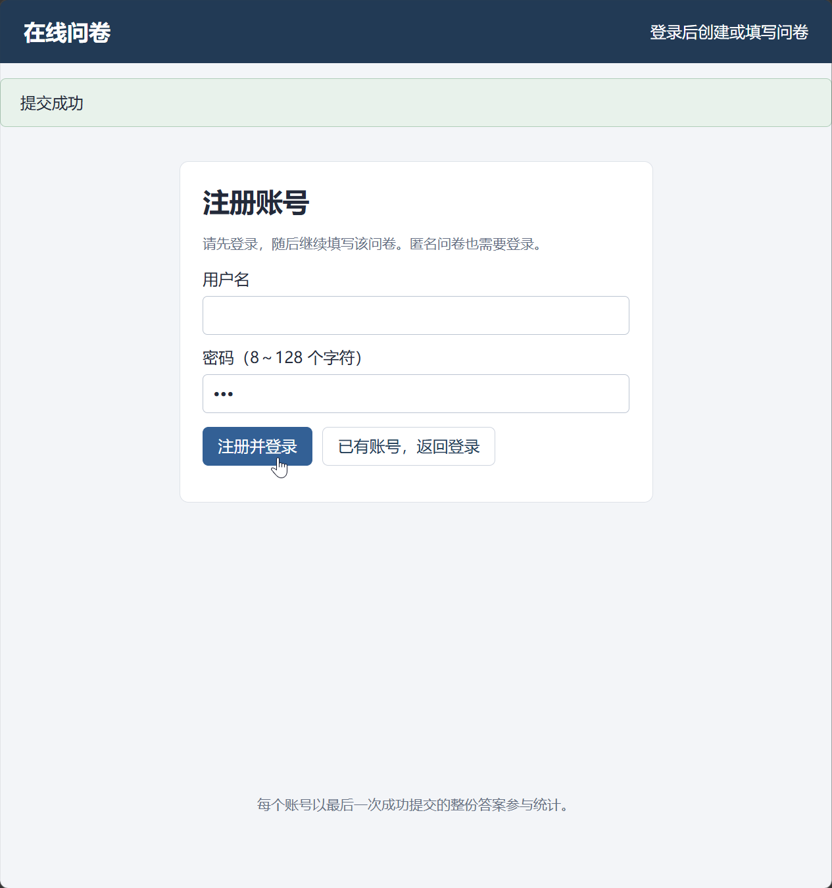
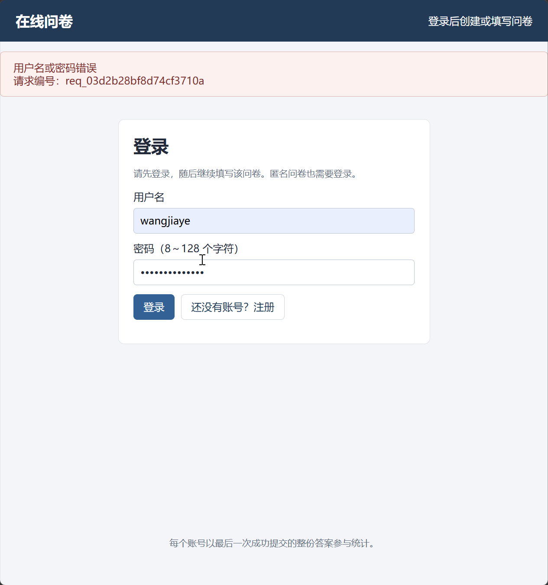
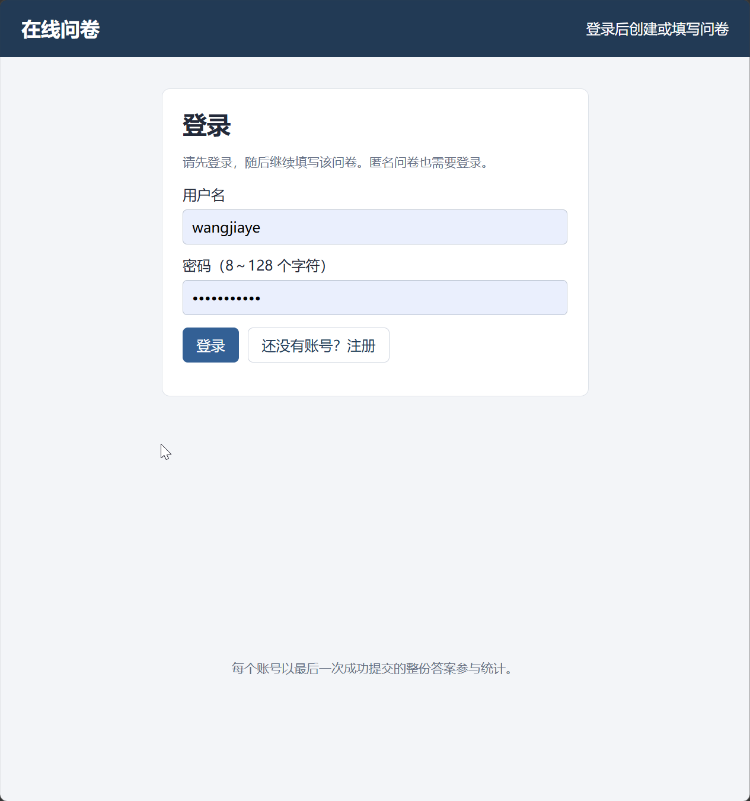
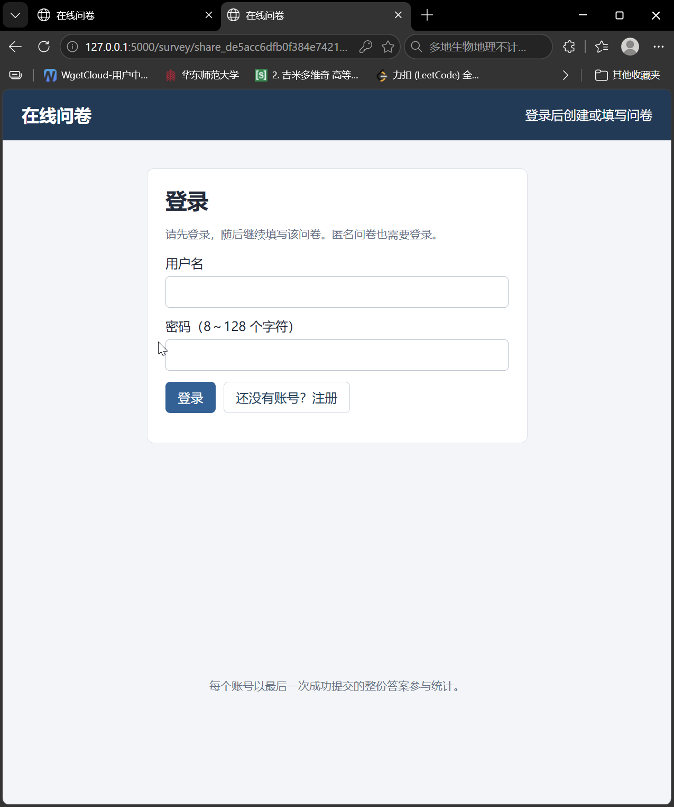
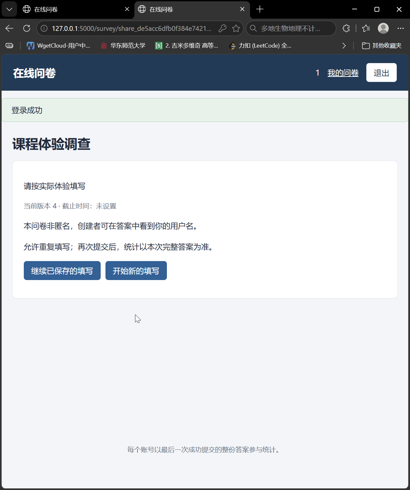
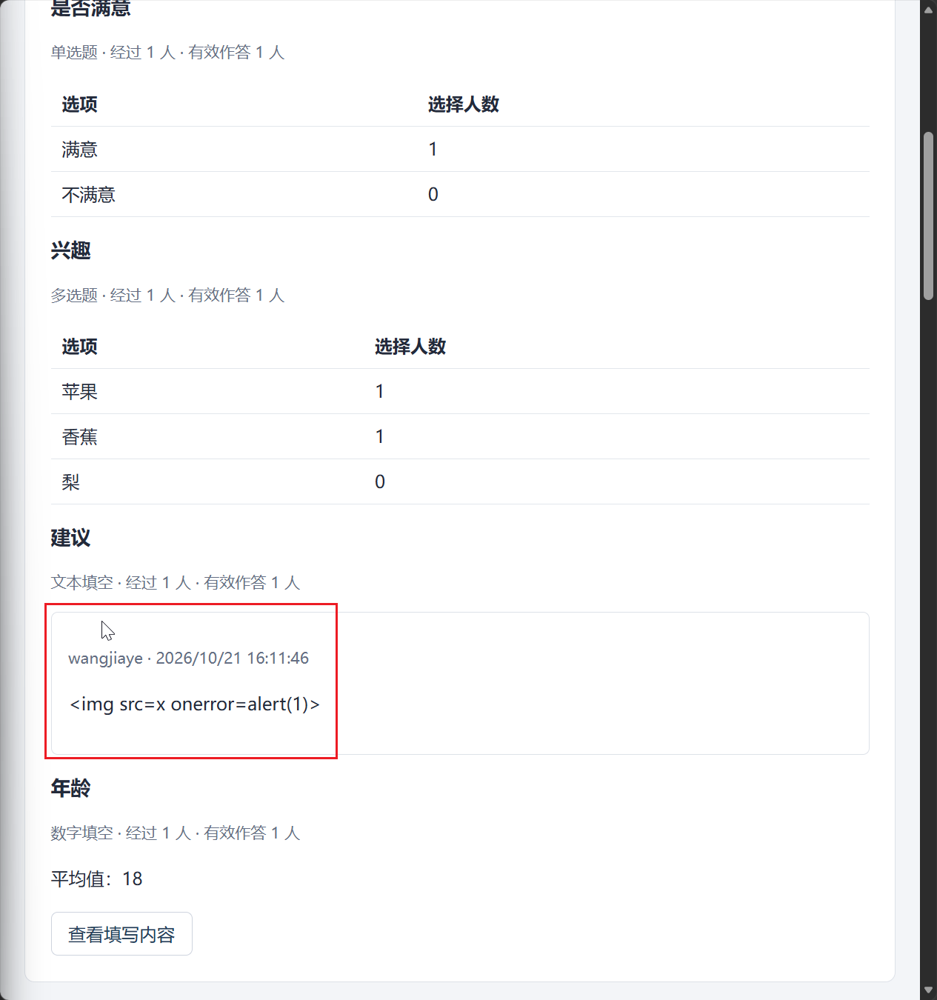

# 注册、登录、访问权限与匿名性：测试用例

共28项；每项直接列出步骤、输入、输出与测试结果，无需跨文件跳转。


<a id="tc07-a01"></a>

## TC07-A01 注册成功、无自动会话与密码哈希

执行方式：API自动化。


### 测试步骤

#### 前置条件

- 专用测试库和支持事务的 MongoDB 副本集已启动。A=创建者，B=另一创建者，U1/U2/U3=填写者，各账号独立 Cookie 会话；账号以运行批次后缀保证唯一，默认密码 TestPass!2026。API 基础路径 /api/v1；写请求带该会话 X-CSRF-Token，管理/填写修改带最新 If-Match。每个用例独立建卷，不继承其他用例的运行结果。

#### 操作步骤

1. 新会话POST auth/register
2. GET auth/me；只读查users
3. POST auth/login正确凭据后GET me

### 输入

#### 规定输入

```json
{
  "username": "user_批次后缀",
  "password": "TestPass!2026"
}
```

#### 实际请求输入

实际请求按执行顺序完整列出（包含准备动作，凭据已脱敏）：

**请求 1：POST /auth/register**

```json
{
  "序号": 1,
  "method": "POST",
  "path": "/auth/register",
  "input": {
    "username": "user_f2efdae59f1f443d895a489c4399e4c2",
    "password": "<redacted>"
  },
  "headers": {
    "Origin": "http://127.0.0.1:61374"
  }
}
```

**请求 2：GET /auth/me**

```json
{
  "序号": 2,
  "method": "GET",
  "path": "/auth/me",
  "input": null,
  "headers": {
    "Origin": "http://127.0.0.1:61374"
  }
}
```

**请求 3：POST /auth/login**

```json
{
  "序号": 3,
  "method": "POST",
  "path": "/auth/login",
  "input": {
    "username": "user_f2efdae59f1f443d895a489c4399e4c2",
    "password": "<redacted>"
  },
  "headers": {
    "Origin": "http://127.0.0.1:61374"
  }
}
```

**请求 4：GET /auth/me**

```json
{
  "序号": 4,
  "method": "GET",
  "path": "/auth/me",
  "input": null,
  "headers": {
    "Origin": "http://127.0.0.1:61374",
    "X-CSRF-Token": "<redacted>"
  }
}
```


### 输出

#### 预期输出

1. 201，userId/username/createdAt正确，不返回hash/password且未建立有效会话
2. 401；单用户，密码为带盐哈希，注册时间BSON Date
3. 200，身份相同；不再重复创建用户

- 注册与登录是两个接口动作。

#### 实际输出

本轮实际请求状态分布：HTTP 200：2次；HTTP 201：1次；HTTP 401：1次。

**请求 1：POST /auth/register**

```json
{
  "序号": 1,
  "method": "POST",
  "path": "/auth/register",
  "status": 201,
  "output": {
    "data": {
      "createdAt": "2026-10-21T10:25:35.253Z",
      "userId": "6ad8931f37b03374ae337d08",
      "username": "user_f2efdae59f1f443d895a489c4399e4c2"
    },
    "requestId": "req_59c48360e71479d8ad58"
  },
  "responseHeaders": {
    "Server": "Werkzeug/3.1.9 Python/3.14.7",
    "Date": "Wed, 21 Oct 2026 10:25:35 GMT",
    "Content-Type": "application/json",
    "Content-Length": "176",
    "X-Request-ID": "req_59c48360e71479d8ad58",
    "X-Content-Type-Options": "nosniff",
    "Referrer-Policy": "same-origin",
    "X-Frame-Options": "DENY",
    "Content-Security-Policy": "default-src 'self'; script-src 'self'; style-src 'self'; img-src 'self' data:; connect-src 'self'; frame-ancestors 'none'; base-uri 'self'; form-action 'self'",
    "Cache-Control": "no-store",
    "Connection": "close"
  }
}
```

**请求 2：GET /auth/me**

```json
{
  "序号": 2,
  "method": "GET",
  "path": "/auth/me",
  "status": 401,
  "output": {
    "error": {
      "code": "UNAUTHENTICATED",
      "message": "请先登录"
    },
    "requestId": "req_51cdce87259e367d625e"
  },
  "responseHeaders": {
    "Server": "Werkzeug/3.1.9 Python/3.14.7",
    "Date": "Wed, 21 Oct 2026 10:25:35 GMT",
    "Content-Type": "application/json",
    "Content-Length": "101",
    "X-Request-ID": "req_51cdce87259e367d625e",
    "X-Content-Type-Options": "nosniff",
    "Referrer-Policy": "same-origin",
    "X-Frame-Options": "DENY",
    "Content-Security-Policy": "default-src 'self'; script-src 'self'; style-src 'self'; img-src 'self' data:; connect-src 'self'; frame-ancestors 'none'; base-uri 'self'; form-action 'self'",
    "Cache-Control": "no-store",
    "Connection": "close"
  }
}
```

**请求 3：POST /auth/login**

```json
{
  "序号": 3,
  "method": "POST",
  "path": "/auth/login",
  "status": 200,
  "output": {
    "data": {
      "csrfToken": "<redacted>",
      "user": {
        "createdAt": "2026-10-21T10:25:35.253Z",
        "userId": "6ad8931f37b03374ae337d08",
        "username": "user_f2efdae59f1f443d895a489c4399e4c2"
      }
    },
    "requestId": "req_2dff0ccf0fd802d160bc"
  },
  "responseHeaders": {
    "Server": "Werkzeug/3.1.9 Python/3.14.7",
    "Date": "Wed, 21 Oct 2026 10:25:35 GMT",
    "Content-Type": "application/json",
    "Content-Length": "243",
    "Set-Cookie": "<redacted>",
    "X-Request-ID": "req_2dff0ccf0fd802d160bc",
    "X-Content-Type-Options": "nosniff",
    "Referrer-Policy": "same-origin",
    "X-Frame-Options": "DENY",
    "Content-Security-Policy": "default-src 'self'; script-src 'self'; style-src 'self'; img-src 'self' data:; connect-src 'self'; frame-ancestors 'none'; base-uri 'self'; form-action 'self'",
    "Cache-Control": "no-store",
    "Connection": "close"
  }
}
```

**请求 4：GET /auth/me**

```json
{
  "序号": 4,
  "method": "GET",
  "path": "/auth/me",
  "status": 200,
  "output": {
    "data": {
      "csrfToken": "<redacted>",
      "user": {
        "createdAt": "2026-10-21T10:25:35.253Z",
        "userId": "6ad8931f37b03374ae337d08",
        "username": "user_f2efdae59f1f443d895a489c4399e4c2"
      }
    },
    "requestId": "req_8317b374fbdf083716ee"
  },
  "responseHeaders": {
    "Server": "Werkzeug/3.1.9 Python/3.14.7",
    "Date": "Wed, 21 Oct 2026 10:25:35 GMT",
    "Content-Type": "application/json",
    "Content-Length": "243",
    "X-Request-ID": "req_8317b374fbdf083716ee",
    "X-Content-Type-Options": "nosniff",
    "Referrer-Policy": "same-origin",
    "X-Frame-Options": "DENY",
    "Content-Security-Policy": "default-src 'self'; script-src 'self'; style-src 'self'; img-src 'self' data:; connect-src 'self'; frame-ancestors 'none'; base-uri 'self'; form-action 'self'",
    "Cache-Control": "no-store",
    "Connection": "close"
  }
}
```

序号与输入层对应；包含账号、问卷和填写准备请求，不能将首条准备请求当作本例目标接口。

**本例问卷持久化摘要**

```json
[]
```


### 测试结果

**判定：通过**。

```text
本轮脚本断言通过。实际返回及数据库核对见输出层和Allure附件。
```

**原始测试规格**

```json
{
  "id": "TC07-A01",
  "moduleId": 7,
  "module": "注册、登录、访问权限与匿名性",
  "title": "注册成功、无自动会话与密码哈希",
  "execution": "api",
  "priority": "P0",
  "sourceSteps": [
    1,
    2
  ],
  "preconditions": [
    "专用测试库和支持事务的 MongoDB 副本集已启动。A=创建者，B=另一创建者，U1/U2/U3=填写者，各账号独立 Cookie 会话；账号以运行批次后缀保证唯一，默认密码 TestPass!2026。API 基础路径 /api/v1；写请求带该会话 X-CSRF-Token，管理/填写修改带最新 If-Match。每个用例独立建卷，不继承其他用例的运行结果。"
  ],
  "input": {
    "username": "user_批次后缀",
    "password": "TestPass!2026"
  },
  "steps": [
    {
      "action": "新会话POST auth/register",
      "expected": "201，userId/username/createdAt正确，不返回hash/password且未建立有效会话"
    },
    {
      "action": "GET auth/me；只读查users",
      "expected": "401；单用户，密码为带盐哈希，注册时间BSON Date"
    },
    {
      "action": "POST auth/login正确凭据后GET me",
      "expected": "200，身份相同；不再重复创建用户"
    }
  ],
  "expected": [
    "注册与登录是两个接口动作。"
  ]
}
```

**HTTP 请求与响应（凭据已脱敏）**

```json
[
  {
    "method": "POST",
    "path": "/auth/register",
    "input": {
      "username": "user_f2efdae59f1f443d895a489c4399e4c2",
      "password": "<redacted>"
    },
    "headers": {
      "Origin": "http://127.0.0.1:61374"
    },
    "status": 201,
    "output": {
      "data": {
        "createdAt": "2026-10-21T10:25:35.253Z",
        "userId": "6ad8931f37b03374ae337d08",
        "username": "user_f2efdae59f1f443d895a489c4399e4c2"
      },
      "requestId": "req_59c48360e71479d8ad58"
    },
    "responseHeaders": {
      "Server": "Werkzeug/3.1.9 Python/3.14.7",
      "Date": "Wed, 21 Oct 2026 10:25:35 GMT",
      "Content-Type": "application/json",
      "Content-Length": "176",
      "X-Request-ID": "req_59c48360e71479d8ad58",
      "X-Content-Type-Options": "nosniff",
      "Referrer-Policy": "same-origin",
      "X-Frame-Options": "DENY",
      "Content-Security-Policy": "default-src 'self'; script-src 'self'; style-src 'self'; img-src 'self' data:; connect-src 'self'; frame-ancestors 'none'; base-uri 'self'; form-action 'self'",
      "Cache-Control": "no-store",
      "Connection": "close"
    }
  },
  {
    "method": "GET",
    "path": "/auth/me",
    "input": null,
    "headers": {
      "Origin": "http://127.0.0.1:61374"
    },
    "status": 401,
    "output": {
      "error": {
        "code": "UNAUTHENTICATED",
        "message": "请先登录"
      },
      "requestId": "req_51cdce87259e367d625e"
    },
    "responseHeaders": {
      "Server": "Werkzeug/3.1.9 Python/3.14.7",
      "Date": "Wed, 21 Oct 2026 10:25:35 GMT",
      "Content-Type": "application/json",
      "Content-Length": "101",
      "X-Request-ID": "req_51cdce87259e367d625e",
      "X-Content-Type-Options": "nosniff",
      "Referrer-Policy": "same-origin",
      "X-Frame-Options": "DENY",
      "Content-Security-Policy": "default-src 'self'; script-src 'self'; style-src 'self'; img-src 'self' data:; connect-src 'self'; frame-ancestors 'none'; base-uri 'self'; form-action 'self'",
      "Cache-Control": "no-store",
      "Connection": "close"
    }
  },
  {
    "method": "POST",
    "path": "/auth/login",
    "input": {
      "username": "user_f2efdae59f1f443d895a489c4399e4c2",
      "password": "<redacted>"
    },
    "headers": {
      "Origin": "http://127.0.0.1:61374"
    },
    "status": 200,
    "output": {
      "data": {
        "csrfToken": "<redacted>",
        "user": {
          "createdAt": "2026-10-21T10:25:35.253Z",
          "userId": "6ad8931f37b03374ae337d08",
          "username": "user_f2efdae59f1f443d895a489c4399e4c2"
        }
      },
      "requestId": "req_2dff0ccf0fd802d160bc"
    },
    "responseHeaders": {
      "Server": "Werkzeug/3.1.9 Python/3.14.7",
      "Date": "Wed, 21 Oct 2026 10:25:35 GMT",
      "Content-Type": "application/json",
      "Content-Length": "243",
      "Set-Cookie": "<redacted>",
      "X-Request-ID": "req_2dff0ccf0fd802d160bc",
      "X-Content-Type-Options": "nosniff",
      "Referrer-Policy": "same-origin",
      "X-Frame-Options": "DENY",
      "Content-Security-Policy": "default-src 'self'; script-src 'self'; style-src 'self'; img-src 'self' data:; connect-src 'self'; frame-ancestors 'none'; base-uri 'self'; form-action 'self'",
      "Cache-Control": "no-store",
      "Connection": "close"
    }
  },
  {
    "method": "GET",
    "path": "/auth/me",
    "input": null,
    "headers": {
      "Origin": "http://127.0.0.1:61374",
      "X-CSRF-Token": "<redacted>"
    },
    "status": 200,
    "output": {
      "data": {
        "csrfToken": "<redacted>",
        "user": {
          "createdAt": "2026-10-21T10:25:35.253Z",
          "userId": "6ad8931f37b03374ae337d08",
          "username": "user_f2efdae59f1f443d895a489c4399e4c2"
        }
      },
      "requestId": "req_8317b374fbdf083716ee"
    },
    "responseHeaders": {
      "Server": "Werkzeug/3.1.9 Python/3.14.7",
      "Date": "Wed, 21 Oct 2026 10:25:35 GMT",
      "Content-Type": "application/json",
      "Content-Length": "243",
      "X-Request-ID": "req_8317b374fbdf083716ee",
      "X-Content-Type-Options": "nosniff",
      "Referrer-Policy": "same-origin",
      "X-Frame-Options": "DENY",
      "Content-Security-Policy": "default-src 'self'; script-src 'self'; style-src 'self'; img-src 'self' data:; connect-src 'self'; frame-ancestors 'none'; base-uri 'self'; form-action 'self'",
      "Cache-Control": "no-store",
      "Connection": "close"
    }
  }
]
```

**本例问卷持久化摘要**

```json
[]
```


<a id="tc07-a02"></a>

## TC07-A02 注册用户名边界：''

执行方式：API自动化。


### 测试步骤

#### 前置条件

- 专用测试库和支持事务的 MongoDB 副本集已启动。A=创建者，B=另一创建者，U1/U2/U3=填写者，各账号独立 Cookie 会话；账号以运行批次后缀保证唯一，默认密码 TestPass!2026。API 基础路径 /api/v1；写请求带该会话 X-CSRF-Token，管理/填写修改带最新 If-Match。每个用例独立建卷，不继承其他用例的运行结果。
- 本次用户名保证唯一（长度边界不能直接拼后缀；使用新隔离库或不同合法字符）。

#### 操作步骤

1. 新会话注册
2. 查用户记录

### 输入

#### 规定输入

```json
{
  "username": "",
  "password": "TestPass!2026"
}
```

#### 实际请求输入

实际请求按执行顺序完整列出（包含准备动作，凭据已脱敏）：

**请求 1：POST /auth/register**

```json
{
  "序号": 1,
  "method": "POST",
  "path": "/auth/register",
  "input": {
    "username": "",
    "password": "<redacted>"
  },
  "headers": {
    "Origin": "http://127.0.0.1:61374"
  }
}
```


### 输出

#### 预期输出

1. 422 FIELD_INVALID
2. 无新增用户、无会话

- 中文/符号不额外受仅字母数字限制。

#### 实际输出

本轮实际请求状态分布：HTTP 422：1次。

**请求 1：POST /auth/register**

```json
{
  "序号": 1,
  "method": "POST",
  "path": "/auth/register",
  "status": 422,
  "output": {
    "error": {
      "code": "FIELD_INVALID",
      "message": "用户名长度应为 1～64 个字符"
    },
    "requestId": "req_323baa2aff849794be39"
  },
  "responseHeaders": {
    "Server": "Werkzeug/3.1.9 Python/3.14.7",
    "Date": "Wed, 21 Oct 2026 10:25:35 GMT",
    "Content-Type": "application/json",
    "Content-Length": "125",
    "X-Request-ID": "req_323baa2aff849794be39",
    "X-Content-Type-Options": "nosniff",
    "Referrer-Policy": "same-origin",
    "X-Frame-Options": "DENY",
    "Content-Security-Policy": "default-src 'self'; script-src 'self'; style-src 'self'; img-src 'self' data:; connect-src 'self'; frame-ancestors 'none'; base-uri 'self'; form-action 'self'",
    "Cache-Control": "no-store",
    "Connection": "close"
  }
}
```

序号与输入层对应；包含账号、问卷和填写准备请求，不能将首条准备请求当作本例目标接口。

**本例问卷持久化摘要**

```json
[]
```


### 测试结果

**判定：通过**。

```text
本轮脚本断言通过。实际返回及数据库核对见输出层和Allure附件。
```

**原始测试规格**

```json
{
  "id": "TC07-A02",
  "moduleId": 7,
  "module": "注册、登录、访问权限与匿名性",
  "title": "注册用户名边界：''",
  "execution": "api",
  "priority": "P1",
  "sourceSteps": [
    1
  ],
  "preconditions": [
    "专用测试库和支持事务的 MongoDB 副本集已启动。A=创建者，B=另一创建者，U1/U2/U3=填写者，各账号独立 Cookie 会话；账号以运行批次后缀保证唯一，默认密码 TestPass!2026。API 基础路径 /api/v1；写请求带该会话 X-CSRF-Token，管理/填写修改带最新 If-Match。每个用例独立建卷，不继承其他用例的运行结果。",
    "本次用户名保证唯一（长度边界不能直接拼后缀；使用新隔离库或不同合法字符）。"
  ],
  "input": {
    "username": "",
    "password": "TestPass!2026"
  },
  "steps": [
    {
      "action": "新会话注册",
      "expected": "422 FIELD_INVALID"
    },
    {
      "action": "查用户记录",
      "expected": "无新增用户、无会话"
    }
  ],
  "expected": [
    "中文/符号不额外受仅字母数字限制。"
  ]
}
```

**HTTP 请求与响应（凭据已脱敏）**

```json
[
  {
    "method": "POST",
    "path": "/auth/register",
    "input": {
      "username": "",
      "password": "<redacted>"
    },
    "headers": {
      "Origin": "http://127.0.0.1:61374"
    },
    "status": 422,
    "output": {
      "error": {
        "code": "FIELD_INVALID",
        "message": "用户名长度应为 1～64 个字符"
      },
      "requestId": "req_323baa2aff849794be39"
    },
    "responseHeaders": {
      "Server": "Werkzeug/3.1.9 Python/3.14.7",
      "Date": "Wed, 21 Oct 2026 10:25:35 GMT",
      "Content-Type": "application/json",
      "Content-Length": "125",
      "X-Request-ID": "req_323baa2aff849794be39",
      "X-Content-Type-Options": "nosniff",
      "Referrer-Policy": "same-origin",
      "X-Frame-Options": "DENY",
      "Content-Security-Policy": "default-src 'self'; script-src 'self'; style-src 'self'; img-src 'self' data:; connect-src 'self'; frame-ancestors 'none'; base-uri 'self'; form-action 'self'",
      "Cache-Control": "no-store",
      "Connection": "close"
    }
  }
]
```

**本例问卷持久化摘要**

```json
[]
```


<a id="tc07-a03"></a>

## TC07-A03 注册用户名边界：'   '

执行方式：API自动化。


### 测试步骤

#### 前置条件

- 专用测试库和支持事务的 MongoDB 副本集已启动。A=创建者，B=另一创建者，U1/U2/U3=填写者，各账号独立 Cookie 会话；账号以运行批次后缀保证唯一，默认密码 TestPass!2026。API 基础路径 /api/v1；写请求带该会话 X-CSRF-Token，管理/填写修改带最新 If-Match。每个用例独立建卷，不继承其他用例的运行结果。
- 本次用户名保证唯一（长度边界不能直接拼后缀；使用新隔离库或不同合法字符）。

#### 操作步骤

1. 新会话注册
2. 查用户记录

### 输入

#### 规定输入

```json
{
  "username": "   ",
  "password": "TestPass!2026"
}
```

#### 实际请求输入

实际请求按执行顺序完整列出（包含准备动作，凭据已脱敏）：

**请求 1：POST /auth/register**

```json
{
  "序号": 1,
  "method": "POST",
  "path": "/auth/register",
  "input": {
    "username": "   ",
    "password": "<redacted>"
  },
  "headers": {
    "Origin": "http://127.0.0.1:61374"
  }
}
```


### 输出

#### 预期输出

1. 422 FIELD_INVALID
2. 无新增用户、无会话

- 中文/符号不额外受仅字母数字限制。

#### 实际输出

本轮实际请求状态分布：HTTP 422：1次。

**请求 1：POST /auth/register**

```json
{
  "序号": 1,
  "method": "POST",
  "path": "/auth/register",
  "status": 422,
  "output": {
    "error": {
      "code": "FIELD_INVALID",
      "message": "用户名长度应为 1～64 个字符"
    },
    "requestId": "req_bce968bd94f74ab31bc9"
  },
  "responseHeaders": {
    "Server": "Werkzeug/3.1.9 Python/3.14.7",
    "Date": "Wed, 21 Oct 2026 10:25:35 GMT",
    "Content-Type": "application/json",
    "Content-Length": "125",
    "X-Request-ID": "req_bce968bd94f74ab31bc9",
    "X-Content-Type-Options": "nosniff",
    "Referrer-Policy": "same-origin",
    "X-Frame-Options": "DENY",
    "Content-Security-Policy": "default-src 'self'; script-src 'self'; style-src 'self'; img-src 'self' data:; connect-src 'self'; frame-ancestors 'none'; base-uri 'self'; form-action 'self'",
    "Cache-Control": "no-store",
    "Connection": "close"
  }
}
```

序号与输入层对应；包含账号、问卷和填写准备请求，不能将首条准备请求当作本例目标接口。

**本例问卷持久化摘要**

```json
[]
```


### 测试结果

**判定：通过**。

```text
本轮脚本断言通过。实际返回及数据库核对见输出层和Allure附件。
```

**原始测试规格**

```json
{
  "id": "TC07-A03",
  "moduleId": 7,
  "module": "注册、登录、访问权限与匿名性",
  "title": "注册用户名边界：'   '",
  "execution": "api",
  "priority": "P1",
  "sourceSteps": [
    1
  ],
  "preconditions": [
    "专用测试库和支持事务的 MongoDB 副本集已启动。A=创建者，B=另一创建者，U1/U2/U3=填写者，各账号独立 Cookie 会话；账号以运行批次后缀保证唯一，默认密码 TestPass!2026。API 基础路径 /api/v1；写请求带该会话 X-CSRF-Token，管理/填写修改带最新 If-Match。每个用例独立建卷，不继承其他用例的运行结果。",
    "本次用户名保证唯一（长度边界不能直接拼后缀；使用新隔离库或不同合法字符）。"
  ],
  "input": {
    "username": "   ",
    "password": "TestPass!2026"
  },
  "steps": [
    {
      "action": "新会话注册",
      "expected": "422 FIELD_INVALID"
    },
    {
      "action": "查用户记录",
      "expected": "无新增用户、无会话"
    }
  ],
  "expected": [
    "中文/符号不额外受仅字母数字限制。"
  ]
}
```

**HTTP 请求与响应（凭据已脱敏）**

```json
[
  {
    "method": "POST",
    "path": "/auth/register",
    "input": {
      "username": "   ",
      "password": "<redacted>"
    },
    "headers": {
      "Origin": "http://127.0.0.1:61374"
    },
    "status": 422,
    "output": {
      "error": {
        "code": "FIELD_INVALID",
        "message": "用户名长度应为 1～64 个字符"
      },
      "requestId": "req_bce968bd94f74ab31bc9"
    },
    "responseHeaders": {
      "Server": "Werkzeug/3.1.9 Python/3.14.7",
      "Date": "Wed, 21 Oct 2026 10:25:35 GMT",
      "Content-Type": "application/json",
      "Content-Length": "125",
      "X-Request-ID": "req_bce968bd94f74ab31bc9",
      "X-Content-Type-Options": "nosniff",
      "Referrer-Policy": "same-origin",
      "X-Frame-Options": "DENY",
      "Content-Security-Policy": "default-src 'self'; script-src 'self'; style-src 'self'; img-src 'self' data:; connect-src 'self'; frame-ancestors 'none'; base-uri 'self'; form-action 'self'",
      "Cache-Control": "no-store",
      "Connection": "close"
    }
  }
]
```

**本例问卷持久化摘要**

```json
[]
```


<a id="tc07-a04"></a>

## TC07-A04 注册用户名边界：'中'

执行方式：API自动化。


### 测试步骤

#### 前置条件

- 专用测试库和支持事务的 MongoDB 副本集已启动。A=创建者，B=另一创建者，U1/U2/U3=填写者，各账号独立 Cookie 会话；账号以运行批次后缀保证唯一，默认密码 TestPass!2026。API 基础路径 /api/v1；写请求带该会话 X-CSRF-Token，管理/填写修改带最新 If-Match。每个用例独立建卷，不继承其他用例的运行结果。
- 本次用户名保证唯一（长度边界不能直接拼后缀；使用新隔离库或不同合法字符）。

#### 操作步骤

1. 新会话注册
2. 查用户记录

### 输入

#### 规定输入

```json
{
  "username": "中",
  "password": "TestPass!2026"
}
```

#### 实际请求输入

实际请求按执行顺序完整列出（包含准备动作，凭据已脱敏）：

**请求 1：POST /auth/register**

```json
{
  "序号": 1,
  "method": "POST",
  "path": "/auth/register",
  "input": {
    "username": "中",
    "password": "<redacted>"
  },
  "headers": {
    "Origin": "http://127.0.0.1:61374"
  }
}
```

**请求 2：POST /auth/login**

```json
{
  "序号": 2,
  "method": "POST",
  "path": "/auth/login",
  "input": {
    "username": "中",
    "password": "<redacted>"
  },
  "headers": {
    "Origin": "http://127.0.0.1:61374"
  }
}
```


### 输出

#### 预期输出

1. 201
2. 展示名去首尾空白且长度合法

- 中文/符号不额外受仅字母数字限制。

#### 实际输出

本轮实际请求状态分布：HTTP 200：1次；HTTP 201：1次。

**请求 1：POST /auth/register**

```json
{
  "序号": 1,
  "method": "POST",
  "path": "/auth/register",
  "status": 201,
  "output": {
    "data": {
      "createdAt": "2026-10-21T10:25:35.626Z",
      "userId": "6ad8931f37b03374ae337d0a",
      "username": "中"
    },
    "requestId": "req_12e02381849da310b7fd"
  },
  "responseHeaders": {
    "Server": "Werkzeug/3.1.9 Python/3.14.7",
    "Date": "Wed, 21 Oct 2026 10:25:35 GMT",
    "Content-Type": "application/json",
    "Content-Length": "142",
    "X-Request-ID": "req_12e02381849da310b7fd",
    "X-Content-Type-Options": "nosniff",
    "Referrer-Policy": "same-origin",
    "X-Frame-Options": "DENY",
    "Content-Security-Policy": "default-src 'self'; script-src 'self'; style-src 'self'; img-src 'self' data:; connect-src 'self'; frame-ancestors 'none'; base-uri 'self'; form-action 'self'",
    "Cache-Control": "no-store",
    "Connection": "close"
  }
}
```

**请求 2：POST /auth/login**

```json
{
  "序号": 2,
  "method": "POST",
  "path": "/auth/login",
  "status": 200,
  "output": {
    "data": {
      "csrfToken": "<redacted>",
      "user": {
        "createdAt": "2026-10-21T10:25:35.626Z",
        "userId": "6ad8931f37b03374ae337d0a",
        "username": "中"
      }
    },
    "requestId": "req_9fcfed97b85d00cca327"
  },
  "responseHeaders": {
    "Server": "Werkzeug/3.1.9 Python/3.14.7",
    "Date": "Wed, 21 Oct 2026 10:25:35 GMT",
    "Content-Type": "application/json",
    "Content-Length": "209",
    "Set-Cookie": "<redacted>",
    "X-Request-ID": "req_9fcfed97b85d00cca327",
    "X-Content-Type-Options": "nosniff",
    "Referrer-Policy": "same-origin",
    "X-Frame-Options": "DENY",
    "Content-Security-Policy": "default-src 'self'; script-src 'self'; style-src 'self'; img-src 'self' data:; connect-src 'self'; frame-ancestors 'none'; base-uri 'self'; form-action 'self'",
    "Cache-Control": "no-store",
    "Connection": "close"
  }
}
```

序号与输入层对应；包含账号、问卷和填写准备请求，不能将首条准备请求当作本例目标接口。

**本例问卷持久化摘要**

```json
[]
```


### 测试结果

**判定：通过**。

```text
本轮脚本断言通过。实际返回及数据库核对见输出层和Allure附件。
```

**原始测试规格**

```json
{
  "id": "TC07-A04",
  "moduleId": 7,
  "module": "注册、登录、访问权限与匿名性",
  "title": "注册用户名边界：'中'",
  "execution": "api",
  "priority": "P1",
  "sourceSteps": [
    1
  ],
  "preconditions": [
    "专用测试库和支持事务的 MongoDB 副本集已启动。A=创建者，B=另一创建者，U1/U2/U3=填写者，各账号独立 Cookie 会话；账号以运行批次后缀保证唯一，默认密码 TestPass!2026。API 基础路径 /api/v1；写请求带该会话 X-CSRF-Token，管理/填写修改带最新 If-Match。每个用例独立建卷，不继承其他用例的运行结果。",
    "本次用户名保证唯一（长度边界不能直接拼后缀；使用新隔离库或不同合法字符）。"
  ],
  "input": {
    "username": "中",
    "password": "TestPass!2026"
  },
  "steps": [
    {
      "action": "新会话注册",
      "expected": "201"
    },
    {
      "action": "查用户记录",
      "expected": "展示名去首尾空白且长度合法"
    }
  ],
  "expected": [
    "中文/符号不额外受仅字母数字限制。"
  ]
}
```

**HTTP 请求与响应（凭据已脱敏）**

```json
[
  {
    "method": "POST",
    "path": "/auth/register",
    "input": {
      "username": "中",
      "password": "<redacted>"
    },
    "headers": {
      "Origin": "http://127.0.0.1:61374"
    },
    "status": 201,
    "output": {
      "data": {
        "createdAt": "2026-10-21T10:25:35.626Z",
        "userId": "6ad8931f37b03374ae337d0a",
        "username": "中"
      },
      "requestId": "req_12e02381849da310b7fd"
    },
    "responseHeaders": {
      "Server": "Werkzeug/3.1.9 Python/3.14.7",
      "Date": "Wed, 21 Oct 2026 10:25:35 GMT",
      "Content-Type": "application/json",
      "Content-Length": "142",
      "X-Request-ID": "req_12e02381849da310b7fd",
      "X-Content-Type-Options": "nosniff",
      "Referrer-Policy": "same-origin",
      "X-Frame-Options": "DENY",
      "Content-Security-Policy": "default-src 'self'; script-src 'self'; style-src 'self'; img-src 'self' data:; connect-src 'self'; frame-ancestors 'none'; base-uri 'self'; form-action 'self'",
      "Cache-Control": "no-store",
      "Connection": "close"
    }
  },
  {
    "method": "POST",
    "path": "/auth/login",
    "input": {
      "username": "中",
      "password": "<redacted>"
    },
    "headers": {
      "Origin": "http://127.0.0.1:61374"
    },
    "status": 200,
    "output": {
      "data": {
        "csrfToken": "<redacted>",
        "user": {
          "createdAt": "2026-10-21T10:25:35.626Z",
          "userId": "6ad8931f37b03374ae337d0a",
          "username": "中"
        }
      },
      "requestId": "req_9fcfed97b85d00cca327"
    },
    "responseHeaders": {
      "Server": "Werkzeug/3.1.9 Python/3.14.7",
      "Date": "Wed, 21 Oct 2026 10:25:35 GMT",
      "Content-Type": "application/json",
      "Content-Length": "209",
      "Set-Cookie": "<redacted>",
      "X-Request-ID": "req_9fcfed97b85d00cca327",
      "X-Content-Type-Options": "nosniff",
      "Referrer-Policy": "same-origin",
      "X-Frame-Options": "DENY",
      "Content-Security-Policy": "default-src 'self'; script-src 'self'; style-src 'self'; img-src 'self' data:; connect-src 'self'; frame-ancestors 'none'; base-uri 'self'; form-action 'self'",
      "Cache-Control": "no-store",
      "Connection": "close"
    }
  }
]
```

**本例问卷持久化摘要**

```json
[]
```


<a id="tc07-a05"></a>

## TC07-A05 注册用户名边界：'名名名名名名名名名名'

执行方式：API自动化。


### 测试步骤

#### 前置条件

- 专用测试库和支持事务的 MongoDB 副本集已启动。A=创建者，B=另一创建者，U1/U2/U3=填写者，各账号独立 Cookie 会话；账号以运行批次后缀保证唯一，默认密码 TestPass!2026。API 基础路径 /api/v1；写请求带该会话 X-CSRF-Token，管理/填写修改带最新 If-Match。每个用例独立建卷，不继承其他用例的运行结果。
- 本次用户名保证唯一（长度边界不能直接拼后缀；使用新隔离库或不同合法字符）。

#### 操作步骤

1. 新会话注册
2. 查用户记录

### 输入

#### 规定输入

```json
{
  "username": "名名名名名名名名名名名名名名名名名名名名名名名名名名名名名名名名名名名名名名名名名名名名名名名名名名名名名名名名名名名名名名名名",
  "password": "TestPass!2026"
}
```

#### 实际请求输入

实际请求按执行顺序完整列出（包含准备动作，凭据已脱敏）：

**请求 1：POST /auth/register**

```json
{
  "序号": 1,
  "method": "POST",
  "path": "/auth/register",
  "input": {
    "username": "名名名名名名名名名名名名名名名名名名名名名名名名名名名名名名名名名名名名名名名名名名名名名名名名名名名名名名名名名名名名名名名名",
    "password": "<redacted>"
  },
  "headers": {
    "Origin": "http://127.0.0.1:61374"
  }
}
```

**请求 2：POST /auth/login**

```json
{
  "序号": 2,
  "method": "POST",
  "path": "/auth/login",
  "input": {
    "username": "名名名名名名名名名名名名名名名名名名名名名名名名名名名名名名名名名名名名名名名名名名名名名名名名名名名名名名名名名名名名名名名名",
    "password": "<redacted>"
  },
  "headers": {
    "Origin": "http://127.0.0.1:61374"
  }
}
```


### 输出

#### 预期输出

1. 201
2. 展示名去首尾空白且长度合法

- 中文/符号不额外受仅字母数字限制。

#### 实际输出

本轮实际请求状态分布：HTTP 200：1次；HTTP 201：1次。

**请求 1：POST /auth/register**

```json
{
  "序号": 1,
  "method": "POST",
  "path": "/auth/register",
  "status": 201,
  "output": {
    "data": {
      "createdAt": "2026-10-21T10:25:35.856Z",
      "userId": "6ad8931f37b03374ae337d0c",
      "username": "名名名名名名名名名名名名名名名名名名名名名名名名名名名名名名名名名名名名名名名名名名名名名名名名名名名名名名名名名名名名名名名名"
    },
    "requestId": "req_d852798e808924383a09"
  },
  "responseHeaders": {
    "Server": "Werkzeug/3.1.9 Python/3.14.7",
    "Date": "Wed, 21 Oct 2026 10:25:35 GMT",
    "Content-Type": "application/json",
    "Content-Length": "331",
    "X-Request-ID": "req_d852798e808924383a09",
    "X-Content-Type-Options": "nosniff",
    "Referrer-Policy": "same-origin",
    "X-Frame-Options": "DENY",
    "Content-Security-Policy": "default-src 'self'; script-src 'self'; style-src 'self'; img-src 'self' data:; connect-src 'self'; frame-ancestors 'none'; base-uri 'self'; form-action 'self'",
    "Cache-Control": "no-store",
    "Connection": "close"
  }
}
```

**请求 2：POST /auth/login**

```json
{
  "序号": 2,
  "method": "POST",
  "path": "/auth/login",
  "status": 200,
  "output": {
    "data": {
      "csrfToken": "<redacted>",
      "user": {
        "createdAt": "2026-10-21T10:25:35.856Z",
        "userId": "6ad8931f37b03374ae337d0c",
        "username": "名名名名名名名名名名名名名名名名名名名名名名名名名名名名名名名名名名名名名名名名名名名名名名名名名名名名名名名名名名名名名名名名"
      }
    },
    "requestId": "req_f490fde5d315e1334895"
  },
  "responseHeaders": {
    "Server": "Werkzeug/3.1.9 Python/3.14.7",
    "Date": "Wed, 21 Oct 2026 10:25:35 GMT",
    "Content-Type": "application/json",
    "Content-Length": "398",
    "Set-Cookie": "<redacted>",
    "X-Request-ID": "req_f490fde5d315e1334895",
    "X-Content-Type-Options": "nosniff",
    "Referrer-Policy": "same-origin",
    "X-Frame-Options": "DENY",
    "Content-Security-Policy": "default-src 'self'; script-src 'self'; style-src 'self'; img-src 'self' data:; connect-src 'self'; frame-ancestors 'none'; base-uri 'self'; form-action 'self'",
    "Cache-Control": "no-store",
    "Connection": "close"
  }
}
```

序号与输入层对应；包含账号、问卷和填写准备请求，不能将首条准备请求当作本例目标接口。

**本例问卷持久化摘要**

```json
[]
```


### 测试结果

**判定：通过**。

```text
本轮脚本断言通过。实际返回及数据库核对见输出层和Allure附件。
```

**原始测试规格**

```json
{
  "id": "TC07-A05",
  "moduleId": 7,
  "module": "注册、登录、访问权限与匿名性",
  "title": "注册用户名边界：'名名名名名名名名名名'",
  "execution": "api",
  "priority": "P1",
  "sourceSteps": [
    1
  ],
  "preconditions": [
    "专用测试库和支持事务的 MongoDB 副本集已启动。A=创建者，B=另一创建者，U1/U2/U3=填写者，各账号独立 Cookie 会话；账号以运行批次后缀保证唯一，默认密码 TestPass!2026。API 基础路径 /api/v1；写请求带该会话 X-CSRF-Token，管理/填写修改带最新 If-Match。每个用例独立建卷，不继承其他用例的运行结果。",
    "本次用户名保证唯一（长度边界不能直接拼后缀；使用新隔离库或不同合法字符）。"
  ],
  "input": {
    "username": "名名名名名名名名名名名名名名名名名名名名名名名名名名名名名名名名名名名名名名名名名名名名名名名名名名名名名名名名名名名名名名名名",
    "password": "TestPass!2026"
  },
  "steps": [
    {
      "action": "新会话注册",
      "expected": "201"
    },
    {
      "action": "查用户记录",
      "expected": "展示名去首尾空白且长度合法"
    }
  ],
  "expected": [
    "中文/符号不额外受仅字母数字限制。"
  ]
}
```

**HTTP 请求与响应（凭据已脱敏）**

```json
[
  {
    "method": "POST",
    "path": "/auth/register",
    "input": {
      "username": "名名名名名名名名名名名名名名名名名名名名名名名名名名名名名名名名名名名名名名名名名名名名名名名名名名名名名名名名名名名名名名名名",
      "password": "<redacted>"
    },
    "headers": {
      "Origin": "http://127.0.0.1:61374"
    },
    "status": 201,
    "output": {
      "data": {
        "createdAt": "2026-10-21T10:25:35.856Z",
        "userId": "6ad8931f37b03374ae337d0c",
        "username": "名名名名名名名名名名名名名名名名名名名名名名名名名名名名名名名名名名名名名名名名名名名名名名名名名名名名名名名名名名名名名名名名"
      },
      "requestId": "req_d852798e808924383a09"
    },
    "responseHeaders": {
      "Server": "Werkzeug/3.1.9 Python/3.14.7",
      "Date": "Wed, 21 Oct 2026 10:25:35 GMT",
      "Content-Type": "application/json",
      "Content-Length": "331",
      "X-Request-ID": "req_d852798e808924383a09",
      "X-Content-Type-Options": "nosniff",
      "Referrer-Policy": "same-origin",
      "X-Frame-Options": "DENY",
      "Content-Security-Policy": "default-src 'self'; script-src 'self'; style-src 'self'; img-src 'self' data:; connect-src 'self'; frame-ancestors 'none'; base-uri 'self'; form-action 'self'",
      "Cache-Control": "no-store",
      "Connection": "close"
    }
  },
  {
    "method": "POST",
    "path": "/auth/login",
    "input": {
      "username": "名名名名名名名名名名名名名名名名名名名名名名名名名名名名名名名名名名名名名名名名名名名名名名名名名名名名名名名名名名名名名名名名",
      "password": "<redacted>"
    },
    "headers": {
      "Origin": "http://127.0.0.1:61374"
    },
    "status": 200,
    "output": {
      "data": {
        "csrfToken": "<redacted>",
        "user": {
          "createdAt": "2026-10-21T10:25:35.856Z",
          "userId": "6ad8931f37b03374ae337d0c",
          "username": "名名名名名名名名名名名名名名名名名名名名名名名名名名名名名名名名名名名名名名名名名名名名名名名名名名名名名名名名名名名名名名名名"
        }
      },
      "requestId": "req_f490fde5d315e1334895"
    },
    "responseHeaders": {
      "Server": "Werkzeug/3.1.9 Python/3.14.7",
      "Date": "Wed, 21 Oct 2026 10:25:35 GMT",
      "Content-Type": "application/json",
      "Content-Length": "398",
      "Set-Cookie": "<redacted>",
      "X-Request-ID": "req_f490fde5d315e1334895",
      "X-Content-Type-Options": "nosniff",
      "Referrer-Policy": "same-origin",
      "X-Frame-Options": "DENY",
      "Content-Security-Policy": "default-src 'self'; script-src 'self'; style-src 'self'; img-src 'self' data:; connect-src 'self'; frame-ancestors 'none'; base-uri 'self'; form-action 'self'",
      "Cache-Control": "no-store",
      "Connection": "close"
    }
  }
]
```

**本例问卷持久化摘要**

```json
[]
```


<a id="tc07-a06"></a>

## TC07-A06 注册用户名边界：'名名名名名名名名名名'

执行方式：API自动化。


### 测试步骤

#### 前置条件

- 专用测试库和支持事务的 MongoDB 副本集已启动。A=创建者，B=另一创建者，U1/U2/U3=填写者，各账号独立 Cookie 会话；账号以运行批次后缀保证唯一，默认密码 TestPass!2026。API 基础路径 /api/v1；写请求带该会话 X-CSRF-Token，管理/填写修改带最新 If-Match。每个用例独立建卷，不继承其他用例的运行结果。
- 本次用户名保证唯一（长度边界不能直接拼后缀；使用新隔离库或不同合法字符）。

#### 操作步骤

1. 新会话注册
2. 查用户记录

### 输入

#### 规定输入

```json
{
  "username": "名名名名名名名名名名名名名名名名名名名名名名名名名名名名名名名名名名名名名名名名名名名名名名名名名名名名名名名名名名名名名名名名名",
  "password": "TestPass!2026"
}
```

#### 实际请求输入

实际请求按执行顺序完整列出（包含准备动作，凭据已脱敏）：

**请求 1：POST /auth/register**

```json
{
  "序号": 1,
  "method": "POST",
  "path": "/auth/register",
  "input": {
    "username": "名名名名名名名名名名名名名名名名名名名名名名名名名名名名名名名名名名名名名名名名名名名名名名名名名名名名名名名名名名名名名名名名名",
    "password": "<redacted>"
  },
  "headers": {
    "Origin": "http://127.0.0.1:61374"
  }
}
```


### 输出

#### 预期输出

1. 422 FIELD_INVALID
2. 无新增用户、无会话

- 中文/符号不额外受仅字母数字限制。

#### 实际输出

本轮实际请求状态分布：HTTP 422：1次。

**请求 1：POST /auth/register**

```json
{
  "序号": 1,
  "method": "POST",
  "path": "/auth/register",
  "status": 422,
  "output": {
    "error": {
      "code": "FIELD_INVALID",
      "message": "用户名长度应为 1～64 个字符"
    },
    "requestId": "req_830622380d98ce9ccdf0"
  },
  "responseHeaders": {
    "Server": "Werkzeug/3.1.9 Python/3.14.7",
    "Date": "Wed, 21 Oct 2026 10:25:35 GMT",
    "Content-Type": "application/json",
    "Content-Length": "125",
    "X-Request-ID": "req_830622380d98ce9ccdf0",
    "X-Content-Type-Options": "nosniff",
    "Referrer-Policy": "same-origin",
    "X-Frame-Options": "DENY",
    "Content-Security-Policy": "default-src 'self'; script-src 'self'; style-src 'self'; img-src 'self' data:; connect-src 'self'; frame-ancestors 'none'; base-uri 'self'; form-action 'self'",
    "Cache-Control": "no-store",
    "Connection": "close"
  }
}
```

序号与输入层对应；包含账号、问卷和填写准备请求，不能将首条准备请求当作本例目标接口。

**本例问卷持久化摘要**

```json
[]
```


### 测试结果

**判定：通过**。

```text
本轮脚本断言通过。实际返回及数据库核对见输出层和Allure附件。
```

**原始测试规格**

```json
{
  "id": "TC07-A06",
  "moduleId": 7,
  "module": "注册、登录、访问权限与匿名性",
  "title": "注册用户名边界：'名名名名名名名名名名'",
  "execution": "api",
  "priority": "P1",
  "sourceSteps": [
    1
  ],
  "preconditions": [
    "专用测试库和支持事务的 MongoDB 副本集已启动。A=创建者，B=另一创建者，U1/U2/U3=填写者，各账号独立 Cookie 会话；账号以运行批次后缀保证唯一，默认密码 TestPass!2026。API 基础路径 /api/v1；写请求带该会话 X-CSRF-Token，管理/填写修改带最新 If-Match。每个用例独立建卷，不继承其他用例的运行结果。",
    "本次用户名保证唯一（长度边界不能直接拼后缀；使用新隔离库或不同合法字符）。"
  ],
  "input": {
    "username": "名名名名名名名名名名名名名名名名名名名名名名名名名名名名名名名名名名名名名名名名名名名名名名名名名名名名名名名名名名名名名名名名名",
    "password": "TestPass!2026"
  },
  "steps": [
    {
      "action": "新会话注册",
      "expected": "422 FIELD_INVALID"
    },
    {
      "action": "查用户记录",
      "expected": "无新增用户、无会话"
    }
  ],
  "expected": [
    "中文/符号不额外受仅字母数字限制。"
  ]
}
```

**HTTP 请求与响应（凭据已脱敏）**

```json
[
  {
    "method": "POST",
    "path": "/auth/register",
    "input": {
      "username": "名名名名名名名名名名名名名名名名名名名名名名名名名名名名名名名名名名名名名名名名名名名名名名名名名名名名名名名名名名名名名名名名名",
      "password": "<redacted>"
    },
    "headers": {
      "Origin": "http://127.0.0.1:61374"
    },
    "status": 422,
    "output": {
      "error": {
        "code": "FIELD_INVALID",
        "message": "用户名长度应为 1～64 个字符"
      },
      "requestId": "req_830622380d98ce9ccdf0"
    },
    "responseHeaders": {
      "Server": "Werkzeug/3.1.9 Python/3.14.7",
      "Date": "Wed, 21 Oct 2026 10:25:35 GMT",
      "Content-Type": "application/json",
      "Content-Length": "125",
      "X-Request-ID": "req_830622380d98ce9ccdf0",
      "X-Content-Type-Options": "nosniff",
      "Referrer-Policy": "same-origin",
      "X-Frame-Options": "DENY",
      "Content-Security-Policy": "default-src 'self'; script-src 'self'; style-src 'self'; img-src 'self' data:; connect-src 'self'; frame-ancestors 'none'; base-uri 'self'; form-action 'self'",
      "Cache-Control": "no-store",
      "Connection": "close"
    }
  }
]
```

**本例问卷持久化摘要**

```json
[]
```


<a id="tc07-a07"></a>

## TC07-A07 注册用户名边界：'  正常用户  '

执行方式：API自动化。


### 测试步骤

#### 前置条件

- 专用测试库和支持事务的 MongoDB 副本集已启动。A=创建者，B=另一创建者，U1/U2/U3=填写者，各账号独立 Cookie 会话；账号以运行批次后缀保证唯一，默认密码 TestPass!2026。API 基础路径 /api/v1；写请求带该会话 X-CSRF-Token，管理/填写修改带最新 If-Match。每个用例独立建卷，不继承其他用例的运行结果。
- 本次用户名保证唯一（长度边界不能直接拼后缀；使用新隔离库或不同合法字符）。

#### 操作步骤

1. 新会话注册
2. 查用户记录

### 输入

#### 规定输入

```json
{
  "username": "  正常用户  ",
  "password": "TestPass!2026"
}
```

#### 实际请求输入

实际请求按执行顺序完整列出（包含准备动作，凭据已脱敏）：

**请求 1：POST /auth/register**

```json
{
  "序号": 1,
  "method": "POST",
  "path": "/auth/register",
  "input": {
    "username": "  正常用户  ",
    "password": "<redacted>"
  },
  "headers": {
    "Origin": "http://127.0.0.1:61374"
  }
}
```

**请求 2：POST /auth/login**

```json
{
  "序号": 2,
  "method": "POST",
  "path": "/auth/login",
  "input": {
    "username": "  正常用户  ",
    "password": "<redacted>"
  },
  "headers": {
    "Origin": "http://127.0.0.1:61374"
  }
}
```


### 输出

#### 预期输出

1. 201
2. 展示名去首尾空白且长度合法

- 中文/符号不额外受仅字母数字限制。

#### 实际输出

本轮实际请求状态分布：HTTP 200：1次；HTTP 201：1次。

**请求 1：POST /auth/register**

```json
{
  "序号": 1,
  "method": "POST",
  "path": "/auth/register",
  "status": 201,
  "output": {
    "data": {
      "createdAt": "2026-10-21T10:25:36.089Z",
      "userId": "6ad8932037b03374ae337d0e",
      "username": "正常用户"
    },
    "requestId": "req_32ee80a064feb98b3e14"
  },
  "responseHeaders": {
    "Server": "Werkzeug/3.1.9 Python/3.14.7",
    "Date": "Wed, 21 Oct 2026 10:25:36 GMT",
    "Content-Type": "application/json",
    "Content-Length": "151",
    "X-Request-ID": "req_32ee80a064feb98b3e14",
    "X-Content-Type-Options": "nosniff",
    "Referrer-Policy": "same-origin",
    "X-Frame-Options": "DENY",
    "Content-Security-Policy": "default-src 'self'; script-src 'self'; style-src 'self'; img-src 'self' data:; connect-src 'self'; frame-ancestors 'none'; base-uri 'self'; form-action 'self'",
    "Cache-Control": "no-store",
    "Connection": "close"
  }
}
```

**请求 2：POST /auth/login**

```json
{
  "序号": 2,
  "method": "POST",
  "path": "/auth/login",
  "status": 200,
  "output": {
    "data": {
      "csrfToken": "<redacted>",
      "user": {
        "createdAt": "2026-10-21T10:25:36.089Z",
        "userId": "6ad8932037b03374ae337d0e",
        "username": "正常用户"
      }
    },
    "requestId": "req_2f2063cbc3aa4e119377"
  },
  "responseHeaders": {
    "Server": "Werkzeug/3.1.9 Python/3.14.7",
    "Date": "Wed, 21 Oct 2026 10:25:36 GMT",
    "Content-Type": "application/json",
    "Content-Length": "218",
    "Set-Cookie": "<redacted>",
    "X-Request-ID": "req_2f2063cbc3aa4e119377",
    "X-Content-Type-Options": "nosniff",
    "Referrer-Policy": "same-origin",
    "X-Frame-Options": "DENY",
    "Content-Security-Policy": "default-src 'self'; script-src 'self'; style-src 'self'; img-src 'self' data:; connect-src 'self'; frame-ancestors 'none'; base-uri 'self'; form-action 'self'",
    "Cache-Control": "no-store",
    "Connection": "close"
  }
}
```

序号与输入层对应；包含账号、问卷和填写准备请求，不能将首条准备请求当作本例目标接口。

**本例问卷持久化摘要**

```json
[]
```


### 测试结果

**判定：通过**。

```text
本轮脚本断言通过。实际返回及数据库核对见输出层和Allure附件。
```

**原始测试规格**

```json
{
  "id": "TC07-A07",
  "moduleId": 7,
  "module": "注册、登录、访问权限与匿名性",
  "title": "注册用户名边界：'  正常用户  '",
  "execution": "api",
  "priority": "P1",
  "sourceSteps": [
    1
  ],
  "preconditions": [
    "专用测试库和支持事务的 MongoDB 副本集已启动。A=创建者，B=另一创建者，U1/U2/U3=填写者，各账号独立 Cookie 会话；账号以运行批次后缀保证唯一，默认密码 TestPass!2026。API 基础路径 /api/v1；写请求带该会话 X-CSRF-Token，管理/填写修改带最新 If-Match。每个用例独立建卷，不继承其他用例的运行结果。",
    "本次用户名保证唯一（长度边界不能直接拼后缀；使用新隔离库或不同合法字符）。"
  ],
  "input": {
    "username": "  正常用户  ",
    "password": "TestPass!2026"
  },
  "steps": [
    {
      "action": "新会话注册",
      "expected": "201"
    },
    {
      "action": "查用户记录",
      "expected": "展示名去首尾空白且长度合法"
    }
  ],
  "expected": [
    "中文/符号不额外受仅字母数字限制。"
  ]
}
```

**HTTP 请求与响应（凭据已脱敏）**

```json
[
  {
    "method": "POST",
    "path": "/auth/register",
    "input": {
      "username": "  正常用户  ",
      "password": "<redacted>"
    },
    "headers": {
      "Origin": "http://127.0.0.1:61374"
    },
    "status": 201,
    "output": {
      "data": {
        "createdAt": "2026-10-21T10:25:36.089Z",
        "userId": "6ad8932037b03374ae337d0e",
        "username": "正常用户"
      },
      "requestId": "req_32ee80a064feb98b3e14"
    },
    "responseHeaders": {
      "Server": "Werkzeug/3.1.9 Python/3.14.7",
      "Date": "Wed, 21 Oct 2026 10:25:36 GMT",
      "Content-Type": "application/json",
      "Content-Length": "151",
      "X-Request-ID": "req_32ee80a064feb98b3e14",
      "X-Content-Type-Options": "nosniff",
      "Referrer-Policy": "same-origin",
      "X-Frame-Options": "DENY",
      "Content-Security-Policy": "default-src 'self'; script-src 'self'; style-src 'self'; img-src 'self' data:; connect-src 'self'; frame-ancestors 'none'; base-uri 'self'; form-action 'self'",
      "Cache-Control": "no-store",
      "Connection": "close"
    }
  },
  {
    "method": "POST",
    "path": "/auth/login",
    "input": {
      "username": "  正常用户  ",
      "password": "<redacted>"
    },
    "headers": {
      "Origin": "http://127.0.0.1:61374"
    },
    "status": 200,
    "output": {
      "data": {
        "csrfToken": "<redacted>",
        "user": {
          "createdAt": "2026-10-21T10:25:36.089Z",
          "userId": "6ad8932037b03374ae337d0e",
          "username": "正常用户"
        }
      },
      "requestId": "req_2f2063cbc3aa4e119377"
    },
    "responseHeaders": {
      "Server": "Werkzeug/3.1.9 Python/3.14.7",
      "Date": "Wed, 21 Oct 2026 10:25:36 GMT",
      "Content-Type": "application/json",
      "Content-Length": "218",
      "Set-Cookie": "<redacted>",
      "X-Request-ID": "req_2f2063cbc3aa4e119377",
      "X-Content-Type-Options": "nosniff",
      "Referrer-Policy": "same-origin",
      "X-Frame-Options": "DENY",
      "Content-Security-Policy": "default-src 'self'; script-src 'self'; style-src 'self'; img-src 'self' data:; connect-src 'self'; frame-ancestors 'none'; base-uri 'self'; form-action 'self'",
      "Cache-Control": "no-store",
      "Connection": "close"
    }
  }
]
```

**本例问卷持久化摘要**

```json
[]
```


<a id="tc07-a08"></a>

## TC07-A08 注册用户名边界：'中文_a-1!'

执行方式：API自动化。


### 测试步骤

#### 前置条件

- 专用测试库和支持事务的 MongoDB 副本集已启动。A=创建者，B=另一创建者，U1/U2/U3=填写者，各账号独立 Cookie 会话；账号以运行批次后缀保证唯一，默认密码 TestPass!2026。API 基础路径 /api/v1；写请求带该会话 X-CSRF-Token，管理/填写修改带最新 If-Match。每个用例独立建卷，不继承其他用例的运行结果。
- 本次用户名保证唯一（长度边界不能直接拼后缀；使用新隔离库或不同合法字符）。

#### 操作步骤

1. 新会话注册
2. 查用户记录

### 输入

#### 规定输入

```json
{
  "username": "中文_a-1!",
  "password": "TestPass!2026"
}
```

#### 实际请求输入

实际请求按执行顺序完整列出（包含准备动作，凭据已脱敏）：

**请求 1：POST /auth/register**

```json
{
  "序号": 1,
  "method": "POST",
  "path": "/auth/register",
  "input": {
    "username": "中文_a-1!",
    "password": "<redacted>"
  },
  "headers": {
    "Origin": "http://127.0.0.1:61374"
  }
}
```

**请求 2：POST /auth/login**

```json
{
  "序号": 2,
  "method": "POST",
  "path": "/auth/login",
  "input": {
    "username": "中文_a-1!",
    "password": "<redacted>"
  },
  "headers": {
    "Origin": "http://127.0.0.1:61374"
  }
}
```


### 输出

#### 预期输出

1. 201
2. 展示名去首尾空白且长度合法

- 中文/符号不额外受仅字母数字限制。

#### 实际输出

本轮实际请求状态分布：HTTP 200：1次；HTTP 201：1次。

**请求 1：POST /auth/register**

```json
{
  "序号": 1,
  "method": "POST",
  "path": "/auth/register",
  "status": 201,
  "output": {
    "data": {
      "createdAt": "2026-10-21T10:25:36.288Z",
      "userId": "6ad8932037b03374ae337d10",
      "username": "中文_a-1!"
    },
    "requestId": "req_b2cb32319b588ce2e3db"
  },
  "responseHeaders": {
    "Server": "Werkzeug/3.1.9 Python/3.14.7",
    "Date": "Wed, 21 Oct 2026 10:25:36 GMT",
    "Content-Type": "application/json",
    "Content-Length": "150",
    "X-Request-ID": "req_b2cb32319b588ce2e3db",
    "X-Content-Type-Options": "nosniff",
    "Referrer-Policy": "same-origin",
    "X-Frame-Options": "DENY",
    "Content-Security-Policy": "default-src 'self'; script-src 'self'; style-src 'self'; img-src 'self' data:; connect-src 'self'; frame-ancestors 'none'; base-uri 'self'; form-action 'self'",
    "Cache-Control": "no-store",
    "Connection": "close"
  }
}
```

**请求 2：POST /auth/login**

```json
{
  "序号": 2,
  "method": "POST",
  "path": "/auth/login",
  "status": 200,
  "output": {
    "data": {
      "csrfToken": "<redacted>",
      "user": {
        "createdAt": "2026-10-21T10:25:36.288Z",
        "userId": "6ad8932037b03374ae337d10",
        "username": "中文_a-1!"
      }
    },
    "requestId": "req_627c7f48efad26790f8f"
  },
  "responseHeaders": {
    "Server": "Werkzeug/3.1.9 Python/3.14.7",
    "Date": "Wed, 21 Oct 2026 10:25:36 GMT",
    "Content-Type": "application/json",
    "Content-Length": "217",
    "Set-Cookie": "<redacted>",
    "X-Request-ID": "req_627c7f48efad26790f8f",
    "X-Content-Type-Options": "nosniff",
    "Referrer-Policy": "same-origin",
    "X-Frame-Options": "DENY",
    "Content-Security-Policy": "default-src 'self'; script-src 'self'; style-src 'self'; img-src 'self' data:; connect-src 'self'; frame-ancestors 'none'; base-uri 'self'; form-action 'self'",
    "Cache-Control": "no-store",
    "Connection": "close"
  }
}
```

序号与输入层对应；包含账号、问卷和填写准备请求，不能将首条准备请求当作本例目标接口。

**本例问卷持久化摘要**

```json
[]
```


### 测试结果

**判定：通过**。

```text
本轮脚本断言通过。实际返回及数据库核对见输出层和Allure附件。
```

**原始测试规格**

```json
{
  "id": "TC07-A08",
  "moduleId": 7,
  "module": "注册、登录、访问权限与匿名性",
  "title": "注册用户名边界：'中文_a-1!'",
  "execution": "api",
  "priority": "P1",
  "sourceSteps": [
    1
  ],
  "preconditions": [
    "专用测试库和支持事务的 MongoDB 副本集已启动。A=创建者，B=另一创建者，U1/U2/U3=填写者，各账号独立 Cookie 会话；账号以运行批次后缀保证唯一，默认密码 TestPass!2026。API 基础路径 /api/v1；写请求带该会话 X-CSRF-Token，管理/填写修改带最新 If-Match。每个用例独立建卷，不继承其他用例的运行结果。",
    "本次用户名保证唯一（长度边界不能直接拼后缀；使用新隔离库或不同合法字符）。"
  ],
  "input": {
    "username": "中文_a-1!",
    "password": "TestPass!2026"
  },
  "steps": [
    {
      "action": "新会话注册",
      "expected": "201"
    },
    {
      "action": "查用户记录",
      "expected": "展示名去首尾空白且长度合法"
    }
  ],
  "expected": [
    "中文/符号不额外受仅字母数字限制。"
  ]
}
```

**HTTP 请求与响应（凭据已脱敏）**

```json
[
  {
    "method": "POST",
    "path": "/auth/register",
    "input": {
      "username": "中文_a-1!",
      "password": "<redacted>"
    },
    "headers": {
      "Origin": "http://127.0.0.1:61374"
    },
    "status": 201,
    "output": {
      "data": {
        "createdAt": "2026-10-21T10:25:36.288Z",
        "userId": "6ad8932037b03374ae337d10",
        "username": "中文_a-1!"
      },
      "requestId": "req_b2cb32319b588ce2e3db"
    },
    "responseHeaders": {
      "Server": "Werkzeug/3.1.9 Python/3.14.7",
      "Date": "Wed, 21 Oct 2026 10:25:36 GMT",
      "Content-Type": "application/json",
      "Content-Length": "150",
      "X-Request-ID": "req_b2cb32319b588ce2e3db",
      "X-Content-Type-Options": "nosniff",
      "Referrer-Policy": "same-origin",
      "X-Frame-Options": "DENY",
      "Content-Security-Policy": "default-src 'self'; script-src 'self'; style-src 'self'; img-src 'self' data:; connect-src 'self'; frame-ancestors 'none'; base-uri 'self'; form-action 'self'",
      "Cache-Control": "no-store",
      "Connection": "close"
    }
  },
  {
    "method": "POST",
    "path": "/auth/login",
    "input": {
      "username": "中文_a-1!",
      "password": "<redacted>"
    },
    "headers": {
      "Origin": "http://127.0.0.1:61374"
    },
    "status": 200,
    "output": {
      "data": {
        "csrfToken": "<redacted>",
        "user": {
          "createdAt": "2026-10-21T10:25:36.288Z",
          "userId": "6ad8932037b03374ae337d10",
          "username": "中文_a-1!"
        }
      },
      "requestId": "req_627c7f48efad26790f8f"
    },
    "responseHeaders": {
      "Server": "Werkzeug/3.1.9 Python/3.14.7",
      "Date": "Wed, 21 Oct 2026 10:25:36 GMT",
      "Content-Type": "application/json",
      "Content-Length": "217",
      "Set-Cookie": "<redacted>",
      "X-Request-ID": "req_627c7f48efad26790f8f",
      "X-Content-Type-Options": "nosniff",
      "Referrer-Policy": "same-origin",
      "X-Frame-Options": "DENY",
      "Content-Security-Policy": "default-src 'self'; script-src 'self'; style-src 'self'; img-src 'self' data:; connect-src 'self'; frame-ancestors 'none'; base-uri 'self'; form-action 'self'",
      "Cache-Control": "no-store",
      "Connection": "close"
    }
  }
]
```

**本例问卷持久化摘要**

```json
[]
```


<a id="tc07-a09"></a>

## TC07-A09 用户名规范化唯一性及登录一致

执行方式：API自动化。


### 测试步骤

#### 前置条件

- 专用测试库和支持事务的 MongoDB 副本集已启动。A=创建者，B=另一创建者，U1/U2/U3=填写者，各账号独立 Cookie 会话；账号以运行批次后缀保证唯一，默认密码 TestPass!2026。API 基础路径 /api/v1；写请求带该会话 X-CSRF-Token，管理/填写修改带最新 If-Match。每个用例独立建卷，不继承其他用例的运行结果。

#### 操作步骤

1. 注册首次，再注册规范化相同用户名
2. 用登录用户名及原密码登录
3. 查询users

### 输入

#### 规定输入

```json
{
  "首次用户名": "Ａlice_批次后缀",
  "重复用户名": "alice_相同后缀",
  "登录用户名": "  ALICE_相同后缀  ",
  "password": "TestPass!2026"
}
```

#### 实际请求输入

实际请求按执行顺序完整列出（包含准备动作，凭据已脱敏）：

**请求 1：POST /auth/register**

```json
{
  "序号": 1,
  "method": "POST",
  "path": "/auth/register",
  "input": {
    "username": "Ａlice_3f5eb8b0dc2a",
    "password": "<redacted>"
  },
  "headers": {
    "Origin": "http://127.0.0.1:61374"
  }
}
```

**请求 2：POST /auth/register**

```json
{
  "序号": 2,
  "method": "POST",
  "path": "/auth/register",
  "input": {
    "username": "alice_3f5eb8b0dc2a",
    "password": "<redacted>"
  },
  "headers": {
    "Origin": "http://127.0.0.1:61374"
  }
}
```

**请求 3：POST /auth/login**

```json
{
  "序号": 3,
  "method": "POST",
  "path": "/auth/login",
  "input": {
    "username": "  ALICE_3f5eb8b0dc2a  ",
    "password": "<redacted>"
  },
  "headers": {
    "Origin": "http://127.0.0.1:61374"
  }
}
```


### 输出

#### 预期输出

1. 201后409 USERNAME_EXISTS
2. 200，userId同原账号
3. 只一条，usernameKey为NFKC+casefold结果

- 重复注册不覆盖原密码或展示名。

#### 实际输出

本轮实际请求状态分布：HTTP 200：1次；HTTP 201：1次；HTTP 409：1次。

**请求 1：POST /auth/register**

```json
{
  "序号": 1,
  "method": "POST",
  "path": "/auth/register",
  "status": 201,
  "output": {
    "data": {
      "createdAt": "2026-10-21T10:25:36.513Z",
      "userId": "6ad8932037b03374ae337d12",
      "username": "Ａlice_3f5eb8b0dc2a"
    },
    "requestId": "req_7cf6869fc6e28b3927c2"
  },
  "responseHeaders": {
    "Server": "Werkzeug/3.1.9 Python/3.14.7",
    "Date": "Wed, 21 Oct 2026 10:25:36 GMT",
    "Content-Type": "application/json",
    "Content-Length": "159",
    "X-Request-ID": "req_7cf6869fc6e28b3927c2",
    "X-Content-Type-Options": "nosniff",
    "Referrer-Policy": "same-origin",
    "X-Frame-Options": "DENY",
    "Content-Security-Policy": "default-src 'self'; script-src 'self'; style-src 'self'; img-src 'self' data:; connect-src 'self'; frame-ancestors 'none'; base-uri 'self'; form-action 'self'",
    "Cache-Control": "no-store",
    "Connection": "close"
  }
}
```

**请求 2：POST /auth/register**

```json
{
  "序号": 2,
  "method": "POST",
  "path": "/auth/register",
  "status": 409,
  "output": {
    "error": {
      "code": "USERNAME_EXISTS",
      "message": "用户名已被使用"
    },
    "requestId": "req_e9692c6818bc7519ca98"
  },
  "responseHeaders": {
    "Server": "Werkzeug/3.1.9 Python/3.14.7",
    "Date": "Wed, 21 Oct 2026 10:25:36 GMT",
    "Content-Type": "application/json",
    "Content-Length": "110",
    "X-Request-ID": "req_e9692c6818bc7519ca98",
    "X-Content-Type-Options": "nosniff",
    "Referrer-Policy": "same-origin",
    "X-Frame-Options": "DENY",
    "Content-Security-Policy": "default-src 'self'; script-src 'self'; style-src 'self'; img-src 'self' data:; connect-src 'self'; frame-ancestors 'none'; base-uri 'self'; form-action 'self'",
    "Cache-Control": "no-store",
    "Connection": "close"
  }
}
```

**请求 3：POST /auth/login**

```json
{
  "序号": 3,
  "method": "POST",
  "path": "/auth/login",
  "status": 200,
  "output": {
    "data": {
      "csrfToken": "<redacted>",
      "user": {
        "createdAt": "2026-10-21T10:25:36.513Z",
        "userId": "6ad8932037b03374ae337d12",
        "username": "Ａlice_3f5eb8b0dc2a"
      }
    },
    "requestId": "req_40697844d1f6e92dcc9b"
  },
  "responseHeaders": {
    "Server": "Werkzeug/3.1.9 Python/3.14.7",
    "Date": "Wed, 21 Oct 2026 10:25:36 GMT",
    "Content-Type": "application/json",
    "Content-Length": "226",
    "Set-Cookie": "<redacted>",
    "X-Request-ID": "req_40697844d1f6e92dcc9b",
    "X-Content-Type-Options": "nosniff",
    "Referrer-Policy": "same-origin",
    "X-Frame-Options": "DENY",
    "Content-Security-Policy": "default-src 'self'; script-src 'self'; style-src 'self'; img-src 'self' data:; connect-src 'self'; frame-ancestors 'none'; base-uri 'self'; form-action 'self'",
    "Cache-Control": "no-store",
    "Connection": "close"
  }
}
```

序号与输入层对应；包含账号、问卷和填写准备请求，不能将首条准备请求当作本例目标接口。

**本例问卷持久化摘要**

```json
[]
```


### 测试结果

**判定：通过**。

```text
本轮脚本断言通过。实际返回及数据库核对见输出层和Allure附件。
```

**原始测试规格**

```json
{
  "id": "TC07-A09",
  "moduleId": 7,
  "module": "注册、登录、访问权限与匿名性",
  "title": "用户名规范化唯一性及登录一致",
  "execution": "api",
  "priority": "P1",
  "sourceSteps": [
    1,
    2,
    3
  ],
  "preconditions": [
    "专用测试库和支持事务的 MongoDB 副本集已启动。A=创建者，B=另一创建者，U1/U2/U3=填写者，各账号独立 Cookie 会话；账号以运行批次后缀保证唯一，默认密码 TestPass!2026。API 基础路径 /api/v1；写请求带该会话 X-CSRF-Token，管理/填写修改带最新 If-Match。每个用例独立建卷，不继承其他用例的运行结果。"
  ],
  "input": {
    "首次用户名": "Ａlice_批次后缀",
    "重复用户名": "alice_相同后缀",
    "登录用户名": "  ALICE_相同后缀  ",
    "password": "TestPass!2026"
  },
  "steps": [
    {
      "action": "注册首次，再注册规范化相同用户名",
      "expected": "201后409 USERNAME_EXISTS"
    },
    {
      "action": "用登录用户名及原密码登录",
      "expected": "200，userId同原账号"
    },
    {
      "action": "查询users",
      "expected": "只一条，usernameKey为NFKC+casefold结果"
    }
  ],
  "expected": [
    "重复注册不覆盖原密码或展示名。"
  ]
}
```

**HTTP 请求与响应（凭据已脱敏）**

```json
[
  {
    "method": "POST",
    "path": "/auth/register",
    "input": {
      "username": "Ａlice_3f5eb8b0dc2a",
      "password": "<redacted>"
    },
    "headers": {
      "Origin": "http://127.0.0.1:61374"
    },
    "status": 201,
    "output": {
      "data": {
        "createdAt": "2026-10-21T10:25:36.513Z",
        "userId": "6ad8932037b03374ae337d12",
        "username": "Ａlice_3f5eb8b0dc2a"
      },
      "requestId": "req_7cf6869fc6e28b3927c2"
    },
    "responseHeaders": {
      "Server": "Werkzeug/3.1.9 Python/3.14.7",
      "Date": "Wed, 21 Oct 2026 10:25:36 GMT",
      "Content-Type": "application/json",
      "Content-Length": "159",
      "X-Request-ID": "req_7cf6869fc6e28b3927c2",
      "X-Content-Type-Options": "nosniff",
      "Referrer-Policy": "same-origin",
      "X-Frame-Options": "DENY",
      "Content-Security-Policy": "default-src 'self'; script-src 'self'; style-src 'self'; img-src 'self' data:; connect-src 'self'; frame-ancestors 'none'; base-uri 'self'; form-action 'self'",
      "Cache-Control": "no-store",
      "Connection": "close"
    }
  },
  {
    "method": "POST",
    "path": "/auth/register",
    "input": {
      "username": "alice_3f5eb8b0dc2a",
      "password": "<redacted>"
    },
    "headers": {
      "Origin": "http://127.0.0.1:61374"
    },
    "status": 409,
    "output": {
      "error": {
        "code": "USERNAME_EXISTS",
        "message": "用户名已被使用"
      },
      "requestId": "req_e9692c6818bc7519ca98"
    },
    "responseHeaders": {
      "Server": "Werkzeug/3.1.9 Python/3.14.7",
      "Date": "Wed, 21 Oct 2026 10:25:36 GMT",
      "Content-Type": "application/json",
      "Content-Length": "110",
      "X-Request-ID": "req_e9692c6818bc7519ca98",
      "X-Content-Type-Options": "nosniff",
      "Referrer-Policy": "same-origin",
      "X-Frame-Options": "DENY",
      "Content-Security-Policy": "default-src 'self'; script-src 'self'; style-src 'self'; img-src 'self' data:; connect-src 'self'; frame-ancestors 'none'; base-uri 'self'; form-action 'self'",
      "Cache-Control": "no-store",
      "Connection": "close"
    }
  },
  {
    "method": "POST",
    "path": "/auth/login",
    "input": {
      "username": "  ALICE_3f5eb8b0dc2a  ",
      "password": "<redacted>"
    },
    "headers": {
      "Origin": "http://127.0.0.1:61374"
    },
    "status": 200,
    "output": {
      "data": {
        "csrfToken": "<redacted>",
        "user": {
          "createdAt": "2026-10-21T10:25:36.513Z",
          "userId": "6ad8932037b03374ae337d12",
          "username": "Ａlice_3f5eb8b0dc2a"
        }
      },
      "requestId": "req_40697844d1f6e92dcc9b"
    },
    "responseHeaders": {
      "Server": "Werkzeug/3.1.9 Python/3.14.7",
      "Date": "Wed, 21 Oct 2026 10:25:36 GMT",
      "Content-Type": "application/json",
      "Content-Length": "226",
      "Set-Cookie": "<redacted>",
      "X-Request-ID": "req_40697844d1f6e92dcc9b",
      "X-Content-Type-Options": "nosniff",
      "Referrer-Policy": "same-origin",
      "X-Frame-Options": "DENY",
      "Content-Security-Policy": "default-src 'self'; script-src 'self'; style-src 'self'; img-src 'self' data:; connect-src 'self'; frame-ancestors 'none'; base-uri 'self'; form-action 'self'",
      "Cache-Control": "no-store",
      "Connection": "close"
    }
  }
]
```

**本例问卷持久化摘要**

```json
[]
```


<a id="tc07-a10"></a>

## TC07-A10 规范化键超长、无效Unicode与字段类型

执行方式：API自动化。


### 测试步骤

#### 前置条件

- 专用测试库和支持事务的 MongoDB 副本集已启动。A=创建者，B=另一创建者，U1/U2/U3=填写者，各账号独立 Cookie 会话；账号以运行批次后缀保证唯一，默认密码 TestPass!2026。API 基础路径 /api/v1；写请求带该会话 X-CSRF-Token，管理/填写修改带最新 If-Match。每个用例独立建卷，不继承其他用例的运行结果。

#### 操作步骤

1. 逐个新会话发送请求
2. 查询用户/会话数量

### 输入

#### 规定输入

```json
{
  "注册输入": [
    {
      "username": "ﷺﷺﷺﷺﷺﷺﷺﷺ",
      "password": "TestPass!2026"
    },
    {
      "username": 123,
      "password": "TestPass!2026"
    },
    {
      "username": "valid_后缀",
      "password": 123
    },
    {
      "username": "valid_后缀",
      "password": "TestPass!2026",
      "role": "admin"
    }
  ],
  "原始JSON请求": [
    "{\"username\":\"\\ud800\",\"password\":\"TestPass!2026\"}",
    "{\"username\":\"valid_批次后缀\",\"password\":\"\\ud800\"}"
  ]
}
```

#### 实际请求输入

实际请求按执行顺序完整列出（包含准备动作，凭据已脱敏）：

**请求 1：POST /auth/register**

```json
{
  "序号": 1,
  "method": "POST",
  "path": "/auth/register",
  "input": {
    "username": "ﷺﷺﷺﷺﷺﷺﷺﷺ",
    "password": "<redacted>"
  },
  "headers": {
    "Origin": "http://127.0.0.1:61374"
  }
}
```

**请求 2：POST /auth/register**

```json
{
  "序号": 2,
  "method": "POST",
  "path": "/auth/register",
  "input": {
    "username": 123,
    "password": "<redacted>"
  },
  "headers": {
    "Origin": "http://127.0.0.1:61374"
  }
}
```

**请求 3：POST /auth/register**

```json
{
  "序号": 3,
  "method": "POST",
  "path": "/auth/register",
  "input": {
    "username": "valid_后缀",
    "password": "<redacted>"
  },
  "headers": {
    "Origin": "http://127.0.0.1:61374"
  }
}
```

**请求 4：POST /auth/register**

```json
{
  "序号": 4,
  "method": "POST",
  "path": "/auth/register",
  "input": {
    "username": "valid_后缀",
    "password": "<redacted>",
    "role": "admin"
  },
  "headers": {
    "Origin": "http://127.0.0.1:61374"
  }
}
```

**请求 5：POST /auth/register**

```json
{
  "序号": 5,
  "method": "POST",
  "path": "/auth/register",
  "input": {
    "username": "\ud800",
    "password": "<redacted>"
  },
  "headers": {
    "Origin": "http://127.0.0.1:61374"
  }
}
```

**请求 6：POST /auth/register**

```json
{
  "序号": 6,
  "method": "POST",
  "path": "/auth/register",
  "input": {
    "username": "valid_批次后缀",
    "password": "<redacted>"
  },
  "headers": {
    "Origin": "http://127.0.0.1:61374"
  }
}
```


### 输出

#### 预期输出

1. 422；首项NFKC展开超过128键长度；其余拒绝无效字符/类型/未知字段
2. 均无新记录

- 原有用户和密码不变。

#### 实际输出

本轮实际请求状态分布：HTTP 422：6次。

**请求 1：POST /auth/register**

```json
{
  "序号": 1,
  "method": "POST",
  "path": "/auth/register",
  "status": 422,
  "output": {
    "error": {
      "code": "USERNAME_INVALID",
      "message": "规范化后的用户名过长"
    },
    "requestId": "req_c4e40a7f90ed288059f5"
  },
  "responseHeaders": {
    "Server": "Werkzeug/3.1.9 Python/3.14.7",
    "Date": "Wed, 21 Oct 2026 10:25:36 GMT",
    "Content-Type": "application/json",
    "Content-Length": "120",
    "X-Request-ID": "req_c4e40a7f90ed288059f5",
    "X-Content-Type-Options": "nosniff",
    "Referrer-Policy": "same-origin",
    "X-Frame-Options": "DENY",
    "Content-Security-Policy": "default-src 'self'; script-src 'self'; style-src 'self'; img-src 'self' data:; connect-src 'self'; frame-ancestors 'none'; base-uri 'self'; form-action 'self'",
    "Cache-Control": "no-store",
    "Connection": "close"
  }
}
```

**请求 2：POST /auth/register**

```json
{
  "序号": 2,
  "method": "POST",
  "path": "/auth/register",
  "status": 422,
  "output": {
    "error": {
      "code": "FIELD_INVALID",
      "message": "用户名长度应为 1～64 个字符"
    },
    "requestId": "req_1ea778b7704265f2db80"
  },
  "responseHeaders": {
    "Server": "Werkzeug/3.1.9 Python/3.14.7",
    "Date": "Wed, 21 Oct 2026 10:25:36 GMT",
    "Content-Type": "application/json",
    "Content-Length": "125",
    "X-Request-ID": "req_1ea778b7704265f2db80",
    "X-Content-Type-Options": "nosniff",
    "Referrer-Policy": "same-origin",
    "X-Frame-Options": "DENY",
    "Content-Security-Policy": "default-src 'self'; script-src 'self'; style-src 'self'; img-src 'self' data:; connect-src 'self'; frame-ancestors 'none'; base-uri 'self'; form-action 'self'",
    "Cache-Control": "no-store",
    "Connection": "close"
  }
}
```

**请求 3：POST /auth/register**

```json
{
  "序号": 3,
  "method": "POST",
  "path": "/auth/register",
  "status": 422,
  "output": {
    "error": {
      "code": "PASSWORD_INVALID",
      "message": "密码长度应为 8～128 个字符"
    },
    "requestId": "req_b54c0cce635496cfd4d0"
  },
  "responseHeaders": {
    "Server": "Werkzeug/3.1.9 Python/3.14.7",
    "Date": "Wed, 21 Oct 2026 10:25:36 GMT",
    "Content-Type": "application/json",
    "Content-Length": "126",
    "X-Request-ID": "req_b54c0cce635496cfd4d0",
    "X-Content-Type-Options": "nosniff",
    "Referrer-Policy": "same-origin",
    "X-Frame-Options": "DENY",
    "Content-Security-Policy": "default-src 'self'; script-src 'self'; style-src 'self'; img-src 'self' data:; connect-src 'self'; frame-ancestors 'none'; base-uri 'self'; form-action 'self'",
    "Cache-Control": "no-store",
    "Connection": "close"
  }
}
```

**请求 4：POST /auth/register**

```json
{
  "序号": 4,
  "method": "POST",
  "path": "/auth/register",
  "status": 422,
  "output": {
    "error": {
      "code": "FIELDS_INVALID",
      "details": {
        "missing": [],
        "unknown": [
          "role"
        ]
      },
      "message": "存在未知字段或缺少必要字段"
    },
    "requestId": "req_62b001bfb70628d6fc31"
  },
  "responseHeaders": {
    "Server": "Werkzeug/3.1.9 Python/3.14.7",
    "Date": "Wed, 21 Oct 2026 10:25:36 GMT",
    "Content-Type": "application/json",
    "Content-Length": "171",
    "X-Request-ID": "req_62b001bfb70628d6fc31",
    "X-Content-Type-Options": "nosniff",
    "Referrer-Policy": "same-origin",
    "X-Frame-Options": "DENY",
    "Content-Security-Policy": "default-src 'self'; script-src 'self'; style-src 'self'; img-src 'self' data:; connect-src 'self'; frame-ancestors 'none'; base-uri 'self'; form-action 'self'",
    "Cache-Control": "no-store",
    "Connection": "close"
  }
}
```

**请求 5：POST /auth/register**

```json
{
  "序号": 5,
  "method": "POST",
  "path": "/auth/register",
  "status": 422,
  "output": {
    "error": {
      "code": "FIELD_INVALID",
      "message": "用户名包含无效 Unicode 字符"
    },
    "requestId": "req_4a35e2c744dc34fcfc77"
  },
  "responseHeaders": {
    "Server": "Werkzeug/3.1.9 Python/3.14.7",
    "Date": "Wed, 21 Oct 2026 10:25:36 GMT",
    "Content-Type": "application/json",
    "Content-Length": "123",
    "X-Request-ID": "req_4a35e2c744dc34fcfc77",
    "X-Content-Type-Options": "nosniff",
    "Referrer-Policy": "same-origin",
    "X-Frame-Options": "DENY",
    "Content-Security-Policy": "default-src 'self'; script-src 'self'; style-src 'self'; img-src 'self' data:; connect-src 'self'; frame-ancestors 'none'; base-uri 'self'; form-action 'self'",
    "Cache-Control": "no-store",
    "Connection": "close"
  }
}
```

**请求 6：POST /auth/register**

```json
{
  "序号": 6,
  "method": "POST",
  "path": "/auth/register",
  "status": 422,
  "output": {
    "error": {
      "code": "PASSWORD_INVALID",
      "message": "密码长度应为 8～128 个字符"
    },
    "requestId": "req_95f3a7f74de317aef00d"
  },
  "responseHeaders": {
    "Server": "Werkzeug/3.1.9 Python/3.14.7",
    "Date": "Wed, 21 Oct 2026 10:25:36 GMT",
    "Content-Type": "application/json",
    "Content-Length": "126",
    "X-Request-ID": "req_95f3a7f74de317aef00d",
    "X-Content-Type-Options": "nosniff",
    "Referrer-Policy": "same-origin",
    "X-Frame-Options": "DENY",
    "Content-Security-Policy": "default-src 'self'; script-src 'self'; style-src 'self'; img-src 'self' data:; connect-src 'self'; frame-ancestors 'none'; base-uri 'self'; form-action 'self'",
    "Cache-Control": "no-store",
    "Connection": "close"
  }
}
```

序号与输入层对应；包含账号、问卷和填写准备请求，不能将首条准备请求当作本例目标接口。

**本例问卷持久化摘要**

```json
[]
```


### 测试结果

**判定：通过**。

```text
本轮脚本断言通过。实际返回及数据库核对见输出层和Allure附件。
```

**原始测试规格**

```json
{
  "id": "TC07-A10",
  "moduleId": 7,
  "module": "注册、登录、访问权限与匿名性",
  "title": "规范化键超长、无效Unicode与字段类型",
  "execution": "api",
  "priority": "P1",
  "sourceSteps": [
    1
  ],
  "preconditions": [
    "专用测试库和支持事务的 MongoDB 副本集已启动。A=创建者，B=另一创建者，U1/U2/U3=填写者，各账号独立 Cookie 会话；账号以运行批次后缀保证唯一，默认密码 TestPass!2026。API 基础路径 /api/v1；写请求带该会话 X-CSRF-Token，管理/填写修改带最新 If-Match。每个用例独立建卷，不继承其他用例的运行结果。"
  ],
  "input": {
    "注册输入": [
      {
        "username": "ﷺﷺﷺﷺﷺﷺﷺﷺ",
        "password": "TestPass!2026"
      },
      {
        "username": 123,
        "password": "TestPass!2026"
      },
      {
        "username": "valid_后缀",
        "password": 123
      },
      {
        "username": "valid_后缀",
        "password": "TestPass!2026",
        "role": "admin"
      }
    ],
    "原始JSON请求": [
      "{\"username\":\"\\ud800\",\"password\":\"TestPass!2026\"}",
      "{\"username\":\"valid_批次后缀\",\"password\":\"\\ud800\"}"
    ]
  },
  "steps": [
    {
      "action": "逐个新会话发送请求",
      "expected": "422；首项NFKC展开超过128键长度；其余拒绝无效字符/类型/未知字段"
    },
    {
      "action": "查询用户/会话数量",
      "expected": "均无新记录"
    }
  ],
  "expected": [
    "原有用户和密码不变。"
  ]
}
```

**HTTP 请求与响应（凭据已脱敏）**

```json
[
  {
    "method": "POST",
    "path": "/auth/register",
    "input": {
      "username": "ﷺﷺﷺﷺﷺﷺﷺﷺ",
      "password": "<redacted>"
    },
    "headers": {
      "Origin": "http://127.0.0.1:61374"
    },
    "status": 422,
    "output": {
      "error": {
        "code": "USERNAME_INVALID",
        "message": "规范化后的用户名过长"
      },
      "requestId": "req_c4e40a7f90ed288059f5"
    },
    "responseHeaders": {
      "Server": "Werkzeug/3.1.9 Python/3.14.7",
      "Date": "Wed, 21 Oct 2026 10:25:36 GMT",
      "Content-Type": "application/json",
      "Content-Length": "120",
      "X-Request-ID": "req_c4e40a7f90ed288059f5",
      "X-Content-Type-Options": "nosniff",
      "Referrer-Policy": "same-origin",
      "X-Frame-Options": "DENY",
      "Content-Security-Policy": "default-src 'self'; script-src 'self'; style-src 'self'; img-src 'self' data:; connect-src 'self'; frame-ancestors 'none'; base-uri 'self'; form-action 'self'",
      "Cache-Control": "no-store",
      "Connection": "close"
    }
  },
  {
    "method": "POST",
    "path": "/auth/register",
    "input": {
      "username": 123,
      "password": "<redacted>"
    },
    "headers": {
      "Origin": "http://127.0.0.1:61374"
    },
    "status": 422,
    "output": {
      "error": {
        "code": "FIELD_INVALID",
        "message": "用户名长度应为 1～64 个字符"
      },
      "requestId": "req_1ea778b7704265f2db80"
    },
    "responseHeaders": {
      "Server": "Werkzeug/3.1.9 Python/3.14.7",
      "Date": "Wed, 21 Oct 2026 10:25:36 GMT",
      "Content-Type": "application/json",
      "Content-Length": "125",
      "X-Request-ID": "req_1ea778b7704265f2db80",
      "X-Content-Type-Options": "nosniff",
      "Referrer-Policy": "same-origin",
      "X-Frame-Options": "DENY",
      "Content-Security-Policy": "default-src 'self'; script-src 'self'; style-src 'self'; img-src 'self' data:; connect-src 'self'; frame-ancestors 'none'; base-uri 'self'; form-action 'self'",
      "Cache-Control": "no-store",
      "Connection": "close"
    }
  },
  {
    "method": "POST",
    "path": "/auth/register",
    "input": {
      "username": "valid_后缀",
      "password": "<redacted>"
    },
    "headers": {
      "Origin": "http://127.0.0.1:61374"
    },
    "status": 422,
    "output": {
      "error": {
        "code": "PASSWORD_INVALID",
        "message": "密码长度应为 8～128 个字符"
      },
      "requestId": "req_b54c0cce635496cfd4d0"
    },
    "responseHeaders": {
      "Server": "Werkzeug/3.1.9 Python/3.14.7",
      "Date": "Wed, 21 Oct 2026 10:25:36 GMT",
      "Content-Type": "application/json",
      "Content-Length": "126",
      "X-Request-ID": "req_b54c0cce635496cfd4d0",
      "X-Content-Type-Options": "nosniff",
      "Referrer-Policy": "same-origin",
      "X-Frame-Options": "DENY",
      "Content-Security-Policy": "default-src 'self'; script-src 'self'; style-src 'self'; img-src 'self' data:; connect-src 'self'; frame-ancestors 'none'; base-uri 'self'; form-action 'self'",
      "Cache-Control": "no-store",
      "Connection": "close"
    }
  },
  {
    "method": "POST",
    "path": "/auth/register",
    "input": {
      "username": "valid_后缀",
      "password": "<redacted>",
      "role": "admin"
    },
    "headers": {
      "Origin": "http://127.0.0.1:61374"
    },
    "status": 422,
    "output": {
      "error": {
        "code": "FIELDS_INVALID",
        "details": {
          "missing": [],
          "unknown": [
            "role"
          ]
        },
        "message": "存在未知字段或缺少必要字段"
      },
      "requestId": "req_62b001bfb70628d6fc31"
    },
    "responseHeaders": {
      "Server": "Werkzeug/3.1.9 Python/3.14.7",
      "Date": "Wed, 21 Oct 2026 10:25:36 GMT",
      "Content-Type": "application/json",
      "Content-Length": "171",
      "X-Request-ID": "req_62b001bfb70628d6fc31",
      "X-Content-Type-Options": "nosniff",
      "Referrer-Policy": "same-origin",
      "X-Frame-Options": "DENY",
      "Content-Security-Policy": "default-src 'self'; script-src 'self'; style-src 'self'; img-src 'self' data:; connect-src 'self'; frame-ancestors 'none'; base-uri 'self'; form-action 'self'",
      "Cache-Control": "no-store",
      "Connection": "close"
    }
  },
  {
    "method": "POST",
    "path": "/auth/register",
    "input": {
      "username": "\ud800",
      "password": "<redacted>"
    },
    "headers": {
      "Origin": "http://127.0.0.1:61374"
    },
    "status": 422,
    "output": {
      "error": {
        "code": "FIELD_INVALID",
        "message": "用户名包含无效 Unicode 字符"
      },
      "requestId": "req_4a35e2c744dc34fcfc77"
    },
    "responseHeaders": {
      "Server": "Werkzeug/3.1.9 Python/3.14.7",
      "Date": "Wed, 21 Oct 2026 10:25:36 GMT",
      "Content-Type": "application/json",
      "Content-Length": "123",
      "X-Request-ID": "req_4a35e2c744dc34fcfc77",
      "X-Content-Type-Options": "nosniff",
      "Referrer-Policy": "same-origin",
      "X-Frame-Options": "DENY",
      "Content-Security-Policy": "default-src 'self'; script-src 'self'; style-src 'self'; img-src 'self' data:; connect-src 'self'; frame-ancestors 'none'; base-uri 'self'; form-action 'self'",
      "Cache-Control": "no-store",
      "Connection": "close"
    }
  },
  {
    "method": "POST",
    "path": "/auth/register",
    "input": {
      "username": "valid_批次后缀",
      "password": "<redacted>"
    },
    "headers": {
      "Origin": "http://127.0.0.1:61374"
    },
    "status": 422,
    "output": {
      "error": {
        "code": "PASSWORD_INVALID",
        "message": "密码长度应为 8～128 个字符"
      },
      "requestId": "req_95f3a7f74de317aef00d"
    },
    "responseHeaders": {
      "Server": "Werkzeug/3.1.9 Python/3.14.7",
      "Date": "Wed, 21 Oct 2026 10:25:36 GMT",
      "Content-Type": "application/json",
      "Content-Length": "126",
      "X-Request-ID": "req_95f3a7f74de317aef00d",
      "X-Content-Type-Options": "nosniff",
      "Referrer-Policy": "same-origin",
      "X-Frame-Options": "DENY",
      "Content-Security-Policy": "default-src 'self'; script-src 'self'; style-src 'self'; img-src 'self' data:; connect-src 'self'; frame-ancestors 'none'; base-uri 'self'; form-action 'self'",
      "Cache-Control": "no-store",
      "Connection": "close"
    }
  }
]
```

**本例问卷持久化摘要**

```json
[]
```


<a id="tc07-a11"></a>

## TC07-A11 注册密码长度0

执行方式：API自动化。


### 测试步骤

#### 前置条件

- 专用测试库和支持事务的 MongoDB 副本集已启动。A=创建者，B=另一创建者，U1/U2/U3=填写者，各账号独立 Cookie 会话；账号以运行批次后缀保证唯一，默认密码 TestPass!2026。API 基础路径 /api/v1；写请求带该会话 X-CSRF-Token，管理/填写修改带最新 If-Match。每个用例独立建卷，不继承其他用例的运行结果。

#### 操作步骤

1. 新会话注册
2. 以同凭据登录（合法时）或查用户（不合法时）

### 输入

#### 规定输入

```json
{
  "username": "pw_批次后缀",
  "password": ""
}
```

#### 实际请求输入

实际请求按执行顺序完整列出（包含准备动作，凭据已脱敏）：

**请求 1：POST /auth/register**

```json
{
  "序号": 1,
  "method": "POST",
  "path": "/auth/register",
  "input": {
    "username": "pw_e72aef61c89940a9bee61f9bb7dfbc72",
    "password": "<redacted>"
  },
  "headers": {
    "Origin": "http://127.0.0.1:61374"
  }
}
```


### 输出

#### 预期输出

1. 422 PASSWORD_INVALID
2. 合法200；不合法无用户

- 按Unicode码点，不要求额外组合复杂度。

#### 实际输出

本轮实际请求状态分布：HTTP 422：1次。

**请求 1：POST /auth/register**

```json
{
  "序号": 1,
  "method": "POST",
  "path": "/auth/register",
  "status": 422,
  "output": {
    "error": {
      "code": "PASSWORD_INVALID",
      "message": "密码长度应为 8～128 个字符"
    },
    "requestId": "req_0417b245be7031f603d9"
  },
  "responseHeaders": {
    "Server": "Werkzeug/3.1.9 Python/3.14.7",
    "Date": "Wed, 21 Oct 2026 10:25:36 GMT",
    "Content-Type": "application/json",
    "Content-Length": "126",
    "X-Request-ID": "req_0417b245be7031f603d9",
    "X-Content-Type-Options": "nosniff",
    "Referrer-Policy": "same-origin",
    "X-Frame-Options": "DENY",
    "Content-Security-Policy": "default-src 'self'; script-src 'self'; style-src 'self'; img-src 'self' data:; connect-src 'self'; frame-ancestors 'none'; base-uri 'self'; form-action 'self'",
    "Cache-Control": "no-store",
    "Connection": "close"
  }
}
```

序号与输入层对应；包含账号、问卷和填写准备请求，不能将首条准备请求当作本例目标接口。

**本例问卷持久化摘要**

```json
[]
```


### 测试结果

**判定：通过**。

```text
本轮脚本断言通过。实际返回及数据库核对见输出层和Allure附件。
```

**原始测试规格**

```json
{
  "id": "TC07-A11",
  "moduleId": 7,
  "module": "注册、登录、访问权限与匿名性",
  "title": "注册密码长度0",
  "execution": "api",
  "priority": "P1",
  "sourceSteps": [
    1
  ],
  "preconditions": [
    "专用测试库和支持事务的 MongoDB 副本集已启动。A=创建者，B=另一创建者，U1/U2/U3=填写者，各账号独立 Cookie 会话；账号以运行批次后缀保证唯一，默认密码 TestPass!2026。API 基础路径 /api/v1；写请求带该会话 X-CSRF-Token，管理/填写修改带最新 If-Match。每个用例独立建卷，不继承其他用例的运行结果。"
  ],
  "input": {
    "username": "pw_批次后缀",
    "password": ""
  },
  "steps": [
    {
      "action": "新会话注册",
      "expected": "422 PASSWORD_INVALID"
    },
    {
      "action": "以同凭据登录（合法时）或查用户（不合法时）",
      "expected": "合法200；不合法无用户"
    }
  ],
  "expected": [
    "按Unicode码点，不要求额外组合复杂度。"
  ]
}
```

**HTTP 请求与响应（凭据已脱敏）**

```json
[
  {
    "method": "POST",
    "path": "/auth/register",
    "input": {
      "username": "pw_e72aef61c89940a9bee61f9bb7dfbc72",
      "password": "<redacted>"
    },
    "headers": {
      "Origin": "http://127.0.0.1:61374"
    },
    "status": 422,
    "output": {
      "error": {
        "code": "PASSWORD_INVALID",
        "message": "密码长度应为 8～128 个字符"
      },
      "requestId": "req_0417b245be7031f603d9"
    },
    "responseHeaders": {
      "Server": "Werkzeug/3.1.9 Python/3.14.7",
      "Date": "Wed, 21 Oct 2026 10:25:36 GMT",
      "Content-Type": "application/json",
      "Content-Length": "126",
      "X-Request-ID": "req_0417b245be7031f603d9",
      "X-Content-Type-Options": "nosniff",
      "Referrer-Policy": "same-origin",
      "X-Frame-Options": "DENY",
      "Content-Security-Policy": "default-src 'self'; script-src 'self'; style-src 'self'; img-src 'self' data:; connect-src 'self'; frame-ancestors 'none'; base-uri 'self'; form-action 'self'",
      "Cache-Control": "no-store",
      "Connection": "close"
    }
  }
]
```

**本例问卷持久化摘要**

```json
[]
```


<a id="tc07-a12"></a>

## TC07-A12 注册密码长度7

执行方式：API自动化。


### 测试步骤

#### 前置条件

- 专用测试库和支持事务的 MongoDB 副本集已启动。A=创建者，B=另一创建者，U1/U2/U3=填写者，各账号独立 Cookie 会话；账号以运行批次后缀保证唯一，默认密码 TestPass!2026。API 基础路径 /api/v1；写请求带该会话 X-CSRF-Token，管理/填写修改带最新 If-Match。每个用例独立建卷，不继承其他用例的运行结果。

#### 操作步骤

1. 新会话注册
2. 以同凭据登录（合法时）或查用户（不合法时）

### 输入

#### 规定输入

```json
{
  "username": "pw_批次后缀",
  "password": "AAAAAAA"
}
```

#### 实际请求输入

实际请求按执行顺序完整列出（包含准备动作，凭据已脱敏）：

**请求 1：POST /auth/register**

```json
{
  "序号": 1,
  "method": "POST",
  "path": "/auth/register",
  "input": {
    "username": "pw_7c4739e5ea1745d4bfedaaa831087d49",
    "password": "<redacted>"
  },
  "headers": {
    "Origin": "http://127.0.0.1:61374"
  }
}
```


### 输出

#### 预期输出

1. 422 PASSWORD_INVALID
2. 合法200；不合法无用户

- 按Unicode码点，不要求额外组合复杂度。

#### 实际输出

本轮实际请求状态分布：HTTP 422：1次。

**请求 1：POST /auth/register**

```json
{
  "序号": 1,
  "method": "POST",
  "path": "/auth/register",
  "status": 422,
  "output": {
    "error": {
      "code": "PASSWORD_INVALID",
      "message": "密码长度应为 8～128 个字符"
    },
    "requestId": "req_82cc2dec6a523393436b"
  },
  "responseHeaders": {
    "Server": "Werkzeug/3.1.9 Python/3.14.7",
    "Date": "Wed, 21 Oct 2026 10:25:36 GMT",
    "Content-Type": "application/json",
    "Content-Length": "126",
    "X-Request-ID": "req_82cc2dec6a523393436b",
    "X-Content-Type-Options": "nosniff",
    "Referrer-Policy": "same-origin",
    "X-Frame-Options": "DENY",
    "Content-Security-Policy": "default-src 'self'; script-src 'self'; style-src 'self'; img-src 'self' data:; connect-src 'self'; frame-ancestors 'none'; base-uri 'self'; form-action 'self'",
    "Cache-Control": "no-store",
    "Connection": "close"
  }
}
```

序号与输入层对应；包含账号、问卷和填写准备请求，不能将首条准备请求当作本例目标接口。

**本例问卷持久化摘要**

```json
[]
```


### 测试结果

**判定：通过**。

```text
本轮脚本断言通过。实际返回及数据库核对见输出层和Allure附件。
```

**原始测试规格**

```json
{
  "id": "TC07-A12",
  "moduleId": 7,
  "module": "注册、登录、访问权限与匿名性",
  "title": "注册密码长度7",
  "execution": "api",
  "priority": "P1",
  "sourceSteps": [
    1
  ],
  "preconditions": [
    "专用测试库和支持事务的 MongoDB 副本集已启动。A=创建者，B=另一创建者，U1/U2/U3=填写者，各账号独立 Cookie 会话；账号以运行批次后缀保证唯一，默认密码 TestPass!2026。API 基础路径 /api/v1；写请求带该会话 X-CSRF-Token，管理/填写修改带最新 If-Match。每个用例独立建卷，不继承其他用例的运行结果。"
  ],
  "input": {
    "username": "pw_批次后缀",
    "password": "AAAAAAA"
  },
  "steps": [
    {
      "action": "新会话注册",
      "expected": "422 PASSWORD_INVALID"
    },
    {
      "action": "以同凭据登录（合法时）或查用户（不合法时）",
      "expected": "合法200；不合法无用户"
    }
  ],
  "expected": [
    "按Unicode码点，不要求额外组合复杂度。"
  ]
}
```

**HTTP 请求与响应（凭据已脱敏）**

```json
[
  {
    "method": "POST",
    "path": "/auth/register",
    "input": {
      "username": "pw_7c4739e5ea1745d4bfedaaa831087d49",
      "password": "<redacted>"
    },
    "headers": {
      "Origin": "http://127.0.0.1:61374"
    },
    "status": 422,
    "output": {
      "error": {
        "code": "PASSWORD_INVALID",
        "message": "密码长度应为 8～128 个字符"
      },
      "requestId": "req_82cc2dec6a523393436b"
    },
    "responseHeaders": {
      "Server": "Werkzeug/3.1.9 Python/3.14.7",
      "Date": "Wed, 21 Oct 2026 10:25:36 GMT",
      "Content-Type": "application/json",
      "Content-Length": "126",
      "X-Request-ID": "req_82cc2dec6a523393436b",
      "X-Content-Type-Options": "nosniff",
      "Referrer-Policy": "same-origin",
      "X-Frame-Options": "DENY",
      "Content-Security-Policy": "default-src 'self'; script-src 'self'; style-src 'self'; img-src 'self' data:; connect-src 'self'; frame-ancestors 'none'; base-uri 'self'; form-action 'self'",
      "Cache-Control": "no-store",
      "Connection": "close"
    }
  }
]
```

**本例问卷持久化摘要**

```json
[]
```


<a id="tc07-a13"></a>

## TC07-A13 注册密码长度8

执行方式：API自动化。


### 测试步骤

#### 前置条件

- 专用测试库和支持事务的 MongoDB 副本集已启动。A=创建者，B=另一创建者，U1/U2/U3=填写者，各账号独立 Cookie 会话；账号以运行批次后缀保证唯一，默认密码 TestPass!2026。API 基础路径 /api/v1；写请求带该会话 X-CSRF-Token，管理/填写修改带最新 If-Match。每个用例独立建卷，不继承其他用例的运行结果。

#### 操作步骤

1. 新会话注册
2. 以同凭据登录（合法时）或查用户（不合法时）

### 输入

#### 规定输入

```json
{
  "username": "pw_批次后缀",
  "password": "AAAAAAAA"
}
```

#### 实际请求输入

实际请求按执行顺序完整列出（包含准备动作，凭据已脱敏）：

**请求 1：POST /auth/register**

```json
{
  "序号": 1,
  "method": "POST",
  "path": "/auth/register",
  "input": {
    "username": "pw_136aa772ad434d64b5d571f96d94d139",
    "password": "<redacted>"
  },
  "headers": {
    "Origin": "http://127.0.0.1:61374"
  }
}
```

**请求 2：POST /auth/login**

```json
{
  "序号": 2,
  "method": "POST",
  "path": "/auth/login",
  "input": {
    "username": "pw_136aa772ad434d64b5d571f96d94d139",
    "password": "<redacted>"
  },
  "headers": {
    "Origin": "http://127.0.0.1:61374"
  }
}
```


### 输出

#### 预期输出

1. 201
2. 合法200；不合法无用户

- 按Unicode码点，不要求额外组合复杂度。

#### 实际输出

本轮实际请求状态分布：HTTP 200：1次；HTTP 201：1次。

**请求 1：POST /auth/register**

```json
{
  "序号": 1,
  "method": "POST",
  "path": "/auth/register",
  "status": 201,
  "output": {
    "data": {
      "createdAt": "2026-10-21T10:25:36.962Z",
      "userId": "6ad8932037b03374ae337d15",
      "username": "pw_136aa772ad434d64b5d571f96d94d139"
    },
    "requestId": "req_b56539f098872a1fe0f7"
  },
  "responseHeaders": {
    "Server": "Werkzeug/3.1.9 Python/3.14.7",
    "Date": "Wed, 21 Oct 2026 10:25:36 GMT",
    "Content-Type": "application/json",
    "Content-Length": "174",
    "X-Request-ID": "req_b56539f098872a1fe0f7",
    "X-Content-Type-Options": "nosniff",
    "Referrer-Policy": "same-origin",
    "X-Frame-Options": "DENY",
    "Content-Security-Policy": "default-src 'self'; script-src 'self'; style-src 'self'; img-src 'self' data:; connect-src 'self'; frame-ancestors 'none'; base-uri 'self'; form-action 'self'",
    "Cache-Control": "no-store",
    "Connection": "close"
  }
}
```

**请求 2：POST /auth/login**

```json
{
  "序号": 2,
  "method": "POST",
  "path": "/auth/login",
  "status": 200,
  "output": {
    "data": {
      "csrfToken": "<redacted>",
      "user": {
        "createdAt": "2026-10-21T10:25:36.962Z",
        "userId": "6ad8932037b03374ae337d15",
        "username": "pw_136aa772ad434d64b5d571f96d94d139"
      }
    },
    "requestId": "req_0b718ad0a625819d5383"
  },
  "responseHeaders": {
    "Server": "Werkzeug/3.1.9 Python/3.14.7",
    "Date": "Wed, 21 Oct 2026 10:25:37 GMT",
    "Content-Type": "application/json",
    "Content-Length": "241",
    "Set-Cookie": "<redacted>",
    "X-Request-ID": "req_0b718ad0a625819d5383",
    "X-Content-Type-Options": "nosniff",
    "Referrer-Policy": "same-origin",
    "X-Frame-Options": "DENY",
    "Content-Security-Policy": "default-src 'self'; script-src 'self'; style-src 'self'; img-src 'self' data:; connect-src 'self'; frame-ancestors 'none'; base-uri 'self'; form-action 'self'",
    "Cache-Control": "no-store",
    "Connection": "close"
  }
}
```

序号与输入层对应；包含账号、问卷和填写准备请求，不能将首条准备请求当作本例目标接口。

**本例问卷持久化摘要**

```json
[]
```


### 测试结果

**判定：通过**。

```text
本轮脚本断言通过。实际返回及数据库核对见输出层和Allure附件。
```

**原始测试规格**

```json
{
  "id": "TC07-A13",
  "moduleId": 7,
  "module": "注册、登录、访问权限与匿名性",
  "title": "注册密码长度8",
  "execution": "api",
  "priority": "P1",
  "sourceSteps": [
    1
  ],
  "preconditions": [
    "专用测试库和支持事务的 MongoDB 副本集已启动。A=创建者，B=另一创建者，U1/U2/U3=填写者，各账号独立 Cookie 会话；账号以运行批次后缀保证唯一，默认密码 TestPass!2026。API 基础路径 /api/v1；写请求带该会话 X-CSRF-Token，管理/填写修改带最新 If-Match。每个用例独立建卷，不继承其他用例的运行结果。"
  ],
  "input": {
    "username": "pw_批次后缀",
    "password": "AAAAAAAA"
  },
  "steps": [
    {
      "action": "新会话注册",
      "expected": "201"
    },
    {
      "action": "以同凭据登录（合法时）或查用户（不合法时）",
      "expected": "合法200；不合法无用户"
    }
  ],
  "expected": [
    "按Unicode码点，不要求额外组合复杂度。"
  ]
}
```

**HTTP 请求与响应（凭据已脱敏）**

```json
[
  {
    "method": "POST",
    "path": "/auth/register",
    "input": {
      "username": "pw_136aa772ad434d64b5d571f96d94d139",
      "password": "<redacted>"
    },
    "headers": {
      "Origin": "http://127.0.0.1:61374"
    },
    "status": 201,
    "output": {
      "data": {
        "createdAt": "2026-10-21T10:25:36.962Z",
        "userId": "6ad8932037b03374ae337d15",
        "username": "pw_136aa772ad434d64b5d571f96d94d139"
      },
      "requestId": "req_b56539f098872a1fe0f7"
    },
    "responseHeaders": {
      "Server": "Werkzeug/3.1.9 Python/3.14.7",
      "Date": "Wed, 21 Oct 2026 10:25:36 GMT",
      "Content-Type": "application/json",
      "Content-Length": "174",
      "X-Request-ID": "req_b56539f098872a1fe0f7",
      "X-Content-Type-Options": "nosniff",
      "Referrer-Policy": "same-origin",
      "X-Frame-Options": "DENY",
      "Content-Security-Policy": "default-src 'self'; script-src 'self'; style-src 'self'; img-src 'self' data:; connect-src 'self'; frame-ancestors 'none'; base-uri 'self'; form-action 'self'",
      "Cache-Control": "no-store",
      "Connection": "close"
    }
  },
  {
    "method": "POST",
    "path": "/auth/login",
    "input": {
      "username": "pw_136aa772ad434d64b5d571f96d94d139",
      "password": "<redacted>"
    },
    "headers": {
      "Origin": "http://127.0.0.1:61374"
    },
    "status": 200,
    "output": {
      "data": {
        "csrfToken": "<redacted>",
        "user": {
          "createdAt": "2026-10-21T10:25:36.962Z",
          "userId": "6ad8932037b03374ae337d15",
          "username": "pw_136aa772ad434d64b5d571f96d94d139"
        }
      },
      "requestId": "req_0b718ad0a625819d5383"
    },
    "responseHeaders": {
      "Server": "Werkzeug/3.1.9 Python/3.14.7",
      "Date": "Wed, 21 Oct 2026 10:25:37 GMT",
      "Content-Type": "application/json",
      "Content-Length": "241",
      "Set-Cookie": "<redacted>",
      "X-Request-ID": "req_0b718ad0a625819d5383",
      "X-Content-Type-Options": "nosniff",
      "Referrer-Policy": "same-origin",
      "X-Frame-Options": "DENY",
      "Content-Security-Policy": "default-src 'self'; script-src 'self'; style-src 'self'; img-src 'self' data:; connect-src 'self'; frame-ancestors 'none'; base-uri 'self'; form-action 'self'",
      "Cache-Control": "no-store",
      "Connection": "close"
    }
  }
]
```

**本例问卷持久化摘要**

```json
[]
```


<a id="tc07-a14"></a>

## TC07-A14 注册密码长度128

执行方式：API自动化。


### 测试步骤

#### 前置条件

- 专用测试库和支持事务的 MongoDB 副本集已启动。A=创建者，B=另一创建者，U1/U2/U3=填写者，各账号独立 Cookie 会话；账号以运行批次后缀保证唯一，默认密码 TestPass!2026。API 基础路径 /api/v1；写请求带该会话 X-CSRF-Token，管理/填写修改带最新 If-Match。每个用例独立建卷，不继承其他用例的运行结果。

#### 操作步骤

1. 新会话注册
2. 以同凭据登录（合法时）或查用户（不合法时）

### 输入

#### 规定输入

```json
{
  "username": "pw_批次后缀",
  "password": "AAAAAAAAAAAAAAAAAAAAAAAAAAAAAAAAAAAAAAAAAAAAAAAAAAAAAAAAAAAAAAAAAAAAAAAAAAAAAAAAAAAAAAAAAAAAAAAAAAAAAAAAAAAAAAAAAAAAAAAAAAAAAAAA"
}
```

#### 实际请求输入

实际请求按执行顺序完整列出（包含准备动作，凭据已脱敏）：

**请求 1：POST /auth/register**

```json
{
  "序号": 1,
  "method": "POST",
  "path": "/auth/register",
  "input": {
    "username": "pw_f8cf223fd53e474682deb7c35371a43d",
    "password": "<redacted>"
  },
  "headers": {
    "Origin": "http://127.0.0.1:61374"
  }
}
```

**请求 2：POST /auth/login**

```json
{
  "序号": 2,
  "method": "POST",
  "path": "/auth/login",
  "input": {
    "username": "pw_f8cf223fd53e474682deb7c35371a43d",
    "password": "<redacted>"
  },
  "headers": {
    "Origin": "http://127.0.0.1:61374"
  }
}
```


### 输出

#### 预期输出

1. 201
2. 合法200；不合法无用户

- 按Unicode码点，不要求额外组合复杂度。

#### 实际输出

本轮实际请求状态分布：HTTP 200：1次；HTTP 201：1次。

**请求 1：POST /auth/register**

```json
{
  "序号": 1,
  "method": "POST",
  "path": "/auth/register",
  "status": 201,
  "output": {
    "data": {
      "createdAt": "2026-10-21T10:25:37.167Z",
      "userId": "6ad8932137b03374ae337d17",
      "username": "pw_f8cf223fd53e474682deb7c35371a43d"
    },
    "requestId": "req_5857c9c24a8786b27d28"
  },
  "responseHeaders": {
    "Server": "Werkzeug/3.1.9 Python/3.14.7",
    "Date": "Wed, 21 Oct 2026 10:25:37 GMT",
    "Content-Type": "application/json",
    "Content-Length": "174",
    "X-Request-ID": "req_5857c9c24a8786b27d28",
    "X-Content-Type-Options": "nosniff",
    "Referrer-Policy": "same-origin",
    "X-Frame-Options": "DENY",
    "Content-Security-Policy": "default-src 'self'; script-src 'self'; style-src 'self'; img-src 'self' data:; connect-src 'self'; frame-ancestors 'none'; base-uri 'self'; form-action 'self'",
    "Cache-Control": "no-store",
    "Connection": "close"
  }
}
```

**请求 2：POST /auth/login**

```json
{
  "序号": 2,
  "method": "POST",
  "path": "/auth/login",
  "status": 200,
  "output": {
    "data": {
      "csrfToken": "<redacted>",
      "user": {
        "createdAt": "2026-10-21T10:25:37.167Z",
        "userId": "6ad8932137b03374ae337d17",
        "username": "pw_f8cf223fd53e474682deb7c35371a43d"
      }
    },
    "requestId": "req_c0e5b5db3ab2d542494d"
  },
  "responseHeaders": {
    "Server": "Werkzeug/3.1.9 Python/3.14.7",
    "Date": "Wed, 21 Oct 2026 10:25:37 GMT",
    "Content-Type": "application/json",
    "Content-Length": "241",
    "Set-Cookie": "<redacted>",
    "X-Request-ID": "req_c0e5b5db3ab2d542494d",
    "X-Content-Type-Options": "nosniff",
    "Referrer-Policy": "same-origin",
    "X-Frame-Options": "DENY",
    "Content-Security-Policy": "default-src 'self'; script-src 'self'; style-src 'self'; img-src 'self' data:; connect-src 'self'; frame-ancestors 'none'; base-uri 'self'; form-action 'self'",
    "Cache-Control": "no-store",
    "Connection": "close"
  }
}
```

序号与输入层对应；包含账号、问卷和填写准备请求，不能将首条准备请求当作本例目标接口。

**本例问卷持久化摘要**

```json
[]
```


### 测试结果

**判定：通过**。

```text
本轮脚本断言通过。实际返回及数据库核对见输出层和Allure附件。
```

**原始测试规格**

```json
{
  "id": "TC07-A14",
  "moduleId": 7,
  "module": "注册、登录、访问权限与匿名性",
  "title": "注册密码长度128",
  "execution": "api",
  "priority": "P1",
  "sourceSteps": [
    1
  ],
  "preconditions": [
    "专用测试库和支持事务的 MongoDB 副本集已启动。A=创建者，B=另一创建者，U1/U2/U3=填写者，各账号独立 Cookie 会话；账号以运行批次后缀保证唯一，默认密码 TestPass!2026。API 基础路径 /api/v1；写请求带该会话 X-CSRF-Token，管理/填写修改带最新 If-Match。每个用例独立建卷，不继承其他用例的运行结果。"
  ],
  "input": {
    "username": "pw_批次后缀",
    "password": "AAAAAAAAAAAAAAAAAAAAAAAAAAAAAAAAAAAAAAAAAAAAAAAAAAAAAAAAAAAAAAAAAAAAAAAAAAAAAAAAAAAAAAAAAAAAAAAAAAAAAAAAAAAAAAAAAAAAAAAAAAAAAAAA"
  },
  "steps": [
    {
      "action": "新会话注册",
      "expected": "201"
    },
    {
      "action": "以同凭据登录（合法时）或查用户（不合法时）",
      "expected": "合法200；不合法无用户"
    }
  ],
  "expected": [
    "按Unicode码点，不要求额外组合复杂度。"
  ]
}
```

**HTTP 请求与响应（凭据已脱敏）**

```json
[
  {
    "method": "POST",
    "path": "/auth/register",
    "input": {
      "username": "pw_f8cf223fd53e474682deb7c35371a43d",
      "password": "<redacted>"
    },
    "headers": {
      "Origin": "http://127.0.0.1:61374"
    },
    "status": 201,
    "output": {
      "data": {
        "createdAt": "2026-10-21T10:25:37.167Z",
        "userId": "6ad8932137b03374ae337d17",
        "username": "pw_f8cf223fd53e474682deb7c35371a43d"
      },
      "requestId": "req_5857c9c24a8786b27d28"
    },
    "responseHeaders": {
      "Server": "Werkzeug/3.1.9 Python/3.14.7",
      "Date": "Wed, 21 Oct 2026 10:25:37 GMT",
      "Content-Type": "application/json",
      "Content-Length": "174",
      "X-Request-ID": "req_5857c9c24a8786b27d28",
      "X-Content-Type-Options": "nosniff",
      "Referrer-Policy": "same-origin",
      "X-Frame-Options": "DENY",
      "Content-Security-Policy": "default-src 'self'; script-src 'self'; style-src 'self'; img-src 'self' data:; connect-src 'self'; frame-ancestors 'none'; base-uri 'self'; form-action 'self'",
      "Cache-Control": "no-store",
      "Connection": "close"
    }
  },
  {
    "method": "POST",
    "path": "/auth/login",
    "input": {
      "username": "pw_f8cf223fd53e474682deb7c35371a43d",
      "password": "<redacted>"
    },
    "headers": {
      "Origin": "http://127.0.0.1:61374"
    },
    "status": 200,
    "output": {
      "data": {
        "csrfToken": "<redacted>",
        "user": {
          "createdAt": "2026-10-21T10:25:37.167Z",
          "userId": "6ad8932137b03374ae337d17",
          "username": "pw_f8cf223fd53e474682deb7c35371a43d"
        }
      },
      "requestId": "req_c0e5b5db3ab2d542494d"
    },
    "responseHeaders": {
      "Server": "Werkzeug/3.1.9 Python/3.14.7",
      "Date": "Wed, 21 Oct 2026 10:25:37 GMT",
      "Content-Type": "application/json",
      "Content-Length": "241",
      "Set-Cookie": "<redacted>",
      "X-Request-ID": "req_c0e5b5db3ab2d542494d",
      "X-Content-Type-Options": "nosniff",
      "Referrer-Policy": "same-origin",
      "X-Frame-Options": "DENY",
      "Content-Security-Policy": "default-src 'self'; script-src 'self'; style-src 'self'; img-src 'self' data:; connect-src 'self'; frame-ancestors 'none'; base-uri 'self'; form-action 'self'",
      "Cache-Control": "no-store",
      "Connection": "close"
    }
  }
]
```

**本例问卷持久化摘要**

```json
[]
```


<a id="tc07-a15"></a>

## TC07-A15 注册密码长度129

执行方式：API自动化。


### 测试步骤

#### 前置条件

- 专用测试库和支持事务的 MongoDB 副本集已启动。A=创建者，B=另一创建者，U1/U2/U3=填写者，各账号独立 Cookie 会话；账号以运行批次后缀保证唯一，默认密码 TestPass!2026。API 基础路径 /api/v1；写请求带该会话 X-CSRF-Token，管理/填写修改带最新 If-Match。每个用例独立建卷，不继承其他用例的运行结果。

#### 操作步骤

1. 新会话注册
2. 以同凭据登录（合法时）或查用户（不合法时）

### 输入

#### 规定输入

```json
{
  "username": "pw_批次后缀",
  "password": "AAAAAAAAAAAAAAAAAAAAAAAAAAAAAAAAAAAAAAAAAAAAAAAAAAAAAAAAAAAAAAAAAAAAAAAAAAAAAAAAAAAAAAAAAAAAAAAAAAAAAAAAAAAAAAAAAAAAAAAAAAAAAAAAA"
}
```

#### 实际请求输入

实际请求按执行顺序完整列出（包含准备动作，凭据已脱敏）：

**请求 1：POST /auth/register**

```json
{
  "序号": 1,
  "method": "POST",
  "path": "/auth/register",
  "input": {
    "username": "pw_1cc53c74715445c6b3a096e4abb11208",
    "password": "<redacted>"
  },
  "headers": {
    "Origin": "http://127.0.0.1:61374"
  }
}
```


### 输出

#### 预期输出

1. 422 PASSWORD_INVALID
2. 合法200；不合法无用户

- 按Unicode码点，不要求额外组合复杂度。

#### 实际输出

本轮实际请求状态分布：HTTP 422：1次。

**请求 1：POST /auth/register**

```json
{
  "序号": 1,
  "method": "POST",
  "path": "/auth/register",
  "status": 422,
  "output": {
    "error": {
      "code": "PASSWORD_INVALID",
      "message": "密码长度应为 8～128 个字符"
    },
    "requestId": "req_97e60ca3b6207f821fae"
  },
  "responseHeaders": {
    "Server": "Werkzeug/3.1.9 Python/3.14.7",
    "Date": "Wed, 21 Oct 2026 10:25:37 GMT",
    "Content-Type": "application/json",
    "Content-Length": "126",
    "X-Request-ID": "req_97e60ca3b6207f821fae",
    "X-Content-Type-Options": "nosniff",
    "Referrer-Policy": "same-origin",
    "X-Frame-Options": "DENY",
    "Content-Security-Policy": "default-src 'self'; script-src 'self'; style-src 'self'; img-src 'self' data:; connect-src 'self'; frame-ancestors 'none'; base-uri 'self'; form-action 'self'",
    "Cache-Control": "no-store",
    "Connection": "close"
  }
}
```

序号与输入层对应；包含账号、问卷和填写准备请求，不能将首条准备请求当作本例目标接口。

**本例问卷持久化摘要**

```json
[]
```


### 测试结果

**判定：通过**。

```text
本轮脚本断言通过。实际返回及数据库核对见输出层和Allure附件。
```

**原始测试规格**

```json
{
  "id": "TC07-A15",
  "moduleId": 7,
  "module": "注册、登录、访问权限与匿名性",
  "title": "注册密码长度129",
  "execution": "api",
  "priority": "P1",
  "sourceSteps": [
    1
  ],
  "preconditions": [
    "专用测试库和支持事务的 MongoDB 副本集已启动。A=创建者，B=另一创建者，U1/U2/U3=填写者，各账号独立 Cookie 会话；账号以运行批次后缀保证唯一，默认密码 TestPass!2026。API 基础路径 /api/v1；写请求带该会话 X-CSRF-Token，管理/填写修改带最新 If-Match。每个用例独立建卷，不继承其他用例的运行结果。"
  ],
  "input": {
    "username": "pw_批次后缀",
    "password": "AAAAAAAAAAAAAAAAAAAAAAAAAAAAAAAAAAAAAAAAAAAAAAAAAAAAAAAAAAAAAAAAAAAAAAAAAAAAAAAAAAAAAAAAAAAAAAAAAAAAAAAAAAAAAAAAAAAAAAAAAAAAAAAAA"
  },
  "steps": [
    {
      "action": "新会话注册",
      "expected": "422 PASSWORD_INVALID"
    },
    {
      "action": "以同凭据登录（合法时）或查用户（不合法时）",
      "expected": "合法200；不合法无用户"
    }
  ],
  "expected": [
    "按Unicode码点，不要求额外组合复杂度。"
  ]
}
```

**HTTP 请求与响应（凭据已脱敏）**

```json
[
  {
    "method": "POST",
    "path": "/auth/register",
    "input": {
      "username": "pw_1cc53c74715445c6b3a096e4abb11208",
      "password": "<redacted>"
    },
    "headers": {
      "Origin": "http://127.0.0.1:61374"
    },
    "status": 422,
    "output": {
      "error": {
        "code": "PASSWORD_INVALID",
        "message": "密码长度应为 8～128 个字符"
      },
      "requestId": "req_97e60ca3b6207f821fae"
    },
    "responseHeaders": {
      "Server": "Werkzeug/3.1.9 Python/3.14.7",
      "Date": "Wed, 21 Oct 2026 10:25:37 GMT",
      "Content-Type": "application/json",
      "Content-Length": "126",
      "X-Request-ID": "req_97e60ca3b6207f821fae",
      "X-Content-Type-Options": "nosniff",
      "Referrer-Policy": "same-origin",
      "X-Frame-Options": "DENY",
      "Content-Security-Policy": "default-src 'self'; script-src 'self'; style-src 'self'; img-src 'self' data:; connect-src 'self'; frame-ancestors 'none'; base-uri 'self'; form-action 'self'",
      "Cache-Control": "no-store",
      "Connection": "close"
    }
  }
]
```

**本例问卷持久化摘要**

```json
[]
```


<a id="tc07-a16"></a>

## TC07-A16 密码大小写、空白、Unicode原值与认证失败

执行方式：API自动化。


### 测试步骤

#### 前置条件

- 专用测试库和支持事务的 MongoDB 副本集已启动。A=创建者，B=另一创建者，U1/U2/U3=填写者，各账号独立 Cookie 会话；账号以运行批次后缀保证唯一，默认密码 TestPass!2026。API 基础路径 /api/v1；写请求带该会话 X-CSRF-Token，管理/填写修改带最新 If-Match。每个用例独立建卷，不继承其他用例的运行结果。

#### 操作步骤

1. 注册后分别用正确/错误密码登录，各新会话
2. 用不存在账号和格式合法密码登录
3. 发缺失字段/超短密码/无效JSON登录

### 输入

#### 规定输入

```json
{
  "注册password": "  PaSs😀12  ",
  "正确": "  PaSs😀12  ",
  "错误": [
    "PaSs😀12",
    "  pass😀12  ",
    "  PaSs😀13  "
  ],
  "账号不存在": "missing_批次后缀"
}
```

#### 实际请求输入

实际请求按执行顺序完整列出（包含准备动作，凭据已脱敏）：

**请求 1：POST /auth/register**

```json
{
  "序号": 1,
  "method": "POST",
  "path": "/auth/register",
  "input": {
    "username": "api_836e6affae5a41e9b4b35089ff98156d",
    "password": "<redacted>"
  },
  "headers": {
    "Origin": "http://127.0.0.1:61374"
  }
}
```

**请求 2：POST /auth/login**

```json
{
  "序号": 2,
  "method": "POST",
  "path": "/auth/login",
  "input": {
    "username": "api_836e6affae5a41e9b4b35089ff98156d",
    "password": "<redacted>"
  },
  "headers": {
    "Origin": "http://127.0.0.1:61374"
  }
}
```

**请求 3：POST /auth/login**

```json
{
  "序号": 3,
  "method": "POST",
  "path": "/auth/login",
  "input": {
    "username": "api_836e6affae5a41e9b4b35089ff98156d",
    "password": "<redacted>"
  },
  "headers": {
    "Origin": "http://127.0.0.1:61374"
  }
}
```

**请求 4：POST /auth/login**

```json
{
  "序号": 4,
  "method": "POST",
  "path": "/auth/login",
  "input": {
    "username": "api_836e6affae5a41e9b4b35089ff98156d",
    "password": "<redacted>"
  },
  "headers": {
    "Origin": "http://127.0.0.1:61374"
  }
}
```

**请求 5：POST /auth/login**

```json
{
  "序号": 5,
  "method": "POST",
  "path": "/auth/login",
  "input": {
    "username": "api_836e6affae5a41e9b4b35089ff98156d",
    "password": "<redacted>"
  },
  "headers": {
    "Origin": "http://127.0.0.1:61374"
  }
}
```

**请求 6：POST /auth/login**

```json
{
  "序号": 6,
  "method": "POST",
  "path": "/auth/login",
  "input": {
    "username": "missing_46860a7c77514b58b3298bbe84ffb688",
    "password": "<redacted>"
  },
  "headers": {
    "Origin": "http://127.0.0.1:61374"
  }
}
```

**请求 7：POST /auth/login**

```json
{
  "序号": 7,
  "method": "POST",
  "path": "/auth/login",
  "input": {
    "username": "api_836e6affae5a41e9b4b35089ff98156d"
  },
  "headers": {
    "Origin": "http://127.0.0.1:61374"
  }
}
```

**请求 8：POST /auth/login**

```json
{
  "序号": 8,
  "method": "POST",
  "path": "/auth/login",
  "input": {
    "username": "api_836e6affae5a41e9b4b35089ff98156d",
    "password": "<redacted>"
  },
  "headers": {
    "Origin": "http://127.0.0.1:61374"
  }
}
```

**请求 9：POST /auth/login**

```json
{
  "序号": 9,
  "method": "POST",
  "path": "/auth/login",
  "input": "<malformed JSON>",
  "headers": {
    "Origin": "http://127.0.0.1:61374"
  }
}
```

**请求 10：POST /auth/register**

```json
{
  "序号": 10,
  "method": "POST",
  "path": "/auth/register",
  "input": {
    "username": "api_7eb093f0c0d343aa87e802e176446417",
    "password": "<redacted>"
  },
  "headers": {
    "Origin": "http://127.0.0.1:61374"
  }
}
```

**请求 11：POST /auth/login**

```json
{
  "序号": 11,
  "method": "POST",
  "path": "/auth/login",
  "input": {
    "username": "api_7eb093f0c0d343aa87e802e176446417",
    "password": "<redacted>"
  },
  "headers": {
    "Origin": "http://127.0.0.1:61374"
  }
}
```

**请求 12：POST /auth/login**

```json
{
  "序号": 12,
  "method": "POST",
  "path": "/auth/login",
  "input": {
    "username": "api_7eb093f0c0d343aa87e802e176446417",
    "password": "<redacted>"
  },
  "headers": {
    "Origin": "http://127.0.0.1:61374"
  }
}
```


### 输出

#### 预期输出

1. 正确200，格式合法的错误均401 LOGIN_FAILED
2. 401，消息同为用户名或密码错误
3. 分别422/422/400；均无新有效会话

- 密码不trim或casefold，不在URL及响应泄露。

#### 实际输出

本轮实际请求状态分布：HTTP 200：2次；HTTP 201：2次；HTTP 400：1次；HTTP 401：4次；HTTP 422：3次。

**请求 1：POST /auth/register**

```json
{
  "序号": 1,
  "method": "POST",
  "path": "/auth/register",
  "status": 201,
  "output": {
    "data": {
      "createdAt": "2026-10-21T10:25:37.398Z",
      "userId": "6ad8932137b03374ae337d19",
      "username": "api_836e6affae5a41e9b4b35089ff98156d"
    },
    "requestId": "req_400c3752fa0b227b5d41"
  },
  "responseHeaders": {
    "Server": "Werkzeug/3.1.9 Python/3.14.7",
    "Date": "Wed, 21 Oct 2026 10:25:37 GMT",
    "Content-Type": "application/json",
    "Content-Length": "175",
    "X-Request-ID": "req_400c3752fa0b227b5d41",
    "X-Content-Type-Options": "nosniff",
    "Referrer-Policy": "same-origin",
    "X-Frame-Options": "DENY",
    "Content-Security-Policy": "default-src 'self'; script-src 'self'; style-src 'self'; img-src 'self' data:; connect-src 'self'; frame-ancestors 'none'; base-uri 'self'; form-action 'self'",
    "Cache-Control": "no-store",
    "Connection": "close"
  }
}
```

**请求 2：POST /auth/login**

```json
{
  "序号": 2,
  "method": "POST",
  "path": "/auth/login",
  "status": 200,
  "output": {
    "data": {
      "csrfToken": "<redacted>",
      "user": {
        "createdAt": "2026-10-21T10:25:37.398Z",
        "userId": "6ad8932137b03374ae337d19",
        "username": "api_836e6affae5a41e9b4b35089ff98156d"
      }
    },
    "requestId": "req_cd41b5982e20b3598aab"
  },
  "responseHeaders": {
    "Server": "Werkzeug/3.1.9 Python/3.14.7",
    "Date": "Wed, 21 Oct 2026 10:25:37 GMT",
    "Content-Type": "application/json",
    "Content-Length": "242",
    "Set-Cookie": "<redacted>",
    "X-Request-ID": "req_cd41b5982e20b3598aab",
    "X-Content-Type-Options": "nosniff",
    "Referrer-Policy": "same-origin",
    "X-Frame-Options": "DENY",
    "Content-Security-Policy": "default-src 'self'; script-src 'self'; style-src 'self'; img-src 'self' data:; connect-src 'self'; frame-ancestors 'none'; base-uri 'self'; form-action 'self'",
    "Cache-Control": "no-store",
    "Connection": "close"
  }
}
```

**请求 3：POST /auth/login**

```json
{
  "序号": 3,
  "method": "POST",
  "path": "/auth/login",
  "status": 422,
  "output": {
    "error": {
      "code": "PASSWORD_INVALID",
      "message": "密码长度应为 8～128 个字符"
    },
    "requestId": "req_1c62f85312c5ade4218d"
  },
  "responseHeaders": {
    "Server": "Werkzeug/3.1.9 Python/3.14.7",
    "Date": "Wed, 21 Oct 2026 10:25:37 GMT",
    "Content-Type": "application/json",
    "Content-Length": "126",
    "X-Request-ID": "req_1c62f85312c5ade4218d",
    "X-Content-Type-Options": "nosniff",
    "Referrer-Policy": "same-origin",
    "X-Frame-Options": "DENY",
    "Content-Security-Policy": "default-src 'self'; script-src 'self'; style-src 'self'; img-src 'self' data:; connect-src 'self'; frame-ancestors 'none'; base-uri 'self'; form-action 'self'",
    "Cache-Control": "no-store",
    "Connection": "close"
  }
}
```

**请求 4：POST /auth/login**

```json
{
  "序号": 4,
  "method": "POST",
  "path": "/auth/login",
  "status": 401,
  "output": {
    "error": {
      "code": "LOGIN_FAILED",
      "message": "用户名或密码错误"
    },
    "requestId": "req_295de0a8c59f1db05433"
  },
  "responseHeaders": {
    "Server": "Werkzeug/3.1.9 Python/3.14.7",
    "Date": "Wed, 21 Oct 2026 10:25:37 GMT",
    "Content-Type": "application/json",
    "Content-Length": "110",
    "X-Request-ID": "req_295de0a8c59f1db05433",
    "X-Content-Type-Options": "nosniff",
    "Referrer-Policy": "same-origin",
    "X-Frame-Options": "DENY",
    "Content-Security-Policy": "default-src 'self'; script-src 'self'; style-src 'self'; img-src 'self' data:; connect-src 'self'; frame-ancestors 'none'; base-uri 'self'; form-action 'self'",
    "Cache-Control": "no-store",
    "Connection": "close"
  }
}
```

**请求 5：POST /auth/login**

```json
{
  "序号": 5,
  "method": "POST",
  "path": "/auth/login",
  "status": 401,
  "output": {
    "error": {
      "code": "LOGIN_FAILED",
      "message": "用户名或密码错误"
    },
    "requestId": "req_33b99886bf3632aa27e7"
  },
  "responseHeaders": {
    "Server": "Werkzeug/3.1.9 Python/3.14.7",
    "Date": "Wed, 21 Oct 2026 10:25:37 GMT",
    "Content-Type": "application/json",
    "Content-Length": "110",
    "X-Request-ID": "req_33b99886bf3632aa27e7",
    "X-Content-Type-Options": "nosniff",
    "Referrer-Policy": "same-origin",
    "X-Frame-Options": "DENY",
    "Content-Security-Policy": "default-src 'self'; script-src 'self'; style-src 'self'; img-src 'self' data:; connect-src 'self'; frame-ancestors 'none'; base-uri 'self'; form-action 'self'",
    "Cache-Control": "no-store",
    "Connection": "close"
  }
}
```

**请求 6：POST /auth/login**

```json
{
  "序号": 6,
  "method": "POST",
  "path": "/auth/login",
  "status": 401,
  "output": {
    "error": {
      "code": "LOGIN_FAILED",
      "message": "用户名或密码错误"
    },
    "requestId": "req_94c1e4860313e99a35e5"
  },
  "responseHeaders": {
    "Server": "Werkzeug/3.1.9 Python/3.14.7",
    "Date": "Wed, 21 Oct 2026 10:25:37 GMT",
    "Content-Type": "application/json",
    "Content-Length": "110",
    "X-Request-ID": "req_94c1e4860313e99a35e5",
    "X-Content-Type-Options": "nosniff",
    "Referrer-Policy": "same-origin",
    "X-Frame-Options": "DENY",
    "Content-Security-Policy": "default-src 'self'; script-src 'self'; style-src 'self'; img-src 'self' data:; connect-src 'self'; frame-ancestors 'none'; base-uri 'self'; form-action 'self'",
    "Cache-Control": "no-store",
    "Connection": "close"
  }
}
```

**请求 7：POST /auth/login**

```json
{
  "序号": 7,
  "method": "POST",
  "path": "/auth/login",
  "status": 422,
  "output": {
    "error": {
      "code": "FIELDS_INVALID",
      "details": {
        "missing": [
          "password"
        ],
        "unknown": []
      },
      "message": "存在未知字段或缺少必要字段"
    },
    "requestId": "req_0f7d43d19163fa095ab4"
  },
  "responseHeaders": {
    "Server": "Werkzeug/3.1.9 Python/3.14.7",
    "Date": "Wed, 21 Oct 2026 10:25:37 GMT",
    "Content-Type": "application/json",
    "Content-Length": "175",
    "X-Request-ID": "req_0f7d43d19163fa095ab4",
    "X-Content-Type-Options": "nosniff",
    "Referrer-Policy": "same-origin",
    "X-Frame-Options": "DENY",
    "Content-Security-Policy": "default-src 'self'; script-src 'self'; style-src 'self'; img-src 'self' data:; connect-src 'self'; frame-ancestors 'none'; base-uri 'self'; form-action 'self'",
    "Cache-Control": "no-store",
    "Connection": "close"
  }
}
```

**请求 8：POST /auth/login**

```json
{
  "序号": 8,
  "method": "POST",
  "path": "/auth/login",
  "status": 422,
  "output": {
    "error": {
      "code": "PASSWORD_INVALID",
      "message": "密码长度应为 8～128 个字符"
    },
    "requestId": "req_0ba9005d721699ed219b"
  },
  "responseHeaders": {
    "Server": "Werkzeug/3.1.9 Python/3.14.7",
    "Date": "Wed, 21 Oct 2026 10:25:37 GMT",
    "Content-Type": "application/json",
    "Content-Length": "126",
    "X-Request-ID": "req_0ba9005d721699ed219b",
    "X-Content-Type-Options": "nosniff",
    "Referrer-Policy": "same-origin",
    "X-Frame-Options": "DENY",
    "Content-Security-Policy": "default-src 'self'; script-src 'self'; style-src 'self'; img-src 'self' data:; connect-src 'self'; frame-ancestors 'none'; base-uri 'self'; form-action 'self'",
    "Cache-Control": "no-store",
    "Connection": "close"
  }
}
```

**请求 9：POST /auth/login**

```json
{
  "序号": 9,
  "method": "POST",
  "path": "/auth/login",
  "status": 400,
  "output": {
    "error": {
      "code": "BAD_JSON",
      "message": "请求体必须是 JSON 对象"
    },
    "requestId": "req_a51ccbf5322dbeb716e0"
  },
  "responseHeaders": {
    "Server": "Werkzeug/3.1.9 Python/3.14.7",
    "Date": "Wed, 21 Oct 2026 10:25:37 GMT",
    "Content-Type": "application/json",
    "Content-Length": "112",
    "X-Request-ID": "req_a51ccbf5322dbeb716e0",
    "X-Content-Type-Options": "nosniff",
    "Referrer-Policy": "same-origin",
    "X-Frame-Options": "DENY",
    "Content-Security-Policy": "default-src 'self'; script-src 'self'; style-src 'self'; img-src 'self' data:; connect-src 'self'; frame-ancestors 'none'; base-uri 'self'; form-action 'self'",
    "Cache-Control": "no-store",
    "Connection": "close"
  }
}
```

**请求 10：POST /auth/register**

```json
{
  "序号": 10,
  "method": "POST",
  "path": "/auth/register",
  "status": 201,
  "output": {
    "data": {
      "createdAt": "2026-10-21T10:25:37.960Z",
      "userId": "6ad8932137b03374ae337d1b",
      "username": "api_7eb093f0c0d343aa87e802e176446417"
    },
    "requestId": "req_42ebb2c4d6109633ccc2"
  },
  "responseHeaders": {
    "Server": "Werkzeug/3.1.9 Python/3.14.7",
    "Date": "Wed, 21 Oct 2026 10:25:37 GMT",
    "Content-Type": "application/json",
    "Content-Length": "175",
    "X-Request-ID": "req_42ebb2c4d6109633ccc2",
    "X-Content-Type-Options": "nosniff",
    "Referrer-Policy": "same-origin",
    "X-Frame-Options": "DENY",
    "Content-Security-Policy": "default-src 'self'; script-src 'self'; style-src 'self'; img-src 'self' data:; connect-src 'self'; frame-ancestors 'none'; base-uri 'self'; form-action 'self'",
    "Cache-Control": "no-store",
    "Connection": "close"
  }
}
```

**请求 11：POST /auth/login**

```json
{
  "序号": 11,
  "method": "POST",
  "path": "/auth/login",
  "status": 200,
  "output": {
    "data": {
      "csrfToken": "<redacted>",
      "user": {
        "createdAt": "2026-10-21T10:25:37.960Z",
        "userId": "6ad8932137b03374ae337d1b",
        "username": "api_7eb093f0c0d343aa87e802e176446417"
      }
    },
    "requestId": "req_a46160d51492317eef76"
  },
  "responseHeaders": {
    "Server": "Werkzeug/3.1.9 Python/3.14.7",
    "Date": "Wed, 21 Oct 2026 10:25:38 GMT",
    "Content-Type": "application/json",
    "Content-Length": "242",
    "Set-Cookie": "<redacted>",
    "X-Request-ID": "req_a46160d51492317eef76",
    "X-Content-Type-Options": "nosniff",
    "Referrer-Policy": "same-origin",
    "X-Frame-Options": "DENY",
    "Content-Security-Policy": "default-src 'self'; script-src 'self'; style-src 'self'; img-src 'self' data:; connect-src 'self'; frame-ancestors 'none'; base-uri 'self'; form-action 'self'",
    "Cache-Control": "no-store",
    "Connection": "close"
  }
}
```

**请求 12：POST /auth/login**

```json
{
  "序号": 12,
  "method": "POST",
  "path": "/auth/login",
  "status": 401,
  "output": {
    "error": {
      "code": "LOGIN_FAILED",
      "message": "用户名或密码错误"
    },
    "requestId": "req_f265c05ff178d303f2aa"
  },
  "responseHeaders": {
    "Server": "Werkzeug/3.1.9 Python/3.14.7",
    "Date": "Wed, 21 Oct 2026 10:25:38 GMT",
    "Content-Type": "application/json",
    "Content-Length": "110",
    "X-Request-ID": "req_f265c05ff178d303f2aa",
    "X-Content-Type-Options": "nosniff",
    "Referrer-Policy": "same-origin",
    "X-Frame-Options": "DENY",
    "Content-Security-Policy": "default-src 'self'; script-src 'self'; style-src 'self'; img-src 'self' data:; connect-src 'self'; frame-ancestors 'none'; base-uri 'self'; form-action 'self'",
    "Cache-Control": "no-store",
    "Connection": "close"
  }
}
```

序号与输入层对应；包含账号、问卷和填写准备请求，不能将首条准备请求当作本例目标接口。

**本例问卷持久化摘要**

```json
[]
```


### 测试结果

**判定：通过**。

```text
本轮脚本断言通过。实际返回及数据库核对见输出层和Allure附件。
```

**TC07-A16 规格输入长度说明**

```json
{
  "original": "PaSs😀12",
  "codepoints": 7,
  "formatStatus": 422,
  "additionalLegalTrimmedExample": "PaSs😀123",
  "codepointsLegal": 8,
  "authenticationStatus": 401
}
```

**原始测试规格**

```json
{
  "id": "TC07-A16",
  "moduleId": 7,
  "module": "注册、登录、访问权限与匿名性",
  "title": "密码大小写、空白、Unicode原值与认证失败",
  "execution": "api",
  "priority": "P0",
  "sourceSteps": [
    1,
    3
  ],
  "preconditions": [
    "专用测试库和支持事务的 MongoDB 副本集已启动。A=创建者，B=另一创建者，U1/U2/U3=填写者，各账号独立 Cookie 会话；账号以运行批次后缀保证唯一，默认密码 TestPass!2026。API 基础路径 /api/v1；写请求带该会话 X-CSRF-Token，管理/填写修改带最新 If-Match。每个用例独立建卷，不继承其他用例的运行结果。"
  ],
  "input": {
    "注册password": "  PaSs😀12  ",
    "正确": "  PaSs😀12  ",
    "错误": [
      "PaSs😀12",
      "  pass😀12  ",
      "  PaSs😀13  "
    ],
    "账号不存在": "missing_批次后缀"
  },
  "steps": [
    {
      "action": "注册后分别用正确/错误密码登录，各新会话",
      "expected": "正确200，格式合法的错误均401 LOGIN_FAILED"
    },
    {
      "action": "用不存在账号和格式合法密码登录",
      "expected": "401，消息同为用户名或密码错误"
    },
    {
      "action": "发缺失字段/超短密码/无效JSON登录",
      "expected": "分别422/422/400；均无新有效会话"
    }
  ],
  "expected": [
    "密码不trim或casefold，不在URL及响应泄露。"
  ]
}
```

**HTTP 请求与响应（凭据已脱敏）**

```json
[
  {
    "method": "POST",
    "path": "/auth/register",
    "input": {
      "username": "api_836e6affae5a41e9b4b35089ff98156d",
      "password": "<redacted>"
    },
    "headers": {
      "Origin": "http://127.0.0.1:61374"
    },
    "status": 201,
    "output": {
      "data": {
        "createdAt": "2026-10-21T10:25:37.398Z",
        "userId": "6ad8932137b03374ae337d19",
        "username": "api_836e6affae5a41e9b4b35089ff98156d"
      },
      "requestId": "req_400c3752fa0b227b5d41"
    },
    "responseHeaders": {
      "Server": "Werkzeug/3.1.9 Python/3.14.7",
      "Date": "Wed, 21 Oct 2026 10:25:37 GMT",
      "Content-Type": "application/json",
      "Content-Length": "175",
      "X-Request-ID": "req_400c3752fa0b227b5d41",
      "X-Content-Type-Options": "nosniff",
      "Referrer-Policy": "same-origin",
      "X-Frame-Options": "DENY",
      "Content-Security-Policy": "default-src 'self'; script-src 'self'; style-src 'self'; img-src 'self' data:; connect-src 'self'; frame-ancestors 'none'; base-uri 'self'; form-action 'self'",
      "Cache-Control": "no-store",
      "Connection": "close"
    }
  },
  {
    "method": "POST",
    "path": "/auth/login",
    "input": {
      "username": "api_836e6affae5a41e9b4b35089ff98156d",
      "password": "<redacted>"
    },
    "headers": {
      "Origin": "http://127.0.0.1:61374"
    },
    "status": 200,
    "output": {
      "data": {
        "csrfToken": "<redacted>",
        "user": {
          "createdAt": "2026-10-21T10:25:37.398Z",
          "userId": "6ad8932137b03374ae337d19",
          "username": "api_836e6affae5a41e9b4b35089ff98156d"
        }
      },
      "requestId": "req_cd41b5982e20b3598aab"
    },
    "responseHeaders": {
      "Server": "Werkzeug/3.1.9 Python/3.14.7",
      "Date": "Wed, 21 Oct 2026 10:25:37 GMT",
      "Content-Type": "application/json",
      "Content-Length": "242",
      "Set-Cookie": "<redacted>",
      "X-Request-ID": "req_cd41b5982e20b3598aab",
      "X-Content-Type-Options": "nosniff",
      "Referrer-Policy": "same-origin",
      "X-Frame-Options": "DENY",
      "Content-Security-Policy": "default-src 'self'; script-src 'self'; style-src 'self'; img-src 'self' data:; connect-src 'self'; frame-ancestors 'none'; base-uri 'self'; form-action 'self'",
      "Cache-Control": "no-store",
      "Connection": "close"
    }
  },
  {
    "method": "POST",
    "path": "/auth/login",
    "input": {
      "username": "api_836e6affae5a41e9b4b35089ff98156d",
      "password": "<redacted>"
    },
    "headers": {
      "Origin": "http://127.0.0.1:61374"
    },
    "status": 422,
    "output": {
      "error": {
        "code": "PASSWORD_INVALID",
        "message": "密码长度应为 8～128 个字符"
      },
      "requestId": "req_1c62f85312c5ade4218d"
    },
    "responseHeaders": {
      "Server": "Werkzeug/3.1.9 Python/3.14.7",
      "Date": "Wed, 21 Oct 2026 10:25:37 GMT",
      "Content-Type": "application/json",
      "Content-Length": "126",
      "X-Request-ID": "req_1c62f85312c5ade4218d",
      "X-Content-Type-Options": "nosniff",
      "Referrer-Policy": "same-origin",
      "X-Frame-Options": "DENY",
      "Content-Security-Policy": "default-src 'self'; script-src 'self'; style-src 'self'; img-src 'self' data:; connect-src 'self'; frame-ancestors 'none'; base-uri 'self'; form-action 'self'",
      "Cache-Control": "no-store",
      "Connection": "close"
    }
  },
  {
    "method": "POST",
    "path": "/auth/login",
    "input": {
      "username": "api_836e6affae5a41e9b4b35089ff98156d",
      "password": "<redacted>"
    },
    "headers": {
      "Origin": "http://127.0.0.1:61374"
    },
    "status": 401,
    "output": {
      "error": {
        "code": "LOGIN_FAILED",
        "message": "用户名或密码错误"
      },
      "requestId": "req_295de0a8c59f1db05433"
    },
    "responseHeaders": {
      "Server": "Werkzeug/3.1.9 Python/3.14.7",
      "Date": "Wed, 21 Oct 2026 10:25:37 GMT",
      "Content-Type": "application/json",
      "Content-Length": "110",
      "X-Request-ID": "req_295de0a8c59f1db05433",
      "X-Content-Type-Options": "nosniff",
      "Referrer-Policy": "same-origin",
      "X-Frame-Options": "DENY",
      "Content-Security-Policy": "default-src 'self'; script-src 'self'; style-src 'self'; img-src 'self' data:; connect-src 'self'; frame-ancestors 'none'; base-uri 'self'; form-action 'self'",
      "Cache-Control": "no-store",
      "Connection": "close"
    }
  },
  {
    "method": "POST",
    "path": "/auth/login",
    "input": {
      "username": "api_836e6affae5a41e9b4b35089ff98156d",
      "password": "<redacted>"
    },
    "headers": {
      "Origin": "http://127.0.0.1:61374"
    },
    "status": 401,
    "output": {
      "error": {
        "code": "LOGIN_FAILED",
        "message": "用户名或密码错误"
      },
      "requestId": "req_33b99886bf3632aa27e7"
    },
    "responseHeaders": {
      "Server": "Werkzeug/3.1.9 Python/3.14.7",
      "Date": "Wed, 21 Oct 2026 10:25:37 GMT",
      "Content-Type": "application/json",
      "Content-Length": "110",
      "X-Request-ID": "req_33b99886bf3632aa27e7",
      "X-Content-Type-Options": "nosniff",
      "Referrer-Policy": "same-origin",
      "X-Frame-Options": "DENY",
      "Content-Security-Policy": "default-src 'self'; script-src 'self'; style-src 'self'; img-src 'self' data:; connect-src 'self'; frame-ancestors 'none'; base-uri 'self'; form-action 'self'",
      "Cache-Control": "no-store",
      "Connection": "close"
    }
  },
  {
    "method": "POST",
    "path": "/auth/login",
    "input": {
      "username": "missing_46860a7c77514b58b3298bbe84ffb688",
      "password": "<redacted>"
    },
    "headers": {
      "Origin": "http://127.0.0.1:61374"
    },
    "status": 401,
    "output": {
      "error": {
        "code": "LOGIN_FAILED",
        "message": "用户名或密码错误"
      },
      "requestId": "req_94c1e4860313e99a35e5"
    },
    "responseHeaders": {
      "Server": "Werkzeug/3.1.9 Python/3.14.7",
      "Date": "Wed, 21 Oct 2026 10:25:37 GMT",
      "Content-Type": "application/json",
      "Content-Length": "110",
      "X-Request-ID": "req_94c1e4860313e99a35e5",
      "X-Content-Type-Options": "nosniff",
      "Referrer-Policy": "same-origin",
      "X-Frame-Options": "DENY",
      "Content-Security-Policy": "default-src 'self'; script-src 'self'; style-src 'self'; img-src 'self' data:; connect-src 'self'; frame-ancestors 'none'; base-uri 'self'; form-action 'self'",
      "Cache-Control": "no-store",
      "Connection": "close"
    }
  },
  {
    "method": "POST",
    "path": "/auth/login",
    "input": {
      "username": "api_836e6affae5a41e9b4b35089ff98156d"
    },
    "headers": {
      "Origin": "http://127.0.0.1:61374"
    },
    "status": 422,
    "output": {
      "error": {
        "code": "FIELDS_INVALID",
        "details": {
          "missing": [
            "password"
          ],
          "unknown": []
        },
        "message": "存在未知字段或缺少必要字段"
      },
      "requestId": "req_0f7d43d19163fa095ab4"
    },
    "responseHeaders": {
      "Server": "Werkzeug/3.1.9 Python/3.14.7",
      "Date": "Wed, 21 Oct 2026 10:25:37 GMT",
      "Content-Type": "application/json",
      "Content-Length": "175",
      "X-Request-ID": "req_0f7d43d19163fa095ab4",
      "X-Content-Type-Options": "nosniff",
      "Referrer-Policy": "same-origin",
      "X-Frame-Options": "DENY",
      "Content-Security-Policy": "default-src 'self'; script-src 'self'; style-src 'self'; img-src 'self' data:; connect-src 'self'; frame-ancestors 'none'; base-uri 'self'; form-action 'self'",
      "Cache-Control": "no-store",
      "Connection": "close"
    }
  },
  {
    "method": "POST",
    "path": "/auth/login",
    "input": {
      "username": "api_836e6affae5a41e9b4b35089ff98156d",
      "password": "<redacted>"
    },
    "headers": {
      "Origin": "http://127.0.0.1:61374"
    },
    "status": 422,
    "output": {
      "error": {
        "code": "PASSWORD_INVALID",
        "message": "密码长度应为 8～128 个字符"
      },
      "requestId": "req_0ba9005d721699ed219b"
    },
    "responseHeaders": {
      "Server": "Werkzeug/3.1.9 Python/3.14.7",
      "Date": "Wed, 21 Oct 2026 10:25:37 GMT",
      "Content-Type": "application/json",
      "Content-Length": "126",
      "X-Request-ID": "req_0ba9005d721699ed219b",
      "X-Content-Type-Options": "nosniff",
      "Referrer-Policy": "same-origin",
      "X-Frame-Options": "DENY",
      "Content-Security-Policy": "default-src 'self'; script-src 'self'; style-src 'self'; img-src 'self' data:; connect-src 'self'; frame-ancestors 'none'; base-uri 'self'; form-action 'self'",
      "Cache-Control": "no-store",
      "Connection": "close"
    }
  },
  {
    "method": "POST",
    "path": "/auth/login",
    "input": "<malformed JSON>",
    "headers": {
      "Origin": "http://127.0.0.1:61374"
    },
    "status": 400,
    "output": {
      "error": {
        "code": "BAD_JSON",
        "message": "请求体必须是 JSON 对象"
      },
      "requestId": "req_a51ccbf5322dbeb716e0"
    },
    "responseHeaders": {
      "Server": "Werkzeug/3.1.9 Python/3.14.7",
      "Date": "Wed, 21 Oct 2026 10:25:37 GMT",
      "Content-Type": "application/json",
      "Content-Length": "112",
      "X-Request-ID": "req_a51ccbf5322dbeb716e0",
      "X-Content-Type-Options": "nosniff",
      "Referrer-Policy": "same-origin",
      "X-Frame-Options": "DENY",
      "Content-Security-Policy": "default-src 'self'; script-src 'self'; style-src 'self'; img-src 'self' data:; connect-src 'self'; frame-ancestors 'none'; base-uri 'self'; form-action 'self'",
      "Cache-Control": "no-store",
      "Connection": "close"
    }
  },
  {
    "method": "POST",
    "path": "/auth/register",
    "input": {
      "username": "api_7eb093f0c0d343aa87e802e176446417",
      "password": "<redacted>"
    },
    "headers": {
      "Origin": "http://127.0.0.1:61374"
    },
    "status": 201,
    "output": {
      "data": {
        "createdAt": "2026-10-21T10:25:37.960Z",
        "userId": "6ad8932137b03374ae337d1b",
        "username": "api_7eb093f0c0d343aa87e802e176446417"
      },
      "requestId": "req_42ebb2c4d6109633ccc2"
    },
    "responseHeaders": {
      "Server": "Werkzeug/3.1.9 Python/3.14.7",
      "Date": "Wed, 21 Oct 2026 10:25:37 GMT",
      "Content-Type": "application/json",
      "Content-Length": "175",
      "X-Request-ID": "req_42ebb2c4d6109633ccc2",
      "X-Content-Type-Options": "nosniff",
      "Referrer-Policy": "same-origin",
      "X-Frame-Options": "DENY",
      "Content-Security-Policy": "default-src 'self'; script-src 'self'; style-src 'self'; img-src 'self' data:; connect-src 'self'; frame-ancestors 'none'; base-uri 'self'; form-action 'self'",
      "Cache-Control": "no-store",
      "Connection": "close"
    }
  },
  {
    "method": "POST",
    "path": "/auth/login",
    "input": {
      "username": "api_7eb093f0c0d343aa87e802e176446417",
      "password": "<redacted>"
    },
    "headers": {
      "Origin": "http://127.0.0.1:61374"
    },
    "status": 200,
    "output": {
      "data": {
        "csrfToken": "<redacted>",
        "user": {
          "createdAt": "2026-10-21T10:25:37.960Z",
          "userId": "6ad8932137b03374ae337d1b",
          "username": "api_7eb093f0c0d343aa87e802e176446417"
        }
      },
      "requestId": "req_a46160d51492317eef76"
    },
    "responseHeaders": {
      "Server": "Werkzeug/3.1.9 Python/3.14.7",
      "Date": "Wed, 21 Oct 2026 10:25:38 GMT",
      "Content-Type": "application/json",
      "Content-Length": "242",
      "Set-Cookie": "<redacted>",
      "X-Request-ID": "req_a46160d51492317eef76",
      "X-Content-Type-Options": "nosniff",
      "Referrer-Policy": "same-origin",
      "X-Frame-Options": "DENY",
      "Content-Security-Policy": "default-src 'self'; script-src 'self'; style-src 'self'; img-src 'self' data:; connect-src 'self'; frame-ancestors 'none'; base-uri 'self'; form-action 'self'",
      "Cache-Control": "no-store",
      "Connection": "close"
    }
  },
  {
    "method": "POST",
    "path": "/auth/login",
    "input": {
      "username": "api_7eb093f0c0d343aa87e802e176446417",
      "password": "<redacted>"
    },
    "headers": {
      "Origin": "http://127.0.0.1:61374"
    },
    "status": 401,
    "output": {
      "error": {
        "code": "LOGIN_FAILED",
        "message": "用户名或密码错误"
      },
      "requestId": "req_f265c05ff178d303f2aa"
    },
    "responseHeaders": {
      "Server": "Werkzeug/3.1.9 Python/3.14.7",
      "Date": "Wed, 21 Oct 2026 10:25:38 GMT",
      "Content-Type": "application/json",
      "Content-Length": "110",
      "X-Request-ID": "req_f265c05ff178d303f2aa",
      "X-Content-Type-Options": "nosniff",
      "Referrer-Policy": "same-origin",
      "X-Frame-Options": "DENY",
      "Content-Security-Policy": "default-src 'self'; script-src 'self'; style-src 'self'; img-src 'self' data:; connect-src 'self'; frame-ancestors 'none'; base-uri 'self'; form-action 'self'",
      "Cache-Control": "no-store",
      "Connection": "close"
    }
  }
]
```

**本例问卷持久化摘要**

```json
[]
```


<a id="tc07-a17"></a>

## TC07-A17 同名并发注册及失败后可纠正

执行方式：API自动化。


### 测试步骤

#### 前置条件

- 专用测试库和支持事务的 MongoDB 副本集已启动。A=创建者，B=另一创建者，U1/U2/U3=填写者，各账号独立 Cookie 会话；账号以运行批次后缀保证唯一，默认密码 TestPass!2026。API 基础路径 /api/v1；写请求带该会话 X-CSRF-Token，管理/填写修改带最新 If-Match。每个用例独立建卷，不继承其他用例的运行结果。

#### 操作步骤

1. 两个新会话同步注册同名
2. 错误密码登录后以正确密码重试
3. 查users

### 输入

#### 规定输入

```json
{
  "username": "race_批次后缀",
  "password": "TestPass!2026"
}
```

#### 实际请求输入

实际请求按执行顺序完整列出（包含准备动作，凭据已脱敏）：

**请求 1：POST /auth/register**

```json
{
  "序号": 1,
  "method": "POST",
  "path": "/auth/register",
  "input": {
    "username": "race_bbdcabdafb8249ab99e38eeaa3bc4d51",
    "password": "<redacted>"
  },
  "headers": {
    "Origin": "http://127.0.0.1:61374"
  }
}
```

**请求 2：POST /auth/register**

```json
{
  "序号": 2,
  "method": "POST",
  "path": "/auth/register",
  "input": {
    "username": "race_bbdcabdafb8249ab99e38eeaa3bc4d51",
    "password": "<redacted>"
  },
  "headers": {
    "Origin": "http://127.0.0.1:61374"
  }
}
```

**请求 3：POST /auth/login**

```json
{
  "序号": 3,
  "method": "POST",
  "path": "/auth/login",
  "input": {
    "username": "race_bbdcabdafb8249ab99e38eeaa3bc4d51",
    "password": "<redacted>"
  },
  "headers": {
    "Origin": "http://127.0.0.1:61374"
  }
}
```

**请求 4：POST /auth/login**

```json
{
  "序号": 4,
  "method": "POST",
  "path": "/auth/login",
  "input": {
    "username": "race_bbdcabdafb8249ab99e38eeaa3bc4d51",
    "password": "<redacted>"
  },
  "headers": {
    "Origin": "http://127.0.0.1:61374"
  }
}
```


### 输出

#### 预期输出

1. 状态[201,409]
2. 401后200
3. 只一条，原哈希未被失败注册覆盖

- 避免触发无关限流，必要时等窗口。

#### 实际输出

本轮实际请求状态分布：HTTP 200：1次；HTTP 201：1次；HTTP 401：1次；HTTP 409：1次。

**请求 1：POST /auth/register**

```json
{
  "序号": 1,
  "method": "POST",
  "path": "/auth/register",
  "status": 409,
  "output": {
    "error": {
      "code": "USERNAME_EXISTS",
      "message": "用户名已被使用"
    },
    "requestId": "req_83c1c1cb75eaf0aaea5c"
  },
  "responseHeaders": {
    "Server": "Werkzeug/3.1.9 Python/3.14.7",
    "Date": "Wed, 21 Oct 2026 10:25:38 GMT",
    "Content-Type": "application/json",
    "Content-Length": "110",
    "X-Request-ID": "req_83c1c1cb75eaf0aaea5c",
    "X-Content-Type-Options": "nosniff",
    "Referrer-Policy": "same-origin",
    "X-Frame-Options": "DENY",
    "Content-Security-Policy": "default-src 'self'; script-src 'self'; style-src 'self'; img-src 'self' data:; connect-src 'self'; frame-ancestors 'none'; base-uri 'self'; form-action 'self'",
    "Cache-Control": "no-store",
    "Connection": "close"
  }
}
```

**请求 2：POST /auth/register**

```json
{
  "序号": 2,
  "method": "POST",
  "path": "/auth/register",
  "status": 201,
  "output": {
    "data": {
      "createdAt": "2026-10-21T10:25:38.247Z",
      "userId": "6ad8932237b03374ae337d1d",
      "username": "race_bbdcabdafb8249ab99e38eeaa3bc4d51"
    },
    "requestId": "req_eeec0e5779d0b262069a"
  },
  "responseHeaders": {
    "Server": "Werkzeug/3.1.9 Python/3.14.7",
    "Date": "Wed, 21 Oct 2026 10:25:38 GMT",
    "Content-Type": "application/json",
    "Content-Length": "176",
    "X-Request-ID": "req_eeec0e5779d0b262069a",
    "X-Content-Type-Options": "nosniff",
    "Referrer-Policy": "same-origin",
    "X-Frame-Options": "DENY",
    "Content-Security-Policy": "default-src 'self'; script-src 'self'; style-src 'self'; img-src 'self' data:; connect-src 'self'; frame-ancestors 'none'; base-uri 'self'; form-action 'self'",
    "Cache-Control": "no-store",
    "Connection": "close"
  }
}
```

**请求 3：POST /auth/login**

```json
{
  "序号": 3,
  "method": "POST",
  "path": "/auth/login",
  "status": 401,
  "output": {
    "error": {
      "code": "LOGIN_FAILED",
      "message": "用户名或密码错误"
    },
    "requestId": "req_64a5c1a467798ee29309"
  },
  "responseHeaders": {
    "Server": "Werkzeug/3.1.9 Python/3.14.7",
    "Date": "Wed, 21 Oct 2026 10:25:38 GMT",
    "Content-Type": "application/json",
    "Content-Length": "110",
    "X-Request-ID": "req_64a5c1a467798ee29309",
    "X-Content-Type-Options": "nosniff",
    "Referrer-Policy": "same-origin",
    "X-Frame-Options": "DENY",
    "Content-Security-Policy": "default-src 'self'; script-src 'self'; style-src 'self'; img-src 'self' data:; connect-src 'self'; frame-ancestors 'none'; base-uri 'self'; form-action 'self'",
    "Cache-Control": "no-store",
    "Connection": "close"
  }
}
```

**请求 4：POST /auth/login**

```json
{
  "序号": 4,
  "method": "POST",
  "path": "/auth/login",
  "status": 200,
  "output": {
    "data": {
      "csrfToken": "<redacted>",
      "user": {
        "createdAt": "2026-10-21T10:25:38.247Z",
        "userId": "6ad8932237b03374ae337d1d",
        "username": "race_bbdcabdafb8249ab99e38eeaa3bc4d51"
      }
    },
    "requestId": "req_35678c510376f840dfd9"
  },
  "responseHeaders": {
    "Server": "Werkzeug/3.1.9 Python/3.14.7",
    "Date": "Wed, 21 Oct 2026 10:25:38 GMT",
    "Content-Type": "application/json",
    "Content-Length": "243",
    "Set-Cookie": "<redacted>",
    "X-Request-ID": "req_35678c510376f840dfd9",
    "X-Content-Type-Options": "nosniff",
    "Referrer-Policy": "same-origin",
    "X-Frame-Options": "DENY",
    "Content-Security-Policy": "default-src 'self'; script-src 'self'; style-src 'self'; img-src 'self' data:; connect-src 'self'; frame-ancestors 'none'; base-uri 'self'; form-action 'self'",
    "Cache-Control": "no-store",
    "Connection": "close"
  }
}
```

序号与输入层对应；包含账号、问卷和填写准备请求，不能将首条准备请求当作本例目标接口。

**本例问卷持久化摘要**

```json
[]
```


### 测试结果

**判定：通过**。

```text
本轮脚本断言通过。实际返回及数据库核对见输出层和Allure附件。
```

**原始测试规格**

```json
{
  "id": "TC07-A17",
  "moduleId": 7,
  "module": "注册、登录、访问权限与匿名性",
  "title": "同名并发注册及失败后可纠正",
  "execution": "api",
  "priority": "P1",
  "sourceSteps": [
    2
  ],
  "preconditions": [
    "专用测试库和支持事务的 MongoDB 副本集已启动。A=创建者，B=另一创建者，U1/U2/U3=填写者，各账号独立 Cookie 会话；账号以运行批次后缀保证唯一，默认密码 TestPass!2026。API 基础路径 /api/v1；写请求带该会话 X-CSRF-Token，管理/填写修改带最新 If-Match。每个用例独立建卷，不继承其他用例的运行结果。"
  ],
  "input": {
    "username": "race_批次后缀",
    "password": "TestPass!2026"
  },
  "steps": [
    {
      "action": "两个新会话同步注册同名",
      "expected": "状态[201,409]"
    },
    {
      "action": "错误密码登录后以正确密码重试",
      "expected": "401后200"
    },
    {
      "action": "查users",
      "expected": "只一条，原哈希未被失败注册覆盖"
    }
  ],
  "expected": [
    "避免触发无关限流，必要时等窗口。"
  ]
}
```

**HTTP 请求与响应（凭据已脱敏）**

```json
[
  {
    "method": "POST",
    "path": "/auth/register",
    "input": {
      "username": "race_bbdcabdafb8249ab99e38eeaa3bc4d51",
      "password": "<redacted>"
    },
    "headers": {
      "Origin": "http://127.0.0.1:61374"
    },
    "status": 409,
    "output": {
      "error": {
        "code": "USERNAME_EXISTS",
        "message": "用户名已被使用"
      },
      "requestId": "req_83c1c1cb75eaf0aaea5c"
    },
    "responseHeaders": {
      "Server": "Werkzeug/3.1.9 Python/3.14.7",
      "Date": "Wed, 21 Oct 2026 10:25:38 GMT",
      "Content-Type": "application/json",
      "Content-Length": "110",
      "X-Request-ID": "req_83c1c1cb75eaf0aaea5c",
      "X-Content-Type-Options": "nosniff",
      "Referrer-Policy": "same-origin",
      "X-Frame-Options": "DENY",
      "Content-Security-Policy": "default-src 'self'; script-src 'self'; style-src 'self'; img-src 'self' data:; connect-src 'self'; frame-ancestors 'none'; base-uri 'self'; form-action 'self'",
      "Cache-Control": "no-store",
      "Connection": "close"
    }
  },
  {
    "method": "POST",
    "path": "/auth/register",
    "input": {
      "username": "race_bbdcabdafb8249ab99e38eeaa3bc4d51",
      "password": "<redacted>"
    },
    "headers": {
      "Origin": "http://127.0.0.1:61374"
    },
    "status": 201,
    "output": {
      "data": {
        "createdAt": "2026-10-21T10:25:38.247Z",
        "userId": "6ad8932237b03374ae337d1d",
        "username": "race_bbdcabdafb8249ab99e38eeaa3bc4d51"
      },
      "requestId": "req_eeec0e5779d0b262069a"
    },
    "responseHeaders": {
      "Server": "Werkzeug/3.1.9 Python/3.14.7",
      "Date": "Wed, 21 Oct 2026 10:25:38 GMT",
      "Content-Type": "application/json",
      "Content-Length": "176",
      "X-Request-ID": "req_eeec0e5779d0b262069a",
      "X-Content-Type-Options": "nosniff",
      "Referrer-Policy": "same-origin",
      "X-Frame-Options": "DENY",
      "Content-Security-Policy": "default-src 'self'; script-src 'self'; style-src 'self'; img-src 'self' data:; connect-src 'self'; frame-ancestors 'none'; base-uri 'self'; form-action 'self'",
      "Cache-Control": "no-store",
      "Connection": "close"
    }
  },
  {
    "method": "POST",
    "path": "/auth/login",
    "input": {
      "username": "race_bbdcabdafb8249ab99e38eeaa3bc4d51",
      "password": "<redacted>"
    },
    "headers": {
      "Origin": "http://127.0.0.1:61374"
    },
    "status": 401,
    "output": {
      "error": {
        "code": "LOGIN_FAILED",
        "message": "用户名或密码错误"
      },
      "requestId": "req_64a5c1a467798ee29309"
    },
    "responseHeaders": {
      "Server": "Werkzeug/3.1.9 Python/3.14.7",
      "Date": "Wed, 21 Oct 2026 10:25:38 GMT",
      "Content-Type": "application/json",
      "Content-Length": "110",
      "X-Request-ID": "req_64a5c1a467798ee29309",
      "X-Content-Type-Options": "nosniff",
      "Referrer-Policy": "same-origin",
      "X-Frame-Options": "DENY",
      "Content-Security-Policy": "default-src 'self'; script-src 'self'; style-src 'self'; img-src 'self' data:; connect-src 'self'; frame-ancestors 'none'; base-uri 'self'; form-action 'self'",
      "Cache-Control": "no-store",
      "Connection": "close"
    }
  },
  {
    "method": "POST",
    "path": "/auth/login",
    "input": {
      "username": "race_bbdcabdafb8249ab99e38eeaa3bc4d51",
      "password": "<redacted>"
    },
    "headers": {
      "Origin": "http://127.0.0.1:61374"
    },
    "status": 200,
    "output": {
      "data": {
        "csrfToken": "<redacted>",
        "user": {
          "createdAt": "2026-10-21T10:25:38.247Z",
          "userId": "6ad8932237b03374ae337d1d",
          "username": "race_bbdcabdafb8249ab99e38eeaa3bc4d51"
        }
      },
      "requestId": "req_35678c510376f840dfd9"
    },
    "responseHeaders": {
      "Server": "Werkzeug/3.1.9 Python/3.14.7",
      "Date": "Wed, 21 Oct 2026 10:25:38 GMT",
      "Content-Type": "application/json",
      "Content-Length": "243",
      "Set-Cookie": "<redacted>",
      "X-Request-ID": "req_35678c510376f840dfd9",
      "X-Content-Type-Options": "nosniff",
      "Referrer-Policy": "same-origin",
      "X-Frame-Options": "DENY",
      "Content-Security-Policy": "default-src 'self'; script-src 'self'; style-src 'self'; img-src 'self' data:; connect-src 'self'; frame-ancestors 'none'; base-uri 'self'; form-action 'self'",
      "Cache-Control": "no-store",
      "Connection": "close"
    }
  }
]
```

**本例问卷持久化摘要**

```json
[]
```


<a id="tc07-a18"></a>

## TC07-A18 会话替换、退出、过期与Cookie属性

执行方式：API自动化。


### 测试步骤

#### 前置条件

- 专用测试库和支持事务的 MongoDB 副本集已启动。A=创建者，B=另一创建者，U1/U2/U3=填写者，各账号独立 Cookie 会话；账号以运行批次后缀保证唯一，默认密码 TestPass!2026。API 基础路径 /api/v1；写请求带该会话 X-CSRF-Token，管理/填写修改带最新 If-Match。每个用例独立建卷，不继承其他用例的运行结果。

#### 操作步骤

1. GET me、重登、用旧cookie1访问
2. POST logout后用cookie2请求
3. 隔离库将新会话expiresAt设为过去但暂不删除，访问me
4. 检查Set-Cookie

### 输入

#### 规定输入

```json
{
  "流程": "A登录取cookie1，再登录取cookie2，最后logout；单独建立过期会话"
}
```

#### 实际请求输入

实际请求按执行顺序完整列出（包含准备动作，凭据已脱敏）：

**请求 1：POST /auth/register**

```json
{
  "序号": 1,
  "method": "POST",
  "path": "/auth/register",
  "input": {
    "username": "api_ce4c1b0ce9274004bee34991c5fcf00f",
    "password": "<redacted>"
  },
  "headers": {
    "Origin": "http://127.0.0.1:61374"
  }
}
```

**请求 2：POST /auth/login**

```json
{
  "序号": 2,
  "method": "POST",
  "path": "/auth/login",
  "input": {
    "username": "api_ce4c1b0ce9274004bee34991c5fcf00f",
    "password": "<redacted>"
  },
  "headers": {
    "Origin": "http://127.0.0.1:61374"
  }
}
```

**请求 3：POST /auth/login**

```json
{
  "序号": 3,
  "method": "POST",
  "path": "/auth/login",
  "input": {
    "username": "api_ce4c1b0ce9274004bee34991c5fcf00f",
    "password": "<redacted>"
  },
  "headers": {
    "Origin": "http://127.0.0.1:61374",
    "X-CSRF-Token": "<redacted>"
  }
}
```

**请求 4：GET /auth/me**

```json
{
  "序号": 4,
  "method": "GET",
  "path": "/auth/me",
  "input": null,
  "headers": {
    "Origin": "http://127.0.0.1:61374",
    "X-CSRF-Token": "<redacted>"
  }
}
```

**请求 5：GET /auth/me**

```json
{
  "序号": 5,
  "method": "GET",
  "path": "/auth/me",
  "input": null,
  "headers": {
    "Origin": "http://127.0.0.1:61374",
    "X-CSRF-Token": "<redacted>"
  }
}
```

**请求 6：POST /auth/logout**

```json
{
  "序号": 6,
  "method": "POST",
  "path": "/auth/logout",
  "input": {},
  "headers": {
    "Origin": "http://127.0.0.1:61374",
    "X-CSRF-Token": "<redacted>"
  }
}
```

**请求 7：GET /auth/me**

```json
{
  "序号": 7,
  "method": "GET",
  "path": "/auth/me",
  "input": null,
  "headers": {
    "Origin": "http://127.0.0.1:61374",
    "X-CSRF-Token": "<redacted>"
  }
}
```

**请求 8：POST /auth/login**

```json
{
  "序号": 8,
  "method": "POST",
  "path": "/auth/login",
  "input": {
    "username": "api_ce4c1b0ce9274004bee34991c5fcf00f",
    "password": "<redacted>"
  },
  "headers": {
    "Origin": "http://127.0.0.1:61374",
    "X-CSRF-Token": "<redacted>"
  }
}
```

**请求 9：GET /auth/me**

```json
{
  "序号": 9,
  "method": "GET",
  "path": "/auth/me",
  "input": null,
  "headers": {
    "Origin": "http://127.0.0.1:61374",
    "X-CSRF-Token": "<redacted>"
  }
}
```

**请求 10：POST /auth/login**

```json
{
  "序号": 10,
  "method": "POST",
  "path": "/auth/login",
  "input": {
    "username": "api_ce4c1b0ce9274004bee34991c5fcf00f",
    "password": "<redacted>"
  },
  "headers": {
    "Origin": "http://127.0.0.1:61374",
    "X-CSRF-Token": "<redacted>"
  }
}
```


### 输出

#### 预期输出

1. 有效200；重登后旧cookie1为401，新cookie2为200
2. 204后401，Cookie被清理
3. 401，不等待TTL清理
4. HttpOnly、SameSite=Lax、Expires存在；HTTPS配置Secure，本地HTTP不强行要求Secure

- 伪造/缺失token均401；修改测试数据仅专用库。

#### 实际输出

本轮实际请求状态分布：HTTP 200：5次；HTTP 201：1次；HTTP 204：1次；HTTP 401：3次。

**请求 1：POST /auth/register**

```json
{
  "序号": 1,
  "method": "POST",
  "path": "/auth/register",
  "status": 201,
  "output": {
    "data": {
      "createdAt": "2026-10-21T10:25:38.497Z",
      "userId": "6ad8932237b03374ae337d20",
      "username": "api_ce4c1b0ce9274004bee34991c5fcf00f"
    },
    "requestId": "req_fa60e93f57054460a2a1"
  },
  "responseHeaders": {
    "Server": "Werkzeug/3.1.9 Python/3.14.7",
    "Date": "Wed, 21 Oct 2026 10:25:38 GMT",
    "Content-Type": "application/json",
    "Content-Length": "175",
    "X-Request-ID": "req_fa60e93f57054460a2a1",
    "X-Content-Type-Options": "nosniff",
    "Referrer-Policy": "same-origin",
    "X-Frame-Options": "DENY",
    "Content-Security-Policy": "default-src 'self'; script-src 'self'; style-src 'self'; img-src 'self' data:; connect-src 'self'; frame-ancestors 'none'; base-uri 'self'; form-action 'self'",
    "Cache-Control": "no-store",
    "Connection": "close"
  }
}
```

**请求 2：POST /auth/login**

```json
{
  "序号": 2,
  "method": "POST",
  "path": "/auth/login",
  "status": 200,
  "output": {
    "data": {
      "csrfToken": "<redacted>",
      "user": {
        "createdAt": "2026-10-21T10:25:38.497Z",
        "userId": "6ad8932237b03374ae337d20",
        "username": "api_ce4c1b0ce9274004bee34991c5fcf00f"
      }
    },
    "requestId": "req_92be7bef279ac07ebf45"
  },
  "responseHeaders": {
    "Server": "Werkzeug/3.1.9 Python/3.14.7",
    "Date": "Wed, 21 Oct 2026 10:25:38 GMT",
    "Content-Type": "application/json",
    "Content-Length": "242",
    "Set-Cookie": "<redacted>",
    "X-Request-ID": "req_92be7bef279ac07ebf45",
    "X-Content-Type-Options": "nosniff",
    "Referrer-Policy": "same-origin",
    "X-Frame-Options": "DENY",
    "Content-Security-Policy": "default-src 'self'; script-src 'self'; style-src 'self'; img-src 'self' data:; connect-src 'self'; frame-ancestors 'none'; base-uri 'self'; form-action 'self'",
    "Cache-Control": "no-store",
    "Connection": "close"
  }
}
```

**请求 3：POST /auth/login**

```json
{
  "序号": 3,
  "method": "POST",
  "path": "/auth/login",
  "status": 200,
  "output": {
    "data": {
      "csrfToken": "<redacted>",
      "user": {
        "createdAt": "2026-10-21T10:25:38.497Z",
        "userId": "6ad8932237b03374ae337d20",
        "username": "api_ce4c1b0ce9274004bee34991c5fcf00f"
      }
    },
    "requestId": "req_7dffa81c60819baa6924"
  },
  "responseHeaders": {
    "Server": "Werkzeug/3.1.9 Python/3.14.7",
    "Date": "Wed, 21 Oct 2026 10:25:38 GMT",
    "Content-Type": "application/json",
    "Content-Length": "242",
    "Set-Cookie": "<redacted>",
    "X-Request-ID": "req_7dffa81c60819baa6924",
    "X-Content-Type-Options": "nosniff",
    "Referrer-Policy": "same-origin",
    "X-Frame-Options": "DENY",
    "Content-Security-Policy": "default-src 'self'; script-src 'self'; style-src 'self'; img-src 'self' data:; connect-src 'self'; frame-ancestors 'none'; base-uri 'self'; form-action 'self'",
    "Cache-Control": "no-store",
    "Connection": "close"
  }
}
```

**请求 4：GET /auth/me**

```json
{
  "序号": 4,
  "method": "GET",
  "path": "/auth/me",
  "status": 401,
  "output": {
    "error": {
      "code": "UNAUTHENTICATED",
      "message": "请先登录"
    },
    "requestId": "req_6f6a9a15c3953a9647b5"
  },
  "responseHeaders": {
    "Server": "Werkzeug/3.1.9 Python/3.14.7",
    "Date": "Wed, 21 Oct 2026 10:25:38 GMT",
    "Content-Type": "application/json",
    "Content-Length": "101",
    "X-Request-ID": "req_6f6a9a15c3953a9647b5",
    "X-Content-Type-Options": "nosniff",
    "Referrer-Policy": "same-origin",
    "X-Frame-Options": "DENY",
    "Content-Security-Policy": "default-src 'self'; script-src 'self'; style-src 'self'; img-src 'self' data:; connect-src 'self'; frame-ancestors 'none'; base-uri 'self'; form-action 'self'",
    "Cache-Control": "no-store",
    "Connection": "close"
  }
}
```

**请求 5：GET /auth/me**

```json
{
  "序号": 5,
  "method": "GET",
  "path": "/auth/me",
  "status": 200,
  "output": {
    "data": {
      "csrfToken": "<redacted>",
      "user": {
        "createdAt": "2026-10-21T10:25:38.497Z",
        "userId": "6ad8932237b03374ae337d20",
        "username": "api_ce4c1b0ce9274004bee34991c5fcf00f"
      }
    },
    "requestId": "req_84b41aea9e5de0530eb6"
  },
  "responseHeaders": {
    "Server": "Werkzeug/3.1.9 Python/3.14.7",
    "Date": "Wed, 21 Oct 2026 10:25:38 GMT",
    "Content-Type": "application/json",
    "Content-Length": "242",
    "X-Request-ID": "req_84b41aea9e5de0530eb6",
    "X-Content-Type-Options": "nosniff",
    "Referrer-Policy": "same-origin",
    "X-Frame-Options": "DENY",
    "Content-Security-Policy": "default-src 'self'; script-src 'self'; style-src 'self'; img-src 'self' data:; connect-src 'self'; frame-ancestors 'none'; base-uri 'self'; form-action 'self'",
    "Cache-Control": "no-store",
    "Connection": "close"
  }
}
```

**请求 6：POST /auth/logout**

```json
{
  "序号": 6,
  "method": "POST",
  "path": "/auth/logout",
  "status": 204,
  "output": "",
  "responseHeaders": {
    "Server": "Werkzeug/3.1.9 Python/3.14.7",
    "Date": "Wed, 21 Oct 2026 10:25:38 GMT",
    "Content-Type": "text/html; charset=utf-8",
    "Set-Cookie": "<redacted>",
    "X-Request-ID": "req_abab78e180ecf1232280",
    "X-Content-Type-Options": "nosniff",
    "Referrer-Policy": "same-origin",
    "X-Frame-Options": "DENY",
    "Content-Security-Policy": "default-src 'self'; script-src 'self'; style-src 'self'; img-src 'self' data:; connect-src 'self'; frame-ancestors 'none'; base-uri 'self'; form-action 'self'",
    "Cache-Control": "no-store",
    "Connection": "close"
  }
}
```

**请求 7：GET /auth/me**

```json
{
  "序号": 7,
  "method": "GET",
  "path": "/auth/me",
  "status": 401,
  "output": {
    "error": {
      "code": "UNAUTHENTICATED",
      "message": "请先登录"
    },
    "requestId": "req_8ae3a1934dd3d9c32be0"
  },
  "responseHeaders": {
    "Server": "Werkzeug/3.1.9 Python/3.14.7",
    "Date": "Wed, 21 Oct 2026 10:25:38 GMT",
    "Content-Type": "application/json",
    "Content-Length": "101",
    "X-Request-ID": "req_8ae3a1934dd3d9c32be0",
    "X-Content-Type-Options": "nosniff",
    "Referrer-Policy": "same-origin",
    "X-Frame-Options": "DENY",
    "Content-Security-Policy": "default-src 'self'; script-src 'self'; style-src 'self'; img-src 'self' data:; connect-src 'self'; frame-ancestors 'none'; base-uri 'self'; form-action 'self'",
    "Cache-Control": "no-store",
    "Connection": "close"
  }
}
```

**请求 8：POST /auth/login**

```json
{
  "序号": 8,
  "method": "POST",
  "path": "/auth/login",
  "status": 200,
  "output": {
    "data": {
      "csrfToken": "<redacted>",
      "user": {
        "createdAt": "2026-10-21T10:25:38.497Z",
        "userId": "6ad8932237b03374ae337d20",
        "username": "api_ce4c1b0ce9274004bee34991c5fcf00f"
      }
    },
    "requestId": "req_eff2e0952904ee3f901e"
  },
  "responseHeaders": {
    "Server": "Werkzeug/3.1.9 Python/3.14.7",
    "Date": "Wed, 21 Oct 2026 10:25:38 GMT",
    "Content-Type": "application/json",
    "Content-Length": "242",
    "Set-Cookie": "<redacted>",
    "X-Request-ID": "req_eff2e0952904ee3f901e",
    "X-Content-Type-Options": "nosniff",
    "Referrer-Policy": "same-origin",
    "X-Frame-Options": "DENY",
    "Content-Security-Policy": "default-src 'self'; script-src 'self'; style-src 'self'; img-src 'self' data:; connect-src 'self'; frame-ancestors 'none'; base-uri 'self'; form-action 'self'",
    "Cache-Control": "no-store",
    "Connection": "close"
  }
}
```

**请求 9：GET /auth/me**

```json
{
  "序号": 9,
  "method": "GET",
  "path": "/auth/me",
  "status": 401,
  "output": {
    "error": {
      "code": "UNAUTHENTICATED",
      "message": "请先登录"
    },
    "requestId": "req_bbe333a22deae872b59e"
  },
  "responseHeaders": {
    "Server": "Werkzeug/3.1.9 Python/3.14.7",
    "Date": "Wed, 21 Oct 2026 10:25:38 GMT",
    "Content-Type": "application/json",
    "Content-Length": "101",
    "X-Request-ID": "req_bbe333a22deae872b59e",
    "X-Content-Type-Options": "nosniff",
    "Referrer-Policy": "same-origin",
    "X-Frame-Options": "DENY",
    "Content-Security-Policy": "default-src 'self'; script-src 'self'; style-src 'self'; img-src 'self' data:; connect-src 'self'; frame-ancestors 'none'; base-uri 'self'; form-action 'self'",
    "Cache-Control": "no-store",
    "Connection": "close"
  }
}
```

**请求 10：POST /auth/login**

```json
{
  "序号": 10,
  "method": "POST",
  "path": "/auth/login",
  "status": 200,
  "output": {
    "data": {
      "csrfToken": "<redacted>",
      "user": {
        "createdAt": "2026-10-21T10:25:38.497Z",
        "userId": "6ad8932237b03374ae337d20",
        "username": "api_ce4c1b0ce9274004bee34991c5fcf00f"
      }
    },
    "requestId": "req_bae25e6e1acd783c21d4"
  },
  "responseHeaders": {
    "Server": "Werkzeug/3.1.9 Python/3.14.7",
    "Date": "Wed, 21 Oct 2026 10:25:39 GMT",
    "Content-Type": "application/json",
    "Content-Length": "242",
    "Set-Cookie": "<redacted>",
    "X-Request-ID": "req_bae25e6e1acd783c21d4",
    "X-Content-Type-Options": "nosniff",
    "Referrer-Policy": "same-origin",
    "X-Frame-Options": "DENY",
    "Content-Security-Policy": "default-src 'self'; script-src 'self'; style-src 'self'; img-src 'self' data:; connect-src 'self'; frame-ancestors 'none'; base-uri 'self'; form-action 'self'",
    "Cache-Control": "no-store",
    "Connection": "close"
  }
}
```

序号与输入层对应；包含账号、问卷和填写准备请求，不能将首条准备请求当作本例目标接口。

**本例问卷持久化摘要**

```json
[]
```


### 测试结果

**判定：通过**。

```text
本轮脚本断言通过。实际返回及数据库核对见输出层和Allure附件。
```

**原始测试规格**

```json
{
  "id": "TC07-A18",
  "moduleId": 7,
  "module": "注册、登录、访问权限与匿名性",
  "title": "会话替换、退出、过期与Cookie属性",
  "execution": "api",
  "priority": "P1",
  "sourceSteps": [
    4
  ],
  "preconditions": [
    "专用测试库和支持事务的 MongoDB 副本集已启动。A=创建者，B=另一创建者，U1/U2/U3=填写者，各账号独立 Cookie 会话；账号以运行批次后缀保证唯一，默认密码 TestPass!2026。API 基础路径 /api/v1；写请求带该会话 X-CSRF-Token，管理/填写修改带最新 If-Match。每个用例独立建卷，不继承其他用例的运行结果。"
  ],
  "input": {
    "流程": "A登录取cookie1，再登录取cookie2，最后logout；单独建立过期会话"
  },
  "steps": [
    {
      "action": "GET me、重登、用旧cookie1访问",
      "expected": "有效200；重登后旧cookie1为401，新cookie2为200"
    },
    {
      "action": "POST logout后用cookie2请求",
      "expected": "204后401，Cookie被清理"
    },
    {
      "action": "隔离库将新会话expiresAt设为过去但暂不删除，访问me",
      "expected": "401，不等待TTL清理"
    },
    {
      "action": "检查Set-Cookie",
      "expected": "HttpOnly、SameSite=Lax、Expires存在；HTTPS配置Secure，本地HTTP不强行要求Secure"
    }
  ],
  "expected": [
    "伪造/缺失token均401；修改测试数据仅专用库。"
  ]
}
```

**HTTP 请求与响应（凭据已脱敏）**

```json
[
  {
    "method": "POST",
    "path": "/auth/register",
    "input": {
      "username": "api_ce4c1b0ce9274004bee34991c5fcf00f",
      "password": "<redacted>"
    },
    "headers": {
      "Origin": "http://127.0.0.1:61374"
    },
    "status": 201,
    "output": {
      "data": {
        "createdAt": "2026-10-21T10:25:38.497Z",
        "userId": "6ad8932237b03374ae337d20",
        "username": "api_ce4c1b0ce9274004bee34991c5fcf00f"
      },
      "requestId": "req_fa60e93f57054460a2a1"
    },
    "responseHeaders": {
      "Server": "Werkzeug/3.1.9 Python/3.14.7",
      "Date": "Wed, 21 Oct 2026 10:25:38 GMT",
      "Content-Type": "application/json",
      "Content-Length": "175",
      "X-Request-ID": "req_fa60e93f57054460a2a1",
      "X-Content-Type-Options": "nosniff",
      "Referrer-Policy": "same-origin",
      "X-Frame-Options": "DENY",
      "Content-Security-Policy": "default-src 'self'; script-src 'self'; style-src 'self'; img-src 'self' data:; connect-src 'self'; frame-ancestors 'none'; base-uri 'self'; form-action 'self'",
      "Cache-Control": "no-store",
      "Connection": "close"
    }
  },
  {
    "method": "POST",
    "path": "/auth/login",
    "input": {
      "username": "api_ce4c1b0ce9274004bee34991c5fcf00f",
      "password": "<redacted>"
    },
    "headers": {
      "Origin": "http://127.0.0.1:61374"
    },
    "status": 200,
    "output": {
      "data": {
        "csrfToken": "<redacted>",
        "user": {
          "createdAt": "2026-10-21T10:25:38.497Z",
          "userId": "6ad8932237b03374ae337d20",
          "username": "api_ce4c1b0ce9274004bee34991c5fcf00f"
        }
      },
      "requestId": "req_92be7bef279ac07ebf45"
    },
    "responseHeaders": {
      "Server": "Werkzeug/3.1.9 Python/3.14.7",
      "Date": "Wed, 21 Oct 2026 10:25:38 GMT",
      "Content-Type": "application/json",
      "Content-Length": "242",
      "Set-Cookie": "<redacted>",
      "X-Request-ID": "req_92be7bef279ac07ebf45",
      "X-Content-Type-Options": "nosniff",
      "Referrer-Policy": "same-origin",
      "X-Frame-Options": "DENY",
      "Content-Security-Policy": "default-src 'self'; script-src 'self'; style-src 'self'; img-src 'self' data:; connect-src 'self'; frame-ancestors 'none'; base-uri 'self'; form-action 'self'",
      "Cache-Control": "no-store",
      "Connection": "close"
    }
  },
  {
    "method": "POST",
    "path": "/auth/login",
    "input": {
      "username": "api_ce4c1b0ce9274004bee34991c5fcf00f",
      "password": "<redacted>"
    },
    "headers": {
      "Origin": "http://127.0.0.1:61374",
      "X-CSRF-Token": "<redacted>"
    },
    "status": 200,
    "output": {
      "data": {
        "csrfToken": "<redacted>",
        "user": {
          "createdAt": "2026-10-21T10:25:38.497Z",
          "userId": "6ad8932237b03374ae337d20",
          "username": "api_ce4c1b0ce9274004bee34991c5fcf00f"
        }
      },
      "requestId": "req_7dffa81c60819baa6924"
    },
    "responseHeaders": {
      "Server": "Werkzeug/3.1.9 Python/3.14.7",
      "Date": "Wed, 21 Oct 2026 10:25:38 GMT",
      "Content-Type": "application/json",
      "Content-Length": "242",
      "Set-Cookie": "<redacted>",
      "X-Request-ID": "req_7dffa81c60819baa6924",
      "X-Content-Type-Options": "nosniff",
      "Referrer-Policy": "same-origin",
      "X-Frame-Options": "DENY",
      "Content-Security-Policy": "default-src 'self'; script-src 'self'; style-src 'self'; img-src 'self' data:; connect-src 'self'; frame-ancestors 'none'; base-uri 'self'; form-action 'self'",
      "Cache-Control": "no-store",
      "Connection": "close"
    }
  },
  {
    "method": "GET",
    "path": "/auth/me",
    "input": null,
    "headers": {
      "Origin": "http://127.0.0.1:61374",
      "X-CSRF-Token": "<redacted>"
    },
    "status": 401,
    "output": {
      "error": {
        "code": "UNAUTHENTICATED",
        "message": "请先登录"
      },
      "requestId": "req_6f6a9a15c3953a9647b5"
    },
    "responseHeaders": {
      "Server": "Werkzeug/3.1.9 Python/3.14.7",
      "Date": "Wed, 21 Oct 2026 10:25:38 GMT",
      "Content-Type": "application/json",
      "Content-Length": "101",
      "X-Request-ID": "req_6f6a9a15c3953a9647b5",
      "X-Content-Type-Options": "nosniff",
      "Referrer-Policy": "same-origin",
      "X-Frame-Options": "DENY",
      "Content-Security-Policy": "default-src 'self'; script-src 'self'; style-src 'self'; img-src 'self' data:; connect-src 'self'; frame-ancestors 'none'; base-uri 'self'; form-action 'self'",
      "Cache-Control": "no-store",
      "Connection": "close"
    }
  },
  {
    "method": "GET",
    "path": "/auth/me",
    "input": null,
    "headers": {
      "Origin": "http://127.0.0.1:61374",
      "X-CSRF-Token": "<redacted>"
    },
    "status": 200,
    "output": {
      "data": {
        "csrfToken": "<redacted>",
        "user": {
          "createdAt": "2026-10-21T10:25:38.497Z",
          "userId": "6ad8932237b03374ae337d20",
          "username": "api_ce4c1b0ce9274004bee34991c5fcf00f"
        }
      },
      "requestId": "req_84b41aea9e5de0530eb6"
    },
    "responseHeaders": {
      "Server": "Werkzeug/3.1.9 Python/3.14.7",
      "Date": "Wed, 21 Oct 2026 10:25:38 GMT",
      "Content-Type": "application/json",
      "Content-Length": "242",
      "X-Request-ID": "req_84b41aea9e5de0530eb6",
      "X-Content-Type-Options": "nosniff",
      "Referrer-Policy": "same-origin",
      "X-Frame-Options": "DENY",
      "Content-Security-Policy": "default-src 'self'; script-src 'self'; style-src 'self'; img-src 'self' data:; connect-src 'self'; frame-ancestors 'none'; base-uri 'self'; form-action 'self'",
      "Cache-Control": "no-store",
      "Connection": "close"
    }
  },
  {
    "method": "POST",
    "path": "/auth/logout",
    "input": {},
    "headers": {
      "Origin": "http://127.0.0.1:61374",
      "X-CSRF-Token": "<redacted>"
    },
    "status": 204,
    "output": "",
    "responseHeaders": {
      "Server": "Werkzeug/3.1.9 Python/3.14.7",
      "Date": "Wed, 21 Oct 2026 10:25:38 GMT",
      "Content-Type": "text/html; charset=utf-8",
      "Set-Cookie": "<redacted>",
      "X-Request-ID": "req_abab78e180ecf1232280",
      "X-Content-Type-Options": "nosniff",
      "Referrer-Policy": "same-origin",
      "X-Frame-Options": "DENY",
      "Content-Security-Policy": "default-src 'self'; script-src 'self'; style-src 'self'; img-src 'self' data:; connect-src 'self'; frame-ancestors 'none'; base-uri 'self'; form-action 'self'",
      "Cache-Control": "no-store",
      "Connection": "close"
    }
  },
  {
    "method": "GET",
    "path": "/auth/me",
    "input": null,
    "headers": {
      "Origin": "http://127.0.0.1:61374",
      "X-CSRF-Token": "<redacted>"
    },
    "status": 401,
    "output": {
      "error": {
        "code": "UNAUTHENTICATED",
        "message": "请先登录"
      },
      "requestId": "req_8ae3a1934dd3d9c32be0"
    },
    "responseHeaders": {
      "Server": "Werkzeug/3.1.9 Python/3.14.7",
      "Date": "Wed, 21 Oct 2026 10:25:38 GMT",
      "Content-Type": "application/json",
      "Content-Length": "101",
      "X-Request-ID": "req_8ae3a1934dd3d9c32be0",
      "X-Content-Type-Options": "nosniff",
      "Referrer-Policy": "same-origin",
      "X-Frame-Options": "DENY",
      "Content-Security-Policy": "default-src 'self'; script-src 'self'; style-src 'self'; img-src 'self' data:; connect-src 'self'; frame-ancestors 'none'; base-uri 'self'; form-action 'self'",
      "Cache-Control": "no-store",
      "Connection": "close"
    }
  },
  {
    "method": "POST",
    "path": "/auth/login",
    "input": {
      "username": "api_ce4c1b0ce9274004bee34991c5fcf00f",
      "password": "<redacted>"
    },
    "headers": {
      "Origin": "http://127.0.0.1:61374",
      "X-CSRF-Token": "<redacted>"
    },
    "status": 200,
    "output": {
      "data": {
        "csrfToken": "<redacted>",
        "user": {
          "createdAt": "2026-10-21T10:25:38.497Z",
          "userId": "6ad8932237b03374ae337d20",
          "username": "api_ce4c1b0ce9274004bee34991c5fcf00f"
        }
      },
      "requestId": "req_eff2e0952904ee3f901e"
    },
    "responseHeaders": {
      "Server": "Werkzeug/3.1.9 Python/3.14.7",
      "Date": "Wed, 21 Oct 2026 10:25:38 GMT",
      "Content-Type": "application/json",
      "Content-Length": "242",
      "Set-Cookie": "<redacted>",
      "X-Request-ID": "req_eff2e0952904ee3f901e",
      "X-Content-Type-Options": "nosniff",
      "Referrer-Policy": "same-origin",
      "X-Frame-Options": "DENY",
      "Content-Security-Policy": "default-src 'self'; script-src 'self'; style-src 'self'; img-src 'self' data:; connect-src 'self'; frame-ancestors 'none'; base-uri 'self'; form-action 'self'",
      "Cache-Control": "no-store",
      "Connection": "close"
    }
  },
  {
    "method": "GET",
    "path": "/auth/me",
    "input": null,
    "headers": {
      "Origin": "http://127.0.0.1:61374",
      "X-CSRF-Token": "<redacted>"
    },
    "status": 401,
    "output": {
      "error": {
        "code": "UNAUTHENTICATED",
        "message": "请先登录"
      },
      "requestId": "req_bbe333a22deae872b59e"
    },
    "responseHeaders": {
      "Server": "Werkzeug/3.1.9 Python/3.14.7",
      "Date": "Wed, 21 Oct 2026 10:25:38 GMT",
      "Content-Type": "application/json",
      "Content-Length": "101",
      "X-Request-ID": "req_bbe333a22deae872b59e",
      "X-Content-Type-Options": "nosniff",
      "Referrer-Policy": "same-origin",
      "X-Frame-Options": "DENY",
      "Content-Security-Policy": "default-src 'self'; script-src 'self'; style-src 'self'; img-src 'self' data:; connect-src 'self'; frame-ancestors 'none'; base-uri 'self'; form-action 'self'",
      "Cache-Control": "no-store",
      "Connection": "close"
    }
  },
  {
    "method": "POST",
    "path": "/auth/login",
    "input": {
      "username": "api_ce4c1b0ce9274004bee34991c5fcf00f",
      "password": "<redacted>"
    },
    "headers": {
      "Origin": "http://127.0.0.1:61374",
      "X-CSRF-Token": "<redacted>"
    },
    "status": 200,
    "output": {
      "data": {
        "csrfToken": "<redacted>",
        "user": {
          "createdAt": "2026-10-21T10:25:38.497Z",
          "userId": "6ad8932237b03374ae337d20",
          "username": "api_ce4c1b0ce9274004bee34991c5fcf00f"
        }
      },
      "requestId": "req_bae25e6e1acd783c21d4"
    },
    "responseHeaders": {
      "Server": "Werkzeug/3.1.9 Python/3.14.7",
      "Date": "Wed, 21 Oct 2026 10:25:39 GMT",
      "Content-Type": "application/json",
      "Content-Length": "242",
      "Set-Cookie": "<redacted>",
      "X-Request-ID": "req_bae25e6e1acd783c21d4",
      "X-Content-Type-Options": "nosniff",
      "Referrer-Policy": "same-origin",
      "X-Frame-Options": "DENY",
      "Content-Security-Policy": "default-src 'self'; script-src 'self'; style-src 'self'; img-src 'self' data:; connect-src 'self'; frame-ancestors 'none'; base-uri 'self'; form-action 'self'",
      "Cache-Control": "no-store",
      "Connection": "close"
    }
  }
]
```

**本例问卷持久化摘要**

```json
[]
```


<a id="tc07-a19"></a>

## TC07-A19 未登录全部受保护接口

执行方式：API自动化。


### 测试步骤

#### 前置条件

- 专用测试库和支持事务的 MongoDB 副本集已启动。A=创建者，B=另一创建者，U1/U2/U3=填写者，各账号独立 Cookie 会话；账号以运行批次后缀保证唯一，默认密码 TestPass!2026。API 基础路径 /api/v1；写请求带该会话 X-CSRF-Token，管理/填写修改带最新 If-Match。每个用例独立建卷，不继承其他用例的运行结果。
- 新建 S，顺序包含 Q1 单选必答（继续/结束）、Q2 多选必答（苹果/香蕉/梨，minSelections=1,maxSelections=2）、Q3 文本可选（minLength=2,maxLength=10）、Q4 数字必答（minValue=0,maxValue=120,integerOnly=true）。无跳转，发布 V1，无截止，允许重复。Q1～Q4和选项名称均映射为服务端生成的真实ID；不是把名称直接发作ID。
- U1 在 S/V1 开始独立填写 T，记录 attemptId 及填写 ETag；本用例尚无成功答卷。

#### 操作步骤

1. 按列表发送格式合法请求，不带Cookie
2. 核对数据库

### 输入

#### 规定输入

```json
{
  "无Cookie请求": [
    "POST /surveys",
    "GET /surveys",
    "GET /surveys/{S}",
    "GET /public-surveys/{code}",
    "POST /public-surveys/{code}/attempts",
    "GET /attempts/{T}",
    "PUT /attempts/{T}/answers",
    "POST /attempts/{T}/submit",
    "GET /surveys/{S}/statistics"
  ]
}
```

#### 实际请求输入

实际请求按执行顺序完整列出（包含准备动作，凭据已脱敏）：

**请求 1：POST /auth/register**

```json
{
  "序号": 1,
  "method": "POST",
  "path": "/auth/register",
  "input": {
    "username": "api_788c3d34147a4975b9f16a3233861917",
    "password": "<redacted>"
  },
  "headers": {
    "Origin": "http://127.0.0.1:61374"
  }
}
```

**请求 2：POST /auth/login**

```json
{
  "序号": 2,
  "method": "POST",
  "path": "/auth/login",
  "input": {
    "username": "api_788c3d34147a4975b9f16a3233861917",
    "password": "<redacted>"
  },
  "headers": {
    "Origin": "http://127.0.0.1:61374"
  }
}
```

**请求 3：POST /surveys**

```json
{
  "序号": 3,
  "method": "POST",
  "path": "/surveys",
  "input": {
    "title": "课程体验调查",
    "allowRepeat": true,
    "anonymous": false
  },
  "headers": {
    "Origin": "http://127.0.0.1:61374",
    "X-CSRF-Token": "<redacted>"
  }
}
```

**请求 4：POST /surveys/6ad8932337b03374ae337d27/questions**

```json
{
  "序号": 4,
  "method": "POST",
  "path": "/surveys/6ad8932337b03374ae337d27/questions",
  "input": {
    "type": "SINGLE",
    "title": "Q1",
    "required": true,
    "options": [
      {
        "label": "继续"
      },
      {
        "label": "结束"
      }
    ]
  },
  "headers": {
    "Origin": "http://127.0.0.1:61374",
    "X-CSRF-Token": "<redacted>",
    "If-Match": "\"definition-1-control-0\""
  }
}
```

**请求 5：POST /surveys/6ad8932337b03374ae337d27/questions**

```json
{
  "序号": 5,
  "method": "POST",
  "path": "/surveys/6ad8932337b03374ae337d27/questions",
  "input": {
    "type": "MULTIPLE",
    "title": "Q2",
    "required": true,
    "options": [
      {
        "label": "苹果"
      },
      {
        "label": "香蕉"
      },
      {
        "label": "梨"
      }
    ],
    "validation": {
      "minSelections": 1,
      "maxSelections": 2
    }
  },
  "headers": {
    "Origin": "http://127.0.0.1:61374",
    "X-CSRF-Token": "<redacted>",
    "If-Match": "\"definition-2-control-1\""
  }
}
```

**请求 6：POST /surveys/6ad8932337b03374ae337d27/questions**

```json
{
  "序号": 6,
  "method": "POST",
  "path": "/surveys/6ad8932337b03374ae337d27/questions",
  "input": {
    "type": "TEXT",
    "title": "Q3",
    "required": false,
    "validation": {
      "minLength": 2,
      "maxLength": 10
    }
  },
  "headers": {
    "Origin": "http://127.0.0.1:61374",
    "X-CSRF-Token": "<redacted>",
    "If-Match": "\"definition-3-control-2\""
  }
}
```

**请求 7：POST /surveys/6ad8932337b03374ae337d27/questions**

```json
{
  "序号": 7,
  "method": "POST",
  "path": "/surveys/6ad8932337b03374ae337d27/questions",
  "input": {
    "type": "NUMBER",
    "title": "Q4",
    "required": true,
    "validation": {
      "minValue": "0",
      "maxValue": "120",
      "integerOnly": true
    }
  },
  "headers": {
    "Origin": "http://127.0.0.1:61374",
    "X-CSRF-Token": "<redacted>",
    "If-Match": "\"definition-4-control-3\""
  }
}
```

**请求 8：POST /surveys/6ad8932337b03374ae337d27/publish**

```json
{
  "序号": 8,
  "method": "POST",
  "path": "/surveys/6ad8932337b03374ae337d27/publish",
  "input": {},
  "headers": {
    "Origin": "http://127.0.0.1:61374",
    "X-CSRF-Token": "<redacted>",
    "If-Match": "\"definition-5-control-4\""
  }
}
```

**请求 9：POST /auth/register**

```json
{
  "序号": 9,
  "method": "POST",
  "path": "/auth/register",
  "input": {
    "username": "api_3327332994b74993ab666ba39bfb1067",
    "password": "<redacted>"
  },
  "headers": {
    "Origin": "http://127.0.0.1:61374"
  }
}
```

**请求 10：POST /auth/login**

```json
{
  "序号": 10,
  "method": "POST",
  "path": "/auth/login",
  "input": {
    "username": "api_3327332994b74993ab666ba39bfb1067",
    "password": "<redacted>"
  },
  "headers": {
    "Origin": "http://127.0.0.1:61374"
  }
}
```

**请求 11：POST /public-surveys/share_156ed43537cf8b1a68d75447/attempts**

```json
{
  "序号": 11,
  "method": "POST",
  "path": "/public-surveys/share_156ed43537cf8b1a68d75447/attempts",
  "input": {},
  "headers": {
    "Origin": "http://127.0.0.1:61374",
    "X-CSRF-Token": "<redacted>"
  }
}
```

**请求 12：PUT /attempts/6ad8932337b03374ae337d2b/answers**

```json
{
  "序号": 12,
  "method": "PUT",
  "path": "/attempts/6ad8932337b03374ae337d2b/answers",
  "input": {
    "answers": [
      {
        "questionId": "q_f7853d9da35fb904c11e0f6c",
        "value": "opt_b1a14bbc1942f76c8eebfada"
      },
      {
        "questionId": "q_050cd449bccfd6603487b1a9",
        "value": [
          "opt_67c0d867252d53261c776fda"
        ]
      },
      {
        "questionId": "q_637c7bcac72af889796efc44",
        "value": "很好"
      },
      {
        "questionId": "q_f588e0523dbe5676499d962f",
        "value": "18"
      }
    ]
  },
  "headers": {
    "Origin": "http://127.0.0.1:61374",
    "X-CSRF-Token": "<redacted>",
    "If-Match": "\"attempt-0\""
  }
}
```

**请求 13：POST /surveys**

```json
{
  "序号": 13,
  "method": "POST",
  "path": "/surveys",
  "input": {
    "title": "x"
  },
  "headers": {
    "Origin": "http://127.0.0.1:61374",
    "If-Match": "\"definition-5-control-5\"",
    "Idempotency-Key": "a9ee53854afc4c7d9a4b529eb92749e4"
  }
}
```

**请求 14：GET /surveys**

```json
{
  "序号": 14,
  "method": "GET",
  "path": "/surveys",
  "input": null,
  "headers": {
    "Origin": "http://127.0.0.1:61374",
    "If-Match": "\"definition-5-control-5\"",
    "Idempotency-Key": "ef09f1dc48a74ff9a2245e51a308e4bb"
  }
}
```

**请求 15：GET /surveys/6ad8932337b03374ae337d27**

```json
{
  "序号": 15,
  "method": "GET",
  "path": "/surveys/6ad8932337b03374ae337d27",
  "input": null,
  "headers": {
    "Origin": "http://127.0.0.1:61374",
    "If-Match": "\"definition-5-control-5\"",
    "Idempotency-Key": "b061b4bdf8244931ad64732595187c38"
  }
}
```

**请求 16：PATCH /surveys/6ad8932337b03374ae337d27**

```json
{
  "序号": 16,
  "method": "PATCH",
  "path": "/surveys/6ad8932337b03374ae337d27",
  "input": {
    "title": "x"
  },
  "headers": {
    "Origin": "http://127.0.0.1:61374",
    "If-Match": "\"definition-5-control-5\"",
    "Idempotency-Key": "c6e96fc20e99449cac494428f631acb0"
  }
}
```

**请求 17：POST /surveys/6ad8932337b03374ae337d27/publish**

```json
{
  "序号": 17,
  "method": "POST",
  "path": "/surveys/6ad8932337b03374ae337d27/publish",
  "input": {},
  "headers": {
    "Origin": "http://127.0.0.1:61374",
    "If-Match": "\"definition-5-control-5\"",
    "Idempotency-Key": "2e2918a24db44197aadc38f550fbe875"
  }
}
```

**请求 18：POST /surveys/6ad8932337b03374ae337d27/close**

```json
{
  "序号": 18,
  "method": "POST",
  "path": "/surveys/6ad8932337b03374ae337d27/close",
  "input": {},
  "headers": {
    "Origin": "http://127.0.0.1:61374",
    "If-Match": "\"definition-5-control-5\"",
    "Idempotency-Key": "0e516cb5f86e43509cc8c542f8898860"
  }
}
```

**请求 19：POST /surveys/6ad8932337b03374ae337d27/questions**

```json
{
  "序号": 19,
  "method": "POST",
  "path": "/surveys/6ad8932337b03374ae337d27/questions",
  "input": {
    "type": "TEXT",
    "title": "x"
  },
  "headers": {
    "Origin": "http://127.0.0.1:61374",
    "If-Match": "\"definition-5-control-5\"",
    "Idempotency-Key": "4abc2fdede834b8693cf4363d3f103be"
  }
}
```

**请求 20：PATCH /surveys/6ad8932337b03374ae337d27/questions/q_f7853d9da35fb904c11e0f6c**

```json
{
  "序号": 20,
  "method": "PATCH",
  "path": "/surveys/6ad8932337b03374ae337d27/questions/q_f7853d9da35fb904c11e0f6c",
  "input": {
    "title": "x"
  },
  "headers": {
    "Origin": "http://127.0.0.1:61374",
    "If-Match": "\"definition-5-control-5\"",
    "Idempotency-Key": "f0cc6959e636415fb01ee869f13e1d25"
  }
}
```

**请求 21：DELETE /surveys/6ad8932337b03374ae337d27/questions/q_f7853d9da35fb904c11e0f6c**

```json
{
  "序号": 21,
  "method": "DELETE",
  "path": "/surveys/6ad8932337b03374ae337d27/questions/q_f7853d9da35fb904c11e0f6c",
  "input": null,
  "headers": {
    "Origin": "http://127.0.0.1:61374",
    "If-Match": "\"definition-5-control-5\"",
    "Idempotency-Key": "5a9d05dbca9646e196de915e626d8e97"
  }
}
```

**请求 22：PUT /surveys/6ad8932337b03374ae337d27/question-order**

```json
{
  "序号": 22,
  "method": "PUT",
  "path": "/surveys/6ad8932337b03374ae337d27/question-order",
  "input": {
    "questionIds": [
      "q_f7853d9da35fb904c11e0f6c",
      "q_050cd449bccfd6603487b1a9",
      "q_637c7bcac72af889796efc44",
      "q_f588e0523dbe5676499d962f"
    ]
  },
  "headers": {
    "Origin": "http://127.0.0.1:61374",
    "If-Match": "\"definition-5-control-5\"",
    "Idempotency-Key": "05b00aee558b4ce78d3bd0b07e5ed859"
  }
}
```

**请求 23：PUT /surveys/6ad8932337b03374ae337d27/questions/q_f7853d9da35fb904c11e0f6c/jump-rules**

```json
{
  "序号": 23,
  "method": "PUT",
  "path": "/surveys/6ad8932337b03374ae337d27/questions/q_f7853d9da35fb904c11e0f6c/jump-rules",
  "input": {
    "rules": []
  },
  "headers": {
    "Origin": "http://127.0.0.1:61374",
    "If-Match": "\"definition-5-control-5\"",
    "Idempotency-Key": "779f071cc879428eb78690beb12426c2"
  }
}
```

**请求 24：GET /public-surveys/share_156ed43537cf8b1a68d75447**

```json
{
  "序号": 24,
  "method": "GET",
  "path": "/public-surveys/share_156ed43537cf8b1a68d75447",
  "input": null,
  "headers": {
    "Origin": "http://127.0.0.1:61374",
    "If-Match": "\"definition-5-control-5\"",
    "Idempotency-Key": "4bc52f7d1b364780afc82bf2c8595cf7"
  }
}
```

**请求 25：POST /public-surveys/share_156ed43537cf8b1a68d75447/attempts**

```json
{
  "序号": 25,
  "method": "POST",
  "path": "/public-surveys/share_156ed43537cf8b1a68d75447/attempts",
  "input": {},
  "headers": {
    "Origin": "http://127.0.0.1:61374",
    "If-Match": "\"definition-5-control-5\"",
    "Idempotency-Key": "df1c9fe70b3341adb8d495e52e3e9931"
  }
}
```

**请求 26：GET /attempts/6ad8932337b03374ae337d2b**

```json
{
  "序号": 26,
  "method": "GET",
  "path": "/attempts/6ad8932337b03374ae337d2b",
  "input": null,
  "headers": {
    "Origin": "http://127.0.0.1:61374",
    "If-Match": "\"definition-5-control-5\"",
    "Idempotency-Key": "6c14799e539d48a8907d93b8ad8e0b6f"
  }
}
```

**请求 27：PUT /attempts/6ad8932337b03374ae337d2b/answers**

```json
{
  "序号": 27,
  "method": "PUT",
  "path": "/attempts/6ad8932337b03374ae337d2b/answers",
  "input": {
    "answers": []
  },
  "headers": {
    "Origin": "http://127.0.0.1:61374",
    "If-Match": "\"definition-5-control-5\"",
    "Idempotency-Key": "e09093c0f83043478692f276d416cb99"
  }
}
```

**请求 28：POST /attempts/6ad8932337b03374ae337d2b/submit**

```json
{
  "序号": 28,
  "method": "POST",
  "path": "/attempts/6ad8932337b03374ae337d2b/submit",
  "input": {},
  "headers": {
    "Origin": "http://127.0.0.1:61374",
    "If-Match": "\"definition-5-control-5\"",
    "Idempotency-Key": "1ac991d3e03247e6a49e65da738b9151"
  }
}
```

**请求 29：GET /surveys/6ad8932337b03374ae337d27/statistics**

```json
{
  "序号": 29,
  "method": "GET",
  "path": "/surveys/6ad8932337b03374ae337d27/statistics",
  "input": null,
  "headers": {
    "Origin": "http://127.0.0.1:61374",
    "If-Match": "\"definition-5-control-5\"",
    "Idempotency-Key": "d33fb0439cb743b0ba23f496788101a7"
  }
}
```

**请求 30：GET /surveys/6ad8932337b03374ae337d27/questions/q_f7853d9da35fb904c11e0f6c/statistics**

```json
{
  "序号": 30,
  "method": "GET",
  "path": "/surveys/6ad8932337b03374ae337d27/questions/q_f7853d9da35fb904c11e0f6c/statistics",
  "input": null,
  "headers": {
    "Origin": "http://127.0.0.1:61374",
    "If-Match": "\"definition-5-control-5\"",
    "Idempotency-Key": "6660f446c18648faafaa3d8c1edfca14"
  }
}
```

**请求 31：GET /surveys/6ad8932337b03374ae337d27/questions/q_637c7bcac72af889796efc44/answers**

```json
{
  "序号": 31,
  "method": "GET",
  "path": "/surveys/6ad8932337b03374ae337d27/questions/q_637c7bcac72af889796efc44/answers",
  "input": null,
  "headers": {
    "Origin": "http://127.0.0.1:61374",
    "If-Match": "\"definition-5-control-5\"",
    "Idempotency-Key": "c97524239ff84b97873701bfc3b661c7"
  }
}
```

**请求 32：GET /auth/me**

```json
{
  "序号": 32,
  "method": "GET",
  "path": "/auth/me",
  "input": null,
  "headers": {
    "Origin": "http://127.0.0.1:61374",
    "If-Match": "\"definition-5-control-5\"",
    "Idempotency-Key": "fa4beb65a22c4686b9aaeff53c674ee6"
  }
}
```

**请求 33：POST /auth/logout**

```json
{
  "序号": 33,
  "method": "POST",
  "path": "/auth/logout",
  "input": {},
  "headers": {
    "Origin": "http://127.0.0.1:61374",
    "If-Match": "\"definition-5-control-5\"",
    "Idempotency-Key": "2babd34caabc4a69a1be37998eda7474"
  }
}
```

**请求 34：GET /attempts/6ad8932337b03374ae337d2b**

```json
{
  "序号": 34,
  "method": "GET",
  "path": "/attempts/6ad8932337b03374ae337d2b",
  "input": null,
  "headers": {
    "Origin": "http://127.0.0.1:61374",
    "X-CSRF-Token": "<redacted>"
  }
}
```

**请求 35：GET /surveys/6ad8932337b03374ae337d27/statistics**

```json
{
  "序号": 35,
  "method": "GET",
  "path": "/surveys/6ad8932337b03374ae337d27/statistics",
  "input": null,
  "headers": {
    "Origin": "http://127.0.0.1:61374",
    "X-CSRF-Token": "<redacted>"
  }
}
```


### 输出

#### 预期输出

1. 每项401 UNAUTHENTICATED
2. 无创建/保存/提交改变

- 不能只测首页跳转。

#### 实际输出

本轮实际请求状态分布：HTTP 200：6次；HTTP 201：8次；HTTP 401：21次。

**请求 1：POST /auth/register**

```json
{
  "序号": 1,
  "method": "POST",
  "path": "/auth/register",
  "status": 201,
  "output": {
    "data": {
      "createdAt": "2026-10-21T10:25:39.135Z",
      "userId": "6ad8932337b03374ae337d25",
      "username": "api_788c3d34147a4975b9f16a3233861917"
    },
    "requestId": "req_d522ff0aa29d3113e3c6"
  },
  "responseHeaders": {
    "Server": "Werkzeug/3.1.9 Python/3.14.7",
    "Date": "Wed, 21 Oct 2026 10:25:39 GMT",
    "Content-Type": "application/json",
    "Content-Length": "175",
    "X-Request-ID": "req_d522ff0aa29d3113e3c6",
    "X-Content-Type-Options": "nosniff",
    "Referrer-Policy": "same-origin",
    "X-Frame-Options": "DENY",
    "Content-Security-Policy": "default-src 'self'; script-src 'self'; style-src 'self'; img-src 'self' data:; connect-src 'self'; frame-ancestors 'none'; base-uri 'self'; form-action 'self'",
    "Cache-Control": "no-store",
    "Connection": "close"
  }
}
```

**请求 2：POST /auth/login**

```json
{
  "序号": 2,
  "method": "POST",
  "path": "/auth/login",
  "status": 200,
  "output": {
    "data": {
      "csrfToken": "<redacted>",
      "user": {
        "createdAt": "2026-10-21T10:25:39.135Z",
        "userId": "6ad8932337b03374ae337d25",
        "username": "api_788c3d34147a4975b9f16a3233861917"
      }
    },
    "requestId": "req_91102b0d04103237f9bd"
  },
  "responseHeaders": {
    "Server": "Werkzeug/3.1.9 Python/3.14.7",
    "Date": "Wed, 21 Oct 2026 10:25:39 GMT",
    "Content-Type": "application/json",
    "Content-Length": "242",
    "Set-Cookie": "<redacted>",
    "X-Request-ID": "req_91102b0d04103237f9bd",
    "X-Content-Type-Options": "nosniff",
    "Referrer-Policy": "same-origin",
    "X-Frame-Options": "DENY",
    "Content-Security-Policy": "default-src 'self'; script-src 'self'; style-src 'self'; img-src 'self' data:; connect-src 'self'; frame-ancestors 'none'; base-uri 'self'; form-action 'self'",
    "Cache-Control": "no-store",
    "Connection": "close"
  }
}
```

**请求 3：POST /surveys**

```json
{
  "序号": 3,
  "method": "POST",
  "path": "/surveys",
  "status": 201,
  "output": {
    "data": {
      "controlRevision": 0,
      "createdAt": "2026-10-21T10:25:39.229Z",
      "deadlineAt": null,
      "definitionVersion": 1,
      "draft": {
        "description": "",
        "policy": {
          "allowRepeat": true,
          "anonymous": false
        },
        "questions": [],
        "title": "课程体验调查"
      },
      "effectiveState": "DRAFT",
      "publicCode": "share_156ed43537cf8b1a68d75447",
      "publishedVersion": null,
      "shareUrl": "/survey/share_156ed43537cf8b1a68d75447",
      "state": "DRAFT",
      "surveyId": "6ad8932337b03374ae337d27",
      "updatedAt": "2026-10-21T10:25:39.229Z"
    },
    "requestId": "req_f5604f6bc4db230a0666"
  },
  "responseHeaders": {
    "Server": "Werkzeug/3.1.9 Python/3.14.7",
    "Date": "Wed, 21 Oct 2026 10:25:39 GMT",
    "Content-Type": "application/json",
    "Content-Length": "508",
    "ETag": "\"definition-1-control-0\"",
    "X-Request-ID": "req_f5604f6bc4db230a0666",
    "X-Content-Type-Options": "nosniff",
    "Referrer-Policy": "same-origin",
    "X-Frame-Options": "DENY",
    "Content-Security-Policy": "default-src 'self'; script-src 'self'; style-src 'self'; img-src 'self' data:; connect-src 'self'; frame-ancestors 'none'; base-uri 'self'; form-action 'self'",
    "Cache-Control": "no-store",
    "Connection": "close"
  }
}
```

**请求 4：POST /surveys/6ad8932337b03374ae337d27/questions**

```json
{
  "序号": 4,
  "method": "POST",
  "path": "/surveys/6ad8932337b03374ae337d27/questions",
  "status": 201,
  "output": {
    "data": {
      "controlRevision": 1,
      "createdAt": "2026-10-21T10:25:39.229Z",
      "deadlineAt": null,
      "definitionVersion": 2,
      "draft": {
        "description": "",
        "policy": {
          "allowRepeat": true,
          "anonymous": false
        },
        "questions": [
          {
            "jumpRules": [],
            "options": [
              {
                "label": "继续",
                "optionId": "opt_b1a14bbc1942f76c8eebfada"
              },
              {
                "label": "结束",
                "optionId": "opt_72ecf26c9f77c8ed77c71aff"
              }
            ],
            "questionId": "q_f7853d9da35fb904c11e0f6c",
            "required": true,
            "title": "Q1",
            "type": "SINGLE",
            "validation": {}
          }
        ],
        "title": "课程体验调查"
      },
      "effectiveState": "DRAFT",
      "publicCode": "share_156ed43537cf8b1a68d75447",
      "publishedVersion": null,
      "shareUrl": "/survey/share_156ed43537cf8b1a68d75447",
      "state": "DRAFT",
      "surveyId": "6ad8932337b03374ae337d27",
      "updatedAt": "2026-10-21T10:25:39.246Z"
    },
    "requestId": "req_3fc6703b65e34bde03e9"
  },
  "responseHeaders": {
    "Server": "Werkzeug/3.1.9 Python/3.14.7",
    "Date": "Wed, 21 Oct 2026 10:25:39 GMT",
    "Content-Type": "application/json",
    "Content-Length": "761",
    "ETag": "\"definition-2-control-1\"",
    "X-Request-ID": "req_3fc6703b65e34bde03e9",
    "X-Content-Type-Options": "nosniff",
    "Referrer-Policy": "same-origin",
    "X-Frame-Options": "DENY",
    "Content-Security-Policy": "default-src 'self'; script-src 'self'; style-src 'self'; img-src 'self' data:; connect-src 'self'; frame-ancestors 'none'; base-uri 'self'; form-action 'self'",
    "Cache-Control": "no-store",
    "Connection": "close"
  }
}
```

**请求 5：POST /surveys/6ad8932337b03374ae337d27/questions**

```json
{
  "序号": 5,
  "method": "POST",
  "path": "/surveys/6ad8932337b03374ae337d27/questions",
  "status": 201,
  "output": {
    "data": {
      "controlRevision": 2,
      "createdAt": "2026-10-21T10:25:39.229Z",
      "deadlineAt": null,
      "definitionVersion": 3,
      "draft": {
        "description": "",
        "policy": {
          "allowRepeat": true,
          "anonymous": false
        },
        "questions": [
          {
            "jumpRules": [],
            "options": [
              {
                "label": "继续",
                "optionId": "opt_b1a14bbc1942f76c8eebfada"
              },
              {
                "label": "结束",
                "optionId": "opt_72ecf26c9f77c8ed77c71aff"
              }
            ],
            "questionId": "q_f7853d9da35fb904c11e0f6c",
            "required": true,
            "title": "Q1",
            "type": "SINGLE",
            "validation": {}
          },
          {
            "jumpRules": [],
            "options": [
              {
                "label": "苹果",
                "optionId": "opt_67c0d867252d53261c776fda"
              },
              {
                "label": "香蕉",
                "optionId": "opt_4355b407077d63216511b8eb"
              },
              {
                "label": "梨",
                "optionId": "opt_72be57f859a2092e19068f6a"
              }
            ],
            "questionId": "q_050cd449bccfd6603487b1a9",
            "required": true,
            "title": "Q2",
            "type": "MULTIPLE",
            "validation": {
              "maxSelections": 2,
              "minSelections": 1
            }
          }
        ],
        "title": "课程体验调查"
      },
      "effectiveState": "DRAFT",
      "publicCode": "share_156ed43537cf8b1a68d75447",
      "publishedVersion": null,
      "shareUrl": "/survey/share_156ed43537cf8b1a68d75447",
      "state": "DRAFT",
      "surveyId": "6ad8932337b03374ae337d27",
      "updatedAt": "2026-10-21T10:25:39.262Z"
    },
    "requestId": "req_a9928948e669654bb7b9"
  },
  "responseHeaders": {
    "Server": "Werkzeug/3.1.9 Python/3.14.7",
    "Date": "Wed, 21 Oct 2026 10:25:39 GMT",
    "Content-Type": "application/json",
    "Content-Length": "1110",
    "ETag": "\"definition-3-control-2\"",
    "X-Request-ID": "req_a9928948e669654bb7b9",
    "X-Content-Type-Options": "nosniff",
    "Referrer-Policy": "same-origin",
    "X-Frame-Options": "DENY",
    "Content-Security-Policy": "default-src 'self'; script-src 'self'; style-src 'self'; img-src 'self' data:; connect-src 'self'; frame-ancestors 'none'; base-uri 'self'; form-action 'self'",
    "Cache-Control": "no-store",
    "Connection": "close"
  }
}
```

**请求 6：POST /surveys/6ad8932337b03374ae337d27/questions**

```json
{
  "序号": 6,
  "method": "POST",
  "path": "/surveys/6ad8932337b03374ae337d27/questions",
  "status": 201,
  "output": {
    "data": {
      "controlRevision": 3,
      "createdAt": "2026-10-21T10:25:39.229Z",
      "deadlineAt": null,
      "definitionVersion": 4,
      "draft": {
        "description": "",
        "policy": {
          "allowRepeat": true,
          "anonymous": false
        },
        "questions": [
          {
            "jumpRules": [],
            "options": [
              {
                "label": "继续",
                "optionId": "opt_b1a14bbc1942f76c8eebfada"
              },
              {
                "label": "结束",
                "optionId": "opt_72ecf26c9f77c8ed77c71aff"
              }
            ],
            "questionId": "q_f7853d9da35fb904c11e0f6c",
            "required": true,
            "title": "Q1",
            "type": "SINGLE",
            "validation": {}
          },
          {
            "jumpRules": [],
            "options": [
              {
                "label": "苹果",
                "optionId": "opt_67c0d867252d53261c776fda"
              },
              {
                "label": "香蕉",
                "optionId": "opt_4355b407077d63216511b8eb"
              },
              {
                "label": "梨",
                "optionId": "opt_72be57f859a2092e19068f6a"
              }
            ],
            "questionId": "q_050cd449bccfd6603487b1a9",
            "required": true,
            "title": "Q2",
            "type": "MULTIPLE",
            "validation": {
              "maxSelections": 2,
              "minSelections": 1
            }
          },
          {
            "jumpRules": [],
            "questionId": "q_637c7bcac72af889796efc44",
            "required": false,
            "title": "Q3",
            "type": "TEXT",
            "validation": {
              "maxLength": 10,
              "minLength": 2
            }
          }
        ],
        "title": "课程体验调查"
      },
      "effectiveState": "DRAFT",
      "publicCode": "share_156ed43537cf8b1a68d75447",
      "publishedVersion": null,
      "shareUrl": "/survey/share_156ed43537cf8b1a68d75447",
      "state": "DRAFT",
      "surveyId": "6ad8932337b03374ae337d27",
      "updatedAt": "2026-10-21T10:25:39.277Z"
    },
    "requestId": "req_87b622261b8f72d2c0b3"
  },
  "responseHeaders": {
    "Server": "Werkzeug/3.1.9 Python/3.14.7",
    "Date": "Wed, 21 Oct 2026 10:25:39 GMT",
    "Content-Type": "application/json",
    "Content-Length": "1257",
    "ETag": "\"definition-4-control-3\"",
    "X-Request-ID": "req_87b622261b8f72d2c0b3",
    "X-Content-Type-Options": "nosniff",
    "Referrer-Policy": "same-origin",
    "X-Frame-Options": "DENY",
    "Content-Security-Policy": "default-src 'self'; script-src 'self'; style-src 'self'; img-src 'self' data:; connect-src 'self'; frame-ancestors 'none'; base-uri 'self'; form-action 'self'",
    "Cache-Control": "no-store",
    "Connection": "close"
  }
}
```

**请求 7：POST /surveys/6ad8932337b03374ae337d27/questions**

```json
{
  "序号": 7,
  "method": "POST",
  "path": "/surveys/6ad8932337b03374ae337d27/questions",
  "status": 201,
  "output": {
    "data": {
      "controlRevision": 4,
      "createdAt": "2026-10-21T10:25:39.229Z",
      "deadlineAt": null,
      "definitionVersion": 5,
      "draft": {
        "description": "",
        "policy": {
          "allowRepeat": true,
          "anonymous": false
        },
        "questions": [
          {
            "jumpRules": [],
            "options": [
              {
                "label": "继续",
                "optionId": "opt_b1a14bbc1942f76c8eebfada"
              },
              {
                "label": "结束",
                "optionId": "opt_72ecf26c9f77c8ed77c71aff"
              }
            ],
            "questionId": "q_f7853d9da35fb904c11e0f6c",
            "required": true,
            "title": "Q1",
            "type": "SINGLE",
            "validation": {}
          },
          {
            "jumpRules": [],
            "options": [
              {
                "label": "苹果",
                "optionId": "opt_67c0d867252d53261c776fda"
              },
              {
                "label": "香蕉",
                "optionId": "opt_4355b407077d63216511b8eb"
              },
              {
                "label": "梨",
                "optionId": "opt_72be57f859a2092e19068f6a"
              }
            ],
            "questionId": "q_050cd449bccfd6603487b1a9",
            "required": true,
            "title": "Q2",
            "type": "MULTIPLE",
            "validation": {
              "maxSelections": 2,
              "minSelections": 1
            }
          },
          {
            "jumpRules": [],
            "questionId": "q_637c7bcac72af889796efc44",
            "required": false,
            "title": "Q3",
            "type": "TEXT",
            "validation": {
              "maxLength": 10,
              "minLength": 2
            }
          },
          {
            "jumpRules": [],
            "questionId": "q_f588e0523dbe5676499d962f",
            "required": true,
            "title": "Q4",
            "type": "NUMBER",
            "validation": {
              "integerOnly": true,
              "maxValue": "120",
              "minValue": "0"
            }
          }
        ],
        "title": "课程体验调查"
      },
      "effectiveState": "DRAFT",
      "publicCode": "share_156ed43537cf8b1a68d75447",
      "publishedVersion": null,
      "shareUrl": "/survey/share_156ed43537cf8b1a68d75447",
      "state": "DRAFT",
      "surveyId": "6ad8932337b03374ae337d27",
      "updatedAt": "2026-10-21T10:25:39.293Z"
    },
    "requestId": "req_e98a98eb7722837480e9"
  },
  "responseHeaders": {
    "Server": "Werkzeug/3.1.9 Python/3.14.7",
    "Date": "Wed, 21 Oct 2026 10:25:39 GMT",
    "Content-Type": "application/json",
    "Content-Length": "1427",
    "ETag": "\"definition-5-control-4\"",
    "X-Request-ID": "req_e98a98eb7722837480e9",
    "X-Content-Type-Options": "nosniff",
    "Referrer-Policy": "same-origin",
    "X-Frame-Options": "DENY",
    "Content-Security-Policy": "default-src 'self'; script-src 'self'; style-src 'self'; img-src 'self' data:; connect-src 'self'; frame-ancestors 'none'; base-uri 'self'; form-action 'self'",
    "Cache-Control": "no-store",
    "Connection": "close"
  }
}
```

**请求 8：POST /surveys/6ad8932337b03374ae337d27/publish**

```json
{
  "序号": 8,
  "method": "POST",
  "path": "/surveys/6ad8932337b03374ae337d27/publish",
  "status": 200,
  "output": {
    "data": {
      "controlRevision": 5,
      "createdAt": "2026-10-21T10:25:39.229Z",
      "deadlineAt": null,
      "definitionVersion": 5,
      "draft": {
        "description": "",
        "policy": {
          "allowRepeat": true,
          "anonymous": false
        },
        "questions": [
          {
            "jumpRules": [],
            "options": [
              {
                "label": "继续",
                "optionId": "opt_b1a14bbc1942f76c8eebfada"
              },
              {
                "label": "结束",
                "optionId": "opt_72ecf26c9f77c8ed77c71aff"
              }
            ],
            "questionId": "q_f7853d9da35fb904c11e0f6c",
            "required": true,
            "title": "Q1",
            "type": "SINGLE",
            "validation": {}
          },
          {
            "jumpRules": [],
            "options": [
              {
                "label": "苹果",
                "optionId": "opt_67c0d867252d53261c776fda"
              },
              {
                "label": "香蕉",
                "optionId": "opt_4355b407077d63216511b8eb"
              },
              {
                "label": "梨",
                "optionId": "opt_72be57f859a2092e19068f6a"
              }
            ],
            "questionId": "q_050cd449bccfd6603487b1a9",
            "required": true,
            "title": "Q2",
            "type": "MULTIPLE",
            "validation": {
              "maxSelections": 2,
              "minSelections": 1
            }
          },
          {
            "jumpRules": [],
            "questionId": "q_637c7bcac72af889796efc44",
            "required": false,
            "title": "Q3",
            "type": "TEXT",
            "validation": {
              "maxLength": 10,
              "minLength": 2
            }
          },
          {
            "jumpRules": [],
            "questionId": "q_f588e0523dbe5676499d962f",
            "required": true,
            "title": "Q4",
            "type": "NUMBER",
            "validation": {
              "integerOnly": true,
              "maxValue": "120",
              "minValue": "0"
            }
          }
        ],
        "title": "课程体验调查"
      },
      "effectiveState": "PUBLISHED",
      "publicCode": "share_156ed43537cf8b1a68d75447",
      "publishedVersion": 1,
      "shareUrl": "/survey/share_156ed43537cf8b1a68d75447",
      "state": "PUBLISHED",
      "surveyId": "6ad8932337b03374ae337d27",
      "updatedAt": "2026-10-21T10:25:39.313Z"
    },
    "requestId": "req_6de02695474d67a32f83"
  },
  "responseHeaders": {
    "Server": "Werkzeug/3.1.9 Python/3.14.7",
    "Date": "Wed, 21 Oct 2026 10:25:39 GMT",
    "Content-Type": "application/json",
    "Content-Length": "1432",
    "ETag": "\"definition-5-control-5\"",
    "X-Request-ID": "req_6de02695474d67a32f83",
    "X-Content-Type-Options": "nosniff",
    "Referrer-Policy": "same-origin",
    "X-Frame-Options": "DENY",
    "Content-Security-Policy": "default-src 'self'; script-src 'self'; style-src 'self'; img-src 'self' data:; connect-src 'self'; frame-ancestors 'none'; base-uri 'self'; form-action 'self'",
    "Cache-Control": "no-store",
    "Connection": "close"
  }
}
```

**请求 9：POST /auth/register**

```json
{
  "序号": 9,
  "method": "POST",
  "path": "/auth/register",
  "status": 201,
  "output": {
    "data": {
      "createdAt": "2026-10-21T10:25:39.410Z",
      "userId": "6ad8932337b03374ae337d29",
      "username": "api_3327332994b74993ab666ba39bfb1067"
    },
    "requestId": "req_a2b1ce4eb734e2309834"
  },
  "responseHeaders": {
    "Server": "Werkzeug/3.1.9 Python/3.14.7",
    "Date": "Wed, 21 Oct 2026 10:25:39 GMT",
    "Content-Type": "application/json",
    "Content-Length": "175",
    "X-Request-ID": "req_a2b1ce4eb734e2309834",
    "X-Content-Type-Options": "nosniff",
    "Referrer-Policy": "same-origin",
    "X-Frame-Options": "DENY",
    "Content-Security-Policy": "default-src 'self'; script-src 'self'; style-src 'self'; img-src 'self' data:; connect-src 'self'; frame-ancestors 'none'; base-uri 'self'; form-action 'self'",
    "Cache-Control": "no-store",
    "Connection": "close"
  }
}
```

**请求 10：POST /auth/login**

```json
{
  "序号": 10,
  "method": "POST",
  "path": "/auth/login",
  "status": 200,
  "output": {
    "data": {
      "csrfToken": "<redacted>",
      "user": {
        "createdAt": "2026-10-21T10:25:39.410Z",
        "userId": "6ad8932337b03374ae337d29",
        "username": "api_3327332994b74993ab666ba39bfb1067"
      }
    },
    "requestId": "req_7c956a4247e07fe0920d"
  },
  "responseHeaders": {
    "Server": "Werkzeug/3.1.9 Python/3.14.7",
    "Date": "Wed, 21 Oct 2026 10:25:39 GMT",
    "Content-Type": "application/json",
    "Content-Length": "242",
    "Set-Cookie": "<redacted>",
    "X-Request-ID": "req_7c956a4247e07fe0920d",
    "X-Content-Type-Options": "nosniff",
    "Referrer-Policy": "same-origin",
    "X-Frame-Options": "DENY",
    "Content-Security-Policy": "default-src 'self'; script-src 'self'; style-src 'self'; img-src 'self' data:; connect-src 'self'; frame-ancestors 'none'; base-uri 'self'; form-action 'self'",
    "Cache-Control": "no-store",
    "Connection": "close"
  }
}
```

**请求 11：POST /public-surveys/share_156ed43537cf8b1a68d75447/attempts**

```json
{
  "序号": 11,
  "method": "POST",
  "path": "/public-surveys/share_156ed43537cf8b1a68d75447/attempts",
  "status": 201,
  "output": {
    "data": {
      "anonymous": false,
      "answers": [],
      "attemptId": "6ad8932337b03374ae337d2b",
      "definition": {
        "description": "",
        "policy": {
          "allowRepeat": true,
          "anonymous": false
        },
        "questions": [
          {
            "jumpRules": [],
            "options": [
              {
                "label": "继续",
                "optionId": "opt_b1a14bbc1942f76c8eebfada"
              },
              {
                "label": "结束",
                "optionId": "opt_72ecf26c9f77c8ed77c71aff"
              }
            ],
            "questionId": "q_f7853d9da35fb904c11e0f6c",
            "required": true,
            "title": "Q1",
            "type": "SINGLE",
            "validation": {}
          },
          {
            "jumpRules": [],
            "options": [
              {
                "label": "苹果",
                "optionId": "opt_67c0d867252d53261c776fda"
              },
              {
                "label": "香蕉",
                "optionId": "opt_4355b407077d63216511b8eb"
              },
              {
                "label": "梨",
                "optionId": "opt_72be57f859a2092e19068f6a"
              }
            ],
            "questionId": "q_050cd449bccfd6603487b1a9",
            "required": true,
            "title": "Q2",
            "type": "MULTIPLE",
            "validation": {
              "maxSelections": 2,
              "minSelections": 1
            }
          },
          {
            "jumpRules": [],
            "questionId": "q_637c7bcac72af889796efc44",
            "required": false,
            "title": "Q3",
            "type": "TEXT",
            "validation": {
              "maxLength": 10,
              "minLength": 2
            }
          },
          {
            "jumpRules": [],
            "questionId": "q_f588e0523dbe5676499d962f",
            "required": true,
            "title": "Q4",
            "type": "NUMBER",
            "validation": {
              "integerOnly": true,
              "maxValue": "120",
              "minValue": "0"
            }
          }
        ],
        "title": "课程体验调查"
      },
      "nextQuestionId": "q_f7853d9da35fb904c11e0f6c",
      "publishedVersion": 1,
      "responseId": null,
      "revision": 0,
      "status": "IN_PROGRESS",
      "submittedAt": null,
      "surveyId": "6ad8932337b03374ae337d27",
      "updatedAt": "2026-10-21T10:25:39.525Z",
      "visitedQuestionIds": []
    },
    "requestId": "req_5884a321bb27a6276ad1"
  },
  "responseHeaders": {
    "Server": "Werkzeug/3.1.9 Python/3.14.7",
    "Date": "Wed, 21 Oct 2026 10:25:39 GMT",
    "Content-Type": "application/json",
    "Content-Length": "1404",
    "ETag": "\"attempt-0\"",
    "X-Request-ID": "req_5884a321bb27a6276ad1",
    "X-Content-Type-Options": "nosniff",
    "Referrer-Policy": "same-origin",
    "X-Frame-Options": "DENY",
    "Content-Security-Policy": "default-src 'self'; script-src 'self'; style-src 'self'; img-src 'self' data:; connect-src 'self'; frame-ancestors 'none'; base-uri 'self'; form-action 'self'",
    "Cache-Control": "no-store",
    "Connection": "close"
  }
}
```

**请求 12：PUT /attempts/6ad8932337b03374ae337d2b/answers**

```json
{
  "序号": 12,
  "method": "PUT",
  "path": "/attempts/6ad8932337b03374ae337d2b/answers",
  "status": 200,
  "output": {
    "data": {
      "anonymous": false,
      "answers": [
        {
          "questionId": "q_f7853d9da35fb904c11e0f6c",
          "type": "SINGLE",
          "value": "opt_b1a14bbc1942f76c8eebfada"
        },
        {
          "questionId": "q_050cd449bccfd6603487b1a9",
          "type": "MULTIPLE",
          "value": [
            "opt_67c0d867252d53261c776fda"
          ]
        },
        {
          "questionId": "q_637c7bcac72af889796efc44",
          "type": "TEXT",
          "value": "很好"
        },
        {
          "questionId": "q_f588e0523dbe5676499d962f",
          "type": "NUMBER",
          "value": "18"
        }
      ],
      "attemptId": "6ad8932337b03374ae337d2b",
      "nextQuestionId": null,
      "publishedVersion": 1,
      "removedQuestionIds": [],
      "responseId": null,
      "revision": 1,
      "status": "IN_PROGRESS",
      "submittedAt": null,
      "surveyId": "6ad8932337b03374ae337d27",
      "updatedAt": "2026-10-21T10:25:39.547Z",
      "visitedQuestionIds": [
        "q_f7853d9da35fb904c11e0f6c",
        "q_050cd449bccfd6603487b1a9",
        "q_637c7bcac72af889796efc44",
        "q_f588e0523dbe5676499d962f"
      ]
    },
    "requestId": "req_554e679dba14f694137b"
  },
  "responseHeaders": {
    "Server": "Werkzeug/3.1.9 Python/3.14.7",
    "Date": "Wed, 21 Oct 2026 10:25:39 GMT",
    "Content-Type": "application/json",
    "Content-Length": "825",
    "ETag": "\"attempt-1\"",
    "X-Request-ID": "req_554e679dba14f694137b",
    "X-Content-Type-Options": "nosniff",
    "Referrer-Policy": "same-origin",
    "X-Frame-Options": "DENY",
    "Content-Security-Policy": "default-src 'self'; script-src 'self'; style-src 'self'; img-src 'self' data:; connect-src 'self'; frame-ancestors 'none'; base-uri 'self'; form-action 'self'",
    "Cache-Control": "no-store",
    "Connection": "close"
  }
}
```

**请求 13：POST /surveys**

```json
{
  "序号": 13,
  "method": "POST",
  "path": "/surveys",
  "status": 401,
  "output": {
    "error": {
      "code": "UNAUTHENTICATED",
      "message": "请先登录"
    },
    "requestId": "req_7d9df20da880f8f33dd1"
  },
  "responseHeaders": {
    "Server": "Werkzeug/3.1.9 Python/3.14.7",
    "Date": "Wed, 21 Oct 2026 10:25:39 GMT",
    "Content-Type": "application/json",
    "Content-Length": "101",
    "X-Request-ID": "req_7d9df20da880f8f33dd1",
    "X-Content-Type-Options": "nosniff",
    "Referrer-Policy": "same-origin",
    "X-Frame-Options": "DENY",
    "Content-Security-Policy": "default-src 'self'; script-src 'self'; style-src 'self'; img-src 'self' data:; connect-src 'self'; frame-ancestors 'none'; base-uri 'self'; form-action 'self'",
    "Cache-Control": "no-store",
    "Connection": "close"
  }
}
```

**请求 14：GET /surveys**

```json
{
  "序号": 14,
  "method": "GET",
  "path": "/surveys",
  "status": 401,
  "output": {
    "error": {
      "code": "UNAUTHENTICATED",
      "message": "请先登录"
    },
    "requestId": "req_28e9ec997f28b49961f7"
  },
  "responseHeaders": {
    "Server": "Werkzeug/3.1.9 Python/3.14.7",
    "Date": "Wed, 21 Oct 2026 10:25:39 GMT",
    "Content-Type": "application/json",
    "Content-Length": "101",
    "X-Request-ID": "req_28e9ec997f28b49961f7",
    "X-Content-Type-Options": "nosniff",
    "Referrer-Policy": "same-origin",
    "X-Frame-Options": "DENY",
    "Content-Security-Policy": "default-src 'self'; script-src 'self'; style-src 'self'; img-src 'self' data:; connect-src 'self'; frame-ancestors 'none'; base-uri 'self'; form-action 'self'",
    "Cache-Control": "no-store",
    "Connection": "close"
  }
}
```

**请求 15：GET /surveys/6ad8932337b03374ae337d27**

```json
{
  "序号": 15,
  "method": "GET",
  "path": "/surveys/6ad8932337b03374ae337d27",
  "status": 401,
  "output": {
    "error": {
      "code": "UNAUTHENTICATED",
      "message": "请先登录"
    },
    "requestId": "req_6030e5d1cd0562d559d3"
  },
  "responseHeaders": {
    "Server": "Werkzeug/3.1.9 Python/3.14.7",
    "Date": "Wed, 21 Oct 2026 10:25:39 GMT",
    "Content-Type": "application/json",
    "Content-Length": "101",
    "X-Request-ID": "req_6030e5d1cd0562d559d3",
    "X-Content-Type-Options": "nosniff",
    "Referrer-Policy": "same-origin",
    "X-Frame-Options": "DENY",
    "Content-Security-Policy": "default-src 'self'; script-src 'self'; style-src 'self'; img-src 'self' data:; connect-src 'self'; frame-ancestors 'none'; base-uri 'self'; form-action 'self'",
    "Cache-Control": "no-store",
    "Connection": "close"
  }
}
```

**请求 16：PATCH /surveys/6ad8932337b03374ae337d27**

```json
{
  "序号": 16,
  "method": "PATCH",
  "path": "/surveys/6ad8932337b03374ae337d27",
  "status": 401,
  "output": {
    "error": {
      "code": "UNAUTHENTICATED",
      "message": "请先登录"
    },
    "requestId": "req_b7e8d7ba996638a0aead"
  },
  "responseHeaders": {
    "Server": "Werkzeug/3.1.9 Python/3.14.7",
    "Date": "Wed, 21 Oct 2026 10:25:39 GMT",
    "Content-Type": "application/json",
    "Content-Length": "101",
    "X-Request-ID": "req_b7e8d7ba996638a0aead",
    "X-Content-Type-Options": "nosniff",
    "Referrer-Policy": "same-origin",
    "X-Frame-Options": "DENY",
    "Content-Security-Policy": "default-src 'self'; script-src 'self'; style-src 'self'; img-src 'self' data:; connect-src 'self'; frame-ancestors 'none'; base-uri 'self'; form-action 'self'",
    "Cache-Control": "no-store",
    "Connection": "close"
  }
}
```

**请求 17：POST /surveys/6ad8932337b03374ae337d27/publish**

```json
{
  "序号": 17,
  "method": "POST",
  "path": "/surveys/6ad8932337b03374ae337d27/publish",
  "status": 401,
  "output": {
    "error": {
      "code": "UNAUTHENTICATED",
      "message": "请先登录"
    },
    "requestId": "req_bd93463ae54b7ef5b7c8"
  },
  "responseHeaders": {
    "Server": "Werkzeug/3.1.9 Python/3.14.7",
    "Date": "Wed, 21 Oct 2026 10:25:39 GMT",
    "Content-Type": "application/json",
    "Content-Length": "101",
    "X-Request-ID": "req_bd93463ae54b7ef5b7c8",
    "X-Content-Type-Options": "nosniff",
    "Referrer-Policy": "same-origin",
    "X-Frame-Options": "DENY",
    "Content-Security-Policy": "default-src 'self'; script-src 'self'; style-src 'self'; img-src 'self' data:; connect-src 'self'; frame-ancestors 'none'; base-uri 'self'; form-action 'self'",
    "Cache-Control": "no-store",
    "Connection": "close"
  }
}
```

**请求 18：POST /surveys/6ad8932337b03374ae337d27/close**

```json
{
  "序号": 18,
  "method": "POST",
  "path": "/surveys/6ad8932337b03374ae337d27/close",
  "status": 401,
  "output": {
    "error": {
      "code": "UNAUTHENTICATED",
      "message": "请先登录"
    },
    "requestId": "req_b7fc182f0c69f99616e6"
  },
  "responseHeaders": {
    "Server": "Werkzeug/3.1.9 Python/3.14.7",
    "Date": "Wed, 21 Oct 2026 10:25:39 GMT",
    "Content-Type": "application/json",
    "Content-Length": "101",
    "X-Request-ID": "req_b7fc182f0c69f99616e6",
    "X-Content-Type-Options": "nosniff",
    "Referrer-Policy": "same-origin",
    "X-Frame-Options": "DENY",
    "Content-Security-Policy": "default-src 'self'; script-src 'self'; style-src 'self'; img-src 'self' data:; connect-src 'self'; frame-ancestors 'none'; base-uri 'self'; form-action 'self'",
    "Cache-Control": "no-store",
    "Connection": "close"
  }
}
```

**请求 19：POST /surveys/6ad8932337b03374ae337d27/questions**

```json
{
  "序号": 19,
  "method": "POST",
  "path": "/surveys/6ad8932337b03374ae337d27/questions",
  "status": 401,
  "output": {
    "error": {
      "code": "UNAUTHENTICATED",
      "message": "请先登录"
    },
    "requestId": "req_432a9b16c587c1fa3147"
  },
  "responseHeaders": {
    "Server": "Werkzeug/3.1.9 Python/3.14.7",
    "Date": "Wed, 21 Oct 2026 10:25:39 GMT",
    "Content-Type": "application/json",
    "Content-Length": "101",
    "X-Request-ID": "req_432a9b16c587c1fa3147",
    "X-Content-Type-Options": "nosniff",
    "Referrer-Policy": "same-origin",
    "X-Frame-Options": "DENY",
    "Content-Security-Policy": "default-src 'self'; script-src 'self'; style-src 'self'; img-src 'self' data:; connect-src 'self'; frame-ancestors 'none'; base-uri 'self'; form-action 'self'",
    "Cache-Control": "no-store",
    "Connection": "close"
  }
}
```

**请求 20：PATCH /surveys/6ad8932337b03374ae337d27/questions/q_f7853d9da35fb904c11e0f6c**

```json
{
  "序号": 20,
  "method": "PATCH",
  "path": "/surveys/6ad8932337b03374ae337d27/questions/q_f7853d9da35fb904c11e0f6c",
  "status": 401,
  "output": {
    "error": {
      "code": "UNAUTHENTICATED",
      "message": "请先登录"
    },
    "requestId": "req_c44bab3c15732ae1e6bf"
  },
  "responseHeaders": {
    "Server": "Werkzeug/3.1.9 Python/3.14.7",
    "Date": "Wed, 21 Oct 2026 10:25:39 GMT",
    "Content-Type": "application/json",
    "Content-Length": "101",
    "X-Request-ID": "req_c44bab3c15732ae1e6bf",
    "X-Content-Type-Options": "nosniff",
    "Referrer-Policy": "same-origin",
    "X-Frame-Options": "DENY",
    "Content-Security-Policy": "default-src 'self'; script-src 'self'; style-src 'self'; img-src 'self' data:; connect-src 'self'; frame-ancestors 'none'; base-uri 'self'; form-action 'self'",
    "Cache-Control": "no-store",
    "Connection": "close"
  }
}
```

**请求 21：DELETE /surveys/6ad8932337b03374ae337d27/questions/q_f7853d9da35fb904c11e0f6c**

```json
{
  "序号": 21,
  "method": "DELETE",
  "path": "/surveys/6ad8932337b03374ae337d27/questions/q_f7853d9da35fb904c11e0f6c",
  "status": 401,
  "output": {
    "error": {
      "code": "UNAUTHENTICATED",
      "message": "请先登录"
    },
    "requestId": "req_bfdbfbae81deb04dc6d9"
  },
  "responseHeaders": {
    "Server": "Werkzeug/3.1.9 Python/3.14.7",
    "Date": "Wed, 21 Oct 2026 10:25:39 GMT",
    "Content-Type": "application/json",
    "Content-Length": "101",
    "X-Request-ID": "req_bfdbfbae81deb04dc6d9",
    "X-Content-Type-Options": "nosniff",
    "Referrer-Policy": "same-origin",
    "X-Frame-Options": "DENY",
    "Content-Security-Policy": "default-src 'self'; script-src 'self'; style-src 'self'; img-src 'self' data:; connect-src 'self'; frame-ancestors 'none'; base-uri 'self'; form-action 'self'",
    "Cache-Control": "no-store",
    "Connection": "close"
  }
}
```

**请求 22：PUT /surveys/6ad8932337b03374ae337d27/question-order**

```json
{
  "序号": 22,
  "method": "PUT",
  "path": "/surveys/6ad8932337b03374ae337d27/question-order",
  "status": 401,
  "output": {
    "error": {
      "code": "UNAUTHENTICATED",
      "message": "请先登录"
    },
    "requestId": "req_f3cd3b925a9fb061ac0e"
  },
  "responseHeaders": {
    "Server": "Werkzeug/3.1.9 Python/3.14.7",
    "Date": "Wed, 21 Oct 2026 10:25:39 GMT",
    "Content-Type": "application/json",
    "Content-Length": "101",
    "X-Request-ID": "req_f3cd3b925a9fb061ac0e",
    "X-Content-Type-Options": "nosniff",
    "Referrer-Policy": "same-origin",
    "X-Frame-Options": "DENY",
    "Content-Security-Policy": "default-src 'self'; script-src 'self'; style-src 'self'; img-src 'self' data:; connect-src 'self'; frame-ancestors 'none'; base-uri 'self'; form-action 'self'",
    "Cache-Control": "no-store",
    "Connection": "close"
  }
}
```

**请求 23：PUT /surveys/6ad8932337b03374ae337d27/questions/q_f7853d9da35fb904c11e0f6c/jump-rules**

```json
{
  "序号": 23,
  "method": "PUT",
  "path": "/surveys/6ad8932337b03374ae337d27/questions/q_f7853d9da35fb904c11e0f6c/jump-rules",
  "status": 401,
  "output": {
    "error": {
      "code": "UNAUTHENTICATED",
      "message": "请先登录"
    },
    "requestId": "req_f4102593e5b0d6ae2d16"
  },
  "responseHeaders": {
    "Server": "Werkzeug/3.1.9 Python/3.14.7",
    "Date": "Wed, 21 Oct 2026 10:25:39 GMT",
    "Content-Type": "application/json",
    "Content-Length": "101",
    "X-Request-ID": "req_f4102593e5b0d6ae2d16",
    "X-Content-Type-Options": "nosniff",
    "Referrer-Policy": "same-origin",
    "X-Frame-Options": "DENY",
    "Content-Security-Policy": "default-src 'self'; script-src 'self'; style-src 'self'; img-src 'self' data:; connect-src 'self'; frame-ancestors 'none'; base-uri 'self'; form-action 'self'",
    "Cache-Control": "no-store",
    "Connection": "close"
  }
}
```

**请求 24：GET /public-surveys/share_156ed43537cf8b1a68d75447**

```json
{
  "序号": 24,
  "method": "GET",
  "path": "/public-surveys/share_156ed43537cf8b1a68d75447",
  "status": 401,
  "output": {
    "error": {
      "code": "UNAUTHENTICATED",
      "message": "请先登录"
    },
    "requestId": "req_677318000c97f28e3a20"
  },
  "responseHeaders": {
    "Server": "Werkzeug/3.1.9 Python/3.14.7",
    "Date": "Wed, 21 Oct 2026 10:25:39 GMT",
    "Content-Type": "application/json",
    "Content-Length": "101",
    "X-Request-ID": "req_677318000c97f28e3a20",
    "X-Content-Type-Options": "nosniff",
    "Referrer-Policy": "same-origin",
    "X-Frame-Options": "DENY",
    "Content-Security-Policy": "default-src 'self'; script-src 'self'; style-src 'self'; img-src 'self' data:; connect-src 'self'; frame-ancestors 'none'; base-uri 'self'; form-action 'self'",
    "Cache-Control": "no-store",
    "Connection": "close"
  }
}
```

**请求 25：POST /public-surveys/share_156ed43537cf8b1a68d75447/attempts**

```json
{
  "序号": 25,
  "method": "POST",
  "path": "/public-surveys/share_156ed43537cf8b1a68d75447/attempts",
  "status": 401,
  "output": {
    "error": {
      "code": "UNAUTHENTICATED",
      "message": "请先登录"
    },
    "requestId": "req_d3ef8a1d3dc2fb88e65a"
  },
  "responseHeaders": {
    "Server": "Werkzeug/3.1.9 Python/3.14.7",
    "Date": "Wed, 21 Oct 2026 10:25:39 GMT",
    "Content-Type": "application/json",
    "Content-Length": "101",
    "X-Request-ID": "req_d3ef8a1d3dc2fb88e65a",
    "X-Content-Type-Options": "nosniff",
    "Referrer-Policy": "same-origin",
    "X-Frame-Options": "DENY",
    "Content-Security-Policy": "default-src 'self'; script-src 'self'; style-src 'self'; img-src 'self' data:; connect-src 'self'; frame-ancestors 'none'; base-uri 'self'; form-action 'self'",
    "Cache-Control": "no-store",
    "Connection": "close"
  }
}
```

**请求 26：GET /attempts/6ad8932337b03374ae337d2b**

```json
{
  "序号": 26,
  "method": "GET",
  "path": "/attempts/6ad8932337b03374ae337d2b",
  "status": 401,
  "output": {
    "error": {
      "code": "UNAUTHENTICATED",
      "message": "请先登录"
    },
    "requestId": "req_afb002ab817ce5d2ddc2"
  },
  "responseHeaders": {
    "Server": "Werkzeug/3.1.9 Python/3.14.7",
    "Date": "Wed, 21 Oct 2026 10:25:39 GMT",
    "Content-Type": "application/json",
    "Content-Length": "101",
    "X-Request-ID": "req_afb002ab817ce5d2ddc2",
    "X-Content-Type-Options": "nosniff",
    "Referrer-Policy": "same-origin",
    "X-Frame-Options": "DENY",
    "Content-Security-Policy": "default-src 'self'; script-src 'self'; style-src 'self'; img-src 'self' data:; connect-src 'self'; frame-ancestors 'none'; base-uri 'self'; form-action 'self'",
    "Cache-Control": "no-store",
    "Connection": "close"
  }
}
```

**请求 27：PUT /attempts/6ad8932337b03374ae337d2b/answers**

```json
{
  "序号": 27,
  "method": "PUT",
  "path": "/attempts/6ad8932337b03374ae337d2b/answers",
  "status": 401,
  "output": {
    "error": {
      "code": "UNAUTHENTICATED",
      "message": "请先登录"
    },
    "requestId": "req_9a0aad1e85edae5c5730"
  },
  "responseHeaders": {
    "Server": "Werkzeug/3.1.9 Python/3.14.7",
    "Date": "Wed, 21 Oct 2026 10:25:39 GMT",
    "Content-Type": "application/json",
    "Content-Length": "101",
    "X-Request-ID": "req_9a0aad1e85edae5c5730",
    "X-Content-Type-Options": "nosniff",
    "Referrer-Policy": "same-origin",
    "X-Frame-Options": "DENY",
    "Content-Security-Policy": "default-src 'self'; script-src 'self'; style-src 'self'; img-src 'self' data:; connect-src 'self'; frame-ancestors 'none'; base-uri 'self'; form-action 'self'",
    "Cache-Control": "no-store",
    "Connection": "close"
  }
}
```

**请求 28：POST /attempts/6ad8932337b03374ae337d2b/submit**

```json
{
  "序号": 28,
  "method": "POST",
  "path": "/attempts/6ad8932337b03374ae337d2b/submit",
  "status": 401,
  "output": {
    "error": {
      "code": "UNAUTHENTICATED",
      "message": "请先登录"
    },
    "requestId": "req_e1f552e701a04dc78e69"
  },
  "responseHeaders": {
    "Server": "Werkzeug/3.1.9 Python/3.14.7",
    "Date": "Wed, 21 Oct 2026 10:25:39 GMT",
    "Content-Type": "application/json",
    "Content-Length": "101",
    "X-Request-ID": "req_e1f552e701a04dc78e69",
    "X-Content-Type-Options": "nosniff",
    "Referrer-Policy": "same-origin",
    "X-Frame-Options": "DENY",
    "Content-Security-Policy": "default-src 'self'; script-src 'self'; style-src 'self'; img-src 'self' data:; connect-src 'self'; frame-ancestors 'none'; base-uri 'self'; form-action 'self'",
    "Cache-Control": "no-store",
    "Connection": "close"
  }
}
```

**请求 29：GET /surveys/6ad8932337b03374ae337d27/statistics**

```json
{
  "序号": 29,
  "method": "GET",
  "path": "/surveys/6ad8932337b03374ae337d27/statistics",
  "status": 401,
  "output": {
    "error": {
      "code": "UNAUTHENTICATED",
      "message": "请先登录"
    },
    "requestId": "req_4bfb946c8b45164bb8ef"
  },
  "responseHeaders": {
    "Server": "Werkzeug/3.1.9 Python/3.14.7",
    "Date": "Wed, 21 Oct 2026 10:25:39 GMT",
    "Content-Type": "application/json",
    "Content-Length": "101",
    "X-Request-ID": "req_4bfb946c8b45164bb8ef",
    "X-Content-Type-Options": "nosniff",
    "Referrer-Policy": "same-origin",
    "X-Frame-Options": "DENY",
    "Content-Security-Policy": "default-src 'self'; script-src 'self'; style-src 'self'; img-src 'self' data:; connect-src 'self'; frame-ancestors 'none'; base-uri 'self'; form-action 'self'",
    "Cache-Control": "no-store",
    "Connection": "close"
  }
}
```

**请求 30：GET /surveys/6ad8932337b03374ae337d27/questions/q_f7853d9da35fb904c11e0f6c/statistics**

```json
{
  "序号": 30,
  "method": "GET",
  "path": "/surveys/6ad8932337b03374ae337d27/questions/q_f7853d9da35fb904c11e0f6c/statistics",
  "status": 401,
  "output": {
    "error": {
      "code": "UNAUTHENTICATED",
      "message": "请先登录"
    },
    "requestId": "req_56f71ae7995b71929d61"
  },
  "responseHeaders": {
    "Server": "Werkzeug/3.1.9 Python/3.14.7",
    "Date": "Wed, 21 Oct 2026 10:25:39 GMT",
    "Content-Type": "application/json",
    "Content-Length": "101",
    "X-Request-ID": "req_56f71ae7995b71929d61",
    "X-Content-Type-Options": "nosniff",
    "Referrer-Policy": "same-origin",
    "X-Frame-Options": "DENY",
    "Content-Security-Policy": "default-src 'self'; script-src 'self'; style-src 'self'; img-src 'self' data:; connect-src 'self'; frame-ancestors 'none'; base-uri 'self'; form-action 'self'",
    "Cache-Control": "no-store",
    "Connection": "close"
  }
}
```

**请求 31：GET /surveys/6ad8932337b03374ae337d27/questions/q_637c7bcac72af889796efc44/answers**

```json
{
  "序号": 31,
  "method": "GET",
  "path": "/surveys/6ad8932337b03374ae337d27/questions/q_637c7bcac72af889796efc44/answers",
  "status": 401,
  "output": {
    "error": {
      "code": "UNAUTHENTICATED",
      "message": "请先登录"
    },
    "requestId": "req_3fad80784c20bc23fcde"
  },
  "responseHeaders": {
    "Server": "Werkzeug/3.1.9 Python/3.14.7",
    "Date": "Wed, 21 Oct 2026 10:25:39 GMT",
    "Content-Type": "application/json",
    "Content-Length": "101",
    "X-Request-ID": "req_3fad80784c20bc23fcde",
    "X-Content-Type-Options": "nosniff",
    "Referrer-Policy": "same-origin",
    "X-Frame-Options": "DENY",
    "Content-Security-Policy": "default-src 'self'; script-src 'self'; style-src 'self'; img-src 'self' data:; connect-src 'self'; frame-ancestors 'none'; base-uri 'self'; form-action 'self'",
    "Cache-Control": "no-store",
    "Connection": "close"
  }
}
```

**请求 32：GET /auth/me**

```json
{
  "序号": 32,
  "method": "GET",
  "path": "/auth/me",
  "status": 401,
  "output": {
    "error": {
      "code": "UNAUTHENTICATED",
      "message": "请先登录"
    },
    "requestId": "req_70e0688d62e5ced2936a"
  },
  "responseHeaders": {
    "Server": "Werkzeug/3.1.9 Python/3.14.7",
    "Date": "Wed, 21 Oct 2026 10:25:39 GMT",
    "Content-Type": "application/json",
    "Content-Length": "101",
    "X-Request-ID": "req_70e0688d62e5ced2936a",
    "X-Content-Type-Options": "nosniff",
    "Referrer-Policy": "same-origin",
    "X-Frame-Options": "DENY",
    "Content-Security-Policy": "default-src 'self'; script-src 'self'; style-src 'self'; img-src 'self' data:; connect-src 'self'; frame-ancestors 'none'; base-uri 'self'; form-action 'self'",
    "Cache-Control": "no-store",
    "Connection": "close"
  }
}
```

**请求 33：POST /auth/logout**

```json
{
  "序号": 33,
  "method": "POST",
  "path": "/auth/logout",
  "status": 401,
  "output": {
    "error": {
      "code": "UNAUTHENTICATED",
      "message": "请先登录"
    },
    "requestId": "req_2659a6ba7c8dd4f03b1d"
  },
  "responseHeaders": {
    "Server": "Werkzeug/3.1.9 Python/3.14.7",
    "Date": "Wed, 21 Oct 2026 10:25:39 GMT",
    "Content-Type": "application/json",
    "Content-Length": "101",
    "X-Request-ID": "req_2659a6ba7c8dd4f03b1d",
    "X-Content-Type-Options": "nosniff",
    "Referrer-Policy": "same-origin",
    "X-Frame-Options": "DENY",
    "Content-Security-Policy": "default-src 'self'; script-src 'self'; style-src 'self'; img-src 'self' data:; connect-src 'self'; frame-ancestors 'none'; base-uri 'self'; form-action 'self'",
    "Cache-Control": "no-store",
    "Connection": "close"
  }
}
```

**请求 34：GET /attempts/6ad8932337b03374ae337d2b**

```json
{
  "序号": 34,
  "method": "GET",
  "path": "/attempts/6ad8932337b03374ae337d2b",
  "status": 200,
  "output": {
    "data": {
      "anonymous": false,
      "answers": [
        {
          "questionId": "q_f7853d9da35fb904c11e0f6c",
          "type": "SINGLE",
          "value": "opt_b1a14bbc1942f76c8eebfada"
        },
        {
          "questionId": "q_050cd449bccfd6603487b1a9",
          "type": "MULTIPLE",
          "value": [
            "opt_67c0d867252d53261c776fda"
          ]
        },
        {
          "questionId": "q_637c7bcac72af889796efc44",
          "type": "TEXT",
          "value": "很好"
        },
        {
          "questionId": "q_f588e0523dbe5676499d962f",
          "type": "NUMBER",
          "value": "18"
        }
      ],
      "attemptId": "6ad8932337b03374ae337d2b",
      "definition": {
        "description": "",
        "policy": {
          "allowRepeat": true,
          "anonymous": false
        },
        "questions": [
          {
            "jumpRules": [],
            "options": [
              {
                "label": "继续",
                "optionId": "opt_b1a14bbc1942f76c8eebfada"
              },
              {
                "label": "结束",
                "optionId": "opt_72ecf26c9f77c8ed77c71aff"
              }
            ],
            "questionId": "q_f7853d9da35fb904c11e0f6c",
            "required": true,
            "title": "Q1",
            "type": "SINGLE",
            "validation": {}
          },
          {
            "jumpRules": [],
            "options": [
              {
                "label": "苹果",
                "optionId": "opt_67c0d867252d53261c776fda"
              },
              {
                "label": "香蕉",
                "optionId": "opt_4355b407077d63216511b8eb"
              },
              {
                "label": "梨",
                "optionId": "opt_72be57f859a2092e19068f6a"
              }
            ],
            "questionId": "q_050cd449bccfd6603487b1a9",
            "required": true,
            "title": "Q2",
            "type": "MULTIPLE",
            "validation": {
              "maxSelections": 2,
              "minSelections": 1
            }
          },
          {
            "jumpRules": [],
            "questionId": "q_637c7bcac72af889796efc44",
            "required": false,
            "title": "Q3",
            "type": "TEXT",
            "validation": {
              "maxLength": 10,
              "minLength": 2
            }
          },
          {
            "jumpRules": [],
            "questionId": "q_f588e0523dbe5676499d962f",
            "required": true,
            "title": "Q4",
            "type": "NUMBER",
            "validation": {
              "integerOnly": true,
              "maxValue": "120",
              "minValue": "0"
            }
          }
        ],
        "title": "课程体验调查"
      },
      "nextQuestionId": null,
      "publishedVersion": 1,
      "responseId": null,
      "revision": 1,
      "status": "IN_PROGRESS",
      "submittedAt": null,
      "surveyId": "6ad8932337b03374ae337d27",
      "updatedAt": "2026-10-21T10:25:39.547Z",
      "visitedQuestionIds": [
        "q_f7853d9da35fb904c11e0f6c",
        "q_050cd449bccfd6603487b1a9",
        "q_637c7bcac72af889796efc44",
        "q_f588e0523dbe5676499d962f"
      ]
    },
    "requestId": "req_8d890f17be991339b870"
  },
  "responseHeaders": {
    "Server": "Werkzeug/3.1.9 Python/3.14.7",
    "Date": "Wed, 21 Oct 2026 10:25:39 GMT",
    "Content-Type": "application/json",
    "Content-Length": "1844",
    "ETag": "\"attempt-1\"",
    "X-Request-ID": "req_8d890f17be991339b870",
    "X-Content-Type-Options": "nosniff",
    "Referrer-Policy": "same-origin",
    "X-Frame-Options": "DENY",
    "Content-Security-Policy": "default-src 'self'; script-src 'self'; style-src 'self'; img-src 'self' data:; connect-src 'self'; frame-ancestors 'none'; base-uri 'self'; form-action 'self'",
    "Cache-Control": "no-store",
    "Connection": "close"
  }
}
```

**请求 35：GET /surveys/6ad8932337b03374ae337d27/statistics**

```json
{
  "序号": 35,
  "method": "GET",
  "path": "/surveys/6ad8932337b03374ae337d27/statistics",
  "status": 200,
  "output": {
    "data": {
      "generatedAt": "2026-10-21T10:25:39.756Z",
      "nextVersionCursor": null,
      "submittedCount": 0,
      "versions": [
        {
          "publishedVersion": 1,
          "questions": [
            {
              "answeredCount": 0,
              "options": [
                {
                  "count": 0,
                  "label": "继续",
                  "optionId": "opt_b1a14bbc1942f76c8eebfada"
                },
                {
                  "count": 0,
                  "label": "结束",
                  "optionId": "opt_72ecf26c9f77c8ed77c71aff"
                }
              ],
              "questionId": "q_f7853d9da35fb904c11e0f6c",
              "reachedCount": 0,
              "title": "Q1",
              "type": "SINGLE"
            },
            {
              "answeredCount": 0,
              "options": [
                {
                  "count": 0,
                  "label": "苹果",
                  "optionId": "opt_67c0d867252d53261c776fda"
                },
                {
                  "count": 0,
                  "label": "香蕉",
                  "optionId": "opt_4355b407077d63216511b8eb"
                },
                {
                  "count": 0,
                  "label": "梨",
                  "optionId": "opt_72be57f859a2092e19068f6a"
                }
              ],
              "questionId": "q_050cd449bccfd6603487b1a9",
              "reachedCount": 0,
              "title": "Q2",
              "type": "MULTIPLE"
            },
            {
              "answeredCount": 0,
              "questionId": "q_637c7bcac72af889796efc44",
              "reachedCount": 0,
              "title": "Q3",
              "type": "TEXT"
            },
            {
              "answeredCount": 0,
              "average": null,
              "questionId": "q_f588e0523dbe5676499d962f",
              "reachedCount": 0,
              "title": "Q4",
              "type": "NUMBER"
            }
          ],
          "submittedCount": 0,
          "title": "课程体验调查"
        }
      ]
    },
    "requestId": "req_4ed2d40630b6dba24c77"
  },
  "responseHeaders": {
    "Server": "Werkzeug/3.1.9 Python/3.14.7",
    "Date": "Wed, 21 Oct 2026 10:25:39 GMT",
    "Content-Type": "application/json",
    "Content-Length": "1056",
    "X-Request-ID": "req_4ed2d40630b6dba24c77",
    "X-Content-Type-Options": "nosniff",
    "Referrer-Policy": "same-origin",
    "X-Frame-Options": "DENY",
    "Content-Security-Policy": "default-src 'self'; script-src 'self'; style-src 'self'; img-src 'self' data:; connect-src 'self'; frame-ancestors 'none'; base-uri 'self'; form-action 'self'",
    "Cache-Control": "no-store",
    "Connection": "close"
  }
}
```

序号与输入层对应；包含账号、问卷和填写准备请求，不能将首条准备请求当作本例目标接口。

**本例问卷持久化摘要**

```json
[
  {
    "surveyId": {
      "$oid": "6ad8932337b03374ae337d27"
    },
    "responses": 0,
    "guards": 0,
    "versions": 1,
    "attempts": 1
  }
]
```


### 测试结果

**判定：通过**。

```text
本轮脚本断言通过。实际返回及数据库核对见输出层和Allure附件。
```

**原始测试规格**

```json
{
  "id": "TC07-A19",
  "moduleId": 7,
  "module": "注册、登录、访问权限与匿名性",
  "title": "未登录全部受保护接口",
  "execution": "api",
  "priority": "P0",
  "sourceSteps": [
    5
  ],
  "preconditions": [
    "专用测试库和支持事务的 MongoDB 副本集已启动。A=创建者，B=另一创建者，U1/U2/U3=填写者，各账号独立 Cookie 会话；账号以运行批次后缀保证唯一，默认密码 TestPass!2026。API 基础路径 /api/v1；写请求带该会话 X-CSRF-Token，管理/填写修改带最新 If-Match。每个用例独立建卷，不继承其他用例的运行结果。",
    "新建 S，顺序包含 Q1 单选必答（继续/结束）、Q2 多选必答（苹果/香蕉/梨，minSelections=1,maxSelections=2）、Q3 文本可选（minLength=2,maxLength=10）、Q4 数字必答（minValue=0,maxValue=120,integerOnly=true）。无跳转，发布 V1，无截止，允许重复。Q1～Q4和选项名称均映射为服务端生成的真实ID；不是把名称直接发作ID。",
    "U1 在 S/V1 开始独立填写 T，记录 attemptId 及填写 ETag；本用例尚无成功答卷。"
  ],
  "input": {
    "无Cookie请求": [
      "POST /surveys",
      "GET /surveys",
      "GET /surveys/{S}",
      "GET /public-surveys/{code}",
      "POST /public-surveys/{code}/attempts",
      "GET /attempts/{T}",
      "PUT /attempts/{T}/answers",
      "POST /attempts/{T}/submit",
      "GET /surveys/{S}/statistics"
    ]
  },
  "steps": [
    {
      "action": "按列表发送格式合法请求，不带Cookie",
      "expected": "每项401 UNAUTHENTICATED"
    },
    {
      "action": "核对数据库",
      "expected": "无创建/保存/提交改变"
    }
  ],
  "expected": [
    "不能只测首页跳转。"
  ]
}
```

**HTTP 请求与响应（凭据已脱敏）**

```json
[
  {
    "method": "POST",
    "path": "/auth/register",
    "input": {
      "username": "api_788c3d34147a4975b9f16a3233861917",
      "password": "<redacted>"
    },
    "headers": {
      "Origin": "http://127.0.0.1:61374"
    },
    "status": 201,
    "output": {
      "data": {
        "createdAt": "2026-10-21T10:25:39.135Z",
        "userId": "6ad8932337b03374ae337d25",
        "username": "api_788c3d34147a4975b9f16a3233861917"
      },
      "requestId": "req_d522ff0aa29d3113e3c6"
    },
    "responseHeaders": {
      "Server": "Werkzeug/3.1.9 Python/3.14.7",
      "Date": "Wed, 21 Oct 2026 10:25:39 GMT",
      "Content-Type": "application/json",
      "Content-Length": "175",
      "X-Request-ID": "req_d522ff0aa29d3113e3c6",
      "X-Content-Type-Options": "nosniff",
      "Referrer-Policy": "same-origin",
      "X-Frame-Options": "DENY",
      "Content-Security-Policy": "default-src 'self'; script-src 'self'; style-src 'self'; img-src 'self' data:; connect-src 'self'; frame-ancestors 'none'; base-uri 'self'; form-action 'self'",
      "Cache-Control": "no-store",
      "Connection": "close"
    }
  },
  {
    "method": "POST",
    "path": "/auth/login",
    "input": {
      "username": "api_788c3d34147a4975b9f16a3233861917",
      "password": "<redacted>"
    },
    "headers": {
      "Origin": "http://127.0.0.1:61374"
    },
    "status": 200,
    "output": {
      "data": {
        "csrfToken": "<redacted>",
        "user": {
          "createdAt": "2026-10-21T10:25:39.135Z",
          "userId": "6ad8932337b03374ae337d25",
          "username": "api_788c3d34147a4975b9f16a3233861917"
        }
      },
      "requestId": "req_91102b0d04103237f9bd"
    },
    "responseHeaders": {
      "Server": "Werkzeug/3.1.9 Python/3.14.7",
      "Date": "Wed, 21 Oct 2026 10:25:39 GMT",
      "Content-Type": "application/json",
      "Content-Length": "242",
      "Set-Cookie": "<redacted>",
      "X-Request-ID": "req_91102b0d04103237f9bd",
      "X-Content-Type-Options": "nosniff",
      "Referrer-Policy": "same-origin",
      "X-Frame-Options": "DENY",
      "Content-Security-Policy": "default-src 'self'; script-src 'self'; style-src 'self'; img-src 'self' data:; connect-src 'self'; frame-ancestors 'none'; base-uri 'self'; form-action 'self'",
      "Cache-Control": "no-store",
      "Connection": "close"
    }
  },
  {
    "method": "POST",
    "path": "/surveys",
    "input": {
      "title": "课程体验调查",
      "allowRepeat": true,
      "anonymous": false
    },
    "headers": {
      "Origin": "http://127.0.0.1:61374",
      "X-CSRF-Token": "<redacted>"
    },
    "status": 201,
    "output": {
      "data": {
        "controlRevision": 0,
        "createdAt": "2026-10-21T10:25:39.229Z",
        "deadlineAt": null,
        "definitionVersion": 1,
        "draft": {
          "description": "",
          "policy": {
            "allowRepeat": true,
            "anonymous": false
          },
          "questions": [],
          "title": "课程体验调查"
        },
        "effectiveState": "DRAFT",
        "publicCode": "share_156ed43537cf8b1a68d75447",
        "publishedVersion": null,
        "shareUrl": "/survey/share_156ed43537cf8b1a68d75447",
        "state": "DRAFT",
        "surveyId": "6ad8932337b03374ae337d27",
        "updatedAt": "2026-10-21T10:25:39.229Z"
      },
      "requestId": "req_f5604f6bc4db230a0666"
    },
    "responseHeaders": {
      "Server": "Werkzeug/3.1.9 Python/3.14.7",
      "Date": "Wed, 21 Oct 2026 10:25:39 GMT",
      "Content-Type": "application/json",
      "Content-Length": "508",
      "ETag": "\"definition-1-control-0\"",
      "X-Request-ID": "req_f5604f6bc4db230a0666",
      "X-Content-Type-Options": "nosniff",
      "Referrer-Policy": "same-origin",
      "X-Frame-Options": "DENY",
      "Content-Security-Policy": "default-src 'self'; script-src 'self'; style-src 'self'; img-src 'self' data:; connect-src 'self'; frame-ancestors 'none'; base-uri 'self'; form-action 'self'",
      "Cache-Control": "no-store",
      "Connection": "close"
    }
  },
  {
    "method": "POST",
    "path": "/surveys/6ad8932337b03374ae337d27/questions",
    "input": {
      "type": "SINGLE",
      "title": "Q1",
      "required": true,
      "options": [
        {
          "label": "继续"
        },
        {
          "label": "结束"
        }
      ]
    },
    "headers": {
      "Origin": "http://127.0.0.1:61374",
      "X-CSRF-Token": "<redacted>",
      "If-Match": "\"definition-1-control-0\""
    },
    "status": 201,
    "output": {
      "data": {
        "controlRevision": 1,
        "createdAt": "2026-10-21T10:25:39.229Z",
        "deadlineAt": null,
        "definitionVersion": 2,
        "draft": {
          "description": "",
          "policy": {
            "allowRepeat": true,
            "anonymous": false
          },
          "questions": [
            {
              "jumpRules": [],
              "options": [
                {
                  "label": "继续",
                  "optionId": "opt_b1a14bbc1942f76c8eebfada"
                },
                {
                  "label": "结束",
                  "optionId": "opt_72ecf26c9f77c8ed77c71aff"
                }
              ],
              "questionId": "q_f7853d9da35fb904c11e0f6c",
              "required": true,
              "title": "Q1",
              "type": "SINGLE",
              "validation": {}
            }
          ],
          "title": "课程体验调查"
        },
        "effectiveState": "DRAFT",
        "publicCode": "share_156ed43537cf8b1a68d75447",
        "publishedVersion": null,
        "shareUrl": "/survey/share_156ed43537cf8b1a68d75447",
        "state": "DRAFT",
        "surveyId": "6ad8932337b03374ae337d27",
        "updatedAt": "2026-10-21T10:25:39.246Z"
      },
      "requestId": "req_3fc6703b65e34bde03e9"
    },
    "responseHeaders": {
      "Server": "Werkzeug/3.1.9 Python/3.14.7",
      "Date": "Wed, 21 Oct 2026 10:25:39 GMT",
      "Content-Type": "application/json",
      "Content-Length": "761",
      "ETag": "\"definition-2-control-1\"",
      "X-Request-ID": "req_3fc6703b65e34bde03e9",
      "X-Content-Type-Options": "nosniff",
      "Referrer-Policy": "same-origin",
      "X-Frame-Options": "DENY",
      "Content-Security-Policy": "default-src 'self'; script-src 'self'; style-src 'self'; img-src 'self' data:; connect-src 'self'; frame-ancestors 'none'; base-uri 'self'; form-action 'self'",
      "Cache-Control": "no-store",
      "Connection": "close"
    }
  },
  {
    "method": "POST",
    "path": "/surveys/6ad8932337b03374ae337d27/questions",
    "input": {
      "type": "MULTIPLE",
      "title": "Q2",
      "required": true,
      "options": [
        {
          "label": "苹果"
        },
        {
          "label": "香蕉"
        },
        {
          "label": "梨"
        }
      ],
      "validation": {
        "minSelections": 1,
        "maxSelections": 2
      }
    },
    "headers": {
      "Origin": "http://127.0.0.1:61374",
      "X-CSRF-Token": "<redacted>",
      "If-Match": "\"definition-2-control-1\""
    },
    "status": 201,
    "output": {
      "data": {
        "controlRevision": 2,
        "createdAt": "2026-10-21T10:25:39.229Z",
        "deadlineAt": null,
        "definitionVersion": 3,
        "draft": {
          "description": "",
          "policy": {
            "allowRepeat": true,
            "anonymous": false
          },
          "questions": [
            {
              "jumpRules": [],
              "options": [
                {
                  "label": "继续",
                  "optionId": "opt_b1a14bbc1942f76c8eebfada"
                },
                {
                  "label": "结束",
                  "optionId": "opt_72ecf26c9f77c8ed77c71aff"
                }
              ],
              "questionId": "q_f7853d9da35fb904c11e0f6c",
              "required": true,
              "title": "Q1",
              "type": "SINGLE",
              "validation": {}
            },
            {
              "jumpRules": [],
              "options": [
                {
                  "label": "苹果",
                  "optionId": "opt_67c0d867252d53261c776fda"
                },
                {
                  "label": "香蕉",
                  "optionId": "opt_4355b407077d63216511b8eb"
                },
                {
                  "label": "梨",
                  "optionId": "opt_72be57f859a2092e19068f6a"
                }
              ],
              "questionId": "q_050cd449bccfd6603487b1a9",
              "required": true,
              "title": "Q2",
              "type": "MULTIPLE",
              "validation": {
                "maxSelections": 2,
                "minSelections": 1
              }
            }
          ],
          "title": "课程体验调查"
        },
        "effectiveState": "DRAFT",
        "publicCode": "share_156ed43537cf8b1a68d75447",
        "publishedVersion": null,
        "shareUrl": "/survey/share_156ed43537cf8b1a68d75447",
        "state": "DRAFT",
        "surveyId": "6ad8932337b03374ae337d27",
        "updatedAt": "2026-10-21T10:25:39.262Z"
      },
      "requestId": "req_a9928948e669654bb7b9"
    },
    "responseHeaders": {
      "Server": "Werkzeug/3.1.9 Python/3.14.7",
      "Date": "Wed, 21 Oct 2026 10:25:39 GMT",
      "Content-Type": "application/json",
      "Content-Length": "1110",
      "ETag": "\"definition-3-control-2\"",
      "X-Request-ID": "req_a9928948e669654bb7b9",
      "X-Content-Type-Options": "nosniff",
      "Referrer-Policy": "same-origin",
      "X-Frame-Options": "DENY",
      "Content-Security-Policy": "default-src 'self'; script-src 'self'; style-src 'self'; img-src 'self' data:; connect-src 'self'; frame-ancestors 'none'; base-uri 'self'; form-action 'self'",
      "Cache-Control": "no-store",
      "Connection": "close"
    }
  },
  {
    "method": "POST",
    "path": "/surveys/6ad8932337b03374ae337d27/questions",
    "input": {
      "type": "TEXT",
      "title": "Q3",
      "required": false,
      "validation": {
        "minLength": 2,
        "maxLength": 10
      }
    },
    "headers": {
      "Origin": "http://127.0.0.1:61374",
      "X-CSRF-Token": "<redacted>",
      "If-Match": "\"definition-3-control-2\""
    },
    "status": 201,
    "output": {
      "data": {
        "controlRevision": 3,
        "createdAt": "2026-10-21T10:25:39.229Z",
        "deadlineAt": null,
        "definitionVersion": 4,
        "draft": {
          "description": "",
          "policy": {
            "allowRepeat": true,
            "anonymous": false
          },
          "questions": [
            {
              "jumpRules": [],
              "options": [
                {
                  "label": "继续",
                  "optionId": "opt_b1a14bbc1942f76c8eebfada"
                },
                {
                  "label": "结束",
                  "optionId": "opt_72ecf26c9f77c8ed77c71aff"
                }
              ],
              "questionId": "q_f7853d9da35fb904c11e0f6c",
              "required": true,
              "title": "Q1",
              "type": "SINGLE",
              "validation": {}
            },
            {
              "jumpRules": [],
              "options": [
                {
                  "label": "苹果",
                  "optionId": "opt_67c0d867252d53261c776fda"
                },
                {
                  "label": "香蕉",
                  "optionId": "opt_4355b407077d63216511b8eb"
                },
                {
                  "label": "梨",
                  "optionId": "opt_72be57f859a2092e19068f6a"
                }
              ],
              "questionId": "q_050cd449bccfd6603487b1a9",
              "required": true,
              "title": "Q2",
              "type": "MULTIPLE",
              "validation": {
                "maxSelections": 2,
                "minSelections": 1
              }
            },
            {
              "jumpRules": [],
              "questionId": "q_637c7bcac72af889796efc44",
              "required": false,
              "title": "Q3",
              "type": "TEXT",
              "validation": {
                "maxLength": 10,
                "minLength": 2
              }
            }
          ],
          "title": "课程体验调查"
        },
        "effectiveState": "DRAFT",
        "publicCode": "share_156ed43537cf8b1a68d75447",
        "publishedVersion": null,
        "shareUrl": "/survey/share_156ed43537cf8b1a68d75447",
        "state": "DRAFT",
        "surveyId": "6ad8932337b03374ae337d27",
        "updatedAt": "2026-10-21T10:25:39.277Z"
      },
      "requestId": "req_87b622261b8f72d2c0b3"
    },
    "responseHeaders": {
      "Server": "Werkzeug/3.1.9 Python/3.14.7",
      "Date": "Wed, 21 Oct 2026 10:25:39 GMT",
      "Content-Type": "application/json",
      "Content-Length": "1257",
      "ETag": "\"definition-4-control-3\"",
      "X-Request-ID": "req_87b622261b8f72d2c0b3",
      "X-Content-Type-Options": "nosniff",
      "Referrer-Policy": "same-origin",
      "X-Frame-Options": "DENY",
      "Content-Security-Policy": "default-src 'self'; script-src 'self'; style-src 'self'; img-src 'self' data:; connect-src 'self'; frame-ancestors 'none'; base-uri 'self'; form-action 'self'",
      "Cache-Control": "no-store",
      "Connection": "close"
    }
  },
  {
    "method": "POST",
    "path": "/surveys/6ad8932337b03374ae337d27/questions",
    "input": {
      "type": "NUMBER",
      "title": "Q4",
      "required": true,
      "validation": {
        "minValue": "0",
        "maxValue": "120",
        "integerOnly": true
      }
    },
    "headers": {
      "Origin": "http://127.0.0.1:61374",
      "X-CSRF-Token": "<redacted>",
      "If-Match": "\"definition-4-control-3\""
    },
    "status": 201,
    "output": {
      "data": {
        "controlRevision": 4,
        "createdAt": "2026-10-21T10:25:39.229Z",
        "deadlineAt": null,
        "definitionVersion": 5,
        "draft": {
          "description": "",
          "policy": {
            "allowRepeat": true,
            "anonymous": false
          },
          "questions": [
            {
              "jumpRules": [],
              "options": [
                {
                  "label": "继续",
                  "optionId": "opt_b1a14bbc1942f76c8eebfada"
                },
                {
                  "label": "结束",
                  "optionId": "opt_72ecf26c9f77c8ed77c71aff"
                }
              ],
              "questionId": "q_f7853d9da35fb904c11e0f6c",
              "required": true,
              "title": "Q1",
              "type": "SINGLE",
              "validation": {}
            },
            {
              "jumpRules": [],
              "options": [
                {
                  "label": "苹果",
                  "optionId": "opt_67c0d867252d53261c776fda"
                },
                {
                  "label": "香蕉",
                  "optionId": "opt_4355b407077d63216511b8eb"
                },
                {
                  "label": "梨",
                  "optionId": "opt_72be57f859a2092e19068f6a"
                }
              ],
              "questionId": "q_050cd449bccfd6603487b1a9",
              "required": true,
              "title": "Q2",
              "type": "MULTIPLE",
              "validation": {
                "maxSelections": 2,
                "minSelections": 1
              }
            },
            {
              "jumpRules": [],
              "questionId": "q_637c7bcac72af889796efc44",
              "required": false,
              "title": "Q3",
              "type": "TEXT",
              "validation": {
                "maxLength": 10,
                "minLength": 2
              }
            },
            {
              "jumpRules": [],
              "questionId": "q_f588e0523dbe5676499d962f",
              "required": true,
              "title": "Q4",
              "type": "NUMBER",
              "validation": {
                "integerOnly": true,
                "maxValue": "120",
                "minValue": "0"
              }
            }
          ],
          "title": "课程体验调查"
        },
        "effectiveState": "DRAFT",
        "publicCode": "share_156ed43537cf8b1a68d75447",
        "publishedVersion": null,
        "shareUrl": "/survey/share_156ed43537cf8b1a68d75447",
        "state": "DRAFT",
        "surveyId": "6ad8932337b03374ae337d27",
        "updatedAt": "2026-10-21T10:25:39.293Z"
      },
      "requestId": "req_e98a98eb7722837480e9"
    },
    "responseHeaders": {
      "Server": "Werkzeug/3.1.9 Python/3.14.7",
      "Date": "Wed, 21 Oct 2026 10:25:39 GMT",
      "Content-Type": "application/json",
      "Content-Length": "1427",
      "ETag": "\"definition-5-control-4\"",
      "X-Request-ID": "req_e98a98eb7722837480e9",
      "X-Content-Type-Options": "nosniff",
      "Referrer-Policy": "same-origin",
      "X-Frame-Options": "DENY",
      "Content-Security-Policy": "default-src 'self'; script-src 'self'; style-src 'self'; img-src 'self' data:; connect-src 'self'; frame-ancestors 'none'; base-uri 'self'; form-action 'self'",
      "Cache-Control": "no-store",
      "Connection": "close"
    }
  },
  {
    "method": "POST",
    "path": "/surveys/6ad8932337b03374ae337d27/publish",
    "input": {},
    "headers": {
      "Origin": "http://127.0.0.1:61374",
      "X-CSRF-Token": "<redacted>",
      "If-Match": "\"definition-5-control-4\""
    },
    "status": 200,
    "output": {
      "data": {
        "controlRevision": 5,
        "createdAt": "2026-10-21T10:25:39.229Z",
        "deadlineAt": null,
        "definitionVersion": 5,
        "draft": {
          "description": "",
          "policy": {
            "allowRepeat": true,
            "anonymous": false
          },
          "questions": [
            {
              "jumpRules": [],
              "options": [
                {
                  "label": "继续",
                  "optionId": "opt_b1a14bbc1942f76c8eebfada"
                },
                {
                  "label": "结束",
                  "optionId": "opt_72ecf26c9f77c8ed77c71aff"
                }
              ],
              "questionId": "q_f7853d9da35fb904c11e0f6c",
              "required": true,
              "title": "Q1",
              "type": "SINGLE",
              "validation": {}
            },
            {
              "jumpRules": [],
              "options": [
                {
                  "label": "苹果",
                  "optionId": "opt_67c0d867252d53261c776fda"
                },
                {
                  "label": "香蕉",
                  "optionId": "opt_4355b407077d63216511b8eb"
                },
                {
                  "label": "梨",
                  "optionId": "opt_72be57f859a2092e19068f6a"
                }
              ],
              "questionId": "q_050cd449bccfd6603487b1a9",
              "required": true,
              "title": "Q2",
              "type": "MULTIPLE",
              "validation": {
                "maxSelections": 2,
                "minSelections": 1
              }
            },
            {
              "jumpRules": [],
              "questionId": "q_637c7bcac72af889796efc44",
              "required": false,
              "title": "Q3",
              "type": "TEXT",
              "validation": {
                "maxLength": 10,
                "minLength": 2
              }
            },
            {
              "jumpRules": [],
              "questionId": "q_f588e0523dbe5676499d962f",
              "required": true,
              "title": "Q4",
              "type": "NUMBER",
              "validation": {
                "integerOnly": true,
                "maxValue": "120",
                "minValue": "0"
              }
            }
          ],
          "title": "课程体验调查"
        },
        "effectiveState": "PUBLISHED",
        "publicCode": "share_156ed43537cf8b1a68d75447",
        "publishedVersion": 1,
        "shareUrl": "/survey/share_156ed43537cf8b1a68d75447",
        "state": "PUBLISHED",
        "surveyId": "6ad8932337b03374ae337d27",
        "updatedAt": "2026-10-21T10:25:39.313Z"
      },
      "requestId": "req_6de02695474d67a32f83"
    },
    "responseHeaders": {
      "Server": "Werkzeug/3.1.9 Python/3.14.7",
      "Date": "Wed, 21 Oct 2026 10:25:39 GMT",
      "Content-Type": "application/json",
      "Content-Length": "1432",
      "ETag": "\"definition-5-control-5\"",
      "X-Request-ID": "req_6de02695474d67a32f83",
      "X-Content-Type-Options": "nosniff",
      "Referrer-Policy": "same-origin",
      "X-Frame-Options": "DENY",
      "Content-Security-Policy": "default-src 'self'; script-src 'self'; style-src 'self'; img-src 'self' data:; connect-src 'self'; frame-ancestors 'none'; base-uri 'self'; form-action 'self'",
      "Cache-Control": "no-store",
      "Connection": "close"
    }
  },
  {
    "method": "POST",
    "path": "/auth/register",
    "input": {
      "username": "api_3327332994b74993ab666ba39bfb1067",
      "password": "<redacted>"
    },
    "headers": {
      "Origin": "http://127.0.0.1:61374"
    },
    "status": 201,
    "output": {
      "data": {
        "createdAt": "2026-10-21T10:25:39.410Z",
        "userId": "6ad8932337b03374ae337d29",
        "username": "api_3327332994b74993ab666ba39bfb1067"
      },
      "requestId": "req_a2b1ce4eb734e2309834"
    },
    "responseHeaders": {
      "Server": "Werkzeug/3.1.9 Python/3.14.7",
      "Date": "Wed, 21 Oct 2026 10:25:39 GMT",
      "Content-Type": "application/json",
      "Content-Length": "175",
      "X-Request-ID": "req_a2b1ce4eb734e2309834",
      "X-Content-Type-Options": "nosniff",
      "Referrer-Policy": "same-origin",
      "X-Frame-Options": "DENY",
      "Content-Security-Policy": "default-src 'self'; script-src 'self'; style-src 'self'; img-src 'self' data:; connect-src 'self'; frame-ancestors 'none'; base-uri 'self'; form-action 'self'",
      "Cache-Control": "no-store",
      "Connection": "close"
    }
  },
  {
    "method": "POST",
    "path": "/auth/login",
    "input": {
      "username": "api_3327332994b74993ab666ba39bfb1067",
      "password": "<redacted>"
    },
    "headers": {
      "Origin": "http://127.0.0.1:61374"
    },
    "status": 200,
    "output": {
      "data": {
        "csrfToken": "<redacted>",
        "user": {
          "createdAt": "2026-10-21T10:25:39.410Z",
          "userId": "6ad8932337b03374ae337d29",
          "username": "api_3327332994b74993ab666ba39bfb1067"
        }
      },
      "requestId": "req_7c956a4247e07fe0920d"
    },
    "responseHeaders": {
      "Server": "Werkzeug/3.1.9 Python/3.14.7",
      "Date": "Wed, 21 Oct 2026 10:25:39 GMT",
      "Content-Type": "application/json",
      "Content-Length": "242",
      "Set-Cookie": "<redacted>",
      "X-Request-ID": "req_7c956a4247e07fe0920d",
      "X-Content-Type-Options": "nosniff",
      "Referrer-Policy": "same-origin",
      "X-Frame-Options": "DENY",
      "Content-Security-Policy": "default-src 'self'; script-src 'self'; style-src 'self'; img-src 'self' data:; connect-src 'self'; frame-ancestors 'none'; base-uri 'self'; form-action 'self'",
      "Cache-Control": "no-store",
      "Connection": "close"
    }
  },
  {
    "method": "POST",
    "path": "/public-surveys/share_156ed43537cf8b1a68d75447/attempts",
    "input": {},
    "headers": {
      "Origin": "http://127.0.0.1:61374",
      "X-CSRF-Token": "<redacted>"
    },
    "status": 201,
    "output": {
      "data": {
        "anonymous": false,
        "answers": [],
        "attemptId": "6ad8932337b03374ae337d2b",
        "definition": {
          "description": "",
          "policy": {
            "allowRepeat": true,
            "anonymous": false
          },
          "questions": [
            {
              "jumpRules": [],
              "options": [
                {
                  "label": "继续",
                  "optionId": "opt_b1a14bbc1942f76c8eebfada"
                },
                {
                  "label": "结束",
                  "optionId": "opt_72ecf26c9f77c8ed77c71aff"
                }
              ],
              "questionId": "q_f7853d9da35fb904c11e0f6c",
              "required": true,
              "title": "Q1",
              "type": "SINGLE",
              "validation": {}
            },
            {
              "jumpRules": [],
              "options": [
                {
                  "label": "苹果",
                  "optionId": "opt_67c0d867252d53261c776fda"
                },
                {
                  "label": "香蕉",
                  "optionId": "opt_4355b407077d63216511b8eb"
                },
                {
                  "label": "梨",
                  "optionId": "opt_72be57f859a2092e19068f6a"
                }
              ],
              "questionId": "q_050cd449bccfd6603487b1a9",
              "required": true,
              "title": "Q2",
              "type": "MULTIPLE",
              "validation": {
                "maxSelections": 2,
                "minSelections": 1
              }
            },
            {
              "jumpRules": [],
              "questionId": "q_637c7bcac72af889796efc44",
              "required": false,
              "title": "Q3",
              "type": "TEXT",
              "validation": {
                "maxLength": 10,
                "minLength": 2
              }
            },
            {
              "jumpRules": [],
              "questionId": "q_f588e0523dbe5676499d962f",
              "required": true,
              "title": "Q4",
              "type": "NUMBER",
              "validation": {
                "integerOnly": true,
                "maxValue": "120",
                "minValue": "0"
              }
            }
          ],
          "title": "课程体验调查"
        },
        "nextQuestionId": "q_f7853d9da35fb904c11e0f6c",
        "publishedVersion": 1,
        "responseId": null,
        "revision": 0,
        "status": "IN_PROGRESS",
        "submittedAt": null,
        "surveyId": "6ad8932337b03374ae337d27",
        "updatedAt": "2026-10-21T10:25:39.525Z",
        "visitedQuestionIds": []
      },
      "requestId": "req_5884a321bb27a6276ad1"
    },
    "responseHeaders": {
      "Server": "Werkzeug/3.1.9 Python/3.14.7",
      "Date": "Wed, 21 Oct 2026 10:25:39 GMT",
      "Content-Type": "application/json",
      "Content-Length": "1404",
      "ETag": "\"attempt-0\"",
      "X-Request-ID": "req_5884a321bb27a6276ad1",
      "X-Content-Type-Options": "nosniff",
      "Referrer-Policy": "same-origin",
      "X-Frame-Options": "DENY",
      "Content-Security-Policy": "default-src 'self'; script-src 'self'; style-src 'self'; img-src 'self' data:; connect-src 'self'; frame-ancestors 'none'; base-uri 'self'; form-action 'self'",
      "Cache-Control": "no-store",
      "Connection": "close"
    }
  },
  {
    "method": "PUT",
    "path": "/attempts/6ad8932337b03374ae337d2b/answers",
    "input": {
      "answers": [
        {
          "questionId": "q_f7853d9da35fb904c11e0f6c",
          "value": "opt_b1a14bbc1942f76c8eebfada"
        },
        {
          "questionId": "q_050cd449bccfd6603487b1a9",
          "value": [
            "opt_67c0d867252d53261c776fda"
          ]
        },
        {
          "questionId": "q_637c7bcac72af889796efc44",
          "value": "很好"
        },
        {
          "questionId": "q_f588e0523dbe5676499d962f",
          "value": "18"
        }
      ]
    },
    "headers": {
      "Origin": "http://127.0.0.1:61374",
      "X-CSRF-Token": "<redacted>",
      "If-Match": "\"attempt-0\""
    },
    "status": 200,
    "output": {
      "data": {
        "anonymous": false,
        "answers": [
          {
            "questionId": "q_f7853d9da35fb904c11e0f6c",
            "type": "SINGLE",
            "value": "opt_b1a14bbc1942f76c8eebfada"
          },
          {
            "questionId": "q_050cd449bccfd6603487b1a9",
            "type": "MULTIPLE",
            "value": [
              "opt_67c0d867252d53261c776fda"
            ]
          },
          {
            "questionId": "q_637c7bcac72af889796efc44",
            "type": "TEXT",
            "value": "很好"
          },
          {
            "questionId": "q_f588e0523dbe5676499d962f",
            "type": "NUMBER",
            "value": "18"
          }
        ],
        "attemptId": "6ad8932337b03374ae337d2b",
        "nextQuestionId": null,
        "publishedVersion": 1,
        "removedQuestionIds": [],
        "responseId": null,
        "revision": 1,
        "status": "IN_PROGRESS",
        "submittedAt": null,
        "surveyId": "6ad8932337b03374ae337d27",
        "updatedAt": "2026-10-21T10:25:39.547Z",
        "visitedQuestionIds": [
          "q_f7853d9da35fb904c11e0f6c",
          "q_050cd449bccfd6603487b1a9",
          "q_637c7bcac72af889796efc44",
          "q_f588e0523dbe5676499d962f"
        ]
      },
      "requestId": "req_554e679dba14f694137b"
    },
    "responseHeaders": {
      "Server": "Werkzeug/3.1.9 Python/3.14.7",
      "Date": "Wed, 21 Oct 2026 10:25:39 GMT",
      "Content-Type": "application/json",
      "Content-Length": "825",
      "ETag": "\"attempt-1\"",
      "X-Request-ID": "req_554e679dba14f694137b",
      "X-Content-Type-Options": "nosniff",
      "Referrer-Policy": "same-origin",
      "X-Frame-Options": "DENY",
      "Content-Security-Policy": "default-src 'self'; script-src 'self'; style-src 'self'; img-src 'self' data:; connect-src 'self'; frame-ancestors 'none'; base-uri 'self'; form-action 'self'",
      "Cache-Control": "no-store",
      "Connection": "close"
    }
  },
  {
    "method": "POST",
    "path": "/surveys",
    "input": {
      "title": "x"
    },
    "headers": {
      "Origin": "http://127.0.0.1:61374",
      "If-Match": "\"definition-5-control-5\"",
      "Idempotency-Key": "a9ee53854afc4c7d9a4b529eb92749e4"
    },
    "status": 401,
    "output": {
      "error": {
        "code": "UNAUTHENTICATED",
        "message": "请先登录"
      },
      "requestId": "req_7d9df20da880f8f33dd1"
    },
    "responseHeaders": {
      "Server": "Werkzeug/3.1.9 Python/3.14.7",
      "Date": "Wed, 21 Oct 2026 10:25:39 GMT",
      "Content-Type": "application/json",
      "Content-Length": "101",
      "X-Request-ID": "req_7d9df20da880f8f33dd1",
      "X-Content-Type-Options": "nosniff",
      "Referrer-Policy": "same-origin",
      "X-Frame-Options": "DENY",
      "Content-Security-Policy": "default-src 'self'; script-src 'self'; style-src 'self'; img-src 'self' data:; connect-src 'self'; frame-ancestors 'none'; base-uri 'self'; form-action 'self'",
      "Cache-Control": "no-store",
      "Connection": "close"
    }
  },
  {
    "method": "GET",
    "path": "/surveys",
    "input": null,
    "headers": {
      "Origin": "http://127.0.0.1:61374",
      "If-Match": "\"definition-5-control-5\"",
      "Idempotency-Key": "ef09f1dc48a74ff9a2245e51a308e4bb"
    },
    "status": 401,
    "output": {
      "error": {
        "code": "UNAUTHENTICATED",
        "message": "请先登录"
      },
      "requestId": "req_28e9ec997f28b49961f7"
    },
    "responseHeaders": {
      "Server": "Werkzeug/3.1.9 Python/3.14.7",
      "Date": "Wed, 21 Oct 2026 10:25:39 GMT",
      "Content-Type": "application/json",
      "Content-Length": "101",
      "X-Request-ID": "req_28e9ec997f28b49961f7",
      "X-Content-Type-Options": "nosniff",
      "Referrer-Policy": "same-origin",
      "X-Frame-Options": "DENY",
      "Content-Security-Policy": "default-src 'self'; script-src 'self'; style-src 'self'; img-src 'self' data:; connect-src 'self'; frame-ancestors 'none'; base-uri 'self'; form-action 'self'",
      "Cache-Control": "no-store",
      "Connection": "close"
    }
  },
  {
    "method": "GET",
    "path": "/surveys/6ad8932337b03374ae337d27",
    "input": null,
    "headers": {
      "Origin": "http://127.0.0.1:61374",
      "If-Match": "\"definition-5-control-5\"",
      "Idempotency-Key": "b061b4bdf8244931ad64732595187c38"
    },
    "status": 401,
    "output": {
      "error": {
        "code": "UNAUTHENTICATED",
        "message": "请先登录"
      },
      "requestId": "req_6030e5d1cd0562d559d3"
    },
    "responseHeaders": {
      "Server": "Werkzeug/3.1.9 Python/3.14.7",
      "Date": "Wed, 21 Oct 2026 10:25:39 GMT",
      "Content-Type": "application/json",
      "Content-Length": "101",
      "X-Request-ID": "req_6030e5d1cd0562d559d3",
      "X-Content-Type-Options": "nosniff",
      "Referrer-Policy": "same-origin",
      "X-Frame-Options": "DENY",
      "Content-Security-Policy": "default-src 'self'; script-src 'self'; style-src 'self'; img-src 'self' data:; connect-src 'self'; frame-ancestors 'none'; base-uri 'self'; form-action 'self'",
      "Cache-Control": "no-store",
      "Connection": "close"
    }
  },
  {
    "method": "PATCH",
    "path": "/surveys/6ad8932337b03374ae337d27",
    "input": {
      "title": "x"
    },
    "headers": {
      "Origin": "http://127.0.0.1:61374",
      "If-Match": "\"definition-5-control-5\"",
      "Idempotency-Key": "c6e96fc20e99449cac494428f631acb0"
    },
    "status": 401,
    "output": {
      "error": {
        "code": "UNAUTHENTICATED",
        "message": "请先登录"
      },
      "requestId": "req_b7e8d7ba996638a0aead"
    },
    "responseHeaders": {
      "Server": "Werkzeug/3.1.9 Python/3.14.7",
      "Date": "Wed, 21 Oct 2026 10:25:39 GMT",
      "Content-Type": "application/json",
      "Content-Length": "101",
      "X-Request-ID": "req_b7e8d7ba996638a0aead",
      "X-Content-Type-Options": "nosniff",
      "Referrer-Policy": "same-origin",
      "X-Frame-Options": "DENY",
      "Content-Security-Policy": "default-src 'self'; script-src 'self'; style-src 'self'; img-src 'self' data:; connect-src 'self'; frame-ancestors 'none'; base-uri 'self'; form-action 'self'",
      "Cache-Control": "no-store",
      "Connection": "close"
    }
  },
  {
    "method": "POST",
    "path": "/surveys/6ad8932337b03374ae337d27/publish",
    "input": {},
    "headers": {
      "Origin": "http://127.0.0.1:61374",
      "If-Match": "\"definition-5-control-5\"",
      "Idempotency-Key": "2e2918a24db44197aadc38f550fbe875"
    },
    "status": 401,
    "output": {
      "error": {
        "code": "UNAUTHENTICATED",
        "message": "请先登录"
      },
      "requestId": "req_bd93463ae54b7ef5b7c8"
    },
    "responseHeaders": {
      "Server": "Werkzeug/3.1.9 Python/3.14.7",
      "Date": "Wed, 21 Oct 2026 10:25:39 GMT",
      "Content-Type": "application/json",
      "Content-Length": "101",
      "X-Request-ID": "req_bd93463ae54b7ef5b7c8",
      "X-Content-Type-Options": "nosniff",
      "Referrer-Policy": "same-origin",
      "X-Frame-Options": "DENY",
      "Content-Security-Policy": "default-src 'self'; script-src 'self'; style-src 'self'; img-src 'self' data:; connect-src 'self'; frame-ancestors 'none'; base-uri 'self'; form-action 'self'",
      "Cache-Control": "no-store",
      "Connection": "close"
    }
  },
  {
    "method": "POST",
    "path": "/surveys/6ad8932337b03374ae337d27/close",
    "input": {},
    "headers": {
      "Origin": "http://127.0.0.1:61374",
      "If-Match": "\"definition-5-control-5\"",
      "Idempotency-Key": "0e516cb5f86e43509cc8c542f8898860"
    },
    "status": 401,
    "output": {
      "error": {
        "code": "UNAUTHENTICATED",
        "message": "请先登录"
      },
      "requestId": "req_b7fc182f0c69f99616e6"
    },
    "responseHeaders": {
      "Server": "Werkzeug/3.1.9 Python/3.14.7",
      "Date": "Wed, 21 Oct 2026 10:25:39 GMT",
      "Content-Type": "application/json",
      "Content-Length": "101",
      "X-Request-ID": "req_b7fc182f0c69f99616e6",
      "X-Content-Type-Options": "nosniff",
      "Referrer-Policy": "same-origin",
      "X-Frame-Options": "DENY",
      "Content-Security-Policy": "default-src 'self'; script-src 'self'; style-src 'self'; img-src 'self' data:; connect-src 'self'; frame-ancestors 'none'; base-uri 'self'; form-action 'self'",
      "Cache-Control": "no-store",
      "Connection": "close"
    }
  },
  {
    "method": "POST",
    "path": "/surveys/6ad8932337b03374ae337d27/questions",
    "input": {
      "type": "TEXT",
      "title": "x"
    },
    "headers": {
      "Origin": "http://127.0.0.1:61374",
      "If-Match": "\"definition-5-control-5\"",
      "Idempotency-Key": "4abc2fdede834b8693cf4363d3f103be"
    },
    "status": 401,
    "output": {
      "error": {
        "code": "UNAUTHENTICATED",
        "message": "请先登录"
      },
      "requestId": "req_432a9b16c587c1fa3147"
    },
    "responseHeaders": {
      "Server": "Werkzeug/3.1.9 Python/3.14.7",
      "Date": "Wed, 21 Oct 2026 10:25:39 GMT",
      "Content-Type": "application/json",
      "Content-Length": "101",
      "X-Request-ID": "req_432a9b16c587c1fa3147",
      "X-Content-Type-Options": "nosniff",
      "Referrer-Policy": "same-origin",
      "X-Frame-Options": "DENY",
      "Content-Security-Policy": "default-src 'self'; script-src 'self'; style-src 'self'; img-src 'self' data:; connect-src 'self'; frame-ancestors 'none'; base-uri 'self'; form-action 'self'",
      "Cache-Control": "no-store",
      "Connection": "close"
    }
  },
  {
    "method": "PATCH",
    "path": "/surveys/6ad8932337b03374ae337d27/questions/q_f7853d9da35fb904c11e0f6c",
    "input": {
      "title": "x"
    },
    "headers": {
      "Origin": "http://127.0.0.1:61374",
      "If-Match": "\"definition-5-control-5\"",
      "Idempotency-Key": "f0cc6959e636415fb01ee869f13e1d25"
    },
    "status": 401,
    "output": {
      "error": {
        "code": "UNAUTHENTICATED",
        "message": "请先登录"
      },
      "requestId": "req_c44bab3c15732ae1e6bf"
    },
    "responseHeaders": {
      "Server": "Werkzeug/3.1.9 Python/3.14.7",
      "Date": "Wed, 21 Oct 2026 10:25:39 GMT",
      "Content-Type": "application/json",
      "Content-Length": "101",
      "X-Request-ID": "req_c44bab3c15732ae1e6bf",
      "X-Content-Type-Options": "nosniff",
      "Referrer-Policy": "same-origin",
      "X-Frame-Options": "DENY",
      "Content-Security-Policy": "default-src 'self'; script-src 'self'; style-src 'self'; img-src 'self' data:; connect-src 'self'; frame-ancestors 'none'; base-uri 'self'; form-action 'self'",
      "Cache-Control": "no-store",
      "Connection": "close"
    }
  },
  {
    "method": "DELETE",
    "path": "/surveys/6ad8932337b03374ae337d27/questions/q_f7853d9da35fb904c11e0f6c",
    "input": null,
    "headers": {
      "Origin": "http://127.0.0.1:61374",
      "If-Match": "\"definition-5-control-5\"",
      "Idempotency-Key": "5a9d05dbca9646e196de915e626d8e97"
    },
    "status": 401,
    "output": {
      "error": {
        "code": "UNAUTHENTICATED",
        "message": "请先登录"
      },
      "requestId": "req_bfdbfbae81deb04dc6d9"
    },
    "responseHeaders": {
      "Server": "Werkzeug/3.1.9 Python/3.14.7",
      "Date": "Wed, 21 Oct 2026 10:25:39 GMT",
      "Content-Type": "application/json",
      "Content-Length": "101",
      "X-Request-ID": "req_bfdbfbae81deb04dc6d9",
      "X-Content-Type-Options": "nosniff",
      "Referrer-Policy": "same-origin",
      "X-Frame-Options": "DENY",
      "Content-Security-Policy": "default-src 'self'; script-src 'self'; style-src 'self'; img-src 'self' data:; connect-src 'self'; frame-ancestors 'none'; base-uri 'self'; form-action 'self'",
      "Cache-Control": "no-store",
      "Connection": "close"
    }
  },
  {
    "method": "PUT",
    "path": "/surveys/6ad8932337b03374ae337d27/question-order",
    "input": {
      "questionIds": [
        "q_f7853d9da35fb904c11e0f6c",
        "q_050cd449bccfd6603487b1a9",
        "q_637c7bcac72af889796efc44",
        "q_f588e0523dbe5676499d962f"
      ]
    },
    "headers": {
      "Origin": "http://127.0.0.1:61374",
      "If-Match": "\"definition-5-control-5\"",
      "Idempotency-Key": "05b00aee558b4ce78d3bd0b07e5ed859"
    },
    "status": 401,
    "output": {
      "error": {
        "code": "UNAUTHENTICATED",
        "message": "请先登录"
      },
      "requestId": "req_f3cd3b925a9fb061ac0e"
    },
    "responseHeaders": {
      "Server": "Werkzeug/3.1.9 Python/3.14.7",
      "Date": "Wed, 21 Oct 2026 10:25:39 GMT",
      "Content-Type": "application/json",
      "Content-Length": "101",
      "X-Request-ID": "req_f3cd3b925a9fb061ac0e",
      "X-Content-Type-Options": "nosniff",
      "Referrer-Policy": "same-origin",
      "X-Frame-Options": "DENY",
      "Content-Security-Policy": "default-src 'self'; script-src 'self'; style-src 'self'; img-src 'self' data:; connect-src 'self'; frame-ancestors 'none'; base-uri 'self'; form-action 'self'",
      "Cache-Control": "no-store",
      "Connection": "close"
    }
  },
  {
    "method": "PUT",
    "path": "/surveys/6ad8932337b03374ae337d27/questions/q_f7853d9da35fb904c11e0f6c/jump-rules",
    "input": {
      "rules": []
    },
    "headers": {
      "Origin": "http://127.0.0.1:61374",
      "If-Match": "\"definition-5-control-5\"",
      "Idempotency-Key": "779f071cc879428eb78690beb12426c2"
    },
    "status": 401,
    "output": {
      "error": {
        "code": "UNAUTHENTICATED",
        "message": "请先登录"
      },
      "requestId": "req_f4102593e5b0d6ae2d16"
    },
    "responseHeaders": {
      "Server": "Werkzeug/3.1.9 Python/3.14.7",
      "Date": "Wed, 21 Oct 2026 10:25:39 GMT",
      "Content-Type": "application/json",
      "Content-Length": "101",
      "X-Request-ID": "req_f4102593e5b0d6ae2d16",
      "X-Content-Type-Options": "nosniff",
      "Referrer-Policy": "same-origin",
      "X-Frame-Options": "DENY",
      "Content-Security-Policy": "default-src 'self'; script-src 'self'; style-src 'self'; img-src 'self' data:; connect-src 'self'; frame-ancestors 'none'; base-uri 'self'; form-action 'self'",
      "Cache-Control": "no-store",
      "Connection": "close"
    }
  },
  {
    "method": "GET",
    "path": "/public-surveys/share_156ed43537cf8b1a68d75447",
    "input": null,
    "headers": {
      "Origin": "http://127.0.0.1:61374",
      "If-Match": "\"definition-5-control-5\"",
      "Idempotency-Key": "4bc52f7d1b364780afc82bf2c8595cf7"
    },
    "status": 401,
    "output": {
      "error": {
        "code": "UNAUTHENTICATED",
        "message": "请先登录"
      },
      "requestId": "req_677318000c97f28e3a20"
    },
    "responseHeaders": {
      "Server": "Werkzeug/3.1.9 Python/3.14.7",
      "Date": "Wed, 21 Oct 2026 10:25:39 GMT",
      "Content-Type": "application/json",
      "Content-Length": "101",
      "X-Request-ID": "req_677318000c97f28e3a20",
      "X-Content-Type-Options": "nosniff",
      "Referrer-Policy": "same-origin",
      "X-Frame-Options": "DENY",
      "Content-Security-Policy": "default-src 'self'; script-src 'self'; style-src 'self'; img-src 'self' data:; connect-src 'self'; frame-ancestors 'none'; base-uri 'self'; form-action 'self'",
      "Cache-Control": "no-store",
      "Connection": "close"
    }
  },
  {
    "method": "POST",
    "path": "/public-surveys/share_156ed43537cf8b1a68d75447/attempts",
    "input": {},
    "headers": {
      "Origin": "http://127.0.0.1:61374",
      "If-Match": "\"definition-5-control-5\"",
      "Idempotency-Key": "df1c9fe70b3341adb8d495e52e3e9931"
    },
    "status": 401,
    "output": {
      "error": {
        "code": "UNAUTHENTICATED",
        "message": "请先登录"
      },
      "requestId": "req_d3ef8a1d3dc2fb88e65a"
    },
    "responseHeaders": {
      "Server": "Werkzeug/3.1.9 Python/3.14.7",
      "Date": "Wed, 21 Oct 2026 10:25:39 GMT",
      "Content-Type": "application/json",
      "Content-Length": "101",
      "X-Request-ID": "req_d3ef8a1d3dc2fb88e65a",
      "X-Content-Type-Options": "nosniff",
      "Referrer-Policy": "same-origin",
      "X-Frame-Options": "DENY",
      "Content-Security-Policy": "default-src 'self'; script-src 'self'; style-src 'self'; img-src 'self' data:; connect-src 'self'; frame-ancestors 'none'; base-uri 'self'; form-action 'self'",
      "Cache-Control": "no-store",
      "Connection": "close"
    }
  },
  {
    "method": "GET",
    "path": "/attempts/6ad8932337b03374ae337d2b",
    "input": null,
    "headers": {
      "Origin": "http://127.0.0.1:61374",
      "If-Match": "\"definition-5-control-5\"",
      "Idempotency-Key": "6c14799e539d48a8907d93b8ad8e0b6f"
    },
    "status": 401,
    "output": {
      "error": {
        "code": "UNAUTHENTICATED",
        "message": "请先登录"
      },
      "requestId": "req_afb002ab817ce5d2ddc2"
    },
    "responseHeaders": {
      "Server": "Werkzeug/3.1.9 Python/3.14.7",
      "Date": "Wed, 21 Oct 2026 10:25:39 GMT",
      "Content-Type": "application/json",
      "Content-Length": "101",
      "X-Request-ID": "req_afb002ab817ce5d2ddc2",
      "X-Content-Type-Options": "nosniff",
      "Referrer-Policy": "same-origin",
      "X-Frame-Options": "DENY",
      "Content-Security-Policy": "default-src 'self'; script-src 'self'; style-src 'self'; img-src 'self' data:; connect-src 'self'; frame-ancestors 'none'; base-uri 'self'; form-action 'self'",
      "Cache-Control": "no-store",
      "Connection": "close"
    }
  },
  {
    "method": "PUT",
    "path": "/attempts/6ad8932337b03374ae337d2b/answers",
    "input": {
      "answers": []
    },
    "headers": {
      "Origin": "http://127.0.0.1:61374",
      "If-Match": "\"definition-5-control-5\"",
      "Idempotency-Key": "e09093c0f83043478692f276d416cb99"
    },
    "status": 401,
    "output": {
      "error": {
        "code": "UNAUTHENTICATED",
        "message": "请先登录"
      },
      "requestId": "req_9a0aad1e85edae5c5730"
    },
    "responseHeaders": {
      "Server": "Werkzeug/3.1.9 Python/3.14.7",
      "Date": "Wed, 21 Oct 2026 10:25:39 GMT",
      "Content-Type": "application/json",
      "Content-Length": "101",
      "X-Request-ID": "req_9a0aad1e85edae5c5730",
      "X-Content-Type-Options": "nosniff",
      "Referrer-Policy": "same-origin",
      "X-Frame-Options": "DENY",
      "Content-Security-Policy": "default-src 'self'; script-src 'self'; style-src 'self'; img-src 'self' data:; connect-src 'self'; frame-ancestors 'none'; base-uri 'self'; form-action 'self'",
      "Cache-Control": "no-store",
      "Connection": "close"
    }
  },
  {
    "method": "POST",
    "path": "/attempts/6ad8932337b03374ae337d2b/submit",
    "input": {},
    "headers": {
      "Origin": "http://127.0.0.1:61374",
      "If-Match": "\"definition-5-control-5\"",
      "Idempotency-Key": "1ac991d3e03247e6a49e65da738b9151"
    },
    "status": 401,
    "output": {
      "error": {
        "code": "UNAUTHENTICATED",
        "message": "请先登录"
      },
      "requestId": "req_e1f552e701a04dc78e69"
    },
    "responseHeaders": {
      "Server": "Werkzeug/3.1.9 Python/3.14.7",
      "Date": "Wed, 21 Oct 2026 10:25:39 GMT",
      "Content-Type": "application/json",
      "Content-Length": "101",
      "X-Request-ID": "req_e1f552e701a04dc78e69",
      "X-Content-Type-Options": "nosniff",
      "Referrer-Policy": "same-origin",
      "X-Frame-Options": "DENY",
      "Content-Security-Policy": "default-src 'self'; script-src 'self'; style-src 'self'; img-src 'self' data:; connect-src 'self'; frame-ancestors 'none'; base-uri 'self'; form-action 'self'",
      "Cache-Control": "no-store",
      "Connection": "close"
    }
  },
  {
    "method": "GET",
    "path": "/surveys/6ad8932337b03374ae337d27/statistics",
    "input": null,
    "headers": {
      "Origin": "http://127.0.0.1:61374",
      "If-Match": "\"definition-5-control-5\"",
      "Idempotency-Key": "d33fb0439cb743b0ba23f496788101a7"
    },
    "status": 401,
    "output": {
      "error": {
        "code": "UNAUTHENTICATED",
        "message": "请先登录"
      },
      "requestId": "req_4bfb946c8b45164bb8ef"
    },
    "responseHeaders": {
      "Server": "Werkzeug/3.1.9 Python/3.14.7",
      "Date": "Wed, 21 Oct 2026 10:25:39 GMT",
      "Content-Type": "application/json",
      "Content-Length": "101",
      "X-Request-ID": "req_4bfb946c8b45164bb8ef",
      "X-Content-Type-Options": "nosniff",
      "Referrer-Policy": "same-origin",
      "X-Frame-Options": "DENY",
      "Content-Security-Policy": "default-src 'self'; script-src 'self'; style-src 'self'; img-src 'self' data:; connect-src 'self'; frame-ancestors 'none'; base-uri 'self'; form-action 'self'",
      "Cache-Control": "no-store",
      "Connection": "close"
    }
  },
  {
    "method": "GET",
    "path": "/surveys/6ad8932337b03374ae337d27/questions/q_f7853d9da35fb904c11e0f6c/statistics",
    "input": null,
    "headers": {
      "Origin": "http://127.0.0.1:61374",
      "If-Match": "\"definition-5-control-5\"",
      "Idempotency-Key": "6660f446c18648faafaa3d8c1edfca14"
    },
    "status": 401,
    "output": {
      "error": {
        "code": "UNAUTHENTICATED",
        "message": "请先登录"
      },
      "requestId": "req_56f71ae7995b71929d61"
    },
    "responseHeaders": {
      "Server": "Werkzeug/3.1.9 Python/3.14.7",
      "Date": "Wed, 21 Oct 2026 10:25:39 GMT",
      "Content-Type": "application/json",
      "Content-Length": "101",
      "X-Request-ID": "req_56f71ae7995b71929d61",
      "X-Content-Type-Options": "nosniff",
      "Referrer-Policy": "same-origin",
      "X-Frame-Options": "DENY",
      "Content-Security-Policy": "default-src 'self'; script-src 'self'; style-src 'self'; img-src 'self' data:; connect-src 'self'; frame-ancestors 'none'; base-uri 'self'; form-action 'self'",
      "Cache-Control": "no-store",
      "Connection": "close"
    }
  },
  {
    "method": "GET",
    "path": "/surveys/6ad8932337b03374ae337d27/questions/q_637c7bcac72af889796efc44/answers",
    "input": null,
    "headers": {
      "Origin": "http://127.0.0.1:61374",
      "If-Match": "\"definition-5-control-5\"",
      "Idempotency-Key": "c97524239ff84b97873701bfc3b661c7"
    },
    "status": 401,
    "output": {
      "error": {
        "code": "UNAUTHENTICATED",
        "message": "请先登录"
      },
      "requestId": "req_3fad80784c20bc23fcde"
    },
    "responseHeaders": {
      "Server": "Werkzeug/3.1.9 Python/3.14.7",
      "Date": "Wed, 21 Oct 2026 10:25:39 GMT",
      "Content-Type": "application/json",
      "Content-Length": "101",
      "X-Request-ID": "req_3fad80784c20bc23fcde",
      "X-Content-Type-Options": "nosniff",
      "Referrer-Policy": "same-origin",
      "X-Frame-Options": "DENY",
      "Content-Security-Policy": "default-src 'self'; script-src 'self'; style-src 'self'; img-src 'self' data:; connect-src 'self'; frame-ancestors 'none'; base-uri 'self'; form-action 'self'",
      "Cache-Control": "no-store",
      "Connection": "close"
    }
  },
  {
    "method": "GET",
    "path": "/auth/me",
    "input": null,
    "headers": {
      "Origin": "http://127.0.0.1:61374",
      "If-Match": "\"definition-5-control-5\"",
      "Idempotency-Key": "fa4beb65a22c4686b9aaeff53c674ee6"
    },
    "status": 401,
    "output": {
      "error": {
        "code": "UNAUTHENTICATED",
        "message": "请先登录"
      },
      "requestId": "req_70e0688d62e5ced2936a"
    },
    "responseHeaders": {
      "Server": "Werkzeug/3.1.9 Python/3.14.7",
      "Date": "Wed, 21 Oct 2026 10:25:39 GMT",
      "Content-Type": "application/json",
      "Content-Length": "101",
      "X-Request-ID": "req_70e0688d62e5ced2936a",
      "X-Content-Type-Options": "nosniff",
      "Referrer-Policy": "same-origin",
      "X-Frame-Options": "DENY",
      "Content-Security-Policy": "default-src 'self'; script-src 'self'; style-src 'self'; img-src 'self' data:; connect-src 'self'; frame-ancestors 'none'; base-uri 'self'; form-action 'self'",
      "Cache-Control": "no-store",
      "Connection": "close"
    }
  },
  {
    "method": "POST",
    "path": "/auth/logout",
    "input": {},
    "headers": {
      "Origin": "http://127.0.0.1:61374",
      "If-Match": "\"definition-5-control-5\"",
      "Idempotency-Key": "2babd34caabc4a69a1be37998eda7474"
    },
    "status": 401,
    "output": {
      "error": {
        "code": "UNAUTHENTICATED",
        "message": "请先登录"
      },
      "requestId": "req_2659a6ba7c8dd4f03b1d"
    },
    "responseHeaders": {
      "Server": "Werkzeug/3.1.9 Python/3.14.7",
      "Date": "Wed, 21 Oct 2026 10:25:39 GMT",
      "Content-Type": "application/json",
      "Content-Length": "101",
      "X-Request-ID": "req_2659a6ba7c8dd4f03b1d",
      "X-Content-Type-Options": "nosniff",
      "Referrer-Policy": "same-origin",
      "X-Frame-Options": "DENY",
      "Content-Security-Policy": "default-src 'self'; script-src 'self'; style-src 'self'; img-src 'self' data:; connect-src 'self'; frame-ancestors 'none'; base-uri 'self'; form-action 'self'",
      "Cache-Control": "no-store",
      "Connection": "close"
    }
  },
  {
    "method": "GET",
    "path": "/attempts/6ad8932337b03374ae337d2b",
    "input": null,
    "headers": {
      "Origin": "http://127.0.0.1:61374",
      "X-CSRF-Token": "<redacted>"
    },
    "status": 200,
    "output": {
      "data": {
        "anonymous": false,
        "answers": [
          {
            "questionId": "q_f7853d9da35fb904c11e0f6c",
            "type": "SINGLE",
            "value": "opt_b1a14bbc1942f76c8eebfada"
          },
          {
            "questionId": "q_050cd449bccfd6603487b1a9",
            "type": "MULTIPLE",
            "value": [
              "opt_67c0d867252d53261c776fda"
            ]
          },
          {
            "questionId": "q_637c7bcac72af889796efc44",
            "type": "TEXT",
            "value": "很好"
          },
          {
            "questionId": "q_f588e0523dbe5676499d962f",
            "type": "NUMBER",
            "value": "18"
          }
        ],
        "attemptId": "6ad8932337b03374ae337d2b",
        "definition": {
          "description": "",
          "policy": {
            "allowRepeat": true,
            "anonymous": false
          },
          "questions": [
            {
              "jumpRules": [],
              "options": [
                {
                  "label": "继续",
                  "optionId": "opt_b1a14bbc1942f76c8eebfada"
                },
                {
                  "label": "结束",
                  "optionId": "opt_72ecf26c9f77c8ed77c71aff"
                }
              ],
              "questionId": "q_f7853d9da35fb904c11e0f6c",
              "required": true,
              "title": "Q1",
              "type": "SINGLE",
              "validation": {}
            },
            {
              "jumpRules": [],
              "options": [
                {
                  "label": "苹果",
                  "optionId": "opt_67c0d867252d53261c776fda"
                },
                {
                  "label": "香蕉",
                  "optionId": "opt_4355b407077d63216511b8eb"
                },
                {
                  "label": "梨",
                  "optionId": "opt_72be57f859a2092e19068f6a"
                }
              ],
              "questionId": "q_050cd449bccfd6603487b1a9",
              "required": true,
              "title": "Q2",
              "type": "MULTIPLE",
              "validation": {
                "maxSelections": 2,
                "minSelections": 1
              }
            },
            {
              "jumpRules": [],
              "questionId": "q_637c7bcac72af889796efc44",
              "required": false,
              "title": "Q3",
              "type": "TEXT",
              "validation": {
                "maxLength": 10,
                "minLength": 2
              }
            },
            {
              "jumpRules": [],
              "questionId": "q_f588e0523dbe5676499d962f",
              "required": true,
              "title": "Q4",
              "type": "NUMBER",
              "validation": {
                "integerOnly": true,
                "maxValue": "120",
                "minValue": "0"
              }
            }
          ],
          "title": "课程体验调查"
        },
        "nextQuestionId": null,
        "publishedVersion": 1,
        "responseId": null,
        "revision": 1,
        "status": "IN_PROGRESS",
        "submittedAt": null,
        "surveyId": "6ad8932337b03374ae337d27",
        "updatedAt": "2026-10-21T10:25:39.547Z",
        "visitedQuestionIds": [
          "q_f7853d9da35fb904c11e0f6c",
          "q_050cd449bccfd6603487b1a9",
          "q_637c7bcac72af889796efc44",
          "q_f588e0523dbe5676499d962f"
        ]
      },
      "requestId": "req_8d890f17be991339b870"
    },
    "responseHeaders": {
      "Server": "Werkzeug/3.1.9 Python/3.14.7",
      "Date": "Wed, 21 Oct 2026 10:25:39 GMT",
      "Content-Type": "application/json",
      "Content-Length": "1844",
      "ETag": "\"attempt-1\"",
      "X-Request-ID": "req_8d890f17be991339b870",
      "X-Content-Type-Options": "nosniff",
      "Referrer-Policy": "same-origin",
      "X-Frame-Options": "DENY",
      "Content-Security-Policy": "default-src 'self'; script-src 'self'; style-src 'self'; img-src 'self' data:; connect-src 'self'; frame-ancestors 'none'; base-uri 'self'; form-action 'self'",
      "Cache-Control": "no-store",
      "Connection": "close"
    }
  },
  {
    "method": "GET",
    "path": "/surveys/6ad8932337b03374ae337d27/statistics",
    "input": null,
    "headers": {
      "Origin": "http://127.0.0.1:61374",
      "X-CSRF-Token": "<redacted>"
    },
    "status": 200,
    "output": {
      "data": {
        "generatedAt": "2026-10-21T10:25:39.756Z",
        "nextVersionCursor": null,
        "submittedCount": 0,
        "versions": [
          {
            "publishedVersion": 1,
            "questions": [
              {
                "answeredCount": 0,
                "options": [
                  {
                    "count": 0,
                    "label": "继续",
                    "optionId": "opt_b1a14bbc1942f76c8eebfada"
                  },
                  {
                    "count": 0,
                    "label": "结束",
                    "optionId": "opt_72ecf26c9f77c8ed77c71aff"
                  }
                ],
                "questionId": "q_f7853d9da35fb904c11e0f6c",
                "reachedCount": 0,
                "title": "Q1",
                "type": "SINGLE"
              },
              {
                "answeredCount": 0,
                "options": [
                  {
                    "count": 0,
                    "label": "苹果",
                    "optionId": "opt_67c0d867252d53261c776fda"
                  },
                  {
                    "count": 0,
                    "label": "香蕉",
                    "optionId": "opt_4355b407077d63216511b8eb"
                  },
                  {
                    "count": 0,
                    "label": "梨",
                    "optionId": "opt_72be57f859a2092e19068f6a"
                  }
                ],
                "questionId": "q_050cd449bccfd6603487b1a9",
                "reachedCount": 0,
                "title": "Q2",
                "type": "MULTIPLE"
              },
              {
                "answeredCount": 0,
                "questionId": "q_637c7bcac72af889796efc44",
                "reachedCount": 0,
                "title": "Q3",
                "type": "TEXT"
              },
              {
                "answeredCount": 0,
                "average": null,
                "questionId": "q_f588e0523dbe5676499d962f",
                "reachedCount": 0,
                "title": "Q4",
                "type": "NUMBER"
              }
            ],
            "submittedCount": 0,
            "title": "课程体验调查"
          }
        ]
      },
      "requestId": "req_4ed2d40630b6dba24c77"
    },
    "responseHeaders": {
      "Server": "Werkzeug/3.1.9 Python/3.14.7",
      "Date": "Wed, 21 Oct 2026 10:25:39 GMT",
      "Content-Type": "application/json",
      "Content-Length": "1056",
      "X-Request-ID": "req_4ed2d40630b6dba24c77",
      "X-Content-Type-Options": "nosniff",
      "Referrer-Policy": "same-origin",
      "X-Frame-Options": "DENY",
      "Content-Security-Policy": "default-src 'self'; script-src 'self'; style-src 'self'; img-src 'self' data:; connect-src 'self'; frame-ancestors 'none'; base-uri 'self'; form-action 'self'",
      "Cache-Control": "no-store",
      "Connection": "close"
    }
  }
]
```

**本例问卷持久化摘要**

```json
[
  {
    "surveyId": {
      "$oid": "6ad8932337b03374ae337d27"
    },
    "responses": 0,
    "guards": 0,
    "versions": 1,
    "attempts": 1
  }
]
```


<a id="tc07-a20"></a>

## TC07-A20 其他创建者越权管理和统计

执行方式：API自动化。


### 测试步骤

#### 前置条件

- 专用测试库和支持事务的 MongoDB 副本集已启动。A=创建者，B=另一创建者，U1/U2/U3=填写者，各账号独立 Cookie 会话；账号以运行批次后缀保证唯一，默认密码 TestPass!2026。API 基础路径 /api/v1；写请求带该会话 X-CSRF-Token，管理/填写修改带最新 If-Match。每个用例独立建卷，不继承其他用例的运行结果。
- 新建 S，顺序包含 Q1 单选必答（继续/结束）、Q2 多选必答（苹果/香蕉/梨，minSelections=1,maxSelections=2）、Q3 文本可选（minLength=2,maxLength=10）、Q4 数字必答（minValue=0,maxValue=120,integerOnly=true）。无跳转，发布 V1，无截止，允许重复。Q1～Q4和选项名称均映射为服务端生成的真实ID；不是把名称直接发作ID。

#### 操作步骤

1. B登录，带B有效CSRF，修改路径为A资源
2. B GET /surveys，A GET详情

### 输入

#### 规定输入

```json
{
  "B请求": [
    "GET/PATCH /surveys/{S}",
    "POST questions/publish/close",
    "PUT question-order/jump-rules",
    "DELETE questions/{Q1}",
    "GET statistics及Q3/answers"
  ]
}
```

#### 实际请求输入

实际请求按执行顺序完整列出（包含准备动作，凭据已脱敏）：

**请求 1：POST /auth/register**

```json
{
  "序号": 1,
  "method": "POST",
  "path": "/auth/register",
  "input": {
    "username": "api_cacd738773c14b05a8746af6067179d3",
    "password": "<redacted>"
  },
  "headers": {
    "Origin": "http://127.0.0.1:61374"
  }
}
```

**请求 2：POST /auth/login**

```json
{
  "序号": 2,
  "method": "POST",
  "path": "/auth/login",
  "input": {
    "username": "api_cacd738773c14b05a8746af6067179d3",
    "password": "<redacted>"
  },
  "headers": {
    "Origin": "http://127.0.0.1:61374"
  }
}
```

**请求 3：POST /surveys**

```json
{
  "序号": 3,
  "method": "POST",
  "path": "/surveys",
  "input": {
    "title": "课程体验调查",
    "allowRepeat": true,
    "anonymous": false
  },
  "headers": {
    "Origin": "http://127.0.0.1:61374",
    "X-CSRF-Token": "<redacted>"
  }
}
```

**请求 4：POST /surveys/6ad8932337b03374ae337d2e/questions**

```json
{
  "序号": 4,
  "method": "POST",
  "path": "/surveys/6ad8932337b03374ae337d2e/questions",
  "input": {
    "type": "SINGLE",
    "title": "Q1",
    "required": true,
    "options": [
      {
        "label": "继续"
      },
      {
        "label": "结束"
      }
    ]
  },
  "headers": {
    "Origin": "http://127.0.0.1:61374",
    "X-CSRF-Token": "<redacted>",
    "If-Match": "\"definition-1-control-0\""
  }
}
```

**请求 5：POST /surveys/6ad8932337b03374ae337d2e/questions**

```json
{
  "序号": 5,
  "method": "POST",
  "path": "/surveys/6ad8932337b03374ae337d2e/questions",
  "input": {
    "type": "MULTIPLE",
    "title": "Q2",
    "required": true,
    "options": [
      {
        "label": "苹果"
      },
      {
        "label": "香蕉"
      },
      {
        "label": "梨"
      }
    ],
    "validation": {
      "minSelections": 1,
      "maxSelections": 2
    }
  },
  "headers": {
    "Origin": "http://127.0.0.1:61374",
    "X-CSRF-Token": "<redacted>",
    "If-Match": "\"definition-2-control-1\""
  }
}
```

**请求 6：POST /surveys/6ad8932337b03374ae337d2e/questions**

```json
{
  "序号": 6,
  "method": "POST",
  "path": "/surveys/6ad8932337b03374ae337d2e/questions",
  "input": {
    "type": "TEXT",
    "title": "Q3",
    "required": false,
    "validation": {
      "minLength": 2,
      "maxLength": 10
    }
  },
  "headers": {
    "Origin": "http://127.0.0.1:61374",
    "X-CSRF-Token": "<redacted>",
    "If-Match": "\"definition-3-control-2\""
  }
}
```

**请求 7：POST /surveys/6ad8932337b03374ae337d2e/questions**

```json
{
  "序号": 7,
  "method": "POST",
  "path": "/surveys/6ad8932337b03374ae337d2e/questions",
  "input": {
    "type": "NUMBER",
    "title": "Q4",
    "required": true,
    "validation": {
      "minValue": "0",
      "maxValue": "120",
      "integerOnly": true
    }
  },
  "headers": {
    "Origin": "http://127.0.0.1:61374",
    "X-CSRF-Token": "<redacted>",
    "If-Match": "\"definition-4-control-3\""
  }
}
```

**请求 8：POST /surveys/6ad8932337b03374ae337d2e/publish**

```json
{
  "序号": 8,
  "method": "POST",
  "path": "/surveys/6ad8932337b03374ae337d2e/publish",
  "input": {},
  "headers": {
    "Origin": "http://127.0.0.1:61374",
    "X-CSRF-Token": "<redacted>",
    "If-Match": "\"definition-5-control-4\""
  }
}
```

**请求 9：POST /auth/register**

```json
{
  "序号": 9,
  "method": "POST",
  "path": "/auth/register",
  "input": {
    "username": "api_b756563aacbf4a73b9ba488b7033d78d",
    "password": "<redacted>"
  },
  "headers": {
    "Origin": "http://127.0.0.1:61374"
  }
}
```

**请求 10：POST /auth/login**

```json
{
  "序号": 10,
  "method": "POST",
  "path": "/auth/login",
  "input": {
    "username": "api_b756563aacbf4a73b9ba488b7033d78d",
    "password": "<redacted>"
  },
  "headers": {
    "Origin": "http://127.0.0.1:61374"
  }
}
```

**请求 11：POST /public-surveys/share_042d12d1f2e9b4077309b902/attempts**

```json
{
  "序号": 11,
  "method": "POST",
  "path": "/public-surveys/share_042d12d1f2e9b4077309b902/attempts",
  "input": {},
  "headers": {
    "Origin": "http://127.0.0.1:61374",
    "X-CSRF-Token": "<redacted>"
  }
}
```

**请求 12：PUT /attempts/6ad8932437b03374ae337d32/answers**

```json
{
  "序号": 12,
  "method": "PUT",
  "path": "/attempts/6ad8932437b03374ae337d32/answers",
  "input": {
    "answers": [
      {
        "questionId": "q_83d18d28f5a1e26163f7669b",
        "value": "opt_cbf4b2173329796211c598be"
      },
      {
        "questionId": "q_dde1e902249678c4796de3ee",
        "value": [
          "opt_3e0f091277e8f7fdb21ee66e"
        ]
      },
      {
        "questionId": "q_c1d5566bb42c0300d438c2eb",
        "value": "很好"
      },
      {
        "questionId": "q_f794be3ca3324c02484af98d",
        "value": "18"
      }
    ]
  },
  "headers": {
    "Origin": "http://127.0.0.1:61374",
    "X-CSRF-Token": "<redacted>",
    "If-Match": "\"attempt-0\""
  }
}
```

**请求 13：POST /auth/register**

```json
{
  "序号": 13,
  "method": "POST",
  "path": "/auth/register",
  "input": {
    "username": "api_d2ecba364b9c4226b24d0fedd8f51040",
    "password": "<redacted>"
  },
  "headers": {
    "Origin": "http://127.0.0.1:61374"
  }
}
```

**请求 14：POST /auth/login**

```json
{
  "序号": 14,
  "method": "POST",
  "path": "/auth/login",
  "input": {
    "username": "api_d2ecba364b9c4226b24d0fedd8f51040",
    "password": "<redacted>"
  },
  "headers": {
    "Origin": "http://127.0.0.1:61374"
  }
}
```

**请求 15：GET /surveys/6ad8932337b03374ae337d2e**

```json
{
  "序号": 15,
  "method": "GET",
  "path": "/surveys/6ad8932337b03374ae337d2e",
  "input": null,
  "headers": {
    "Origin": "http://127.0.0.1:61374",
    "X-CSRF-Token": "<redacted>",
    "If-Match": "\"definition-5-control-5\""
  }
}
```

**请求 16：PATCH /surveys/6ad8932337b03374ae337d2e**

```json
{
  "序号": 16,
  "method": "PATCH",
  "path": "/surveys/6ad8932337b03374ae337d2e",
  "input": {
    "title": "x"
  },
  "headers": {
    "Origin": "http://127.0.0.1:61374",
    "X-CSRF-Token": "<redacted>",
    "If-Match": "\"definition-5-control-5\""
  }
}
```

**请求 17：POST /surveys/6ad8932337b03374ae337d2e/questions**

```json
{
  "序号": 17,
  "method": "POST",
  "path": "/surveys/6ad8932337b03374ae337d2e/questions",
  "input": {
    "type": "TEXT",
    "title": "x"
  },
  "headers": {
    "Origin": "http://127.0.0.1:61374",
    "X-CSRF-Token": "<redacted>",
    "If-Match": "\"definition-5-control-5\""
  }
}
```

**请求 18：PATCH /surveys/6ad8932337b03374ae337d2e/questions/q_83d18d28f5a1e26163f7669b**

```json
{
  "序号": 18,
  "method": "PATCH",
  "path": "/surveys/6ad8932337b03374ae337d2e/questions/q_83d18d28f5a1e26163f7669b",
  "input": {
    "title": "x"
  },
  "headers": {
    "Origin": "http://127.0.0.1:61374",
    "X-CSRF-Token": "<redacted>",
    "If-Match": "\"definition-5-control-5\""
  }
}
```

**请求 19：POST /surveys/6ad8932337b03374ae337d2e/publish**

```json
{
  "序号": 19,
  "method": "POST",
  "path": "/surveys/6ad8932337b03374ae337d2e/publish",
  "input": {},
  "headers": {
    "Origin": "http://127.0.0.1:61374",
    "X-CSRF-Token": "<redacted>",
    "If-Match": "\"definition-5-control-5\""
  }
}
```

**请求 20：POST /surveys/6ad8932337b03374ae337d2e/close**

```json
{
  "序号": 20,
  "method": "POST",
  "path": "/surveys/6ad8932337b03374ae337d2e/close",
  "input": {},
  "headers": {
    "Origin": "http://127.0.0.1:61374",
    "X-CSRF-Token": "<redacted>",
    "If-Match": "\"definition-5-control-5\""
  }
}
```

**请求 21：PUT /surveys/6ad8932337b03374ae337d2e/question-order**

```json
{
  "序号": 21,
  "method": "PUT",
  "path": "/surveys/6ad8932337b03374ae337d2e/question-order",
  "input": {
    "questionIds": [
      "q_83d18d28f5a1e26163f7669b",
      "q_dde1e902249678c4796de3ee",
      "q_c1d5566bb42c0300d438c2eb",
      "q_f794be3ca3324c02484af98d"
    ]
  },
  "headers": {
    "Origin": "http://127.0.0.1:61374",
    "X-CSRF-Token": "<redacted>",
    "If-Match": "\"definition-5-control-5\""
  }
}
```

**请求 22：PUT /surveys/6ad8932337b03374ae337d2e/questions/q_83d18d28f5a1e26163f7669b/jump-rules**

```json
{
  "序号": 22,
  "method": "PUT",
  "path": "/surveys/6ad8932337b03374ae337d2e/questions/q_83d18d28f5a1e26163f7669b/jump-rules",
  "input": {
    "rules": []
  },
  "headers": {
    "Origin": "http://127.0.0.1:61374",
    "X-CSRF-Token": "<redacted>",
    "If-Match": "\"definition-5-control-5\""
  }
}
```

**请求 23：DELETE /surveys/6ad8932337b03374ae337d2e/questions/q_83d18d28f5a1e26163f7669b**

```json
{
  "序号": 23,
  "method": "DELETE",
  "path": "/surveys/6ad8932337b03374ae337d2e/questions/q_83d18d28f5a1e26163f7669b",
  "input": null,
  "headers": {
    "Origin": "http://127.0.0.1:61374",
    "X-CSRF-Token": "<redacted>",
    "If-Match": "\"definition-5-control-5\""
  }
}
```

**请求 24：GET /surveys/6ad8932337b03374ae337d2e/statistics**

```json
{
  "序号": 24,
  "method": "GET",
  "path": "/surveys/6ad8932337b03374ae337d2e/statistics",
  "input": null,
  "headers": {
    "Origin": "http://127.0.0.1:61374",
    "X-CSRF-Token": "<redacted>",
    "If-Match": "\"definition-5-control-5\""
  }
}
```

**请求 25：GET /surveys/6ad8932337b03374ae337d2e/questions/q_83d18d28f5a1e26163f7669b/statistics**

```json
{
  "序号": 25,
  "method": "GET",
  "path": "/surveys/6ad8932337b03374ae337d2e/questions/q_83d18d28f5a1e26163f7669b/statistics",
  "input": null,
  "headers": {
    "Origin": "http://127.0.0.1:61374",
    "X-CSRF-Token": "<redacted>",
    "If-Match": "\"definition-5-control-5\""
  }
}
```

**请求 26：GET /surveys/6ad8932337b03374ae337d2e/questions/q_c1d5566bb42c0300d438c2eb/answers**

```json
{
  "序号": 26,
  "method": "GET",
  "path": "/surveys/6ad8932337b03374ae337d2e/questions/q_c1d5566bb42c0300d438c2eb/answers",
  "input": null,
  "headers": {
    "Origin": "http://127.0.0.1:61374",
    "X-CSRF-Token": "<redacted>",
    "If-Match": "\"definition-5-control-5\""
  }
}
```

**请求 27：GET /surveys**

```json
{
  "序号": 27,
  "method": "GET",
  "path": "/surveys",
  "input": null,
  "headers": {
    "Origin": "http://127.0.0.1:61374",
    "X-CSRF-Token": "<redacted>"
  }
}
```

**请求 28：GET /surveys/6ad8932337b03374ae337d2e**

```json
{
  "序号": 28,
  "method": "GET",
  "path": "/surveys/6ad8932337b03374ae337d2e",
  "input": null,
  "headers": {
    "Origin": "http://127.0.0.1:61374",
    "X-CSRF-Token": "<redacted>"
  }
}
```


### 输出

#### 预期输出

1. 每项404 NOT_FOUND
2. B列表不含S，A资源无变化

- 不以401/403当作所有权正确；必须已认证且无权资源404。

#### 实际输出

本轮实际请求状态分布：HTTP 200：7次；HTTP 201：9次；HTTP 404：12次。

**请求 1：POST /auth/register**

```json
{
  "序号": 1,
  "method": "POST",
  "path": "/auth/register",
  "status": 201,
  "output": {
    "data": {
      "createdAt": "2026-10-21T10:25:39.866Z",
      "userId": "6ad8932337b03374ae337d2c",
      "username": "api_cacd738773c14b05a8746af6067179d3"
    },
    "requestId": "req_e1f40ea65eba1ab88fda"
  },
  "responseHeaders": {
    "Server": "Werkzeug/3.1.9 Python/3.14.7",
    "Date": "Wed, 21 Oct 2026 10:25:39 GMT",
    "Content-Type": "application/json",
    "Content-Length": "175",
    "X-Request-ID": "req_e1f40ea65eba1ab88fda",
    "X-Content-Type-Options": "nosniff",
    "Referrer-Policy": "same-origin",
    "X-Frame-Options": "DENY",
    "Content-Security-Policy": "default-src 'self'; script-src 'self'; style-src 'self'; img-src 'self' data:; connect-src 'self'; frame-ancestors 'none'; base-uri 'self'; form-action 'self'",
    "Cache-Control": "no-store",
    "Connection": "close"
  }
}
```

**请求 2：POST /auth/login**

```json
{
  "序号": 2,
  "method": "POST",
  "path": "/auth/login",
  "status": 200,
  "output": {
    "data": {
      "csrfToken": "<redacted>",
      "user": {
        "createdAt": "2026-10-21T10:25:39.866Z",
        "userId": "6ad8932337b03374ae337d2c",
        "username": "api_cacd738773c14b05a8746af6067179d3"
      }
    },
    "requestId": "req_5da3ab2cfa65a8f8ba64"
  },
  "responseHeaders": {
    "Server": "Werkzeug/3.1.9 Python/3.14.7",
    "Date": "Wed, 21 Oct 2026 10:25:39 GMT",
    "Content-Type": "application/json",
    "Content-Length": "242",
    "Set-Cookie": "<redacted>",
    "X-Request-ID": "req_5da3ab2cfa65a8f8ba64",
    "X-Content-Type-Options": "nosniff",
    "Referrer-Policy": "same-origin",
    "X-Frame-Options": "DENY",
    "Content-Security-Policy": "default-src 'self'; script-src 'self'; style-src 'self'; img-src 'self' data:; connect-src 'self'; frame-ancestors 'none'; base-uri 'self'; form-action 'self'",
    "Cache-Control": "no-store",
    "Connection": "close"
  }
}
```

**请求 3：POST /surveys**

```json
{
  "序号": 3,
  "method": "POST",
  "path": "/surveys",
  "status": 201,
  "output": {
    "data": {
      "controlRevision": 0,
      "createdAt": "2026-10-21T10:25:39.965Z",
      "deadlineAt": null,
      "definitionVersion": 1,
      "draft": {
        "description": "",
        "policy": {
          "allowRepeat": true,
          "anonymous": false
        },
        "questions": [],
        "title": "课程体验调查"
      },
      "effectiveState": "DRAFT",
      "publicCode": "share_042d12d1f2e9b4077309b902",
      "publishedVersion": null,
      "shareUrl": "/survey/share_042d12d1f2e9b4077309b902",
      "state": "DRAFT",
      "surveyId": "6ad8932337b03374ae337d2e",
      "updatedAt": "2026-10-21T10:25:39.965Z"
    },
    "requestId": "req_623388d46c9e9ee00c5e"
  },
  "responseHeaders": {
    "Server": "Werkzeug/3.1.9 Python/3.14.7",
    "Date": "Wed, 21 Oct 2026 10:25:39 GMT",
    "Content-Type": "application/json",
    "Content-Length": "508",
    "ETag": "\"definition-1-control-0\"",
    "X-Request-ID": "req_623388d46c9e9ee00c5e",
    "X-Content-Type-Options": "nosniff",
    "Referrer-Policy": "same-origin",
    "X-Frame-Options": "DENY",
    "Content-Security-Policy": "default-src 'self'; script-src 'self'; style-src 'self'; img-src 'self' data:; connect-src 'self'; frame-ancestors 'none'; base-uri 'self'; form-action 'self'",
    "Cache-Control": "no-store",
    "Connection": "close"
  }
}
```

**请求 4：POST /surveys/6ad8932337b03374ae337d2e/questions**

```json
{
  "序号": 4,
  "method": "POST",
  "path": "/surveys/6ad8932337b03374ae337d2e/questions",
  "status": 201,
  "output": {
    "data": {
      "controlRevision": 1,
      "createdAt": "2026-10-21T10:25:39.965Z",
      "deadlineAt": null,
      "definitionVersion": 2,
      "draft": {
        "description": "",
        "policy": {
          "allowRepeat": true,
          "anonymous": false
        },
        "questions": [
          {
            "jumpRules": [],
            "options": [
              {
                "label": "继续",
                "optionId": "opt_cbf4b2173329796211c598be"
              },
              {
                "label": "结束",
                "optionId": "opt_22d9b74fef09db2f95de2cff"
              }
            ],
            "questionId": "q_83d18d28f5a1e26163f7669b",
            "required": true,
            "title": "Q1",
            "type": "SINGLE",
            "validation": {}
          }
        ],
        "title": "课程体验调查"
      },
      "effectiveState": "DRAFT",
      "publicCode": "share_042d12d1f2e9b4077309b902",
      "publishedVersion": null,
      "shareUrl": "/survey/share_042d12d1f2e9b4077309b902",
      "state": "DRAFT",
      "surveyId": "6ad8932337b03374ae337d2e",
      "updatedAt": "2026-10-21T10:25:39.981Z"
    },
    "requestId": "req_b30263073f4bfe081e64"
  },
  "responseHeaders": {
    "Server": "Werkzeug/3.1.9 Python/3.14.7",
    "Date": "Wed, 21 Oct 2026 10:25:39 GMT",
    "Content-Type": "application/json",
    "Content-Length": "761",
    "ETag": "\"definition-2-control-1\"",
    "X-Request-ID": "req_b30263073f4bfe081e64",
    "X-Content-Type-Options": "nosniff",
    "Referrer-Policy": "same-origin",
    "X-Frame-Options": "DENY",
    "Content-Security-Policy": "default-src 'self'; script-src 'self'; style-src 'self'; img-src 'self' data:; connect-src 'self'; frame-ancestors 'none'; base-uri 'self'; form-action 'self'",
    "Cache-Control": "no-store",
    "Connection": "close"
  }
}
```

**请求 5：POST /surveys/6ad8932337b03374ae337d2e/questions**

```json
{
  "序号": 5,
  "method": "POST",
  "path": "/surveys/6ad8932337b03374ae337d2e/questions",
  "status": 201,
  "output": {
    "data": {
      "controlRevision": 2,
      "createdAt": "2026-10-21T10:25:39.965Z",
      "deadlineAt": null,
      "definitionVersion": 3,
      "draft": {
        "description": "",
        "policy": {
          "allowRepeat": true,
          "anonymous": false
        },
        "questions": [
          {
            "jumpRules": [],
            "options": [
              {
                "label": "继续",
                "optionId": "opt_cbf4b2173329796211c598be"
              },
              {
                "label": "结束",
                "optionId": "opt_22d9b74fef09db2f95de2cff"
              }
            ],
            "questionId": "q_83d18d28f5a1e26163f7669b",
            "required": true,
            "title": "Q1",
            "type": "SINGLE",
            "validation": {}
          },
          {
            "jumpRules": [],
            "options": [
              {
                "label": "苹果",
                "optionId": "opt_3e0f091277e8f7fdb21ee66e"
              },
              {
                "label": "香蕉",
                "optionId": "opt_6ee0f72b3e1dc8caae1d0332"
              },
              {
                "label": "梨",
                "optionId": "opt_184fd9df41f1bfd38c7e858e"
              }
            ],
            "questionId": "q_dde1e902249678c4796de3ee",
            "required": true,
            "title": "Q2",
            "type": "MULTIPLE",
            "validation": {
              "maxSelections": 2,
              "minSelections": 1
            }
          }
        ],
        "title": "课程体验调查"
      },
      "effectiveState": "DRAFT",
      "publicCode": "share_042d12d1f2e9b4077309b902",
      "publishedVersion": null,
      "shareUrl": "/survey/share_042d12d1f2e9b4077309b902",
      "state": "DRAFT",
      "surveyId": "6ad8932337b03374ae337d2e",
      "updatedAt": "2026-10-21T10:25:40.022Z"
    },
    "requestId": "req_5d16548dede83b7784d1"
  },
  "responseHeaders": {
    "Server": "Werkzeug/3.1.9 Python/3.14.7",
    "Date": "Wed, 21 Oct 2026 10:25:40 GMT",
    "Content-Type": "application/json",
    "Content-Length": "1110",
    "ETag": "\"definition-3-control-2\"",
    "X-Request-ID": "req_5d16548dede83b7784d1",
    "X-Content-Type-Options": "nosniff",
    "Referrer-Policy": "same-origin",
    "X-Frame-Options": "DENY",
    "Content-Security-Policy": "default-src 'self'; script-src 'self'; style-src 'self'; img-src 'self' data:; connect-src 'self'; frame-ancestors 'none'; base-uri 'self'; form-action 'self'",
    "Cache-Control": "no-store",
    "Connection": "close"
  }
}
```

**请求 6：POST /surveys/6ad8932337b03374ae337d2e/questions**

```json
{
  "序号": 6,
  "method": "POST",
  "path": "/surveys/6ad8932337b03374ae337d2e/questions",
  "status": 201,
  "output": {
    "data": {
      "controlRevision": 3,
      "createdAt": "2026-10-21T10:25:39.965Z",
      "deadlineAt": null,
      "definitionVersion": 4,
      "draft": {
        "description": "",
        "policy": {
          "allowRepeat": true,
          "anonymous": false
        },
        "questions": [
          {
            "jumpRules": [],
            "options": [
              {
                "label": "继续",
                "optionId": "opt_cbf4b2173329796211c598be"
              },
              {
                "label": "结束",
                "optionId": "opt_22d9b74fef09db2f95de2cff"
              }
            ],
            "questionId": "q_83d18d28f5a1e26163f7669b",
            "required": true,
            "title": "Q1",
            "type": "SINGLE",
            "validation": {}
          },
          {
            "jumpRules": [],
            "options": [
              {
                "label": "苹果",
                "optionId": "opt_3e0f091277e8f7fdb21ee66e"
              },
              {
                "label": "香蕉",
                "optionId": "opt_6ee0f72b3e1dc8caae1d0332"
              },
              {
                "label": "梨",
                "optionId": "opt_184fd9df41f1bfd38c7e858e"
              }
            ],
            "questionId": "q_dde1e902249678c4796de3ee",
            "required": true,
            "title": "Q2",
            "type": "MULTIPLE",
            "validation": {
              "maxSelections": 2,
              "minSelections": 1
            }
          },
          {
            "jumpRules": [],
            "questionId": "q_c1d5566bb42c0300d438c2eb",
            "required": false,
            "title": "Q3",
            "type": "TEXT",
            "validation": {
              "maxLength": 10,
              "minLength": 2
            }
          }
        ],
        "title": "课程体验调查"
      },
      "effectiveState": "DRAFT",
      "publicCode": "share_042d12d1f2e9b4077309b902",
      "publishedVersion": null,
      "shareUrl": "/survey/share_042d12d1f2e9b4077309b902",
      "state": "DRAFT",
      "surveyId": "6ad8932337b03374ae337d2e",
      "updatedAt": "2026-10-21T10:25:40.045Z"
    },
    "requestId": "req_94aad9d9101e1e6f9042"
  },
  "responseHeaders": {
    "Server": "Werkzeug/3.1.9 Python/3.14.7",
    "Date": "Wed, 21 Oct 2026 10:25:40 GMT",
    "Content-Type": "application/json",
    "Content-Length": "1257",
    "ETag": "\"definition-4-control-3\"",
    "X-Request-ID": "req_94aad9d9101e1e6f9042",
    "X-Content-Type-Options": "nosniff",
    "Referrer-Policy": "same-origin",
    "X-Frame-Options": "DENY",
    "Content-Security-Policy": "default-src 'self'; script-src 'self'; style-src 'self'; img-src 'self' data:; connect-src 'self'; frame-ancestors 'none'; base-uri 'self'; form-action 'self'",
    "Cache-Control": "no-store",
    "Connection": "close"
  }
}
```

**请求 7：POST /surveys/6ad8932337b03374ae337d2e/questions**

```json
{
  "序号": 7,
  "method": "POST",
  "path": "/surveys/6ad8932337b03374ae337d2e/questions",
  "status": 201,
  "output": {
    "data": {
      "controlRevision": 4,
      "createdAt": "2026-10-21T10:25:39.965Z",
      "deadlineAt": null,
      "definitionVersion": 5,
      "draft": {
        "description": "",
        "policy": {
          "allowRepeat": true,
          "anonymous": false
        },
        "questions": [
          {
            "jumpRules": [],
            "options": [
              {
                "label": "继续",
                "optionId": "opt_cbf4b2173329796211c598be"
              },
              {
                "label": "结束",
                "optionId": "opt_22d9b74fef09db2f95de2cff"
              }
            ],
            "questionId": "q_83d18d28f5a1e26163f7669b",
            "required": true,
            "title": "Q1",
            "type": "SINGLE",
            "validation": {}
          },
          {
            "jumpRules": [],
            "options": [
              {
                "label": "苹果",
                "optionId": "opt_3e0f091277e8f7fdb21ee66e"
              },
              {
                "label": "香蕉",
                "optionId": "opt_6ee0f72b3e1dc8caae1d0332"
              },
              {
                "label": "梨",
                "optionId": "opt_184fd9df41f1bfd38c7e858e"
              }
            ],
            "questionId": "q_dde1e902249678c4796de3ee",
            "required": true,
            "title": "Q2",
            "type": "MULTIPLE",
            "validation": {
              "maxSelections": 2,
              "minSelections": 1
            }
          },
          {
            "jumpRules": [],
            "questionId": "q_c1d5566bb42c0300d438c2eb",
            "required": false,
            "title": "Q3",
            "type": "TEXT",
            "validation": {
              "maxLength": 10,
              "minLength": 2
            }
          },
          {
            "jumpRules": [],
            "questionId": "q_f794be3ca3324c02484af98d",
            "required": true,
            "title": "Q4",
            "type": "NUMBER",
            "validation": {
              "integerOnly": true,
              "maxValue": "120",
              "minValue": "0"
            }
          }
        ],
        "title": "课程体验调查"
      },
      "effectiveState": "DRAFT",
      "publicCode": "share_042d12d1f2e9b4077309b902",
      "publishedVersion": null,
      "shareUrl": "/survey/share_042d12d1f2e9b4077309b902",
      "state": "DRAFT",
      "surveyId": "6ad8932337b03374ae337d2e",
      "updatedAt": "2026-10-21T10:25:40.084Z"
    },
    "requestId": "req_7fa563d3f04e44a75663"
  },
  "responseHeaders": {
    "Server": "Werkzeug/3.1.9 Python/3.14.7",
    "Date": "Wed, 21 Oct 2026 10:25:40 GMT",
    "Content-Type": "application/json",
    "Content-Length": "1427",
    "ETag": "\"definition-5-control-4\"",
    "X-Request-ID": "req_7fa563d3f04e44a75663",
    "X-Content-Type-Options": "nosniff",
    "Referrer-Policy": "same-origin",
    "X-Frame-Options": "DENY",
    "Content-Security-Policy": "default-src 'self'; script-src 'self'; style-src 'self'; img-src 'self' data:; connect-src 'self'; frame-ancestors 'none'; base-uri 'self'; form-action 'self'",
    "Cache-Control": "no-store",
    "Connection": "close"
  }
}
```

**请求 8：POST /surveys/6ad8932337b03374ae337d2e/publish**

```json
{
  "序号": 8,
  "method": "POST",
  "path": "/surveys/6ad8932337b03374ae337d2e/publish",
  "status": 200,
  "output": {
    "data": {
      "controlRevision": 5,
      "createdAt": "2026-10-21T10:25:39.965Z",
      "deadlineAt": null,
      "definitionVersion": 5,
      "draft": {
        "description": "",
        "policy": {
          "allowRepeat": true,
          "anonymous": false
        },
        "questions": [
          {
            "jumpRules": [],
            "options": [
              {
                "label": "继续",
                "optionId": "opt_cbf4b2173329796211c598be"
              },
              {
                "label": "结束",
                "optionId": "opt_22d9b74fef09db2f95de2cff"
              }
            ],
            "questionId": "q_83d18d28f5a1e26163f7669b",
            "required": true,
            "title": "Q1",
            "type": "SINGLE",
            "validation": {}
          },
          {
            "jumpRules": [],
            "options": [
              {
                "label": "苹果",
                "optionId": "opt_3e0f091277e8f7fdb21ee66e"
              },
              {
                "label": "香蕉",
                "optionId": "opt_6ee0f72b3e1dc8caae1d0332"
              },
              {
                "label": "梨",
                "optionId": "opt_184fd9df41f1bfd38c7e858e"
              }
            ],
            "questionId": "q_dde1e902249678c4796de3ee",
            "required": true,
            "title": "Q2",
            "type": "MULTIPLE",
            "validation": {
              "maxSelections": 2,
              "minSelections": 1
            }
          },
          {
            "jumpRules": [],
            "questionId": "q_c1d5566bb42c0300d438c2eb",
            "required": false,
            "title": "Q3",
            "type": "TEXT",
            "validation": {
              "maxLength": 10,
              "minLength": 2
            }
          },
          {
            "jumpRules": [],
            "questionId": "q_f794be3ca3324c02484af98d",
            "required": true,
            "title": "Q4",
            "type": "NUMBER",
            "validation": {
              "integerOnly": true,
              "maxValue": "120",
              "minValue": "0"
            }
          }
        ],
        "title": "课程体验调查"
      },
      "effectiveState": "PUBLISHED",
      "publicCode": "share_042d12d1f2e9b4077309b902",
      "publishedVersion": 1,
      "shareUrl": "/survey/share_042d12d1f2e9b4077309b902",
      "state": "PUBLISHED",
      "surveyId": "6ad8932337b03374ae337d2e",
      "updatedAt": "2026-10-21T10:25:40.109Z"
    },
    "requestId": "req_6882fa7d218c318f31e9"
  },
  "responseHeaders": {
    "Server": "Werkzeug/3.1.9 Python/3.14.7",
    "Date": "Wed, 21 Oct 2026 10:25:40 GMT",
    "Content-Type": "application/json",
    "Content-Length": "1432",
    "ETag": "\"definition-5-control-5\"",
    "X-Request-ID": "req_6882fa7d218c318f31e9",
    "X-Content-Type-Options": "nosniff",
    "Referrer-Policy": "same-origin",
    "X-Frame-Options": "DENY",
    "Content-Security-Policy": "default-src 'self'; script-src 'self'; style-src 'self'; img-src 'self' data:; connect-src 'self'; frame-ancestors 'none'; base-uri 'self'; form-action 'self'",
    "Cache-Control": "no-store",
    "Connection": "close"
  }
}
```

**请求 9：POST /auth/register**

```json
{
  "序号": 9,
  "method": "POST",
  "path": "/auth/register",
  "status": 201,
  "output": {
    "data": {
      "createdAt": "2026-10-21T10:25:40.203Z",
      "userId": "6ad8932437b03374ae337d30",
      "username": "api_b756563aacbf4a73b9ba488b7033d78d"
    },
    "requestId": "req_ba502f68da19068c8217"
  },
  "responseHeaders": {
    "Server": "Werkzeug/3.1.9 Python/3.14.7",
    "Date": "Wed, 21 Oct 2026 10:25:40 GMT",
    "Content-Type": "application/json",
    "Content-Length": "175",
    "X-Request-ID": "req_ba502f68da19068c8217",
    "X-Content-Type-Options": "nosniff",
    "Referrer-Policy": "same-origin",
    "X-Frame-Options": "DENY",
    "Content-Security-Policy": "default-src 'self'; script-src 'self'; style-src 'self'; img-src 'self' data:; connect-src 'self'; frame-ancestors 'none'; base-uri 'self'; form-action 'self'",
    "Cache-Control": "no-store",
    "Connection": "close"
  }
}
```

**请求 10：POST /auth/login**

```json
{
  "序号": 10,
  "method": "POST",
  "path": "/auth/login",
  "status": 200,
  "output": {
    "data": {
      "csrfToken": "<redacted>",
      "user": {
        "createdAt": "2026-10-21T10:25:40.203Z",
        "userId": "6ad8932437b03374ae337d30",
        "username": "api_b756563aacbf4a73b9ba488b7033d78d"
      }
    },
    "requestId": "req_444b9ec5f1377bcca650"
  },
  "responseHeaders": {
    "Server": "Werkzeug/3.1.9 Python/3.14.7",
    "Date": "Wed, 21 Oct 2026 10:25:40 GMT",
    "Content-Type": "application/json",
    "Content-Length": "242",
    "Set-Cookie": "<redacted>",
    "X-Request-ID": "req_444b9ec5f1377bcca650",
    "X-Content-Type-Options": "nosniff",
    "Referrer-Policy": "same-origin",
    "X-Frame-Options": "DENY",
    "Content-Security-Policy": "default-src 'self'; script-src 'self'; style-src 'self'; img-src 'self' data:; connect-src 'self'; frame-ancestors 'none'; base-uri 'self'; form-action 'self'",
    "Cache-Control": "no-store",
    "Connection": "close"
  }
}
```

**请求 11：POST /public-surveys/share_042d12d1f2e9b4077309b902/attempts**

```json
{
  "序号": 11,
  "method": "POST",
  "path": "/public-surveys/share_042d12d1f2e9b4077309b902/attempts",
  "status": 201,
  "output": {
    "data": {
      "anonymous": false,
      "answers": [],
      "attemptId": "6ad8932437b03374ae337d32",
      "definition": {
        "description": "",
        "policy": {
          "allowRepeat": true,
          "anonymous": false
        },
        "questions": [
          {
            "jumpRules": [],
            "options": [
              {
                "label": "继续",
                "optionId": "opt_cbf4b2173329796211c598be"
              },
              {
                "label": "结束",
                "optionId": "opt_22d9b74fef09db2f95de2cff"
              }
            ],
            "questionId": "q_83d18d28f5a1e26163f7669b",
            "required": true,
            "title": "Q1",
            "type": "SINGLE",
            "validation": {}
          },
          {
            "jumpRules": [],
            "options": [
              {
                "label": "苹果",
                "optionId": "opt_3e0f091277e8f7fdb21ee66e"
              },
              {
                "label": "香蕉",
                "optionId": "opt_6ee0f72b3e1dc8caae1d0332"
              },
              {
                "label": "梨",
                "optionId": "opt_184fd9df41f1bfd38c7e858e"
              }
            ],
            "questionId": "q_dde1e902249678c4796de3ee",
            "required": true,
            "title": "Q2",
            "type": "MULTIPLE",
            "validation": {
              "maxSelections": 2,
              "minSelections": 1
            }
          },
          {
            "jumpRules": [],
            "questionId": "q_c1d5566bb42c0300d438c2eb",
            "required": false,
            "title": "Q3",
            "type": "TEXT",
            "validation": {
              "maxLength": 10,
              "minLength": 2
            }
          },
          {
            "jumpRules": [],
            "questionId": "q_f794be3ca3324c02484af98d",
            "required": true,
            "title": "Q4",
            "type": "NUMBER",
            "validation": {
              "integerOnly": true,
              "maxValue": "120",
              "minValue": "0"
            }
          }
        ],
        "title": "课程体验调查"
      },
      "nextQuestionId": "q_83d18d28f5a1e26163f7669b",
      "publishedVersion": 1,
      "responseId": null,
      "revision": 0,
      "status": "IN_PROGRESS",
      "submittedAt": null,
      "surveyId": "6ad8932337b03374ae337d2e",
      "updatedAt": "2026-10-21T10:25:40.305Z",
      "visitedQuestionIds": []
    },
    "requestId": "req_117e1912c5cd4c9c3ee5"
  },
  "responseHeaders": {
    "Server": "Werkzeug/3.1.9 Python/3.14.7",
    "Date": "Wed, 21 Oct 2026 10:25:40 GMT",
    "Content-Type": "application/json",
    "Content-Length": "1404",
    "ETag": "\"attempt-0\"",
    "X-Request-ID": "req_117e1912c5cd4c9c3ee5",
    "X-Content-Type-Options": "nosniff",
    "Referrer-Policy": "same-origin",
    "X-Frame-Options": "DENY",
    "Content-Security-Policy": "default-src 'self'; script-src 'self'; style-src 'self'; img-src 'self' data:; connect-src 'self'; frame-ancestors 'none'; base-uri 'self'; form-action 'self'",
    "Cache-Control": "no-store",
    "Connection": "close"
  }
}
```

**请求 12：PUT /attempts/6ad8932437b03374ae337d32/answers**

```json
{
  "序号": 12,
  "method": "PUT",
  "path": "/attempts/6ad8932437b03374ae337d32/answers",
  "status": 200,
  "output": {
    "data": {
      "anonymous": false,
      "answers": [
        {
          "questionId": "q_83d18d28f5a1e26163f7669b",
          "type": "SINGLE",
          "value": "opt_cbf4b2173329796211c598be"
        },
        {
          "questionId": "q_dde1e902249678c4796de3ee",
          "type": "MULTIPLE",
          "value": [
            "opt_3e0f091277e8f7fdb21ee66e"
          ]
        },
        {
          "questionId": "q_c1d5566bb42c0300d438c2eb",
          "type": "TEXT",
          "value": "很好"
        },
        {
          "questionId": "q_f794be3ca3324c02484af98d",
          "type": "NUMBER",
          "value": "18"
        }
      ],
      "attemptId": "6ad8932437b03374ae337d32",
      "nextQuestionId": null,
      "publishedVersion": 1,
      "removedQuestionIds": [],
      "responseId": null,
      "revision": 1,
      "status": "IN_PROGRESS",
      "submittedAt": null,
      "surveyId": "6ad8932337b03374ae337d2e",
      "updatedAt": "2026-10-21T10:25:40.323Z",
      "visitedQuestionIds": [
        "q_83d18d28f5a1e26163f7669b",
        "q_dde1e902249678c4796de3ee",
        "q_c1d5566bb42c0300d438c2eb",
        "q_f794be3ca3324c02484af98d"
      ]
    },
    "requestId": "req_39dabb29d10c29113637"
  },
  "responseHeaders": {
    "Server": "Werkzeug/3.1.9 Python/3.14.7",
    "Date": "Wed, 21 Oct 2026 10:25:40 GMT",
    "Content-Type": "application/json",
    "Content-Length": "825",
    "ETag": "\"attempt-1\"",
    "X-Request-ID": "req_39dabb29d10c29113637",
    "X-Content-Type-Options": "nosniff",
    "Referrer-Policy": "same-origin",
    "X-Frame-Options": "DENY",
    "Content-Security-Policy": "default-src 'self'; script-src 'self'; style-src 'self'; img-src 'self' data:; connect-src 'self'; frame-ancestors 'none'; base-uri 'self'; form-action 'self'",
    "Cache-Control": "no-store",
    "Connection": "close"
  }
}
```

**请求 13：POST /auth/register**

```json
{
  "序号": 13,
  "method": "POST",
  "path": "/auth/register",
  "status": 201,
  "output": {
    "data": {
      "createdAt": "2026-10-21T10:25:40.397Z",
      "userId": "6ad8932437b03374ae337d33",
      "username": "api_d2ecba364b9c4226b24d0fedd8f51040"
    },
    "requestId": "req_fa9c245ca3aa469e4438"
  },
  "responseHeaders": {
    "Server": "Werkzeug/3.1.9 Python/3.14.7",
    "Date": "Wed, 21 Oct 2026 10:25:40 GMT",
    "Content-Type": "application/json",
    "Content-Length": "175",
    "X-Request-ID": "req_fa9c245ca3aa469e4438",
    "X-Content-Type-Options": "nosniff",
    "Referrer-Policy": "same-origin",
    "X-Frame-Options": "DENY",
    "Content-Security-Policy": "default-src 'self'; script-src 'self'; style-src 'self'; img-src 'self' data:; connect-src 'self'; frame-ancestors 'none'; base-uri 'self'; form-action 'self'",
    "Cache-Control": "no-store",
    "Connection": "close"
  }
}
```

**请求 14：POST /auth/login**

```json
{
  "序号": 14,
  "method": "POST",
  "path": "/auth/login",
  "status": 200,
  "output": {
    "data": {
      "csrfToken": "<redacted>",
      "user": {
        "createdAt": "2026-10-21T10:25:40.397Z",
        "userId": "6ad8932437b03374ae337d33",
        "username": "api_d2ecba364b9c4226b24d0fedd8f51040"
      }
    },
    "requestId": "req_a795c197641e2f57834e"
  },
  "responseHeaders": {
    "Server": "Werkzeug/3.1.9 Python/3.14.7",
    "Date": "Wed, 21 Oct 2026 10:25:40 GMT",
    "Content-Type": "application/json",
    "Content-Length": "242",
    "Set-Cookie": "<redacted>",
    "X-Request-ID": "req_a795c197641e2f57834e",
    "X-Content-Type-Options": "nosniff",
    "Referrer-Policy": "same-origin",
    "X-Frame-Options": "DENY",
    "Content-Security-Policy": "default-src 'self'; script-src 'self'; style-src 'self'; img-src 'self' data:; connect-src 'self'; frame-ancestors 'none'; base-uri 'self'; form-action 'self'",
    "Cache-Control": "no-store",
    "Connection": "close"
  }
}
```

**请求 15：GET /surveys/6ad8932337b03374ae337d2e**

```json
{
  "序号": 15,
  "method": "GET",
  "path": "/surveys/6ad8932337b03374ae337d2e",
  "status": 404,
  "output": {
    "error": {
      "code": "NOT_FOUND",
      "message": "问卷不存在或无权访问"
    },
    "requestId": "req_7221eb24346e1336c310"
  },
  "responseHeaders": {
    "Server": "Werkzeug/3.1.9 Python/3.14.7",
    "Date": "Wed, 21 Oct 2026 10:25:40 GMT",
    "Content-Type": "application/json",
    "Content-Length": "113",
    "X-Request-ID": "req_7221eb24346e1336c310",
    "X-Content-Type-Options": "nosniff",
    "Referrer-Policy": "same-origin",
    "X-Frame-Options": "DENY",
    "Content-Security-Policy": "default-src 'self'; script-src 'self'; style-src 'self'; img-src 'self' data:; connect-src 'self'; frame-ancestors 'none'; base-uri 'self'; form-action 'self'",
    "Cache-Control": "no-store",
    "Connection": "close"
  }
}
```

**请求 16：PATCH /surveys/6ad8932337b03374ae337d2e**

```json
{
  "序号": 16,
  "method": "PATCH",
  "path": "/surveys/6ad8932337b03374ae337d2e",
  "status": 404,
  "output": {
    "error": {
      "code": "NOT_FOUND",
      "message": "问卷不存在或无权访问"
    },
    "requestId": "req_bb78b3a59f5bf0958b26"
  },
  "responseHeaders": {
    "Server": "Werkzeug/3.1.9 Python/3.14.7",
    "Date": "Wed, 21 Oct 2026 10:25:40 GMT",
    "Content-Type": "application/json",
    "Content-Length": "113",
    "X-Request-ID": "req_bb78b3a59f5bf0958b26",
    "X-Content-Type-Options": "nosniff",
    "Referrer-Policy": "same-origin",
    "X-Frame-Options": "DENY",
    "Content-Security-Policy": "default-src 'self'; script-src 'self'; style-src 'self'; img-src 'self' data:; connect-src 'self'; frame-ancestors 'none'; base-uri 'self'; form-action 'self'",
    "Cache-Control": "no-store",
    "Connection": "close"
  }
}
```

**请求 17：POST /surveys/6ad8932337b03374ae337d2e/questions**

```json
{
  "序号": 17,
  "method": "POST",
  "path": "/surveys/6ad8932337b03374ae337d2e/questions",
  "status": 404,
  "output": {
    "error": {
      "code": "NOT_FOUND",
      "message": "问卷不存在或无权访问"
    },
    "requestId": "req_c276ef6f998ededcfe74"
  },
  "responseHeaders": {
    "Server": "Werkzeug/3.1.9 Python/3.14.7",
    "Date": "Wed, 21 Oct 2026 10:25:40 GMT",
    "Content-Type": "application/json",
    "Content-Length": "113",
    "X-Request-ID": "req_c276ef6f998ededcfe74",
    "X-Content-Type-Options": "nosniff",
    "Referrer-Policy": "same-origin",
    "X-Frame-Options": "DENY",
    "Content-Security-Policy": "default-src 'self'; script-src 'self'; style-src 'self'; img-src 'self' data:; connect-src 'self'; frame-ancestors 'none'; base-uri 'self'; form-action 'self'",
    "Cache-Control": "no-store",
    "Connection": "close"
  }
}
```

**请求 18：PATCH /surveys/6ad8932337b03374ae337d2e/questions/q_83d18d28f5a1e26163f7669b**

```json
{
  "序号": 18,
  "method": "PATCH",
  "path": "/surveys/6ad8932337b03374ae337d2e/questions/q_83d18d28f5a1e26163f7669b",
  "status": 404,
  "output": {
    "error": {
      "code": "NOT_FOUND",
      "message": "问卷不存在或无权访问"
    },
    "requestId": "req_910b79015b0f69c50c42"
  },
  "responseHeaders": {
    "Server": "Werkzeug/3.1.9 Python/3.14.7",
    "Date": "Wed, 21 Oct 2026 10:25:40 GMT",
    "Content-Type": "application/json",
    "Content-Length": "113",
    "X-Request-ID": "req_910b79015b0f69c50c42",
    "X-Content-Type-Options": "nosniff",
    "Referrer-Policy": "same-origin",
    "X-Frame-Options": "DENY",
    "Content-Security-Policy": "default-src 'self'; script-src 'self'; style-src 'self'; img-src 'self' data:; connect-src 'self'; frame-ancestors 'none'; base-uri 'self'; form-action 'self'",
    "Cache-Control": "no-store",
    "Connection": "close"
  }
}
```

**请求 19：POST /surveys/6ad8932337b03374ae337d2e/publish**

```json
{
  "序号": 19,
  "method": "POST",
  "path": "/surveys/6ad8932337b03374ae337d2e/publish",
  "status": 404,
  "output": {
    "error": {
      "code": "NOT_FOUND",
      "message": "问卷不存在或无权访问"
    },
    "requestId": "req_0e6be935fb1f0b311c89"
  },
  "responseHeaders": {
    "Server": "Werkzeug/3.1.9 Python/3.14.7",
    "Date": "Wed, 21 Oct 2026 10:25:40 GMT",
    "Content-Type": "application/json",
    "Content-Length": "113",
    "X-Request-ID": "req_0e6be935fb1f0b311c89",
    "X-Content-Type-Options": "nosniff",
    "Referrer-Policy": "same-origin",
    "X-Frame-Options": "DENY",
    "Content-Security-Policy": "default-src 'self'; script-src 'self'; style-src 'self'; img-src 'self' data:; connect-src 'self'; frame-ancestors 'none'; base-uri 'self'; form-action 'self'",
    "Cache-Control": "no-store",
    "Connection": "close"
  }
}
```

**请求 20：POST /surveys/6ad8932337b03374ae337d2e/close**

```json
{
  "序号": 20,
  "method": "POST",
  "path": "/surveys/6ad8932337b03374ae337d2e/close",
  "status": 404,
  "output": {
    "error": {
      "code": "NOT_FOUND",
      "message": "问卷不存在或无权访问"
    },
    "requestId": "req_d8cb0cb79647e35471fd"
  },
  "responseHeaders": {
    "Server": "Werkzeug/3.1.9 Python/3.14.7",
    "Date": "Wed, 21 Oct 2026 10:25:40 GMT",
    "Content-Type": "application/json",
    "Content-Length": "113",
    "X-Request-ID": "req_d8cb0cb79647e35471fd",
    "X-Content-Type-Options": "nosniff",
    "Referrer-Policy": "same-origin",
    "X-Frame-Options": "DENY",
    "Content-Security-Policy": "default-src 'self'; script-src 'self'; style-src 'self'; img-src 'self' data:; connect-src 'self'; frame-ancestors 'none'; base-uri 'self'; form-action 'self'",
    "Cache-Control": "no-store",
    "Connection": "close"
  }
}
```

**请求 21：PUT /surveys/6ad8932337b03374ae337d2e/question-order**

```json
{
  "序号": 21,
  "method": "PUT",
  "path": "/surveys/6ad8932337b03374ae337d2e/question-order",
  "status": 404,
  "output": {
    "error": {
      "code": "NOT_FOUND",
      "message": "问卷不存在或无权访问"
    },
    "requestId": "req_c5b76007026669e1e6d1"
  },
  "responseHeaders": {
    "Server": "Werkzeug/3.1.9 Python/3.14.7",
    "Date": "Wed, 21 Oct 2026 10:25:40 GMT",
    "Content-Type": "application/json",
    "Content-Length": "113",
    "X-Request-ID": "req_c5b76007026669e1e6d1",
    "X-Content-Type-Options": "nosniff",
    "Referrer-Policy": "same-origin",
    "X-Frame-Options": "DENY",
    "Content-Security-Policy": "default-src 'self'; script-src 'self'; style-src 'self'; img-src 'self' data:; connect-src 'self'; frame-ancestors 'none'; base-uri 'self'; form-action 'self'",
    "Cache-Control": "no-store",
    "Connection": "close"
  }
}
```

**请求 22：PUT /surveys/6ad8932337b03374ae337d2e/questions/q_83d18d28f5a1e26163f7669b/jump-rules**

```json
{
  "序号": 22,
  "method": "PUT",
  "path": "/surveys/6ad8932337b03374ae337d2e/questions/q_83d18d28f5a1e26163f7669b/jump-rules",
  "status": 404,
  "output": {
    "error": {
      "code": "NOT_FOUND",
      "message": "问卷不存在或无权访问"
    },
    "requestId": "req_c8e0cd36a8433aa9023b"
  },
  "responseHeaders": {
    "Server": "Werkzeug/3.1.9 Python/3.14.7",
    "Date": "Wed, 21 Oct 2026 10:25:40 GMT",
    "Content-Type": "application/json",
    "Content-Length": "113",
    "X-Request-ID": "req_c8e0cd36a8433aa9023b",
    "X-Content-Type-Options": "nosniff",
    "Referrer-Policy": "same-origin",
    "X-Frame-Options": "DENY",
    "Content-Security-Policy": "default-src 'self'; script-src 'self'; style-src 'self'; img-src 'self' data:; connect-src 'self'; frame-ancestors 'none'; base-uri 'self'; form-action 'self'",
    "Cache-Control": "no-store",
    "Connection": "close"
  }
}
```

**请求 23：DELETE /surveys/6ad8932337b03374ae337d2e/questions/q_83d18d28f5a1e26163f7669b**

```json
{
  "序号": 23,
  "method": "DELETE",
  "path": "/surveys/6ad8932337b03374ae337d2e/questions/q_83d18d28f5a1e26163f7669b",
  "status": 404,
  "output": {
    "error": {
      "code": "NOT_FOUND",
      "message": "问卷不存在或无权访问"
    },
    "requestId": "req_910c204427375f21a987"
  },
  "responseHeaders": {
    "Server": "Werkzeug/3.1.9 Python/3.14.7",
    "Date": "Wed, 21 Oct 2026 10:25:40 GMT",
    "Content-Type": "application/json",
    "Content-Length": "113",
    "X-Request-ID": "req_910c204427375f21a987",
    "X-Content-Type-Options": "nosniff",
    "Referrer-Policy": "same-origin",
    "X-Frame-Options": "DENY",
    "Content-Security-Policy": "default-src 'self'; script-src 'self'; style-src 'self'; img-src 'self' data:; connect-src 'self'; frame-ancestors 'none'; base-uri 'self'; form-action 'self'",
    "Cache-Control": "no-store",
    "Connection": "close"
  }
}
```

**请求 24：GET /surveys/6ad8932337b03374ae337d2e/statistics**

```json
{
  "序号": 24,
  "method": "GET",
  "path": "/surveys/6ad8932337b03374ae337d2e/statistics",
  "status": 404,
  "output": {
    "error": {
      "code": "NOT_FOUND",
      "message": "问卷不存在或无权访问"
    },
    "requestId": "req_baacdfe308246aea8ef3"
  },
  "responseHeaders": {
    "Server": "Werkzeug/3.1.9 Python/3.14.7",
    "Date": "Wed, 21 Oct 2026 10:25:40 GMT",
    "Content-Type": "application/json",
    "Content-Length": "113",
    "X-Request-ID": "req_baacdfe308246aea8ef3",
    "X-Content-Type-Options": "nosniff",
    "Referrer-Policy": "same-origin",
    "X-Frame-Options": "DENY",
    "Content-Security-Policy": "default-src 'self'; script-src 'self'; style-src 'self'; img-src 'self' data:; connect-src 'self'; frame-ancestors 'none'; base-uri 'self'; form-action 'self'",
    "Cache-Control": "no-store",
    "Connection": "close"
  }
}
```

**请求 25：GET /surveys/6ad8932337b03374ae337d2e/questions/q_83d18d28f5a1e26163f7669b/statistics**

```json
{
  "序号": 25,
  "method": "GET",
  "path": "/surveys/6ad8932337b03374ae337d2e/questions/q_83d18d28f5a1e26163f7669b/statistics",
  "status": 404,
  "output": {
    "error": {
      "code": "NOT_FOUND",
      "message": "问卷不存在或无权访问"
    },
    "requestId": "req_7e632eb46cce4461ff6a"
  },
  "responseHeaders": {
    "Server": "Werkzeug/3.1.9 Python/3.14.7",
    "Date": "Wed, 21 Oct 2026 10:25:40 GMT",
    "Content-Type": "application/json",
    "Content-Length": "113",
    "X-Request-ID": "req_7e632eb46cce4461ff6a",
    "X-Content-Type-Options": "nosniff",
    "Referrer-Policy": "same-origin",
    "X-Frame-Options": "DENY",
    "Content-Security-Policy": "default-src 'self'; script-src 'self'; style-src 'self'; img-src 'self' data:; connect-src 'self'; frame-ancestors 'none'; base-uri 'self'; form-action 'self'",
    "Cache-Control": "no-store",
    "Connection": "close"
  }
}
```

**请求 26：GET /surveys/6ad8932337b03374ae337d2e/questions/q_c1d5566bb42c0300d438c2eb/answers**

```json
{
  "序号": 26,
  "method": "GET",
  "path": "/surveys/6ad8932337b03374ae337d2e/questions/q_c1d5566bb42c0300d438c2eb/answers",
  "status": 404,
  "output": {
    "error": {
      "code": "NOT_FOUND",
      "message": "问卷不存在或无权访问"
    },
    "requestId": "req_b42457f9a23217600c54"
  },
  "responseHeaders": {
    "Server": "Werkzeug/3.1.9 Python/3.14.7",
    "Date": "Wed, 21 Oct 2026 10:25:40 GMT",
    "Content-Type": "application/json",
    "Content-Length": "113",
    "X-Request-ID": "req_b42457f9a23217600c54",
    "X-Content-Type-Options": "nosniff",
    "Referrer-Policy": "same-origin",
    "X-Frame-Options": "DENY",
    "Content-Security-Policy": "default-src 'self'; script-src 'self'; style-src 'self'; img-src 'self' data:; connect-src 'self'; frame-ancestors 'none'; base-uri 'self'; form-action 'self'",
    "Cache-Control": "no-store",
    "Connection": "close"
  }
}
```

**请求 27：GET /surveys**

```json
{
  "序号": 27,
  "method": "GET",
  "path": "/surveys",
  "status": 200,
  "output": {
    "data": {
      "items": [],
      "nextCursor": null
    },
    "requestId": "req_653cc7397a18ba061c3c"
  },
  "responseHeaders": {
    "Server": "Werkzeug/3.1.9 Python/3.14.7",
    "Date": "Wed, 21 Oct 2026 10:25:40 GMT",
    "Content-Type": "application/json",
    "Content-Length": "79",
    "X-Request-ID": "req_653cc7397a18ba061c3c",
    "X-Content-Type-Options": "nosniff",
    "Referrer-Policy": "same-origin",
    "X-Frame-Options": "DENY",
    "Content-Security-Policy": "default-src 'self'; script-src 'self'; style-src 'self'; img-src 'self' data:; connect-src 'self'; frame-ancestors 'none'; base-uri 'self'; form-action 'self'",
    "Cache-Control": "no-store",
    "Connection": "close"
  }
}
```

**请求 28：GET /surveys/6ad8932337b03374ae337d2e**

```json
{
  "序号": 28,
  "method": "GET",
  "path": "/surveys/6ad8932337b03374ae337d2e",
  "status": 200,
  "output": {
    "data": {
      "controlRevision": 5,
      "createdAt": "2026-10-21T10:25:39.965Z",
      "deadlineAt": null,
      "definitionVersion": 5,
      "draft": {
        "description": "",
        "policy": {
          "allowRepeat": true,
          "anonymous": false
        },
        "questions": [
          {
            "jumpRules": [],
            "options": [
              {
                "label": "继续",
                "optionId": "opt_cbf4b2173329796211c598be"
              },
              {
                "label": "结束",
                "optionId": "opt_22d9b74fef09db2f95de2cff"
              }
            ],
            "questionId": "q_83d18d28f5a1e26163f7669b",
            "required": true,
            "title": "Q1",
            "type": "SINGLE",
            "validation": {}
          },
          {
            "jumpRules": [],
            "options": [
              {
                "label": "苹果",
                "optionId": "opt_3e0f091277e8f7fdb21ee66e"
              },
              {
                "label": "香蕉",
                "optionId": "opt_6ee0f72b3e1dc8caae1d0332"
              },
              {
                "label": "梨",
                "optionId": "opt_184fd9df41f1bfd38c7e858e"
              }
            ],
            "questionId": "q_dde1e902249678c4796de3ee",
            "required": true,
            "title": "Q2",
            "type": "MULTIPLE",
            "validation": {
              "maxSelections": 2,
              "minSelections": 1
            }
          },
          {
            "jumpRules": [],
            "questionId": "q_c1d5566bb42c0300d438c2eb",
            "required": false,
            "title": "Q3",
            "type": "TEXT",
            "validation": {
              "maxLength": 10,
              "minLength": 2
            }
          },
          {
            "jumpRules": [],
            "questionId": "q_f794be3ca3324c02484af98d",
            "required": true,
            "title": "Q4",
            "type": "NUMBER",
            "validation": {
              "integerOnly": true,
              "maxValue": "120",
              "minValue": "0"
            }
          }
        ],
        "title": "课程体验调查"
      },
      "effectiveState": "PUBLISHED",
      "publicCode": "share_042d12d1f2e9b4077309b902",
      "publishedVersion": 1,
      "shareUrl": "/survey/share_042d12d1f2e9b4077309b902",
      "state": "PUBLISHED",
      "surveyId": "6ad8932337b03374ae337d2e",
      "updatedAt": "2026-10-21T10:25:40.109Z"
    },
    "requestId": "req_d75c7fb47153c5ed0969"
  },
  "responseHeaders": {
    "Server": "Werkzeug/3.1.9 Python/3.14.7",
    "Date": "Wed, 21 Oct 2026 10:25:40 GMT",
    "Content-Type": "application/json",
    "Content-Length": "1432",
    "ETag": "\"definition-5-control-5\"",
    "X-Request-ID": "req_d75c7fb47153c5ed0969",
    "X-Content-Type-Options": "nosniff",
    "Referrer-Policy": "same-origin",
    "X-Frame-Options": "DENY",
    "Content-Security-Policy": "default-src 'self'; script-src 'self'; style-src 'self'; img-src 'self' data:; connect-src 'self'; frame-ancestors 'none'; base-uri 'self'; form-action 'self'",
    "Cache-Control": "no-store",
    "Connection": "close"
  }
}
```

序号与输入层对应；包含账号、问卷和填写准备请求，不能将首条准备请求当作本例目标接口。

**本例问卷持久化摘要**

```json
[
  {
    "surveyId": {
      "$oid": "6ad8932337b03374ae337d2e"
    },
    "responses": 0,
    "guards": 0,
    "versions": 1,
    "attempts": 1
  }
]
```


### 测试结果

**判定：通过**。

```text
本轮脚本断言通过。实际返回及数据库核对见输出层和Allure附件。
```

**原始测试规格**

```json
{
  "id": "TC07-A20",
  "moduleId": 7,
  "module": "注册、登录、访问权限与匿名性",
  "title": "其他创建者越权管理和统计",
  "execution": "api",
  "priority": "P0",
  "sourceSteps": [
    6
  ],
  "preconditions": [
    "专用测试库和支持事务的 MongoDB 副本集已启动。A=创建者，B=另一创建者，U1/U2/U3=填写者，各账号独立 Cookie 会话；账号以运行批次后缀保证唯一，默认密码 TestPass!2026。API 基础路径 /api/v1；写请求带该会话 X-CSRF-Token，管理/填写修改带最新 If-Match。每个用例独立建卷，不继承其他用例的运行结果。",
    "新建 S，顺序包含 Q1 单选必答（继续/结束）、Q2 多选必答（苹果/香蕉/梨，minSelections=1,maxSelections=2）、Q3 文本可选（minLength=2,maxLength=10）、Q4 数字必答（minValue=0,maxValue=120,integerOnly=true）。无跳转，发布 V1，无截止，允许重复。Q1～Q4和选项名称均映射为服务端生成的真实ID；不是把名称直接发作ID。"
  ],
  "input": {
    "B请求": [
      "GET/PATCH /surveys/{S}",
      "POST questions/publish/close",
      "PUT question-order/jump-rules",
      "DELETE questions/{Q1}",
      "GET statistics及Q3/answers"
    ]
  },
  "steps": [
    {
      "action": "B登录，带B有效CSRF，修改路径为A资源",
      "expected": "每项404 NOT_FOUND"
    },
    {
      "action": "B GET /surveys，A GET详情",
      "expected": "B列表不含S，A资源无变化"
    }
  ],
  "expected": [
    "不以401/403当作所有权正确；必须已认证且无权资源404。"
  ]
}
```

**HTTP 请求与响应（凭据已脱敏）**

```json
[
  {
    "method": "POST",
    "path": "/auth/register",
    "input": {
      "username": "api_cacd738773c14b05a8746af6067179d3",
      "password": "<redacted>"
    },
    "headers": {
      "Origin": "http://127.0.0.1:61374"
    },
    "status": 201,
    "output": {
      "data": {
        "createdAt": "2026-10-21T10:25:39.866Z",
        "userId": "6ad8932337b03374ae337d2c",
        "username": "api_cacd738773c14b05a8746af6067179d3"
      },
      "requestId": "req_e1f40ea65eba1ab88fda"
    },
    "responseHeaders": {
      "Server": "Werkzeug/3.1.9 Python/3.14.7",
      "Date": "Wed, 21 Oct 2026 10:25:39 GMT",
      "Content-Type": "application/json",
      "Content-Length": "175",
      "X-Request-ID": "req_e1f40ea65eba1ab88fda",
      "X-Content-Type-Options": "nosniff",
      "Referrer-Policy": "same-origin",
      "X-Frame-Options": "DENY",
      "Content-Security-Policy": "default-src 'self'; script-src 'self'; style-src 'self'; img-src 'self' data:; connect-src 'self'; frame-ancestors 'none'; base-uri 'self'; form-action 'self'",
      "Cache-Control": "no-store",
      "Connection": "close"
    }
  },
  {
    "method": "POST",
    "path": "/auth/login",
    "input": {
      "username": "api_cacd738773c14b05a8746af6067179d3",
      "password": "<redacted>"
    },
    "headers": {
      "Origin": "http://127.0.0.1:61374"
    },
    "status": 200,
    "output": {
      "data": {
        "csrfToken": "<redacted>",
        "user": {
          "createdAt": "2026-10-21T10:25:39.866Z",
          "userId": "6ad8932337b03374ae337d2c",
          "username": "api_cacd738773c14b05a8746af6067179d3"
        }
      },
      "requestId": "req_5da3ab2cfa65a8f8ba64"
    },
    "responseHeaders": {
      "Server": "Werkzeug/3.1.9 Python/3.14.7",
      "Date": "Wed, 21 Oct 2026 10:25:39 GMT",
      "Content-Type": "application/json",
      "Content-Length": "242",
      "Set-Cookie": "<redacted>",
      "X-Request-ID": "req_5da3ab2cfa65a8f8ba64",
      "X-Content-Type-Options": "nosniff",
      "Referrer-Policy": "same-origin",
      "X-Frame-Options": "DENY",
      "Content-Security-Policy": "default-src 'self'; script-src 'self'; style-src 'self'; img-src 'self' data:; connect-src 'self'; frame-ancestors 'none'; base-uri 'self'; form-action 'self'",
      "Cache-Control": "no-store",
      "Connection": "close"
    }
  },
  {
    "method": "POST",
    "path": "/surveys",
    "input": {
      "title": "课程体验调查",
      "allowRepeat": true,
      "anonymous": false
    },
    "headers": {
      "Origin": "http://127.0.0.1:61374",
      "X-CSRF-Token": "<redacted>"
    },
    "status": 201,
    "output": {
      "data": {
        "controlRevision": 0,
        "createdAt": "2026-10-21T10:25:39.965Z",
        "deadlineAt": null,
        "definitionVersion": 1,
        "draft": {
          "description": "",
          "policy": {
            "allowRepeat": true,
            "anonymous": false
          },
          "questions": [],
          "title": "课程体验调查"
        },
        "effectiveState": "DRAFT",
        "publicCode": "share_042d12d1f2e9b4077309b902",
        "publishedVersion": null,
        "shareUrl": "/survey/share_042d12d1f2e9b4077309b902",
        "state": "DRAFT",
        "surveyId": "6ad8932337b03374ae337d2e",
        "updatedAt": "2026-10-21T10:25:39.965Z"
      },
      "requestId": "req_623388d46c9e9ee00c5e"
    },
    "responseHeaders": {
      "Server": "Werkzeug/3.1.9 Python/3.14.7",
      "Date": "Wed, 21 Oct 2026 10:25:39 GMT",
      "Content-Type": "application/json",
      "Content-Length": "508",
      "ETag": "\"definition-1-control-0\"",
      "X-Request-ID": "req_623388d46c9e9ee00c5e",
      "X-Content-Type-Options": "nosniff",
      "Referrer-Policy": "same-origin",
      "X-Frame-Options": "DENY",
      "Content-Security-Policy": "default-src 'self'; script-src 'self'; style-src 'self'; img-src 'self' data:; connect-src 'self'; frame-ancestors 'none'; base-uri 'self'; form-action 'self'",
      "Cache-Control": "no-store",
      "Connection": "close"
    }
  },
  {
    "method": "POST",
    "path": "/surveys/6ad8932337b03374ae337d2e/questions",
    "input": {
      "type": "SINGLE",
      "title": "Q1",
      "required": true,
      "options": [
        {
          "label": "继续"
        },
        {
          "label": "结束"
        }
      ]
    },
    "headers": {
      "Origin": "http://127.0.0.1:61374",
      "X-CSRF-Token": "<redacted>",
      "If-Match": "\"definition-1-control-0\""
    },
    "status": 201,
    "output": {
      "data": {
        "controlRevision": 1,
        "createdAt": "2026-10-21T10:25:39.965Z",
        "deadlineAt": null,
        "definitionVersion": 2,
        "draft": {
          "description": "",
          "policy": {
            "allowRepeat": true,
            "anonymous": false
          },
          "questions": [
            {
              "jumpRules": [],
              "options": [
                {
                  "label": "继续",
                  "optionId": "opt_cbf4b2173329796211c598be"
                },
                {
                  "label": "结束",
                  "optionId": "opt_22d9b74fef09db2f95de2cff"
                }
              ],
              "questionId": "q_83d18d28f5a1e26163f7669b",
              "required": true,
              "title": "Q1",
              "type": "SINGLE",
              "validation": {}
            }
          ],
          "title": "课程体验调查"
        },
        "effectiveState": "DRAFT",
        "publicCode": "share_042d12d1f2e9b4077309b902",
        "publishedVersion": null,
        "shareUrl": "/survey/share_042d12d1f2e9b4077309b902",
        "state": "DRAFT",
        "surveyId": "6ad8932337b03374ae337d2e",
        "updatedAt": "2026-10-21T10:25:39.981Z"
      },
      "requestId": "req_b30263073f4bfe081e64"
    },
    "responseHeaders": {
      "Server": "Werkzeug/3.1.9 Python/3.14.7",
      "Date": "Wed, 21 Oct 2026 10:25:39 GMT",
      "Content-Type": "application/json",
      "Content-Length": "761",
      "ETag": "\"definition-2-control-1\"",
      "X-Request-ID": "req_b30263073f4bfe081e64",
      "X-Content-Type-Options": "nosniff",
      "Referrer-Policy": "same-origin",
      "X-Frame-Options": "DENY",
      "Content-Security-Policy": "default-src 'self'; script-src 'self'; style-src 'self'; img-src 'self' data:; connect-src 'self'; frame-ancestors 'none'; base-uri 'self'; form-action 'self'",
      "Cache-Control": "no-store",
      "Connection": "close"
    }
  },
  {
    "method": "POST",
    "path": "/surveys/6ad8932337b03374ae337d2e/questions",
    "input": {
      "type": "MULTIPLE",
      "title": "Q2",
      "required": true,
      "options": [
        {
          "label": "苹果"
        },
        {
          "label": "香蕉"
        },
        {
          "label": "梨"
        }
      ],
      "validation": {
        "minSelections": 1,
        "maxSelections": 2
      }
    },
    "headers": {
      "Origin": "http://127.0.0.1:61374",
      "X-CSRF-Token": "<redacted>",
      "If-Match": "\"definition-2-control-1\""
    },
    "status": 201,
    "output": {
      "data": {
        "controlRevision": 2,
        "createdAt": "2026-10-21T10:25:39.965Z",
        "deadlineAt": null,
        "definitionVersion": 3,
        "draft": {
          "description": "",
          "policy": {
            "allowRepeat": true,
            "anonymous": false
          },
          "questions": [
            {
              "jumpRules": [],
              "options": [
                {
                  "label": "继续",
                  "optionId": "opt_cbf4b2173329796211c598be"
                },
                {
                  "label": "结束",
                  "optionId": "opt_22d9b74fef09db2f95de2cff"
                }
              ],
              "questionId": "q_83d18d28f5a1e26163f7669b",
              "required": true,
              "title": "Q1",
              "type": "SINGLE",
              "validation": {}
            },
            {
              "jumpRules": [],
              "options": [
                {
                  "label": "苹果",
                  "optionId": "opt_3e0f091277e8f7fdb21ee66e"
                },
                {
                  "label": "香蕉",
                  "optionId": "opt_6ee0f72b3e1dc8caae1d0332"
                },
                {
                  "label": "梨",
                  "optionId": "opt_184fd9df41f1bfd38c7e858e"
                }
              ],
              "questionId": "q_dde1e902249678c4796de3ee",
              "required": true,
              "title": "Q2",
              "type": "MULTIPLE",
              "validation": {
                "maxSelections": 2,
                "minSelections": 1
              }
            }
          ],
          "title": "课程体验调查"
        },
        "effectiveState": "DRAFT",
        "publicCode": "share_042d12d1f2e9b4077309b902",
        "publishedVersion": null,
        "shareUrl": "/survey/share_042d12d1f2e9b4077309b902",
        "state": "DRAFT",
        "surveyId": "6ad8932337b03374ae337d2e",
        "updatedAt": "2026-10-21T10:25:40.022Z"
      },
      "requestId": "req_5d16548dede83b7784d1"
    },
    "responseHeaders": {
      "Server": "Werkzeug/3.1.9 Python/3.14.7",
      "Date": "Wed, 21 Oct 2026 10:25:40 GMT",
      "Content-Type": "application/json",
      "Content-Length": "1110",
      "ETag": "\"definition-3-control-2\"",
      "X-Request-ID": "req_5d16548dede83b7784d1",
      "X-Content-Type-Options": "nosniff",
      "Referrer-Policy": "same-origin",
      "X-Frame-Options": "DENY",
      "Content-Security-Policy": "default-src 'self'; script-src 'self'; style-src 'self'; img-src 'self' data:; connect-src 'self'; frame-ancestors 'none'; base-uri 'self'; form-action 'self'",
      "Cache-Control": "no-store",
      "Connection": "close"
    }
  },
  {
    "method": "POST",
    "path": "/surveys/6ad8932337b03374ae337d2e/questions",
    "input": {
      "type": "TEXT",
      "title": "Q3",
      "required": false,
      "validation": {
        "minLength": 2,
        "maxLength": 10
      }
    },
    "headers": {
      "Origin": "http://127.0.0.1:61374",
      "X-CSRF-Token": "<redacted>",
      "If-Match": "\"definition-3-control-2\""
    },
    "status": 201,
    "output": {
      "data": {
        "controlRevision": 3,
        "createdAt": "2026-10-21T10:25:39.965Z",
        "deadlineAt": null,
        "definitionVersion": 4,
        "draft": {
          "description": "",
          "policy": {
            "allowRepeat": true,
            "anonymous": false
          },
          "questions": [
            {
              "jumpRules": [],
              "options": [
                {
                  "label": "继续",
                  "optionId": "opt_cbf4b2173329796211c598be"
                },
                {
                  "label": "结束",
                  "optionId": "opt_22d9b74fef09db2f95de2cff"
                }
              ],
              "questionId": "q_83d18d28f5a1e26163f7669b",
              "required": true,
              "title": "Q1",
              "type": "SINGLE",
              "validation": {}
            },
            {
              "jumpRules": [],
              "options": [
                {
                  "label": "苹果",
                  "optionId": "opt_3e0f091277e8f7fdb21ee66e"
                },
                {
                  "label": "香蕉",
                  "optionId": "opt_6ee0f72b3e1dc8caae1d0332"
                },
                {
                  "label": "梨",
                  "optionId": "opt_184fd9df41f1bfd38c7e858e"
                }
              ],
              "questionId": "q_dde1e902249678c4796de3ee",
              "required": true,
              "title": "Q2",
              "type": "MULTIPLE",
              "validation": {
                "maxSelections": 2,
                "minSelections": 1
              }
            },
            {
              "jumpRules": [],
              "questionId": "q_c1d5566bb42c0300d438c2eb",
              "required": false,
              "title": "Q3",
              "type": "TEXT",
              "validation": {
                "maxLength": 10,
                "minLength": 2
              }
            }
          ],
          "title": "课程体验调查"
        },
        "effectiveState": "DRAFT",
        "publicCode": "share_042d12d1f2e9b4077309b902",
        "publishedVersion": null,
        "shareUrl": "/survey/share_042d12d1f2e9b4077309b902",
        "state": "DRAFT",
        "surveyId": "6ad8932337b03374ae337d2e",
        "updatedAt": "2026-10-21T10:25:40.045Z"
      },
      "requestId": "req_94aad9d9101e1e6f9042"
    },
    "responseHeaders": {
      "Server": "Werkzeug/3.1.9 Python/3.14.7",
      "Date": "Wed, 21 Oct 2026 10:25:40 GMT",
      "Content-Type": "application/json",
      "Content-Length": "1257",
      "ETag": "\"definition-4-control-3\"",
      "X-Request-ID": "req_94aad9d9101e1e6f9042",
      "X-Content-Type-Options": "nosniff",
      "Referrer-Policy": "same-origin",
      "X-Frame-Options": "DENY",
      "Content-Security-Policy": "default-src 'self'; script-src 'self'; style-src 'self'; img-src 'self' data:; connect-src 'self'; frame-ancestors 'none'; base-uri 'self'; form-action 'self'",
      "Cache-Control": "no-store",
      "Connection": "close"
    }
  },
  {
    "method": "POST",
    "path": "/surveys/6ad8932337b03374ae337d2e/questions",
    "input": {
      "type": "NUMBER",
      "title": "Q4",
      "required": true,
      "validation": {
        "minValue": "0",
        "maxValue": "120",
        "integerOnly": true
      }
    },
    "headers": {
      "Origin": "http://127.0.0.1:61374",
      "X-CSRF-Token": "<redacted>",
      "If-Match": "\"definition-4-control-3\""
    },
    "status": 201,
    "output": {
      "data": {
        "controlRevision": 4,
        "createdAt": "2026-10-21T10:25:39.965Z",
        "deadlineAt": null,
        "definitionVersion": 5,
        "draft": {
          "description": "",
          "policy": {
            "allowRepeat": true,
            "anonymous": false
          },
          "questions": [
            {
              "jumpRules": [],
              "options": [
                {
                  "label": "继续",
                  "optionId": "opt_cbf4b2173329796211c598be"
                },
                {
                  "label": "结束",
                  "optionId": "opt_22d9b74fef09db2f95de2cff"
                }
              ],
              "questionId": "q_83d18d28f5a1e26163f7669b",
              "required": true,
              "title": "Q1",
              "type": "SINGLE",
              "validation": {}
            },
            {
              "jumpRules": [],
              "options": [
                {
                  "label": "苹果",
                  "optionId": "opt_3e0f091277e8f7fdb21ee66e"
                },
                {
                  "label": "香蕉",
                  "optionId": "opt_6ee0f72b3e1dc8caae1d0332"
                },
                {
                  "label": "梨",
                  "optionId": "opt_184fd9df41f1bfd38c7e858e"
                }
              ],
              "questionId": "q_dde1e902249678c4796de3ee",
              "required": true,
              "title": "Q2",
              "type": "MULTIPLE",
              "validation": {
                "maxSelections": 2,
                "minSelections": 1
              }
            },
            {
              "jumpRules": [],
              "questionId": "q_c1d5566bb42c0300d438c2eb",
              "required": false,
              "title": "Q3",
              "type": "TEXT",
              "validation": {
                "maxLength": 10,
                "minLength": 2
              }
            },
            {
              "jumpRules": [],
              "questionId": "q_f794be3ca3324c02484af98d",
              "required": true,
              "title": "Q4",
              "type": "NUMBER",
              "validation": {
                "integerOnly": true,
                "maxValue": "120",
                "minValue": "0"
              }
            }
          ],
          "title": "课程体验调查"
        },
        "effectiveState": "DRAFT",
        "publicCode": "share_042d12d1f2e9b4077309b902",
        "publishedVersion": null,
        "shareUrl": "/survey/share_042d12d1f2e9b4077309b902",
        "state": "DRAFT",
        "surveyId": "6ad8932337b03374ae337d2e",
        "updatedAt": "2026-10-21T10:25:40.084Z"
      },
      "requestId": "req_7fa563d3f04e44a75663"
    },
    "responseHeaders": {
      "Server": "Werkzeug/3.1.9 Python/3.14.7",
      "Date": "Wed, 21 Oct 2026 10:25:40 GMT",
      "Content-Type": "application/json",
      "Content-Length": "1427",
      "ETag": "\"definition-5-control-4\"",
      "X-Request-ID": "req_7fa563d3f04e44a75663",
      "X-Content-Type-Options": "nosniff",
      "Referrer-Policy": "same-origin",
      "X-Frame-Options": "DENY",
      "Content-Security-Policy": "default-src 'self'; script-src 'self'; style-src 'self'; img-src 'self' data:; connect-src 'self'; frame-ancestors 'none'; base-uri 'self'; form-action 'self'",
      "Cache-Control": "no-store",
      "Connection": "close"
    }
  },
  {
    "method": "POST",
    "path": "/surveys/6ad8932337b03374ae337d2e/publish",
    "input": {},
    "headers": {
      "Origin": "http://127.0.0.1:61374",
      "X-CSRF-Token": "<redacted>",
      "If-Match": "\"definition-5-control-4\""
    },
    "status": 200,
    "output": {
      "data": {
        "controlRevision": 5,
        "createdAt": "2026-10-21T10:25:39.965Z",
        "deadlineAt": null,
        "definitionVersion": 5,
        "draft": {
          "description": "",
          "policy": {
            "allowRepeat": true,
            "anonymous": false
          },
          "questions": [
            {
              "jumpRules": [],
              "options": [
                {
                  "label": "继续",
                  "optionId": "opt_cbf4b2173329796211c598be"
                },
                {
                  "label": "结束",
                  "optionId": "opt_22d9b74fef09db2f95de2cff"
                }
              ],
              "questionId": "q_83d18d28f5a1e26163f7669b",
              "required": true,
              "title": "Q1",
              "type": "SINGLE",
              "validation": {}
            },
            {
              "jumpRules": [],
              "options": [
                {
                  "label": "苹果",
                  "optionId": "opt_3e0f091277e8f7fdb21ee66e"
                },
                {
                  "label": "香蕉",
                  "optionId": "opt_6ee0f72b3e1dc8caae1d0332"
                },
                {
                  "label": "梨",
                  "optionId": "opt_184fd9df41f1bfd38c7e858e"
                }
              ],
              "questionId": "q_dde1e902249678c4796de3ee",
              "required": true,
              "title": "Q2",
              "type": "MULTIPLE",
              "validation": {
                "maxSelections": 2,
                "minSelections": 1
              }
            },
            {
              "jumpRules": [],
              "questionId": "q_c1d5566bb42c0300d438c2eb",
              "required": false,
              "title": "Q3",
              "type": "TEXT",
              "validation": {
                "maxLength": 10,
                "minLength": 2
              }
            },
            {
              "jumpRules": [],
              "questionId": "q_f794be3ca3324c02484af98d",
              "required": true,
              "title": "Q4",
              "type": "NUMBER",
              "validation": {
                "integerOnly": true,
                "maxValue": "120",
                "minValue": "0"
              }
            }
          ],
          "title": "课程体验调查"
        },
        "effectiveState": "PUBLISHED",
        "publicCode": "share_042d12d1f2e9b4077309b902",
        "publishedVersion": 1,
        "shareUrl": "/survey/share_042d12d1f2e9b4077309b902",
        "state": "PUBLISHED",
        "surveyId": "6ad8932337b03374ae337d2e",
        "updatedAt": "2026-10-21T10:25:40.109Z"
      },
      "requestId": "req_6882fa7d218c318f31e9"
    },
    "responseHeaders": {
      "Server": "Werkzeug/3.1.9 Python/3.14.7",
      "Date": "Wed, 21 Oct 2026 10:25:40 GMT",
      "Content-Type": "application/json",
      "Content-Length": "1432",
      "ETag": "\"definition-5-control-5\"",
      "X-Request-ID": "req_6882fa7d218c318f31e9",
      "X-Content-Type-Options": "nosniff",
      "Referrer-Policy": "same-origin",
      "X-Frame-Options": "DENY",
      "Content-Security-Policy": "default-src 'self'; script-src 'self'; style-src 'self'; img-src 'self' data:; connect-src 'self'; frame-ancestors 'none'; base-uri 'self'; form-action 'self'",
      "Cache-Control": "no-store",
      "Connection": "close"
    }
  },
  {
    "method": "POST",
    "path": "/auth/register",
    "input": {
      "username": "api_b756563aacbf4a73b9ba488b7033d78d",
      "password": "<redacted>"
    },
    "headers": {
      "Origin": "http://127.0.0.1:61374"
    },
    "status": 201,
    "output": {
      "data": {
        "createdAt": "2026-10-21T10:25:40.203Z",
        "userId": "6ad8932437b03374ae337d30",
        "username": "api_b756563aacbf4a73b9ba488b7033d78d"
      },
      "requestId": "req_ba502f68da19068c8217"
    },
    "responseHeaders": {
      "Server": "Werkzeug/3.1.9 Python/3.14.7",
      "Date": "Wed, 21 Oct 2026 10:25:40 GMT",
      "Content-Type": "application/json",
      "Content-Length": "175",
      "X-Request-ID": "req_ba502f68da19068c8217",
      "X-Content-Type-Options": "nosniff",
      "Referrer-Policy": "same-origin",
      "X-Frame-Options": "DENY",
      "Content-Security-Policy": "default-src 'self'; script-src 'self'; style-src 'self'; img-src 'self' data:; connect-src 'self'; frame-ancestors 'none'; base-uri 'self'; form-action 'self'",
      "Cache-Control": "no-store",
      "Connection": "close"
    }
  },
  {
    "method": "POST",
    "path": "/auth/login",
    "input": {
      "username": "api_b756563aacbf4a73b9ba488b7033d78d",
      "password": "<redacted>"
    },
    "headers": {
      "Origin": "http://127.0.0.1:61374"
    },
    "status": 200,
    "output": {
      "data": {
        "csrfToken": "<redacted>",
        "user": {
          "createdAt": "2026-10-21T10:25:40.203Z",
          "userId": "6ad8932437b03374ae337d30",
          "username": "api_b756563aacbf4a73b9ba488b7033d78d"
        }
      },
      "requestId": "req_444b9ec5f1377bcca650"
    },
    "responseHeaders": {
      "Server": "Werkzeug/3.1.9 Python/3.14.7",
      "Date": "Wed, 21 Oct 2026 10:25:40 GMT",
      "Content-Type": "application/json",
      "Content-Length": "242",
      "Set-Cookie": "<redacted>",
      "X-Request-ID": "req_444b9ec5f1377bcca650",
      "X-Content-Type-Options": "nosniff",
      "Referrer-Policy": "same-origin",
      "X-Frame-Options": "DENY",
      "Content-Security-Policy": "default-src 'self'; script-src 'self'; style-src 'self'; img-src 'self' data:; connect-src 'self'; frame-ancestors 'none'; base-uri 'self'; form-action 'self'",
      "Cache-Control": "no-store",
      "Connection": "close"
    }
  },
  {
    "method": "POST",
    "path": "/public-surveys/share_042d12d1f2e9b4077309b902/attempts",
    "input": {},
    "headers": {
      "Origin": "http://127.0.0.1:61374",
      "X-CSRF-Token": "<redacted>"
    },
    "status": 201,
    "output": {
      "data": {
        "anonymous": false,
        "answers": [],
        "attemptId": "6ad8932437b03374ae337d32",
        "definition": {
          "description": "",
          "policy": {
            "allowRepeat": true,
            "anonymous": false
          },
          "questions": [
            {
              "jumpRules": [],
              "options": [
                {
                  "label": "继续",
                  "optionId": "opt_cbf4b2173329796211c598be"
                },
                {
                  "label": "结束",
                  "optionId": "opt_22d9b74fef09db2f95de2cff"
                }
              ],
              "questionId": "q_83d18d28f5a1e26163f7669b",
              "required": true,
              "title": "Q1",
              "type": "SINGLE",
              "validation": {}
            },
            {
              "jumpRules": [],
              "options": [
                {
                  "label": "苹果",
                  "optionId": "opt_3e0f091277e8f7fdb21ee66e"
                },
                {
                  "label": "香蕉",
                  "optionId": "opt_6ee0f72b3e1dc8caae1d0332"
                },
                {
                  "label": "梨",
                  "optionId": "opt_184fd9df41f1bfd38c7e858e"
                }
              ],
              "questionId": "q_dde1e902249678c4796de3ee",
              "required": true,
              "title": "Q2",
              "type": "MULTIPLE",
              "validation": {
                "maxSelections": 2,
                "minSelections": 1
              }
            },
            {
              "jumpRules": [],
              "questionId": "q_c1d5566bb42c0300d438c2eb",
              "required": false,
              "title": "Q3",
              "type": "TEXT",
              "validation": {
                "maxLength": 10,
                "minLength": 2
              }
            },
            {
              "jumpRules": [],
              "questionId": "q_f794be3ca3324c02484af98d",
              "required": true,
              "title": "Q4",
              "type": "NUMBER",
              "validation": {
                "integerOnly": true,
                "maxValue": "120",
                "minValue": "0"
              }
            }
          ],
          "title": "课程体验调查"
        },
        "nextQuestionId": "q_83d18d28f5a1e26163f7669b",
        "publishedVersion": 1,
        "responseId": null,
        "revision": 0,
        "status": "IN_PROGRESS",
        "submittedAt": null,
        "surveyId": "6ad8932337b03374ae337d2e",
        "updatedAt": "2026-10-21T10:25:40.305Z",
        "visitedQuestionIds": []
      },
      "requestId": "req_117e1912c5cd4c9c3ee5"
    },
    "responseHeaders": {
      "Server": "Werkzeug/3.1.9 Python/3.14.7",
      "Date": "Wed, 21 Oct 2026 10:25:40 GMT",
      "Content-Type": "application/json",
      "Content-Length": "1404",
      "ETag": "\"attempt-0\"",
      "X-Request-ID": "req_117e1912c5cd4c9c3ee5",
      "X-Content-Type-Options": "nosniff",
      "Referrer-Policy": "same-origin",
      "X-Frame-Options": "DENY",
      "Content-Security-Policy": "default-src 'self'; script-src 'self'; style-src 'self'; img-src 'self' data:; connect-src 'self'; frame-ancestors 'none'; base-uri 'self'; form-action 'self'",
      "Cache-Control": "no-store",
      "Connection": "close"
    }
  },
  {
    "method": "PUT",
    "path": "/attempts/6ad8932437b03374ae337d32/answers",
    "input": {
      "answers": [
        {
          "questionId": "q_83d18d28f5a1e26163f7669b",
          "value": "opt_cbf4b2173329796211c598be"
        },
        {
          "questionId": "q_dde1e902249678c4796de3ee",
          "value": [
            "opt_3e0f091277e8f7fdb21ee66e"
          ]
        },
        {
          "questionId": "q_c1d5566bb42c0300d438c2eb",
          "value": "很好"
        },
        {
          "questionId": "q_f794be3ca3324c02484af98d",
          "value": "18"
        }
      ]
    },
    "headers": {
      "Origin": "http://127.0.0.1:61374",
      "X-CSRF-Token": "<redacted>",
      "If-Match": "\"attempt-0\""
    },
    "status": 200,
    "output": {
      "data": {
        "anonymous": false,
        "answers": [
          {
            "questionId": "q_83d18d28f5a1e26163f7669b",
            "type": "SINGLE",
            "value": "opt_cbf4b2173329796211c598be"
          },
          {
            "questionId": "q_dde1e902249678c4796de3ee",
            "type": "MULTIPLE",
            "value": [
              "opt_3e0f091277e8f7fdb21ee66e"
            ]
          },
          {
            "questionId": "q_c1d5566bb42c0300d438c2eb",
            "type": "TEXT",
            "value": "很好"
          },
          {
            "questionId": "q_f794be3ca3324c02484af98d",
            "type": "NUMBER",
            "value": "18"
          }
        ],
        "attemptId": "6ad8932437b03374ae337d32",
        "nextQuestionId": null,
        "publishedVersion": 1,
        "removedQuestionIds": [],
        "responseId": null,
        "revision": 1,
        "status": "IN_PROGRESS",
        "submittedAt": null,
        "surveyId": "6ad8932337b03374ae337d2e",
        "updatedAt": "2026-10-21T10:25:40.323Z",
        "visitedQuestionIds": [
          "q_83d18d28f5a1e26163f7669b",
          "q_dde1e902249678c4796de3ee",
          "q_c1d5566bb42c0300d438c2eb",
          "q_f794be3ca3324c02484af98d"
        ]
      },
      "requestId": "req_39dabb29d10c29113637"
    },
    "responseHeaders": {
      "Server": "Werkzeug/3.1.9 Python/3.14.7",
      "Date": "Wed, 21 Oct 2026 10:25:40 GMT",
      "Content-Type": "application/json",
      "Content-Length": "825",
      "ETag": "\"attempt-1\"",
      "X-Request-ID": "req_39dabb29d10c29113637",
      "X-Content-Type-Options": "nosniff",
      "Referrer-Policy": "same-origin",
      "X-Frame-Options": "DENY",
      "Content-Security-Policy": "default-src 'self'; script-src 'self'; style-src 'self'; img-src 'self' data:; connect-src 'self'; frame-ancestors 'none'; base-uri 'self'; form-action 'self'",
      "Cache-Control": "no-store",
      "Connection": "close"
    }
  },
  {
    "method": "POST",
    "path": "/auth/register",
    "input": {
      "username": "api_d2ecba364b9c4226b24d0fedd8f51040",
      "password": "<redacted>"
    },
    "headers": {
      "Origin": "http://127.0.0.1:61374"
    },
    "status": 201,
    "output": {
      "data": {
        "createdAt": "2026-10-21T10:25:40.397Z",
        "userId": "6ad8932437b03374ae337d33",
        "username": "api_d2ecba364b9c4226b24d0fedd8f51040"
      },
      "requestId": "req_fa9c245ca3aa469e4438"
    },
    "responseHeaders": {
      "Server": "Werkzeug/3.1.9 Python/3.14.7",
      "Date": "Wed, 21 Oct 2026 10:25:40 GMT",
      "Content-Type": "application/json",
      "Content-Length": "175",
      "X-Request-ID": "req_fa9c245ca3aa469e4438",
      "X-Content-Type-Options": "nosniff",
      "Referrer-Policy": "same-origin",
      "X-Frame-Options": "DENY",
      "Content-Security-Policy": "default-src 'self'; script-src 'self'; style-src 'self'; img-src 'self' data:; connect-src 'self'; frame-ancestors 'none'; base-uri 'self'; form-action 'self'",
      "Cache-Control": "no-store",
      "Connection": "close"
    }
  },
  {
    "method": "POST",
    "path": "/auth/login",
    "input": {
      "username": "api_d2ecba364b9c4226b24d0fedd8f51040",
      "password": "<redacted>"
    },
    "headers": {
      "Origin": "http://127.0.0.1:61374"
    },
    "status": 200,
    "output": {
      "data": {
        "csrfToken": "<redacted>",
        "user": {
          "createdAt": "2026-10-21T10:25:40.397Z",
          "userId": "6ad8932437b03374ae337d33",
          "username": "api_d2ecba364b9c4226b24d0fedd8f51040"
        }
      },
      "requestId": "req_a795c197641e2f57834e"
    },
    "responseHeaders": {
      "Server": "Werkzeug/3.1.9 Python/3.14.7",
      "Date": "Wed, 21 Oct 2026 10:25:40 GMT",
      "Content-Type": "application/json",
      "Content-Length": "242",
      "Set-Cookie": "<redacted>",
      "X-Request-ID": "req_a795c197641e2f57834e",
      "X-Content-Type-Options": "nosniff",
      "Referrer-Policy": "same-origin",
      "X-Frame-Options": "DENY",
      "Content-Security-Policy": "default-src 'self'; script-src 'self'; style-src 'self'; img-src 'self' data:; connect-src 'self'; frame-ancestors 'none'; base-uri 'self'; form-action 'self'",
      "Cache-Control": "no-store",
      "Connection": "close"
    }
  },
  {
    "method": "GET",
    "path": "/surveys/6ad8932337b03374ae337d2e",
    "input": null,
    "headers": {
      "Origin": "http://127.0.0.1:61374",
      "X-CSRF-Token": "<redacted>",
      "If-Match": "\"definition-5-control-5\""
    },
    "status": 404,
    "output": {
      "error": {
        "code": "NOT_FOUND",
        "message": "问卷不存在或无权访问"
      },
      "requestId": "req_7221eb24346e1336c310"
    },
    "responseHeaders": {
      "Server": "Werkzeug/3.1.9 Python/3.14.7",
      "Date": "Wed, 21 Oct 2026 10:25:40 GMT",
      "Content-Type": "application/json",
      "Content-Length": "113",
      "X-Request-ID": "req_7221eb24346e1336c310",
      "X-Content-Type-Options": "nosniff",
      "Referrer-Policy": "same-origin",
      "X-Frame-Options": "DENY",
      "Content-Security-Policy": "default-src 'self'; script-src 'self'; style-src 'self'; img-src 'self' data:; connect-src 'self'; frame-ancestors 'none'; base-uri 'self'; form-action 'self'",
      "Cache-Control": "no-store",
      "Connection": "close"
    }
  },
  {
    "method": "PATCH",
    "path": "/surveys/6ad8932337b03374ae337d2e",
    "input": {
      "title": "x"
    },
    "headers": {
      "Origin": "http://127.0.0.1:61374",
      "X-CSRF-Token": "<redacted>",
      "If-Match": "\"definition-5-control-5\""
    },
    "status": 404,
    "output": {
      "error": {
        "code": "NOT_FOUND",
        "message": "问卷不存在或无权访问"
      },
      "requestId": "req_bb78b3a59f5bf0958b26"
    },
    "responseHeaders": {
      "Server": "Werkzeug/3.1.9 Python/3.14.7",
      "Date": "Wed, 21 Oct 2026 10:25:40 GMT",
      "Content-Type": "application/json",
      "Content-Length": "113",
      "X-Request-ID": "req_bb78b3a59f5bf0958b26",
      "X-Content-Type-Options": "nosniff",
      "Referrer-Policy": "same-origin",
      "X-Frame-Options": "DENY",
      "Content-Security-Policy": "default-src 'self'; script-src 'self'; style-src 'self'; img-src 'self' data:; connect-src 'self'; frame-ancestors 'none'; base-uri 'self'; form-action 'self'",
      "Cache-Control": "no-store",
      "Connection": "close"
    }
  },
  {
    "method": "POST",
    "path": "/surveys/6ad8932337b03374ae337d2e/questions",
    "input": {
      "type": "TEXT",
      "title": "x"
    },
    "headers": {
      "Origin": "http://127.0.0.1:61374",
      "X-CSRF-Token": "<redacted>",
      "If-Match": "\"definition-5-control-5\""
    },
    "status": 404,
    "output": {
      "error": {
        "code": "NOT_FOUND",
        "message": "问卷不存在或无权访问"
      },
      "requestId": "req_c276ef6f998ededcfe74"
    },
    "responseHeaders": {
      "Server": "Werkzeug/3.1.9 Python/3.14.7",
      "Date": "Wed, 21 Oct 2026 10:25:40 GMT",
      "Content-Type": "application/json",
      "Content-Length": "113",
      "X-Request-ID": "req_c276ef6f998ededcfe74",
      "X-Content-Type-Options": "nosniff",
      "Referrer-Policy": "same-origin",
      "X-Frame-Options": "DENY",
      "Content-Security-Policy": "default-src 'self'; script-src 'self'; style-src 'self'; img-src 'self' data:; connect-src 'self'; frame-ancestors 'none'; base-uri 'self'; form-action 'self'",
      "Cache-Control": "no-store",
      "Connection": "close"
    }
  },
  {
    "method": "PATCH",
    "path": "/surveys/6ad8932337b03374ae337d2e/questions/q_83d18d28f5a1e26163f7669b",
    "input": {
      "title": "x"
    },
    "headers": {
      "Origin": "http://127.0.0.1:61374",
      "X-CSRF-Token": "<redacted>",
      "If-Match": "\"definition-5-control-5\""
    },
    "status": 404,
    "output": {
      "error": {
        "code": "NOT_FOUND",
        "message": "问卷不存在或无权访问"
      },
      "requestId": "req_910b79015b0f69c50c42"
    },
    "responseHeaders": {
      "Server": "Werkzeug/3.1.9 Python/3.14.7",
      "Date": "Wed, 21 Oct 2026 10:25:40 GMT",
      "Content-Type": "application/json",
      "Content-Length": "113",
      "X-Request-ID": "req_910b79015b0f69c50c42",
      "X-Content-Type-Options": "nosniff",
      "Referrer-Policy": "same-origin",
      "X-Frame-Options": "DENY",
      "Content-Security-Policy": "default-src 'self'; script-src 'self'; style-src 'self'; img-src 'self' data:; connect-src 'self'; frame-ancestors 'none'; base-uri 'self'; form-action 'self'",
      "Cache-Control": "no-store",
      "Connection": "close"
    }
  },
  {
    "method": "POST",
    "path": "/surveys/6ad8932337b03374ae337d2e/publish",
    "input": {},
    "headers": {
      "Origin": "http://127.0.0.1:61374",
      "X-CSRF-Token": "<redacted>",
      "If-Match": "\"definition-5-control-5\""
    },
    "status": 404,
    "output": {
      "error": {
        "code": "NOT_FOUND",
        "message": "问卷不存在或无权访问"
      },
      "requestId": "req_0e6be935fb1f0b311c89"
    },
    "responseHeaders": {
      "Server": "Werkzeug/3.1.9 Python/3.14.7",
      "Date": "Wed, 21 Oct 2026 10:25:40 GMT",
      "Content-Type": "application/json",
      "Content-Length": "113",
      "X-Request-ID": "req_0e6be935fb1f0b311c89",
      "X-Content-Type-Options": "nosniff",
      "Referrer-Policy": "same-origin",
      "X-Frame-Options": "DENY",
      "Content-Security-Policy": "default-src 'self'; script-src 'self'; style-src 'self'; img-src 'self' data:; connect-src 'self'; frame-ancestors 'none'; base-uri 'self'; form-action 'self'",
      "Cache-Control": "no-store",
      "Connection": "close"
    }
  },
  {
    "method": "POST",
    "path": "/surveys/6ad8932337b03374ae337d2e/close",
    "input": {},
    "headers": {
      "Origin": "http://127.0.0.1:61374",
      "X-CSRF-Token": "<redacted>",
      "If-Match": "\"definition-5-control-5\""
    },
    "status": 404,
    "output": {
      "error": {
        "code": "NOT_FOUND",
        "message": "问卷不存在或无权访问"
      },
      "requestId": "req_d8cb0cb79647e35471fd"
    },
    "responseHeaders": {
      "Server": "Werkzeug/3.1.9 Python/3.14.7",
      "Date": "Wed, 21 Oct 2026 10:25:40 GMT",
      "Content-Type": "application/json",
      "Content-Length": "113",
      "X-Request-ID": "req_d8cb0cb79647e35471fd",
      "X-Content-Type-Options": "nosniff",
      "Referrer-Policy": "same-origin",
      "X-Frame-Options": "DENY",
      "Content-Security-Policy": "default-src 'self'; script-src 'self'; style-src 'self'; img-src 'self' data:; connect-src 'self'; frame-ancestors 'none'; base-uri 'self'; form-action 'self'",
      "Cache-Control": "no-store",
      "Connection": "close"
    }
  },
  {
    "method": "PUT",
    "path": "/surveys/6ad8932337b03374ae337d2e/question-order",
    "input": {
      "questionIds": [
        "q_83d18d28f5a1e26163f7669b",
        "q_dde1e902249678c4796de3ee",
        "q_c1d5566bb42c0300d438c2eb",
        "q_f794be3ca3324c02484af98d"
      ]
    },
    "headers": {
      "Origin": "http://127.0.0.1:61374",
      "X-CSRF-Token": "<redacted>",
      "If-Match": "\"definition-5-control-5\""
    },
    "status": 404,
    "output": {
      "error": {
        "code": "NOT_FOUND",
        "message": "问卷不存在或无权访问"
      },
      "requestId": "req_c5b76007026669e1e6d1"
    },
    "responseHeaders": {
      "Server": "Werkzeug/3.1.9 Python/3.14.7",
      "Date": "Wed, 21 Oct 2026 10:25:40 GMT",
      "Content-Type": "application/json",
      "Content-Length": "113",
      "X-Request-ID": "req_c5b76007026669e1e6d1",
      "X-Content-Type-Options": "nosniff",
      "Referrer-Policy": "same-origin",
      "X-Frame-Options": "DENY",
      "Content-Security-Policy": "default-src 'self'; script-src 'self'; style-src 'self'; img-src 'self' data:; connect-src 'self'; frame-ancestors 'none'; base-uri 'self'; form-action 'self'",
      "Cache-Control": "no-store",
      "Connection": "close"
    }
  },
  {
    "method": "PUT",
    "path": "/surveys/6ad8932337b03374ae337d2e/questions/q_83d18d28f5a1e26163f7669b/jump-rules",
    "input": {
      "rules": []
    },
    "headers": {
      "Origin": "http://127.0.0.1:61374",
      "X-CSRF-Token": "<redacted>",
      "If-Match": "\"definition-5-control-5\""
    },
    "status": 404,
    "output": {
      "error": {
        "code": "NOT_FOUND",
        "message": "问卷不存在或无权访问"
      },
      "requestId": "req_c8e0cd36a8433aa9023b"
    },
    "responseHeaders": {
      "Server": "Werkzeug/3.1.9 Python/3.14.7",
      "Date": "Wed, 21 Oct 2026 10:25:40 GMT",
      "Content-Type": "application/json",
      "Content-Length": "113",
      "X-Request-ID": "req_c8e0cd36a8433aa9023b",
      "X-Content-Type-Options": "nosniff",
      "Referrer-Policy": "same-origin",
      "X-Frame-Options": "DENY",
      "Content-Security-Policy": "default-src 'self'; script-src 'self'; style-src 'self'; img-src 'self' data:; connect-src 'self'; frame-ancestors 'none'; base-uri 'self'; form-action 'self'",
      "Cache-Control": "no-store",
      "Connection": "close"
    }
  },
  {
    "method": "DELETE",
    "path": "/surveys/6ad8932337b03374ae337d2e/questions/q_83d18d28f5a1e26163f7669b",
    "input": null,
    "headers": {
      "Origin": "http://127.0.0.1:61374",
      "X-CSRF-Token": "<redacted>",
      "If-Match": "\"definition-5-control-5\""
    },
    "status": 404,
    "output": {
      "error": {
        "code": "NOT_FOUND",
        "message": "问卷不存在或无权访问"
      },
      "requestId": "req_910c204427375f21a987"
    },
    "responseHeaders": {
      "Server": "Werkzeug/3.1.9 Python/3.14.7",
      "Date": "Wed, 21 Oct 2026 10:25:40 GMT",
      "Content-Type": "application/json",
      "Content-Length": "113",
      "X-Request-ID": "req_910c204427375f21a987",
      "X-Content-Type-Options": "nosniff",
      "Referrer-Policy": "same-origin",
      "X-Frame-Options": "DENY",
      "Content-Security-Policy": "default-src 'self'; script-src 'self'; style-src 'self'; img-src 'self' data:; connect-src 'self'; frame-ancestors 'none'; base-uri 'self'; form-action 'self'",
      "Cache-Control": "no-store",
      "Connection": "close"
    }
  },
  {
    "method": "GET",
    "path": "/surveys/6ad8932337b03374ae337d2e/statistics",
    "input": null,
    "headers": {
      "Origin": "http://127.0.0.1:61374",
      "X-CSRF-Token": "<redacted>",
      "If-Match": "\"definition-5-control-5\""
    },
    "status": 404,
    "output": {
      "error": {
        "code": "NOT_FOUND",
        "message": "问卷不存在或无权访问"
      },
      "requestId": "req_baacdfe308246aea8ef3"
    },
    "responseHeaders": {
      "Server": "Werkzeug/3.1.9 Python/3.14.7",
      "Date": "Wed, 21 Oct 2026 10:25:40 GMT",
      "Content-Type": "application/json",
      "Content-Length": "113",
      "X-Request-ID": "req_baacdfe308246aea8ef3",
      "X-Content-Type-Options": "nosniff",
      "Referrer-Policy": "same-origin",
      "X-Frame-Options": "DENY",
      "Content-Security-Policy": "default-src 'self'; script-src 'self'; style-src 'self'; img-src 'self' data:; connect-src 'self'; frame-ancestors 'none'; base-uri 'self'; form-action 'self'",
      "Cache-Control": "no-store",
      "Connection": "close"
    }
  },
  {
    "method": "GET",
    "path": "/surveys/6ad8932337b03374ae337d2e/questions/q_83d18d28f5a1e26163f7669b/statistics",
    "input": null,
    "headers": {
      "Origin": "http://127.0.0.1:61374",
      "X-CSRF-Token": "<redacted>",
      "If-Match": "\"definition-5-control-5\""
    },
    "status": 404,
    "output": {
      "error": {
        "code": "NOT_FOUND",
        "message": "问卷不存在或无权访问"
      },
      "requestId": "req_7e632eb46cce4461ff6a"
    },
    "responseHeaders": {
      "Server": "Werkzeug/3.1.9 Python/3.14.7",
      "Date": "Wed, 21 Oct 2026 10:25:40 GMT",
      "Content-Type": "application/json",
      "Content-Length": "113",
      "X-Request-ID": "req_7e632eb46cce4461ff6a",
      "X-Content-Type-Options": "nosniff",
      "Referrer-Policy": "same-origin",
      "X-Frame-Options": "DENY",
      "Content-Security-Policy": "default-src 'self'; script-src 'self'; style-src 'self'; img-src 'self' data:; connect-src 'self'; frame-ancestors 'none'; base-uri 'self'; form-action 'self'",
      "Cache-Control": "no-store",
      "Connection": "close"
    }
  },
  {
    "method": "GET",
    "path": "/surveys/6ad8932337b03374ae337d2e/questions/q_c1d5566bb42c0300d438c2eb/answers",
    "input": null,
    "headers": {
      "Origin": "http://127.0.0.1:61374",
      "X-CSRF-Token": "<redacted>",
      "If-Match": "\"definition-5-control-5\""
    },
    "status": 404,
    "output": {
      "error": {
        "code": "NOT_FOUND",
        "message": "问卷不存在或无权访问"
      },
      "requestId": "req_b42457f9a23217600c54"
    },
    "responseHeaders": {
      "Server": "Werkzeug/3.1.9 Python/3.14.7",
      "Date": "Wed, 21 Oct 2026 10:25:40 GMT",
      "Content-Type": "application/json",
      "Content-Length": "113",
      "X-Request-ID": "req_b42457f9a23217600c54",
      "X-Content-Type-Options": "nosniff",
      "Referrer-Policy": "same-origin",
      "X-Frame-Options": "DENY",
      "Content-Security-Policy": "default-src 'self'; script-src 'self'; style-src 'self'; img-src 'self' data:; connect-src 'self'; frame-ancestors 'none'; base-uri 'self'; form-action 'self'",
      "Cache-Control": "no-store",
      "Connection": "close"
    }
  },
  {
    "method": "GET",
    "path": "/surveys",
    "input": null,
    "headers": {
      "Origin": "http://127.0.0.1:61374",
      "X-CSRF-Token": "<redacted>"
    },
    "status": 200,
    "output": {
      "data": {
        "items": [],
        "nextCursor": null
      },
      "requestId": "req_653cc7397a18ba061c3c"
    },
    "responseHeaders": {
      "Server": "Werkzeug/3.1.9 Python/3.14.7",
      "Date": "Wed, 21 Oct 2026 10:25:40 GMT",
      "Content-Type": "application/json",
      "Content-Length": "79",
      "X-Request-ID": "req_653cc7397a18ba061c3c",
      "X-Content-Type-Options": "nosniff",
      "Referrer-Policy": "same-origin",
      "X-Frame-Options": "DENY",
      "Content-Security-Policy": "default-src 'self'; script-src 'self'; style-src 'self'; img-src 'self' data:; connect-src 'self'; frame-ancestors 'none'; base-uri 'self'; form-action 'self'",
      "Cache-Control": "no-store",
      "Connection": "close"
    }
  },
  {
    "method": "GET",
    "path": "/surveys/6ad8932337b03374ae337d2e",
    "input": null,
    "headers": {
      "Origin": "http://127.0.0.1:61374",
      "X-CSRF-Token": "<redacted>"
    },
    "status": 200,
    "output": {
      "data": {
        "controlRevision": 5,
        "createdAt": "2026-10-21T10:25:39.965Z",
        "deadlineAt": null,
        "definitionVersion": 5,
        "draft": {
          "description": "",
          "policy": {
            "allowRepeat": true,
            "anonymous": false
          },
          "questions": [
            {
              "jumpRules": [],
              "options": [
                {
                  "label": "继续",
                  "optionId": "opt_cbf4b2173329796211c598be"
                },
                {
                  "label": "结束",
                  "optionId": "opt_22d9b74fef09db2f95de2cff"
                }
              ],
              "questionId": "q_83d18d28f5a1e26163f7669b",
              "required": true,
              "title": "Q1",
              "type": "SINGLE",
              "validation": {}
            },
            {
              "jumpRules": [],
              "options": [
                {
                  "label": "苹果",
                  "optionId": "opt_3e0f091277e8f7fdb21ee66e"
                },
                {
                  "label": "香蕉",
                  "optionId": "opt_6ee0f72b3e1dc8caae1d0332"
                },
                {
                  "label": "梨",
                  "optionId": "opt_184fd9df41f1bfd38c7e858e"
                }
              ],
              "questionId": "q_dde1e902249678c4796de3ee",
              "required": true,
              "title": "Q2",
              "type": "MULTIPLE",
              "validation": {
                "maxSelections": 2,
                "minSelections": 1
              }
            },
            {
              "jumpRules": [],
              "questionId": "q_c1d5566bb42c0300d438c2eb",
              "required": false,
              "title": "Q3",
              "type": "TEXT",
              "validation": {
                "maxLength": 10,
                "minLength": 2
              }
            },
            {
              "jumpRules": [],
              "questionId": "q_f794be3ca3324c02484af98d",
              "required": true,
              "title": "Q4",
              "type": "NUMBER",
              "validation": {
                "integerOnly": true,
                "maxValue": "120",
                "minValue": "0"
              }
            }
          ],
          "title": "课程体验调查"
        },
        "effectiveState": "PUBLISHED",
        "publicCode": "share_042d12d1f2e9b4077309b902",
        "publishedVersion": 1,
        "shareUrl": "/survey/share_042d12d1f2e9b4077309b902",
        "state": "PUBLISHED",
        "surveyId": "6ad8932337b03374ae337d2e",
        "updatedAt": "2026-10-21T10:25:40.109Z"
      },
      "requestId": "req_d75c7fb47153c5ed0969"
    },
    "responseHeaders": {
      "Server": "Werkzeug/3.1.9 Python/3.14.7",
      "Date": "Wed, 21 Oct 2026 10:25:40 GMT",
      "Content-Type": "application/json",
      "Content-Length": "1432",
      "ETag": "\"definition-5-control-5\"",
      "X-Request-ID": "req_d75c7fb47153c5ed0969",
      "X-Content-Type-Options": "nosniff",
      "Referrer-Policy": "same-origin",
      "X-Frame-Options": "DENY",
      "Content-Security-Policy": "default-src 'self'; script-src 'self'; style-src 'self'; img-src 'self' data:; connect-src 'self'; frame-ancestors 'none'; base-uri 'self'; form-action 'self'",
      "Cache-Control": "no-store",
      "Connection": "close"
    }
  }
]
```

**本例问卷持久化摘要**

```json
[
  {
    "surveyId": {
      "$oid": "6ad8932337b03374ae337d2e"
    },
    "responses": 0,
    "guards": 0,
    "versions": 1,
    "attempts": 1
  }
]
```


<a id="tc07-a21"></a>

## TC07-A21 填写归属与创建者不能读取他人草稿

执行方式：API自动化。


### 测试步骤

#### 前置条件

- 专用测试库和支持事务的 MongoDB 副本集已启动。A=创建者，B=另一创建者，U1/U2/U3=填写者，各账号独立 Cookie 会话；账号以运行批次后缀保证唯一，默认密码 TestPass!2026。API 基础路径 /api/v1；写请求带该会话 X-CSRF-Token，管理/填写修改带最新 If-Match。每个用例独立建卷，不继承其他用例的运行结果。
- 新建 S，顺序包含 Q1 单选必答（继续/结束）、Q2 多选必答（苹果/香蕉/梨，minSelections=1,maxSelections=2）、Q3 文本可选（minLength=2,maxLength=10）、Q4 数字必答（minValue=0,maxValue=120,integerOnly=true）。无跳转，发布 V1，无截止，允许重复。Q1～Q4和选项名称均映射为服务端生成的真实ID；不是把名称直接发作ID。
- U1 在 S/V1 开始独立填写 T，记录 attemptId 及填写 ETag；本用例尚无成功答卷。

#### 操作步骤

1. 各请求者使用自己的有效会话及CSRF访问U1的T
2. U1 GET T
3. 请求体伪造userId/ownerId

### 输入

#### 规定输入

```json
{
  "请求者": [
    "A（拥有S）",
    "U2"
  ],
  "路径": [
    "GET T",
    "PUT T/answers",
    "POST T/submit"
  ]
}
```

#### 实际请求输入

实际请求按执行顺序完整列出（包含准备动作，凭据已脱敏）：

**请求 1：POST /auth/register**

```json
{
  "序号": 1,
  "method": "POST",
  "path": "/auth/register",
  "input": {
    "username": "api_3602318208e6444bbd8717f4d7c2fe5c",
    "password": "<redacted>"
  },
  "headers": {
    "Origin": "http://127.0.0.1:61374"
  }
}
```

**请求 2：POST /auth/login**

```json
{
  "序号": 2,
  "method": "POST",
  "path": "/auth/login",
  "input": {
    "username": "api_3602318208e6444bbd8717f4d7c2fe5c",
    "password": "<redacted>"
  },
  "headers": {
    "Origin": "http://127.0.0.1:61374"
  }
}
```

**请求 3：POST /surveys**

```json
{
  "序号": 3,
  "method": "POST",
  "path": "/surveys",
  "input": {
    "title": "课程体验调查",
    "allowRepeat": true,
    "anonymous": false
  },
  "headers": {
    "Origin": "http://127.0.0.1:61374",
    "X-CSRF-Token": "<redacted>"
  }
}
```

**请求 4：POST /surveys/6ad8932437b03374ae337d37/questions**

```json
{
  "序号": 4,
  "method": "POST",
  "path": "/surveys/6ad8932437b03374ae337d37/questions",
  "input": {
    "type": "SINGLE",
    "title": "Q1",
    "required": true,
    "options": [
      {
        "label": "继续"
      },
      {
        "label": "结束"
      }
    ]
  },
  "headers": {
    "Origin": "http://127.0.0.1:61374",
    "X-CSRF-Token": "<redacted>",
    "If-Match": "\"definition-1-control-0\""
  }
}
```

**请求 5：POST /surveys/6ad8932437b03374ae337d37/questions**

```json
{
  "序号": 5,
  "method": "POST",
  "path": "/surveys/6ad8932437b03374ae337d37/questions",
  "input": {
    "type": "MULTIPLE",
    "title": "Q2",
    "required": true,
    "options": [
      {
        "label": "苹果"
      },
      {
        "label": "香蕉"
      },
      {
        "label": "梨"
      }
    ],
    "validation": {
      "minSelections": 1,
      "maxSelections": 2
    }
  },
  "headers": {
    "Origin": "http://127.0.0.1:61374",
    "X-CSRF-Token": "<redacted>",
    "If-Match": "\"definition-2-control-1\""
  }
}
```

**请求 6：POST /surveys/6ad8932437b03374ae337d37/questions**

```json
{
  "序号": 6,
  "method": "POST",
  "path": "/surveys/6ad8932437b03374ae337d37/questions",
  "input": {
    "type": "TEXT",
    "title": "Q3",
    "required": false,
    "validation": {
      "minLength": 2,
      "maxLength": 10
    }
  },
  "headers": {
    "Origin": "http://127.0.0.1:61374",
    "X-CSRF-Token": "<redacted>",
    "If-Match": "\"definition-3-control-2\""
  }
}
```

**请求 7：POST /surveys/6ad8932437b03374ae337d37/questions**

```json
{
  "序号": 7,
  "method": "POST",
  "path": "/surveys/6ad8932437b03374ae337d37/questions",
  "input": {
    "type": "NUMBER",
    "title": "Q4",
    "required": true,
    "validation": {
      "minValue": "0",
      "maxValue": "120",
      "integerOnly": true
    }
  },
  "headers": {
    "Origin": "http://127.0.0.1:61374",
    "X-CSRF-Token": "<redacted>",
    "If-Match": "\"definition-4-control-3\""
  }
}
```

**请求 8：POST /surveys/6ad8932437b03374ae337d37/publish**

```json
{
  "序号": 8,
  "method": "POST",
  "path": "/surveys/6ad8932437b03374ae337d37/publish",
  "input": {},
  "headers": {
    "Origin": "http://127.0.0.1:61374",
    "X-CSRF-Token": "<redacted>",
    "If-Match": "\"definition-5-control-4\""
  }
}
```

**请求 9：POST /auth/register**

```json
{
  "序号": 9,
  "method": "POST",
  "path": "/auth/register",
  "input": {
    "username": "api_82e1b66b7aab4d42b8b1c1445421096a",
    "password": "<redacted>"
  },
  "headers": {
    "Origin": "http://127.0.0.1:61374"
  }
}
```

**请求 10：POST /auth/login**

```json
{
  "序号": 10,
  "method": "POST",
  "path": "/auth/login",
  "input": {
    "username": "api_82e1b66b7aab4d42b8b1c1445421096a",
    "password": "<redacted>"
  },
  "headers": {
    "Origin": "http://127.0.0.1:61374"
  }
}
```

**请求 11：POST /public-surveys/share_b34bbf36aebab16a17825bab/attempts**

```json
{
  "序号": 11,
  "method": "POST",
  "path": "/public-surveys/share_b34bbf36aebab16a17825bab/attempts",
  "input": {},
  "headers": {
    "Origin": "http://127.0.0.1:61374",
    "X-CSRF-Token": "<redacted>"
  }
}
```

**请求 12：PUT /attempts/6ad8932537b03374ae337d3b/answers**

```json
{
  "序号": 12,
  "method": "PUT",
  "path": "/attempts/6ad8932537b03374ae337d3b/answers",
  "input": {
    "answers": [
      {
        "questionId": "q_34400204dbead852305f98cd",
        "value": "opt_d1b5e634ec12f082418eb6ac"
      },
      {
        "questionId": "q_75e742c14a9a7f13cd7a704f",
        "value": [
          "opt_83d4fc4d2b12785ca0d9d2ed"
        ]
      },
      {
        "questionId": "q_9139b9c22fb0b059d83aca2e",
        "value": "很好"
      },
      {
        "questionId": "q_d888b9a0cad786e9a8f207c8",
        "value": "18"
      }
    ]
  },
  "headers": {
    "Origin": "http://127.0.0.1:61374",
    "X-CSRF-Token": "<redacted>",
    "If-Match": "\"attempt-0\""
  }
}
```

**请求 13：POST /auth/register**

```json
{
  "序号": 13,
  "method": "POST",
  "path": "/auth/register",
  "input": {
    "username": "api_0fb96d11e13349c3a6d52fd089ec53d4",
    "password": "<redacted>"
  },
  "headers": {
    "Origin": "http://127.0.0.1:61374"
  }
}
```

**请求 14：POST /auth/login**

```json
{
  "序号": 14,
  "method": "POST",
  "path": "/auth/login",
  "input": {
    "username": "api_0fb96d11e13349c3a6d52fd089ec53d4",
    "password": "<redacted>"
  },
  "headers": {
    "Origin": "http://127.0.0.1:61374"
  }
}
```

**请求 15：GET /attempts/6ad8932537b03374ae337d3b**

```json
{
  "序号": 15,
  "method": "GET",
  "path": "/attempts/6ad8932537b03374ae337d3b",
  "input": null,
  "headers": {
    "Origin": "http://127.0.0.1:61374",
    "X-CSRF-Token": "<redacted>",
    "If-Match": "\"attempt-1\"",
    "Idempotency-Key": "ca88f3caeb484b419d52b51f5c10330a"
  }
}
```

**请求 16：PUT /attempts/6ad8932537b03374ae337d3b/answers**

```json
{
  "序号": 16,
  "method": "PUT",
  "path": "/attempts/6ad8932537b03374ae337d3b/answers",
  "input": {
    "answers": []
  },
  "headers": {
    "Origin": "http://127.0.0.1:61374",
    "X-CSRF-Token": "<redacted>",
    "If-Match": "\"attempt-1\"",
    "Idempotency-Key": "235cccc8b22745b48af12a27d9224c18"
  }
}
```

**请求 17：POST /attempts/6ad8932537b03374ae337d3b/submit**

```json
{
  "序号": 17,
  "method": "POST",
  "path": "/attempts/6ad8932537b03374ae337d3b/submit",
  "input": {},
  "headers": {
    "Origin": "http://127.0.0.1:61374",
    "X-CSRF-Token": "<redacted>",
    "If-Match": "\"attempt-1\"",
    "Idempotency-Key": "63a45a74a7da4f7286e7dea0dfe66199"
  }
}
```

**请求 18：GET /attempts/6ad8932537b03374ae337d3b**

```json
{
  "序号": 18,
  "method": "GET",
  "path": "/attempts/6ad8932537b03374ae337d3b",
  "input": null,
  "headers": {
    "Origin": "http://127.0.0.1:61374",
    "X-CSRF-Token": "<redacted>",
    "If-Match": "\"attempt-1\"",
    "Idempotency-Key": "564d08943de84b759a2bae22907f4d65"
  }
}
```

**请求 19：PUT /attempts/6ad8932537b03374ae337d3b/answers**

```json
{
  "序号": 19,
  "method": "PUT",
  "path": "/attempts/6ad8932537b03374ae337d3b/answers",
  "input": {
    "answers": []
  },
  "headers": {
    "Origin": "http://127.0.0.1:61374",
    "X-CSRF-Token": "<redacted>",
    "If-Match": "\"attempt-1\"",
    "Idempotency-Key": "613a26a1732f4bf698b54d0923f5d3cb"
  }
}
```

**请求 20：POST /attempts/6ad8932537b03374ae337d3b/submit**

```json
{
  "序号": 20,
  "method": "POST",
  "path": "/attempts/6ad8932537b03374ae337d3b/submit",
  "input": {},
  "headers": {
    "Origin": "http://127.0.0.1:61374",
    "X-CSRF-Token": "<redacted>",
    "If-Match": "\"attempt-1\"",
    "Idempotency-Key": "9b4f18941f3542dda1441509628b7e3c"
  }
}
```

**请求 21：PUT /attempts/6ad8932537b03374ae337d3b/answers**

```json
{
  "序号": 21,
  "method": "PUT",
  "path": "/attempts/6ad8932537b03374ae337d3b/answers",
  "input": {
    "answers": [
      {
        "questionId": "q_34400204dbead852305f98cd",
        "value": "opt_d1b5e634ec12f082418eb6ac"
      },
      {
        "questionId": "q_75e742c14a9a7f13cd7a704f",
        "value": [
          "opt_83d4fc4d2b12785ca0d9d2ed"
        ]
      },
      {
        "questionId": "q_9139b9c22fb0b059d83aca2e",
        "value": "很好"
      },
      {
        "questionId": "q_d888b9a0cad786e9a8f207c8",
        "value": "18"
      }
    ],
    "userId": "6ad8932437b03374ae337d35"
  },
  "headers": {
    "Origin": "http://127.0.0.1:61374",
    "X-CSRF-Token": "<redacted>",
    "If-Match": "\"attempt-1\""
  }
}
```

**请求 22：GET /attempts/6ad8932537b03374ae337d3b**

```json
{
  "序号": 22,
  "method": "GET",
  "path": "/attempts/6ad8932537b03374ae337d3b",
  "input": null,
  "headers": {
    "Origin": "http://127.0.0.1:61374",
    "X-CSRF-Token": "<redacted>"
  }
}
```


### 输出

#### 预期输出

1. 全部404
2. 200，数据未变
3. 422或先按归属404，不改变身份

- 拥有问卷不授予草稿读取权限。

#### 实际输出

本轮实际请求状态分布：HTTP 200：6次；HTTP 201：9次；HTTP 404：6次；HTTP 422：1次。

**请求 1：POST /auth/register**

```json
{
  "序号": 1,
  "method": "POST",
  "path": "/auth/register",
  "status": 201,
  "output": {
    "data": {
      "createdAt": "2026-10-21T10:25:40.678Z",
      "userId": "6ad8932437b03374ae337d35",
      "username": "api_3602318208e6444bbd8717f4d7c2fe5c"
    },
    "requestId": "req_5434bba1f31c1379e080"
  },
  "responseHeaders": {
    "Server": "Werkzeug/3.1.9 Python/3.14.7",
    "Date": "Wed, 21 Oct 2026 10:25:40 GMT",
    "Content-Type": "application/json",
    "Content-Length": "175",
    "X-Request-ID": "req_5434bba1f31c1379e080",
    "X-Content-Type-Options": "nosniff",
    "Referrer-Policy": "same-origin",
    "X-Frame-Options": "DENY",
    "Content-Security-Policy": "default-src 'self'; script-src 'self'; style-src 'self'; img-src 'self' data:; connect-src 'self'; frame-ancestors 'none'; base-uri 'self'; form-action 'self'",
    "Cache-Control": "no-store",
    "Connection": "close"
  }
}
```

**请求 2：POST /auth/login**

```json
{
  "序号": 2,
  "method": "POST",
  "path": "/auth/login",
  "status": 200,
  "output": {
    "data": {
      "csrfToken": "<redacted>",
      "user": {
        "createdAt": "2026-10-21T10:25:40.678Z",
        "userId": "6ad8932437b03374ae337d35",
        "username": "api_3602318208e6444bbd8717f4d7c2fe5c"
      }
    },
    "requestId": "req_852e9d7c27fe390388f5"
  },
  "responseHeaders": {
    "Server": "Werkzeug/3.1.9 Python/3.14.7",
    "Date": "Wed, 21 Oct 2026 10:25:40 GMT",
    "Content-Type": "application/json",
    "Content-Length": "242",
    "Set-Cookie": "<redacted>",
    "X-Request-ID": "req_852e9d7c27fe390388f5",
    "X-Content-Type-Options": "nosniff",
    "Referrer-Policy": "same-origin",
    "X-Frame-Options": "DENY",
    "Content-Security-Policy": "default-src 'self'; script-src 'self'; style-src 'self'; img-src 'self' data:; connect-src 'self'; frame-ancestors 'none'; base-uri 'self'; form-action 'self'",
    "Cache-Control": "no-store",
    "Connection": "close"
  }
}
```

**请求 3：POST /surveys**

```json
{
  "序号": 3,
  "method": "POST",
  "path": "/surveys",
  "status": 201,
  "output": {
    "data": {
      "controlRevision": 0,
      "createdAt": "2026-10-21T10:25:40.778Z",
      "deadlineAt": null,
      "definitionVersion": 1,
      "draft": {
        "description": "",
        "policy": {
          "allowRepeat": true,
          "anonymous": false
        },
        "questions": [],
        "title": "课程体验调查"
      },
      "effectiveState": "DRAFT",
      "publicCode": "share_b34bbf36aebab16a17825bab",
      "publishedVersion": null,
      "shareUrl": "/survey/share_b34bbf36aebab16a17825bab",
      "state": "DRAFT",
      "surveyId": "6ad8932437b03374ae337d37",
      "updatedAt": "2026-10-21T10:25:40.778Z"
    },
    "requestId": "req_d2ee952f72f586c116a7"
  },
  "responseHeaders": {
    "Server": "Werkzeug/3.1.9 Python/3.14.7",
    "Date": "Wed, 21 Oct 2026 10:25:40 GMT",
    "Content-Type": "application/json",
    "Content-Length": "508",
    "ETag": "\"definition-1-control-0\"",
    "X-Request-ID": "req_d2ee952f72f586c116a7",
    "X-Content-Type-Options": "nosniff",
    "Referrer-Policy": "same-origin",
    "X-Frame-Options": "DENY",
    "Content-Security-Policy": "default-src 'self'; script-src 'self'; style-src 'self'; img-src 'self' data:; connect-src 'self'; frame-ancestors 'none'; base-uri 'self'; form-action 'self'",
    "Cache-Control": "no-store",
    "Connection": "close"
  }
}
```

**请求 4：POST /surveys/6ad8932437b03374ae337d37/questions**

```json
{
  "序号": 4,
  "method": "POST",
  "path": "/surveys/6ad8932437b03374ae337d37/questions",
  "status": 201,
  "output": {
    "data": {
      "controlRevision": 1,
      "createdAt": "2026-10-21T10:25:40.778Z",
      "deadlineAt": null,
      "definitionVersion": 2,
      "draft": {
        "description": "",
        "policy": {
          "allowRepeat": true,
          "anonymous": false
        },
        "questions": [
          {
            "jumpRules": [],
            "options": [
              {
                "label": "继续",
                "optionId": "opt_d1b5e634ec12f082418eb6ac"
              },
              {
                "label": "结束",
                "optionId": "opt_d38d80eb205ba979849161ca"
              }
            ],
            "questionId": "q_34400204dbead852305f98cd",
            "required": true,
            "title": "Q1",
            "type": "SINGLE",
            "validation": {}
          }
        ],
        "title": "课程体验调查"
      },
      "effectiveState": "DRAFT",
      "publicCode": "share_b34bbf36aebab16a17825bab",
      "publishedVersion": null,
      "shareUrl": "/survey/share_b34bbf36aebab16a17825bab",
      "state": "DRAFT",
      "surveyId": "6ad8932437b03374ae337d37",
      "updatedAt": "2026-10-21T10:25:40.797Z"
    },
    "requestId": "req_22e465d805a9712d08e8"
  },
  "responseHeaders": {
    "Server": "Werkzeug/3.1.9 Python/3.14.7",
    "Date": "Wed, 21 Oct 2026 10:25:40 GMT",
    "Content-Type": "application/json",
    "Content-Length": "761",
    "ETag": "\"definition-2-control-1\"",
    "X-Request-ID": "req_22e465d805a9712d08e8",
    "X-Content-Type-Options": "nosniff",
    "Referrer-Policy": "same-origin",
    "X-Frame-Options": "DENY",
    "Content-Security-Policy": "default-src 'self'; script-src 'self'; style-src 'self'; img-src 'self' data:; connect-src 'self'; frame-ancestors 'none'; base-uri 'self'; form-action 'self'",
    "Cache-Control": "no-store",
    "Connection": "close"
  }
}
```

**请求 5：POST /surveys/6ad8932437b03374ae337d37/questions**

```json
{
  "序号": 5,
  "method": "POST",
  "path": "/surveys/6ad8932437b03374ae337d37/questions",
  "status": 201,
  "output": {
    "data": {
      "controlRevision": 2,
      "createdAt": "2026-10-21T10:25:40.778Z",
      "deadlineAt": null,
      "definitionVersion": 3,
      "draft": {
        "description": "",
        "policy": {
          "allowRepeat": true,
          "anonymous": false
        },
        "questions": [
          {
            "jumpRules": [],
            "options": [
              {
                "label": "继续",
                "optionId": "opt_d1b5e634ec12f082418eb6ac"
              },
              {
                "label": "结束",
                "optionId": "opt_d38d80eb205ba979849161ca"
              }
            ],
            "questionId": "q_34400204dbead852305f98cd",
            "required": true,
            "title": "Q1",
            "type": "SINGLE",
            "validation": {}
          },
          {
            "jumpRules": [],
            "options": [
              {
                "label": "苹果",
                "optionId": "opt_83d4fc4d2b12785ca0d9d2ed"
              },
              {
                "label": "香蕉",
                "optionId": "opt_9f1a173fb723143fe4d989c3"
              },
              {
                "label": "梨",
                "optionId": "opt_bd2e2697cb0d2cae3b0a6898"
              }
            ],
            "questionId": "q_75e742c14a9a7f13cd7a704f",
            "required": true,
            "title": "Q2",
            "type": "MULTIPLE",
            "validation": {
              "maxSelections": 2,
              "minSelections": 1
            }
          }
        ],
        "title": "课程体验调查"
      },
      "effectiveState": "DRAFT",
      "publicCode": "share_b34bbf36aebab16a17825bab",
      "publishedVersion": null,
      "shareUrl": "/survey/share_b34bbf36aebab16a17825bab",
      "state": "DRAFT",
      "surveyId": "6ad8932437b03374ae337d37",
      "updatedAt": "2026-10-21T10:25:40.808Z"
    },
    "requestId": "req_7279570331c3a088e3fa"
  },
  "responseHeaders": {
    "Server": "Werkzeug/3.1.9 Python/3.14.7",
    "Date": "Wed, 21 Oct 2026 10:25:40 GMT",
    "Content-Type": "application/json",
    "Content-Length": "1110",
    "ETag": "\"definition-3-control-2\"",
    "X-Request-ID": "req_7279570331c3a088e3fa",
    "X-Content-Type-Options": "nosniff",
    "Referrer-Policy": "same-origin",
    "X-Frame-Options": "DENY",
    "Content-Security-Policy": "default-src 'self'; script-src 'self'; style-src 'self'; img-src 'self' data:; connect-src 'self'; frame-ancestors 'none'; base-uri 'self'; form-action 'self'",
    "Cache-Control": "no-store",
    "Connection": "close"
  }
}
```

**请求 6：POST /surveys/6ad8932437b03374ae337d37/questions**

```json
{
  "序号": 6,
  "method": "POST",
  "path": "/surveys/6ad8932437b03374ae337d37/questions",
  "status": 201,
  "output": {
    "data": {
      "controlRevision": 3,
      "createdAt": "2026-10-21T10:25:40.778Z",
      "deadlineAt": null,
      "definitionVersion": 4,
      "draft": {
        "description": "",
        "policy": {
          "allowRepeat": true,
          "anonymous": false
        },
        "questions": [
          {
            "jumpRules": [],
            "options": [
              {
                "label": "继续",
                "optionId": "opt_d1b5e634ec12f082418eb6ac"
              },
              {
                "label": "结束",
                "optionId": "opt_d38d80eb205ba979849161ca"
              }
            ],
            "questionId": "q_34400204dbead852305f98cd",
            "required": true,
            "title": "Q1",
            "type": "SINGLE",
            "validation": {}
          },
          {
            "jumpRules": [],
            "options": [
              {
                "label": "苹果",
                "optionId": "opt_83d4fc4d2b12785ca0d9d2ed"
              },
              {
                "label": "香蕉",
                "optionId": "opt_9f1a173fb723143fe4d989c3"
              },
              {
                "label": "梨",
                "optionId": "opt_bd2e2697cb0d2cae3b0a6898"
              }
            ],
            "questionId": "q_75e742c14a9a7f13cd7a704f",
            "required": true,
            "title": "Q2",
            "type": "MULTIPLE",
            "validation": {
              "maxSelections": 2,
              "minSelections": 1
            }
          },
          {
            "jumpRules": [],
            "questionId": "q_9139b9c22fb0b059d83aca2e",
            "required": false,
            "title": "Q3",
            "type": "TEXT",
            "validation": {
              "maxLength": 10,
              "minLength": 2
            }
          }
        ],
        "title": "课程体验调查"
      },
      "effectiveState": "DRAFT",
      "publicCode": "share_b34bbf36aebab16a17825bab",
      "publishedVersion": null,
      "shareUrl": "/survey/share_b34bbf36aebab16a17825bab",
      "state": "DRAFT",
      "surveyId": "6ad8932437b03374ae337d37",
      "updatedAt": "2026-10-21T10:25:40.837Z"
    },
    "requestId": "req_5a08dc901d91151a69c3"
  },
  "responseHeaders": {
    "Server": "Werkzeug/3.1.9 Python/3.14.7",
    "Date": "Wed, 21 Oct 2026 10:25:40 GMT",
    "Content-Type": "application/json",
    "Content-Length": "1257",
    "ETag": "\"definition-4-control-3\"",
    "X-Request-ID": "req_5a08dc901d91151a69c3",
    "X-Content-Type-Options": "nosniff",
    "Referrer-Policy": "same-origin",
    "X-Frame-Options": "DENY",
    "Content-Security-Policy": "default-src 'self'; script-src 'self'; style-src 'self'; img-src 'self' data:; connect-src 'self'; frame-ancestors 'none'; base-uri 'self'; form-action 'self'",
    "Cache-Control": "no-store",
    "Connection": "close"
  }
}
```

**请求 7：POST /surveys/6ad8932437b03374ae337d37/questions**

```json
{
  "序号": 7,
  "method": "POST",
  "path": "/surveys/6ad8932437b03374ae337d37/questions",
  "status": 201,
  "output": {
    "data": {
      "controlRevision": 4,
      "createdAt": "2026-10-21T10:25:40.778Z",
      "deadlineAt": null,
      "definitionVersion": 5,
      "draft": {
        "description": "",
        "policy": {
          "allowRepeat": true,
          "anonymous": false
        },
        "questions": [
          {
            "jumpRules": [],
            "options": [
              {
                "label": "继续",
                "optionId": "opt_d1b5e634ec12f082418eb6ac"
              },
              {
                "label": "结束",
                "optionId": "opt_d38d80eb205ba979849161ca"
              }
            ],
            "questionId": "q_34400204dbead852305f98cd",
            "required": true,
            "title": "Q1",
            "type": "SINGLE",
            "validation": {}
          },
          {
            "jumpRules": [],
            "options": [
              {
                "label": "苹果",
                "optionId": "opt_83d4fc4d2b12785ca0d9d2ed"
              },
              {
                "label": "香蕉",
                "optionId": "opt_9f1a173fb723143fe4d989c3"
              },
              {
                "label": "梨",
                "optionId": "opt_bd2e2697cb0d2cae3b0a6898"
              }
            ],
            "questionId": "q_75e742c14a9a7f13cd7a704f",
            "required": true,
            "title": "Q2",
            "type": "MULTIPLE",
            "validation": {
              "maxSelections": 2,
              "minSelections": 1
            }
          },
          {
            "jumpRules": [],
            "questionId": "q_9139b9c22fb0b059d83aca2e",
            "required": false,
            "title": "Q3",
            "type": "TEXT",
            "validation": {
              "maxLength": 10,
              "minLength": 2
            }
          },
          {
            "jumpRules": [],
            "questionId": "q_d888b9a0cad786e9a8f207c8",
            "required": true,
            "title": "Q4",
            "type": "NUMBER",
            "validation": {
              "integerOnly": true,
              "maxValue": "120",
              "minValue": "0"
            }
          }
        ],
        "title": "课程体验调查"
      },
      "effectiveState": "DRAFT",
      "publicCode": "share_b34bbf36aebab16a17825bab",
      "publishedVersion": null,
      "shareUrl": "/survey/share_b34bbf36aebab16a17825bab",
      "state": "DRAFT",
      "surveyId": "6ad8932437b03374ae337d37",
      "updatedAt": "2026-10-21T10:25:40.860Z"
    },
    "requestId": "req_27810e26eed0073578a8"
  },
  "responseHeaders": {
    "Server": "Werkzeug/3.1.9 Python/3.14.7",
    "Date": "Wed, 21 Oct 2026 10:25:40 GMT",
    "Content-Type": "application/json",
    "Content-Length": "1427",
    "ETag": "\"definition-5-control-4\"",
    "X-Request-ID": "req_27810e26eed0073578a8",
    "X-Content-Type-Options": "nosniff",
    "Referrer-Policy": "same-origin",
    "X-Frame-Options": "DENY",
    "Content-Security-Policy": "default-src 'self'; script-src 'self'; style-src 'self'; img-src 'self' data:; connect-src 'self'; frame-ancestors 'none'; base-uri 'self'; form-action 'self'",
    "Cache-Control": "no-store",
    "Connection": "close"
  }
}
```

**请求 8：POST /surveys/6ad8932437b03374ae337d37/publish**

```json
{
  "序号": 8,
  "method": "POST",
  "path": "/surveys/6ad8932437b03374ae337d37/publish",
  "status": 200,
  "output": {
    "data": {
      "controlRevision": 5,
      "createdAt": "2026-10-21T10:25:40.778Z",
      "deadlineAt": null,
      "definitionVersion": 5,
      "draft": {
        "description": "",
        "policy": {
          "allowRepeat": true,
          "anonymous": false
        },
        "questions": [
          {
            "jumpRules": [],
            "options": [
              {
                "label": "继续",
                "optionId": "opt_d1b5e634ec12f082418eb6ac"
              },
              {
                "label": "结束",
                "optionId": "opt_d38d80eb205ba979849161ca"
              }
            ],
            "questionId": "q_34400204dbead852305f98cd",
            "required": true,
            "title": "Q1",
            "type": "SINGLE",
            "validation": {}
          },
          {
            "jumpRules": [],
            "options": [
              {
                "label": "苹果",
                "optionId": "opt_83d4fc4d2b12785ca0d9d2ed"
              },
              {
                "label": "香蕉",
                "optionId": "opt_9f1a173fb723143fe4d989c3"
              },
              {
                "label": "梨",
                "optionId": "opt_bd2e2697cb0d2cae3b0a6898"
              }
            ],
            "questionId": "q_75e742c14a9a7f13cd7a704f",
            "required": true,
            "title": "Q2",
            "type": "MULTIPLE",
            "validation": {
              "maxSelections": 2,
              "minSelections": 1
            }
          },
          {
            "jumpRules": [],
            "questionId": "q_9139b9c22fb0b059d83aca2e",
            "required": false,
            "title": "Q3",
            "type": "TEXT",
            "validation": {
              "maxLength": 10,
              "minLength": 2
            }
          },
          {
            "jumpRules": [],
            "questionId": "q_d888b9a0cad786e9a8f207c8",
            "required": true,
            "title": "Q4",
            "type": "NUMBER",
            "validation": {
              "integerOnly": true,
              "maxValue": "120",
              "minValue": "0"
            }
          }
        ],
        "title": "课程体验调查"
      },
      "effectiveState": "PUBLISHED",
      "publicCode": "share_b34bbf36aebab16a17825bab",
      "publishedVersion": 1,
      "shareUrl": "/survey/share_b34bbf36aebab16a17825bab",
      "state": "PUBLISHED",
      "surveyId": "6ad8932437b03374ae337d37",
      "updatedAt": "2026-10-21T10:25:40.876Z"
    },
    "requestId": "req_f0c69ddeb9dd0bb11784"
  },
  "responseHeaders": {
    "Server": "Werkzeug/3.1.9 Python/3.14.7",
    "Date": "Wed, 21 Oct 2026 10:25:40 GMT",
    "Content-Type": "application/json",
    "Content-Length": "1432",
    "ETag": "\"definition-5-control-5\"",
    "X-Request-ID": "req_f0c69ddeb9dd0bb11784",
    "X-Content-Type-Options": "nosniff",
    "Referrer-Policy": "same-origin",
    "X-Frame-Options": "DENY",
    "Content-Security-Policy": "default-src 'self'; script-src 'self'; style-src 'self'; img-src 'self' data:; connect-src 'self'; frame-ancestors 'none'; base-uri 'self'; form-action 'self'",
    "Cache-Control": "no-store",
    "Connection": "close"
  }
}
```

**请求 9：POST /auth/register**

```json
{
  "序号": 9,
  "method": "POST",
  "path": "/auth/register",
  "status": 201,
  "output": {
    "data": {
      "createdAt": "2026-10-21T10:25:40.968Z",
      "userId": "6ad8932437b03374ae337d39",
      "username": "api_82e1b66b7aab4d42b8b1c1445421096a"
    },
    "requestId": "req_6d44e5de052a6d7558ca"
  },
  "responseHeaders": {
    "Server": "Werkzeug/3.1.9 Python/3.14.7",
    "Date": "Wed, 21 Oct 2026 10:25:40 GMT",
    "Content-Type": "application/json",
    "Content-Length": "175",
    "X-Request-ID": "req_6d44e5de052a6d7558ca",
    "X-Content-Type-Options": "nosniff",
    "Referrer-Policy": "same-origin",
    "X-Frame-Options": "DENY",
    "Content-Security-Policy": "default-src 'self'; script-src 'self'; style-src 'self'; img-src 'self' data:; connect-src 'self'; frame-ancestors 'none'; base-uri 'self'; form-action 'self'",
    "Cache-Control": "no-store",
    "Connection": "close"
  }
}
```

**请求 10：POST /auth/login**

```json
{
  "序号": 10,
  "method": "POST",
  "path": "/auth/login",
  "status": 200,
  "output": {
    "data": {
      "csrfToken": "<redacted>",
      "user": {
        "createdAt": "2026-10-21T10:25:40.968Z",
        "userId": "6ad8932437b03374ae337d39",
        "username": "api_82e1b66b7aab4d42b8b1c1445421096a"
      }
    },
    "requestId": "req_e30949fff8a995e4cde7"
  },
  "responseHeaders": {
    "Server": "Werkzeug/3.1.9 Python/3.14.7",
    "Date": "Wed, 21 Oct 2026 10:25:41 GMT",
    "Content-Type": "application/json",
    "Content-Length": "242",
    "Set-Cookie": "<redacted>",
    "X-Request-ID": "req_e30949fff8a995e4cde7",
    "X-Content-Type-Options": "nosniff",
    "Referrer-Policy": "same-origin",
    "X-Frame-Options": "DENY",
    "Content-Security-Policy": "default-src 'self'; script-src 'self'; style-src 'self'; img-src 'self' data:; connect-src 'self'; frame-ancestors 'none'; base-uri 'self'; form-action 'self'",
    "Cache-Control": "no-store",
    "Connection": "close"
  }
}
```

**请求 11：POST /public-surveys/share_b34bbf36aebab16a17825bab/attempts**

```json
{
  "序号": 11,
  "method": "POST",
  "path": "/public-surveys/share_b34bbf36aebab16a17825bab/attempts",
  "status": 201,
  "output": {
    "data": {
      "anonymous": false,
      "answers": [],
      "attemptId": "6ad8932537b03374ae337d3b",
      "definition": {
        "description": "",
        "policy": {
          "allowRepeat": true,
          "anonymous": false
        },
        "questions": [
          {
            "jumpRules": [],
            "options": [
              {
                "label": "继续",
                "optionId": "opt_d1b5e634ec12f082418eb6ac"
              },
              {
                "label": "结束",
                "optionId": "opt_d38d80eb205ba979849161ca"
              }
            ],
            "questionId": "q_34400204dbead852305f98cd",
            "required": true,
            "title": "Q1",
            "type": "SINGLE",
            "validation": {}
          },
          {
            "jumpRules": [],
            "options": [
              {
                "label": "苹果",
                "optionId": "opt_83d4fc4d2b12785ca0d9d2ed"
              },
              {
                "label": "香蕉",
                "optionId": "opt_9f1a173fb723143fe4d989c3"
              },
              {
                "label": "梨",
                "optionId": "opt_bd2e2697cb0d2cae3b0a6898"
              }
            ],
            "questionId": "q_75e742c14a9a7f13cd7a704f",
            "required": true,
            "title": "Q2",
            "type": "MULTIPLE",
            "validation": {
              "maxSelections": 2,
              "minSelections": 1
            }
          },
          {
            "jumpRules": [],
            "questionId": "q_9139b9c22fb0b059d83aca2e",
            "required": false,
            "title": "Q3",
            "type": "TEXT",
            "validation": {
              "maxLength": 10,
              "minLength": 2
            }
          },
          {
            "jumpRules": [],
            "questionId": "q_d888b9a0cad786e9a8f207c8",
            "required": true,
            "title": "Q4",
            "type": "NUMBER",
            "validation": {
              "integerOnly": true,
              "maxValue": "120",
              "minValue": "0"
            }
          }
        ],
        "title": "课程体验调查"
      },
      "nextQuestionId": "q_34400204dbead852305f98cd",
      "publishedVersion": 1,
      "responseId": null,
      "revision": 0,
      "status": "IN_PROGRESS",
      "submittedAt": null,
      "surveyId": "6ad8932437b03374ae337d37",
      "updatedAt": "2026-10-21T10:25:41.064Z",
      "visitedQuestionIds": []
    },
    "requestId": "req_718f4367a9997774ff12"
  },
  "responseHeaders": {
    "Server": "Werkzeug/3.1.9 Python/3.14.7",
    "Date": "Wed, 21 Oct 2026 10:25:41 GMT",
    "Content-Type": "application/json",
    "Content-Length": "1404",
    "ETag": "\"attempt-0\"",
    "X-Request-ID": "req_718f4367a9997774ff12",
    "X-Content-Type-Options": "nosniff",
    "Referrer-Policy": "same-origin",
    "X-Frame-Options": "DENY",
    "Content-Security-Policy": "default-src 'self'; script-src 'self'; style-src 'self'; img-src 'self' data:; connect-src 'self'; frame-ancestors 'none'; base-uri 'self'; form-action 'self'",
    "Cache-Control": "no-store",
    "Connection": "close"
  }
}
```

**请求 12：PUT /attempts/6ad8932537b03374ae337d3b/answers**

```json
{
  "序号": 12,
  "method": "PUT",
  "path": "/attempts/6ad8932537b03374ae337d3b/answers",
  "status": 200,
  "output": {
    "data": {
      "anonymous": false,
      "answers": [
        {
          "questionId": "q_34400204dbead852305f98cd",
          "type": "SINGLE",
          "value": "opt_d1b5e634ec12f082418eb6ac"
        },
        {
          "questionId": "q_75e742c14a9a7f13cd7a704f",
          "type": "MULTIPLE",
          "value": [
            "opt_83d4fc4d2b12785ca0d9d2ed"
          ]
        },
        {
          "questionId": "q_9139b9c22fb0b059d83aca2e",
          "type": "TEXT",
          "value": "很好"
        },
        {
          "questionId": "q_d888b9a0cad786e9a8f207c8",
          "type": "NUMBER",
          "value": "18"
        }
      ],
      "attemptId": "6ad8932537b03374ae337d3b",
      "nextQuestionId": null,
      "publishedVersion": 1,
      "removedQuestionIds": [],
      "responseId": null,
      "revision": 1,
      "status": "IN_PROGRESS",
      "submittedAt": null,
      "surveyId": "6ad8932437b03374ae337d37",
      "updatedAt": "2026-10-21T10:25:41.081Z",
      "visitedQuestionIds": [
        "q_34400204dbead852305f98cd",
        "q_75e742c14a9a7f13cd7a704f",
        "q_9139b9c22fb0b059d83aca2e",
        "q_d888b9a0cad786e9a8f207c8"
      ]
    },
    "requestId": "req_e01d11aab7b4170551ae"
  },
  "responseHeaders": {
    "Server": "Werkzeug/3.1.9 Python/3.14.7",
    "Date": "Wed, 21 Oct 2026 10:25:41 GMT",
    "Content-Type": "application/json",
    "Content-Length": "825",
    "ETag": "\"attempt-1\"",
    "X-Request-ID": "req_e01d11aab7b4170551ae",
    "X-Content-Type-Options": "nosniff",
    "Referrer-Policy": "same-origin",
    "X-Frame-Options": "DENY",
    "Content-Security-Policy": "default-src 'self'; script-src 'self'; style-src 'self'; img-src 'self' data:; connect-src 'self'; frame-ancestors 'none'; base-uri 'self'; form-action 'self'",
    "Cache-Control": "no-store",
    "Connection": "close"
  }
}
```

**请求 13：POST /auth/register**

```json
{
  "序号": 13,
  "method": "POST",
  "path": "/auth/register",
  "status": 201,
  "output": {
    "data": {
      "createdAt": "2026-10-21T10:25:41.176Z",
      "userId": "6ad8932537b03374ae337d3c",
      "username": "api_0fb96d11e13349c3a6d52fd089ec53d4"
    },
    "requestId": "req_cee9e296ba78b058e5ed"
  },
  "responseHeaders": {
    "Server": "Werkzeug/3.1.9 Python/3.14.7",
    "Date": "Wed, 21 Oct 2026 10:25:41 GMT",
    "Content-Type": "application/json",
    "Content-Length": "175",
    "X-Request-ID": "req_cee9e296ba78b058e5ed",
    "X-Content-Type-Options": "nosniff",
    "Referrer-Policy": "same-origin",
    "X-Frame-Options": "DENY",
    "Content-Security-Policy": "default-src 'self'; script-src 'self'; style-src 'self'; img-src 'self' data:; connect-src 'self'; frame-ancestors 'none'; base-uri 'self'; form-action 'self'",
    "Cache-Control": "no-store",
    "Connection": "close"
  }
}
```

**请求 14：POST /auth/login**

```json
{
  "序号": 14,
  "method": "POST",
  "path": "/auth/login",
  "status": 200,
  "output": {
    "data": {
      "csrfToken": "<redacted>",
      "user": {
        "createdAt": "2026-10-21T10:25:41.176Z",
        "userId": "6ad8932537b03374ae337d3c",
        "username": "api_0fb96d11e13349c3a6d52fd089ec53d4"
      }
    },
    "requestId": "req_a6cb2066283b92625027"
  },
  "responseHeaders": {
    "Server": "Werkzeug/3.1.9 Python/3.14.7",
    "Date": "Wed, 21 Oct 2026 10:25:41 GMT",
    "Content-Type": "application/json",
    "Content-Length": "242",
    "Set-Cookie": "<redacted>",
    "X-Request-ID": "req_a6cb2066283b92625027",
    "X-Content-Type-Options": "nosniff",
    "Referrer-Policy": "same-origin",
    "X-Frame-Options": "DENY",
    "Content-Security-Policy": "default-src 'self'; script-src 'self'; style-src 'self'; img-src 'self' data:; connect-src 'self'; frame-ancestors 'none'; base-uri 'self'; form-action 'self'",
    "Cache-Control": "no-store",
    "Connection": "close"
  }
}
```

**请求 15：GET /attempts/6ad8932537b03374ae337d3b**

```json
{
  "序号": 15,
  "method": "GET",
  "path": "/attempts/6ad8932537b03374ae337d3b",
  "status": 404,
  "output": {
    "error": {
      "code": "NOT_FOUND",
      "message": "填写记录不存在或无权访问"
    },
    "requestId": "req_95207af530f981949e3d"
  },
  "responseHeaders": {
    "Server": "Werkzeug/3.1.9 Python/3.14.7",
    "Date": "Wed, 21 Oct 2026 10:25:41 GMT",
    "Content-Type": "application/json",
    "Content-Length": "119",
    "X-Request-ID": "req_95207af530f981949e3d",
    "X-Content-Type-Options": "nosniff",
    "Referrer-Policy": "same-origin",
    "X-Frame-Options": "DENY",
    "Content-Security-Policy": "default-src 'self'; script-src 'self'; style-src 'self'; img-src 'self' data:; connect-src 'self'; frame-ancestors 'none'; base-uri 'self'; form-action 'self'",
    "Cache-Control": "no-store",
    "Connection": "close"
  }
}
```

**请求 16：PUT /attempts/6ad8932537b03374ae337d3b/answers**

```json
{
  "序号": 16,
  "method": "PUT",
  "path": "/attempts/6ad8932537b03374ae337d3b/answers",
  "status": 404,
  "output": {
    "error": {
      "code": "NOT_FOUND",
      "message": "填写记录不存在或无权访问"
    },
    "requestId": "req_671df9403f05645624f9"
  },
  "responseHeaders": {
    "Server": "Werkzeug/3.1.9 Python/3.14.7",
    "Date": "Wed, 21 Oct 2026 10:25:41 GMT",
    "Content-Type": "application/json",
    "Content-Length": "119",
    "X-Request-ID": "req_671df9403f05645624f9",
    "X-Content-Type-Options": "nosniff",
    "Referrer-Policy": "same-origin",
    "X-Frame-Options": "DENY",
    "Content-Security-Policy": "default-src 'self'; script-src 'self'; style-src 'self'; img-src 'self' data:; connect-src 'self'; frame-ancestors 'none'; base-uri 'self'; form-action 'self'",
    "Cache-Control": "no-store",
    "Connection": "close"
  }
}
```

**请求 17：POST /attempts/6ad8932537b03374ae337d3b/submit**

```json
{
  "序号": 17,
  "method": "POST",
  "path": "/attempts/6ad8932537b03374ae337d3b/submit",
  "status": 404,
  "output": {
    "error": {
      "code": "NOT_FOUND",
      "message": "填写记录不存在或无权访问"
    },
    "requestId": "req_e599bfa0e8644846ca80"
  },
  "responseHeaders": {
    "Server": "Werkzeug/3.1.9 Python/3.14.7",
    "Date": "Wed, 21 Oct 2026 10:25:41 GMT",
    "Content-Type": "application/json",
    "Content-Length": "119",
    "X-Request-ID": "req_e599bfa0e8644846ca80",
    "X-Content-Type-Options": "nosniff",
    "Referrer-Policy": "same-origin",
    "X-Frame-Options": "DENY",
    "Content-Security-Policy": "default-src 'self'; script-src 'self'; style-src 'self'; img-src 'self' data:; connect-src 'self'; frame-ancestors 'none'; base-uri 'self'; form-action 'self'",
    "Cache-Control": "no-store",
    "Connection": "close"
  }
}
```

**请求 18：GET /attempts/6ad8932537b03374ae337d3b**

```json
{
  "序号": 18,
  "method": "GET",
  "path": "/attempts/6ad8932537b03374ae337d3b",
  "status": 404,
  "output": {
    "error": {
      "code": "NOT_FOUND",
      "message": "填写记录不存在或无权访问"
    },
    "requestId": "req_fffa66fab2d4d5901e3d"
  },
  "responseHeaders": {
    "Server": "Werkzeug/3.1.9 Python/3.14.7",
    "Date": "Wed, 21 Oct 2026 10:25:41 GMT",
    "Content-Type": "application/json",
    "Content-Length": "119",
    "X-Request-ID": "req_fffa66fab2d4d5901e3d",
    "X-Content-Type-Options": "nosniff",
    "Referrer-Policy": "same-origin",
    "X-Frame-Options": "DENY",
    "Content-Security-Policy": "default-src 'self'; script-src 'self'; style-src 'self'; img-src 'self' data:; connect-src 'self'; frame-ancestors 'none'; base-uri 'self'; form-action 'self'",
    "Cache-Control": "no-store",
    "Connection": "close"
  }
}
```

**请求 19：PUT /attempts/6ad8932537b03374ae337d3b/answers**

```json
{
  "序号": 19,
  "method": "PUT",
  "path": "/attempts/6ad8932537b03374ae337d3b/answers",
  "status": 404,
  "output": {
    "error": {
      "code": "NOT_FOUND",
      "message": "填写记录不存在或无权访问"
    },
    "requestId": "req_1cc47e9c1e955381e726"
  },
  "responseHeaders": {
    "Server": "Werkzeug/3.1.9 Python/3.14.7",
    "Date": "Wed, 21 Oct 2026 10:25:41 GMT",
    "Content-Type": "application/json",
    "Content-Length": "119",
    "X-Request-ID": "req_1cc47e9c1e955381e726",
    "X-Content-Type-Options": "nosniff",
    "Referrer-Policy": "same-origin",
    "X-Frame-Options": "DENY",
    "Content-Security-Policy": "default-src 'self'; script-src 'self'; style-src 'self'; img-src 'self' data:; connect-src 'self'; frame-ancestors 'none'; base-uri 'self'; form-action 'self'",
    "Cache-Control": "no-store",
    "Connection": "close"
  }
}
```

**请求 20：POST /attempts/6ad8932537b03374ae337d3b/submit**

```json
{
  "序号": 20,
  "method": "POST",
  "path": "/attempts/6ad8932537b03374ae337d3b/submit",
  "status": 404,
  "output": {
    "error": {
      "code": "NOT_FOUND",
      "message": "填写记录不存在或无权访问"
    },
    "requestId": "req_d0b0de3af8214e954dd7"
  },
  "responseHeaders": {
    "Server": "Werkzeug/3.1.9 Python/3.14.7",
    "Date": "Wed, 21 Oct 2026 10:25:41 GMT",
    "Content-Type": "application/json",
    "Content-Length": "119",
    "X-Request-ID": "req_d0b0de3af8214e954dd7",
    "X-Content-Type-Options": "nosniff",
    "Referrer-Policy": "same-origin",
    "X-Frame-Options": "DENY",
    "Content-Security-Policy": "default-src 'self'; script-src 'self'; style-src 'self'; img-src 'self' data:; connect-src 'self'; frame-ancestors 'none'; base-uri 'self'; form-action 'self'",
    "Cache-Control": "no-store",
    "Connection": "close"
  }
}
```

**请求 21：PUT /attempts/6ad8932537b03374ae337d3b/answers**

```json
{
  "序号": 21,
  "method": "PUT",
  "path": "/attempts/6ad8932537b03374ae337d3b/answers",
  "status": 422,
  "output": {
    "error": {
      "code": "FIELDS_INVALID",
      "details": {
        "missing": [],
        "unknown": [
          "userId"
        ]
      },
      "message": "存在未知字段或缺少必要字段"
    },
    "requestId": "req_061d5eef4f41f8fee76a"
  },
  "responseHeaders": {
    "Server": "Werkzeug/3.1.9 Python/3.14.7",
    "Date": "Wed, 21 Oct 2026 10:25:41 GMT",
    "Content-Type": "application/json",
    "Content-Length": "173",
    "X-Request-ID": "req_061d5eef4f41f8fee76a",
    "X-Content-Type-Options": "nosniff",
    "Referrer-Policy": "same-origin",
    "X-Frame-Options": "DENY",
    "Content-Security-Policy": "default-src 'self'; script-src 'self'; style-src 'self'; img-src 'self' data:; connect-src 'self'; frame-ancestors 'none'; base-uri 'self'; form-action 'self'",
    "Cache-Control": "no-store",
    "Connection": "close"
  }
}
```

**请求 22：GET /attempts/6ad8932537b03374ae337d3b**

```json
{
  "序号": 22,
  "method": "GET",
  "path": "/attempts/6ad8932537b03374ae337d3b",
  "status": 200,
  "output": {
    "data": {
      "anonymous": false,
      "answers": [
        {
          "questionId": "q_34400204dbead852305f98cd",
          "type": "SINGLE",
          "value": "opt_d1b5e634ec12f082418eb6ac"
        },
        {
          "questionId": "q_75e742c14a9a7f13cd7a704f",
          "type": "MULTIPLE",
          "value": [
            "opt_83d4fc4d2b12785ca0d9d2ed"
          ]
        },
        {
          "questionId": "q_9139b9c22fb0b059d83aca2e",
          "type": "TEXT",
          "value": "很好"
        },
        {
          "questionId": "q_d888b9a0cad786e9a8f207c8",
          "type": "NUMBER",
          "value": "18"
        }
      ],
      "attemptId": "6ad8932537b03374ae337d3b",
      "definition": {
        "description": "",
        "policy": {
          "allowRepeat": true,
          "anonymous": false
        },
        "questions": [
          {
            "jumpRules": [],
            "options": [
              {
                "label": "继续",
                "optionId": "opt_d1b5e634ec12f082418eb6ac"
              },
              {
                "label": "结束",
                "optionId": "opt_d38d80eb205ba979849161ca"
              }
            ],
            "questionId": "q_34400204dbead852305f98cd",
            "required": true,
            "title": "Q1",
            "type": "SINGLE",
            "validation": {}
          },
          {
            "jumpRules": [],
            "options": [
              {
                "label": "苹果",
                "optionId": "opt_83d4fc4d2b12785ca0d9d2ed"
              },
              {
                "label": "香蕉",
                "optionId": "opt_9f1a173fb723143fe4d989c3"
              },
              {
                "label": "梨",
                "optionId": "opt_bd2e2697cb0d2cae3b0a6898"
              }
            ],
            "questionId": "q_75e742c14a9a7f13cd7a704f",
            "required": true,
            "title": "Q2",
            "type": "MULTIPLE",
            "validation": {
              "maxSelections": 2,
              "minSelections": 1
            }
          },
          {
            "jumpRules": [],
            "questionId": "q_9139b9c22fb0b059d83aca2e",
            "required": false,
            "title": "Q3",
            "type": "TEXT",
            "validation": {
              "maxLength": 10,
              "minLength": 2
            }
          },
          {
            "jumpRules": [],
            "questionId": "q_d888b9a0cad786e9a8f207c8",
            "required": true,
            "title": "Q4",
            "type": "NUMBER",
            "validation": {
              "integerOnly": true,
              "maxValue": "120",
              "minValue": "0"
            }
          }
        ],
        "title": "课程体验调查"
      },
      "nextQuestionId": null,
      "publishedVersion": 1,
      "responseId": null,
      "revision": 1,
      "status": "IN_PROGRESS",
      "submittedAt": null,
      "surveyId": "6ad8932437b03374ae337d37",
      "updatedAt": "2026-10-21T10:25:41.081Z",
      "visitedQuestionIds": [
        "q_34400204dbead852305f98cd",
        "q_75e742c14a9a7f13cd7a704f",
        "q_9139b9c22fb0b059d83aca2e",
        "q_d888b9a0cad786e9a8f207c8"
      ]
    },
    "requestId": "req_738dc0b6334f8e46ca91"
  },
  "responseHeaders": {
    "Server": "Werkzeug/3.1.9 Python/3.14.7",
    "Date": "Wed, 21 Oct 2026 10:25:41 GMT",
    "Content-Type": "application/json",
    "Content-Length": "1844",
    "ETag": "\"attempt-1\"",
    "X-Request-ID": "req_738dc0b6334f8e46ca91",
    "X-Content-Type-Options": "nosniff",
    "Referrer-Policy": "same-origin",
    "X-Frame-Options": "DENY",
    "Content-Security-Policy": "default-src 'self'; script-src 'self'; style-src 'self'; img-src 'self' data:; connect-src 'self'; frame-ancestors 'none'; base-uri 'self'; form-action 'self'",
    "Cache-Control": "no-store",
    "Connection": "close"
  }
}
```

序号与输入层对应；包含账号、问卷和填写准备请求，不能将首条准备请求当作本例目标接口。

**本例问卷持久化摘要**

```json
[
  {
    "surveyId": {
      "$oid": "6ad8932437b03374ae337d37"
    },
    "responses": 0,
    "guards": 0,
    "versions": 1,
    "attempts": 1
  }
]
```


### 测试结果

**判定：通过**。

```text
本轮脚本断言通过。实际返回及数据库核对见输出层和Allure附件。
```

**原始测试规格**

```json
{
  "id": "TC07-A21",
  "moduleId": 7,
  "module": "注册、登录、访问权限与匿名性",
  "title": "填写归属与创建者不能读取他人草稿",
  "execution": "api",
  "priority": "P1",
  "sourceSteps": [
    7
  ],
  "preconditions": [
    "专用测试库和支持事务的 MongoDB 副本集已启动。A=创建者，B=另一创建者，U1/U2/U3=填写者，各账号独立 Cookie 会话；账号以运行批次后缀保证唯一，默认密码 TestPass!2026。API 基础路径 /api/v1；写请求带该会话 X-CSRF-Token，管理/填写修改带最新 If-Match。每个用例独立建卷，不继承其他用例的运行结果。",
    "新建 S，顺序包含 Q1 单选必答（继续/结束）、Q2 多选必答（苹果/香蕉/梨，minSelections=1,maxSelections=2）、Q3 文本可选（minLength=2,maxLength=10）、Q4 数字必答（minValue=0,maxValue=120,integerOnly=true）。无跳转，发布 V1，无截止，允许重复。Q1～Q4和选项名称均映射为服务端生成的真实ID；不是把名称直接发作ID。",
    "U1 在 S/V1 开始独立填写 T，记录 attemptId 及填写 ETag；本用例尚无成功答卷。"
  ],
  "input": {
    "请求者": [
      "A（拥有S）",
      "U2"
    ],
    "路径": [
      "GET T",
      "PUT T/answers",
      "POST T/submit"
    ]
  },
  "steps": [
    {
      "action": "各请求者使用自己的有效会话及CSRF访问U1的T",
      "expected": "全部404"
    },
    {
      "action": "U1 GET T",
      "expected": "200，数据未变"
    },
    {
      "action": "请求体伪造userId/ownerId",
      "expected": "422或先按归属404，不改变身份"
    }
  ],
  "expected": [
    "拥有问卷不授予草稿读取权限。"
  ]
}
```

**HTTP 请求与响应（凭据已脱敏）**

```json
[
  {
    "method": "POST",
    "path": "/auth/register",
    "input": {
      "username": "api_3602318208e6444bbd8717f4d7c2fe5c",
      "password": "<redacted>"
    },
    "headers": {
      "Origin": "http://127.0.0.1:61374"
    },
    "status": 201,
    "output": {
      "data": {
        "createdAt": "2026-10-21T10:25:40.678Z",
        "userId": "6ad8932437b03374ae337d35",
        "username": "api_3602318208e6444bbd8717f4d7c2fe5c"
      },
      "requestId": "req_5434bba1f31c1379e080"
    },
    "responseHeaders": {
      "Server": "Werkzeug/3.1.9 Python/3.14.7",
      "Date": "Wed, 21 Oct 2026 10:25:40 GMT",
      "Content-Type": "application/json",
      "Content-Length": "175",
      "X-Request-ID": "req_5434bba1f31c1379e080",
      "X-Content-Type-Options": "nosniff",
      "Referrer-Policy": "same-origin",
      "X-Frame-Options": "DENY",
      "Content-Security-Policy": "default-src 'self'; script-src 'self'; style-src 'self'; img-src 'self' data:; connect-src 'self'; frame-ancestors 'none'; base-uri 'self'; form-action 'self'",
      "Cache-Control": "no-store",
      "Connection": "close"
    }
  },
  {
    "method": "POST",
    "path": "/auth/login",
    "input": {
      "username": "api_3602318208e6444bbd8717f4d7c2fe5c",
      "password": "<redacted>"
    },
    "headers": {
      "Origin": "http://127.0.0.1:61374"
    },
    "status": 200,
    "output": {
      "data": {
        "csrfToken": "<redacted>",
        "user": {
          "createdAt": "2026-10-21T10:25:40.678Z",
          "userId": "6ad8932437b03374ae337d35",
          "username": "api_3602318208e6444bbd8717f4d7c2fe5c"
        }
      },
      "requestId": "req_852e9d7c27fe390388f5"
    },
    "responseHeaders": {
      "Server": "Werkzeug/3.1.9 Python/3.14.7",
      "Date": "Wed, 21 Oct 2026 10:25:40 GMT",
      "Content-Type": "application/json",
      "Content-Length": "242",
      "Set-Cookie": "<redacted>",
      "X-Request-ID": "req_852e9d7c27fe390388f5",
      "X-Content-Type-Options": "nosniff",
      "Referrer-Policy": "same-origin",
      "X-Frame-Options": "DENY",
      "Content-Security-Policy": "default-src 'self'; script-src 'self'; style-src 'self'; img-src 'self' data:; connect-src 'self'; frame-ancestors 'none'; base-uri 'self'; form-action 'self'",
      "Cache-Control": "no-store",
      "Connection": "close"
    }
  },
  {
    "method": "POST",
    "path": "/surveys",
    "input": {
      "title": "课程体验调查",
      "allowRepeat": true,
      "anonymous": false
    },
    "headers": {
      "Origin": "http://127.0.0.1:61374",
      "X-CSRF-Token": "<redacted>"
    },
    "status": 201,
    "output": {
      "data": {
        "controlRevision": 0,
        "createdAt": "2026-10-21T10:25:40.778Z",
        "deadlineAt": null,
        "definitionVersion": 1,
        "draft": {
          "description": "",
          "policy": {
            "allowRepeat": true,
            "anonymous": false
          },
          "questions": [],
          "title": "课程体验调查"
        },
        "effectiveState": "DRAFT",
        "publicCode": "share_b34bbf36aebab16a17825bab",
        "publishedVersion": null,
        "shareUrl": "/survey/share_b34bbf36aebab16a17825bab",
        "state": "DRAFT",
        "surveyId": "6ad8932437b03374ae337d37",
        "updatedAt": "2026-10-21T10:25:40.778Z"
      },
      "requestId": "req_d2ee952f72f586c116a7"
    },
    "responseHeaders": {
      "Server": "Werkzeug/3.1.9 Python/3.14.7",
      "Date": "Wed, 21 Oct 2026 10:25:40 GMT",
      "Content-Type": "application/json",
      "Content-Length": "508",
      "ETag": "\"definition-1-control-0\"",
      "X-Request-ID": "req_d2ee952f72f586c116a7",
      "X-Content-Type-Options": "nosniff",
      "Referrer-Policy": "same-origin",
      "X-Frame-Options": "DENY",
      "Content-Security-Policy": "default-src 'self'; script-src 'self'; style-src 'self'; img-src 'self' data:; connect-src 'self'; frame-ancestors 'none'; base-uri 'self'; form-action 'self'",
      "Cache-Control": "no-store",
      "Connection": "close"
    }
  },
  {
    "method": "POST",
    "path": "/surveys/6ad8932437b03374ae337d37/questions",
    "input": {
      "type": "SINGLE",
      "title": "Q1",
      "required": true,
      "options": [
        {
          "label": "继续"
        },
        {
          "label": "结束"
        }
      ]
    },
    "headers": {
      "Origin": "http://127.0.0.1:61374",
      "X-CSRF-Token": "<redacted>",
      "If-Match": "\"definition-1-control-0\""
    },
    "status": 201,
    "output": {
      "data": {
        "controlRevision": 1,
        "createdAt": "2026-10-21T10:25:40.778Z",
        "deadlineAt": null,
        "definitionVersion": 2,
        "draft": {
          "description": "",
          "policy": {
            "allowRepeat": true,
            "anonymous": false
          },
          "questions": [
            {
              "jumpRules": [],
              "options": [
                {
                  "label": "继续",
                  "optionId": "opt_d1b5e634ec12f082418eb6ac"
                },
                {
                  "label": "结束",
                  "optionId": "opt_d38d80eb205ba979849161ca"
                }
              ],
              "questionId": "q_34400204dbead852305f98cd",
              "required": true,
              "title": "Q1",
              "type": "SINGLE",
              "validation": {}
            }
          ],
          "title": "课程体验调查"
        },
        "effectiveState": "DRAFT",
        "publicCode": "share_b34bbf36aebab16a17825bab",
        "publishedVersion": null,
        "shareUrl": "/survey/share_b34bbf36aebab16a17825bab",
        "state": "DRAFT",
        "surveyId": "6ad8932437b03374ae337d37",
        "updatedAt": "2026-10-21T10:25:40.797Z"
      },
      "requestId": "req_22e465d805a9712d08e8"
    },
    "responseHeaders": {
      "Server": "Werkzeug/3.1.9 Python/3.14.7",
      "Date": "Wed, 21 Oct 2026 10:25:40 GMT",
      "Content-Type": "application/json",
      "Content-Length": "761",
      "ETag": "\"definition-2-control-1\"",
      "X-Request-ID": "req_22e465d805a9712d08e8",
      "X-Content-Type-Options": "nosniff",
      "Referrer-Policy": "same-origin",
      "X-Frame-Options": "DENY",
      "Content-Security-Policy": "default-src 'self'; script-src 'self'; style-src 'self'; img-src 'self' data:; connect-src 'self'; frame-ancestors 'none'; base-uri 'self'; form-action 'self'",
      "Cache-Control": "no-store",
      "Connection": "close"
    }
  },
  {
    "method": "POST",
    "path": "/surveys/6ad8932437b03374ae337d37/questions",
    "input": {
      "type": "MULTIPLE",
      "title": "Q2",
      "required": true,
      "options": [
        {
          "label": "苹果"
        },
        {
          "label": "香蕉"
        },
        {
          "label": "梨"
        }
      ],
      "validation": {
        "minSelections": 1,
        "maxSelections": 2
      }
    },
    "headers": {
      "Origin": "http://127.0.0.1:61374",
      "X-CSRF-Token": "<redacted>",
      "If-Match": "\"definition-2-control-1\""
    },
    "status": 201,
    "output": {
      "data": {
        "controlRevision": 2,
        "createdAt": "2026-10-21T10:25:40.778Z",
        "deadlineAt": null,
        "definitionVersion": 3,
        "draft": {
          "description": "",
          "policy": {
            "allowRepeat": true,
            "anonymous": false
          },
          "questions": [
            {
              "jumpRules": [],
              "options": [
                {
                  "label": "继续",
                  "optionId": "opt_d1b5e634ec12f082418eb6ac"
                },
                {
                  "label": "结束",
                  "optionId": "opt_d38d80eb205ba979849161ca"
                }
              ],
              "questionId": "q_34400204dbead852305f98cd",
              "required": true,
              "title": "Q1",
              "type": "SINGLE",
              "validation": {}
            },
            {
              "jumpRules": [],
              "options": [
                {
                  "label": "苹果",
                  "optionId": "opt_83d4fc4d2b12785ca0d9d2ed"
                },
                {
                  "label": "香蕉",
                  "optionId": "opt_9f1a173fb723143fe4d989c3"
                },
                {
                  "label": "梨",
                  "optionId": "opt_bd2e2697cb0d2cae3b0a6898"
                }
              ],
              "questionId": "q_75e742c14a9a7f13cd7a704f",
              "required": true,
              "title": "Q2",
              "type": "MULTIPLE",
              "validation": {
                "maxSelections": 2,
                "minSelections": 1
              }
            }
          ],
          "title": "课程体验调查"
        },
        "effectiveState": "DRAFT",
        "publicCode": "share_b34bbf36aebab16a17825bab",
        "publishedVersion": null,
        "shareUrl": "/survey/share_b34bbf36aebab16a17825bab",
        "state": "DRAFT",
        "surveyId": "6ad8932437b03374ae337d37",
        "updatedAt": "2026-10-21T10:25:40.808Z"
      },
      "requestId": "req_7279570331c3a088e3fa"
    },
    "responseHeaders": {
      "Server": "Werkzeug/3.1.9 Python/3.14.7",
      "Date": "Wed, 21 Oct 2026 10:25:40 GMT",
      "Content-Type": "application/json",
      "Content-Length": "1110",
      "ETag": "\"definition-3-control-2\"",
      "X-Request-ID": "req_7279570331c3a088e3fa",
      "X-Content-Type-Options": "nosniff",
      "Referrer-Policy": "same-origin",
      "X-Frame-Options": "DENY",
      "Content-Security-Policy": "default-src 'self'; script-src 'self'; style-src 'self'; img-src 'self' data:; connect-src 'self'; frame-ancestors 'none'; base-uri 'self'; form-action 'self'",
      "Cache-Control": "no-store",
      "Connection": "close"
    }
  },
  {
    "method": "POST",
    "path": "/surveys/6ad8932437b03374ae337d37/questions",
    "input": {
      "type": "TEXT",
      "title": "Q3",
      "required": false,
      "validation": {
        "minLength": 2,
        "maxLength": 10
      }
    },
    "headers": {
      "Origin": "http://127.0.0.1:61374",
      "X-CSRF-Token": "<redacted>",
      "If-Match": "\"definition-3-control-2\""
    },
    "status": 201,
    "output": {
      "data": {
        "controlRevision": 3,
        "createdAt": "2026-10-21T10:25:40.778Z",
        "deadlineAt": null,
        "definitionVersion": 4,
        "draft": {
          "description": "",
          "policy": {
            "allowRepeat": true,
            "anonymous": false
          },
          "questions": [
            {
              "jumpRules": [],
              "options": [
                {
                  "label": "继续",
                  "optionId": "opt_d1b5e634ec12f082418eb6ac"
                },
                {
                  "label": "结束",
                  "optionId": "opt_d38d80eb205ba979849161ca"
                }
              ],
              "questionId": "q_34400204dbead852305f98cd",
              "required": true,
              "title": "Q1",
              "type": "SINGLE",
              "validation": {}
            },
            {
              "jumpRules": [],
              "options": [
                {
                  "label": "苹果",
                  "optionId": "opt_83d4fc4d2b12785ca0d9d2ed"
                },
                {
                  "label": "香蕉",
                  "optionId": "opt_9f1a173fb723143fe4d989c3"
                },
                {
                  "label": "梨",
                  "optionId": "opt_bd2e2697cb0d2cae3b0a6898"
                }
              ],
              "questionId": "q_75e742c14a9a7f13cd7a704f",
              "required": true,
              "title": "Q2",
              "type": "MULTIPLE",
              "validation": {
                "maxSelections": 2,
                "minSelections": 1
              }
            },
            {
              "jumpRules": [],
              "questionId": "q_9139b9c22fb0b059d83aca2e",
              "required": false,
              "title": "Q3",
              "type": "TEXT",
              "validation": {
                "maxLength": 10,
                "minLength": 2
              }
            }
          ],
          "title": "课程体验调查"
        },
        "effectiveState": "DRAFT",
        "publicCode": "share_b34bbf36aebab16a17825bab",
        "publishedVersion": null,
        "shareUrl": "/survey/share_b34bbf36aebab16a17825bab",
        "state": "DRAFT",
        "surveyId": "6ad8932437b03374ae337d37",
        "updatedAt": "2026-10-21T10:25:40.837Z"
      },
      "requestId": "req_5a08dc901d91151a69c3"
    },
    "responseHeaders": {
      "Server": "Werkzeug/3.1.9 Python/3.14.7",
      "Date": "Wed, 21 Oct 2026 10:25:40 GMT",
      "Content-Type": "application/json",
      "Content-Length": "1257",
      "ETag": "\"definition-4-control-3\"",
      "X-Request-ID": "req_5a08dc901d91151a69c3",
      "X-Content-Type-Options": "nosniff",
      "Referrer-Policy": "same-origin",
      "X-Frame-Options": "DENY",
      "Content-Security-Policy": "default-src 'self'; script-src 'self'; style-src 'self'; img-src 'self' data:; connect-src 'self'; frame-ancestors 'none'; base-uri 'self'; form-action 'self'",
      "Cache-Control": "no-store",
      "Connection": "close"
    }
  },
  {
    "method": "POST",
    "path": "/surveys/6ad8932437b03374ae337d37/questions",
    "input": {
      "type": "NUMBER",
      "title": "Q4",
      "required": true,
      "validation": {
        "minValue": "0",
        "maxValue": "120",
        "integerOnly": true
      }
    },
    "headers": {
      "Origin": "http://127.0.0.1:61374",
      "X-CSRF-Token": "<redacted>",
      "If-Match": "\"definition-4-control-3\""
    },
    "status": 201,
    "output": {
      "data": {
        "controlRevision": 4,
        "createdAt": "2026-10-21T10:25:40.778Z",
        "deadlineAt": null,
        "definitionVersion": 5,
        "draft": {
          "description": "",
          "policy": {
            "allowRepeat": true,
            "anonymous": false
          },
          "questions": [
            {
              "jumpRules": [],
              "options": [
                {
                  "label": "继续",
                  "optionId": "opt_d1b5e634ec12f082418eb6ac"
                },
                {
                  "label": "结束",
                  "optionId": "opt_d38d80eb205ba979849161ca"
                }
              ],
              "questionId": "q_34400204dbead852305f98cd",
              "required": true,
              "title": "Q1",
              "type": "SINGLE",
              "validation": {}
            },
            {
              "jumpRules": [],
              "options": [
                {
                  "label": "苹果",
                  "optionId": "opt_83d4fc4d2b12785ca0d9d2ed"
                },
                {
                  "label": "香蕉",
                  "optionId": "opt_9f1a173fb723143fe4d989c3"
                },
                {
                  "label": "梨",
                  "optionId": "opt_bd2e2697cb0d2cae3b0a6898"
                }
              ],
              "questionId": "q_75e742c14a9a7f13cd7a704f",
              "required": true,
              "title": "Q2",
              "type": "MULTIPLE",
              "validation": {
                "maxSelections": 2,
                "minSelections": 1
              }
            },
            {
              "jumpRules": [],
              "questionId": "q_9139b9c22fb0b059d83aca2e",
              "required": false,
              "title": "Q3",
              "type": "TEXT",
              "validation": {
                "maxLength": 10,
                "minLength": 2
              }
            },
            {
              "jumpRules": [],
              "questionId": "q_d888b9a0cad786e9a8f207c8",
              "required": true,
              "title": "Q4",
              "type": "NUMBER",
              "validation": {
                "integerOnly": true,
                "maxValue": "120",
                "minValue": "0"
              }
            }
          ],
          "title": "课程体验调查"
        },
        "effectiveState": "DRAFT",
        "publicCode": "share_b34bbf36aebab16a17825bab",
        "publishedVersion": null,
        "shareUrl": "/survey/share_b34bbf36aebab16a17825bab",
        "state": "DRAFT",
        "surveyId": "6ad8932437b03374ae337d37",
        "updatedAt": "2026-10-21T10:25:40.860Z"
      },
      "requestId": "req_27810e26eed0073578a8"
    },
    "responseHeaders": {
      "Server": "Werkzeug/3.1.9 Python/3.14.7",
      "Date": "Wed, 21 Oct 2026 10:25:40 GMT",
      "Content-Type": "application/json",
      "Content-Length": "1427",
      "ETag": "\"definition-5-control-4\"",
      "X-Request-ID": "req_27810e26eed0073578a8",
      "X-Content-Type-Options": "nosniff",
      "Referrer-Policy": "same-origin",
      "X-Frame-Options": "DENY",
      "Content-Security-Policy": "default-src 'self'; script-src 'self'; style-src 'self'; img-src 'self' data:; connect-src 'self'; frame-ancestors 'none'; base-uri 'self'; form-action 'self'",
      "Cache-Control": "no-store",
      "Connection": "close"
    }
  },
  {
    "method": "POST",
    "path": "/surveys/6ad8932437b03374ae337d37/publish",
    "input": {},
    "headers": {
      "Origin": "http://127.0.0.1:61374",
      "X-CSRF-Token": "<redacted>",
      "If-Match": "\"definition-5-control-4\""
    },
    "status": 200,
    "output": {
      "data": {
        "controlRevision": 5,
        "createdAt": "2026-10-21T10:25:40.778Z",
        "deadlineAt": null,
        "definitionVersion": 5,
        "draft": {
          "description": "",
          "policy": {
            "allowRepeat": true,
            "anonymous": false
          },
          "questions": [
            {
              "jumpRules": [],
              "options": [
                {
                  "label": "继续",
                  "optionId": "opt_d1b5e634ec12f082418eb6ac"
                },
                {
                  "label": "结束",
                  "optionId": "opt_d38d80eb205ba979849161ca"
                }
              ],
              "questionId": "q_34400204dbead852305f98cd",
              "required": true,
              "title": "Q1",
              "type": "SINGLE",
              "validation": {}
            },
            {
              "jumpRules": [],
              "options": [
                {
                  "label": "苹果",
                  "optionId": "opt_83d4fc4d2b12785ca0d9d2ed"
                },
                {
                  "label": "香蕉",
                  "optionId": "opt_9f1a173fb723143fe4d989c3"
                },
                {
                  "label": "梨",
                  "optionId": "opt_bd2e2697cb0d2cae3b0a6898"
                }
              ],
              "questionId": "q_75e742c14a9a7f13cd7a704f",
              "required": true,
              "title": "Q2",
              "type": "MULTIPLE",
              "validation": {
                "maxSelections": 2,
                "minSelections": 1
              }
            },
            {
              "jumpRules": [],
              "questionId": "q_9139b9c22fb0b059d83aca2e",
              "required": false,
              "title": "Q3",
              "type": "TEXT",
              "validation": {
                "maxLength": 10,
                "minLength": 2
              }
            },
            {
              "jumpRules": [],
              "questionId": "q_d888b9a0cad786e9a8f207c8",
              "required": true,
              "title": "Q4",
              "type": "NUMBER",
              "validation": {
                "integerOnly": true,
                "maxValue": "120",
                "minValue": "0"
              }
            }
          ],
          "title": "课程体验调查"
        },
        "effectiveState": "PUBLISHED",
        "publicCode": "share_b34bbf36aebab16a17825bab",
        "publishedVersion": 1,
        "shareUrl": "/survey/share_b34bbf36aebab16a17825bab",
        "state": "PUBLISHED",
        "surveyId": "6ad8932437b03374ae337d37",
        "updatedAt": "2026-10-21T10:25:40.876Z"
      },
      "requestId": "req_f0c69ddeb9dd0bb11784"
    },
    "responseHeaders": {
      "Server": "Werkzeug/3.1.9 Python/3.14.7",
      "Date": "Wed, 21 Oct 2026 10:25:40 GMT",
      "Content-Type": "application/json",
      "Content-Length": "1432",
      "ETag": "\"definition-5-control-5\"",
      "X-Request-ID": "req_f0c69ddeb9dd0bb11784",
      "X-Content-Type-Options": "nosniff",
      "Referrer-Policy": "same-origin",
      "X-Frame-Options": "DENY",
      "Content-Security-Policy": "default-src 'self'; script-src 'self'; style-src 'self'; img-src 'self' data:; connect-src 'self'; frame-ancestors 'none'; base-uri 'self'; form-action 'self'",
      "Cache-Control": "no-store",
      "Connection": "close"
    }
  },
  {
    "method": "POST",
    "path": "/auth/register",
    "input": {
      "username": "api_82e1b66b7aab4d42b8b1c1445421096a",
      "password": "<redacted>"
    },
    "headers": {
      "Origin": "http://127.0.0.1:61374"
    },
    "status": 201,
    "output": {
      "data": {
        "createdAt": "2026-10-21T10:25:40.968Z",
        "userId": "6ad8932437b03374ae337d39",
        "username": "api_82e1b66b7aab4d42b8b1c1445421096a"
      },
      "requestId": "req_6d44e5de052a6d7558ca"
    },
    "responseHeaders": {
      "Server": "Werkzeug/3.1.9 Python/3.14.7",
      "Date": "Wed, 21 Oct 2026 10:25:40 GMT",
      "Content-Type": "application/json",
      "Content-Length": "175",
      "X-Request-ID": "req_6d44e5de052a6d7558ca",
      "X-Content-Type-Options": "nosniff",
      "Referrer-Policy": "same-origin",
      "X-Frame-Options": "DENY",
      "Content-Security-Policy": "default-src 'self'; script-src 'self'; style-src 'self'; img-src 'self' data:; connect-src 'self'; frame-ancestors 'none'; base-uri 'self'; form-action 'self'",
      "Cache-Control": "no-store",
      "Connection": "close"
    }
  },
  {
    "method": "POST",
    "path": "/auth/login",
    "input": {
      "username": "api_82e1b66b7aab4d42b8b1c1445421096a",
      "password": "<redacted>"
    },
    "headers": {
      "Origin": "http://127.0.0.1:61374"
    },
    "status": 200,
    "output": {
      "data": {
        "csrfToken": "<redacted>",
        "user": {
          "createdAt": "2026-10-21T10:25:40.968Z",
          "userId": "6ad8932437b03374ae337d39",
          "username": "api_82e1b66b7aab4d42b8b1c1445421096a"
        }
      },
      "requestId": "req_e30949fff8a995e4cde7"
    },
    "responseHeaders": {
      "Server": "Werkzeug/3.1.9 Python/3.14.7",
      "Date": "Wed, 21 Oct 2026 10:25:41 GMT",
      "Content-Type": "application/json",
      "Content-Length": "242",
      "Set-Cookie": "<redacted>",
      "X-Request-ID": "req_e30949fff8a995e4cde7",
      "X-Content-Type-Options": "nosniff",
      "Referrer-Policy": "same-origin",
      "X-Frame-Options": "DENY",
      "Content-Security-Policy": "default-src 'self'; script-src 'self'; style-src 'self'; img-src 'self' data:; connect-src 'self'; frame-ancestors 'none'; base-uri 'self'; form-action 'self'",
      "Cache-Control": "no-store",
      "Connection": "close"
    }
  },
  {
    "method": "POST",
    "path": "/public-surveys/share_b34bbf36aebab16a17825bab/attempts",
    "input": {},
    "headers": {
      "Origin": "http://127.0.0.1:61374",
      "X-CSRF-Token": "<redacted>"
    },
    "status": 201,
    "output": {
      "data": {
        "anonymous": false,
        "answers": [],
        "attemptId": "6ad8932537b03374ae337d3b",
        "definition": {
          "description": "",
          "policy": {
            "allowRepeat": true,
            "anonymous": false
          },
          "questions": [
            {
              "jumpRules": [],
              "options": [
                {
                  "label": "继续",
                  "optionId": "opt_d1b5e634ec12f082418eb6ac"
                },
                {
                  "label": "结束",
                  "optionId": "opt_d38d80eb205ba979849161ca"
                }
              ],
              "questionId": "q_34400204dbead852305f98cd",
              "required": true,
              "title": "Q1",
              "type": "SINGLE",
              "validation": {}
            },
            {
              "jumpRules": [],
              "options": [
                {
                  "label": "苹果",
                  "optionId": "opt_83d4fc4d2b12785ca0d9d2ed"
                },
                {
                  "label": "香蕉",
                  "optionId": "opt_9f1a173fb723143fe4d989c3"
                },
                {
                  "label": "梨",
                  "optionId": "opt_bd2e2697cb0d2cae3b0a6898"
                }
              ],
              "questionId": "q_75e742c14a9a7f13cd7a704f",
              "required": true,
              "title": "Q2",
              "type": "MULTIPLE",
              "validation": {
                "maxSelections": 2,
                "minSelections": 1
              }
            },
            {
              "jumpRules": [],
              "questionId": "q_9139b9c22fb0b059d83aca2e",
              "required": false,
              "title": "Q3",
              "type": "TEXT",
              "validation": {
                "maxLength": 10,
                "minLength": 2
              }
            },
            {
              "jumpRules": [],
              "questionId": "q_d888b9a0cad786e9a8f207c8",
              "required": true,
              "title": "Q4",
              "type": "NUMBER",
              "validation": {
                "integerOnly": true,
                "maxValue": "120",
                "minValue": "0"
              }
            }
          ],
          "title": "课程体验调查"
        },
        "nextQuestionId": "q_34400204dbead852305f98cd",
        "publishedVersion": 1,
        "responseId": null,
        "revision": 0,
        "status": "IN_PROGRESS",
        "submittedAt": null,
        "surveyId": "6ad8932437b03374ae337d37",
        "updatedAt": "2026-10-21T10:25:41.064Z",
        "visitedQuestionIds": []
      },
      "requestId": "req_718f4367a9997774ff12"
    },
    "responseHeaders": {
      "Server": "Werkzeug/3.1.9 Python/3.14.7",
      "Date": "Wed, 21 Oct 2026 10:25:41 GMT",
      "Content-Type": "application/json",
      "Content-Length": "1404",
      "ETag": "\"attempt-0\"",
      "X-Request-ID": "req_718f4367a9997774ff12",
      "X-Content-Type-Options": "nosniff",
      "Referrer-Policy": "same-origin",
      "X-Frame-Options": "DENY",
      "Content-Security-Policy": "default-src 'self'; script-src 'self'; style-src 'self'; img-src 'self' data:; connect-src 'self'; frame-ancestors 'none'; base-uri 'self'; form-action 'self'",
      "Cache-Control": "no-store",
      "Connection": "close"
    }
  },
  {
    "method": "PUT",
    "path": "/attempts/6ad8932537b03374ae337d3b/answers",
    "input": {
      "answers": [
        {
          "questionId": "q_34400204dbead852305f98cd",
          "value": "opt_d1b5e634ec12f082418eb6ac"
        },
        {
          "questionId": "q_75e742c14a9a7f13cd7a704f",
          "value": [
            "opt_83d4fc4d2b12785ca0d9d2ed"
          ]
        },
        {
          "questionId": "q_9139b9c22fb0b059d83aca2e",
          "value": "很好"
        },
        {
          "questionId": "q_d888b9a0cad786e9a8f207c8",
          "value": "18"
        }
      ]
    },
    "headers": {
      "Origin": "http://127.0.0.1:61374",
      "X-CSRF-Token": "<redacted>",
      "If-Match": "\"attempt-0\""
    },
    "status": 200,
    "output": {
      "data": {
        "anonymous": false,
        "answers": [
          {
            "questionId": "q_34400204dbead852305f98cd",
            "type": "SINGLE",
            "value": "opt_d1b5e634ec12f082418eb6ac"
          },
          {
            "questionId": "q_75e742c14a9a7f13cd7a704f",
            "type": "MULTIPLE",
            "value": [
              "opt_83d4fc4d2b12785ca0d9d2ed"
            ]
          },
          {
            "questionId": "q_9139b9c22fb0b059d83aca2e",
            "type": "TEXT",
            "value": "很好"
          },
          {
            "questionId": "q_d888b9a0cad786e9a8f207c8",
            "type": "NUMBER",
            "value": "18"
          }
        ],
        "attemptId": "6ad8932537b03374ae337d3b",
        "nextQuestionId": null,
        "publishedVersion": 1,
        "removedQuestionIds": [],
        "responseId": null,
        "revision": 1,
        "status": "IN_PROGRESS",
        "submittedAt": null,
        "surveyId": "6ad8932437b03374ae337d37",
        "updatedAt": "2026-10-21T10:25:41.081Z",
        "visitedQuestionIds": [
          "q_34400204dbead852305f98cd",
          "q_75e742c14a9a7f13cd7a704f",
          "q_9139b9c22fb0b059d83aca2e",
          "q_d888b9a0cad786e9a8f207c8"
        ]
      },
      "requestId": "req_e01d11aab7b4170551ae"
    },
    "responseHeaders": {
      "Server": "Werkzeug/3.1.9 Python/3.14.7",
      "Date": "Wed, 21 Oct 2026 10:25:41 GMT",
      "Content-Type": "application/json",
      "Content-Length": "825",
      "ETag": "\"attempt-1\"",
      "X-Request-ID": "req_e01d11aab7b4170551ae",
      "X-Content-Type-Options": "nosniff",
      "Referrer-Policy": "same-origin",
      "X-Frame-Options": "DENY",
      "Content-Security-Policy": "default-src 'self'; script-src 'self'; style-src 'self'; img-src 'self' data:; connect-src 'self'; frame-ancestors 'none'; base-uri 'self'; form-action 'self'",
      "Cache-Control": "no-store",
      "Connection": "close"
    }
  },
  {
    "method": "POST",
    "path": "/auth/register",
    "input": {
      "username": "api_0fb96d11e13349c3a6d52fd089ec53d4",
      "password": "<redacted>"
    },
    "headers": {
      "Origin": "http://127.0.0.1:61374"
    },
    "status": 201,
    "output": {
      "data": {
        "createdAt": "2026-10-21T10:25:41.176Z",
        "userId": "6ad8932537b03374ae337d3c",
        "username": "api_0fb96d11e13349c3a6d52fd089ec53d4"
      },
      "requestId": "req_cee9e296ba78b058e5ed"
    },
    "responseHeaders": {
      "Server": "Werkzeug/3.1.9 Python/3.14.7",
      "Date": "Wed, 21 Oct 2026 10:25:41 GMT",
      "Content-Type": "application/json",
      "Content-Length": "175",
      "X-Request-ID": "req_cee9e296ba78b058e5ed",
      "X-Content-Type-Options": "nosniff",
      "Referrer-Policy": "same-origin",
      "X-Frame-Options": "DENY",
      "Content-Security-Policy": "default-src 'self'; script-src 'self'; style-src 'self'; img-src 'self' data:; connect-src 'self'; frame-ancestors 'none'; base-uri 'self'; form-action 'self'",
      "Cache-Control": "no-store",
      "Connection": "close"
    }
  },
  {
    "method": "POST",
    "path": "/auth/login",
    "input": {
      "username": "api_0fb96d11e13349c3a6d52fd089ec53d4",
      "password": "<redacted>"
    },
    "headers": {
      "Origin": "http://127.0.0.1:61374"
    },
    "status": 200,
    "output": {
      "data": {
        "csrfToken": "<redacted>",
        "user": {
          "createdAt": "2026-10-21T10:25:41.176Z",
          "userId": "6ad8932537b03374ae337d3c",
          "username": "api_0fb96d11e13349c3a6d52fd089ec53d4"
        }
      },
      "requestId": "req_a6cb2066283b92625027"
    },
    "responseHeaders": {
      "Server": "Werkzeug/3.1.9 Python/3.14.7",
      "Date": "Wed, 21 Oct 2026 10:25:41 GMT",
      "Content-Type": "application/json",
      "Content-Length": "242",
      "Set-Cookie": "<redacted>",
      "X-Request-ID": "req_a6cb2066283b92625027",
      "X-Content-Type-Options": "nosniff",
      "Referrer-Policy": "same-origin",
      "X-Frame-Options": "DENY",
      "Content-Security-Policy": "default-src 'self'; script-src 'self'; style-src 'self'; img-src 'self' data:; connect-src 'self'; frame-ancestors 'none'; base-uri 'self'; form-action 'self'",
      "Cache-Control": "no-store",
      "Connection": "close"
    }
  },
  {
    "method": "GET",
    "path": "/attempts/6ad8932537b03374ae337d3b",
    "input": null,
    "headers": {
      "Origin": "http://127.0.0.1:61374",
      "X-CSRF-Token": "<redacted>",
      "If-Match": "\"attempt-1\"",
      "Idempotency-Key": "ca88f3caeb484b419d52b51f5c10330a"
    },
    "status": 404,
    "output": {
      "error": {
        "code": "NOT_FOUND",
        "message": "填写记录不存在或无权访问"
      },
      "requestId": "req_95207af530f981949e3d"
    },
    "responseHeaders": {
      "Server": "Werkzeug/3.1.9 Python/3.14.7",
      "Date": "Wed, 21 Oct 2026 10:25:41 GMT",
      "Content-Type": "application/json",
      "Content-Length": "119",
      "X-Request-ID": "req_95207af530f981949e3d",
      "X-Content-Type-Options": "nosniff",
      "Referrer-Policy": "same-origin",
      "X-Frame-Options": "DENY",
      "Content-Security-Policy": "default-src 'self'; script-src 'self'; style-src 'self'; img-src 'self' data:; connect-src 'self'; frame-ancestors 'none'; base-uri 'self'; form-action 'self'",
      "Cache-Control": "no-store",
      "Connection": "close"
    }
  },
  {
    "method": "PUT",
    "path": "/attempts/6ad8932537b03374ae337d3b/answers",
    "input": {
      "answers": []
    },
    "headers": {
      "Origin": "http://127.0.0.1:61374",
      "X-CSRF-Token": "<redacted>",
      "If-Match": "\"attempt-1\"",
      "Idempotency-Key": "235cccc8b22745b48af12a27d9224c18"
    },
    "status": 404,
    "output": {
      "error": {
        "code": "NOT_FOUND",
        "message": "填写记录不存在或无权访问"
      },
      "requestId": "req_671df9403f05645624f9"
    },
    "responseHeaders": {
      "Server": "Werkzeug/3.1.9 Python/3.14.7",
      "Date": "Wed, 21 Oct 2026 10:25:41 GMT",
      "Content-Type": "application/json",
      "Content-Length": "119",
      "X-Request-ID": "req_671df9403f05645624f9",
      "X-Content-Type-Options": "nosniff",
      "Referrer-Policy": "same-origin",
      "X-Frame-Options": "DENY",
      "Content-Security-Policy": "default-src 'self'; script-src 'self'; style-src 'self'; img-src 'self' data:; connect-src 'self'; frame-ancestors 'none'; base-uri 'self'; form-action 'self'",
      "Cache-Control": "no-store",
      "Connection": "close"
    }
  },
  {
    "method": "POST",
    "path": "/attempts/6ad8932537b03374ae337d3b/submit",
    "input": {},
    "headers": {
      "Origin": "http://127.0.0.1:61374",
      "X-CSRF-Token": "<redacted>",
      "If-Match": "\"attempt-1\"",
      "Idempotency-Key": "63a45a74a7da4f7286e7dea0dfe66199"
    },
    "status": 404,
    "output": {
      "error": {
        "code": "NOT_FOUND",
        "message": "填写记录不存在或无权访问"
      },
      "requestId": "req_e599bfa0e8644846ca80"
    },
    "responseHeaders": {
      "Server": "Werkzeug/3.1.9 Python/3.14.7",
      "Date": "Wed, 21 Oct 2026 10:25:41 GMT",
      "Content-Type": "application/json",
      "Content-Length": "119",
      "X-Request-ID": "req_e599bfa0e8644846ca80",
      "X-Content-Type-Options": "nosniff",
      "Referrer-Policy": "same-origin",
      "X-Frame-Options": "DENY",
      "Content-Security-Policy": "default-src 'self'; script-src 'self'; style-src 'self'; img-src 'self' data:; connect-src 'self'; frame-ancestors 'none'; base-uri 'self'; form-action 'self'",
      "Cache-Control": "no-store",
      "Connection": "close"
    }
  },
  {
    "method": "GET",
    "path": "/attempts/6ad8932537b03374ae337d3b",
    "input": null,
    "headers": {
      "Origin": "http://127.0.0.1:61374",
      "X-CSRF-Token": "<redacted>",
      "If-Match": "\"attempt-1\"",
      "Idempotency-Key": "564d08943de84b759a2bae22907f4d65"
    },
    "status": 404,
    "output": {
      "error": {
        "code": "NOT_FOUND",
        "message": "填写记录不存在或无权访问"
      },
      "requestId": "req_fffa66fab2d4d5901e3d"
    },
    "responseHeaders": {
      "Server": "Werkzeug/3.1.9 Python/3.14.7",
      "Date": "Wed, 21 Oct 2026 10:25:41 GMT",
      "Content-Type": "application/json",
      "Content-Length": "119",
      "X-Request-ID": "req_fffa66fab2d4d5901e3d",
      "X-Content-Type-Options": "nosniff",
      "Referrer-Policy": "same-origin",
      "X-Frame-Options": "DENY",
      "Content-Security-Policy": "default-src 'self'; script-src 'self'; style-src 'self'; img-src 'self' data:; connect-src 'self'; frame-ancestors 'none'; base-uri 'self'; form-action 'self'",
      "Cache-Control": "no-store",
      "Connection": "close"
    }
  },
  {
    "method": "PUT",
    "path": "/attempts/6ad8932537b03374ae337d3b/answers",
    "input": {
      "answers": []
    },
    "headers": {
      "Origin": "http://127.0.0.1:61374",
      "X-CSRF-Token": "<redacted>",
      "If-Match": "\"attempt-1\"",
      "Idempotency-Key": "613a26a1732f4bf698b54d0923f5d3cb"
    },
    "status": 404,
    "output": {
      "error": {
        "code": "NOT_FOUND",
        "message": "填写记录不存在或无权访问"
      },
      "requestId": "req_1cc47e9c1e955381e726"
    },
    "responseHeaders": {
      "Server": "Werkzeug/3.1.9 Python/3.14.7",
      "Date": "Wed, 21 Oct 2026 10:25:41 GMT",
      "Content-Type": "application/json",
      "Content-Length": "119",
      "X-Request-ID": "req_1cc47e9c1e955381e726",
      "X-Content-Type-Options": "nosniff",
      "Referrer-Policy": "same-origin",
      "X-Frame-Options": "DENY",
      "Content-Security-Policy": "default-src 'self'; script-src 'self'; style-src 'self'; img-src 'self' data:; connect-src 'self'; frame-ancestors 'none'; base-uri 'self'; form-action 'self'",
      "Cache-Control": "no-store",
      "Connection": "close"
    }
  },
  {
    "method": "POST",
    "path": "/attempts/6ad8932537b03374ae337d3b/submit",
    "input": {},
    "headers": {
      "Origin": "http://127.0.0.1:61374",
      "X-CSRF-Token": "<redacted>",
      "If-Match": "\"attempt-1\"",
      "Idempotency-Key": "9b4f18941f3542dda1441509628b7e3c"
    },
    "status": 404,
    "output": {
      "error": {
        "code": "NOT_FOUND",
        "message": "填写记录不存在或无权访问"
      },
      "requestId": "req_d0b0de3af8214e954dd7"
    },
    "responseHeaders": {
      "Server": "Werkzeug/3.1.9 Python/3.14.7",
      "Date": "Wed, 21 Oct 2026 10:25:41 GMT",
      "Content-Type": "application/json",
      "Content-Length": "119",
      "X-Request-ID": "req_d0b0de3af8214e954dd7",
      "X-Content-Type-Options": "nosniff",
      "Referrer-Policy": "same-origin",
      "X-Frame-Options": "DENY",
      "Content-Security-Policy": "default-src 'self'; script-src 'self'; style-src 'self'; img-src 'self' data:; connect-src 'self'; frame-ancestors 'none'; base-uri 'self'; form-action 'self'",
      "Cache-Control": "no-store",
      "Connection": "close"
    }
  },
  {
    "method": "PUT",
    "path": "/attempts/6ad8932537b03374ae337d3b/answers",
    "input": {
      "answers": [
        {
          "questionId": "q_34400204dbead852305f98cd",
          "value": "opt_d1b5e634ec12f082418eb6ac"
        },
        {
          "questionId": "q_75e742c14a9a7f13cd7a704f",
          "value": [
            "opt_83d4fc4d2b12785ca0d9d2ed"
          ]
        },
        {
          "questionId": "q_9139b9c22fb0b059d83aca2e",
          "value": "很好"
        },
        {
          "questionId": "q_d888b9a0cad786e9a8f207c8",
          "value": "18"
        }
      ],
      "userId": "6ad8932437b03374ae337d35"
    },
    "headers": {
      "Origin": "http://127.0.0.1:61374",
      "X-CSRF-Token": "<redacted>",
      "If-Match": "\"attempt-1\""
    },
    "status": 422,
    "output": {
      "error": {
        "code": "FIELDS_INVALID",
        "details": {
          "missing": [],
          "unknown": [
            "userId"
          ]
        },
        "message": "存在未知字段或缺少必要字段"
      },
      "requestId": "req_061d5eef4f41f8fee76a"
    },
    "responseHeaders": {
      "Server": "Werkzeug/3.1.9 Python/3.14.7",
      "Date": "Wed, 21 Oct 2026 10:25:41 GMT",
      "Content-Type": "application/json",
      "Content-Length": "173",
      "X-Request-ID": "req_061d5eef4f41f8fee76a",
      "X-Content-Type-Options": "nosniff",
      "Referrer-Policy": "same-origin",
      "X-Frame-Options": "DENY",
      "Content-Security-Policy": "default-src 'self'; script-src 'self'; style-src 'self'; img-src 'self' data:; connect-src 'self'; frame-ancestors 'none'; base-uri 'self'; form-action 'self'",
      "Cache-Control": "no-store",
      "Connection": "close"
    }
  },
  {
    "method": "GET",
    "path": "/attempts/6ad8932537b03374ae337d3b",
    "input": null,
    "headers": {
      "Origin": "http://127.0.0.1:61374",
      "X-CSRF-Token": "<redacted>"
    },
    "status": 200,
    "output": {
      "data": {
        "anonymous": false,
        "answers": [
          {
            "questionId": "q_34400204dbead852305f98cd",
            "type": "SINGLE",
            "value": "opt_d1b5e634ec12f082418eb6ac"
          },
          {
            "questionId": "q_75e742c14a9a7f13cd7a704f",
            "type": "MULTIPLE",
            "value": [
              "opt_83d4fc4d2b12785ca0d9d2ed"
            ]
          },
          {
            "questionId": "q_9139b9c22fb0b059d83aca2e",
            "type": "TEXT",
            "value": "很好"
          },
          {
            "questionId": "q_d888b9a0cad786e9a8f207c8",
            "type": "NUMBER",
            "value": "18"
          }
        ],
        "attemptId": "6ad8932537b03374ae337d3b",
        "definition": {
          "description": "",
          "policy": {
            "allowRepeat": true,
            "anonymous": false
          },
          "questions": [
            {
              "jumpRules": [],
              "options": [
                {
                  "label": "继续",
                  "optionId": "opt_d1b5e634ec12f082418eb6ac"
                },
                {
                  "label": "结束",
                  "optionId": "opt_d38d80eb205ba979849161ca"
                }
              ],
              "questionId": "q_34400204dbead852305f98cd",
              "required": true,
              "title": "Q1",
              "type": "SINGLE",
              "validation": {}
            },
            {
              "jumpRules": [],
              "options": [
                {
                  "label": "苹果",
                  "optionId": "opt_83d4fc4d2b12785ca0d9d2ed"
                },
                {
                  "label": "香蕉",
                  "optionId": "opt_9f1a173fb723143fe4d989c3"
                },
                {
                  "label": "梨",
                  "optionId": "opt_bd2e2697cb0d2cae3b0a6898"
                }
              ],
              "questionId": "q_75e742c14a9a7f13cd7a704f",
              "required": true,
              "title": "Q2",
              "type": "MULTIPLE",
              "validation": {
                "maxSelections": 2,
                "minSelections": 1
              }
            },
            {
              "jumpRules": [],
              "questionId": "q_9139b9c22fb0b059d83aca2e",
              "required": false,
              "title": "Q3",
              "type": "TEXT",
              "validation": {
                "maxLength": 10,
                "minLength": 2
              }
            },
            {
              "jumpRules": [],
              "questionId": "q_d888b9a0cad786e9a8f207c8",
              "required": true,
              "title": "Q4",
              "type": "NUMBER",
              "validation": {
                "integerOnly": true,
                "maxValue": "120",
                "minValue": "0"
              }
            }
          ],
          "title": "课程体验调查"
        },
        "nextQuestionId": null,
        "publishedVersion": 1,
        "responseId": null,
        "revision": 1,
        "status": "IN_PROGRESS",
        "submittedAt": null,
        "surveyId": "6ad8932437b03374ae337d37",
        "updatedAt": "2026-10-21T10:25:41.081Z",
        "visitedQuestionIds": [
          "q_34400204dbead852305f98cd",
          "q_75e742c14a9a7f13cd7a704f",
          "q_9139b9c22fb0b059d83aca2e",
          "q_d888b9a0cad786e9a8f207c8"
        ]
      },
      "requestId": "req_738dc0b6334f8e46ca91"
    },
    "responseHeaders": {
      "Server": "Werkzeug/3.1.9 Python/3.14.7",
      "Date": "Wed, 21 Oct 2026 10:25:41 GMT",
      "Content-Type": "application/json",
      "Content-Length": "1844",
      "ETag": "\"attempt-1\"",
      "X-Request-ID": "req_738dc0b6334f8e46ca91",
      "X-Content-Type-Options": "nosniff",
      "Referrer-Policy": "same-origin",
      "X-Frame-Options": "DENY",
      "Content-Security-Policy": "default-src 'self'; script-src 'self'; style-src 'self'; img-src 'self' data:; connect-src 'self'; frame-ancestors 'none'; base-uri 'self'; form-action 'self'",
      "Cache-Control": "no-store",
      "Connection": "close"
    }
  }
]
```

**本例问卷持久化摘要**

```json
[
  {
    "surveyId": {
      "$oid": "6ad8932437b03374ae337d37"
    },
    "responses": 0,
    "guards": 0,
    "versions": 1,
    "attempts": 1
  }
]
```


<a id="tc07-a22"></a>

## TC07-A22 匿名答案响应白名单及内部去重

执行方式：API自动化。


### 测试步骤

#### 前置条件

- 专用测试库和支持事务的 MongoDB 副本集已启动。A=创建者，B=另一创建者，U1/U2/U3=填写者，各账号独立 Cookie 会话；账号以运行批次后缀保证唯一，默认密码 TestPass!2026。API 基础路径 /api/v1；写请求带该会话 X-CSRF-Token，管理/填写修改带最新 If-Match。每个用例独立建卷，不继承其他用例的运行结果。
- 新建 S，顺序包含 Q1 单选必答（继续/结束）、Q2 多选必答（苹果/香蕉/梨，minSelections=1,maxSelections=2）、Q3 文本可选（minLength=2,maxLength=10）、Q4 数字必答（minValue=0,maxValue=120,integerOnly=true）。无跳转，发布 V1，无截止，允许重复。Q1～Q4和选项名称均映射为服务端生成的真实ID；不是把名称直接发作ID。
- 将anonymous=true发布，U1成功提交两次，U2提交一次；Q3均非空。

#### 操作步骤

1. A查询所有统计和答案页
2. 只读查responses
3. 普通base64解码游标尝试读取定位ID

### 输入

#### 规定输入

```json
{
  "检查": "overview、单题、Q3/Q4答案两页"
}
```

#### 实际请求输入

实际请求按执行顺序完整列出（包含准备动作，凭据已脱敏）：

**请求 1：POST /auth/register**

```json
{
  "序号": 1,
  "method": "POST",
  "path": "/auth/register",
  "input": {
    "username": "api_433d9352972943d7900d633c337f5053",
    "password": "<redacted>"
  },
  "headers": {
    "Origin": "http://127.0.0.1:61374"
  }
}
```

**请求 2：POST /auth/login**

```json
{
  "序号": 2,
  "method": "POST",
  "path": "/auth/login",
  "input": {
    "username": "api_433d9352972943d7900d633c337f5053",
    "password": "<redacted>"
  },
  "headers": {
    "Origin": "http://127.0.0.1:61374"
  }
}
```

**请求 3：POST /surveys**

```json
{
  "序号": 3,
  "method": "POST",
  "path": "/surveys",
  "input": {
    "title": "课程体验调查",
    "allowRepeat": true,
    "anonymous": true
  },
  "headers": {
    "Origin": "http://127.0.0.1:61374",
    "X-CSRF-Token": "<redacted>"
  }
}
```

**请求 4：POST /surveys/6ad8932537b03374ae337d40/questions**

```json
{
  "序号": 4,
  "method": "POST",
  "path": "/surveys/6ad8932537b03374ae337d40/questions",
  "input": {
    "type": "SINGLE",
    "title": "Q1",
    "required": true,
    "options": [
      {
        "label": "继续"
      },
      {
        "label": "结束"
      }
    ]
  },
  "headers": {
    "Origin": "http://127.0.0.1:61374",
    "X-CSRF-Token": "<redacted>",
    "If-Match": "\"definition-1-control-0\""
  }
}
```

**请求 5：POST /surveys/6ad8932537b03374ae337d40/questions**

```json
{
  "序号": 5,
  "method": "POST",
  "path": "/surveys/6ad8932537b03374ae337d40/questions",
  "input": {
    "type": "MULTIPLE",
    "title": "Q2",
    "required": true,
    "options": [
      {
        "label": "苹果"
      },
      {
        "label": "香蕉"
      },
      {
        "label": "梨"
      }
    ],
    "validation": {
      "minSelections": 1,
      "maxSelections": 2
    }
  },
  "headers": {
    "Origin": "http://127.0.0.1:61374",
    "X-CSRF-Token": "<redacted>",
    "If-Match": "\"definition-2-control-1\""
  }
}
```

**请求 6：POST /surveys/6ad8932537b03374ae337d40/questions**

```json
{
  "序号": 6,
  "method": "POST",
  "path": "/surveys/6ad8932537b03374ae337d40/questions",
  "input": {
    "type": "TEXT",
    "title": "Q3",
    "required": false,
    "validation": {
      "minLength": 2,
      "maxLength": 10
    }
  },
  "headers": {
    "Origin": "http://127.0.0.1:61374",
    "X-CSRF-Token": "<redacted>",
    "If-Match": "\"definition-3-control-2\""
  }
}
```

**请求 7：POST /surveys/6ad8932537b03374ae337d40/questions**

```json
{
  "序号": 7,
  "method": "POST",
  "path": "/surveys/6ad8932537b03374ae337d40/questions",
  "input": {
    "type": "NUMBER",
    "title": "Q4",
    "required": true,
    "validation": {
      "minValue": "0",
      "maxValue": "120",
      "integerOnly": true
    }
  },
  "headers": {
    "Origin": "http://127.0.0.1:61374",
    "X-CSRF-Token": "<redacted>",
    "If-Match": "\"definition-4-control-3\""
  }
}
```

**请求 8：POST /surveys/6ad8932537b03374ae337d40/publish**

```json
{
  "序号": 8,
  "method": "POST",
  "path": "/surveys/6ad8932537b03374ae337d40/publish",
  "input": {},
  "headers": {
    "Origin": "http://127.0.0.1:61374",
    "X-CSRF-Token": "<redacted>",
    "If-Match": "\"definition-5-control-4\""
  }
}
```

**请求 9：POST /auth/register**

```json
{
  "序号": 9,
  "method": "POST",
  "path": "/auth/register",
  "input": {
    "username": "api_ff4309b731e34c6a9ccb9fbad972c808",
    "password": "<redacted>"
  },
  "headers": {
    "Origin": "http://127.0.0.1:61374"
  }
}
```

**请求 10：POST /auth/login**

```json
{
  "序号": 10,
  "method": "POST",
  "path": "/auth/login",
  "input": {
    "username": "api_ff4309b731e34c6a9ccb9fbad972c808",
    "password": "<redacted>"
  },
  "headers": {
    "Origin": "http://127.0.0.1:61374"
  }
}
```

**请求 11：POST /public-surveys/share_3ea48bc242f4cb2a1878d728/attempts**

```json
{
  "序号": 11,
  "method": "POST",
  "path": "/public-surveys/share_3ea48bc242f4cb2a1878d728/attempts",
  "input": {},
  "headers": {
    "Origin": "http://127.0.0.1:61374",
    "X-CSRF-Token": "<redacted>"
  }
}
```

**请求 12：PUT /attempts/6ad8932537b03374ae337d44/answers**

```json
{
  "序号": 12,
  "method": "PUT",
  "path": "/attempts/6ad8932537b03374ae337d44/answers",
  "input": {
    "answers": [
      {
        "questionId": "q_89b8f68bc314f1eb111c7a96",
        "value": "opt_7cbb9dabe9c3a9de7b4ae3d3"
      },
      {
        "questionId": "q_1a4d7f18ba1615f0e9ca1a19",
        "value": [
          "opt_4629bc1c2ae84baf5f4367ba"
        ]
      },
      {
        "questionId": "q_0c346c0a64adce0e6d2dd2ec",
        "value": "很好"
      },
      {
        "questionId": "q_54f86ab85b44eaed8383d2e1",
        "value": "18"
      }
    ]
  },
  "headers": {
    "Origin": "http://127.0.0.1:61374",
    "X-CSRF-Token": "<redacted>",
    "If-Match": "\"attempt-0\""
  }
}
```

**请求 13：POST /attempts/6ad8932537b03374ae337d44/submit**

```json
{
  "序号": 13,
  "method": "POST",
  "path": "/attempts/6ad8932537b03374ae337d44/submit",
  "input": {},
  "headers": {
    "Origin": "http://127.0.0.1:61374",
    "X-CSRF-Token": "<redacted>",
    "If-Match": "\"attempt-1\"",
    "Idempotency-Key": "cb88918c23b842f79283a749795bcb1e"
  }
}
```

**请求 14：POST /public-surveys/share_3ea48bc242f4cb2a1878d728/attempts**

```json
{
  "序号": 14,
  "method": "POST",
  "path": "/public-surveys/share_3ea48bc242f4cb2a1878d728/attempts",
  "input": {},
  "headers": {
    "Origin": "http://127.0.0.1:61374",
    "X-CSRF-Token": "<redacted>"
  }
}
```

**请求 15：PUT /attempts/6ad8932537b03374ae337d47/answers**

```json
{
  "序号": 15,
  "method": "PUT",
  "path": "/attempts/6ad8932537b03374ae337d47/answers",
  "input": {
    "answers": [
      {
        "questionId": "q_89b8f68bc314f1eb111c7a96",
        "value": "opt_7cbb9dabe9c3a9de7b4ae3d3"
      },
      {
        "questionId": "q_1a4d7f18ba1615f0e9ca1a19",
        "value": [
          "opt_4629bc1c2ae84baf5f4367ba"
        ]
      },
      {
        "questionId": "q_0c346c0a64adce0e6d2dd2ec",
        "value": "很好"
      },
      {
        "questionId": "q_54f86ab85b44eaed8383d2e1",
        "value": "20"
      }
    ]
  },
  "headers": {
    "Origin": "http://127.0.0.1:61374",
    "X-CSRF-Token": "<redacted>",
    "If-Match": "\"attempt-0\""
  }
}
```

**请求 16：POST /attempts/6ad8932537b03374ae337d47/submit**

```json
{
  "序号": 16,
  "method": "POST",
  "path": "/attempts/6ad8932537b03374ae337d47/submit",
  "input": {},
  "headers": {
    "Origin": "http://127.0.0.1:61374",
    "X-CSRF-Token": "<redacted>",
    "If-Match": "\"attempt-1\"",
    "Idempotency-Key": "98167f89c2694130a90efe88b5f02e9a"
  }
}
```

**请求 17：POST /auth/register**

```json
{
  "序号": 17,
  "method": "POST",
  "path": "/auth/register",
  "input": {
    "username": "api_adbe32c82614414fa0d618a7797e461b",
    "password": "<redacted>"
  },
  "headers": {
    "Origin": "http://127.0.0.1:61374"
  }
}
```

**请求 18：POST /auth/login**

```json
{
  "序号": 18,
  "method": "POST",
  "path": "/auth/login",
  "input": {
    "username": "api_adbe32c82614414fa0d618a7797e461b",
    "password": "<redacted>"
  },
  "headers": {
    "Origin": "http://127.0.0.1:61374"
  }
}
```

**请求 19：POST /public-surveys/share_3ea48bc242f4cb2a1878d728/attempts**

```json
{
  "序号": 19,
  "method": "POST",
  "path": "/public-surveys/share_3ea48bc242f4cb2a1878d728/attempts",
  "input": {},
  "headers": {
    "Origin": "http://127.0.0.1:61374",
    "X-CSRF-Token": "<redacted>"
  }
}
```

**请求 20：PUT /attempts/6ad8932637b03374ae337d4c/answers**

```json
{
  "序号": 20,
  "method": "PUT",
  "path": "/attempts/6ad8932637b03374ae337d4c/answers",
  "input": {
    "answers": [
      {
        "questionId": "q_89b8f68bc314f1eb111c7a96",
        "value": "opt_7cbb9dabe9c3a9de7b4ae3d3"
      },
      {
        "questionId": "q_1a4d7f18ba1615f0e9ca1a19",
        "value": [
          "opt_4629bc1c2ae84baf5f4367ba"
        ]
      },
      {
        "questionId": "q_0c346c0a64adce0e6d2dd2ec",
        "value": "很好"
      },
      {
        "questionId": "q_54f86ab85b44eaed8383d2e1",
        "value": "30"
      }
    ]
  },
  "headers": {
    "Origin": "http://127.0.0.1:61374",
    "X-CSRF-Token": "<redacted>",
    "If-Match": "\"attempt-0\""
  }
}
```

**请求 21：POST /attempts/6ad8932637b03374ae337d4c/submit**

```json
{
  "序号": 21,
  "method": "POST",
  "path": "/attempts/6ad8932637b03374ae337d4c/submit",
  "input": {},
  "headers": {
    "Origin": "http://127.0.0.1:61374",
    "X-CSRF-Token": "<redacted>",
    "If-Match": "\"attempt-1\"",
    "Idempotency-Key": "3deeec5d16eb46649697ba52364aaedd"
  }
}
```

**请求 22：GET /surveys/6ad8932537b03374ae337d40/statistics**

```json
{
  "序号": 22,
  "method": "GET",
  "path": "/surveys/6ad8932537b03374ae337d40/statistics",
  "input": null,
  "headers": {
    "Origin": "http://127.0.0.1:61374",
    "X-CSRF-Token": "<redacted>"
  }
}
```

**请求 23：GET /surveys/6ad8932537b03374ae337d40/questions/q_0c346c0a64adce0e6d2dd2ec/answers**

```json
{
  "序号": 23,
  "method": "GET",
  "path": "/surveys/6ad8932537b03374ae337d40/questions/q_0c346c0a64adce0e6d2dd2ec/answers",
  "input": null,
  "headers": {
    "Origin": "http://127.0.0.1:61374",
    "X-CSRF-Token": "<redacted>"
  }
}
```

**请求 24：GET /surveys/6ad8932537b03374ae337d40/questions/q_0c346c0a64adce0e6d2dd2ec/answers**

```json
{
  "序号": 24,
  "method": "GET",
  "path": "/surveys/6ad8932537b03374ae337d40/questions/q_0c346c0a64adce0e6d2dd2ec/answers",
  "input": null,
  "headers": {
    "Origin": "http://127.0.0.1:61374",
    "X-CSRF-Token": "<redacted>"
  }
}
```

**请求 25：GET /surveys/6ad8932537b03374ae337d40/questions/q_54f86ab85b44eaed8383d2e1/answers**

```json
{
  "序号": 25,
  "method": "GET",
  "path": "/surveys/6ad8932537b03374ae337d40/questions/q_54f86ab85b44eaed8383d2e1/answers",
  "input": null,
  "headers": {
    "Origin": "http://127.0.0.1:61374",
    "X-CSRF-Token": "<redacted>"
  }
}
```

**请求 26：GET /surveys/6ad8932537b03374ae337d40/questions/q_54f86ab85b44eaed8383d2e1/answers**

```json
{
  "序号": 26,
  "method": "GET",
  "path": "/surveys/6ad8932537b03374ae337d40/questions/q_54f86ab85b44eaed8383d2e1/answers",
  "input": null,
  "headers": {
    "Origin": "http://127.0.0.1:61374",
    "X-CSRF-Token": "<redacted>"
  }
}
```

**请求 27：GET /surveys/6ad8932537b03374ae337d40/statistics**

```json
{
  "序号": 27,
  "method": "GET",
  "path": "/surveys/6ad8932537b03374ae337d40/statistics",
  "input": null,
  "headers": {
    "Origin": "http://127.0.0.1:61374",
    "X-CSRF-Token": "<redacted>"
  }
}
```

**请求 28：GET /surveys/6ad8932537b03374ae337d40/questions/q_0c346c0a64adce0e6d2dd2ec/statistics**

```json
{
  "序号": 28,
  "method": "GET",
  "path": "/surveys/6ad8932537b03374ae337d40/questions/q_0c346c0a64adce0e6d2dd2ec/statistics",
  "input": null,
  "headers": {
    "Origin": "http://127.0.0.1:61374",
    "X-CSRF-Token": "<redacted>"
  }
}
```


### 输出

#### 预期输出

1. 人数2；答案含value/version/time/anonymous=true，不含username/userId/respondentUserId/attemptId/responseId/participationId/submissionSequence
2. 匿名response不含respondentUserId，但有内部participationId用于去重
3. 不能得到明文内部关联；篡改或换scope请求400

- 逐项递归检查实际JSON，不只检查页面隐藏。

#### 实际输出

本轮实际请求状态分布：HTTP 200：14次；HTTP 201：14次。

**请求 1：POST /auth/register**

```json
{
  "序号": 1,
  "method": "POST",
  "path": "/auth/register",
  "status": 201,
  "output": {
    "data": {
      "createdAt": "2026-10-21T10:25:41.515Z",
      "userId": "6ad8932537b03374ae337d3e",
      "username": "api_433d9352972943d7900d633c337f5053"
    },
    "requestId": "req_4f12c8dae0e20c1d885e"
  },
  "responseHeaders": {
    "Server": "Werkzeug/3.1.9 Python/3.14.7",
    "Date": "Wed, 21 Oct 2026 10:25:41 GMT",
    "Content-Type": "application/json",
    "Content-Length": "175",
    "X-Request-ID": "req_4f12c8dae0e20c1d885e",
    "X-Content-Type-Options": "nosniff",
    "Referrer-Policy": "same-origin",
    "X-Frame-Options": "DENY",
    "Content-Security-Policy": "default-src 'self'; script-src 'self'; style-src 'self'; img-src 'self' data:; connect-src 'self'; frame-ancestors 'none'; base-uri 'self'; form-action 'self'",
    "Cache-Control": "no-store",
    "Connection": "close"
  }
}
```

**请求 2：POST /auth/login**

```json
{
  "序号": 2,
  "method": "POST",
  "path": "/auth/login",
  "status": 200,
  "output": {
    "data": {
      "csrfToken": "<redacted>",
      "user": {
        "createdAt": "2026-10-21T10:25:41.515Z",
        "userId": "6ad8932537b03374ae337d3e",
        "username": "api_433d9352972943d7900d633c337f5053"
      }
    },
    "requestId": "req_73c1e2f9e6fd0cce8b03"
  },
  "responseHeaders": {
    "Server": "Werkzeug/3.1.9 Python/3.14.7",
    "Date": "Wed, 21 Oct 2026 10:25:41 GMT",
    "Content-Type": "application/json",
    "Content-Length": "242",
    "Set-Cookie": "<redacted>",
    "X-Request-ID": "req_73c1e2f9e6fd0cce8b03",
    "X-Content-Type-Options": "nosniff",
    "Referrer-Policy": "same-origin",
    "X-Frame-Options": "DENY",
    "Content-Security-Policy": "default-src 'self'; script-src 'self'; style-src 'self'; img-src 'self' data:; connect-src 'self'; frame-ancestors 'none'; base-uri 'self'; form-action 'self'",
    "Cache-Control": "no-store",
    "Connection": "close"
  }
}
```

**请求 3：POST /surveys**

```json
{
  "序号": 3,
  "method": "POST",
  "path": "/surveys",
  "status": 201,
  "output": {
    "data": {
      "controlRevision": 0,
      "createdAt": "2026-10-21T10:25:41.612Z",
      "deadlineAt": null,
      "definitionVersion": 1,
      "draft": {
        "description": "",
        "policy": {
          "allowRepeat": true,
          "anonymous": true
        },
        "questions": [],
        "title": "课程体验调查"
      },
      "effectiveState": "DRAFT",
      "publicCode": "share_3ea48bc242f4cb2a1878d728",
      "publishedVersion": null,
      "shareUrl": "/survey/share_3ea48bc242f4cb2a1878d728",
      "state": "DRAFT",
      "surveyId": "6ad8932537b03374ae337d40",
      "updatedAt": "2026-10-21T10:25:41.612Z"
    },
    "requestId": "req_9df9e449665ccd9e6c30"
  },
  "responseHeaders": {
    "Server": "Werkzeug/3.1.9 Python/3.14.7",
    "Date": "Wed, 21 Oct 2026 10:25:41 GMT",
    "Content-Type": "application/json",
    "Content-Length": "507",
    "ETag": "\"definition-1-control-0\"",
    "X-Request-ID": "req_9df9e449665ccd9e6c30",
    "X-Content-Type-Options": "nosniff",
    "Referrer-Policy": "same-origin",
    "X-Frame-Options": "DENY",
    "Content-Security-Policy": "default-src 'self'; script-src 'self'; style-src 'self'; img-src 'self' data:; connect-src 'self'; frame-ancestors 'none'; base-uri 'self'; form-action 'self'",
    "Cache-Control": "no-store",
    "Connection": "close"
  }
}
```

**请求 4：POST /surveys/6ad8932537b03374ae337d40/questions**

```json
{
  "序号": 4,
  "method": "POST",
  "path": "/surveys/6ad8932537b03374ae337d40/questions",
  "status": 201,
  "output": {
    "data": {
      "controlRevision": 1,
      "createdAt": "2026-10-21T10:25:41.612Z",
      "deadlineAt": null,
      "definitionVersion": 2,
      "draft": {
        "description": "",
        "policy": {
          "allowRepeat": true,
          "anonymous": true
        },
        "questions": [
          {
            "jumpRules": [],
            "options": [
              {
                "label": "继续",
                "optionId": "opt_7cbb9dabe9c3a9de7b4ae3d3"
              },
              {
                "label": "结束",
                "optionId": "opt_62e6e6324a703df3a1969757"
              }
            ],
            "questionId": "q_89b8f68bc314f1eb111c7a96",
            "required": true,
            "title": "Q1",
            "type": "SINGLE",
            "validation": {}
          }
        ],
        "title": "课程体验调查"
      },
      "effectiveState": "DRAFT",
      "publicCode": "share_3ea48bc242f4cb2a1878d728",
      "publishedVersion": null,
      "shareUrl": "/survey/share_3ea48bc242f4cb2a1878d728",
      "state": "DRAFT",
      "surveyId": "6ad8932537b03374ae337d40",
      "updatedAt": "2026-10-21T10:25:41.628Z"
    },
    "requestId": "req_008d485038ba85b580fa"
  },
  "responseHeaders": {
    "Server": "Werkzeug/3.1.9 Python/3.14.7",
    "Date": "Wed, 21 Oct 2026 10:25:41 GMT",
    "Content-Type": "application/json",
    "Content-Length": "760",
    "ETag": "\"definition-2-control-1\"",
    "X-Request-ID": "req_008d485038ba85b580fa",
    "X-Content-Type-Options": "nosniff",
    "Referrer-Policy": "same-origin",
    "X-Frame-Options": "DENY",
    "Content-Security-Policy": "default-src 'self'; script-src 'self'; style-src 'self'; img-src 'self' data:; connect-src 'self'; frame-ancestors 'none'; base-uri 'self'; form-action 'self'",
    "Cache-Control": "no-store",
    "Connection": "close"
  }
}
```

**请求 5：POST /surveys/6ad8932537b03374ae337d40/questions**

```json
{
  "序号": 5,
  "method": "POST",
  "path": "/surveys/6ad8932537b03374ae337d40/questions",
  "status": 201,
  "output": {
    "data": {
      "controlRevision": 2,
      "createdAt": "2026-10-21T10:25:41.612Z",
      "deadlineAt": null,
      "definitionVersion": 3,
      "draft": {
        "description": "",
        "policy": {
          "allowRepeat": true,
          "anonymous": true
        },
        "questions": [
          {
            "jumpRules": [],
            "options": [
              {
                "label": "继续",
                "optionId": "opt_7cbb9dabe9c3a9de7b4ae3d3"
              },
              {
                "label": "结束",
                "optionId": "opt_62e6e6324a703df3a1969757"
              }
            ],
            "questionId": "q_89b8f68bc314f1eb111c7a96",
            "required": true,
            "title": "Q1",
            "type": "SINGLE",
            "validation": {}
          },
          {
            "jumpRules": [],
            "options": [
              {
                "label": "苹果",
                "optionId": "opt_4629bc1c2ae84baf5f4367ba"
              },
              {
                "label": "香蕉",
                "optionId": "opt_d48c84a1d73755fc1324e367"
              },
              {
                "label": "梨",
                "optionId": "opt_d3ef9c7b32a6910528ce88c6"
              }
            ],
            "questionId": "q_1a4d7f18ba1615f0e9ca1a19",
            "required": true,
            "title": "Q2",
            "type": "MULTIPLE",
            "validation": {
              "maxSelections": 2,
              "minSelections": 1
            }
          }
        ],
        "title": "课程体验调查"
      },
      "effectiveState": "DRAFT",
      "publicCode": "share_3ea48bc242f4cb2a1878d728",
      "publishedVersion": null,
      "shareUrl": "/survey/share_3ea48bc242f4cb2a1878d728",
      "state": "DRAFT",
      "surveyId": "6ad8932537b03374ae337d40",
      "updatedAt": "2026-10-21T10:25:41.640Z"
    },
    "requestId": "req_c0b08c794e18fe5615f9"
  },
  "responseHeaders": {
    "Server": "Werkzeug/3.1.9 Python/3.14.7",
    "Date": "Wed, 21 Oct 2026 10:25:41 GMT",
    "Content-Type": "application/json",
    "Content-Length": "1109",
    "ETag": "\"definition-3-control-2\"",
    "X-Request-ID": "req_c0b08c794e18fe5615f9",
    "X-Content-Type-Options": "nosniff",
    "Referrer-Policy": "same-origin",
    "X-Frame-Options": "DENY",
    "Content-Security-Policy": "default-src 'self'; script-src 'self'; style-src 'self'; img-src 'self' data:; connect-src 'self'; frame-ancestors 'none'; base-uri 'self'; form-action 'self'",
    "Cache-Control": "no-store",
    "Connection": "close"
  }
}
```

**请求 6：POST /surveys/6ad8932537b03374ae337d40/questions**

```json
{
  "序号": 6,
  "method": "POST",
  "path": "/surveys/6ad8932537b03374ae337d40/questions",
  "status": 201,
  "output": {
    "data": {
      "controlRevision": 3,
      "createdAt": "2026-10-21T10:25:41.612Z",
      "deadlineAt": null,
      "definitionVersion": 4,
      "draft": {
        "description": "",
        "policy": {
          "allowRepeat": true,
          "anonymous": true
        },
        "questions": [
          {
            "jumpRules": [],
            "options": [
              {
                "label": "继续",
                "optionId": "opt_7cbb9dabe9c3a9de7b4ae3d3"
              },
              {
                "label": "结束",
                "optionId": "opt_62e6e6324a703df3a1969757"
              }
            ],
            "questionId": "q_89b8f68bc314f1eb111c7a96",
            "required": true,
            "title": "Q1",
            "type": "SINGLE",
            "validation": {}
          },
          {
            "jumpRules": [],
            "options": [
              {
                "label": "苹果",
                "optionId": "opt_4629bc1c2ae84baf5f4367ba"
              },
              {
                "label": "香蕉",
                "optionId": "opt_d48c84a1d73755fc1324e367"
              },
              {
                "label": "梨",
                "optionId": "opt_d3ef9c7b32a6910528ce88c6"
              }
            ],
            "questionId": "q_1a4d7f18ba1615f0e9ca1a19",
            "required": true,
            "title": "Q2",
            "type": "MULTIPLE",
            "validation": {
              "maxSelections": 2,
              "minSelections": 1
            }
          },
          {
            "jumpRules": [],
            "questionId": "q_0c346c0a64adce0e6d2dd2ec",
            "required": false,
            "title": "Q3",
            "type": "TEXT",
            "validation": {
              "maxLength": 10,
              "minLength": 2
            }
          }
        ],
        "title": "课程体验调查"
      },
      "effectiveState": "DRAFT",
      "publicCode": "share_3ea48bc242f4cb2a1878d728",
      "publishedVersion": null,
      "shareUrl": "/survey/share_3ea48bc242f4cb2a1878d728",
      "state": "DRAFT",
      "surveyId": "6ad8932537b03374ae337d40",
      "updatedAt": "2026-10-21T10:25:41.659Z"
    },
    "requestId": "req_e3ca8917b8e88e845bc5"
  },
  "responseHeaders": {
    "Server": "Werkzeug/3.1.9 Python/3.14.7",
    "Date": "Wed, 21 Oct 2026 10:25:41 GMT",
    "Content-Type": "application/json",
    "Content-Length": "1256",
    "ETag": "\"definition-4-control-3\"",
    "X-Request-ID": "req_e3ca8917b8e88e845bc5",
    "X-Content-Type-Options": "nosniff",
    "Referrer-Policy": "same-origin",
    "X-Frame-Options": "DENY",
    "Content-Security-Policy": "default-src 'self'; script-src 'self'; style-src 'self'; img-src 'self' data:; connect-src 'self'; frame-ancestors 'none'; base-uri 'self'; form-action 'self'",
    "Cache-Control": "no-store",
    "Connection": "close"
  }
}
```

**请求 7：POST /surveys/6ad8932537b03374ae337d40/questions**

```json
{
  "序号": 7,
  "method": "POST",
  "path": "/surveys/6ad8932537b03374ae337d40/questions",
  "status": 201,
  "output": {
    "data": {
      "controlRevision": 4,
      "createdAt": "2026-10-21T10:25:41.612Z",
      "deadlineAt": null,
      "definitionVersion": 5,
      "draft": {
        "description": "",
        "policy": {
          "allowRepeat": true,
          "anonymous": true
        },
        "questions": [
          {
            "jumpRules": [],
            "options": [
              {
                "label": "继续",
                "optionId": "opt_7cbb9dabe9c3a9de7b4ae3d3"
              },
              {
                "label": "结束",
                "optionId": "opt_62e6e6324a703df3a1969757"
              }
            ],
            "questionId": "q_89b8f68bc314f1eb111c7a96",
            "required": true,
            "title": "Q1",
            "type": "SINGLE",
            "validation": {}
          },
          {
            "jumpRules": [],
            "options": [
              {
                "label": "苹果",
                "optionId": "opt_4629bc1c2ae84baf5f4367ba"
              },
              {
                "label": "香蕉",
                "optionId": "opt_d48c84a1d73755fc1324e367"
              },
              {
                "label": "梨",
                "optionId": "opt_d3ef9c7b32a6910528ce88c6"
              }
            ],
            "questionId": "q_1a4d7f18ba1615f0e9ca1a19",
            "required": true,
            "title": "Q2",
            "type": "MULTIPLE",
            "validation": {
              "maxSelections": 2,
              "minSelections": 1
            }
          },
          {
            "jumpRules": [],
            "questionId": "q_0c346c0a64adce0e6d2dd2ec",
            "required": false,
            "title": "Q3",
            "type": "TEXT",
            "validation": {
              "maxLength": 10,
              "minLength": 2
            }
          },
          {
            "jumpRules": [],
            "questionId": "q_54f86ab85b44eaed8383d2e1",
            "required": true,
            "title": "Q4",
            "type": "NUMBER",
            "validation": {
              "integerOnly": true,
              "maxValue": "120",
              "minValue": "0"
            }
          }
        ],
        "title": "课程体验调查"
      },
      "effectiveState": "DRAFT",
      "publicCode": "share_3ea48bc242f4cb2a1878d728",
      "publishedVersion": null,
      "shareUrl": "/survey/share_3ea48bc242f4cb2a1878d728",
      "state": "DRAFT",
      "surveyId": "6ad8932537b03374ae337d40",
      "updatedAt": "2026-10-21T10:25:41.672Z"
    },
    "requestId": "req_0e8f31bcbc85706e910f"
  },
  "responseHeaders": {
    "Server": "Werkzeug/3.1.9 Python/3.14.7",
    "Date": "Wed, 21 Oct 2026 10:25:41 GMT",
    "Content-Type": "application/json",
    "Content-Length": "1426",
    "ETag": "\"definition-5-control-4\"",
    "X-Request-ID": "req_0e8f31bcbc85706e910f",
    "X-Content-Type-Options": "nosniff",
    "Referrer-Policy": "same-origin",
    "X-Frame-Options": "DENY",
    "Content-Security-Policy": "default-src 'self'; script-src 'self'; style-src 'self'; img-src 'self' data:; connect-src 'self'; frame-ancestors 'none'; base-uri 'self'; form-action 'self'",
    "Cache-Control": "no-store",
    "Connection": "close"
  }
}
```

**请求 8：POST /surveys/6ad8932537b03374ae337d40/publish**

```json
{
  "序号": 8,
  "method": "POST",
  "path": "/surveys/6ad8932537b03374ae337d40/publish",
  "status": 200,
  "output": {
    "data": {
      "controlRevision": 5,
      "createdAt": "2026-10-21T10:25:41.612Z",
      "deadlineAt": null,
      "definitionVersion": 5,
      "draft": {
        "description": "",
        "policy": {
          "allowRepeat": true,
          "anonymous": true
        },
        "questions": [
          {
            "jumpRules": [],
            "options": [
              {
                "label": "继续",
                "optionId": "opt_7cbb9dabe9c3a9de7b4ae3d3"
              },
              {
                "label": "结束",
                "optionId": "opt_62e6e6324a703df3a1969757"
              }
            ],
            "questionId": "q_89b8f68bc314f1eb111c7a96",
            "required": true,
            "title": "Q1",
            "type": "SINGLE",
            "validation": {}
          },
          {
            "jumpRules": [],
            "options": [
              {
                "label": "苹果",
                "optionId": "opt_4629bc1c2ae84baf5f4367ba"
              },
              {
                "label": "香蕉",
                "optionId": "opt_d48c84a1d73755fc1324e367"
              },
              {
                "label": "梨",
                "optionId": "opt_d3ef9c7b32a6910528ce88c6"
              }
            ],
            "questionId": "q_1a4d7f18ba1615f0e9ca1a19",
            "required": true,
            "title": "Q2",
            "type": "MULTIPLE",
            "validation": {
              "maxSelections": 2,
              "minSelections": 1
            }
          },
          {
            "jumpRules": [],
            "questionId": "q_0c346c0a64adce0e6d2dd2ec",
            "required": false,
            "title": "Q3",
            "type": "TEXT",
            "validation": {
              "maxLength": 10,
              "minLength": 2
            }
          },
          {
            "jumpRules": [],
            "questionId": "q_54f86ab85b44eaed8383d2e1",
            "required": true,
            "title": "Q4",
            "type": "NUMBER",
            "validation": {
              "integerOnly": true,
              "maxValue": "120",
              "minValue": "0"
            }
          }
        ],
        "title": "课程体验调查"
      },
      "effectiveState": "PUBLISHED",
      "publicCode": "share_3ea48bc242f4cb2a1878d728",
      "publishedVersion": 1,
      "shareUrl": "/survey/share_3ea48bc242f4cb2a1878d728",
      "state": "PUBLISHED",
      "surveyId": "6ad8932537b03374ae337d40",
      "updatedAt": "2026-10-21T10:25:41.716Z"
    },
    "requestId": "req_e7eba9a4da8a862df492"
  },
  "responseHeaders": {
    "Server": "Werkzeug/3.1.9 Python/3.14.7",
    "Date": "Wed, 21 Oct 2026 10:25:41 GMT",
    "Content-Type": "application/json",
    "Content-Length": "1431",
    "ETag": "\"definition-5-control-5\"",
    "X-Request-ID": "req_e7eba9a4da8a862df492",
    "X-Content-Type-Options": "nosniff",
    "Referrer-Policy": "same-origin",
    "X-Frame-Options": "DENY",
    "Content-Security-Policy": "default-src 'self'; script-src 'self'; style-src 'self'; img-src 'self' data:; connect-src 'self'; frame-ancestors 'none'; base-uri 'self'; form-action 'self'",
    "Cache-Control": "no-store",
    "Connection": "close"
  }
}
```

**请求 9：POST /auth/register**

```json
{
  "序号": 9,
  "method": "POST",
  "path": "/auth/register",
  "status": 201,
  "output": {
    "data": {
      "createdAt": "2026-10-21T10:25:41.802Z",
      "userId": "6ad8932537b03374ae337d42",
      "username": "api_ff4309b731e34c6a9ccb9fbad972c808"
    },
    "requestId": "req_a072028894c6e1012070"
  },
  "responseHeaders": {
    "Server": "Werkzeug/3.1.9 Python/3.14.7",
    "Date": "Wed, 21 Oct 2026 10:25:41 GMT",
    "Content-Type": "application/json",
    "Content-Length": "175",
    "X-Request-ID": "req_a072028894c6e1012070",
    "X-Content-Type-Options": "nosniff",
    "Referrer-Policy": "same-origin",
    "X-Frame-Options": "DENY",
    "Content-Security-Policy": "default-src 'self'; script-src 'self'; style-src 'self'; img-src 'self' data:; connect-src 'self'; frame-ancestors 'none'; base-uri 'self'; form-action 'self'",
    "Cache-Control": "no-store",
    "Connection": "close"
  }
}
```

**请求 10：POST /auth/login**

```json
{
  "序号": 10,
  "method": "POST",
  "path": "/auth/login",
  "status": 200,
  "output": {
    "data": {
      "csrfToken": "<redacted>",
      "user": {
        "createdAt": "2026-10-21T10:25:41.802Z",
        "userId": "6ad8932537b03374ae337d42",
        "username": "api_ff4309b731e34c6a9ccb9fbad972c808"
      }
    },
    "requestId": "req_053a2c2b11eb71da2771"
  },
  "responseHeaders": {
    "Server": "Werkzeug/3.1.9 Python/3.14.7",
    "Date": "Wed, 21 Oct 2026 10:25:41 GMT",
    "Content-Type": "application/json",
    "Content-Length": "242",
    "Set-Cookie": "<redacted>",
    "X-Request-ID": "req_053a2c2b11eb71da2771",
    "X-Content-Type-Options": "nosniff",
    "Referrer-Policy": "same-origin",
    "X-Frame-Options": "DENY",
    "Content-Security-Policy": "default-src 'self'; script-src 'self'; style-src 'self'; img-src 'self' data:; connect-src 'self'; frame-ancestors 'none'; base-uri 'self'; form-action 'self'",
    "Cache-Control": "no-store",
    "Connection": "close"
  }
}
```

**请求 11：POST /public-surveys/share_3ea48bc242f4cb2a1878d728/attempts**

```json
{
  "序号": 11,
  "method": "POST",
  "path": "/public-surveys/share_3ea48bc242f4cb2a1878d728/attempts",
  "status": 201,
  "output": {
    "data": {
      "anonymous": true,
      "answers": [],
      "attemptId": "6ad8932537b03374ae337d44",
      "definition": {
        "description": "",
        "policy": {
          "allowRepeat": true,
          "anonymous": true
        },
        "questions": [
          {
            "jumpRules": [],
            "options": [
              {
                "label": "继续",
                "optionId": "opt_7cbb9dabe9c3a9de7b4ae3d3"
              },
              {
                "label": "结束",
                "optionId": "opt_62e6e6324a703df3a1969757"
              }
            ],
            "questionId": "q_89b8f68bc314f1eb111c7a96",
            "required": true,
            "title": "Q1",
            "type": "SINGLE",
            "validation": {}
          },
          {
            "jumpRules": [],
            "options": [
              {
                "label": "苹果",
                "optionId": "opt_4629bc1c2ae84baf5f4367ba"
              },
              {
                "label": "香蕉",
                "optionId": "opt_d48c84a1d73755fc1324e367"
              },
              {
                "label": "梨",
                "optionId": "opt_d3ef9c7b32a6910528ce88c6"
              }
            ],
            "questionId": "q_1a4d7f18ba1615f0e9ca1a19",
            "required": true,
            "title": "Q2",
            "type": "MULTIPLE",
            "validation": {
              "maxSelections": 2,
              "minSelections": 1
            }
          },
          {
            "jumpRules": [],
            "questionId": "q_0c346c0a64adce0e6d2dd2ec",
            "required": false,
            "title": "Q3",
            "type": "TEXT",
            "validation": {
              "maxLength": 10,
              "minLength": 2
            }
          },
          {
            "jumpRules": [],
            "questionId": "q_54f86ab85b44eaed8383d2e1",
            "required": true,
            "title": "Q4",
            "type": "NUMBER",
            "validation": {
              "integerOnly": true,
              "maxValue": "120",
              "minValue": "0"
            }
          }
        ],
        "title": "课程体验调查"
      },
      "nextQuestionId": "q_89b8f68bc314f1eb111c7a96",
      "publishedVersion": 1,
      "responseId": null,
      "revision": 0,
      "status": "IN_PROGRESS",
      "submittedAt": null,
      "surveyId": "6ad8932537b03374ae337d40",
      "updatedAt": "2026-10-21T10:25:41.885Z",
      "visitedQuestionIds": []
    },
    "requestId": "req_d4e560116d3e7b93cc5c"
  },
  "responseHeaders": {
    "Server": "Werkzeug/3.1.9 Python/3.14.7",
    "Date": "Wed, 21 Oct 2026 10:25:41 GMT",
    "Content-Type": "application/json",
    "Content-Length": "1402",
    "ETag": "\"attempt-0\"",
    "X-Request-ID": "req_d4e560116d3e7b93cc5c",
    "X-Content-Type-Options": "nosniff",
    "Referrer-Policy": "same-origin",
    "X-Frame-Options": "DENY",
    "Content-Security-Policy": "default-src 'self'; script-src 'self'; style-src 'self'; img-src 'self' data:; connect-src 'self'; frame-ancestors 'none'; base-uri 'self'; form-action 'self'",
    "Cache-Control": "no-store",
    "Connection": "close"
  }
}
```

**请求 12：PUT /attempts/6ad8932537b03374ae337d44/answers**

```json
{
  "序号": 12,
  "method": "PUT",
  "path": "/attempts/6ad8932537b03374ae337d44/answers",
  "status": 200,
  "output": {
    "data": {
      "anonymous": true,
      "answers": [
        {
          "questionId": "q_89b8f68bc314f1eb111c7a96",
          "type": "SINGLE",
          "value": "opt_7cbb9dabe9c3a9de7b4ae3d3"
        },
        {
          "questionId": "q_1a4d7f18ba1615f0e9ca1a19",
          "type": "MULTIPLE",
          "value": [
            "opt_4629bc1c2ae84baf5f4367ba"
          ]
        },
        {
          "questionId": "q_0c346c0a64adce0e6d2dd2ec",
          "type": "TEXT",
          "value": "很好"
        },
        {
          "questionId": "q_54f86ab85b44eaed8383d2e1",
          "type": "NUMBER",
          "value": "18"
        }
      ],
      "attemptId": "6ad8932537b03374ae337d44",
      "nextQuestionId": null,
      "publishedVersion": 1,
      "removedQuestionIds": [],
      "responseId": null,
      "revision": 1,
      "status": "IN_PROGRESS",
      "submittedAt": null,
      "surveyId": "6ad8932537b03374ae337d40",
      "updatedAt": "2026-10-21T10:25:41.910Z",
      "visitedQuestionIds": [
        "q_89b8f68bc314f1eb111c7a96",
        "q_1a4d7f18ba1615f0e9ca1a19",
        "q_0c346c0a64adce0e6d2dd2ec",
        "q_54f86ab85b44eaed8383d2e1"
      ]
    },
    "requestId": "req_3f5cf475013e18f9607a"
  },
  "responseHeaders": {
    "Server": "Werkzeug/3.1.9 Python/3.14.7",
    "Date": "Wed, 21 Oct 2026 10:25:41 GMT",
    "Content-Type": "application/json",
    "Content-Length": "824",
    "ETag": "\"attempt-1\"",
    "X-Request-ID": "req_3f5cf475013e18f9607a",
    "X-Content-Type-Options": "nosniff",
    "Referrer-Policy": "same-origin",
    "X-Frame-Options": "DENY",
    "Content-Security-Policy": "default-src 'self'; script-src 'self'; style-src 'self'; img-src 'self' data:; connect-src 'self'; frame-ancestors 'none'; base-uri 'self'; form-action 'self'",
    "Cache-Control": "no-store",
    "Connection": "close"
  }
}
```

**请求 13：POST /attempts/6ad8932537b03374ae337d44/submit**

```json
{
  "序号": 13,
  "method": "POST",
  "path": "/attempts/6ad8932537b03374ae337d44/submit",
  "status": 201,
  "output": {
    "data": {
      "replayed": false,
      "responseId": "6ad8932537b03374ae337d45",
      "submittedAt": "2026-10-21T10:25:41.941Z"
    },
    "requestId": "req_bf3c1c635cfffe1ab36a"
  },
  "responseHeaders": {
    "Server": "Werkzeug/3.1.9 Python/3.14.7",
    "Date": "Wed, 21 Oct 2026 10:25:41 GMT",
    "Content-Type": "application/json",
    "Content-Length": "148",
    "X-Request-ID": "req_bf3c1c635cfffe1ab36a",
    "X-Content-Type-Options": "nosniff",
    "Referrer-Policy": "same-origin",
    "X-Frame-Options": "DENY",
    "Content-Security-Policy": "default-src 'self'; script-src 'self'; style-src 'self'; img-src 'self' data:; connect-src 'self'; frame-ancestors 'none'; base-uri 'self'; form-action 'self'",
    "Cache-Control": "no-store",
    "Connection": "close"
  }
}
```

**请求 14：POST /public-surveys/share_3ea48bc242f4cb2a1878d728/attempts**

```json
{
  "序号": 14,
  "method": "POST",
  "path": "/public-surveys/share_3ea48bc242f4cb2a1878d728/attempts",
  "status": 201,
  "output": {
    "data": {
      "anonymous": true,
      "answers": [],
      "attemptId": "6ad8932537b03374ae337d47",
      "definition": {
        "description": "",
        "policy": {
          "allowRepeat": true,
          "anonymous": true
        },
        "questions": [
          {
            "jumpRules": [],
            "options": [
              {
                "label": "继续",
                "optionId": "opt_7cbb9dabe9c3a9de7b4ae3d3"
              },
              {
                "label": "结束",
                "optionId": "opt_62e6e6324a703df3a1969757"
              }
            ],
            "questionId": "q_89b8f68bc314f1eb111c7a96",
            "required": true,
            "title": "Q1",
            "type": "SINGLE",
            "validation": {}
          },
          {
            "jumpRules": [],
            "options": [
              {
                "label": "苹果",
                "optionId": "opt_4629bc1c2ae84baf5f4367ba"
              },
              {
                "label": "香蕉",
                "optionId": "opt_d48c84a1d73755fc1324e367"
              },
              {
                "label": "梨",
                "optionId": "opt_d3ef9c7b32a6910528ce88c6"
              }
            ],
            "questionId": "q_1a4d7f18ba1615f0e9ca1a19",
            "required": true,
            "title": "Q2",
            "type": "MULTIPLE",
            "validation": {
              "maxSelections": 2,
              "minSelections": 1
            }
          },
          {
            "jumpRules": [],
            "questionId": "q_0c346c0a64adce0e6d2dd2ec",
            "required": false,
            "title": "Q3",
            "type": "TEXT",
            "validation": {
              "maxLength": 10,
              "minLength": 2
            }
          },
          {
            "jumpRules": [],
            "questionId": "q_54f86ab85b44eaed8383d2e1",
            "required": true,
            "title": "Q4",
            "type": "NUMBER",
            "validation": {
              "integerOnly": true,
              "maxValue": "120",
              "minValue": "0"
            }
          }
        ],
        "title": "课程体验调查"
      },
      "nextQuestionId": "q_89b8f68bc314f1eb111c7a96",
      "publishedVersion": 1,
      "responseId": null,
      "revision": 0,
      "status": "IN_PROGRESS",
      "submittedAt": null,
      "surveyId": "6ad8932537b03374ae337d40",
      "updatedAt": "2026-10-21T10:25:41.972Z",
      "visitedQuestionIds": []
    },
    "requestId": "req_60765b032c3794338067"
  },
  "responseHeaders": {
    "Server": "Werkzeug/3.1.9 Python/3.14.7",
    "Date": "Wed, 21 Oct 2026 10:25:41 GMT",
    "Content-Type": "application/json",
    "Content-Length": "1402",
    "ETag": "\"attempt-0\"",
    "X-Request-ID": "req_60765b032c3794338067",
    "X-Content-Type-Options": "nosniff",
    "Referrer-Policy": "same-origin",
    "X-Frame-Options": "DENY",
    "Content-Security-Policy": "default-src 'self'; script-src 'self'; style-src 'self'; img-src 'self' data:; connect-src 'self'; frame-ancestors 'none'; base-uri 'self'; form-action 'self'",
    "Cache-Control": "no-store",
    "Connection": "close"
  }
}
```

**请求 15：PUT /attempts/6ad8932537b03374ae337d47/answers**

```json
{
  "序号": 15,
  "method": "PUT",
  "path": "/attempts/6ad8932537b03374ae337d47/answers",
  "status": 200,
  "output": {
    "data": {
      "anonymous": true,
      "answers": [
        {
          "questionId": "q_89b8f68bc314f1eb111c7a96",
          "type": "SINGLE",
          "value": "opt_7cbb9dabe9c3a9de7b4ae3d3"
        },
        {
          "questionId": "q_1a4d7f18ba1615f0e9ca1a19",
          "type": "MULTIPLE",
          "value": [
            "opt_4629bc1c2ae84baf5f4367ba"
          ]
        },
        {
          "questionId": "q_0c346c0a64adce0e6d2dd2ec",
          "type": "TEXT",
          "value": "很好"
        },
        {
          "questionId": "q_54f86ab85b44eaed8383d2e1",
          "type": "NUMBER",
          "value": "20"
        }
      ],
      "attemptId": "6ad8932537b03374ae337d47",
      "nextQuestionId": null,
      "publishedVersion": 1,
      "removedQuestionIds": [],
      "responseId": null,
      "revision": 1,
      "status": "IN_PROGRESS",
      "submittedAt": null,
      "surveyId": "6ad8932537b03374ae337d40",
      "updatedAt": "2026-10-21T10:25:42.004Z",
      "visitedQuestionIds": [
        "q_89b8f68bc314f1eb111c7a96",
        "q_1a4d7f18ba1615f0e9ca1a19",
        "q_0c346c0a64adce0e6d2dd2ec",
        "q_54f86ab85b44eaed8383d2e1"
      ]
    },
    "requestId": "req_4ca3d4c0693230245fe0"
  },
  "responseHeaders": {
    "Server": "Werkzeug/3.1.9 Python/3.14.7",
    "Date": "Wed, 21 Oct 2026 10:25:42 GMT",
    "Content-Type": "application/json",
    "Content-Length": "824",
    "ETag": "\"attempt-1\"",
    "X-Request-ID": "req_4ca3d4c0693230245fe0",
    "X-Content-Type-Options": "nosniff",
    "Referrer-Policy": "same-origin",
    "X-Frame-Options": "DENY",
    "Content-Security-Policy": "default-src 'self'; script-src 'self'; style-src 'self'; img-src 'self' data:; connect-src 'self'; frame-ancestors 'none'; base-uri 'self'; form-action 'self'",
    "Cache-Control": "no-store",
    "Connection": "close"
  }
}
```

**请求 16：POST /attempts/6ad8932537b03374ae337d47/submit**

```json
{
  "序号": 16,
  "method": "POST",
  "path": "/attempts/6ad8932537b03374ae337d47/submit",
  "status": 201,
  "output": {
    "data": {
      "replayed": false,
      "responseId": "6ad8932637b03374ae337d48",
      "submittedAt": "2026-10-21T10:25:42.020Z"
    },
    "requestId": "req_bf299573936e96697d7a"
  },
  "responseHeaders": {
    "Server": "Werkzeug/3.1.9 Python/3.14.7",
    "Date": "Wed, 21 Oct 2026 10:25:42 GMT",
    "Content-Type": "application/json",
    "Content-Length": "148",
    "X-Request-ID": "req_bf299573936e96697d7a",
    "X-Content-Type-Options": "nosniff",
    "Referrer-Policy": "same-origin",
    "X-Frame-Options": "DENY",
    "Content-Security-Policy": "default-src 'self'; script-src 'self'; style-src 'self'; img-src 'self' data:; connect-src 'self'; frame-ancestors 'none'; base-uri 'self'; form-action 'self'",
    "Cache-Control": "no-store",
    "Connection": "close"
  }
}
```

**请求 17：POST /auth/register**

```json
{
  "序号": 17,
  "method": "POST",
  "path": "/auth/register",
  "status": 201,
  "output": {
    "data": {
      "createdAt": "2026-10-21T10:25:42.113Z",
      "userId": "6ad8932637b03374ae337d4a",
      "username": "api_adbe32c82614414fa0d618a7797e461b"
    },
    "requestId": "req_44e98063b6847904f0e8"
  },
  "responseHeaders": {
    "Server": "Werkzeug/3.1.9 Python/3.14.7",
    "Date": "Wed, 21 Oct 2026 10:25:42 GMT",
    "Content-Type": "application/json",
    "Content-Length": "175",
    "X-Request-ID": "req_44e98063b6847904f0e8",
    "X-Content-Type-Options": "nosniff",
    "Referrer-Policy": "same-origin",
    "X-Frame-Options": "DENY",
    "Content-Security-Policy": "default-src 'self'; script-src 'self'; style-src 'self'; img-src 'self' data:; connect-src 'self'; frame-ancestors 'none'; base-uri 'self'; form-action 'self'",
    "Cache-Control": "no-store",
    "Connection": "close"
  }
}
```

**请求 18：POST /auth/login**

```json
{
  "序号": 18,
  "method": "POST",
  "path": "/auth/login",
  "status": 200,
  "output": {
    "data": {
      "csrfToken": "<redacted>",
      "user": {
        "createdAt": "2026-10-21T10:25:42.113Z",
        "userId": "6ad8932637b03374ae337d4a",
        "username": "api_adbe32c82614414fa0d618a7797e461b"
      }
    },
    "requestId": "req_440516b8ac583810ab99"
  },
  "responseHeaders": {
    "Server": "Werkzeug/3.1.9 Python/3.14.7",
    "Date": "Wed, 21 Oct 2026 10:25:42 GMT",
    "Content-Type": "application/json",
    "Content-Length": "242",
    "Set-Cookie": "<redacted>",
    "X-Request-ID": "req_440516b8ac583810ab99",
    "X-Content-Type-Options": "nosniff",
    "Referrer-Policy": "same-origin",
    "X-Frame-Options": "DENY",
    "Content-Security-Policy": "default-src 'self'; script-src 'self'; style-src 'self'; img-src 'self' data:; connect-src 'self'; frame-ancestors 'none'; base-uri 'self'; form-action 'self'",
    "Cache-Control": "no-store",
    "Connection": "close"
  }
}
```

**请求 19：POST /public-surveys/share_3ea48bc242f4cb2a1878d728/attempts**

```json
{
  "序号": 19,
  "method": "POST",
  "path": "/public-surveys/share_3ea48bc242f4cb2a1878d728/attempts",
  "status": 201,
  "output": {
    "data": {
      "anonymous": true,
      "answers": [],
      "attemptId": "6ad8932637b03374ae337d4c",
      "definition": {
        "description": "",
        "policy": {
          "allowRepeat": true,
          "anonymous": true
        },
        "questions": [
          {
            "jumpRules": [],
            "options": [
              {
                "label": "继续",
                "optionId": "opt_7cbb9dabe9c3a9de7b4ae3d3"
              },
              {
                "label": "结束",
                "optionId": "opt_62e6e6324a703df3a1969757"
              }
            ],
            "questionId": "q_89b8f68bc314f1eb111c7a96",
            "required": true,
            "title": "Q1",
            "type": "SINGLE",
            "validation": {}
          },
          {
            "jumpRules": [],
            "options": [
              {
                "label": "苹果",
                "optionId": "opt_4629bc1c2ae84baf5f4367ba"
              },
              {
                "label": "香蕉",
                "optionId": "opt_d48c84a1d73755fc1324e367"
              },
              {
                "label": "梨",
                "optionId": "opt_d3ef9c7b32a6910528ce88c6"
              }
            ],
            "questionId": "q_1a4d7f18ba1615f0e9ca1a19",
            "required": true,
            "title": "Q2",
            "type": "MULTIPLE",
            "validation": {
              "maxSelections": 2,
              "minSelections": 1
            }
          },
          {
            "jumpRules": [],
            "questionId": "q_0c346c0a64adce0e6d2dd2ec",
            "required": false,
            "title": "Q3",
            "type": "TEXT",
            "validation": {
              "maxLength": 10,
              "minLength": 2
            }
          },
          {
            "jumpRules": [],
            "questionId": "q_54f86ab85b44eaed8383d2e1",
            "required": true,
            "title": "Q4",
            "type": "NUMBER",
            "validation": {
              "integerOnly": true,
              "maxValue": "120",
              "minValue": "0"
            }
          }
        ],
        "title": "课程体验调查"
      },
      "nextQuestionId": "q_89b8f68bc314f1eb111c7a96",
      "publishedVersion": 1,
      "responseId": null,
      "revision": 0,
      "status": "IN_PROGRESS",
      "submittedAt": null,
      "surveyId": "6ad8932537b03374ae337d40",
      "updatedAt": "2026-10-21T10:25:42.235Z",
      "visitedQuestionIds": []
    },
    "requestId": "req_ad9b8d863d7e9360f8ab"
  },
  "responseHeaders": {
    "Server": "Werkzeug/3.1.9 Python/3.14.7",
    "Date": "Wed, 21 Oct 2026 10:25:42 GMT",
    "Content-Type": "application/json",
    "Content-Length": "1402",
    "ETag": "\"attempt-0\"",
    "X-Request-ID": "req_ad9b8d863d7e9360f8ab",
    "X-Content-Type-Options": "nosniff",
    "Referrer-Policy": "same-origin",
    "X-Frame-Options": "DENY",
    "Content-Security-Policy": "default-src 'self'; script-src 'self'; style-src 'self'; img-src 'self' data:; connect-src 'self'; frame-ancestors 'none'; base-uri 'self'; form-action 'self'",
    "Cache-Control": "no-store",
    "Connection": "close"
  }
}
```

**请求 20：PUT /attempts/6ad8932637b03374ae337d4c/answers**

```json
{
  "序号": 20,
  "method": "PUT",
  "path": "/attempts/6ad8932637b03374ae337d4c/answers",
  "status": 200,
  "output": {
    "data": {
      "anonymous": true,
      "answers": [
        {
          "questionId": "q_89b8f68bc314f1eb111c7a96",
          "type": "SINGLE",
          "value": "opt_7cbb9dabe9c3a9de7b4ae3d3"
        },
        {
          "questionId": "q_1a4d7f18ba1615f0e9ca1a19",
          "type": "MULTIPLE",
          "value": [
            "opt_4629bc1c2ae84baf5f4367ba"
          ]
        },
        {
          "questionId": "q_0c346c0a64adce0e6d2dd2ec",
          "type": "TEXT",
          "value": "很好"
        },
        {
          "questionId": "q_54f86ab85b44eaed8383d2e1",
          "type": "NUMBER",
          "value": "30"
        }
      ],
      "attemptId": "6ad8932637b03374ae337d4c",
      "nextQuestionId": null,
      "publishedVersion": 1,
      "removedQuestionIds": [],
      "responseId": null,
      "revision": 1,
      "status": "IN_PROGRESS",
      "submittedAt": null,
      "surveyId": "6ad8932537b03374ae337d40",
      "updatedAt": "2026-10-21T10:25:42.255Z",
      "visitedQuestionIds": [
        "q_89b8f68bc314f1eb111c7a96",
        "q_1a4d7f18ba1615f0e9ca1a19",
        "q_0c346c0a64adce0e6d2dd2ec",
        "q_54f86ab85b44eaed8383d2e1"
      ]
    },
    "requestId": "req_ff80b6b0e5608a9a9de2"
  },
  "responseHeaders": {
    "Server": "Werkzeug/3.1.9 Python/3.14.7",
    "Date": "Wed, 21 Oct 2026 10:25:42 GMT",
    "Content-Type": "application/json",
    "Content-Length": "824",
    "ETag": "\"attempt-1\"",
    "X-Request-ID": "req_ff80b6b0e5608a9a9de2",
    "X-Content-Type-Options": "nosniff",
    "Referrer-Policy": "same-origin",
    "X-Frame-Options": "DENY",
    "Content-Security-Policy": "default-src 'self'; script-src 'self'; style-src 'self'; img-src 'self' data:; connect-src 'self'; frame-ancestors 'none'; base-uri 'self'; form-action 'self'",
    "Cache-Control": "no-store",
    "Connection": "close"
  }
}
```

**请求 21：POST /attempts/6ad8932637b03374ae337d4c/submit**

```json
{
  "序号": 21,
  "method": "POST",
  "path": "/attempts/6ad8932637b03374ae337d4c/submit",
  "status": 201,
  "output": {
    "data": {
      "replayed": false,
      "responseId": "6ad8932637b03374ae337d4d",
      "submittedAt": "2026-10-21T10:25:42.294Z"
    },
    "requestId": "req_b2188394168c3fbaadf1"
  },
  "responseHeaders": {
    "Server": "Werkzeug/3.1.9 Python/3.14.7",
    "Date": "Wed, 21 Oct 2026 10:25:42 GMT",
    "Content-Type": "application/json",
    "Content-Length": "148",
    "X-Request-ID": "req_b2188394168c3fbaadf1",
    "X-Content-Type-Options": "nosniff",
    "Referrer-Policy": "same-origin",
    "X-Frame-Options": "DENY",
    "Content-Security-Policy": "default-src 'self'; script-src 'self'; style-src 'self'; img-src 'self' data:; connect-src 'self'; frame-ancestors 'none'; base-uri 'self'; form-action 'self'",
    "Cache-Control": "no-store",
    "Connection": "close"
  }
}
```

**请求 22：GET /surveys/6ad8932537b03374ae337d40/statistics**

```json
{
  "序号": 22,
  "method": "GET",
  "path": "/surveys/6ad8932537b03374ae337d40/statistics",
  "status": 200,
  "output": {
    "data": {
      "generatedAt": "2026-10-21T10:25:42.317Z",
      "nextVersionCursor": null,
      "submittedCount": 2,
      "versions": [
        {
          "publishedVersion": 1,
          "questions": [
            {
              "answeredCount": 2,
              "options": [
                {
                  "count": 2,
                  "label": "继续",
                  "optionId": "opt_7cbb9dabe9c3a9de7b4ae3d3"
                },
                {
                  "count": 0,
                  "label": "结束",
                  "optionId": "opt_62e6e6324a703df3a1969757"
                }
              ],
              "questionId": "q_89b8f68bc314f1eb111c7a96",
              "reachedCount": 2,
              "title": "Q1",
              "type": "SINGLE"
            },
            {
              "answeredCount": 2,
              "options": [
                {
                  "count": 2,
                  "label": "苹果",
                  "optionId": "opt_4629bc1c2ae84baf5f4367ba"
                },
                {
                  "count": 0,
                  "label": "香蕉",
                  "optionId": "opt_d48c84a1d73755fc1324e367"
                },
                {
                  "count": 0,
                  "label": "梨",
                  "optionId": "opt_d3ef9c7b32a6910528ce88c6"
                }
              ],
              "questionId": "q_1a4d7f18ba1615f0e9ca1a19",
              "reachedCount": 2,
              "title": "Q2",
              "type": "MULTIPLE"
            },
            {
              "answeredCount": 2,
              "questionId": "q_0c346c0a64adce0e6d2dd2ec",
              "reachedCount": 2,
              "title": "Q3",
              "type": "TEXT"
            },
            {
              "answeredCount": 2,
              "average": "25",
              "questionId": "q_54f86ab85b44eaed8383d2e1",
              "reachedCount": 2,
              "title": "Q4",
              "type": "NUMBER"
            }
          ],
          "submittedCount": 2,
          "title": "课程体验调查"
        }
      ]
    },
    "requestId": "req_efafe35b0d42e0187c0e"
  },
  "responseHeaders": {
    "Server": "Werkzeug/3.1.9 Python/3.14.7",
    "Date": "Wed, 21 Oct 2026 10:25:42 GMT",
    "Content-Type": "application/json",
    "Content-Length": "1056",
    "X-Request-ID": "req_efafe35b0d42e0187c0e",
    "X-Content-Type-Options": "nosniff",
    "Referrer-Policy": "same-origin",
    "X-Frame-Options": "DENY",
    "Content-Security-Policy": "default-src 'self'; script-src 'self'; style-src 'self'; img-src 'self' data:; connect-src 'self'; frame-ancestors 'none'; base-uri 'self'; form-action 'self'",
    "Cache-Control": "no-store",
    "Connection": "close"
  }
}
```

**请求 23：GET /surveys/6ad8932537b03374ae337d40/questions/q_0c346c0a64adce0e6d2dd2ec/answers**

```json
{
  "序号": 23,
  "method": "GET",
  "path": "/surveys/6ad8932537b03374ae337d40/questions/q_0c346c0a64adce0e6d2dd2ec/answers",
  "status": 200,
  "output": {
    "data": {
      "items": [
        {
          "anonymous": true,
          "publishedVersion": 1,
          "submittedAt": "2026-10-21T10:25:42.294Z",
          "value": "很好"
        }
      ],
      "nextCursor": "gAAAAABq2JMmSSiJdDh_xweoTW_Twvu9oVzgrw6hIBrlCufzjrUNlWFGkshBAu0PzQ4SAKPF4us7hWPUA5ZPZFkfUSKHci9Z_ZuFZCcPs3b19PORzZq33e6cYXadKdZYS91GdAXW3PKd-1IAVC4GLcQykF2WZMKnEozQ9doOFl3ix0fY-MTyqGfOs2DpjksgrVCxKzKFA_0k2e_LrrVFWMDrjyenr_ptdvEfJExL8ZsIXnzFs3NAebj7xVgvDKkns32hFSd2DD0lWHnok4HOrBwyZWPX7aBeyw=="
    },
    "requestId": "req_b63ecf6cd572b170ca41"
  },
  "responseHeaders": {
    "Server": "Werkzeug/3.1.9 Python/3.14.7",
    "Date": "Wed, 21 Oct 2026 10:25:42 GMT",
    "Content-Type": "application/json",
    "Content-Length": "466",
    "X-Request-ID": "req_b63ecf6cd572b170ca41",
    "X-Content-Type-Options": "nosniff",
    "Referrer-Policy": "same-origin",
    "X-Frame-Options": "DENY",
    "Content-Security-Policy": "default-src 'self'; script-src 'self'; style-src 'self'; img-src 'self' data:; connect-src 'self'; frame-ancestors 'none'; base-uri 'self'; form-action 'self'",
    "Cache-Control": "no-store",
    "Connection": "close"
  }
}
```

**请求 24：GET /surveys/6ad8932537b03374ae337d40/questions/q_0c346c0a64adce0e6d2dd2ec/answers**

```json
{
  "序号": 24,
  "method": "GET",
  "path": "/surveys/6ad8932537b03374ae337d40/questions/q_0c346c0a64adce0e6d2dd2ec/answers",
  "status": 200,
  "output": {
    "data": {
      "items": [
        {
          "anonymous": true,
          "publishedVersion": 1,
          "submittedAt": "2026-10-21T10:25:42.020Z",
          "value": "很好"
        }
      ],
      "nextCursor": null
    },
    "requestId": "req_b12af84f19f56d7156a9"
  },
  "responseHeaders": {
    "Server": "Werkzeug/3.1.9 Python/3.14.7",
    "Date": "Wed, 21 Oct 2026 10:25:42 GMT",
    "Content-Type": "application/json",
    "Content-Length": "176",
    "X-Request-ID": "req_b12af84f19f56d7156a9",
    "X-Content-Type-Options": "nosniff",
    "Referrer-Policy": "same-origin",
    "X-Frame-Options": "DENY",
    "Content-Security-Policy": "default-src 'self'; script-src 'self'; style-src 'self'; img-src 'self' data:; connect-src 'self'; frame-ancestors 'none'; base-uri 'self'; form-action 'self'",
    "Cache-Control": "no-store",
    "Connection": "close"
  }
}
```

**请求 25：GET /surveys/6ad8932537b03374ae337d40/questions/q_54f86ab85b44eaed8383d2e1/answers**

```json
{
  "序号": 25,
  "method": "GET",
  "path": "/surveys/6ad8932537b03374ae337d40/questions/q_54f86ab85b44eaed8383d2e1/answers",
  "status": 200,
  "output": {
    "data": {
      "items": [
        {
          "anonymous": true,
          "publishedVersion": 1,
          "submittedAt": "2026-10-21T10:25:42.294Z",
          "value": "30"
        }
      ],
      "nextCursor": "gAAAAABq2JMmUslqJxcMhWwbJdDYpCoSkeX1lYohqn6ubHnqrQL1KrExR4kS6Ml_O1haOF06-z8nuf9bTsgJM0v4QVlnsDpOcVBxJUT05q12gBJltq-hbeNGV8GMCDoPYmCquVv3e1ndfPh_mPyw_xo1l1JIIuHRVoYFJkNPdl84VjfJ4DE7nVk_C0l8SeeZOj4-1IaLYEMdRHG-I4WLOJRmz8X1WOWMWDAg4uGU5E-kmpWQavtnPnumv6bt8Wg3CMT2pKcoxnMTdh25w2bOYCuOa03dyhr4ug=="
    },
    "requestId": "req_03b4f6640dc10cfe2c78"
  },
  "responseHeaders": {
    "Server": "Werkzeug/3.1.9 Python/3.14.7",
    "Date": "Wed, 21 Oct 2026 10:25:42 GMT",
    "Content-Type": "application/json",
    "Content-Length": "462",
    "X-Request-ID": "req_03b4f6640dc10cfe2c78",
    "X-Content-Type-Options": "nosniff",
    "Referrer-Policy": "same-origin",
    "X-Frame-Options": "DENY",
    "Content-Security-Policy": "default-src 'self'; script-src 'self'; style-src 'self'; img-src 'self' data:; connect-src 'self'; frame-ancestors 'none'; base-uri 'self'; form-action 'self'",
    "Cache-Control": "no-store",
    "Connection": "close"
  }
}
```

**请求 26：GET /surveys/6ad8932537b03374ae337d40/questions/q_54f86ab85b44eaed8383d2e1/answers**

```json
{
  "序号": 26,
  "method": "GET",
  "path": "/surveys/6ad8932537b03374ae337d40/questions/q_54f86ab85b44eaed8383d2e1/answers",
  "status": 200,
  "output": {
    "data": {
      "items": [
        {
          "anonymous": true,
          "publishedVersion": 1,
          "submittedAt": "2026-10-21T10:25:42.020Z",
          "value": "20"
        }
      ],
      "nextCursor": null
    },
    "requestId": "req_23952bcccf6c44ca334a"
  },
  "responseHeaders": {
    "Server": "Werkzeug/3.1.9 Python/3.14.7",
    "Date": "Wed, 21 Oct 2026 10:25:42 GMT",
    "Content-Type": "application/json",
    "Content-Length": "172",
    "X-Request-ID": "req_23952bcccf6c44ca334a",
    "X-Content-Type-Options": "nosniff",
    "Referrer-Policy": "same-origin",
    "X-Frame-Options": "DENY",
    "Content-Security-Policy": "default-src 'self'; script-src 'self'; style-src 'self'; img-src 'self' data:; connect-src 'self'; frame-ancestors 'none'; base-uri 'self'; form-action 'self'",
    "Cache-Control": "no-store",
    "Connection": "close"
  }
}
```

**请求 27：GET /surveys/6ad8932537b03374ae337d40/statistics**

```json
{
  "序号": 27,
  "method": "GET",
  "path": "/surveys/6ad8932537b03374ae337d40/statistics",
  "status": 200,
  "output": {
    "data": {
      "generatedAt": "2026-10-21T10:25:42.427Z",
      "nextVersionCursor": null,
      "submittedCount": 2,
      "versions": [
        {
          "publishedVersion": 1,
          "questions": [
            {
              "answeredCount": 2,
              "options": [
                {
                  "count": 2,
                  "label": "继续",
                  "optionId": "opt_7cbb9dabe9c3a9de7b4ae3d3"
                },
                {
                  "count": 0,
                  "label": "结束",
                  "optionId": "opt_62e6e6324a703df3a1969757"
                }
              ],
              "questionId": "q_89b8f68bc314f1eb111c7a96",
              "reachedCount": 2,
              "title": "Q1",
              "type": "SINGLE"
            },
            {
              "answeredCount": 2,
              "options": [
                {
                  "count": 2,
                  "label": "苹果",
                  "optionId": "opt_4629bc1c2ae84baf5f4367ba"
                },
                {
                  "count": 0,
                  "label": "香蕉",
                  "optionId": "opt_d48c84a1d73755fc1324e367"
                },
                {
                  "count": 0,
                  "label": "梨",
                  "optionId": "opt_d3ef9c7b32a6910528ce88c6"
                }
              ],
              "questionId": "q_1a4d7f18ba1615f0e9ca1a19",
              "reachedCount": 2,
              "title": "Q2",
              "type": "MULTIPLE"
            },
            {
              "answeredCount": 2,
              "questionId": "q_0c346c0a64adce0e6d2dd2ec",
              "reachedCount": 2,
              "title": "Q3",
              "type": "TEXT"
            },
            {
              "answeredCount": 2,
              "average": "25",
              "questionId": "q_54f86ab85b44eaed8383d2e1",
              "reachedCount": 2,
              "title": "Q4",
              "type": "NUMBER"
            }
          ],
          "submittedCount": 2,
          "title": "课程体验调查"
        }
      ]
    },
    "requestId": "req_76f55bef0c2713018cf9"
  },
  "responseHeaders": {
    "Server": "Werkzeug/3.1.9 Python/3.14.7",
    "Date": "Wed, 21 Oct 2026 10:25:42 GMT",
    "Content-Type": "application/json",
    "Content-Length": "1056",
    "X-Request-ID": "req_76f55bef0c2713018cf9",
    "X-Content-Type-Options": "nosniff",
    "Referrer-Policy": "same-origin",
    "X-Frame-Options": "DENY",
    "Content-Security-Policy": "default-src 'self'; script-src 'self'; style-src 'self'; img-src 'self' data:; connect-src 'self'; frame-ancestors 'none'; base-uri 'self'; form-action 'self'",
    "Cache-Control": "no-store",
    "Connection": "close"
  }
}
```

**请求 28：GET /surveys/6ad8932537b03374ae337d40/questions/q_0c346c0a64adce0e6d2dd2ec/statistics**

```json
{
  "序号": 28,
  "method": "GET",
  "path": "/surveys/6ad8932537b03374ae337d40/questions/q_0c346c0a64adce0e6d2dd2ec/statistics",
  "status": 200,
  "output": {
    "data": {
      "generatedAt": "2026-10-21T10:25:42.458Z",
      "nextVersionCursor": null,
      "submittedCount": 2,
      "versions": [
        {
          "publishedVersion": 1,
          "questions": [
            {
              "answeredCount": 2,
              "questionId": "q_0c346c0a64adce0e6d2dd2ec",
              "reachedCount": 2,
              "title": "Q3",
              "type": "TEXT"
            }
          ],
          "submittedCount": 2,
          "title": "课程体验调查"
        }
      ]
    },
    "requestId": "req_b972a2b348621b87c697"
  },
  "responseHeaders": {
    "Server": "Werkzeug/3.1.9 Python/3.14.7",
    "Date": "Wed, 21 Oct 2026 10:25:42 GMT",
    "Content-Type": "application/json",
    "Content-Length": "339",
    "X-Request-ID": "req_b972a2b348621b87c697",
    "X-Content-Type-Options": "nosniff",
    "Referrer-Policy": "same-origin",
    "X-Frame-Options": "DENY",
    "Content-Security-Policy": "default-src 'self'; script-src 'self'; style-src 'self'; img-src 'self' data:; connect-src 'self'; frame-ancestors 'none'; base-uri 'self'; form-action 'self'",
    "Cache-Control": "no-store",
    "Connection": "close"
  }
}
```

序号与输入层对应；包含账号、问卷和填写准备请求，不能将首条准备请求当作本例目标接口。

**本例问卷持久化摘要**

```json
[
  {
    "surveyId": {
      "$oid": "6ad8932537b03374ae337d40"
    },
    "responses": 3,
    "guards": 2,
    "versions": 1,
    "attempts": 3
  }
]
```


### 测试结果

**判定：通过**。

```text
本轮脚本断言通过。实际返回及数据库核对见输出层和Allure附件。
```

**原始测试规格**

```json
{
  "id": "TC07-A22",
  "moduleId": 7,
  "module": "注册、登录、访问权限与匿名性",
  "title": "匿名答案响应白名单及内部去重",
  "execution": "api",
  "priority": "P0",
  "sourceSteps": [
    8
  ],
  "preconditions": [
    "专用测试库和支持事务的 MongoDB 副本集已启动。A=创建者，B=另一创建者，U1/U2/U3=填写者，各账号独立 Cookie 会话；账号以运行批次后缀保证唯一，默认密码 TestPass!2026。API 基础路径 /api/v1；写请求带该会话 X-CSRF-Token，管理/填写修改带最新 If-Match。每个用例独立建卷，不继承其他用例的运行结果。",
    "新建 S，顺序包含 Q1 单选必答（继续/结束）、Q2 多选必答（苹果/香蕉/梨，minSelections=1,maxSelections=2）、Q3 文本可选（minLength=2,maxLength=10）、Q4 数字必答（minValue=0,maxValue=120,integerOnly=true）。无跳转，发布 V1，无截止，允许重复。Q1～Q4和选项名称均映射为服务端生成的真实ID；不是把名称直接发作ID。",
    "将anonymous=true发布，U1成功提交两次，U2提交一次；Q3均非空。"
  ],
  "input": {
    "检查": "overview、单题、Q3/Q4答案两页"
  },
  "steps": [
    {
      "action": "A查询所有统计和答案页",
      "expected": "人数2；答案含value/version/time/anonymous=true，不含username/userId/respondentUserId/attemptId/responseId/participationId/submissionSequence"
    },
    {
      "action": "只读查responses",
      "expected": "匿名response不含respondentUserId，但有内部participationId用于去重"
    },
    {
      "action": "普通base64解码游标尝试读取定位ID",
      "expected": "不能得到明文内部关联；篡改或换scope请求400"
    }
  ],
  "expected": [
    "逐项递归检查实际JSON，不只检查页面隐藏。"
  ]
}
```

**HTTP 请求与响应（凭据已脱敏）**

```json
[
  {
    "method": "POST",
    "path": "/auth/register",
    "input": {
      "username": "api_433d9352972943d7900d633c337f5053",
      "password": "<redacted>"
    },
    "headers": {
      "Origin": "http://127.0.0.1:61374"
    },
    "status": 201,
    "output": {
      "data": {
        "createdAt": "2026-10-21T10:25:41.515Z",
        "userId": "6ad8932537b03374ae337d3e",
        "username": "api_433d9352972943d7900d633c337f5053"
      },
      "requestId": "req_4f12c8dae0e20c1d885e"
    },
    "responseHeaders": {
      "Server": "Werkzeug/3.1.9 Python/3.14.7",
      "Date": "Wed, 21 Oct 2026 10:25:41 GMT",
      "Content-Type": "application/json",
      "Content-Length": "175",
      "X-Request-ID": "req_4f12c8dae0e20c1d885e",
      "X-Content-Type-Options": "nosniff",
      "Referrer-Policy": "same-origin",
      "X-Frame-Options": "DENY",
      "Content-Security-Policy": "default-src 'self'; script-src 'self'; style-src 'self'; img-src 'self' data:; connect-src 'self'; frame-ancestors 'none'; base-uri 'self'; form-action 'self'",
      "Cache-Control": "no-store",
      "Connection": "close"
    }
  },
  {
    "method": "POST",
    "path": "/auth/login",
    "input": {
      "username": "api_433d9352972943d7900d633c337f5053",
      "password": "<redacted>"
    },
    "headers": {
      "Origin": "http://127.0.0.1:61374"
    },
    "status": 200,
    "output": {
      "data": {
        "csrfToken": "<redacted>",
        "user": {
          "createdAt": "2026-10-21T10:25:41.515Z",
          "userId": "6ad8932537b03374ae337d3e",
          "username": "api_433d9352972943d7900d633c337f5053"
        }
      },
      "requestId": "req_73c1e2f9e6fd0cce8b03"
    },
    "responseHeaders": {
      "Server": "Werkzeug/3.1.9 Python/3.14.7",
      "Date": "Wed, 21 Oct 2026 10:25:41 GMT",
      "Content-Type": "application/json",
      "Content-Length": "242",
      "Set-Cookie": "<redacted>",
      "X-Request-ID": "req_73c1e2f9e6fd0cce8b03",
      "X-Content-Type-Options": "nosniff",
      "Referrer-Policy": "same-origin",
      "X-Frame-Options": "DENY",
      "Content-Security-Policy": "default-src 'self'; script-src 'self'; style-src 'self'; img-src 'self' data:; connect-src 'self'; frame-ancestors 'none'; base-uri 'self'; form-action 'self'",
      "Cache-Control": "no-store",
      "Connection": "close"
    }
  },
  {
    "method": "POST",
    "path": "/surveys",
    "input": {
      "title": "课程体验调查",
      "allowRepeat": true,
      "anonymous": true
    },
    "headers": {
      "Origin": "http://127.0.0.1:61374",
      "X-CSRF-Token": "<redacted>"
    },
    "status": 201,
    "output": {
      "data": {
        "controlRevision": 0,
        "createdAt": "2026-10-21T10:25:41.612Z",
        "deadlineAt": null,
        "definitionVersion": 1,
        "draft": {
          "description": "",
          "policy": {
            "allowRepeat": true,
            "anonymous": true
          },
          "questions": [],
          "title": "课程体验调查"
        },
        "effectiveState": "DRAFT",
        "publicCode": "share_3ea48bc242f4cb2a1878d728",
        "publishedVersion": null,
        "shareUrl": "/survey/share_3ea48bc242f4cb2a1878d728",
        "state": "DRAFT",
        "surveyId": "6ad8932537b03374ae337d40",
        "updatedAt": "2026-10-21T10:25:41.612Z"
      },
      "requestId": "req_9df9e449665ccd9e6c30"
    },
    "responseHeaders": {
      "Server": "Werkzeug/3.1.9 Python/3.14.7",
      "Date": "Wed, 21 Oct 2026 10:25:41 GMT",
      "Content-Type": "application/json",
      "Content-Length": "507",
      "ETag": "\"definition-1-control-0\"",
      "X-Request-ID": "req_9df9e449665ccd9e6c30",
      "X-Content-Type-Options": "nosniff",
      "Referrer-Policy": "same-origin",
      "X-Frame-Options": "DENY",
      "Content-Security-Policy": "default-src 'self'; script-src 'self'; style-src 'self'; img-src 'self' data:; connect-src 'self'; frame-ancestors 'none'; base-uri 'self'; form-action 'self'",
      "Cache-Control": "no-store",
      "Connection": "close"
    }
  },
  {
    "method": "POST",
    "path": "/surveys/6ad8932537b03374ae337d40/questions",
    "input": {
      "type": "SINGLE",
      "title": "Q1",
      "required": true,
      "options": [
        {
          "label": "继续"
        },
        {
          "label": "结束"
        }
      ]
    },
    "headers": {
      "Origin": "http://127.0.0.1:61374",
      "X-CSRF-Token": "<redacted>",
      "If-Match": "\"definition-1-control-0\""
    },
    "status": 201,
    "output": {
      "data": {
        "controlRevision": 1,
        "createdAt": "2026-10-21T10:25:41.612Z",
        "deadlineAt": null,
        "definitionVersion": 2,
        "draft": {
          "description": "",
          "policy": {
            "allowRepeat": true,
            "anonymous": true
          },
          "questions": [
            {
              "jumpRules": [],
              "options": [
                {
                  "label": "继续",
                  "optionId": "opt_7cbb9dabe9c3a9de7b4ae3d3"
                },
                {
                  "label": "结束",
                  "optionId": "opt_62e6e6324a703df3a1969757"
                }
              ],
              "questionId": "q_89b8f68bc314f1eb111c7a96",
              "required": true,
              "title": "Q1",
              "type": "SINGLE",
              "validation": {}
            }
          ],
          "title": "课程体验调查"
        },
        "effectiveState": "DRAFT",
        "publicCode": "share_3ea48bc242f4cb2a1878d728",
        "publishedVersion": null,
        "shareUrl": "/survey/share_3ea48bc242f4cb2a1878d728",
        "state": "DRAFT",
        "surveyId": "6ad8932537b03374ae337d40",
        "updatedAt": "2026-10-21T10:25:41.628Z"
      },
      "requestId": "req_008d485038ba85b580fa"
    },
    "responseHeaders": {
      "Server": "Werkzeug/3.1.9 Python/3.14.7",
      "Date": "Wed, 21 Oct 2026 10:25:41 GMT",
      "Content-Type": "application/json",
      "Content-Length": "760",
      "ETag": "\"definition-2-control-1\"",
      "X-Request-ID": "req_008d485038ba85b580fa",
      "X-Content-Type-Options": "nosniff",
      "Referrer-Policy": "same-origin",
      "X-Frame-Options": "DENY",
      "Content-Security-Policy": "default-src 'self'; script-src 'self'; style-src 'self'; img-src 'self' data:; connect-src 'self'; frame-ancestors 'none'; base-uri 'self'; form-action 'self'",
      "Cache-Control": "no-store",
      "Connection": "close"
    }
  },
  {
    "method": "POST",
    "path": "/surveys/6ad8932537b03374ae337d40/questions",
    "input": {
      "type": "MULTIPLE",
      "title": "Q2",
      "required": true,
      "options": [
        {
          "label": "苹果"
        },
        {
          "label": "香蕉"
        },
        {
          "label": "梨"
        }
      ],
      "validation": {
        "minSelections": 1,
        "maxSelections": 2
      }
    },
    "headers": {
      "Origin": "http://127.0.0.1:61374",
      "X-CSRF-Token": "<redacted>",
      "If-Match": "\"definition-2-control-1\""
    },
    "status": 201,
    "output": {
      "data": {
        "controlRevision": 2,
        "createdAt": "2026-10-21T10:25:41.612Z",
        "deadlineAt": null,
        "definitionVersion": 3,
        "draft": {
          "description": "",
          "policy": {
            "allowRepeat": true,
            "anonymous": true
          },
          "questions": [
            {
              "jumpRules": [],
              "options": [
                {
                  "label": "继续",
                  "optionId": "opt_7cbb9dabe9c3a9de7b4ae3d3"
                },
                {
                  "label": "结束",
                  "optionId": "opt_62e6e6324a703df3a1969757"
                }
              ],
              "questionId": "q_89b8f68bc314f1eb111c7a96",
              "required": true,
              "title": "Q1",
              "type": "SINGLE",
              "validation": {}
            },
            {
              "jumpRules": [],
              "options": [
                {
                  "label": "苹果",
                  "optionId": "opt_4629bc1c2ae84baf5f4367ba"
                },
                {
                  "label": "香蕉",
                  "optionId": "opt_d48c84a1d73755fc1324e367"
                },
                {
                  "label": "梨",
                  "optionId": "opt_d3ef9c7b32a6910528ce88c6"
                }
              ],
              "questionId": "q_1a4d7f18ba1615f0e9ca1a19",
              "required": true,
              "title": "Q2",
              "type": "MULTIPLE",
              "validation": {
                "maxSelections": 2,
                "minSelections": 1
              }
            }
          ],
          "title": "课程体验调查"
        },
        "effectiveState": "DRAFT",
        "publicCode": "share_3ea48bc242f4cb2a1878d728",
        "publishedVersion": null,
        "shareUrl": "/survey/share_3ea48bc242f4cb2a1878d728",
        "state": "DRAFT",
        "surveyId": "6ad8932537b03374ae337d40",
        "updatedAt": "2026-10-21T10:25:41.640Z"
      },
      "requestId": "req_c0b08c794e18fe5615f9"
    },
    "responseHeaders": {
      "Server": "Werkzeug/3.1.9 Python/3.14.7",
      "Date": "Wed, 21 Oct 2026 10:25:41 GMT",
      "Content-Type": "application/json",
      "Content-Length": "1109",
      "ETag": "\"definition-3-control-2\"",
      "X-Request-ID": "req_c0b08c794e18fe5615f9",
      "X-Content-Type-Options": "nosniff",
      "Referrer-Policy": "same-origin",
      "X-Frame-Options": "DENY",
      "Content-Security-Policy": "default-src 'self'; script-src 'self'; style-src 'self'; img-src 'self' data:; connect-src 'self'; frame-ancestors 'none'; base-uri 'self'; form-action 'self'",
      "Cache-Control": "no-store",
      "Connection": "close"
    }
  },
  {
    "method": "POST",
    "path": "/surveys/6ad8932537b03374ae337d40/questions",
    "input": {
      "type": "TEXT",
      "title": "Q3",
      "required": false,
      "validation": {
        "minLength": 2,
        "maxLength": 10
      }
    },
    "headers": {
      "Origin": "http://127.0.0.1:61374",
      "X-CSRF-Token": "<redacted>",
      "If-Match": "\"definition-3-control-2\""
    },
    "status": 201,
    "output": {
      "data": {
        "controlRevision": 3,
        "createdAt": "2026-10-21T10:25:41.612Z",
        "deadlineAt": null,
        "definitionVersion": 4,
        "draft": {
          "description": "",
          "policy": {
            "allowRepeat": true,
            "anonymous": true
          },
          "questions": [
            {
              "jumpRules": [],
              "options": [
                {
                  "label": "继续",
                  "optionId": "opt_7cbb9dabe9c3a9de7b4ae3d3"
                },
                {
                  "label": "结束",
                  "optionId": "opt_62e6e6324a703df3a1969757"
                }
              ],
              "questionId": "q_89b8f68bc314f1eb111c7a96",
              "required": true,
              "title": "Q1",
              "type": "SINGLE",
              "validation": {}
            },
            {
              "jumpRules": [],
              "options": [
                {
                  "label": "苹果",
                  "optionId": "opt_4629bc1c2ae84baf5f4367ba"
                },
                {
                  "label": "香蕉",
                  "optionId": "opt_d48c84a1d73755fc1324e367"
                },
                {
                  "label": "梨",
                  "optionId": "opt_d3ef9c7b32a6910528ce88c6"
                }
              ],
              "questionId": "q_1a4d7f18ba1615f0e9ca1a19",
              "required": true,
              "title": "Q2",
              "type": "MULTIPLE",
              "validation": {
                "maxSelections": 2,
                "minSelections": 1
              }
            },
            {
              "jumpRules": [],
              "questionId": "q_0c346c0a64adce0e6d2dd2ec",
              "required": false,
              "title": "Q3",
              "type": "TEXT",
              "validation": {
                "maxLength": 10,
                "minLength": 2
              }
            }
          ],
          "title": "课程体验调查"
        },
        "effectiveState": "DRAFT",
        "publicCode": "share_3ea48bc242f4cb2a1878d728",
        "publishedVersion": null,
        "shareUrl": "/survey/share_3ea48bc242f4cb2a1878d728",
        "state": "DRAFT",
        "surveyId": "6ad8932537b03374ae337d40",
        "updatedAt": "2026-10-21T10:25:41.659Z"
      },
      "requestId": "req_e3ca8917b8e88e845bc5"
    },
    "responseHeaders": {
      "Server": "Werkzeug/3.1.9 Python/3.14.7",
      "Date": "Wed, 21 Oct 2026 10:25:41 GMT",
      "Content-Type": "application/json",
      "Content-Length": "1256",
      "ETag": "\"definition-4-control-3\"",
      "X-Request-ID": "req_e3ca8917b8e88e845bc5",
      "X-Content-Type-Options": "nosniff",
      "Referrer-Policy": "same-origin",
      "X-Frame-Options": "DENY",
      "Content-Security-Policy": "default-src 'self'; script-src 'self'; style-src 'self'; img-src 'self' data:; connect-src 'self'; frame-ancestors 'none'; base-uri 'self'; form-action 'self'",
      "Cache-Control": "no-store",
      "Connection": "close"
    }
  },
  {
    "method": "POST",
    "path": "/surveys/6ad8932537b03374ae337d40/questions",
    "input": {
      "type": "NUMBER",
      "title": "Q4",
      "required": true,
      "validation": {
        "minValue": "0",
        "maxValue": "120",
        "integerOnly": true
      }
    },
    "headers": {
      "Origin": "http://127.0.0.1:61374",
      "X-CSRF-Token": "<redacted>",
      "If-Match": "\"definition-4-control-3\""
    },
    "status": 201,
    "output": {
      "data": {
        "controlRevision": 4,
        "createdAt": "2026-10-21T10:25:41.612Z",
        "deadlineAt": null,
        "definitionVersion": 5,
        "draft": {
          "description": "",
          "policy": {
            "allowRepeat": true,
            "anonymous": true
          },
          "questions": [
            {
              "jumpRules": [],
              "options": [
                {
                  "label": "继续",
                  "optionId": "opt_7cbb9dabe9c3a9de7b4ae3d3"
                },
                {
                  "label": "结束",
                  "optionId": "opt_62e6e6324a703df3a1969757"
                }
              ],
              "questionId": "q_89b8f68bc314f1eb111c7a96",
              "required": true,
              "title": "Q1",
              "type": "SINGLE",
              "validation": {}
            },
            {
              "jumpRules": [],
              "options": [
                {
                  "label": "苹果",
                  "optionId": "opt_4629bc1c2ae84baf5f4367ba"
                },
                {
                  "label": "香蕉",
                  "optionId": "opt_d48c84a1d73755fc1324e367"
                },
                {
                  "label": "梨",
                  "optionId": "opt_d3ef9c7b32a6910528ce88c6"
                }
              ],
              "questionId": "q_1a4d7f18ba1615f0e9ca1a19",
              "required": true,
              "title": "Q2",
              "type": "MULTIPLE",
              "validation": {
                "maxSelections": 2,
                "minSelections": 1
              }
            },
            {
              "jumpRules": [],
              "questionId": "q_0c346c0a64adce0e6d2dd2ec",
              "required": false,
              "title": "Q3",
              "type": "TEXT",
              "validation": {
                "maxLength": 10,
                "minLength": 2
              }
            },
            {
              "jumpRules": [],
              "questionId": "q_54f86ab85b44eaed8383d2e1",
              "required": true,
              "title": "Q4",
              "type": "NUMBER",
              "validation": {
                "integerOnly": true,
                "maxValue": "120",
                "minValue": "0"
              }
            }
          ],
          "title": "课程体验调查"
        },
        "effectiveState": "DRAFT",
        "publicCode": "share_3ea48bc242f4cb2a1878d728",
        "publishedVersion": null,
        "shareUrl": "/survey/share_3ea48bc242f4cb2a1878d728",
        "state": "DRAFT",
        "surveyId": "6ad8932537b03374ae337d40",
        "updatedAt": "2026-10-21T10:25:41.672Z"
      },
      "requestId": "req_0e8f31bcbc85706e910f"
    },
    "responseHeaders": {
      "Server": "Werkzeug/3.1.9 Python/3.14.7",
      "Date": "Wed, 21 Oct 2026 10:25:41 GMT",
      "Content-Type": "application/json",
      "Content-Length": "1426",
      "ETag": "\"definition-5-control-4\"",
      "X-Request-ID": "req_0e8f31bcbc85706e910f",
      "X-Content-Type-Options": "nosniff",
      "Referrer-Policy": "same-origin",
      "X-Frame-Options": "DENY",
      "Content-Security-Policy": "default-src 'self'; script-src 'self'; style-src 'self'; img-src 'self' data:; connect-src 'self'; frame-ancestors 'none'; base-uri 'self'; form-action 'self'",
      "Cache-Control": "no-store",
      "Connection": "close"
    }
  },
  {
    "method": "POST",
    "path": "/surveys/6ad8932537b03374ae337d40/publish",
    "input": {},
    "headers": {
      "Origin": "http://127.0.0.1:61374",
      "X-CSRF-Token": "<redacted>",
      "If-Match": "\"definition-5-control-4\""
    },
    "status": 200,
    "output": {
      "data": {
        "controlRevision": 5,
        "createdAt": "2026-10-21T10:25:41.612Z",
        "deadlineAt": null,
        "definitionVersion": 5,
        "draft": {
          "description": "",
          "policy": {
            "allowRepeat": true,
            "anonymous": true
          },
          "questions": [
            {
              "jumpRules": [],
              "options": [
                {
                  "label": "继续",
                  "optionId": "opt_7cbb9dabe9c3a9de7b4ae3d3"
                },
                {
                  "label": "结束",
                  "optionId": "opt_62e6e6324a703df3a1969757"
                }
              ],
              "questionId": "q_89b8f68bc314f1eb111c7a96",
              "required": true,
              "title": "Q1",
              "type": "SINGLE",
              "validation": {}
            },
            {
              "jumpRules": [],
              "options": [
                {
                  "label": "苹果",
                  "optionId": "opt_4629bc1c2ae84baf5f4367ba"
                },
                {
                  "label": "香蕉",
                  "optionId": "opt_d48c84a1d73755fc1324e367"
                },
                {
                  "label": "梨",
                  "optionId": "opt_d3ef9c7b32a6910528ce88c6"
                }
              ],
              "questionId": "q_1a4d7f18ba1615f0e9ca1a19",
              "required": true,
              "title": "Q2",
              "type": "MULTIPLE",
              "validation": {
                "maxSelections": 2,
                "minSelections": 1
              }
            },
            {
              "jumpRules": [],
              "questionId": "q_0c346c0a64adce0e6d2dd2ec",
              "required": false,
              "title": "Q3",
              "type": "TEXT",
              "validation": {
                "maxLength": 10,
                "minLength": 2
              }
            },
            {
              "jumpRules": [],
              "questionId": "q_54f86ab85b44eaed8383d2e1",
              "required": true,
              "title": "Q4",
              "type": "NUMBER",
              "validation": {
                "integerOnly": true,
                "maxValue": "120",
                "minValue": "0"
              }
            }
          ],
          "title": "课程体验调查"
        },
        "effectiveState": "PUBLISHED",
        "publicCode": "share_3ea48bc242f4cb2a1878d728",
        "publishedVersion": 1,
        "shareUrl": "/survey/share_3ea48bc242f4cb2a1878d728",
        "state": "PUBLISHED",
        "surveyId": "6ad8932537b03374ae337d40",
        "updatedAt": "2026-10-21T10:25:41.716Z"
      },
      "requestId": "req_e7eba9a4da8a862df492"
    },
    "responseHeaders": {
      "Server": "Werkzeug/3.1.9 Python/3.14.7",
      "Date": "Wed, 21 Oct 2026 10:25:41 GMT",
      "Content-Type": "application/json",
      "Content-Length": "1431",
      "ETag": "\"definition-5-control-5\"",
      "X-Request-ID": "req_e7eba9a4da8a862df492",
      "X-Content-Type-Options": "nosniff",
      "Referrer-Policy": "same-origin",
      "X-Frame-Options": "DENY",
      "Content-Security-Policy": "default-src 'self'; script-src 'self'; style-src 'self'; img-src 'self' data:; connect-src 'self'; frame-ancestors 'none'; base-uri 'self'; form-action 'self'",
      "Cache-Control": "no-store",
      "Connection": "close"
    }
  },
  {
    "method": "POST",
    "path": "/auth/register",
    "input": {
      "username": "api_ff4309b731e34c6a9ccb9fbad972c808",
      "password": "<redacted>"
    },
    "headers": {
      "Origin": "http://127.0.0.1:61374"
    },
    "status": 201,
    "output": {
      "data": {
        "createdAt": "2026-10-21T10:25:41.802Z",
        "userId": "6ad8932537b03374ae337d42",
        "username": "api_ff4309b731e34c6a9ccb9fbad972c808"
      },
      "requestId": "req_a072028894c6e1012070"
    },
    "responseHeaders": {
      "Server": "Werkzeug/3.1.9 Python/3.14.7",
      "Date": "Wed, 21 Oct 2026 10:25:41 GMT",
      "Content-Type": "application/json",
      "Content-Length": "175",
      "X-Request-ID": "req_a072028894c6e1012070",
      "X-Content-Type-Options": "nosniff",
      "Referrer-Policy": "same-origin",
      "X-Frame-Options": "DENY",
      "Content-Security-Policy": "default-src 'self'; script-src 'self'; style-src 'self'; img-src 'self' data:; connect-src 'self'; frame-ancestors 'none'; base-uri 'self'; form-action 'self'",
      "Cache-Control": "no-store",
      "Connection": "close"
    }
  },
  {
    "method": "POST",
    "path": "/auth/login",
    "input": {
      "username": "api_ff4309b731e34c6a9ccb9fbad972c808",
      "password": "<redacted>"
    },
    "headers": {
      "Origin": "http://127.0.0.1:61374"
    },
    "status": 200,
    "output": {
      "data": {
        "csrfToken": "<redacted>",
        "user": {
          "createdAt": "2026-10-21T10:25:41.802Z",
          "userId": "6ad8932537b03374ae337d42",
          "username": "api_ff4309b731e34c6a9ccb9fbad972c808"
        }
      },
      "requestId": "req_053a2c2b11eb71da2771"
    },
    "responseHeaders": {
      "Server": "Werkzeug/3.1.9 Python/3.14.7",
      "Date": "Wed, 21 Oct 2026 10:25:41 GMT",
      "Content-Type": "application/json",
      "Content-Length": "242",
      "Set-Cookie": "<redacted>",
      "X-Request-ID": "req_053a2c2b11eb71da2771",
      "X-Content-Type-Options": "nosniff",
      "Referrer-Policy": "same-origin",
      "X-Frame-Options": "DENY",
      "Content-Security-Policy": "default-src 'self'; script-src 'self'; style-src 'self'; img-src 'self' data:; connect-src 'self'; frame-ancestors 'none'; base-uri 'self'; form-action 'self'",
      "Cache-Control": "no-store",
      "Connection": "close"
    }
  },
  {
    "method": "POST",
    "path": "/public-surveys/share_3ea48bc242f4cb2a1878d728/attempts",
    "input": {},
    "headers": {
      "Origin": "http://127.0.0.1:61374",
      "X-CSRF-Token": "<redacted>"
    },
    "status": 201,
    "output": {
      "data": {
        "anonymous": true,
        "answers": [],
        "attemptId": "6ad8932537b03374ae337d44",
        "definition": {
          "description": "",
          "policy": {
            "allowRepeat": true,
            "anonymous": true
          },
          "questions": [
            {
              "jumpRules": [],
              "options": [
                {
                  "label": "继续",
                  "optionId": "opt_7cbb9dabe9c3a9de7b4ae3d3"
                },
                {
                  "label": "结束",
                  "optionId": "opt_62e6e6324a703df3a1969757"
                }
              ],
              "questionId": "q_89b8f68bc314f1eb111c7a96",
              "required": true,
              "title": "Q1",
              "type": "SINGLE",
              "validation": {}
            },
            {
              "jumpRules": [],
              "options": [
                {
                  "label": "苹果",
                  "optionId": "opt_4629bc1c2ae84baf5f4367ba"
                },
                {
                  "label": "香蕉",
                  "optionId": "opt_d48c84a1d73755fc1324e367"
                },
                {
                  "label": "梨",
                  "optionId": "opt_d3ef9c7b32a6910528ce88c6"
                }
              ],
              "questionId": "q_1a4d7f18ba1615f0e9ca1a19",
              "required": true,
              "title": "Q2",
              "type": "MULTIPLE",
              "validation": {
                "maxSelections": 2,
                "minSelections": 1
              }
            },
            {
              "jumpRules": [],
              "questionId": "q_0c346c0a64adce0e6d2dd2ec",
              "required": false,
              "title": "Q3",
              "type": "TEXT",
              "validation": {
                "maxLength": 10,
                "minLength": 2
              }
            },
            {
              "jumpRules": [],
              "questionId": "q_54f86ab85b44eaed8383d2e1",
              "required": true,
              "title": "Q4",
              "type": "NUMBER",
              "validation": {
                "integerOnly": true,
                "maxValue": "120",
                "minValue": "0"
              }
            }
          ],
          "title": "课程体验调查"
        },
        "nextQuestionId": "q_89b8f68bc314f1eb111c7a96",
        "publishedVersion": 1,
        "responseId": null,
        "revision": 0,
        "status": "IN_PROGRESS",
        "submittedAt": null,
        "surveyId": "6ad8932537b03374ae337d40",
        "updatedAt": "2026-10-21T10:25:41.885Z",
        "visitedQuestionIds": []
      },
      "requestId": "req_d4e560116d3e7b93cc5c"
    },
    "responseHeaders": {
      "Server": "Werkzeug/3.1.9 Python/3.14.7",
      "Date": "Wed, 21 Oct 2026 10:25:41 GMT",
      "Content-Type": "application/json",
      "Content-Length": "1402",
      "ETag": "\"attempt-0\"",
      "X-Request-ID": "req_d4e560116d3e7b93cc5c",
      "X-Content-Type-Options": "nosniff",
      "Referrer-Policy": "same-origin",
      "X-Frame-Options": "DENY",
      "Content-Security-Policy": "default-src 'self'; script-src 'self'; style-src 'self'; img-src 'self' data:; connect-src 'self'; frame-ancestors 'none'; base-uri 'self'; form-action 'self'",
      "Cache-Control": "no-store",
      "Connection": "close"
    }
  },
  {
    "method": "PUT",
    "path": "/attempts/6ad8932537b03374ae337d44/answers",
    "input": {
      "answers": [
        {
          "questionId": "q_89b8f68bc314f1eb111c7a96",
          "value": "opt_7cbb9dabe9c3a9de7b4ae3d3"
        },
        {
          "questionId": "q_1a4d7f18ba1615f0e9ca1a19",
          "value": [
            "opt_4629bc1c2ae84baf5f4367ba"
          ]
        },
        {
          "questionId": "q_0c346c0a64adce0e6d2dd2ec",
          "value": "很好"
        },
        {
          "questionId": "q_54f86ab85b44eaed8383d2e1",
          "value": "18"
        }
      ]
    },
    "headers": {
      "Origin": "http://127.0.0.1:61374",
      "X-CSRF-Token": "<redacted>",
      "If-Match": "\"attempt-0\""
    },
    "status": 200,
    "output": {
      "data": {
        "anonymous": true,
        "answers": [
          {
            "questionId": "q_89b8f68bc314f1eb111c7a96",
            "type": "SINGLE",
            "value": "opt_7cbb9dabe9c3a9de7b4ae3d3"
          },
          {
            "questionId": "q_1a4d7f18ba1615f0e9ca1a19",
            "type": "MULTIPLE",
            "value": [
              "opt_4629bc1c2ae84baf5f4367ba"
            ]
          },
          {
            "questionId": "q_0c346c0a64adce0e6d2dd2ec",
            "type": "TEXT",
            "value": "很好"
          },
          {
            "questionId": "q_54f86ab85b44eaed8383d2e1",
            "type": "NUMBER",
            "value": "18"
          }
        ],
        "attemptId": "6ad8932537b03374ae337d44",
        "nextQuestionId": null,
        "publishedVersion": 1,
        "removedQuestionIds": [],
        "responseId": null,
        "revision": 1,
        "status": "IN_PROGRESS",
        "submittedAt": null,
        "surveyId": "6ad8932537b03374ae337d40",
        "updatedAt": "2026-10-21T10:25:41.910Z",
        "visitedQuestionIds": [
          "q_89b8f68bc314f1eb111c7a96",
          "q_1a4d7f18ba1615f0e9ca1a19",
          "q_0c346c0a64adce0e6d2dd2ec",
          "q_54f86ab85b44eaed8383d2e1"
        ]
      },
      "requestId": "req_3f5cf475013e18f9607a"
    },
    "responseHeaders": {
      "Server": "Werkzeug/3.1.9 Python/3.14.7",
      "Date": "Wed, 21 Oct 2026 10:25:41 GMT",
      "Content-Type": "application/json",
      "Content-Length": "824",
      "ETag": "\"attempt-1\"",
      "X-Request-ID": "req_3f5cf475013e18f9607a",
      "X-Content-Type-Options": "nosniff",
      "Referrer-Policy": "same-origin",
      "X-Frame-Options": "DENY",
      "Content-Security-Policy": "default-src 'self'; script-src 'self'; style-src 'self'; img-src 'self' data:; connect-src 'self'; frame-ancestors 'none'; base-uri 'self'; form-action 'self'",
      "Cache-Control": "no-store",
      "Connection": "close"
    }
  },
  {
    "method": "POST",
    "path": "/attempts/6ad8932537b03374ae337d44/submit",
    "input": {},
    "headers": {
      "Origin": "http://127.0.0.1:61374",
      "X-CSRF-Token": "<redacted>",
      "If-Match": "\"attempt-1\"",
      "Idempotency-Key": "cb88918c23b842f79283a749795bcb1e"
    },
    "status": 201,
    "output": {
      "data": {
        "replayed": false,
        "responseId": "6ad8932537b03374ae337d45",
        "submittedAt": "2026-10-21T10:25:41.941Z"
      },
      "requestId": "req_bf3c1c635cfffe1ab36a"
    },
    "responseHeaders": {
      "Server": "Werkzeug/3.1.9 Python/3.14.7",
      "Date": "Wed, 21 Oct 2026 10:25:41 GMT",
      "Content-Type": "application/json",
      "Content-Length": "148",
      "X-Request-ID": "req_bf3c1c635cfffe1ab36a",
      "X-Content-Type-Options": "nosniff",
      "Referrer-Policy": "same-origin",
      "X-Frame-Options": "DENY",
      "Content-Security-Policy": "default-src 'self'; script-src 'self'; style-src 'self'; img-src 'self' data:; connect-src 'self'; frame-ancestors 'none'; base-uri 'self'; form-action 'self'",
      "Cache-Control": "no-store",
      "Connection": "close"
    }
  },
  {
    "method": "POST",
    "path": "/public-surveys/share_3ea48bc242f4cb2a1878d728/attempts",
    "input": {},
    "headers": {
      "Origin": "http://127.0.0.1:61374",
      "X-CSRF-Token": "<redacted>"
    },
    "status": 201,
    "output": {
      "data": {
        "anonymous": true,
        "answers": [],
        "attemptId": "6ad8932537b03374ae337d47",
        "definition": {
          "description": "",
          "policy": {
            "allowRepeat": true,
            "anonymous": true
          },
          "questions": [
            {
              "jumpRules": [],
              "options": [
                {
                  "label": "继续",
                  "optionId": "opt_7cbb9dabe9c3a9de7b4ae3d3"
                },
                {
                  "label": "结束",
                  "optionId": "opt_62e6e6324a703df3a1969757"
                }
              ],
              "questionId": "q_89b8f68bc314f1eb111c7a96",
              "required": true,
              "title": "Q1",
              "type": "SINGLE",
              "validation": {}
            },
            {
              "jumpRules": [],
              "options": [
                {
                  "label": "苹果",
                  "optionId": "opt_4629bc1c2ae84baf5f4367ba"
                },
                {
                  "label": "香蕉",
                  "optionId": "opt_d48c84a1d73755fc1324e367"
                },
                {
                  "label": "梨",
                  "optionId": "opt_d3ef9c7b32a6910528ce88c6"
                }
              ],
              "questionId": "q_1a4d7f18ba1615f0e9ca1a19",
              "required": true,
              "title": "Q2",
              "type": "MULTIPLE",
              "validation": {
                "maxSelections": 2,
                "minSelections": 1
              }
            },
            {
              "jumpRules": [],
              "questionId": "q_0c346c0a64adce0e6d2dd2ec",
              "required": false,
              "title": "Q3",
              "type": "TEXT",
              "validation": {
                "maxLength": 10,
                "minLength": 2
              }
            },
            {
              "jumpRules": [],
              "questionId": "q_54f86ab85b44eaed8383d2e1",
              "required": true,
              "title": "Q4",
              "type": "NUMBER",
              "validation": {
                "integerOnly": true,
                "maxValue": "120",
                "minValue": "0"
              }
            }
          ],
          "title": "课程体验调查"
        },
        "nextQuestionId": "q_89b8f68bc314f1eb111c7a96",
        "publishedVersion": 1,
        "responseId": null,
        "revision": 0,
        "status": "IN_PROGRESS",
        "submittedAt": null,
        "surveyId": "6ad8932537b03374ae337d40",
        "updatedAt": "2026-10-21T10:25:41.972Z",
        "visitedQuestionIds": []
      },
      "requestId": "req_60765b032c3794338067"
    },
    "responseHeaders": {
      "Server": "Werkzeug/3.1.9 Python/3.14.7",
      "Date": "Wed, 21 Oct 2026 10:25:41 GMT",
      "Content-Type": "application/json",
      "Content-Length": "1402",
      "ETag": "\"attempt-0\"",
      "X-Request-ID": "req_60765b032c3794338067",
      "X-Content-Type-Options": "nosniff",
      "Referrer-Policy": "same-origin",
      "X-Frame-Options": "DENY",
      "Content-Security-Policy": "default-src 'self'; script-src 'self'; style-src 'self'; img-src 'self' data:; connect-src 'self'; frame-ancestors 'none'; base-uri 'self'; form-action 'self'",
      "Cache-Control": "no-store",
      "Connection": "close"
    }
  },
  {
    "method": "PUT",
    "path": "/attempts/6ad8932537b03374ae337d47/answers",
    "input": {
      "answers": [
        {
          "questionId": "q_89b8f68bc314f1eb111c7a96",
          "value": "opt_7cbb9dabe9c3a9de7b4ae3d3"
        },
        {
          "questionId": "q_1a4d7f18ba1615f0e9ca1a19",
          "value": [
            "opt_4629bc1c2ae84baf5f4367ba"
          ]
        },
        {
          "questionId": "q_0c346c0a64adce0e6d2dd2ec",
          "value": "很好"
        },
        {
          "questionId": "q_54f86ab85b44eaed8383d2e1",
          "value": "20"
        }
      ]
    },
    "headers": {
      "Origin": "http://127.0.0.1:61374",
      "X-CSRF-Token": "<redacted>",
      "If-Match": "\"attempt-0\""
    },
    "status": 200,
    "output": {
      "data": {
        "anonymous": true,
        "answers": [
          {
            "questionId": "q_89b8f68bc314f1eb111c7a96",
            "type": "SINGLE",
            "value": "opt_7cbb9dabe9c3a9de7b4ae3d3"
          },
          {
            "questionId": "q_1a4d7f18ba1615f0e9ca1a19",
            "type": "MULTIPLE",
            "value": [
              "opt_4629bc1c2ae84baf5f4367ba"
            ]
          },
          {
            "questionId": "q_0c346c0a64adce0e6d2dd2ec",
            "type": "TEXT",
            "value": "很好"
          },
          {
            "questionId": "q_54f86ab85b44eaed8383d2e1",
            "type": "NUMBER",
            "value": "20"
          }
        ],
        "attemptId": "6ad8932537b03374ae337d47",
        "nextQuestionId": null,
        "publishedVersion": 1,
        "removedQuestionIds": [],
        "responseId": null,
        "revision": 1,
        "status": "IN_PROGRESS",
        "submittedAt": null,
        "surveyId": "6ad8932537b03374ae337d40",
        "updatedAt": "2026-10-21T10:25:42.004Z",
        "visitedQuestionIds": [
          "q_89b8f68bc314f1eb111c7a96",
          "q_1a4d7f18ba1615f0e9ca1a19",
          "q_0c346c0a64adce0e6d2dd2ec",
          "q_54f86ab85b44eaed8383d2e1"
        ]
      },
      "requestId": "req_4ca3d4c0693230245fe0"
    },
    "responseHeaders": {
      "Server": "Werkzeug/3.1.9 Python/3.14.7",
      "Date": "Wed, 21 Oct 2026 10:25:42 GMT",
      "Content-Type": "application/json",
      "Content-Length": "824",
      "ETag": "\"attempt-1\"",
      "X-Request-ID": "req_4ca3d4c0693230245fe0",
      "X-Content-Type-Options": "nosniff",
      "Referrer-Policy": "same-origin",
      "X-Frame-Options": "DENY",
      "Content-Security-Policy": "default-src 'self'; script-src 'self'; style-src 'self'; img-src 'self' data:; connect-src 'self'; frame-ancestors 'none'; base-uri 'self'; form-action 'self'",
      "Cache-Control": "no-store",
      "Connection": "close"
    }
  },
  {
    "method": "POST",
    "path": "/attempts/6ad8932537b03374ae337d47/submit",
    "input": {},
    "headers": {
      "Origin": "http://127.0.0.1:61374",
      "X-CSRF-Token": "<redacted>",
      "If-Match": "\"attempt-1\"",
      "Idempotency-Key": "98167f89c2694130a90efe88b5f02e9a"
    },
    "status": 201,
    "output": {
      "data": {
        "replayed": false,
        "responseId": "6ad8932637b03374ae337d48",
        "submittedAt": "2026-10-21T10:25:42.020Z"
      },
      "requestId": "req_bf299573936e96697d7a"
    },
    "responseHeaders": {
      "Server": "Werkzeug/3.1.9 Python/3.14.7",
      "Date": "Wed, 21 Oct 2026 10:25:42 GMT",
      "Content-Type": "application/json",
      "Content-Length": "148",
      "X-Request-ID": "req_bf299573936e96697d7a",
      "X-Content-Type-Options": "nosniff",
      "Referrer-Policy": "same-origin",
      "X-Frame-Options": "DENY",
      "Content-Security-Policy": "default-src 'self'; script-src 'self'; style-src 'self'; img-src 'self' data:; connect-src 'self'; frame-ancestors 'none'; base-uri 'self'; form-action 'self'",
      "Cache-Control": "no-store",
      "Connection": "close"
    }
  },
  {
    "method": "POST",
    "path": "/auth/register",
    "input": {
      "username": "api_adbe32c82614414fa0d618a7797e461b",
      "password": "<redacted>"
    },
    "headers": {
      "Origin": "http://127.0.0.1:61374"
    },
    "status": 201,
    "output": {
      "data": {
        "createdAt": "2026-10-21T10:25:42.113Z",
        "userId": "6ad8932637b03374ae337d4a",
        "username": "api_adbe32c82614414fa0d618a7797e461b"
      },
      "requestId": "req_44e98063b6847904f0e8"
    },
    "responseHeaders": {
      "Server": "Werkzeug/3.1.9 Python/3.14.7",
      "Date": "Wed, 21 Oct 2026 10:25:42 GMT",
      "Content-Type": "application/json",
      "Content-Length": "175",
      "X-Request-ID": "req_44e98063b6847904f0e8",
      "X-Content-Type-Options": "nosniff",
      "Referrer-Policy": "same-origin",
      "X-Frame-Options": "DENY",
      "Content-Security-Policy": "default-src 'self'; script-src 'self'; style-src 'self'; img-src 'self' data:; connect-src 'self'; frame-ancestors 'none'; base-uri 'self'; form-action 'self'",
      "Cache-Control": "no-store",
      "Connection": "close"
    }
  },
  {
    "method": "POST",
    "path": "/auth/login",
    "input": {
      "username": "api_adbe32c82614414fa0d618a7797e461b",
      "password": "<redacted>"
    },
    "headers": {
      "Origin": "http://127.0.0.1:61374"
    },
    "status": 200,
    "output": {
      "data": {
        "csrfToken": "<redacted>",
        "user": {
          "createdAt": "2026-10-21T10:25:42.113Z",
          "userId": "6ad8932637b03374ae337d4a",
          "username": "api_adbe32c82614414fa0d618a7797e461b"
        }
      },
      "requestId": "req_440516b8ac583810ab99"
    },
    "responseHeaders": {
      "Server": "Werkzeug/3.1.9 Python/3.14.7",
      "Date": "Wed, 21 Oct 2026 10:25:42 GMT",
      "Content-Type": "application/json",
      "Content-Length": "242",
      "Set-Cookie": "<redacted>",
      "X-Request-ID": "req_440516b8ac583810ab99",
      "X-Content-Type-Options": "nosniff",
      "Referrer-Policy": "same-origin",
      "X-Frame-Options": "DENY",
      "Content-Security-Policy": "default-src 'self'; script-src 'self'; style-src 'self'; img-src 'self' data:; connect-src 'self'; frame-ancestors 'none'; base-uri 'self'; form-action 'self'",
      "Cache-Control": "no-store",
      "Connection": "close"
    }
  },
  {
    "method": "POST",
    "path": "/public-surveys/share_3ea48bc242f4cb2a1878d728/attempts",
    "input": {},
    "headers": {
      "Origin": "http://127.0.0.1:61374",
      "X-CSRF-Token": "<redacted>"
    },
    "status": 201,
    "output": {
      "data": {
        "anonymous": true,
        "answers": [],
        "attemptId": "6ad8932637b03374ae337d4c",
        "definition": {
          "description": "",
          "policy": {
            "allowRepeat": true,
            "anonymous": true
          },
          "questions": [
            {
              "jumpRules": [],
              "options": [
                {
                  "label": "继续",
                  "optionId": "opt_7cbb9dabe9c3a9de7b4ae3d3"
                },
                {
                  "label": "结束",
                  "optionId": "opt_62e6e6324a703df3a1969757"
                }
              ],
              "questionId": "q_89b8f68bc314f1eb111c7a96",
              "required": true,
              "title": "Q1",
              "type": "SINGLE",
              "validation": {}
            },
            {
              "jumpRules": [],
              "options": [
                {
                  "label": "苹果",
                  "optionId": "opt_4629bc1c2ae84baf5f4367ba"
                },
                {
                  "label": "香蕉",
                  "optionId": "opt_d48c84a1d73755fc1324e367"
                },
                {
                  "label": "梨",
                  "optionId": "opt_d3ef9c7b32a6910528ce88c6"
                }
              ],
              "questionId": "q_1a4d7f18ba1615f0e9ca1a19",
              "required": true,
              "title": "Q2",
              "type": "MULTIPLE",
              "validation": {
                "maxSelections": 2,
                "minSelections": 1
              }
            },
            {
              "jumpRules": [],
              "questionId": "q_0c346c0a64adce0e6d2dd2ec",
              "required": false,
              "title": "Q3",
              "type": "TEXT",
              "validation": {
                "maxLength": 10,
                "minLength": 2
              }
            },
            {
              "jumpRules": [],
              "questionId": "q_54f86ab85b44eaed8383d2e1",
              "required": true,
              "title": "Q4",
              "type": "NUMBER",
              "validation": {
                "integerOnly": true,
                "maxValue": "120",
                "minValue": "0"
              }
            }
          ],
          "title": "课程体验调查"
        },
        "nextQuestionId": "q_89b8f68bc314f1eb111c7a96",
        "publishedVersion": 1,
        "responseId": null,
        "revision": 0,
        "status": "IN_PROGRESS",
        "submittedAt": null,
        "surveyId": "6ad8932537b03374ae337d40",
        "updatedAt": "2026-10-21T10:25:42.235Z",
        "visitedQuestionIds": []
      },
      "requestId": "req_ad9b8d863d7e9360f8ab"
    },
    "responseHeaders": {
      "Server": "Werkzeug/3.1.9 Python/3.14.7",
      "Date": "Wed, 21 Oct 2026 10:25:42 GMT",
      "Content-Type": "application/json",
      "Content-Length": "1402",
      "ETag": "\"attempt-0\"",
      "X-Request-ID": "req_ad9b8d863d7e9360f8ab",
      "X-Content-Type-Options": "nosniff",
      "Referrer-Policy": "same-origin",
      "X-Frame-Options": "DENY",
      "Content-Security-Policy": "default-src 'self'; script-src 'self'; style-src 'self'; img-src 'self' data:; connect-src 'self'; frame-ancestors 'none'; base-uri 'self'; form-action 'self'",
      "Cache-Control": "no-store",
      "Connection": "close"
    }
  },
  {
    "method": "PUT",
    "path": "/attempts/6ad8932637b03374ae337d4c/answers",
    "input": {
      "answers": [
        {
          "questionId": "q_89b8f68bc314f1eb111c7a96",
          "value": "opt_7cbb9dabe9c3a9de7b4ae3d3"
        },
        {
          "questionId": "q_1a4d7f18ba1615f0e9ca1a19",
          "value": [
            "opt_4629bc1c2ae84baf5f4367ba"
          ]
        },
        {
          "questionId": "q_0c346c0a64adce0e6d2dd2ec",
          "value": "很好"
        },
        {
          "questionId": "q_54f86ab85b44eaed8383d2e1",
          "value": "30"
        }
      ]
    },
    "headers": {
      "Origin": "http://127.0.0.1:61374",
      "X-CSRF-Token": "<redacted>",
      "If-Match": "\"attempt-0\""
    },
    "status": 200,
    "output": {
      "data": {
        "anonymous": true,
        "answers": [
          {
            "questionId": "q_89b8f68bc314f1eb111c7a96",
            "type": "SINGLE",
            "value": "opt_7cbb9dabe9c3a9de7b4ae3d3"
          },
          {
            "questionId": "q_1a4d7f18ba1615f0e9ca1a19",
            "type": "MULTIPLE",
            "value": [
              "opt_4629bc1c2ae84baf5f4367ba"
            ]
          },
          {
            "questionId": "q_0c346c0a64adce0e6d2dd2ec",
            "type": "TEXT",
            "value": "很好"
          },
          {
            "questionId": "q_54f86ab85b44eaed8383d2e1",
            "type": "NUMBER",
            "value": "30"
          }
        ],
        "attemptId": "6ad8932637b03374ae337d4c",
        "nextQuestionId": null,
        "publishedVersion": 1,
        "removedQuestionIds": [],
        "responseId": null,
        "revision": 1,
        "status": "IN_PROGRESS",
        "submittedAt": null,
        "surveyId": "6ad8932537b03374ae337d40",
        "updatedAt": "2026-10-21T10:25:42.255Z",
        "visitedQuestionIds": [
          "q_89b8f68bc314f1eb111c7a96",
          "q_1a4d7f18ba1615f0e9ca1a19",
          "q_0c346c0a64adce0e6d2dd2ec",
          "q_54f86ab85b44eaed8383d2e1"
        ]
      },
      "requestId": "req_ff80b6b0e5608a9a9de2"
    },
    "responseHeaders": {
      "Server": "Werkzeug/3.1.9 Python/3.14.7",
      "Date": "Wed, 21 Oct 2026 10:25:42 GMT",
      "Content-Type": "application/json",
      "Content-Length": "824",
      "ETag": "\"attempt-1\"",
      "X-Request-ID": "req_ff80b6b0e5608a9a9de2",
      "X-Content-Type-Options": "nosniff",
      "Referrer-Policy": "same-origin",
      "X-Frame-Options": "DENY",
      "Content-Security-Policy": "default-src 'self'; script-src 'self'; style-src 'self'; img-src 'self' data:; connect-src 'self'; frame-ancestors 'none'; base-uri 'self'; form-action 'self'",
      "Cache-Control": "no-store",
      "Connection": "close"
    }
  },
  {
    "method": "POST",
    "path": "/attempts/6ad8932637b03374ae337d4c/submit",
    "input": {},
    "headers": {
      "Origin": "http://127.0.0.1:61374",
      "X-CSRF-Token": "<redacted>",
      "If-Match": "\"attempt-1\"",
      "Idempotency-Key": "3deeec5d16eb46649697ba52364aaedd"
    },
    "status": 201,
    "output": {
      "data": {
        "replayed": false,
        "responseId": "6ad8932637b03374ae337d4d",
        "submittedAt": "2026-10-21T10:25:42.294Z"
      },
      "requestId": "req_b2188394168c3fbaadf1"
    },
    "responseHeaders": {
      "Server": "Werkzeug/3.1.9 Python/3.14.7",
      "Date": "Wed, 21 Oct 2026 10:25:42 GMT",
      "Content-Type": "application/json",
      "Content-Length": "148",
      "X-Request-ID": "req_b2188394168c3fbaadf1",
      "X-Content-Type-Options": "nosniff",
      "Referrer-Policy": "same-origin",
      "X-Frame-Options": "DENY",
      "Content-Security-Policy": "default-src 'self'; script-src 'self'; style-src 'self'; img-src 'self' data:; connect-src 'self'; frame-ancestors 'none'; base-uri 'self'; form-action 'self'",
      "Cache-Control": "no-store",
      "Connection": "close"
    }
  },
  {
    "method": "GET",
    "path": "/surveys/6ad8932537b03374ae337d40/statistics",
    "input": null,
    "headers": {
      "Origin": "http://127.0.0.1:61374",
      "X-CSRF-Token": "<redacted>"
    },
    "status": 200,
    "output": {
      "data": {
        "generatedAt": "2026-10-21T10:25:42.317Z",
        "nextVersionCursor": null,
        "submittedCount": 2,
        "versions": [
          {
            "publishedVersion": 1,
            "questions": [
              {
                "answeredCount": 2,
                "options": [
                  {
                    "count": 2,
                    "label": "继续",
                    "optionId": "opt_7cbb9dabe9c3a9de7b4ae3d3"
                  },
                  {
                    "count": 0,
                    "label": "结束",
                    "optionId": "opt_62e6e6324a703df3a1969757"
                  }
                ],
                "questionId": "q_89b8f68bc314f1eb111c7a96",
                "reachedCount": 2,
                "title": "Q1",
                "type": "SINGLE"
              },
              {
                "answeredCount": 2,
                "options": [
                  {
                    "count": 2,
                    "label": "苹果",
                    "optionId": "opt_4629bc1c2ae84baf5f4367ba"
                  },
                  {
                    "count": 0,
                    "label": "香蕉",
                    "optionId": "opt_d48c84a1d73755fc1324e367"
                  },
                  {
                    "count": 0,
                    "label": "梨",
                    "optionId": "opt_d3ef9c7b32a6910528ce88c6"
                  }
                ],
                "questionId": "q_1a4d7f18ba1615f0e9ca1a19",
                "reachedCount": 2,
                "title": "Q2",
                "type": "MULTIPLE"
              },
              {
                "answeredCount": 2,
                "questionId": "q_0c346c0a64adce0e6d2dd2ec",
                "reachedCount": 2,
                "title": "Q3",
                "type": "TEXT"
              },
              {
                "answeredCount": 2,
                "average": "25",
                "questionId": "q_54f86ab85b44eaed8383d2e1",
                "reachedCount": 2,
                "title": "Q4",
                "type": "NUMBER"
              }
            ],
            "submittedCount": 2,
            "title": "课程体验调查"
          }
        ]
      },
      "requestId": "req_efafe35b0d42e0187c0e"
    },
    "responseHeaders": {
      "Server": "Werkzeug/3.1.9 Python/3.14.7",
      "Date": "Wed, 21 Oct 2026 10:25:42 GMT",
      "Content-Type": "application/json",
      "Content-Length": "1056",
      "X-Request-ID": "req_efafe35b0d42e0187c0e",
      "X-Content-Type-Options": "nosniff",
      "Referrer-Policy": "same-origin",
      "X-Frame-Options": "DENY",
      "Content-Security-Policy": "default-src 'self'; script-src 'self'; style-src 'self'; img-src 'self' data:; connect-src 'self'; frame-ancestors 'none'; base-uri 'self'; form-action 'self'",
      "Cache-Control": "no-store",
      "Connection": "close"
    }
  },
  {
    "method": "GET",
    "path": "/surveys/6ad8932537b03374ae337d40/questions/q_0c346c0a64adce0e6d2dd2ec/answers",
    "input": null,
    "headers": {
      "Origin": "http://127.0.0.1:61374",
      "X-CSRF-Token": "<redacted>"
    },
    "status": 200,
    "output": {
      "data": {
        "items": [
          {
            "anonymous": true,
            "publishedVersion": 1,
            "submittedAt": "2026-10-21T10:25:42.294Z",
            "value": "很好"
          }
        ],
        "nextCursor": "gAAAAABq2JMmSSiJdDh_xweoTW_Twvu9oVzgrw6hIBrlCufzjrUNlWFGkshBAu0PzQ4SAKPF4us7hWPUA5ZPZFkfUSKHci9Z_ZuFZCcPs3b19PORzZq33e6cYXadKdZYS91GdAXW3PKd-1IAVC4GLcQykF2WZMKnEozQ9doOFl3ix0fY-MTyqGfOs2DpjksgrVCxKzKFA_0k2e_LrrVFWMDrjyenr_ptdvEfJExL8ZsIXnzFs3NAebj7xVgvDKkns32hFSd2DD0lWHnok4HOrBwyZWPX7aBeyw=="
      },
      "requestId": "req_b63ecf6cd572b170ca41"
    },
    "responseHeaders": {
      "Server": "Werkzeug/3.1.9 Python/3.14.7",
      "Date": "Wed, 21 Oct 2026 10:25:42 GMT",
      "Content-Type": "application/json",
      "Content-Length": "466",
      "X-Request-ID": "req_b63ecf6cd572b170ca41",
      "X-Content-Type-Options": "nosniff",
      "Referrer-Policy": "same-origin",
      "X-Frame-Options": "DENY",
      "Content-Security-Policy": "default-src 'self'; script-src 'self'; style-src 'self'; img-src 'self' data:; connect-src 'self'; frame-ancestors 'none'; base-uri 'self'; form-action 'self'",
      "Cache-Control": "no-store",
      "Connection": "close"
    }
  },
  {
    "method": "GET",
    "path": "/surveys/6ad8932537b03374ae337d40/questions/q_0c346c0a64adce0e6d2dd2ec/answers",
    "input": null,
    "headers": {
      "Origin": "http://127.0.0.1:61374",
      "X-CSRF-Token": "<redacted>"
    },
    "status": 200,
    "output": {
      "data": {
        "items": [
          {
            "anonymous": true,
            "publishedVersion": 1,
            "submittedAt": "2026-10-21T10:25:42.020Z",
            "value": "很好"
          }
        ],
        "nextCursor": null
      },
      "requestId": "req_b12af84f19f56d7156a9"
    },
    "responseHeaders": {
      "Server": "Werkzeug/3.1.9 Python/3.14.7",
      "Date": "Wed, 21 Oct 2026 10:25:42 GMT",
      "Content-Type": "application/json",
      "Content-Length": "176",
      "X-Request-ID": "req_b12af84f19f56d7156a9",
      "X-Content-Type-Options": "nosniff",
      "Referrer-Policy": "same-origin",
      "X-Frame-Options": "DENY",
      "Content-Security-Policy": "default-src 'self'; script-src 'self'; style-src 'self'; img-src 'self' data:; connect-src 'self'; frame-ancestors 'none'; base-uri 'self'; form-action 'self'",
      "Cache-Control": "no-store",
      "Connection": "close"
    }
  },
  {
    "method": "GET",
    "path": "/surveys/6ad8932537b03374ae337d40/questions/q_54f86ab85b44eaed8383d2e1/answers",
    "input": null,
    "headers": {
      "Origin": "http://127.0.0.1:61374",
      "X-CSRF-Token": "<redacted>"
    },
    "status": 200,
    "output": {
      "data": {
        "items": [
          {
            "anonymous": true,
            "publishedVersion": 1,
            "submittedAt": "2026-10-21T10:25:42.294Z",
            "value": "30"
          }
        ],
        "nextCursor": "gAAAAABq2JMmUslqJxcMhWwbJdDYpCoSkeX1lYohqn6ubHnqrQL1KrExR4kS6Ml_O1haOF06-z8nuf9bTsgJM0v4QVlnsDpOcVBxJUT05q12gBJltq-hbeNGV8GMCDoPYmCquVv3e1ndfPh_mPyw_xo1l1JIIuHRVoYFJkNPdl84VjfJ4DE7nVk_C0l8SeeZOj4-1IaLYEMdRHG-I4WLOJRmz8X1WOWMWDAg4uGU5E-kmpWQavtnPnumv6bt8Wg3CMT2pKcoxnMTdh25w2bOYCuOa03dyhr4ug=="
      },
      "requestId": "req_03b4f6640dc10cfe2c78"
    },
    "responseHeaders": {
      "Server": "Werkzeug/3.1.9 Python/3.14.7",
      "Date": "Wed, 21 Oct 2026 10:25:42 GMT",
      "Content-Type": "application/json",
      "Content-Length": "462",
      "X-Request-ID": "req_03b4f6640dc10cfe2c78",
      "X-Content-Type-Options": "nosniff",
      "Referrer-Policy": "same-origin",
      "X-Frame-Options": "DENY",
      "Content-Security-Policy": "default-src 'self'; script-src 'self'; style-src 'self'; img-src 'self' data:; connect-src 'self'; frame-ancestors 'none'; base-uri 'self'; form-action 'self'",
      "Cache-Control": "no-store",
      "Connection": "close"
    }
  },
  {
    "method": "GET",
    "path": "/surveys/6ad8932537b03374ae337d40/questions/q_54f86ab85b44eaed8383d2e1/answers",
    "input": null,
    "headers": {
      "Origin": "http://127.0.0.1:61374",
      "X-CSRF-Token": "<redacted>"
    },
    "status": 200,
    "output": {
      "data": {
        "items": [
          {
            "anonymous": true,
            "publishedVersion": 1,
            "submittedAt": "2026-10-21T10:25:42.020Z",
            "value": "20"
          }
        ],
        "nextCursor": null
      },
      "requestId": "req_23952bcccf6c44ca334a"
    },
    "responseHeaders": {
      "Server": "Werkzeug/3.1.9 Python/3.14.7",
      "Date": "Wed, 21 Oct 2026 10:25:42 GMT",
      "Content-Type": "application/json",
      "Content-Length": "172",
      "X-Request-ID": "req_23952bcccf6c44ca334a",
      "X-Content-Type-Options": "nosniff",
      "Referrer-Policy": "same-origin",
      "X-Frame-Options": "DENY",
      "Content-Security-Policy": "default-src 'self'; script-src 'self'; style-src 'self'; img-src 'self' data:; connect-src 'self'; frame-ancestors 'none'; base-uri 'self'; form-action 'self'",
      "Cache-Control": "no-store",
      "Connection": "close"
    }
  },
  {
    "method": "GET",
    "path": "/surveys/6ad8932537b03374ae337d40/statistics",
    "input": null,
    "headers": {
      "Origin": "http://127.0.0.1:61374",
      "X-CSRF-Token": "<redacted>"
    },
    "status": 200,
    "output": {
      "data": {
        "generatedAt": "2026-10-21T10:25:42.427Z",
        "nextVersionCursor": null,
        "submittedCount": 2,
        "versions": [
          {
            "publishedVersion": 1,
            "questions": [
              {
                "answeredCount": 2,
                "options": [
                  {
                    "count": 2,
                    "label": "继续",
                    "optionId": "opt_7cbb9dabe9c3a9de7b4ae3d3"
                  },
                  {
                    "count": 0,
                    "label": "结束",
                    "optionId": "opt_62e6e6324a703df3a1969757"
                  }
                ],
                "questionId": "q_89b8f68bc314f1eb111c7a96",
                "reachedCount": 2,
                "title": "Q1",
                "type": "SINGLE"
              },
              {
                "answeredCount": 2,
                "options": [
                  {
                    "count": 2,
                    "label": "苹果",
                    "optionId": "opt_4629bc1c2ae84baf5f4367ba"
                  },
                  {
                    "count": 0,
                    "label": "香蕉",
                    "optionId": "opt_d48c84a1d73755fc1324e367"
                  },
                  {
                    "count": 0,
                    "label": "梨",
                    "optionId": "opt_d3ef9c7b32a6910528ce88c6"
                  }
                ],
                "questionId": "q_1a4d7f18ba1615f0e9ca1a19",
                "reachedCount": 2,
                "title": "Q2",
                "type": "MULTIPLE"
              },
              {
                "answeredCount": 2,
                "questionId": "q_0c346c0a64adce0e6d2dd2ec",
                "reachedCount": 2,
                "title": "Q3",
                "type": "TEXT"
              },
              {
                "answeredCount": 2,
                "average": "25",
                "questionId": "q_54f86ab85b44eaed8383d2e1",
                "reachedCount": 2,
                "title": "Q4",
                "type": "NUMBER"
              }
            ],
            "submittedCount": 2,
            "title": "课程体验调查"
          }
        ]
      },
      "requestId": "req_76f55bef0c2713018cf9"
    },
    "responseHeaders": {
      "Server": "Werkzeug/3.1.9 Python/3.14.7",
      "Date": "Wed, 21 Oct 2026 10:25:42 GMT",
      "Content-Type": "application/json",
      "Content-Length": "1056",
      "X-Request-ID": "req_76f55bef0c2713018cf9",
      "X-Content-Type-Options": "nosniff",
      "Referrer-Policy": "same-origin",
      "X-Frame-Options": "DENY",
      "Content-Security-Policy": "default-src 'self'; script-src 'self'; style-src 'self'; img-src 'self' data:; connect-src 'self'; frame-ancestors 'none'; base-uri 'self'; form-action 'self'",
      "Cache-Control": "no-store",
      "Connection": "close"
    }
  },
  {
    "method": "GET",
    "path": "/surveys/6ad8932537b03374ae337d40/questions/q_0c346c0a64adce0e6d2dd2ec/statistics",
    "input": null,
    "headers": {
      "Origin": "http://127.0.0.1:61374",
      "X-CSRF-Token": "<redacted>"
    },
    "status": 200,
    "output": {
      "data": {
        "generatedAt": "2026-10-21T10:25:42.458Z",
        "nextVersionCursor": null,
        "submittedCount": 2,
        "versions": [
          {
            "publishedVersion": 1,
            "questions": [
              {
                "answeredCount": 2,
                "questionId": "q_0c346c0a64adce0e6d2dd2ec",
                "reachedCount": 2,
                "title": "Q3",
                "type": "TEXT"
              }
            ],
            "submittedCount": 2,
            "title": "课程体验调查"
          }
        ]
      },
      "requestId": "req_b972a2b348621b87c697"
    },
    "responseHeaders": {
      "Server": "Werkzeug/3.1.9 Python/3.14.7",
      "Date": "Wed, 21 Oct 2026 10:25:42 GMT",
      "Content-Type": "application/json",
      "Content-Length": "339",
      "X-Request-ID": "req_b972a2b348621b87c697",
      "X-Content-Type-Options": "nosniff",
      "Referrer-Policy": "same-origin",
      "X-Frame-Options": "DENY",
      "Content-Security-Policy": "default-src 'self'; script-src 'self'; style-src 'self'; img-src 'self' data:; connect-src 'self'; frame-ancestors 'none'; base-uri 'self'; form-action 'self'",
      "Cache-Control": "no-store",
      "Connection": "close"
    }
  }
]
```

**本例问卷持久化摘要**

```json
[
  {
    "surveyId": {
      "$oid": "6ad8932537b03374ae337d40"
    },
    "responses": 3,
    "guards": 2,
    "versions": 1,
    "attempts": 3
  }
]
```


<a id="tc07-a23"></a>

## TC07-A23 非匿名公开信息和旧匿名承诺

执行方式：API自动化。


### 测试步骤

#### 前置条件

- 专用测试库和支持事务的 MongoDB 副本集已启动。A=创建者，B=另一创建者，U1/U2/U3=填写者，各账号独立 Cookie 会话；账号以运行批次后缀保证唯一，默认密码 TestPass!2026。API 基础路径 /api/v1；写请求带该会话 X-CSRF-Token，管理/填写修改带最新 If-Match。每个用例独立建卷，不继承其他用例的运行结果。
- 新建 S，顺序包含 Q1 单选必答（继续/结束）、Q2 多选必答（苹果/香蕉/梨，minSelections=1,maxSelections=2）、Q3 文本可选（minLength=2,maxLength=10）、Q4 数字必答（minValue=0,maxValue=120,integerOnly=true）。无跳转，发布 V1，无截止，允许重复。Q1～Q4和选项名称均映射为服务端生成的真实ID；不是把名称直接发作ID。
- 先匿名V1，U1开始旧T；再准备非匿名V2，U2开始新T；两者均合法提交。

#### 操作步骤

1. 查询两份最新有效答案
2. 检查各版本及身份字段

### 输入

#### 规定输入

```json
{
  "查询": "A查询Q3/answers跨版本"
}
```

#### 实际请求输入

实际请求按执行顺序完整列出（包含准备动作，凭据已脱敏）：

**请求 1：POST /auth/register**

```json
{
  "序号": 1,
  "method": "POST",
  "path": "/auth/register",
  "input": {
    "username": "api_cf8bd227b24a438c849831d56936559f",
    "password": "<redacted>"
  },
  "headers": {
    "Origin": "http://127.0.0.1:61374"
  }
}
```

**请求 2：POST /auth/login**

```json
{
  "序号": 2,
  "method": "POST",
  "path": "/auth/login",
  "input": {
    "username": "api_cf8bd227b24a438c849831d56936559f",
    "password": "<redacted>"
  },
  "headers": {
    "Origin": "http://127.0.0.1:61374"
  }
}
```

**请求 3：POST /surveys**

```json
{
  "序号": 3,
  "method": "POST",
  "path": "/surveys",
  "input": {
    "title": "课程体验调查",
    "allowRepeat": true,
    "anonymous": true
  },
  "headers": {
    "Origin": "http://127.0.0.1:61374",
    "X-CSRF-Token": "<redacted>"
  }
}
```

**请求 4：POST /surveys/6ad8932637b03374ae337d51/questions**

```json
{
  "序号": 4,
  "method": "POST",
  "path": "/surveys/6ad8932637b03374ae337d51/questions",
  "input": {
    "type": "SINGLE",
    "title": "Q1",
    "required": true,
    "options": [
      {
        "label": "继续"
      },
      {
        "label": "结束"
      }
    ]
  },
  "headers": {
    "Origin": "http://127.0.0.1:61374",
    "X-CSRF-Token": "<redacted>",
    "If-Match": "\"definition-1-control-0\""
  }
}
```

**请求 5：POST /surveys/6ad8932637b03374ae337d51/questions**

```json
{
  "序号": 5,
  "method": "POST",
  "path": "/surveys/6ad8932637b03374ae337d51/questions",
  "input": {
    "type": "MULTIPLE",
    "title": "Q2",
    "required": true,
    "options": [
      {
        "label": "苹果"
      },
      {
        "label": "香蕉"
      },
      {
        "label": "梨"
      }
    ],
    "validation": {
      "minSelections": 1,
      "maxSelections": 2
    }
  },
  "headers": {
    "Origin": "http://127.0.0.1:61374",
    "X-CSRF-Token": "<redacted>",
    "If-Match": "\"definition-2-control-1\""
  }
}
```

**请求 6：POST /surveys/6ad8932637b03374ae337d51/questions**

```json
{
  "序号": 6,
  "method": "POST",
  "path": "/surveys/6ad8932637b03374ae337d51/questions",
  "input": {
    "type": "TEXT",
    "title": "Q3",
    "required": false,
    "validation": {
      "minLength": 2,
      "maxLength": 10
    }
  },
  "headers": {
    "Origin": "http://127.0.0.1:61374",
    "X-CSRF-Token": "<redacted>",
    "If-Match": "\"definition-3-control-2\""
  }
}
```

**请求 7：POST /surveys/6ad8932637b03374ae337d51/questions**

```json
{
  "序号": 7,
  "method": "POST",
  "path": "/surveys/6ad8932637b03374ae337d51/questions",
  "input": {
    "type": "NUMBER",
    "title": "Q4",
    "required": true,
    "validation": {
      "minValue": "0",
      "maxValue": "120",
      "integerOnly": true
    }
  },
  "headers": {
    "Origin": "http://127.0.0.1:61374",
    "X-CSRF-Token": "<redacted>",
    "If-Match": "\"definition-4-control-3\""
  }
}
```

**请求 8：POST /surveys/6ad8932637b03374ae337d51/publish**

```json
{
  "序号": 8,
  "method": "POST",
  "path": "/surveys/6ad8932637b03374ae337d51/publish",
  "input": {},
  "headers": {
    "Origin": "http://127.0.0.1:61374",
    "X-CSRF-Token": "<redacted>",
    "If-Match": "\"definition-5-control-4\""
  }
}
```

**请求 9：POST /auth/register**

```json
{
  "序号": 9,
  "method": "POST",
  "path": "/auth/register",
  "input": {
    "username": "api_e948c575138143fe82519186284db234",
    "password": "<redacted>"
  },
  "headers": {
    "Origin": "http://127.0.0.1:61374"
  }
}
```

**请求 10：POST /auth/login**

```json
{
  "序号": 10,
  "method": "POST",
  "path": "/auth/login",
  "input": {
    "username": "api_e948c575138143fe82519186284db234",
    "password": "<redacted>"
  },
  "headers": {
    "Origin": "http://127.0.0.1:61374"
  }
}
```

**请求 11：POST /public-surveys/share_8c8eadd6f1ce04bc0d35c0cb/attempts**

```json
{
  "序号": 11,
  "method": "POST",
  "path": "/public-surveys/share_8c8eadd6f1ce04bc0d35c0cb/attempts",
  "input": {},
  "headers": {
    "Origin": "http://127.0.0.1:61374",
    "X-CSRF-Token": "<redacted>"
  }
}
```

**请求 12：PUT /attempts/6ad8932637b03374ae337d55/answers**

```json
{
  "序号": 12,
  "method": "PUT",
  "path": "/attempts/6ad8932637b03374ae337d55/answers",
  "input": {
    "answers": [
      {
        "questionId": "q_56a1125040c797404729cfb3",
        "value": "opt_f2b79749999310b5ccdd3c34"
      },
      {
        "questionId": "q_6aae1875f654c4e694c8d00e",
        "value": [
          "opt_84559e38698c5fcd4630c581"
        ]
      },
      {
        "questionId": "q_28530b2dbcc13c2be978fedc",
        "value": "很好"
      },
      {
        "questionId": "q_1f745ff15cdd7cee75e0da63",
        "value": "18"
      }
    ]
  },
  "headers": {
    "Origin": "http://127.0.0.1:61374",
    "X-CSRF-Token": "<redacted>",
    "If-Match": "\"attempt-0\""
  }
}
```

**请求 13：PATCH /surveys/6ad8932637b03374ae337d51**

```json
{
  "序号": 13,
  "method": "PATCH",
  "path": "/surveys/6ad8932637b03374ae337d51",
  "input": {
    "anonymous": false
  },
  "headers": {
    "Origin": "http://127.0.0.1:61374",
    "X-CSRF-Token": "<redacted>",
    "If-Match": "\"definition-5-control-5\""
  }
}
```

**请求 14：POST /surveys/6ad8932637b03374ae337d51/publish**

```json
{
  "序号": 14,
  "method": "POST",
  "path": "/surveys/6ad8932637b03374ae337d51/publish",
  "input": {},
  "headers": {
    "Origin": "http://127.0.0.1:61374",
    "X-CSRF-Token": "<redacted>",
    "If-Match": "\"definition-6-control-6\""
  }
}
```

**请求 15：POST /auth/register**

```json
{
  "序号": 15,
  "method": "POST",
  "path": "/auth/register",
  "input": {
    "username": "api_2c30827da1dc43189ac2334ece3868ba",
    "password": "<redacted>"
  },
  "headers": {
    "Origin": "http://127.0.0.1:61374"
  }
}
```

**请求 16：POST /auth/login**

```json
{
  "序号": 16,
  "method": "POST",
  "path": "/auth/login",
  "input": {
    "username": "api_2c30827da1dc43189ac2334ece3868ba",
    "password": "<redacted>"
  },
  "headers": {
    "Origin": "http://127.0.0.1:61374"
  }
}
```

**请求 17：POST /public-surveys/share_8c8eadd6f1ce04bc0d35c0cb/attempts**

```json
{
  "序号": 17,
  "method": "POST",
  "path": "/public-surveys/share_8c8eadd6f1ce04bc0d35c0cb/attempts",
  "input": {},
  "headers": {
    "Origin": "http://127.0.0.1:61374",
    "X-CSRF-Token": "<redacted>"
  }
}
```

**请求 18：PUT /attempts/6ad8932737b03374ae337d59/answers**

```json
{
  "序号": 18,
  "method": "PUT",
  "path": "/attempts/6ad8932737b03374ae337d59/answers",
  "input": {
    "answers": [
      {
        "questionId": "q_56a1125040c797404729cfb3",
        "value": "opt_f2b79749999310b5ccdd3c34"
      },
      {
        "questionId": "q_6aae1875f654c4e694c8d00e",
        "value": [
          "opt_84559e38698c5fcd4630c581"
        ]
      },
      {
        "questionId": "q_28530b2dbcc13c2be978fedc",
        "value": "很好"
      },
      {
        "questionId": "q_1f745ff15cdd7cee75e0da63",
        "value": "20"
      }
    ]
  },
  "headers": {
    "Origin": "http://127.0.0.1:61374",
    "X-CSRF-Token": "<redacted>",
    "If-Match": "\"attempt-0\""
  }
}
```

**请求 19：POST /attempts/6ad8932737b03374ae337d59/submit**

```json
{
  "序号": 19,
  "method": "POST",
  "path": "/attempts/6ad8932737b03374ae337d59/submit",
  "input": {},
  "headers": {
    "Origin": "http://127.0.0.1:61374",
    "X-CSRF-Token": "<redacted>",
    "If-Match": "\"attempt-1\"",
    "Idempotency-Key": "78fd3848d9d347cc9a867b49ae0730ae"
  }
}
```

**请求 20：POST /attempts/6ad8932637b03374ae337d55/submit**

```json
{
  "序号": 20,
  "method": "POST",
  "path": "/attempts/6ad8932637b03374ae337d55/submit",
  "input": {},
  "headers": {
    "Origin": "http://127.0.0.1:61374",
    "X-CSRF-Token": "<redacted>",
    "If-Match": "\"attempt-1\"",
    "Idempotency-Key": "8949268a232848d79dcdc0455b43f334"
  }
}
```

**请求 21：GET /surveys/6ad8932637b03374ae337d51/questions/q_28530b2dbcc13c2be978fedc/answers**

```json
{
  "序号": 21,
  "method": "GET",
  "path": "/surveys/6ad8932637b03374ae337d51/questions/q_28530b2dbcc13c2be978fedc/answers",
  "input": null,
  "headers": {
    "Origin": "http://127.0.0.1:61374",
    "X-CSRF-Token": "<redacted>"
  }
}
```


### 输出

#### 预期输出

1. V1匿名无respondent，V2非匿名respondent仅username
2. 旧匿名T不因当前非匿名被公开，响应无hash/session/csrf/token

- 不检验配置何时生效，只用准备完毕的版本验证既有承诺。

#### 实际输出

本轮实际请求状态分布：HTTP 200：9次；HTTP 201：12次。

**请求 1：POST /auth/register**

```json
{
  "序号": 1,
  "method": "POST",
  "path": "/auth/register",
  "status": 201,
  "output": {
    "data": {
      "createdAt": "2026-10-21T10:25:42.555Z",
      "userId": "6ad8932637b03374ae337d4f",
      "username": "api_cf8bd227b24a438c849831d56936559f"
    },
    "requestId": "req_64ea5ccc500dfca410c2"
  },
  "responseHeaders": {
    "Server": "Werkzeug/3.1.9 Python/3.14.7",
    "Date": "Wed, 21 Oct 2026 10:25:42 GMT",
    "Content-Type": "application/json",
    "Content-Length": "175",
    "X-Request-ID": "req_64ea5ccc500dfca410c2",
    "X-Content-Type-Options": "nosniff",
    "Referrer-Policy": "same-origin",
    "X-Frame-Options": "DENY",
    "Content-Security-Policy": "default-src 'self'; script-src 'self'; style-src 'self'; img-src 'self' data:; connect-src 'self'; frame-ancestors 'none'; base-uri 'self'; form-action 'self'",
    "Cache-Control": "no-store",
    "Connection": "close"
  }
}
```

**请求 2：POST /auth/login**

```json
{
  "序号": 2,
  "method": "POST",
  "path": "/auth/login",
  "status": 200,
  "output": {
    "data": {
      "csrfToken": "<redacted>",
      "user": {
        "createdAt": "2026-10-21T10:25:42.555Z",
        "userId": "6ad8932637b03374ae337d4f",
        "username": "api_cf8bd227b24a438c849831d56936559f"
      }
    },
    "requestId": "req_7784eb7f0e179c9a9533"
  },
  "responseHeaders": {
    "Server": "Werkzeug/3.1.9 Python/3.14.7",
    "Date": "Wed, 21 Oct 2026 10:25:42 GMT",
    "Content-Type": "application/json",
    "Content-Length": "242",
    "Set-Cookie": "<redacted>",
    "X-Request-ID": "req_7784eb7f0e179c9a9533",
    "X-Content-Type-Options": "nosniff",
    "Referrer-Policy": "same-origin",
    "X-Frame-Options": "DENY",
    "Content-Security-Policy": "default-src 'self'; script-src 'self'; style-src 'self'; img-src 'self' data:; connect-src 'self'; frame-ancestors 'none'; base-uri 'self'; form-action 'self'",
    "Cache-Control": "no-store",
    "Connection": "close"
  }
}
```

**请求 3：POST /surveys**

```json
{
  "序号": 3,
  "method": "POST",
  "path": "/surveys",
  "status": 201,
  "output": {
    "data": {
      "controlRevision": 0,
      "createdAt": "2026-10-21T10:25:42.654Z",
      "deadlineAt": null,
      "definitionVersion": 1,
      "draft": {
        "description": "",
        "policy": {
          "allowRepeat": true,
          "anonymous": true
        },
        "questions": [],
        "title": "课程体验调查"
      },
      "effectiveState": "DRAFT",
      "publicCode": "share_8c8eadd6f1ce04bc0d35c0cb",
      "publishedVersion": null,
      "shareUrl": "/survey/share_8c8eadd6f1ce04bc0d35c0cb",
      "state": "DRAFT",
      "surveyId": "6ad8932637b03374ae337d51",
      "updatedAt": "2026-10-21T10:25:42.654Z"
    },
    "requestId": "req_cd487c9ca822e816da5f"
  },
  "responseHeaders": {
    "Server": "Werkzeug/3.1.9 Python/3.14.7",
    "Date": "Wed, 21 Oct 2026 10:25:42 GMT",
    "Content-Type": "application/json",
    "Content-Length": "507",
    "ETag": "\"definition-1-control-0\"",
    "X-Request-ID": "req_cd487c9ca822e816da5f",
    "X-Content-Type-Options": "nosniff",
    "Referrer-Policy": "same-origin",
    "X-Frame-Options": "DENY",
    "Content-Security-Policy": "default-src 'self'; script-src 'self'; style-src 'self'; img-src 'self' data:; connect-src 'self'; frame-ancestors 'none'; base-uri 'self'; form-action 'self'",
    "Cache-Control": "no-store",
    "Connection": "close"
  }
}
```

**请求 4：POST /surveys/6ad8932637b03374ae337d51/questions**

```json
{
  "序号": 4,
  "method": "POST",
  "path": "/surveys/6ad8932637b03374ae337d51/questions",
  "status": 201,
  "output": {
    "data": {
      "controlRevision": 1,
      "createdAt": "2026-10-21T10:25:42.654Z",
      "deadlineAt": null,
      "definitionVersion": 2,
      "draft": {
        "description": "",
        "policy": {
          "allowRepeat": true,
          "anonymous": true
        },
        "questions": [
          {
            "jumpRules": [],
            "options": [
              {
                "label": "继续",
                "optionId": "opt_f2b79749999310b5ccdd3c34"
              },
              {
                "label": "结束",
                "optionId": "opt_d25537c4951bf978734d4a13"
              }
            ],
            "questionId": "q_56a1125040c797404729cfb3",
            "required": true,
            "title": "Q1",
            "type": "SINGLE",
            "validation": {}
          }
        ],
        "title": "课程体验调查"
      },
      "effectiveState": "DRAFT",
      "publicCode": "share_8c8eadd6f1ce04bc0d35c0cb",
      "publishedVersion": null,
      "shareUrl": "/survey/share_8c8eadd6f1ce04bc0d35c0cb",
      "state": "DRAFT",
      "surveyId": "6ad8932637b03374ae337d51",
      "updatedAt": "2026-10-21T10:25:42.674Z"
    },
    "requestId": "req_2a8635e4d69b73e2bc6a"
  },
  "responseHeaders": {
    "Server": "Werkzeug/3.1.9 Python/3.14.7",
    "Date": "Wed, 21 Oct 2026 10:25:42 GMT",
    "Content-Type": "application/json",
    "Content-Length": "760",
    "ETag": "\"definition-2-control-1\"",
    "X-Request-ID": "req_2a8635e4d69b73e2bc6a",
    "X-Content-Type-Options": "nosniff",
    "Referrer-Policy": "same-origin",
    "X-Frame-Options": "DENY",
    "Content-Security-Policy": "default-src 'self'; script-src 'self'; style-src 'self'; img-src 'self' data:; connect-src 'self'; frame-ancestors 'none'; base-uri 'self'; form-action 'self'",
    "Cache-Control": "no-store",
    "Connection": "close"
  }
}
```

**请求 5：POST /surveys/6ad8932637b03374ae337d51/questions**

```json
{
  "序号": 5,
  "method": "POST",
  "path": "/surveys/6ad8932637b03374ae337d51/questions",
  "status": 201,
  "output": {
    "data": {
      "controlRevision": 2,
      "createdAt": "2026-10-21T10:25:42.654Z",
      "deadlineAt": null,
      "definitionVersion": 3,
      "draft": {
        "description": "",
        "policy": {
          "allowRepeat": true,
          "anonymous": true
        },
        "questions": [
          {
            "jumpRules": [],
            "options": [
              {
                "label": "继续",
                "optionId": "opt_f2b79749999310b5ccdd3c34"
              },
              {
                "label": "结束",
                "optionId": "opt_d25537c4951bf978734d4a13"
              }
            ],
            "questionId": "q_56a1125040c797404729cfb3",
            "required": true,
            "title": "Q1",
            "type": "SINGLE",
            "validation": {}
          },
          {
            "jumpRules": [],
            "options": [
              {
                "label": "苹果",
                "optionId": "opt_84559e38698c5fcd4630c581"
              },
              {
                "label": "香蕉",
                "optionId": "opt_c2a8738f53b14df1d9cc3eeb"
              },
              {
                "label": "梨",
                "optionId": "opt_df616e873a09410f70e61f86"
              }
            ],
            "questionId": "q_6aae1875f654c4e694c8d00e",
            "required": true,
            "title": "Q2",
            "type": "MULTIPLE",
            "validation": {
              "maxSelections": 2,
              "minSelections": 1
            }
          }
        ],
        "title": "课程体验调查"
      },
      "effectiveState": "DRAFT",
      "publicCode": "share_8c8eadd6f1ce04bc0d35c0cb",
      "publishedVersion": null,
      "shareUrl": "/survey/share_8c8eadd6f1ce04bc0d35c0cb",
      "state": "DRAFT",
      "surveyId": "6ad8932637b03374ae337d51",
      "updatedAt": "2026-10-21T10:25:42.689Z"
    },
    "requestId": "req_505f83cd05baba3d8939"
  },
  "responseHeaders": {
    "Server": "Werkzeug/3.1.9 Python/3.14.7",
    "Date": "Wed, 21 Oct 2026 10:25:42 GMT",
    "Content-Type": "application/json",
    "Content-Length": "1109",
    "ETag": "\"definition-3-control-2\"",
    "X-Request-ID": "req_505f83cd05baba3d8939",
    "X-Content-Type-Options": "nosniff",
    "Referrer-Policy": "same-origin",
    "X-Frame-Options": "DENY",
    "Content-Security-Policy": "default-src 'self'; script-src 'self'; style-src 'self'; img-src 'self' data:; connect-src 'self'; frame-ancestors 'none'; base-uri 'self'; form-action 'self'",
    "Cache-Control": "no-store",
    "Connection": "close"
  }
}
```

**请求 6：POST /surveys/6ad8932637b03374ae337d51/questions**

```json
{
  "序号": 6,
  "method": "POST",
  "path": "/surveys/6ad8932637b03374ae337d51/questions",
  "status": 201,
  "output": {
    "data": {
      "controlRevision": 3,
      "createdAt": "2026-10-21T10:25:42.654Z",
      "deadlineAt": null,
      "definitionVersion": 4,
      "draft": {
        "description": "",
        "policy": {
          "allowRepeat": true,
          "anonymous": true
        },
        "questions": [
          {
            "jumpRules": [],
            "options": [
              {
                "label": "继续",
                "optionId": "opt_f2b79749999310b5ccdd3c34"
              },
              {
                "label": "结束",
                "optionId": "opt_d25537c4951bf978734d4a13"
              }
            ],
            "questionId": "q_56a1125040c797404729cfb3",
            "required": true,
            "title": "Q1",
            "type": "SINGLE",
            "validation": {}
          },
          {
            "jumpRules": [],
            "options": [
              {
                "label": "苹果",
                "optionId": "opt_84559e38698c5fcd4630c581"
              },
              {
                "label": "香蕉",
                "optionId": "opt_c2a8738f53b14df1d9cc3eeb"
              },
              {
                "label": "梨",
                "optionId": "opt_df616e873a09410f70e61f86"
              }
            ],
            "questionId": "q_6aae1875f654c4e694c8d00e",
            "required": true,
            "title": "Q2",
            "type": "MULTIPLE",
            "validation": {
              "maxSelections": 2,
              "minSelections": 1
            }
          },
          {
            "jumpRules": [],
            "questionId": "q_28530b2dbcc13c2be978fedc",
            "required": false,
            "title": "Q3",
            "type": "TEXT",
            "validation": {
              "maxLength": 10,
              "minLength": 2
            }
          }
        ],
        "title": "课程体验调查"
      },
      "effectiveState": "DRAFT",
      "publicCode": "share_8c8eadd6f1ce04bc0d35c0cb",
      "publishedVersion": null,
      "shareUrl": "/survey/share_8c8eadd6f1ce04bc0d35c0cb",
      "state": "DRAFT",
      "surveyId": "6ad8932637b03374ae337d51",
      "updatedAt": "2026-10-21T10:25:42.704Z"
    },
    "requestId": "req_58257c05908fd5dd87b8"
  },
  "responseHeaders": {
    "Server": "Werkzeug/3.1.9 Python/3.14.7",
    "Date": "Wed, 21 Oct 2026 10:25:42 GMT",
    "Content-Type": "application/json",
    "Content-Length": "1256",
    "ETag": "\"definition-4-control-3\"",
    "X-Request-ID": "req_58257c05908fd5dd87b8",
    "X-Content-Type-Options": "nosniff",
    "Referrer-Policy": "same-origin",
    "X-Frame-Options": "DENY",
    "Content-Security-Policy": "default-src 'self'; script-src 'self'; style-src 'self'; img-src 'self' data:; connect-src 'self'; frame-ancestors 'none'; base-uri 'self'; form-action 'self'",
    "Cache-Control": "no-store",
    "Connection": "close"
  }
}
```

**请求 7：POST /surveys/6ad8932637b03374ae337d51/questions**

```json
{
  "序号": 7,
  "method": "POST",
  "path": "/surveys/6ad8932637b03374ae337d51/questions",
  "status": 201,
  "output": {
    "data": {
      "controlRevision": 4,
      "createdAt": "2026-10-21T10:25:42.654Z",
      "deadlineAt": null,
      "definitionVersion": 5,
      "draft": {
        "description": "",
        "policy": {
          "allowRepeat": true,
          "anonymous": true
        },
        "questions": [
          {
            "jumpRules": [],
            "options": [
              {
                "label": "继续",
                "optionId": "opt_f2b79749999310b5ccdd3c34"
              },
              {
                "label": "结束",
                "optionId": "opt_d25537c4951bf978734d4a13"
              }
            ],
            "questionId": "q_56a1125040c797404729cfb3",
            "required": true,
            "title": "Q1",
            "type": "SINGLE",
            "validation": {}
          },
          {
            "jumpRules": [],
            "options": [
              {
                "label": "苹果",
                "optionId": "opt_84559e38698c5fcd4630c581"
              },
              {
                "label": "香蕉",
                "optionId": "opt_c2a8738f53b14df1d9cc3eeb"
              },
              {
                "label": "梨",
                "optionId": "opt_df616e873a09410f70e61f86"
              }
            ],
            "questionId": "q_6aae1875f654c4e694c8d00e",
            "required": true,
            "title": "Q2",
            "type": "MULTIPLE",
            "validation": {
              "maxSelections": 2,
              "minSelections": 1
            }
          },
          {
            "jumpRules": [],
            "questionId": "q_28530b2dbcc13c2be978fedc",
            "required": false,
            "title": "Q3",
            "type": "TEXT",
            "validation": {
              "maxLength": 10,
              "minLength": 2
            }
          },
          {
            "jumpRules": [],
            "questionId": "q_1f745ff15cdd7cee75e0da63",
            "required": true,
            "title": "Q4",
            "type": "NUMBER",
            "validation": {
              "integerOnly": true,
              "maxValue": "120",
              "minValue": "0"
            }
          }
        ],
        "title": "课程体验调查"
      },
      "effectiveState": "DRAFT",
      "publicCode": "share_8c8eadd6f1ce04bc0d35c0cb",
      "publishedVersion": null,
      "shareUrl": "/survey/share_8c8eadd6f1ce04bc0d35c0cb",
      "state": "DRAFT",
      "surveyId": "6ad8932637b03374ae337d51",
      "updatedAt": "2026-10-21T10:25:42.718Z"
    },
    "requestId": "req_7454e4f46722171a5f3e"
  },
  "responseHeaders": {
    "Server": "Werkzeug/3.1.9 Python/3.14.7",
    "Date": "Wed, 21 Oct 2026 10:25:42 GMT",
    "Content-Type": "application/json",
    "Content-Length": "1426",
    "ETag": "\"definition-5-control-4\"",
    "X-Request-ID": "req_7454e4f46722171a5f3e",
    "X-Content-Type-Options": "nosniff",
    "Referrer-Policy": "same-origin",
    "X-Frame-Options": "DENY",
    "Content-Security-Policy": "default-src 'self'; script-src 'self'; style-src 'self'; img-src 'self' data:; connect-src 'self'; frame-ancestors 'none'; base-uri 'self'; form-action 'self'",
    "Cache-Control": "no-store",
    "Connection": "close"
  }
}
```

**请求 8：POST /surveys/6ad8932637b03374ae337d51/publish**

```json
{
  "序号": 8,
  "method": "POST",
  "path": "/surveys/6ad8932637b03374ae337d51/publish",
  "status": 200,
  "output": {
    "data": {
      "controlRevision": 5,
      "createdAt": "2026-10-21T10:25:42.654Z",
      "deadlineAt": null,
      "definitionVersion": 5,
      "draft": {
        "description": "",
        "policy": {
          "allowRepeat": true,
          "anonymous": true
        },
        "questions": [
          {
            "jumpRules": [],
            "options": [
              {
                "label": "继续",
                "optionId": "opt_f2b79749999310b5ccdd3c34"
              },
              {
                "label": "结束",
                "optionId": "opt_d25537c4951bf978734d4a13"
              }
            ],
            "questionId": "q_56a1125040c797404729cfb3",
            "required": true,
            "title": "Q1",
            "type": "SINGLE",
            "validation": {}
          },
          {
            "jumpRules": [],
            "options": [
              {
                "label": "苹果",
                "optionId": "opt_84559e38698c5fcd4630c581"
              },
              {
                "label": "香蕉",
                "optionId": "opt_c2a8738f53b14df1d9cc3eeb"
              },
              {
                "label": "梨",
                "optionId": "opt_df616e873a09410f70e61f86"
              }
            ],
            "questionId": "q_6aae1875f654c4e694c8d00e",
            "required": true,
            "title": "Q2",
            "type": "MULTIPLE",
            "validation": {
              "maxSelections": 2,
              "minSelections": 1
            }
          },
          {
            "jumpRules": [],
            "questionId": "q_28530b2dbcc13c2be978fedc",
            "required": false,
            "title": "Q3",
            "type": "TEXT",
            "validation": {
              "maxLength": 10,
              "minLength": 2
            }
          },
          {
            "jumpRules": [],
            "questionId": "q_1f745ff15cdd7cee75e0da63",
            "required": true,
            "title": "Q4",
            "type": "NUMBER",
            "validation": {
              "integerOnly": true,
              "maxValue": "120",
              "minValue": "0"
            }
          }
        ],
        "title": "课程体验调查"
      },
      "effectiveState": "PUBLISHED",
      "publicCode": "share_8c8eadd6f1ce04bc0d35c0cb",
      "publishedVersion": 1,
      "shareUrl": "/survey/share_8c8eadd6f1ce04bc0d35c0cb",
      "state": "PUBLISHED",
      "surveyId": "6ad8932637b03374ae337d51",
      "updatedAt": "2026-10-21T10:25:42.737Z"
    },
    "requestId": "req_98936ef955308db6d24a"
  },
  "responseHeaders": {
    "Server": "Werkzeug/3.1.9 Python/3.14.7",
    "Date": "Wed, 21 Oct 2026 10:25:42 GMT",
    "Content-Type": "application/json",
    "Content-Length": "1431",
    "ETag": "\"definition-5-control-5\"",
    "X-Request-ID": "req_98936ef955308db6d24a",
    "X-Content-Type-Options": "nosniff",
    "Referrer-Policy": "same-origin",
    "X-Frame-Options": "DENY",
    "Content-Security-Policy": "default-src 'self'; script-src 'self'; style-src 'self'; img-src 'self' data:; connect-src 'self'; frame-ancestors 'none'; base-uri 'self'; form-action 'self'",
    "Cache-Control": "no-store",
    "Connection": "close"
  }
}
```

**请求 9：POST /auth/register**

```json
{
  "序号": 9,
  "method": "POST",
  "path": "/auth/register",
  "status": 201,
  "output": {
    "data": {
      "createdAt": "2026-10-21T10:25:42.832Z",
      "userId": "6ad8932637b03374ae337d53",
      "username": "api_e948c575138143fe82519186284db234"
    },
    "requestId": "req_8ec95c62d6a8f1aba292"
  },
  "responseHeaders": {
    "Server": "Werkzeug/3.1.9 Python/3.14.7",
    "Date": "Wed, 21 Oct 2026 10:25:42 GMT",
    "Content-Type": "application/json",
    "Content-Length": "175",
    "X-Request-ID": "req_8ec95c62d6a8f1aba292",
    "X-Content-Type-Options": "nosniff",
    "Referrer-Policy": "same-origin",
    "X-Frame-Options": "DENY",
    "Content-Security-Policy": "default-src 'self'; script-src 'self'; style-src 'self'; img-src 'self' data:; connect-src 'self'; frame-ancestors 'none'; base-uri 'self'; form-action 'self'",
    "Cache-Control": "no-store",
    "Connection": "close"
  }
}
```

**请求 10：POST /auth/login**

```json
{
  "序号": 10,
  "method": "POST",
  "path": "/auth/login",
  "status": 200,
  "output": {
    "data": {
      "csrfToken": "<redacted>",
      "user": {
        "createdAt": "2026-10-21T10:25:42.832Z",
        "userId": "6ad8932637b03374ae337d53",
        "username": "api_e948c575138143fe82519186284db234"
      }
    },
    "requestId": "req_4090d5b455ea570472ab"
  },
  "responseHeaders": {
    "Server": "Werkzeug/3.1.9 Python/3.14.7",
    "Date": "Wed, 21 Oct 2026 10:25:42 GMT",
    "Content-Type": "application/json",
    "Content-Length": "242",
    "Set-Cookie": "<redacted>",
    "X-Request-ID": "req_4090d5b455ea570472ab",
    "X-Content-Type-Options": "nosniff",
    "Referrer-Policy": "same-origin",
    "X-Frame-Options": "DENY",
    "Content-Security-Policy": "default-src 'self'; script-src 'self'; style-src 'self'; img-src 'self' data:; connect-src 'self'; frame-ancestors 'none'; base-uri 'self'; form-action 'self'",
    "Cache-Control": "no-store",
    "Connection": "close"
  }
}
```

**请求 11：POST /public-surveys/share_8c8eadd6f1ce04bc0d35c0cb/attempts**

```json
{
  "序号": 11,
  "method": "POST",
  "path": "/public-surveys/share_8c8eadd6f1ce04bc0d35c0cb/attempts",
  "status": 201,
  "output": {
    "data": {
      "anonymous": true,
      "answers": [],
      "attemptId": "6ad8932637b03374ae337d55",
      "definition": {
        "description": "",
        "policy": {
          "allowRepeat": true,
          "anonymous": true
        },
        "questions": [
          {
            "jumpRules": [],
            "options": [
              {
                "label": "继续",
                "optionId": "opt_f2b79749999310b5ccdd3c34"
              },
              {
                "label": "结束",
                "optionId": "opt_d25537c4951bf978734d4a13"
              }
            ],
            "questionId": "q_56a1125040c797404729cfb3",
            "required": true,
            "title": "Q1",
            "type": "SINGLE",
            "validation": {}
          },
          {
            "jumpRules": [],
            "options": [
              {
                "label": "苹果",
                "optionId": "opt_84559e38698c5fcd4630c581"
              },
              {
                "label": "香蕉",
                "optionId": "opt_c2a8738f53b14df1d9cc3eeb"
              },
              {
                "label": "梨",
                "optionId": "opt_df616e873a09410f70e61f86"
              }
            ],
            "questionId": "q_6aae1875f654c4e694c8d00e",
            "required": true,
            "title": "Q2",
            "type": "MULTIPLE",
            "validation": {
              "maxSelections": 2,
              "minSelections": 1
            }
          },
          {
            "jumpRules": [],
            "questionId": "q_28530b2dbcc13c2be978fedc",
            "required": false,
            "title": "Q3",
            "type": "TEXT",
            "validation": {
              "maxLength": 10,
              "minLength": 2
            }
          },
          {
            "jumpRules": [],
            "questionId": "q_1f745ff15cdd7cee75e0da63",
            "required": true,
            "title": "Q4",
            "type": "NUMBER",
            "validation": {
              "integerOnly": true,
              "maxValue": "120",
              "minValue": "0"
            }
          }
        ],
        "title": "课程体验调查"
      },
      "nextQuestionId": "q_56a1125040c797404729cfb3",
      "publishedVersion": 1,
      "responseId": null,
      "revision": 0,
      "status": "IN_PROGRESS",
      "submittedAt": null,
      "surveyId": "6ad8932637b03374ae337d51",
      "updatedAt": "2026-10-21T10:25:42.957Z",
      "visitedQuestionIds": []
    },
    "requestId": "req_5c0118edce749faa5ab4"
  },
  "responseHeaders": {
    "Server": "Werkzeug/3.1.9 Python/3.14.7",
    "Date": "Wed, 21 Oct 2026 10:25:42 GMT",
    "Content-Type": "application/json",
    "Content-Length": "1402",
    "ETag": "\"attempt-0\"",
    "X-Request-ID": "req_5c0118edce749faa5ab4",
    "X-Content-Type-Options": "nosniff",
    "Referrer-Policy": "same-origin",
    "X-Frame-Options": "DENY",
    "Content-Security-Policy": "default-src 'self'; script-src 'self'; style-src 'self'; img-src 'self' data:; connect-src 'self'; frame-ancestors 'none'; base-uri 'self'; form-action 'self'",
    "Cache-Control": "no-store",
    "Connection": "close"
  }
}
```

**请求 12：PUT /attempts/6ad8932637b03374ae337d55/answers**

```json
{
  "序号": 12,
  "method": "PUT",
  "path": "/attempts/6ad8932637b03374ae337d55/answers",
  "status": 200,
  "output": {
    "data": {
      "anonymous": true,
      "answers": [
        {
          "questionId": "q_56a1125040c797404729cfb3",
          "type": "SINGLE",
          "value": "opt_f2b79749999310b5ccdd3c34"
        },
        {
          "questionId": "q_6aae1875f654c4e694c8d00e",
          "type": "MULTIPLE",
          "value": [
            "opt_84559e38698c5fcd4630c581"
          ]
        },
        {
          "questionId": "q_28530b2dbcc13c2be978fedc",
          "type": "TEXT",
          "value": "很好"
        },
        {
          "questionId": "q_1f745ff15cdd7cee75e0da63",
          "type": "NUMBER",
          "value": "18"
        }
      ],
      "attemptId": "6ad8932637b03374ae337d55",
      "nextQuestionId": null,
      "publishedVersion": 1,
      "removedQuestionIds": [],
      "responseId": null,
      "revision": 1,
      "status": "IN_PROGRESS",
      "submittedAt": null,
      "surveyId": "6ad8932637b03374ae337d51",
      "updatedAt": "2026-10-21T10:25:42.988Z",
      "visitedQuestionIds": [
        "q_56a1125040c797404729cfb3",
        "q_6aae1875f654c4e694c8d00e",
        "q_28530b2dbcc13c2be978fedc",
        "q_1f745ff15cdd7cee75e0da63"
      ]
    },
    "requestId": "req_d205f88f4b4c22e34038"
  },
  "responseHeaders": {
    "Server": "Werkzeug/3.1.9 Python/3.14.7",
    "Date": "Wed, 21 Oct 2026 10:25:43 GMT",
    "Content-Type": "application/json",
    "Content-Length": "824",
    "ETag": "\"attempt-1\"",
    "X-Request-ID": "req_d205f88f4b4c22e34038",
    "X-Content-Type-Options": "nosniff",
    "Referrer-Policy": "same-origin",
    "X-Frame-Options": "DENY",
    "Content-Security-Policy": "default-src 'self'; script-src 'self'; style-src 'self'; img-src 'self' data:; connect-src 'self'; frame-ancestors 'none'; base-uri 'self'; form-action 'self'",
    "Cache-Control": "no-store",
    "Connection": "close"
  }
}
```

**请求 13：PATCH /surveys/6ad8932637b03374ae337d51**

```json
{
  "序号": 13,
  "method": "PATCH",
  "path": "/surveys/6ad8932637b03374ae337d51",
  "status": 200,
  "output": {
    "data": {
      "controlRevision": 6,
      "createdAt": "2026-10-21T10:25:42.654Z",
      "deadlineAt": null,
      "definitionVersion": 6,
      "draft": {
        "description": "",
        "policy": {
          "allowRepeat": true,
          "anonymous": false
        },
        "questions": [
          {
            "jumpRules": [],
            "options": [
              {
                "label": "继续",
                "optionId": "opt_f2b79749999310b5ccdd3c34"
              },
              {
                "label": "结束",
                "optionId": "opt_d25537c4951bf978734d4a13"
              }
            ],
            "questionId": "q_56a1125040c797404729cfb3",
            "required": true,
            "title": "Q1",
            "type": "SINGLE",
            "validation": {}
          },
          {
            "jumpRules": [],
            "options": [
              {
                "label": "苹果",
                "optionId": "opt_84559e38698c5fcd4630c581"
              },
              {
                "label": "香蕉",
                "optionId": "opt_c2a8738f53b14df1d9cc3eeb"
              },
              {
                "label": "梨",
                "optionId": "opt_df616e873a09410f70e61f86"
              }
            ],
            "questionId": "q_6aae1875f654c4e694c8d00e",
            "required": true,
            "title": "Q2",
            "type": "MULTIPLE",
            "validation": {
              "maxSelections": 2,
              "minSelections": 1
            }
          },
          {
            "jumpRules": [],
            "questionId": "q_28530b2dbcc13c2be978fedc",
            "required": false,
            "title": "Q3",
            "type": "TEXT",
            "validation": {
              "maxLength": 10,
              "minLength": 2
            }
          },
          {
            "jumpRules": [],
            "questionId": "q_1f745ff15cdd7cee75e0da63",
            "required": true,
            "title": "Q4",
            "type": "NUMBER",
            "validation": {
              "integerOnly": true,
              "maxValue": "120",
              "minValue": "0"
            }
          }
        ],
        "title": "课程体验调查"
      },
      "effectiveState": "PUBLISHED",
      "publicCode": "share_8c8eadd6f1ce04bc0d35c0cb",
      "publishedVersion": 1,
      "shareUrl": "/survey/share_8c8eadd6f1ce04bc0d35c0cb",
      "state": "PUBLISHED",
      "surveyId": "6ad8932637b03374ae337d51",
      "updatedAt": "2026-10-21T10:25:43.017Z"
    },
    "requestId": "req_755ba42fdc5f3ae19ca3"
  },
  "responseHeaders": {
    "Server": "Werkzeug/3.1.9 Python/3.14.7",
    "Date": "Wed, 21 Oct 2026 10:25:43 GMT",
    "Content-Type": "application/json",
    "Content-Length": "1432",
    "ETag": "\"definition-6-control-6\"",
    "X-Request-ID": "req_755ba42fdc5f3ae19ca3",
    "X-Content-Type-Options": "nosniff",
    "Referrer-Policy": "same-origin",
    "X-Frame-Options": "DENY",
    "Content-Security-Policy": "default-src 'self'; script-src 'self'; style-src 'self'; img-src 'self' data:; connect-src 'self'; frame-ancestors 'none'; base-uri 'self'; form-action 'self'",
    "Cache-Control": "no-store",
    "Connection": "close"
  }
}
```

**请求 14：POST /surveys/6ad8932637b03374ae337d51/publish**

```json
{
  "序号": 14,
  "method": "POST",
  "path": "/surveys/6ad8932637b03374ae337d51/publish",
  "status": 200,
  "output": {
    "data": {
      "controlRevision": 7,
      "createdAt": "2026-10-21T10:25:42.654Z",
      "deadlineAt": null,
      "definitionVersion": 6,
      "draft": {
        "description": "",
        "policy": {
          "allowRepeat": true,
          "anonymous": false
        },
        "questions": [
          {
            "jumpRules": [],
            "options": [
              {
                "label": "继续",
                "optionId": "opt_f2b79749999310b5ccdd3c34"
              },
              {
                "label": "结束",
                "optionId": "opt_d25537c4951bf978734d4a13"
              }
            ],
            "questionId": "q_56a1125040c797404729cfb3",
            "required": true,
            "title": "Q1",
            "type": "SINGLE",
            "validation": {}
          },
          {
            "jumpRules": [],
            "options": [
              {
                "label": "苹果",
                "optionId": "opt_84559e38698c5fcd4630c581"
              },
              {
                "label": "香蕉",
                "optionId": "opt_c2a8738f53b14df1d9cc3eeb"
              },
              {
                "label": "梨",
                "optionId": "opt_df616e873a09410f70e61f86"
              }
            ],
            "questionId": "q_6aae1875f654c4e694c8d00e",
            "required": true,
            "title": "Q2",
            "type": "MULTIPLE",
            "validation": {
              "maxSelections": 2,
              "minSelections": 1
            }
          },
          {
            "jumpRules": [],
            "questionId": "q_28530b2dbcc13c2be978fedc",
            "required": false,
            "title": "Q3",
            "type": "TEXT",
            "validation": {
              "maxLength": 10,
              "minLength": 2
            }
          },
          {
            "jumpRules": [],
            "questionId": "q_1f745ff15cdd7cee75e0da63",
            "required": true,
            "title": "Q4",
            "type": "NUMBER",
            "validation": {
              "integerOnly": true,
              "maxValue": "120",
              "minValue": "0"
            }
          }
        ],
        "title": "课程体验调查"
      },
      "effectiveState": "PUBLISHED",
      "publicCode": "share_8c8eadd6f1ce04bc0d35c0cb",
      "publishedVersion": 2,
      "shareUrl": "/survey/share_8c8eadd6f1ce04bc0d35c0cb",
      "state": "PUBLISHED",
      "surveyId": "6ad8932637b03374ae337d51",
      "updatedAt": "2026-10-21T10:25:43.035Z"
    },
    "requestId": "req_e5567e8b22b055eefbda"
  },
  "responseHeaders": {
    "Server": "Werkzeug/3.1.9 Python/3.14.7",
    "Date": "Wed, 21 Oct 2026 10:25:43 GMT",
    "Content-Type": "application/json",
    "Content-Length": "1432",
    "ETag": "\"definition-6-control-7\"",
    "X-Request-ID": "req_e5567e8b22b055eefbda",
    "X-Content-Type-Options": "nosniff",
    "Referrer-Policy": "same-origin",
    "X-Frame-Options": "DENY",
    "Content-Security-Policy": "default-src 'self'; script-src 'self'; style-src 'self'; img-src 'self' data:; connect-src 'self'; frame-ancestors 'none'; base-uri 'self'; form-action 'self'",
    "Cache-Control": "no-store",
    "Connection": "close"
  }
}
```

**请求 15：POST /auth/register**

```json
{
  "序号": 15,
  "method": "POST",
  "path": "/auth/register",
  "status": 201,
  "output": {
    "data": {
      "createdAt": "2026-10-21T10:25:43.129Z",
      "userId": "6ad8932737b03374ae337d57",
      "username": "api_2c30827da1dc43189ac2334ece3868ba"
    },
    "requestId": "req_5556a048858e2e94c362"
  },
  "responseHeaders": {
    "Server": "Werkzeug/3.1.9 Python/3.14.7",
    "Date": "Wed, 21 Oct 2026 10:25:43 GMT",
    "Content-Type": "application/json",
    "Content-Length": "175",
    "X-Request-ID": "req_5556a048858e2e94c362",
    "X-Content-Type-Options": "nosniff",
    "Referrer-Policy": "same-origin",
    "X-Frame-Options": "DENY",
    "Content-Security-Policy": "default-src 'self'; script-src 'self'; style-src 'self'; img-src 'self' data:; connect-src 'self'; frame-ancestors 'none'; base-uri 'self'; form-action 'self'",
    "Cache-Control": "no-store",
    "Connection": "close"
  }
}
```

**请求 16：POST /auth/login**

```json
{
  "序号": 16,
  "method": "POST",
  "path": "/auth/login",
  "status": 200,
  "output": {
    "data": {
      "csrfToken": "<redacted>",
      "user": {
        "createdAt": "2026-10-21T10:25:43.129Z",
        "userId": "6ad8932737b03374ae337d57",
        "username": "api_2c30827da1dc43189ac2334ece3868ba"
      }
    },
    "requestId": "req_602f330ac2da9e13f29b"
  },
  "responseHeaders": {
    "Server": "Werkzeug/3.1.9 Python/3.14.7",
    "Date": "Wed, 21 Oct 2026 10:25:43 GMT",
    "Content-Type": "application/json",
    "Content-Length": "242",
    "Set-Cookie": "<redacted>",
    "X-Request-ID": "req_602f330ac2da9e13f29b",
    "X-Content-Type-Options": "nosniff",
    "Referrer-Policy": "same-origin",
    "X-Frame-Options": "DENY",
    "Content-Security-Policy": "default-src 'self'; script-src 'self'; style-src 'self'; img-src 'self' data:; connect-src 'self'; frame-ancestors 'none'; base-uri 'self'; form-action 'self'",
    "Cache-Control": "no-store",
    "Connection": "close"
  }
}
```

**请求 17：POST /public-surveys/share_8c8eadd6f1ce04bc0d35c0cb/attempts**

```json
{
  "序号": 17,
  "method": "POST",
  "path": "/public-surveys/share_8c8eadd6f1ce04bc0d35c0cb/attempts",
  "status": 201,
  "output": {
    "data": {
      "anonymous": false,
      "answers": [],
      "attemptId": "6ad8932737b03374ae337d59",
      "definition": {
        "description": "",
        "policy": {
          "allowRepeat": true,
          "anonymous": false
        },
        "questions": [
          {
            "jumpRules": [],
            "options": [
              {
                "label": "继续",
                "optionId": "opt_f2b79749999310b5ccdd3c34"
              },
              {
                "label": "结束",
                "optionId": "opt_d25537c4951bf978734d4a13"
              }
            ],
            "questionId": "q_56a1125040c797404729cfb3",
            "required": true,
            "title": "Q1",
            "type": "SINGLE",
            "validation": {}
          },
          {
            "jumpRules": [],
            "options": [
              {
                "label": "苹果",
                "optionId": "opt_84559e38698c5fcd4630c581"
              },
              {
                "label": "香蕉",
                "optionId": "opt_c2a8738f53b14df1d9cc3eeb"
              },
              {
                "label": "梨",
                "optionId": "opt_df616e873a09410f70e61f86"
              }
            ],
            "questionId": "q_6aae1875f654c4e694c8d00e",
            "required": true,
            "title": "Q2",
            "type": "MULTIPLE",
            "validation": {
              "maxSelections": 2,
              "minSelections": 1
            }
          },
          {
            "jumpRules": [],
            "questionId": "q_28530b2dbcc13c2be978fedc",
            "required": false,
            "title": "Q3",
            "type": "TEXT",
            "validation": {
              "maxLength": 10,
              "minLength": 2
            }
          },
          {
            "jumpRules": [],
            "questionId": "q_1f745ff15cdd7cee75e0da63",
            "required": true,
            "title": "Q4",
            "type": "NUMBER",
            "validation": {
              "integerOnly": true,
              "maxValue": "120",
              "minValue": "0"
            }
          }
        ],
        "title": "课程体验调查"
      },
      "nextQuestionId": "q_56a1125040c797404729cfb3",
      "publishedVersion": 2,
      "responseId": null,
      "revision": 0,
      "status": "IN_PROGRESS",
      "submittedAt": null,
      "surveyId": "6ad8932637b03374ae337d51",
      "updatedAt": "2026-10-21T10:25:43.291Z",
      "visitedQuestionIds": []
    },
    "requestId": "req_a48c2c65aa586aee7fcb"
  },
  "responseHeaders": {
    "Server": "Werkzeug/3.1.9 Python/3.14.7",
    "Date": "Wed, 21 Oct 2026 10:25:43 GMT",
    "Content-Type": "application/json",
    "Content-Length": "1404",
    "ETag": "\"attempt-0\"",
    "X-Request-ID": "req_a48c2c65aa586aee7fcb",
    "X-Content-Type-Options": "nosniff",
    "Referrer-Policy": "same-origin",
    "X-Frame-Options": "DENY",
    "Content-Security-Policy": "default-src 'self'; script-src 'self'; style-src 'self'; img-src 'self' data:; connect-src 'self'; frame-ancestors 'none'; base-uri 'self'; form-action 'self'",
    "Cache-Control": "no-store",
    "Connection": "close"
  }
}
```

**请求 18：PUT /attempts/6ad8932737b03374ae337d59/answers**

```json
{
  "序号": 18,
  "method": "PUT",
  "path": "/attempts/6ad8932737b03374ae337d59/answers",
  "status": 200,
  "output": {
    "data": {
      "anonymous": false,
      "answers": [
        {
          "questionId": "q_56a1125040c797404729cfb3",
          "type": "SINGLE",
          "value": "opt_f2b79749999310b5ccdd3c34"
        },
        {
          "questionId": "q_6aae1875f654c4e694c8d00e",
          "type": "MULTIPLE",
          "value": [
            "opt_84559e38698c5fcd4630c581"
          ]
        },
        {
          "questionId": "q_28530b2dbcc13c2be978fedc",
          "type": "TEXT",
          "value": "很好"
        },
        {
          "questionId": "q_1f745ff15cdd7cee75e0da63",
          "type": "NUMBER",
          "value": "20"
        }
      ],
      "attemptId": "6ad8932737b03374ae337d59",
      "nextQuestionId": null,
      "publishedVersion": 2,
      "removedQuestionIds": [],
      "responseId": null,
      "revision": 1,
      "status": "IN_PROGRESS",
      "submittedAt": null,
      "surveyId": "6ad8932637b03374ae337d51",
      "updatedAt": "2026-10-21T10:25:43.316Z",
      "visitedQuestionIds": [
        "q_56a1125040c797404729cfb3",
        "q_6aae1875f654c4e694c8d00e",
        "q_28530b2dbcc13c2be978fedc",
        "q_1f745ff15cdd7cee75e0da63"
      ]
    },
    "requestId": "req_accfbc60d8533d1d9804"
  },
  "responseHeaders": {
    "Server": "Werkzeug/3.1.9 Python/3.14.7",
    "Date": "Wed, 21 Oct 2026 10:25:43 GMT",
    "Content-Type": "application/json",
    "Content-Length": "825",
    "ETag": "\"attempt-1\"",
    "X-Request-ID": "req_accfbc60d8533d1d9804",
    "X-Content-Type-Options": "nosniff",
    "Referrer-Policy": "same-origin",
    "X-Frame-Options": "DENY",
    "Content-Security-Policy": "default-src 'self'; script-src 'self'; style-src 'self'; img-src 'self' data:; connect-src 'self'; frame-ancestors 'none'; base-uri 'self'; form-action 'self'",
    "Cache-Control": "no-store",
    "Connection": "close"
  }
}
```

**请求 19：POST /attempts/6ad8932737b03374ae337d59/submit**

```json
{
  "序号": 19,
  "method": "POST",
  "path": "/attempts/6ad8932737b03374ae337d59/submit",
  "status": 201,
  "output": {
    "data": {
      "replayed": false,
      "responseId": "6ad8932737b03374ae337d5a",
      "submittedAt": "2026-10-21T10:25:43.346Z"
    },
    "requestId": "req_d62edc7af3fd02a35346"
  },
  "responseHeaders": {
    "Server": "Werkzeug/3.1.9 Python/3.14.7",
    "Date": "Wed, 21 Oct 2026 10:25:43 GMT",
    "Content-Type": "application/json",
    "Content-Length": "148",
    "X-Request-ID": "req_d62edc7af3fd02a35346",
    "X-Content-Type-Options": "nosniff",
    "Referrer-Policy": "same-origin",
    "X-Frame-Options": "DENY",
    "Content-Security-Policy": "default-src 'self'; script-src 'self'; style-src 'self'; img-src 'self' data:; connect-src 'self'; frame-ancestors 'none'; base-uri 'self'; form-action 'self'",
    "Cache-Control": "no-store",
    "Connection": "close"
  }
}
```

**请求 20：POST /attempts/6ad8932637b03374ae337d55/submit**

```json
{
  "序号": 20,
  "method": "POST",
  "path": "/attempts/6ad8932637b03374ae337d55/submit",
  "status": 201,
  "output": {
    "data": {
      "replayed": false,
      "responseId": "6ad8932737b03374ae337d5c",
      "submittedAt": "2026-10-21T10:25:43.368Z"
    },
    "requestId": "req_a1f4e03779ed3b5b73cc"
  },
  "responseHeaders": {
    "Server": "Werkzeug/3.1.9 Python/3.14.7",
    "Date": "Wed, 21 Oct 2026 10:25:43 GMT",
    "Content-Type": "application/json",
    "Content-Length": "148",
    "X-Request-ID": "req_a1f4e03779ed3b5b73cc",
    "X-Content-Type-Options": "nosniff",
    "Referrer-Policy": "same-origin",
    "X-Frame-Options": "DENY",
    "Content-Security-Policy": "default-src 'self'; script-src 'self'; style-src 'self'; img-src 'self' data:; connect-src 'self'; frame-ancestors 'none'; base-uri 'self'; form-action 'self'",
    "Cache-Control": "no-store",
    "Connection": "close"
  }
}
```

**请求 21：GET /surveys/6ad8932637b03374ae337d51/questions/q_28530b2dbcc13c2be978fedc/answers**

```json
{
  "序号": 21,
  "method": "GET",
  "path": "/surveys/6ad8932637b03374ae337d51/questions/q_28530b2dbcc13c2be978fedc/answers",
  "status": 200,
  "output": {
    "data": {
      "items": [
        {
          "anonymous": true,
          "publishedVersion": 1,
          "submittedAt": "2026-10-21T10:25:43.368Z",
          "value": "很好"
        },
        {
          "anonymous": false,
          "publishedVersion": 2,
          "respondent": {
            "username": "api_2c30827da1dc43189ac2334ece3868ba"
          },
          "submittedAt": "2026-10-21T10:25:43.346Z",
          "value": "很好"
        }
      ],
      "nextCursor": null
    },
    "requestId": "req_f4c6258165df0aa65a15"
  },
  "responseHeaders": {
    "Server": "Werkzeug/3.1.9 Python/3.14.7",
    "Date": "Wed, 21 Oct 2026 10:25:43 GMT",
    "Content-Type": "application/json",
    "Content-Length": "340",
    "X-Request-ID": "req_f4c6258165df0aa65a15",
    "X-Content-Type-Options": "nosniff",
    "Referrer-Policy": "same-origin",
    "X-Frame-Options": "DENY",
    "Content-Security-Policy": "default-src 'self'; script-src 'self'; style-src 'self'; img-src 'self' data:; connect-src 'self'; frame-ancestors 'none'; base-uri 'self'; form-action 'self'",
    "Cache-Control": "no-store",
    "Connection": "close"
  }
}
```

序号与输入层对应；包含账号、问卷和填写准备请求，不能将首条准备请求当作本例目标接口。

**本例问卷持久化摘要**

```json
[
  {
    "surveyId": {
      "$oid": "6ad8932637b03374ae337d51"
    },
    "responses": 2,
    "guards": 2,
    "versions": 2,
    "attempts": 2
  }
]
```


### 测试结果

**判定：通过**。

```text
本轮脚本断言通过。实际返回及数据库核对见输出层和Allure附件。
```

**原始测试规格**

```json
{
  "id": "TC07-A23",
  "moduleId": 7,
  "module": "注册、登录、访问权限与匿名性",
  "title": "非匿名公开信息和旧匿名承诺",
  "execution": "api",
  "priority": "P1",
  "sourceSteps": [
    8
  ],
  "preconditions": [
    "专用测试库和支持事务的 MongoDB 副本集已启动。A=创建者，B=另一创建者，U1/U2/U3=填写者，各账号独立 Cookie 会话；账号以运行批次后缀保证唯一，默认密码 TestPass!2026。API 基础路径 /api/v1；写请求带该会话 X-CSRF-Token，管理/填写修改带最新 If-Match。每个用例独立建卷，不继承其他用例的运行结果。",
    "新建 S，顺序包含 Q1 单选必答（继续/结束）、Q2 多选必答（苹果/香蕉/梨，minSelections=1,maxSelections=2）、Q3 文本可选（minLength=2,maxLength=10）、Q4 数字必答（minValue=0,maxValue=120,integerOnly=true）。无跳转，发布 V1，无截止，允许重复。Q1～Q4和选项名称均映射为服务端生成的真实ID；不是把名称直接发作ID。",
    "先匿名V1，U1开始旧T；再准备非匿名V2，U2开始新T；两者均合法提交。"
  ],
  "input": {
    "查询": "A查询Q3/answers跨版本"
  },
  "steps": [
    {
      "action": "查询两份最新有效答案",
      "expected": "V1匿名无respondent，V2非匿名respondent仅username"
    },
    {
      "action": "检查各版本及身份字段",
      "expected": "旧匿名T不因当前非匿名被公开，响应无hash/session/csrf/token"
    }
  ],
  "expected": [
    "不检验配置何时生效，只用准备完毕的版本验证既有承诺。"
  ]
}
```

**HTTP 请求与响应（凭据已脱敏）**

```json
[
  {
    "method": "POST",
    "path": "/auth/register",
    "input": {
      "username": "api_cf8bd227b24a438c849831d56936559f",
      "password": "<redacted>"
    },
    "headers": {
      "Origin": "http://127.0.0.1:61374"
    },
    "status": 201,
    "output": {
      "data": {
        "createdAt": "2026-10-21T10:25:42.555Z",
        "userId": "6ad8932637b03374ae337d4f",
        "username": "api_cf8bd227b24a438c849831d56936559f"
      },
      "requestId": "req_64ea5ccc500dfca410c2"
    },
    "responseHeaders": {
      "Server": "Werkzeug/3.1.9 Python/3.14.7",
      "Date": "Wed, 21 Oct 2026 10:25:42 GMT",
      "Content-Type": "application/json",
      "Content-Length": "175",
      "X-Request-ID": "req_64ea5ccc500dfca410c2",
      "X-Content-Type-Options": "nosniff",
      "Referrer-Policy": "same-origin",
      "X-Frame-Options": "DENY",
      "Content-Security-Policy": "default-src 'self'; script-src 'self'; style-src 'self'; img-src 'self' data:; connect-src 'self'; frame-ancestors 'none'; base-uri 'self'; form-action 'self'",
      "Cache-Control": "no-store",
      "Connection": "close"
    }
  },
  {
    "method": "POST",
    "path": "/auth/login",
    "input": {
      "username": "api_cf8bd227b24a438c849831d56936559f",
      "password": "<redacted>"
    },
    "headers": {
      "Origin": "http://127.0.0.1:61374"
    },
    "status": 200,
    "output": {
      "data": {
        "csrfToken": "<redacted>",
        "user": {
          "createdAt": "2026-10-21T10:25:42.555Z",
          "userId": "6ad8932637b03374ae337d4f",
          "username": "api_cf8bd227b24a438c849831d56936559f"
        }
      },
      "requestId": "req_7784eb7f0e179c9a9533"
    },
    "responseHeaders": {
      "Server": "Werkzeug/3.1.9 Python/3.14.7",
      "Date": "Wed, 21 Oct 2026 10:25:42 GMT",
      "Content-Type": "application/json",
      "Content-Length": "242",
      "Set-Cookie": "<redacted>",
      "X-Request-ID": "req_7784eb7f0e179c9a9533",
      "X-Content-Type-Options": "nosniff",
      "Referrer-Policy": "same-origin",
      "X-Frame-Options": "DENY",
      "Content-Security-Policy": "default-src 'self'; script-src 'self'; style-src 'self'; img-src 'self' data:; connect-src 'self'; frame-ancestors 'none'; base-uri 'self'; form-action 'self'",
      "Cache-Control": "no-store",
      "Connection": "close"
    }
  },
  {
    "method": "POST",
    "path": "/surveys",
    "input": {
      "title": "课程体验调查",
      "allowRepeat": true,
      "anonymous": true
    },
    "headers": {
      "Origin": "http://127.0.0.1:61374",
      "X-CSRF-Token": "<redacted>"
    },
    "status": 201,
    "output": {
      "data": {
        "controlRevision": 0,
        "createdAt": "2026-10-21T10:25:42.654Z",
        "deadlineAt": null,
        "definitionVersion": 1,
        "draft": {
          "description": "",
          "policy": {
            "allowRepeat": true,
            "anonymous": true
          },
          "questions": [],
          "title": "课程体验调查"
        },
        "effectiveState": "DRAFT",
        "publicCode": "share_8c8eadd6f1ce04bc0d35c0cb",
        "publishedVersion": null,
        "shareUrl": "/survey/share_8c8eadd6f1ce04bc0d35c0cb",
        "state": "DRAFT",
        "surveyId": "6ad8932637b03374ae337d51",
        "updatedAt": "2026-10-21T10:25:42.654Z"
      },
      "requestId": "req_cd487c9ca822e816da5f"
    },
    "responseHeaders": {
      "Server": "Werkzeug/3.1.9 Python/3.14.7",
      "Date": "Wed, 21 Oct 2026 10:25:42 GMT",
      "Content-Type": "application/json",
      "Content-Length": "507",
      "ETag": "\"definition-1-control-0\"",
      "X-Request-ID": "req_cd487c9ca822e816da5f",
      "X-Content-Type-Options": "nosniff",
      "Referrer-Policy": "same-origin",
      "X-Frame-Options": "DENY",
      "Content-Security-Policy": "default-src 'self'; script-src 'self'; style-src 'self'; img-src 'self' data:; connect-src 'self'; frame-ancestors 'none'; base-uri 'self'; form-action 'self'",
      "Cache-Control": "no-store",
      "Connection": "close"
    }
  },
  {
    "method": "POST",
    "path": "/surveys/6ad8932637b03374ae337d51/questions",
    "input": {
      "type": "SINGLE",
      "title": "Q1",
      "required": true,
      "options": [
        {
          "label": "继续"
        },
        {
          "label": "结束"
        }
      ]
    },
    "headers": {
      "Origin": "http://127.0.0.1:61374",
      "X-CSRF-Token": "<redacted>",
      "If-Match": "\"definition-1-control-0\""
    },
    "status": 201,
    "output": {
      "data": {
        "controlRevision": 1,
        "createdAt": "2026-10-21T10:25:42.654Z",
        "deadlineAt": null,
        "definitionVersion": 2,
        "draft": {
          "description": "",
          "policy": {
            "allowRepeat": true,
            "anonymous": true
          },
          "questions": [
            {
              "jumpRules": [],
              "options": [
                {
                  "label": "继续",
                  "optionId": "opt_f2b79749999310b5ccdd3c34"
                },
                {
                  "label": "结束",
                  "optionId": "opt_d25537c4951bf978734d4a13"
                }
              ],
              "questionId": "q_56a1125040c797404729cfb3",
              "required": true,
              "title": "Q1",
              "type": "SINGLE",
              "validation": {}
            }
          ],
          "title": "课程体验调查"
        },
        "effectiveState": "DRAFT",
        "publicCode": "share_8c8eadd6f1ce04bc0d35c0cb",
        "publishedVersion": null,
        "shareUrl": "/survey/share_8c8eadd6f1ce04bc0d35c0cb",
        "state": "DRAFT",
        "surveyId": "6ad8932637b03374ae337d51",
        "updatedAt": "2026-10-21T10:25:42.674Z"
      },
      "requestId": "req_2a8635e4d69b73e2bc6a"
    },
    "responseHeaders": {
      "Server": "Werkzeug/3.1.9 Python/3.14.7",
      "Date": "Wed, 21 Oct 2026 10:25:42 GMT",
      "Content-Type": "application/json",
      "Content-Length": "760",
      "ETag": "\"definition-2-control-1\"",
      "X-Request-ID": "req_2a8635e4d69b73e2bc6a",
      "X-Content-Type-Options": "nosniff",
      "Referrer-Policy": "same-origin",
      "X-Frame-Options": "DENY",
      "Content-Security-Policy": "default-src 'self'; script-src 'self'; style-src 'self'; img-src 'self' data:; connect-src 'self'; frame-ancestors 'none'; base-uri 'self'; form-action 'self'",
      "Cache-Control": "no-store",
      "Connection": "close"
    }
  },
  {
    "method": "POST",
    "path": "/surveys/6ad8932637b03374ae337d51/questions",
    "input": {
      "type": "MULTIPLE",
      "title": "Q2",
      "required": true,
      "options": [
        {
          "label": "苹果"
        },
        {
          "label": "香蕉"
        },
        {
          "label": "梨"
        }
      ],
      "validation": {
        "minSelections": 1,
        "maxSelections": 2
      }
    },
    "headers": {
      "Origin": "http://127.0.0.1:61374",
      "X-CSRF-Token": "<redacted>",
      "If-Match": "\"definition-2-control-1\""
    },
    "status": 201,
    "output": {
      "data": {
        "controlRevision": 2,
        "createdAt": "2026-10-21T10:25:42.654Z",
        "deadlineAt": null,
        "definitionVersion": 3,
        "draft": {
          "description": "",
          "policy": {
            "allowRepeat": true,
            "anonymous": true
          },
          "questions": [
            {
              "jumpRules": [],
              "options": [
                {
                  "label": "继续",
                  "optionId": "opt_f2b79749999310b5ccdd3c34"
                },
                {
                  "label": "结束",
                  "optionId": "opt_d25537c4951bf978734d4a13"
                }
              ],
              "questionId": "q_56a1125040c797404729cfb3",
              "required": true,
              "title": "Q1",
              "type": "SINGLE",
              "validation": {}
            },
            {
              "jumpRules": [],
              "options": [
                {
                  "label": "苹果",
                  "optionId": "opt_84559e38698c5fcd4630c581"
                },
                {
                  "label": "香蕉",
                  "optionId": "opt_c2a8738f53b14df1d9cc3eeb"
                },
                {
                  "label": "梨",
                  "optionId": "opt_df616e873a09410f70e61f86"
                }
              ],
              "questionId": "q_6aae1875f654c4e694c8d00e",
              "required": true,
              "title": "Q2",
              "type": "MULTIPLE",
              "validation": {
                "maxSelections": 2,
                "minSelections": 1
              }
            }
          ],
          "title": "课程体验调查"
        },
        "effectiveState": "DRAFT",
        "publicCode": "share_8c8eadd6f1ce04bc0d35c0cb",
        "publishedVersion": null,
        "shareUrl": "/survey/share_8c8eadd6f1ce04bc0d35c0cb",
        "state": "DRAFT",
        "surveyId": "6ad8932637b03374ae337d51",
        "updatedAt": "2026-10-21T10:25:42.689Z"
      },
      "requestId": "req_505f83cd05baba3d8939"
    },
    "responseHeaders": {
      "Server": "Werkzeug/3.1.9 Python/3.14.7",
      "Date": "Wed, 21 Oct 2026 10:25:42 GMT",
      "Content-Type": "application/json",
      "Content-Length": "1109",
      "ETag": "\"definition-3-control-2\"",
      "X-Request-ID": "req_505f83cd05baba3d8939",
      "X-Content-Type-Options": "nosniff",
      "Referrer-Policy": "same-origin",
      "X-Frame-Options": "DENY",
      "Content-Security-Policy": "default-src 'self'; script-src 'self'; style-src 'self'; img-src 'self' data:; connect-src 'self'; frame-ancestors 'none'; base-uri 'self'; form-action 'self'",
      "Cache-Control": "no-store",
      "Connection": "close"
    }
  },
  {
    "method": "POST",
    "path": "/surveys/6ad8932637b03374ae337d51/questions",
    "input": {
      "type": "TEXT",
      "title": "Q3",
      "required": false,
      "validation": {
        "minLength": 2,
        "maxLength": 10
      }
    },
    "headers": {
      "Origin": "http://127.0.0.1:61374",
      "X-CSRF-Token": "<redacted>",
      "If-Match": "\"definition-3-control-2\""
    },
    "status": 201,
    "output": {
      "data": {
        "controlRevision": 3,
        "createdAt": "2026-10-21T10:25:42.654Z",
        "deadlineAt": null,
        "definitionVersion": 4,
        "draft": {
          "description": "",
          "policy": {
            "allowRepeat": true,
            "anonymous": true
          },
          "questions": [
            {
              "jumpRules": [],
              "options": [
                {
                  "label": "继续",
                  "optionId": "opt_f2b79749999310b5ccdd3c34"
                },
                {
                  "label": "结束",
                  "optionId": "opt_d25537c4951bf978734d4a13"
                }
              ],
              "questionId": "q_56a1125040c797404729cfb3",
              "required": true,
              "title": "Q1",
              "type": "SINGLE",
              "validation": {}
            },
            {
              "jumpRules": [],
              "options": [
                {
                  "label": "苹果",
                  "optionId": "opt_84559e38698c5fcd4630c581"
                },
                {
                  "label": "香蕉",
                  "optionId": "opt_c2a8738f53b14df1d9cc3eeb"
                },
                {
                  "label": "梨",
                  "optionId": "opt_df616e873a09410f70e61f86"
                }
              ],
              "questionId": "q_6aae1875f654c4e694c8d00e",
              "required": true,
              "title": "Q2",
              "type": "MULTIPLE",
              "validation": {
                "maxSelections": 2,
                "minSelections": 1
              }
            },
            {
              "jumpRules": [],
              "questionId": "q_28530b2dbcc13c2be978fedc",
              "required": false,
              "title": "Q3",
              "type": "TEXT",
              "validation": {
                "maxLength": 10,
                "minLength": 2
              }
            }
          ],
          "title": "课程体验调查"
        },
        "effectiveState": "DRAFT",
        "publicCode": "share_8c8eadd6f1ce04bc0d35c0cb",
        "publishedVersion": null,
        "shareUrl": "/survey/share_8c8eadd6f1ce04bc0d35c0cb",
        "state": "DRAFT",
        "surveyId": "6ad8932637b03374ae337d51",
        "updatedAt": "2026-10-21T10:25:42.704Z"
      },
      "requestId": "req_58257c05908fd5dd87b8"
    },
    "responseHeaders": {
      "Server": "Werkzeug/3.1.9 Python/3.14.7",
      "Date": "Wed, 21 Oct 2026 10:25:42 GMT",
      "Content-Type": "application/json",
      "Content-Length": "1256",
      "ETag": "\"definition-4-control-3\"",
      "X-Request-ID": "req_58257c05908fd5dd87b8",
      "X-Content-Type-Options": "nosniff",
      "Referrer-Policy": "same-origin",
      "X-Frame-Options": "DENY",
      "Content-Security-Policy": "default-src 'self'; script-src 'self'; style-src 'self'; img-src 'self' data:; connect-src 'self'; frame-ancestors 'none'; base-uri 'self'; form-action 'self'",
      "Cache-Control": "no-store",
      "Connection": "close"
    }
  },
  {
    "method": "POST",
    "path": "/surveys/6ad8932637b03374ae337d51/questions",
    "input": {
      "type": "NUMBER",
      "title": "Q4",
      "required": true,
      "validation": {
        "minValue": "0",
        "maxValue": "120",
        "integerOnly": true
      }
    },
    "headers": {
      "Origin": "http://127.0.0.1:61374",
      "X-CSRF-Token": "<redacted>",
      "If-Match": "\"definition-4-control-3\""
    },
    "status": 201,
    "output": {
      "data": {
        "controlRevision": 4,
        "createdAt": "2026-10-21T10:25:42.654Z",
        "deadlineAt": null,
        "definitionVersion": 5,
        "draft": {
          "description": "",
          "policy": {
            "allowRepeat": true,
            "anonymous": true
          },
          "questions": [
            {
              "jumpRules": [],
              "options": [
                {
                  "label": "继续",
                  "optionId": "opt_f2b79749999310b5ccdd3c34"
                },
                {
                  "label": "结束",
                  "optionId": "opt_d25537c4951bf978734d4a13"
                }
              ],
              "questionId": "q_56a1125040c797404729cfb3",
              "required": true,
              "title": "Q1",
              "type": "SINGLE",
              "validation": {}
            },
            {
              "jumpRules": [],
              "options": [
                {
                  "label": "苹果",
                  "optionId": "opt_84559e38698c5fcd4630c581"
                },
                {
                  "label": "香蕉",
                  "optionId": "opt_c2a8738f53b14df1d9cc3eeb"
                },
                {
                  "label": "梨",
                  "optionId": "opt_df616e873a09410f70e61f86"
                }
              ],
              "questionId": "q_6aae1875f654c4e694c8d00e",
              "required": true,
              "title": "Q2",
              "type": "MULTIPLE",
              "validation": {
                "maxSelections": 2,
                "minSelections": 1
              }
            },
            {
              "jumpRules": [],
              "questionId": "q_28530b2dbcc13c2be978fedc",
              "required": false,
              "title": "Q3",
              "type": "TEXT",
              "validation": {
                "maxLength": 10,
                "minLength": 2
              }
            },
            {
              "jumpRules": [],
              "questionId": "q_1f745ff15cdd7cee75e0da63",
              "required": true,
              "title": "Q4",
              "type": "NUMBER",
              "validation": {
                "integerOnly": true,
                "maxValue": "120",
                "minValue": "0"
              }
            }
          ],
          "title": "课程体验调查"
        },
        "effectiveState": "DRAFT",
        "publicCode": "share_8c8eadd6f1ce04bc0d35c0cb",
        "publishedVersion": null,
        "shareUrl": "/survey/share_8c8eadd6f1ce04bc0d35c0cb",
        "state": "DRAFT",
        "surveyId": "6ad8932637b03374ae337d51",
        "updatedAt": "2026-10-21T10:25:42.718Z"
      },
      "requestId": "req_7454e4f46722171a5f3e"
    },
    "responseHeaders": {
      "Server": "Werkzeug/3.1.9 Python/3.14.7",
      "Date": "Wed, 21 Oct 2026 10:25:42 GMT",
      "Content-Type": "application/json",
      "Content-Length": "1426",
      "ETag": "\"definition-5-control-4\"",
      "X-Request-ID": "req_7454e4f46722171a5f3e",
      "X-Content-Type-Options": "nosniff",
      "Referrer-Policy": "same-origin",
      "X-Frame-Options": "DENY",
      "Content-Security-Policy": "default-src 'self'; script-src 'self'; style-src 'self'; img-src 'self' data:; connect-src 'self'; frame-ancestors 'none'; base-uri 'self'; form-action 'self'",
      "Cache-Control": "no-store",
      "Connection": "close"
    }
  },
  {
    "method": "POST",
    "path": "/surveys/6ad8932637b03374ae337d51/publish",
    "input": {},
    "headers": {
      "Origin": "http://127.0.0.1:61374",
      "X-CSRF-Token": "<redacted>",
      "If-Match": "\"definition-5-control-4\""
    },
    "status": 200,
    "output": {
      "data": {
        "controlRevision": 5,
        "createdAt": "2026-10-21T10:25:42.654Z",
        "deadlineAt": null,
        "definitionVersion": 5,
        "draft": {
          "description": "",
          "policy": {
            "allowRepeat": true,
            "anonymous": true
          },
          "questions": [
            {
              "jumpRules": [],
              "options": [
                {
                  "label": "继续",
                  "optionId": "opt_f2b79749999310b5ccdd3c34"
                },
                {
                  "label": "结束",
                  "optionId": "opt_d25537c4951bf978734d4a13"
                }
              ],
              "questionId": "q_56a1125040c797404729cfb3",
              "required": true,
              "title": "Q1",
              "type": "SINGLE",
              "validation": {}
            },
            {
              "jumpRules": [],
              "options": [
                {
                  "label": "苹果",
                  "optionId": "opt_84559e38698c5fcd4630c581"
                },
                {
                  "label": "香蕉",
                  "optionId": "opt_c2a8738f53b14df1d9cc3eeb"
                },
                {
                  "label": "梨",
                  "optionId": "opt_df616e873a09410f70e61f86"
                }
              ],
              "questionId": "q_6aae1875f654c4e694c8d00e",
              "required": true,
              "title": "Q2",
              "type": "MULTIPLE",
              "validation": {
                "maxSelections": 2,
                "minSelections": 1
              }
            },
            {
              "jumpRules": [],
              "questionId": "q_28530b2dbcc13c2be978fedc",
              "required": false,
              "title": "Q3",
              "type": "TEXT",
              "validation": {
                "maxLength": 10,
                "minLength": 2
              }
            },
            {
              "jumpRules": [],
              "questionId": "q_1f745ff15cdd7cee75e0da63",
              "required": true,
              "title": "Q4",
              "type": "NUMBER",
              "validation": {
                "integerOnly": true,
                "maxValue": "120",
                "minValue": "0"
              }
            }
          ],
          "title": "课程体验调查"
        },
        "effectiveState": "PUBLISHED",
        "publicCode": "share_8c8eadd6f1ce04bc0d35c0cb",
        "publishedVersion": 1,
        "shareUrl": "/survey/share_8c8eadd6f1ce04bc0d35c0cb",
        "state": "PUBLISHED",
        "surveyId": "6ad8932637b03374ae337d51",
        "updatedAt": "2026-10-21T10:25:42.737Z"
      },
      "requestId": "req_98936ef955308db6d24a"
    },
    "responseHeaders": {
      "Server": "Werkzeug/3.1.9 Python/3.14.7",
      "Date": "Wed, 21 Oct 2026 10:25:42 GMT",
      "Content-Type": "application/json",
      "Content-Length": "1431",
      "ETag": "\"definition-5-control-5\"",
      "X-Request-ID": "req_98936ef955308db6d24a",
      "X-Content-Type-Options": "nosniff",
      "Referrer-Policy": "same-origin",
      "X-Frame-Options": "DENY",
      "Content-Security-Policy": "default-src 'self'; script-src 'self'; style-src 'self'; img-src 'self' data:; connect-src 'self'; frame-ancestors 'none'; base-uri 'self'; form-action 'self'",
      "Cache-Control": "no-store",
      "Connection": "close"
    }
  },
  {
    "method": "POST",
    "path": "/auth/register",
    "input": {
      "username": "api_e948c575138143fe82519186284db234",
      "password": "<redacted>"
    },
    "headers": {
      "Origin": "http://127.0.0.1:61374"
    },
    "status": 201,
    "output": {
      "data": {
        "createdAt": "2026-10-21T10:25:42.832Z",
        "userId": "6ad8932637b03374ae337d53",
        "username": "api_e948c575138143fe82519186284db234"
      },
      "requestId": "req_8ec95c62d6a8f1aba292"
    },
    "responseHeaders": {
      "Server": "Werkzeug/3.1.9 Python/3.14.7",
      "Date": "Wed, 21 Oct 2026 10:25:42 GMT",
      "Content-Type": "application/json",
      "Content-Length": "175",
      "X-Request-ID": "req_8ec95c62d6a8f1aba292",
      "X-Content-Type-Options": "nosniff",
      "Referrer-Policy": "same-origin",
      "X-Frame-Options": "DENY",
      "Content-Security-Policy": "default-src 'self'; script-src 'self'; style-src 'self'; img-src 'self' data:; connect-src 'self'; frame-ancestors 'none'; base-uri 'self'; form-action 'self'",
      "Cache-Control": "no-store",
      "Connection": "close"
    }
  },
  {
    "method": "POST",
    "path": "/auth/login",
    "input": {
      "username": "api_e948c575138143fe82519186284db234",
      "password": "<redacted>"
    },
    "headers": {
      "Origin": "http://127.0.0.1:61374"
    },
    "status": 200,
    "output": {
      "data": {
        "csrfToken": "<redacted>",
        "user": {
          "createdAt": "2026-10-21T10:25:42.832Z",
          "userId": "6ad8932637b03374ae337d53",
          "username": "api_e948c575138143fe82519186284db234"
        }
      },
      "requestId": "req_4090d5b455ea570472ab"
    },
    "responseHeaders": {
      "Server": "Werkzeug/3.1.9 Python/3.14.7",
      "Date": "Wed, 21 Oct 2026 10:25:42 GMT",
      "Content-Type": "application/json",
      "Content-Length": "242",
      "Set-Cookie": "<redacted>",
      "X-Request-ID": "req_4090d5b455ea570472ab",
      "X-Content-Type-Options": "nosniff",
      "Referrer-Policy": "same-origin",
      "X-Frame-Options": "DENY",
      "Content-Security-Policy": "default-src 'self'; script-src 'self'; style-src 'self'; img-src 'self' data:; connect-src 'self'; frame-ancestors 'none'; base-uri 'self'; form-action 'self'",
      "Cache-Control": "no-store",
      "Connection": "close"
    }
  },
  {
    "method": "POST",
    "path": "/public-surveys/share_8c8eadd6f1ce04bc0d35c0cb/attempts",
    "input": {},
    "headers": {
      "Origin": "http://127.0.0.1:61374",
      "X-CSRF-Token": "<redacted>"
    },
    "status": 201,
    "output": {
      "data": {
        "anonymous": true,
        "answers": [],
        "attemptId": "6ad8932637b03374ae337d55",
        "definition": {
          "description": "",
          "policy": {
            "allowRepeat": true,
            "anonymous": true
          },
          "questions": [
            {
              "jumpRules": [],
              "options": [
                {
                  "label": "继续",
                  "optionId": "opt_f2b79749999310b5ccdd3c34"
                },
                {
                  "label": "结束",
                  "optionId": "opt_d25537c4951bf978734d4a13"
                }
              ],
              "questionId": "q_56a1125040c797404729cfb3",
              "required": true,
              "title": "Q1",
              "type": "SINGLE",
              "validation": {}
            },
            {
              "jumpRules": [],
              "options": [
                {
                  "label": "苹果",
                  "optionId": "opt_84559e38698c5fcd4630c581"
                },
                {
                  "label": "香蕉",
                  "optionId": "opt_c2a8738f53b14df1d9cc3eeb"
                },
                {
                  "label": "梨",
                  "optionId": "opt_df616e873a09410f70e61f86"
                }
              ],
              "questionId": "q_6aae1875f654c4e694c8d00e",
              "required": true,
              "title": "Q2",
              "type": "MULTIPLE",
              "validation": {
                "maxSelections": 2,
                "minSelections": 1
              }
            },
            {
              "jumpRules": [],
              "questionId": "q_28530b2dbcc13c2be978fedc",
              "required": false,
              "title": "Q3",
              "type": "TEXT",
              "validation": {
                "maxLength": 10,
                "minLength": 2
              }
            },
            {
              "jumpRules": [],
              "questionId": "q_1f745ff15cdd7cee75e0da63",
              "required": true,
              "title": "Q4",
              "type": "NUMBER",
              "validation": {
                "integerOnly": true,
                "maxValue": "120",
                "minValue": "0"
              }
            }
          ],
          "title": "课程体验调查"
        },
        "nextQuestionId": "q_56a1125040c797404729cfb3",
        "publishedVersion": 1,
        "responseId": null,
        "revision": 0,
        "status": "IN_PROGRESS",
        "submittedAt": null,
        "surveyId": "6ad8932637b03374ae337d51",
        "updatedAt": "2026-10-21T10:25:42.957Z",
        "visitedQuestionIds": []
      },
      "requestId": "req_5c0118edce749faa5ab4"
    },
    "responseHeaders": {
      "Server": "Werkzeug/3.1.9 Python/3.14.7",
      "Date": "Wed, 21 Oct 2026 10:25:42 GMT",
      "Content-Type": "application/json",
      "Content-Length": "1402",
      "ETag": "\"attempt-0\"",
      "X-Request-ID": "req_5c0118edce749faa5ab4",
      "X-Content-Type-Options": "nosniff",
      "Referrer-Policy": "same-origin",
      "X-Frame-Options": "DENY",
      "Content-Security-Policy": "default-src 'self'; script-src 'self'; style-src 'self'; img-src 'self' data:; connect-src 'self'; frame-ancestors 'none'; base-uri 'self'; form-action 'self'",
      "Cache-Control": "no-store",
      "Connection": "close"
    }
  },
  {
    "method": "PUT",
    "path": "/attempts/6ad8932637b03374ae337d55/answers",
    "input": {
      "answers": [
        {
          "questionId": "q_56a1125040c797404729cfb3",
          "value": "opt_f2b79749999310b5ccdd3c34"
        },
        {
          "questionId": "q_6aae1875f654c4e694c8d00e",
          "value": [
            "opt_84559e38698c5fcd4630c581"
          ]
        },
        {
          "questionId": "q_28530b2dbcc13c2be978fedc",
          "value": "很好"
        },
        {
          "questionId": "q_1f745ff15cdd7cee75e0da63",
          "value": "18"
        }
      ]
    },
    "headers": {
      "Origin": "http://127.0.0.1:61374",
      "X-CSRF-Token": "<redacted>",
      "If-Match": "\"attempt-0\""
    },
    "status": 200,
    "output": {
      "data": {
        "anonymous": true,
        "answers": [
          {
            "questionId": "q_56a1125040c797404729cfb3",
            "type": "SINGLE",
            "value": "opt_f2b79749999310b5ccdd3c34"
          },
          {
            "questionId": "q_6aae1875f654c4e694c8d00e",
            "type": "MULTIPLE",
            "value": [
              "opt_84559e38698c5fcd4630c581"
            ]
          },
          {
            "questionId": "q_28530b2dbcc13c2be978fedc",
            "type": "TEXT",
            "value": "很好"
          },
          {
            "questionId": "q_1f745ff15cdd7cee75e0da63",
            "type": "NUMBER",
            "value": "18"
          }
        ],
        "attemptId": "6ad8932637b03374ae337d55",
        "nextQuestionId": null,
        "publishedVersion": 1,
        "removedQuestionIds": [],
        "responseId": null,
        "revision": 1,
        "status": "IN_PROGRESS",
        "submittedAt": null,
        "surveyId": "6ad8932637b03374ae337d51",
        "updatedAt": "2026-10-21T10:25:42.988Z",
        "visitedQuestionIds": [
          "q_56a1125040c797404729cfb3",
          "q_6aae1875f654c4e694c8d00e",
          "q_28530b2dbcc13c2be978fedc",
          "q_1f745ff15cdd7cee75e0da63"
        ]
      },
      "requestId": "req_d205f88f4b4c22e34038"
    },
    "responseHeaders": {
      "Server": "Werkzeug/3.1.9 Python/3.14.7",
      "Date": "Wed, 21 Oct 2026 10:25:43 GMT",
      "Content-Type": "application/json",
      "Content-Length": "824",
      "ETag": "\"attempt-1\"",
      "X-Request-ID": "req_d205f88f4b4c22e34038",
      "X-Content-Type-Options": "nosniff",
      "Referrer-Policy": "same-origin",
      "X-Frame-Options": "DENY",
      "Content-Security-Policy": "default-src 'self'; script-src 'self'; style-src 'self'; img-src 'self' data:; connect-src 'self'; frame-ancestors 'none'; base-uri 'self'; form-action 'self'",
      "Cache-Control": "no-store",
      "Connection": "close"
    }
  },
  {
    "method": "PATCH",
    "path": "/surveys/6ad8932637b03374ae337d51",
    "input": {
      "anonymous": false
    },
    "headers": {
      "Origin": "http://127.0.0.1:61374",
      "X-CSRF-Token": "<redacted>",
      "If-Match": "\"definition-5-control-5\""
    },
    "status": 200,
    "output": {
      "data": {
        "controlRevision": 6,
        "createdAt": "2026-10-21T10:25:42.654Z",
        "deadlineAt": null,
        "definitionVersion": 6,
        "draft": {
          "description": "",
          "policy": {
            "allowRepeat": true,
            "anonymous": false
          },
          "questions": [
            {
              "jumpRules": [],
              "options": [
                {
                  "label": "继续",
                  "optionId": "opt_f2b79749999310b5ccdd3c34"
                },
                {
                  "label": "结束",
                  "optionId": "opt_d25537c4951bf978734d4a13"
                }
              ],
              "questionId": "q_56a1125040c797404729cfb3",
              "required": true,
              "title": "Q1",
              "type": "SINGLE",
              "validation": {}
            },
            {
              "jumpRules": [],
              "options": [
                {
                  "label": "苹果",
                  "optionId": "opt_84559e38698c5fcd4630c581"
                },
                {
                  "label": "香蕉",
                  "optionId": "opt_c2a8738f53b14df1d9cc3eeb"
                },
                {
                  "label": "梨",
                  "optionId": "opt_df616e873a09410f70e61f86"
                }
              ],
              "questionId": "q_6aae1875f654c4e694c8d00e",
              "required": true,
              "title": "Q2",
              "type": "MULTIPLE",
              "validation": {
                "maxSelections": 2,
                "minSelections": 1
              }
            },
            {
              "jumpRules": [],
              "questionId": "q_28530b2dbcc13c2be978fedc",
              "required": false,
              "title": "Q3",
              "type": "TEXT",
              "validation": {
                "maxLength": 10,
                "minLength": 2
              }
            },
            {
              "jumpRules": [],
              "questionId": "q_1f745ff15cdd7cee75e0da63",
              "required": true,
              "title": "Q4",
              "type": "NUMBER",
              "validation": {
                "integerOnly": true,
                "maxValue": "120",
                "minValue": "0"
              }
            }
          ],
          "title": "课程体验调查"
        },
        "effectiveState": "PUBLISHED",
        "publicCode": "share_8c8eadd6f1ce04bc0d35c0cb",
        "publishedVersion": 1,
        "shareUrl": "/survey/share_8c8eadd6f1ce04bc0d35c0cb",
        "state": "PUBLISHED",
        "surveyId": "6ad8932637b03374ae337d51",
        "updatedAt": "2026-10-21T10:25:43.017Z"
      },
      "requestId": "req_755ba42fdc5f3ae19ca3"
    },
    "responseHeaders": {
      "Server": "Werkzeug/3.1.9 Python/3.14.7",
      "Date": "Wed, 21 Oct 2026 10:25:43 GMT",
      "Content-Type": "application/json",
      "Content-Length": "1432",
      "ETag": "\"definition-6-control-6\"",
      "X-Request-ID": "req_755ba42fdc5f3ae19ca3",
      "X-Content-Type-Options": "nosniff",
      "Referrer-Policy": "same-origin",
      "X-Frame-Options": "DENY",
      "Content-Security-Policy": "default-src 'self'; script-src 'self'; style-src 'self'; img-src 'self' data:; connect-src 'self'; frame-ancestors 'none'; base-uri 'self'; form-action 'self'",
      "Cache-Control": "no-store",
      "Connection": "close"
    }
  },
  {
    "method": "POST",
    "path": "/surveys/6ad8932637b03374ae337d51/publish",
    "input": {},
    "headers": {
      "Origin": "http://127.0.0.1:61374",
      "X-CSRF-Token": "<redacted>",
      "If-Match": "\"definition-6-control-6\""
    },
    "status": 200,
    "output": {
      "data": {
        "controlRevision": 7,
        "createdAt": "2026-10-21T10:25:42.654Z",
        "deadlineAt": null,
        "definitionVersion": 6,
        "draft": {
          "description": "",
          "policy": {
            "allowRepeat": true,
            "anonymous": false
          },
          "questions": [
            {
              "jumpRules": [],
              "options": [
                {
                  "label": "继续",
                  "optionId": "opt_f2b79749999310b5ccdd3c34"
                },
                {
                  "label": "结束",
                  "optionId": "opt_d25537c4951bf978734d4a13"
                }
              ],
              "questionId": "q_56a1125040c797404729cfb3",
              "required": true,
              "title": "Q1",
              "type": "SINGLE",
              "validation": {}
            },
            {
              "jumpRules": [],
              "options": [
                {
                  "label": "苹果",
                  "optionId": "opt_84559e38698c5fcd4630c581"
                },
                {
                  "label": "香蕉",
                  "optionId": "opt_c2a8738f53b14df1d9cc3eeb"
                },
                {
                  "label": "梨",
                  "optionId": "opt_df616e873a09410f70e61f86"
                }
              ],
              "questionId": "q_6aae1875f654c4e694c8d00e",
              "required": true,
              "title": "Q2",
              "type": "MULTIPLE",
              "validation": {
                "maxSelections": 2,
                "minSelections": 1
              }
            },
            {
              "jumpRules": [],
              "questionId": "q_28530b2dbcc13c2be978fedc",
              "required": false,
              "title": "Q3",
              "type": "TEXT",
              "validation": {
                "maxLength": 10,
                "minLength": 2
              }
            },
            {
              "jumpRules": [],
              "questionId": "q_1f745ff15cdd7cee75e0da63",
              "required": true,
              "title": "Q4",
              "type": "NUMBER",
              "validation": {
                "integerOnly": true,
                "maxValue": "120",
                "minValue": "0"
              }
            }
          ],
          "title": "课程体验调查"
        },
        "effectiveState": "PUBLISHED",
        "publicCode": "share_8c8eadd6f1ce04bc0d35c0cb",
        "publishedVersion": 2,
        "shareUrl": "/survey/share_8c8eadd6f1ce04bc0d35c0cb",
        "state": "PUBLISHED",
        "surveyId": "6ad8932637b03374ae337d51",
        "updatedAt": "2026-10-21T10:25:43.035Z"
      },
      "requestId": "req_e5567e8b22b055eefbda"
    },
    "responseHeaders": {
      "Server": "Werkzeug/3.1.9 Python/3.14.7",
      "Date": "Wed, 21 Oct 2026 10:25:43 GMT",
      "Content-Type": "application/json",
      "Content-Length": "1432",
      "ETag": "\"definition-6-control-7\"",
      "X-Request-ID": "req_e5567e8b22b055eefbda",
      "X-Content-Type-Options": "nosniff",
      "Referrer-Policy": "same-origin",
      "X-Frame-Options": "DENY",
      "Content-Security-Policy": "default-src 'self'; script-src 'self'; style-src 'self'; img-src 'self' data:; connect-src 'self'; frame-ancestors 'none'; base-uri 'self'; form-action 'self'",
      "Cache-Control": "no-store",
      "Connection": "close"
    }
  },
  {
    "method": "POST",
    "path": "/auth/register",
    "input": {
      "username": "api_2c30827da1dc43189ac2334ece3868ba",
      "password": "<redacted>"
    },
    "headers": {
      "Origin": "http://127.0.0.1:61374"
    },
    "status": 201,
    "output": {
      "data": {
        "createdAt": "2026-10-21T10:25:43.129Z",
        "userId": "6ad8932737b03374ae337d57",
        "username": "api_2c30827da1dc43189ac2334ece3868ba"
      },
      "requestId": "req_5556a048858e2e94c362"
    },
    "responseHeaders": {
      "Server": "Werkzeug/3.1.9 Python/3.14.7",
      "Date": "Wed, 21 Oct 2026 10:25:43 GMT",
      "Content-Type": "application/json",
      "Content-Length": "175",
      "X-Request-ID": "req_5556a048858e2e94c362",
      "X-Content-Type-Options": "nosniff",
      "Referrer-Policy": "same-origin",
      "X-Frame-Options": "DENY",
      "Content-Security-Policy": "default-src 'self'; script-src 'self'; style-src 'self'; img-src 'self' data:; connect-src 'self'; frame-ancestors 'none'; base-uri 'self'; form-action 'self'",
      "Cache-Control": "no-store",
      "Connection": "close"
    }
  },
  {
    "method": "POST",
    "path": "/auth/login",
    "input": {
      "username": "api_2c30827da1dc43189ac2334ece3868ba",
      "password": "<redacted>"
    },
    "headers": {
      "Origin": "http://127.0.0.1:61374"
    },
    "status": 200,
    "output": {
      "data": {
        "csrfToken": "<redacted>",
        "user": {
          "createdAt": "2026-10-21T10:25:43.129Z",
          "userId": "6ad8932737b03374ae337d57",
          "username": "api_2c30827da1dc43189ac2334ece3868ba"
        }
      },
      "requestId": "req_602f330ac2da9e13f29b"
    },
    "responseHeaders": {
      "Server": "Werkzeug/3.1.9 Python/3.14.7",
      "Date": "Wed, 21 Oct 2026 10:25:43 GMT",
      "Content-Type": "application/json",
      "Content-Length": "242",
      "Set-Cookie": "<redacted>",
      "X-Request-ID": "req_602f330ac2da9e13f29b",
      "X-Content-Type-Options": "nosniff",
      "Referrer-Policy": "same-origin",
      "X-Frame-Options": "DENY",
      "Content-Security-Policy": "default-src 'self'; script-src 'self'; style-src 'self'; img-src 'self' data:; connect-src 'self'; frame-ancestors 'none'; base-uri 'self'; form-action 'self'",
      "Cache-Control": "no-store",
      "Connection": "close"
    }
  },
  {
    "method": "POST",
    "path": "/public-surveys/share_8c8eadd6f1ce04bc0d35c0cb/attempts",
    "input": {},
    "headers": {
      "Origin": "http://127.0.0.1:61374",
      "X-CSRF-Token": "<redacted>"
    },
    "status": 201,
    "output": {
      "data": {
        "anonymous": false,
        "answers": [],
        "attemptId": "6ad8932737b03374ae337d59",
        "definition": {
          "description": "",
          "policy": {
            "allowRepeat": true,
            "anonymous": false
          },
          "questions": [
            {
              "jumpRules": [],
              "options": [
                {
                  "label": "继续",
                  "optionId": "opt_f2b79749999310b5ccdd3c34"
                },
                {
                  "label": "结束",
                  "optionId": "opt_d25537c4951bf978734d4a13"
                }
              ],
              "questionId": "q_56a1125040c797404729cfb3",
              "required": true,
              "title": "Q1",
              "type": "SINGLE",
              "validation": {}
            },
            {
              "jumpRules": [],
              "options": [
                {
                  "label": "苹果",
                  "optionId": "opt_84559e38698c5fcd4630c581"
                },
                {
                  "label": "香蕉",
                  "optionId": "opt_c2a8738f53b14df1d9cc3eeb"
                },
                {
                  "label": "梨",
                  "optionId": "opt_df616e873a09410f70e61f86"
                }
              ],
              "questionId": "q_6aae1875f654c4e694c8d00e",
              "required": true,
              "title": "Q2",
              "type": "MULTIPLE",
              "validation": {
                "maxSelections": 2,
                "minSelections": 1
              }
            },
            {
              "jumpRules": [],
              "questionId": "q_28530b2dbcc13c2be978fedc",
              "required": false,
              "title": "Q3",
              "type": "TEXT",
              "validation": {
                "maxLength": 10,
                "minLength": 2
              }
            },
            {
              "jumpRules": [],
              "questionId": "q_1f745ff15cdd7cee75e0da63",
              "required": true,
              "title": "Q4",
              "type": "NUMBER",
              "validation": {
                "integerOnly": true,
                "maxValue": "120",
                "minValue": "0"
              }
            }
          ],
          "title": "课程体验调查"
        },
        "nextQuestionId": "q_56a1125040c797404729cfb3",
        "publishedVersion": 2,
        "responseId": null,
        "revision": 0,
        "status": "IN_PROGRESS",
        "submittedAt": null,
        "surveyId": "6ad8932637b03374ae337d51",
        "updatedAt": "2026-10-21T10:25:43.291Z",
        "visitedQuestionIds": []
      },
      "requestId": "req_a48c2c65aa586aee7fcb"
    },
    "responseHeaders": {
      "Server": "Werkzeug/3.1.9 Python/3.14.7",
      "Date": "Wed, 21 Oct 2026 10:25:43 GMT",
      "Content-Type": "application/json",
      "Content-Length": "1404",
      "ETag": "\"attempt-0\"",
      "X-Request-ID": "req_a48c2c65aa586aee7fcb",
      "X-Content-Type-Options": "nosniff",
      "Referrer-Policy": "same-origin",
      "X-Frame-Options": "DENY",
      "Content-Security-Policy": "default-src 'self'; script-src 'self'; style-src 'self'; img-src 'self' data:; connect-src 'self'; frame-ancestors 'none'; base-uri 'self'; form-action 'self'",
      "Cache-Control": "no-store",
      "Connection": "close"
    }
  },
  {
    "method": "PUT",
    "path": "/attempts/6ad8932737b03374ae337d59/answers",
    "input": {
      "answers": [
        {
          "questionId": "q_56a1125040c797404729cfb3",
          "value": "opt_f2b79749999310b5ccdd3c34"
        },
        {
          "questionId": "q_6aae1875f654c4e694c8d00e",
          "value": [
            "opt_84559e38698c5fcd4630c581"
          ]
        },
        {
          "questionId": "q_28530b2dbcc13c2be978fedc",
          "value": "很好"
        },
        {
          "questionId": "q_1f745ff15cdd7cee75e0da63",
          "value": "20"
        }
      ]
    },
    "headers": {
      "Origin": "http://127.0.0.1:61374",
      "X-CSRF-Token": "<redacted>",
      "If-Match": "\"attempt-0\""
    },
    "status": 200,
    "output": {
      "data": {
        "anonymous": false,
        "answers": [
          {
            "questionId": "q_56a1125040c797404729cfb3",
            "type": "SINGLE",
            "value": "opt_f2b79749999310b5ccdd3c34"
          },
          {
            "questionId": "q_6aae1875f654c4e694c8d00e",
            "type": "MULTIPLE",
            "value": [
              "opt_84559e38698c5fcd4630c581"
            ]
          },
          {
            "questionId": "q_28530b2dbcc13c2be978fedc",
            "type": "TEXT",
            "value": "很好"
          },
          {
            "questionId": "q_1f745ff15cdd7cee75e0da63",
            "type": "NUMBER",
            "value": "20"
          }
        ],
        "attemptId": "6ad8932737b03374ae337d59",
        "nextQuestionId": null,
        "publishedVersion": 2,
        "removedQuestionIds": [],
        "responseId": null,
        "revision": 1,
        "status": "IN_PROGRESS",
        "submittedAt": null,
        "surveyId": "6ad8932637b03374ae337d51",
        "updatedAt": "2026-10-21T10:25:43.316Z",
        "visitedQuestionIds": [
          "q_56a1125040c797404729cfb3",
          "q_6aae1875f654c4e694c8d00e",
          "q_28530b2dbcc13c2be978fedc",
          "q_1f745ff15cdd7cee75e0da63"
        ]
      },
      "requestId": "req_accfbc60d8533d1d9804"
    },
    "responseHeaders": {
      "Server": "Werkzeug/3.1.9 Python/3.14.7",
      "Date": "Wed, 21 Oct 2026 10:25:43 GMT",
      "Content-Type": "application/json",
      "Content-Length": "825",
      "ETag": "\"attempt-1\"",
      "X-Request-ID": "req_accfbc60d8533d1d9804",
      "X-Content-Type-Options": "nosniff",
      "Referrer-Policy": "same-origin",
      "X-Frame-Options": "DENY",
      "Content-Security-Policy": "default-src 'self'; script-src 'self'; style-src 'self'; img-src 'self' data:; connect-src 'self'; frame-ancestors 'none'; base-uri 'self'; form-action 'self'",
      "Cache-Control": "no-store",
      "Connection": "close"
    }
  },
  {
    "method": "POST",
    "path": "/attempts/6ad8932737b03374ae337d59/submit",
    "input": {},
    "headers": {
      "Origin": "http://127.0.0.1:61374",
      "X-CSRF-Token": "<redacted>",
      "If-Match": "\"attempt-1\"",
      "Idempotency-Key": "78fd3848d9d347cc9a867b49ae0730ae"
    },
    "status": 201,
    "output": {
      "data": {
        "replayed": false,
        "responseId": "6ad8932737b03374ae337d5a",
        "submittedAt": "2026-10-21T10:25:43.346Z"
      },
      "requestId": "req_d62edc7af3fd02a35346"
    },
    "responseHeaders": {
      "Server": "Werkzeug/3.1.9 Python/3.14.7",
      "Date": "Wed, 21 Oct 2026 10:25:43 GMT",
      "Content-Type": "application/json",
      "Content-Length": "148",
      "X-Request-ID": "req_d62edc7af3fd02a35346",
      "X-Content-Type-Options": "nosniff",
      "Referrer-Policy": "same-origin",
      "X-Frame-Options": "DENY",
      "Content-Security-Policy": "default-src 'self'; script-src 'self'; style-src 'self'; img-src 'self' data:; connect-src 'self'; frame-ancestors 'none'; base-uri 'self'; form-action 'self'",
      "Cache-Control": "no-store",
      "Connection": "close"
    }
  },
  {
    "method": "POST",
    "path": "/attempts/6ad8932637b03374ae337d55/submit",
    "input": {},
    "headers": {
      "Origin": "http://127.0.0.1:61374",
      "X-CSRF-Token": "<redacted>",
      "If-Match": "\"attempt-1\"",
      "Idempotency-Key": "8949268a232848d79dcdc0455b43f334"
    },
    "status": 201,
    "output": {
      "data": {
        "replayed": false,
        "responseId": "6ad8932737b03374ae337d5c",
        "submittedAt": "2026-10-21T10:25:43.368Z"
      },
      "requestId": "req_a1f4e03779ed3b5b73cc"
    },
    "responseHeaders": {
      "Server": "Werkzeug/3.1.9 Python/3.14.7",
      "Date": "Wed, 21 Oct 2026 10:25:43 GMT",
      "Content-Type": "application/json",
      "Content-Length": "148",
      "X-Request-ID": "req_a1f4e03779ed3b5b73cc",
      "X-Content-Type-Options": "nosniff",
      "Referrer-Policy": "same-origin",
      "X-Frame-Options": "DENY",
      "Content-Security-Policy": "default-src 'self'; script-src 'self'; style-src 'self'; img-src 'self' data:; connect-src 'self'; frame-ancestors 'none'; base-uri 'self'; form-action 'self'",
      "Cache-Control": "no-store",
      "Connection": "close"
    }
  },
  {
    "method": "GET",
    "path": "/surveys/6ad8932637b03374ae337d51/questions/q_28530b2dbcc13c2be978fedc/answers",
    "input": null,
    "headers": {
      "Origin": "http://127.0.0.1:61374",
      "X-CSRF-Token": "<redacted>"
    },
    "status": 200,
    "output": {
      "data": {
        "items": [
          {
            "anonymous": true,
            "publishedVersion": 1,
            "submittedAt": "2026-10-21T10:25:43.368Z",
            "value": "很好"
          },
          {
            "anonymous": false,
            "publishedVersion": 2,
            "respondent": {
              "username": "api_2c30827da1dc43189ac2334ece3868ba"
            },
            "submittedAt": "2026-10-21T10:25:43.346Z",
            "value": "很好"
          }
        ],
        "nextCursor": null
      },
      "requestId": "req_f4c6258165df0aa65a15"
    },
    "responseHeaders": {
      "Server": "Werkzeug/3.1.9 Python/3.14.7",
      "Date": "Wed, 21 Oct 2026 10:25:43 GMT",
      "Content-Type": "application/json",
      "Content-Length": "340",
      "X-Request-ID": "req_f4c6258165df0aa65a15",
      "X-Content-Type-Options": "nosniff",
      "Referrer-Policy": "same-origin",
      "X-Frame-Options": "DENY",
      "Content-Security-Policy": "default-src 'self'; script-src 'self'; style-src 'self'; img-src 'self' data:; connect-src 'self'; frame-ancestors 'none'; base-uri 'self'; form-action 'self'",
      "Cache-Control": "no-store",
      "Connection": "close"
    }
  }
]
```

**本例问卷持久化摘要**

```json
[
  {
    "surveyId": {
      "$oid": "6ad8932637b03374ae337d51"
    },
    "responses": 2,
    "guards": 2,
    "versions": 2,
    "attempts": 2
  }
]
```


<a id="tc07-a24"></a>

## TC07-A24 CSRF、跨站、限流和错误输出

执行方式：API自动化。


### 测试步骤

#### 前置条件

- 专用测试库和支持事务的 MongoDB 副本集已启动。A=创建者，B=另一创建者，U1/U2/U3=填写者，各账号独立 Cookie 会话；账号以运行批次后缀保证唯一，默认密码 TestPass!2026。API 基础路径 /api/v1；写请求带该会话 X-CSRF-Token，管理/填写修改带最新 If-Match。每个用例独立建卷，不继承其他用例的运行结果。
- A 已登录，创建草稿 S：title=课程体验调查，description=请按实际体验填写，anonymous=false，allowRepeat=true，deadlineAt=null。记录真实 surveyId、publicCode 和管理 ETag。

#### 操作步骤

1. 前三类独立请求
2. 重启独立测试进程清空限流后按阈值请求
3. 检查错误响应和日志

### 输入

#### 规定输入

```json
{
  "请求": [
    "已登录写入缺少/错误CSRF",
    "Origin=https://other.invalid写入",
    "跨站register/login",
    "同IP 60秒内第11个register及第21个login"
  ]
}
```

#### 实际请求输入

实际请求按执行顺序完整列出（包含准备动作，凭据已脱敏）：

**请求 1：POST /auth/register**

```json
{
  "序号": 1,
  "method": "POST",
  "path": "/auth/register",
  "input": {
    "username": "api_43ca68d6db9d44158c2c38d38dd3fe74",
    "password": "<redacted>"
  },
  "headers": {
    "Origin": "http://127.0.0.1:61374"
  }
}
```

**请求 2：POST /auth/login**

```json
{
  "序号": 2,
  "method": "POST",
  "path": "/auth/login",
  "input": {
    "username": "api_43ca68d6db9d44158c2c38d38dd3fe74",
    "password": "<redacted>"
  },
  "headers": {
    "Origin": "http://127.0.0.1:61374"
  }
}
```

**请求 3：POST /surveys**

```json
{
  "序号": 3,
  "method": "POST",
  "path": "/surveys",
  "input": {
    "title": "forbidden"
  },
  "headers": {
    "Origin": "http://127.0.0.1:61374"
  }
}
```

**请求 4：POST /surveys**

```json
{
  "序号": 4,
  "method": "POST",
  "path": "/surveys",
  "input": {
    "title": "forbidden"
  },
  "headers": {
    "Origin": "http://127.0.0.1:61374",
    "X-CSRF-Token": "<redacted>"
  }
}
```

**请求 5：POST /surveys**

```json
{
  "序号": 5,
  "method": "POST",
  "path": "/surveys",
  "input": {
    "title": "forbidden"
  },
  "headers": {
    "Origin": "https://other.invalid",
    "X-CSRF-Token": "<redacted>"
  }
}
```

**请求 6：POST /surveys**

```json
{
  "序号": 6,
  "method": "POST",
  "path": "/surveys",
  "input": {
    "title": "forbidden"
  },
  "headers": {
    "Origin": "http://127.0.0.1:61374",
    "X-CSRF-Token": "<redacted>",
    "Sec-Fetch-Site": "cross-site"
  }
}
```

**请求 7：POST /auth/register**

```json
{
  "序号": 7,
  "method": "POST",
  "path": "/auth/register",
  "input": {
    "username": "x",
    "password": "<redacted>"
  },
  "headers": {
    "Origin": "https://other.invalid"
  }
}
```

**请求 8：POST /auth/login**

```json
{
  "序号": 8,
  "method": "POST",
  "path": "/auth/login",
  "input": {
    "username": "x",
    "password": "<redacted>"
  },
  "headers": {
    "Origin": "https://other.invalid"
  }
}
```

**请求 9：POST /auth/register**

```json
{
  "序号": 9,
  "method": "POST",
  "path": "/auth/register",
  "input": {},
  "headers": {
    "Origin": "http://127.0.0.1:61374",
    "X-Forwarded-For": "198.51.100.1"
  }
}
```

**请求 10：POST /auth/register**

```json
{
  "序号": 10,
  "method": "POST",
  "path": "/auth/register",
  "input": {},
  "headers": {
    "Origin": "http://127.0.0.1:61374",
    "X-Forwarded-For": "198.51.100.2"
  }
}
```

**请求 11：POST /auth/register**

```json
{
  "序号": 11,
  "method": "POST",
  "path": "/auth/register",
  "input": {},
  "headers": {
    "Origin": "http://127.0.0.1:61374",
    "X-Forwarded-For": "198.51.100.3"
  }
}
```

**请求 12：POST /auth/register**

```json
{
  "序号": 12,
  "method": "POST",
  "path": "/auth/register",
  "input": {},
  "headers": {
    "Origin": "http://127.0.0.1:61374",
    "X-Forwarded-For": "198.51.100.4"
  }
}
```

**请求 13：POST /auth/register**

```json
{
  "序号": 13,
  "method": "POST",
  "path": "/auth/register",
  "input": {},
  "headers": {
    "Origin": "http://127.0.0.1:61374",
    "X-Forwarded-For": "198.51.100.5"
  }
}
```

**请求 14：POST /auth/register**

```json
{
  "序号": 14,
  "method": "POST",
  "path": "/auth/register",
  "input": {},
  "headers": {
    "Origin": "http://127.0.0.1:61374",
    "X-Forwarded-For": "198.51.100.6"
  }
}
```

**请求 15：POST /auth/register**

```json
{
  "序号": 15,
  "method": "POST",
  "path": "/auth/register",
  "input": {},
  "headers": {
    "Origin": "http://127.0.0.1:61374",
    "X-Forwarded-For": "198.51.100.7"
  }
}
```

**请求 16：POST /auth/register**

```json
{
  "序号": 16,
  "method": "POST",
  "path": "/auth/register",
  "input": {},
  "headers": {
    "Origin": "http://127.0.0.1:61374",
    "X-Forwarded-For": "198.51.100.8"
  }
}
```

**请求 17：POST /auth/register**

```json
{
  "序号": 17,
  "method": "POST",
  "path": "/auth/register",
  "input": {},
  "headers": {
    "Origin": "http://127.0.0.1:61374",
    "X-Forwarded-For": "198.51.100.9"
  }
}
```

**请求 18：POST /auth/register**

```json
{
  "序号": 18,
  "method": "POST",
  "path": "/auth/register",
  "input": {},
  "headers": {
    "Origin": "http://127.0.0.1:61374",
    "X-Forwarded-For": "198.51.100.10"
  }
}
```

**请求 19：POST /auth/register**

```json
{
  "序号": 19,
  "method": "POST",
  "path": "/auth/register",
  "input": {},
  "headers": {
    "Origin": "http://127.0.0.1:61374"
  }
}
```

**请求 20：POST /auth/login**

```json
{
  "序号": 20,
  "method": "POST",
  "path": "/auth/login",
  "input": {},
  "headers": {
    "Origin": "http://127.0.0.1:61374",
    "X-Forwarded-For": "198.51.100.1"
  }
}
```

**请求 21：POST /auth/login**

```json
{
  "序号": 21,
  "method": "POST",
  "path": "/auth/login",
  "input": {},
  "headers": {
    "Origin": "http://127.0.0.1:61374",
    "X-Forwarded-For": "198.51.100.2"
  }
}
```

**请求 22：POST /auth/login**

```json
{
  "序号": 22,
  "method": "POST",
  "path": "/auth/login",
  "input": {},
  "headers": {
    "Origin": "http://127.0.0.1:61374",
    "X-Forwarded-For": "198.51.100.3"
  }
}
```

**请求 23：POST /auth/login**

```json
{
  "序号": 23,
  "method": "POST",
  "path": "/auth/login",
  "input": {},
  "headers": {
    "Origin": "http://127.0.0.1:61374",
    "X-Forwarded-For": "198.51.100.4"
  }
}
```

**请求 24：POST /auth/login**

```json
{
  "序号": 24,
  "method": "POST",
  "path": "/auth/login",
  "input": {},
  "headers": {
    "Origin": "http://127.0.0.1:61374",
    "X-Forwarded-For": "198.51.100.5"
  }
}
```

**请求 25：POST /auth/login**

```json
{
  "序号": 25,
  "method": "POST",
  "path": "/auth/login",
  "input": {},
  "headers": {
    "Origin": "http://127.0.0.1:61374",
    "X-Forwarded-For": "198.51.100.6"
  }
}
```

**请求 26：POST /auth/login**

```json
{
  "序号": 26,
  "method": "POST",
  "path": "/auth/login",
  "input": {},
  "headers": {
    "Origin": "http://127.0.0.1:61374",
    "X-Forwarded-For": "198.51.100.7"
  }
}
```

**请求 27：POST /auth/login**

```json
{
  "序号": 27,
  "method": "POST",
  "path": "/auth/login",
  "input": {},
  "headers": {
    "Origin": "http://127.0.0.1:61374",
    "X-Forwarded-For": "198.51.100.8"
  }
}
```

**请求 28：POST /auth/login**

```json
{
  "序号": 28,
  "method": "POST",
  "path": "/auth/login",
  "input": {},
  "headers": {
    "Origin": "http://127.0.0.1:61374",
    "X-Forwarded-For": "198.51.100.9"
  }
}
```

**请求 29：POST /auth/login**

```json
{
  "序号": 29,
  "method": "POST",
  "path": "/auth/login",
  "input": {},
  "headers": {
    "Origin": "http://127.0.0.1:61374",
    "X-Forwarded-For": "198.51.100.10"
  }
}
```

**请求 30：POST /auth/login**

```json
{
  "序号": 30,
  "method": "POST",
  "path": "/auth/login",
  "input": {},
  "headers": {
    "Origin": "http://127.0.0.1:61374",
    "X-Forwarded-For": "198.51.100.11"
  }
}
```

**请求 31：POST /auth/login**

```json
{
  "序号": 31,
  "method": "POST",
  "path": "/auth/login",
  "input": {},
  "headers": {
    "Origin": "http://127.0.0.1:61374",
    "X-Forwarded-For": "198.51.100.12"
  }
}
```

**请求 32：POST /auth/login**

```json
{
  "序号": 32,
  "method": "POST",
  "path": "/auth/login",
  "input": {},
  "headers": {
    "Origin": "http://127.0.0.1:61374",
    "X-Forwarded-For": "198.51.100.13"
  }
}
```

**请求 33：POST /auth/login**

```json
{
  "序号": 33,
  "method": "POST",
  "path": "/auth/login",
  "input": {},
  "headers": {
    "Origin": "http://127.0.0.1:61374",
    "X-Forwarded-For": "198.51.100.14"
  }
}
```

**请求 34：POST /auth/login**

```json
{
  "序号": 34,
  "method": "POST",
  "path": "/auth/login",
  "input": {},
  "headers": {
    "Origin": "http://127.0.0.1:61374",
    "X-Forwarded-For": "198.51.100.15"
  }
}
```

**请求 35：POST /auth/login**

```json
{
  "序号": 35,
  "method": "POST",
  "path": "/auth/login",
  "input": {},
  "headers": {
    "Origin": "http://127.0.0.1:61374",
    "X-Forwarded-For": "198.51.100.16"
  }
}
```

**请求 36：POST /auth/login**

```json
{
  "序号": 36,
  "method": "POST",
  "path": "/auth/login",
  "input": {},
  "headers": {
    "Origin": "http://127.0.0.1:61374",
    "X-Forwarded-For": "198.51.100.17"
  }
}
```

**请求 37：POST /auth/login**

```json
{
  "序号": 37,
  "method": "POST",
  "path": "/auth/login",
  "input": {},
  "headers": {
    "Origin": "http://127.0.0.1:61374",
    "X-Forwarded-For": "198.51.100.18"
  }
}
```

**请求 38：POST /auth/login**

```json
{
  "序号": 38,
  "method": "POST",
  "path": "/auth/login",
  "input": {},
  "headers": {
    "Origin": "http://127.0.0.1:61374",
    "X-Forwarded-For": "198.51.100.19"
  }
}
```

**请求 39：POST /auth/login**

```json
{
  "序号": 39,
  "method": "POST",
  "path": "/auth/login",
  "input": {},
  "headers": {
    "Origin": "http://127.0.0.1:61374",
    "X-Forwarded-For": "198.51.100.20"
  }
}
```

**请求 40：POST /auth/login**

```json
{
  "序号": 40,
  "method": "POST",
  "path": "/auth/login",
  "input": {},
  "headers": {
    "Origin": "http://127.0.0.1:61374"
  }
}
```

**请求 41：POST /auth/register**

```json
{
  "序号": 41,
  "method": "POST",
  "path": "/auth/register",
  "input": {},
  "headers": {
    "Origin": "http://127.0.0.1:61374"
  }
}
```

**请求 42：POST /auth/login**

```json
{
  "序号": 42,
  "method": "POST",
  "path": "/auth/login",
  "input": {},
  "headers": {
    "Origin": "http://127.0.0.1:61374"
  }
}
```


### 输出

#### 预期输出

1. 403 CSRF_INVALID或ORIGIN_DENIED，数据不变
2. 超额429 RATE_LIMITED，等待窗口后恢复
3. 有requestId，无堆栈、密码、Cookie或完整匿名映射

- 不要对业务库限流演练；频控前期次数需单独计算。

#### 实际输出

本轮实际请求状态分布：HTTP 200：1次；HTTP 201：1次；HTTP 403：6次；HTTP 422：32次；HTTP 429：2次。

**请求 1：POST /auth/register**

```json
{
  "序号": 1,
  "method": "POST",
  "path": "/auth/register",
  "status": 201,
  "output": {
    "data": {
      "createdAt": "2026-10-21T10:25:43.480Z",
      "userId": "6ad8932737b03374ae337d5e",
      "username": "api_43ca68d6db9d44158c2c38d38dd3fe74"
    },
    "requestId": "req_055de415b2444fd385f1"
  },
  "responseHeaders": {
    "Server": "Werkzeug/3.1.9 Python/3.14.7",
    "Date": "Wed, 21 Oct 2026 10:25:43 GMT",
    "Content-Type": "application/json",
    "Content-Length": "175",
    "X-Request-ID": "req_055de415b2444fd385f1",
    "X-Content-Type-Options": "nosniff",
    "Referrer-Policy": "same-origin",
    "X-Frame-Options": "DENY",
    "Content-Security-Policy": "default-src 'self'; script-src 'self'; style-src 'self'; img-src 'self' data:; connect-src 'self'; frame-ancestors 'none'; base-uri 'self'; form-action 'self'",
    "Cache-Control": "no-store",
    "Connection": "close"
  }
}
```

**请求 2：POST /auth/login**

```json
{
  "序号": 2,
  "method": "POST",
  "path": "/auth/login",
  "status": 200,
  "output": {
    "data": {
      "csrfToken": "<redacted>",
      "user": {
        "createdAt": "2026-10-21T10:25:43.480Z",
        "userId": "6ad8932737b03374ae337d5e",
        "username": "api_43ca68d6db9d44158c2c38d38dd3fe74"
      }
    },
    "requestId": "req_40acc7e21521e5d20d88"
  },
  "responseHeaders": {
    "Server": "Werkzeug/3.1.9 Python/3.14.7",
    "Date": "Wed, 21 Oct 2026 10:25:43 GMT",
    "Content-Type": "application/json",
    "Content-Length": "242",
    "Set-Cookie": "<redacted>",
    "X-Request-ID": "req_40acc7e21521e5d20d88",
    "X-Content-Type-Options": "nosniff",
    "Referrer-Policy": "same-origin",
    "X-Frame-Options": "DENY",
    "Content-Security-Policy": "default-src 'self'; script-src 'self'; style-src 'self'; img-src 'self' data:; connect-src 'self'; frame-ancestors 'none'; base-uri 'self'; form-action 'self'",
    "Cache-Control": "no-store",
    "Connection": "close"
  }
}
```

**请求 3：POST /surveys**

```json
{
  "序号": 3,
  "method": "POST",
  "path": "/surveys",
  "status": 403,
  "output": {
    "error": {
      "code": "CSRF_INVALID",
      "message": "登录状态已变更，请刷新页面"
    },
    "requestId": "req_77d150bcef474bc264aa"
  },
  "responseHeaders": {
    "Server": "Werkzeug/3.1.9 Python/3.14.7",
    "Date": "Wed, 21 Oct 2026 10:25:43 GMT",
    "Content-Type": "application/json",
    "Content-Length": "125",
    "X-Request-ID": "req_77d150bcef474bc264aa",
    "X-Content-Type-Options": "nosniff",
    "Referrer-Policy": "same-origin",
    "X-Frame-Options": "DENY",
    "Content-Security-Policy": "default-src 'self'; script-src 'self'; style-src 'self'; img-src 'self' data:; connect-src 'self'; frame-ancestors 'none'; base-uri 'self'; form-action 'self'",
    "Cache-Control": "no-store",
    "Connection": "close"
  }
}
```

**请求 4：POST /surveys**

```json
{
  "序号": 4,
  "method": "POST",
  "path": "/surveys",
  "status": 403,
  "output": {
    "error": {
      "code": "CSRF_INVALID",
      "message": "登录状态已变更，请刷新页面"
    },
    "requestId": "req_9316a1bec6d0b789fe3e"
  },
  "responseHeaders": {
    "Server": "Werkzeug/3.1.9 Python/3.14.7",
    "Date": "Wed, 21 Oct 2026 10:25:43 GMT",
    "Content-Type": "application/json",
    "Content-Length": "125",
    "X-Request-ID": "req_9316a1bec6d0b789fe3e",
    "X-Content-Type-Options": "nosniff",
    "Referrer-Policy": "same-origin",
    "X-Frame-Options": "DENY",
    "Content-Security-Policy": "default-src 'self'; script-src 'self'; style-src 'self'; img-src 'self' data:; connect-src 'self'; frame-ancestors 'none'; base-uri 'self'; form-action 'self'",
    "Cache-Control": "no-store",
    "Connection": "close"
  }
}
```

**请求 5：POST /surveys**

```json
{
  "序号": 5,
  "method": "POST",
  "path": "/surveys",
  "status": 403,
  "output": {
    "error": {
      "code": "ORIGIN_DENIED",
      "message": "请求来源不允许"
    },
    "requestId": "req_703529af5b6987c80e44"
  },
  "responseHeaders": {
    "Server": "Werkzeug/3.1.9 Python/3.14.7",
    "Date": "Wed, 21 Oct 2026 10:25:43 GMT",
    "Content-Type": "application/json",
    "Content-Length": "108",
    "X-Request-ID": "req_703529af5b6987c80e44",
    "X-Content-Type-Options": "nosniff",
    "Referrer-Policy": "same-origin",
    "X-Frame-Options": "DENY",
    "Content-Security-Policy": "default-src 'self'; script-src 'self'; style-src 'self'; img-src 'self' data:; connect-src 'self'; frame-ancestors 'none'; base-uri 'self'; form-action 'self'",
    "Cache-Control": "no-store",
    "Connection": "close"
  }
}
```

**请求 6：POST /surveys**

```json
{
  "序号": 6,
  "method": "POST",
  "path": "/surveys",
  "status": 403,
  "output": {
    "error": {
      "code": "ORIGIN_DENIED",
      "message": "不允许跨站操作"
    },
    "requestId": "req_68c552c9c9576ef25505"
  },
  "responseHeaders": {
    "Server": "Werkzeug/3.1.9 Python/3.14.7",
    "Date": "Wed, 21 Oct 2026 10:25:43 GMT",
    "Content-Type": "application/json",
    "Content-Length": "108",
    "X-Request-ID": "req_68c552c9c9576ef25505",
    "X-Content-Type-Options": "nosniff",
    "Referrer-Policy": "same-origin",
    "X-Frame-Options": "DENY",
    "Content-Security-Policy": "default-src 'self'; script-src 'self'; style-src 'self'; img-src 'self' data:; connect-src 'self'; frame-ancestors 'none'; base-uri 'self'; form-action 'self'",
    "Cache-Control": "no-store",
    "Connection": "close"
  }
}
```

**请求 7：POST /auth/register**

```json
{
  "序号": 7,
  "method": "POST",
  "path": "/auth/register",
  "status": 403,
  "output": {
    "error": {
      "code": "ORIGIN_DENIED",
      "message": "请求来源不允许"
    },
    "requestId": "req_a02d1d3f49ef7257b59c"
  },
  "responseHeaders": {
    "Server": "Werkzeug/3.1.9 Python/3.14.7",
    "Date": "Wed, 21 Oct 2026 10:25:43 GMT",
    "Content-Type": "application/json",
    "Content-Length": "108",
    "X-Request-ID": "req_a02d1d3f49ef7257b59c",
    "X-Content-Type-Options": "nosniff",
    "Referrer-Policy": "same-origin",
    "X-Frame-Options": "DENY",
    "Content-Security-Policy": "default-src 'self'; script-src 'self'; style-src 'self'; img-src 'self' data:; connect-src 'self'; frame-ancestors 'none'; base-uri 'self'; form-action 'self'",
    "Cache-Control": "no-store",
    "Connection": "close"
  }
}
```

**请求 8：POST /auth/login**

```json
{
  "序号": 8,
  "method": "POST",
  "path": "/auth/login",
  "status": 403,
  "output": {
    "error": {
      "code": "ORIGIN_DENIED",
      "message": "请求来源不允许"
    },
    "requestId": "req_2cbf6ae1ef87f6a767e3"
  },
  "responseHeaders": {
    "Server": "Werkzeug/3.1.9 Python/3.14.7",
    "Date": "Wed, 21 Oct 2026 10:25:43 GMT",
    "Content-Type": "application/json",
    "Content-Length": "108",
    "X-Request-ID": "req_2cbf6ae1ef87f6a767e3",
    "X-Content-Type-Options": "nosniff",
    "Referrer-Policy": "same-origin",
    "X-Frame-Options": "DENY",
    "Content-Security-Policy": "default-src 'self'; script-src 'self'; style-src 'self'; img-src 'self' data:; connect-src 'self'; frame-ancestors 'none'; base-uri 'self'; form-action 'self'",
    "Cache-Control": "no-store",
    "Connection": "close"
  }
}
```

**请求 9：POST /auth/register**

```json
{
  "序号": 9,
  "method": "POST",
  "path": "/auth/register",
  "status": 422,
  "output": {
    "error": {
      "code": "FIELDS_INVALID",
      "details": {
        "missing": [
          "password",
          "username"
        ],
        "unknown": []
      },
      "message": "存在未知字段或缺少必要字段"
    },
    "requestId": "req_55955f7af5f611790025"
  },
  "responseHeaders": {
    "Server": "Werkzeug/3.1.9 Python/3.14.7",
    "Date": "Wed, 21 Oct 2026 10:25:43 GMT",
    "Content-Type": "application/json",
    "Content-Length": "186",
    "X-Request-ID": "req_55955f7af5f611790025",
    "X-Content-Type-Options": "nosniff",
    "Referrer-Policy": "same-origin",
    "X-Frame-Options": "DENY",
    "Content-Security-Policy": "default-src 'self'; script-src 'self'; style-src 'self'; img-src 'self' data:; connect-src 'self'; frame-ancestors 'none'; base-uri 'self'; form-action 'self'",
    "Cache-Control": "no-store",
    "Connection": "close"
  }
}
```

**请求 10：POST /auth/register**

```json
{
  "序号": 10,
  "method": "POST",
  "path": "/auth/register",
  "status": 422,
  "output": {
    "error": {
      "code": "FIELDS_INVALID",
      "details": {
        "missing": [
          "password",
          "username"
        ],
        "unknown": []
      },
      "message": "存在未知字段或缺少必要字段"
    },
    "requestId": "req_cd9f767f2454e8cad5e7"
  },
  "responseHeaders": {
    "Server": "Werkzeug/3.1.9 Python/3.14.7",
    "Date": "Wed, 21 Oct 2026 10:25:43 GMT",
    "Content-Type": "application/json",
    "Content-Length": "186",
    "X-Request-ID": "req_cd9f767f2454e8cad5e7",
    "X-Content-Type-Options": "nosniff",
    "Referrer-Policy": "same-origin",
    "X-Frame-Options": "DENY",
    "Content-Security-Policy": "default-src 'self'; script-src 'self'; style-src 'self'; img-src 'self' data:; connect-src 'self'; frame-ancestors 'none'; base-uri 'self'; form-action 'self'",
    "Cache-Control": "no-store",
    "Connection": "close"
  }
}
```

**请求 11：POST /auth/register**

```json
{
  "序号": 11,
  "method": "POST",
  "path": "/auth/register",
  "status": 422,
  "output": {
    "error": {
      "code": "FIELDS_INVALID",
      "details": {
        "missing": [
          "password",
          "username"
        ],
        "unknown": []
      },
      "message": "存在未知字段或缺少必要字段"
    },
    "requestId": "req_752ff15c65d2ac33c142"
  },
  "responseHeaders": {
    "Server": "Werkzeug/3.1.9 Python/3.14.7",
    "Date": "Wed, 21 Oct 2026 10:25:43 GMT",
    "Content-Type": "application/json",
    "Content-Length": "186",
    "X-Request-ID": "req_752ff15c65d2ac33c142",
    "X-Content-Type-Options": "nosniff",
    "Referrer-Policy": "same-origin",
    "X-Frame-Options": "DENY",
    "Content-Security-Policy": "default-src 'self'; script-src 'self'; style-src 'self'; img-src 'self' data:; connect-src 'self'; frame-ancestors 'none'; base-uri 'self'; form-action 'self'",
    "Cache-Control": "no-store",
    "Connection": "close"
  }
}
```

**请求 12：POST /auth/register**

```json
{
  "序号": 12,
  "method": "POST",
  "path": "/auth/register",
  "status": 422,
  "output": {
    "error": {
      "code": "FIELDS_INVALID",
      "details": {
        "missing": [
          "password",
          "username"
        ],
        "unknown": []
      },
      "message": "存在未知字段或缺少必要字段"
    },
    "requestId": "req_f0fd7b1dc51cf0c345d1"
  },
  "responseHeaders": {
    "Server": "Werkzeug/3.1.9 Python/3.14.7",
    "Date": "Wed, 21 Oct 2026 10:25:43 GMT",
    "Content-Type": "application/json",
    "Content-Length": "186",
    "X-Request-ID": "req_f0fd7b1dc51cf0c345d1",
    "X-Content-Type-Options": "nosniff",
    "Referrer-Policy": "same-origin",
    "X-Frame-Options": "DENY",
    "Content-Security-Policy": "default-src 'self'; script-src 'self'; style-src 'self'; img-src 'self' data:; connect-src 'self'; frame-ancestors 'none'; base-uri 'self'; form-action 'self'",
    "Cache-Control": "no-store",
    "Connection": "close"
  }
}
```

**请求 13：POST /auth/register**

```json
{
  "序号": 13,
  "method": "POST",
  "path": "/auth/register",
  "status": 422,
  "output": {
    "error": {
      "code": "FIELDS_INVALID",
      "details": {
        "missing": [
          "password",
          "username"
        ],
        "unknown": []
      },
      "message": "存在未知字段或缺少必要字段"
    },
    "requestId": "req_8bfd6faade449eb18e07"
  },
  "responseHeaders": {
    "Server": "Werkzeug/3.1.9 Python/3.14.7",
    "Date": "Wed, 21 Oct 2026 10:25:43 GMT",
    "Content-Type": "application/json",
    "Content-Length": "186",
    "X-Request-ID": "req_8bfd6faade449eb18e07",
    "X-Content-Type-Options": "nosniff",
    "Referrer-Policy": "same-origin",
    "X-Frame-Options": "DENY",
    "Content-Security-Policy": "default-src 'self'; script-src 'self'; style-src 'self'; img-src 'self' data:; connect-src 'self'; frame-ancestors 'none'; base-uri 'self'; form-action 'self'",
    "Cache-Control": "no-store",
    "Connection": "close"
  }
}
```

**请求 14：POST /auth/register**

```json
{
  "序号": 14,
  "method": "POST",
  "path": "/auth/register",
  "status": 422,
  "output": {
    "error": {
      "code": "FIELDS_INVALID",
      "details": {
        "missing": [
          "password",
          "username"
        ],
        "unknown": []
      },
      "message": "存在未知字段或缺少必要字段"
    },
    "requestId": "req_ede1d5e836ee7cf665e9"
  },
  "responseHeaders": {
    "Server": "Werkzeug/3.1.9 Python/3.14.7",
    "Date": "Wed, 21 Oct 2026 10:25:43 GMT",
    "Content-Type": "application/json",
    "Content-Length": "186",
    "X-Request-ID": "req_ede1d5e836ee7cf665e9",
    "X-Content-Type-Options": "nosniff",
    "Referrer-Policy": "same-origin",
    "X-Frame-Options": "DENY",
    "Content-Security-Policy": "default-src 'self'; script-src 'self'; style-src 'self'; img-src 'self' data:; connect-src 'self'; frame-ancestors 'none'; base-uri 'self'; form-action 'self'",
    "Cache-Control": "no-store",
    "Connection": "close"
  }
}
```

**请求 15：POST /auth/register**

```json
{
  "序号": 15,
  "method": "POST",
  "path": "/auth/register",
  "status": 422,
  "output": {
    "error": {
      "code": "FIELDS_INVALID",
      "details": {
        "missing": [
          "password",
          "username"
        ],
        "unknown": []
      },
      "message": "存在未知字段或缺少必要字段"
    },
    "requestId": "req_85dcd3d0350f18dd1de3"
  },
  "responseHeaders": {
    "Server": "Werkzeug/3.1.9 Python/3.14.7",
    "Date": "Wed, 21 Oct 2026 10:25:43 GMT",
    "Content-Type": "application/json",
    "Content-Length": "186",
    "X-Request-ID": "req_85dcd3d0350f18dd1de3",
    "X-Content-Type-Options": "nosniff",
    "Referrer-Policy": "same-origin",
    "X-Frame-Options": "DENY",
    "Content-Security-Policy": "default-src 'self'; script-src 'self'; style-src 'self'; img-src 'self' data:; connect-src 'self'; frame-ancestors 'none'; base-uri 'self'; form-action 'self'",
    "Cache-Control": "no-store",
    "Connection": "close"
  }
}
```

**请求 16：POST /auth/register**

```json
{
  "序号": 16,
  "method": "POST",
  "path": "/auth/register",
  "status": 422,
  "output": {
    "error": {
      "code": "FIELDS_INVALID",
      "details": {
        "missing": [
          "password",
          "username"
        ],
        "unknown": []
      },
      "message": "存在未知字段或缺少必要字段"
    },
    "requestId": "req_3853ba41826a247420e4"
  },
  "responseHeaders": {
    "Server": "Werkzeug/3.1.9 Python/3.14.7",
    "Date": "Wed, 21 Oct 2026 10:25:43 GMT",
    "Content-Type": "application/json",
    "Content-Length": "186",
    "X-Request-ID": "req_3853ba41826a247420e4",
    "X-Content-Type-Options": "nosniff",
    "Referrer-Policy": "same-origin",
    "X-Frame-Options": "DENY",
    "Content-Security-Policy": "default-src 'self'; script-src 'self'; style-src 'self'; img-src 'self' data:; connect-src 'self'; frame-ancestors 'none'; base-uri 'self'; form-action 'self'",
    "Cache-Control": "no-store",
    "Connection": "close"
  }
}
```

**请求 17：POST /auth/register**

```json
{
  "序号": 17,
  "method": "POST",
  "path": "/auth/register",
  "status": 422,
  "output": {
    "error": {
      "code": "FIELDS_INVALID",
      "details": {
        "missing": [
          "password",
          "username"
        ],
        "unknown": []
      },
      "message": "存在未知字段或缺少必要字段"
    },
    "requestId": "req_7403517a6f49bb4b5f81"
  },
  "responseHeaders": {
    "Server": "Werkzeug/3.1.9 Python/3.14.7",
    "Date": "Wed, 21 Oct 2026 10:25:43 GMT",
    "Content-Type": "application/json",
    "Content-Length": "186",
    "X-Request-ID": "req_7403517a6f49bb4b5f81",
    "X-Content-Type-Options": "nosniff",
    "Referrer-Policy": "same-origin",
    "X-Frame-Options": "DENY",
    "Content-Security-Policy": "default-src 'self'; script-src 'self'; style-src 'self'; img-src 'self' data:; connect-src 'self'; frame-ancestors 'none'; base-uri 'self'; form-action 'self'",
    "Cache-Control": "no-store",
    "Connection": "close"
  }
}
```

**请求 18：POST /auth/register**

```json
{
  "序号": 18,
  "method": "POST",
  "path": "/auth/register",
  "status": 422,
  "output": {
    "error": {
      "code": "FIELDS_INVALID",
      "details": {
        "missing": [
          "password",
          "username"
        ],
        "unknown": []
      },
      "message": "存在未知字段或缺少必要字段"
    },
    "requestId": "req_c1b4a80aabe43c659ba6"
  },
  "responseHeaders": {
    "Server": "Werkzeug/3.1.9 Python/3.14.7",
    "Date": "Wed, 21 Oct 2026 10:25:43 GMT",
    "Content-Type": "application/json",
    "Content-Length": "186",
    "X-Request-ID": "req_c1b4a80aabe43c659ba6",
    "X-Content-Type-Options": "nosniff",
    "Referrer-Policy": "same-origin",
    "X-Frame-Options": "DENY",
    "Content-Security-Policy": "default-src 'self'; script-src 'self'; style-src 'self'; img-src 'self' data:; connect-src 'self'; frame-ancestors 'none'; base-uri 'self'; form-action 'self'",
    "Cache-Control": "no-store",
    "Connection": "close"
  }
}
```

**请求 19：POST /auth/register**

```json
{
  "序号": 19,
  "method": "POST",
  "path": "/auth/register",
  "status": 429,
  "output": {
    "error": {
      "code": "RATE_LIMITED",
      "message": "操作过于频繁，请稍后重试"
    },
    "requestId": "req_12b05907d195ce1cdac5"
  },
  "responseHeaders": {
    "Server": "Werkzeug/3.1.9 Python/3.14.7",
    "Date": "Wed, 21 Oct 2026 10:25:43 GMT",
    "Content-Type": "application/json",
    "Content-Length": "122",
    "X-Request-ID": "req_12b05907d195ce1cdac5",
    "X-Content-Type-Options": "nosniff",
    "Referrer-Policy": "same-origin",
    "X-Frame-Options": "DENY",
    "Content-Security-Policy": "default-src 'self'; script-src 'self'; style-src 'self'; img-src 'self' data:; connect-src 'self'; frame-ancestors 'none'; base-uri 'self'; form-action 'self'",
    "Cache-Control": "no-store",
    "Connection": "close"
  }
}
```

**请求 20：POST /auth/login**

```json
{
  "序号": 20,
  "method": "POST",
  "path": "/auth/login",
  "status": 422,
  "output": {
    "error": {
      "code": "FIELDS_INVALID",
      "details": {
        "missing": [
          "password",
          "username"
        ],
        "unknown": []
      },
      "message": "存在未知字段或缺少必要字段"
    },
    "requestId": "req_cf02c5283603b0d4005c"
  },
  "responseHeaders": {
    "Server": "Werkzeug/3.1.9 Python/3.14.7",
    "Date": "Wed, 21 Oct 2026 10:25:43 GMT",
    "Content-Type": "application/json",
    "Content-Length": "186",
    "X-Request-ID": "req_cf02c5283603b0d4005c",
    "X-Content-Type-Options": "nosniff",
    "Referrer-Policy": "same-origin",
    "X-Frame-Options": "DENY",
    "Content-Security-Policy": "default-src 'self'; script-src 'self'; style-src 'self'; img-src 'self' data:; connect-src 'self'; frame-ancestors 'none'; base-uri 'self'; form-action 'self'",
    "Cache-Control": "no-store",
    "Connection": "close"
  }
}
```

**请求 21：POST /auth/login**

```json
{
  "序号": 21,
  "method": "POST",
  "path": "/auth/login",
  "status": 422,
  "output": {
    "error": {
      "code": "FIELDS_INVALID",
      "details": {
        "missing": [
          "password",
          "username"
        ],
        "unknown": []
      },
      "message": "存在未知字段或缺少必要字段"
    },
    "requestId": "req_eb2cc0b9c779a3f4cbe4"
  },
  "responseHeaders": {
    "Server": "Werkzeug/3.1.9 Python/3.14.7",
    "Date": "Wed, 21 Oct 2026 10:25:43 GMT",
    "Content-Type": "application/json",
    "Content-Length": "186",
    "X-Request-ID": "req_eb2cc0b9c779a3f4cbe4",
    "X-Content-Type-Options": "nosniff",
    "Referrer-Policy": "same-origin",
    "X-Frame-Options": "DENY",
    "Content-Security-Policy": "default-src 'self'; script-src 'self'; style-src 'self'; img-src 'self' data:; connect-src 'self'; frame-ancestors 'none'; base-uri 'self'; form-action 'self'",
    "Cache-Control": "no-store",
    "Connection": "close"
  }
}
```

**请求 22：POST /auth/login**

```json
{
  "序号": 22,
  "method": "POST",
  "path": "/auth/login",
  "status": 422,
  "output": {
    "error": {
      "code": "FIELDS_INVALID",
      "details": {
        "missing": [
          "password",
          "username"
        ],
        "unknown": []
      },
      "message": "存在未知字段或缺少必要字段"
    },
    "requestId": "req_d66d9ba30a788d3dbc7d"
  },
  "responseHeaders": {
    "Server": "Werkzeug/3.1.9 Python/3.14.7",
    "Date": "Wed, 21 Oct 2026 10:25:43 GMT",
    "Content-Type": "application/json",
    "Content-Length": "186",
    "X-Request-ID": "req_d66d9ba30a788d3dbc7d",
    "X-Content-Type-Options": "nosniff",
    "Referrer-Policy": "same-origin",
    "X-Frame-Options": "DENY",
    "Content-Security-Policy": "default-src 'self'; script-src 'self'; style-src 'self'; img-src 'self' data:; connect-src 'self'; frame-ancestors 'none'; base-uri 'self'; form-action 'self'",
    "Cache-Control": "no-store",
    "Connection": "close"
  }
}
```

**请求 23：POST /auth/login**

```json
{
  "序号": 23,
  "method": "POST",
  "path": "/auth/login",
  "status": 422,
  "output": {
    "error": {
      "code": "FIELDS_INVALID",
      "details": {
        "missing": [
          "password",
          "username"
        ],
        "unknown": []
      },
      "message": "存在未知字段或缺少必要字段"
    },
    "requestId": "req_064d8a056dc39a90c54f"
  },
  "responseHeaders": {
    "Server": "Werkzeug/3.1.9 Python/3.14.7",
    "Date": "Wed, 21 Oct 2026 10:25:43 GMT",
    "Content-Type": "application/json",
    "Content-Length": "186",
    "X-Request-ID": "req_064d8a056dc39a90c54f",
    "X-Content-Type-Options": "nosniff",
    "Referrer-Policy": "same-origin",
    "X-Frame-Options": "DENY",
    "Content-Security-Policy": "default-src 'self'; script-src 'self'; style-src 'self'; img-src 'self' data:; connect-src 'self'; frame-ancestors 'none'; base-uri 'self'; form-action 'self'",
    "Cache-Control": "no-store",
    "Connection": "close"
  }
}
```

**请求 24：POST /auth/login**

```json
{
  "序号": 24,
  "method": "POST",
  "path": "/auth/login",
  "status": 422,
  "output": {
    "error": {
      "code": "FIELDS_INVALID",
      "details": {
        "missing": [
          "password",
          "username"
        ],
        "unknown": []
      },
      "message": "存在未知字段或缺少必要字段"
    },
    "requestId": "req_d4d1251cb6f5a874d5f5"
  },
  "responseHeaders": {
    "Server": "Werkzeug/3.1.9 Python/3.14.7",
    "Date": "Wed, 21 Oct 2026 10:25:43 GMT",
    "Content-Type": "application/json",
    "Content-Length": "186",
    "X-Request-ID": "req_d4d1251cb6f5a874d5f5",
    "X-Content-Type-Options": "nosniff",
    "Referrer-Policy": "same-origin",
    "X-Frame-Options": "DENY",
    "Content-Security-Policy": "default-src 'self'; script-src 'self'; style-src 'self'; img-src 'self' data:; connect-src 'self'; frame-ancestors 'none'; base-uri 'self'; form-action 'self'",
    "Cache-Control": "no-store",
    "Connection": "close"
  }
}
```

**请求 25：POST /auth/login**

```json
{
  "序号": 25,
  "method": "POST",
  "path": "/auth/login",
  "status": 422,
  "output": {
    "error": {
      "code": "FIELDS_INVALID",
      "details": {
        "missing": [
          "password",
          "username"
        ],
        "unknown": []
      },
      "message": "存在未知字段或缺少必要字段"
    },
    "requestId": "req_55565ca58ab6d873e8b9"
  },
  "responseHeaders": {
    "Server": "Werkzeug/3.1.9 Python/3.14.7",
    "Date": "Wed, 21 Oct 2026 10:25:43 GMT",
    "Content-Type": "application/json",
    "Content-Length": "186",
    "X-Request-ID": "req_55565ca58ab6d873e8b9",
    "X-Content-Type-Options": "nosniff",
    "Referrer-Policy": "same-origin",
    "X-Frame-Options": "DENY",
    "Content-Security-Policy": "default-src 'self'; script-src 'self'; style-src 'self'; img-src 'self' data:; connect-src 'self'; frame-ancestors 'none'; base-uri 'self'; form-action 'self'",
    "Cache-Control": "no-store",
    "Connection": "close"
  }
}
```

**请求 26：POST /auth/login**

```json
{
  "序号": 26,
  "method": "POST",
  "path": "/auth/login",
  "status": 422,
  "output": {
    "error": {
      "code": "FIELDS_INVALID",
      "details": {
        "missing": [
          "password",
          "username"
        ],
        "unknown": []
      },
      "message": "存在未知字段或缺少必要字段"
    },
    "requestId": "req_59c08b9b93aa55b0c157"
  },
  "responseHeaders": {
    "Server": "Werkzeug/3.1.9 Python/3.14.7",
    "Date": "Wed, 21 Oct 2026 10:25:43 GMT",
    "Content-Type": "application/json",
    "Content-Length": "186",
    "X-Request-ID": "req_59c08b9b93aa55b0c157",
    "X-Content-Type-Options": "nosniff",
    "Referrer-Policy": "same-origin",
    "X-Frame-Options": "DENY",
    "Content-Security-Policy": "default-src 'self'; script-src 'self'; style-src 'self'; img-src 'self' data:; connect-src 'self'; frame-ancestors 'none'; base-uri 'self'; form-action 'self'",
    "Cache-Control": "no-store",
    "Connection": "close"
  }
}
```

**请求 27：POST /auth/login**

```json
{
  "序号": 27,
  "method": "POST",
  "path": "/auth/login",
  "status": 422,
  "output": {
    "error": {
      "code": "FIELDS_INVALID",
      "details": {
        "missing": [
          "password",
          "username"
        ],
        "unknown": []
      },
      "message": "存在未知字段或缺少必要字段"
    },
    "requestId": "req_323a24e80696f8a6fefa"
  },
  "responseHeaders": {
    "Server": "Werkzeug/3.1.9 Python/3.14.7",
    "Date": "Wed, 21 Oct 2026 10:25:43 GMT",
    "Content-Type": "application/json",
    "Content-Length": "186",
    "X-Request-ID": "req_323a24e80696f8a6fefa",
    "X-Content-Type-Options": "nosniff",
    "Referrer-Policy": "same-origin",
    "X-Frame-Options": "DENY",
    "Content-Security-Policy": "default-src 'self'; script-src 'self'; style-src 'self'; img-src 'self' data:; connect-src 'self'; frame-ancestors 'none'; base-uri 'self'; form-action 'self'",
    "Cache-Control": "no-store",
    "Connection": "close"
  }
}
```

**请求 28：POST /auth/login**

```json
{
  "序号": 28,
  "method": "POST",
  "path": "/auth/login",
  "status": 422,
  "output": {
    "error": {
      "code": "FIELDS_INVALID",
      "details": {
        "missing": [
          "password",
          "username"
        ],
        "unknown": []
      },
      "message": "存在未知字段或缺少必要字段"
    },
    "requestId": "req_7f4865dff6dc8d215567"
  },
  "responseHeaders": {
    "Server": "Werkzeug/3.1.9 Python/3.14.7",
    "Date": "Wed, 21 Oct 2026 10:25:43 GMT",
    "Content-Type": "application/json",
    "Content-Length": "186",
    "X-Request-ID": "req_7f4865dff6dc8d215567",
    "X-Content-Type-Options": "nosniff",
    "Referrer-Policy": "same-origin",
    "X-Frame-Options": "DENY",
    "Content-Security-Policy": "default-src 'self'; script-src 'self'; style-src 'self'; img-src 'self' data:; connect-src 'self'; frame-ancestors 'none'; base-uri 'self'; form-action 'self'",
    "Cache-Control": "no-store",
    "Connection": "close"
  }
}
```

**请求 29：POST /auth/login**

```json
{
  "序号": 29,
  "method": "POST",
  "path": "/auth/login",
  "status": 422,
  "output": {
    "error": {
      "code": "FIELDS_INVALID",
      "details": {
        "missing": [
          "password",
          "username"
        ],
        "unknown": []
      },
      "message": "存在未知字段或缺少必要字段"
    },
    "requestId": "req_ae7233d448887bad11b2"
  },
  "responseHeaders": {
    "Server": "Werkzeug/3.1.9 Python/3.14.7",
    "Date": "Wed, 21 Oct 2026 10:25:43 GMT",
    "Content-Type": "application/json",
    "Content-Length": "186",
    "X-Request-ID": "req_ae7233d448887bad11b2",
    "X-Content-Type-Options": "nosniff",
    "Referrer-Policy": "same-origin",
    "X-Frame-Options": "DENY",
    "Content-Security-Policy": "default-src 'self'; script-src 'self'; style-src 'self'; img-src 'self' data:; connect-src 'self'; frame-ancestors 'none'; base-uri 'self'; form-action 'self'",
    "Cache-Control": "no-store",
    "Connection": "close"
  }
}
```

**请求 30：POST /auth/login**

```json
{
  "序号": 30,
  "method": "POST",
  "path": "/auth/login",
  "status": 422,
  "output": {
    "error": {
      "code": "FIELDS_INVALID",
      "details": {
        "missing": [
          "password",
          "username"
        ],
        "unknown": []
      },
      "message": "存在未知字段或缺少必要字段"
    },
    "requestId": "req_007670f5e05cafb757ae"
  },
  "responseHeaders": {
    "Server": "Werkzeug/3.1.9 Python/3.14.7",
    "Date": "Wed, 21 Oct 2026 10:25:43 GMT",
    "Content-Type": "application/json",
    "Content-Length": "186",
    "X-Request-ID": "req_007670f5e05cafb757ae",
    "X-Content-Type-Options": "nosniff",
    "Referrer-Policy": "same-origin",
    "X-Frame-Options": "DENY",
    "Content-Security-Policy": "default-src 'self'; script-src 'self'; style-src 'self'; img-src 'self' data:; connect-src 'self'; frame-ancestors 'none'; base-uri 'self'; form-action 'self'",
    "Cache-Control": "no-store",
    "Connection": "close"
  }
}
```

**请求 31：POST /auth/login**

```json
{
  "序号": 31,
  "method": "POST",
  "path": "/auth/login",
  "status": 422,
  "output": {
    "error": {
      "code": "FIELDS_INVALID",
      "details": {
        "missing": [
          "password",
          "username"
        ],
        "unknown": []
      },
      "message": "存在未知字段或缺少必要字段"
    },
    "requestId": "req_56dfdbdf4ee7f2f9892e"
  },
  "responseHeaders": {
    "Server": "Werkzeug/3.1.9 Python/3.14.7",
    "Date": "Wed, 21 Oct 2026 10:25:43 GMT",
    "Content-Type": "application/json",
    "Content-Length": "186",
    "X-Request-ID": "req_56dfdbdf4ee7f2f9892e",
    "X-Content-Type-Options": "nosniff",
    "Referrer-Policy": "same-origin",
    "X-Frame-Options": "DENY",
    "Content-Security-Policy": "default-src 'self'; script-src 'self'; style-src 'self'; img-src 'self' data:; connect-src 'self'; frame-ancestors 'none'; base-uri 'self'; form-action 'self'",
    "Cache-Control": "no-store",
    "Connection": "close"
  }
}
```

**请求 32：POST /auth/login**

```json
{
  "序号": 32,
  "method": "POST",
  "path": "/auth/login",
  "status": 422,
  "output": {
    "error": {
      "code": "FIELDS_INVALID",
      "details": {
        "missing": [
          "password",
          "username"
        ],
        "unknown": []
      },
      "message": "存在未知字段或缺少必要字段"
    },
    "requestId": "req_d9370248934573f64534"
  },
  "responseHeaders": {
    "Server": "Werkzeug/3.1.9 Python/3.14.7",
    "Date": "Wed, 21 Oct 2026 10:25:43 GMT",
    "Content-Type": "application/json",
    "Content-Length": "186",
    "X-Request-ID": "req_d9370248934573f64534",
    "X-Content-Type-Options": "nosniff",
    "Referrer-Policy": "same-origin",
    "X-Frame-Options": "DENY",
    "Content-Security-Policy": "default-src 'self'; script-src 'self'; style-src 'self'; img-src 'self' data:; connect-src 'self'; frame-ancestors 'none'; base-uri 'self'; form-action 'self'",
    "Cache-Control": "no-store",
    "Connection": "close"
  }
}
```

**请求 33：POST /auth/login**

```json
{
  "序号": 33,
  "method": "POST",
  "path": "/auth/login",
  "status": 422,
  "output": {
    "error": {
      "code": "FIELDS_INVALID",
      "details": {
        "missing": [
          "password",
          "username"
        ],
        "unknown": []
      },
      "message": "存在未知字段或缺少必要字段"
    },
    "requestId": "req_e2396a2f2d76b5c707ef"
  },
  "responseHeaders": {
    "Server": "Werkzeug/3.1.9 Python/3.14.7",
    "Date": "Wed, 21 Oct 2026 10:25:43 GMT",
    "Content-Type": "application/json",
    "Content-Length": "186",
    "X-Request-ID": "req_e2396a2f2d76b5c707ef",
    "X-Content-Type-Options": "nosniff",
    "Referrer-Policy": "same-origin",
    "X-Frame-Options": "DENY",
    "Content-Security-Policy": "default-src 'self'; script-src 'self'; style-src 'self'; img-src 'self' data:; connect-src 'self'; frame-ancestors 'none'; base-uri 'self'; form-action 'self'",
    "Cache-Control": "no-store",
    "Connection": "close"
  }
}
```

**请求 34：POST /auth/login**

```json
{
  "序号": 34,
  "method": "POST",
  "path": "/auth/login",
  "status": 422,
  "output": {
    "error": {
      "code": "FIELDS_INVALID",
      "details": {
        "missing": [
          "password",
          "username"
        ],
        "unknown": []
      },
      "message": "存在未知字段或缺少必要字段"
    },
    "requestId": "req_f5af8a418a33f5d06fdc"
  },
  "responseHeaders": {
    "Server": "Werkzeug/3.1.9 Python/3.14.7",
    "Date": "Wed, 21 Oct 2026 10:25:43 GMT",
    "Content-Type": "application/json",
    "Content-Length": "186",
    "X-Request-ID": "req_f5af8a418a33f5d06fdc",
    "X-Content-Type-Options": "nosniff",
    "Referrer-Policy": "same-origin",
    "X-Frame-Options": "DENY",
    "Content-Security-Policy": "default-src 'self'; script-src 'self'; style-src 'self'; img-src 'self' data:; connect-src 'self'; frame-ancestors 'none'; base-uri 'self'; form-action 'self'",
    "Cache-Control": "no-store",
    "Connection": "close"
  }
}
```

**请求 35：POST /auth/login**

```json
{
  "序号": 35,
  "method": "POST",
  "path": "/auth/login",
  "status": 422,
  "output": {
    "error": {
      "code": "FIELDS_INVALID",
      "details": {
        "missing": [
          "password",
          "username"
        ],
        "unknown": []
      },
      "message": "存在未知字段或缺少必要字段"
    },
    "requestId": "req_900d286abf36338b53e9"
  },
  "responseHeaders": {
    "Server": "Werkzeug/3.1.9 Python/3.14.7",
    "Date": "Wed, 21 Oct 2026 10:25:43 GMT",
    "Content-Type": "application/json",
    "Content-Length": "186",
    "X-Request-ID": "req_900d286abf36338b53e9",
    "X-Content-Type-Options": "nosniff",
    "Referrer-Policy": "same-origin",
    "X-Frame-Options": "DENY",
    "Content-Security-Policy": "default-src 'self'; script-src 'self'; style-src 'self'; img-src 'self' data:; connect-src 'self'; frame-ancestors 'none'; base-uri 'self'; form-action 'self'",
    "Cache-Control": "no-store",
    "Connection": "close"
  }
}
```

**请求 36：POST /auth/login**

```json
{
  "序号": 36,
  "method": "POST",
  "path": "/auth/login",
  "status": 422,
  "output": {
    "error": {
      "code": "FIELDS_INVALID",
      "details": {
        "missing": [
          "password",
          "username"
        ],
        "unknown": []
      },
      "message": "存在未知字段或缺少必要字段"
    },
    "requestId": "req_800cdc5f9e21475deebf"
  },
  "responseHeaders": {
    "Server": "Werkzeug/3.1.9 Python/3.14.7",
    "Date": "Wed, 21 Oct 2026 10:25:43 GMT",
    "Content-Type": "application/json",
    "Content-Length": "186",
    "X-Request-ID": "req_800cdc5f9e21475deebf",
    "X-Content-Type-Options": "nosniff",
    "Referrer-Policy": "same-origin",
    "X-Frame-Options": "DENY",
    "Content-Security-Policy": "default-src 'self'; script-src 'self'; style-src 'self'; img-src 'self' data:; connect-src 'self'; frame-ancestors 'none'; base-uri 'self'; form-action 'self'",
    "Cache-Control": "no-store",
    "Connection": "close"
  }
}
```

**请求 37：POST /auth/login**

```json
{
  "序号": 37,
  "method": "POST",
  "path": "/auth/login",
  "status": 422,
  "output": {
    "error": {
      "code": "FIELDS_INVALID",
      "details": {
        "missing": [
          "password",
          "username"
        ],
        "unknown": []
      },
      "message": "存在未知字段或缺少必要字段"
    },
    "requestId": "req_76becb997da7ef00cb7a"
  },
  "responseHeaders": {
    "Server": "Werkzeug/3.1.9 Python/3.14.7",
    "Date": "Wed, 21 Oct 2026 10:25:43 GMT",
    "Content-Type": "application/json",
    "Content-Length": "186",
    "X-Request-ID": "req_76becb997da7ef00cb7a",
    "X-Content-Type-Options": "nosniff",
    "Referrer-Policy": "same-origin",
    "X-Frame-Options": "DENY",
    "Content-Security-Policy": "default-src 'self'; script-src 'self'; style-src 'self'; img-src 'self' data:; connect-src 'self'; frame-ancestors 'none'; base-uri 'self'; form-action 'self'",
    "Cache-Control": "no-store",
    "Connection": "close"
  }
}
```

**请求 38：POST /auth/login**

```json
{
  "序号": 38,
  "method": "POST",
  "path": "/auth/login",
  "status": 422,
  "output": {
    "error": {
      "code": "FIELDS_INVALID",
      "details": {
        "missing": [
          "password",
          "username"
        ],
        "unknown": []
      },
      "message": "存在未知字段或缺少必要字段"
    },
    "requestId": "req_0e2d4745bbe2254cafe0"
  },
  "responseHeaders": {
    "Server": "Werkzeug/3.1.9 Python/3.14.7",
    "Date": "Wed, 21 Oct 2026 10:25:43 GMT",
    "Content-Type": "application/json",
    "Content-Length": "186",
    "X-Request-ID": "req_0e2d4745bbe2254cafe0",
    "X-Content-Type-Options": "nosniff",
    "Referrer-Policy": "same-origin",
    "X-Frame-Options": "DENY",
    "Content-Security-Policy": "default-src 'self'; script-src 'self'; style-src 'self'; img-src 'self' data:; connect-src 'self'; frame-ancestors 'none'; base-uri 'self'; form-action 'self'",
    "Cache-Control": "no-store",
    "Connection": "close"
  }
}
```

**请求 39：POST /auth/login**

```json
{
  "序号": 39,
  "method": "POST",
  "path": "/auth/login",
  "status": 422,
  "output": {
    "error": {
      "code": "FIELDS_INVALID",
      "details": {
        "missing": [
          "password",
          "username"
        ],
        "unknown": []
      },
      "message": "存在未知字段或缺少必要字段"
    },
    "requestId": "req_d0dfb87f3b7ea9bb7fc7"
  },
  "responseHeaders": {
    "Server": "Werkzeug/3.1.9 Python/3.14.7",
    "Date": "Wed, 21 Oct 2026 10:25:43 GMT",
    "Content-Type": "application/json",
    "Content-Length": "186",
    "X-Request-ID": "req_d0dfb87f3b7ea9bb7fc7",
    "X-Content-Type-Options": "nosniff",
    "Referrer-Policy": "same-origin",
    "X-Frame-Options": "DENY",
    "Content-Security-Policy": "default-src 'self'; script-src 'self'; style-src 'self'; img-src 'self' data:; connect-src 'self'; frame-ancestors 'none'; base-uri 'self'; form-action 'self'",
    "Cache-Control": "no-store",
    "Connection": "close"
  }
}
```

**请求 40：POST /auth/login**

```json
{
  "序号": 40,
  "method": "POST",
  "path": "/auth/login",
  "status": 429,
  "output": {
    "error": {
      "code": "RATE_LIMITED",
      "message": "操作过于频繁，请稍后重试"
    },
    "requestId": "req_b08f46551a1b56e291e2"
  },
  "responseHeaders": {
    "Server": "Werkzeug/3.1.9 Python/3.14.7",
    "Date": "Wed, 21 Oct 2026 10:25:43 GMT",
    "Content-Type": "application/json",
    "Content-Length": "122",
    "X-Request-ID": "req_b08f46551a1b56e291e2",
    "X-Content-Type-Options": "nosniff",
    "Referrer-Policy": "same-origin",
    "X-Frame-Options": "DENY",
    "Content-Security-Policy": "default-src 'self'; script-src 'self'; style-src 'self'; img-src 'self' data:; connect-src 'self'; frame-ancestors 'none'; base-uri 'self'; form-action 'self'",
    "Cache-Control": "no-store",
    "Connection": "close"
  }
}
```

**请求 41：POST /auth/register**

```json
{
  "序号": 41,
  "method": "POST",
  "path": "/auth/register",
  "status": 422,
  "output": {
    "error": {
      "code": "FIELDS_INVALID",
      "details": {
        "missing": [
          "password",
          "username"
        ],
        "unknown": []
      },
      "message": "存在未知字段或缺少必要字段"
    },
    "requestId": "req_6dbfb2d58148c4beb104"
  },
  "responseHeaders": {
    "Server": "Werkzeug/3.1.9 Python/3.14.7",
    "Date": "Wed, 21 Oct 2026 10:25:43 GMT",
    "Content-Type": "application/json",
    "Content-Length": "186",
    "X-Request-ID": "req_6dbfb2d58148c4beb104",
    "X-Content-Type-Options": "nosniff",
    "Referrer-Policy": "same-origin",
    "X-Frame-Options": "DENY",
    "Content-Security-Policy": "default-src 'self'; script-src 'self'; style-src 'self'; img-src 'self' data:; connect-src 'self'; frame-ancestors 'none'; base-uri 'self'; form-action 'self'",
    "Cache-Control": "no-store",
    "Connection": "close"
  }
}
```

**请求 42：POST /auth/login**

```json
{
  "序号": 42,
  "method": "POST",
  "path": "/auth/login",
  "status": 422,
  "output": {
    "error": {
      "code": "FIELDS_INVALID",
      "details": {
        "missing": [
          "password",
          "username"
        ],
        "unknown": []
      },
      "message": "存在未知字段或缺少必要字段"
    },
    "requestId": "req_d0d6071e27e0f70985c7"
  },
  "responseHeaders": {
    "Server": "Werkzeug/3.1.9 Python/3.14.7",
    "Date": "Wed, 21 Oct 2026 10:25:43 GMT",
    "Content-Type": "application/json",
    "Content-Length": "186",
    "X-Request-ID": "req_d0d6071e27e0f70985c7",
    "X-Content-Type-Options": "nosniff",
    "Referrer-Policy": "same-origin",
    "X-Frame-Options": "DENY",
    "Content-Security-Policy": "default-src 'self'; script-src 'self'; style-src 'self'; img-src 'self' data:; connect-src 'self'; frame-ancestors 'none'; base-uri 'self'; form-action 'self'",
    "Cache-Control": "no-store",
    "Connection": "close"
  }
}
```

序号与输入层对应；包含账号、问卷和填写准备请求，不能将首条准备请求当作本例目标接口。

**本例问卷持久化摘要**

```json
[]
```


### 测试结果

**判定：通过**。

```text
本轮脚本断言通过。实际返回及数据库核对见输出层和Allure附件。
```

**限流时钟准备**

```json
{
  "thresholds": {
    "register": 10,
    "login": 20
  },
  "window": 60,
  "clockAdvance": 61,
  "unchanged": "production rate_limit, unchanged thresholds and queues; only test clock advanced"
}
```

**原始测试规格**

```json
{
  "id": "TC07-A24",
  "moduleId": 7,
  "module": "注册、登录、访问权限与匿名性",
  "title": "CSRF、跨站、限流和错误输出",
  "execution": "api",
  "priority": "P1",
  "sourceSteps": [
    9
  ],
  "preconditions": [
    "专用测试库和支持事务的 MongoDB 副本集已启动。A=创建者，B=另一创建者，U1/U2/U3=填写者，各账号独立 Cookie 会话；账号以运行批次后缀保证唯一，默认密码 TestPass!2026。API 基础路径 /api/v1；写请求带该会话 X-CSRF-Token，管理/填写修改带最新 If-Match。每个用例独立建卷，不继承其他用例的运行结果。",
    "A 已登录，创建草稿 S：title=课程体验调查，description=请按实际体验填写，anonymous=false，allowRepeat=true，deadlineAt=null。记录真实 surveyId、publicCode 和管理 ETag。"
  ],
  "input": {
    "请求": [
      "已登录写入缺少/错误CSRF",
      "Origin=https://other.invalid写入",
      "跨站register/login",
      "同IP 60秒内第11个register及第21个login"
    ]
  },
  "steps": [
    {
      "action": "前三类独立请求",
      "expected": "403 CSRF_INVALID或ORIGIN_DENIED，数据不变"
    },
    {
      "action": "重启独立测试进程清空限流后按阈值请求",
      "expected": "超额429 RATE_LIMITED，等待窗口后恢复"
    },
    {
      "action": "检查错误响应和日志",
      "expected": "有requestId，无堆栈、密码、Cookie或完整匿名映射"
    }
  ],
  "expected": [
    "不要对业务库限流演练；频控前期次数需单独计算。"
  ]
}
```

**HTTP 请求与响应（凭据已脱敏）**

```json
[
  {
    "method": "POST",
    "path": "/auth/register",
    "input": {
      "username": "api_43ca68d6db9d44158c2c38d38dd3fe74",
      "password": "<redacted>"
    },
    "headers": {
      "Origin": "http://127.0.0.1:61374"
    },
    "status": 201,
    "output": {
      "data": {
        "createdAt": "2026-10-21T10:25:43.480Z",
        "userId": "6ad8932737b03374ae337d5e",
        "username": "api_43ca68d6db9d44158c2c38d38dd3fe74"
      },
      "requestId": "req_055de415b2444fd385f1"
    },
    "responseHeaders": {
      "Server": "Werkzeug/3.1.9 Python/3.14.7",
      "Date": "Wed, 21 Oct 2026 10:25:43 GMT",
      "Content-Type": "application/json",
      "Content-Length": "175",
      "X-Request-ID": "req_055de415b2444fd385f1",
      "X-Content-Type-Options": "nosniff",
      "Referrer-Policy": "same-origin",
      "X-Frame-Options": "DENY",
      "Content-Security-Policy": "default-src 'self'; script-src 'self'; style-src 'self'; img-src 'self' data:; connect-src 'self'; frame-ancestors 'none'; base-uri 'self'; form-action 'self'",
      "Cache-Control": "no-store",
      "Connection": "close"
    }
  },
  {
    "method": "POST",
    "path": "/auth/login",
    "input": {
      "username": "api_43ca68d6db9d44158c2c38d38dd3fe74",
      "password": "<redacted>"
    },
    "headers": {
      "Origin": "http://127.0.0.1:61374"
    },
    "status": 200,
    "output": {
      "data": {
        "csrfToken": "<redacted>",
        "user": {
          "createdAt": "2026-10-21T10:25:43.480Z",
          "userId": "6ad8932737b03374ae337d5e",
          "username": "api_43ca68d6db9d44158c2c38d38dd3fe74"
        }
      },
      "requestId": "req_40acc7e21521e5d20d88"
    },
    "responseHeaders": {
      "Server": "Werkzeug/3.1.9 Python/3.14.7",
      "Date": "Wed, 21 Oct 2026 10:25:43 GMT",
      "Content-Type": "application/json",
      "Content-Length": "242",
      "Set-Cookie": "<redacted>",
      "X-Request-ID": "req_40acc7e21521e5d20d88",
      "X-Content-Type-Options": "nosniff",
      "Referrer-Policy": "same-origin",
      "X-Frame-Options": "DENY",
      "Content-Security-Policy": "default-src 'self'; script-src 'self'; style-src 'self'; img-src 'self' data:; connect-src 'self'; frame-ancestors 'none'; base-uri 'self'; form-action 'self'",
      "Cache-Control": "no-store",
      "Connection": "close"
    }
  },
  {
    "method": "POST",
    "path": "/surveys",
    "input": {
      "title": "forbidden"
    },
    "headers": {
      "Origin": "http://127.0.0.1:61374"
    },
    "status": 403,
    "output": {
      "error": {
        "code": "CSRF_INVALID",
        "message": "登录状态已变更，请刷新页面"
      },
      "requestId": "req_77d150bcef474bc264aa"
    },
    "responseHeaders": {
      "Server": "Werkzeug/3.1.9 Python/3.14.7",
      "Date": "Wed, 21 Oct 2026 10:25:43 GMT",
      "Content-Type": "application/json",
      "Content-Length": "125",
      "X-Request-ID": "req_77d150bcef474bc264aa",
      "X-Content-Type-Options": "nosniff",
      "Referrer-Policy": "same-origin",
      "X-Frame-Options": "DENY",
      "Content-Security-Policy": "default-src 'self'; script-src 'self'; style-src 'self'; img-src 'self' data:; connect-src 'self'; frame-ancestors 'none'; base-uri 'self'; form-action 'self'",
      "Cache-Control": "no-store",
      "Connection": "close"
    }
  },
  {
    "method": "POST",
    "path": "/surveys",
    "input": {
      "title": "forbidden"
    },
    "headers": {
      "Origin": "http://127.0.0.1:61374",
      "X-CSRF-Token": "<redacted>"
    },
    "status": 403,
    "output": {
      "error": {
        "code": "CSRF_INVALID",
        "message": "登录状态已变更，请刷新页面"
      },
      "requestId": "req_9316a1bec6d0b789fe3e"
    },
    "responseHeaders": {
      "Server": "Werkzeug/3.1.9 Python/3.14.7",
      "Date": "Wed, 21 Oct 2026 10:25:43 GMT",
      "Content-Type": "application/json",
      "Content-Length": "125",
      "X-Request-ID": "req_9316a1bec6d0b789fe3e",
      "X-Content-Type-Options": "nosniff",
      "Referrer-Policy": "same-origin",
      "X-Frame-Options": "DENY",
      "Content-Security-Policy": "default-src 'self'; script-src 'self'; style-src 'self'; img-src 'self' data:; connect-src 'self'; frame-ancestors 'none'; base-uri 'self'; form-action 'self'",
      "Cache-Control": "no-store",
      "Connection": "close"
    }
  },
  {
    "method": "POST",
    "path": "/surveys",
    "input": {
      "title": "forbidden"
    },
    "headers": {
      "Origin": "https://other.invalid",
      "X-CSRF-Token": "<redacted>"
    },
    "status": 403,
    "output": {
      "error": {
        "code": "ORIGIN_DENIED",
        "message": "请求来源不允许"
      },
      "requestId": "req_703529af5b6987c80e44"
    },
    "responseHeaders": {
      "Server": "Werkzeug/3.1.9 Python/3.14.7",
      "Date": "Wed, 21 Oct 2026 10:25:43 GMT",
      "Content-Type": "application/json",
      "Content-Length": "108",
      "X-Request-ID": "req_703529af5b6987c80e44",
      "X-Content-Type-Options": "nosniff",
      "Referrer-Policy": "same-origin",
      "X-Frame-Options": "DENY",
      "Content-Security-Policy": "default-src 'self'; script-src 'self'; style-src 'self'; img-src 'self' data:; connect-src 'self'; frame-ancestors 'none'; base-uri 'self'; form-action 'self'",
      "Cache-Control": "no-store",
      "Connection": "close"
    }
  },
  {
    "method": "POST",
    "path": "/surveys",
    "input": {
      "title": "forbidden"
    },
    "headers": {
      "Origin": "http://127.0.0.1:61374",
      "X-CSRF-Token": "<redacted>",
      "Sec-Fetch-Site": "cross-site"
    },
    "status": 403,
    "output": {
      "error": {
        "code": "ORIGIN_DENIED",
        "message": "不允许跨站操作"
      },
      "requestId": "req_68c552c9c9576ef25505"
    },
    "responseHeaders": {
      "Server": "Werkzeug/3.1.9 Python/3.14.7",
      "Date": "Wed, 21 Oct 2026 10:25:43 GMT",
      "Content-Type": "application/json",
      "Content-Length": "108",
      "X-Request-ID": "req_68c552c9c9576ef25505",
      "X-Content-Type-Options": "nosniff",
      "Referrer-Policy": "same-origin",
      "X-Frame-Options": "DENY",
      "Content-Security-Policy": "default-src 'self'; script-src 'self'; style-src 'self'; img-src 'self' data:; connect-src 'self'; frame-ancestors 'none'; base-uri 'self'; form-action 'self'",
      "Cache-Control": "no-store",
      "Connection": "close"
    }
  },
  {
    "method": "POST",
    "path": "/auth/register",
    "input": {
      "username": "x",
      "password": "<redacted>"
    },
    "headers": {
      "Origin": "https://other.invalid"
    },
    "status": 403,
    "output": {
      "error": {
        "code": "ORIGIN_DENIED",
        "message": "请求来源不允许"
      },
      "requestId": "req_a02d1d3f49ef7257b59c"
    },
    "responseHeaders": {
      "Server": "Werkzeug/3.1.9 Python/3.14.7",
      "Date": "Wed, 21 Oct 2026 10:25:43 GMT",
      "Content-Type": "application/json",
      "Content-Length": "108",
      "X-Request-ID": "req_a02d1d3f49ef7257b59c",
      "X-Content-Type-Options": "nosniff",
      "Referrer-Policy": "same-origin",
      "X-Frame-Options": "DENY",
      "Content-Security-Policy": "default-src 'self'; script-src 'self'; style-src 'self'; img-src 'self' data:; connect-src 'self'; frame-ancestors 'none'; base-uri 'self'; form-action 'self'",
      "Cache-Control": "no-store",
      "Connection": "close"
    }
  },
  {
    "method": "POST",
    "path": "/auth/login",
    "input": {
      "username": "x",
      "password": "<redacted>"
    },
    "headers": {
      "Origin": "https://other.invalid"
    },
    "status": 403,
    "output": {
      "error": {
        "code": "ORIGIN_DENIED",
        "message": "请求来源不允许"
      },
      "requestId": "req_2cbf6ae1ef87f6a767e3"
    },
    "responseHeaders": {
      "Server": "Werkzeug/3.1.9 Python/3.14.7",
      "Date": "Wed, 21 Oct 2026 10:25:43 GMT",
      "Content-Type": "application/json",
      "Content-Length": "108",
      "X-Request-ID": "req_2cbf6ae1ef87f6a767e3",
      "X-Content-Type-Options": "nosniff",
      "Referrer-Policy": "same-origin",
      "X-Frame-Options": "DENY",
      "Content-Security-Policy": "default-src 'self'; script-src 'self'; style-src 'self'; img-src 'self' data:; connect-src 'self'; frame-ancestors 'none'; base-uri 'self'; form-action 'self'",
      "Cache-Control": "no-store",
      "Connection": "close"
    }
  },
  {
    "method": "POST",
    "path": "/auth/register",
    "input": {},
    "headers": {
      "Origin": "http://127.0.0.1:61374",
      "X-Forwarded-For": "198.51.100.1"
    },
    "status": 422,
    "output": {
      "error": {
        "code": "FIELDS_INVALID",
        "details": {
          "missing": [
            "password",
            "username"
          ],
          "unknown": []
        },
        "message": "存在未知字段或缺少必要字段"
      },
      "requestId": "req_55955f7af5f611790025"
    },
    "responseHeaders": {
      "Server": "Werkzeug/3.1.9 Python/3.14.7",
      "Date": "Wed, 21 Oct 2026 10:25:43 GMT",
      "Content-Type": "application/json",
      "Content-Length": "186",
      "X-Request-ID": "req_55955f7af5f611790025",
      "X-Content-Type-Options": "nosniff",
      "Referrer-Policy": "same-origin",
      "X-Frame-Options": "DENY",
      "Content-Security-Policy": "default-src 'self'; script-src 'self'; style-src 'self'; img-src 'self' data:; connect-src 'self'; frame-ancestors 'none'; base-uri 'self'; form-action 'self'",
      "Cache-Control": "no-store",
      "Connection": "close"
    }
  },
  {
    "method": "POST",
    "path": "/auth/register",
    "input": {},
    "headers": {
      "Origin": "http://127.0.0.1:61374",
      "X-Forwarded-For": "198.51.100.2"
    },
    "status": 422,
    "output": {
      "error": {
        "code": "FIELDS_INVALID",
        "details": {
          "missing": [
            "password",
            "username"
          ],
          "unknown": []
        },
        "message": "存在未知字段或缺少必要字段"
      },
      "requestId": "req_cd9f767f2454e8cad5e7"
    },
    "responseHeaders": {
      "Server": "Werkzeug/3.1.9 Python/3.14.7",
      "Date": "Wed, 21 Oct 2026 10:25:43 GMT",
      "Content-Type": "application/json",
      "Content-Length": "186",
      "X-Request-ID": "req_cd9f767f2454e8cad5e7",
      "X-Content-Type-Options": "nosniff",
      "Referrer-Policy": "same-origin",
      "X-Frame-Options": "DENY",
      "Content-Security-Policy": "default-src 'self'; script-src 'self'; style-src 'self'; img-src 'self' data:; connect-src 'self'; frame-ancestors 'none'; base-uri 'self'; form-action 'self'",
      "Cache-Control": "no-store",
      "Connection": "close"
    }
  },
  {
    "method": "POST",
    "path": "/auth/register",
    "input": {},
    "headers": {
      "Origin": "http://127.0.0.1:61374",
      "X-Forwarded-For": "198.51.100.3"
    },
    "status": 422,
    "output": {
      "error": {
        "code": "FIELDS_INVALID",
        "details": {
          "missing": [
            "password",
            "username"
          ],
          "unknown": []
        },
        "message": "存在未知字段或缺少必要字段"
      },
      "requestId": "req_752ff15c65d2ac33c142"
    },
    "responseHeaders": {
      "Server": "Werkzeug/3.1.9 Python/3.14.7",
      "Date": "Wed, 21 Oct 2026 10:25:43 GMT",
      "Content-Type": "application/json",
      "Content-Length": "186",
      "X-Request-ID": "req_752ff15c65d2ac33c142",
      "X-Content-Type-Options": "nosniff",
      "Referrer-Policy": "same-origin",
      "X-Frame-Options": "DENY",
      "Content-Security-Policy": "default-src 'self'; script-src 'self'; style-src 'self'; img-src 'self' data:; connect-src 'self'; frame-ancestors 'none'; base-uri 'self'; form-action 'self'",
      "Cache-Control": "no-store",
      "Connection": "close"
    }
  },
  {
    "method": "POST",
    "path": "/auth/register",
    "input": {},
    "headers": {
      "Origin": "http://127.0.0.1:61374",
      "X-Forwarded-For": "198.51.100.4"
    },
    "status": 422,
    "output": {
      "error": {
        "code": "FIELDS_INVALID",
        "details": {
          "missing": [
            "password",
            "username"
          ],
          "unknown": []
        },
        "message": "存在未知字段或缺少必要字段"
      },
      "requestId": "req_f0fd7b1dc51cf0c345d1"
    },
    "responseHeaders": {
      "Server": "Werkzeug/3.1.9 Python/3.14.7",
      "Date": "Wed, 21 Oct 2026 10:25:43 GMT",
      "Content-Type": "application/json",
      "Content-Length": "186",
      "X-Request-ID": "req_f0fd7b1dc51cf0c345d1",
      "X-Content-Type-Options": "nosniff",
      "Referrer-Policy": "same-origin",
      "X-Frame-Options": "DENY",
      "Content-Security-Policy": "default-src 'self'; script-src 'self'; style-src 'self'; img-src 'self' data:; connect-src 'self'; frame-ancestors 'none'; base-uri 'self'; form-action 'self'",
      "Cache-Control": "no-store",
      "Connection": "close"
    }
  },
  {
    "method": "POST",
    "path": "/auth/register",
    "input": {},
    "headers": {
      "Origin": "http://127.0.0.1:61374",
      "X-Forwarded-For": "198.51.100.5"
    },
    "status": 422,
    "output": {
      "error": {
        "code": "FIELDS_INVALID",
        "details": {
          "missing": [
            "password",
            "username"
          ],
          "unknown": []
        },
        "message": "存在未知字段或缺少必要字段"
      },
      "requestId": "req_8bfd6faade449eb18e07"
    },
    "responseHeaders": {
      "Server": "Werkzeug/3.1.9 Python/3.14.7",
      "Date": "Wed, 21 Oct 2026 10:25:43 GMT",
      "Content-Type": "application/json",
      "Content-Length": "186",
      "X-Request-ID": "req_8bfd6faade449eb18e07",
      "X-Content-Type-Options": "nosniff",
      "Referrer-Policy": "same-origin",
      "X-Frame-Options": "DENY",
      "Content-Security-Policy": "default-src 'self'; script-src 'self'; style-src 'self'; img-src 'self' data:; connect-src 'self'; frame-ancestors 'none'; base-uri 'self'; form-action 'self'",
      "Cache-Control": "no-store",
      "Connection": "close"
    }
  },
  {
    "method": "POST",
    "path": "/auth/register",
    "input": {},
    "headers": {
      "Origin": "http://127.0.0.1:61374",
      "X-Forwarded-For": "198.51.100.6"
    },
    "status": 422,
    "output": {
      "error": {
        "code": "FIELDS_INVALID",
        "details": {
          "missing": [
            "password",
            "username"
          ],
          "unknown": []
        },
        "message": "存在未知字段或缺少必要字段"
      },
      "requestId": "req_ede1d5e836ee7cf665e9"
    },
    "responseHeaders": {
      "Server": "Werkzeug/3.1.9 Python/3.14.7",
      "Date": "Wed, 21 Oct 2026 10:25:43 GMT",
      "Content-Type": "application/json",
      "Content-Length": "186",
      "X-Request-ID": "req_ede1d5e836ee7cf665e9",
      "X-Content-Type-Options": "nosniff",
      "Referrer-Policy": "same-origin",
      "X-Frame-Options": "DENY",
      "Content-Security-Policy": "default-src 'self'; script-src 'self'; style-src 'self'; img-src 'self' data:; connect-src 'self'; frame-ancestors 'none'; base-uri 'self'; form-action 'self'",
      "Cache-Control": "no-store",
      "Connection": "close"
    }
  },
  {
    "method": "POST",
    "path": "/auth/register",
    "input": {},
    "headers": {
      "Origin": "http://127.0.0.1:61374",
      "X-Forwarded-For": "198.51.100.7"
    },
    "status": 422,
    "output": {
      "error": {
        "code": "FIELDS_INVALID",
        "details": {
          "missing": [
            "password",
            "username"
          ],
          "unknown": []
        },
        "message": "存在未知字段或缺少必要字段"
      },
      "requestId": "req_85dcd3d0350f18dd1de3"
    },
    "responseHeaders": {
      "Server": "Werkzeug/3.1.9 Python/3.14.7",
      "Date": "Wed, 21 Oct 2026 10:25:43 GMT",
      "Content-Type": "application/json",
      "Content-Length": "186",
      "X-Request-ID": "req_85dcd3d0350f18dd1de3",
      "X-Content-Type-Options": "nosniff",
      "Referrer-Policy": "same-origin",
      "X-Frame-Options": "DENY",
      "Content-Security-Policy": "default-src 'self'; script-src 'self'; style-src 'self'; img-src 'self' data:; connect-src 'self'; frame-ancestors 'none'; base-uri 'self'; form-action 'self'",
      "Cache-Control": "no-store",
      "Connection": "close"
    }
  },
  {
    "method": "POST",
    "path": "/auth/register",
    "input": {},
    "headers": {
      "Origin": "http://127.0.0.1:61374",
      "X-Forwarded-For": "198.51.100.8"
    },
    "status": 422,
    "output": {
      "error": {
        "code": "FIELDS_INVALID",
        "details": {
          "missing": [
            "password",
            "username"
          ],
          "unknown": []
        },
        "message": "存在未知字段或缺少必要字段"
      },
      "requestId": "req_3853ba41826a247420e4"
    },
    "responseHeaders": {
      "Server": "Werkzeug/3.1.9 Python/3.14.7",
      "Date": "Wed, 21 Oct 2026 10:25:43 GMT",
      "Content-Type": "application/json",
      "Content-Length": "186",
      "X-Request-ID": "req_3853ba41826a247420e4",
      "X-Content-Type-Options": "nosniff",
      "Referrer-Policy": "same-origin",
      "X-Frame-Options": "DENY",
      "Content-Security-Policy": "default-src 'self'; script-src 'self'; style-src 'self'; img-src 'self' data:; connect-src 'self'; frame-ancestors 'none'; base-uri 'self'; form-action 'self'",
      "Cache-Control": "no-store",
      "Connection": "close"
    }
  },
  {
    "method": "POST",
    "path": "/auth/register",
    "input": {},
    "headers": {
      "Origin": "http://127.0.0.1:61374",
      "X-Forwarded-For": "198.51.100.9"
    },
    "status": 422,
    "output": {
      "error": {
        "code": "FIELDS_INVALID",
        "details": {
          "missing": [
            "password",
            "username"
          ],
          "unknown": []
        },
        "message": "存在未知字段或缺少必要字段"
      },
      "requestId": "req_7403517a6f49bb4b5f81"
    },
    "responseHeaders": {
      "Server": "Werkzeug/3.1.9 Python/3.14.7",
      "Date": "Wed, 21 Oct 2026 10:25:43 GMT",
      "Content-Type": "application/json",
      "Content-Length": "186",
      "X-Request-ID": "req_7403517a6f49bb4b5f81",
      "X-Content-Type-Options": "nosniff",
      "Referrer-Policy": "same-origin",
      "X-Frame-Options": "DENY",
      "Content-Security-Policy": "default-src 'self'; script-src 'self'; style-src 'self'; img-src 'self' data:; connect-src 'self'; frame-ancestors 'none'; base-uri 'self'; form-action 'self'",
      "Cache-Control": "no-store",
      "Connection": "close"
    }
  },
  {
    "method": "POST",
    "path": "/auth/register",
    "input": {},
    "headers": {
      "Origin": "http://127.0.0.1:61374",
      "X-Forwarded-For": "198.51.100.10"
    },
    "status": 422,
    "output": {
      "error": {
        "code": "FIELDS_INVALID",
        "details": {
          "missing": [
            "password",
            "username"
          ],
          "unknown": []
        },
        "message": "存在未知字段或缺少必要字段"
      },
      "requestId": "req_c1b4a80aabe43c659ba6"
    },
    "responseHeaders": {
      "Server": "Werkzeug/3.1.9 Python/3.14.7",
      "Date": "Wed, 21 Oct 2026 10:25:43 GMT",
      "Content-Type": "application/json",
      "Content-Length": "186",
      "X-Request-ID": "req_c1b4a80aabe43c659ba6",
      "X-Content-Type-Options": "nosniff",
      "Referrer-Policy": "same-origin",
      "X-Frame-Options": "DENY",
      "Content-Security-Policy": "default-src 'self'; script-src 'self'; style-src 'self'; img-src 'self' data:; connect-src 'self'; frame-ancestors 'none'; base-uri 'self'; form-action 'self'",
      "Cache-Control": "no-store",
      "Connection": "close"
    }
  },
  {
    "method": "POST",
    "path": "/auth/register",
    "input": {},
    "headers": {
      "Origin": "http://127.0.0.1:61374"
    },
    "status": 429,
    "output": {
      "error": {
        "code": "RATE_LIMITED",
        "message": "操作过于频繁，请稍后重试"
      },
      "requestId": "req_12b05907d195ce1cdac5"
    },
    "responseHeaders": {
      "Server": "Werkzeug/3.1.9 Python/3.14.7",
      "Date": "Wed, 21 Oct 2026 10:25:43 GMT",
      "Content-Type": "application/json",
      "Content-Length": "122",
      "X-Request-ID": "req_12b05907d195ce1cdac5",
      "X-Content-Type-Options": "nosniff",
      "Referrer-Policy": "same-origin",
      "X-Frame-Options": "DENY",
      "Content-Security-Policy": "default-src 'self'; script-src 'self'; style-src 'self'; img-src 'self' data:; connect-src 'self'; frame-ancestors 'none'; base-uri 'self'; form-action 'self'",
      "Cache-Control": "no-store",
      "Connection": "close"
    }
  },
  {
    "method": "POST",
    "path": "/auth/login",
    "input": {},
    "headers": {
      "Origin": "http://127.0.0.1:61374",
      "X-Forwarded-For": "198.51.100.1"
    },
    "status": 422,
    "output": {
      "error": {
        "code": "FIELDS_INVALID",
        "details": {
          "missing": [
            "password",
            "username"
          ],
          "unknown": []
        },
        "message": "存在未知字段或缺少必要字段"
      },
      "requestId": "req_cf02c5283603b0d4005c"
    },
    "responseHeaders": {
      "Server": "Werkzeug/3.1.9 Python/3.14.7",
      "Date": "Wed, 21 Oct 2026 10:25:43 GMT",
      "Content-Type": "application/json",
      "Content-Length": "186",
      "X-Request-ID": "req_cf02c5283603b0d4005c",
      "X-Content-Type-Options": "nosniff",
      "Referrer-Policy": "same-origin",
      "X-Frame-Options": "DENY",
      "Content-Security-Policy": "default-src 'self'; script-src 'self'; style-src 'self'; img-src 'self' data:; connect-src 'self'; frame-ancestors 'none'; base-uri 'self'; form-action 'self'",
      "Cache-Control": "no-store",
      "Connection": "close"
    }
  },
  {
    "method": "POST",
    "path": "/auth/login",
    "input": {},
    "headers": {
      "Origin": "http://127.0.0.1:61374",
      "X-Forwarded-For": "198.51.100.2"
    },
    "status": 422,
    "output": {
      "error": {
        "code": "FIELDS_INVALID",
        "details": {
          "missing": [
            "password",
            "username"
          ],
          "unknown": []
        },
        "message": "存在未知字段或缺少必要字段"
      },
      "requestId": "req_eb2cc0b9c779a3f4cbe4"
    },
    "responseHeaders": {
      "Server": "Werkzeug/3.1.9 Python/3.14.7",
      "Date": "Wed, 21 Oct 2026 10:25:43 GMT",
      "Content-Type": "application/json",
      "Content-Length": "186",
      "X-Request-ID": "req_eb2cc0b9c779a3f4cbe4",
      "X-Content-Type-Options": "nosniff",
      "Referrer-Policy": "same-origin",
      "X-Frame-Options": "DENY",
      "Content-Security-Policy": "default-src 'self'; script-src 'self'; style-src 'self'; img-src 'self' data:; connect-src 'self'; frame-ancestors 'none'; base-uri 'self'; form-action 'self'",
      "Cache-Control": "no-store",
      "Connection": "close"
    }
  },
  {
    "method": "POST",
    "path": "/auth/login",
    "input": {},
    "headers": {
      "Origin": "http://127.0.0.1:61374",
      "X-Forwarded-For": "198.51.100.3"
    },
    "status": 422,
    "output": {
      "error": {
        "code": "FIELDS_INVALID",
        "details": {
          "missing": [
            "password",
            "username"
          ],
          "unknown": []
        },
        "message": "存在未知字段或缺少必要字段"
      },
      "requestId": "req_d66d9ba30a788d3dbc7d"
    },
    "responseHeaders": {
      "Server": "Werkzeug/3.1.9 Python/3.14.7",
      "Date": "Wed, 21 Oct 2026 10:25:43 GMT",
      "Content-Type": "application/json",
      "Content-Length": "186",
      "X-Request-ID": "req_d66d9ba30a788d3dbc7d",
      "X-Content-Type-Options": "nosniff",
      "Referrer-Policy": "same-origin",
      "X-Frame-Options": "DENY",
      "Content-Security-Policy": "default-src 'self'; script-src 'self'; style-src 'self'; img-src 'self' data:; connect-src 'self'; frame-ancestors 'none'; base-uri 'self'; form-action 'self'",
      "Cache-Control": "no-store",
      "Connection": "close"
    }
  },
  {
    "method": "POST",
    "path": "/auth/login",
    "input": {},
    "headers": {
      "Origin": "http://127.0.0.1:61374",
      "X-Forwarded-For": "198.51.100.4"
    },
    "status": 422,
    "output": {
      "error": {
        "code": "FIELDS_INVALID",
        "details": {
          "missing": [
            "password",
            "username"
          ],
          "unknown": []
        },
        "message": "存在未知字段或缺少必要字段"
      },
      "requestId": "req_064d8a056dc39a90c54f"
    },
    "responseHeaders": {
      "Server": "Werkzeug/3.1.9 Python/3.14.7",
      "Date": "Wed, 21 Oct 2026 10:25:43 GMT",
      "Content-Type": "application/json",
      "Content-Length": "186",
      "X-Request-ID": "req_064d8a056dc39a90c54f",
      "X-Content-Type-Options": "nosniff",
      "Referrer-Policy": "same-origin",
      "X-Frame-Options": "DENY",
      "Content-Security-Policy": "default-src 'self'; script-src 'self'; style-src 'self'; img-src 'self' data:; connect-src 'self'; frame-ancestors 'none'; base-uri 'self'; form-action 'self'",
      "Cache-Control": "no-store",
      "Connection": "close"
    }
  },
  {
    "method": "POST",
    "path": "/auth/login",
    "input": {},
    "headers": {
      "Origin": "http://127.0.0.1:61374",
      "X-Forwarded-For": "198.51.100.5"
    },
    "status": 422,
    "output": {
      "error": {
        "code": "FIELDS_INVALID",
        "details": {
          "missing": [
            "password",
            "username"
          ],
          "unknown": []
        },
        "message": "存在未知字段或缺少必要字段"
      },
      "requestId": "req_d4d1251cb6f5a874d5f5"
    },
    "responseHeaders": {
      "Server": "Werkzeug/3.1.9 Python/3.14.7",
      "Date": "Wed, 21 Oct 2026 10:25:43 GMT",
      "Content-Type": "application/json",
      "Content-Length": "186",
      "X-Request-ID": "req_d4d1251cb6f5a874d5f5",
      "X-Content-Type-Options": "nosniff",
      "Referrer-Policy": "same-origin",
      "X-Frame-Options": "DENY",
      "Content-Security-Policy": "default-src 'self'; script-src 'self'; style-src 'self'; img-src 'self' data:; connect-src 'self'; frame-ancestors 'none'; base-uri 'self'; form-action 'self'",
      "Cache-Control": "no-store",
      "Connection": "close"
    }
  },
  {
    "method": "POST",
    "path": "/auth/login",
    "input": {},
    "headers": {
      "Origin": "http://127.0.0.1:61374",
      "X-Forwarded-For": "198.51.100.6"
    },
    "status": 422,
    "output": {
      "error": {
        "code": "FIELDS_INVALID",
        "details": {
          "missing": [
            "password",
            "username"
          ],
          "unknown": []
        },
        "message": "存在未知字段或缺少必要字段"
      },
      "requestId": "req_55565ca58ab6d873e8b9"
    },
    "responseHeaders": {
      "Server": "Werkzeug/3.1.9 Python/3.14.7",
      "Date": "Wed, 21 Oct 2026 10:25:43 GMT",
      "Content-Type": "application/json",
      "Content-Length": "186",
      "X-Request-ID": "req_55565ca58ab6d873e8b9",
      "X-Content-Type-Options": "nosniff",
      "Referrer-Policy": "same-origin",
      "X-Frame-Options": "DENY",
      "Content-Security-Policy": "default-src 'self'; script-src 'self'; style-src 'self'; img-src 'self' data:; connect-src 'self'; frame-ancestors 'none'; base-uri 'self'; form-action 'self'",
      "Cache-Control": "no-store",
      "Connection": "close"
    }
  },
  {
    "method": "POST",
    "path": "/auth/login",
    "input": {},
    "headers": {
      "Origin": "http://127.0.0.1:61374",
      "X-Forwarded-For": "198.51.100.7"
    },
    "status": 422,
    "output": {
      "error": {
        "code": "FIELDS_INVALID",
        "details": {
          "missing": [
            "password",
            "username"
          ],
          "unknown": []
        },
        "message": "存在未知字段或缺少必要字段"
      },
      "requestId": "req_59c08b9b93aa55b0c157"
    },
    "responseHeaders": {
      "Server": "Werkzeug/3.1.9 Python/3.14.7",
      "Date": "Wed, 21 Oct 2026 10:25:43 GMT",
      "Content-Type": "application/json",
      "Content-Length": "186",
      "X-Request-ID": "req_59c08b9b93aa55b0c157",
      "X-Content-Type-Options": "nosniff",
      "Referrer-Policy": "same-origin",
      "X-Frame-Options": "DENY",
      "Content-Security-Policy": "default-src 'self'; script-src 'self'; style-src 'self'; img-src 'self' data:; connect-src 'self'; frame-ancestors 'none'; base-uri 'self'; form-action 'self'",
      "Cache-Control": "no-store",
      "Connection": "close"
    }
  },
  {
    "method": "POST",
    "path": "/auth/login",
    "input": {},
    "headers": {
      "Origin": "http://127.0.0.1:61374",
      "X-Forwarded-For": "198.51.100.8"
    },
    "status": 422,
    "output": {
      "error": {
        "code": "FIELDS_INVALID",
        "details": {
          "missing": [
            "password",
            "username"
          ],
          "unknown": []
        },
        "message": "存在未知字段或缺少必要字段"
      },
      "requestId": "req_323a24e80696f8a6fefa"
    },
    "responseHeaders": {
      "Server": "Werkzeug/3.1.9 Python/3.14.7",
      "Date": "Wed, 21 Oct 2026 10:25:43 GMT",
      "Content-Type": "application/json",
      "Content-Length": "186",
      "X-Request-ID": "req_323a24e80696f8a6fefa",
      "X-Content-Type-Options": "nosniff",
      "Referrer-Policy": "same-origin",
      "X-Frame-Options": "DENY",
      "Content-Security-Policy": "default-src 'self'; script-src 'self'; style-src 'self'; img-src 'self' data:; connect-src 'self'; frame-ancestors 'none'; base-uri 'self'; form-action 'self'",
      "Cache-Control": "no-store",
      "Connection": "close"
    }
  },
  {
    "method": "POST",
    "path": "/auth/login",
    "input": {},
    "headers": {
      "Origin": "http://127.0.0.1:61374",
      "X-Forwarded-For": "198.51.100.9"
    },
    "status": 422,
    "output": {
      "error": {
        "code": "FIELDS_INVALID",
        "details": {
          "missing": [
            "password",
            "username"
          ],
          "unknown": []
        },
        "message": "存在未知字段或缺少必要字段"
      },
      "requestId": "req_7f4865dff6dc8d215567"
    },
    "responseHeaders": {
      "Server": "Werkzeug/3.1.9 Python/3.14.7",
      "Date": "Wed, 21 Oct 2026 10:25:43 GMT",
      "Content-Type": "application/json",
      "Content-Length": "186",
      "X-Request-ID": "req_7f4865dff6dc8d215567",
      "X-Content-Type-Options": "nosniff",
      "Referrer-Policy": "same-origin",
      "X-Frame-Options": "DENY",
      "Content-Security-Policy": "default-src 'self'; script-src 'self'; style-src 'self'; img-src 'self' data:; connect-src 'self'; frame-ancestors 'none'; base-uri 'self'; form-action 'self'",
      "Cache-Control": "no-store",
      "Connection": "close"
    }
  },
  {
    "method": "POST",
    "path": "/auth/login",
    "input": {},
    "headers": {
      "Origin": "http://127.0.0.1:61374",
      "X-Forwarded-For": "198.51.100.10"
    },
    "status": 422,
    "output": {
      "error": {
        "code": "FIELDS_INVALID",
        "details": {
          "missing": [
            "password",
            "username"
          ],
          "unknown": []
        },
        "message": "存在未知字段或缺少必要字段"
      },
      "requestId": "req_ae7233d448887bad11b2"
    },
    "responseHeaders": {
      "Server": "Werkzeug/3.1.9 Python/3.14.7",
      "Date": "Wed, 21 Oct 2026 10:25:43 GMT",
      "Content-Type": "application/json",
      "Content-Length": "186",
      "X-Request-ID": "req_ae7233d448887bad11b2",
      "X-Content-Type-Options": "nosniff",
      "Referrer-Policy": "same-origin",
      "X-Frame-Options": "DENY",
      "Content-Security-Policy": "default-src 'self'; script-src 'self'; style-src 'self'; img-src 'self' data:; connect-src 'self'; frame-ancestors 'none'; base-uri 'self'; form-action 'self'",
      "Cache-Control": "no-store",
      "Connection": "close"
    }
  },
  {
    "method": "POST",
    "path": "/auth/login",
    "input": {},
    "headers": {
      "Origin": "http://127.0.0.1:61374",
      "X-Forwarded-For": "198.51.100.11"
    },
    "status": 422,
    "output": {
      "error": {
        "code": "FIELDS_INVALID",
        "details": {
          "missing": [
            "password",
            "username"
          ],
          "unknown": []
        },
        "message": "存在未知字段或缺少必要字段"
      },
      "requestId": "req_007670f5e05cafb757ae"
    },
    "responseHeaders": {
      "Server": "Werkzeug/3.1.9 Python/3.14.7",
      "Date": "Wed, 21 Oct 2026 10:25:43 GMT",
      "Content-Type": "application/json",
      "Content-Length": "186",
      "X-Request-ID": "req_007670f5e05cafb757ae",
      "X-Content-Type-Options": "nosniff",
      "Referrer-Policy": "same-origin",
      "X-Frame-Options": "DENY",
      "Content-Security-Policy": "default-src 'self'; script-src 'self'; style-src 'self'; img-src 'self' data:; connect-src 'self'; frame-ancestors 'none'; base-uri 'self'; form-action 'self'",
      "Cache-Control": "no-store",
      "Connection": "close"
    }
  },
  {
    "method": "POST",
    "path": "/auth/login",
    "input": {},
    "headers": {
      "Origin": "http://127.0.0.1:61374",
      "X-Forwarded-For": "198.51.100.12"
    },
    "status": 422,
    "output": {
      "error": {
        "code": "FIELDS_INVALID",
        "details": {
          "missing": [
            "password",
            "username"
          ],
          "unknown": []
        },
        "message": "存在未知字段或缺少必要字段"
      },
      "requestId": "req_56dfdbdf4ee7f2f9892e"
    },
    "responseHeaders": {
      "Server": "Werkzeug/3.1.9 Python/3.14.7",
      "Date": "Wed, 21 Oct 2026 10:25:43 GMT",
      "Content-Type": "application/json",
      "Content-Length": "186",
      "X-Request-ID": "req_56dfdbdf4ee7f2f9892e",
      "X-Content-Type-Options": "nosniff",
      "Referrer-Policy": "same-origin",
      "X-Frame-Options": "DENY",
      "Content-Security-Policy": "default-src 'self'; script-src 'self'; style-src 'self'; img-src 'self' data:; connect-src 'self'; frame-ancestors 'none'; base-uri 'self'; form-action 'self'",
      "Cache-Control": "no-store",
      "Connection": "close"
    }
  },
  {
    "method": "POST",
    "path": "/auth/login",
    "input": {},
    "headers": {
      "Origin": "http://127.0.0.1:61374",
      "X-Forwarded-For": "198.51.100.13"
    },
    "status": 422,
    "output": {
      "error": {
        "code": "FIELDS_INVALID",
        "details": {
          "missing": [
            "password",
            "username"
          ],
          "unknown": []
        },
        "message": "存在未知字段或缺少必要字段"
      },
      "requestId": "req_d9370248934573f64534"
    },
    "responseHeaders": {
      "Server": "Werkzeug/3.1.9 Python/3.14.7",
      "Date": "Wed, 21 Oct 2026 10:25:43 GMT",
      "Content-Type": "application/json",
      "Content-Length": "186",
      "X-Request-ID": "req_d9370248934573f64534",
      "X-Content-Type-Options": "nosniff",
      "Referrer-Policy": "same-origin",
      "X-Frame-Options": "DENY",
      "Content-Security-Policy": "default-src 'self'; script-src 'self'; style-src 'self'; img-src 'self' data:; connect-src 'self'; frame-ancestors 'none'; base-uri 'self'; form-action 'self'",
      "Cache-Control": "no-store",
      "Connection": "close"
    }
  },
  {
    "method": "POST",
    "path": "/auth/login",
    "input": {},
    "headers": {
      "Origin": "http://127.0.0.1:61374",
      "X-Forwarded-For": "198.51.100.14"
    },
    "status": 422,
    "output": {
      "error": {
        "code": "FIELDS_INVALID",
        "details": {
          "missing": [
            "password",
            "username"
          ],
          "unknown": []
        },
        "message": "存在未知字段或缺少必要字段"
      },
      "requestId": "req_e2396a2f2d76b5c707ef"
    },
    "responseHeaders": {
      "Server": "Werkzeug/3.1.9 Python/3.14.7",
      "Date": "Wed, 21 Oct 2026 10:25:43 GMT",
      "Content-Type": "application/json",
      "Content-Length": "186",
      "X-Request-ID": "req_e2396a2f2d76b5c707ef",
      "X-Content-Type-Options": "nosniff",
      "Referrer-Policy": "same-origin",
      "X-Frame-Options": "DENY",
      "Content-Security-Policy": "default-src 'self'; script-src 'self'; style-src 'self'; img-src 'self' data:; connect-src 'self'; frame-ancestors 'none'; base-uri 'self'; form-action 'self'",
      "Cache-Control": "no-store",
      "Connection": "close"
    }
  },
  {
    "method": "POST",
    "path": "/auth/login",
    "input": {},
    "headers": {
      "Origin": "http://127.0.0.1:61374",
      "X-Forwarded-For": "198.51.100.15"
    },
    "status": 422,
    "output": {
      "error": {
        "code": "FIELDS_INVALID",
        "details": {
          "missing": [
            "password",
            "username"
          ],
          "unknown": []
        },
        "message": "存在未知字段或缺少必要字段"
      },
      "requestId": "req_f5af8a418a33f5d06fdc"
    },
    "responseHeaders": {
      "Server": "Werkzeug/3.1.9 Python/3.14.7",
      "Date": "Wed, 21 Oct 2026 10:25:43 GMT",
      "Content-Type": "application/json",
      "Content-Length": "186",
      "X-Request-ID": "req_f5af8a418a33f5d06fdc",
      "X-Content-Type-Options": "nosniff",
      "Referrer-Policy": "same-origin",
      "X-Frame-Options": "DENY",
      "Content-Security-Policy": "default-src 'self'; script-src 'self'; style-src 'self'; img-src 'self' data:; connect-src 'self'; frame-ancestors 'none'; base-uri 'self'; form-action 'self'",
      "Cache-Control": "no-store",
      "Connection": "close"
    }
  },
  {
    "method": "POST",
    "path": "/auth/login",
    "input": {},
    "headers": {
      "Origin": "http://127.0.0.1:61374",
      "X-Forwarded-For": "198.51.100.16"
    },
    "status": 422,
    "output": {
      "error": {
        "code": "FIELDS_INVALID",
        "details": {
          "missing": [
            "password",
            "username"
          ],
          "unknown": []
        },
        "message": "存在未知字段或缺少必要字段"
      },
      "requestId": "req_900d286abf36338b53e9"
    },
    "responseHeaders": {
      "Server": "Werkzeug/3.1.9 Python/3.14.7",
      "Date": "Wed, 21 Oct 2026 10:25:43 GMT",
      "Content-Type": "application/json",
      "Content-Length": "186",
      "X-Request-ID": "req_900d286abf36338b53e9",
      "X-Content-Type-Options": "nosniff",
      "Referrer-Policy": "same-origin",
      "X-Frame-Options": "DENY",
      "Content-Security-Policy": "default-src 'self'; script-src 'self'; style-src 'self'; img-src 'self' data:; connect-src 'self'; frame-ancestors 'none'; base-uri 'self'; form-action 'self'",
      "Cache-Control": "no-store",
      "Connection": "close"
    }
  },
  {
    "method": "POST",
    "path": "/auth/login",
    "input": {},
    "headers": {
      "Origin": "http://127.0.0.1:61374",
      "X-Forwarded-For": "198.51.100.17"
    },
    "status": 422,
    "output": {
      "error": {
        "code": "FIELDS_INVALID",
        "details": {
          "missing": [
            "password",
            "username"
          ],
          "unknown": []
        },
        "message": "存在未知字段或缺少必要字段"
      },
      "requestId": "req_800cdc5f9e21475deebf"
    },
    "responseHeaders": {
      "Server": "Werkzeug/3.1.9 Python/3.14.7",
      "Date": "Wed, 21 Oct 2026 10:25:43 GMT",
      "Content-Type": "application/json",
      "Content-Length": "186",
      "X-Request-ID": "req_800cdc5f9e21475deebf",
      "X-Content-Type-Options": "nosniff",
      "Referrer-Policy": "same-origin",
      "X-Frame-Options": "DENY",
      "Content-Security-Policy": "default-src 'self'; script-src 'self'; style-src 'self'; img-src 'self' data:; connect-src 'self'; frame-ancestors 'none'; base-uri 'self'; form-action 'self'",
      "Cache-Control": "no-store",
      "Connection": "close"
    }
  },
  {
    "method": "POST",
    "path": "/auth/login",
    "input": {},
    "headers": {
      "Origin": "http://127.0.0.1:61374",
      "X-Forwarded-For": "198.51.100.18"
    },
    "status": 422,
    "output": {
      "error": {
        "code": "FIELDS_INVALID",
        "details": {
          "missing": [
            "password",
            "username"
          ],
          "unknown": []
        },
        "message": "存在未知字段或缺少必要字段"
      },
      "requestId": "req_76becb997da7ef00cb7a"
    },
    "responseHeaders": {
      "Server": "Werkzeug/3.1.9 Python/3.14.7",
      "Date": "Wed, 21 Oct 2026 10:25:43 GMT",
      "Content-Type": "application/json",
      "Content-Length": "186",
      "X-Request-ID": "req_76becb997da7ef00cb7a",
      "X-Content-Type-Options": "nosniff",
      "Referrer-Policy": "same-origin",
      "X-Frame-Options": "DENY",
      "Content-Security-Policy": "default-src 'self'; script-src 'self'; style-src 'self'; img-src 'self' data:; connect-src 'self'; frame-ancestors 'none'; base-uri 'self'; form-action 'self'",
      "Cache-Control": "no-store",
      "Connection": "close"
    }
  },
  {
    "method": "POST",
    "path": "/auth/login",
    "input": {},
    "headers": {
      "Origin": "http://127.0.0.1:61374",
      "X-Forwarded-For": "198.51.100.19"
    },
    "status": 422,
    "output": {
      "error": {
        "code": "FIELDS_INVALID",
        "details": {
          "missing": [
            "password",
            "username"
          ],
          "unknown": []
        },
        "message": "存在未知字段或缺少必要字段"
      },
      "requestId": "req_0e2d4745bbe2254cafe0"
    },
    "responseHeaders": {
      "Server": "Werkzeug/3.1.9 Python/3.14.7",
      "Date": "Wed, 21 Oct 2026 10:25:43 GMT",
      "Content-Type": "application/json",
      "Content-Length": "186",
      "X-Request-ID": "req_0e2d4745bbe2254cafe0",
      "X-Content-Type-Options": "nosniff",
      "Referrer-Policy": "same-origin",
      "X-Frame-Options": "DENY",
      "Content-Security-Policy": "default-src 'self'; script-src 'self'; style-src 'self'; img-src 'self' data:; connect-src 'self'; frame-ancestors 'none'; base-uri 'self'; form-action 'self'",
      "Cache-Control": "no-store",
      "Connection": "close"
    }
  },
  {
    "method": "POST",
    "path": "/auth/login",
    "input": {},
    "headers": {
      "Origin": "http://127.0.0.1:61374",
      "X-Forwarded-For": "198.51.100.20"
    },
    "status": 422,
    "output": {
      "error": {
        "code": "FIELDS_INVALID",
        "details": {
          "missing": [
            "password",
            "username"
          ],
          "unknown": []
        },
        "message": "存在未知字段或缺少必要字段"
      },
      "requestId": "req_d0dfb87f3b7ea9bb7fc7"
    },
    "responseHeaders": {
      "Server": "Werkzeug/3.1.9 Python/3.14.7",
      "Date": "Wed, 21 Oct 2026 10:25:43 GMT",
      "Content-Type": "application/json",
      "Content-Length": "186",
      "X-Request-ID": "req_d0dfb87f3b7ea9bb7fc7",
      "X-Content-Type-Options": "nosniff",
      "Referrer-Policy": "same-origin",
      "X-Frame-Options": "DENY",
      "Content-Security-Policy": "default-src 'self'; script-src 'self'; style-src 'self'; img-src 'self' data:; connect-src 'self'; frame-ancestors 'none'; base-uri 'self'; form-action 'self'",
      "Cache-Control": "no-store",
      "Connection": "close"
    }
  },
  {
    "method": "POST",
    "path": "/auth/login",
    "input": {},
    "headers": {
      "Origin": "http://127.0.0.1:61374"
    },
    "status": 429,
    "output": {
      "error": {
        "code": "RATE_LIMITED",
        "message": "操作过于频繁，请稍后重试"
      },
      "requestId": "req_b08f46551a1b56e291e2"
    },
    "responseHeaders": {
      "Server": "Werkzeug/3.1.9 Python/3.14.7",
      "Date": "Wed, 21 Oct 2026 10:25:43 GMT",
      "Content-Type": "application/json",
      "Content-Length": "122",
      "X-Request-ID": "req_b08f46551a1b56e291e2",
      "X-Content-Type-Options": "nosniff",
      "Referrer-Policy": "same-origin",
      "X-Frame-Options": "DENY",
      "Content-Security-Policy": "default-src 'self'; script-src 'self'; style-src 'self'; img-src 'self' data:; connect-src 'self'; frame-ancestors 'none'; base-uri 'self'; form-action 'self'",
      "Cache-Control": "no-store",
      "Connection": "close"
    }
  },
  {
    "method": "POST",
    "path": "/auth/register",
    "input": {},
    "headers": {
      "Origin": "http://127.0.0.1:61374"
    },
    "status": 422,
    "output": {
      "error": {
        "code": "FIELDS_INVALID",
        "details": {
          "missing": [
            "password",
            "username"
          ],
          "unknown": []
        },
        "message": "存在未知字段或缺少必要字段"
      },
      "requestId": "req_6dbfb2d58148c4beb104"
    },
    "responseHeaders": {
      "Server": "Werkzeug/3.1.9 Python/3.14.7",
      "Date": "Wed, 21 Oct 2026 10:25:43 GMT",
      "Content-Type": "application/json",
      "Content-Length": "186",
      "X-Request-ID": "req_6dbfb2d58148c4beb104",
      "X-Content-Type-Options": "nosniff",
      "Referrer-Policy": "same-origin",
      "X-Frame-Options": "DENY",
      "Content-Security-Policy": "default-src 'self'; script-src 'self'; style-src 'self'; img-src 'self' data:; connect-src 'self'; frame-ancestors 'none'; base-uri 'self'; form-action 'self'",
      "Cache-Control": "no-store",
      "Connection": "close"
    }
  },
  {
    "method": "POST",
    "path": "/auth/login",
    "input": {},
    "headers": {
      "Origin": "http://127.0.0.1:61374"
    },
    "status": 422,
    "output": {
      "error": {
        "code": "FIELDS_INVALID",
        "details": {
          "missing": [
            "password",
            "username"
          ],
          "unknown": []
        },
        "message": "存在未知字段或缺少必要字段"
      },
      "requestId": "req_d0d6071e27e0f70985c7"
    },
    "responseHeaders": {
      "Server": "Werkzeug/3.1.9 Python/3.14.7",
      "Date": "Wed, 21 Oct 2026 10:25:43 GMT",
      "Content-Type": "application/json",
      "Content-Length": "186",
      "X-Request-ID": "req_d0d6071e27e0f70985c7",
      "X-Content-Type-Options": "nosniff",
      "Referrer-Policy": "same-origin",
      "X-Frame-Options": "DENY",
      "Content-Security-Policy": "default-src 'self'; script-src 'self'; style-src 'self'; img-src 'self' data:; connect-src 'self'; frame-ancestors 'none'; base-uri 'self'; form-action 'self'",
      "Cache-Control": "no-store",
      "Connection": "close"
    }
  }
]
```

**本例问卷持久化摘要**

```json
[]
```


<a id="tc07-a25"></a>

## TC07-A25 答案游标跨身份、跨资源及篡改

执行方式：API自动化。


### 测试步骤

#### 前置条件

- 专用测试库和支持事务的 MongoDB 副本集已启动。A=创建者，B=另一创建者，U1/U2/U3=填写者，各账号独立 Cookie 会话；账号以运行批次后缀保证唯一，默认密码 TestPass!2026。API 基础路径 /api/v1；写请求带该会话 X-CSRF-Token，管理/填写修改带最新 If-Match。每个用例独立建卷，不继承其他用例的运行结果。
- 新建 S，顺序包含 Q1 单选必答（继续/结束）、Q2 多选必答（苹果/香蕉/梨，minSelections=1,maxSelections=2）、Q3 文本可选（minLength=2,maxLength=10）、Q4 数字必答（minValue=0,maxValue=120,integerOnly=true）。无跳转，发布 V1，无截止，允许重复。Q1～Q4和选项名称均映射为服务端生成的真实ID；不是把名称直接发作ID。
- A拥有两个含Q3答案的问卷，S中至少2条答案；取得limit=1的nextCursor。

#### 操作步骤

1. 发变体请求
2. 使用原游标正确scope

### 输入

#### 规定输入

```json
{
  "游标变体": [
    "末尾改一个字符",
    "B查询同S",
    "A用于另一问卷/题目/版本"
  ]
}
```

#### 实际请求输入

实际请求按执行顺序完整列出（包含准备动作，凭据已脱敏）：

**请求 1：POST /auth/register**

```json
{
  "序号": 1,
  "method": "POST",
  "path": "/auth/register",
  "input": {
    "username": "api_4fe99231b5fd4e79b502d8ecd6bf7b7b",
    "password": "<redacted>"
  },
  "headers": {
    "Origin": "http://127.0.0.1:61374"
  }
}
```

**请求 2：POST /auth/login**

```json
{
  "序号": 2,
  "method": "POST",
  "path": "/auth/login",
  "input": {
    "username": "api_4fe99231b5fd4e79b502d8ecd6bf7b7b",
    "password": "<redacted>"
  },
  "headers": {
    "Origin": "http://127.0.0.1:61374"
  }
}
```

**请求 3：POST /surveys**

```json
{
  "序号": 3,
  "method": "POST",
  "path": "/surveys",
  "input": {
    "title": "课程体验调查",
    "allowRepeat": true,
    "anonymous": false
  },
  "headers": {
    "Origin": "http://127.0.0.1:61374",
    "X-CSRF-Token": "<redacted>"
  }
}
```

**请求 4：POST /surveys/6ad8932837b03374ae337d62/questions**

```json
{
  "序号": 4,
  "method": "POST",
  "path": "/surveys/6ad8932837b03374ae337d62/questions",
  "input": {
    "type": "SINGLE",
    "title": "Q1",
    "required": true,
    "options": [
      {
        "label": "继续"
      },
      {
        "label": "结束"
      }
    ]
  },
  "headers": {
    "Origin": "http://127.0.0.1:61374",
    "X-CSRF-Token": "<redacted>",
    "If-Match": "\"definition-1-control-0\""
  }
}
```

**请求 5：POST /surveys/6ad8932837b03374ae337d62/questions**

```json
{
  "序号": 5,
  "method": "POST",
  "path": "/surveys/6ad8932837b03374ae337d62/questions",
  "input": {
    "type": "MULTIPLE",
    "title": "Q2",
    "required": true,
    "options": [
      {
        "label": "苹果"
      },
      {
        "label": "香蕉"
      },
      {
        "label": "梨"
      }
    ],
    "validation": {
      "minSelections": 1,
      "maxSelections": 2
    }
  },
  "headers": {
    "Origin": "http://127.0.0.1:61374",
    "X-CSRF-Token": "<redacted>",
    "If-Match": "\"definition-2-control-1\""
  }
}
```

**请求 6：POST /surveys/6ad8932837b03374ae337d62/questions**

```json
{
  "序号": 6,
  "method": "POST",
  "path": "/surveys/6ad8932837b03374ae337d62/questions",
  "input": {
    "type": "TEXT",
    "title": "Q3",
    "required": false,
    "validation": {
      "minLength": 2,
      "maxLength": 10
    }
  },
  "headers": {
    "Origin": "http://127.0.0.1:61374",
    "X-CSRF-Token": "<redacted>",
    "If-Match": "\"definition-3-control-2\""
  }
}
```

**请求 7：POST /surveys/6ad8932837b03374ae337d62/questions**

```json
{
  "序号": 7,
  "method": "POST",
  "path": "/surveys/6ad8932837b03374ae337d62/questions",
  "input": {
    "type": "NUMBER",
    "title": "Q4",
    "required": true,
    "validation": {
      "minValue": "0",
      "maxValue": "120",
      "integerOnly": true
    }
  },
  "headers": {
    "Origin": "http://127.0.0.1:61374",
    "X-CSRF-Token": "<redacted>",
    "If-Match": "\"definition-4-control-3\""
  }
}
```

**请求 8：POST /surveys/6ad8932837b03374ae337d62/publish**

```json
{
  "序号": 8,
  "method": "POST",
  "path": "/surveys/6ad8932837b03374ae337d62/publish",
  "input": {},
  "headers": {
    "Origin": "http://127.0.0.1:61374",
    "X-CSRF-Token": "<redacted>",
    "If-Match": "\"definition-5-control-4\""
  }
}
```

**请求 9：POST /auth/register**

```json
{
  "序号": 9,
  "method": "POST",
  "path": "/auth/register",
  "input": {
    "username": "api_f3e0106c85554e49bcd9cb3e051e25c3",
    "password": "<redacted>"
  },
  "headers": {
    "Origin": "http://127.0.0.1:61374"
  }
}
```

**请求 10：POST /auth/login**

```json
{
  "序号": 10,
  "method": "POST",
  "path": "/auth/login",
  "input": {
    "username": "api_f3e0106c85554e49bcd9cb3e051e25c3",
    "password": "<redacted>"
  },
  "headers": {
    "Origin": "http://127.0.0.1:61374"
  }
}
```

**请求 11：POST /public-surveys/share_03e28ee5fd260207574a1c5b/attempts**

```json
{
  "序号": 11,
  "method": "POST",
  "path": "/public-surveys/share_03e28ee5fd260207574a1c5b/attempts",
  "input": {},
  "headers": {
    "Origin": "http://127.0.0.1:61374",
    "X-CSRF-Token": "<redacted>"
  }
}
```

**请求 12：PUT /attempts/6ad8932837b03374ae337d66/answers**

```json
{
  "序号": 12,
  "method": "PUT",
  "path": "/attempts/6ad8932837b03374ae337d66/answers",
  "input": {
    "answers": [
      {
        "questionId": "q_5d57ac93452fc1075ee60a67",
        "value": "opt_d02be88ff00781afec564433"
      },
      {
        "questionId": "q_e078cee794d4081c00824896",
        "value": [
          "opt_2e3d9e2b7d149d034bb4d047"
        ]
      },
      {
        "questionId": "q_6a4bd56ea1fe27df4c2cdbc0",
        "value": "很好"
      },
      {
        "questionId": "q_3f9d57726987692d1c0a9978",
        "value": "18"
      }
    ]
  },
  "headers": {
    "Origin": "http://127.0.0.1:61374",
    "X-CSRF-Token": "<redacted>",
    "If-Match": "\"attempt-0\""
  }
}
```

**请求 13：POST /attempts/6ad8932837b03374ae337d66/submit**

```json
{
  "序号": 13,
  "method": "POST",
  "path": "/attempts/6ad8932837b03374ae337d66/submit",
  "input": {},
  "headers": {
    "Origin": "http://127.0.0.1:61374",
    "X-CSRF-Token": "<redacted>",
    "If-Match": "\"attempt-1\"",
    "Idempotency-Key": "2070a88ca97948e4aa46230d34684518"
  }
}
```

**请求 14：POST /auth/register**

```json
{
  "序号": 14,
  "method": "POST",
  "path": "/auth/register",
  "input": {
    "username": "api_6911f7c696c14a769baf491252926f69",
    "password": "<redacted>"
  },
  "headers": {
    "Origin": "http://127.0.0.1:61374"
  }
}
```

**请求 15：POST /auth/login**

```json
{
  "序号": 15,
  "method": "POST",
  "path": "/auth/login",
  "input": {
    "username": "api_6911f7c696c14a769baf491252926f69",
    "password": "<redacted>"
  },
  "headers": {
    "Origin": "http://127.0.0.1:61374"
  }
}
```

**请求 16：POST /public-surveys/share_03e28ee5fd260207574a1c5b/attempts**

```json
{
  "序号": 16,
  "method": "POST",
  "path": "/public-surveys/share_03e28ee5fd260207574a1c5b/attempts",
  "input": {},
  "headers": {
    "Origin": "http://127.0.0.1:61374",
    "X-CSRF-Token": "<redacted>"
  }
}
```

**请求 17：PUT /attempts/6ad8932837b03374ae337d6b/answers**

```json
{
  "序号": 17,
  "method": "PUT",
  "path": "/attempts/6ad8932837b03374ae337d6b/answers",
  "input": {
    "answers": [
      {
        "questionId": "q_5d57ac93452fc1075ee60a67",
        "value": "opt_d02be88ff00781afec564433"
      },
      {
        "questionId": "q_e078cee794d4081c00824896",
        "value": [
          "opt_2e3d9e2b7d149d034bb4d047"
        ]
      },
      {
        "questionId": "q_6a4bd56ea1fe27df4c2cdbc0",
        "value": "很好"
      },
      {
        "questionId": "q_3f9d57726987692d1c0a9978",
        "value": "20"
      }
    ]
  },
  "headers": {
    "Origin": "http://127.0.0.1:61374",
    "X-CSRF-Token": "<redacted>",
    "If-Match": "\"attempt-0\""
  }
}
```

**请求 18：POST /attempts/6ad8932837b03374ae337d6b/submit**

```json
{
  "序号": 18,
  "method": "POST",
  "path": "/attempts/6ad8932837b03374ae337d6b/submit",
  "input": {},
  "headers": {
    "Origin": "http://127.0.0.1:61374",
    "X-CSRF-Token": "<redacted>",
    "If-Match": "\"attempt-1\"",
    "Idempotency-Key": "b70c997872954d108359078dfc66f8de"
  }
}
```

**请求 19：POST /auth/register**

```json
{
  "序号": 19,
  "method": "POST",
  "path": "/auth/register",
  "input": {
    "username": "api_460523a2ca794172bb116c7a860882e7",
    "password": "<redacted>"
  },
  "headers": {
    "Origin": "http://127.0.0.1:61374"
  }
}
```

**请求 20：POST /auth/login**

```json
{
  "序号": 20,
  "method": "POST",
  "path": "/auth/login",
  "input": {
    "username": "api_460523a2ca794172bb116c7a860882e7",
    "password": "<redacted>"
  },
  "headers": {
    "Origin": "http://127.0.0.1:61374"
  }
}
```

**请求 21：POST /public-surveys/share_03e28ee5fd260207574a1c5b/attempts**

```json
{
  "序号": 21,
  "method": "POST",
  "path": "/public-surveys/share_03e28ee5fd260207574a1c5b/attempts",
  "input": {},
  "headers": {
    "Origin": "http://127.0.0.1:61374",
    "X-CSRF-Token": "<redacted>"
  }
}
```

**请求 22：PUT /attempts/6ad8932837b03374ae337d70/answers**

```json
{
  "序号": 22,
  "method": "PUT",
  "path": "/attempts/6ad8932837b03374ae337d70/answers",
  "input": {
    "answers": [
      {
        "questionId": "q_5d57ac93452fc1075ee60a67",
        "value": "opt_d02be88ff00781afec564433"
      },
      {
        "questionId": "q_e078cee794d4081c00824896",
        "value": [
          "opt_2e3d9e2b7d149d034bb4d047"
        ]
      },
      {
        "questionId": "q_6a4bd56ea1fe27df4c2cdbc0",
        "value": "很好"
      },
      {
        "questionId": "q_3f9d57726987692d1c0a9978",
        "value": "30"
      }
    ]
  },
  "headers": {
    "Origin": "http://127.0.0.1:61374",
    "X-CSRF-Token": "<redacted>",
    "If-Match": "\"attempt-0\""
  }
}
```

**请求 23：POST /attempts/6ad8932837b03374ae337d70/submit**

```json
{
  "序号": 23,
  "method": "POST",
  "path": "/attempts/6ad8932837b03374ae337d70/submit",
  "input": {},
  "headers": {
    "Origin": "http://127.0.0.1:61374",
    "X-CSRF-Token": "<redacted>",
    "If-Match": "\"attempt-1\"",
    "Idempotency-Key": "fea65e83fb5643e88f91ac6ad243cffb"
  }
}
```

**请求 24：GET /surveys/6ad8932837b03374ae337d62/questions/q_6a4bd56ea1fe27df4c2cdbc0/answers**

```json
{
  "序号": 24,
  "method": "GET",
  "path": "/surveys/6ad8932837b03374ae337d62/questions/q_6a4bd56ea1fe27df4c2cdbc0/answers",
  "input": null,
  "headers": {
    "Origin": "http://127.0.0.1:61374",
    "X-CSRF-Token": "<redacted>"
  }
}
```

**请求 25：POST /auth/register**

```json
{
  "序号": 25,
  "method": "POST",
  "path": "/auth/register",
  "input": {
    "username": "api_3f83b380ef984cb88691aee63cf957d8",
    "password": "<redacted>"
  },
  "headers": {
    "Origin": "http://127.0.0.1:61374"
  }
}
```

**请求 26：POST /auth/login**

```json
{
  "序号": 26,
  "method": "POST",
  "path": "/auth/login",
  "input": {
    "username": "api_3f83b380ef984cb88691aee63cf957d8",
    "password": "<redacted>"
  },
  "headers": {
    "Origin": "http://127.0.0.1:61374"
  }
}
```

**请求 27：GET /surveys/6ad8932837b03374ae337d62/questions/q_6a4bd56ea1fe27df4c2cdbc0/answers**

```json
{
  "序号": 27,
  "method": "GET",
  "path": "/surveys/6ad8932837b03374ae337d62/questions/q_6a4bd56ea1fe27df4c2cdbc0/answers",
  "input": null,
  "headers": {
    "Origin": "http://127.0.0.1:61374",
    "X-CSRF-Token": "<redacted>"
  }
}
```

**请求 28：GET /surveys/6ad8932837b03374ae337d62/questions/q_6a4bd56ea1fe27df4c2cdbc0/answers**

```json
{
  "序号": 28,
  "method": "GET",
  "path": "/surveys/6ad8932837b03374ae337d62/questions/q_6a4bd56ea1fe27df4c2cdbc0/answers",
  "input": null,
  "headers": {
    "Origin": "http://127.0.0.1:61374",
    "X-CSRF-Token": "<redacted>"
  }
}
```

**请求 29：GET /surveys/6ad8932837b03374ae337d62/questions/q_6a4bd56ea1fe27df4c2cdbc0/answers**

```json
{
  "序号": 29,
  "method": "GET",
  "path": "/surveys/6ad8932837b03374ae337d62/questions/q_6a4bd56ea1fe27df4c2cdbc0/answers",
  "input": null,
  "headers": {
    "Origin": "http://127.0.0.1:61374",
    "X-CSRF-Token": "<redacted>"
  }
}
```

**请求 30：GET /surveys/6ad8932837b03374ae337d62/questions/q_3f9d57726987692d1c0a9978/answers**

```json
{
  "序号": 30,
  "method": "GET",
  "path": "/surveys/6ad8932837b03374ae337d62/questions/q_3f9d57726987692d1c0a9978/answers",
  "input": null,
  "headers": {
    "Origin": "http://127.0.0.1:61374",
    "X-CSRF-Token": "<redacted>"
  }
}
```

**请求 31：POST /surveys**

```json
{
  "序号": 31,
  "method": "POST",
  "path": "/surveys",
  "input": {
    "title": "课程体验调查",
    "allowRepeat": true
  },
  "headers": {
    "Origin": "http://127.0.0.1:61374",
    "X-CSRF-Token": "<redacted>"
  }
}
```

**请求 32：POST /surveys/6ad8932937b03374ae337d75/questions**

```json
{
  "序号": 32,
  "method": "POST",
  "path": "/surveys/6ad8932937b03374ae337d75/questions",
  "input": {
    "type": "SINGLE",
    "title": "Q1",
    "required": true,
    "options": [
      {
        "label": "继续"
      },
      {
        "label": "结束"
      }
    ]
  },
  "headers": {
    "Origin": "http://127.0.0.1:61374",
    "X-CSRF-Token": "<redacted>",
    "If-Match": "\"definition-1-control-0\""
  }
}
```

**请求 33：POST /surveys/6ad8932937b03374ae337d75/questions**

```json
{
  "序号": 33,
  "method": "POST",
  "path": "/surveys/6ad8932937b03374ae337d75/questions",
  "input": {
    "type": "MULTIPLE",
    "title": "Q2",
    "required": true,
    "options": [
      {
        "label": "苹果"
      },
      {
        "label": "香蕉"
      },
      {
        "label": "梨"
      }
    ],
    "validation": {
      "minSelections": 1,
      "maxSelections": 2
    }
  },
  "headers": {
    "Origin": "http://127.0.0.1:61374",
    "X-CSRF-Token": "<redacted>",
    "If-Match": "\"definition-2-control-1\""
  }
}
```

**请求 34：POST /surveys/6ad8932937b03374ae337d75/questions**

```json
{
  "序号": 34,
  "method": "POST",
  "path": "/surveys/6ad8932937b03374ae337d75/questions",
  "input": {
    "type": "TEXT",
    "title": "Q3",
    "required": false,
    "validation": {
      "minLength": 2,
      "maxLength": 10
    }
  },
  "headers": {
    "Origin": "http://127.0.0.1:61374",
    "X-CSRF-Token": "<redacted>",
    "If-Match": "\"definition-3-control-2\""
  }
}
```

**请求 35：POST /surveys/6ad8932937b03374ae337d75/questions**

```json
{
  "序号": 35,
  "method": "POST",
  "path": "/surveys/6ad8932937b03374ae337d75/questions",
  "input": {
    "type": "NUMBER",
    "title": "Q4",
    "required": true,
    "validation": {
      "minValue": "0",
      "maxValue": "120",
      "integerOnly": true
    }
  },
  "headers": {
    "Origin": "http://127.0.0.1:61374",
    "X-CSRF-Token": "<redacted>",
    "If-Match": "\"definition-4-control-3\""
  }
}
```

**请求 36：POST /surveys/6ad8932937b03374ae337d75/publish**

```json
{
  "序号": 36,
  "method": "POST",
  "path": "/surveys/6ad8932937b03374ae337d75/publish",
  "input": {},
  "headers": {
    "Origin": "http://127.0.0.1:61374",
    "X-CSRF-Token": "<redacted>",
    "If-Match": "\"definition-5-control-4\""
  }
}
```

**请求 37：GET /surveys/6ad8932937b03374ae337d75/questions/q_d036e9942796aa1228a3addf/answers**

```json
{
  "序号": 37,
  "method": "GET",
  "path": "/surveys/6ad8932937b03374ae337d75/questions/q_d036e9942796aa1228a3addf/answers",
  "input": null,
  "headers": {
    "Origin": "http://127.0.0.1:61374",
    "X-CSRF-Token": "<redacted>"
  }
}
```

**请求 38：GET /surveys/6ad8932837b03374ae337d62/questions/q_6a4bd56ea1fe27df4c2cdbc0/answers**

```json
{
  "序号": 38,
  "method": "GET",
  "path": "/surveys/6ad8932837b03374ae337d62/questions/q_6a4bd56ea1fe27df4c2cdbc0/answers",
  "input": null,
  "headers": {
    "Origin": "http://127.0.0.1:61374",
    "X-CSRF-Token": "<redacted>"
  }
}
```


### 输出

#### 预期输出

1. B无权先404；已授权但scope错误或篡改400 CURSOR_INVALID
2. 200正确下一页

- 无法由游标越权；不将所有错误统一假定为400。

#### 实际输出

本轮实际请求状态分布：HTTP 200：12次；HTTP 201：21次；HTTP 400：5次。

**请求 1：POST /auth/register**

```json
{
  "序号": 1,
  "method": "POST",
  "path": "/auth/register",
  "status": 201,
  "output": {
    "data": {
      "createdAt": "2026-10-21T10:25:43.896Z",
      "userId": "6ad8932737b03374ae337d60",
      "username": "api_4fe99231b5fd4e79b502d8ecd6bf7b7b"
    },
    "requestId": "req_5b6ec89e0c71a747f2f1"
  },
  "responseHeaders": {
    "Server": "Werkzeug/3.1.9 Python/3.14.7",
    "Date": "Wed, 21 Oct 2026 10:25:43 GMT",
    "Content-Type": "application/json",
    "Content-Length": "175",
    "X-Request-ID": "req_5b6ec89e0c71a747f2f1",
    "X-Content-Type-Options": "nosniff",
    "Referrer-Policy": "same-origin",
    "X-Frame-Options": "DENY",
    "Content-Security-Policy": "default-src 'self'; script-src 'self'; style-src 'self'; img-src 'self' data:; connect-src 'self'; frame-ancestors 'none'; base-uri 'self'; form-action 'self'",
    "Cache-Control": "no-store",
    "Connection": "close"
  }
}
```

**请求 2：POST /auth/login**

```json
{
  "序号": 2,
  "method": "POST",
  "path": "/auth/login",
  "status": 200,
  "output": {
    "data": {
      "csrfToken": "<redacted>",
      "user": {
        "createdAt": "2026-10-21T10:25:43.896Z",
        "userId": "6ad8932737b03374ae337d60",
        "username": "api_4fe99231b5fd4e79b502d8ecd6bf7b7b"
      }
    },
    "requestId": "req_958053a00a2a15f5290c"
  },
  "responseHeaders": {
    "Server": "Werkzeug/3.1.9 Python/3.14.7",
    "Date": "Wed, 21 Oct 2026 10:25:44 GMT",
    "Content-Type": "application/json",
    "Content-Length": "242",
    "Set-Cookie": "<redacted>",
    "X-Request-ID": "req_958053a00a2a15f5290c",
    "X-Content-Type-Options": "nosniff",
    "Referrer-Policy": "same-origin",
    "X-Frame-Options": "DENY",
    "Content-Security-Policy": "default-src 'self'; script-src 'self'; style-src 'self'; img-src 'self' data:; connect-src 'self'; frame-ancestors 'none'; base-uri 'self'; form-action 'self'",
    "Cache-Control": "no-store",
    "Connection": "close"
  }
}
```

**请求 3：POST /surveys**

```json
{
  "序号": 3,
  "method": "POST",
  "path": "/surveys",
  "status": 201,
  "output": {
    "data": {
      "controlRevision": 0,
      "createdAt": "2026-10-21T10:25:44.006Z",
      "deadlineAt": null,
      "definitionVersion": 1,
      "draft": {
        "description": "",
        "policy": {
          "allowRepeat": true,
          "anonymous": false
        },
        "questions": [],
        "title": "课程体验调查"
      },
      "effectiveState": "DRAFT",
      "publicCode": "share_03e28ee5fd260207574a1c5b",
      "publishedVersion": null,
      "shareUrl": "/survey/share_03e28ee5fd260207574a1c5b",
      "state": "DRAFT",
      "surveyId": "6ad8932837b03374ae337d62",
      "updatedAt": "2026-10-21T10:25:44.006Z"
    },
    "requestId": "req_8d31a81d1c72cdd093f0"
  },
  "responseHeaders": {
    "Server": "Werkzeug/3.1.9 Python/3.14.7",
    "Date": "Wed, 21 Oct 2026 10:25:44 GMT",
    "Content-Type": "application/json",
    "Content-Length": "508",
    "ETag": "\"definition-1-control-0\"",
    "X-Request-ID": "req_8d31a81d1c72cdd093f0",
    "X-Content-Type-Options": "nosniff",
    "Referrer-Policy": "same-origin",
    "X-Frame-Options": "DENY",
    "Content-Security-Policy": "default-src 'self'; script-src 'self'; style-src 'self'; img-src 'self' data:; connect-src 'self'; frame-ancestors 'none'; base-uri 'self'; form-action 'self'",
    "Cache-Control": "no-store",
    "Connection": "close"
  }
}
```

**请求 4：POST /surveys/6ad8932837b03374ae337d62/questions**

```json
{
  "序号": 4,
  "method": "POST",
  "path": "/surveys/6ad8932837b03374ae337d62/questions",
  "status": 201,
  "output": {
    "data": {
      "controlRevision": 1,
      "createdAt": "2026-10-21T10:25:44.006Z",
      "deadlineAt": null,
      "definitionVersion": 2,
      "draft": {
        "description": "",
        "policy": {
          "allowRepeat": true,
          "anonymous": false
        },
        "questions": [
          {
            "jumpRules": [],
            "options": [
              {
                "label": "继续",
                "optionId": "opt_d02be88ff00781afec564433"
              },
              {
                "label": "结束",
                "optionId": "opt_d4a15c67305ab7c4e5dfa0b3"
              }
            ],
            "questionId": "q_5d57ac93452fc1075ee60a67",
            "required": true,
            "title": "Q1",
            "type": "SINGLE",
            "validation": {}
          }
        ],
        "title": "课程体验调查"
      },
      "effectiveState": "DRAFT",
      "publicCode": "share_03e28ee5fd260207574a1c5b",
      "publishedVersion": null,
      "shareUrl": "/survey/share_03e28ee5fd260207574a1c5b",
      "state": "DRAFT",
      "surveyId": "6ad8932837b03374ae337d62",
      "updatedAt": "2026-10-21T10:25:44.057Z"
    },
    "requestId": "req_ba9a18ffe33f2da826a7"
  },
  "responseHeaders": {
    "Server": "Werkzeug/3.1.9 Python/3.14.7",
    "Date": "Wed, 21 Oct 2026 10:25:44 GMT",
    "Content-Type": "application/json",
    "Content-Length": "761",
    "ETag": "\"definition-2-control-1\"",
    "X-Request-ID": "req_ba9a18ffe33f2da826a7",
    "X-Content-Type-Options": "nosniff",
    "Referrer-Policy": "same-origin",
    "X-Frame-Options": "DENY",
    "Content-Security-Policy": "default-src 'self'; script-src 'self'; style-src 'self'; img-src 'self' data:; connect-src 'self'; frame-ancestors 'none'; base-uri 'self'; form-action 'self'",
    "Cache-Control": "no-store",
    "Connection": "close"
  }
}
```

**请求 5：POST /surveys/6ad8932837b03374ae337d62/questions**

```json
{
  "序号": 5,
  "method": "POST",
  "path": "/surveys/6ad8932837b03374ae337d62/questions",
  "status": 201,
  "output": {
    "data": {
      "controlRevision": 2,
      "createdAt": "2026-10-21T10:25:44.006Z",
      "deadlineAt": null,
      "definitionVersion": 3,
      "draft": {
        "description": "",
        "policy": {
          "allowRepeat": true,
          "anonymous": false
        },
        "questions": [
          {
            "jumpRules": [],
            "options": [
              {
                "label": "继续",
                "optionId": "opt_d02be88ff00781afec564433"
              },
              {
                "label": "结束",
                "optionId": "opt_d4a15c67305ab7c4e5dfa0b3"
              }
            ],
            "questionId": "q_5d57ac93452fc1075ee60a67",
            "required": true,
            "title": "Q1",
            "type": "SINGLE",
            "validation": {}
          },
          {
            "jumpRules": [],
            "options": [
              {
                "label": "苹果",
                "optionId": "opt_2e3d9e2b7d149d034bb4d047"
              },
              {
                "label": "香蕉",
                "optionId": "opt_aaca5860d64f521a0125ca3c"
              },
              {
                "label": "梨",
                "optionId": "opt_62311ca9d7a6a9e2586bddbb"
              }
            ],
            "questionId": "q_e078cee794d4081c00824896",
            "required": true,
            "title": "Q2",
            "type": "MULTIPLE",
            "validation": {
              "maxSelections": 2,
              "minSelections": 1
            }
          }
        ],
        "title": "课程体验调查"
      },
      "effectiveState": "DRAFT",
      "publicCode": "share_03e28ee5fd260207574a1c5b",
      "publishedVersion": null,
      "shareUrl": "/survey/share_03e28ee5fd260207574a1c5b",
      "state": "DRAFT",
      "surveyId": "6ad8932837b03374ae337d62",
      "updatedAt": "2026-10-21T10:25:44.079Z"
    },
    "requestId": "req_b2b81e3428937578c69e"
  },
  "responseHeaders": {
    "Server": "Werkzeug/3.1.9 Python/3.14.7",
    "Date": "Wed, 21 Oct 2026 10:25:44 GMT",
    "Content-Type": "application/json",
    "Content-Length": "1110",
    "ETag": "\"definition-3-control-2\"",
    "X-Request-ID": "req_b2b81e3428937578c69e",
    "X-Content-Type-Options": "nosniff",
    "Referrer-Policy": "same-origin",
    "X-Frame-Options": "DENY",
    "Content-Security-Policy": "default-src 'self'; script-src 'self'; style-src 'self'; img-src 'self' data:; connect-src 'self'; frame-ancestors 'none'; base-uri 'self'; form-action 'self'",
    "Cache-Control": "no-store",
    "Connection": "close"
  }
}
```

**请求 6：POST /surveys/6ad8932837b03374ae337d62/questions**

```json
{
  "序号": 6,
  "method": "POST",
  "path": "/surveys/6ad8932837b03374ae337d62/questions",
  "status": 201,
  "output": {
    "data": {
      "controlRevision": 3,
      "createdAt": "2026-10-21T10:25:44.006Z",
      "deadlineAt": null,
      "definitionVersion": 4,
      "draft": {
        "description": "",
        "policy": {
          "allowRepeat": true,
          "anonymous": false
        },
        "questions": [
          {
            "jumpRules": [],
            "options": [
              {
                "label": "继续",
                "optionId": "opt_d02be88ff00781afec564433"
              },
              {
                "label": "结束",
                "optionId": "opt_d4a15c67305ab7c4e5dfa0b3"
              }
            ],
            "questionId": "q_5d57ac93452fc1075ee60a67",
            "required": true,
            "title": "Q1",
            "type": "SINGLE",
            "validation": {}
          },
          {
            "jumpRules": [],
            "options": [
              {
                "label": "苹果",
                "optionId": "opt_2e3d9e2b7d149d034bb4d047"
              },
              {
                "label": "香蕉",
                "optionId": "opt_aaca5860d64f521a0125ca3c"
              },
              {
                "label": "梨",
                "optionId": "opt_62311ca9d7a6a9e2586bddbb"
              }
            ],
            "questionId": "q_e078cee794d4081c00824896",
            "required": true,
            "title": "Q2",
            "type": "MULTIPLE",
            "validation": {
              "maxSelections": 2,
              "minSelections": 1
            }
          },
          {
            "jumpRules": [],
            "questionId": "q_6a4bd56ea1fe27df4c2cdbc0",
            "required": false,
            "title": "Q3",
            "type": "TEXT",
            "validation": {
              "maxLength": 10,
              "minLength": 2
            }
          }
        ],
        "title": "课程体验调查"
      },
      "effectiveState": "DRAFT",
      "publicCode": "share_03e28ee5fd260207574a1c5b",
      "publishedVersion": null,
      "shareUrl": "/survey/share_03e28ee5fd260207574a1c5b",
      "state": "DRAFT",
      "surveyId": "6ad8932837b03374ae337d62",
      "updatedAt": "2026-10-21T10:25:44.118Z"
    },
    "requestId": "req_a54d786b81cf946b26e3"
  },
  "responseHeaders": {
    "Server": "Werkzeug/3.1.9 Python/3.14.7",
    "Date": "Wed, 21 Oct 2026 10:25:44 GMT",
    "Content-Type": "application/json",
    "Content-Length": "1257",
    "ETag": "\"definition-4-control-3\"",
    "X-Request-ID": "req_a54d786b81cf946b26e3",
    "X-Content-Type-Options": "nosniff",
    "Referrer-Policy": "same-origin",
    "X-Frame-Options": "DENY",
    "Content-Security-Policy": "default-src 'self'; script-src 'self'; style-src 'self'; img-src 'self' data:; connect-src 'self'; frame-ancestors 'none'; base-uri 'self'; form-action 'self'",
    "Cache-Control": "no-store",
    "Connection": "close"
  }
}
```

**请求 7：POST /surveys/6ad8932837b03374ae337d62/questions**

```json
{
  "序号": 7,
  "method": "POST",
  "path": "/surveys/6ad8932837b03374ae337d62/questions",
  "status": 201,
  "output": {
    "data": {
      "controlRevision": 4,
      "createdAt": "2026-10-21T10:25:44.006Z",
      "deadlineAt": null,
      "definitionVersion": 5,
      "draft": {
        "description": "",
        "policy": {
          "allowRepeat": true,
          "anonymous": false
        },
        "questions": [
          {
            "jumpRules": [],
            "options": [
              {
                "label": "继续",
                "optionId": "opt_d02be88ff00781afec564433"
              },
              {
                "label": "结束",
                "optionId": "opt_d4a15c67305ab7c4e5dfa0b3"
              }
            ],
            "questionId": "q_5d57ac93452fc1075ee60a67",
            "required": true,
            "title": "Q1",
            "type": "SINGLE",
            "validation": {}
          },
          {
            "jumpRules": [],
            "options": [
              {
                "label": "苹果",
                "optionId": "opt_2e3d9e2b7d149d034bb4d047"
              },
              {
                "label": "香蕉",
                "optionId": "opt_aaca5860d64f521a0125ca3c"
              },
              {
                "label": "梨",
                "optionId": "opt_62311ca9d7a6a9e2586bddbb"
              }
            ],
            "questionId": "q_e078cee794d4081c00824896",
            "required": true,
            "title": "Q2",
            "type": "MULTIPLE",
            "validation": {
              "maxSelections": 2,
              "minSelections": 1
            }
          },
          {
            "jumpRules": [],
            "questionId": "q_6a4bd56ea1fe27df4c2cdbc0",
            "required": false,
            "title": "Q3",
            "type": "TEXT",
            "validation": {
              "maxLength": 10,
              "minLength": 2
            }
          },
          {
            "jumpRules": [],
            "questionId": "q_3f9d57726987692d1c0a9978",
            "required": true,
            "title": "Q4",
            "type": "NUMBER",
            "validation": {
              "integerOnly": true,
              "maxValue": "120",
              "minValue": "0"
            }
          }
        ],
        "title": "课程体验调查"
      },
      "effectiveState": "DRAFT",
      "publicCode": "share_03e28ee5fd260207574a1c5b",
      "publishedVersion": null,
      "shareUrl": "/survey/share_03e28ee5fd260207574a1c5b",
      "state": "DRAFT",
      "surveyId": "6ad8932837b03374ae337d62",
      "updatedAt": "2026-10-21T10:25:44.141Z"
    },
    "requestId": "req_17ababa417ebf892063a"
  },
  "responseHeaders": {
    "Server": "Werkzeug/3.1.9 Python/3.14.7",
    "Date": "Wed, 21 Oct 2026 10:25:44 GMT",
    "Content-Type": "application/json",
    "Content-Length": "1427",
    "ETag": "\"definition-5-control-4\"",
    "X-Request-ID": "req_17ababa417ebf892063a",
    "X-Content-Type-Options": "nosniff",
    "Referrer-Policy": "same-origin",
    "X-Frame-Options": "DENY",
    "Content-Security-Policy": "default-src 'self'; script-src 'self'; style-src 'self'; img-src 'self' data:; connect-src 'self'; frame-ancestors 'none'; base-uri 'self'; form-action 'self'",
    "Cache-Control": "no-store",
    "Connection": "close"
  }
}
```

**请求 8：POST /surveys/6ad8932837b03374ae337d62/publish**

```json
{
  "序号": 8,
  "method": "POST",
  "path": "/surveys/6ad8932837b03374ae337d62/publish",
  "status": 200,
  "output": {
    "data": {
      "controlRevision": 5,
      "createdAt": "2026-10-21T10:25:44.006Z",
      "deadlineAt": null,
      "definitionVersion": 5,
      "draft": {
        "description": "",
        "policy": {
          "allowRepeat": true,
          "anonymous": false
        },
        "questions": [
          {
            "jumpRules": [],
            "options": [
              {
                "label": "继续",
                "optionId": "opt_d02be88ff00781afec564433"
              },
              {
                "label": "结束",
                "optionId": "opt_d4a15c67305ab7c4e5dfa0b3"
              }
            ],
            "questionId": "q_5d57ac93452fc1075ee60a67",
            "required": true,
            "title": "Q1",
            "type": "SINGLE",
            "validation": {}
          },
          {
            "jumpRules": [],
            "options": [
              {
                "label": "苹果",
                "optionId": "opt_2e3d9e2b7d149d034bb4d047"
              },
              {
                "label": "香蕉",
                "optionId": "opt_aaca5860d64f521a0125ca3c"
              },
              {
                "label": "梨",
                "optionId": "opt_62311ca9d7a6a9e2586bddbb"
              }
            ],
            "questionId": "q_e078cee794d4081c00824896",
            "required": true,
            "title": "Q2",
            "type": "MULTIPLE",
            "validation": {
              "maxSelections": 2,
              "minSelections": 1
            }
          },
          {
            "jumpRules": [],
            "questionId": "q_6a4bd56ea1fe27df4c2cdbc0",
            "required": false,
            "title": "Q3",
            "type": "TEXT",
            "validation": {
              "maxLength": 10,
              "minLength": 2
            }
          },
          {
            "jumpRules": [],
            "questionId": "q_3f9d57726987692d1c0a9978",
            "required": true,
            "title": "Q4",
            "type": "NUMBER",
            "validation": {
              "integerOnly": true,
              "maxValue": "120",
              "minValue": "0"
            }
          }
        ],
        "title": "课程体验调查"
      },
      "effectiveState": "PUBLISHED",
      "publicCode": "share_03e28ee5fd260207574a1c5b",
      "publishedVersion": 1,
      "shareUrl": "/survey/share_03e28ee5fd260207574a1c5b",
      "state": "PUBLISHED",
      "surveyId": "6ad8932837b03374ae337d62",
      "updatedAt": "2026-10-21T10:25:44.160Z"
    },
    "requestId": "req_52d8aa49a16b0a60cae7"
  },
  "responseHeaders": {
    "Server": "Werkzeug/3.1.9 Python/3.14.7",
    "Date": "Wed, 21 Oct 2026 10:25:44 GMT",
    "Content-Type": "application/json",
    "Content-Length": "1432",
    "ETag": "\"definition-5-control-5\"",
    "X-Request-ID": "req_52d8aa49a16b0a60cae7",
    "X-Content-Type-Options": "nosniff",
    "Referrer-Policy": "same-origin",
    "X-Frame-Options": "DENY",
    "Content-Security-Policy": "default-src 'self'; script-src 'self'; style-src 'self'; img-src 'self' data:; connect-src 'self'; frame-ancestors 'none'; base-uri 'self'; form-action 'self'",
    "Cache-Control": "no-store",
    "Connection": "close"
  }
}
```

**请求 9：POST /auth/register**

```json
{
  "序号": 9,
  "method": "POST",
  "path": "/auth/register",
  "status": 201,
  "output": {
    "data": {
      "createdAt": "2026-10-21T10:25:44.255Z",
      "userId": "6ad8932837b03374ae337d64",
      "username": "api_f3e0106c85554e49bcd9cb3e051e25c3"
    },
    "requestId": "req_2c9b32c6f007f07a597f"
  },
  "responseHeaders": {
    "Server": "Werkzeug/3.1.9 Python/3.14.7",
    "Date": "Wed, 21 Oct 2026 10:25:44 GMT",
    "Content-Type": "application/json",
    "Content-Length": "175",
    "X-Request-ID": "req_2c9b32c6f007f07a597f",
    "X-Content-Type-Options": "nosniff",
    "Referrer-Policy": "same-origin",
    "X-Frame-Options": "DENY",
    "Content-Security-Policy": "default-src 'self'; script-src 'self'; style-src 'self'; img-src 'self' data:; connect-src 'self'; frame-ancestors 'none'; base-uri 'self'; form-action 'self'",
    "Cache-Control": "no-store",
    "Connection": "close"
  }
}
```

**请求 10：POST /auth/login**

```json
{
  "序号": 10,
  "method": "POST",
  "path": "/auth/login",
  "status": 200,
  "output": {
    "data": {
      "csrfToken": "<redacted>",
      "user": {
        "createdAt": "2026-10-21T10:25:44.255Z",
        "userId": "6ad8932837b03374ae337d64",
        "username": "api_f3e0106c85554e49bcd9cb3e051e25c3"
      }
    },
    "requestId": "req_273a41d8a8c3904499d3"
  },
  "responseHeaders": {
    "Server": "Werkzeug/3.1.9 Python/3.14.7",
    "Date": "Wed, 21 Oct 2026 10:25:44 GMT",
    "Content-Type": "application/json",
    "Content-Length": "242",
    "Set-Cookie": "<redacted>",
    "X-Request-ID": "req_273a41d8a8c3904499d3",
    "X-Content-Type-Options": "nosniff",
    "Referrer-Policy": "same-origin",
    "X-Frame-Options": "DENY",
    "Content-Security-Policy": "default-src 'self'; script-src 'self'; style-src 'self'; img-src 'self' data:; connect-src 'self'; frame-ancestors 'none'; base-uri 'self'; form-action 'self'",
    "Cache-Control": "no-store",
    "Connection": "close"
  }
}
```

**请求 11：POST /public-surveys/share_03e28ee5fd260207574a1c5b/attempts**

```json
{
  "序号": 11,
  "method": "POST",
  "path": "/public-surveys/share_03e28ee5fd260207574a1c5b/attempts",
  "status": 201,
  "output": {
    "data": {
      "anonymous": false,
      "answers": [],
      "attemptId": "6ad8932837b03374ae337d66",
      "definition": {
        "description": "",
        "policy": {
          "allowRepeat": true,
          "anonymous": false
        },
        "questions": [
          {
            "jumpRules": [],
            "options": [
              {
                "label": "继续",
                "optionId": "opt_d02be88ff00781afec564433"
              },
              {
                "label": "结束",
                "optionId": "opt_d4a15c67305ab7c4e5dfa0b3"
              }
            ],
            "questionId": "q_5d57ac93452fc1075ee60a67",
            "required": true,
            "title": "Q1",
            "type": "SINGLE",
            "validation": {}
          },
          {
            "jumpRules": [],
            "options": [
              {
                "label": "苹果",
                "optionId": "opt_2e3d9e2b7d149d034bb4d047"
              },
              {
                "label": "香蕉",
                "optionId": "opt_aaca5860d64f521a0125ca3c"
              },
              {
                "label": "梨",
                "optionId": "opt_62311ca9d7a6a9e2586bddbb"
              }
            ],
            "questionId": "q_e078cee794d4081c00824896",
            "required": true,
            "title": "Q2",
            "type": "MULTIPLE",
            "validation": {
              "maxSelections": 2,
              "minSelections": 1
            }
          },
          {
            "jumpRules": [],
            "questionId": "q_6a4bd56ea1fe27df4c2cdbc0",
            "required": false,
            "title": "Q3",
            "type": "TEXT",
            "validation": {
              "maxLength": 10,
              "minLength": 2
            }
          },
          {
            "jumpRules": [],
            "questionId": "q_3f9d57726987692d1c0a9978",
            "required": true,
            "title": "Q4",
            "type": "NUMBER",
            "validation": {
              "integerOnly": true,
              "maxValue": "120",
              "minValue": "0"
            }
          }
        ],
        "title": "课程体验调查"
      },
      "nextQuestionId": "q_5d57ac93452fc1075ee60a67",
      "publishedVersion": 1,
      "responseId": null,
      "revision": 0,
      "status": "IN_PROGRESS",
      "submittedAt": null,
      "surveyId": "6ad8932837b03374ae337d62",
      "updatedAt": "2026-10-21T10:25:44.359Z",
      "visitedQuestionIds": []
    },
    "requestId": "req_43cf15fbc461b3e5d6c8"
  },
  "responseHeaders": {
    "Server": "Werkzeug/3.1.9 Python/3.14.7",
    "Date": "Wed, 21 Oct 2026 10:25:44 GMT",
    "Content-Type": "application/json",
    "Content-Length": "1404",
    "ETag": "\"attempt-0\"",
    "X-Request-ID": "req_43cf15fbc461b3e5d6c8",
    "X-Content-Type-Options": "nosniff",
    "Referrer-Policy": "same-origin",
    "X-Frame-Options": "DENY",
    "Content-Security-Policy": "default-src 'self'; script-src 'self'; style-src 'self'; img-src 'self' data:; connect-src 'self'; frame-ancestors 'none'; base-uri 'self'; form-action 'self'",
    "Cache-Control": "no-store",
    "Connection": "close"
  }
}
```

**请求 12：PUT /attempts/6ad8932837b03374ae337d66/answers**

```json
{
  "序号": 12,
  "method": "PUT",
  "path": "/attempts/6ad8932837b03374ae337d66/answers",
  "status": 200,
  "output": {
    "data": {
      "anonymous": false,
      "answers": [
        {
          "questionId": "q_5d57ac93452fc1075ee60a67",
          "type": "SINGLE",
          "value": "opt_d02be88ff00781afec564433"
        },
        {
          "questionId": "q_e078cee794d4081c00824896",
          "type": "MULTIPLE",
          "value": [
            "opt_2e3d9e2b7d149d034bb4d047"
          ]
        },
        {
          "questionId": "q_6a4bd56ea1fe27df4c2cdbc0",
          "type": "TEXT",
          "value": "很好"
        },
        {
          "questionId": "q_3f9d57726987692d1c0a9978",
          "type": "NUMBER",
          "value": "18"
        }
      ],
      "attemptId": "6ad8932837b03374ae337d66",
      "nextQuestionId": null,
      "publishedVersion": 1,
      "removedQuestionIds": [],
      "responseId": null,
      "revision": 1,
      "status": "IN_PROGRESS",
      "submittedAt": null,
      "surveyId": "6ad8932837b03374ae337d62",
      "updatedAt": "2026-10-21T10:25:44.373Z",
      "visitedQuestionIds": [
        "q_5d57ac93452fc1075ee60a67",
        "q_e078cee794d4081c00824896",
        "q_6a4bd56ea1fe27df4c2cdbc0",
        "q_3f9d57726987692d1c0a9978"
      ]
    },
    "requestId": "req_f273f097c9869fdc263f"
  },
  "responseHeaders": {
    "Server": "Werkzeug/3.1.9 Python/3.14.7",
    "Date": "Wed, 21 Oct 2026 10:25:44 GMT",
    "Content-Type": "application/json",
    "Content-Length": "825",
    "ETag": "\"attempt-1\"",
    "X-Request-ID": "req_f273f097c9869fdc263f",
    "X-Content-Type-Options": "nosniff",
    "Referrer-Policy": "same-origin",
    "X-Frame-Options": "DENY",
    "Content-Security-Policy": "default-src 'self'; script-src 'self'; style-src 'self'; img-src 'self' data:; connect-src 'self'; frame-ancestors 'none'; base-uri 'self'; form-action 'self'",
    "Cache-Control": "no-store",
    "Connection": "close"
  }
}
```

**请求 13：POST /attempts/6ad8932837b03374ae337d66/submit**

```json
{
  "序号": 13,
  "method": "POST",
  "path": "/attempts/6ad8932837b03374ae337d66/submit",
  "status": 201,
  "output": {
    "data": {
      "replayed": false,
      "responseId": "6ad8932837b03374ae337d67",
      "submittedAt": "2026-10-21T10:25:44.392Z"
    },
    "requestId": "req_bc962079ed9b3cb653f1"
  },
  "responseHeaders": {
    "Server": "Werkzeug/3.1.9 Python/3.14.7",
    "Date": "Wed, 21 Oct 2026 10:25:44 GMT",
    "Content-Type": "application/json",
    "Content-Length": "148",
    "X-Request-ID": "req_bc962079ed9b3cb653f1",
    "X-Content-Type-Options": "nosniff",
    "Referrer-Policy": "same-origin",
    "X-Frame-Options": "DENY",
    "Content-Security-Policy": "default-src 'self'; script-src 'self'; style-src 'self'; img-src 'self' data:; connect-src 'self'; frame-ancestors 'none'; base-uri 'self'; form-action 'self'",
    "Cache-Control": "no-store",
    "Connection": "close"
  }
}
```

**请求 14：POST /auth/register**

```json
{
  "序号": 14,
  "method": "POST",
  "path": "/auth/register",
  "status": 201,
  "output": {
    "data": {
      "createdAt": "2026-10-21T10:25:44.486Z",
      "userId": "6ad8932837b03374ae337d69",
      "username": "api_6911f7c696c14a769baf491252926f69"
    },
    "requestId": "req_8a5d610d6c82dff212f3"
  },
  "responseHeaders": {
    "Server": "Werkzeug/3.1.9 Python/3.14.7",
    "Date": "Wed, 21 Oct 2026 10:25:44 GMT",
    "Content-Type": "application/json",
    "Content-Length": "175",
    "X-Request-ID": "req_8a5d610d6c82dff212f3",
    "X-Content-Type-Options": "nosniff",
    "Referrer-Policy": "same-origin",
    "X-Frame-Options": "DENY",
    "Content-Security-Policy": "default-src 'self'; script-src 'self'; style-src 'self'; img-src 'self' data:; connect-src 'self'; frame-ancestors 'none'; base-uri 'self'; form-action 'self'",
    "Cache-Control": "no-store",
    "Connection": "close"
  }
}
```

**请求 15：POST /auth/login**

```json
{
  "序号": 15,
  "method": "POST",
  "path": "/auth/login",
  "status": 200,
  "output": {
    "data": {
      "csrfToken": "<redacted>",
      "user": {
        "createdAt": "2026-10-21T10:25:44.486Z",
        "userId": "6ad8932837b03374ae337d69",
        "username": "api_6911f7c696c14a769baf491252926f69"
      }
    },
    "requestId": "req_d6da86a80a95d3d4712c"
  },
  "responseHeaders": {
    "Server": "Werkzeug/3.1.9 Python/3.14.7",
    "Date": "Wed, 21 Oct 2026 10:25:44 GMT",
    "Content-Type": "application/json",
    "Content-Length": "242",
    "Set-Cookie": "<redacted>",
    "X-Request-ID": "req_d6da86a80a95d3d4712c",
    "X-Content-Type-Options": "nosniff",
    "Referrer-Policy": "same-origin",
    "X-Frame-Options": "DENY",
    "Content-Security-Policy": "default-src 'self'; script-src 'self'; style-src 'self'; img-src 'self' data:; connect-src 'self'; frame-ancestors 'none'; base-uri 'self'; form-action 'self'",
    "Cache-Control": "no-store",
    "Connection": "close"
  }
}
```

**请求 16：POST /public-surveys/share_03e28ee5fd260207574a1c5b/attempts**

```json
{
  "序号": 16,
  "method": "POST",
  "path": "/public-surveys/share_03e28ee5fd260207574a1c5b/attempts",
  "status": 201,
  "output": {
    "data": {
      "anonymous": false,
      "answers": [],
      "attemptId": "6ad8932837b03374ae337d6b",
      "definition": {
        "description": "",
        "policy": {
          "allowRepeat": true,
          "anonymous": false
        },
        "questions": [
          {
            "jumpRules": [],
            "options": [
              {
                "label": "继续",
                "optionId": "opt_d02be88ff00781afec564433"
              },
              {
                "label": "结束",
                "optionId": "opt_d4a15c67305ab7c4e5dfa0b3"
              }
            ],
            "questionId": "q_5d57ac93452fc1075ee60a67",
            "required": true,
            "title": "Q1",
            "type": "SINGLE",
            "validation": {}
          },
          {
            "jumpRules": [],
            "options": [
              {
                "label": "苹果",
                "optionId": "opt_2e3d9e2b7d149d034bb4d047"
              },
              {
                "label": "香蕉",
                "optionId": "opt_aaca5860d64f521a0125ca3c"
              },
              {
                "label": "梨",
                "optionId": "opt_62311ca9d7a6a9e2586bddbb"
              }
            ],
            "questionId": "q_e078cee794d4081c00824896",
            "required": true,
            "title": "Q2",
            "type": "MULTIPLE",
            "validation": {
              "maxSelections": 2,
              "minSelections": 1
            }
          },
          {
            "jumpRules": [],
            "questionId": "q_6a4bd56ea1fe27df4c2cdbc0",
            "required": false,
            "title": "Q3",
            "type": "TEXT",
            "validation": {
              "maxLength": 10,
              "minLength": 2
            }
          },
          {
            "jumpRules": [],
            "questionId": "q_3f9d57726987692d1c0a9978",
            "required": true,
            "title": "Q4",
            "type": "NUMBER",
            "validation": {
              "integerOnly": true,
              "maxValue": "120",
              "minValue": "0"
            }
          }
        ],
        "title": "课程体验调查"
      },
      "nextQuestionId": "q_5d57ac93452fc1075ee60a67",
      "publishedVersion": 1,
      "responseId": null,
      "revision": 0,
      "status": "IN_PROGRESS",
      "submittedAt": null,
      "surveyId": "6ad8932837b03374ae337d62",
      "updatedAt": "2026-10-21T10:25:44.576Z",
      "visitedQuestionIds": []
    },
    "requestId": "req_9cc6d92581dd8635441c"
  },
  "responseHeaders": {
    "Server": "Werkzeug/3.1.9 Python/3.14.7",
    "Date": "Wed, 21 Oct 2026 10:25:44 GMT",
    "Content-Type": "application/json",
    "Content-Length": "1404",
    "ETag": "\"attempt-0\"",
    "X-Request-ID": "req_9cc6d92581dd8635441c",
    "X-Content-Type-Options": "nosniff",
    "Referrer-Policy": "same-origin",
    "X-Frame-Options": "DENY",
    "Content-Security-Policy": "default-src 'self'; script-src 'self'; style-src 'self'; img-src 'self' data:; connect-src 'self'; frame-ancestors 'none'; base-uri 'self'; form-action 'self'",
    "Cache-Control": "no-store",
    "Connection": "close"
  }
}
```

**请求 17：PUT /attempts/6ad8932837b03374ae337d6b/answers**

```json
{
  "序号": 17,
  "method": "PUT",
  "path": "/attempts/6ad8932837b03374ae337d6b/answers",
  "status": 200,
  "output": {
    "data": {
      "anonymous": false,
      "answers": [
        {
          "questionId": "q_5d57ac93452fc1075ee60a67",
          "type": "SINGLE",
          "value": "opt_d02be88ff00781afec564433"
        },
        {
          "questionId": "q_e078cee794d4081c00824896",
          "type": "MULTIPLE",
          "value": [
            "opt_2e3d9e2b7d149d034bb4d047"
          ]
        },
        {
          "questionId": "q_6a4bd56ea1fe27df4c2cdbc0",
          "type": "TEXT",
          "value": "很好"
        },
        {
          "questionId": "q_3f9d57726987692d1c0a9978",
          "type": "NUMBER",
          "value": "20"
        }
      ],
      "attemptId": "6ad8932837b03374ae337d6b",
      "nextQuestionId": null,
      "publishedVersion": 1,
      "removedQuestionIds": [],
      "responseId": null,
      "revision": 1,
      "status": "IN_PROGRESS",
      "submittedAt": null,
      "surveyId": "6ad8932837b03374ae337d62",
      "updatedAt": "2026-10-21T10:25:44.591Z",
      "visitedQuestionIds": [
        "q_5d57ac93452fc1075ee60a67",
        "q_e078cee794d4081c00824896",
        "q_6a4bd56ea1fe27df4c2cdbc0",
        "q_3f9d57726987692d1c0a9978"
      ]
    },
    "requestId": "req_92c3f8dec6b98a6c6af1"
  },
  "responseHeaders": {
    "Server": "Werkzeug/3.1.9 Python/3.14.7",
    "Date": "Wed, 21 Oct 2026 10:25:44 GMT",
    "Content-Type": "application/json",
    "Content-Length": "825",
    "ETag": "\"attempt-1\"",
    "X-Request-ID": "req_92c3f8dec6b98a6c6af1",
    "X-Content-Type-Options": "nosniff",
    "Referrer-Policy": "same-origin",
    "X-Frame-Options": "DENY",
    "Content-Security-Policy": "default-src 'self'; script-src 'self'; style-src 'self'; img-src 'self' data:; connect-src 'self'; frame-ancestors 'none'; base-uri 'self'; form-action 'self'",
    "Cache-Control": "no-store",
    "Connection": "close"
  }
}
```

**请求 18：POST /attempts/6ad8932837b03374ae337d6b/submit**

```json
{
  "序号": 18,
  "method": "POST",
  "path": "/attempts/6ad8932837b03374ae337d6b/submit",
  "status": 201,
  "output": {
    "data": {
      "replayed": false,
      "responseId": "6ad8932837b03374ae337d6c",
      "submittedAt": "2026-10-21T10:25:44.606Z"
    },
    "requestId": "req_f9fec252055753ce5bfe"
  },
  "responseHeaders": {
    "Server": "Werkzeug/3.1.9 Python/3.14.7",
    "Date": "Wed, 21 Oct 2026 10:25:44 GMT",
    "Content-Type": "application/json",
    "Content-Length": "148",
    "X-Request-ID": "req_f9fec252055753ce5bfe",
    "X-Content-Type-Options": "nosniff",
    "Referrer-Policy": "same-origin",
    "X-Frame-Options": "DENY",
    "Content-Security-Policy": "default-src 'self'; script-src 'self'; style-src 'self'; img-src 'self' data:; connect-src 'self'; frame-ancestors 'none'; base-uri 'self'; form-action 'self'",
    "Cache-Control": "no-store",
    "Connection": "close"
  }
}
```

**请求 19：POST /auth/register**

```json
{
  "序号": 19,
  "method": "POST",
  "path": "/auth/register",
  "status": 201,
  "output": {
    "data": {
      "createdAt": "2026-10-21T10:25:44.683Z",
      "userId": "6ad8932837b03374ae337d6e",
      "username": "api_460523a2ca794172bb116c7a860882e7"
    },
    "requestId": "req_f37970ef3b9efabd38e1"
  },
  "responseHeaders": {
    "Server": "Werkzeug/3.1.9 Python/3.14.7",
    "Date": "Wed, 21 Oct 2026 10:25:44 GMT",
    "Content-Type": "application/json",
    "Content-Length": "175",
    "X-Request-ID": "req_f37970ef3b9efabd38e1",
    "X-Content-Type-Options": "nosniff",
    "Referrer-Policy": "same-origin",
    "X-Frame-Options": "DENY",
    "Content-Security-Policy": "default-src 'self'; script-src 'self'; style-src 'self'; img-src 'self' data:; connect-src 'self'; frame-ancestors 'none'; base-uri 'self'; form-action 'self'",
    "Cache-Control": "no-store",
    "Connection": "close"
  }
}
```

**请求 20：POST /auth/login**

```json
{
  "序号": 20,
  "method": "POST",
  "path": "/auth/login",
  "status": 200,
  "output": {
    "data": {
      "csrfToken": "<redacted>",
      "user": {
        "createdAt": "2026-10-21T10:25:44.683Z",
        "userId": "6ad8932837b03374ae337d6e",
        "username": "api_460523a2ca794172bb116c7a860882e7"
      }
    },
    "requestId": "req_72126eea5c338e4b7a0d"
  },
  "responseHeaders": {
    "Server": "Werkzeug/3.1.9 Python/3.14.7",
    "Date": "Wed, 21 Oct 2026 10:25:44 GMT",
    "Content-Type": "application/json",
    "Content-Length": "242",
    "Set-Cookie": "<redacted>",
    "X-Request-ID": "req_72126eea5c338e4b7a0d",
    "X-Content-Type-Options": "nosniff",
    "Referrer-Policy": "same-origin",
    "X-Frame-Options": "DENY",
    "Content-Security-Policy": "default-src 'self'; script-src 'self'; style-src 'self'; img-src 'self' data:; connect-src 'self'; frame-ancestors 'none'; base-uri 'self'; form-action 'self'",
    "Cache-Control": "no-store",
    "Connection": "close"
  }
}
```

**请求 21：POST /public-surveys/share_03e28ee5fd260207574a1c5b/attempts**

```json
{
  "序号": 21,
  "method": "POST",
  "path": "/public-surveys/share_03e28ee5fd260207574a1c5b/attempts",
  "status": 201,
  "output": {
    "data": {
      "anonymous": false,
      "answers": [],
      "attemptId": "6ad8932837b03374ae337d70",
      "definition": {
        "description": "",
        "policy": {
          "allowRepeat": true,
          "anonymous": false
        },
        "questions": [
          {
            "jumpRules": [],
            "options": [
              {
                "label": "继续",
                "optionId": "opt_d02be88ff00781afec564433"
              },
              {
                "label": "结束",
                "optionId": "opt_d4a15c67305ab7c4e5dfa0b3"
              }
            ],
            "questionId": "q_5d57ac93452fc1075ee60a67",
            "required": true,
            "title": "Q1",
            "type": "SINGLE",
            "validation": {}
          },
          {
            "jumpRules": [],
            "options": [
              {
                "label": "苹果",
                "optionId": "opt_2e3d9e2b7d149d034bb4d047"
              },
              {
                "label": "香蕉",
                "optionId": "opt_aaca5860d64f521a0125ca3c"
              },
              {
                "label": "梨",
                "optionId": "opt_62311ca9d7a6a9e2586bddbb"
              }
            ],
            "questionId": "q_e078cee794d4081c00824896",
            "required": true,
            "title": "Q2",
            "type": "MULTIPLE",
            "validation": {
              "maxSelections": 2,
              "minSelections": 1
            }
          },
          {
            "jumpRules": [],
            "questionId": "q_6a4bd56ea1fe27df4c2cdbc0",
            "required": false,
            "title": "Q3",
            "type": "TEXT",
            "validation": {
              "maxLength": 10,
              "minLength": 2
            }
          },
          {
            "jumpRules": [],
            "questionId": "q_3f9d57726987692d1c0a9978",
            "required": true,
            "title": "Q4",
            "type": "NUMBER",
            "validation": {
              "integerOnly": true,
              "maxValue": "120",
              "minValue": "0"
            }
          }
        ],
        "title": "课程体验调查"
      },
      "nextQuestionId": "q_5d57ac93452fc1075ee60a67",
      "publishedVersion": 1,
      "responseId": null,
      "revision": 0,
      "status": "IN_PROGRESS",
      "submittedAt": null,
      "surveyId": "6ad8932837b03374ae337d62",
      "updatedAt": "2026-10-21T10:25:44.778Z",
      "visitedQuestionIds": []
    },
    "requestId": "req_03d929f35a74c5cf8e90"
  },
  "responseHeaders": {
    "Server": "Werkzeug/3.1.9 Python/3.14.7",
    "Date": "Wed, 21 Oct 2026 10:25:44 GMT",
    "Content-Type": "application/json",
    "Content-Length": "1404",
    "ETag": "\"attempt-0\"",
    "X-Request-ID": "req_03d929f35a74c5cf8e90",
    "X-Content-Type-Options": "nosniff",
    "Referrer-Policy": "same-origin",
    "X-Frame-Options": "DENY",
    "Content-Security-Policy": "default-src 'self'; script-src 'self'; style-src 'self'; img-src 'self' data:; connect-src 'self'; frame-ancestors 'none'; base-uri 'self'; form-action 'self'",
    "Cache-Control": "no-store",
    "Connection": "close"
  }
}
```

**请求 22：PUT /attempts/6ad8932837b03374ae337d70/answers**

```json
{
  "序号": 22,
  "method": "PUT",
  "path": "/attempts/6ad8932837b03374ae337d70/answers",
  "status": 200,
  "output": {
    "data": {
      "anonymous": false,
      "answers": [
        {
          "questionId": "q_5d57ac93452fc1075ee60a67",
          "type": "SINGLE",
          "value": "opt_d02be88ff00781afec564433"
        },
        {
          "questionId": "q_e078cee794d4081c00824896",
          "type": "MULTIPLE",
          "value": [
            "opt_2e3d9e2b7d149d034bb4d047"
          ]
        },
        {
          "questionId": "q_6a4bd56ea1fe27df4c2cdbc0",
          "type": "TEXT",
          "value": "很好"
        },
        {
          "questionId": "q_3f9d57726987692d1c0a9978",
          "type": "NUMBER",
          "value": "30"
        }
      ],
      "attemptId": "6ad8932837b03374ae337d70",
      "nextQuestionId": null,
      "publishedVersion": 1,
      "removedQuestionIds": [],
      "responseId": null,
      "revision": 1,
      "status": "IN_PROGRESS",
      "submittedAt": null,
      "surveyId": "6ad8932837b03374ae337d62",
      "updatedAt": "2026-10-21T10:25:44.794Z",
      "visitedQuestionIds": [
        "q_5d57ac93452fc1075ee60a67",
        "q_e078cee794d4081c00824896",
        "q_6a4bd56ea1fe27df4c2cdbc0",
        "q_3f9d57726987692d1c0a9978"
      ]
    },
    "requestId": "req_093da517e4474e568710"
  },
  "responseHeaders": {
    "Server": "Werkzeug/3.1.9 Python/3.14.7",
    "Date": "Wed, 21 Oct 2026 10:25:44 GMT",
    "Content-Type": "application/json",
    "Content-Length": "825",
    "ETag": "\"attempt-1\"",
    "X-Request-ID": "req_093da517e4474e568710",
    "X-Content-Type-Options": "nosniff",
    "Referrer-Policy": "same-origin",
    "X-Frame-Options": "DENY",
    "Content-Security-Policy": "default-src 'self'; script-src 'self'; style-src 'self'; img-src 'self' data:; connect-src 'self'; frame-ancestors 'none'; base-uri 'self'; form-action 'self'",
    "Cache-Control": "no-store",
    "Connection": "close"
  }
}
```

**请求 23：POST /attempts/6ad8932837b03374ae337d70/submit**

```json
{
  "序号": 23,
  "method": "POST",
  "path": "/attempts/6ad8932837b03374ae337d70/submit",
  "status": 201,
  "output": {
    "data": {
      "replayed": false,
      "responseId": "6ad8932837b03374ae337d71",
      "submittedAt": "2026-10-21T10:25:44.813Z"
    },
    "requestId": "req_d989cf3ef43908662daf"
  },
  "responseHeaders": {
    "Server": "Werkzeug/3.1.9 Python/3.14.7",
    "Date": "Wed, 21 Oct 2026 10:25:44 GMT",
    "Content-Type": "application/json",
    "Content-Length": "148",
    "X-Request-ID": "req_d989cf3ef43908662daf",
    "X-Content-Type-Options": "nosniff",
    "Referrer-Policy": "same-origin",
    "X-Frame-Options": "DENY",
    "Content-Security-Policy": "default-src 'self'; script-src 'self'; style-src 'self'; img-src 'self' data:; connect-src 'self'; frame-ancestors 'none'; base-uri 'self'; form-action 'self'",
    "Cache-Control": "no-store",
    "Connection": "close"
  }
}
```

**请求 24：GET /surveys/6ad8932837b03374ae337d62/questions/q_6a4bd56ea1fe27df4c2cdbc0/answers**

```json
{
  "序号": 24,
  "method": "GET",
  "path": "/surveys/6ad8932837b03374ae337d62/questions/q_6a4bd56ea1fe27df4c2cdbc0/answers",
  "status": 200,
  "output": {
    "data": {
      "items": [
        {
          "anonymous": false,
          "publishedVersion": 1,
          "respondent": {
            "username": "api_460523a2ca794172bb116c7a860882e7"
          },
          "submittedAt": "2026-10-21T10:25:44.813Z",
          "value": "很好"
        }
      ],
      "nextCursor": "gAAAAABq2JMovm_kPiBO3PvNaH3WtWhCgsCLEF-UhVWJMofiJ0cjKYyckH5Fh24XC4zOnjzielt1dAQ0jCGMm-b1pADCsvQDkxb-1MeBO1I6g5mWCqlYL0x2l-rvViuK6TSu_Tal4f3fnmQ80vFZ8mV4ENS0V1BkHVgx8a9N-6e_PO4-Wu73jVX_aPIvvCAoXi8XPuflLZaqfb3r1RhbEEflWLj0APDNU7C-5-xC0xEOmLjf92Jj_CTf2JtVp7LS6wjWQY_y4G6FSYb7IzIbTs7FpOd538p4dg=="
    },
    "requestId": "req_5efa97a38dcf28c28019"
  },
  "responseHeaders": {
    "Server": "Werkzeug/3.1.9 Python/3.14.7",
    "Date": "Wed, 21 Oct 2026 10:25:44 GMT",
    "Content-Type": "application/json",
    "Content-Length": "532",
    "X-Request-ID": "req_5efa97a38dcf28c28019",
    "X-Content-Type-Options": "nosniff",
    "Referrer-Policy": "same-origin",
    "X-Frame-Options": "DENY",
    "Content-Security-Policy": "default-src 'self'; script-src 'self'; style-src 'self'; img-src 'self' data:; connect-src 'self'; frame-ancestors 'none'; base-uri 'self'; form-action 'self'",
    "Cache-Control": "no-store",
    "Connection": "close"
  }
}
```

**请求 25：POST /auth/register**

```json
{
  "序号": 25,
  "method": "POST",
  "path": "/auth/register",
  "status": 201,
  "output": {
    "data": {
      "createdAt": "2026-10-21T10:25:44.936Z",
      "userId": "6ad8932837b03374ae337d73",
      "username": "api_3f83b380ef984cb88691aee63cf957d8"
    },
    "requestId": "req_c590b49fcf4ca9dbc83c"
  },
  "responseHeaders": {
    "Server": "Werkzeug/3.1.9 Python/3.14.7",
    "Date": "Wed, 21 Oct 2026 10:25:44 GMT",
    "Content-Type": "application/json",
    "Content-Length": "175",
    "X-Request-ID": "req_c590b49fcf4ca9dbc83c",
    "X-Content-Type-Options": "nosniff",
    "Referrer-Policy": "same-origin",
    "X-Frame-Options": "DENY",
    "Content-Security-Policy": "default-src 'self'; script-src 'self'; style-src 'self'; img-src 'self' data:; connect-src 'self'; frame-ancestors 'none'; base-uri 'self'; form-action 'self'",
    "Cache-Control": "no-store",
    "Connection": "close"
  }
}
```

**请求 26：POST /auth/login**

```json
{
  "序号": 26,
  "method": "POST",
  "path": "/auth/login",
  "status": 200,
  "output": {
    "data": {
      "csrfToken": "<redacted>",
      "user": {
        "createdAt": "2026-10-21T10:25:44.936Z",
        "userId": "6ad8932837b03374ae337d73",
        "username": "api_3f83b380ef984cb88691aee63cf957d8"
      }
    },
    "requestId": "req_8fdc6ff4495a08506283"
  },
  "responseHeaders": {
    "Server": "Werkzeug/3.1.9 Python/3.14.7",
    "Date": "Wed, 21 Oct 2026 10:25:45 GMT",
    "Content-Type": "application/json",
    "Content-Length": "242",
    "Set-Cookie": "<redacted>",
    "X-Request-ID": "req_8fdc6ff4495a08506283",
    "X-Content-Type-Options": "nosniff",
    "Referrer-Policy": "same-origin",
    "X-Frame-Options": "DENY",
    "Content-Security-Policy": "default-src 'self'; script-src 'self'; style-src 'self'; img-src 'self' data:; connect-src 'self'; frame-ancestors 'none'; base-uri 'self'; form-action 'self'",
    "Cache-Control": "no-store",
    "Connection": "close"
  }
}
```

**请求 27：GET /surveys/6ad8932837b03374ae337d62/questions/q_6a4bd56ea1fe27df4c2cdbc0/answers**

```json
{
  "序号": 27,
  "method": "GET",
  "path": "/surveys/6ad8932837b03374ae337d62/questions/q_6a4bd56ea1fe27df4c2cdbc0/answers",
  "status": 400,
  "output": {
    "error": {
      "code": "CURSOR_INVALID",
      "message": "分页游标无效或已过期，请重新加载"
    },
    "requestId": "req_3817b3c797b1ee69fa70"
  },
  "responseHeaders": {
    "Server": "Werkzeug/3.1.9 Python/3.14.7",
    "Date": "Wed, 21 Oct 2026 10:25:45 GMT",
    "Content-Type": "application/json",
    "Content-Length": "136",
    "X-Request-ID": "req_3817b3c797b1ee69fa70",
    "X-Content-Type-Options": "nosniff",
    "Referrer-Policy": "same-origin",
    "X-Frame-Options": "DENY",
    "Content-Security-Policy": "default-src 'self'; script-src 'self'; style-src 'self'; img-src 'self' data:; connect-src 'self'; frame-ancestors 'none'; base-uri 'self'; form-action 'self'",
    "Cache-Control": "no-store",
    "Connection": "close"
  }
}
```

**请求 28：GET /surveys/6ad8932837b03374ae337d62/questions/q_6a4bd56ea1fe27df4c2cdbc0/answers**

```json
{
  "序号": 28,
  "method": "GET",
  "path": "/surveys/6ad8932837b03374ae337d62/questions/q_6a4bd56ea1fe27df4c2cdbc0/answers",
  "status": 400,
  "output": {
    "error": {
      "code": "CURSOR_INVALID",
      "message": "分页游标无效或已过期，请重新加载"
    },
    "requestId": "req_91d41d2dde27eecf75a3"
  },
  "responseHeaders": {
    "Server": "Werkzeug/3.1.9 Python/3.14.7",
    "Date": "Wed, 21 Oct 2026 10:25:45 GMT",
    "Content-Type": "application/json",
    "Content-Length": "136",
    "X-Request-ID": "req_91d41d2dde27eecf75a3",
    "X-Content-Type-Options": "nosniff",
    "Referrer-Policy": "same-origin",
    "X-Frame-Options": "DENY",
    "Content-Security-Policy": "default-src 'self'; script-src 'self'; style-src 'self'; img-src 'self' data:; connect-src 'self'; frame-ancestors 'none'; base-uri 'self'; form-action 'self'",
    "Cache-Control": "no-store",
    "Connection": "close"
  }
}
```

**请求 29：GET /surveys/6ad8932837b03374ae337d62/questions/q_6a4bd56ea1fe27df4c2cdbc0/answers**

```json
{
  "序号": 29,
  "method": "GET",
  "path": "/surveys/6ad8932837b03374ae337d62/questions/q_6a4bd56ea1fe27df4c2cdbc0/answers",
  "status": 400,
  "output": {
    "error": {
      "code": "CURSOR_INVALID",
      "message": "分页游标无效或已过期，请重新加载"
    },
    "requestId": "req_4028edecc6ef75dca7a2"
  },
  "responseHeaders": {
    "Server": "Werkzeug/3.1.9 Python/3.14.7",
    "Date": "Wed, 21 Oct 2026 10:25:45 GMT",
    "Content-Type": "application/json",
    "Content-Length": "136",
    "X-Request-ID": "req_4028edecc6ef75dca7a2",
    "X-Content-Type-Options": "nosniff",
    "Referrer-Policy": "same-origin",
    "X-Frame-Options": "DENY",
    "Content-Security-Policy": "default-src 'self'; script-src 'self'; style-src 'self'; img-src 'self' data:; connect-src 'self'; frame-ancestors 'none'; base-uri 'self'; form-action 'self'",
    "Cache-Control": "no-store",
    "Connection": "close"
  }
}
```

**请求 30：GET /surveys/6ad8932837b03374ae337d62/questions/q_3f9d57726987692d1c0a9978/answers**

```json
{
  "序号": 30,
  "method": "GET",
  "path": "/surveys/6ad8932837b03374ae337d62/questions/q_3f9d57726987692d1c0a9978/answers",
  "status": 400,
  "output": {
    "error": {
      "code": "CURSOR_INVALID",
      "message": "分页游标无效或已过期，请重新加载"
    },
    "requestId": "req_a3317ecf00102a3d5493"
  },
  "responseHeaders": {
    "Server": "Werkzeug/3.1.9 Python/3.14.7",
    "Date": "Wed, 21 Oct 2026 10:25:45 GMT",
    "Content-Type": "application/json",
    "Content-Length": "136",
    "X-Request-ID": "req_a3317ecf00102a3d5493",
    "X-Content-Type-Options": "nosniff",
    "Referrer-Policy": "same-origin",
    "X-Frame-Options": "DENY",
    "Content-Security-Policy": "default-src 'self'; script-src 'self'; style-src 'self'; img-src 'self' data:; connect-src 'self'; frame-ancestors 'none'; base-uri 'self'; form-action 'self'",
    "Cache-Control": "no-store",
    "Connection": "close"
  }
}
```

**请求 31：POST /surveys**

```json
{
  "序号": 31,
  "method": "POST",
  "path": "/surveys",
  "status": 201,
  "output": {
    "data": {
      "controlRevision": 0,
      "createdAt": "2026-10-21T10:25:45.089Z",
      "deadlineAt": null,
      "definitionVersion": 1,
      "draft": {
        "description": "",
        "policy": {
          "allowRepeat": true,
          "anonymous": false
        },
        "questions": [],
        "title": "课程体验调查"
      },
      "effectiveState": "DRAFT",
      "publicCode": "share_2dfe953441825c2bc3fc3eb9",
      "publishedVersion": null,
      "shareUrl": "/survey/share_2dfe953441825c2bc3fc3eb9",
      "state": "DRAFT",
      "surveyId": "6ad8932937b03374ae337d75",
      "updatedAt": "2026-10-21T10:25:45.089Z"
    },
    "requestId": "req_cf49a8154d40895a7fa1"
  },
  "responseHeaders": {
    "Server": "Werkzeug/3.1.9 Python/3.14.7",
    "Date": "Wed, 21 Oct 2026 10:25:45 GMT",
    "Content-Type": "application/json",
    "Content-Length": "508",
    "ETag": "\"definition-1-control-0\"",
    "X-Request-ID": "req_cf49a8154d40895a7fa1",
    "X-Content-Type-Options": "nosniff",
    "Referrer-Policy": "same-origin",
    "X-Frame-Options": "DENY",
    "Content-Security-Policy": "default-src 'self'; script-src 'self'; style-src 'self'; img-src 'self' data:; connect-src 'self'; frame-ancestors 'none'; base-uri 'self'; form-action 'self'",
    "Cache-Control": "no-store",
    "Connection": "close"
  }
}
```

**请求 32：POST /surveys/6ad8932937b03374ae337d75/questions**

```json
{
  "序号": 32,
  "method": "POST",
  "path": "/surveys/6ad8932937b03374ae337d75/questions",
  "status": 201,
  "output": {
    "data": {
      "controlRevision": 1,
      "createdAt": "2026-10-21T10:25:45.089Z",
      "deadlineAt": null,
      "definitionVersion": 2,
      "draft": {
        "description": "",
        "policy": {
          "allowRepeat": true,
          "anonymous": false
        },
        "questions": [
          {
            "jumpRules": [],
            "options": [
              {
                "label": "继续",
                "optionId": "opt_f69ccca4e306ddbfd150360e"
              },
              {
                "label": "结束",
                "optionId": "opt_a69106a7c92e65a7dcb69917"
              }
            ],
            "questionId": "q_3e8363ea50c2c7a9fe97f844",
            "required": true,
            "title": "Q1",
            "type": "SINGLE",
            "validation": {}
          }
        ],
        "title": "课程体验调查"
      },
      "effectiveState": "DRAFT",
      "publicCode": "share_2dfe953441825c2bc3fc3eb9",
      "publishedVersion": null,
      "shareUrl": "/survey/share_2dfe953441825c2bc3fc3eb9",
      "state": "DRAFT",
      "surveyId": "6ad8932937b03374ae337d75",
      "updatedAt": "2026-10-21T10:25:45.106Z"
    },
    "requestId": "req_e49cc7f4d51a50720345"
  },
  "responseHeaders": {
    "Server": "Werkzeug/3.1.9 Python/3.14.7",
    "Date": "Wed, 21 Oct 2026 10:25:45 GMT",
    "Content-Type": "application/json",
    "Content-Length": "761",
    "ETag": "\"definition-2-control-1\"",
    "X-Request-ID": "req_e49cc7f4d51a50720345",
    "X-Content-Type-Options": "nosniff",
    "Referrer-Policy": "same-origin",
    "X-Frame-Options": "DENY",
    "Content-Security-Policy": "default-src 'self'; script-src 'self'; style-src 'self'; img-src 'self' data:; connect-src 'self'; frame-ancestors 'none'; base-uri 'self'; form-action 'self'",
    "Cache-Control": "no-store",
    "Connection": "close"
  }
}
```

**请求 33：POST /surveys/6ad8932937b03374ae337d75/questions**

```json
{
  "序号": 33,
  "method": "POST",
  "path": "/surveys/6ad8932937b03374ae337d75/questions",
  "status": 201,
  "output": {
    "data": {
      "controlRevision": 2,
      "createdAt": "2026-10-21T10:25:45.089Z",
      "deadlineAt": null,
      "definitionVersion": 3,
      "draft": {
        "description": "",
        "policy": {
          "allowRepeat": true,
          "anonymous": false
        },
        "questions": [
          {
            "jumpRules": [],
            "options": [
              {
                "label": "继续",
                "optionId": "opt_f69ccca4e306ddbfd150360e"
              },
              {
                "label": "结束",
                "optionId": "opt_a69106a7c92e65a7dcb69917"
              }
            ],
            "questionId": "q_3e8363ea50c2c7a9fe97f844",
            "required": true,
            "title": "Q1",
            "type": "SINGLE",
            "validation": {}
          },
          {
            "jumpRules": [],
            "options": [
              {
                "label": "苹果",
                "optionId": "opt_e92843f1ead115bb9f4e816f"
              },
              {
                "label": "香蕉",
                "optionId": "opt_a5a066c6f72294cfc9852139"
              },
              {
                "label": "梨",
                "optionId": "opt_9f27c8ab820225f05590e435"
              }
            ],
            "questionId": "q_1b9b8ade3116affd132f356d",
            "required": true,
            "title": "Q2",
            "type": "MULTIPLE",
            "validation": {
              "maxSelections": 2,
              "minSelections": 1
            }
          }
        ],
        "title": "课程体验调查"
      },
      "effectiveState": "DRAFT",
      "publicCode": "share_2dfe953441825c2bc3fc3eb9",
      "publishedVersion": null,
      "shareUrl": "/survey/share_2dfe953441825c2bc3fc3eb9",
      "state": "DRAFT",
      "surveyId": "6ad8932937b03374ae337d75",
      "updatedAt": "2026-10-21T10:25:45.118Z"
    },
    "requestId": "req_7f591505008a224f5883"
  },
  "responseHeaders": {
    "Server": "Werkzeug/3.1.9 Python/3.14.7",
    "Date": "Wed, 21 Oct 2026 10:25:45 GMT",
    "Content-Type": "application/json",
    "Content-Length": "1110",
    "ETag": "\"definition-3-control-2\"",
    "X-Request-ID": "req_7f591505008a224f5883",
    "X-Content-Type-Options": "nosniff",
    "Referrer-Policy": "same-origin",
    "X-Frame-Options": "DENY",
    "Content-Security-Policy": "default-src 'self'; script-src 'self'; style-src 'self'; img-src 'self' data:; connect-src 'self'; frame-ancestors 'none'; base-uri 'self'; form-action 'self'",
    "Cache-Control": "no-store",
    "Connection": "close"
  }
}
```

**请求 34：POST /surveys/6ad8932937b03374ae337d75/questions**

```json
{
  "序号": 34,
  "method": "POST",
  "path": "/surveys/6ad8932937b03374ae337d75/questions",
  "status": 201,
  "output": {
    "data": {
      "controlRevision": 3,
      "createdAt": "2026-10-21T10:25:45.089Z",
      "deadlineAt": null,
      "definitionVersion": 4,
      "draft": {
        "description": "",
        "policy": {
          "allowRepeat": true,
          "anonymous": false
        },
        "questions": [
          {
            "jumpRules": [],
            "options": [
              {
                "label": "继续",
                "optionId": "opt_f69ccca4e306ddbfd150360e"
              },
              {
                "label": "结束",
                "optionId": "opt_a69106a7c92e65a7dcb69917"
              }
            ],
            "questionId": "q_3e8363ea50c2c7a9fe97f844",
            "required": true,
            "title": "Q1",
            "type": "SINGLE",
            "validation": {}
          },
          {
            "jumpRules": [],
            "options": [
              {
                "label": "苹果",
                "optionId": "opt_e92843f1ead115bb9f4e816f"
              },
              {
                "label": "香蕉",
                "optionId": "opt_a5a066c6f72294cfc9852139"
              },
              {
                "label": "梨",
                "optionId": "opt_9f27c8ab820225f05590e435"
              }
            ],
            "questionId": "q_1b9b8ade3116affd132f356d",
            "required": true,
            "title": "Q2",
            "type": "MULTIPLE",
            "validation": {
              "maxSelections": 2,
              "minSelections": 1
            }
          },
          {
            "jumpRules": [],
            "questionId": "q_d036e9942796aa1228a3addf",
            "required": false,
            "title": "Q3",
            "type": "TEXT",
            "validation": {
              "maxLength": 10,
              "minLength": 2
            }
          }
        ],
        "title": "课程体验调查"
      },
      "effectiveState": "DRAFT",
      "publicCode": "share_2dfe953441825c2bc3fc3eb9",
      "publishedVersion": null,
      "shareUrl": "/survey/share_2dfe953441825c2bc3fc3eb9",
      "state": "DRAFT",
      "surveyId": "6ad8932937b03374ae337d75",
      "updatedAt": "2026-10-21T10:25:45.138Z"
    },
    "requestId": "req_8f692dc6b07e03e84cba"
  },
  "responseHeaders": {
    "Server": "Werkzeug/3.1.9 Python/3.14.7",
    "Date": "Wed, 21 Oct 2026 10:25:45 GMT",
    "Content-Type": "application/json",
    "Content-Length": "1257",
    "ETag": "\"definition-4-control-3\"",
    "X-Request-ID": "req_8f692dc6b07e03e84cba",
    "X-Content-Type-Options": "nosniff",
    "Referrer-Policy": "same-origin",
    "X-Frame-Options": "DENY",
    "Content-Security-Policy": "default-src 'self'; script-src 'self'; style-src 'self'; img-src 'self' data:; connect-src 'self'; frame-ancestors 'none'; base-uri 'self'; form-action 'self'",
    "Cache-Control": "no-store",
    "Connection": "close"
  }
}
```

**请求 35：POST /surveys/6ad8932937b03374ae337d75/questions**

```json
{
  "序号": 35,
  "method": "POST",
  "path": "/surveys/6ad8932937b03374ae337d75/questions",
  "status": 201,
  "output": {
    "data": {
      "controlRevision": 4,
      "createdAt": "2026-10-21T10:25:45.089Z",
      "deadlineAt": null,
      "definitionVersion": 5,
      "draft": {
        "description": "",
        "policy": {
          "allowRepeat": true,
          "anonymous": false
        },
        "questions": [
          {
            "jumpRules": [],
            "options": [
              {
                "label": "继续",
                "optionId": "opt_f69ccca4e306ddbfd150360e"
              },
              {
                "label": "结束",
                "optionId": "opt_a69106a7c92e65a7dcb69917"
              }
            ],
            "questionId": "q_3e8363ea50c2c7a9fe97f844",
            "required": true,
            "title": "Q1",
            "type": "SINGLE",
            "validation": {}
          },
          {
            "jumpRules": [],
            "options": [
              {
                "label": "苹果",
                "optionId": "opt_e92843f1ead115bb9f4e816f"
              },
              {
                "label": "香蕉",
                "optionId": "opt_a5a066c6f72294cfc9852139"
              },
              {
                "label": "梨",
                "optionId": "opt_9f27c8ab820225f05590e435"
              }
            ],
            "questionId": "q_1b9b8ade3116affd132f356d",
            "required": true,
            "title": "Q2",
            "type": "MULTIPLE",
            "validation": {
              "maxSelections": 2,
              "minSelections": 1
            }
          },
          {
            "jumpRules": [],
            "questionId": "q_d036e9942796aa1228a3addf",
            "required": false,
            "title": "Q3",
            "type": "TEXT",
            "validation": {
              "maxLength": 10,
              "minLength": 2
            }
          },
          {
            "jumpRules": [],
            "questionId": "q_910585d88e26facbd3e6ba9f",
            "required": true,
            "title": "Q4",
            "type": "NUMBER",
            "validation": {
              "integerOnly": true,
              "maxValue": "120",
              "minValue": "0"
            }
          }
        ],
        "title": "课程体验调查"
      },
      "effectiveState": "DRAFT",
      "publicCode": "share_2dfe953441825c2bc3fc3eb9",
      "publishedVersion": null,
      "shareUrl": "/survey/share_2dfe953441825c2bc3fc3eb9",
      "state": "DRAFT",
      "surveyId": "6ad8932937b03374ae337d75",
      "updatedAt": "2026-10-21T10:25:45.151Z"
    },
    "requestId": "req_223634861aac658974c8"
  },
  "responseHeaders": {
    "Server": "Werkzeug/3.1.9 Python/3.14.7",
    "Date": "Wed, 21 Oct 2026 10:25:45 GMT",
    "Content-Type": "application/json",
    "Content-Length": "1427",
    "ETag": "\"definition-5-control-4\"",
    "X-Request-ID": "req_223634861aac658974c8",
    "X-Content-Type-Options": "nosniff",
    "Referrer-Policy": "same-origin",
    "X-Frame-Options": "DENY",
    "Content-Security-Policy": "default-src 'self'; script-src 'self'; style-src 'self'; img-src 'self' data:; connect-src 'self'; frame-ancestors 'none'; base-uri 'self'; form-action 'self'",
    "Cache-Control": "no-store",
    "Connection": "close"
  }
}
```

**请求 36：POST /surveys/6ad8932937b03374ae337d75/publish**

```json
{
  "序号": 36,
  "method": "POST",
  "path": "/surveys/6ad8932937b03374ae337d75/publish",
  "status": 200,
  "output": {
    "data": {
      "controlRevision": 5,
      "createdAt": "2026-10-21T10:25:45.089Z",
      "deadlineAt": null,
      "definitionVersion": 5,
      "draft": {
        "description": "",
        "policy": {
          "allowRepeat": true,
          "anonymous": false
        },
        "questions": [
          {
            "jumpRules": [],
            "options": [
              {
                "label": "继续",
                "optionId": "opt_f69ccca4e306ddbfd150360e"
              },
              {
                "label": "结束",
                "optionId": "opt_a69106a7c92e65a7dcb69917"
              }
            ],
            "questionId": "q_3e8363ea50c2c7a9fe97f844",
            "required": true,
            "title": "Q1",
            "type": "SINGLE",
            "validation": {}
          },
          {
            "jumpRules": [],
            "options": [
              {
                "label": "苹果",
                "optionId": "opt_e92843f1ead115bb9f4e816f"
              },
              {
                "label": "香蕉",
                "optionId": "opt_a5a066c6f72294cfc9852139"
              },
              {
                "label": "梨",
                "optionId": "opt_9f27c8ab820225f05590e435"
              }
            ],
            "questionId": "q_1b9b8ade3116affd132f356d",
            "required": true,
            "title": "Q2",
            "type": "MULTIPLE",
            "validation": {
              "maxSelections": 2,
              "minSelections": 1
            }
          },
          {
            "jumpRules": [],
            "questionId": "q_d036e9942796aa1228a3addf",
            "required": false,
            "title": "Q3",
            "type": "TEXT",
            "validation": {
              "maxLength": 10,
              "minLength": 2
            }
          },
          {
            "jumpRules": [],
            "questionId": "q_910585d88e26facbd3e6ba9f",
            "required": true,
            "title": "Q4",
            "type": "NUMBER",
            "validation": {
              "integerOnly": true,
              "maxValue": "120",
              "minValue": "0"
            }
          }
        ],
        "title": "课程体验调查"
      },
      "effectiveState": "PUBLISHED",
      "publicCode": "share_2dfe953441825c2bc3fc3eb9",
      "publishedVersion": 1,
      "shareUrl": "/survey/share_2dfe953441825c2bc3fc3eb9",
      "state": "PUBLISHED",
      "surveyId": "6ad8932937b03374ae337d75",
      "updatedAt": "2026-10-21T10:25:45.169Z"
    },
    "requestId": "req_fac125d802bda8588250"
  },
  "responseHeaders": {
    "Server": "Werkzeug/3.1.9 Python/3.14.7",
    "Date": "Wed, 21 Oct 2026 10:25:45 GMT",
    "Content-Type": "application/json",
    "Content-Length": "1432",
    "ETag": "\"definition-5-control-5\"",
    "X-Request-ID": "req_fac125d802bda8588250",
    "X-Content-Type-Options": "nosniff",
    "Referrer-Policy": "same-origin",
    "X-Frame-Options": "DENY",
    "Content-Security-Policy": "default-src 'self'; script-src 'self'; style-src 'self'; img-src 'self' data:; connect-src 'self'; frame-ancestors 'none'; base-uri 'self'; form-action 'self'",
    "Cache-Control": "no-store",
    "Connection": "close"
  }
}
```

**请求 37：GET /surveys/6ad8932937b03374ae337d75/questions/q_d036e9942796aa1228a3addf/answers**

```json
{
  "序号": 37,
  "method": "GET",
  "path": "/surveys/6ad8932937b03374ae337d75/questions/q_d036e9942796aa1228a3addf/answers",
  "status": 400,
  "output": {
    "error": {
      "code": "CURSOR_INVALID",
      "message": "分页游标无效或已过期，请重新加载"
    },
    "requestId": "req_168b9ae0052c612a0423"
  },
  "responseHeaders": {
    "Server": "Werkzeug/3.1.9 Python/3.14.7",
    "Date": "Wed, 21 Oct 2026 10:25:45 GMT",
    "Content-Type": "application/json",
    "Content-Length": "136",
    "X-Request-ID": "req_168b9ae0052c612a0423",
    "X-Content-Type-Options": "nosniff",
    "Referrer-Policy": "same-origin",
    "X-Frame-Options": "DENY",
    "Content-Security-Policy": "default-src 'self'; script-src 'self'; style-src 'self'; img-src 'self' data:; connect-src 'self'; frame-ancestors 'none'; base-uri 'self'; form-action 'self'",
    "Cache-Control": "no-store",
    "Connection": "close"
  }
}
```

**请求 38：GET /surveys/6ad8932837b03374ae337d62/questions/q_6a4bd56ea1fe27df4c2cdbc0/answers**

```json
{
  "序号": 38,
  "method": "GET",
  "path": "/surveys/6ad8932837b03374ae337d62/questions/q_6a4bd56ea1fe27df4c2cdbc0/answers",
  "status": 200,
  "output": {
    "data": {
      "items": [
        {
          "anonymous": false,
          "publishedVersion": 1,
          "respondent": {
            "username": "api_6911f7c696c14a769baf491252926f69"
          },
          "submittedAt": "2026-10-21T10:25:44.606Z",
          "value": "很好"
        }
      ],
      "nextCursor": "gAAAAABq2JMpkQB3vhnQzy2VayOKwY8A088Af7JZ7kejfWvA89gjucFus1S84EjCNSWeJ2dQJ3skoIrlCjGnpbQQmlkui011TFagXq6-rxz_mvs15Fbt6cWD0JFJX68WXuocIIZgkbCshDLtrSLPeruK1zHHyK5ZJV2F_Gqb5G3FdC6vj_doXnMB_HPbyIQofHEvmGXrPVjf77G4T-uO0KbHYXTmWHJjENLYCBvMK3_c5cvygjthZXrjw6ifgZRHwMjc2mTT1pOxBBbW-TAMz4O3wnwQmXUIRw=="
    },
    "requestId": "req_a9c4fbe92c68b22760c2"
  },
  "responseHeaders": {
    "Server": "Werkzeug/3.1.9 Python/3.14.7",
    "Date": "Wed, 21 Oct 2026 10:25:45 GMT",
    "Content-Type": "application/json",
    "Content-Length": "532",
    "X-Request-ID": "req_a9c4fbe92c68b22760c2",
    "X-Content-Type-Options": "nosniff",
    "Referrer-Policy": "same-origin",
    "X-Frame-Options": "DENY",
    "Content-Security-Policy": "default-src 'self'; script-src 'self'; style-src 'self'; img-src 'self' data:; connect-src 'self'; frame-ancestors 'none'; base-uri 'self'; form-action 'self'",
    "Cache-Control": "no-store",
    "Connection": "close"
  }
}
```

序号与输入层对应；包含账号、问卷和填写准备请求，不能将首条准备请求当作本例目标接口。

实际差异：

```text
AssertionError: Expected HTTP 404, got 400: {"error":{"code":"CURSOR_INVALID","message":"分页游标无效或已过期，请重新加载"},"requestId":"req_3817b3c797b1ee69fa70"}
```

**本例问卷持久化摘要**

```json
[
  {
    "surveyId": {
      "$oid": "6ad8932837b03374ae337d62"
    },
    "responses": 3,
    "guards": 3,
    "versions": 1,
    "attempts": 3
  },
  {
    "surveyId": {
      "$oid": "6ad8932937b03374ae337d75"
    },
    "responses": 0,
    "guards": 0,
    "versions": 1,
    "attempts": 0
  }
]
```


### 测试结果

**判定：失败**。

```text
AssertionError: Expected HTTP 404, got 400: {"error":{"code":"CURSOR_INVALID","message":"分页游标无效或已过期，请重新加载"},"requestId":"req_3817b3c797b1ee69fa70"}
```

**原始测试规格**

```json
{
  "id": "TC07-A25",
  "moduleId": 7,
  "module": "注册、登录、访问权限与匿名性",
  "title": "答案游标跨身份、跨资源及篡改",
  "execution": "api",
  "priority": "P1",
  "sourceSteps": [
    9
  ],
  "preconditions": [
    "专用测试库和支持事务的 MongoDB 副本集已启动。A=创建者，B=另一创建者，U1/U2/U3=填写者，各账号独立 Cookie 会话；账号以运行批次后缀保证唯一，默认密码 TestPass!2026。API 基础路径 /api/v1；写请求带该会话 X-CSRF-Token，管理/填写修改带最新 If-Match。每个用例独立建卷，不继承其他用例的运行结果。",
    "新建 S，顺序包含 Q1 单选必答（继续/结束）、Q2 多选必答（苹果/香蕉/梨，minSelections=1,maxSelections=2）、Q3 文本可选（minLength=2,maxLength=10）、Q4 数字必答（minValue=0,maxValue=120,integerOnly=true）。无跳转，发布 V1，无截止，允许重复。Q1～Q4和选项名称均映射为服务端生成的真实ID；不是把名称直接发作ID。",
    "A拥有两个含Q3答案的问卷，S中至少2条答案；取得limit=1的nextCursor。"
  ],
  "input": {
    "游标变体": [
      "末尾改一个字符",
      "B查询同S",
      "A用于另一问卷/题目/版本"
    ]
  },
  "steps": [
    {
      "action": "发变体请求",
      "expected": "B无权先404；已授权但scope错误或篡改400 CURSOR_INVALID"
    },
    {
      "action": "使用原游标正确scope",
      "expected": "200正确下一页"
    }
  ],
  "expected": [
    "无法由游标越权；不将所有错误统一假定为400。"
  ]
}
```

**HTTP 请求与响应（凭据已脱敏）**

```json
[
  {
    "method": "POST",
    "path": "/auth/register",
    "input": {
      "username": "api_4fe99231b5fd4e79b502d8ecd6bf7b7b",
      "password": "<redacted>"
    },
    "headers": {
      "Origin": "http://127.0.0.1:61374"
    },
    "status": 201,
    "output": {
      "data": {
        "createdAt": "2026-10-21T10:25:43.896Z",
        "userId": "6ad8932737b03374ae337d60",
        "username": "api_4fe99231b5fd4e79b502d8ecd6bf7b7b"
      },
      "requestId": "req_5b6ec89e0c71a747f2f1"
    },
    "responseHeaders": {
      "Server": "Werkzeug/3.1.9 Python/3.14.7",
      "Date": "Wed, 21 Oct 2026 10:25:43 GMT",
      "Content-Type": "application/json",
      "Content-Length": "175",
      "X-Request-ID": "req_5b6ec89e0c71a747f2f1",
      "X-Content-Type-Options": "nosniff",
      "Referrer-Policy": "same-origin",
      "X-Frame-Options": "DENY",
      "Content-Security-Policy": "default-src 'self'; script-src 'self'; style-src 'self'; img-src 'self' data:; connect-src 'self'; frame-ancestors 'none'; base-uri 'self'; form-action 'self'",
      "Cache-Control": "no-store",
      "Connection": "close"
    }
  },
  {
    "method": "POST",
    "path": "/auth/login",
    "input": {
      "username": "api_4fe99231b5fd4e79b502d8ecd6bf7b7b",
      "password": "<redacted>"
    },
    "headers": {
      "Origin": "http://127.0.0.1:61374"
    },
    "status": 200,
    "output": {
      "data": {
        "csrfToken": "<redacted>",
        "user": {
          "createdAt": "2026-10-21T10:25:43.896Z",
          "userId": "6ad8932737b03374ae337d60",
          "username": "api_4fe99231b5fd4e79b502d8ecd6bf7b7b"
        }
      },
      "requestId": "req_958053a00a2a15f5290c"
    },
    "responseHeaders": {
      "Server": "Werkzeug/3.1.9 Python/3.14.7",
      "Date": "Wed, 21 Oct 2026 10:25:44 GMT",
      "Content-Type": "application/json",
      "Content-Length": "242",
      "Set-Cookie": "<redacted>",
      "X-Request-ID": "req_958053a00a2a15f5290c",
      "X-Content-Type-Options": "nosniff",
      "Referrer-Policy": "same-origin",
      "X-Frame-Options": "DENY",
      "Content-Security-Policy": "default-src 'self'; script-src 'self'; style-src 'self'; img-src 'self' data:; connect-src 'self'; frame-ancestors 'none'; base-uri 'self'; form-action 'self'",
      "Cache-Control": "no-store",
      "Connection": "close"
    }
  },
  {
    "method": "POST",
    "path": "/surveys",
    "input": {
      "title": "课程体验调查",
      "allowRepeat": true,
      "anonymous": false
    },
    "headers": {
      "Origin": "http://127.0.0.1:61374",
      "X-CSRF-Token": "<redacted>"
    },
    "status": 201,
    "output": {
      "data": {
        "controlRevision": 0,
        "createdAt": "2026-10-21T10:25:44.006Z",
        "deadlineAt": null,
        "definitionVersion": 1,
        "draft": {
          "description": "",
          "policy": {
            "allowRepeat": true,
            "anonymous": false
          },
          "questions": [],
          "title": "课程体验调查"
        },
        "effectiveState": "DRAFT",
        "publicCode": "share_03e28ee5fd260207574a1c5b",
        "publishedVersion": null,
        "shareUrl": "/survey/share_03e28ee5fd260207574a1c5b",
        "state": "DRAFT",
        "surveyId": "6ad8932837b03374ae337d62",
        "updatedAt": "2026-10-21T10:25:44.006Z"
      },
      "requestId": "req_8d31a81d1c72cdd093f0"
    },
    "responseHeaders": {
      "Server": "Werkzeug/3.1.9 Python/3.14.7",
      "Date": "Wed, 21 Oct 2026 10:25:44 GMT",
      "Content-Type": "application/json",
      "Content-Length": "508",
      "ETag": "\"definition-1-control-0\"",
      "X-Request-ID": "req_8d31a81d1c72cdd093f0",
      "X-Content-Type-Options": "nosniff",
      "Referrer-Policy": "same-origin",
      "X-Frame-Options": "DENY",
      "Content-Security-Policy": "default-src 'self'; script-src 'self'; style-src 'self'; img-src 'self' data:; connect-src 'self'; frame-ancestors 'none'; base-uri 'self'; form-action 'self'",
      "Cache-Control": "no-store",
      "Connection": "close"
    }
  },
  {
    "method": "POST",
    "path": "/surveys/6ad8932837b03374ae337d62/questions",
    "input": {
      "type": "SINGLE",
      "title": "Q1",
      "required": true,
      "options": [
        {
          "label": "继续"
        },
        {
          "label": "结束"
        }
      ]
    },
    "headers": {
      "Origin": "http://127.0.0.1:61374",
      "X-CSRF-Token": "<redacted>",
      "If-Match": "\"definition-1-control-0\""
    },
    "status": 201,
    "output": {
      "data": {
        "controlRevision": 1,
        "createdAt": "2026-10-21T10:25:44.006Z",
        "deadlineAt": null,
        "definitionVersion": 2,
        "draft": {
          "description": "",
          "policy": {
            "allowRepeat": true,
            "anonymous": false
          },
          "questions": [
            {
              "jumpRules": [],
              "options": [
                {
                  "label": "继续",
                  "optionId": "opt_d02be88ff00781afec564433"
                },
                {
                  "label": "结束",
                  "optionId": "opt_d4a15c67305ab7c4e5dfa0b3"
                }
              ],
              "questionId": "q_5d57ac93452fc1075ee60a67",
              "required": true,
              "title": "Q1",
              "type": "SINGLE",
              "validation": {}
            }
          ],
          "title": "课程体验调查"
        },
        "effectiveState": "DRAFT",
        "publicCode": "share_03e28ee5fd260207574a1c5b",
        "publishedVersion": null,
        "shareUrl": "/survey/share_03e28ee5fd260207574a1c5b",
        "state": "DRAFT",
        "surveyId": "6ad8932837b03374ae337d62",
        "updatedAt": "2026-10-21T10:25:44.057Z"
      },
      "requestId": "req_ba9a18ffe33f2da826a7"
    },
    "responseHeaders": {
      "Server": "Werkzeug/3.1.9 Python/3.14.7",
      "Date": "Wed, 21 Oct 2026 10:25:44 GMT",
      "Content-Type": "application/json",
      "Content-Length": "761",
      "ETag": "\"definition-2-control-1\"",
      "X-Request-ID": "req_ba9a18ffe33f2da826a7",
      "X-Content-Type-Options": "nosniff",
      "Referrer-Policy": "same-origin",
      "X-Frame-Options": "DENY",
      "Content-Security-Policy": "default-src 'self'; script-src 'self'; style-src 'self'; img-src 'self' data:; connect-src 'self'; frame-ancestors 'none'; base-uri 'self'; form-action 'self'",
      "Cache-Control": "no-store",
      "Connection": "close"
    }
  },
  {
    "method": "POST",
    "path": "/surveys/6ad8932837b03374ae337d62/questions",
    "input": {
      "type": "MULTIPLE",
      "title": "Q2",
      "required": true,
      "options": [
        {
          "label": "苹果"
        },
        {
          "label": "香蕉"
        },
        {
          "label": "梨"
        }
      ],
      "validation": {
        "minSelections": 1,
        "maxSelections": 2
      }
    },
    "headers": {
      "Origin": "http://127.0.0.1:61374",
      "X-CSRF-Token": "<redacted>",
      "If-Match": "\"definition-2-control-1\""
    },
    "status": 201,
    "output": {
      "data": {
        "controlRevision": 2,
        "createdAt": "2026-10-21T10:25:44.006Z",
        "deadlineAt": null,
        "definitionVersion": 3,
        "draft": {
          "description": "",
          "policy": {
            "allowRepeat": true,
            "anonymous": false
          },
          "questions": [
            {
              "jumpRules": [],
              "options": [
                {
                  "label": "继续",
                  "optionId": "opt_d02be88ff00781afec564433"
                },
                {
                  "label": "结束",
                  "optionId": "opt_d4a15c67305ab7c4e5dfa0b3"
                }
              ],
              "questionId": "q_5d57ac93452fc1075ee60a67",
              "required": true,
              "title": "Q1",
              "type": "SINGLE",
              "validation": {}
            },
            {
              "jumpRules": [],
              "options": [
                {
                  "label": "苹果",
                  "optionId": "opt_2e3d9e2b7d149d034bb4d047"
                },
                {
                  "label": "香蕉",
                  "optionId": "opt_aaca5860d64f521a0125ca3c"
                },
                {
                  "label": "梨",
                  "optionId": "opt_62311ca9d7a6a9e2586bddbb"
                }
              ],
              "questionId": "q_e078cee794d4081c00824896",
              "required": true,
              "title": "Q2",
              "type": "MULTIPLE",
              "validation": {
                "maxSelections": 2,
                "minSelections": 1
              }
            }
          ],
          "title": "课程体验调查"
        },
        "effectiveState": "DRAFT",
        "publicCode": "share_03e28ee5fd260207574a1c5b",
        "publishedVersion": null,
        "shareUrl": "/survey/share_03e28ee5fd260207574a1c5b",
        "state": "DRAFT",
        "surveyId": "6ad8932837b03374ae337d62",
        "updatedAt": "2026-10-21T10:25:44.079Z"
      },
      "requestId": "req_b2b81e3428937578c69e"
    },
    "responseHeaders": {
      "Server": "Werkzeug/3.1.9 Python/3.14.7",
      "Date": "Wed, 21 Oct 2026 10:25:44 GMT",
      "Content-Type": "application/json",
      "Content-Length": "1110",
      "ETag": "\"definition-3-control-2\"",
      "X-Request-ID": "req_b2b81e3428937578c69e",
      "X-Content-Type-Options": "nosniff",
      "Referrer-Policy": "same-origin",
      "X-Frame-Options": "DENY",
      "Content-Security-Policy": "default-src 'self'; script-src 'self'; style-src 'self'; img-src 'self' data:; connect-src 'self'; frame-ancestors 'none'; base-uri 'self'; form-action 'self'",
      "Cache-Control": "no-store",
      "Connection": "close"
    }
  },
  {
    "method": "POST",
    "path": "/surveys/6ad8932837b03374ae337d62/questions",
    "input": {
      "type": "TEXT",
      "title": "Q3",
      "required": false,
      "validation": {
        "minLength": 2,
        "maxLength": 10
      }
    },
    "headers": {
      "Origin": "http://127.0.0.1:61374",
      "X-CSRF-Token": "<redacted>",
      "If-Match": "\"definition-3-control-2\""
    },
    "status": 201,
    "output": {
      "data": {
        "controlRevision": 3,
        "createdAt": "2026-10-21T10:25:44.006Z",
        "deadlineAt": null,
        "definitionVersion": 4,
        "draft": {
          "description": "",
          "policy": {
            "allowRepeat": true,
            "anonymous": false
          },
          "questions": [
            {
              "jumpRules": [],
              "options": [
                {
                  "label": "继续",
                  "optionId": "opt_d02be88ff00781afec564433"
                },
                {
                  "label": "结束",
                  "optionId": "opt_d4a15c67305ab7c4e5dfa0b3"
                }
              ],
              "questionId": "q_5d57ac93452fc1075ee60a67",
              "required": true,
              "title": "Q1",
              "type": "SINGLE",
              "validation": {}
            },
            {
              "jumpRules": [],
              "options": [
                {
                  "label": "苹果",
                  "optionId": "opt_2e3d9e2b7d149d034bb4d047"
                },
                {
                  "label": "香蕉",
                  "optionId": "opt_aaca5860d64f521a0125ca3c"
                },
                {
                  "label": "梨",
                  "optionId": "opt_62311ca9d7a6a9e2586bddbb"
                }
              ],
              "questionId": "q_e078cee794d4081c00824896",
              "required": true,
              "title": "Q2",
              "type": "MULTIPLE",
              "validation": {
                "maxSelections": 2,
                "minSelections": 1
              }
            },
            {
              "jumpRules": [],
              "questionId": "q_6a4bd56ea1fe27df4c2cdbc0",
              "required": false,
              "title": "Q3",
              "type": "TEXT",
              "validation": {
                "maxLength": 10,
                "minLength": 2
              }
            }
          ],
          "title": "课程体验调查"
        },
        "effectiveState": "DRAFT",
        "publicCode": "share_03e28ee5fd260207574a1c5b",
        "publishedVersion": null,
        "shareUrl": "/survey/share_03e28ee5fd260207574a1c5b",
        "state": "DRAFT",
        "surveyId": "6ad8932837b03374ae337d62",
        "updatedAt": "2026-10-21T10:25:44.118Z"
      },
      "requestId": "req_a54d786b81cf946b26e3"
    },
    "responseHeaders": {
      "Server": "Werkzeug/3.1.9 Python/3.14.7",
      "Date": "Wed, 21 Oct 2026 10:25:44 GMT",
      "Content-Type": "application/json",
      "Content-Length": "1257",
      "ETag": "\"definition-4-control-3\"",
      "X-Request-ID": "req_a54d786b81cf946b26e3",
      "X-Content-Type-Options": "nosniff",
      "Referrer-Policy": "same-origin",
      "X-Frame-Options": "DENY",
      "Content-Security-Policy": "default-src 'self'; script-src 'self'; style-src 'self'; img-src 'self' data:; connect-src 'self'; frame-ancestors 'none'; base-uri 'self'; form-action 'self'",
      "Cache-Control": "no-store",
      "Connection": "close"
    }
  },
  {
    "method": "POST",
    "path": "/surveys/6ad8932837b03374ae337d62/questions",
    "input": {
      "type": "NUMBER",
      "title": "Q4",
      "required": true,
      "validation": {
        "minValue": "0",
        "maxValue": "120",
        "integerOnly": true
      }
    },
    "headers": {
      "Origin": "http://127.0.0.1:61374",
      "X-CSRF-Token": "<redacted>",
      "If-Match": "\"definition-4-control-3\""
    },
    "status": 201,
    "output": {
      "data": {
        "controlRevision": 4,
        "createdAt": "2026-10-21T10:25:44.006Z",
        "deadlineAt": null,
        "definitionVersion": 5,
        "draft": {
          "description": "",
          "policy": {
            "allowRepeat": true,
            "anonymous": false
          },
          "questions": [
            {
              "jumpRules": [],
              "options": [
                {
                  "label": "继续",
                  "optionId": "opt_d02be88ff00781afec564433"
                },
                {
                  "label": "结束",
                  "optionId": "opt_d4a15c67305ab7c4e5dfa0b3"
                }
              ],
              "questionId": "q_5d57ac93452fc1075ee60a67",
              "required": true,
              "title": "Q1",
              "type": "SINGLE",
              "validation": {}
            },
            {
              "jumpRules": [],
              "options": [
                {
                  "label": "苹果",
                  "optionId": "opt_2e3d9e2b7d149d034bb4d047"
                },
                {
                  "label": "香蕉",
                  "optionId": "opt_aaca5860d64f521a0125ca3c"
                },
                {
                  "label": "梨",
                  "optionId": "opt_62311ca9d7a6a9e2586bddbb"
                }
              ],
              "questionId": "q_e078cee794d4081c00824896",
              "required": true,
              "title": "Q2",
              "type": "MULTIPLE",
              "validation": {
                "maxSelections": 2,
                "minSelections": 1
              }
            },
            {
              "jumpRules": [],
              "questionId": "q_6a4bd56ea1fe27df4c2cdbc0",
              "required": false,
              "title": "Q3",
              "type": "TEXT",
              "validation": {
                "maxLength": 10,
                "minLength": 2
              }
            },
            {
              "jumpRules": [],
              "questionId": "q_3f9d57726987692d1c0a9978",
              "required": true,
              "title": "Q4",
              "type": "NUMBER",
              "validation": {
                "integerOnly": true,
                "maxValue": "120",
                "minValue": "0"
              }
            }
          ],
          "title": "课程体验调查"
        },
        "effectiveState": "DRAFT",
        "publicCode": "share_03e28ee5fd260207574a1c5b",
        "publishedVersion": null,
        "shareUrl": "/survey/share_03e28ee5fd260207574a1c5b",
        "state": "DRAFT",
        "surveyId": "6ad8932837b03374ae337d62",
        "updatedAt": "2026-10-21T10:25:44.141Z"
      },
      "requestId": "req_17ababa417ebf892063a"
    },
    "responseHeaders": {
      "Server": "Werkzeug/3.1.9 Python/3.14.7",
      "Date": "Wed, 21 Oct 2026 10:25:44 GMT",
      "Content-Type": "application/json",
      "Content-Length": "1427",
      "ETag": "\"definition-5-control-4\"",
      "X-Request-ID": "req_17ababa417ebf892063a",
      "X-Content-Type-Options": "nosniff",
      "Referrer-Policy": "same-origin",
      "X-Frame-Options": "DENY",
      "Content-Security-Policy": "default-src 'self'; script-src 'self'; style-src 'self'; img-src 'self' data:; connect-src 'self'; frame-ancestors 'none'; base-uri 'self'; form-action 'self'",
      "Cache-Control": "no-store",
      "Connection": "close"
    }
  },
  {
    "method": "POST",
    "path": "/surveys/6ad8932837b03374ae337d62/publish",
    "input": {},
    "headers": {
      "Origin": "http://127.0.0.1:61374",
      "X-CSRF-Token": "<redacted>",
      "If-Match": "\"definition-5-control-4\""
    },
    "status": 200,
    "output": {
      "data": {
        "controlRevision": 5,
        "createdAt": "2026-10-21T10:25:44.006Z",
        "deadlineAt": null,
        "definitionVersion": 5,
        "draft": {
          "description": "",
          "policy": {
            "allowRepeat": true,
            "anonymous": false
          },
          "questions": [
            {
              "jumpRules": [],
              "options": [
                {
                  "label": "继续",
                  "optionId": "opt_d02be88ff00781afec564433"
                },
                {
                  "label": "结束",
                  "optionId": "opt_d4a15c67305ab7c4e5dfa0b3"
                }
              ],
              "questionId": "q_5d57ac93452fc1075ee60a67",
              "required": true,
              "title": "Q1",
              "type": "SINGLE",
              "validation": {}
            },
            {
              "jumpRules": [],
              "options": [
                {
                  "label": "苹果",
                  "optionId": "opt_2e3d9e2b7d149d034bb4d047"
                },
                {
                  "label": "香蕉",
                  "optionId": "opt_aaca5860d64f521a0125ca3c"
                },
                {
                  "label": "梨",
                  "optionId": "opt_62311ca9d7a6a9e2586bddbb"
                }
              ],
              "questionId": "q_e078cee794d4081c00824896",
              "required": true,
              "title": "Q2",
              "type": "MULTIPLE",
              "validation": {
                "maxSelections": 2,
                "minSelections": 1
              }
            },
            {
              "jumpRules": [],
              "questionId": "q_6a4bd56ea1fe27df4c2cdbc0",
              "required": false,
              "title": "Q3",
              "type": "TEXT",
              "validation": {
                "maxLength": 10,
                "minLength": 2
              }
            },
            {
              "jumpRules": [],
              "questionId": "q_3f9d57726987692d1c0a9978",
              "required": true,
              "title": "Q4",
              "type": "NUMBER",
              "validation": {
                "integerOnly": true,
                "maxValue": "120",
                "minValue": "0"
              }
            }
          ],
          "title": "课程体验调查"
        },
        "effectiveState": "PUBLISHED",
        "publicCode": "share_03e28ee5fd260207574a1c5b",
        "publishedVersion": 1,
        "shareUrl": "/survey/share_03e28ee5fd260207574a1c5b",
        "state": "PUBLISHED",
        "surveyId": "6ad8932837b03374ae337d62",
        "updatedAt": "2026-10-21T10:25:44.160Z"
      },
      "requestId": "req_52d8aa49a16b0a60cae7"
    },
    "responseHeaders": {
      "Server": "Werkzeug/3.1.9 Python/3.14.7",
      "Date": "Wed, 21 Oct 2026 10:25:44 GMT",
      "Content-Type": "application/json",
      "Content-Length": "1432",
      "ETag": "\"definition-5-control-5\"",
      "X-Request-ID": "req_52d8aa49a16b0a60cae7",
      "X-Content-Type-Options": "nosniff",
      "Referrer-Policy": "same-origin",
      "X-Frame-Options": "DENY",
      "Content-Security-Policy": "default-src 'self'; script-src 'self'; style-src 'self'; img-src 'self' data:; connect-src 'self'; frame-ancestors 'none'; base-uri 'self'; form-action 'self'",
      "Cache-Control": "no-store",
      "Connection": "close"
    }
  },
  {
    "method": "POST",
    "path": "/auth/register",
    "input": {
      "username": "api_f3e0106c85554e49bcd9cb3e051e25c3",
      "password": "<redacted>"
    },
    "headers": {
      "Origin": "http://127.0.0.1:61374"
    },
    "status": 201,
    "output": {
      "data": {
        "createdAt": "2026-10-21T10:25:44.255Z",
        "userId": "6ad8932837b03374ae337d64",
        "username": "api_f3e0106c85554e49bcd9cb3e051e25c3"
      },
      "requestId": "req_2c9b32c6f007f07a597f"
    },
    "responseHeaders": {
      "Server": "Werkzeug/3.1.9 Python/3.14.7",
      "Date": "Wed, 21 Oct 2026 10:25:44 GMT",
      "Content-Type": "application/json",
      "Content-Length": "175",
      "X-Request-ID": "req_2c9b32c6f007f07a597f",
      "X-Content-Type-Options": "nosniff",
      "Referrer-Policy": "same-origin",
      "X-Frame-Options": "DENY",
      "Content-Security-Policy": "default-src 'self'; script-src 'self'; style-src 'self'; img-src 'self' data:; connect-src 'self'; frame-ancestors 'none'; base-uri 'self'; form-action 'self'",
      "Cache-Control": "no-store",
      "Connection": "close"
    }
  },
  {
    "method": "POST",
    "path": "/auth/login",
    "input": {
      "username": "api_f3e0106c85554e49bcd9cb3e051e25c3",
      "password": "<redacted>"
    },
    "headers": {
      "Origin": "http://127.0.0.1:61374"
    },
    "status": 200,
    "output": {
      "data": {
        "csrfToken": "<redacted>",
        "user": {
          "createdAt": "2026-10-21T10:25:44.255Z",
          "userId": "6ad8932837b03374ae337d64",
          "username": "api_f3e0106c85554e49bcd9cb3e051e25c3"
        }
      },
      "requestId": "req_273a41d8a8c3904499d3"
    },
    "responseHeaders": {
      "Server": "Werkzeug/3.1.9 Python/3.14.7",
      "Date": "Wed, 21 Oct 2026 10:25:44 GMT",
      "Content-Type": "application/json",
      "Content-Length": "242",
      "Set-Cookie": "<redacted>",
      "X-Request-ID": "req_273a41d8a8c3904499d3",
      "X-Content-Type-Options": "nosniff",
      "Referrer-Policy": "same-origin",
      "X-Frame-Options": "DENY",
      "Content-Security-Policy": "default-src 'self'; script-src 'self'; style-src 'self'; img-src 'self' data:; connect-src 'self'; frame-ancestors 'none'; base-uri 'self'; form-action 'self'",
      "Cache-Control": "no-store",
      "Connection": "close"
    }
  },
  {
    "method": "POST",
    "path": "/public-surveys/share_03e28ee5fd260207574a1c5b/attempts",
    "input": {},
    "headers": {
      "Origin": "http://127.0.0.1:61374",
      "X-CSRF-Token": "<redacted>"
    },
    "status": 201,
    "output": {
      "data": {
        "anonymous": false,
        "answers": [],
        "attemptId": "6ad8932837b03374ae337d66",
        "definition": {
          "description": "",
          "policy": {
            "allowRepeat": true,
            "anonymous": false
          },
          "questions": [
            {
              "jumpRules": [],
              "options": [
                {
                  "label": "继续",
                  "optionId": "opt_d02be88ff00781afec564433"
                },
                {
                  "label": "结束",
                  "optionId": "opt_d4a15c67305ab7c4e5dfa0b3"
                }
              ],
              "questionId": "q_5d57ac93452fc1075ee60a67",
              "required": true,
              "title": "Q1",
              "type": "SINGLE",
              "validation": {}
            },
            {
              "jumpRules": [],
              "options": [
                {
                  "label": "苹果",
                  "optionId": "opt_2e3d9e2b7d149d034bb4d047"
                },
                {
                  "label": "香蕉",
                  "optionId": "opt_aaca5860d64f521a0125ca3c"
                },
                {
                  "label": "梨",
                  "optionId": "opt_62311ca9d7a6a9e2586bddbb"
                }
              ],
              "questionId": "q_e078cee794d4081c00824896",
              "required": true,
              "title": "Q2",
              "type": "MULTIPLE",
              "validation": {
                "maxSelections": 2,
                "minSelections": 1
              }
            },
            {
              "jumpRules": [],
              "questionId": "q_6a4bd56ea1fe27df4c2cdbc0",
              "required": false,
              "title": "Q3",
              "type": "TEXT",
              "validation": {
                "maxLength": 10,
                "minLength": 2
              }
            },
            {
              "jumpRules": [],
              "questionId": "q_3f9d57726987692d1c0a9978",
              "required": true,
              "title": "Q4",
              "type": "NUMBER",
              "validation": {
                "integerOnly": true,
                "maxValue": "120",
                "minValue": "0"
              }
            }
          ],
          "title": "课程体验调查"
        },
        "nextQuestionId": "q_5d57ac93452fc1075ee60a67",
        "publishedVersion": 1,
        "responseId": null,
        "revision": 0,
        "status": "IN_PROGRESS",
        "submittedAt": null,
        "surveyId": "6ad8932837b03374ae337d62",
        "updatedAt": "2026-10-21T10:25:44.359Z",
        "visitedQuestionIds": []
      },
      "requestId": "req_43cf15fbc461b3e5d6c8"
    },
    "responseHeaders": {
      "Server": "Werkzeug/3.1.9 Python/3.14.7",
      "Date": "Wed, 21 Oct 2026 10:25:44 GMT",
      "Content-Type": "application/json",
      "Content-Length": "1404",
      "ETag": "\"attempt-0\"",
      "X-Request-ID": "req_43cf15fbc461b3e5d6c8",
      "X-Content-Type-Options": "nosniff",
      "Referrer-Policy": "same-origin",
      "X-Frame-Options": "DENY",
      "Content-Security-Policy": "default-src 'self'; script-src 'self'; style-src 'self'; img-src 'self' data:; connect-src 'self'; frame-ancestors 'none'; base-uri 'self'; form-action 'self'",
      "Cache-Control": "no-store",
      "Connection": "close"
    }
  },
  {
    "method": "PUT",
    "path": "/attempts/6ad8932837b03374ae337d66/answers",
    "input": {
      "answers": [
        {
          "questionId": "q_5d57ac93452fc1075ee60a67",
          "value": "opt_d02be88ff00781afec564433"
        },
        {
          "questionId": "q_e078cee794d4081c00824896",
          "value": [
            "opt_2e3d9e2b7d149d034bb4d047"
          ]
        },
        {
          "questionId": "q_6a4bd56ea1fe27df4c2cdbc0",
          "value": "很好"
        },
        {
          "questionId": "q_3f9d57726987692d1c0a9978",
          "value": "18"
        }
      ]
    },
    "headers": {
      "Origin": "http://127.0.0.1:61374",
      "X-CSRF-Token": "<redacted>",
      "If-Match": "\"attempt-0\""
    },
    "status": 200,
    "output": {
      "data": {
        "anonymous": false,
        "answers": [
          {
            "questionId": "q_5d57ac93452fc1075ee60a67",
            "type": "SINGLE",
            "value": "opt_d02be88ff00781afec564433"
          },
          {
            "questionId": "q_e078cee794d4081c00824896",
            "type": "MULTIPLE",
            "value": [
              "opt_2e3d9e2b7d149d034bb4d047"
            ]
          },
          {
            "questionId": "q_6a4bd56ea1fe27df4c2cdbc0",
            "type": "TEXT",
            "value": "很好"
          },
          {
            "questionId": "q_3f9d57726987692d1c0a9978",
            "type": "NUMBER",
            "value": "18"
          }
        ],
        "attemptId": "6ad8932837b03374ae337d66",
        "nextQuestionId": null,
        "publishedVersion": 1,
        "removedQuestionIds": [],
        "responseId": null,
        "revision": 1,
        "status": "IN_PROGRESS",
        "submittedAt": null,
        "surveyId": "6ad8932837b03374ae337d62",
        "updatedAt": "2026-10-21T10:25:44.373Z",
        "visitedQuestionIds": [
          "q_5d57ac93452fc1075ee60a67",
          "q_e078cee794d4081c00824896",
          "q_6a4bd56ea1fe27df4c2cdbc0",
          "q_3f9d57726987692d1c0a9978"
        ]
      },
      "requestId": "req_f273f097c9869fdc263f"
    },
    "responseHeaders": {
      "Server": "Werkzeug/3.1.9 Python/3.14.7",
      "Date": "Wed, 21 Oct 2026 10:25:44 GMT",
      "Content-Type": "application/json",
      "Content-Length": "825",
      "ETag": "\"attempt-1\"",
      "X-Request-ID": "req_f273f097c9869fdc263f",
      "X-Content-Type-Options": "nosniff",
      "Referrer-Policy": "same-origin",
      "X-Frame-Options": "DENY",
      "Content-Security-Policy": "default-src 'self'; script-src 'self'; style-src 'self'; img-src 'self' data:; connect-src 'self'; frame-ancestors 'none'; base-uri 'self'; form-action 'self'",
      "Cache-Control": "no-store",
      "Connection": "close"
    }
  },
  {
    "method": "POST",
    "path": "/attempts/6ad8932837b03374ae337d66/submit",
    "input": {},
    "headers": {
      "Origin": "http://127.0.0.1:61374",
      "X-CSRF-Token": "<redacted>",
      "If-Match": "\"attempt-1\"",
      "Idempotency-Key": "2070a88ca97948e4aa46230d34684518"
    },
    "status": 201,
    "output": {
      "data": {
        "replayed": false,
        "responseId": "6ad8932837b03374ae337d67",
        "submittedAt": "2026-10-21T10:25:44.392Z"
      },
      "requestId": "req_bc962079ed9b3cb653f1"
    },
    "responseHeaders": {
      "Server": "Werkzeug/3.1.9 Python/3.14.7",
      "Date": "Wed, 21 Oct 2026 10:25:44 GMT",
      "Content-Type": "application/json",
      "Content-Length": "148",
      "X-Request-ID": "req_bc962079ed9b3cb653f1",
      "X-Content-Type-Options": "nosniff",
      "Referrer-Policy": "same-origin",
      "X-Frame-Options": "DENY",
      "Content-Security-Policy": "default-src 'self'; script-src 'self'; style-src 'self'; img-src 'self' data:; connect-src 'self'; frame-ancestors 'none'; base-uri 'self'; form-action 'self'",
      "Cache-Control": "no-store",
      "Connection": "close"
    }
  },
  {
    "method": "POST",
    "path": "/auth/register",
    "input": {
      "username": "api_6911f7c696c14a769baf491252926f69",
      "password": "<redacted>"
    },
    "headers": {
      "Origin": "http://127.0.0.1:61374"
    },
    "status": 201,
    "output": {
      "data": {
        "createdAt": "2026-10-21T10:25:44.486Z",
        "userId": "6ad8932837b03374ae337d69",
        "username": "api_6911f7c696c14a769baf491252926f69"
      },
      "requestId": "req_8a5d610d6c82dff212f3"
    },
    "responseHeaders": {
      "Server": "Werkzeug/3.1.9 Python/3.14.7",
      "Date": "Wed, 21 Oct 2026 10:25:44 GMT",
      "Content-Type": "application/json",
      "Content-Length": "175",
      "X-Request-ID": "req_8a5d610d6c82dff212f3",
      "X-Content-Type-Options": "nosniff",
      "Referrer-Policy": "same-origin",
      "X-Frame-Options": "DENY",
      "Content-Security-Policy": "default-src 'self'; script-src 'self'; style-src 'self'; img-src 'self' data:; connect-src 'self'; frame-ancestors 'none'; base-uri 'self'; form-action 'self'",
      "Cache-Control": "no-store",
      "Connection": "close"
    }
  },
  {
    "method": "POST",
    "path": "/auth/login",
    "input": {
      "username": "api_6911f7c696c14a769baf491252926f69",
      "password": "<redacted>"
    },
    "headers": {
      "Origin": "http://127.0.0.1:61374"
    },
    "status": 200,
    "output": {
      "data": {
        "csrfToken": "<redacted>",
        "user": {
          "createdAt": "2026-10-21T10:25:44.486Z",
          "userId": "6ad8932837b03374ae337d69",
          "username": "api_6911f7c696c14a769baf491252926f69"
        }
      },
      "requestId": "req_d6da86a80a95d3d4712c"
    },
    "responseHeaders": {
      "Server": "Werkzeug/3.1.9 Python/3.14.7",
      "Date": "Wed, 21 Oct 2026 10:25:44 GMT",
      "Content-Type": "application/json",
      "Content-Length": "242",
      "Set-Cookie": "<redacted>",
      "X-Request-ID": "req_d6da86a80a95d3d4712c",
      "X-Content-Type-Options": "nosniff",
      "Referrer-Policy": "same-origin",
      "X-Frame-Options": "DENY",
      "Content-Security-Policy": "default-src 'self'; script-src 'self'; style-src 'self'; img-src 'self' data:; connect-src 'self'; frame-ancestors 'none'; base-uri 'self'; form-action 'self'",
      "Cache-Control": "no-store",
      "Connection": "close"
    }
  },
  {
    "method": "POST",
    "path": "/public-surveys/share_03e28ee5fd260207574a1c5b/attempts",
    "input": {},
    "headers": {
      "Origin": "http://127.0.0.1:61374",
      "X-CSRF-Token": "<redacted>"
    },
    "status": 201,
    "output": {
      "data": {
        "anonymous": false,
        "answers": [],
        "attemptId": "6ad8932837b03374ae337d6b",
        "definition": {
          "description": "",
          "policy": {
            "allowRepeat": true,
            "anonymous": false
          },
          "questions": [
            {
              "jumpRules": [],
              "options": [
                {
                  "label": "继续",
                  "optionId": "opt_d02be88ff00781afec564433"
                },
                {
                  "label": "结束",
                  "optionId": "opt_d4a15c67305ab7c4e5dfa0b3"
                }
              ],
              "questionId": "q_5d57ac93452fc1075ee60a67",
              "required": true,
              "title": "Q1",
              "type": "SINGLE",
              "validation": {}
            },
            {
              "jumpRules": [],
              "options": [
                {
                  "label": "苹果",
                  "optionId": "opt_2e3d9e2b7d149d034bb4d047"
                },
                {
                  "label": "香蕉",
                  "optionId": "opt_aaca5860d64f521a0125ca3c"
                },
                {
                  "label": "梨",
                  "optionId": "opt_62311ca9d7a6a9e2586bddbb"
                }
              ],
              "questionId": "q_e078cee794d4081c00824896",
              "required": true,
              "title": "Q2",
              "type": "MULTIPLE",
              "validation": {
                "maxSelections": 2,
                "minSelections": 1
              }
            },
            {
              "jumpRules": [],
              "questionId": "q_6a4bd56ea1fe27df4c2cdbc0",
              "required": false,
              "title": "Q3",
              "type": "TEXT",
              "validation": {
                "maxLength": 10,
                "minLength": 2
              }
            },
            {
              "jumpRules": [],
              "questionId": "q_3f9d57726987692d1c0a9978",
              "required": true,
              "title": "Q4",
              "type": "NUMBER",
              "validation": {
                "integerOnly": true,
                "maxValue": "120",
                "minValue": "0"
              }
            }
          ],
          "title": "课程体验调查"
        },
        "nextQuestionId": "q_5d57ac93452fc1075ee60a67",
        "publishedVersion": 1,
        "responseId": null,
        "revision": 0,
        "status": "IN_PROGRESS",
        "submittedAt": null,
        "surveyId": "6ad8932837b03374ae337d62",
        "updatedAt": "2026-10-21T10:25:44.576Z",
        "visitedQuestionIds": []
      },
      "requestId": "req_9cc6d92581dd8635441c"
    },
    "responseHeaders": {
      "Server": "Werkzeug/3.1.9 Python/3.14.7",
      "Date": "Wed, 21 Oct 2026 10:25:44 GMT",
      "Content-Type": "application/json",
      "Content-Length": "1404",
      "ETag": "\"attempt-0\"",
      "X-Request-ID": "req_9cc6d92581dd8635441c",
      "X-Content-Type-Options": "nosniff",
      "Referrer-Policy": "same-origin",
      "X-Frame-Options": "DENY",
      "Content-Security-Policy": "default-src 'self'; script-src 'self'; style-src 'self'; img-src 'self' data:; connect-src 'self'; frame-ancestors 'none'; base-uri 'self'; form-action 'self'",
      "Cache-Control": "no-store",
      "Connection": "close"
    }
  },
  {
    "method": "PUT",
    "path": "/attempts/6ad8932837b03374ae337d6b/answers",
    "input": {
      "answers": [
        {
          "questionId": "q_5d57ac93452fc1075ee60a67",
          "value": "opt_d02be88ff00781afec564433"
        },
        {
          "questionId": "q_e078cee794d4081c00824896",
          "value": [
            "opt_2e3d9e2b7d149d034bb4d047"
          ]
        },
        {
          "questionId": "q_6a4bd56ea1fe27df4c2cdbc0",
          "value": "很好"
        },
        {
          "questionId": "q_3f9d57726987692d1c0a9978",
          "value": "20"
        }
      ]
    },
    "headers": {
      "Origin": "http://127.0.0.1:61374",
      "X-CSRF-Token": "<redacted>",
      "If-Match": "\"attempt-0\""
    },
    "status": 200,
    "output": {
      "data": {
        "anonymous": false,
        "answers": [
          {
            "questionId": "q_5d57ac93452fc1075ee60a67",
            "type": "SINGLE",
            "value": "opt_d02be88ff00781afec564433"
          },
          {
            "questionId": "q_e078cee794d4081c00824896",
            "type": "MULTIPLE",
            "value": [
              "opt_2e3d9e2b7d149d034bb4d047"
            ]
          },
          {
            "questionId": "q_6a4bd56ea1fe27df4c2cdbc0",
            "type": "TEXT",
            "value": "很好"
          },
          {
            "questionId": "q_3f9d57726987692d1c0a9978",
            "type": "NUMBER",
            "value": "20"
          }
        ],
        "attemptId": "6ad8932837b03374ae337d6b",
        "nextQuestionId": null,
        "publishedVersion": 1,
        "removedQuestionIds": [],
        "responseId": null,
        "revision": 1,
        "status": "IN_PROGRESS",
        "submittedAt": null,
        "surveyId": "6ad8932837b03374ae337d62",
        "updatedAt": "2026-10-21T10:25:44.591Z",
        "visitedQuestionIds": [
          "q_5d57ac93452fc1075ee60a67",
          "q_e078cee794d4081c00824896",
          "q_6a4bd56ea1fe27df4c2cdbc0",
          "q_3f9d57726987692d1c0a9978"
        ]
      },
      "requestId": "req_92c3f8dec6b98a6c6af1"
    },
    "responseHeaders": {
      "Server": "Werkzeug/3.1.9 Python/3.14.7",
      "Date": "Wed, 21 Oct 2026 10:25:44 GMT",
      "Content-Type": "application/json",
      "Content-Length": "825",
      "ETag": "\"attempt-1\"",
      "X-Request-ID": "req_92c3f8dec6b98a6c6af1",
      "X-Content-Type-Options": "nosniff",
      "Referrer-Policy": "same-origin",
      "X-Frame-Options": "DENY",
      "Content-Security-Policy": "default-src 'self'; script-src 'self'; style-src 'self'; img-src 'self' data:; connect-src 'self'; frame-ancestors 'none'; base-uri 'self'; form-action 'self'",
      "Cache-Control": "no-store",
      "Connection": "close"
    }
  },
  {
    "method": "POST",
    "path": "/attempts/6ad8932837b03374ae337d6b/submit",
    "input": {},
    "headers": {
      "Origin": "http://127.0.0.1:61374",
      "X-CSRF-Token": "<redacted>",
      "If-Match": "\"attempt-1\"",
      "Idempotency-Key": "b70c997872954d108359078dfc66f8de"
    },
    "status": 201,
    "output": {
      "data": {
        "replayed": false,
        "responseId": "6ad8932837b03374ae337d6c",
        "submittedAt": "2026-10-21T10:25:44.606Z"
      },
      "requestId": "req_f9fec252055753ce5bfe"
    },
    "responseHeaders": {
      "Server": "Werkzeug/3.1.9 Python/3.14.7",
      "Date": "Wed, 21 Oct 2026 10:25:44 GMT",
      "Content-Type": "application/json",
      "Content-Length": "148",
      "X-Request-ID": "req_f9fec252055753ce5bfe",
      "X-Content-Type-Options": "nosniff",
      "Referrer-Policy": "same-origin",
      "X-Frame-Options": "DENY",
      "Content-Security-Policy": "default-src 'self'; script-src 'self'; style-src 'self'; img-src 'self' data:; connect-src 'self'; frame-ancestors 'none'; base-uri 'self'; form-action 'self'",
      "Cache-Control": "no-store",
      "Connection": "close"
    }
  },
  {
    "method": "POST",
    "path": "/auth/register",
    "input": {
      "username": "api_460523a2ca794172bb116c7a860882e7",
      "password": "<redacted>"
    },
    "headers": {
      "Origin": "http://127.0.0.1:61374"
    },
    "status": 201,
    "output": {
      "data": {
        "createdAt": "2026-10-21T10:25:44.683Z",
        "userId": "6ad8932837b03374ae337d6e",
        "username": "api_460523a2ca794172bb116c7a860882e7"
      },
      "requestId": "req_f37970ef3b9efabd38e1"
    },
    "responseHeaders": {
      "Server": "Werkzeug/3.1.9 Python/3.14.7",
      "Date": "Wed, 21 Oct 2026 10:25:44 GMT",
      "Content-Type": "application/json",
      "Content-Length": "175",
      "X-Request-ID": "req_f37970ef3b9efabd38e1",
      "X-Content-Type-Options": "nosniff",
      "Referrer-Policy": "same-origin",
      "X-Frame-Options": "DENY",
      "Content-Security-Policy": "default-src 'self'; script-src 'self'; style-src 'self'; img-src 'self' data:; connect-src 'self'; frame-ancestors 'none'; base-uri 'self'; form-action 'self'",
      "Cache-Control": "no-store",
      "Connection": "close"
    }
  },
  {
    "method": "POST",
    "path": "/auth/login",
    "input": {
      "username": "api_460523a2ca794172bb116c7a860882e7",
      "password": "<redacted>"
    },
    "headers": {
      "Origin": "http://127.0.0.1:61374"
    },
    "status": 200,
    "output": {
      "data": {
        "csrfToken": "<redacted>",
        "user": {
          "createdAt": "2026-10-21T10:25:44.683Z",
          "userId": "6ad8932837b03374ae337d6e",
          "username": "api_460523a2ca794172bb116c7a860882e7"
        }
      },
      "requestId": "req_72126eea5c338e4b7a0d"
    },
    "responseHeaders": {
      "Server": "Werkzeug/3.1.9 Python/3.14.7",
      "Date": "Wed, 21 Oct 2026 10:25:44 GMT",
      "Content-Type": "application/json",
      "Content-Length": "242",
      "Set-Cookie": "<redacted>",
      "X-Request-ID": "req_72126eea5c338e4b7a0d",
      "X-Content-Type-Options": "nosniff",
      "Referrer-Policy": "same-origin",
      "X-Frame-Options": "DENY",
      "Content-Security-Policy": "default-src 'self'; script-src 'self'; style-src 'self'; img-src 'self' data:; connect-src 'self'; frame-ancestors 'none'; base-uri 'self'; form-action 'self'",
      "Cache-Control": "no-store",
      "Connection": "close"
    }
  },
  {
    "method": "POST",
    "path": "/public-surveys/share_03e28ee5fd260207574a1c5b/attempts",
    "input": {},
    "headers": {
      "Origin": "http://127.0.0.1:61374",
      "X-CSRF-Token": "<redacted>"
    },
    "status": 201,
    "output": {
      "data": {
        "anonymous": false,
        "answers": [],
        "attemptId": "6ad8932837b03374ae337d70",
        "definition": {
          "description": "",
          "policy": {
            "allowRepeat": true,
            "anonymous": false
          },
          "questions": [
            {
              "jumpRules": [],
              "options": [
                {
                  "label": "继续",
                  "optionId": "opt_d02be88ff00781afec564433"
                },
                {
                  "label": "结束",
                  "optionId": "opt_d4a15c67305ab7c4e5dfa0b3"
                }
              ],
              "questionId": "q_5d57ac93452fc1075ee60a67",
              "required": true,
              "title": "Q1",
              "type": "SINGLE",
              "validation": {}
            },
            {
              "jumpRules": [],
              "options": [
                {
                  "label": "苹果",
                  "optionId": "opt_2e3d9e2b7d149d034bb4d047"
                },
                {
                  "label": "香蕉",
                  "optionId": "opt_aaca5860d64f521a0125ca3c"
                },
                {
                  "label": "梨",
                  "optionId": "opt_62311ca9d7a6a9e2586bddbb"
                }
              ],
              "questionId": "q_e078cee794d4081c00824896",
              "required": true,
              "title": "Q2",
              "type": "MULTIPLE",
              "validation": {
                "maxSelections": 2,
                "minSelections": 1
              }
            },
            {
              "jumpRules": [],
              "questionId": "q_6a4bd56ea1fe27df4c2cdbc0",
              "required": false,
              "title": "Q3",
              "type": "TEXT",
              "validation": {
                "maxLength": 10,
                "minLength": 2
              }
            },
            {
              "jumpRules": [],
              "questionId": "q_3f9d57726987692d1c0a9978",
              "required": true,
              "title": "Q4",
              "type": "NUMBER",
              "validation": {
                "integerOnly": true,
                "maxValue": "120",
                "minValue": "0"
              }
            }
          ],
          "title": "课程体验调查"
        },
        "nextQuestionId": "q_5d57ac93452fc1075ee60a67",
        "publishedVersion": 1,
        "responseId": null,
        "revision": 0,
        "status": "IN_PROGRESS",
        "submittedAt": null,
        "surveyId": "6ad8932837b03374ae337d62",
        "updatedAt": "2026-10-21T10:25:44.778Z",
        "visitedQuestionIds": []
      },
      "requestId": "req_03d929f35a74c5cf8e90"
    },
    "responseHeaders": {
      "Server": "Werkzeug/3.1.9 Python/3.14.7",
      "Date": "Wed, 21 Oct 2026 10:25:44 GMT",
      "Content-Type": "application/json",
      "Content-Length": "1404",
      "ETag": "\"attempt-0\"",
      "X-Request-ID": "req_03d929f35a74c5cf8e90",
      "X-Content-Type-Options": "nosniff",
      "Referrer-Policy": "same-origin",
      "X-Frame-Options": "DENY",
      "Content-Security-Policy": "default-src 'self'; script-src 'self'; style-src 'self'; img-src 'self' data:; connect-src 'self'; frame-ancestors 'none'; base-uri 'self'; form-action 'self'",
      "Cache-Control": "no-store",
      "Connection": "close"
    }
  },
  {
    "method": "PUT",
    "path": "/attempts/6ad8932837b03374ae337d70/answers",
    "input": {
      "answers": [
        {
          "questionId": "q_5d57ac93452fc1075ee60a67",
          "value": "opt_d02be88ff00781afec564433"
        },
        {
          "questionId": "q_e078cee794d4081c00824896",
          "value": [
            "opt_2e3d9e2b7d149d034bb4d047"
          ]
        },
        {
          "questionId": "q_6a4bd56ea1fe27df4c2cdbc0",
          "value": "很好"
        },
        {
          "questionId": "q_3f9d57726987692d1c0a9978",
          "value": "30"
        }
      ]
    },
    "headers": {
      "Origin": "http://127.0.0.1:61374",
      "X-CSRF-Token": "<redacted>",
      "If-Match": "\"attempt-0\""
    },
    "status": 200,
    "output": {
      "data": {
        "anonymous": false,
        "answers": [
          {
            "questionId": "q_5d57ac93452fc1075ee60a67",
            "type": "SINGLE",
            "value": "opt_d02be88ff00781afec564433"
          },
          {
            "questionId": "q_e078cee794d4081c00824896",
            "type": "MULTIPLE",
            "value": [
              "opt_2e3d9e2b7d149d034bb4d047"
            ]
          },
          {
            "questionId": "q_6a4bd56ea1fe27df4c2cdbc0",
            "type": "TEXT",
            "value": "很好"
          },
          {
            "questionId": "q_3f9d57726987692d1c0a9978",
            "type": "NUMBER",
            "value": "30"
          }
        ],
        "attemptId": "6ad8932837b03374ae337d70",
        "nextQuestionId": null,
        "publishedVersion": 1,
        "removedQuestionIds": [],
        "responseId": null,
        "revision": 1,
        "status": "IN_PROGRESS",
        "submittedAt": null,
        "surveyId": "6ad8932837b03374ae337d62",
        "updatedAt": "2026-10-21T10:25:44.794Z",
        "visitedQuestionIds": [
          "q_5d57ac93452fc1075ee60a67",
          "q_e078cee794d4081c00824896",
          "q_6a4bd56ea1fe27df4c2cdbc0",
          "q_3f9d57726987692d1c0a9978"
        ]
      },
      "requestId": "req_093da517e4474e568710"
    },
    "responseHeaders": {
      "Server": "Werkzeug/3.1.9 Python/3.14.7",
      "Date": "Wed, 21 Oct 2026 10:25:44 GMT",
      "Content-Type": "application/json",
      "Content-Length": "825",
      "ETag": "\"attempt-1\"",
      "X-Request-ID": "req_093da517e4474e568710",
      "X-Content-Type-Options": "nosniff",
      "Referrer-Policy": "same-origin",
      "X-Frame-Options": "DENY",
      "Content-Security-Policy": "default-src 'self'; script-src 'self'; style-src 'self'; img-src 'self' data:; connect-src 'self'; frame-ancestors 'none'; base-uri 'self'; form-action 'self'",
      "Cache-Control": "no-store",
      "Connection": "close"
    }
  },
  {
    "method": "POST",
    "path": "/attempts/6ad8932837b03374ae337d70/submit",
    "input": {},
    "headers": {
      "Origin": "http://127.0.0.1:61374",
      "X-CSRF-Token": "<redacted>",
      "If-Match": "\"attempt-1\"",
      "Idempotency-Key": "fea65e83fb5643e88f91ac6ad243cffb"
    },
    "status": 201,
    "output": {
      "data": {
        "replayed": false,
        "responseId": "6ad8932837b03374ae337d71",
        "submittedAt": "2026-10-21T10:25:44.813Z"
      },
      "requestId": "req_d989cf3ef43908662daf"
    },
    "responseHeaders": {
      "Server": "Werkzeug/3.1.9 Python/3.14.7",
      "Date": "Wed, 21 Oct 2026 10:25:44 GMT",
      "Content-Type": "application/json",
      "Content-Length": "148",
      "X-Request-ID": "req_d989cf3ef43908662daf",
      "X-Content-Type-Options": "nosniff",
      "Referrer-Policy": "same-origin",
      "X-Frame-Options": "DENY",
      "Content-Security-Policy": "default-src 'self'; script-src 'self'; style-src 'self'; img-src 'self' data:; connect-src 'self'; frame-ancestors 'none'; base-uri 'self'; form-action 'self'",
      "Cache-Control": "no-store",
      "Connection": "close"
    }
  },
  {
    "method": "GET",
    "path": "/surveys/6ad8932837b03374ae337d62/questions/q_6a4bd56ea1fe27df4c2cdbc0/answers",
    "input": null,
    "headers": {
      "Origin": "http://127.0.0.1:61374",
      "X-CSRF-Token": "<redacted>"
    },
    "status": 200,
    "output": {
      "data": {
        "items": [
          {
            "anonymous": false,
            "publishedVersion": 1,
            "respondent": {
              "username": "api_460523a2ca794172bb116c7a860882e7"
            },
            "submittedAt": "2026-10-21T10:25:44.813Z",
            "value": "很好"
          }
        ],
        "nextCursor": "gAAAAABq2JMovm_kPiBO3PvNaH3WtWhCgsCLEF-UhVWJMofiJ0cjKYyckH5Fh24XC4zOnjzielt1dAQ0jCGMm-b1pADCsvQDkxb-1MeBO1I6g5mWCqlYL0x2l-rvViuK6TSu_Tal4f3fnmQ80vFZ8mV4ENS0V1BkHVgx8a9N-6e_PO4-Wu73jVX_aPIvvCAoXi8XPuflLZaqfb3r1RhbEEflWLj0APDNU7C-5-xC0xEOmLjf92Jj_CTf2JtVp7LS6wjWQY_y4G6FSYb7IzIbTs7FpOd538p4dg=="
      },
      "requestId": "req_5efa97a38dcf28c28019"
    },
    "responseHeaders": {
      "Server": "Werkzeug/3.1.9 Python/3.14.7",
      "Date": "Wed, 21 Oct 2026 10:25:44 GMT",
      "Content-Type": "application/json",
      "Content-Length": "532",
      "X-Request-ID": "req_5efa97a38dcf28c28019",
      "X-Content-Type-Options": "nosniff",
      "Referrer-Policy": "same-origin",
      "X-Frame-Options": "DENY",
      "Content-Security-Policy": "default-src 'self'; script-src 'self'; style-src 'self'; img-src 'self' data:; connect-src 'self'; frame-ancestors 'none'; base-uri 'self'; form-action 'self'",
      "Cache-Control": "no-store",
      "Connection": "close"
    }
  },
  {
    "method": "POST",
    "path": "/auth/register",
    "input": {
      "username": "api_3f83b380ef984cb88691aee63cf957d8",
      "password": "<redacted>"
    },
    "headers": {
      "Origin": "http://127.0.0.1:61374"
    },
    "status": 201,
    "output": {
      "data": {
        "createdAt": "2026-10-21T10:25:44.936Z",
        "userId": "6ad8932837b03374ae337d73",
        "username": "api_3f83b380ef984cb88691aee63cf957d8"
      },
      "requestId": "req_c590b49fcf4ca9dbc83c"
    },
    "responseHeaders": {
      "Server": "Werkzeug/3.1.9 Python/3.14.7",
      "Date": "Wed, 21 Oct 2026 10:25:44 GMT",
      "Content-Type": "application/json",
      "Content-Length": "175",
      "X-Request-ID": "req_c590b49fcf4ca9dbc83c",
      "X-Content-Type-Options": "nosniff",
      "Referrer-Policy": "same-origin",
      "X-Frame-Options": "DENY",
      "Content-Security-Policy": "default-src 'self'; script-src 'self'; style-src 'self'; img-src 'self' data:; connect-src 'self'; frame-ancestors 'none'; base-uri 'self'; form-action 'self'",
      "Cache-Control": "no-store",
      "Connection": "close"
    }
  },
  {
    "method": "POST",
    "path": "/auth/login",
    "input": {
      "username": "api_3f83b380ef984cb88691aee63cf957d8",
      "password": "<redacted>"
    },
    "headers": {
      "Origin": "http://127.0.0.1:61374"
    },
    "status": 200,
    "output": {
      "data": {
        "csrfToken": "<redacted>",
        "user": {
          "createdAt": "2026-10-21T10:25:44.936Z",
          "userId": "6ad8932837b03374ae337d73",
          "username": "api_3f83b380ef984cb88691aee63cf957d8"
        }
      },
      "requestId": "req_8fdc6ff4495a08506283"
    },
    "responseHeaders": {
      "Server": "Werkzeug/3.1.9 Python/3.14.7",
      "Date": "Wed, 21 Oct 2026 10:25:45 GMT",
      "Content-Type": "application/json",
      "Content-Length": "242",
      "Set-Cookie": "<redacted>",
      "X-Request-ID": "req_8fdc6ff4495a08506283",
      "X-Content-Type-Options": "nosniff",
      "Referrer-Policy": "same-origin",
      "X-Frame-Options": "DENY",
      "Content-Security-Policy": "default-src 'self'; script-src 'self'; style-src 'self'; img-src 'self' data:; connect-src 'self'; frame-ancestors 'none'; base-uri 'self'; form-action 'self'",
      "Cache-Control": "no-store",
      "Connection": "close"
    }
  },
  {
    "method": "GET",
    "path": "/surveys/6ad8932837b03374ae337d62/questions/q_6a4bd56ea1fe27df4c2cdbc0/answers",
    "input": null,
    "headers": {
      "Origin": "http://127.0.0.1:61374",
      "X-CSRF-Token": "<redacted>"
    },
    "status": 400,
    "output": {
      "error": {
        "code": "CURSOR_INVALID",
        "message": "分页游标无效或已过期，请重新加载"
      },
      "requestId": "req_3817b3c797b1ee69fa70"
    },
    "responseHeaders": {
      "Server": "Werkzeug/3.1.9 Python/3.14.7",
      "Date": "Wed, 21 Oct 2026 10:25:45 GMT",
      "Content-Type": "application/json",
      "Content-Length": "136",
      "X-Request-ID": "req_3817b3c797b1ee69fa70",
      "X-Content-Type-Options": "nosniff",
      "Referrer-Policy": "same-origin",
      "X-Frame-Options": "DENY",
      "Content-Security-Policy": "default-src 'self'; script-src 'self'; style-src 'self'; img-src 'self' data:; connect-src 'self'; frame-ancestors 'none'; base-uri 'self'; form-action 'self'",
      "Cache-Control": "no-store",
      "Connection": "close"
    }
  },
  {
    "method": "GET",
    "path": "/surveys/6ad8932837b03374ae337d62/questions/q_6a4bd56ea1fe27df4c2cdbc0/answers",
    "input": null,
    "headers": {
      "Origin": "http://127.0.0.1:61374",
      "X-CSRF-Token": "<redacted>"
    },
    "status": 400,
    "output": {
      "error": {
        "code": "CURSOR_INVALID",
        "message": "分页游标无效或已过期，请重新加载"
      },
      "requestId": "req_91d41d2dde27eecf75a3"
    },
    "responseHeaders": {
      "Server": "Werkzeug/3.1.9 Python/3.14.7",
      "Date": "Wed, 21 Oct 2026 10:25:45 GMT",
      "Content-Type": "application/json",
      "Content-Length": "136",
      "X-Request-ID": "req_91d41d2dde27eecf75a3",
      "X-Content-Type-Options": "nosniff",
      "Referrer-Policy": "same-origin",
      "X-Frame-Options": "DENY",
      "Content-Security-Policy": "default-src 'self'; script-src 'self'; style-src 'self'; img-src 'self' data:; connect-src 'self'; frame-ancestors 'none'; base-uri 'self'; form-action 'self'",
      "Cache-Control": "no-store",
      "Connection": "close"
    }
  },
  {
    "method": "GET",
    "path": "/surveys/6ad8932837b03374ae337d62/questions/q_6a4bd56ea1fe27df4c2cdbc0/answers",
    "input": null,
    "headers": {
      "Origin": "http://127.0.0.1:61374",
      "X-CSRF-Token": "<redacted>"
    },
    "status": 400,
    "output": {
      "error": {
        "code": "CURSOR_INVALID",
        "message": "分页游标无效或已过期，请重新加载"
      },
      "requestId": "req_4028edecc6ef75dca7a2"
    },
    "responseHeaders": {
      "Server": "Werkzeug/3.1.9 Python/3.14.7",
      "Date": "Wed, 21 Oct 2026 10:25:45 GMT",
      "Content-Type": "application/json",
      "Content-Length": "136",
      "X-Request-ID": "req_4028edecc6ef75dca7a2",
      "X-Content-Type-Options": "nosniff",
      "Referrer-Policy": "same-origin",
      "X-Frame-Options": "DENY",
      "Content-Security-Policy": "default-src 'self'; script-src 'self'; style-src 'self'; img-src 'self' data:; connect-src 'self'; frame-ancestors 'none'; base-uri 'self'; form-action 'self'",
      "Cache-Control": "no-store",
      "Connection": "close"
    }
  },
  {
    "method": "GET",
    "path": "/surveys/6ad8932837b03374ae337d62/questions/q_3f9d57726987692d1c0a9978/answers",
    "input": null,
    "headers": {
      "Origin": "http://127.0.0.1:61374",
      "X-CSRF-Token": "<redacted>"
    },
    "status": 400,
    "output": {
      "error": {
        "code": "CURSOR_INVALID",
        "message": "分页游标无效或已过期，请重新加载"
      },
      "requestId": "req_a3317ecf00102a3d5493"
    },
    "responseHeaders": {
      "Server": "Werkzeug/3.1.9 Python/3.14.7",
      "Date": "Wed, 21 Oct 2026 10:25:45 GMT",
      "Content-Type": "application/json",
      "Content-Length": "136",
      "X-Request-ID": "req_a3317ecf00102a3d5493",
      "X-Content-Type-Options": "nosniff",
      "Referrer-Policy": "same-origin",
      "X-Frame-Options": "DENY",
      "Content-Security-Policy": "default-src 'self'; script-src 'self'; style-src 'self'; img-src 'self' data:; connect-src 'self'; frame-ancestors 'none'; base-uri 'self'; form-action 'self'",
      "Cache-Control": "no-store",
      "Connection": "close"
    }
  },
  {
    "method": "POST",
    "path": "/surveys",
    "input": {
      "title": "课程体验调查",
      "allowRepeat": true
    },
    "headers": {
      "Origin": "http://127.0.0.1:61374",
      "X-CSRF-Token": "<redacted>"
    },
    "status": 201,
    "output": {
      "data": {
        "controlRevision": 0,
        "createdAt": "2026-10-21T10:25:45.089Z",
        "deadlineAt": null,
        "definitionVersion": 1,
        "draft": {
          "description": "",
          "policy": {
            "allowRepeat": true,
            "anonymous": false
          },
          "questions": [],
          "title": "课程体验调查"
        },
        "effectiveState": "DRAFT",
        "publicCode": "share_2dfe953441825c2bc3fc3eb9",
        "publishedVersion": null,
        "shareUrl": "/survey/share_2dfe953441825c2bc3fc3eb9",
        "state": "DRAFT",
        "surveyId": "6ad8932937b03374ae337d75",
        "updatedAt": "2026-10-21T10:25:45.089Z"
      },
      "requestId": "req_cf49a8154d40895a7fa1"
    },
    "responseHeaders": {
      "Server": "Werkzeug/3.1.9 Python/3.14.7",
      "Date": "Wed, 21 Oct 2026 10:25:45 GMT",
      "Content-Type": "application/json",
      "Content-Length": "508",
      "ETag": "\"definition-1-control-0\"",
      "X-Request-ID": "req_cf49a8154d40895a7fa1",
      "X-Content-Type-Options": "nosniff",
      "Referrer-Policy": "same-origin",
      "X-Frame-Options": "DENY",
      "Content-Security-Policy": "default-src 'self'; script-src 'self'; style-src 'self'; img-src 'self' data:; connect-src 'self'; frame-ancestors 'none'; base-uri 'self'; form-action 'self'",
      "Cache-Control": "no-store",
      "Connection": "close"
    }
  },
  {
    "method": "POST",
    "path": "/surveys/6ad8932937b03374ae337d75/questions",
    "input": {
      "type": "SINGLE",
      "title": "Q1",
      "required": true,
      "options": [
        {
          "label": "继续"
        },
        {
          "label": "结束"
        }
      ]
    },
    "headers": {
      "Origin": "http://127.0.0.1:61374",
      "X-CSRF-Token": "<redacted>",
      "If-Match": "\"definition-1-control-0\""
    },
    "status": 201,
    "output": {
      "data": {
        "controlRevision": 1,
        "createdAt": "2026-10-21T10:25:45.089Z",
        "deadlineAt": null,
        "definitionVersion": 2,
        "draft": {
          "description": "",
          "policy": {
            "allowRepeat": true,
            "anonymous": false
          },
          "questions": [
            {
              "jumpRules": [],
              "options": [
                {
                  "label": "继续",
                  "optionId": "opt_f69ccca4e306ddbfd150360e"
                },
                {
                  "label": "结束",
                  "optionId": "opt_a69106a7c92e65a7dcb69917"
                }
              ],
              "questionId": "q_3e8363ea50c2c7a9fe97f844",
              "required": true,
              "title": "Q1",
              "type": "SINGLE",
              "validation": {}
            }
          ],
          "title": "课程体验调查"
        },
        "effectiveState": "DRAFT",
        "publicCode": "share_2dfe953441825c2bc3fc3eb9",
        "publishedVersion": null,
        "shareUrl": "/survey/share_2dfe953441825c2bc3fc3eb9",
        "state": "DRAFT",
        "surveyId": "6ad8932937b03374ae337d75",
        "updatedAt": "2026-10-21T10:25:45.106Z"
      },
      "requestId": "req_e49cc7f4d51a50720345"
    },
    "responseHeaders": {
      "Server": "Werkzeug/3.1.9 Python/3.14.7",
      "Date": "Wed, 21 Oct 2026 10:25:45 GMT",
      "Content-Type": "application/json",
      "Content-Length": "761",
      "ETag": "\"definition-2-control-1\"",
      "X-Request-ID": "req_e49cc7f4d51a50720345",
      "X-Content-Type-Options": "nosniff",
      "Referrer-Policy": "same-origin",
      "X-Frame-Options": "DENY",
      "Content-Security-Policy": "default-src 'self'; script-src 'self'; style-src 'self'; img-src 'self' data:; connect-src 'self'; frame-ancestors 'none'; base-uri 'self'; form-action 'self'",
      "Cache-Control": "no-store",
      "Connection": "close"
    }
  },
  {
    "method": "POST",
    "path": "/surveys/6ad8932937b03374ae337d75/questions",
    "input": {
      "type": "MULTIPLE",
      "title": "Q2",
      "required": true,
      "options": [
        {
          "label": "苹果"
        },
        {
          "label": "香蕉"
        },
        {
          "label": "梨"
        }
      ],
      "validation": {
        "minSelections": 1,
        "maxSelections": 2
      }
    },
    "headers": {
      "Origin": "http://127.0.0.1:61374",
      "X-CSRF-Token": "<redacted>",
      "If-Match": "\"definition-2-control-1\""
    },
    "status": 201,
    "output": {
      "data": {
        "controlRevision": 2,
        "createdAt": "2026-10-21T10:25:45.089Z",
        "deadlineAt": null,
        "definitionVersion": 3,
        "draft": {
          "description": "",
          "policy": {
            "allowRepeat": true,
            "anonymous": false
          },
          "questions": [
            {
              "jumpRules": [],
              "options": [
                {
                  "label": "继续",
                  "optionId": "opt_f69ccca4e306ddbfd150360e"
                },
                {
                  "label": "结束",
                  "optionId": "opt_a69106a7c92e65a7dcb69917"
                }
              ],
              "questionId": "q_3e8363ea50c2c7a9fe97f844",
              "required": true,
              "title": "Q1",
              "type": "SINGLE",
              "validation": {}
            },
            {
              "jumpRules": [],
              "options": [
                {
                  "label": "苹果",
                  "optionId": "opt_e92843f1ead115bb9f4e816f"
                },
                {
                  "label": "香蕉",
                  "optionId": "opt_a5a066c6f72294cfc9852139"
                },
                {
                  "label": "梨",
                  "optionId": "opt_9f27c8ab820225f05590e435"
                }
              ],
              "questionId": "q_1b9b8ade3116affd132f356d",
              "required": true,
              "title": "Q2",
              "type": "MULTIPLE",
              "validation": {
                "maxSelections": 2,
                "minSelections": 1
              }
            }
          ],
          "title": "课程体验调查"
        },
        "effectiveState": "DRAFT",
        "publicCode": "share_2dfe953441825c2bc3fc3eb9",
        "publishedVersion": null,
        "shareUrl": "/survey/share_2dfe953441825c2bc3fc3eb9",
        "state": "DRAFT",
        "surveyId": "6ad8932937b03374ae337d75",
        "updatedAt": "2026-10-21T10:25:45.118Z"
      },
      "requestId": "req_7f591505008a224f5883"
    },
    "responseHeaders": {
      "Server": "Werkzeug/3.1.9 Python/3.14.7",
      "Date": "Wed, 21 Oct 2026 10:25:45 GMT",
      "Content-Type": "application/json",
      "Content-Length": "1110",
      "ETag": "\"definition-3-control-2\"",
      "X-Request-ID": "req_7f591505008a224f5883",
      "X-Content-Type-Options": "nosniff",
      "Referrer-Policy": "same-origin",
      "X-Frame-Options": "DENY",
      "Content-Security-Policy": "default-src 'self'; script-src 'self'; style-src 'self'; img-src 'self' data:; connect-src 'self'; frame-ancestors 'none'; base-uri 'self'; form-action 'self'",
      "Cache-Control": "no-store",
      "Connection": "close"
    }
  },
  {
    "method": "POST",
    "path": "/surveys/6ad8932937b03374ae337d75/questions",
    "input": {
      "type": "TEXT",
      "title": "Q3",
      "required": false,
      "validation": {
        "minLength": 2,
        "maxLength": 10
      }
    },
    "headers": {
      "Origin": "http://127.0.0.1:61374",
      "X-CSRF-Token": "<redacted>",
      "If-Match": "\"definition-3-control-2\""
    },
    "status": 201,
    "output": {
      "data": {
        "controlRevision": 3,
        "createdAt": "2026-10-21T10:25:45.089Z",
        "deadlineAt": null,
        "definitionVersion": 4,
        "draft": {
          "description": "",
          "policy": {
            "allowRepeat": true,
            "anonymous": false
          },
          "questions": [
            {
              "jumpRules": [],
              "options": [
                {
                  "label": "继续",
                  "optionId": "opt_f69ccca4e306ddbfd150360e"
                },
                {
                  "label": "结束",
                  "optionId": "opt_a69106a7c92e65a7dcb69917"
                }
              ],
              "questionId": "q_3e8363ea50c2c7a9fe97f844",
              "required": true,
              "title": "Q1",
              "type": "SINGLE",
              "validation": {}
            },
            {
              "jumpRules": [],
              "options": [
                {
                  "label": "苹果",
                  "optionId": "opt_e92843f1ead115bb9f4e816f"
                },
                {
                  "label": "香蕉",
                  "optionId": "opt_a5a066c6f72294cfc9852139"
                },
                {
                  "label": "梨",
                  "optionId": "opt_9f27c8ab820225f05590e435"
                }
              ],
              "questionId": "q_1b9b8ade3116affd132f356d",
              "required": true,
              "title": "Q2",
              "type": "MULTIPLE",
              "validation": {
                "maxSelections": 2,
                "minSelections": 1
              }
            },
            {
              "jumpRules": [],
              "questionId": "q_d036e9942796aa1228a3addf",
              "required": false,
              "title": "Q3",
              "type": "TEXT",
              "validation": {
                "maxLength": 10,
                "minLength": 2
              }
            }
          ],
          "title": "课程体验调查"
        },
        "effectiveState": "DRAFT",
        "publicCode": "share_2dfe953441825c2bc3fc3eb9",
        "publishedVersion": null,
        "shareUrl": "/survey/share_2dfe953441825c2bc3fc3eb9",
        "state": "DRAFT",
        "surveyId": "6ad8932937b03374ae337d75",
        "updatedAt": "2026-10-21T10:25:45.138Z"
      },
      "requestId": "req_8f692dc6b07e03e84cba"
    },
    "responseHeaders": {
      "Server": "Werkzeug/3.1.9 Python/3.14.7",
      "Date": "Wed, 21 Oct 2026 10:25:45 GMT",
      "Content-Type": "application/json",
      "Content-Length": "1257",
      "ETag": "\"definition-4-control-3\"",
      "X-Request-ID": "req_8f692dc6b07e03e84cba",
      "X-Content-Type-Options": "nosniff",
      "Referrer-Policy": "same-origin",
      "X-Frame-Options": "DENY",
      "Content-Security-Policy": "default-src 'self'; script-src 'self'; style-src 'self'; img-src 'self' data:; connect-src 'self'; frame-ancestors 'none'; base-uri 'self'; form-action 'self'",
      "Cache-Control": "no-store",
      "Connection": "close"
    }
  },
  {
    "method": "POST",
    "path": "/surveys/6ad8932937b03374ae337d75/questions",
    "input": {
      "type": "NUMBER",
      "title": "Q4",
      "required": true,
      "validation": {
        "minValue": "0",
        "maxValue": "120",
        "integerOnly": true
      }
    },
    "headers": {
      "Origin": "http://127.0.0.1:61374",
      "X-CSRF-Token": "<redacted>",
      "If-Match": "\"definition-4-control-3\""
    },
    "status": 201,
    "output": {
      "data": {
        "controlRevision": 4,
        "createdAt": "2026-10-21T10:25:45.089Z",
        "deadlineAt": null,
        "definitionVersion": 5,
        "draft": {
          "description": "",
          "policy": {
            "allowRepeat": true,
            "anonymous": false
          },
          "questions": [
            {
              "jumpRules": [],
              "options": [
                {
                  "label": "继续",
                  "optionId": "opt_f69ccca4e306ddbfd150360e"
                },
                {
                  "label": "结束",
                  "optionId": "opt_a69106a7c92e65a7dcb69917"
                }
              ],
              "questionId": "q_3e8363ea50c2c7a9fe97f844",
              "required": true,
              "title": "Q1",
              "type": "SINGLE",
              "validation": {}
            },
            {
              "jumpRules": [],
              "options": [
                {
                  "label": "苹果",
                  "optionId": "opt_e92843f1ead115bb9f4e816f"
                },
                {
                  "label": "香蕉",
                  "optionId": "opt_a5a066c6f72294cfc9852139"
                },
                {
                  "label": "梨",
                  "optionId": "opt_9f27c8ab820225f05590e435"
                }
              ],
              "questionId": "q_1b9b8ade3116affd132f356d",
              "required": true,
              "title": "Q2",
              "type": "MULTIPLE",
              "validation": {
                "maxSelections": 2,
                "minSelections": 1
              }
            },
            {
              "jumpRules": [],
              "questionId": "q_d036e9942796aa1228a3addf",
              "required": false,
              "title": "Q3",
              "type": "TEXT",
              "validation": {
                "maxLength": 10,
                "minLength": 2
              }
            },
            {
              "jumpRules": [],
              "questionId": "q_910585d88e26facbd3e6ba9f",
              "required": true,
              "title": "Q4",
              "type": "NUMBER",
              "validation": {
                "integerOnly": true,
                "maxValue": "120",
                "minValue": "0"
              }
            }
          ],
          "title": "课程体验调查"
        },
        "effectiveState": "DRAFT",
        "publicCode": "share_2dfe953441825c2bc3fc3eb9",
        "publishedVersion": null,
        "shareUrl": "/survey/share_2dfe953441825c2bc3fc3eb9",
        "state": "DRAFT",
        "surveyId": "6ad8932937b03374ae337d75",
        "updatedAt": "2026-10-21T10:25:45.151Z"
      },
      "requestId": "req_223634861aac658974c8"
    },
    "responseHeaders": {
      "Server": "Werkzeug/3.1.9 Python/3.14.7",
      "Date": "Wed, 21 Oct 2026 10:25:45 GMT",
      "Content-Type": "application/json",
      "Content-Length": "1427",
      "ETag": "\"definition-5-control-4\"",
      "X-Request-ID": "req_223634861aac658974c8",
      "X-Content-Type-Options": "nosniff",
      "Referrer-Policy": "same-origin",
      "X-Frame-Options": "DENY",
      "Content-Security-Policy": "default-src 'self'; script-src 'self'; style-src 'self'; img-src 'self' data:; connect-src 'self'; frame-ancestors 'none'; base-uri 'self'; form-action 'self'",
      "Cache-Control": "no-store",
      "Connection": "close"
    }
  },
  {
    "method": "POST",
    "path": "/surveys/6ad8932937b03374ae337d75/publish",
    "input": {},
    "headers": {
      "Origin": "http://127.0.0.1:61374",
      "X-CSRF-Token": "<redacted>",
      "If-Match": "\"definition-5-control-4\""
    },
    "status": 200,
    "output": {
      "data": {
        "controlRevision": 5,
        "createdAt": "2026-10-21T10:25:45.089Z",
        "deadlineAt": null,
        "definitionVersion": 5,
        "draft": {
          "description": "",
          "policy": {
            "allowRepeat": true,
            "anonymous": false
          },
          "questions": [
            {
              "jumpRules": [],
              "options": [
                {
                  "label": "继续",
                  "optionId": "opt_f69ccca4e306ddbfd150360e"
                },
                {
                  "label": "结束",
                  "optionId": "opt_a69106a7c92e65a7dcb69917"
                }
              ],
              "questionId": "q_3e8363ea50c2c7a9fe97f844",
              "required": true,
              "title": "Q1",
              "type": "SINGLE",
              "validation": {}
            },
            {
              "jumpRules": [],
              "options": [
                {
                  "label": "苹果",
                  "optionId": "opt_e92843f1ead115bb9f4e816f"
                },
                {
                  "label": "香蕉",
                  "optionId": "opt_a5a066c6f72294cfc9852139"
                },
                {
                  "label": "梨",
                  "optionId": "opt_9f27c8ab820225f05590e435"
                }
              ],
              "questionId": "q_1b9b8ade3116affd132f356d",
              "required": true,
              "title": "Q2",
              "type": "MULTIPLE",
              "validation": {
                "maxSelections": 2,
                "minSelections": 1
              }
            },
            {
              "jumpRules": [],
              "questionId": "q_d036e9942796aa1228a3addf",
              "required": false,
              "title": "Q3",
              "type": "TEXT",
              "validation": {
                "maxLength": 10,
                "minLength": 2
              }
            },
            {
              "jumpRules": [],
              "questionId": "q_910585d88e26facbd3e6ba9f",
              "required": true,
              "title": "Q4",
              "type": "NUMBER",
              "validation": {
                "integerOnly": true,
                "maxValue": "120",
                "minValue": "0"
              }
            }
          ],
          "title": "课程体验调查"
        },
        "effectiveState": "PUBLISHED",
        "publicCode": "share_2dfe953441825c2bc3fc3eb9",
        "publishedVersion": 1,
        "shareUrl": "/survey/share_2dfe953441825c2bc3fc3eb9",
        "state": "PUBLISHED",
        "surveyId": "6ad8932937b03374ae337d75",
        "updatedAt": "2026-10-21T10:25:45.169Z"
      },
      "requestId": "req_fac125d802bda8588250"
    },
    "responseHeaders": {
      "Server": "Werkzeug/3.1.9 Python/3.14.7",
      "Date": "Wed, 21 Oct 2026 10:25:45 GMT",
      "Content-Type": "application/json",
      "Content-Length": "1432",
      "ETag": "\"definition-5-control-5\"",
      "X-Request-ID": "req_fac125d802bda8588250",
      "X-Content-Type-Options": "nosniff",
      "Referrer-Policy": "same-origin",
      "X-Frame-Options": "DENY",
      "Content-Security-Policy": "default-src 'self'; script-src 'self'; style-src 'self'; img-src 'self' data:; connect-src 'self'; frame-ancestors 'none'; base-uri 'self'; form-action 'self'",
      "Cache-Control": "no-store",
      "Connection": "close"
    }
  },
  {
    "method": "GET",
    "path": "/surveys/6ad8932937b03374ae337d75/questions/q_d036e9942796aa1228a3addf/answers",
    "input": null,
    "headers": {
      "Origin": "http://127.0.0.1:61374",
      "X-CSRF-Token": "<redacted>"
    },
    "status": 400,
    "output": {
      "error": {
        "code": "CURSOR_INVALID",
        "message": "分页游标无效或已过期，请重新加载"
      },
      "requestId": "req_168b9ae0052c612a0423"
    },
    "responseHeaders": {
      "Server": "Werkzeug/3.1.9 Python/3.14.7",
      "Date": "Wed, 21 Oct 2026 10:25:45 GMT",
      "Content-Type": "application/json",
      "Content-Length": "136",
      "X-Request-ID": "req_168b9ae0052c612a0423",
      "X-Content-Type-Options": "nosniff",
      "Referrer-Policy": "same-origin",
      "X-Frame-Options": "DENY",
      "Content-Security-Policy": "default-src 'self'; script-src 'self'; style-src 'self'; img-src 'self' data:; connect-src 'self'; frame-ancestors 'none'; base-uri 'self'; form-action 'self'",
      "Cache-Control": "no-store",
      "Connection": "close"
    }
  },
  {
    "method": "GET",
    "path": "/surveys/6ad8932837b03374ae337d62/questions/q_6a4bd56ea1fe27df4c2cdbc0/answers",
    "input": null,
    "headers": {
      "Origin": "http://127.0.0.1:61374",
      "X-CSRF-Token": "<redacted>"
    },
    "status": 200,
    "output": {
      "data": {
        "items": [
          {
            "anonymous": false,
            "publishedVersion": 1,
            "respondent": {
              "username": "api_6911f7c696c14a769baf491252926f69"
            },
            "submittedAt": "2026-10-21T10:25:44.606Z",
            "value": "很好"
          }
        ],
        "nextCursor": "gAAAAABq2JMpkQB3vhnQzy2VayOKwY8A088Af7JZ7kejfWvA89gjucFus1S84EjCNSWeJ2dQJ3skoIrlCjGnpbQQmlkui011TFagXq6-rxz_mvs15Fbt6cWD0JFJX68WXuocIIZgkbCshDLtrSLPeruK1zHHyK5ZJV2F_Gqb5G3FdC6vj_doXnMB_HPbyIQofHEvmGXrPVjf77G4T-uO0KbHYXTmWHJjENLYCBvMK3_c5cvygjthZXrjw6ifgZRHwMjc2mTT1pOxBBbW-TAMz4O3wnwQmXUIRw=="
      },
      "requestId": "req_a9c4fbe92c68b22760c2"
    },
    "responseHeaders": {
      "Server": "Werkzeug/3.1.9 Python/3.14.7",
      "Date": "Wed, 21 Oct 2026 10:25:45 GMT",
      "Content-Type": "application/json",
      "Content-Length": "532",
      "X-Request-ID": "req_a9c4fbe92c68b22760c2",
      "X-Content-Type-Options": "nosniff",
      "Referrer-Policy": "same-origin",
      "X-Frame-Options": "DENY",
      "Content-Security-Policy": "default-src 'self'; script-src 'self'; style-src 'self'; img-src 'self' data:; connect-src 'self'; frame-ancestors 'none'; base-uri 'self'; form-action 'self'",
      "Cache-Control": "no-store",
      "Connection": "close"
    }
  }
]
```

**本例问卷持久化摘要**

```json
[
  {
    "surveyId": {
      "$oid": "6ad8932837b03374ae337d62"
    },
    "responses": 3,
    "guards": 3,
    "versions": 1,
    "attempts": 3
  },
  {
    "surveyId": {
      "$oid": "6ad8932937b03374ae337d75"
    },
    "responses": 0,
    "guards": 0,
    "versions": 1,
    "attempts": 0
  }
]
```


<a id="tc07-m01"></a>

## TC07-M01 注册登录切换、输入提示与成功后身份

执行方式：手动。


### 测试步骤

#### 前置条件

- 问卷应用和测试数据库已启动，使用独立测试数据。A/B为创建者、U1/U2/U3为填写者，通过注册页面建立带批次后缀的账号，默认密码TestPass!2026。不同账号使用不同浏览器配置或独立无痕会话；除登录相关用例外先登录指定账号。

#### 操作步骤

1. 打开注册页，留空提交，再输入短密码abc
2. 合法注册并登录，退出后先错密码再正确密码登录
3. 刷新后退出

### 输入

#### 规定输入

```json
{
  "用户名": "ui_批次后缀",
  "密码": "TestPass!2026",
  "错误密码": "WrongPass!2026"
}
```

实际人工输入由规定输入及页面截图共同记录；没有接口逐请求日志，不补造精确输入。

### 输出

#### 预期输出

1. 必填和长度提示能理解，密码输入遮盖
2. 失败明确且不显示已登录；成功显示正确账号
3. 会话恢复正确，退出后返回登录页

- 截图不显示明文密码；分别记录错误提示和正确身份。

#### 实际输出

```text
必填和长度提示能理解，密码输入遮盖;
错误密码登录显示用户名或密码错误；
退出后可以正确返登录页
```

**image.png**



**image.png**



**image.png**




### 测试结果

**判定：通过**。

```text
必填和长度提示能理解，密码输入遮盖;
错误密码登录显示用户名或密码错误；
退出后可以正确返登录页
```

**image.png**


**image.png**


**image.png**


**用例规格**

```json
{
  "id": "TC07-M01",
  "moduleId": 7,
  "module": "注册、登录、访问权限与匿名性",
  "title": "注册登录切换、输入提示与成功后身份",
  "execution": "manual",
  "priority": "P1",
  "sourceSteps": [
    1,
    2,
    3
  ],
  "preconditions": [
    "问卷应用和测试数据库已启动，使用独立测试数据。A/B为创建者、U1/U2/U3为填写者，通过注册页面建立带批次后缀的账号，默认密码TestPass!2026。不同账号使用不同浏览器配置或独立无痕会话；除登录相关用例外先登录指定账号。"
  ],
  "input": {
    "用户名": "ui_批次后缀",
    "密码": "TestPass!2026",
    "错误密码": "WrongPass!2026"
  },
  "steps": [
    {
      "action": "打开注册页，留空提交，再输入短密码abc",
      "expected": "必填和长度提示能理解，密码输入遮盖"
    },
    {
      "action": "合法注册并登录，退出后先错密码再正确密码登录",
      "expected": "失败明确且不显示已登录；成功显示正确账号"
    },
    {
      "action": "刷新后退出",
      "expected": "会话恢复正确，退出后返回登录页"
    }
  ],
  "expected": [
    "截图不显示明文密码；分别记录错误提示和正确身份。"
  ]
}
```

**实际结果**

```json
{
  "status": "passed",
  "actual": "必填和长度提示能理解，密码输入遮盖;\n错误密码登录显示用户名或密码错误；\n退出后可以正确返登录页",
  "startedAt": "2026-10-21T08:02:46.743Z",
  "updatedAt": "2026-10-21T08:04:40.824Z",
  "attachments": [
    {
      "id": "7b06a422dc0d493cb6ded02591bfb295",
      "name": "image.png",
      "path": "4a4ca3de-e7d0-4609-b6cf-604ad010d882-attachment.png",
      "contentType": "image/png",
      "size": 86405,
      "sha256": "a8292c5ba76b7e7a7e269f9bb7d9b2631d776faa725a48287fd29cff1e197f5d",
      "uploadedAt": "2026-10-21T08:02:46.744Z"
    },
    {
      "id": "c16340a310bd4ef3a46e5cd5b6eb5652",
      "name": "image.png",
      "path": "4a9e7262-c15b-49ba-950a-e63e6d9bd949-attachment.png",
      "contentType": "image/png",
      "size": 98459,
      "sha256": "3c1899272d14874370e2efb57f51acb1eaa372a30ca3e215de4c09c525c54f42",
      "uploadedAt": "2026-10-21T08:03:29.792Z"
    },
    {
      "id": "278cfcfde749476db675c7b32d72fea5",
      "name": "image.png",
      "path": "0598881a-8184-4fee-b499-6e82b372d43a-attachment.png",
      "contentType": "image/png",
      "size": 82309,
      "sha256": "d24c08629631aedcd83ecc4a6071b5fc925c7a097bf46dd4cf14dd6e46d9c1a4",
      "uploadedAt": "2026-10-21T08:04:17.505Z"
    }
  ]
}
```


<a id="tc07-m02"></a>

## TC07-M02 分享链接登录返回与匿名填写说明

执行方式：手动。


### 测试步骤

#### 前置条件

- 问卷应用和测试数据库已启动，使用独立测试数据。A/B为创建者、U1/U2/U3为填写者，通过注册页面建立带批次后缀的账号，默认密码TestPass!2026。不同账号使用不同浏览器配置或独立无痕会话；除登录相关用例外先登录指定账号。
- 新建 S，顺序包含 Q1 单选必答（继续/结束）、Q2 多选必答（苹果/香蕉/梨，minSelections=1,maxSelections=2）、Q3 文本可选（minLength=2,maxLength=10）、Q4 数字必答（minValue=0,maxValue=120,integerOnly=true）。无跳转，发布 V1，无截止，允许重复。Q1～Q4和选项名称均映射为服务端生成的真实ID；不是把名称直接发作ID。
- 发布匿名问卷后复制链接，在未登录的独立浏览器上下文打开。

#### 操作步骤

1. 打开链接，观察登录引导
2. 注册或登录U1
3. 查看匿名说明并完成填写

### 输入

#### 规定输入

```json
{
  "入口": "/survey/{publicCode}"
}
```

实际人工输入由规定输入及页面截图共同记录；没有接口逐请求日志，不补造精确输入。

### 输出

#### 预期输出

1. 匿名也要求登录，原因及下一步清楚
2. 回到原问卷，而非无关管理页
3. 说明创建者看不到身份，提交过程可操作

- 截图登录前、返回问卷和匿名说明，不据页面隐藏推断API安全。

#### 实际输出

```text
要求登录后才可以填写问卷;
可以回到原问卷；
说明创建者看不到身份；
```

**image.png**



**image.png**




### 测试结果

**判定：通过**。

```text
要求登录后才可以填写问卷;
可以回到原问卷；
说明创建者看不到身份；
```

**image.png**


**image.png**


**用例规格**

```json
{
  "id": "TC07-M02",
  "moduleId": 7,
  "module": "注册、登录、访问权限与匿名性",
  "title": "分享链接登录返回与匿名填写说明",
  "execution": "manual",
  "priority": "P1",
  "sourceSteps": [
    5,
    8
  ],
  "preconditions": [
    "问卷应用和测试数据库已启动，使用独立测试数据。A/B为创建者、U1/U2/U3为填写者，通过注册页面建立带批次后缀的账号，默认密码TestPass!2026。不同账号使用不同浏览器配置或独立无痕会话；除登录相关用例外先登录指定账号。",
    "新建 S，顺序包含 Q1 单选必答（继续/结束）、Q2 多选必答（苹果/香蕉/梨，minSelections=1,maxSelections=2）、Q3 文本可选（minLength=2,maxLength=10）、Q4 数字必答（minValue=0,maxValue=120,integerOnly=true）。无跳转，发布 V1，无截止，允许重复。Q1～Q4和选项名称均映射为服务端生成的真实ID；不是把名称直接发作ID。",
    "发布匿名问卷后复制链接，在未登录的独立浏览器上下文打开。"
  ],
  "input": {
    "入口": "/survey/{publicCode}"
  },
  "steps": [
    {
      "action": "打开链接，观察登录引导",
      "expected": "匿名也要求登录，原因及下一步清楚"
    },
    {
      "action": "注册或登录U1",
      "expected": "回到原问卷，而非无关管理页"
    },
    {
      "action": "查看匿名说明并完成填写",
      "expected": "说明创建者看不到身份，提交过程可操作"
    }
  ],
  "expected": [
    "截图登录前、返回问卷和匿名说明，不据页面隐藏推断API安全。"
  ]
}
```

**实际结果**

```json
{
  "status": "passed",
  "actual": "要求登录后才可以填写问卷;\n可以回到原问卷；\n说明创建者看不到身份；",
  "startedAt": "2026-10-21T08:05:48.155Z",
  "updatedAt": "2026-10-21T08:06:51.890Z",
  "attachments": [
    {
      "id": "81f0159af1b14878b1993c0b5fe3e40e",
      "name": "image.png",
      "path": "e363d28c-c2af-458e-9a97-cd2fc1539d34-attachment.png",
      "contentType": "image/png",
      "size": 125478,
      "sha256": "798d1a639ab1a2146171e062c9eaf962daa41eda946c5555f5ccf5b1db1940b5",
      "uploadedAt": "2026-10-21T08:05:48.156Z"
    },
    {
      "id": "9922f082ca2b41f4bb91b57c47839d51",
      "name": "image.png",
      "path": "9cab7041-447d-4655-a63e-7bff7706806c-attachment.png",
      "contentType": "image/png",
      "size": 153895,
      "sha256": "e2a0c6abc953a0f104cca686abec6710198cad246ae1838a14ffdb9a90cb3940",
      "uploadedAt": "2026-10-21T08:06:28.193Z"
    }
  ]
}
```


<a id="tc07-m03"></a>

## TC07-M03 退出、后退与恶意文本页面显示

执行方式：手动。


### 测试步骤

#### 前置条件

- 问卷应用和测试数据库已启动，使用独立测试数据。A/B为创建者、U1/U2/U3为填写者，通过注册页面建立带批次后缀的账号，默认密码TestPass!2026。不同账号使用不同浏览器配置或独立无痕会话；除登录相关用例外先登录指定账号。
- 新建 S，顺序包含 Q1 单选必答（继续/结束）、Q2 多选必答（苹果/香蕉/梨，minSelections=1,maxSelections=2）、Q3 文本可选（minLength=2,maxLength=10）、Q4 数字必答（minValue=0,maxValue=120,integerOnly=true）。无跳转，发布 V1，无截止，允许重复。Q1～Q4和选项名称均映射为服务端生成的真实ID；不是把名称直接发作ID。
- A将标题改为文本<script>alert(1)</script>，将Q3 maxLength改为100后一起发布；U1新填写答继续/苹果//18。

#### 操作步骤

1. 打开填写页、提交后打开统计答案
2. 退出后后退并刷新受保护页面

### 输入

#### 规定输入

```json
{
  "文本": "上述HTML字符作为正常文字"
}
```

实际人工输入由规定输入及页面截图共同记录；没有接口逐请求日志，不补造精确输入。

### 输出

#### 预期输出

1. 文本原样可读，无脚本弹窗或额外元素执行
2. 不能读取新的受保护数据，提示重新登录

- 已浏览内容的浏览器历史不是新的授权请求；记录刷新和请求结果。

#### 实际输出

```text
文本原样可读
```

**image.png**




### 测试结果

**判定：通过**。

```text
文本原样可读
```

**image.png**


**用例规格**

```json
{
  "id": "TC07-M03",
  "moduleId": 7,
  "module": "注册、登录、访问权限与匿名性",
  "title": "退出、后退与恶意文本页面显示",
  "execution": "manual",
  "priority": "P1",
  "sourceSteps": [
    4,
    9
  ],
  "preconditions": [
    "问卷应用和测试数据库已启动，使用独立测试数据。A/B为创建者、U1/U2/U3为填写者，通过注册页面建立带批次后缀的账号，默认密码TestPass!2026。不同账号使用不同浏览器配置或独立无痕会话；除登录相关用例外先登录指定账号。",
    "新建 S，顺序包含 Q1 单选必答（继续/结束）、Q2 多选必答（苹果/香蕉/梨，minSelections=1,maxSelections=2）、Q3 文本可选（minLength=2,maxLength=10）、Q4 数字必答（minValue=0,maxValue=120,integerOnly=true）。无跳转，发布 V1，无截止，允许重复。Q1～Q4和选项名称均映射为服务端生成的真实ID；不是把名称直接发作ID。",
    "A将标题改为文本<script>alert(1)</script>，将Q3 maxLength改为100后一起发布；U1新填写答继续/苹果//18。"
  ],
  "input": {
    "文本": "上述HTML字符作为正常文字"
  },
  "steps": [
    {
      "action": "打开填写页、提交后打开统计答案",
      "expected": "文本原样可读，无脚本弹窗或额外元素执行"
    },
    {
      "action": "退出后后退并刷新受保护页面",
      "expected": "不能读取新的受保护数据，提示重新登录"
    }
  ],
  "expected": [
    "已浏览内容的浏览器历史不是新的授权请求；记录刷新和请求结果。"
  ]
}
```

**实际结果**

```json
{
  "status": "passed",
  "actual": "文本原样可读",
  "startedAt": "2026-10-21T08:12:07.579Z",
  "updatedAt": "2026-10-21T08:12:54.748Z",
  "attachments": [
    {
      "id": "72a77165606d48d78d4d1ffc19066e95",
      "name": "image.png",
      "path": "993542dd-876d-4161-8eb8-dfdfc6a1a24d-attachment.png",
      "contentType": "image/png",
      "size": 101582,
      "sha256": "5c3c3a649f3d8f9e015045b803c36676d07c97b724f911e2f502871a4785f1c1",
      "uploadedAt": "2026-10-21T08:12:07.579Z"
    }
  ]
}
```


