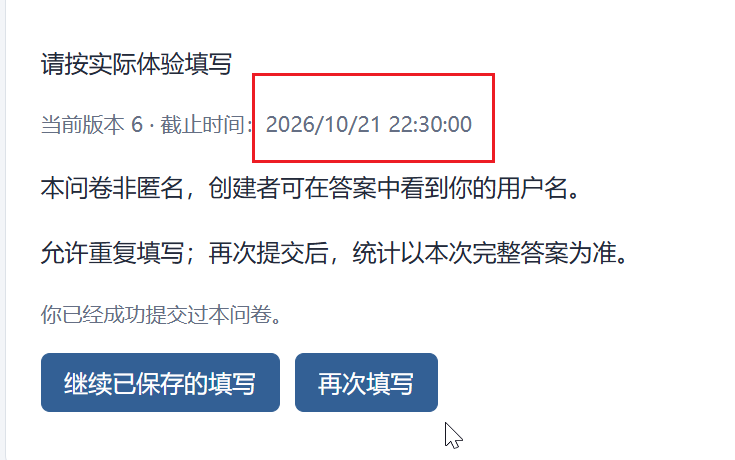
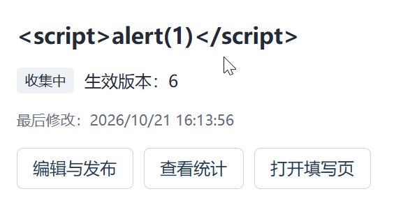
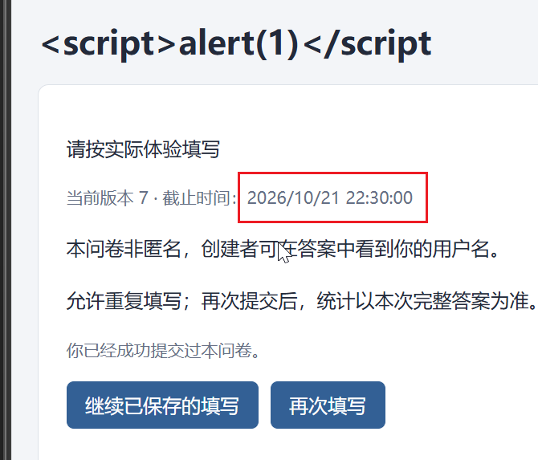
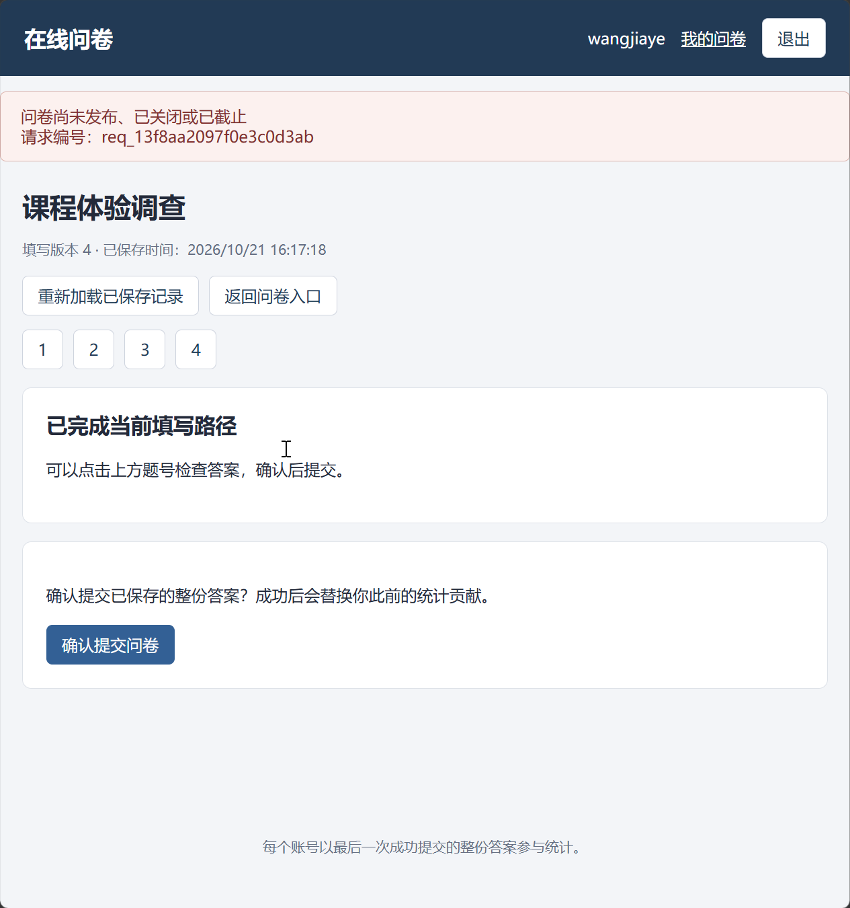
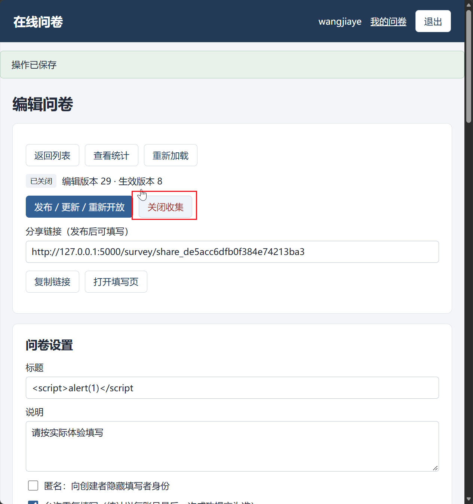
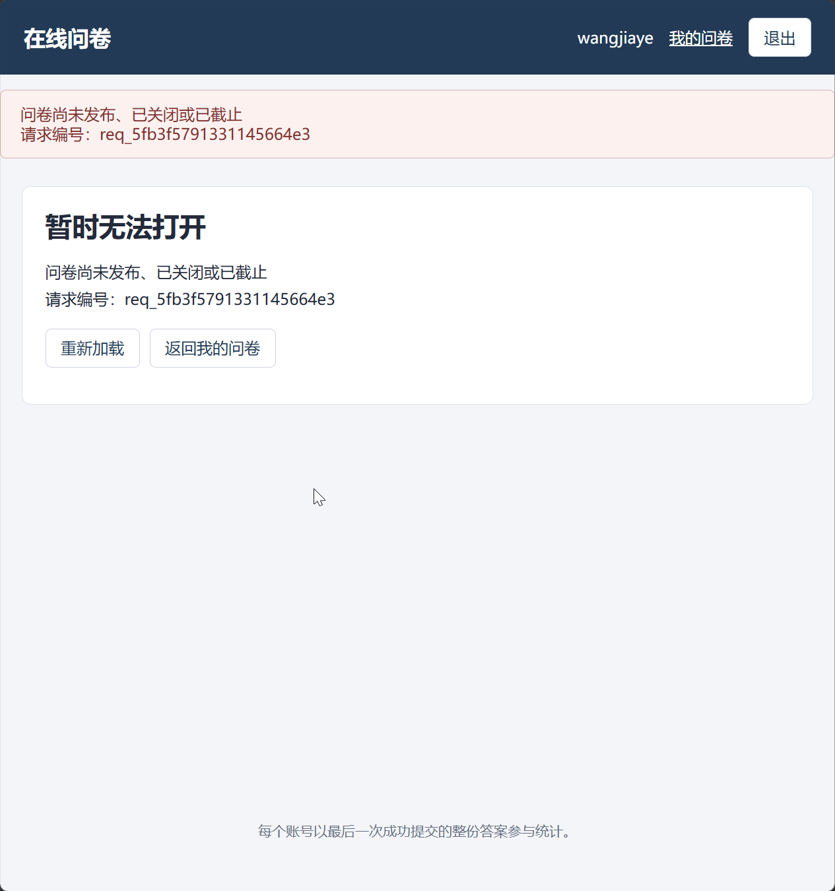
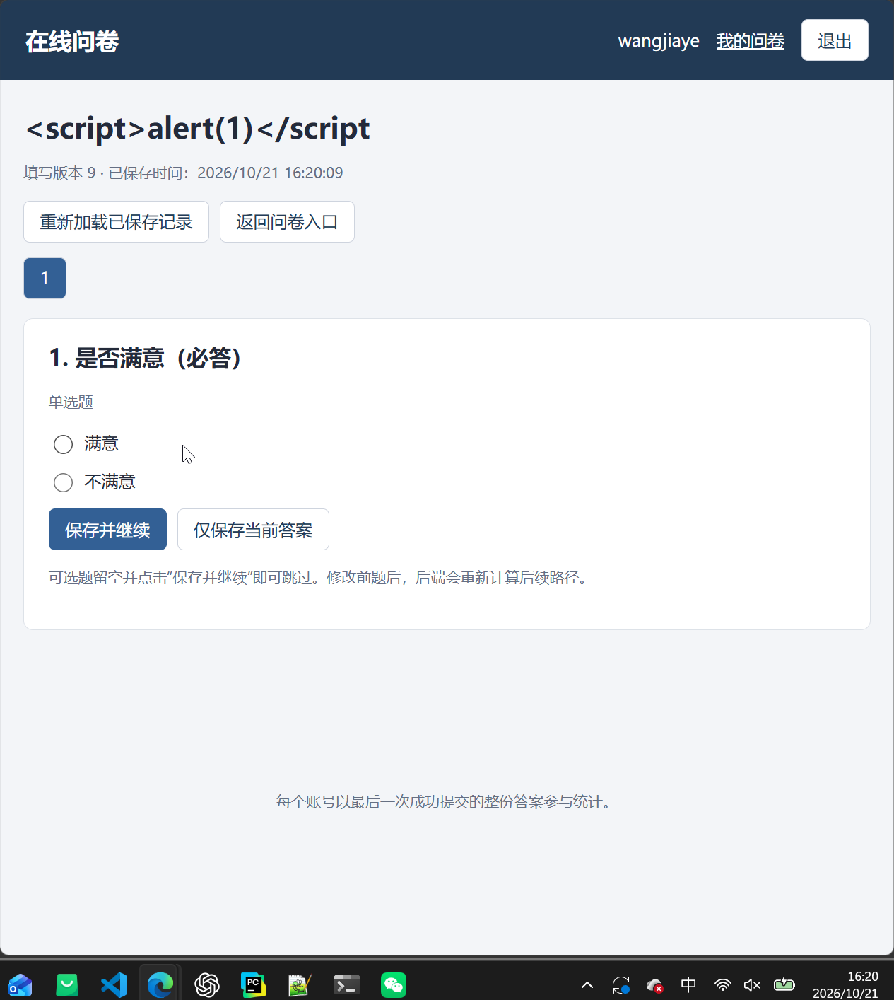

# 时间信息、收集状态与版本绑定：测试用例

共10项；每项直接列出步骤、输入、输出与测试结果，无需跨文件跳转。


<a id="tc08-a01"></a>

## TC08-A01 各版本发布时间与失败发布

执行方式：API自动化。


### 测试步骤

#### 前置条件

- 专用测试库和支持事务的 MongoDB 副本集已启动。A=创建者，B=另一创建者，U1/U2/U3=填写者，各账号独立 Cookie 会话；账号以运行批次后缀保证唯一，默认密码 TestPass!2026。API 基础路径 /api/v1；写请求带该会话 X-CSRF-Token，管理/填写修改带最新 If-Match。每个用例独立建卷，不继承其他用例的运行结果。
- A 已登录，创建草稿 S：title=课程体验调查，description=请按实际体验填写，anonymous=false，allowRepeat=true，deadlineAt=null。记录真实 surveyId、publicCode 和管理 ETag。

#### 操作步骤

1. 建立合法题发布V1，查survey_versions
2. 重发/关闭后复用V1开放，再创建V2
3. 不完整草稿publish

### 输入

#### 规定输入

```json
{
  "流程": "发布V1、重发同定义、修改标题发布V2；另有不完整草稿发布失败"
}
```

#### 实际请求输入

实际请求按执行顺序完整列出（包含准备动作，凭据已脱敏）：

**请求 1：POST /auth/register**

```json
{
  "序号": 1,
  "method": "POST",
  "path": "/auth/register",
  "input": {
    "username": "api_3a15fbce3deb4b9eb3d08ce4676fb1ab",
    "password": "<redacted>"
  },
  "headers": {
    "Origin": "http://127.0.0.1:61374"
  }
}
```

**请求 2：POST /auth/login**

```json
{
  "序号": 2,
  "method": "POST",
  "path": "/auth/login",
  "input": {
    "username": "api_3a15fbce3deb4b9eb3d08ce4676fb1ab",
    "password": "<redacted>"
  },
  "headers": {
    "Origin": "http://127.0.0.1:61374"
  }
}
```

**请求 3：POST /surveys**

```json
{
  "序号": 3,
  "method": "POST",
  "path": "/surveys",
  "input": {
    "title": "课程体验调查",
    "allowRepeat": true
  },
  "headers": {
    "Origin": "http://127.0.0.1:61374",
    "X-CSRF-Token": "<redacted>"
  }
}
```

**请求 4：POST /surveys/6ad8932937b03374ae337d79/questions**

```json
{
  "序号": 4,
  "method": "POST",
  "path": "/surveys/6ad8932937b03374ae337d79/questions",
  "input": {
    "type": "SINGLE",
    "title": "Q1",
    "required": true,
    "options": [
      {
        "label": "继续"
      },
      {
        "label": "结束"
      }
    ]
  },
  "headers": {
    "Origin": "http://127.0.0.1:61374",
    "X-CSRF-Token": "<redacted>",
    "If-Match": "\"definition-1-control-0\""
  }
}
```

**请求 5：POST /surveys/6ad8932937b03374ae337d79/questions**

```json
{
  "序号": 5,
  "method": "POST",
  "path": "/surveys/6ad8932937b03374ae337d79/questions",
  "input": {
    "type": "MULTIPLE",
    "title": "Q2",
    "required": true,
    "options": [
      {
        "label": "苹果"
      },
      {
        "label": "香蕉"
      },
      {
        "label": "梨"
      }
    ],
    "validation": {
      "minSelections": 1,
      "maxSelections": 2
    }
  },
  "headers": {
    "Origin": "http://127.0.0.1:61374",
    "X-CSRF-Token": "<redacted>",
    "If-Match": "\"definition-2-control-1\""
  }
}
```

**请求 6：POST /surveys/6ad8932937b03374ae337d79/questions**

```json
{
  "序号": 6,
  "method": "POST",
  "path": "/surveys/6ad8932937b03374ae337d79/questions",
  "input": {
    "type": "TEXT",
    "title": "Q3",
    "required": false,
    "validation": {
      "minLength": 2,
      "maxLength": 10
    }
  },
  "headers": {
    "Origin": "http://127.0.0.1:61374",
    "X-CSRF-Token": "<redacted>",
    "If-Match": "\"definition-3-control-2\""
  }
}
```

**请求 7：POST /surveys/6ad8932937b03374ae337d79/questions**

```json
{
  "序号": 7,
  "method": "POST",
  "path": "/surveys/6ad8932937b03374ae337d79/questions",
  "input": {
    "type": "NUMBER",
    "title": "Q4",
    "required": true,
    "validation": {
      "minValue": "0",
      "maxValue": "120",
      "integerOnly": true
    }
  },
  "headers": {
    "Origin": "http://127.0.0.1:61374",
    "X-CSRF-Token": "<redacted>",
    "If-Match": "\"definition-4-control-3\""
  }
}
```

**请求 8：POST /surveys/6ad8932937b03374ae337d79/publish**

```json
{
  "序号": 8,
  "method": "POST",
  "path": "/surveys/6ad8932937b03374ae337d79/publish",
  "input": {},
  "headers": {
    "Origin": "http://127.0.0.1:61374",
    "X-CSRF-Token": "<redacted>",
    "If-Match": "\"definition-5-control-4\""
  }
}
```

**请求 9：POST /surveys/6ad8932937b03374ae337d79/publish**

```json
{
  "序号": 9,
  "method": "POST",
  "path": "/surveys/6ad8932937b03374ae337d79/publish",
  "input": {},
  "headers": {
    "Origin": "http://127.0.0.1:61374",
    "X-CSRF-Token": "<redacted>",
    "If-Match": "\"definition-5-control-5\""
  }
}
```

**请求 10：POST /surveys/6ad8932937b03374ae337d79/close**

```json
{
  "序号": 10,
  "method": "POST",
  "path": "/surveys/6ad8932937b03374ae337d79/close",
  "input": {},
  "headers": {
    "Origin": "http://127.0.0.1:61374",
    "X-CSRF-Token": "<redacted>",
    "If-Match": "\"definition-5-control-6\""
  }
}
```

**请求 11：POST /surveys/6ad8932937b03374ae337d79/publish**

```json
{
  "序号": 11,
  "method": "POST",
  "path": "/surveys/6ad8932937b03374ae337d79/publish",
  "input": {},
  "headers": {
    "Origin": "http://127.0.0.1:61374",
    "X-CSRF-Token": "<redacted>",
    "If-Match": "\"definition-5-control-7\""
  }
}
```

**请求 12：PATCH /surveys/6ad8932937b03374ae337d79**

```json
{
  "序号": 12,
  "method": "PATCH",
  "path": "/surveys/6ad8932937b03374ae337d79",
  "input": {
    "title": "第二版"
  },
  "headers": {
    "Origin": "http://127.0.0.1:61374",
    "X-CSRF-Token": "<redacted>",
    "If-Match": "\"definition-5-control-8\""
  }
}
```

**请求 13：POST /surveys/6ad8932937b03374ae337d79/publish**

```json
{
  "序号": 13,
  "method": "POST",
  "path": "/surveys/6ad8932937b03374ae337d79/publish",
  "input": {},
  "headers": {
    "Origin": "http://127.0.0.1:61374",
    "X-CSRF-Token": "<redacted>",
    "If-Match": "\"definition-6-control-9\""
  }
}
```

**请求 14：POST /surveys**

```json
{
  "序号": 14,
  "method": "POST",
  "path": "/surveys",
  "input": {
    "title": "课程体验调查",
    "allowRepeat": true
  },
  "headers": {
    "Origin": "http://127.0.0.1:61374",
    "X-CSRF-Token": "<redacted>"
  }
}
```

**请求 15：POST /surveys/6ad8932a37b03374ae337d7c/publish**

```json
{
  "序号": 15,
  "method": "POST",
  "path": "/surveys/6ad8932a37b03374ae337d7c/publish",
  "input": {},
  "headers": {
    "Origin": "http://127.0.0.1:61374",
    "X-CSRF-Token": "<redacted>",
    "If-Match": "\"definition-1-control-0\""
  }
}
```

**请求 16：GET /surveys/6ad8932a37b03374ae337d7c**

```json
{
  "序号": 16,
  "method": "GET",
  "path": "/surveys/6ad8932a37b03374ae337d7c",
  "input": null,
  "headers": {
    "Origin": "http://127.0.0.1:61374",
    "X-CSRF-Token": "<redacted>"
  }
}
```


### 输出

#### 预期输出

1. publishedAt为数据库BSON Date且位于请求起止时间范围（同一可信时钟）
2. V1原publishedAt不变，V2有独立发布时间
3. 422，无半成品版本或成功时间

- 管理API目前不返回publishedAt；数据库断言和页面展示分开，不虚构字段。

#### 实际输出

本轮实际请求状态分布：HTTP 200：8次；HTTP 201：7次；HTTP 422：1次。

**请求 1：POST /auth/register**

```json
{
  "序号": 1,
  "method": "POST",
  "path": "/auth/register",
  "status": 201,
  "output": {
    "data": {
      "createdAt": "2026-10-21T10:25:45.808Z",
      "userId": "6ad8932937b03374ae337d77",
      "username": "api_3a15fbce3deb4b9eb3d08ce4676fb1ab"
    },
    "requestId": "req_d0bf6d2ce5f24b4c38b9"
  },
  "responseHeaders": {
    "Server": "Werkzeug/3.1.9 Python/3.14.7",
    "Date": "Wed, 21 Oct 2026 10:25:45 GMT",
    "Content-Type": "application/json",
    "Content-Length": "175",
    "X-Request-ID": "req_d0bf6d2ce5f24b4c38b9",
    "X-Content-Type-Options": "nosniff",
    "Referrer-Policy": "same-origin",
    "X-Frame-Options": "DENY",
    "Content-Security-Policy": "default-src 'self'; script-src 'self'; style-src 'self'; img-src 'self' data:; connect-src 'self'; frame-ancestors 'none'; base-uri 'self'; form-action 'self'",
    "Cache-Control": "no-store",
    "Connection": "close"
  }
}
```

**请求 2：POST /auth/login**

```json
{
  "序号": 2,
  "method": "POST",
  "path": "/auth/login",
  "status": 200,
  "output": {
    "data": {
      "csrfToken": "<redacted>",
      "user": {
        "createdAt": "2026-10-21T10:25:45.808Z",
        "userId": "6ad8932937b03374ae337d77",
        "username": "api_3a15fbce3deb4b9eb3d08ce4676fb1ab"
      }
    },
    "requestId": "req_8e70ea5bbb4982b90553"
  },
  "responseHeaders": {
    "Server": "Werkzeug/3.1.9 Python/3.14.7",
    "Date": "Wed, 21 Oct 2026 10:25:45 GMT",
    "Content-Type": "application/json",
    "Content-Length": "242",
    "Set-Cookie": "<redacted>",
    "X-Request-ID": "req_8e70ea5bbb4982b90553",
    "X-Content-Type-Options": "nosniff",
    "Referrer-Policy": "same-origin",
    "X-Frame-Options": "DENY",
    "Content-Security-Policy": "default-src 'self'; script-src 'self'; style-src 'self'; img-src 'self' data:; connect-src 'self'; frame-ancestors 'none'; base-uri 'self'; form-action 'self'",
    "Cache-Control": "no-store",
    "Connection": "close"
  }
}
```

**请求 3：POST /surveys**

```json
{
  "序号": 3,
  "method": "POST",
  "path": "/surveys",
  "status": 201,
  "output": {
    "data": {
      "controlRevision": 0,
      "createdAt": "2026-10-21T10:25:45.907Z",
      "deadlineAt": null,
      "definitionVersion": 1,
      "draft": {
        "description": "",
        "policy": {
          "allowRepeat": true,
          "anonymous": false
        },
        "questions": [],
        "title": "课程体验调查"
      },
      "effectiveState": "DRAFT",
      "publicCode": "share_37929f864150902f39735cfd",
      "publishedVersion": null,
      "shareUrl": "/survey/share_37929f864150902f39735cfd",
      "state": "DRAFT",
      "surveyId": "6ad8932937b03374ae337d79",
      "updatedAt": "2026-10-21T10:25:45.907Z"
    },
    "requestId": "req_c76f8684e47b3954b402"
  },
  "responseHeaders": {
    "Server": "Werkzeug/3.1.9 Python/3.14.7",
    "Date": "Wed, 21 Oct 2026 10:25:45 GMT",
    "Content-Type": "application/json",
    "Content-Length": "508",
    "ETag": "\"definition-1-control-0\"",
    "X-Request-ID": "req_c76f8684e47b3954b402",
    "X-Content-Type-Options": "nosniff",
    "Referrer-Policy": "same-origin",
    "X-Frame-Options": "DENY",
    "Content-Security-Policy": "default-src 'self'; script-src 'self'; style-src 'self'; img-src 'self' data:; connect-src 'self'; frame-ancestors 'none'; base-uri 'self'; form-action 'self'",
    "Cache-Control": "no-store",
    "Connection": "close"
  }
}
```

**请求 4：POST /surveys/6ad8932937b03374ae337d79/questions**

```json
{
  "序号": 4,
  "method": "POST",
  "path": "/surveys/6ad8932937b03374ae337d79/questions",
  "status": 201,
  "output": {
    "data": {
      "controlRevision": 1,
      "createdAt": "2026-10-21T10:25:45.907Z",
      "deadlineAt": null,
      "definitionVersion": 2,
      "draft": {
        "description": "",
        "policy": {
          "allowRepeat": true,
          "anonymous": false
        },
        "questions": [
          {
            "jumpRules": [],
            "options": [
              {
                "label": "继续",
                "optionId": "opt_da15bd706dcfbdb6688876aa"
              },
              {
                "label": "结束",
                "optionId": "opt_63b8fe6e58c4e6429fec628d"
              }
            ],
            "questionId": "q_2ffb91d495a980b2da1ab81e",
            "required": true,
            "title": "Q1",
            "type": "SINGLE",
            "validation": {}
          }
        ],
        "title": "课程体验调查"
      },
      "effectiveState": "DRAFT",
      "publicCode": "share_37929f864150902f39735cfd",
      "publishedVersion": null,
      "shareUrl": "/survey/share_37929f864150902f39735cfd",
      "state": "DRAFT",
      "surveyId": "6ad8932937b03374ae337d79",
      "updatedAt": "2026-10-21T10:25:45.925Z"
    },
    "requestId": "req_8a122ce29068a1b32dc4"
  },
  "responseHeaders": {
    "Server": "Werkzeug/3.1.9 Python/3.14.7",
    "Date": "Wed, 21 Oct 2026 10:25:45 GMT",
    "Content-Type": "application/json",
    "Content-Length": "761",
    "ETag": "\"definition-2-control-1\"",
    "X-Request-ID": "req_8a122ce29068a1b32dc4",
    "X-Content-Type-Options": "nosniff",
    "Referrer-Policy": "same-origin",
    "X-Frame-Options": "DENY",
    "Content-Security-Policy": "default-src 'self'; script-src 'self'; style-src 'self'; img-src 'self' data:; connect-src 'self'; frame-ancestors 'none'; base-uri 'self'; form-action 'self'",
    "Cache-Control": "no-store",
    "Connection": "close"
  }
}
```

**请求 5：POST /surveys/6ad8932937b03374ae337d79/questions**

```json
{
  "序号": 5,
  "method": "POST",
  "path": "/surveys/6ad8932937b03374ae337d79/questions",
  "status": 201,
  "output": {
    "data": {
      "controlRevision": 2,
      "createdAt": "2026-10-21T10:25:45.907Z",
      "deadlineAt": null,
      "definitionVersion": 3,
      "draft": {
        "description": "",
        "policy": {
          "allowRepeat": true,
          "anonymous": false
        },
        "questions": [
          {
            "jumpRules": [],
            "options": [
              {
                "label": "继续",
                "optionId": "opt_da15bd706dcfbdb6688876aa"
              },
              {
                "label": "结束",
                "optionId": "opt_63b8fe6e58c4e6429fec628d"
              }
            ],
            "questionId": "q_2ffb91d495a980b2da1ab81e",
            "required": true,
            "title": "Q1",
            "type": "SINGLE",
            "validation": {}
          },
          {
            "jumpRules": [],
            "options": [
              {
                "label": "苹果",
                "optionId": "opt_33bf63af9ba8cd6bda78da5f"
              },
              {
                "label": "香蕉",
                "optionId": "opt_e46fee10387ae58fb3b6f2dd"
              },
              {
                "label": "梨",
                "optionId": "opt_aafd00e4d70218f0ac150058"
              }
            ],
            "questionId": "q_d331a2342beaf8ca87efd738",
            "required": true,
            "title": "Q2",
            "type": "MULTIPLE",
            "validation": {
              "maxSelections": 2,
              "minSelections": 1
            }
          }
        ],
        "title": "课程体验调查"
      },
      "effectiveState": "DRAFT",
      "publicCode": "share_37929f864150902f39735cfd",
      "publishedVersion": null,
      "shareUrl": "/survey/share_37929f864150902f39735cfd",
      "state": "DRAFT",
      "surveyId": "6ad8932937b03374ae337d79",
      "updatedAt": "2026-10-21T10:25:45.940Z"
    },
    "requestId": "req_77f3f4dc91cde99d658f"
  },
  "responseHeaders": {
    "Server": "Werkzeug/3.1.9 Python/3.14.7",
    "Date": "Wed, 21 Oct 2026 10:25:45 GMT",
    "Content-Type": "application/json",
    "Content-Length": "1110",
    "ETag": "\"definition-3-control-2\"",
    "X-Request-ID": "req_77f3f4dc91cde99d658f",
    "X-Content-Type-Options": "nosniff",
    "Referrer-Policy": "same-origin",
    "X-Frame-Options": "DENY",
    "Content-Security-Policy": "default-src 'self'; script-src 'self'; style-src 'self'; img-src 'self' data:; connect-src 'self'; frame-ancestors 'none'; base-uri 'self'; form-action 'self'",
    "Cache-Control": "no-store",
    "Connection": "close"
  }
}
```

**请求 6：POST /surveys/6ad8932937b03374ae337d79/questions**

```json
{
  "序号": 6,
  "method": "POST",
  "path": "/surveys/6ad8932937b03374ae337d79/questions",
  "status": 201,
  "output": {
    "data": {
      "controlRevision": 3,
      "createdAt": "2026-10-21T10:25:45.907Z",
      "deadlineAt": null,
      "definitionVersion": 4,
      "draft": {
        "description": "",
        "policy": {
          "allowRepeat": true,
          "anonymous": false
        },
        "questions": [
          {
            "jumpRules": [],
            "options": [
              {
                "label": "继续",
                "optionId": "opt_da15bd706dcfbdb6688876aa"
              },
              {
                "label": "结束",
                "optionId": "opt_63b8fe6e58c4e6429fec628d"
              }
            ],
            "questionId": "q_2ffb91d495a980b2da1ab81e",
            "required": true,
            "title": "Q1",
            "type": "SINGLE",
            "validation": {}
          },
          {
            "jumpRules": [],
            "options": [
              {
                "label": "苹果",
                "optionId": "opt_33bf63af9ba8cd6bda78da5f"
              },
              {
                "label": "香蕉",
                "optionId": "opt_e46fee10387ae58fb3b6f2dd"
              },
              {
                "label": "梨",
                "optionId": "opt_aafd00e4d70218f0ac150058"
              }
            ],
            "questionId": "q_d331a2342beaf8ca87efd738",
            "required": true,
            "title": "Q2",
            "type": "MULTIPLE",
            "validation": {
              "maxSelections": 2,
              "minSelections": 1
            }
          },
          {
            "jumpRules": [],
            "questionId": "q_6f49173a5bdaef124ca77e08",
            "required": false,
            "title": "Q3",
            "type": "TEXT",
            "validation": {
              "maxLength": 10,
              "minLength": 2
            }
          }
        ],
        "title": "课程体验调查"
      },
      "effectiveState": "DRAFT",
      "publicCode": "share_37929f864150902f39735cfd",
      "publishedVersion": null,
      "shareUrl": "/survey/share_37929f864150902f39735cfd",
      "state": "DRAFT",
      "surveyId": "6ad8932937b03374ae337d79",
      "updatedAt": "2026-10-21T10:25:45.956Z"
    },
    "requestId": "req_100798120c6c96518c59"
  },
  "responseHeaders": {
    "Server": "Werkzeug/3.1.9 Python/3.14.7",
    "Date": "Wed, 21 Oct 2026 10:25:45 GMT",
    "Content-Type": "application/json",
    "Content-Length": "1257",
    "ETag": "\"definition-4-control-3\"",
    "X-Request-ID": "req_100798120c6c96518c59",
    "X-Content-Type-Options": "nosniff",
    "Referrer-Policy": "same-origin",
    "X-Frame-Options": "DENY",
    "Content-Security-Policy": "default-src 'self'; script-src 'self'; style-src 'self'; img-src 'self' data:; connect-src 'self'; frame-ancestors 'none'; base-uri 'self'; form-action 'self'",
    "Cache-Control": "no-store",
    "Connection": "close"
  }
}
```

**请求 7：POST /surveys/6ad8932937b03374ae337d79/questions**

```json
{
  "序号": 7,
  "method": "POST",
  "path": "/surveys/6ad8932937b03374ae337d79/questions",
  "status": 201,
  "output": {
    "data": {
      "controlRevision": 4,
      "createdAt": "2026-10-21T10:25:45.907Z",
      "deadlineAt": null,
      "definitionVersion": 5,
      "draft": {
        "description": "",
        "policy": {
          "allowRepeat": true,
          "anonymous": false
        },
        "questions": [
          {
            "jumpRules": [],
            "options": [
              {
                "label": "继续",
                "optionId": "opt_da15bd706dcfbdb6688876aa"
              },
              {
                "label": "结束",
                "optionId": "opt_63b8fe6e58c4e6429fec628d"
              }
            ],
            "questionId": "q_2ffb91d495a980b2da1ab81e",
            "required": true,
            "title": "Q1",
            "type": "SINGLE",
            "validation": {}
          },
          {
            "jumpRules": [],
            "options": [
              {
                "label": "苹果",
                "optionId": "opt_33bf63af9ba8cd6bda78da5f"
              },
              {
                "label": "香蕉",
                "optionId": "opt_e46fee10387ae58fb3b6f2dd"
              },
              {
                "label": "梨",
                "optionId": "opt_aafd00e4d70218f0ac150058"
              }
            ],
            "questionId": "q_d331a2342beaf8ca87efd738",
            "required": true,
            "title": "Q2",
            "type": "MULTIPLE",
            "validation": {
              "maxSelections": 2,
              "minSelections": 1
            }
          },
          {
            "jumpRules": [],
            "questionId": "q_6f49173a5bdaef124ca77e08",
            "required": false,
            "title": "Q3",
            "type": "TEXT",
            "validation": {
              "maxLength": 10,
              "minLength": 2
            }
          },
          {
            "jumpRules": [],
            "questionId": "q_5b76a8be0d4efd90e2703ac2",
            "required": true,
            "title": "Q4",
            "type": "NUMBER",
            "validation": {
              "integerOnly": true,
              "maxValue": "120",
              "minValue": "0"
            }
          }
        ],
        "title": "课程体验调查"
      },
      "effectiveState": "DRAFT",
      "publicCode": "share_37929f864150902f39735cfd",
      "publishedVersion": null,
      "shareUrl": "/survey/share_37929f864150902f39735cfd",
      "state": "DRAFT",
      "surveyId": "6ad8932937b03374ae337d79",
      "updatedAt": "2026-10-21T10:25:45.999Z"
    },
    "requestId": "req_c795262e2c864425b2b1"
  },
  "responseHeaders": {
    "Server": "Werkzeug/3.1.9 Python/3.14.7",
    "Date": "Wed, 21 Oct 2026 10:25:46 GMT",
    "Content-Type": "application/json",
    "Content-Length": "1427",
    "ETag": "\"definition-5-control-4\"",
    "X-Request-ID": "req_c795262e2c864425b2b1",
    "X-Content-Type-Options": "nosniff",
    "Referrer-Policy": "same-origin",
    "X-Frame-Options": "DENY",
    "Content-Security-Policy": "default-src 'self'; script-src 'self'; style-src 'self'; img-src 'self' data:; connect-src 'self'; frame-ancestors 'none'; base-uri 'self'; form-action 'self'",
    "Cache-Control": "no-store",
    "Connection": "close"
  }
}
```

**请求 8：POST /surveys/6ad8932937b03374ae337d79/publish**

```json
{
  "序号": 8,
  "method": "POST",
  "path": "/surveys/6ad8932937b03374ae337d79/publish",
  "status": 200,
  "output": {
    "data": {
      "controlRevision": 5,
      "createdAt": "2026-10-21T10:25:45.907Z",
      "deadlineAt": null,
      "definitionVersion": 5,
      "draft": {
        "description": "",
        "policy": {
          "allowRepeat": true,
          "anonymous": false
        },
        "questions": [
          {
            "jumpRules": [],
            "options": [
              {
                "label": "继续",
                "optionId": "opt_da15bd706dcfbdb6688876aa"
              },
              {
                "label": "结束",
                "optionId": "opt_63b8fe6e58c4e6429fec628d"
              }
            ],
            "questionId": "q_2ffb91d495a980b2da1ab81e",
            "required": true,
            "title": "Q1",
            "type": "SINGLE",
            "validation": {}
          },
          {
            "jumpRules": [],
            "options": [
              {
                "label": "苹果",
                "optionId": "opt_33bf63af9ba8cd6bda78da5f"
              },
              {
                "label": "香蕉",
                "optionId": "opt_e46fee10387ae58fb3b6f2dd"
              },
              {
                "label": "梨",
                "optionId": "opt_aafd00e4d70218f0ac150058"
              }
            ],
            "questionId": "q_d331a2342beaf8ca87efd738",
            "required": true,
            "title": "Q2",
            "type": "MULTIPLE",
            "validation": {
              "maxSelections": 2,
              "minSelections": 1
            }
          },
          {
            "jumpRules": [],
            "questionId": "q_6f49173a5bdaef124ca77e08",
            "required": false,
            "title": "Q3",
            "type": "TEXT",
            "validation": {
              "maxLength": 10,
              "minLength": 2
            }
          },
          {
            "jumpRules": [],
            "questionId": "q_5b76a8be0d4efd90e2703ac2",
            "required": true,
            "title": "Q4",
            "type": "NUMBER",
            "validation": {
              "integerOnly": true,
              "maxValue": "120",
              "minValue": "0"
            }
          }
        ],
        "title": "课程体验调查"
      },
      "effectiveState": "PUBLISHED",
      "publicCode": "share_37929f864150902f39735cfd",
      "publishedVersion": 1,
      "shareUrl": "/survey/share_37929f864150902f39735cfd",
      "state": "PUBLISHED",
      "surveyId": "6ad8932937b03374ae337d79",
      "updatedAt": "2026-10-21T10:25:46.025Z"
    },
    "requestId": "req_27a6c2dc51c141c70e3e"
  },
  "responseHeaders": {
    "Server": "Werkzeug/3.1.9 Python/3.14.7",
    "Date": "Wed, 21 Oct 2026 10:25:46 GMT",
    "Content-Type": "application/json",
    "Content-Length": "1432",
    "ETag": "\"definition-5-control-5\"",
    "X-Request-ID": "req_27a6c2dc51c141c70e3e",
    "X-Content-Type-Options": "nosniff",
    "Referrer-Policy": "same-origin",
    "X-Frame-Options": "DENY",
    "Content-Security-Policy": "default-src 'self'; script-src 'self'; style-src 'self'; img-src 'self' data:; connect-src 'self'; frame-ancestors 'none'; base-uri 'self'; form-action 'self'",
    "Cache-Control": "no-store",
    "Connection": "close"
  }
}
```

**请求 9：POST /surveys/6ad8932937b03374ae337d79/publish**

```json
{
  "序号": 9,
  "method": "POST",
  "path": "/surveys/6ad8932937b03374ae337d79/publish",
  "status": 200,
  "output": {
    "data": {
      "controlRevision": 6,
      "createdAt": "2026-10-21T10:25:45.907Z",
      "deadlineAt": null,
      "definitionVersion": 5,
      "draft": {
        "description": "",
        "policy": {
          "allowRepeat": true,
          "anonymous": false
        },
        "questions": [
          {
            "jumpRules": [],
            "options": [
              {
                "label": "继续",
                "optionId": "opt_da15bd706dcfbdb6688876aa"
              },
              {
                "label": "结束",
                "optionId": "opt_63b8fe6e58c4e6429fec628d"
              }
            ],
            "questionId": "q_2ffb91d495a980b2da1ab81e",
            "required": true,
            "title": "Q1",
            "type": "SINGLE",
            "validation": {}
          },
          {
            "jumpRules": [],
            "options": [
              {
                "label": "苹果",
                "optionId": "opt_33bf63af9ba8cd6bda78da5f"
              },
              {
                "label": "香蕉",
                "optionId": "opt_e46fee10387ae58fb3b6f2dd"
              },
              {
                "label": "梨",
                "optionId": "opt_aafd00e4d70218f0ac150058"
              }
            ],
            "questionId": "q_d331a2342beaf8ca87efd738",
            "required": true,
            "title": "Q2",
            "type": "MULTIPLE",
            "validation": {
              "maxSelections": 2,
              "minSelections": 1
            }
          },
          {
            "jumpRules": [],
            "questionId": "q_6f49173a5bdaef124ca77e08",
            "required": false,
            "title": "Q3",
            "type": "TEXT",
            "validation": {
              "maxLength": 10,
              "minLength": 2
            }
          },
          {
            "jumpRules": [],
            "questionId": "q_5b76a8be0d4efd90e2703ac2",
            "required": true,
            "title": "Q4",
            "type": "NUMBER",
            "validation": {
              "integerOnly": true,
              "maxValue": "120",
              "minValue": "0"
            }
          }
        ],
        "title": "课程体验调查"
      },
      "effectiveState": "PUBLISHED",
      "publicCode": "share_37929f864150902f39735cfd",
      "publishedVersion": 1,
      "shareUrl": "/survey/share_37929f864150902f39735cfd",
      "state": "PUBLISHED",
      "surveyId": "6ad8932937b03374ae337d79",
      "updatedAt": "2026-10-21T10:25:46.053Z"
    },
    "requestId": "req_3250ba62046d04400c74"
  },
  "responseHeaders": {
    "Server": "Werkzeug/3.1.9 Python/3.14.7",
    "Date": "Wed, 21 Oct 2026 10:25:46 GMT",
    "Content-Type": "application/json",
    "Content-Length": "1432",
    "ETag": "\"definition-5-control-6\"",
    "X-Request-ID": "req_3250ba62046d04400c74",
    "X-Content-Type-Options": "nosniff",
    "Referrer-Policy": "same-origin",
    "X-Frame-Options": "DENY",
    "Content-Security-Policy": "default-src 'self'; script-src 'self'; style-src 'self'; img-src 'self' data:; connect-src 'self'; frame-ancestors 'none'; base-uri 'self'; form-action 'self'",
    "Cache-Control": "no-store",
    "Connection": "close"
  }
}
```

**请求 10：POST /surveys/6ad8932937b03374ae337d79/close**

```json
{
  "序号": 10,
  "method": "POST",
  "path": "/surveys/6ad8932937b03374ae337d79/close",
  "status": 200,
  "output": {
    "data": {
      "controlRevision": 7,
      "createdAt": "2026-10-21T10:25:45.907Z",
      "deadlineAt": null,
      "definitionVersion": 5,
      "draft": {
        "description": "",
        "policy": {
          "allowRepeat": true,
          "anonymous": false
        },
        "questions": [
          {
            "jumpRules": [],
            "options": [
              {
                "label": "继续",
                "optionId": "opt_da15bd706dcfbdb6688876aa"
              },
              {
                "label": "结束",
                "optionId": "opt_63b8fe6e58c4e6429fec628d"
              }
            ],
            "questionId": "q_2ffb91d495a980b2da1ab81e",
            "required": true,
            "title": "Q1",
            "type": "SINGLE",
            "validation": {}
          },
          {
            "jumpRules": [],
            "options": [
              {
                "label": "苹果",
                "optionId": "opt_33bf63af9ba8cd6bda78da5f"
              },
              {
                "label": "香蕉",
                "optionId": "opt_e46fee10387ae58fb3b6f2dd"
              },
              {
                "label": "梨",
                "optionId": "opt_aafd00e4d70218f0ac150058"
              }
            ],
            "questionId": "q_d331a2342beaf8ca87efd738",
            "required": true,
            "title": "Q2",
            "type": "MULTIPLE",
            "validation": {
              "maxSelections": 2,
              "minSelections": 1
            }
          },
          {
            "jumpRules": [],
            "questionId": "q_6f49173a5bdaef124ca77e08",
            "required": false,
            "title": "Q3",
            "type": "TEXT",
            "validation": {
              "maxLength": 10,
              "minLength": 2
            }
          },
          {
            "jumpRules": [],
            "questionId": "q_5b76a8be0d4efd90e2703ac2",
            "required": true,
            "title": "Q4",
            "type": "NUMBER",
            "validation": {
              "integerOnly": true,
              "maxValue": "120",
              "minValue": "0"
            }
          }
        ],
        "title": "课程体验调查"
      },
      "effectiveState": "CLOSED",
      "publicCode": "share_37929f864150902f39735cfd",
      "publishedVersion": 1,
      "shareUrl": "/survey/share_37929f864150902f39735cfd",
      "state": "CLOSED",
      "surveyId": "6ad8932937b03374ae337d79",
      "updatedAt": "2026-10-21T10:25:46.065Z"
    },
    "requestId": "req_0af9d77accd05e9c9e15"
  },
  "responseHeaders": {
    "Server": "Werkzeug/3.1.9 Python/3.14.7",
    "Date": "Wed, 21 Oct 2026 10:25:46 GMT",
    "Content-Type": "application/json",
    "Content-Length": "1426",
    "ETag": "\"definition-5-control-7\"",
    "X-Request-ID": "req_0af9d77accd05e9c9e15",
    "X-Content-Type-Options": "nosniff",
    "Referrer-Policy": "same-origin",
    "X-Frame-Options": "DENY",
    "Content-Security-Policy": "default-src 'self'; script-src 'self'; style-src 'self'; img-src 'self' data:; connect-src 'self'; frame-ancestors 'none'; base-uri 'self'; form-action 'self'",
    "Cache-Control": "no-store",
    "Connection": "close"
  }
}
```

**请求 11：POST /surveys/6ad8932937b03374ae337d79/publish**

```json
{
  "序号": 11,
  "method": "POST",
  "path": "/surveys/6ad8932937b03374ae337d79/publish",
  "status": 200,
  "output": {
    "data": {
      "controlRevision": 8,
      "createdAt": "2026-10-21T10:25:45.907Z",
      "deadlineAt": null,
      "definitionVersion": 5,
      "draft": {
        "description": "",
        "policy": {
          "allowRepeat": true,
          "anonymous": false
        },
        "questions": [
          {
            "jumpRules": [],
            "options": [
              {
                "label": "继续",
                "optionId": "opt_da15bd706dcfbdb6688876aa"
              },
              {
                "label": "结束",
                "optionId": "opt_63b8fe6e58c4e6429fec628d"
              }
            ],
            "questionId": "q_2ffb91d495a980b2da1ab81e",
            "required": true,
            "title": "Q1",
            "type": "SINGLE",
            "validation": {}
          },
          {
            "jumpRules": [],
            "options": [
              {
                "label": "苹果",
                "optionId": "opt_33bf63af9ba8cd6bda78da5f"
              },
              {
                "label": "香蕉",
                "optionId": "opt_e46fee10387ae58fb3b6f2dd"
              },
              {
                "label": "梨",
                "optionId": "opt_aafd00e4d70218f0ac150058"
              }
            ],
            "questionId": "q_d331a2342beaf8ca87efd738",
            "required": true,
            "title": "Q2",
            "type": "MULTIPLE",
            "validation": {
              "maxSelections": 2,
              "minSelections": 1
            }
          },
          {
            "jumpRules": [],
            "questionId": "q_6f49173a5bdaef124ca77e08",
            "required": false,
            "title": "Q3",
            "type": "TEXT",
            "validation": {
              "maxLength": 10,
              "minLength": 2
            }
          },
          {
            "jumpRules": [],
            "questionId": "q_5b76a8be0d4efd90e2703ac2",
            "required": true,
            "title": "Q4",
            "type": "NUMBER",
            "validation": {
              "integerOnly": true,
              "maxValue": "120",
              "minValue": "0"
            }
          }
        ],
        "title": "课程体验调查"
      },
      "effectiveState": "PUBLISHED",
      "publicCode": "share_37929f864150902f39735cfd",
      "publishedVersion": 1,
      "shareUrl": "/survey/share_37929f864150902f39735cfd",
      "state": "PUBLISHED",
      "surveyId": "6ad8932937b03374ae337d79",
      "updatedAt": "2026-10-21T10:25:46.083Z"
    },
    "requestId": "req_95f6cb8d1eafc45440ca"
  },
  "responseHeaders": {
    "Server": "Werkzeug/3.1.9 Python/3.14.7",
    "Date": "Wed, 21 Oct 2026 10:25:46 GMT",
    "Content-Type": "application/json",
    "Content-Length": "1432",
    "ETag": "\"definition-5-control-8\"",
    "X-Request-ID": "req_95f6cb8d1eafc45440ca",
    "X-Content-Type-Options": "nosniff",
    "Referrer-Policy": "same-origin",
    "X-Frame-Options": "DENY",
    "Content-Security-Policy": "default-src 'self'; script-src 'self'; style-src 'self'; img-src 'self' data:; connect-src 'self'; frame-ancestors 'none'; base-uri 'self'; form-action 'self'",
    "Cache-Control": "no-store",
    "Connection": "close"
  }
}
```

**请求 12：PATCH /surveys/6ad8932937b03374ae337d79**

```json
{
  "序号": 12,
  "method": "PATCH",
  "path": "/surveys/6ad8932937b03374ae337d79",
  "status": 200,
  "output": {
    "data": {
      "controlRevision": 9,
      "createdAt": "2026-10-21T10:25:45.907Z",
      "deadlineAt": null,
      "definitionVersion": 6,
      "draft": {
        "description": "",
        "policy": {
          "allowRepeat": true,
          "anonymous": false
        },
        "questions": [
          {
            "jumpRules": [],
            "options": [
              {
                "label": "继续",
                "optionId": "opt_da15bd706dcfbdb6688876aa"
              },
              {
                "label": "结束",
                "optionId": "opt_63b8fe6e58c4e6429fec628d"
              }
            ],
            "questionId": "q_2ffb91d495a980b2da1ab81e",
            "required": true,
            "title": "Q1",
            "type": "SINGLE",
            "validation": {}
          },
          {
            "jumpRules": [],
            "options": [
              {
                "label": "苹果",
                "optionId": "opt_33bf63af9ba8cd6bda78da5f"
              },
              {
                "label": "香蕉",
                "optionId": "opt_e46fee10387ae58fb3b6f2dd"
              },
              {
                "label": "梨",
                "optionId": "opt_aafd00e4d70218f0ac150058"
              }
            ],
            "questionId": "q_d331a2342beaf8ca87efd738",
            "required": true,
            "title": "Q2",
            "type": "MULTIPLE",
            "validation": {
              "maxSelections": 2,
              "minSelections": 1
            }
          },
          {
            "jumpRules": [],
            "questionId": "q_6f49173a5bdaef124ca77e08",
            "required": false,
            "title": "Q3",
            "type": "TEXT",
            "validation": {
              "maxLength": 10,
              "minLength": 2
            }
          },
          {
            "jumpRules": [],
            "questionId": "q_5b76a8be0d4efd90e2703ac2",
            "required": true,
            "title": "Q4",
            "type": "NUMBER",
            "validation": {
              "integerOnly": true,
              "maxValue": "120",
              "minValue": "0"
            }
          }
        ],
        "title": "第二版"
      },
      "effectiveState": "PUBLISHED",
      "publicCode": "share_37929f864150902f39735cfd",
      "publishedVersion": 1,
      "shareUrl": "/survey/share_37929f864150902f39735cfd",
      "state": "PUBLISHED",
      "surveyId": "6ad8932937b03374ae337d79",
      "updatedAt": "2026-10-21T10:25:46.122Z"
    },
    "requestId": "req_d9a110822ff1f61fad10"
  },
  "responseHeaders": {
    "Server": "Werkzeug/3.1.9 Python/3.14.7",
    "Date": "Wed, 21 Oct 2026 10:25:46 GMT",
    "Content-Type": "application/json",
    "Content-Length": "1423",
    "ETag": "\"definition-6-control-9\"",
    "X-Request-ID": "req_d9a110822ff1f61fad10",
    "X-Content-Type-Options": "nosniff",
    "Referrer-Policy": "same-origin",
    "X-Frame-Options": "DENY",
    "Content-Security-Policy": "default-src 'self'; script-src 'self'; style-src 'self'; img-src 'self' data:; connect-src 'self'; frame-ancestors 'none'; base-uri 'self'; form-action 'self'",
    "Cache-Control": "no-store",
    "Connection": "close"
  }
}
```

**请求 13：POST /surveys/6ad8932937b03374ae337d79/publish**

```json
{
  "序号": 13,
  "method": "POST",
  "path": "/surveys/6ad8932937b03374ae337d79/publish",
  "status": 200,
  "output": {
    "data": {
      "controlRevision": 10,
      "createdAt": "2026-10-21T10:25:45.907Z",
      "deadlineAt": null,
      "definitionVersion": 6,
      "draft": {
        "description": "",
        "policy": {
          "allowRepeat": true,
          "anonymous": false
        },
        "questions": [
          {
            "jumpRules": [],
            "options": [
              {
                "label": "继续",
                "optionId": "opt_da15bd706dcfbdb6688876aa"
              },
              {
                "label": "结束",
                "optionId": "opt_63b8fe6e58c4e6429fec628d"
              }
            ],
            "questionId": "q_2ffb91d495a980b2da1ab81e",
            "required": true,
            "title": "Q1",
            "type": "SINGLE",
            "validation": {}
          },
          {
            "jumpRules": [],
            "options": [
              {
                "label": "苹果",
                "optionId": "opt_33bf63af9ba8cd6bda78da5f"
              },
              {
                "label": "香蕉",
                "optionId": "opt_e46fee10387ae58fb3b6f2dd"
              },
              {
                "label": "梨",
                "optionId": "opt_aafd00e4d70218f0ac150058"
              }
            ],
            "questionId": "q_d331a2342beaf8ca87efd738",
            "required": true,
            "title": "Q2",
            "type": "MULTIPLE",
            "validation": {
              "maxSelections": 2,
              "minSelections": 1
            }
          },
          {
            "jumpRules": [],
            "questionId": "q_6f49173a5bdaef124ca77e08",
            "required": false,
            "title": "Q3",
            "type": "TEXT",
            "validation": {
              "maxLength": 10,
              "minLength": 2
            }
          },
          {
            "jumpRules": [],
            "questionId": "q_5b76a8be0d4efd90e2703ac2",
            "required": true,
            "title": "Q4",
            "type": "NUMBER",
            "validation": {
              "integerOnly": true,
              "maxValue": "120",
              "minValue": "0"
            }
          }
        ],
        "title": "第二版"
      },
      "effectiveState": "PUBLISHED",
      "publicCode": "share_37929f864150902f39735cfd",
      "publishedVersion": 2,
      "shareUrl": "/survey/share_37929f864150902f39735cfd",
      "state": "PUBLISHED",
      "surveyId": "6ad8932937b03374ae337d79",
      "updatedAt": "2026-10-21T10:25:46.146Z"
    },
    "requestId": "req_ed5338e96ffaf34efe57"
  },
  "responseHeaders": {
    "Server": "Werkzeug/3.1.9 Python/3.14.7",
    "Date": "Wed, 21 Oct 2026 10:25:46 GMT",
    "Content-Type": "application/json",
    "Content-Length": "1424",
    "ETag": "\"definition-6-control-10\"",
    "X-Request-ID": "req_ed5338e96ffaf34efe57",
    "X-Content-Type-Options": "nosniff",
    "Referrer-Policy": "same-origin",
    "X-Frame-Options": "DENY",
    "Content-Security-Policy": "default-src 'self'; script-src 'self'; style-src 'self'; img-src 'self' data:; connect-src 'self'; frame-ancestors 'none'; base-uri 'self'; form-action 'self'",
    "Cache-Control": "no-store",
    "Connection": "close"
  }
}
```

**请求 14：POST /surveys**

```json
{
  "序号": 14,
  "method": "POST",
  "path": "/surveys",
  "status": 201,
  "output": {
    "data": {
      "controlRevision": 0,
      "createdAt": "2026-10-21T10:25:46.157Z",
      "deadlineAt": null,
      "definitionVersion": 1,
      "draft": {
        "description": "",
        "policy": {
          "allowRepeat": true,
          "anonymous": false
        },
        "questions": [],
        "title": "课程体验调查"
      },
      "effectiveState": "DRAFT",
      "publicCode": "share_d1586c659996f80861ae425a",
      "publishedVersion": null,
      "shareUrl": "/survey/share_d1586c659996f80861ae425a",
      "state": "DRAFT",
      "surveyId": "6ad8932a37b03374ae337d7c",
      "updatedAt": "2026-10-21T10:25:46.157Z"
    },
    "requestId": "req_27ef61c48986eaf3861e"
  },
  "responseHeaders": {
    "Server": "Werkzeug/3.1.9 Python/3.14.7",
    "Date": "Wed, 21 Oct 2026 10:25:46 GMT",
    "Content-Type": "application/json",
    "Content-Length": "508",
    "ETag": "\"definition-1-control-0\"",
    "X-Request-ID": "req_27ef61c48986eaf3861e",
    "X-Content-Type-Options": "nosniff",
    "Referrer-Policy": "same-origin",
    "X-Frame-Options": "DENY",
    "Content-Security-Policy": "default-src 'self'; script-src 'self'; style-src 'self'; img-src 'self' data:; connect-src 'self'; frame-ancestors 'none'; base-uri 'self'; form-action 'self'",
    "Cache-Control": "no-store",
    "Connection": "close"
  }
}
```

**请求 15：POST /surveys/6ad8932a37b03374ae337d7c/publish**

```json
{
  "序号": 15,
  "method": "POST",
  "path": "/surveys/6ad8932a37b03374ae337d7c/publish",
  "status": 422,
  "output": {
    "error": {
      "code": "DEFINITION_INVALID",
      "message": "问卷需要 1～200 道题才能发布"
    },
    "requestId": "req_b301ebf2727384668188"
  },
  "responseHeaders": {
    "Server": "Werkzeug/3.1.9 Python/3.14.7",
    "Date": "Wed, 21 Oct 2026 10:25:46 GMT",
    "Content-Type": "application/json",
    "Content-Length": "131",
    "X-Request-ID": "req_b301ebf2727384668188",
    "X-Content-Type-Options": "nosniff",
    "Referrer-Policy": "same-origin",
    "X-Frame-Options": "DENY",
    "Content-Security-Policy": "default-src 'self'; script-src 'self'; style-src 'self'; img-src 'self' data:; connect-src 'self'; frame-ancestors 'none'; base-uri 'self'; form-action 'self'",
    "Cache-Control": "no-store",
    "Connection": "close"
  }
}
```

**请求 16：GET /surveys/6ad8932a37b03374ae337d7c**

```json
{
  "序号": 16,
  "method": "GET",
  "path": "/surveys/6ad8932a37b03374ae337d7c",
  "status": 200,
  "output": {
    "data": {
      "controlRevision": 0,
      "createdAt": "2026-10-21T10:25:46.157Z",
      "deadlineAt": null,
      "definitionVersion": 1,
      "draft": {
        "description": "",
        "policy": {
          "allowRepeat": true,
          "anonymous": false
        },
        "questions": [],
        "title": "课程体验调查"
      },
      "effectiveState": "DRAFT",
      "publicCode": "share_d1586c659996f80861ae425a",
      "publishedVersion": null,
      "shareUrl": "/survey/share_d1586c659996f80861ae425a",
      "state": "DRAFT",
      "surveyId": "6ad8932a37b03374ae337d7c",
      "updatedAt": "2026-10-21T10:25:46.157Z"
    },
    "requestId": "req_cde9dd8652e2f494b2d3"
  },
  "responseHeaders": {
    "Server": "Werkzeug/3.1.9 Python/3.14.7",
    "Date": "Wed, 21 Oct 2026 10:25:46 GMT",
    "Content-Type": "application/json",
    "Content-Length": "508",
    "ETag": "\"definition-1-control-0\"",
    "X-Request-ID": "req_cde9dd8652e2f494b2d3",
    "X-Content-Type-Options": "nosniff",
    "Referrer-Policy": "same-origin",
    "X-Frame-Options": "DENY",
    "Content-Security-Policy": "default-src 'self'; script-src 'self'; style-src 'self'; img-src 'self' data:; connect-src 'self'; frame-ancestors 'none'; base-uri 'self'; form-action 'self'",
    "Cache-Control": "no-store",
    "Connection": "close"
  }
}
```

序号与输入层对应；包含账号、问卷和填写准备请求，不能将首条准备请求当作本例目标接口。

**本例问卷持久化摘要**

```json
[
  {
    "surveyId": {
      "$oid": "6ad8932937b03374ae337d79"
    },
    "responses": 0,
    "guards": 0,
    "versions": 2,
    "attempts": 0
  },
  {
    "surveyId": {
      "$oid": "6ad8932a37b03374ae337d7c"
    },
    "responses": 0,
    "guards": 0,
    "versions": 0,
    "attempts": 0
  }
]
```


### 测试结果

**判定：通过**。

```text
本轮脚本断言通过。实际返回及数据库核对见输出层和Allure附件。
```

**各版本发布时间（存储层核对，页面缺失仍保留手动失败）**

```json
[
  {
    "$date": "2026-10-21T10:25:46.022Z"
  },
  {
    "$date": "2026-10-21T10:25:46.144Z"
  }
]
```

**原始测试规格**

```json
{
  "id": "TC08-A01",
  "moduleId": 8,
  "module": "时间信息、收集状态与版本绑定",
  "title": "各版本发布时间与失败发布",
  "execution": "api",
  "priority": "P1",
  "sourceSteps": [
    1,
    2
  ],
  "preconditions": [
    "专用测试库和支持事务的 MongoDB 副本集已启动。A=创建者，B=另一创建者，U1/U2/U3=填写者，各账号独立 Cookie 会话；账号以运行批次后缀保证唯一，默认密码 TestPass!2026。API 基础路径 /api/v1；写请求带该会话 X-CSRF-Token，管理/填写修改带最新 If-Match。每个用例独立建卷，不继承其他用例的运行结果。",
    "A 已登录，创建草稿 S：title=课程体验调查，description=请按实际体验填写，anonymous=false，allowRepeat=true，deadlineAt=null。记录真实 surveyId、publicCode 和管理 ETag。"
  ],
  "input": {
    "流程": "发布V1、重发同定义、修改标题发布V2；另有不完整草稿发布失败"
  },
  "steps": [
    {
      "action": "建立合法题发布V1，查survey_versions",
      "expected": "publishedAt为数据库BSON Date且位于请求起止时间范围（同一可信时钟）"
    },
    {
      "action": "重发/关闭后复用V1开放，再创建V2",
      "expected": "V1原publishedAt不变，V2有独立发布时间"
    },
    {
      "action": "不完整草稿publish",
      "expected": "422，无半成品版本或成功时间"
    }
  ],
  "expected": [
    "管理API目前不返回publishedAt；数据库断言和页面展示分开，不虚构字段。"
  ]
}
```

**HTTP 请求与响应（凭据已脱敏）**

```json
[
  {
    "method": "POST",
    "path": "/auth/register",
    "input": {
      "username": "api_3a15fbce3deb4b9eb3d08ce4676fb1ab",
      "password": "<redacted>"
    },
    "headers": {
      "Origin": "http://127.0.0.1:61374"
    },
    "status": 201,
    "output": {
      "data": {
        "createdAt": "2026-10-21T10:25:45.808Z",
        "userId": "6ad8932937b03374ae337d77",
        "username": "api_3a15fbce3deb4b9eb3d08ce4676fb1ab"
      },
      "requestId": "req_d0bf6d2ce5f24b4c38b9"
    },
    "responseHeaders": {
      "Server": "Werkzeug/3.1.9 Python/3.14.7",
      "Date": "Wed, 21 Oct 2026 10:25:45 GMT",
      "Content-Type": "application/json",
      "Content-Length": "175",
      "X-Request-ID": "req_d0bf6d2ce5f24b4c38b9",
      "X-Content-Type-Options": "nosniff",
      "Referrer-Policy": "same-origin",
      "X-Frame-Options": "DENY",
      "Content-Security-Policy": "default-src 'self'; script-src 'self'; style-src 'self'; img-src 'self' data:; connect-src 'self'; frame-ancestors 'none'; base-uri 'self'; form-action 'self'",
      "Cache-Control": "no-store",
      "Connection": "close"
    }
  },
  {
    "method": "POST",
    "path": "/auth/login",
    "input": {
      "username": "api_3a15fbce3deb4b9eb3d08ce4676fb1ab",
      "password": "<redacted>"
    },
    "headers": {
      "Origin": "http://127.0.0.1:61374"
    },
    "status": 200,
    "output": {
      "data": {
        "csrfToken": "<redacted>",
        "user": {
          "createdAt": "2026-10-21T10:25:45.808Z",
          "userId": "6ad8932937b03374ae337d77",
          "username": "api_3a15fbce3deb4b9eb3d08ce4676fb1ab"
        }
      },
      "requestId": "req_8e70ea5bbb4982b90553"
    },
    "responseHeaders": {
      "Server": "Werkzeug/3.1.9 Python/3.14.7",
      "Date": "Wed, 21 Oct 2026 10:25:45 GMT",
      "Content-Type": "application/json",
      "Content-Length": "242",
      "Set-Cookie": "<redacted>",
      "X-Request-ID": "req_8e70ea5bbb4982b90553",
      "X-Content-Type-Options": "nosniff",
      "Referrer-Policy": "same-origin",
      "X-Frame-Options": "DENY",
      "Content-Security-Policy": "default-src 'self'; script-src 'self'; style-src 'self'; img-src 'self' data:; connect-src 'self'; frame-ancestors 'none'; base-uri 'self'; form-action 'self'",
      "Cache-Control": "no-store",
      "Connection": "close"
    }
  },
  {
    "method": "POST",
    "path": "/surveys",
    "input": {
      "title": "课程体验调查",
      "allowRepeat": true
    },
    "headers": {
      "Origin": "http://127.0.0.1:61374",
      "X-CSRF-Token": "<redacted>"
    },
    "status": 201,
    "output": {
      "data": {
        "controlRevision": 0,
        "createdAt": "2026-10-21T10:25:45.907Z",
        "deadlineAt": null,
        "definitionVersion": 1,
        "draft": {
          "description": "",
          "policy": {
            "allowRepeat": true,
            "anonymous": false
          },
          "questions": [],
          "title": "课程体验调查"
        },
        "effectiveState": "DRAFT",
        "publicCode": "share_37929f864150902f39735cfd",
        "publishedVersion": null,
        "shareUrl": "/survey/share_37929f864150902f39735cfd",
        "state": "DRAFT",
        "surveyId": "6ad8932937b03374ae337d79",
        "updatedAt": "2026-10-21T10:25:45.907Z"
      },
      "requestId": "req_c76f8684e47b3954b402"
    },
    "responseHeaders": {
      "Server": "Werkzeug/3.1.9 Python/3.14.7",
      "Date": "Wed, 21 Oct 2026 10:25:45 GMT",
      "Content-Type": "application/json",
      "Content-Length": "508",
      "ETag": "\"definition-1-control-0\"",
      "X-Request-ID": "req_c76f8684e47b3954b402",
      "X-Content-Type-Options": "nosniff",
      "Referrer-Policy": "same-origin",
      "X-Frame-Options": "DENY",
      "Content-Security-Policy": "default-src 'self'; script-src 'self'; style-src 'self'; img-src 'self' data:; connect-src 'self'; frame-ancestors 'none'; base-uri 'self'; form-action 'self'",
      "Cache-Control": "no-store",
      "Connection": "close"
    }
  },
  {
    "method": "POST",
    "path": "/surveys/6ad8932937b03374ae337d79/questions",
    "input": {
      "type": "SINGLE",
      "title": "Q1",
      "required": true,
      "options": [
        {
          "label": "继续"
        },
        {
          "label": "结束"
        }
      ]
    },
    "headers": {
      "Origin": "http://127.0.0.1:61374",
      "X-CSRF-Token": "<redacted>",
      "If-Match": "\"definition-1-control-0\""
    },
    "status": 201,
    "output": {
      "data": {
        "controlRevision": 1,
        "createdAt": "2026-10-21T10:25:45.907Z",
        "deadlineAt": null,
        "definitionVersion": 2,
        "draft": {
          "description": "",
          "policy": {
            "allowRepeat": true,
            "anonymous": false
          },
          "questions": [
            {
              "jumpRules": [],
              "options": [
                {
                  "label": "继续",
                  "optionId": "opt_da15bd706dcfbdb6688876aa"
                },
                {
                  "label": "结束",
                  "optionId": "opt_63b8fe6e58c4e6429fec628d"
                }
              ],
              "questionId": "q_2ffb91d495a980b2da1ab81e",
              "required": true,
              "title": "Q1",
              "type": "SINGLE",
              "validation": {}
            }
          ],
          "title": "课程体验调查"
        },
        "effectiveState": "DRAFT",
        "publicCode": "share_37929f864150902f39735cfd",
        "publishedVersion": null,
        "shareUrl": "/survey/share_37929f864150902f39735cfd",
        "state": "DRAFT",
        "surveyId": "6ad8932937b03374ae337d79",
        "updatedAt": "2026-10-21T10:25:45.925Z"
      },
      "requestId": "req_8a122ce29068a1b32dc4"
    },
    "responseHeaders": {
      "Server": "Werkzeug/3.1.9 Python/3.14.7",
      "Date": "Wed, 21 Oct 2026 10:25:45 GMT",
      "Content-Type": "application/json",
      "Content-Length": "761",
      "ETag": "\"definition-2-control-1\"",
      "X-Request-ID": "req_8a122ce29068a1b32dc4",
      "X-Content-Type-Options": "nosniff",
      "Referrer-Policy": "same-origin",
      "X-Frame-Options": "DENY",
      "Content-Security-Policy": "default-src 'self'; script-src 'self'; style-src 'self'; img-src 'self' data:; connect-src 'self'; frame-ancestors 'none'; base-uri 'self'; form-action 'self'",
      "Cache-Control": "no-store",
      "Connection": "close"
    }
  },
  {
    "method": "POST",
    "path": "/surveys/6ad8932937b03374ae337d79/questions",
    "input": {
      "type": "MULTIPLE",
      "title": "Q2",
      "required": true,
      "options": [
        {
          "label": "苹果"
        },
        {
          "label": "香蕉"
        },
        {
          "label": "梨"
        }
      ],
      "validation": {
        "minSelections": 1,
        "maxSelections": 2
      }
    },
    "headers": {
      "Origin": "http://127.0.0.1:61374",
      "X-CSRF-Token": "<redacted>",
      "If-Match": "\"definition-2-control-1\""
    },
    "status": 201,
    "output": {
      "data": {
        "controlRevision": 2,
        "createdAt": "2026-10-21T10:25:45.907Z",
        "deadlineAt": null,
        "definitionVersion": 3,
        "draft": {
          "description": "",
          "policy": {
            "allowRepeat": true,
            "anonymous": false
          },
          "questions": [
            {
              "jumpRules": [],
              "options": [
                {
                  "label": "继续",
                  "optionId": "opt_da15bd706dcfbdb6688876aa"
                },
                {
                  "label": "结束",
                  "optionId": "opt_63b8fe6e58c4e6429fec628d"
                }
              ],
              "questionId": "q_2ffb91d495a980b2da1ab81e",
              "required": true,
              "title": "Q1",
              "type": "SINGLE",
              "validation": {}
            },
            {
              "jumpRules": [],
              "options": [
                {
                  "label": "苹果",
                  "optionId": "opt_33bf63af9ba8cd6bda78da5f"
                },
                {
                  "label": "香蕉",
                  "optionId": "opt_e46fee10387ae58fb3b6f2dd"
                },
                {
                  "label": "梨",
                  "optionId": "opt_aafd00e4d70218f0ac150058"
                }
              ],
              "questionId": "q_d331a2342beaf8ca87efd738",
              "required": true,
              "title": "Q2",
              "type": "MULTIPLE",
              "validation": {
                "maxSelections": 2,
                "minSelections": 1
              }
            }
          ],
          "title": "课程体验调查"
        },
        "effectiveState": "DRAFT",
        "publicCode": "share_37929f864150902f39735cfd",
        "publishedVersion": null,
        "shareUrl": "/survey/share_37929f864150902f39735cfd",
        "state": "DRAFT",
        "surveyId": "6ad8932937b03374ae337d79",
        "updatedAt": "2026-10-21T10:25:45.940Z"
      },
      "requestId": "req_77f3f4dc91cde99d658f"
    },
    "responseHeaders": {
      "Server": "Werkzeug/3.1.9 Python/3.14.7",
      "Date": "Wed, 21 Oct 2026 10:25:45 GMT",
      "Content-Type": "application/json",
      "Content-Length": "1110",
      "ETag": "\"definition-3-control-2\"",
      "X-Request-ID": "req_77f3f4dc91cde99d658f",
      "X-Content-Type-Options": "nosniff",
      "Referrer-Policy": "same-origin",
      "X-Frame-Options": "DENY",
      "Content-Security-Policy": "default-src 'self'; script-src 'self'; style-src 'self'; img-src 'self' data:; connect-src 'self'; frame-ancestors 'none'; base-uri 'self'; form-action 'self'",
      "Cache-Control": "no-store",
      "Connection": "close"
    }
  },
  {
    "method": "POST",
    "path": "/surveys/6ad8932937b03374ae337d79/questions",
    "input": {
      "type": "TEXT",
      "title": "Q3",
      "required": false,
      "validation": {
        "minLength": 2,
        "maxLength": 10
      }
    },
    "headers": {
      "Origin": "http://127.0.0.1:61374",
      "X-CSRF-Token": "<redacted>",
      "If-Match": "\"definition-3-control-2\""
    },
    "status": 201,
    "output": {
      "data": {
        "controlRevision": 3,
        "createdAt": "2026-10-21T10:25:45.907Z",
        "deadlineAt": null,
        "definitionVersion": 4,
        "draft": {
          "description": "",
          "policy": {
            "allowRepeat": true,
            "anonymous": false
          },
          "questions": [
            {
              "jumpRules": [],
              "options": [
                {
                  "label": "继续",
                  "optionId": "opt_da15bd706dcfbdb6688876aa"
                },
                {
                  "label": "结束",
                  "optionId": "opt_63b8fe6e58c4e6429fec628d"
                }
              ],
              "questionId": "q_2ffb91d495a980b2da1ab81e",
              "required": true,
              "title": "Q1",
              "type": "SINGLE",
              "validation": {}
            },
            {
              "jumpRules": [],
              "options": [
                {
                  "label": "苹果",
                  "optionId": "opt_33bf63af9ba8cd6bda78da5f"
                },
                {
                  "label": "香蕉",
                  "optionId": "opt_e46fee10387ae58fb3b6f2dd"
                },
                {
                  "label": "梨",
                  "optionId": "opt_aafd00e4d70218f0ac150058"
                }
              ],
              "questionId": "q_d331a2342beaf8ca87efd738",
              "required": true,
              "title": "Q2",
              "type": "MULTIPLE",
              "validation": {
                "maxSelections": 2,
                "minSelections": 1
              }
            },
            {
              "jumpRules": [],
              "questionId": "q_6f49173a5bdaef124ca77e08",
              "required": false,
              "title": "Q3",
              "type": "TEXT",
              "validation": {
                "maxLength": 10,
                "minLength": 2
              }
            }
          ],
          "title": "课程体验调查"
        },
        "effectiveState": "DRAFT",
        "publicCode": "share_37929f864150902f39735cfd",
        "publishedVersion": null,
        "shareUrl": "/survey/share_37929f864150902f39735cfd",
        "state": "DRAFT",
        "surveyId": "6ad8932937b03374ae337d79",
        "updatedAt": "2026-10-21T10:25:45.956Z"
      },
      "requestId": "req_100798120c6c96518c59"
    },
    "responseHeaders": {
      "Server": "Werkzeug/3.1.9 Python/3.14.7",
      "Date": "Wed, 21 Oct 2026 10:25:45 GMT",
      "Content-Type": "application/json",
      "Content-Length": "1257",
      "ETag": "\"definition-4-control-3\"",
      "X-Request-ID": "req_100798120c6c96518c59",
      "X-Content-Type-Options": "nosniff",
      "Referrer-Policy": "same-origin",
      "X-Frame-Options": "DENY",
      "Content-Security-Policy": "default-src 'self'; script-src 'self'; style-src 'self'; img-src 'self' data:; connect-src 'self'; frame-ancestors 'none'; base-uri 'self'; form-action 'self'",
      "Cache-Control": "no-store",
      "Connection": "close"
    }
  },
  {
    "method": "POST",
    "path": "/surveys/6ad8932937b03374ae337d79/questions",
    "input": {
      "type": "NUMBER",
      "title": "Q4",
      "required": true,
      "validation": {
        "minValue": "0",
        "maxValue": "120",
        "integerOnly": true
      }
    },
    "headers": {
      "Origin": "http://127.0.0.1:61374",
      "X-CSRF-Token": "<redacted>",
      "If-Match": "\"definition-4-control-3\""
    },
    "status": 201,
    "output": {
      "data": {
        "controlRevision": 4,
        "createdAt": "2026-10-21T10:25:45.907Z",
        "deadlineAt": null,
        "definitionVersion": 5,
        "draft": {
          "description": "",
          "policy": {
            "allowRepeat": true,
            "anonymous": false
          },
          "questions": [
            {
              "jumpRules": [],
              "options": [
                {
                  "label": "继续",
                  "optionId": "opt_da15bd706dcfbdb6688876aa"
                },
                {
                  "label": "结束",
                  "optionId": "opt_63b8fe6e58c4e6429fec628d"
                }
              ],
              "questionId": "q_2ffb91d495a980b2da1ab81e",
              "required": true,
              "title": "Q1",
              "type": "SINGLE",
              "validation": {}
            },
            {
              "jumpRules": [],
              "options": [
                {
                  "label": "苹果",
                  "optionId": "opt_33bf63af9ba8cd6bda78da5f"
                },
                {
                  "label": "香蕉",
                  "optionId": "opt_e46fee10387ae58fb3b6f2dd"
                },
                {
                  "label": "梨",
                  "optionId": "opt_aafd00e4d70218f0ac150058"
                }
              ],
              "questionId": "q_d331a2342beaf8ca87efd738",
              "required": true,
              "title": "Q2",
              "type": "MULTIPLE",
              "validation": {
                "maxSelections": 2,
                "minSelections": 1
              }
            },
            {
              "jumpRules": [],
              "questionId": "q_6f49173a5bdaef124ca77e08",
              "required": false,
              "title": "Q3",
              "type": "TEXT",
              "validation": {
                "maxLength": 10,
                "minLength": 2
              }
            },
            {
              "jumpRules": [],
              "questionId": "q_5b76a8be0d4efd90e2703ac2",
              "required": true,
              "title": "Q4",
              "type": "NUMBER",
              "validation": {
                "integerOnly": true,
                "maxValue": "120",
                "minValue": "0"
              }
            }
          ],
          "title": "课程体验调查"
        },
        "effectiveState": "DRAFT",
        "publicCode": "share_37929f864150902f39735cfd",
        "publishedVersion": null,
        "shareUrl": "/survey/share_37929f864150902f39735cfd",
        "state": "DRAFT",
        "surveyId": "6ad8932937b03374ae337d79",
        "updatedAt": "2026-10-21T10:25:45.999Z"
      },
      "requestId": "req_c795262e2c864425b2b1"
    },
    "responseHeaders": {
      "Server": "Werkzeug/3.1.9 Python/3.14.7",
      "Date": "Wed, 21 Oct 2026 10:25:46 GMT",
      "Content-Type": "application/json",
      "Content-Length": "1427",
      "ETag": "\"definition-5-control-4\"",
      "X-Request-ID": "req_c795262e2c864425b2b1",
      "X-Content-Type-Options": "nosniff",
      "Referrer-Policy": "same-origin",
      "X-Frame-Options": "DENY",
      "Content-Security-Policy": "default-src 'self'; script-src 'self'; style-src 'self'; img-src 'self' data:; connect-src 'self'; frame-ancestors 'none'; base-uri 'self'; form-action 'self'",
      "Cache-Control": "no-store",
      "Connection": "close"
    }
  },
  {
    "method": "POST",
    "path": "/surveys/6ad8932937b03374ae337d79/publish",
    "input": {},
    "headers": {
      "Origin": "http://127.0.0.1:61374",
      "X-CSRF-Token": "<redacted>",
      "If-Match": "\"definition-5-control-4\""
    },
    "status": 200,
    "output": {
      "data": {
        "controlRevision": 5,
        "createdAt": "2026-10-21T10:25:45.907Z",
        "deadlineAt": null,
        "definitionVersion": 5,
        "draft": {
          "description": "",
          "policy": {
            "allowRepeat": true,
            "anonymous": false
          },
          "questions": [
            {
              "jumpRules": [],
              "options": [
                {
                  "label": "继续",
                  "optionId": "opt_da15bd706dcfbdb6688876aa"
                },
                {
                  "label": "结束",
                  "optionId": "opt_63b8fe6e58c4e6429fec628d"
                }
              ],
              "questionId": "q_2ffb91d495a980b2da1ab81e",
              "required": true,
              "title": "Q1",
              "type": "SINGLE",
              "validation": {}
            },
            {
              "jumpRules": [],
              "options": [
                {
                  "label": "苹果",
                  "optionId": "opt_33bf63af9ba8cd6bda78da5f"
                },
                {
                  "label": "香蕉",
                  "optionId": "opt_e46fee10387ae58fb3b6f2dd"
                },
                {
                  "label": "梨",
                  "optionId": "opt_aafd00e4d70218f0ac150058"
                }
              ],
              "questionId": "q_d331a2342beaf8ca87efd738",
              "required": true,
              "title": "Q2",
              "type": "MULTIPLE",
              "validation": {
                "maxSelections": 2,
                "minSelections": 1
              }
            },
            {
              "jumpRules": [],
              "questionId": "q_6f49173a5bdaef124ca77e08",
              "required": false,
              "title": "Q3",
              "type": "TEXT",
              "validation": {
                "maxLength": 10,
                "minLength": 2
              }
            },
            {
              "jumpRules": [],
              "questionId": "q_5b76a8be0d4efd90e2703ac2",
              "required": true,
              "title": "Q4",
              "type": "NUMBER",
              "validation": {
                "integerOnly": true,
                "maxValue": "120",
                "minValue": "0"
              }
            }
          ],
          "title": "课程体验调查"
        },
        "effectiveState": "PUBLISHED",
        "publicCode": "share_37929f864150902f39735cfd",
        "publishedVersion": 1,
        "shareUrl": "/survey/share_37929f864150902f39735cfd",
        "state": "PUBLISHED",
        "surveyId": "6ad8932937b03374ae337d79",
        "updatedAt": "2026-10-21T10:25:46.025Z"
      },
      "requestId": "req_27a6c2dc51c141c70e3e"
    },
    "responseHeaders": {
      "Server": "Werkzeug/3.1.9 Python/3.14.7",
      "Date": "Wed, 21 Oct 2026 10:25:46 GMT",
      "Content-Type": "application/json",
      "Content-Length": "1432",
      "ETag": "\"definition-5-control-5\"",
      "X-Request-ID": "req_27a6c2dc51c141c70e3e",
      "X-Content-Type-Options": "nosniff",
      "Referrer-Policy": "same-origin",
      "X-Frame-Options": "DENY",
      "Content-Security-Policy": "default-src 'self'; script-src 'self'; style-src 'self'; img-src 'self' data:; connect-src 'self'; frame-ancestors 'none'; base-uri 'self'; form-action 'self'",
      "Cache-Control": "no-store",
      "Connection": "close"
    }
  },
  {
    "method": "POST",
    "path": "/surveys/6ad8932937b03374ae337d79/publish",
    "input": {},
    "headers": {
      "Origin": "http://127.0.0.1:61374",
      "X-CSRF-Token": "<redacted>",
      "If-Match": "\"definition-5-control-5\""
    },
    "status": 200,
    "output": {
      "data": {
        "controlRevision": 6,
        "createdAt": "2026-10-21T10:25:45.907Z",
        "deadlineAt": null,
        "definitionVersion": 5,
        "draft": {
          "description": "",
          "policy": {
            "allowRepeat": true,
            "anonymous": false
          },
          "questions": [
            {
              "jumpRules": [],
              "options": [
                {
                  "label": "继续",
                  "optionId": "opt_da15bd706dcfbdb6688876aa"
                },
                {
                  "label": "结束",
                  "optionId": "opt_63b8fe6e58c4e6429fec628d"
                }
              ],
              "questionId": "q_2ffb91d495a980b2da1ab81e",
              "required": true,
              "title": "Q1",
              "type": "SINGLE",
              "validation": {}
            },
            {
              "jumpRules": [],
              "options": [
                {
                  "label": "苹果",
                  "optionId": "opt_33bf63af9ba8cd6bda78da5f"
                },
                {
                  "label": "香蕉",
                  "optionId": "opt_e46fee10387ae58fb3b6f2dd"
                },
                {
                  "label": "梨",
                  "optionId": "opt_aafd00e4d70218f0ac150058"
                }
              ],
              "questionId": "q_d331a2342beaf8ca87efd738",
              "required": true,
              "title": "Q2",
              "type": "MULTIPLE",
              "validation": {
                "maxSelections": 2,
                "minSelections": 1
              }
            },
            {
              "jumpRules": [],
              "questionId": "q_6f49173a5bdaef124ca77e08",
              "required": false,
              "title": "Q3",
              "type": "TEXT",
              "validation": {
                "maxLength": 10,
                "minLength": 2
              }
            },
            {
              "jumpRules": [],
              "questionId": "q_5b76a8be0d4efd90e2703ac2",
              "required": true,
              "title": "Q4",
              "type": "NUMBER",
              "validation": {
                "integerOnly": true,
                "maxValue": "120",
                "minValue": "0"
              }
            }
          ],
          "title": "课程体验调查"
        },
        "effectiveState": "PUBLISHED",
        "publicCode": "share_37929f864150902f39735cfd",
        "publishedVersion": 1,
        "shareUrl": "/survey/share_37929f864150902f39735cfd",
        "state": "PUBLISHED",
        "surveyId": "6ad8932937b03374ae337d79",
        "updatedAt": "2026-10-21T10:25:46.053Z"
      },
      "requestId": "req_3250ba62046d04400c74"
    },
    "responseHeaders": {
      "Server": "Werkzeug/3.1.9 Python/3.14.7",
      "Date": "Wed, 21 Oct 2026 10:25:46 GMT",
      "Content-Type": "application/json",
      "Content-Length": "1432",
      "ETag": "\"definition-5-control-6\"",
      "X-Request-ID": "req_3250ba62046d04400c74",
      "X-Content-Type-Options": "nosniff",
      "Referrer-Policy": "same-origin",
      "X-Frame-Options": "DENY",
      "Content-Security-Policy": "default-src 'self'; script-src 'self'; style-src 'self'; img-src 'self' data:; connect-src 'self'; frame-ancestors 'none'; base-uri 'self'; form-action 'self'",
      "Cache-Control": "no-store",
      "Connection": "close"
    }
  },
  {
    "method": "POST",
    "path": "/surveys/6ad8932937b03374ae337d79/close",
    "input": {},
    "headers": {
      "Origin": "http://127.0.0.1:61374",
      "X-CSRF-Token": "<redacted>",
      "If-Match": "\"definition-5-control-6\""
    },
    "status": 200,
    "output": {
      "data": {
        "controlRevision": 7,
        "createdAt": "2026-10-21T10:25:45.907Z",
        "deadlineAt": null,
        "definitionVersion": 5,
        "draft": {
          "description": "",
          "policy": {
            "allowRepeat": true,
            "anonymous": false
          },
          "questions": [
            {
              "jumpRules": [],
              "options": [
                {
                  "label": "继续",
                  "optionId": "opt_da15bd706dcfbdb6688876aa"
                },
                {
                  "label": "结束",
                  "optionId": "opt_63b8fe6e58c4e6429fec628d"
                }
              ],
              "questionId": "q_2ffb91d495a980b2da1ab81e",
              "required": true,
              "title": "Q1",
              "type": "SINGLE",
              "validation": {}
            },
            {
              "jumpRules": [],
              "options": [
                {
                  "label": "苹果",
                  "optionId": "opt_33bf63af9ba8cd6bda78da5f"
                },
                {
                  "label": "香蕉",
                  "optionId": "opt_e46fee10387ae58fb3b6f2dd"
                },
                {
                  "label": "梨",
                  "optionId": "opt_aafd00e4d70218f0ac150058"
                }
              ],
              "questionId": "q_d331a2342beaf8ca87efd738",
              "required": true,
              "title": "Q2",
              "type": "MULTIPLE",
              "validation": {
                "maxSelections": 2,
                "minSelections": 1
              }
            },
            {
              "jumpRules": [],
              "questionId": "q_6f49173a5bdaef124ca77e08",
              "required": false,
              "title": "Q3",
              "type": "TEXT",
              "validation": {
                "maxLength": 10,
                "minLength": 2
              }
            },
            {
              "jumpRules": [],
              "questionId": "q_5b76a8be0d4efd90e2703ac2",
              "required": true,
              "title": "Q4",
              "type": "NUMBER",
              "validation": {
                "integerOnly": true,
                "maxValue": "120",
                "minValue": "0"
              }
            }
          ],
          "title": "课程体验调查"
        },
        "effectiveState": "CLOSED",
        "publicCode": "share_37929f864150902f39735cfd",
        "publishedVersion": 1,
        "shareUrl": "/survey/share_37929f864150902f39735cfd",
        "state": "CLOSED",
        "surveyId": "6ad8932937b03374ae337d79",
        "updatedAt": "2026-10-21T10:25:46.065Z"
      },
      "requestId": "req_0af9d77accd05e9c9e15"
    },
    "responseHeaders": {
      "Server": "Werkzeug/3.1.9 Python/3.14.7",
      "Date": "Wed, 21 Oct 2026 10:25:46 GMT",
      "Content-Type": "application/json",
      "Content-Length": "1426",
      "ETag": "\"definition-5-control-7\"",
      "X-Request-ID": "req_0af9d77accd05e9c9e15",
      "X-Content-Type-Options": "nosniff",
      "Referrer-Policy": "same-origin",
      "X-Frame-Options": "DENY",
      "Content-Security-Policy": "default-src 'self'; script-src 'self'; style-src 'self'; img-src 'self' data:; connect-src 'self'; frame-ancestors 'none'; base-uri 'self'; form-action 'self'",
      "Cache-Control": "no-store",
      "Connection": "close"
    }
  },
  {
    "method": "POST",
    "path": "/surveys/6ad8932937b03374ae337d79/publish",
    "input": {},
    "headers": {
      "Origin": "http://127.0.0.1:61374",
      "X-CSRF-Token": "<redacted>",
      "If-Match": "\"definition-5-control-7\""
    },
    "status": 200,
    "output": {
      "data": {
        "controlRevision": 8,
        "createdAt": "2026-10-21T10:25:45.907Z",
        "deadlineAt": null,
        "definitionVersion": 5,
        "draft": {
          "description": "",
          "policy": {
            "allowRepeat": true,
            "anonymous": false
          },
          "questions": [
            {
              "jumpRules": [],
              "options": [
                {
                  "label": "继续",
                  "optionId": "opt_da15bd706dcfbdb6688876aa"
                },
                {
                  "label": "结束",
                  "optionId": "opt_63b8fe6e58c4e6429fec628d"
                }
              ],
              "questionId": "q_2ffb91d495a980b2da1ab81e",
              "required": true,
              "title": "Q1",
              "type": "SINGLE",
              "validation": {}
            },
            {
              "jumpRules": [],
              "options": [
                {
                  "label": "苹果",
                  "optionId": "opt_33bf63af9ba8cd6bda78da5f"
                },
                {
                  "label": "香蕉",
                  "optionId": "opt_e46fee10387ae58fb3b6f2dd"
                },
                {
                  "label": "梨",
                  "optionId": "opt_aafd00e4d70218f0ac150058"
                }
              ],
              "questionId": "q_d331a2342beaf8ca87efd738",
              "required": true,
              "title": "Q2",
              "type": "MULTIPLE",
              "validation": {
                "maxSelections": 2,
                "minSelections": 1
              }
            },
            {
              "jumpRules": [],
              "questionId": "q_6f49173a5bdaef124ca77e08",
              "required": false,
              "title": "Q3",
              "type": "TEXT",
              "validation": {
                "maxLength": 10,
                "minLength": 2
              }
            },
            {
              "jumpRules": [],
              "questionId": "q_5b76a8be0d4efd90e2703ac2",
              "required": true,
              "title": "Q4",
              "type": "NUMBER",
              "validation": {
                "integerOnly": true,
                "maxValue": "120",
                "minValue": "0"
              }
            }
          ],
          "title": "课程体验调查"
        },
        "effectiveState": "PUBLISHED",
        "publicCode": "share_37929f864150902f39735cfd",
        "publishedVersion": 1,
        "shareUrl": "/survey/share_37929f864150902f39735cfd",
        "state": "PUBLISHED",
        "surveyId": "6ad8932937b03374ae337d79",
        "updatedAt": "2026-10-21T10:25:46.083Z"
      },
      "requestId": "req_95f6cb8d1eafc45440ca"
    },
    "responseHeaders": {
      "Server": "Werkzeug/3.1.9 Python/3.14.7",
      "Date": "Wed, 21 Oct 2026 10:25:46 GMT",
      "Content-Type": "application/json",
      "Content-Length": "1432",
      "ETag": "\"definition-5-control-8\"",
      "X-Request-ID": "req_95f6cb8d1eafc45440ca",
      "X-Content-Type-Options": "nosniff",
      "Referrer-Policy": "same-origin",
      "X-Frame-Options": "DENY",
      "Content-Security-Policy": "default-src 'self'; script-src 'self'; style-src 'self'; img-src 'self' data:; connect-src 'self'; frame-ancestors 'none'; base-uri 'self'; form-action 'self'",
      "Cache-Control": "no-store",
      "Connection": "close"
    }
  },
  {
    "method": "PATCH",
    "path": "/surveys/6ad8932937b03374ae337d79",
    "input": {
      "title": "第二版"
    },
    "headers": {
      "Origin": "http://127.0.0.1:61374",
      "X-CSRF-Token": "<redacted>",
      "If-Match": "\"definition-5-control-8\""
    },
    "status": 200,
    "output": {
      "data": {
        "controlRevision": 9,
        "createdAt": "2026-10-21T10:25:45.907Z",
        "deadlineAt": null,
        "definitionVersion": 6,
        "draft": {
          "description": "",
          "policy": {
            "allowRepeat": true,
            "anonymous": false
          },
          "questions": [
            {
              "jumpRules": [],
              "options": [
                {
                  "label": "继续",
                  "optionId": "opt_da15bd706dcfbdb6688876aa"
                },
                {
                  "label": "结束",
                  "optionId": "opt_63b8fe6e58c4e6429fec628d"
                }
              ],
              "questionId": "q_2ffb91d495a980b2da1ab81e",
              "required": true,
              "title": "Q1",
              "type": "SINGLE",
              "validation": {}
            },
            {
              "jumpRules": [],
              "options": [
                {
                  "label": "苹果",
                  "optionId": "opt_33bf63af9ba8cd6bda78da5f"
                },
                {
                  "label": "香蕉",
                  "optionId": "opt_e46fee10387ae58fb3b6f2dd"
                },
                {
                  "label": "梨",
                  "optionId": "opt_aafd00e4d70218f0ac150058"
                }
              ],
              "questionId": "q_d331a2342beaf8ca87efd738",
              "required": true,
              "title": "Q2",
              "type": "MULTIPLE",
              "validation": {
                "maxSelections": 2,
                "minSelections": 1
              }
            },
            {
              "jumpRules": [],
              "questionId": "q_6f49173a5bdaef124ca77e08",
              "required": false,
              "title": "Q3",
              "type": "TEXT",
              "validation": {
                "maxLength": 10,
                "minLength": 2
              }
            },
            {
              "jumpRules": [],
              "questionId": "q_5b76a8be0d4efd90e2703ac2",
              "required": true,
              "title": "Q4",
              "type": "NUMBER",
              "validation": {
                "integerOnly": true,
                "maxValue": "120",
                "minValue": "0"
              }
            }
          ],
          "title": "第二版"
        },
        "effectiveState": "PUBLISHED",
        "publicCode": "share_37929f864150902f39735cfd",
        "publishedVersion": 1,
        "shareUrl": "/survey/share_37929f864150902f39735cfd",
        "state": "PUBLISHED",
        "surveyId": "6ad8932937b03374ae337d79",
        "updatedAt": "2026-10-21T10:25:46.122Z"
      },
      "requestId": "req_d9a110822ff1f61fad10"
    },
    "responseHeaders": {
      "Server": "Werkzeug/3.1.9 Python/3.14.7",
      "Date": "Wed, 21 Oct 2026 10:25:46 GMT",
      "Content-Type": "application/json",
      "Content-Length": "1423",
      "ETag": "\"definition-6-control-9\"",
      "X-Request-ID": "req_d9a110822ff1f61fad10",
      "X-Content-Type-Options": "nosniff",
      "Referrer-Policy": "same-origin",
      "X-Frame-Options": "DENY",
      "Content-Security-Policy": "default-src 'self'; script-src 'self'; style-src 'self'; img-src 'self' data:; connect-src 'self'; frame-ancestors 'none'; base-uri 'self'; form-action 'self'",
      "Cache-Control": "no-store",
      "Connection": "close"
    }
  },
  {
    "method": "POST",
    "path": "/surveys/6ad8932937b03374ae337d79/publish",
    "input": {},
    "headers": {
      "Origin": "http://127.0.0.1:61374",
      "X-CSRF-Token": "<redacted>",
      "If-Match": "\"definition-6-control-9\""
    },
    "status": 200,
    "output": {
      "data": {
        "controlRevision": 10,
        "createdAt": "2026-10-21T10:25:45.907Z",
        "deadlineAt": null,
        "definitionVersion": 6,
        "draft": {
          "description": "",
          "policy": {
            "allowRepeat": true,
            "anonymous": false
          },
          "questions": [
            {
              "jumpRules": [],
              "options": [
                {
                  "label": "继续",
                  "optionId": "opt_da15bd706dcfbdb6688876aa"
                },
                {
                  "label": "结束",
                  "optionId": "opt_63b8fe6e58c4e6429fec628d"
                }
              ],
              "questionId": "q_2ffb91d495a980b2da1ab81e",
              "required": true,
              "title": "Q1",
              "type": "SINGLE",
              "validation": {}
            },
            {
              "jumpRules": [],
              "options": [
                {
                  "label": "苹果",
                  "optionId": "opt_33bf63af9ba8cd6bda78da5f"
                },
                {
                  "label": "香蕉",
                  "optionId": "opt_e46fee10387ae58fb3b6f2dd"
                },
                {
                  "label": "梨",
                  "optionId": "opt_aafd00e4d70218f0ac150058"
                }
              ],
              "questionId": "q_d331a2342beaf8ca87efd738",
              "required": true,
              "title": "Q2",
              "type": "MULTIPLE",
              "validation": {
                "maxSelections": 2,
                "minSelections": 1
              }
            },
            {
              "jumpRules": [],
              "questionId": "q_6f49173a5bdaef124ca77e08",
              "required": false,
              "title": "Q3",
              "type": "TEXT",
              "validation": {
                "maxLength": 10,
                "minLength": 2
              }
            },
            {
              "jumpRules": [],
              "questionId": "q_5b76a8be0d4efd90e2703ac2",
              "required": true,
              "title": "Q4",
              "type": "NUMBER",
              "validation": {
                "integerOnly": true,
                "maxValue": "120",
                "minValue": "0"
              }
            }
          ],
          "title": "第二版"
        },
        "effectiveState": "PUBLISHED",
        "publicCode": "share_37929f864150902f39735cfd",
        "publishedVersion": 2,
        "shareUrl": "/survey/share_37929f864150902f39735cfd",
        "state": "PUBLISHED",
        "surveyId": "6ad8932937b03374ae337d79",
        "updatedAt": "2026-10-21T10:25:46.146Z"
      },
      "requestId": "req_ed5338e96ffaf34efe57"
    },
    "responseHeaders": {
      "Server": "Werkzeug/3.1.9 Python/3.14.7",
      "Date": "Wed, 21 Oct 2026 10:25:46 GMT",
      "Content-Type": "application/json",
      "Content-Length": "1424",
      "ETag": "\"definition-6-control-10\"",
      "X-Request-ID": "req_ed5338e96ffaf34efe57",
      "X-Content-Type-Options": "nosniff",
      "Referrer-Policy": "same-origin",
      "X-Frame-Options": "DENY",
      "Content-Security-Policy": "default-src 'self'; script-src 'self'; style-src 'self'; img-src 'self' data:; connect-src 'self'; frame-ancestors 'none'; base-uri 'self'; form-action 'self'",
      "Cache-Control": "no-store",
      "Connection": "close"
    }
  },
  {
    "method": "POST",
    "path": "/surveys",
    "input": {
      "title": "课程体验调查",
      "allowRepeat": true
    },
    "headers": {
      "Origin": "http://127.0.0.1:61374",
      "X-CSRF-Token": "<redacted>"
    },
    "status": 201,
    "output": {
      "data": {
        "controlRevision": 0,
        "createdAt": "2026-10-21T10:25:46.157Z",
        "deadlineAt": null,
        "definitionVersion": 1,
        "draft": {
          "description": "",
          "policy": {
            "allowRepeat": true,
            "anonymous": false
          },
          "questions": [],
          "title": "课程体验调查"
        },
        "effectiveState": "DRAFT",
        "publicCode": "share_d1586c659996f80861ae425a",
        "publishedVersion": null,
        "shareUrl": "/survey/share_d1586c659996f80861ae425a",
        "state": "DRAFT",
        "surveyId": "6ad8932a37b03374ae337d7c",
        "updatedAt": "2026-10-21T10:25:46.157Z"
      },
      "requestId": "req_27ef61c48986eaf3861e"
    },
    "responseHeaders": {
      "Server": "Werkzeug/3.1.9 Python/3.14.7",
      "Date": "Wed, 21 Oct 2026 10:25:46 GMT",
      "Content-Type": "application/json",
      "Content-Length": "508",
      "ETag": "\"definition-1-control-0\"",
      "X-Request-ID": "req_27ef61c48986eaf3861e",
      "X-Content-Type-Options": "nosniff",
      "Referrer-Policy": "same-origin",
      "X-Frame-Options": "DENY",
      "Content-Security-Policy": "default-src 'self'; script-src 'self'; style-src 'self'; img-src 'self' data:; connect-src 'self'; frame-ancestors 'none'; base-uri 'self'; form-action 'self'",
      "Cache-Control": "no-store",
      "Connection": "close"
    }
  },
  {
    "method": "POST",
    "path": "/surveys/6ad8932a37b03374ae337d7c/publish",
    "input": {},
    "headers": {
      "Origin": "http://127.0.0.1:61374",
      "X-CSRF-Token": "<redacted>",
      "If-Match": "\"definition-1-control-0\""
    },
    "status": 422,
    "output": {
      "error": {
        "code": "DEFINITION_INVALID",
        "message": "问卷需要 1～200 道题才能发布"
      },
      "requestId": "req_b301ebf2727384668188"
    },
    "responseHeaders": {
      "Server": "Werkzeug/3.1.9 Python/3.14.7",
      "Date": "Wed, 21 Oct 2026 10:25:46 GMT",
      "Content-Type": "application/json",
      "Content-Length": "131",
      "X-Request-ID": "req_b301ebf2727384668188",
      "X-Content-Type-Options": "nosniff",
      "Referrer-Policy": "same-origin",
      "X-Frame-Options": "DENY",
      "Content-Security-Policy": "default-src 'self'; script-src 'self'; style-src 'self'; img-src 'self' data:; connect-src 'self'; frame-ancestors 'none'; base-uri 'self'; form-action 'self'",
      "Cache-Control": "no-store",
      "Connection": "close"
    }
  },
  {
    "method": "GET",
    "path": "/surveys/6ad8932a37b03374ae337d7c",
    "input": null,
    "headers": {
      "Origin": "http://127.0.0.1:61374",
      "X-CSRF-Token": "<redacted>"
    },
    "status": 200,
    "output": {
      "data": {
        "controlRevision": 0,
        "createdAt": "2026-10-21T10:25:46.157Z",
        "deadlineAt": null,
        "definitionVersion": 1,
        "draft": {
          "description": "",
          "policy": {
            "allowRepeat": true,
            "anonymous": false
          },
          "questions": [],
          "title": "课程体验调查"
        },
        "effectiveState": "DRAFT",
        "publicCode": "share_d1586c659996f80861ae425a",
        "publishedVersion": null,
        "shareUrl": "/survey/share_d1586c659996f80861ae425a",
        "state": "DRAFT",
        "surveyId": "6ad8932a37b03374ae337d7c",
        "updatedAt": "2026-10-21T10:25:46.157Z"
      },
      "requestId": "req_cde9dd8652e2f494b2d3"
    },
    "responseHeaders": {
      "Server": "Werkzeug/3.1.9 Python/3.14.7",
      "Date": "Wed, 21 Oct 2026 10:25:46 GMT",
      "Content-Type": "application/json",
      "Content-Length": "508",
      "ETag": "\"definition-1-control-0\"",
      "X-Request-ID": "req_cde9dd8652e2f494b2d3",
      "X-Content-Type-Options": "nosniff",
      "Referrer-Policy": "same-origin",
      "X-Frame-Options": "DENY",
      "Content-Security-Policy": "default-src 'self'; script-src 'self'; style-src 'self'; img-src 'self' data:; connect-src 'self'; frame-ancestors 'none'; base-uri 'self'; form-action 'self'",
      "Cache-Control": "no-store",
      "Connection": "close"
    }
  }
]
```

**本例问卷持久化摘要**

```json
[
  {
    "surveyId": {
      "$oid": "6ad8932937b03374ae337d79"
    },
    "responses": 0,
    "guards": 0,
    "versions": 2,
    "attempts": 0
  },
  {
    "surveyId": {
      "$oid": "6ad8932a37b03374ae337d7c"
    },
    "responses": 0,
    "guards": 0,
    "versions": 0,
    "attempts": 0
  }
]
```


<a id="tc08-a02"></a>

## TC08-A02 截止保存、清空及时区

执行方式：API自动化。


### 测试步骤

#### 前置条件

- 专用测试库和支持事务的 MongoDB 副本集已启动。A=创建者，B=另一创建者，U1/U2/U3=填写者，各账号独立 Cookie 会话；账号以运行批次后缀保证唯一，默认密码 TestPass!2026。API 基础路径 /api/v1；写请求带该会话 X-CSRF-Token，管理/填写修改带最新 If-Match。每个用例独立建卷，不继承其他用例的运行结果。
- A 已登录，创建草稿 S：title=课程体验调查，description=请按实际体验填写，anonymous=false，allowRepeat=true，deadlineAt=null。记录真实 surveyId、publicCode 和管理 ETag。

#### 操作步骤

1. PATCH合法截止后GET并查数据库
2. 逐个非法值PATCH
3. PATCH null后GET

### 输入

#### 规定输入

```json
{
  "设置": "2099-12-31T23:59:00+08:00",
  "非法": [
    "2026-10-21T12:00:00",
    "bad-date"
  ],
  "清空": null
}
```

#### 实际请求输入

实际请求按执行顺序完整列出（包含准备动作，凭据已脱敏）：

**请求 1：POST /auth/register**

```json
{
  "序号": 1,
  "method": "POST",
  "path": "/auth/register",
  "input": {
    "username": "api_6c87f0ef172f48c39bd984ae737d4666",
    "password": "<redacted>"
  },
  "headers": {
    "Origin": "http://127.0.0.1:61374"
  }
}
```

**请求 2：POST /auth/login**

```json
{
  "序号": 2,
  "method": "POST",
  "path": "/auth/login",
  "input": {
    "username": "api_6c87f0ef172f48c39bd984ae737d4666",
    "password": "<redacted>"
  },
  "headers": {
    "Origin": "http://127.0.0.1:61374"
  }
}
```

**请求 3：POST /surveys**

```json
{
  "序号": 3,
  "method": "POST",
  "path": "/surveys",
  "input": {
    "title": "课程体验调查",
    "allowRepeat": true
  },
  "headers": {
    "Origin": "http://127.0.0.1:61374",
    "X-CSRF-Token": "<redacted>"
  }
}
```

**请求 4：POST /surveys/6ad8932a37b03374ae337d7f/questions**

```json
{
  "序号": 4,
  "method": "POST",
  "path": "/surveys/6ad8932a37b03374ae337d7f/questions",
  "input": {
    "type": "SINGLE",
    "title": "Q1",
    "required": true,
    "options": [
      {
        "label": "继续"
      },
      {
        "label": "结束"
      }
    ]
  },
  "headers": {
    "Origin": "http://127.0.0.1:61374",
    "X-CSRF-Token": "<redacted>",
    "If-Match": "\"definition-1-control-0\""
  }
}
```

**请求 5：POST /surveys/6ad8932a37b03374ae337d7f/questions**

```json
{
  "序号": 5,
  "method": "POST",
  "path": "/surveys/6ad8932a37b03374ae337d7f/questions",
  "input": {
    "type": "MULTIPLE",
    "title": "Q2",
    "required": true,
    "options": [
      {
        "label": "苹果"
      },
      {
        "label": "香蕉"
      },
      {
        "label": "梨"
      }
    ],
    "validation": {
      "minSelections": 1,
      "maxSelections": 2
    }
  },
  "headers": {
    "Origin": "http://127.0.0.1:61374",
    "X-CSRF-Token": "<redacted>",
    "If-Match": "\"definition-2-control-1\""
  }
}
```

**请求 6：POST /surveys/6ad8932a37b03374ae337d7f/questions**

```json
{
  "序号": 6,
  "method": "POST",
  "path": "/surveys/6ad8932a37b03374ae337d7f/questions",
  "input": {
    "type": "TEXT",
    "title": "Q3",
    "required": false,
    "validation": {
      "minLength": 2,
      "maxLength": 10
    }
  },
  "headers": {
    "Origin": "http://127.0.0.1:61374",
    "X-CSRF-Token": "<redacted>",
    "If-Match": "\"definition-3-control-2\""
  }
}
```

**请求 7：POST /surveys/6ad8932a37b03374ae337d7f/questions**

```json
{
  "序号": 7,
  "method": "POST",
  "path": "/surveys/6ad8932a37b03374ae337d7f/questions",
  "input": {
    "type": "NUMBER",
    "title": "Q4",
    "required": true,
    "validation": {
      "minValue": "0",
      "maxValue": "120",
      "integerOnly": true
    }
  },
  "headers": {
    "Origin": "http://127.0.0.1:61374",
    "X-CSRF-Token": "<redacted>",
    "If-Match": "\"definition-4-control-3\""
  }
}
```

**请求 8：PATCH /surveys/6ad8932a37b03374ae337d7f**

```json
{
  "序号": 8,
  "method": "PATCH",
  "path": "/surveys/6ad8932a37b03374ae337d7f",
  "input": {
    "deadlineAt": "2099-12-31T23:59:00+08:00"
  },
  "headers": {
    "Origin": "http://127.0.0.1:61374",
    "X-CSRF-Token": "<redacted>",
    "If-Match": "\"definition-5-control-4\""
  }
}
```

**请求 9：PATCH /surveys/6ad8932a37b03374ae337d7f**

```json
{
  "序号": 9,
  "method": "PATCH",
  "path": "/surveys/6ad8932a37b03374ae337d7f",
  "input": {
    "deadlineAt": "2026-10-21T12:00:00"
  },
  "headers": {
    "Origin": "http://127.0.0.1:61374",
    "X-CSRF-Token": "<redacted>",
    "If-Match": "\"definition-5-control-5\""
  }
}
```

**请求 10：GET /surveys/6ad8932a37b03374ae337d7f**

```json
{
  "序号": 10,
  "method": "GET",
  "path": "/surveys/6ad8932a37b03374ae337d7f",
  "input": null,
  "headers": {
    "Origin": "http://127.0.0.1:61374",
    "X-CSRF-Token": "<redacted>"
  }
}
```

**请求 11：PATCH /surveys/6ad8932a37b03374ae337d7f**

```json
{
  "序号": 11,
  "method": "PATCH",
  "path": "/surveys/6ad8932a37b03374ae337d7f",
  "input": {
    "deadlineAt": "bad-date"
  },
  "headers": {
    "Origin": "http://127.0.0.1:61374",
    "X-CSRF-Token": "<redacted>",
    "If-Match": "\"definition-5-control-5\""
  }
}
```

**请求 12：GET /surveys/6ad8932a37b03374ae337d7f**

```json
{
  "序号": 12,
  "method": "GET",
  "path": "/surveys/6ad8932a37b03374ae337d7f",
  "input": null,
  "headers": {
    "Origin": "http://127.0.0.1:61374",
    "X-CSRF-Token": "<redacted>"
  }
}
```

**请求 13：PATCH /surveys/6ad8932a37b03374ae337d7f**

```json
{
  "序号": 13,
  "method": "PATCH",
  "path": "/surveys/6ad8932a37b03374ae337d7f",
  "input": {
    "deadlineAt": null
  },
  "headers": {
    "Origin": "http://127.0.0.1:61374",
    "X-CSRF-Token": "<redacted>",
    "If-Match": "\"definition-5-control-5\""
  }
}
```

**请求 14：POST /surveys/6ad8932a37b03374ae337d7f/publish**

```json
{
  "序号": 14,
  "method": "POST",
  "path": "/surveys/6ad8932a37b03374ae337d7f/publish",
  "input": {},
  "headers": {
    "Origin": "http://127.0.0.1:61374",
    "X-CSRF-Token": "<redacted>",
    "If-Match": "\"definition-5-control-6\""
  }
}
```

**请求 15：GET /surveys/6ad8932a37b03374ae337d7f**

```json
{
  "序号": 15,
  "method": "GET",
  "path": "/surveys/6ad8932a37b03374ae337d7f",
  "input": null,
  "headers": {
    "Origin": "http://127.0.0.1:61374",
    "X-CSRF-Token": "<redacted>"
  }
}
```


### 输出

#### 预期输出

1. 等价2099-12-31T15:59:00Z，BSON Date
2. 422 DEADLINE_INVALID，旧值不变
3. deadlineAt=null，不被判定EXPIRED

- 只比较同一时刻，不强求ISO字符串完全相同。

#### 实际输出

本轮实际请求状态分布：HTTP 200：7次；HTTP 201：6次；HTTP 422：2次。

**请求 1：POST /auth/register**

```json
{
  "序号": 1,
  "method": "POST",
  "path": "/auth/register",
  "status": 201,
  "output": {
    "data": {
      "createdAt": "2026-10-21T10:25:46.293Z",
      "userId": "6ad8932a37b03374ae337d7d",
      "username": "api_6c87f0ef172f48c39bd984ae737d4666"
    },
    "requestId": "req_634e84f93abdd293f6d5"
  },
  "responseHeaders": {
    "Server": "Werkzeug/3.1.9 Python/3.14.7",
    "Date": "Wed, 21 Oct 2026 10:25:46 GMT",
    "Content-Type": "application/json",
    "Content-Length": "175",
    "X-Request-ID": "req_634e84f93abdd293f6d5",
    "X-Content-Type-Options": "nosniff",
    "Referrer-Policy": "same-origin",
    "X-Frame-Options": "DENY",
    "Content-Security-Policy": "default-src 'self'; script-src 'self'; style-src 'self'; img-src 'self' data:; connect-src 'self'; frame-ancestors 'none'; base-uri 'self'; form-action 'self'",
    "Cache-Control": "no-store",
    "Connection": "close"
  }
}
```

**请求 2：POST /auth/login**

```json
{
  "序号": 2,
  "method": "POST",
  "path": "/auth/login",
  "status": 200,
  "output": {
    "data": {
      "csrfToken": "<redacted>",
      "user": {
        "createdAt": "2026-10-21T10:25:46.293Z",
        "userId": "6ad8932a37b03374ae337d7d",
        "username": "api_6c87f0ef172f48c39bd984ae737d4666"
      }
    },
    "requestId": "req_72d06579b5132f3a8ef8"
  },
  "responseHeaders": {
    "Server": "Werkzeug/3.1.9 Python/3.14.7",
    "Date": "Wed, 21 Oct 2026 10:25:46 GMT",
    "Content-Type": "application/json",
    "Content-Length": "242",
    "Set-Cookie": "<redacted>",
    "X-Request-ID": "req_72d06579b5132f3a8ef8",
    "X-Content-Type-Options": "nosniff",
    "Referrer-Policy": "same-origin",
    "X-Frame-Options": "DENY",
    "Content-Security-Policy": "default-src 'self'; script-src 'self'; style-src 'self'; img-src 'self' data:; connect-src 'self'; frame-ancestors 'none'; base-uri 'self'; form-action 'self'",
    "Cache-Control": "no-store",
    "Connection": "close"
  }
}
```

**请求 3：POST /surveys**

```json
{
  "序号": 3,
  "method": "POST",
  "path": "/surveys",
  "status": 201,
  "output": {
    "data": {
      "controlRevision": 0,
      "createdAt": "2026-10-21T10:25:46.411Z",
      "deadlineAt": null,
      "definitionVersion": 1,
      "draft": {
        "description": "",
        "policy": {
          "allowRepeat": true,
          "anonymous": false
        },
        "questions": [],
        "title": "课程体验调查"
      },
      "effectiveState": "DRAFT",
      "publicCode": "share_d89e80105420f58f92bcad18",
      "publishedVersion": null,
      "shareUrl": "/survey/share_d89e80105420f58f92bcad18",
      "state": "DRAFT",
      "surveyId": "6ad8932a37b03374ae337d7f",
      "updatedAt": "2026-10-21T10:25:46.411Z"
    },
    "requestId": "req_4175d5a46e6d58f6b79f"
  },
  "responseHeaders": {
    "Server": "Werkzeug/3.1.9 Python/3.14.7",
    "Date": "Wed, 21 Oct 2026 10:25:46 GMT",
    "Content-Type": "application/json",
    "Content-Length": "508",
    "ETag": "\"definition-1-control-0\"",
    "X-Request-ID": "req_4175d5a46e6d58f6b79f",
    "X-Content-Type-Options": "nosniff",
    "Referrer-Policy": "same-origin",
    "X-Frame-Options": "DENY",
    "Content-Security-Policy": "default-src 'self'; script-src 'self'; style-src 'self'; img-src 'self' data:; connect-src 'self'; frame-ancestors 'none'; base-uri 'self'; form-action 'self'",
    "Cache-Control": "no-store",
    "Connection": "close"
  }
}
```

**请求 4：POST /surveys/6ad8932a37b03374ae337d7f/questions**

```json
{
  "序号": 4,
  "method": "POST",
  "path": "/surveys/6ad8932a37b03374ae337d7f/questions",
  "status": 201,
  "output": {
    "data": {
      "controlRevision": 1,
      "createdAt": "2026-10-21T10:25:46.411Z",
      "deadlineAt": null,
      "definitionVersion": 2,
      "draft": {
        "description": "",
        "policy": {
          "allowRepeat": true,
          "anonymous": false
        },
        "questions": [
          {
            "jumpRules": [],
            "options": [
              {
                "label": "继续",
                "optionId": "opt_e632a74d788d9f827fded375"
              },
              {
                "label": "结束",
                "optionId": "opt_220c58d7eb115184e7514910"
              }
            ],
            "questionId": "q_649eadf0d0fb19bfeac7caad",
            "required": true,
            "title": "Q1",
            "type": "SINGLE",
            "validation": {}
          }
        ],
        "title": "课程体验调查"
      },
      "effectiveState": "DRAFT",
      "publicCode": "share_d89e80105420f58f92bcad18",
      "publishedVersion": null,
      "shareUrl": "/survey/share_d89e80105420f58f92bcad18",
      "state": "DRAFT",
      "surveyId": "6ad8932a37b03374ae337d7f",
      "updatedAt": "2026-10-21T10:25:46.428Z"
    },
    "requestId": "req_197cd6b7f7f4b2680ba0"
  },
  "responseHeaders": {
    "Server": "Werkzeug/3.1.9 Python/3.14.7",
    "Date": "Wed, 21 Oct 2026 10:25:46 GMT",
    "Content-Type": "application/json",
    "Content-Length": "761",
    "ETag": "\"definition-2-control-1\"",
    "X-Request-ID": "req_197cd6b7f7f4b2680ba0",
    "X-Content-Type-Options": "nosniff",
    "Referrer-Policy": "same-origin",
    "X-Frame-Options": "DENY",
    "Content-Security-Policy": "default-src 'self'; script-src 'self'; style-src 'self'; img-src 'self' data:; connect-src 'self'; frame-ancestors 'none'; base-uri 'self'; form-action 'self'",
    "Cache-Control": "no-store",
    "Connection": "close"
  }
}
```

**请求 5：POST /surveys/6ad8932a37b03374ae337d7f/questions**

```json
{
  "序号": 5,
  "method": "POST",
  "path": "/surveys/6ad8932a37b03374ae337d7f/questions",
  "status": 201,
  "output": {
    "data": {
      "controlRevision": 2,
      "createdAt": "2026-10-21T10:25:46.411Z",
      "deadlineAt": null,
      "definitionVersion": 3,
      "draft": {
        "description": "",
        "policy": {
          "allowRepeat": true,
          "anonymous": false
        },
        "questions": [
          {
            "jumpRules": [],
            "options": [
              {
                "label": "继续",
                "optionId": "opt_e632a74d788d9f827fded375"
              },
              {
                "label": "结束",
                "optionId": "opt_220c58d7eb115184e7514910"
              }
            ],
            "questionId": "q_649eadf0d0fb19bfeac7caad",
            "required": true,
            "title": "Q1",
            "type": "SINGLE",
            "validation": {}
          },
          {
            "jumpRules": [],
            "options": [
              {
                "label": "苹果",
                "optionId": "opt_6670f708326e4dc65ae00ea7"
              },
              {
                "label": "香蕉",
                "optionId": "opt_221f94b48df112521b69cc47"
              },
              {
                "label": "梨",
                "optionId": "opt_8bb1c9cfbd109975ac7731c4"
              }
            ],
            "questionId": "q_c32d4b5335e72f31f53c1787",
            "required": true,
            "title": "Q2",
            "type": "MULTIPLE",
            "validation": {
              "maxSelections": 2,
              "minSelections": 1
            }
          }
        ],
        "title": "课程体验调查"
      },
      "effectiveState": "DRAFT",
      "publicCode": "share_d89e80105420f58f92bcad18",
      "publishedVersion": null,
      "shareUrl": "/survey/share_d89e80105420f58f92bcad18",
      "state": "DRAFT",
      "surveyId": "6ad8932a37b03374ae337d7f",
      "updatedAt": "2026-10-21T10:25:46.443Z"
    },
    "requestId": "req_9ce2f00d1e04e97c7e10"
  },
  "responseHeaders": {
    "Server": "Werkzeug/3.1.9 Python/3.14.7",
    "Date": "Wed, 21 Oct 2026 10:25:46 GMT",
    "Content-Type": "application/json",
    "Content-Length": "1110",
    "ETag": "\"definition-3-control-2\"",
    "X-Request-ID": "req_9ce2f00d1e04e97c7e10",
    "X-Content-Type-Options": "nosniff",
    "Referrer-Policy": "same-origin",
    "X-Frame-Options": "DENY",
    "Content-Security-Policy": "default-src 'self'; script-src 'self'; style-src 'self'; img-src 'self' data:; connect-src 'self'; frame-ancestors 'none'; base-uri 'self'; form-action 'self'",
    "Cache-Control": "no-store",
    "Connection": "close"
  }
}
```

**请求 6：POST /surveys/6ad8932a37b03374ae337d7f/questions**

```json
{
  "序号": 6,
  "method": "POST",
  "path": "/surveys/6ad8932a37b03374ae337d7f/questions",
  "status": 201,
  "output": {
    "data": {
      "controlRevision": 3,
      "createdAt": "2026-10-21T10:25:46.411Z",
      "deadlineAt": null,
      "definitionVersion": 4,
      "draft": {
        "description": "",
        "policy": {
          "allowRepeat": true,
          "anonymous": false
        },
        "questions": [
          {
            "jumpRules": [],
            "options": [
              {
                "label": "继续",
                "optionId": "opt_e632a74d788d9f827fded375"
              },
              {
                "label": "结束",
                "optionId": "opt_220c58d7eb115184e7514910"
              }
            ],
            "questionId": "q_649eadf0d0fb19bfeac7caad",
            "required": true,
            "title": "Q1",
            "type": "SINGLE",
            "validation": {}
          },
          {
            "jumpRules": [],
            "options": [
              {
                "label": "苹果",
                "optionId": "opt_6670f708326e4dc65ae00ea7"
              },
              {
                "label": "香蕉",
                "optionId": "opt_221f94b48df112521b69cc47"
              },
              {
                "label": "梨",
                "optionId": "opt_8bb1c9cfbd109975ac7731c4"
              }
            ],
            "questionId": "q_c32d4b5335e72f31f53c1787",
            "required": true,
            "title": "Q2",
            "type": "MULTIPLE",
            "validation": {
              "maxSelections": 2,
              "minSelections": 1
            }
          },
          {
            "jumpRules": [],
            "questionId": "q_f7686ad4dc34460c9aaaabb2",
            "required": false,
            "title": "Q3",
            "type": "TEXT",
            "validation": {
              "maxLength": 10,
              "minLength": 2
            }
          }
        ],
        "title": "课程体验调查"
      },
      "effectiveState": "DRAFT",
      "publicCode": "share_d89e80105420f58f92bcad18",
      "publishedVersion": null,
      "shareUrl": "/survey/share_d89e80105420f58f92bcad18",
      "state": "DRAFT",
      "surveyId": "6ad8932a37b03374ae337d7f",
      "updatedAt": "2026-10-21T10:25:46.459Z"
    },
    "requestId": "req_1a137b5a9e500bd3a02d"
  },
  "responseHeaders": {
    "Server": "Werkzeug/3.1.9 Python/3.14.7",
    "Date": "Wed, 21 Oct 2026 10:25:46 GMT",
    "Content-Type": "application/json",
    "Content-Length": "1257",
    "ETag": "\"definition-4-control-3\"",
    "X-Request-ID": "req_1a137b5a9e500bd3a02d",
    "X-Content-Type-Options": "nosniff",
    "Referrer-Policy": "same-origin",
    "X-Frame-Options": "DENY",
    "Content-Security-Policy": "default-src 'self'; script-src 'self'; style-src 'self'; img-src 'self' data:; connect-src 'self'; frame-ancestors 'none'; base-uri 'self'; form-action 'self'",
    "Cache-Control": "no-store",
    "Connection": "close"
  }
}
```

**请求 7：POST /surveys/6ad8932a37b03374ae337d7f/questions**

```json
{
  "序号": 7,
  "method": "POST",
  "path": "/surveys/6ad8932a37b03374ae337d7f/questions",
  "status": 201,
  "output": {
    "data": {
      "controlRevision": 4,
      "createdAt": "2026-10-21T10:25:46.411Z",
      "deadlineAt": null,
      "definitionVersion": 5,
      "draft": {
        "description": "",
        "policy": {
          "allowRepeat": true,
          "anonymous": false
        },
        "questions": [
          {
            "jumpRules": [],
            "options": [
              {
                "label": "继续",
                "optionId": "opt_e632a74d788d9f827fded375"
              },
              {
                "label": "结束",
                "optionId": "opt_220c58d7eb115184e7514910"
              }
            ],
            "questionId": "q_649eadf0d0fb19bfeac7caad",
            "required": true,
            "title": "Q1",
            "type": "SINGLE",
            "validation": {}
          },
          {
            "jumpRules": [],
            "options": [
              {
                "label": "苹果",
                "optionId": "opt_6670f708326e4dc65ae00ea7"
              },
              {
                "label": "香蕉",
                "optionId": "opt_221f94b48df112521b69cc47"
              },
              {
                "label": "梨",
                "optionId": "opt_8bb1c9cfbd109975ac7731c4"
              }
            ],
            "questionId": "q_c32d4b5335e72f31f53c1787",
            "required": true,
            "title": "Q2",
            "type": "MULTIPLE",
            "validation": {
              "maxSelections": 2,
              "minSelections": 1
            }
          },
          {
            "jumpRules": [],
            "questionId": "q_f7686ad4dc34460c9aaaabb2",
            "required": false,
            "title": "Q3",
            "type": "TEXT",
            "validation": {
              "maxLength": 10,
              "minLength": 2
            }
          },
          {
            "jumpRules": [],
            "questionId": "q_ea5b17185259bac405a576c6",
            "required": true,
            "title": "Q4",
            "type": "NUMBER",
            "validation": {
              "integerOnly": true,
              "maxValue": "120",
              "minValue": "0"
            }
          }
        ],
        "title": "课程体验调查"
      },
      "effectiveState": "DRAFT",
      "publicCode": "share_d89e80105420f58f92bcad18",
      "publishedVersion": null,
      "shareUrl": "/survey/share_d89e80105420f58f92bcad18",
      "state": "DRAFT",
      "surveyId": "6ad8932a37b03374ae337d7f",
      "updatedAt": "2026-10-21T10:25:46.475Z"
    },
    "requestId": "req_2525e8036c6d40642d3c"
  },
  "responseHeaders": {
    "Server": "Werkzeug/3.1.9 Python/3.14.7",
    "Date": "Wed, 21 Oct 2026 10:25:46 GMT",
    "Content-Type": "application/json",
    "Content-Length": "1427",
    "ETag": "\"definition-5-control-4\"",
    "X-Request-ID": "req_2525e8036c6d40642d3c",
    "X-Content-Type-Options": "nosniff",
    "Referrer-Policy": "same-origin",
    "X-Frame-Options": "DENY",
    "Content-Security-Policy": "default-src 'self'; script-src 'self'; style-src 'self'; img-src 'self' data:; connect-src 'self'; frame-ancestors 'none'; base-uri 'self'; form-action 'self'",
    "Cache-Control": "no-store",
    "Connection": "close"
  }
}
```

**请求 8：PATCH /surveys/6ad8932a37b03374ae337d7f**

```json
{
  "序号": 8,
  "method": "PATCH",
  "path": "/surveys/6ad8932a37b03374ae337d7f",
  "status": 200,
  "output": {
    "data": {
      "controlRevision": 5,
      "createdAt": "2026-10-21T10:25:46.411Z",
      "deadlineAt": "2099-12-31T15:59:00.000Z",
      "definitionVersion": 5,
      "draft": {
        "description": "",
        "policy": {
          "allowRepeat": true,
          "anonymous": false
        },
        "questions": [
          {
            "jumpRules": [],
            "options": [
              {
                "label": "继续",
                "optionId": "opt_e632a74d788d9f827fded375"
              },
              {
                "label": "结束",
                "optionId": "opt_220c58d7eb115184e7514910"
              }
            ],
            "questionId": "q_649eadf0d0fb19bfeac7caad",
            "required": true,
            "title": "Q1",
            "type": "SINGLE",
            "validation": {}
          },
          {
            "jumpRules": [],
            "options": [
              {
                "label": "苹果",
                "optionId": "opt_6670f708326e4dc65ae00ea7"
              },
              {
                "label": "香蕉",
                "optionId": "opt_221f94b48df112521b69cc47"
              },
              {
                "label": "梨",
                "optionId": "opt_8bb1c9cfbd109975ac7731c4"
              }
            ],
            "questionId": "q_c32d4b5335e72f31f53c1787",
            "required": true,
            "title": "Q2",
            "type": "MULTIPLE",
            "validation": {
              "maxSelections": 2,
              "minSelections": 1
            }
          },
          {
            "jumpRules": [],
            "questionId": "q_f7686ad4dc34460c9aaaabb2",
            "required": false,
            "title": "Q3",
            "type": "TEXT",
            "validation": {
              "maxLength": 10,
              "minLength": 2
            }
          },
          {
            "jumpRules": [],
            "questionId": "q_ea5b17185259bac405a576c6",
            "required": true,
            "title": "Q4",
            "type": "NUMBER",
            "validation": {
              "integerOnly": true,
              "maxValue": "120",
              "minValue": "0"
            }
          }
        ],
        "title": "课程体验调查"
      },
      "effectiveState": "DRAFT",
      "publicCode": "share_d89e80105420f58f92bcad18",
      "publishedVersion": null,
      "shareUrl": "/survey/share_d89e80105420f58f92bcad18",
      "state": "DRAFT",
      "surveyId": "6ad8932a37b03374ae337d7f",
      "updatedAt": "2026-10-21T10:25:46.489Z"
    },
    "requestId": "req_29e27e342face32dc87f"
  },
  "responseHeaders": {
    "Server": "Werkzeug/3.1.9 Python/3.14.7",
    "Date": "Wed, 21 Oct 2026 10:25:46 GMT",
    "Content-Type": "application/json",
    "Content-Length": "1449",
    "ETag": "\"definition-5-control-5\"",
    "X-Request-ID": "req_29e27e342face32dc87f",
    "X-Content-Type-Options": "nosniff",
    "Referrer-Policy": "same-origin",
    "X-Frame-Options": "DENY",
    "Content-Security-Policy": "default-src 'self'; script-src 'self'; style-src 'self'; img-src 'self' data:; connect-src 'self'; frame-ancestors 'none'; base-uri 'self'; form-action 'self'",
    "Cache-Control": "no-store",
    "Connection": "close"
  }
}
```

**请求 9：PATCH /surveys/6ad8932a37b03374ae337d7f**

```json
{
  "序号": 9,
  "method": "PATCH",
  "path": "/surveys/6ad8932a37b03374ae337d7f",
  "status": 422,
  "output": {
    "error": {
      "code": "DEADLINE_INVALID",
      "message": "截止时间须为带时区的 ISO 8601 时间或 null"
    },
    "requestId": "req_2bee7a4d475acf30e41f"
  },
  "responseHeaders": {
    "Server": "Werkzeug/3.1.9 Python/3.14.7",
    "Date": "Wed, 21 Oct 2026 10:25:46 GMT",
    "Content-Type": "application/json",
    "Content-Length": "144",
    "X-Request-ID": "req_2bee7a4d475acf30e41f",
    "X-Content-Type-Options": "nosniff",
    "Referrer-Policy": "same-origin",
    "X-Frame-Options": "DENY",
    "Content-Security-Policy": "default-src 'self'; script-src 'self'; style-src 'self'; img-src 'self' data:; connect-src 'self'; frame-ancestors 'none'; base-uri 'self'; form-action 'self'",
    "Cache-Control": "no-store",
    "Connection": "close"
  }
}
```

**请求 10：GET /surveys/6ad8932a37b03374ae337d7f**

```json
{
  "序号": 10,
  "method": "GET",
  "path": "/surveys/6ad8932a37b03374ae337d7f",
  "status": 200,
  "output": {
    "data": {
      "controlRevision": 5,
      "createdAt": "2026-10-21T10:25:46.411Z",
      "deadlineAt": "2099-12-31T15:59:00.000Z",
      "definitionVersion": 5,
      "draft": {
        "description": "",
        "policy": {
          "allowRepeat": true,
          "anonymous": false
        },
        "questions": [
          {
            "jumpRules": [],
            "options": [
              {
                "label": "继续",
                "optionId": "opt_e632a74d788d9f827fded375"
              },
              {
                "label": "结束",
                "optionId": "opt_220c58d7eb115184e7514910"
              }
            ],
            "questionId": "q_649eadf0d0fb19bfeac7caad",
            "required": true,
            "title": "Q1",
            "type": "SINGLE",
            "validation": {}
          },
          {
            "jumpRules": [],
            "options": [
              {
                "label": "苹果",
                "optionId": "opt_6670f708326e4dc65ae00ea7"
              },
              {
                "label": "香蕉",
                "optionId": "opt_221f94b48df112521b69cc47"
              },
              {
                "label": "梨",
                "optionId": "opt_8bb1c9cfbd109975ac7731c4"
              }
            ],
            "questionId": "q_c32d4b5335e72f31f53c1787",
            "required": true,
            "title": "Q2",
            "type": "MULTIPLE",
            "validation": {
              "maxSelections": 2,
              "minSelections": 1
            }
          },
          {
            "jumpRules": [],
            "questionId": "q_f7686ad4dc34460c9aaaabb2",
            "required": false,
            "title": "Q3",
            "type": "TEXT",
            "validation": {
              "maxLength": 10,
              "minLength": 2
            }
          },
          {
            "jumpRules": [],
            "questionId": "q_ea5b17185259bac405a576c6",
            "required": true,
            "title": "Q4",
            "type": "NUMBER",
            "validation": {
              "integerOnly": true,
              "maxValue": "120",
              "minValue": "0"
            }
          }
        ],
        "title": "课程体验调查"
      },
      "effectiveState": "DRAFT",
      "publicCode": "share_d89e80105420f58f92bcad18",
      "publishedVersion": null,
      "shareUrl": "/survey/share_d89e80105420f58f92bcad18",
      "state": "DRAFT",
      "surveyId": "6ad8932a37b03374ae337d7f",
      "updatedAt": "2026-10-21T10:25:46.489Z"
    },
    "requestId": "req_53a3490e9b0ba9d01646"
  },
  "responseHeaders": {
    "Server": "Werkzeug/3.1.9 Python/3.14.7",
    "Date": "Wed, 21 Oct 2026 10:25:46 GMT",
    "Content-Type": "application/json",
    "Content-Length": "1449",
    "ETag": "\"definition-5-control-5\"",
    "X-Request-ID": "req_53a3490e9b0ba9d01646",
    "X-Content-Type-Options": "nosniff",
    "Referrer-Policy": "same-origin",
    "X-Frame-Options": "DENY",
    "Content-Security-Policy": "default-src 'self'; script-src 'self'; style-src 'self'; img-src 'self' data:; connect-src 'self'; frame-ancestors 'none'; base-uri 'self'; form-action 'self'",
    "Cache-Control": "no-store",
    "Connection": "close"
  }
}
```

**请求 11：PATCH /surveys/6ad8932a37b03374ae337d7f**

```json
{
  "序号": 11,
  "method": "PATCH",
  "path": "/surveys/6ad8932a37b03374ae337d7f",
  "status": 422,
  "output": {
    "error": {
      "code": "DEADLINE_INVALID",
      "message": "截止时间须为带时区的 ISO 8601 时间或 null"
    },
    "requestId": "req_51cc4dc6a32ab7aab5aa"
  },
  "responseHeaders": {
    "Server": "Werkzeug/3.1.9 Python/3.14.7",
    "Date": "Wed, 21 Oct 2026 10:25:46 GMT",
    "Content-Type": "application/json",
    "Content-Length": "144",
    "X-Request-ID": "req_51cc4dc6a32ab7aab5aa",
    "X-Content-Type-Options": "nosniff",
    "Referrer-Policy": "same-origin",
    "X-Frame-Options": "DENY",
    "Content-Security-Policy": "default-src 'self'; script-src 'self'; style-src 'self'; img-src 'self' data:; connect-src 'self'; frame-ancestors 'none'; base-uri 'self'; form-action 'self'",
    "Cache-Control": "no-store",
    "Connection": "close"
  }
}
```

**请求 12：GET /surveys/6ad8932a37b03374ae337d7f**

```json
{
  "序号": 12,
  "method": "GET",
  "path": "/surveys/6ad8932a37b03374ae337d7f",
  "status": 200,
  "output": {
    "data": {
      "controlRevision": 5,
      "createdAt": "2026-10-21T10:25:46.411Z",
      "deadlineAt": "2099-12-31T15:59:00.000Z",
      "definitionVersion": 5,
      "draft": {
        "description": "",
        "policy": {
          "allowRepeat": true,
          "anonymous": false
        },
        "questions": [
          {
            "jumpRules": [],
            "options": [
              {
                "label": "继续",
                "optionId": "opt_e632a74d788d9f827fded375"
              },
              {
                "label": "结束",
                "optionId": "opt_220c58d7eb115184e7514910"
              }
            ],
            "questionId": "q_649eadf0d0fb19bfeac7caad",
            "required": true,
            "title": "Q1",
            "type": "SINGLE",
            "validation": {}
          },
          {
            "jumpRules": [],
            "options": [
              {
                "label": "苹果",
                "optionId": "opt_6670f708326e4dc65ae00ea7"
              },
              {
                "label": "香蕉",
                "optionId": "opt_221f94b48df112521b69cc47"
              },
              {
                "label": "梨",
                "optionId": "opt_8bb1c9cfbd109975ac7731c4"
              }
            ],
            "questionId": "q_c32d4b5335e72f31f53c1787",
            "required": true,
            "title": "Q2",
            "type": "MULTIPLE",
            "validation": {
              "maxSelections": 2,
              "minSelections": 1
            }
          },
          {
            "jumpRules": [],
            "questionId": "q_f7686ad4dc34460c9aaaabb2",
            "required": false,
            "title": "Q3",
            "type": "TEXT",
            "validation": {
              "maxLength": 10,
              "minLength": 2
            }
          },
          {
            "jumpRules": [],
            "questionId": "q_ea5b17185259bac405a576c6",
            "required": true,
            "title": "Q4",
            "type": "NUMBER",
            "validation": {
              "integerOnly": true,
              "maxValue": "120",
              "minValue": "0"
            }
          }
        ],
        "title": "课程体验调查"
      },
      "effectiveState": "DRAFT",
      "publicCode": "share_d89e80105420f58f92bcad18",
      "publishedVersion": null,
      "shareUrl": "/survey/share_d89e80105420f58f92bcad18",
      "state": "DRAFT",
      "surveyId": "6ad8932a37b03374ae337d7f",
      "updatedAt": "2026-10-21T10:25:46.489Z"
    },
    "requestId": "req_c2aab203d4338d3d3fdd"
  },
  "responseHeaders": {
    "Server": "Werkzeug/3.1.9 Python/3.14.7",
    "Date": "Wed, 21 Oct 2026 10:25:46 GMT",
    "Content-Type": "application/json",
    "Content-Length": "1449",
    "ETag": "\"definition-5-control-5\"",
    "X-Request-ID": "req_c2aab203d4338d3d3fdd",
    "X-Content-Type-Options": "nosniff",
    "Referrer-Policy": "same-origin",
    "X-Frame-Options": "DENY",
    "Content-Security-Policy": "default-src 'self'; script-src 'self'; style-src 'self'; img-src 'self' data:; connect-src 'self'; frame-ancestors 'none'; base-uri 'self'; form-action 'self'",
    "Cache-Control": "no-store",
    "Connection": "close"
  }
}
```

**请求 13：PATCH /surveys/6ad8932a37b03374ae337d7f**

```json
{
  "序号": 13,
  "method": "PATCH",
  "path": "/surveys/6ad8932a37b03374ae337d7f",
  "status": 200,
  "output": {
    "data": {
      "controlRevision": 6,
      "createdAt": "2026-10-21T10:25:46.411Z",
      "deadlineAt": null,
      "definitionVersion": 5,
      "draft": {
        "description": "",
        "policy": {
          "allowRepeat": true,
          "anonymous": false
        },
        "questions": [
          {
            "jumpRules": [],
            "options": [
              {
                "label": "继续",
                "optionId": "opt_e632a74d788d9f827fded375"
              },
              {
                "label": "结束",
                "optionId": "opt_220c58d7eb115184e7514910"
              }
            ],
            "questionId": "q_649eadf0d0fb19bfeac7caad",
            "required": true,
            "title": "Q1",
            "type": "SINGLE",
            "validation": {}
          },
          {
            "jumpRules": [],
            "options": [
              {
                "label": "苹果",
                "optionId": "opt_6670f708326e4dc65ae00ea7"
              },
              {
                "label": "香蕉",
                "optionId": "opt_221f94b48df112521b69cc47"
              },
              {
                "label": "梨",
                "optionId": "opt_8bb1c9cfbd109975ac7731c4"
              }
            ],
            "questionId": "q_c32d4b5335e72f31f53c1787",
            "required": true,
            "title": "Q2",
            "type": "MULTIPLE",
            "validation": {
              "maxSelections": 2,
              "minSelections": 1
            }
          },
          {
            "jumpRules": [],
            "questionId": "q_f7686ad4dc34460c9aaaabb2",
            "required": false,
            "title": "Q3",
            "type": "TEXT",
            "validation": {
              "maxLength": 10,
              "minLength": 2
            }
          },
          {
            "jumpRules": [],
            "questionId": "q_ea5b17185259bac405a576c6",
            "required": true,
            "title": "Q4",
            "type": "NUMBER",
            "validation": {
              "integerOnly": true,
              "maxValue": "120",
              "minValue": "0"
            }
          }
        ],
        "title": "课程体验调查"
      },
      "effectiveState": "DRAFT",
      "publicCode": "share_d89e80105420f58f92bcad18",
      "publishedVersion": null,
      "shareUrl": "/survey/share_d89e80105420f58f92bcad18",
      "state": "DRAFT",
      "surveyId": "6ad8932a37b03374ae337d7f",
      "updatedAt": "2026-10-21T10:25:46.541Z"
    },
    "requestId": "req_35f9df7dfb4187cba231"
  },
  "responseHeaders": {
    "Server": "Werkzeug/3.1.9 Python/3.14.7",
    "Date": "Wed, 21 Oct 2026 10:25:46 GMT",
    "Content-Type": "application/json",
    "Content-Length": "1427",
    "ETag": "\"definition-5-control-6\"",
    "X-Request-ID": "req_35f9df7dfb4187cba231",
    "X-Content-Type-Options": "nosniff",
    "Referrer-Policy": "same-origin",
    "X-Frame-Options": "DENY",
    "Content-Security-Policy": "default-src 'self'; script-src 'self'; style-src 'self'; img-src 'self' data:; connect-src 'self'; frame-ancestors 'none'; base-uri 'self'; form-action 'self'",
    "Cache-Control": "no-store",
    "Connection": "close"
  }
}
```

**请求 14：POST /surveys/6ad8932a37b03374ae337d7f/publish**

```json
{
  "序号": 14,
  "method": "POST",
  "path": "/surveys/6ad8932a37b03374ae337d7f/publish",
  "status": 200,
  "output": {
    "data": {
      "controlRevision": 7,
      "createdAt": "2026-10-21T10:25:46.411Z",
      "deadlineAt": null,
      "definitionVersion": 5,
      "draft": {
        "description": "",
        "policy": {
          "allowRepeat": true,
          "anonymous": false
        },
        "questions": [
          {
            "jumpRules": [],
            "options": [
              {
                "label": "继续",
                "optionId": "opt_e632a74d788d9f827fded375"
              },
              {
                "label": "结束",
                "optionId": "opt_220c58d7eb115184e7514910"
              }
            ],
            "questionId": "q_649eadf0d0fb19bfeac7caad",
            "required": true,
            "title": "Q1",
            "type": "SINGLE",
            "validation": {}
          },
          {
            "jumpRules": [],
            "options": [
              {
                "label": "苹果",
                "optionId": "opt_6670f708326e4dc65ae00ea7"
              },
              {
                "label": "香蕉",
                "optionId": "opt_221f94b48df112521b69cc47"
              },
              {
                "label": "梨",
                "optionId": "opt_8bb1c9cfbd109975ac7731c4"
              }
            ],
            "questionId": "q_c32d4b5335e72f31f53c1787",
            "required": true,
            "title": "Q2",
            "type": "MULTIPLE",
            "validation": {
              "maxSelections": 2,
              "minSelections": 1
            }
          },
          {
            "jumpRules": [],
            "questionId": "q_f7686ad4dc34460c9aaaabb2",
            "required": false,
            "title": "Q3",
            "type": "TEXT",
            "validation": {
              "maxLength": 10,
              "minLength": 2
            }
          },
          {
            "jumpRules": [],
            "questionId": "q_ea5b17185259bac405a576c6",
            "required": true,
            "title": "Q4",
            "type": "NUMBER",
            "validation": {
              "integerOnly": true,
              "maxValue": "120",
              "minValue": "0"
            }
          }
        ],
        "title": "课程体验调查"
      },
      "effectiveState": "PUBLISHED",
      "publicCode": "share_d89e80105420f58f92bcad18",
      "publishedVersion": 1,
      "shareUrl": "/survey/share_d89e80105420f58f92bcad18",
      "state": "PUBLISHED",
      "surveyId": "6ad8932a37b03374ae337d7f",
      "updatedAt": "2026-10-21T10:25:46.595Z"
    },
    "requestId": "req_d808542ccdabf3955280"
  },
  "responseHeaders": {
    "Server": "Werkzeug/3.1.9 Python/3.14.7",
    "Date": "Wed, 21 Oct 2026 10:25:46 GMT",
    "Content-Type": "application/json",
    "Content-Length": "1432",
    "ETag": "\"definition-5-control-7\"",
    "X-Request-ID": "req_d808542ccdabf3955280",
    "X-Content-Type-Options": "nosniff",
    "Referrer-Policy": "same-origin",
    "X-Frame-Options": "DENY",
    "Content-Security-Policy": "default-src 'self'; script-src 'self'; style-src 'self'; img-src 'self' data:; connect-src 'self'; frame-ancestors 'none'; base-uri 'self'; form-action 'self'",
    "Cache-Control": "no-store",
    "Connection": "close"
  }
}
```

**请求 15：GET /surveys/6ad8932a37b03374ae337d7f**

```json
{
  "序号": 15,
  "method": "GET",
  "path": "/surveys/6ad8932a37b03374ae337d7f",
  "status": 200,
  "output": {
    "data": {
      "controlRevision": 7,
      "createdAt": "2026-10-21T10:25:46.411Z",
      "deadlineAt": null,
      "definitionVersion": 5,
      "draft": {
        "description": "",
        "policy": {
          "allowRepeat": true,
          "anonymous": false
        },
        "questions": [
          {
            "jumpRules": [],
            "options": [
              {
                "label": "继续",
                "optionId": "opt_e632a74d788d9f827fded375"
              },
              {
                "label": "结束",
                "optionId": "opt_220c58d7eb115184e7514910"
              }
            ],
            "questionId": "q_649eadf0d0fb19bfeac7caad",
            "required": true,
            "title": "Q1",
            "type": "SINGLE",
            "validation": {}
          },
          {
            "jumpRules": [],
            "options": [
              {
                "label": "苹果",
                "optionId": "opt_6670f708326e4dc65ae00ea7"
              },
              {
                "label": "香蕉",
                "optionId": "opt_221f94b48df112521b69cc47"
              },
              {
                "label": "梨",
                "optionId": "opt_8bb1c9cfbd109975ac7731c4"
              }
            ],
            "questionId": "q_c32d4b5335e72f31f53c1787",
            "required": true,
            "title": "Q2",
            "type": "MULTIPLE",
            "validation": {
              "maxSelections": 2,
              "minSelections": 1
            }
          },
          {
            "jumpRules": [],
            "questionId": "q_f7686ad4dc34460c9aaaabb2",
            "required": false,
            "title": "Q3",
            "type": "TEXT",
            "validation": {
              "maxLength": 10,
              "minLength": 2
            }
          },
          {
            "jumpRules": [],
            "questionId": "q_ea5b17185259bac405a576c6",
            "required": true,
            "title": "Q4",
            "type": "NUMBER",
            "validation": {
              "integerOnly": true,
              "maxValue": "120",
              "minValue": "0"
            }
          }
        ],
        "title": "课程体验调查"
      },
      "effectiveState": "PUBLISHED",
      "publicCode": "share_d89e80105420f58f92bcad18",
      "publishedVersion": 1,
      "shareUrl": "/survey/share_d89e80105420f58f92bcad18",
      "state": "PUBLISHED",
      "surveyId": "6ad8932a37b03374ae337d7f",
      "updatedAt": "2026-10-21T10:25:46.595Z"
    },
    "requestId": "req_d521784b6b36d6cfe86e"
  },
  "responseHeaders": {
    "Server": "Werkzeug/3.1.9 Python/3.14.7",
    "Date": "Wed, 21 Oct 2026 10:25:46 GMT",
    "Content-Type": "application/json",
    "Content-Length": "1432",
    "ETag": "\"definition-5-control-7\"",
    "X-Request-ID": "req_d521784b6b36d6cfe86e",
    "X-Content-Type-Options": "nosniff",
    "Referrer-Policy": "same-origin",
    "X-Frame-Options": "DENY",
    "Content-Security-Policy": "default-src 'self'; script-src 'self'; style-src 'self'; img-src 'self' data:; connect-src 'self'; frame-ancestors 'none'; base-uri 'self'; form-action 'self'",
    "Cache-Control": "no-store",
    "Connection": "close"
  }
}
```

序号与输入层对应；包含账号、问卷和填写准备请求，不能将首条准备请求当作本例目标接口。

**本例问卷持久化摘要**

```json
[
  {
    "surveyId": {
      "$oid": "6ad8932a37b03374ae337d7f"
    },
    "responses": 0,
    "guards": 0,
    "versions": 1,
    "attempts": 0
  }
]
```


### 测试结果

**判定：通过**。

```text
本轮脚本断言通过。实际返回及数据库核对见输出层和Allure附件。
```

**原始测试规格**

```json
{
  "id": "TC08-A02",
  "moduleId": 8,
  "module": "时间信息、收集状态与版本绑定",
  "title": "截止保存、清空及时区",
  "execution": "api",
  "priority": "P1",
  "sourceSteps": [
    1,
    3
  ],
  "preconditions": [
    "专用测试库和支持事务的 MongoDB 副本集已启动。A=创建者，B=另一创建者，U1/U2/U3=填写者，各账号独立 Cookie 会话；账号以运行批次后缀保证唯一，默认密码 TestPass!2026。API 基础路径 /api/v1；写请求带该会话 X-CSRF-Token，管理/填写修改带最新 If-Match。每个用例独立建卷，不继承其他用例的运行结果。",
    "A 已登录，创建草稿 S：title=课程体验调查，description=请按实际体验填写，anonymous=false，allowRepeat=true，deadlineAt=null。记录真实 surveyId、publicCode 和管理 ETag。"
  ],
  "input": {
    "设置": "2099-12-31T23:59:00+08:00",
    "非法": [
      "2026-10-21T12:00:00",
      "bad-date"
    ],
    "清空": null
  },
  "steps": [
    {
      "action": "PATCH合法截止后GET并查数据库",
      "expected": "等价2099-12-31T15:59:00Z，BSON Date"
    },
    {
      "action": "逐个非法值PATCH",
      "expected": "422 DEADLINE_INVALID，旧值不变"
    },
    {
      "action": "PATCH null后GET",
      "expected": "deadlineAt=null，不被判定EXPIRED"
    }
  ],
  "expected": [
    "只比较同一时刻，不强求ISO字符串完全相同。"
  ]
}
```

**HTTP 请求与响应（凭据已脱敏）**

```json
[
  {
    "method": "POST",
    "path": "/auth/register",
    "input": {
      "username": "api_6c87f0ef172f48c39bd984ae737d4666",
      "password": "<redacted>"
    },
    "headers": {
      "Origin": "http://127.0.0.1:61374"
    },
    "status": 201,
    "output": {
      "data": {
        "createdAt": "2026-10-21T10:25:46.293Z",
        "userId": "6ad8932a37b03374ae337d7d",
        "username": "api_6c87f0ef172f48c39bd984ae737d4666"
      },
      "requestId": "req_634e84f93abdd293f6d5"
    },
    "responseHeaders": {
      "Server": "Werkzeug/3.1.9 Python/3.14.7",
      "Date": "Wed, 21 Oct 2026 10:25:46 GMT",
      "Content-Type": "application/json",
      "Content-Length": "175",
      "X-Request-ID": "req_634e84f93abdd293f6d5",
      "X-Content-Type-Options": "nosniff",
      "Referrer-Policy": "same-origin",
      "X-Frame-Options": "DENY",
      "Content-Security-Policy": "default-src 'self'; script-src 'self'; style-src 'self'; img-src 'self' data:; connect-src 'self'; frame-ancestors 'none'; base-uri 'self'; form-action 'self'",
      "Cache-Control": "no-store",
      "Connection": "close"
    }
  },
  {
    "method": "POST",
    "path": "/auth/login",
    "input": {
      "username": "api_6c87f0ef172f48c39bd984ae737d4666",
      "password": "<redacted>"
    },
    "headers": {
      "Origin": "http://127.0.0.1:61374"
    },
    "status": 200,
    "output": {
      "data": {
        "csrfToken": "<redacted>",
        "user": {
          "createdAt": "2026-10-21T10:25:46.293Z",
          "userId": "6ad8932a37b03374ae337d7d",
          "username": "api_6c87f0ef172f48c39bd984ae737d4666"
        }
      },
      "requestId": "req_72d06579b5132f3a8ef8"
    },
    "responseHeaders": {
      "Server": "Werkzeug/3.1.9 Python/3.14.7",
      "Date": "Wed, 21 Oct 2026 10:25:46 GMT",
      "Content-Type": "application/json",
      "Content-Length": "242",
      "Set-Cookie": "<redacted>",
      "X-Request-ID": "req_72d06579b5132f3a8ef8",
      "X-Content-Type-Options": "nosniff",
      "Referrer-Policy": "same-origin",
      "X-Frame-Options": "DENY",
      "Content-Security-Policy": "default-src 'self'; script-src 'self'; style-src 'self'; img-src 'self' data:; connect-src 'self'; frame-ancestors 'none'; base-uri 'self'; form-action 'self'",
      "Cache-Control": "no-store",
      "Connection": "close"
    }
  },
  {
    "method": "POST",
    "path": "/surveys",
    "input": {
      "title": "课程体验调查",
      "allowRepeat": true
    },
    "headers": {
      "Origin": "http://127.0.0.1:61374",
      "X-CSRF-Token": "<redacted>"
    },
    "status": 201,
    "output": {
      "data": {
        "controlRevision": 0,
        "createdAt": "2026-10-21T10:25:46.411Z",
        "deadlineAt": null,
        "definitionVersion": 1,
        "draft": {
          "description": "",
          "policy": {
            "allowRepeat": true,
            "anonymous": false
          },
          "questions": [],
          "title": "课程体验调查"
        },
        "effectiveState": "DRAFT",
        "publicCode": "share_d89e80105420f58f92bcad18",
        "publishedVersion": null,
        "shareUrl": "/survey/share_d89e80105420f58f92bcad18",
        "state": "DRAFT",
        "surveyId": "6ad8932a37b03374ae337d7f",
        "updatedAt": "2026-10-21T10:25:46.411Z"
      },
      "requestId": "req_4175d5a46e6d58f6b79f"
    },
    "responseHeaders": {
      "Server": "Werkzeug/3.1.9 Python/3.14.7",
      "Date": "Wed, 21 Oct 2026 10:25:46 GMT",
      "Content-Type": "application/json",
      "Content-Length": "508",
      "ETag": "\"definition-1-control-0\"",
      "X-Request-ID": "req_4175d5a46e6d58f6b79f",
      "X-Content-Type-Options": "nosniff",
      "Referrer-Policy": "same-origin",
      "X-Frame-Options": "DENY",
      "Content-Security-Policy": "default-src 'self'; script-src 'self'; style-src 'self'; img-src 'self' data:; connect-src 'self'; frame-ancestors 'none'; base-uri 'self'; form-action 'self'",
      "Cache-Control": "no-store",
      "Connection": "close"
    }
  },
  {
    "method": "POST",
    "path": "/surveys/6ad8932a37b03374ae337d7f/questions",
    "input": {
      "type": "SINGLE",
      "title": "Q1",
      "required": true,
      "options": [
        {
          "label": "继续"
        },
        {
          "label": "结束"
        }
      ]
    },
    "headers": {
      "Origin": "http://127.0.0.1:61374",
      "X-CSRF-Token": "<redacted>",
      "If-Match": "\"definition-1-control-0\""
    },
    "status": 201,
    "output": {
      "data": {
        "controlRevision": 1,
        "createdAt": "2026-10-21T10:25:46.411Z",
        "deadlineAt": null,
        "definitionVersion": 2,
        "draft": {
          "description": "",
          "policy": {
            "allowRepeat": true,
            "anonymous": false
          },
          "questions": [
            {
              "jumpRules": [],
              "options": [
                {
                  "label": "继续",
                  "optionId": "opt_e632a74d788d9f827fded375"
                },
                {
                  "label": "结束",
                  "optionId": "opt_220c58d7eb115184e7514910"
                }
              ],
              "questionId": "q_649eadf0d0fb19bfeac7caad",
              "required": true,
              "title": "Q1",
              "type": "SINGLE",
              "validation": {}
            }
          ],
          "title": "课程体验调查"
        },
        "effectiveState": "DRAFT",
        "publicCode": "share_d89e80105420f58f92bcad18",
        "publishedVersion": null,
        "shareUrl": "/survey/share_d89e80105420f58f92bcad18",
        "state": "DRAFT",
        "surveyId": "6ad8932a37b03374ae337d7f",
        "updatedAt": "2026-10-21T10:25:46.428Z"
      },
      "requestId": "req_197cd6b7f7f4b2680ba0"
    },
    "responseHeaders": {
      "Server": "Werkzeug/3.1.9 Python/3.14.7",
      "Date": "Wed, 21 Oct 2026 10:25:46 GMT",
      "Content-Type": "application/json",
      "Content-Length": "761",
      "ETag": "\"definition-2-control-1\"",
      "X-Request-ID": "req_197cd6b7f7f4b2680ba0",
      "X-Content-Type-Options": "nosniff",
      "Referrer-Policy": "same-origin",
      "X-Frame-Options": "DENY",
      "Content-Security-Policy": "default-src 'self'; script-src 'self'; style-src 'self'; img-src 'self' data:; connect-src 'self'; frame-ancestors 'none'; base-uri 'self'; form-action 'self'",
      "Cache-Control": "no-store",
      "Connection": "close"
    }
  },
  {
    "method": "POST",
    "path": "/surveys/6ad8932a37b03374ae337d7f/questions",
    "input": {
      "type": "MULTIPLE",
      "title": "Q2",
      "required": true,
      "options": [
        {
          "label": "苹果"
        },
        {
          "label": "香蕉"
        },
        {
          "label": "梨"
        }
      ],
      "validation": {
        "minSelections": 1,
        "maxSelections": 2
      }
    },
    "headers": {
      "Origin": "http://127.0.0.1:61374",
      "X-CSRF-Token": "<redacted>",
      "If-Match": "\"definition-2-control-1\""
    },
    "status": 201,
    "output": {
      "data": {
        "controlRevision": 2,
        "createdAt": "2026-10-21T10:25:46.411Z",
        "deadlineAt": null,
        "definitionVersion": 3,
        "draft": {
          "description": "",
          "policy": {
            "allowRepeat": true,
            "anonymous": false
          },
          "questions": [
            {
              "jumpRules": [],
              "options": [
                {
                  "label": "继续",
                  "optionId": "opt_e632a74d788d9f827fded375"
                },
                {
                  "label": "结束",
                  "optionId": "opt_220c58d7eb115184e7514910"
                }
              ],
              "questionId": "q_649eadf0d0fb19bfeac7caad",
              "required": true,
              "title": "Q1",
              "type": "SINGLE",
              "validation": {}
            },
            {
              "jumpRules": [],
              "options": [
                {
                  "label": "苹果",
                  "optionId": "opt_6670f708326e4dc65ae00ea7"
                },
                {
                  "label": "香蕉",
                  "optionId": "opt_221f94b48df112521b69cc47"
                },
                {
                  "label": "梨",
                  "optionId": "opt_8bb1c9cfbd109975ac7731c4"
                }
              ],
              "questionId": "q_c32d4b5335e72f31f53c1787",
              "required": true,
              "title": "Q2",
              "type": "MULTIPLE",
              "validation": {
                "maxSelections": 2,
                "minSelections": 1
              }
            }
          ],
          "title": "课程体验调查"
        },
        "effectiveState": "DRAFT",
        "publicCode": "share_d89e80105420f58f92bcad18",
        "publishedVersion": null,
        "shareUrl": "/survey/share_d89e80105420f58f92bcad18",
        "state": "DRAFT",
        "surveyId": "6ad8932a37b03374ae337d7f",
        "updatedAt": "2026-10-21T10:25:46.443Z"
      },
      "requestId": "req_9ce2f00d1e04e97c7e10"
    },
    "responseHeaders": {
      "Server": "Werkzeug/3.1.9 Python/3.14.7",
      "Date": "Wed, 21 Oct 2026 10:25:46 GMT",
      "Content-Type": "application/json",
      "Content-Length": "1110",
      "ETag": "\"definition-3-control-2\"",
      "X-Request-ID": "req_9ce2f00d1e04e97c7e10",
      "X-Content-Type-Options": "nosniff",
      "Referrer-Policy": "same-origin",
      "X-Frame-Options": "DENY",
      "Content-Security-Policy": "default-src 'self'; script-src 'self'; style-src 'self'; img-src 'self' data:; connect-src 'self'; frame-ancestors 'none'; base-uri 'self'; form-action 'self'",
      "Cache-Control": "no-store",
      "Connection": "close"
    }
  },
  {
    "method": "POST",
    "path": "/surveys/6ad8932a37b03374ae337d7f/questions",
    "input": {
      "type": "TEXT",
      "title": "Q3",
      "required": false,
      "validation": {
        "minLength": 2,
        "maxLength": 10
      }
    },
    "headers": {
      "Origin": "http://127.0.0.1:61374",
      "X-CSRF-Token": "<redacted>",
      "If-Match": "\"definition-3-control-2\""
    },
    "status": 201,
    "output": {
      "data": {
        "controlRevision": 3,
        "createdAt": "2026-10-21T10:25:46.411Z",
        "deadlineAt": null,
        "definitionVersion": 4,
        "draft": {
          "description": "",
          "policy": {
            "allowRepeat": true,
            "anonymous": false
          },
          "questions": [
            {
              "jumpRules": [],
              "options": [
                {
                  "label": "继续",
                  "optionId": "opt_e632a74d788d9f827fded375"
                },
                {
                  "label": "结束",
                  "optionId": "opt_220c58d7eb115184e7514910"
                }
              ],
              "questionId": "q_649eadf0d0fb19bfeac7caad",
              "required": true,
              "title": "Q1",
              "type": "SINGLE",
              "validation": {}
            },
            {
              "jumpRules": [],
              "options": [
                {
                  "label": "苹果",
                  "optionId": "opt_6670f708326e4dc65ae00ea7"
                },
                {
                  "label": "香蕉",
                  "optionId": "opt_221f94b48df112521b69cc47"
                },
                {
                  "label": "梨",
                  "optionId": "opt_8bb1c9cfbd109975ac7731c4"
                }
              ],
              "questionId": "q_c32d4b5335e72f31f53c1787",
              "required": true,
              "title": "Q2",
              "type": "MULTIPLE",
              "validation": {
                "maxSelections": 2,
                "minSelections": 1
              }
            },
            {
              "jumpRules": [],
              "questionId": "q_f7686ad4dc34460c9aaaabb2",
              "required": false,
              "title": "Q3",
              "type": "TEXT",
              "validation": {
                "maxLength": 10,
                "minLength": 2
              }
            }
          ],
          "title": "课程体验调查"
        },
        "effectiveState": "DRAFT",
        "publicCode": "share_d89e80105420f58f92bcad18",
        "publishedVersion": null,
        "shareUrl": "/survey/share_d89e80105420f58f92bcad18",
        "state": "DRAFT",
        "surveyId": "6ad8932a37b03374ae337d7f",
        "updatedAt": "2026-10-21T10:25:46.459Z"
      },
      "requestId": "req_1a137b5a9e500bd3a02d"
    },
    "responseHeaders": {
      "Server": "Werkzeug/3.1.9 Python/3.14.7",
      "Date": "Wed, 21 Oct 2026 10:25:46 GMT",
      "Content-Type": "application/json",
      "Content-Length": "1257",
      "ETag": "\"definition-4-control-3\"",
      "X-Request-ID": "req_1a137b5a9e500bd3a02d",
      "X-Content-Type-Options": "nosniff",
      "Referrer-Policy": "same-origin",
      "X-Frame-Options": "DENY",
      "Content-Security-Policy": "default-src 'self'; script-src 'self'; style-src 'self'; img-src 'self' data:; connect-src 'self'; frame-ancestors 'none'; base-uri 'self'; form-action 'self'",
      "Cache-Control": "no-store",
      "Connection": "close"
    }
  },
  {
    "method": "POST",
    "path": "/surveys/6ad8932a37b03374ae337d7f/questions",
    "input": {
      "type": "NUMBER",
      "title": "Q4",
      "required": true,
      "validation": {
        "minValue": "0",
        "maxValue": "120",
        "integerOnly": true
      }
    },
    "headers": {
      "Origin": "http://127.0.0.1:61374",
      "X-CSRF-Token": "<redacted>",
      "If-Match": "\"definition-4-control-3\""
    },
    "status": 201,
    "output": {
      "data": {
        "controlRevision": 4,
        "createdAt": "2026-10-21T10:25:46.411Z",
        "deadlineAt": null,
        "definitionVersion": 5,
        "draft": {
          "description": "",
          "policy": {
            "allowRepeat": true,
            "anonymous": false
          },
          "questions": [
            {
              "jumpRules": [],
              "options": [
                {
                  "label": "继续",
                  "optionId": "opt_e632a74d788d9f827fded375"
                },
                {
                  "label": "结束",
                  "optionId": "opt_220c58d7eb115184e7514910"
                }
              ],
              "questionId": "q_649eadf0d0fb19bfeac7caad",
              "required": true,
              "title": "Q1",
              "type": "SINGLE",
              "validation": {}
            },
            {
              "jumpRules": [],
              "options": [
                {
                  "label": "苹果",
                  "optionId": "opt_6670f708326e4dc65ae00ea7"
                },
                {
                  "label": "香蕉",
                  "optionId": "opt_221f94b48df112521b69cc47"
                },
                {
                  "label": "梨",
                  "optionId": "opt_8bb1c9cfbd109975ac7731c4"
                }
              ],
              "questionId": "q_c32d4b5335e72f31f53c1787",
              "required": true,
              "title": "Q2",
              "type": "MULTIPLE",
              "validation": {
                "maxSelections": 2,
                "minSelections": 1
              }
            },
            {
              "jumpRules": [],
              "questionId": "q_f7686ad4dc34460c9aaaabb2",
              "required": false,
              "title": "Q3",
              "type": "TEXT",
              "validation": {
                "maxLength": 10,
                "minLength": 2
              }
            },
            {
              "jumpRules": [],
              "questionId": "q_ea5b17185259bac405a576c6",
              "required": true,
              "title": "Q4",
              "type": "NUMBER",
              "validation": {
                "integerOnly": true,
                "maxValue": "120",
                "minValue": "0"
              }
            }
          ],
          "title": "课程体验调查"
        },
        "effectiveState": "DRAFT",
        "publicCode": "share_d89e80105420f58f92bcad18",
        "publishedVersion": null,
        "shareUrl": "/survey/share_d89e80105420f58f92bcad18",
        "state": "DRAFT",
        "surveyId": "6ad8932a37b03374ae337d7f",
        "updatedAt": "2026-10-21T10:25:46.475Z"
      },
      "requestId": "req_2525e8036c6d40642d3c"
    },
    "responseHeaders": {
      "Server": "Werkzeug/3.1.9 Python/3.14.7",
      "Date": "Wed, 21 Oct 2026 10:25:46 GMT",
      "Content-Type": "application/json",
      "Content-Length": "1427",
      "ETag": "\"definition-5-control-4\"",
      "X-Request-ID": "req_2525e8036c6d40642d3c",
      "X-Content-Type-Options": "nosniff",
      "Referrer-Policy": "same-origin",
      "X-Frame-Options": "DENY",
      "Content-Security-Policy": "default-src 'self'; script-src 'self'; style-src 'self'; img-src 'self' data:; connect-src 'self'; frame-ancestors 'none'; base-uri 'self'; form-action 'self'",
      "Cache-Control": "no-store",
      "Connection": "close"
    }
  },
  {
    "method": "PATCH",
    "path": "/surveys/6ad8932a37b03374ae337d7f",
    "input": {
      "deadlineAt": "2099-12-31T23:59:00+08:00"
    },
    "headers": {
      "Origin": "http://127.0.0.1:61374",
      "X-CSRF-Token": "<redacted>",
      "If-Match": "\"definition-5-control-4\""
    },
    "status": 200,
    "output": {
      "data": {
        "controlRevision": 5,
        "createdAt": "2026-10-21T10:25:46.411Z",
        "deadlineAt": "2099-12-31T15:59:00.000Z",
        "definitionVersion": 5,
        "draft": {
          "description": "",
          "policy": {
            "allowRepeat": true,
            "anonymous": false
          },
          "questions": [
            {
              "jumpRules": [],
              "options": [
                {
                  "label": "继续",
                  "optionId": "opt_e632a74d788d9f827fded375"
                },
                {
                  "label": "结束",
                  "optionId": "opt_220c58d7eb115184e7514910"
                }
              ],
              "questionId": "q_649eadf0d0fb19bfeac7caad",
              "required": true,
              "title": "Q1",
              "type": "SINGLE",
              "validation": {}
            },
            {
              "jumpRules": [],
              "options": [
                {
                  "label": "苹果",
                  "optionId": "opt_6670f708326e4dc65ae00ea7"
                },
                {
                  "label": "香蕉",
                  "optionId": "opt_221f94b48df112521b69cc47"
                },
                {
                  "label": "梨",
                  "optionId": "opt_8bb1c9cfbd109975ac7731c4"
                }
              ],
              "questionId": "q_c32d4b5335e72f31f53c1787",
              "required": true,
              "title": "Q2",
              "type": "MULTIPLE",
              "validation": {
                "maxSelections": 2,
                "minSelections": 1
              }
            },
            {
              "jumpRules": [],
              "questionId": "q_f7686ad4dc34460c9aaaabb2",
              "required": false,
              "title": "Q3",
              "type": "TEXT",
              "validation": {
                "maxLength": 10,
                "minLength": 2
              }
            },
            {
              "jumpRules": [],
              "questionId": "q_ea5b17185259bac405a576c6",
              "required": true,
              "title": "Q4",
              "type": "NUMBER",
              "validation": {
                "integerOnly": true,
                "maxValue": "120",
                "minValue": "0"
              }
            }
          ],
          "title": "课程体验调查"
        },
        "effectiveState": "DRAFT",
        "publicCode": "share_d89e80105420f58f92bcad18",
        "publishedVersion": null,
        "shareUrl": "/survey/share_d89e80105420f58f92bcad18",
        "state": "DRAFT",
        "surveyId": "6ad8932a37b03374ae337d7f",
        "updatedAt": "2026-10-21T10:25:46.489Z"
      },
      "requestId": "req_29e27e342face32dc87f"
    },
    "responseHeaders": {
      "Server": "Werkzeug/3.1.9 Python/3.14.7",
      "Date": "Wed, 21 Oct 2026 10:25:46 GMT",
      "Content-Type": "application/json",
      "Content-Length": "1449",
      "ETag": "\"definition-5-control-5\"",
      "X-Request-ID": "req_29e27e342face32dc87f",
      "X-Content-Type-Options": "nosniff",
      "Referrer-Policy": "same-origin",
      "X-Frame-Options": "DENY",
      "Content-Security-Policy": "default-src 'self'; script-src 'self'; style-src 'self'; img-src 'self' data:; connect-src 'self'; frame-ancestors 'none'; base-uri 'self'; form-action 'self'",
      "Cache-Control": "no-store",
      "Connection": "close"
    }
  },
  {
    "method": "PATCH",
    "path": "/surveys/6ad8932a37b03374ae337d7f",
    "input": {
      "deadlineAt": "2026-10-21T12:00:00"
    },
    "headers": {
      "Origin": "http://127.0.0.1:61374",
      "X-CSRF-Token": "<redacted>",
      "If-Match": "\"definition-5-control-5\""
    },
    "status": 422,
    "output": {
      "error": {
        "code": "DEADLINE_INVALID",
        "message": "截止时间须为带时区的 ISO 8601 时间或 null"
      },
      "requestId": "req_2bee7a4d475acf30e41f"
    },
    "responseHeaders": {
      "Server": "Werkzeug/3.1.9 Python/3.14.7",
      "Date": "Wed, 21 Oct 2026 10:25:46 GMT",
      "Content-Type": "application/json",
      "Content-Length": "144",
      "X-Request-ID": "req_2bee7a4d475acf30e41f",
      "X-Content-Type-Options": "nosniff",
      "Referrer-Policy": "same-origin",
      "X-Frame-Options": "DENY",
      "Content-Security-Policy": "default-src 'self'; script-src 'self'; style-src 'self'; img-src 'self' data:; connect-src 'self'; frame-ancestors 'none'; base-uri 'self'; form-action 'self'",
      "Cache-Control": "no-store",
      "Connection": "close"
    }
  },
  {
    "method": "GET",
    "path": "/surveys/6ad8932a37b03374ae337d7f",
    "input": null,
    "headers": {
      "Origin": "http://127.0.0.1:61374",
      "X-CSRF-Token": "<redacted>"
    },
    "status": 200,
    "output": {
      "data": {
        "controlRevision": 5,
        "createdAt": "2026-10-21T10:25:46.411Z",
        "deadlineAt": "2099-12-31T15:59:00.000Z",
        "definitionVersion": 5,
        "draft": {
          "description": "",
          "policy": {
            "allowRepeat": true,
            "anonymous": false
          },
          "questions": [
            {
              "jumpRules": [],
              "options": [
                {
                  "label": "继续",
                  "optionId": "opt_e632a74d788d9f827fded375"
                },
                {
                  "label": "结束",
                  "optionId": "opt_220c58d7eb115184e7514910"
                }
              ],
              "questionId": "q_649eadf0d0fb19bfeac7caad",
              "required": true,
              "title": "Q1",
              "type": "SINGLE",
              "validation": {}
            },
            {
              "jumpRules": [],
              "options": [
                {
                  "label": "苹果",
                  "optionId": "opt_6670f708326e4dc65ae00ea7"
                },
                {
                  "label": "香蕉",
                  "optionId": "opt_221f94b48df112521b69cc47"
                },
                {
                  "label": "梨",
                  "optionId": "opt_8bb1c9cfbd109975ac7731c4"
                }
              ],
              "questionId": "q_c32d4b5335e72f31f53c1787",
              "required": true,
              "title": "Q2",
              "type": "MULTIPLE",
              "validation": {
                "maxSelections": 2,
                "minSelections": 1
              }
            },
            {
              "jumpRules": [],
              "questionId": "q_f7686ad4dc34460c9aaaabb2",
              "required": false,
              "title": "Q3",
              "type": "TEXT",
              "validation": {
                "maxLength": 10,
                "minLength": 2
              }
            },
            {
              "jumpRules": [],
              "questionId": "q_ea5b17185259bac405a576c6",
              "required": true,
              "title": "Q4",
              "type": "NUMBER",
              "validation": {
                "integerOnly": true,
                "maxValue": "120",
                "minValue": "0"
              }
            }
          ],
          "title": "课程体验调查"
        },
        "effectiveState": "DRAFT",
        "publicCode": "share_d89e80105420f58f92bcad18",
        "publishedVersion": null,
        "shareUrl": "/survey/share_d89e80105420f58f92bcad18",
        "state": "DRAFT",
        "surveyId": "6ad8932a37b03374ae337d7f",
        "updatedAt": "2026-10-21T10:25:46.489Z"
      },
      "requestId": "req_53a3490e9b0ba9d01646"
    },
    "responseHeaders": {
      "Server": "Werkzeug/3.1.9 Python/3.14.7",
      "Date": "Wed, 21 Oct 2026 10:25:46 GMT",
      "Content-Type": "application/json",
      "Content-Length": "1449",
      "ETag": "\"definition-5-control-5\"",
      "X-Request-ID": "req_53a3490e9b0ba9d01646",
      "X-Content-Type-Options": "nosniff",
      "Referrer-Policy": "same-origin",
      "X-Frame-Options": "DENY",
      "Content-Security-Policy": "default-src 'self'; script-src 'self'; style-src 'self'; img-src 'self' data:; connect-src 'self'; frame-ancestors 'none'; base-uri 'self'; form-action 'self'",
      "Cache-Control": "no-store",
      "Connection": "close"
    }
  },
  {
    "method": "PATCH",
    "path": "/surveys/6ad8932a37b03374ae337d7f",
    "input": {
      "deadlineAt": "bad-date"
    },
    "headers": {
      "Origin": "http://127.0.0.1:61374",
      "X-CSRF-Token": "<redacted>",
      "If-Match": "\"definition-5-control-5\""
    },
    "status": 422,
    "output": {
      "error": {
        "code": "DEADLINE_INVALID",
        "message": "截止时间须为带时区的 ISO 8601 时间或 null"
      },
      "requestId": "req_51cc4dc6a32ab7aab5aa"
    },
    "responseHeaders": {
      "Server": "Werkzeug/3.1.9 Python/3.14.7",
      "Date": "Wed, 21 Oct 2026 10:25:46 GMT",
      "Content-Type": "application/json",
      "Content-Length": "144",
      "X-Request-ID": "req_51cc4dc6a32ab7aab5aa",
      "X-Content-Type-Options": "nosniff",
      "Referrer-Policy": "same-origin",
      "X-Frame-Options": "DENY",
      "Content-Security-Policy": "default-src 'self'; script-src 'self'; style-src 'self'; img-src 'self' data:; connect-src 'self'; frame-ancestors 'none'; base-uri 'self'; form-action 'self'",
      "Cache-Control": "no-store",
      "Connection": "close"
    }
  },
  {
    "method": "GET",
    "path": "/surveys/6ad8932a37b03374ae337d7f",
    "input": null,
    "headers": {
      "Origin": "http://127.0.0.1:61374",
      "X-CSRF-Token": "<redacted>"
    },
    "status": 200,
    "output": {
      "data": {
        "controlRevision": 5,
        "createdAt": "2026-10-21T10:25:46.411Z",
        "deadlineAt": "2099-12-31T15:59:00.000Z",
        "definitionVersion": 5,
        "draft": {
          "description": "",
          "policy": {
            "allowRepeat": true,
            "anonymous": false
          },
          "questions": [
            {
              "jumpRules": [],
              "options": [
                {
                  "label": "继续",
                  "optionId": "opt_e632a74d788d9f827fded375"
                },
                {
                  "label": "结束",
                  "optionId": "opt_220c58d7eb115184e7514910"
                }
              ],
              "questionId": "q_649eadf0d0fb19bfeac7caad",
              "required": true,
              "title": "Q1",
              "type": "SINGLE",
              "validation": {}
            },
            {
              "jumpRules": [],
              "options": [
                {
                  "label": "苹果",
                  "optionId": "opt_6670f708326e4dc65ae00ea7"
                },
                {
                  "label": "香蕉",
                  "optionId": "opt_221f94b48df112521b69cc47"
                },
                {
                  "label": "梨",
                  "optionId": "opt_8bb1c9cfbd109975ac7731c4"
                }
              ],
              "questionId": "q_c32d4b5335e72f31f53c1787",
              "required": true,
              "title": "Q2",
              "type": "MULTIPLE",
              "validation": {
                "maxSelections": 2,
                "minSelections": 1
              }
            },
            {
              "jumpRules": [],
              "questionId": "q_f7686ad4dc34460c9aaaabb2",
              "required": false,
              "title": "Q3",
              "type": "TEXT",
              "validation": {
                "maxLength": 10,
                "minLength": 2
              }
            },
            {
              "jumpRules": [],
              "questionId": "q_ea5b17185259bac405a576c6",
              "required": true,
              "title": "Q4",
              "type": "NUMBER",
              "validation": {
                "integerOnly": true,
                "maxValue": "120",
                "minValue": "0"
              }
            }
          ],
          "title": "课程体验调查"
        },
        "effectiveState": "DRAFT",
        "publicCode": "share_d89e80105420f58f92bcad18",
        "publishedVersion": null,
        "shareUrl": "/survey/share_d89e80105420f58f92bcad18",
        "state": "DRAFT",
        "surveyId": "6ad8932a37b03374ae337d7f",
        "updatedAt": "2026-10-21T10:25:46.489Z"
      },
      "requestId": "req_c2aab203d4338d3d3fdd"
    },
    "responseHeaders": {
      "Server": "Werkzeug/3.1.9 Python/3.14.7",
      "Date": "Wed, 21 Oct 2026 10:25:46 GMT",
      "Content-Type": "application/json",
      "Content-Length": "1449",
      "ETag": "\"definition-5-control-5\"",
      "X-Request-ID": "req_c2aab203d4338d3d3fdd",
      "X-Content-Type-Options": "nosniff",
      "Referrer-Policy": "same-origin",
      "X-Frame-Options": "DENY",
      "Content-Security-Policy": "default-src 'self'; script-src 'self'; style-src 'self'; img-src 'self' data:; connect-src 'self'; frame-ancestors 'none'; base-uri 'self'; form-action 'self'",
      "Cache-Control": "no-store",
      "Connection": "close"
    }
  },
  {
    "method": "PATCH",
    "path": "/surveys/6ad8932a37b03374ae337d7f",
    "input": {
      "deadlineAt": null
    },
    "headers": {
      "Origin": "http://127.0.0.1:61374",
      "X-CSRF-Token": "<redacted>",
      "If-Match": "\"definition-5-control-5\""
    },
    "status": 200,
    "output": {
      "data": {
        "controlRevision": 6,
        "createdAt": "2026-10-21T10:25:46.411Z",
        "deadlineAt": null,
        "definitionVersion": 5,
        "draft": {
          "description": "",
          "policy": {
            "allowRepeat": true,
            "anonymous": false
          },
          "questions": [
            {
              "jumpRules": [],
              "options": [
                {
                  "label": "继续",
                  "optionId": "opt_e632a74d788d9f827fded375"
                },
                {
                  "label": "结束",
                  "optionId": "opt_220c58d7eb115184e7514910"
                }
              ],
              "questionId": "q_649eadf0d0fb19bfeac7caad",
              "required": true,
              "title": "Q1",
              "type": "SINGLE",
              "validation": {}
            },
            {
              "jumpRules": [],
              "options": [
                {
                  "label": "苹果",
                  "optionId": "opt_6670f708326e4dc65ae00ea7"
                },
                {
                  "label": "香蕉",
                  "optionId": "opt_221f94b48df112521b69cc47"
                },
                {
                  "label": "梨",
                  "optionId": "opt_8bb1c9cfbd109975ac7731c4"
                }
              ],
              "questionId": "q_c32d4b5335e72f31f53c1787",
              "required": true,
              "title": "Q2",
              "type": "MULTIPLE",
              "validation": {
                "maxSelections": 2,
                "minSelections": 1
              }
            },
            {
              "jumpRules": [],
              "questionId": "q_f7686ad4dc34460c9aaaabb2",
              "required": false,
              "title": "Q3",
              "type": "TEXT",
              "validation": {
                "maxLength": 10,
                "minLength": 2
              }
            },
            {
              "jumpRules": [],
              "questionId": "q_ea5b17185259bac405a576c6",
              "required": true,
              "title": "Q4",
              "type": "NUMBER",
              "validation": {
                "integerOnly": true,
                "maxValue": "120",
                "minValue": "0"
              }
            }
          ],
          "title": "课程体验调查"
        },
        "effectiveState": "DRAFT",
        "publicCode": "share_d89e80105420f58f92bcad18",
        "publishedVersion": null,
        "shareUrl": "/survey/share_d89e80105420f58f92bcad18",
        "state": "DRAFT",
        "surveyId": "6ad8932a37b03374ae337d7f",
        "updatedAt": "2026-10-21T10:25:46.541Z"
      },
      "requestId": "req_35f9df7dfb4187cba231"
    },
    "responseHeaders": {
      "Server": "Werkzeug/3.1.9 Python/3.14.7",
      "Date": "Wed, 21 Oct 2026 10:25:46 GMT",
      "Content-Type": "application/json",
      "Content-Length": "1427",
      "ETag": "\"definition-5-control-6\"",
      "X-Request-ID": "req_35f9df7dfb4187cba231",
      "X-Content-Type-Options": "nosniff",
      "Referrer-Policy": "same-origin",
      "X-Frame-Options": "DENY",
      "Content-Security-Policy": "default-src 'self'; script-src 'self'; style-src 'self'; img-src 'self' data:; connect-src 'self'; frame-ancestors 'none'; base-uri 'self'; form-action 'self'",
      "Cache-Control": "no-store",
      "Connection": "close"
    }
  },
  {
    "method": "POST",
    "path": "/surveys/6ad8932a37b03374ae337d7f/publish",
    "input": {},
    "headers": {
      "Origin": "http://127.0.0.1:61374",
      "X-CSRF-Token": "<redacted>",
      "If-Match": "\"definition-5-control-6\""
    },
    "status": 200,
    "output": {
      "data": {
        "controlRevision": 7,
        "createdAt": "2026-10-21T10:25:46.411Z",
        "deadlineAt": null,
        "definitionVersion": 5,
        "draft": {
          "description": "",
          "policy": {
            "allowRepeat": true,
            "anonymous": false
          },
          "questions": [
            {
              "jumpRules": [],
              "options": [
                {
                  "label": "继续",
                  "optionId": "opt_e632a74d788d9f827fded375"
                },
                {
                  "label": "结束",
                  "optionId": "opt_220c58d7eb115184e7514910"
                }
              ],
              "questionId": "q_649eadf0d0fb19bfeac7caad",
              "required": true,
              "title": "Q1",
              "type": "SINGLE",
              "validation": {}
            },
            {
              "jumpRules": [],
              "options": [
                {
                  "label": "苹果",
                  "optionId": "opt_6670f708326e4dc65ae00ea7"
                },
                {
                  "label": "香蕉",
                  "optionId": "opt_221f94b48df112521b69cc47"
                },
                {
                  "label": "梨",
                  "optionId": "opt_8bb1c9cfbd109975ac7731c4"
                }
              ],
              "questionId": "q_c32d4b5335e72f31f53c1787",
              "required": true,
              "title": "Q2",
              "type": "MULTIPLE",
              "validation": {
                "maxSelections": 2,
                "minSelections": 1
              }
            },
            {
              "jumpRules": [],
              "questionId": "q_f7686ad4dc34460c9aaaabb2",
              "required": false,
              "title": "Q3",
              "type": "TEXT",
              "validation": {
                "maxLength": 10,
                "minLength": 2
              }
            },
            {
              "jumpRules": [],
              "questionId": "q_ea5b17185259bac405a576c6",
              "required": true,
              "title": "Q4",
              "type": "NUMBER",
              "validation": {
                "integerOnly": true,
                "maxValue": "120",
                "minValue": "0"
              }
            }
          ],
          "title": "课程体验调查"
        },
        "effectiveState": "PUBLISHED",
        "publicCode": "share_d89e80105420f58f92bcad18",
        "publishedVersion": 1,
        "shareUrl": "/survey/share_d89e80105420f58f92bcad18",
        "state": "PUBLISHED",
        "surveyId": "6ad8932a37b03374ae337d7f",
        "updatedAt": "2026-10-21T10:25:46.595Z"
      },
      "requestId": "req_d808542ccdabf3955280"
    },
    "responseHeaders": {
      "Server": "Werkzeug/3.1.9 Python/3.14.7",
      "Date": "Wed, 21 Oct 2026 10:25:46 GMT",
      "Content-Type": "application/json",
      "Content-Length": "1432",
      "ETag": "\"definition-5-control-7\"",
      "X-Request-ID": "req_d808542ccdabf3955280",
      "X-Content-Type-Options": "nosniff",
      "Referrer-Policy": "same-origin",
      "X-Frame-Options": "DENY",
      "Content-Security-Policy": "default-src 'self'; script-src 'self'; style-src 'self'; img-src 'self' data:; connect-src 'self'; frame-ancestors 'none'; base-uri 'self'; form-action 'self'",
      "Cache-Control": "no-store",
      "Connection": "close"
    }
  },
  {
    "method": "GET",
    "path": "/surveys/6ad8932a37b03374ae337d7f",
    "input": null,
    "headers": {
      "Origin": "http://127.0.0.1:61374",
      "X-CSRF-Token": "<redacted>"
    },
    "status": 200,
    "output": {
      "data": {
        "controlRevision": 7,
        "createdAt": "2026-10-21T10:25:46.411Z",
        "deadlineAt": null,
        "definitionVersion": 5,
        "draft": {
          "description": "",
          "policy": {
            "allowRepeat": true,
            "anonymous": false
          },
          "questions": [
            {
              "jumpRules": [],
              "options": [
                {
                  "label": "继续",
                  "optionId": "opt_e632a74d788d9f827fded375"
                },
                {
                  "label": "结束",
                  "optionId": "opt_220c58d7eb115184e7514910"
                }
              ],
              "questionId": "q_649eadf0d0fb19bfeac7caad",
              "required": true,
              "title": "Q1",
              "type": "SINGLE",
              "validation": {}
            },
            {
              "jumpRules": [],
              "options": [
                {
                  "label": "苹果",
                  "optionId": "opt_6670f708326e4dc65ae00ea7"
                },
                {
                  "label": "香蕉",
                  "optionId": "opt_221f94b48df112521b69cc47"
                },
                {
                  "label": "梨",
                  "optionId": "opt_8bb1c9cfbd109975ac7731c4"
                }
              ],
              "questionId": "q_c32d4b5335e72f31f53c1787",
              "required": true,
              "title": "Q2",
              "type": "MULTIPLE",
              "validation": {
                "maxSelections": 2,
                "minSelections": 1
              }
            },
            {
              "jumpRules": [],
              "questionId": "q_f7686ad4dc34460c9aaaabb2",
              "required": false,
              "title": "Q3",
              "type": "TEXT",
              "validation": {
                "maxLength": 10,
                "minLength": 2
              }
            },
            {
              "jumpRules": [],
              "questionId": "q_ea5b17185259bac405a576c6",
              "required": true,
              "title": "Q4",
              "type": "NUMBER",
              "validation": {
                "integerOnly": true,
                "maxValue": "120",
                "minValue": "0"
              }
            }
          ],
          "title": "课程体验调查"
        },
        "effectiveState": "PUBLISHED",
        "publicCode": "share_d89e80105420f58f92bcad18",
        "publishedVersion": 1,
        "shareUrl": "/survey/share_d89e80105420f58f92bcad18",
        "state": "PUBLISHED",
        "surveyId": "6ad8932a37b03374ae337d7f",
        "updatedAt": "2026-10-21T10:25:46.595Z"
      },
      "requestId": "req_d521784b6b36d6cfe86e"
    },
    "responseHeaders": {
      "Server": "Werkzeug/3.1.9 Python/3.14.7",
      "Date": "Wed, 21 Oct 2026 10:25:46 GMT",
      "Content-Type": "application/json",
      "Content-Length": "1432",
      "ETag": "\"definition-5-control-7\"",
      "X-Request-ID": "req_d521784b6b36d6cfe86e",
      "X-Content-Type-Options": "nosniff",
      "Referrer-Policy": "same-origin",
      "X-Frame-Options": "DENY",
      "Content-Security-Policy": "default-src 'self'; script-src 'self'; style-src 'self'; img-src 'self' data:; connect-src 'self'; frame-ancestors 'none'; base-uri 'self'; form-action 'self'",
      "Cache-Control": "no-store",
      "Connection": "close"
    }
  }
]
```

**本例问卷持久化摘要**

```json
[
  {
    "surveyId": {
      "$oid": "6ad8932a37b03374ae337d7f"
    },
    "responses": 0,
    "guards": 0,
    "versions": 1,
    "attempts": 0
  }
]
```


<a id="tc08-a03"></a>

## TC08-A03 问卷上次修改时间与填写时间分离

执行方式：API自动化。


### 测试步骤

#### 前置条件

- 专用测试库和支持事务的 MongoDB 副本集已启动。A=创建者，B=另一创建者，U1/U2/U3=填写者，各账号独立 Cookie 会话；账号以运行批次后缀保证唯一，默认密码 TestPass!2026。API 基础路径 /api/v1；写请求带该会话 X-CSRF-Token，管理/填写修改带最新 If-Match。每个用例独立建卷，不继承其他用例的运行结果。
- 新建 S，顺序包含 Q1 单选必答（继续/结束）、Q2 多选必答（苹果/香蕉/梨，minSelections=1,maxSelections=2）、Q3 文本可选（minLength=2,maxLength=10）、Q4 数字必答（minValue=0,maxValue=120,integerOnly=true）。无跳转，发布 V1，无截止，允许重复。Q1～Q4和选项名称均映射为服务端生成的真实ID；不是把名称直接发作ID。

#### 操作步骤

1. 依次成功管理操作并记录updatedAt
2. 普通读取及填写保存/提交
3. 旧ETag修改失败或事务回滚

### 输入

#### 规定输入

```json
{
  "操作": "读详情；改题干；发布；关闭/重开；U1保存提交；再发旧ETag修改"
}
```

#### 实际请求输入

实际请求按执行顺序完整列出（包含准备动作，凭据已脱敏）：

**请求 1：POST /auth/register**

```json
{
  "序号": 1,
  "method": "POST",
  "path": "/auth/register",
  "input": {
    "username": "api_c2e42a62c7ce4c2abff7cf97d6881d21",
    "password": "<redacted>"
  },
  "headers": {
    "Origin": "http://127.0.0.1:61374"
  }
}
```

**请求 2：POST /auth/login**

```json
{
  "序号": 2,
  "method": "POST",
  "path": "/auth/login",
  "input": {
    "username": "api_c2e42a62c7ce4c2abff7cf97d6881d21",
    "password": "<redacted>"
  },
  "headers": {
    "Origin": "http://127.0.0.1:61374"
  }
}
```

**请求 3：POST /surveys**

```json
{
  "序号": 3,
  "method": "POST",
  "path": "/surveys",
  "input": {
    "title": "课程体验调查",
    "allowRepeat": true
  },
  "headers": {
    "Origin": "http://127.0.0.1:61374",
    "X-CSRF-Token": "<redacted>"
  }
}
```

**请求 4：POST /surveys/6ad8932a37b03374ae337d83/questions**

```json
{
  "序号": 4,
  "method": "POST",
  "path": "/surveys/6ad8932a37b03374ae337d83/questions",
  "input": {
    "type": "SINGLE",
    "title": "Q1",
    "required": true,
    "options": [
      {
        "label": "继续"
      },
      {
        "label": "结束"
      }
    ]
  },
  "headers": {
    "Origin": "http://127.0.0.1:61374",
    "X-CSRF-Token": "<redacted>",
    "If-Match": "\"definition-1-control-0\""
  }
}
```

**请求 5：POST /surveys/6ad8932a37b03374ae337d83/questions**

```json
{
  "序号": 5,
  "method": "POST",
  "path": "/surveys/6ad8932a37b03374ae337d83/questions",
  "input": {
    "type": "MULTIPLE",
    "title": "Q2",
    "required": true,
    "options": [
      {
        "label": "苹果"
      },
      {
        "label": "香蕉"
      },
      {
        "label": "梨"
      }
    ],
    "validation": {
      "minSelections": 1,
      "maxSelections": 2
    }
  },
  "headers": {
    "Origin": "http://127.0.0.1:61374",
    "X-CSRF-Token": "<redacted>",
    "If-Match": "\"definition-2-control-1\""
  }
}
```

**请求 6：POST /surveys/6ad8932a37b03374ae337d83/questions**

```json
{
  "序号": 6,
  "method": "POST",
  "path": "/surveys/6ad8932a37b03374ae337d83/questions",
  "input": {
    "type": "TEXT",
    "title": "Q3",
    "required": false,
    "validation": {
      "minLength": 2,
      "maxLength": 10
    }
  },
  "headers": {
    "Origin": "http://127.0.0.1:61374",
    "X-CSRF-Token": "<redacted>",
    "If-Match": "\"definition-3-control-2\""
  }
}
```

**请求 7：POST /surveys/6ad8932a37b03374ae337d83/questions**

```json
{
  "序号": 7,
  "method": "POST",
  "path": "/surveys/6ad8932a37b03374ae337d83/questions",
  "input": {
    "type": "NUMBER",
    "title": "Q4",
    "required": true,
    "validation": {
      "minValue": "0",
      "maxValue": "120",
      "integerOnly": true
    }
  },
  "headers": {
    "Origin": "http://127.0.0.1:61374",
    "X-CSRF-Token": "<redacted>",
    "If-Match": "\"definition-4-control-3\""
  }
}
```

**请求 8：PATCH /surveys/6ad8932a37b03374ae337d83/questions/q_95bfdfad0a83cfa9230eac3f**

```json
{
  "序号": 8,
  "method": "PATCH",
  "path": "/surveys/6ad8932a37b03374ae337d83/questions/q_95bfdfad0a83cfa9230eac3f",
  "input": {
    "title": "更新题干"
  },
  "headers": {
    "Origin": "http://127.0.0.1:61374",
    "X-CSRF-Token": "<redacted>",
    "If-Match": "\"definition-5-control-4\""
  }
}
```

**请求 9：POST /surveys/6ad8932a37b03374ae337d83/publish**

```json
{
  "序号": 9,
  "method": "POST",
  "path": "/surveys/6ad8932a37b03374ae337d83/publish",
  "input": {},
  "headers": {
    "Origin": "http://127.0.0.1:61374",
    "X-CSRF-Token": "<redacted>",
    "If-Match": "\"definition-6-control-5\""
  }
}
```

**请求 10：POST /surveys/6ad8932a37b03374ae337d83/close**

```json
{
  "序号": 10,
  "method": "POST",
  "path": "/surveys/6ad8932a37b03374ae337d83/close",
  "input": {},
  "headers": {
    "Origin": "http://127.0.0.1:61374",
    "X-CSRF-Token": "<redacted>",
    "If-Match": "\"definition-6-control-6\""
  }
}
```

**请求 11：POST /surveys/6ad8932a37b03374ae337d83/publish**

```json
{
  "序号": 11,
  "method": "POST",
  "path": "/surveys/6ad8932a37b03374ae337d83/publish",
  "input": {},
  "headers": {
    "Origin": "http://127.0.0.1:61374",
    "X-CSRF-Token": "<redacted>",
    "If-Match": "\"definition-6-control-7\""
  }
}
```

**请求 12：POST /auth/register**

```json
{
  "序号": 12,
  "method": "POST",
  "path": "/auth/register",
  "input": {
    "username": "api_14cf63c34b244dcd9d891c2730be6662",
    "password": "<redacted>"
  },
  "headers": {
    "Origin": "http://127.0.0.1:61374"
  }
}
```

**请求 13：POST /auth/login**

```json
{
  "序号": 13,
  "method": "POST",
  "path": "/auth/login",
  "input": {
    "username": "api_14cf63c34b244dcd9d891c2730be6662",
    "password": "<redacted>"
  },
  "headers": {
    "Origin": "http://127.0.0.1:61374"
  }
}
```

**请求 14：POST /public-surveys/share_9229402c1e7df92bcc942ea1/attempts**

```json
{
  "序号": 14,
  "method": "POST",
  "path": "/public-surveys/share_9229402c1e7df92bcc942ea1/attempts",
  "input": {},
  "headers": {
    "Origin": "http://127.0.0.1:61374",
    "X-CSRF-Token": "<redacted>"
  }
}
```

**请求 15：PUT /attempts/6ad8932b37b03374ae337d87/answers**

```json
{
  "序号": 15,
  "method": "PUT",
  "path": "/attempts/6ad8932b37b03374ae337d87/answers",
  "input": {
    "answers": [
      {
        "questionId": "q_95bfdfad0a83cfa9230eac3f",
        "value": "opt_8d377092dafb3cb9e529d7cf"
      },
      {
        "questionId": "q_4f24dda009fbb9993be8a3b8",
        "value": [
          "opt_3a5cbef72d2acf88be536754"
        ]
      },
      {
        "questionId": "q_055c7bba0078d40b30590e59",
        "value": "很好"
      },
      {
        "questionId": "q_9ff6e1556a50732d4058dab5",
        "value": "18"
      }
    ]
  },
  "headers": {
    "Origin": "http://127.0.0.1:61374",
    "X-CSRF-Token": "<redacted>",
    "If-Match": "\"attempt-0\""
  }
}
```

**请求 16：POST /attempts/6ad8932b37b03374ae337d87/submit**

```json
{
  "序号": 16,
  "method": "POST",
  "path": "/attempts/6ad8932b37b03374ae337d87/submit",
  "input": {},
  "headers": {
    "Origin": "http://127.0.0.1:61374",
    "X-CSRF-Token": "<redacted>",
    "If-Match": "\"attempt-1\"",
    "Idempotency-Key": "7f80875257754cae938b8db77ecd087f"
  }
}
```

**请求 17：GET /surveys/6ad8932a37b03374ae337d83**

```json
{
  "序号": 17,
  "method": "GET",
  "path": "/surveys/6ad8932a37b03374ae337d83",
  "input": null,
  "headers": {
    "Origin": "http://127.0.0.1:61374",
    "X-CSRF-Token": "<redacted>"
  }
}
```

**请求 18：PATCH /surveys/6ad8932a37b03374ae337d83**

```json
{
  "序号": 18,
  "method": "PATCH",
  "path": "/surveys/6ad8932a37b03374ae337d83",
  "input": {
    "title": "成功更新"
  },
  "headers": {
    "Origin": "http://127.0.0.1:61374",
    "X-CSRF-Token": "<redacted>",
    "If-Match": "\"definition-6-control-8\""
  }
}
```

**请求 19：PATCH /surveys/6ad8932a37b03374ae337d83**

```json
{
  "序号": 19,
  "method": "PATCH",
  "path": "/surveys/6ad8932a37b03374ae337d83",
  "input": {
    "title": "冲突"
  },
  "headers": {
    "Origin": "http://127.0.0.1:61374",
    "X-CSRF-Token": "<redacted>",
    "If-Match": "\"definition-6-control-8\""
  }
}
```

**请求 20：GET /surveys/6ad8932a37b03374ae337d83**

```json
{
  "序号": 20,
  "method": "GET",
  "path": "/surveys/6ad8932a37b03374ae337d83",
  "input": null,
  "headers": {
    "Origin": "http://127.0.0.1:61374",
    "X-CSRF-Token": "<redacted>"
  }
}
```


### 输出

#### 预期输出

1. 成功变更后时间不早于操作开始，持久化正确
2. surveys.updatedAt不变；attempts.updatedAt可变
3. surveys.updatedAt保持最后成功值

- 时间精度毫秒，测试操作间隔>10ms，不能强求同毫秒严格递增。

#### 实际输出

本轮实际请求状态分布：HTTP 200：10次；HTTP 201：9次；HTTP 409：1次。

**请求 1：POST /auth/register**

```json
{
  "序号": 1,
  "method": "POST",
  "path": "/auth/register",
  "status": 201,
  "output": {
    "data": {
      "createdAt": "2026-10-21T10:25:46.725Z",
      "userId": "6ad8932a37b03374ae337d81",
      "username": "api_c2e42a62c7ce4c2abff7cf97d6881d21"
    },
    "requestId": "req_eef1013c1c63323b898d"
  },
  "responseHeaders": {
    "Server": "Werkzeug/3.1.9 Python/3.14.7",
    "Date": "Wed, 21 Oct 2026 10:25:46 GMT",
    "Content-Type": "application/json",
    "Content-Length": "175",
    "X-Request-ID": "req_eef1013c1c63323b898d",
    "X-Content-Type-Options": "nosniff",
    "Referrer-Policy": "same-origin",
    "X-Frame-Options": "DENY",
    "Content-Security-Policy": "default-src 'self'; script-src 'self'; style-src 'self'; img-src 'self' data:; connect-src 'self'; frame-ancestors 'none'; base-uri 'self'; form-action 'self'",
    "Cache-Control": "no-store",
    "Connection": "close"
  }
}
```

**请求 2：POST /auth/login**

```json
{
  "序号": 2,
  "method": "POST",
  "path": "/auth/login",
  "status": 200,
  "output": {
    "data": {
      "csrfToken": "<redacted>",
      "user": {
        "createdAt": "2026-10-21T10:25:46.725Z",
        "userId": "6ad8932a37b03374ae337d81",
        "username": "api_c2e42a62c7ce4c2abff7cf97d6881d21"
      }
    },
    "requestId": "req_2ebbaf663b2143d0112f"
  },
  "responseHeaders": {
    "Server": "Werkzeug/3.1.9 Python/3.14.7",
    "Date": "Wed, 21 Oct 2026 10:25:46 GMT",
    "Content-Type": "application/json",
    "Content-Length": "242",
    "Set-Cookie": "<redacted>",
    "X-Request-ID": "req_2ebbaf663b2143d0112f",
    "X-Content-Type-Options": "nosniff",
    "Referrer-Policy": "same-origin",
    "X-Frame-Options": "DENY",
    "Content-Security-Policy": "default-src 'self'; script-src 'self'; style-src 'self'; img-src 'self' data:; connect-src 'self'; frame-ancestors 'none'; base-uri 'self'; form-action 'self'",
    "Cache-Control": "no-store",
    "Connection": "close"
  }
}
```

**请求 3：POST /surveys**

```json
{
  "序号": 3,
  "method": "POST",
  "path": "/surveys",
  "status": 201,
  "output": {
    "data": {
      "controlRevision": 0,
      "createdAt": "2026-10-21T10:25:46.837Z",
      "deadlineAt": null,
      "definitionVersion": 1,
      "draft": {
        "description": "",
        "policy": {
          "allowRepeat": true,
          "anonymous": false
        },
        "questions": [],
        "title": "课程体验调查"
      },
      "effectiveState": "DRAFT",
      "publicCode": "share_9229402c1e7df92bcc942ea1",
      "publishedVersion": null,
      "shareUrl": "/survey/share_9229402c1e7df92bcc942ea1",
      "state": "DRAFT",
      "surveyId": "6ad8932a37b03374ae337d83",
      "updatedAt": "2026-10-21T10:25:46.837Z"
    },
    "requestId": "req_aec088e6ccd1bcf41261"
  },
  "responseHeaders": {
    "Server": "Werkzeug/3.1.9 Python/3.14.7",
    "Date": "Wed, 21 Oct 2026 10:25:46 GMT",
    "Content-Type": "application/json",
    "Content-Length": "508",
    "ETag": "\"definition-1-control-0\"",
    "X-Request-ID": "req_aec088e6ccd1bcf41261",
    "X-Content-Type-Options": "nosniff",
    "Referrer-Policy": "same-origin",
    "X-Frame-Options": "DENY",
    "Content-Security-Policy": "default-src 'self'; script-src 'self'; style-src 'self'; img-src 'self' data:; connect-src 'self'; frame-ancestors 'none'; base-uri 'self'; form-action 'self'",
    "Cache-Control": "no-store",
    "Connection": "close"
  }
}
```

**请求 4：POST /surveys/6ad8932a37b03374ae337d83/questions**

```json
{
  "序号": 4,
  "method": "POST",
  "path": "/surveys/6ad8932a37b03374ae337d83/questions",
  "status": 201,
  "output": {
    "data": {
      "controlRevision": 1,
      "createdAt": "2026-10-21T10:25:46.837Z",
      "deadlineAt": null,
      "definitionVersion": 2,
      "draft": {
        "description": "",
        "policy": {
          "allowRepeat": true,
          "anonymous": false
        },
        "questions": [
          {
            "jumpRules": [],
            "options": [
              {
                "label": "继续",
                "optionId": "opt_8d377092dafb3cb9e529d7cf"
              },
              {
                "label": "结束",
                "optionId": "opt_c02523fd168c0aeca94bd251"
              }
            ],
            "questionId": "q_95bfdfad0a83cfa9230eac3f",
            "required": true,
            "title": "Q1",
            "type": "SINGLE",
            "validation": {}
          }
        ],
        "title": "课程体验调查"
      },
      "effectiveState": "DRAFT",
      "publicCode": "share_9229402c1e7df92bcc942ea1",
      "publishedVersion": null,
      "shareUrl": "/survey/share_9229402c1e7df92bcc942ea1",
      "state": "DRAFT",
      "surveyId": "6ad8932a37b03374ae337d83",
      "updatedAt": "2026-10-21T10:25:46.854Z"
    },
    "requestId": "req_a3ded7f614bcacbf818d"
  },
  "responseHeaders": {
    "Server": "Werkzeug/3.1.9 Python/3.14.7",
    "Date": "Wed, 21 Oct 2026 10:25:46 GMT",
    "Content-Type": "application/json",
    "Content-Length": "761",
    "ETag": "\"definition-2-control-1\"",
    "X-Request-ID": "req_a3ded7f614bcacbf818d",
    "X-Content-Type-Options": "nosniff",
    "Referrer-Policy": "same-origin",
    "X-Frame-Options": "DENY",
    "Content-Security-Policy": "default-src 'self'; script-src 'self'; style-src 'self'; img-src 'self' data:; connect-src 'self'; frame-ancestors 'none'; base-uri 'self'; form-action 'self'",
    "Cache-Control": "no-store",
    "Connection": "close"
  }
}
```

**请求 5：POST /surveys/6ad8932a37b03374ae337d83/questions**

```json
{
  "序号": 5,
  "method": "POST",
  "path": "/surveys/6ad8932a37b03374ae337d83/questions",
  "status": 201,
  "output": {
    "data": {
      "controlRevision": 2,
      "createdAt": "2026-10-21T10:25:46.837Z",
      "deadlineAt": null,
      "definitionVersion": 3,
      "draft": {
        "description": "",
        "policy": {
          "allowRepeat": true,
          "anonymous": false
        },
        "questions": [
          {
            "jumpRules": [],
            "options": [
              {
                "label": "继续",
                "optionId": "opt_8d377092dafb3cb9e529d7cf"
              },
              {
                "label": "结束",
                "optionId": "opt_c02523fd168c0aeca94bd251"
              }
            ],
            "questionId": "q_95bfdfad0a83cfa9230eac3f",
            "required": true,
            "title": "Q1",
            "type": "SINGLE",
            "validation": {}
          },
          {
            "jumpRules": [],
            "options": [
              {
                "label": "苹果",
                "optionId": "opt_3a5cbef72d2acf88be536754"
              },
              {
                "label": "香蕉",
                "optionId": "opt_c88011c69bd377e7ee93ee37"
              },
              {
                "label": "梨",
                "optionId": "opt_ac36c8f85a752fabaef7056a"
              }
            ],
            "questionId": "q_4f24dda009fbb9993be8a3b8",
            "required": true,
            "title": "Q2",
            "type": "MULTIPLE",
            "validation": {
              "maxSelections": 2,
              "minSelections": 1
            }
          }
        ],
        "title": "课程体验调查"
      },
      "effectiveState": "DRAFT",
      "publicCode": "share_9229402c1e7df92bcc942ea1",
      "publishedVersion": null,
      "shareUrl": "/survey/share_9229402c1e7df92bcc942ea1",
      "state": "DRAFT",
      "surveyId": "6ad8932a37b03374ae337d83",
      "updatedAt": "2026-10-21T10:25:46.870Z"
    },
    "requestId": "req_b33aaf8fe37956ab41b5"
  },
  "responseHeaders": {
    "Server": "Werkzeug/3.1.9 Python/3.14.7",
    "Date": "Wed, 21 Oct 2026 10:25:46 GMT",
    "Content-Type": "application/json",
    "Content-Length": "1110",
    "ETag": "\"definition-3-control-2\"",
    "X-Request-ID": "req_b33aaf8fe37956ab41b5",
    "X-Content-Type-Options": "nosniff",
    "Referrer-Policy": "same-origin",
    "X-Frame-Options": "DENY",
    "Content-Security-Policy": "default-src 'self'; script-src 'self'; style-src 'self'; img-src 'self' data:; connect-src 'self'; frame-ancestors 'none'; base-uri 'self'; form-action 'self'",
    "Cache-Control": "no-store",
    "Connection": "close"
  }
}
```

**请求 6：POST /surveys/6ad8932a37b03374ae337d83/questions**

```json
{
  "序号": 6,
  "method": "POST",
  "path": "/surveys/6ad8932a37b03374ae337d83/questions",
  "status": 201,
  "output": {
    "data": {
      "controlRevision": 3,
      "createdAt": "2026-10-21T10:25:46.837Z",
      "deadlineAt": null,
      "definitionVersion": 4,
      "draft": {
        "description": "",
        "policy": {
          "allowRepeat": true,
          "anonymous": false
        },
        "questions": [
          {
            "jumpRules": [],
            "options": [
              {
                "label": "继续",
                "optionId": "opt_8d377092dafb3cb9e529d7cf"
              },
              {
                "label": "结束",
                "optionId": "opt_c02523fd168c0aeca94bd251"
              }
            ],
            "questionId": "q_95bfdfad0a83cfa9230eac3f",
            "required": true,
            "title": "Q1",
            "type": "SINGLE",
            "validation": {}
          },
          {
            "jumpRules": [],
            "options": [
              {
                "label": "苹果",
                "optionId": "opt_3a5cbef72d2acf88be536754"
              },
              {
                "label": "香蕉",
                "optionId": "opt_c88011c69bd377e7ee93ee37"
              },
              {
                "label": "梨",
                "optionId": "opt_ac36c8f85a752fabaef7056a"
              }
            ],
            "questionId": "q_4f24dda009fbb9993be8a3b8",
            "required": true,
            "title": "Q2",
            "type": "MULTIPLE",
            "validation": {
              "maxSelections": 2,
              "minSelections": 1
            }
          },
          {
            "jumpRules": [],
            "questionId": "q_055c7bba0078d40b30590e59",
            "required": false,
            "title": "Q3",
            "type": "TEXT",
            "validation": {
              "maxLength": 10,
              "minLength": 2
            }
          }
        ],
        "title": "课程体验调查"
      },
      "effectiveState": "DRAFT",
      "publicCode": "share_9229402c1e7df92bcc942ea1",
      "publishedVersion": null,
      "shareUrl": "/survey/share_9229402c1e7df92bcc942ea1",
      "state": "DRAFT",
      "surveyId": "6ad8932a37b03374ae337d83",
      "updatedAt": "2026-10-21T10:25:46.886Z"
    },
    "requestId": "req_a5a4ddc226651ad6b4b5"
  },
  "responseHeaders": {
    "Server": "Werkzeug/3.1.9 Python/3.14.7",
    "Date": "Wed, 21 Oct 2026 10:25:46 GMT",
    "Content-Type": "application/json",
    "Content-Length": "1257",
    "ETag": "\"definition-4-control-3\"",
    "X-Request-ID": "req_a5a4ddc226651ad6b4b5",
    "X-Content-Type-Options": "nosniff",
    "Referrer-Policy": "same-origin",
    "X-Frame-Options": "DENY",
    "Content-Security-Policy": "default-src 'self'; script-src 'self'; style-src 'self'; img-src 'self' data:; connect-src 'self'; frame-ancestors 'none'; base-uri 'self'; form-action 'self'",
    "Cache-Control": "no-store",
    "Connection": "close"
  }
}
```

**请求 7：POST /surveys/6ad8932a37b03374ae337d83/questions**

```json
{
  "序号": 7,
  "method": "POST",
  "path": "/surveys/6ad8932a37b03374ae337d83/questions",
  "status": 201,
  "output": {
    "data": {
      "controlRevision": 4,
      "createdAt": "2026-10-21T10:25:46.837Z",
      "deadlineAt": null,
      "definitionVersion": 5,
      "draft": {
        "description": "",
        "policy": {
          "allowRepeat": true,
          "anonymous": false
        },
        "questions": [
          {
            "jumpRules": [],
            "options": [
              {
                "label": "继续",
                "optionId": "opt_8d377092dafb3cb9e529d7cf"
              },
              {
                "label": "结束",
                "optionId": "opt_c02523fd168c0aeca94bd251"
              }
            ],
            "questionId": "q_95bfdfad0a83cfa9230eac3f",
            "required": true,
            "title": "Q1",
            "type": "SINGLE",
            "validation": {}
          },
          {
            "jumpRules": [],
            "options": [
              {
                "label": "苹果",
                "optionId": "opt_3a5cbef72d2acf88be536754"
              },
              {
                "label": "香蕉",
                "optionId": "opt_c88011c69bd377e7ee93ee37"
              },
              {
                "label": "梨",
                "optionId": "opt_ac36c8f85a752fabaef7056a"
              }
            ],
            "questionId": "q_4f24dda009fbb9993be8a3b8",
            "required": true,
            "title": "Q2",
            "type": "MULTIPLE",
            "validation": {
              "maxSelections": 2,
              "minSelections": 1
            }
          },
          {
            "jumpRules": [],
            "questionId": "q_055c7bba0078d40b30590e59",
            "required": false,
            "title": "Q3",
            "type": "TEXT",
            "validation": {
              "maxLength": 10,
              "minLength": 2
            }
          },
          {
            "jumpRules": [],
            "questionId": "q_9ff6e1556a50732d4058dab5",
            "required": true,
            "title": "Q4",
            "type": "NUMBER",
            "validation": {
              "integerOnly": true,
              "maxValue": "120",
              "minValue": "0"
            }
          }
        ],
        "title": "课程体验调查"
      },
      "effectiveState": "DRAFT",
      "publicCode": "share_9229402c1e7df92bcc942ea1",
      "publishedVersion": null,
      "shareUrl": "/survey/share_9229402c1e7df92bcc942ea1",
      "state": "DRAFT",
      "surveyId": "6ad8932a37b03374ae337d83",
      "updatedAt": "2026-10-21T10:25:46.902Z"
    },
    "requestId": "req_e570d94b70942c14efe6"
  },
  "responseHeaders": {
    "Server": "Werkzeug/3.1.9 Python/3.14.7",
    "Date": "Wed, 21 Oct 2026 10:25:46 GMT",
    "Content-Type": "application/json",
    "Content-Length": "1427",
    "ETag": "\"definition-5-control-4\"",
    "X-Request-ID": "req_e570d94b70942c14efe6",
    "X-Content-Type-Options": "nosniff",
    "Referrer-Policy": "same-origin",
    "X-Frame-Options": "DENY",
    "Content-Security-Policy": "default-src 'self'; script-src 'self'; style-src 'self'; img-src 'self' data:; connect-src 'self'; frame-ancestors 'none'; base-uri 'self'; form-action 'self'",
    "Cache-Control": "no-store",
    "Connection": "close"
  }
}
```

**请求 8：PATCH /surveys/6ad8932a37b03374ae337d83/questions/q_95bfdfad0a83cfa9230eac3f**

```json
{
  "序号": 8,
  "method": "PATCH",
  "path": "/surveys/6ad8932a37b03374ae337d83/questions/q_95bfdfad0a83cfa9230eac3f",
  "status": 200,
  "output": {
    "data": {
      "controlRevision": 5,
      "createdAt": "2026-10-21T10:25:46.837Z",
      "deadlineAt": null,
      "definitionVersion": 6,
      "draft": {
        "description": "",
        "policy": {
          "allowRepeat": true,
          "anonymous": false
        },
        "questions": [
          {
            "jumpRules": [],
            "options": [
              {
                "label": "继续",
                "optionId": "opt_8d377092dafb3cb9e529d7cf"
              },
              {
                "label": "结束",
                "optionId": "opt_c02523fd168c0aeca94bd251"
              }
            ],
            "questionId": "q_95bfdfad0a83cfa9230eac3f",
            "required": true,
            "title": "更新题干",
            "type": "SINGLE",
            "validation": {}
          },
          {
            "jumpRules": [],
            "options": [
              {
                "label": "苹果",
                "optionId": "opt_3a5cbef72d2acf88be536754"
              },
              {
                "label": "香蕉",
                "optionId": "opt_c88011c69bd377e7ee93ee37"
              },
              {
                "label": "梨",
                "optionId": "opt_ac36c8f85a752fabaef7056a"
              }
            ],
            "questionId": "q_4f24dda009fbb9993be8a3b8",
            "required": true,
            "title": "Q2",
            "type": "MULTIPLE",
            "validation": {
              "maxSelections": 2,
              "minSelections": 1
            }
          },
          {
            "jumpRules": [],
            "questionId": "q_055c7bba0078d40b30590e59",
            "required": false,
            "title": "Q3",
            "type": "TEXT",
            "validation": {
              "maxLength": 10,
              "minLength": 2
            }
          },
          {
            "jumpRules": [],
            "questionId": "q_9ff6e1556a50732d4058dab5",
            "required": true,
            "title": "Q4",
            "type": "NUMBER",
            "validation": {
              "integerOnly": true,
              "maxValue": "120",
              "minValue": "0"
            }
          }
        ],
        "title": "课程体验调查"
      },
      "effectiveState": "DRAFT",
      "publicCode": "share_9229402c1e7df92bcc942ea1",
      "publishedVersion": null,
      "shareUrl": "/survey/share_9229402c1e7df92bcc942ea1",
      "state": "DRAFT",
      "surveyId": "6ad8932a37b03374ae337d83",
      "updatedAt": "2026-10-21T10:25:46.956Z"
    },
    "requestId": "req_7efe31e0cbb9fcdafff8"
  },
  "responseHeaders": {
    "Server": "Werkzeug/3.1.9 Python/3.14.7",
    "Date": "Wed, 21 Oct 2026 10:25:46 GMT",
    "Content-Type": "application/json",
    "Content-Length": "1437",
    "ETag": "\"definition-6-control-5\"",
    "X-Request-ID": "req_7efe31e0cbb9fcdafff8",
    "X-Content-Type-Options": "nosniff",
    "Referrer-Policy": "same-origin",
    "X-Frame-Options": "DENY",
    "Content-Security-Policy": "default-src 'self'; script-src 'self'; style-src 'self'; img-src 'self' data:; connect-src 'self'; frame-ancestors 'none'; base-uri 'self'; form-action 'self'",
    "Cache-Control": "no-store",
    "Connection": "close"
  }
}
```

**请求 9：POST /surveys/6ad8932a37b03374ae337d83/publish**

```json
{
  "序号": 9,
  "method": "POST",
  "path": "/surveys/6ad8932a37b03374ae337d83/publish",
  "status": 200,
  "output": {
    "data": {
      "controlRevision": 6,
      "createdAt": "2026-10-21T10:25:46.837Z",
      "deadlineAt": null,
      "definitionVersion": 6,
      "draft": {
        "description": "",
        "policy": {
          "allowRepeat": true,
          "anonymous": false
        },
        "questions": [
          {
            "jumpRules": [],
            "options": [
              {
                "label": "继续",
                "optionId": "opt_8d377092dafb3cb9e529d7cf"
              },
              {
                "label": "结束",
                "optionId": "opt_c02523fd168c0aeca94bd251"
              }
            ],
            "questionId": "q_95bfdfad0a83cfa9230eac3f",
            "required": true,
            "title": "更新题干",
            "type": "SINGLE",
            "validation": {}
          },
          {
            "jumpRules": [],
            "options": [
              {
                "label": "苹果",
                "optionId": "opt_3a5cbef72d2acf88be536754"
              },
              {
                "label": "香蕉",
                "optionId": "opt_c88011c69bd377e7ee93ee37"
              },
              {
                "label": "梨",
                "optionId": "opt_ac36c8f85a752fabaef7056a"
              }
            ],
            "questionId": "q_4f24dda009fbb9993be8a3b8",
            "required": true,
            "title": "Q2",
            "type": "MULTIPLE",
            "validation": {
              "maxSelections": 2,
              "minSelections": 1
            }
          },
          {
            "jumpRules": [],
            "questionId": "q_055c7bba0078d40b30590e59",
            "required": false,
            "title": "Q3",
            "type": "TEXT",
            "validation": {
              "maxLength": 10,
              "minLength": 2
            }
          },
          {
            "jumpRules": [],
            "questionId": "q_9ff6e1556a50732d4058dab5",
            "required": true,
            "title": "Q4",
            "type": "NUMBER",
            "validation": {
              "integerOnly": true,
              "maxValue": "120",
              "minValue": "0"
            }
          }
        ],
        "title": "课程体验调查"
      },
      "effectiveState": "PUBLISHED",
      "publicCode": "share_9229402c1e7df92bcc942ea1",
      "publishedVersion": 1,
      "shareUrl": "/survey/share_9229402c1e7df92bcc942ea1",
      "state": "PUBLISHED",
      "surveyId": "6ad8932a37b03374ae337d83",
      "updatedAt": "2026-10-21T10:25:46.992Z"
    },
    "requestId": "req_dbe6d1b9b527edc3a15f"
  },
  "responseHeaders": {
    "Server": "Werkzeug/3.1.9 Python/3.14.7",
    "Date": "Wed, 21 Oct 2026 10:25:47 GMT",
    "Content-Type": "application/json",
    "Content-Length": "1442",
    "ETag": "\"definition-6-control-6\"",
    "X-Request-ID": "req_dbe6d1b9b527edc3a15f",
    "X-Content-Type-Options": "nosniff",
    "Referrer-Policy": "same-origin",
    "X-Frame-Options": "DENY",
    "Content-Security-Policy": "default-src 'self'; script-src 'self'; style-src 'self'; img-src 'self' data:; connect-src 'self'; frame-ancestors 'none'; base-uri 'self'; form-action 'self'",
    "Cache-Control": "no-store",
    "Connection": "close"
  }
}
```

**请求 10：POST /surveys/6ad8932a37b03374ae337d83/close**

```json
{
  "序号": 10,
  "method": "POST",
  "path": "/surveys/6ad8932a37b03374ae337d83/close",
  "status": 200,
  "output": {
    "data": {
      "controlRevision": 7,
      "createdAt": "2026-10-21T10:25:46.837Z",
      "deadlineAt": null,
      "definitionVersion": 6,
      "draft": {
        "description": "",
        "policy": {
          "allowRepeat": true,
          "anonymous": false
        },
        "questions": [
          {
            "jumpRules": [],
            "options": [
              {
                "label": "继续",
                "optionId": "opt_8d377092dafb3cb9e529d7cf"
              },
              {
                "label": "结束",
                "optionId": "opt_c02523fd168c0aeca94bd251"
              }
            ],
            "questionId": "q_95bfdfad0a83cfa9230eac3f",
            "required": true,
            "title": "更新题干",
            "type": "SINGLE",
            "validation": {}
          },
          {
            "jumpRules": [],
            "options": [
              {
                "label": "苹果",
                "optionId": "opt_3a5cbef72d2acf88be536754"
              },
              {
                "label": "香蕉",
                "optionId": "opt_c88011c69bd377e7ee93ee37"
              },
              {
                "label": "梨",
                "optionId": "opt_ac36c8f85a752fabaef7056a"
              }
            ],
            "questionId": "q_4f24dda009fbb9993be8a3b8",
            "required": true,
            "title": "Q2",
            "type": "MULTIPLE",
            "validation": {
              "maxSelections": 2,
              "minSelections": 1
            }
          },
          {
            "jumpRules": [],
            "questionId": "q_055c7bba0078d40b30590e59",
            "required": false,
            "title": "Q3",
            "type": "TEXT",
            "validation": {
              "maxLength": 10,
              "minLength": 2
            }
          },
          {
            "jumpRules": [],
            "questionId": "q_9ff6e1556a50732d4058dab5",
            "required": true,
            "title": "Q4",
            "type": "NUMBER",
            "validation": {
              "integerOnly": true,
              "maxValue": "120",
              "minValue": "0"
            }
          }
        ],
        "title": "课程体验调查"
      },
      "effectiveState": "CLOSED",
      "publicCode": "share_9229402c1e7df92bcc942ea1",
      "publishedVersion": 1,
      "shareUrl": "/survey/share_9229402c1e7df92bcc942ea1",
      "state": "CLOSED",
      "surveyId": "6ad8932a37b03374ae337d83",
      "updatedAt": "2026-10-21T10:25:47.021Z"
    },
    "requestId": "req_71ef568ba6b1a6ffc353"
  },
  "responseHeaders": {
    "Server": "Werkzeug/3.1.9 Python/3.14.7",
    "Date": "Wed, 21 Oct 2026 10:25:47 GMT",
    "Content-Type": "application/json",
    "Content-Length": "1436",
    "ETag": "\"definition-6-control-7\"",
    "X-Request-ID": "req_71ef568ba6b1a6ffc353",
    "X-Content-Type-Options": "nosniff",
    "Referrer-Policy": "same-origin",
    "X-Frame-Options": "DENY",
    "Content-Security-Policy": "default-src 'self'; script-src 'self'; style-src 'self'; img-src 'self' data:; connect-src 'self'; frame-ancestors 'none'; base-uri 'self'; form-action 'self'",
    "Cache-Control": "no-store",
    "Connection": "close"
  }
}
```

**请求 11：POST /surveys/6ad8932a37b03374ae337d83/publish**

```json
{
  "序号": 11,
  "method": "POST",
  "path": "/surveys/6ad8932a37b03374ae337d83/publish",
  "status": 200,
  "output": {
    "data": {
      "controlRevision": 8,
      "createdAt": "2026-10-21T10:25:46.837Z",
      "deadlineAt": null,
      "definitionVersion": 6,
      "draft": {
        "description": "",
        "policy": {
          "allowRepeat": true,
          "anonymous": false
        },
        "questions": [
          {
            "jumpRules": [],
            "options": [
              {
                "label": "继续",
                "optionId": "opt_8d377092dafb3cb9e529d7cf"
              },
              {
                "label": "结束",
                "optionId": "opt_c02523fd168c0aeca94bd251"
              }
            ],
            "questionId": "q_95bfdfad0a83cfa9230eac3f",
            "required": true,
            "title": "更新题干",
            "type": "SINGLE",
            "validation": {}
          },
          {
            "jumpRules": [],
            "options": [
              {
                "label": "苹果",
                "optionId": "opt_3a5cbef72d2acf88be536754"
              },
              {
                "label": "香蕉",
                "optionId": "opt_c88011c69bd377e7ee93ee37"
              },
              {
                "label": "梨",
                "optionId": "opt_ac36c8f85a752fabaef7056a"
              }
            ],
            "questionId": "q_4f24dda009fbb9993be8a3b8",
            "required": true,
            "title": "Q2",
            "type": "MULTIPLE",
            "validation": {
              "maxSelections": 2,
              "minSelections": 1
            }
          },
          {
            "jumpRules": [],
            "questionId": "q_055c7bba0078d40b30590e59",
            "required": false,
            "title": "Q3",
            "type": "TEXT",
            "validation": {
              "maxLength": 10,
              "minLength": 2
            }
          },
          {
            "jumpRules": [],
            "questionId": "q_9ff6e1556a50732d4058dab5",
            "required": true,
            "title": "Q4",
            "type": "NUMBER",
            "validation": {
              "integerOnly": true,
              "maxValue": "120",
              "minValue": "0"
            }
          }
        ],
        "title": "课程体验调查"
      },
      "effectiveState": "PUBLISHED",
      "publicCode": "share_9229402c1e7df92bcc942ea1",
      "publishedVersion": 1,
      "shareUrl": "/survey/share_9229402c1e7df92bcc942ea1",
      "state": "PUBLISHED",
      "surveyId": "6ad8932a37b03374ae337d83",
      "updatedAt": "2026-10-21T10:25:47.066Z"
    },
    "requestId": "req_1be055e17e3b70794e7a"
  },
  "responseHeaders": {
    "Server": "Werkzeug/3.1.9 Python/3.14.7",
    "Date": "Wed, 21 Oct 2026 10:25:47 GMT",
    "Content-Type": "application/json",
    "Content-Length": "1442",
    "ETag": "\"definition-6-control-8\"",
    "X-Request-ID": "req_1be055e17e3b70794e7a",
    "X-Content-Type-Options": "nosniff",
    "Referrer-Policy": "same-origin",
    "X-Frame-Options": "DENY",
    "Content-Security-Policy": "default-src 'self'; script-src 'self'; style-src 'self'; img-src 'self' data:; connect-src 'self'; frame-ancestors 'none'; base-uri 'self'; form-action 'self'",
    "Cache-Control": "no-store",
    "Connection": "close"
  }
}
```

**请求 12：POST /auth/register**

```json
{
  "序号": 12,
  "method": "POST",
  "path": "/auth/register",
  "status": 201,
  "output": {
    "data": {
      "createdAt": "2026-10-21T10:25:47.148Z",
      "userId": "6ad8932b37b03374ae337d85",
      "username": "api_14cf63c34b244dcd9d891c2730be6662"
    },
    "requestId": "req_b1993a88df8d3cda6460"
  },
  "responseHeaders": {
    "Server": "Werkzeug/3.1.9 Python/3.14.7",
    "Date": "Wed, 21 Oct 2026 10:25:47 GMT",
    "Content-Type": "application/json",
    "Content-Length": "175",
    "X-Request-ID": "req_b1993a88df8d3cda6460",
    "X-Content-Type-Options": "nosniff",
    "Referrer-Policy": "same-origin",
    "X-Frame-Options": "DENY",
    "Content-Security-Policy": "default-src 'self'; script-src 'self'; style-src 'self'; img-src 'self' data:; connect-src 'self'; frame-ancestors 'none'; base-uri 'self'; form-action 'self'",
    "Cache-Control": "no-store",
    "Connection": "close"
  }
}
```

**请求 13：POST /auth/login**

```json
{
  "序号": 13,
  "method": "POST",
  "path": "/auth/login",
  "status": 200,
  "output": {
    "data": {
      "csrfToken": "<redacted>",
      "user": {
        "createdAt": "2026-10-21T10:25:47.148Z",
        "userId": "6ad8932b37b03374ae337d85",
        "username": "api_14cf63c34b244dcd9d891c2730be6662"
      }
    },
    "requestId": "req_4858edccdeef8caa8fe2"
  },
  "responseHeaders": {
    "Server": "Werkzeug/3.1.9 Python/3.14.7",
    "Date": "Wed, 21 Oct 2026 10:25:47 GMT",
    "Content-Type": "application/json",
    "Content-Length": "242",
    "Set-Cookie": "<redacted>",
    "X-Request-ID": "req_4858edccdeef8caa8fe2",
    "X-Content-Type-Options": "nosniff",
    "Referrer-Policy": "same-origin",
    "X-Frame-Options": "DENY",
    "Content-Security-Policy": "default-src 'self'; script-src 'self'; style-src 'self'; img-src 'self' data:; connect-src 'self'; frame-ancestors 'none'; base-uri 'self'; form-action 'self'",
    "Cache-Control": "no-store",
    "Connection": "close"
  }
}
```

**请求 14：POST /public-surveys/share_9229402c1e7df92bcc942ea1/attempts**

```json
{
  "序号": 14,
  "method": "POST",
  "path": "/public-surveys/share_9229402c1e7df92bcc942ea1/attempts",
  "status": 201,
  "output": {
    "data": {
      "anonymous": false,
      "answers": [],
      "attemptId": "6ad8932b37b03374ae337d87",
      "definition": {
        "description": "",
        "policy": {
          "allowRepeat": true,
          "anonymous": false
        },
        "questions": [
          {
            "jumpRules": [],
            "options": [
              {
                "label": "继续",
                "optionId": "opt_8d377092dafb3cb9e529d7cf"
              },
              {
                "label": "结束",
                "optionId": "opt_c02523fd168c0aeca94bd251"
              }
            ],
            "questionId": "q_95bfdfad0a83cfa9230eac3f",
            "required": true,
            "title": "更新题干",
            "type": "SINGLE",
            "validation": {}
          },
          {
            "jumpRules": [],
            "options": [
              {
                "label": "苹果",
                "optionId": "opt_3a5cbef72d2acf88be536754"
              },
              {
                "label": "香蕉",
                "optionId": "opt_c88011c69bd377e7ee93ee37"
              },
              {
                "label": "梨",
                "optionId": "opt_ac36c8f85a752fabaef7056a"
              }
            ],
            "questionId": "q_4f24dda009fbb9993be8a3b8",
            "required": true,
            "title": "Q2",
            "type": "MULTIPLE",
            "validation": {
              "maxSelections": 2,
              "minSelections": 1
            }
          },
          {
            "jumpRules": [],
            "questionId": "q_055c7bba0078d40b30590e59",
            "required": false,
            "title": "Q3",
            "type": "TEXT",
            "validation": {
              "maxLength": 10,
              "minLength": 2
            }
          },
          {
            "jumpRules": [],
            "questionId": "q_9ff6e1556a50732d4058dab5",
            "required": true,
            "title": "Q4",
            "type": "NUMBER",
            "validation": {
              "integerOnly": true,
              "maxValue": "120",
              "minValue": "0"
            }
          }
        ],
        "title": "课程体验调查"
      },
      "nextQuestionId": "q_95bfdfad0a83cfa9230eac3f",
      "publishedVersion": 1,
      "responseId": null,
      "revision": 0,
      "status": "IN_PROGRESS",
      "submittedAt": null,
      "surveyId": "6ad8932a37b03374ae337d83",
      "updatedAt": "2026-10-21T10:25:47.276Z",
      "visitedQuestionIds": []
    },
    "requestId": "req_f1681abb974898b7a1ae"
  },
  "responseHeaders": {
    "Server": "Werkzeug/3.1.9 Python/3.14.7",
    "Date": "Wed, 21 Oct 2026 10:25:47 GMT",
    "Content-Type": "application/json",
    "Content-Length": "1414",
    "ETag": "\"attempt-0\"",
    "X-Request-ID": "req_f1681abb974898b7a1ae",
    "X-Content-Type-Options": "nosniff",
    "Referrer-Policy": "same-origin",
    "X-Frame-Options": "DENY",
    "Content-Security-Policy": "default-src 'self'; script-src 'self'; style-src 'self'; img-src 'self' data:; connect-src 'self'; frame-ancestors 'none'; base-uri 'self'; form-action 'self'",
    "Cache-Control": "no-store",
    "Connection": "close"
  }
}
```

**请求 15：PUT /attempts/6ad8932b37b03374ae337d87/answers**

```json
{
  "序号": 15,
  "method": "PUT",
  "path": "/attempts/6ad8932b37b03374ae337d87/answers",
  "status": 200,
  "output": {
    "data": {
      "anonymous": false,
      "answers": [
        {
          "questionId": "q_95bfdfad0a83cfa9230eac3f",
          "type": "SINGLE",
          "value": "opt_8d377092dafb3cb9e529d7cf"
        },
        {
          "questionId": "q_4f24dda009fbb9993be8a3b8",
          "type": "MULTIPLE",
          "value": [
            "opt_3a5cbef72d2acf88be536754"
          ]
        },
        {
          "questionId": "q_055c7bba0078d40b30590e59",
          "type": "TEXT",
          "value": "很好"
        },
        {
          "questionId": "q_9ff6e1556a50732d4058dab5",
          "type": "NUMBER",
          "value": "18"
        }
      ],
      "attemptId": "6ad8932b37b03374ae337d87",
      "nextQuestionId": null,
      "publishedVersion": 1,
      "removedQuestionIds": [],
      "responseId": null,
      "revision": 1,
      "status": "IN_PROGRESS",
      "submittedAt": null,
      "surveyId": "6ad8932a37b03374ae337d83",
      "updatedAt": "2026-10-21T10:25:47.308Z",
      "visitedQuestionIds": [
        "q_95bfdfad0a83cfa9230eac3f",
        "q_4f24dda009fbb9993be8a3b8",
        "q_055c7bba0078d40b30590e59",
        "q_9ff6e1556a50732d4058dab5"
      ]
    },
    "requestId": "req_e581e9ece5b98c5b9353"
  },
  "responseHeaders": {
    "Server": "Werkzeug/3.1.9 Python/3.14.7",
    "Date": "Wed, 21 Oct 2026 10:25:47 GMT",
    "Content-Type": "application/json",
    "Content-Length": "825",
    "ETag": "\"attempt-1\"",
    "X-Request-ID": "req_e581e9ece5b98c5b9353",
    "X-Content-Type-Options": "nosniff",
    "Referrer-Policy": "same-origin",
    "X-Frame-Options": "DENY",
    "Content-Security-Policy": "default-src 'self'; script-src 'self'; style-src 'self'; img-src 'self' data:; connect-src 'self'; frame-ancestors 'none'; base-uri 'self'; form-action 'self'",
    "Cache-Control": "no-store",
    "Connection": "close"
  }
}
```

**请求 16：POST /attempts/6ad8932b37b03374ae337d87/submit**

```json
{
  "序号": 16,
  "method": "POST",
  "path": "/attempts/6ad8932b37b03374ae337d87/submit",
  "status": 201,
  "output": {
    "data": {
      "replayed": false,
      "responseId": "6ad8932b37b03374ae337d88",
      "submittedAt": "2026-10-21T10:25:47.340Z"
    },
    "requestId": "req_d6e6e1304cfb1bbbd4f5"
  },
  "responseHeaders": {
    "Server": "Werkzeug/3.1.9 Python/3.14.7",
    "Date": "Wed, 21 Oct 2026 10:25:47 GMT",
    "Content-Type": "application/json",
    "Content-Length": "148",
    "X-Request-ID": "req_d6e6e1304cfb1bbbd4f5",
    "X-Content-Type-Options": "nosniff",
    "Referrer-Policy": "same-origin",
    "X-Frame-Options": "DENY",
    "Content-Security-Policy": "default-src 'self'; script-src 'self'; style-src 'self'; img-src 'self' data:; connect-src 'self'; frame-ancestors 'none'; base-uri 'self'; form-action 'self'",
    "Cache-Control": "no-store",
    "Connection": "close"
  }
}
```

**请求 17：GET /surveys/6ad8932a37b03374ae337d83**

```json
{
  "序号": 17,
  "method": "GET",
  "path": "/surveys/6ad8932a37b03374ae337d83",
  "status": 200,
  "output": {
    "data": {
      "controlRevision": 8,
      "createdAt": "2026-10-21T10:25:46.837Z",
      "deadlineAt": null,
      "definitionVersion": 6,
      "draft": {
        "description": "",
        "policy": {
          "allowRepeat": true,
          "anonymous": false
        },
        "questions": [
          {
            "jumpRules": [],
            "options": [
              {
                "label": "继续",
                "optionId": "opt_8d377092dafb3cb9e529d7cf"
              },
              {
                "label": "结束",
                "optionId": "opt_c02523fd168c0aeca94bd251"
              }
            ],
            "questionId": "q_95bfdfad0a83cfa9230eac3f",
            "required": true,
            "title": "更新题干",
            "type": "SINGLE",
            "validation": {}
          },
          {
            "jumpRules": [],
            "options": [
              {
                "label": "苹果",
                "optionId": "opt_3a5cbef72d2acf88be536754"
              },
              {
                "label": "香蕉",
                "optionId": "opt_c88011c69bd377e7ee93ee37"
              },
              {
                "label": "梨",
                "optionId": "opt_ac36c8f85a752fabaef7056a"
              }
            ],
            "questionId": "q_4f24dda009fbb9993be8a3b8",
            "required": true,
            "title": "Q2",
            "type": "MULTIPLE",
            "validation": {
              "maxSelections": 2,
              "minSelections": 1
            }
          },
          {
            "jumpRules": [],
            "questionId": "q_055c7bba0078d40b30590e59",
            "required": false,
            "title": "Q3",
            "type": "TEXT",
            "validation": {
              "maxLength": 10,
              "minLength": 2
            }
          },
          {
            "jumpRules": [],
            "questionId": "q_9ff6e1556a50732d4058dab5",
            "required": true,
            "title": "Q4",
            "type": "NUMBER",
            "validation": {
              "integerOnly": true,
              "maxValue": "120",
              "minValue": "0"
            }
          }
        ],
        "title": "课程体验调查"
      },
      "effectiveState": "PUBLISHED",
      "publicCode": "share_9229402c1e7df92bcc942ea1",
      "publishedVersion": 1,
      "shareUrl": "/survey/share_9229402c1e7df92bcc942ea1",
      "state": "PUBLISHED",
      "surveyId": "6ad8932a37b03374ae337d83",
      "updatedAt": "2026-10-21T10:25:47.066Z"
    },
    "requestId": "req_61737ff6438fa66662c2"
  },
  "responseHeaders": {
    "Server": "Werkzeug/3.1.9 Python/3.14.7",
    "Date": "Wed, 21 Oct 2026 10:25:47 GMT",
    "Content-Type": "application/json",
    "Content-Length": "1442",
    "ETag": "\"definition-6-control-8\"",
    "X-Request-ID": "req_61737ff6438fa66662c2",
    "X-Content-Type-Options": "nosniff",
    "Referrer-Policy": "same-origin",
    "X-Frame-Options": "DENY",
    "Content-Security-Policy": "default-src 'self'; script-src 'self'; style-src 'self'; img-src 'self' data:; connect-src 'self'; frame-ancestors 'none'; base-uri 'self'; form-action 'self'",
    "Cache-Control": "no-store",
    "Connection": "close"
  }
}
```

**请求 18：PATCH /surveys/6ad8932a37b03374ae337d83**

```json
{
  "序号": 18,
  "method": "PATCH",
  "path": "/surveys/6ad8932a37b03374ae337d83",
  "status": 200,
  "output": {
    "data": {
      "controlRevision": 9,
      "createdAt": "2026-10-21T10:25:46.837Z",
      "deadlineAt": null,
      "definitionVersion": 7,
      "draft": {
        "description": "",
        "policy": {
          "allowRepeat": true,
          "anonymous": false
        },
        "questions": [
          {
            "jumpRules": [],
            "options": [
              {
                "label": "继续",
                "optionId": "opt_8d377092dafb3cb9e529d7cf"
              },
              {
                "label": "结束",
                "optionId": "opt_c02523fd168c0aeca94bd251"
              }
            ],
            "questionId": "q_95bfdfad0a83cfa9230eac3f",
            "required": true,
            "title": "更新题干",
            "type": "SINGLE",
            "validation": {}
          },
          {
            "jumpRules": [],
            "options": [
              {
                "label": "苹果",
                "optionId": "opt_3a5cbef72d2acf88be536754"
              },
              {
                "label": "香蕉",
                "optionId": "opt_c88011c69bd377e7ee93ee37"
              },
              {
                "label": "梨",
                "optionId": "opt_ac36c8f85a752fabaef7056a"
              }
            ],
            "questionId": "q_4f24dda009fbb9993be8a3b8",
            "required": true,
            "title": "Q2",
            "type": "MULTIPLE",
            "validation": {
              "maxSelections": 2,
              "minSelections": 1
            }
          },
          {
            "jumpRules": [],
            "questionId": "q_055c7bba0078d40b30590e59",
            "required": false,
            "title": "Q3",
            "type": "TEXT",
            "validation": {
              "maxLength": 10,
              "minLength": 2
            }
          },
          {
            "jumpRules": [],
            "questionId": "q_9ff6e1556a50732d4058dab5",
            "required": true,
            "title": "Q4",
            "type": "NUMBER",
            "validation": {
              "integerOnly": true,
              "maxValue": "120",
              "minValue": "0"
            }
          }
        ],
        "title": "成功更新"
      },
      "effectiveState": "PUBLISHED",
      "publicCode": "share_9229402c1e7df92bcc942ea1",
      "publishedVersion": 1,
      "shareUrl": "/survey/share_9229402c1e7df92bcc942ea1",
      "state": "PUBLISHED",
      "surveyId": "6ad8932a37b03374ae337d83",
      "updatedAt": "2026-10-21T10:25:47.378Z"
    },
    "requestId": "req_e2c15cf4c322ad75f201"
  },
  "responseHeaders": {
    "Server": "Werkzeug/3.1.9 Python/3.14.7",
    "Date": "Wed, 21 Oct 2026 10:25:47 GMT",
    "Content-Type": "application/json",
    "Content-Length": "1436",
    "ETag": "\"definition-7-control-9\"",
    "X-Request-ID": "req_e2c15cf4c322ad75f201",
    "X-Content-Type-Options": "nosniff",
    "Referrer-Policy": "same-origin",
    "X-Frame-Options": "DENY",
    "Content-Security-Policy": "default-src 'self'; script-src 'self'; style-src 'self'; img-src 'self' data:; connect-src 'self'; frame-ancestors 'none'; base-uri 'self'; form-action 'self'",
    "Cache-Control": "no-store",
    "Connection": "close"
  }
}
```

**请求 19：PATCH /surveys/6ad8932a37b03374ae337d83**

```json
{
  "序号": 19,
  "method": "PATCH",
  "path": "/surveys/6ad8932a37b03374ae337d83",
  "status": 409,
  "output": {
    "error": {
      "code": "VERSION_CONFLICT",
      "message": "问卷已被修改，请重新加载后操作"
    },
    "requestId": "req_2879b4f907c4f60ae14b"
  },
  "responseHeaders": {
    "Server": "Werkzeug/3.1.9 Python/3.14.7",
    "Date": "Wed, 21 Oct 2026 10:25:47 GMT",
    "Content-Type": "application/json",
    "Content-Length": "135",
    "X-Request-ID": "req_2879b4f907c4f60ae14b",
    "X-Content-Type-Options": "nosniff",
    "Referrer-Policy": "same-origin",
    "X-Frame-Options": "DENY",
    "Content-Security-Policy": "default-src 'self'; script-src 'self'; style-src 'self'; img-src 'self' data:; connect-src 'self'; frame-ancestors 'none'; base-uri 'self'; form-action 'self'",
    "Cache-Control": "no-store",
    "Connection": "close"
  }
}
```

**请求 20：GET /surveys/6ad8932a37b03374ae337d83**

```json
{
  "序号": 20,
  "method": "GET",
  "path": "/surveys/6ad8932a37b03374ae337d83",
  "status": 200,
  "output": {
    "data": {
      "controlRevision": 9,
      "createdAt": "2026-10-21T10:25:46.837Z",
      "deadlineAt": null,
      "definitionVersion": 7,
      "draft": {
        "description": "",
        "policy": {
          "allowRepeat": true,
          "anonymous": false
        },
        "questions": [
          {
            "jumpRules": [],
            "options": [
              {
                "label": "继续",
                "optionId": "opt_8d377092dafb3cb9e529d7cf"
              },
              {
                "label": "结束",
                "optionId": "opt_c02523fd168c0aeca94bd251"
              }
            ],
            "questionId": "q_95bfdfad0a83cfa9230eac3f",
            "required": true,
            "title": "更新题干",
            "type": "SINGLE",
            "validation": {}
          },
          {
            "jumpRules": [],
            "options": [
              {
                "label": "苹果",
                "optionId": "opt_3a5cbef72d2acf88be536754"
              },
              {
                "label": "香蕉",
                "optionId": "opt_c88011c69bd377e7ee93ee37"
              },
              {
                "label": "梨",
                "optionId": "opt_ac36c8f85a752fabaef7056a"
              }
            ],
            "questionId": "q_4f24dda009fbb9993be8a3b8",
            "required": true,
            "title": "Q2",
            "type": "MULTIPLE",
            "validation": {
              "maxSelections": 2,
              "minSelections": 1
            }
          },
          {
            "jumpRules": [],
            "questionId": "q_055c7bba0078d40b30590e59",
            "required": false,
            "title": "Q3",
            "type": "TEXT",
            "validation": {
              "maxLength": 10,
              "minLength": 2
            }
          },
          {
            "jumpRules": [],
            "questionId": "q_9ff6e1556a50732d4058dab5",
            "required": true,
            "title": "Q4",
            "type": "NUMBER",
            "validation": {
              "integerOnly": true,
              "maxValue": "120",
              "minValue": "0"
            }
          }
        ],
        "title": "成功更新"
      },
      "effectiveState": "PUBLISHED",
      "publicCode": "share_9229402c1e7df92bcc942ea1",
      "publishedVersion": 1,
      "shareUrl": "/survey/share_9229402c1e7df92bcc942ea1",
      "state": "PUBLISHED",
      "surveyId": "6ad8932a37b03374ae337d83",
      "updatedAt": "2026-10-21T10:25:47.378Z"
    },
    "requestId": "req_9ffcc5cf567270fa75ac"
  },
  "responseHeaders": {
    "Server": "Werkzeug/3.1.9 Python/3.14.7",
    "Date": "Wed, 21 Oct 2026 10:25:47 GMT",
    "Content-Type": "application/json",
    "Content-Length": "1436",
    "ETag": "\"definition-7-control-9\"",
    "X-Request-ID": "req_9ffcc5cf567270fa75ac",
    "X-Content-Type-Options": "nosniff",
    "Referrer-Policy": "same-origin",
    "X-Frame-Options": "DENY",
    "Content-Security-Policy": "default-src 'self'; script-src 'self'; style-src 'self'; img-src 'self' data:; connect-src 'self'; frame-ancestors 'none'; base-uri 'self'; form-action 'self'",
    "Cache-Control": "no-store",
    "Connection": "close"
  }
}
```

序号与输入层对应；包含账号、问卷和填写准备请求，不能将首条准备请求当作本例目标接口。

**本例问卷持久化摘要**

```json
[
  {
    "surveyId": {
      "$oid": "6ad8932a37b03374ae337d83"
    },
    "responses": 1,
    "guards": 1,
    "versions": 1,
    "attempts": 1
  }
]
```


### 测试结果

**判定：通过**。

```text
本轮脚本断言通过。实际返回及数据库核对见输出层和Allure附件。
```

**原始测试规格**

```json
{
  "id": "TC08-A03",
  "moduleId": 8,
  "module": "时间信息、收集状态与版本绑定",
  "title": "问卷上次修改时间与填写时间分离",
  "execution": "api",
  "priority": "P1",
  "sourceSteps": [
    1,
    4
  ],
  "preconditions": [
    "专用测试库和支持事务的 MongoDB 副本集已启动。A=创建者，B=另一创建者，U1/U2/U3=填写者，各账号独立 Cookie 会话；账号以运行批次后缀保证唯一，默认密码 TestPass!2026。API 基础路径 /api/v1；写请求带该会话 X-CSRF-Token，管理/填写修改带最新 If-Match。每个用例独立建卷，不继承其他用例的运行结果。",
    "新建 S，顺序包含 Q1 单选必答（继续/结束）、Q2 多选必答（苹果/香蕉/梨，minSelections=1,maxSelections=2）、Q3 文本可选（minLength=2,maxLength=10）、Q4 数字必答（minValue=0,maxValue=120,integerOnly=true）。无跳转，发布 V1，无截止，允许重复。Q1～Q4和选项名称均映射为服务端生成的真实ID；不是把名称直接发作ID。"
  ],
  "input": {
    "操作": "读详情；改题干；发布；关闭/重开；U1保存提交；再发旧ETag修改"
  },
  "steps": [
    {
      "action": "依次成功管理操作并记录updatedAt",
      "expected": "成功变更后时间不早于操作开始，持久化正确"
    },
    {
      "action": "普通读取及填写保存/提交",
      "expected": "surveys.updatedAt不变；attempts.updatedAt可变"
    },
    {
      "action": "旧ETag修改失败或事务回滚",
      "expected": "surveys.updatedAt保持最后成功值"
    }
  ],
  "expected": [
    "时间精度毫秒，测试操作间隔>10ms，不能强求同毫秒严格递增。"
  ]
}
```

**HTTP 请求与响应（凭据已脱敏）**

```json
[
  {
    "method": "POST",
    "path": "/auth/register",
    "input": {
      "username": "api_c2e42a62c7ce4c2abff7cf97d6881d21",
      "password": "<redacted>"
    },
    "headers": {
      "Origin": "http://127.0.0.1:61374"
    },
    "status": 201,
    "output": {
      "data": {
        "createdAt": "2026-10-21T10:25:46.725Z",
        "userId": "6ad8932a37b03374ae337d81",
        "username": "api_c2e42a62c7ce4c2abff7cf97d6881d21"
      },
      "requestId": "req_eef1013c1c63323b898d"
    },
    "responseHeaders": {
      "Server": "Werkzeug/3.1.9 Python/3.14.7",
      "Date": "Wed, 21 Oct 2026 10:25:46 GMT",
      "Content-Type": "application/json",
      "Content-Length": "175",
      "X-Request-ID": "req_eef1013c1c63323b898d",
      "X-Content-Type-Options": "nosniff",
      "Referrer-Policy": "same-origin",
      "X-Frame-Options": "DENY",
      "Content-Security-Policy": "default-src 'self'; script-src 'self'; style-src 'self'; img-src 'self' data:; connect-src 'self'; frame-ancestors 'none'; base-uri 'self'; form-action 'self'",
      "Cache-Control": "no-store",
      "Connection": "close"
    }
  },
  {
    "method": "POST",
    "path": "/auth/login",
    "input": {
      "username": "api_c2e42a62c7ce4c2abff7cf97d6881d21",
      "password": "<redacted>"
    },
    "headers": {
      "Origin": "http://127.0.0.1:61374"
    },
    "status": 200,
    "output": {
      "data": {
        "csrfToken": "<redacted>",
        "user": {
          "createdAt": "2026-10-21T10:25:46.725Z",
          "userId": "6ad8932a37b03374ae337d81",
          "username": "api_c2e42a62c7ce4c2abff7cf97d6881d21"
        }
      },
      "requestId": "req_2ebbaf663b2143d0112f"
    },
    "responseHeaders": {
      "Server": "Werkzeug/3.1.9 Python/3.14.7",
      "Date": "Wed, 21 Oct 2026 10:25:46 GMT",
      "Content-Type": "application/json",
      "Content-Length": "242",
      "Set-Cookie": "<redacted>",
      "X-Request-ID": "req_2ebbaf663b2143d0112f",
      "X-Content-Type-Options": "nosniff",
      "Referrer-Policy": "same-origin",
      "X-Frame-Options": "DENY",
      "Content-Security-Policy": "default-src 'self'; script-src 'self'; style-src 'self'; img-src 'self' data:; connect-src 'self'; frame-ancestors 'none'; base-uri 'self'; form-action 'self'",
      "Cache-Control": "no-store",
      "Connection": "close"
    }
  },
  {
    "method": "POST",
    "path": "/surveys",
    "input": {
      "title": "课程体验调查",
      "allowRepeat": true
    },
    "headers": {
      "Origin": "http://127.0.0.1:61374",
      "X-CSRF-Token": "<redacted>"
    },
    "status": 201,
    "output": {
      "data": {
        "controlRevision": 0,
        "createdAt": "2026-10-21T10:25:46.837Z",
        "deadlineAt": null,
        "definitionVersion": 1,
        "draft": {
          "description": "",
          "policy": {
            "allowRepeat": true,
            "anonymous": false
          },
          "questions": [],
          "title": "课程体验调查"
        },
        "effectiveState": "DRAFT",
        "publicCode": "share_9229402c1e7df92bcc942ea1",
        "publishedVersion": null,
        "shareUrl": "/survey/share_9229402c1e7df92bcc942ea1",
        "state": "DRAFT",
        "surveyId": "6ad8932a37b03374ae337d83",
        "updatedAt": "2026-10-21T10:25:46.837Z"
      },
      "requestId": "req_aec088e6ccd1bcf41261"
    },
    "responseHeaders": {
      "Server": "Werkzeug/3.1.9 Python/3.14.7",
      "Date": "Wed, 21 Oct 2026 10:25:46 GMT",
      "Content-Type": "application/json",
      "Content-Length": "508",
      "ETag": "\"definition-1-control-0\"",
      "X-Request-ID": "req_aec088e6ccd1bcf41261",
      "X-Content-Type-Options": "nosniff",
      "Referrer-Policy": "same-origin",
      "X-Frame-Options": "DENY",
      "Content-Security-Policy": "default-src 'self'; script-src 'self'; style-src 'self'; img-src 'self' data:; connect-src 'self'; frame-ancestors 'none'; base-uri 'self'; form-action 'self'",
      "Cache-Control": "no-store",
      "Connection": "close"
    }
  },
  {
    "method": "POST",
    "path": "/surveys/6ad8932a37b03374ae337d83/questions",
    "input": {
      "type": "SINGLE",
      "title": "Q1",
      "required": true,
      "options": [
        {
          "label": "继续"
        },
        {
          "label": "结束"
        }
      ]
    },
    "headers": {
      "Origin": "http://127.0.0.1:61374",
      "X-CSRF-Token": "<redacted>",
      "If-Match": "\"definition-1-control-0\""
    },
    "status": 201,
    "output": {
      "data": {
        "controlRevision": 1,
        "createdAt": "2026-10-21T10:25:46.837Z",
        "deadlineAt": null,
        "definitionVersion": 2,
        "draft": {
          "description": "",
          "policy": {
            "allowRepeat": true,
            "anonymous": false
          },
          "questions": [
            {
              "jumpRules": [],
              "options": [
                {
                  "label": "继续",
                  "optionId": "opt_8d377092dafb3cb9e529d7cf"
                },
                {
                  "label": "结束",
                  "optionId": "opt_c02523fd168c0aeca94bd251"
                }
              ],
              "questionId": "q_95bfdfad0a83cfa9230eac3f",
              "required": true,
              "title": "Q1",
              "type": "SINGLE",
              "validation": {}
            }
          ],
          "title": "课程体验调查"
        },
        "effectiveState": "DRAFT",
        "publicCode": "share_9229402c1e7df92bcc942ea1",
        "publishedVersion": null,
        "shareUrl": "/survey/share_9229402c1e7df92bcc942ea1",
        "state": "DRAFT",
        "surveyId": "6ad8932a37b03374ae337d83",
        "updatedAt": "2026-10-21T10:25:46.854Z"
      },
      "requestId": "req_a3ded7f614bcacbf818d"
    },
    "responseHeaders": {
      "Server": "Werkzeug/3.1.9 Python/3.14.7",
      "Date": "Wed, 21 Oct 2026 10:25:46 GMT",
      "Content-Type": "application/json",
      "Content-Length": "761",
      "ETag": "\"definition-2-control-1\"",
      "X-Request-ID": "req_a3ded7f614bcacbf818d",
      "X-Content-Type-Options": "nosniff",
      "Referrer-Policy": "same-origin",
      "X-Frame-Options": "DENY",
      "Content-Security-Policy": "default-src 'self'; script-src 'self'; style-src 'self'; img-src 'self' data:; connect-src 'self'; frame-ancestors 'none'; base-uri 'self'; form-action 'self'",
      "Cache-Control": "no-store",
      "Connection": "close"
    }
  },
  {
    "method": "POST",
    "path": "/surveys/6ad8932a37b03374ae337d83/questions",
    "input": {
      "type": "MULTIPLE",
      "title": "Q2",
      "required": true,
      "options": [
        {
          "label": "苹果"
        },
        {
          "label": "香蕉"
        },
        {
          "label": "梨"
        }
      ],
      "validation": {
        "minSelections": 1,
        "maxSelections": 2
      }
    },
    "headers": {
      "Origin": "http://127.0.0.1:61374",
      "X-CSRF-Token": "<redacted>",
      "If-Match": "\"definition-2-control-1\""
    },
    "status": 201,
    "output": {
      "data": {
        "controlRevision": 2,
        "createdAt": "2026-10-21T10:25:46.837Z",
        "deadlineAt": null,
        "definitionVersion": 3,
        "draft": {
          "description": "",
          "policy": {
            "allowRepeat": true,
            "anonymous": false
          },
          "questions": [
            {
              "jumpRules": [],
              "options": [
                {
                  "label": "继续",
                  "optionId": "opt_8d377092dafb3cb9e529d7cf"
                },
                {
                  "label": "结束",
                  "optionId": "opt_c02523fd168c0aeca94bd251"
                }
              ],
              "questionId": "q_95bfdfad0a83cfa9230eac3f",
              "required": true,
              "title": "Q1",
              "type": "SINGLE",
              "validation": {}
            },
            {
              "jumpRules": [],
              "options": [
                {
                  "label": "苹果",
                  "optionId": "opt_3a5cbef72d2acf88be536754"
                },
                {
                  "label": "香蕉",
                  "optionId": "opt_c88011c69bd377e7ee93ee37"
                },
                {
                  "label": "梨",
                  "optionId": "opt_ac36c8f85a752fabaef7056a"
                }
              ],
              "questionId": "q_4f24dda009fbb9993be8a3b8",
              "required": true,
              "title": "Q2",
              "type": "MULTIPLE",
              "validation": {
                "maxSelections": 2,
                "minSelections": 1
              }
            }
          ],
          "title": "课程体验调查"
        },
        "effectiveState": "DRAFT",
        "publicCode": "share_9229402c1e7df92bcc942ea1",
        "publishedVersion": null,
        "shareUrl": "/survey/share_9229402c1e7df92bcc942ea1",
        "state": "DRAFT",
        "surveyId": "6ad8932a37b03374ae337d83",
        "updatedAt": "2026-10-21T10:25:46.870Z"
      },
      "requestId": "req_b33aaf8fe37956ab41b5"
    },
    "responseHeaders": {
      "Server": "Werkzeug/3.1.9 Python/3.14.7",
      "Date": "Wed, 21 Oct 2026 10:25:46 GMT",
      "Content-Type": "application/json",
      "Content-Length": "1110",
      "ETag": "\"definition-3-control-2\"",
      "X-Request-ID": "req_b33aaf8fe37956ab41b5",
      "X-Content-Type-Options": "nosniff",
      "Referrer-Policy": "same-origin",
      "X-Frame-Options": "DENY",
      "Content-Security-Policy": "default-src 'self'; script-src 'self'; style-src 'self'; img-src 'self' data:; connect-src 'self'; frame-ancestors 'none'; base-uri 'self'; form-action 'self'",
      "Cache-Control": "no-store",
      "Connection": "close"
    }
  },
  {
    "method": "POST",
    "path": "/surveys/6ad8932a37b03374ae337d83/questions",
    "input": {
      "type": "TEXT",
      "title": "Q3",
      "required": false,
      "validation": {
        "minLength": 2,
        "maxLength": 10
      }
    },
    "headers": {
      "Origin": "http://127.0.0.1:61374",
      "X-CSRF-Token": "<redacted>",
      "If-Match": "\"definition-3-control-2\""
    },
    "status": 201,
    "output": {
      "data": {
        "controlRevision": 3,
        "createdAt": "2026-10-21T10:25:46.837Z",
        "deadlineAt": null,
        "definitionVersion": 4,
        "draft": {
          "description": "",
          "policy": {
            "allowRepeat": true,
            "anonymous": false
          },
          "questions": [
            {
              "jumpRules": [],
              "options": [
                {
                  "label": "继续",
                  "optionId": "opt_8d377092dafb3cb9e529d7cf"
                },
                {
                  "label": "结束",
                  "optionId": "opt_c02523fd168c0aeca94bd251"
                }
              ],
              "questionId": "q_95bfdfad0a83cfa9230eac3f",
              "required": true,
              "title": "Q1",
              "type": "SINGLE",
              "validation": {}
            },
            {
              "jumpRules": [],
              "options": [
                {
                  "label": "苹果",
                  "optionId": "opt_3a5cbef72d2acf88be536754"
                },
                {
                  "label": "香蕉",
                  "optionId": "opt_c88011c69bd377e7ee93ee37"
                },
                {
                  "label": "梨",
                  "optionId": "opt_ac36c8f85a752fabaef7056a"
                }
              ],
              "questionId": "q_4f24dda009fbb9993be8a3b8",
              "required": true,
              "title": "Q2",
              "type": "MULTIPLE",
              "validation": {
                "maxSelections": 2,
                "minSelections": 1
              }
            },
            {
              "jumpRules": [],
              "questionId": "q_055c7bba0078d40b30590e59",
              "required": false,
              "title": "Q3",
              "type": "TEXT",
              "validation": {
                "maxLength": 10,
                "minLength": 2
              }
            }
          ],
          "title": "课程体验调查"
        },
        "effectiveState": "DRAFT",
        "publicCode": "share_9229402c1e7df92bcc942ea1",
        "publishedVersion": null,
        "shareUrl": "/survey/share_9229402c1e7df92bcc942ea1",
        "state": "DRAFT",
        "surveyId": "6ad8932a37b03374ae337d83",
        "updatedAt": "2026-10-21T10:25:46.886Z"
      },
      "requestId": "req_a5a4ddc226651ad6b4b5"
    },
    "responseHeaders": {
      "Server": "Werkzeug/3.1.9 Python/3.14.7",
      "Date": "Wed, 21 Oct 2026 10:25:46 GMT",
      "Content-Type": "application/json",
      "Content-Length": "1257",
      "ETag": "\"definition-4-control-3\"",
      "X-Request-ID": "req_a5a4ddc226651ad6b4b5",
      "X-Content-Type-Options": "nosniff",
      "Referrer-Policy": "same-origin",
      "X-Frame-Options": "DENY",
      "Content-Security-Policy": "default-src 'self'; script-src 'self'; style-src 'self'; img-src 'self' data:; connect-src 'self'; frame-ancestors 'none'; base-uri 'self'; form-action 'self'",
      "Cache-Control": "no-store",
      "Connection": "close"
    }
  },
  {
    "method": "POST",
    "path": "/surveys/6ad8932a37b03374ae337d83/questions",
    "input": {
      "type": "NUMBER",
      "title": "Q4",
      "required": true,
      "validation": {
        "minValue": "0",
        "maxValue": "120",
        "integerOnly": true
      }
    },
    "headers": {
      "Origin": "http://127.0.0.1:61374",
      "X-CSRF-Token": "<redacted>",
      "If-Match": "\"definition-4-control-3\""
    },
    "status": 201,
    "output": {
      "data": {
        "controlRevision": 4,
        "createdAt": "2026-10-21T10:25:46.837Z",
        "deadlineAt": null,
        "definitionVersion": 5,
        "draft": {
          "description": "",
          "policy": {
            "allowRepeat": true,
            "anonymous": false
          },
          "questions": [
            {
              "jumpRules": [],
              "options": [
                {
                  "label": "继续",
                  "optionId": "opt_8d377092dafb3cb9e529d7cf"
                },
                {
                  "label": "结束",
                  "optionId": "opt_c02523fd168c0aeca94bd251"
                }
              ],
              "questionId": "q_95bfdfad0a83cfa9230eac3f",
              "required": true,
              "title": "Q1",
              "type": "SINGLE",
              "validation": {}
            },
            {
              "jumpRules": [],
              "options": [
                {
                  "label": "苹果",
                  "optionId": "opt_3a5cbef72d2acf88be536754"
                },
                {
                  "label": "香蕉",
                  "optionId": "opt_c88011c69bd377e7ee93ee37"
                },
                {
                  "label": "梨",
                  "optionId": "opt_ac36c8f85a752fabaef7056a"
                }
              ],
              "questionId": "q_4f24dda009fbb9993be8a3b8",
              "required": true,
              "title": "Q2",
              "type": "MULTIPLE",
              "validation": {
                "maxSelections": 2,
                "minSelections": 1
              }
            },
            {
              "jumpRules": [],
              "questionId": "q_055c7bba0078d40b30590e59",
              "required": false,
              "title": "Q3",
              "type": "TEXT",
              "validation": {
                "maxLength": 10,
                "minLength": 2
              }
            },
            {
              "jumpRules": [],
              "questionId": "q_9ff6e1556a50732d4058dab5",
              "required": true,
              "title": "Q4",
              "type": "NUMBER",
              "validation": {
                "integerOnly": true,
                "maxValue": "120",
                "minValue": "0"
              }
            }
          ],
          "title": "课程体验调查"
        },
        "effectiveState": "DRAFT",
        "publicCode": "share_9229402c1e7df92bcc942ea1",
        "publishedVersion": null,
        "shareUrl": "/survey/share_9229402c1e7df92bcc942ea1",
        "state": "DRAFT",
        "surveyId": "6ad8932a37b03374ae337d83",
        "updatedAt": "2026-10-21T10:25:46.902Z"
      },
      "requestId": "req_e570d94b70942c14efe6"
    },
    "responseHeaders": {
      "Server": "Werkzeug/3.1.9 Python/3.14.7",
      "Date": "Wed, 21 Oct 2026 10:25:46 GMT",
      "Content-Type": "application/json",
      "Content-Length": "1427",
      "ETag": "\"definition-5-control-4\"",
      "X-Request-ID": "req_e570d94b70942c14efe6",
      "X-Content-Type-Options": "nosniff",
      "Referrer-Policy": "same-origin",
      "X-Frame-Options": "DENY",
      "Content-Security-Policy": "default-src 'self'; script-src 'self'; style-src 'self'; img-src 'self' data:; connect-src 'self'; frame-ancestors 'none'; base-uri 'self'; form-action 'self'",
      "Cache-Control": "no-store",
      "Connection": "close"
    }
  },
  {
    "method": "PATCH",
    "path": "/surveys/6ad8932a37b03374ae337d83/questions/q_95bfdfad0a83cfa9230eac3f",
    "input": {
      "title": "更新题干"
    },
    "headers": {
      "Origin": "http://127.0.0.1:61374",
      "X-CSRF-Token": "<redacted>",
      "If-Match": "\"definition-5-control-4\""
    },
    "status": 200,
    "output": {
      "data": {
        "controlRevision": 5,
        "createdAt": "2026-10-21T10:25:46.837Z",
        "deadlineAt": null,
        "definitionVersion": 6,
        "draft": {
          "description": "",
          "policy": {
            "allowRepeat": true,
            "anonymous": false
          },
          "questions": [
            {
              "jumpRules": [],
              "options": [
                {
                  "label": "继续",
                  "optionId": "opt_8d377092dafb3cb9e529d7cf"
                },
                {
                  "label": "结束",
                  "optionId": "opt_c02523fd168c0aeca94bd251"
                }
              ],
              "questionId": "q_95bfdfad0a83cfa9230eac3f",
              "required": true,
              "title": "更新题干",
              "type": "SINGLE",
              "validation": {}
            },
            {
              "jumpRules": [],
              "options": [
                {
                  "label": "苹果",
                  "optionId": "opt_3a5cbef72d2acf88be536754"
                },
                {
                  "label": "香蕉",
                  "optionId": "opt_c88011c69bd377e7ee93ee37"
                },
                {
                  "label": "梨",
                  "optionId": "opt_ac36c8f85a752fabaef7056a"
                }
              ],
              "questionId": "q_4f24dda009fbb9993be8a3b8",
              "required": true,
              "title": "Q2",
              "type": "MULTIPLE",
              "validation": {
                "maxSelections": 2,
                "minSelections": 1
              }
            },
            {
              "jumpRules": [],
              "questionId": "q_055c7bba0078d40b30590e59",
              "required": false,
              "title": "Q3",
              "type": "TEXT",
              "validation": {
                "maxLength": 10,
                "minLength": 2
              }
            },
            {
              "jumpRules": [],
              "questionId": "q_9ff6e1556a50732d4058dab5",
              "required": true,
              "title": "Q4",
              "type": "NUMBER",
              "validation": {
                "integerOnly": true,
                "maxValue": "120",
                "minValue": "0"
              }
            }
          ],
          "title": "课程体验调查"
        },
        "effectiveState": "DRAFT",
        "publicCode": "share_9229402c1e7df92bcc942ea1",
        "publishedVersion": null,
        "shareUrl": "/survey/share_9229402c1e7df92bcc942ea1",
        "state": "DRAFT",
        "surveyId": "6ad8932a37b03374ae337d83",
        "updatedAt": "2026-10-21T10:25:46.956Z"
      },
      "requestId": "req_7efe31e0cbb9fcdafff8"
    },
    "responseHeaders": {
      "Server": "Werkzeug/3.1.9 Python/3.14.7",
      "Date": "Wed, 21 Oct 2026 10:25:46 GMT",
      "Content-Type": "application/json",
      "Content-Length": "1437",
      "ETag": "\"definition-6-control-5\"",
      "X-Request-ID": "req_7efe31e0cbb9fcdafff8",
      "X-Content-Type-Options": "nosniff",
      "Referrer-Policy": "same-origin",
      "X-Frame-Options": "DENY",
      "Content-Security-Policy": "default-src 'self'; script-src 'self'; style-src 'self'; img-src 'self' data:; connect-src 'self'; frame-ancestors 'none'; base-uri 'self'; form-action 'self'",
      "Cache-Control": "no-store",
      "Connection": "close"
    }
  },
  {
    "method": "POST",
    "path": "/surveys/6ad8932a37b03374ae337d83/publish",
    "input": {},
    "headers": {
      "Origin": "http://127.0.0.1:61374",
      "X-CSRF-Token": "<redacted>",
      "If-Match": "\"definition-6-control-5\""
    },
    "status": 200,
    "output": {
      "data": {
        "controlRevision": 6,
        "createdAt": "2026-10-21T10:25:46.837Z",
        "deadlineAt": null,
        "definitionVersion": 6,
        "draft": {
          "description": "",
          "policy": {
            "allowRepeat": true,
            "anonymous": false
          },
          "questions": [
            {
              "jumpRules": [],
              "options": [
                {
                  "label": "继续",
                  "optionId": "opt_8d377092dafb3cb9e529d7cf"
                },
                {
                  "label": "结束",
                  "optionId": "opt_c02523fd168c0aeca94bd251"
                }
              ],
              "questionId": "q_95bfdfad0a83cfa9230eac3f",
              "required": true,
              "title": "更新题干",
              "type": "SINGLE",
              "validation": {}
            },
            {
              "jumpRules": [],
              "options": [
                {
                  "label": "苹果",
                  "optionId": "opt_3a5cbef72d2acf88be536754"
                },
                {
                  "label": "香蕉",
                  "optionId": "opt_c88011c69bd377e7ee93ee37"
                },
                {
                  "label": "梨",
                  "optionId": "opt_ac36c8f85a752fabaef7056a"
                }
              ],
              "questionId": "q_4f24dda009fbb9993be8a3b8",
              "required": true,
              "title": "Q2",
              "type": "MULTIPLE",
              "validation": {
                "maxSelections": 2,
                "minSelections": 1
              }
            },
            {
              "jumpRules": [],
              "questionId": "q_055c7bba0078d40b30590e59",
              "required": false,
              "title": "Q3",
              "type": "TEXT",
              "validation": {
                "maxLength": 10,
                "minLength": 2
              }
            },
            {
              "jumpRules": [],
              "questionId": "q_9ff6e1556a50732d4058dab5",
              "required": true,
              "title": "Q4",
              "type": "NUMBER",
              "validation": {
                "integerOnly": true,
                "maxValue": "120",
                "minValue": "0"
              }
            }
          ],
          "title": "课程体验调查"
        },
        "effectiveState": "PUBLISHED",
        "publicCode": "share_9229402c1e7df92bcc942ea1",
        "publishedVersion": 1,
        "shareUrl": "/survey/share_9229402c1e7df92bcc942ea1",
        "state": "PUBLISHED",
        "surveyId": "6ad8932a37b03374ae337d83",
        "updatedAt": "2026-10-21T10:25:46.992Z"
      },
      "requestId": "req_dbe6d1b9b527edc3a15f"
    },
    "responseHeaders": {
      "Server": "Werkzeug/3.1.9 Python/3.14.7",
      "Date": "Wed, 21 Oct 2026 10:25:47 GMT",
      "Content-Type": "application/json",
      "Content-Length": "1442",
      "ETag": "\"definition-6-control-6\"",
      "X-Request-ID": "req_dbe6d1b9b527edc3a15f",
      "X-Content-Type-Options": "nosniff",
      "Referrer-Policy": "same-origin",
      "X-Frame-Options": "DENY",
      "Content-Security-Policy": "default-src 'self'; script-src 'self'; style-src 'self'; img-src 'self' data:; connect-src 'self'; frame-ancestors 'none'; base-uri 'self'; form-action 'self'",
      "Cache-Control": "no-store",
      "Connection": "close"
    }
  },
  {
    "method": "POST",
    "path": "/surveys/6ad8932a37b03374ae337d83/close",
    "input": {},
    "headers": {
      "Origin": "http://127.0.0.1:61374",
      "X-CSRF-Token": "<redacted>",
      "If-Match": "\"definition-6-control-6\""
    },
    "status": 200,
    "output": {
      "data": {
        "controlRevision": 7,
        "createdAt": "2026-10-21T10:25:46.837Z",
        "deadlineAt": null,
        "definitionVersion": 6,
        "draft": {
          "description": "",
          "policy": {
            "allowRepeat": true,
            "anonymous": false
          },
          "questions": [
            {
              "jumpRules": [],
              "options": [
                {
                  "label": "继续",
                  "optionId": "opt_8d377092dafb3cb9e529d7cf"
                },
                {
                  "label": "结束",
                  "optionId": "opt_c02523fd168c0aeca94bd251"
                }
              ],
              "questionId": "q_95bfdfad0a83cfa9230eac3f",
              "required": true,
              "title": "更新题干",
              "type": "SINGLE",
              "validation": {}
            },
            {
              "jumpRules": [],
              "options": [
                {
                  "label": "苹果",
                  "optionId": "opt_3a5cbef72d2acf88be536754"
                },
                {
                  "label": "香蕉",
                  "optionId": "opt_c88011c69bd377e7ee93ee37"
                },
                {
                  "label": "梨",
                  "optionId": "opt_ac36c8f85a752fabaef7056a"
                }
              ],
              "questionId": "q_4f24dda009fbb9993be8a3b8",
              "required": true,
              "title": "Q2",
              "type": "MULTIPLE",
              "validation": {
                "maxSelections": 2,
                "minSelections": 1
              }
            },
            {
              "jumpRules": [],
              "questionId": "q_055c7bba0078d40b30590e59",
              "required": false,
              "title": "Q3",
              "type": "TEXT",
              "validation": {
                "maxLength": 10,
                "minLength": 2
              }
            },
            {
              "jumpRules": [],
              "questionId": "q_9ff6e1556a50732d4058dab5",
              "required": true,
              "title": "Q4",
              "type": "NUMBER",
              "validation": {
                "integerOnly": true,
                "maxValue": "120",
                "minValue": "0"
              }
            }
          ],
          "title": "课程体验调查"
        },
        "effectiveState": "CLOSED",
        "publicCode": "share_9229402c1e7df92bcc942ea1",
        "publishedVersion": 1,
        "shareUrl": "/survey/share_9229402c1e7df92bcc942ea1",
        "state": "CLOSED",
        "surveyId": "6ad8932a37b03374ae337d83",
        "updatedAt": "2026-10-21T10:25:47.021Z"
      },
      "requestId": "req_71ef568ba6b1a6ffc353"
    },
    "responseHeaders": {
      "Server": "Werkzeug/3.1.9 Python/3.14.7",
      "Date": "Wed, 21 Oct 2026 10:25:47 GMT",
      "Content-Type": "application/json",
      "Content-Length": "1436",
      "ETag": "\"definition-6-control-7\"",
      "X-Request-ID": "req_71ef568ba6b1a6ffc353",
      "X-Content-Type-Options": "nosniff",
      "Referrer-Policy": "same-origin",
      "X-Frame-Options": "DENY",
      "Content-Security-Policy": "default-src 'self'; script-src 'self'; style-src 'self'; img-src 'self' data:; connect-src 'self'; frame-ancestors 'none'; base-uri 'self'; form-action 'self'",
      "Cache-Control": "no-store",
      "Connection": "close"
    }
  },
  {
    "method": "POST",
    "path": "/surveys/6ad8932a37b03374ae337d83/publish",
    "input": {},
    "headers": {
      "Origin": "http://127.0.0.1:61374",
      "X-CSRF-Token": "<redacted>",
      "If-Match": "\"definition-6-control-7\""
    },
    "status": 200,
    "output": {
      "data": {
        "controlRevision": 8,
        "createdAt": "2026-10-21T10:25:46.837Z",
        "deadlineAt": null,
        "definitionVersion": 6,
        "draft": {
          "description": "",
          "policy": {
            "allowRepeat": true,
            "anonymous": false
          },
          "questions": [
            {
              "jumpRules": [],
              "options": [
                {
                  "label": "继续",
                  "optionId": "opt_8d377092dafb3cb9e529d7cf"
                },
                {
                  "label": "结束",
                  "optionId": "opt_c02523fd168c0aeca94bd251"
                }
              ],
              "questionId": "q_95bfdfad0a83cfa9230eac3f",
              "required": true,
              "title": "更新题干",
              "type": "SINGLE",
              "validation": {}
            },
            {
              "jumpRules": [],
              "options": [
                {
                  "label": "苹果",
                  "optionId": "opt_3a5cbef72d2acf88be536754"
                },
                {
                  "label": "香蕉",
                  "optionId": "opt_c88011c69bd377e7ee93ee37"
                },
                {
                  "label": "梨",
                  "optionId": "opt_ac36c8f85a752fabaef7056a"
                }
              ],
              "questionId": "q_4f24dda009fbb9993be8a3b8",
              "required": true,
              "title": "Q2",
              "type": "MULTIPLE",
              "validation": {
                "maxSelections": 2,
                "minSelections": 1
              }
            },
            {
              "jumpRules": [],
              "questionId": "q_055c7bba0078d40b30590e59",
              "required": false,
              "title": "Q3",
              "type": "TEXT",
              "validation": {
                "maxLength": 10,
                "minLength": 2
              }
            },
            {
              "jumpRules": [],
              "questionId": "q_9ff6e1556a50732d4058dab5",
              "required": true,
              "title": "Q4",
              "type": "NUMBER",
              "validation": {
                "integerOnly": true,
                "maxValue": "120",
                "minValue": "0"
              }
            }
          ],
          "title": "课程体验调查"
        },
        "effectiveState": "PUBLISHED",
        "publicCode": "share_9229402c1e7df92bcc942ea1",
        "publishedVersion": 1,
        "shareUrl": "/survey/share_9229402c1e7df92bcc942ea1",
        "state": "PUBLISHED",
        "surveyId": "6ad8932a37b03374ae337d83",
        "updatedAt": "2026-10-21T10:25:47.066Z"
      },
      "requestId": "req_1be055e17e3b70794e7a"
    },
    "responseHeaders": {
      "Server": "Werkzeug/3.1.9 Python/3.14.7",
      "Date": "Wed, 21 Oct 2026 10:25:47 GMT",
      "Content-Type": "application/json",
      "Content-Length": "1442",
      "ETag": "\"definition-6-control-8\"",
      "X-Request-ID": "req_1be055e17e3b70794e7a",
      "X-Content-Type-Options": "nosniff",
      "Referrer-Policy": "same-origin",
      "X-Frame-Options": "DENY",
      "Content-Security-Policy": "default-src 'self'; script-src 'self'; style-src 'self'; img-src 'self' data:; connect-src 'self'; frame-ancestors 'none'; base-uri 'self'; form-action 'self'",
      "Cache-Control": "no-store",
      "Connection": "close"
    }
  },
  {
    "method": "POST",
    "path": "/auth/register",
    "input": {
      "username": "api_14cf63c34b244dcd9d891c2730be6662",
      "password": "<redacted>"
    },
    "headers": {
      "Origin": "http://127.0.0.1:61374"
    },
    "status": 201,
    "output": {
      "data": {
        "createdAt": "2026-10-21T10:25:47.148Z",
        "userId": "6ad8932b37b03374ae337d85",
        "username": "api_14cf63c34b244dcd9d891c2730be6662"
      },
      "requestId": "req_b1993a88df8d3cda6460"
    },
    "responseHeaders": {
      "Server": "Werkzeug/3.1.9 Python/3.14.7",
      "Date": "Wed, 21 Oct 2026 10:25:47 GMT",
      "Content-Type": "application/json",
      "Content-Length": "175",
      "X-Request-ID": "req_b1993a88df8d3cda6460",
      "X-Content-Type-Options": "nosniff",
      "Referrer-Policy": "same-origin",
      "X-Frame-Options": "DENY",
      "Content-Security-Policy": "default-src 'self'; script-src 'self'; style-src 'self'; img-src 'self' data:; connect-src 'self'; frame-ancestors 'none'; base-uri 'self'; form-action 'self'",
      "Cache-Control": "no-store",
      "Connection": "close"
    }
  },
  {
    "method": "POST",
    "path": "/auth/login",
    "input": {
      "username": "api_14cf63c34b244dcd9d891c2730be6662",
      "password": "<redacted>"
    },
    "headers": {
      "Origin": "http://127.0.0.1:61374"
    },
    "status": 200,
    "output": {
      "data": {
        "csrfToken": "<redacted>",
        "user": {
          "createdAt": "2026-10-21T10:25:47.148Z",
          "userId": "6ad8932b37b03374ae337d85",
          "username": "api_14cf63c34b244dcd9d891c2730be6662"
        }
      },
      "requestId": "req_4858edccdeef8caa8fe2"
    },
    "responseHeaders": {
      "Server": "Werkzeug/3.1.9 Python/3.14.7",
      "Date": "Wed, 21 Oct 2026 10:25:47 GMT",
      "Content-Type": "application/json",
      "Content-Length": "242",
      "Set-Cookie": "<redacted>",
      "X-Request-ID": "req_4858edccdeef8caa8fe2",
      "X-Content-Type-Options": "nosniff",
      "Referrer-Policy": "same-origin",
      "X-Frame-Options": "DENY",
      "Content-Security-Policy": "default-src 'self'; script-src 'self'; style-src 'self'; img-src 'self' data:; connect-src 'self'; frame-ancestors 'none'; base-uri 'self'; form-action 'self'",
      "Cache-Control": "no-store",
      "Connection": "close"
    }
  },
  {
    "method": "POST",
    "path": "/public-surveys/share_9229402c1e7df92bcc942ea1/attempts",
    "input": {},
    "headers": {
      "Origin": "http://127.0.0.1:61374",
      "X-CSRF-Token": "<redacted>"
    },
    "status": 201,
    "output": {
      "data": {
        "anonymous": false,
        "answers": [],
        "attemptId": "6ad8932b37b03374ae337d87",
        "definition": {
          "description": "",
          "policy": {
            "allowRepeat": true,
            "anonymous": false
          },
          "questions": [
            {
              "jumpRules": [],
              "options": [
                {
                  "label": "继续",
                  "optionId": "opt_8d377092dafb3cb9e529d7cf"
                },
                {
                  "label": "结束",
                  "optionId": "opt_c02523fd168c0aeca94bd251"
                }
              ],
              "questionId": "q_95bfdfad0a83cfa9230eac3f",
              "required": true,
              "title": "更新题干",
              "type": "SINGLE",
              "validation": {}
            },
            {
              "jumpRules": [],
              "options": [
                {
                  "label": "苹果",
                  "optionId": "opt_3a5cbef72d2acf88be536754"
                },
                {
                  "label": "香蕉",
                  "optionId": "opt_c88011c69bd377e7ee93ee37"
                },
                {
                  "label": "梨",
                  "optionId": "opt_ac36c8f85a752fabaef7056a"
                }
              ],
              "questionId": "q_4f24dda009fbb9993be8a3b8",
              "required": true,
              "title": "Q2",
              "type": "MULTIPLE",
              "validation": {
                "maxSelections": 2,
                "minSelections": 1
              }
            },
            {
              "jumpRules": [],
              "questionId": "q_055c7bba0078d40b30590e59",
              "required": false,
              "title": "Q3",
              "type": "TEXT",
              "validation": {
                "maxLength": 10,
                "minLength": 2
              }
            },
            {
              "jumpRules": [],
              "questionId": "q_9ff6e1556a50732d4058dab5",
              "required": true,
              "title": "Q4",
              "type": "NUMBER",
              "validation": {
                "integerOnly": true,
                "maxValue": "120",
                "minValue": "0"
              }
            }
          ],
          "title": "课程体验调查"
        },
        "nextQuestionId": "q_95bfdfad0a83cfa9230eac3f",
        "publishedVersion": 1,
        "responseId": null,
        "revision": 0,
        "status": "IN_PROGRESS",
        "submittedAt": null,
        "surveyId": "6ad8932a37b03374ae337d83",
        "updatedAt": "2026-10-21T10:25:47.276Z",
        "visitedQuestionIds": []
      },
      "requestId": "req_f1681abb974898b7a1ae"
    },
    "responseHeaders": {
      "Server": "Werkzeug/3.1.9 Python/3.14.7",
      "Date": "Wed, 21 Oct 2026 10:25:47 GMT",
      "Content-Type": "application/json",
      "Content-Length": "1414",
      "ETag": "\"attempt-0\"",
      "X-Request-ID": "req_f1681abb974898b7a1ae",
      "X-Content-Type-Options": "nosniff",
      "Referrer-Policy": "same-origin",
      "X-Frame-Options": "DENY",
      "Content-Security-Policy": "default-src 'self'; script-src 'self'; style-src 'self'; img-src 'self' data:; connect-src 'self'; frame-ancestors 'none'; base-uri 'self'; form-action 'self'",
      "Cache-Control": "no-store",
      "Connection": "close"
    }
  },
  {
    "method": "PUT",
    "path": "/attempts/6ad8932b37b03374ae337d87/answers",
    "input": {
      "answers": [
        {
          "questionId": "q_95bfdfad0a83cfa9230eac3f",
          "value": "opt_8d377092dafb3cb9e529d7cf"
        },
        {
          "questionId": "q_4f24dda009fbb9993be8a3b8",
          "value": [
            "opt_3a5cbef72d2acf88be536754"
          ]
        },
        {
          "questionId": "q_055c7bba0078d40b30590e59",
          "value": "很好"
        },
        {
          "questionId": "q_9ff6e1556a50732d4058dab5",
          "value": "18"
        }
      ]
    },
    "headers": {
      "Origin": "http://127.0.0.1:61374",
      "X-CSRF-Token": "<redacted>",
      "If-Match": "\"attempt-0\""
    },
    "status": 200,
    "output": {
      "data": {
        "anonymous": false,
        "answers": [
          {
            "questionId": "q_95bfdfad0a83cfa9230eac3f",
            "type": "SINGLE",
            "value": "opt_8d377092dafb3cb9e529d7cf"
          },
          {
            "questionId": "q_4f24dda009fbb9993be8a3b8",
            "type": "MULTIPLE",
            "value": [
              "opt_3a5cbef72d2acf88be536754"
            ]
          },
          {
            "questionId": "q_055c7bba0078d40b30590e59",
            "type": "TEXT",
            "value": "很好"
          },
          {
            "questionId": "q_9ff6e1556a50732d4058dab5",
            "type": "NUMBER",
            "value": "18"
          }
        ],
        "attemptId": "6ad8932b37b03374ae337d87",
        "nextQuestionId": null,
        "publishedVersion": 1,
        "removedQuestionIds": [],
        "responseId": null,
        "revision": 1,
        "status": "IN_PROGRESS",
        "submittedAt": null,
        "surveyId": "6ad8932a37b03374ae337d83",
        "updatedAt": "2026-10-21T10:25:47.308Z",
        "visitedQuestionIds": [
          "q_95bfdfad0a83cfa9230eac3f",
          "q_4f24dda009fbb9993be8a3b8",
          "q_055c7bba0078d40b30590e59",
          "q_9ff6e1556a50732d4058dab5"
        ]
      },
      "requestId": "req_e581e9ece5b98c5b9353"
    },
    "responseHeaders": {
      "Server": "Werkzeug/3.1.9 Python/3.14.7",
      "Date": "Wed, 21 Oct 2026 10:25:47 GMT",
      "Content-Type": "application/json",
      "Content-Length": "825",
      "ETag": "\"attempt-1\"",
      "X-Request-ID": "req_e581e9ece5b98c5b9353",
      "X-Content-Type-Options": "nosniff",
      "Referrer-Policy": "same-origin",
      "X-Frame-Options": "DENY",
      "Content-Security-Policy": "default-src 'self'; script-src 'self'; style-src 'self'; img-src 'self' data:; connect-src 'self'; frame-ancestors 'none'; base-uri 'self'; form-action 'self'",
      "Cache-Control": "no-store",
      "Connection": "close"
    }
  },
  {
    "method": "POST",
    "path": "/attempts/6ad8932b37b03374ae337d87/submit",
    "input": {},
    "headers": {
      "Origin": "http://127.0.0.1:61374",
      "X-CSRF-Token": "<redacted>",
      "If-Match": "\"attempt-1\"",
      "Idempotency-Key": "7f80875257754cae938b8db77ecd087f"
    },
    "status": 201,
    "output": {
      "data": {
        "replayed": false,
        "responseId": "6ad8932b37b03374ae337d88",
        "submittedAt": "2026-10-21T10:25:47.340Z"
      },
      "requestId": "req_d6e6e1304cfb1bbbd4f5"
    },
    "responseHeaders": {
      "Server": "Werkzeug/3.1.9 Python/3.14.7",
      "Date": "Wed, 21 Oct 2026 10:25:47 GMT",
      "Content-Type": "application/json",
      "Content-Length": "148",
      "X-Request-ID": "req_d6e6e1304cfb1bbbd4f5",
      "X-Content-Type-Options": "nosniff",
      "Referrer-Policy": "same-origin",
      "X-Frame-Options": "DENY",
      "Content-Security-Policy": "default-src 'self'; script-src 'self'; style-src 'self'; img-src 'self' data:; connect-src 'self'; frame-ancestors 'none'; base-uri 'self'; form-action 'self'",
      "Cache-Control": "no-store",
      "Connection": "close"
    }
  },
  {
    "method": "GET",
    "path": "/surveys/6ad8932a37b03374ae337d83",
    "input": null,
    "headers": {
      "Origin": "http://127.0.0.1:61374",
      "X-CSRF-Token": "<redacted>"
    },
    "status": 200,
    "output": {
      "data": {
        "controlRevision": 8,
        "createdAt": "2026-10-21T10:25:46.837Z",
        "deadlineAt": null,
        "definitionVersion": 6,
        "draft": {
          "description": "",
          "policy": {
            "allowRepeat": true,
            "anonymous": false
          },
          "questions": [
            {
              "jumpRules": [],
              "options": [
                {
                  "label": "继续",
                  "optionId": "opt_8d377092dafb3cb9e529d7cf"
                },
                {
                  "label": "结束",
                  "optionId": "opt_c02523fd168c0aeca94bd251"
                }
              ],
              "questionId": "q_95bfdfad0a83cfa9230eac3f",
              "required": true,
              "title": "更新题干",
              "type": "SINGLE",
              "validation": {}
            },
            {
              "jumpRules": [],
              "options": [
                {
                  "label": "苹果",
                  "optionId": "opt_3a5cbef72d2acf88be536754"
                },
                {
                  "label": "香蕉",
                  "optionId": "opt_c88011c69bd377e7ee93ee37"
                },
                {
                  "label": "梨",
                  "optionId": "opt_ac36c8f85a752fabaef7056a"
                }
              ],
              "questionId": "q_4f24dda009fbb9993be8a3b8",
              "required": true,
              "title": "Q2",
              "type": "MULTIPLE",
              "validation": {
                "maxSelections": 2,
                "minSelections": 1
              }
            },
            {
              "jumpRules": [],
              "questionId": "q_055c7bba0078d40b30590e59",
              "required": false,
              "title": "Q3",
              "type": "TEXT",
              "validation": {
                "maxLength": 10,
                "minLength": 2
              }
            },
            {
              "jumpRules": [],
              "questionId": "q_9ff6e1556a50732d4058dab5",
              "required": true,
              "title": "Q4",
              "type": "NUMBER",
              "validation": {
                "integerOnly": true,
                "maxValue": "120",
                "minValue": "0"
              }
            }
          ],
          "title": "课程体验调查"
        },
        "effectiveState": "PUBLISHED",
        "publicCode": "share_9229402c1e7df92bcc942ea1",
        "publishedVersion": 1,
        "shareUrl": "/survey/share_9229402c1e7df92bcc942ea1",
        "state": "PUBLISHED",
        "surveyId": "6ad8932a37b03374ae337d83",
        "updatedAt": "2026-10-21T10:25:47.066Z"
      },
      "requestId": "req_61737ff6438fa66662c2"
    },
    "responseHeaders": {
      "Server": "Werkzeug/3.1.9 Python/3.14.7",
      "Date": "Wed, 21 Oct 2026 10:25:47 GMT",
      "Content-Type": "application/json",
      "Content-Length": "1442",
      "ETag": "\"definition-6-control-8\"",
      "X-Request-ID": "req_61737ff6438fa66662c2",
      "X-Content-Type-Options": "nosniff",
      "Referrer-Policy": "same-origin",
      "X-Frame-Options": "DENY",
      "Content-Security-Policy": "default-src 'self'; script-src 'self'; style-src 'self'; img-src 'self' data:; connect-src 'self'; frame-ancestors 'none'; base-uri 'self'; form-action 'self'",
      "Cache-Control": "no-store",
      "Connection": "close"
    }
  },
  {
    "method": "PATCH",
    "path": "/surveys/6ad8932a37b03374ae337d83",
    "input": {
      "title": "成功更新"
    },
    "headers": {
      "Origin": "http://127.0.0.1:61374",
      "X-CSRF-Token": "<redacted>",
      "If-Match": "\"definition-6-control-8\""
    },
    "status": 200,
    "output": {
      "data": {
        "controlRevision": 9,
        "createdAt": "2026-10-21T10:25:46.837Z",
        "deadlineAt": null,
        "definitionVersion": 7,
        "draft": {
          "description": "",
          "policy": {
            "allowRepeat": true,
            "anonymous": false
          },
          "questions": [
            {
              "jumpRules": [],
              "options": [
                {
                  "label": "继续",
                  "optionId": "opt_8d377092dafb3cb9e529d7cf"
                },
                {
                  "label": "结束",
                  "optionId": "opt_c02523fd168c0aeca94bd251"
                }
              ],
              "questionId": "q_95bfdfad0a83cfa9230eac3f",
              "required": true,
              "title": "更新题干",
              "type": "SINGLE",
              "validation": {}
            },
            {
              "jumpRules": [],
              "options": [
                {
                  "label": "苹果",
                  "optionId": "opt_3a5cbef72d2acf88be536754"
                },
                {
                  "label": "香蕉",
                  "optionId": "opt_c88011c69bd377e7ee93ee37"
                },
                {
                  "label": "梨",
                  "optionId": "opt_ac36c8f85a752fabaef7056a"
                }
              ],
              "questionId": "q_4f24dda009fbb9993be8a3b8",
              "required": true,
              "title": "Q2",
              "type": "MULTIPLE",
              "validation": {
                "maxSelections": 2,
                "minSelections": 1
              }
            },
            {
              "jumpRules": [],
              "questionId": "q_055c7bba0078d40b30590e59",
              "required": false,
              "title": "Q3",
              "type": "TEXT",
              "validation": {
                "maxLength": 10,
                "minLength": 2
              }
            },
            {
              "jumpRules": [],
              "questionId": "q_9ff6e1556a50732d4058dab5",
              "required": true,
              "title": "Q4",
              "type": "NUMBER",
              "validation": {
                "integerOnly": true,
                "maxValue": "120",
                "minValue": "0"
              }
            }
          ],
          "title": "成功更新"
        },
        "effectiveState": "PUBLISHED",
        "publicCode": "share_9229402c1e7df92bcc942ea1",
        "publishedVersion": 1,
        "shareUrl": "/survey/share_9229402c1e7df92bcc942ea1",
        "state": "PUBLISHED",
        "surveyId": "6ad8932a37b03374ae337d83",
        "updatedAt": "2026-10-21T10:25:47.378Z"
      },
      "requestId": "req_e2c15cf4c322ad75f201"
    },
    "responseHeaders": {
      "Server": "Werkzeug/3.1.9 Python/3.14.7",
      "Date": "Wed, 21 Oct 2026 10:25:47 GMT",
      "Content-Type": "application/json",
      "Content-Length": "1436",
      "ETag": "\"definition-7-control-9\"",
      "X-Request-ID": "req_e2c15cf4c322ad75f201",
      "X-Content-Type-Options": "nosniff",
      "Referrer-Policy": "same-origin",
      "X-Frame-Options": "DENY",
      "Content-Security-Policy": "default-src 'self'; script-src 'self'; style-src 'self'; img-src 'self' data:; connect-src 'self'; frame-ancestors 'none'; base-uri 'self'; form-action 'self'",
      "Cache-Control": "no-store",
      "Connection": "close"
    }
  },
  {
    "method": "PATCH",
    "path": "/surveys/6ad8932a37b03374ae337d83",
    "input": {
      "title": "冲突"
    },
    "headers": {
      "Origin": "http://127.0.0.1:61374",
      "X-CSRF-Token": "<redacted>",
      "If-Match": "\"definition-6-control-8\""
    },
    "status": 409,
    "output": {
      "error": {
        "code": "VERSION_CONFLICT",
        "message": "问卷已被修改，请重新加载后操作"
      },
      "requestId": "req_2879b4f907c4f60ae14b"
    },
    "responseHeaders": {
      "Server": "Werkzeug/3.1.9 Python/3.14.7",
      "Date": "Wed, 21 Oct 2026 10:25:47 GMT",
      "Content-Type": "application/json",
      "Content-Length": "135",
      "X-Request-ID": "req_2879b4f907c4f60ae14b",
      "X-Content-Type-Options": "nosniff",
      "Referrer-Policy": "same-origin",
      "X-Frame-Options": "DENY",
      "Content-Security-Policy": "default-src 'self'; script-src 'self'; style-src 'self'; img-src 'self' data:; connect-src 'self'; frame-ancestors 'none'; base-uri 'self'; form-action 'self'",
      "Cache-Control": "no-store",
      "Connection": "close"
    }
  },
  {
    "method": "GET",
    "path": "/surveys/6ad8932a37b03374ae337d83",
    "input": null,
    "headers": {
      "Origin": "http://127.0.0.1:61374",
      "X-CSRF-Token": "<redacted>"
    },
    "status": 200,
    "output": {
      "data": {
        "controlRevision": 9,
        "createdAt": "2026-10-21T10:25:46.837Z",
        "deadlineAt": null,
        "definitionVersion": 7,
        "draft": {
          "description": "",
          "policy": {
            "allowRepeat": true,
            "anonymous": false
          },
          "questions": [
            {
              "jumpRules": [],
              "options": [
                {
                  "label": "继续",
                  "optionId": "opt_8d377092dafb3cb9e529d7cf"
                },
                {
                  "label": "结束",
                  "optionId": "opt_c02523fd168c0aeca94bd251"
                }
              ],
              "questionId": "q_95bfdfad0a83cfa9230eac3f",
              "required": true,
              "title": "更新题干",
              "type": "SINGLE",
              "validation": {}
            },
            {
              "jumpRules": [],
              "options": [
                {
                  "label": "苹果",
                  "optionId": "opt_3a5cbef72d2acf88be536754"
                },
                {
                  "label": "香蕉",
                  "optionId": "opt_c88011c69bd377e7ee93ee37"
                },
                {
                  "label": "梨",
                  "optionId": "opt_ac36c8f85a752fabaef7056a"
                }
              ],
              "questionId": "q_4f24dda009fbb9993be8a3b8",
              "required": true,
              "title": "Q2",
              "type": "MULTIPLE",
              "validation": {
                "maxSelections": 2,
                "minSelections": 1
              }
            },
            {
              "jumpRules": [],
              "questionId": "q_055c7bba0078d40b30590e59",
              "required": false,
              "title": "Q3",
              "type": "TEXT",
              "validation": {
                "maxLength": 10,
                "minLength": 2
              }
            },
            {
              "jumpRules": [],
              "questionId": "q_9ff6e1556a50732d4058dab5",
              "required": true,
              "title": "Q4",
              "type": "NUMBER",
              "validation": {
                "integerOnly": true,
                "maxValue": "120",
                "minValue": "0"
              }
            }
          ],
          "title": "成功更新"
        },
        "effectiveState": "PUBLISHED",
        "publicCode": "share_9229402c1e7df92bcc942ea1",
        "publishedVersion": 1,
        "shareUrl": "/survey/share_9229402c1e7df92bcc942ea1",
        "state": "PUBLISHED",
        "surveyId": "6ad8932a37b03374ae337d83",
        "updatedAt": "2026-10-21T10:25:47.378Z"
      },
      "requestId": "req_9ffcc5cf567270fa75ac"
    },
    "responseHeaders": {
      "Server": "Werkzeug/3.1.9 Python/3.14.7",
      "Date": "Wed, 21 Oct 2026 10:25:47 GMT",
      "Content-Type": "application/json",
      "Content-Length": "1436",
      "ETag": "\"definition-7-control-9\"",
      "X-Request-ID": "req_9ffcc5cf567270fa75ac",
      "X-Content-Type-Options": "nosniff",
      "Referrer-Policy": "same-origin",
      "X-Frame-Options": "DENY",
      "Content-Security-Policy": "default-src 'self'; script-src 'self'; style-src 'self'; img-src 'self' data:; connect-src 'self'; frame-ancestors 'none'; base-uri 'self'; form-action 'self'",
      "Cache-Control": "no-store",
      "Connection": "close"
    }
  }
]
```

**本例问卷持久化摘要**

```json
[
  {
    "surveyId": {
      "$oid": "6ad8932a37b03374ae337d83"
    },
    "responses": 1,
    "guards": 1,
    "versions": 1,
    "attempts": 1
  }
]
```


<a id="tc08-a04"></a>

## TC08-A04 截止前开始但截止后新提交被拒绝

执行方式：API自动化。


### 测试步骤

#### 前置条件

- 专用测试库和支持事务的 MongoDB 副本集已启动。A=创建者，B=另一创建者，U1/U2/U3=填写者，各账号独立 Cookie 会话；账号以运行批次后缀保证唯一，默认密码 TestPass!2026。API 基础路径 /api/v1；写请求带该会话 X-CSRF-Token，管理/填写修改带最新 If-Match。每个用例独立建卷，不继承其他用例的运行结果。
- 新建 S，顺序包含 Q1 单选必答（继续/结束）、Q2 多选必答（苹果/香蕉/梨，minSelections=1,maxSelections=2）、Q3 文本可选（minLength=2,maxLength=10）、Q4 数字必答（minValue=0,maxValue=120,integerOnly=true）。无跳转，发布 V1，无截止，允许重复。Q1～Q4和选项名称均映射为服务端生成的真实ID；不是把名称直接发作ID。
- U1 在 S/V1 开始独立填写 T，记录 attemptId 及填写 ETag；本用例尚无成功答卷。
- T 已保存完整合法答案 Q1=继续、Q2=[苹果]、Q3=很好、Q4=字符串18，nextQuestionId=null。记录最新填写 ETag E；新幂等键 K=submit-后拼ASCII批次后缀与用例ID，长度16～128个可打印ASCII字符。

#### 操作步骤

1. 截止前确认可读并保留已保存T
2. 到期后发新submit及start/save
3. 查四集合、统计和问卷有效状态

### 输入

#### 规定输入

```json
{
  "截止": "先设数据库当前时间+2秒，等数据库时间>=截止",
  "请求": "U1新submit及另一新attempt"
}
```

#### 实际请求输入

实际请求按执行顺序完整列出（包含准备动作，凭据已脱敏）：

**请求 1：POST /auth/register**

```json
{
  "序号": 1,
  "method": "POST",
  "path": "/auth/register",
  "input": {
    "username": "api_f1e8e382959a450e81af520338e66bc0",
    "password": "<redacted>"
  },
  "headers": {
    "Origin": "http://127.0.0.1:61374"
  }
}
```

**请求 2：POST /auth/login**

```json
{
  "序号": 2,
  "method": "POST",
  "path": "/auth/login",
  "input": {
    "username": "api_f1e8e382959a450e81af520338e66bc0",
    "password": "<redacted>"
  },
  "headers": {
    "Origin": "http://127.0.0.1:61374"
  }
}
```

**请求 3：POST /surveys**

```json
{
  "序号": 3,
  "method": "POST",
  "path": "/surveys",
  "input": {
    "title": "课程体验调查",
    "allowRepeat": true
  },
  "headers": {
    "Origin": "http://127.0.0.1:61374",
    "X-CSRF-Token": "<redacted>"
  }
}
```

**请求 4：POST /surveys/6ad8932b37b03374ae337d8c/questions**

```json
{
  "序号": 4,
  "method": "POST",
  "path": "/surveys/6ad8932b37b03374ae337d8c/questions",
  "input": {
    "type": "SINGLE",
    "title": "Q1",
    "required": true,
    "options": [
      {
        "label": "继续"
      },
      {
        "label": "结束"
      }
    ]
  },
  "headers": {
    "Origin": "http://127.0.0.1:61374",
    "X-CSRF-Token": "<redacted>",
    "If-Match": "\"definition-1-control-0\""
  }
}
```

**请求 5：POST /surveys/6ad8932b37b03374ae337d8c/questions**

```json
{
  "序号": 5,
  "method": "POST",
  "path": "/surveys/6ad8932b37b03374ae337d8c/questions",
  "input": {
    "type": "MULTIPLE",
    "title": "Q2",
    "required": true,
    "options": [
      {
        "label": "苹果"
      },
      {
        "label": "香蕉"
      },
      {
        "label": "梨"
      }
    ],
    "validation": {
      "minSelections": 1,
      "maxSelections": 2
    }
  },
  "headers": {
    "Origin": "http://127.0.0.1:61374",
    "X-CSRF-Token": "<redacted>",
    "If-Match": "\"definition-2-control-1\""
  }
}
```

**请求 6：POST /surveys/6ad8932b37b03374ae337d8c/questions**

```json
{
  "序号": 6,
  "method": "POST",
  "path": "/surveys/6ad8932b37b03374ae337d8c/questions",
  "input": {
    "type": "TEXT",
    "title": "Q3",
    "required": false,
    "validation": {
      "minLength": 2,
      "maxLength": 10
    }
  },
  "headers": {
    "Origin": "http://127.0.0.1:61374",
    "X-CSRF-Token": "<redacted>",
    "If-Match": "\"definition-3-control-2\""
  }
}
```

**请求 7：POST /surveys/6ad8932b37b03374ae337d8c/questions**

```json
{
  "序号": 7,
  "method": "POST",
  "path": "/surveys/6ad8932b37b03374ae337d8c/questions",
  "input": {
    "type": "NUMBER",
    "title": "Q4",
    "required": true,
    "validation": {
      "minValue": "0",
      "maxValue": "120",
      "integerOnly": true
    }
  },
  "headers": {
    "Origin": "http://127.0.0.1:61374",
    "X-CSRF-Token": "<redacted>",
    "If-Match": "\"definition-4-control-3\""
  }
}
```

**请求 8：POST /surveys/6ad8932b37b03374ae337d8c/publish**

```json
{
  "序号": 8,
  "method": "POST",
  "path": "/surveys/6ad8932b37b03374ae337d8c/publish",
  "input": {},
  "headers": {
    "Origin": "http://127.0.0.1:61374",
    "X-CSRF-Token": "<redacted>",
    "If-Match": "\"definition-5-control-4\""
  }
}
```

**请求 9：POST /auth/register**

```json
{
  "序号": 9,
  "method": "POST",
  "path": "/auth/register",
  "input": {
    "username": "api_14246f68bb764fa7893b7a2f49a894b1",
    "password": "<redacted>"
  },
  "headers": {
    "Origin": "http://127.0.0.1:61374"
  }
}
```

**请求 10：POST /auth/login**

```json
{
  "序号": 10,
  "method": "POST",
  "path": "/auth/login",
  "input": {
    "username": "api_14246f68bb764fa7893b7a2f49a894b1",
    "password": "<redacted>"
  },
  "headers": {
    "Origin": "http://127.0.0.1:61374"
  }
}
```

**请求 11：POST /public-surveys/share_393abfb800e218ec6a928f7c/attempts**

```json
{
  "序号": 11,
  "method": "POST",
  "path": "/public-surveys/share_393abfb800e218ec6a928f7c/attempts",
  "input": {},
  "headers": {
    "Origin": "http://127.0.0.1:61374",
    "X-CSRF-Token": "<redacted>"
  }
}
```

**请求 12：PUT /attempts/6ad8932c37b03374ae337d90/answers**

```json
{
  "序号": 12,
  "method": "PUT",
  "path": "/attempts/6ad8932c37b03374ae337d90/answers",
  "input": {
    "answers": [
      {
        "questionId": "q_764aabee1ab8b9b8e78775b0",
        "value": "opt_ce7c9364fe3d8501521ac796"
      },
      {
        "questionId": "q_9b9ddceaf6ca9c49613d8f47",
        "value": [
          "opt_daab3698be903fb6869aca3d"
        ]
      },
      {
        "questionId": "q_7ecada91b6c2b66cad9102cc",
        "value": "很好"
      },
      {
        "questionId": "q_965aaacaaf3e687e61072bde",
        "value": "18"
      }
    ]
  },
  "headers": {
    "Origin": "http://127.0.0.1:61374",
    "X-CSRF-Token": "<redacted>",
    "If-Match": "\"attempt-0\""
  }
}
```

**请求 13：POST /attempts/6ad8932c37b03374ae337d90/submit**

```json
{
  "序号": 13,
  "method": "POST",
  "path": "/attempts/6ad8932c37b03374ae337d90/submit",
  "input": {},
  "headers": {
    "Origin": "http://127.0.0.1:61374",
    "X-CSRF-Token": "<redacted>",
    "If-Match": "\"attempt-1\"",
    "Idempotency-Key": "9c7351fe0c5f4e6f94e59d61df10a5f9"
  }
}
```

**请求 14：POST /auth/register**

```json
{
  "序号": 14,
  "method": "POST",
  "path": "/auth/register",
  "input": {
    "username": "api_02d43abc60ea46cd8a7e3500b741bed2",
    "password": "<redacted>"
  },
  "headers": {
    "Origin": "http://127.0.0.1:61374"
  }
}
```

**请求 15：POST /auth/login**

```json
{
  "序号": 15,
  "method": "POST",
  "path": "/auth/login",
  "input": {
    "username": "api_02d43abc60ea46cd8a7e3500b741bed2",
    "password": "<redacted>"
  },
  "headers": {
    "Origin": "http://127.0.0.1:61374"
  }
}
```

**请求 16：POST /public-surveys/share_393abfb800e218ec6a928f7c/attempts**

```json
{
  "序号": 16,
  "method": "POST",
  "path": "/public-surveys/share_393abfb800e218ec6a928f7c/attempts",
  "input": {},
  "headers": {
    "Origin": "http://127.0.0.1:61374",
    "X-CSRF-Token": "<redacted>"
  }
}
```

**请求 17：PUT /attempts/6ad8932c37b03374ae337d95/answers**

```json
{
  "序号": 17,
  "method": "PUT",
  "path": "/attempts/6ad8932c37b03374ae337d95/answers",
  "input": {
    "answers": [
      {
        "questionId": "q_764aabee1ab8b9b8e78775b0",
        "value": "opt_ce7c9364fe3d8501521ac796"
      },
      {
        "questionId": "q_9b9ddceaf6ca9c49613d8f47",
        "value": [
          "opt_daab3698be903fb6869aca3d"
        ]
      },
      {
        "questionId": "q_7ecada91b6c2b66cad9102cc",
        "value": "很好"
      },
      {
        "questionId": "q_965aaacaaf3e687e61072bde",
        "value": "18"
      }
    ]
  },
  "headers": {
    "Origin": "http://127.0.0.1:61374",
    "X-CSRF-Token": "<redacted>",
    "If-Match": "\"attempt-0\""
  }
}
```

**请求 18：PATCH /surveys/6ad8932b37b03374ae337d8c**

```json
{
  "序号": 18,
  "method": "PATCH",
  "path": "/surveys/6ad8932b37b03374ae337d8c",
  "input": {
    "deadlineAt": "2026-10-21T10:25:50.319000+00:00"
  },
  "headers": {
    "Origin": "http://127.0.0.1:61374",
    "X-CSRF-Token": "<redacted>",
    "If-Match": "\"definition-5-control-5\""
  }
}
```

**请求 19：GET /public-surveys/share_393abfb800e218ec6a928f7c**

```json
{
  "序号": 19,
  "method": "GET",
  "path": "/public-surveys/share_393abfb800e218ec6a928f7c",
  "input": null,
  "headers": {
    "Origin": "http://127.0.0.1:61374",
    "X-CSRF-Token": "<redacted>"
  }
}
```

**请求 20：POST /attempts/6ad8932c37b03374ae337d95/submit**

```json
{
  "序号": 20,
  "method": "POST",
  "path": "/attempts/6ad8932c37b03374ae337d95/submit",
  "input": {},
  "headers": {
    "Origin": "http://127.0.0.1:61374",
    "X-CSRF-Token": "<redacted>",
    "If-Match": "\"attempt-1\"",
    "Idempotency-Key": "5b63ba52b902491fa0739fab0285ee00"
  }
}
```

**请求 21：PUT /attempts/6ad8932c37b03374ae337d95/answers**

```json
{
  "序号": 21,
  "method": "PUT",
  "path": "/attempts/6ad8932c37b03374ae337d95/answers",
  "input": {
    "answers": [
      {
        "questionId": "q_764aabee1ab8b9b8e78775b0",
        "value": "opt_ce7c9364fe3d8501521ac796"
      },
      {
        "questionId": "q_9b9ddceaf6ca9c49613d8f47",
        "value": [
          "opt_daab3698be903fb6869aca3d"
        ]
      },
      {
        "questionId": "q_7ecada91b6c2b66cad9102cc",
        "value": "很好"
      },
      {
        "questionId": "q_965aaacaaf3e687e61072bde",
        "value": "18"
      }
    ]
  },
  "headers": {
    "Origin": "http://127.0.0.1:61374",
    "X-CSRF-Token": "<redacted>",
    "If-Match": "\"attempt-1\""
  }
}
```

**请求 22：POST /public-surveys/share_393abfb800e218ec6a928f7c/attempts**

```json
{
  "序号": 22,
  "method": "POST",
  "path": "/public-surveys/share_393abfb800e218ec6a928f7c/attempts",
  "input": {},
  "headers": {
    "Origin": "http://127.0.0.1:61374",
    "X-CSRF-Token": "<redacted>"
  }
}
```

**请求 23：GET /surveys/6ad8932b37b03374ae337d8c**

```json
{
  "序号": 23,
  "method": "GET",
  "path": "/surveys/6ad8932b37b03374ae337d8c",
  "input": null,
  "headers": {
    "Origin": "http://127.0.0.1:61374",
    "X-CSRF-Token": "<redacted>"
  }
}
```

**请求 24：GET /surveys/6ad8932b37b03374ae337d8c/statistics**

```json
{
  "序号": 24,
  "method": "GET",
  "path": "/surveys/6ad8932b37b03374ae337d8c/statistics",
  "input": null,
  "headers": {
    "Origin": "http://127.0.0.1:61374",
    "X-CSRF-Token": "<redacted>"
  }
}
```

**请求 25：GET /surveys/6ad8932b37b03374ae337d8c/statistics**

```json
{
  "序号": 25,
  "method": "GET",
  "path": "/surveys/6ad8932b37b03374ae337d8c/statistics",
  "input": null,
  "headers": {
    "Origin": "http://127.0.0.1:61374",
    "X-CSRF-Token": "<redacted>"
  }
}
```


### 输出

#### 预期输出

1. 正常可填
2. 均409 NOT_COLLECTING
3. 无新答卷/计数/回执，先前成功统计不变，有效状态EXPIRED

- 不凭客户端时间判断；截止前开始不保留提交资格。

#### 实际输出

本轮实际请求状态分布：HTTP 200：11次；HTTP 201：11次；HTTP 409：3次。

**请求 1：POST /auth/register**

```json
{
  "序号": 1,
  "method": "POST",
  "path": "/auth/register",
  "status": 201,
  "output": {
    "data": {
      "createdAt": "2026-10-21T10:25:47.543Z",
      "userId": "6ad8932b37b03374ae337d8a",
      "username": "api_f1e8e382959a450e81af520338e66bc0"
    },
    "requestId": "req_5aee42cf2e8b99f8c35c"
  },
  "responseHeaders": {
    "Server": "Werkzeug/3.1.9 Python/3.14.7",
    "Date": "Wed, 21 Oct 2026 10:25:47 GMT",
    "Content-Type": "application/json",
    "Content-Length": "175",
    "X-Request-ID": "req_5aee42cf2e8b99f8c35c",
    "X-Content-Type-Options": "nosniff",
    "Referrer-Policy": "same-origin",
    "X-Frame-Options": "DENY",
    "Content-Security-Policy": "default-src 'self'; script-src 'self'; style-src 'self'; img-src 'self' data:; connect-src 'self'; frame-ancestors 'none'; base-uri 'self'; form-action 'self'",
    "Cache-Control": "no-store",
    "Connection": "close"
  }
}
```

**请求 2：POST /auth/login**

```json
{
  "序号": 2,
  "method": "POST",
  "path": "/auth/login",
  "status": 200,
  "output": {
    "data": {
      "csrfToken": "<redacted>",
      "user": {
        "createdAt": "2026-10-21T10:25:47.543Z",
        "userId": "6ad8932b37b03374ae337d8a",
        "username": "api_f1e8e382959a450e81af520338e66bc0"
      }
    },
    "requestId": "req_9cf4b38e73af2169f886"
  },
  "responseHeaders": {
    "Server": "Werkzeug/3.1.9 Python/3.14.7",
    "Date": "Wed, 21 Oct 2026 10:25:47 GMT",
    "Content-Type": "application/json",
    "Content-Length": "242",
    "Set-Cookie": "<redacted>",
    "X-Request-ID": "req_9cf4b38e73af2169f886",
    "X-Content-Type-Options": "nosniff",
    "Referrer-Policy": "same-origin",
    "X-Frame-Options": "DENY",
    "Content-Security-Policy": "default-src 'self'; script-src 'self'; style-src 'self'; img-src 'self' data:; connect-src 'self'; frame-ancestors 'none'; base-uri 'self'; form-action 'self'",
    "Cache-Control": "no-store",
    "Connection": "close"
  }
}
```

**请求 3：POST /surveys**

```json
{
  "序号": 3,
  "method": "POST",
  "path": "/surveys",
  "status": 201,
  "output": {
    "data": {
      "controlRevision": 0,
      "createdAt": "2026-10-21T10:25:47.680Z",
      "deadlineAt": null,
      "definitionVersion": 1,
      "draft": {
        "description": "",
        "policy": {
          "allowRepeat": true,
          "anonymous": false
        },
        "questions": [],
        "title": "课程体验调查"
      },
      "effectiveState": "DRAFT",
      "publicCode": "share_393abfb800e218ec6a928f7c",
      "publishedVersion": null,
      "shareUrl": "/survey/share_393abfb800e218ec6a928f7c",
      "state": "DRAFT",
      "surveyId": "6ad8932b37b03374ae337d8c",
      "updatedAt": "2026-10-21T10:25:47.680Z"
    },
    "requestId": "req_7e17da343cbda5420d73"
  },
  "responseHeaders": {
    "Server": "Werkzeug/3.1.9 Python/3.14.7",
    "Date": "Wed, 21 Oct 2026 10:25:47 GMT",
    "Content-Type": "application/json",
    "Content-Length": "508",
    "ETag": "\"definition-1-control-0\"",
    "X-Request-ID": "req_7e17da343cbda5420d73",
    "X-Content-Type-Options": "nosniff",
    "Referrer-Policy": "same-origin",
    "X-Frame-Options": "DENY",
    "Content-Security-Policy": "default-src 'self'; script-src 'self'; style-src 'self'; img-src 'self' data:; connect-src 'self'; frame-ancestors 'none'; base-uri 'self'; form-action 'self'",
    "Cache-Control": "no-store",
    "Connection": "close"
  }
}
```

**请求 4：POST /surveys/6ad8932b37b03374ae337d8c/questions**

```json
{
  "序号": 4,
  "method": "POST",
  "path": "/surveys/6ad8932b37b03374ae337d8c/questions",
  "status": 201,
  "output": {
    "data": {
      "controlRevision": 1,
      "createdAt": "2026-10-21T10:25:47.680Z",
      "deadlineAt": null,
      "definitionVersion": 2,
      "draft": {
        "description": "",
        "policy": {
          "allowRepeat": true,
          "anonymous": false
        },
        "questions": [
          {
            "jumpRules": [],
            "options": [
              {
                "label": "继续",
                "optionId": "opt_ce7c9364fe3d8501521ac796"
              },
              {
                "label": "结束",
                "optionId": "opt_973138684a0d9d24f20eb2f9"
              }
            ],
            "questionId": "q_764aabee1ab8b9b8e78775b0",
            "required": true,
            "title": "Q1",
            "type": "SINGLE",
            "validation": {}
          }
        ],
        "title": "课程体验调查"
      },
      "effectiveState": "DRAFT",
      "publicCode": "share_393abfb800e218ec6a928f7c",
      "publishedVersion": null,
      "shareUrl": "/survey/share_393abfb800e218ec6a928f7c",
      "state": "DRAFT",
      "surveyId": "6ad8932b37b03374ae337d8c",
      "updatedAt": "2026-10-21T10:25:47.702Z"
    },
    "requestId": "req_92a2aeac4849355fe025"
  },
  "responseHeaders": {
    "Server": "Werkzeug/3.1.9 Python/3.14.7",
    "Date": "Wed, 21 Oct 2026 10:25:47 GMT",
    "Content-Type": "application/json",
    "Content-Length": "761",
    "ETag": "\"definition-2-control-1\"",
    "X-Request-ID": "req_92a2aeac4849355fe025",
    "X-Content-Type-Options": "nosniff",
    "Referrer-Policy": "same-origin",
    "X-Frame-Options": "DENY",
    "Content-Security-Policy": "default-src 'self'; script-src 'self'; style-src 'self'; img-src 'self' data:; connect-src 'self'; frame-ancestors 'none'; base-uri 'self'; form-action 'self'",
    "Cache-Control": "no-store",
    "Connection": "close"
  }
}
```

**请求 5：POST /surveys/6ad8932b37b03374ae337d8c/questions**

```json
{
  "序号": 5,
  "method": "POST",
  "path": "/surveys/6ad8932b37b03374ae337d8c/questions",
  "status": 201,
  "output": {
    "data": {
      "controlRevision": 2,
      "createdAt": "2026-10-21T10:25:47.680Z",
      "deadlineAt": null,
      "definitionVersion": 3,
      "draft": {
        "description": "",
        "policy": {
          "allowRepeat": true,
          "anonymous": false
        },
        "questions": [
          {
            "jumpRules": [],
            "options": [
              {
                "label": "继续",
                "optionId": "opt_ce7c9364fe3d8501521ac796"
              },
              {
                "label": "结束",
                "optionId": "opt_973138684a0d9d24f20eb2f9"
              }
            ],
            "questionId": "q_764aabee1ab8b9b8e78775b0",
            "required": true,
            "title": "Q1",
            "type": "SINGLE",
            "validation": {}
          },
          {
            "jumpRules": [],
            "options": [
              {
                "label": "苹果",
                "optionId": "opt_daab3698be903fb6869aca3d"
              },
              {
                "label": "香蕉",
                "optionId": "opt_9d460d20f98fc5611868ea6d"
              },
              {
                "label": "梨",
                "optionId": "opt_dd0d30dc7b0c1795a1df6348"
              }
            ],
            "questionId": "q_9b9ddceaf6ca9c49613d8f47",
            "required": true,
            "title": "Q2",
            "type": "MULTIPLE",
            "validation": {
              "maxSelections": 2,
              "minSelections": 1
            }
          }
        ],
        "title": "课程体验调查"
      },
      "effectiveState": "DRAFT",
      "publicCode": "share_393abfb800e218ec6a928f7c",
      "publishedVersion": null,
      "shareUrl": "/survey/share_393abfb800e218ec6a928f7c",
      "state": "DRAFT",
      "surveyId": "6ad8932b37b03374ae337d8c",
      "updatedAt": "2026-10-21T10:25:47.741Z"
    },
    "requestId": "req_02dcd4e871d853e9a5d9"
  },
  "responseHeaders": {
    "Server": "Werkzeug/3.1.9 Python/3.14.7",
    "Date": "Wed, 21 Oct 2026 10:25:47 GMT",
    "Content-Type": "application/json",
    "Content-Length": "1110",
    "ETag": "\"definition-3-control-2\"",
    "X-Request-ID": "req_02dcd4e871d853e9a5d9",
    "X-Content-Type-Options": "nosniff",
    "Referrer-Policy": "same-origin",
    "X-Frame-Options": "DENY",
    "Content-Security-Policy": "default-src 'self'; script-src 'self'; style-src 'self'; img-src 'self' data:; connect-src 'self'; frame-ancestors 'none'; base-uri 'self'; form-action 'self'",
    "Cache-Control": "no-store",
    "Connection": "close"
  }
}
```

**请求 6：POST /surveys/6ad8932b37b03374ae337d8c/questions**

```json
{
  "序号": 6,
  "method": "POST",
  "path": "/surveys/6ad8932b37b03374ae337d8c/questions",
  "status": 201,
  "output": {
    "data": {
      "controlRevision": 3,
      "createdAt": "2026-10-21T10:25:47.680Z",
      "deadlineAt": null,
      "definitionVersion": 4,
      "draft": {
        "description": "",
        "policy": {
          "allowRepeat": true,
          "anonymous": false
        },
        "questions": [
          {
            "jumpRules": [],
            "options": [
              {
                "label": "继续",
                "optionId": "opt_ce7c9364fe3d8501521ac796"
              },
              {
                "label": "结束",
                "optionId": "opt_973138684a0d9d24f20eb2f9"
              }
            ],
            "questionId": "q_764aabee1ab8b9b8e78775b0",
            "required": true,
            "title": "Q1",
            "type": "SINGLE",
            "validation": {}
          },
          {
            "jumpRules": [],
            "options": [
              {
                "label": "苹果",
                "optionId": "opt_daab3698be903fb6869aca3d"
              },
              {
                "label": "香蕉",
                "optionId": "opt_9d460d20f98fc5611868ea6d"
              },
              {
                "label": "梨",
                "optionId": "opt_dd0d30dc7b0c1795a1df6348"
              }
            ],
            "questionId": "q_9b9ddceaf6ca9c49613d8f47",
            "required": true,
            "title": "Q2",
            "type": "MULTIPLE",
            "validation": {
              "maxSelections": 2,
              "minSelections": 1
            }
          },
          {
            "jumpRules": [],
            "questionId": "q_7ecada91b6c2b66cad9102cc",
            "required": false,
            "title": "Q3",
            "type": "TEXT",
            "validation": {
              "maxLength": 10,
              "minLength": 2
            }
          }
        ],
        "title": "课程体验调查"
      },
      "effectiveState": "DRAFT",
      "publicCode": "share_393abfb800e218ec6a928f7c",
      "publishedVersion": null,
      "shareUrl": "/survey/share_393abfb800e218ec6a928f7c",
      "state": "DRAFT",
      "surveyId": "6ad8932b37b03374ae337d8c",
      "updatedAt": "2026-10-21T10:25:47.773Z"
    },
    "requestId": "req_b13c9496af6b5281a23d"
  },
  "responseHeaders": {
    "Server": "Werkzeug/3.1.9 Python/3.14.7",
    "Date": "Wed, 21 Oct 2026 10:25:47 GMT",
    "Content-Type": "application/json",
    "Content-Length": "1257",
    "ETag": "\"definition-4-control-3\"",
    "X-Request-ID": "req_b13c9496af6b5281a23d",
    "X-Content-Type-Options": "nosniff",
    "Referrer-Policy": "same-origin",
    "X-Frame-Options": "DENY",
    "Content-Security-Policy": "default-src 'self'; script-src 'self'; style-src 'self'; img-src 'self' data:; connect-src 'self'; frame-ancestors 'none'; base-uri 'self'; form-action 'self'",
    "Cache-Control": "no-store",
    "Connection": "close"
  }
}
```

**请求 7：POST /surveys/6ad8932b37b03374ae337d8c/questions**

```json
{
  "序号": 7,
  "method": "POST",
  "path": "/surveys/6ad8932b37b03374ae337d8c/questions",
  "status": 201,
  "output": {
    "data": {
      "controlRevision": 4,
      "createdAt": "2026-10-21T10:25:47.680Z",
      "deadlineAt": null,
      "definitionVersion": 5,
      "draft": {
        "description": "",
        "policy": {
          "allowRepeat": true,
          "anonymous": false
        },
        "questions": [
          {
            "jumpRules": [],
            "options": [
              {
                "label": "继续",
                "optionId": "opt_ce7c9364fe3d8501521ac796"
              },
              {
                "label": "结束",
                "optionId": "opt_973138684a0d9d24f20eb2f9"
              }
            ],
            "questionId": "q_764aabee1ab8b9b8e78775b0",
            "required": true,
            "title": "Q1",
            "type": "SINGLE",
            "validation": {}
          },
          {
            "jumpRules": [],
            "options": [
              {
                "label": "苹果",
                "optionId": "opt_daab3698be903fb6869aca3d"
              },
              {
                "label": "香蕉",
                "optionId": "opt_9d460d20f98fc5611868ea6d"
              },
              {
                "label": "梨",
                "optionId": "opt_dd0d30dc7b0c1795a1df6348"
              }
            ],
            "questionId": "q_9b9ddceaf6ca9c49613d8f47",
            "required": true,
            "title": "Q2",
            "type": "MULTIPLE",
            "validation": {
              "maxSelections": 2,
              "minSelections": 1
            }
          },
          {
            "jumpRules": [],
            "questionId": "q_7ecada91b6c2b66cad9102cc",
            "required": false,
            "title": "Q3",
            "type": "TEXT",
            "validation": {
              "maxLength": 10,
              "minLength": 2
            }
          },
          {
            "jumpRules": [],
            "questionId": "q_965aaacaaf3e687e61072bde",
            "required": true,
            "title": "Q4",
            "type": "NUMBER",
            "validation": {
              "integerOnly": true,
              "maxValue": "120",
              "minValue": "0"
            }
          }
        ],
        "title": "课程体验调查"
      },
      "effectiveState": "DRAFT",
      "publicCode": "share_393abfb800e218ec6a928f7c",
      "publishedVersion": null,
      "shareUrl": "/survey/share_393abfb800e218ec6a928f7c",
      "state": "DRAFT",
      "surveyId": "6ad8932b37b03374ae337d8c",
      "updatedAt": "2026-10-21T10:25:47.795Z"
    },
    "requestId": "req_d1dd00e667422895ea78"
  },
  "responseHeaders": {
    "Server": "Werkzeug/3.1.9 Python/3.14.7",
    "Date": "Wed, 21 Oct 2026 10:25:47 GMT",
    "Content-Type": "application/json",
    "Content-Length": "1427",
    "ETag": "\"definition-5-control-4\"",
    "X-Request-ID": "req_d1dd00e667422895ea78",
    "X-Content-Type-Options": "nosniff",
    "Referrer-Policy": "same-origin",
    "X-Frame-Options": "DENY",
    "Content-Security-Policy": "default-src 'self'; script-src 'self'; style-src 'self'; img-src 'self' data:; connect-src 'self'; frame-ancestors 'none'; base-uri 'self'; form-action 'self'",
    "Cache-Control": "no-store",
    "Connection": "close"
  }
}
```

**请求 8：POST /surveys/6ad8932b37b03374ae337d8c/publish**

```json
{
  "序号": 8,
  "method": "POST",
  "path": "/surveys/6ad8932b37b03374ae337d8c/publish",
  "status": 200,
  "output": {
    "data": {
      "controlRevision": 5,
      "createdAt": "2026-10-21T10:25:47.680Z",
      "deadlineAt": null,
      "definitionVersion": 5,
      "draft": {
        "description": "",
        "policy": {
          "allowRepeat": true,
          "anonymous": false
        },
        "questions": [
          {
            "jumpRules": [],
            "options": [
              {
                "label": "继续",
                "optionId": "opt_ce7c9364fe3d8501521ac796"
              },
              {
                "label": "结束",
                "optionId": "opt_973138684a0d9d24f20eb2f9"
              }
            ],
            "questionId": "q_764aabee1ab8b9b8e78775b0",
            "required": true,
            "title": "Q1",
            "type": "SINGLE",
            "validation": {}
          },
          {
            "jumpRules": [],
            "options": [
              {
                "label": "苹果",
                "optionId": "opt_daab3698be903fb6869aca3d"
              },
              {
                "label": "香蕉",
                "optionId": "opt_9d460d20f98fc5611868ea6d"
              },
              {
                "label": "梨",
                "optionId": "opt_dd0d30dc7b0c1795a1df6348"
              }
            ],
            "questionId": "q_9b9ddceaf6ca9c49613d8f47",
            "required": true,
            "title": "Q2",
            "type": "MULTIPLE",
            "validation": {
              "maxSelections": 2,
              "minSelections": 1
            }
          },
          {
            "jumpRules": [],
            "questionId": "q_7ecada91b6c2b66cad9102cc",
            "required": false,
            "title": "Q3",
            "type": "TEXT",
            "validation": {
              "maxLength": 10,
              "minLength": 2
            }
          },
          {
            "jumpRules": [],
            "questionId": "q_965aaacaaf3e687e61072bde",
            "required": true,
            "title": "Q4",
            "type": "NUMBER",
            "validation": {
              "integerOnly": true,
              "maxValue": "120",
              "minValue": "0"
            }
          }
        ],
        "title": "课程体验调查"
      },
      "effectiveState": "PUBLISHED",
      "publicCode": "share_393abfb800e218ec6a928f7c",
      "publishedVersion": 1,
      "shareUrl": "/survey/share_393abfb800e218ec6a928f7c",
      "state": "PUBLISHED",
      "surveyId": "6ad8932b37b03374ae337d8c",
      "updatedAt": "2026-10-21T10:25:47.811Z"
    },
    "requestId": "req_98e67d6c1de6e46cd7dc"
  },
  "responseHeaders": {
    "Server": "Werkzeug/3.1.9 Python/3.14.7",
    "Date": "Wed, 21 Oct 2026 10:25:47 GMT",
    "Content-Type": "application/json",
    "Content-Length": "1432",
    "ETag": "\"definition-5-control-5\"",
    "X-Request-ID": "req_98e67d6c1de6e46cd7dc",
    "X-Content-Type-Options": "nosniff",
    "Referrer-Policy": "same-origin",
    "X-Frame-Options": "DENY",
    "Content-Security-Policy": "default-src 'self'; script-src 'self'; style-src 'self'; img-src 'self' data:; connect-src 'self'; frame-ancestors 'none'; base-uri 'self'; form-action 'self'",
    "Cache-Control": "no-store",
    "Connection": "close"
  }
}
```

**请求 9：POST /auth/register**

```json
{
  "序号": 9,
  "method": "POST",
  "path": "/auth/register",
  "status": 201,
  "output": {
    "data": {
      "createdAt": "2026-10-21T10:25:47.887Z",
      "userId": "6ad8932b37b03374ae337d8e",
      "username": "api_14246f68bb764fa7893b7a2f49a894b1"
    },
    "requestId": "req_77a31b59e3d8f2996c3f"
  },
  "responseHeaders": {
    "Server": "Werkzeug/3.1.9 Python/3.14.7",
    "Date": "Wed, 21 Oct 2026 10:25:47 GMT",
    "Content-Type": "application/json",
    "Content-Length": "175",
    "X-Request-ID": "req_77a31b59e3d8f2996c3f",
    "X-Content-Type-Options": "nosniff",
    "Referrer-Policy": "same-origin",
    "X-Frame-Options": "DENY",
    "Content-Security-Policy": "default-src 'self'; script-src 'self'; style-src 'self'; img-src 'self' data:; connect-src 'self'; frame-ancestors 'none'; base-uri 'self'; form-action 'self'",
    "Cache-Control": "no-store",
    "Connection": "close"
  }
}
```

**请求 10：POST /auth/login**

```json
{
  "序号": 10,
  "method": "POST",
  "path": "/auth/login",
  "status": 200,
  "output": {
    "data": {
      "csrfToken": "<redacted>",
      "user": {
        "createdAt": "2026-10-21T10:25:47.887Z",
        "userId": "6ad8932b37b03374ae337d8e",
        "username": "api_14246f68bb764fa7893b7a2f49a894b1"
      }
    },
    "requestId": "req_c3d2914f83e677db3e1d"
  },
  "responseHeaders": {
    "Server": "Werkzeug/3.1.9 Python/3.14.7",
    "Date": "Wed, 21 Oct 2026 10:25:47 GMT",
    "Content-Type": "application/json",
    "Content-Length": "242",
    "Set-Cookie": "<redacted>",
    "X-Request-ID": "req_c3d2914f83e677db3e1d",
    "X-Content-Type-Options": "nosniff",
    "Referrer-Policy": "same-origin",
    "X-Frame-Options": "DENY",
    "Content-Security-Policy": "default-src 'self'; script-src 'self'; style-src 'self'; img-src 'self' data:; connect-src 'self'; frame-ancestors 'none'; base-uri 'self'; form-action 'self'",
    "Cache-Control": "no-store",
    "Connection": "close"
  }
}
```

**请求 11：POST /public-surveys/share_393abfb800e218ec6a928f7c/attempts**

```json
{
  "序号": 11,
  "method": "POST",
  "path": "/public-surveys/share_393abfb800e218ec6a928f7c/attempts",
  "status": 201,
  "output": {
    "data": {
      "anonymous": false,
      "answers": [],
      "attemptId": "6ad8932c37b03374ae337d90",
      "definition": {
        "description": "",
        "policy": {
          "allowRepeat": true,
          "anonymous": false
        },
        "questions": [
          {
            "jumpRules": [],
            "options": [
              {
                "label": "继续",
                "optionId": "opt_ce7c9364fe3d8501521ac796"
              },
              {
                "label": "结束",
                "optionId": "opt_973138684a0d9d24f20eb2f9"
              }
            ],
            "questionId": "q_764aabee1ab8b9b8e78775b0",
            "required": true,
            "title": "Q1",
            "type": "SINGLE",
            "validation": {}
          },
          {
            "jumpRules": [],
            "options": [
              {
                "label": "苹果",
                "optionId": "opt_daab3698be903fb6869aca3d"
              },
              {
                "label": "香蕉",
                "optionId": "opt_9d460d20f98fc5611868ea6d"
              },
              {
                "label": "梨",
                "optionId": "opt_dd0d30dc7b0c1795a1df6348"
              }
            ],
            "questionId": "q_9b9ddceaf6ca9c49613d8f47",
            "required": true,
            "title": "Q2",
            "type": "MULTIPLE",
            "validation": {
              "maxSelections": 2,
              "minSelections": 1
            }
          },
          {
            "jumpRules": [],
            "questionId": "q_7ecada91b6c2b66cad9102cc",
            "required": false,
            "title": "Q3",
            "type": "TEXT",
            "validation": {
              "maxLength": 10,
              "minLength": 2
            }
          },
          {
            "jumpRules": [],
            "questionId": "q_965aaacaaf3e687e61072bde",
            "required": true,
            "title": "Q4",
            "type": "NUMBER",
            "validation": {
              "integerOnly": true,
              "maxValue": "120",
              "minValue": "0"
            }
          }
        ],
        "title": "课程体验调查"
      },
      "nextQuestionId": "q_764aabee1ab8b9b8e78775b0",
      "publishedVersion": 1,
      "responseId": null,
      "revision": 0,
      "status": "IN_PROGRESS",
      "submittedAt": null,
      "surveyId": "6ad8932b37b03374ae337d8c",
      "updatedAt": "2026-10-21T10:25:48.000Z",
      "visitedQuestionIds": []
    },
    "requestId": "req_8ec83028f20b0c9c738e"
  },
  "responseHeaders": {
    "Server": "Werkzeug/3.1.9 Python/3.14.7",
    "Date": "Wed, 21 Oct 2026 10:25:48 GMT",
    "Content-Type": "application/json",
    "Content-Length": "1404",
    "ETag": "\"attempt-0\"",
    "X-Request-ID": "req_8ec83028f20b0c9c738e",
    "X-Content-Type-Options": "nosniff",
    "Referrer-Policy": "same-origin",
    "X-Frame-Options": "DENY",
    "Content-Security-Policy": "default-src 'self'; script-src 'self'; style-src 'self'; img-src 'self' data:; connect-src 'self'; frame-ancestors 'none'; base-uri 'self'; form-action 'self'",
    "Cache-Control": "no-store",
    "Connection": "close"
  }
}
```

**请求 12：PUT /attempts/6ad8932c37b03374ae337d90/answers**

```json
{
  "序号": 12,
  "method": "PUT",
  "path": "/attempts/6ad8932c37b03374ae337d90/answers",
  "status": 200,
  "output": {
    "data": {
      "anonymous": false,
      "answers": [
        {
          "questionId": "q_764aabee1ab8b9b8e78775b0",
          "type": "SINGLE",
          "value": "opt_ce7c9364fe3d8501521ac796"
        },
        {
          "questionId": "q_9b9ddceaf6ca9c49613d8f47",
          "type": "MULTIPLE",
          "value": [
            "opt_daab3698be903fb6869aca3d"
          ]
        },
        {
          "questionId": "q_7ecada91b6c2b66cad9102cc",
          "type": "TEXT",
          "value": "很好"
        },
        {
          "questionId": "q_965aaacaaf3e687e61072bde",
          "type": "NUMBER",
          "value": "18"
        }
      ],
      "attemptId": "6ad8932c37b03374ae337d90",
      "nextQuestionId": null,
      "publishedVersion": 1,
      "removedQuestionIds": [],
      "responseId": null,
      "revision": 1,
      "status": "IN_PROGRESS",
      "submittedAt": null,
      "surveyId": "6ad8932b37b03374ae337d8c",
      "updatedAt": "2026-10-21T10:25:48.030Z",
      "visitedQuestionIds": [
        "q_764aabee1ab8b9b8e78775b0",
        "q_9b9ddceaf6ca9c49613d8f47",
        "q_7ecada91b6c2b66cad9102cc",
        "q_965aaacaaf3e687e61072bde"
      ]
    },
    "requestId": "req_0841a23ef65ac0c9861f"
  },
  "responseHeaders": {
    "Server": "Werkzeug/3.1.9 Python/3.14.7",
    "Date": "Wed, 21 Oct 2026 10:25:48 GMT",
    "Content-Type": "application/json",
    "Content-Length": "825",
    "ETag": "\"attempt-1\"",
    "X-Request-ID": "req_0841a23ef65ac0c9861f",
    "X-Content-Type-Options": "nosniff",
    "Referrer-Policy": "same-origin",
    "X-Frame-Options": "DENY",
    "Content-Security-Policy": "default-src 'self'; script-src 'self'; style-src 'self'; img-src 'self' data:; connect-src 'self'; frame-ancestors 'none'; base-uri 'self'; form-action 'self'",
    "Cache-Control": "no-store",
    "Connection": "close"
  }
}
```

**请求 13：POST /attempts/6ad8932c37b03374ae337d90/submit**

```json
{
  "序号": 13,
  "method": "POST",
  "path": "/attempts/6ad8932c37b03374ae337d90/submit",
  "status": 201,
  "output": {
    "data": {
      "replayed": false,
      "responseId": "6ad8932c37b03374ae337d91",
      "submittedAt": "2026-10-21T10:25:48.063Z"
    },
    "requestId": "req_790a96ce38cd14af38e5"
  },
  "responseHeaders": {
    "Server": "Werkzeug/3.1.9 Python/3.14.7",
    "Date": "Wed, 21 Oct 2026 10:25:48 GMT",
    "Content-Type": "application/json",
    "Content-Length": "148",
    "X-Request-ID": "req_790a96ce38cd14af38e5",
    "X-Content-Type-Options": "nosniff",
    "Referrer-Policy": "same-origin",
    "X-Frame-Options": "DENY",
    "Content-Security-Policy": "default-src 'self'; script-src 'self'; style-src 'self'; img-src 'self' data:; connect-src 'self'; frame-ancestors 'none'; base-uri 'self'; form-action 'self'",
    "Cache-Control": "no-store",
    "Connection": "close"
  }
}
```

**请求 14：POST /auth/register**

```json
{
  "序号": 14,
  "method": "POST",
  "path": "/auth/register",
  "status": 201,
  "output": {
    "data": {
      "createdAt": "2026-10-21T10:25:48.164Z",
      "userId": "6ad8932c37b03374ae337d93",
      "username": "api_02d43abc60ea46cd8a7e3500b741bed2"
    },
    "requestId": "req_66f676c60bf32eafa73a"
  },
  "responseHeaders": {
    "Server": "Werkzeug/3.1.9 Python/3.14.7",
    "Date": "Wed, 21 Oct 2026 10:25:48 GMT",
    "Content-Type": "application/json",
    "Content-Length": "175",
    "X-Request-ID": "req_66f676c60bf32eafa73a",
    "X-Content-Type-Options": "nosniff",
    "Referrer-Policy": "same-origin",
    "X-Frame-Options": "DENY",
    "Content-Security-Policy": "default-src 'self'; script-src 'self'; style-src 'self'; img-src 'self' data:; connect-src 'self'; frame-ancestors 'none'; base-uri 'self'; form-action 'self'",
    "Cache-Control": "no-store",
    "Connection": "close"
  }
}
```

**请求 15：POST /auth/login**

```json
{
  "序号": 15,
  "method": "POST",
  "path": "/auth/login",
  "status": 200,
  "output": {
    "data": {
      "csrfToken": "<redacted>",
      "user": {
        "createdAt": "2026-10-21T10:25:48.164Z",
        "userId": "6ad8932c37b03374ae337d93",
        "username": "api_02d43abc60ea46cd8a7e3500b741bed2"
      }
    },
    "requestId": "req_0f13bfc8e8f48adc8f90"
  },
  "responseHeaders": {
    "Server": "Werkzeug/3.1.9 Python/3.14.7",
    "Date": "Wed, 21 Oct 2026 10:25:48 GMT",
    "Content-Type": "application/json",
    "Content-Length": "242",
    "Set-Cookie": "<redacted>",
    "X-Request-ID": "req_0f13bfc8e8f48adc8f90",
    "X-Content-Type-Options": "nosniff",
    "Referrer-Policy": "same-origin",
    "X-Frame-Options": "DENY",
    "Content-Security-Policy": "default-src 'self'; script-src 'self'; style-src 'self'; img-src 'self' data:; connect-src 'self'; frame-ancestors 'none'; base-uri 'self'; form-action 'self'",
    "Cache-Control": "no-store",
    "Connection": "close"
  }
}
```

**请求 16：POST /public-surveys/share_393abfb800e218ec6a928f7c/attempts**

```json
{
  "序号": 16,
  "method": "POST",
  "path": "/public-surveys/share_393abfb800e218ec6a928f7c/attempts",
  "status": 201,
  "output": {
    "data": {
      "anonymous": false,
      "answers": [],
      "attemptId": "6ad8932c37b03374ae337d95",
      "definition": {
        "description": "",
        "policy": {
          "allowRepeat": true,
          "anonymous": false
        },
        "questions": [
          {
            "jumpRules": [],
            "options": [
              {
                "label": "继续",
                "optionId": "opt_ce7c9364fe3d8501521ac796"
              },
              {
                "label": "结束",
                "optionId": "opt_973138684a0d9d24f20eb2f9"
              }
            ],
            "questionId": "q_764aabee1ab8b9b8e78775b0",
            "required": true,
            "title": "Q1",
            "type": "SINGLE",
            "validation": {}
          },
          {
            "jumpRules": [],
            "options": [
              {
                "label": "苹果",
                "optionId": "opt_daab3698be903fb6869aca3d"
              },
              {
                "label": "香蕉",
                "optionId": "opt_9d460d20f98fc5611868ea6d"
              },
              {
                "label": "梨",
                "optionId": "opt_dd0d30dc7b0c1795a1df6348"
              }
            ],
            "questionId": "q_9b9ddceaf6ca9c49613d8f47",
            "required": true,
            "title": "Q2",
            "type": "MULTIPLE",
            "validation": {
              "maxSelections": 2,
              "minSelections": 1
            }
          },
          {
            "jumpRules": [],
            "questionId": "q_7ecada91b6c2b66cad9102cc",
            "required": false,
            "title": "Q3",
            "type": "TEXT",
            "validation": {
              "maxLength": 10,
              "minLength": 2
            }
          },
          {
            "jumpRules": [],
            "questionId": "q_965aaacaaf3e687e61072bde",
            "required": true,
            "title": "Q4",
            "type": "NUMBER",
            "validation": {
              "integerOnly": true,
              "maxValue": "120",
              "minValue": "0"
            }
          }
        ],
        "title": "课程体验调查"
      },
      "nextQuestionId": "q_764aabee1ab8b9b8e78775b0",
      "publishedVersion": 1,
      "responseId": null,
      "revision": 0,
      "status": "IN_PROGRESS",
      "submittedAt": null,
      "surveyId": "6ad8932b37b03374ae337d8c",
      "updatedAt": "2026-10-21T10:25:48.281Z",
      "visitedQuestionIds": []
    },
    "requestId": "req_b2fe69de4315300396e4"
  },
  "responseHeaders": {
    "Server": "Werkzeug/3.1.9 Python/3.14.7",
    "Date": "Wed, 21 Oct 2026 10:25:48 GMT",
    "Content-Type": "application/json",
    "Content-Length": "1404",
    "ETag": "\"attempt-0\"",
    "X-Request-ID": "req_b2fe69de4315300396e4",
    "X-Content-Type-Options": "nosniff",
    "Referrer-Policy": "same-origin",
    "X-Frame-Options": "DENY",
    "Content-Security-Policy": "default-src 'self'; script-src 'self'; style-src 'self'; img-src 'self' data:; connect-src 'self'; frame-ancestors 'none'; base-uri 'self'; form-action 'self'",
    "Cache-Control": "no-store",
    "Connection": "close"
  }
}
```

**请求 17：PUT /attempts/6ad8932c37b03374ae337d95/answers**

```json
{
  "序号": 17,
  "method": "PUT",
  "path": "/attempts/6ad8932c37b03374ae337d95/answers",
  "status": 200,
  "output": {
    "data": {
      "anonymous": false,
      "answers": [
        {
          "questionId": "q_764aabee1ab8b9b8e78775b0",
          "type": "SINGLE",
          "value": "opt_ce7c9364fe3d8501521ac796"
        },
        {
          "questionId": "q_9b9ddceaf6ca9c49613d8f47",
          "type": "MULTIPLE",
          "value": [
            "opt_daab3698be903fb6869aca3d"
          ]
        },
        {
          "questionId": "q_7ecada91b6c2b66cad9102cc",
          "type": "TEXT",
          "value": "很好"
        },
        {
          "questionId": "q_965aaacaaf3e687e61072bde",
          "type": "NUMBER",
          "value": "18"
        }
      ],
      "attemptId": "6ad8932c37b03374ae337d95",
      "nextQuestionId": null,
      "publishedVersion": 1,
      "removedQuestionIds": [],
      "responseId": null,
      "revision": 1,
      "status": "IN_PROGRESS",
      "submittedAt": null,
      "surveyId": "6ad8932b37b03374ae337d8c",
      "updatedAt": "2026-10-21T10:25:48.311Z",
      "visitedQuestionIds": [
        "q_764aabee1ab8b9b8e78775b0",
        "q_9b9ddceaf6ca9c49613d8f47",
        "q_7ecada91b6c2b66cad9102cc",
        "q_965aaacaaf3e687e61072bde"
      ]
    },
    "requestId": "req_88d1d5fb682577354751"
  },
  "responseHeaders": {
    "Server": "Werkzeug/3.1.9 Python/3.14.7",
    "Date": "Wed, 21 Oct 2026 10:25:48 GMT",
    "Content-Type": "application/json",
    "Content-Length": "825",
    "ETag": "\"attempt-1\"",
    "X-Request-ID": "req_88d1d5fb682577354751",
    "X-Content-Type-Options": "nosniff",
    "Referrer-Policy": "same-origin",
    "X-Frame-Options": "DENY",
    "Content-Security-Policy": "default-src 'self'; script-src 'self'; style-src 'self'; img-src 'self' data:; connect-src 'self'; frame-ancestors 'none'; base-uri 'self'; form-action 'self'",
    "Cache-Control": "no-store",
    "Connection": "close"
  }
}
```

**请求 18：PATCH /surveys/6ad8932b37b03374ae337d8c**

```json
{
  "序号": 18,
  "method": "PATCH",
  "path": "/surveys/6ad8932b37b03374ae337d8c",
  "status": 200,
  "output": {
    "data": {
      "controlRevision": 6,
      "createdAt": "2026-10-21T10:25:47.680Z",
      "deadlineAt": "2026-10-21T10:25:50.319Z",
      "definitionVersion": 5,
      "draft": {
        "description": "",
        "policy": {
          "allowRepeat": true,
          "anonymous": false
        },
        "questions": [
          {
            "jumpRules": [],
            "options": [
              {
                "label": "继续",
                "optionId": "opt_ce7c9364fe3d8501521ac796"
              },
              {
                "label": "结束",
                "optionId": "opt_973138684a0d9d24f20eb2f9"
              }
            ],
            "questionId": "q_764aabee1ab8b9b8e78775b0",
            "required": true,
            "title": "Q1",
            "type": "SINGLE",
            "validation": {}
          },
          {
            "jumpRules": [],
            "options": [
              {
                "label": "苹果",
                "optionId": "opt_daab3698be903fb6869aca3d"
              },
              {
                "label": "香蕉",
                "optionId": "opt_9d460d20f98fc5611868ea6d"
              },
              {
                "label": "梨",
                "optionId": "opt_dd0d30dc7b0c1795a1df6348"
              }
            ],
            "questionId": "q_9b9ddceaf6ca9c49613d8f47",
            "required": true,
            "title": "Q2",
            "type": "MULTIPLE",
            "validation": {
              "maxSelections": 2,
              "minSelections": 1
            }
          },
          {
            "jumpRules": [],
            "questionId": "q_7ecada91b6c2b66cad9102cc",
            "required": false,
            "title": "Q3",
            "type": "TEXT",
            "validation": {
              "maxLength": 10,
              "minLength": 2
            }
          },
          {
            "jumpRules": [],
            "questionId": "q_965aaacaaf3e687e61072bde",
            "required": true,
            "title": "Q4",
            "type": "NUMBER",
            "validation": {
              "integerOnly": true,
              "maxValue": "120",
              "minValue": "0"
            }
          }
        ],
        "title": "课程体验调查"
      },
      "effectiveState": "PUBLISHED",
      "publicCode": "share_393abfb800e218ec6a928f7c",
      "publishedVersion": 1,
      "shareUrl": "/survey/share_393abfb800e218ec6a928f7c",
      "state": "PUBLISHED",
      "surveyId": "6ad8932b37b03374ae337d8c",
      "updatedAt": "2026-10-21T10:25:48.326Z"
    },
    "requestId": "req_872ca3a3ae371e37dec1"
  },
  "responseHeaders": {
    "Server": "Werkzeug/3.1.9 Python/3.14.7",
    "Date": "Wed, 21 Oct 2026 10:25:48 GMT",
    "Content-Type": "application/json",
    "Content-Length": "1454",
    "ETag": "\"definition-5-control-6\"",
    "X-Request-ID": "req_872ca3a3ae371e37dec1",
    "X-Content-Type-Options": "nosniff",
    "Referrer-Policy": "same-origin",
    "X-Frame-Options": "DENY",
    "Content-Security-Policy": "default-src 'self'; script-src 'self'; style-src 'self'; img-src 'self' data:; connect-src 'self'; frame-ancestors 'none'; base-uri 'self'; form-action 'self'",
    "Cache-Control": "no-store",
    "Connection": "close"
  }
}
```

**请求 19：GET /public-surveys/share_393abfb800e218ec6a928f7c**

```json
{
  "序号": 19,
  "method": "GET",
  "path": "/public-surveys/share_393abfb800e218ec6a928f7c",
  "status": 200,
  "output": {
    "data": {
      "canStart": true,
      "deadlineAt": "2026-10-21T10:25:50.319Z",
      "definition": {
        "description": "",
        "policy": {
          "allowRepeat": true,
          "anonymous": false
        },
        "questions": [
          {
            "jumpRules": [],
            "options": [
              {
                "label": "继续",
                "optionId": "opt_ce7c9364fe3d8501521ac796"
              },
              {
                "label": "结束",
                "optionId": "opt_973138684a0d9d24f20eb2f9"
              }
            ],
            "questionId": "q_764aabee1ab8b9b8e78775b0",
            "required": true,
            "title": "Q1",
            "type": "SINGLE",
            "validation": {}
          },
          {
            "jumpRules": [],
            "options": [
              {
                "label": "苹果",
                "optionId": "opt_daab3698be903fb6869aca3d"
              },
              {
                "label": "香蕉",
                "optionId": "opt_9d460d20f98fc5611868ea6d"
              },
              {
                "label": "梨",
                "optionId": "opt_dd0d30dc7b0c1795a1df6348"
              }
            ],
            "questionId": "q_9b9ddceaf6ca9c49613d8f47",
            "required": true,
            "title": "Q2",
            "type": "MULTIPLE",
            "validation": {
              "maxSelections": 2,
              "minSelections": 1
            }
          },
          {
            "jumpRules": [],
            "questionId": "q_7ecada91b6c2b66cad9102cc",
            "required": false,
            "title": "Q3",
            "type": "TEXT",
            "validation": {
              "maxLength": 10,
              "minLength": 2
            }
          },
          {
            "jumpRules": [],
            "questionId": "q_965aaacaaf3e687e61072bde",
            "required": true,
            "title": "Q4",
            "type": "NUMBER",
            "validation": {
              "integerOnly": true,
              "maxValue": "120",
              "minValue": "0"
            }
          }
        ],
        "title": "课程体验调查"
      },
      "hasSubmitted": false,
      "publicCode": "share_393abfb800e218ec6a928f7c",
      "publishedVersion": 1,
      "resumeAttemptId": "6ad8932c37b03374ae337d95",
      "serverNow": "2026-10-21T10:25:48.342Z"
    },
    "requestId": "req_8732357e1765cd5fb6e7"
  },
  "responseHeaders": {
    "Server": "Werkzeug/3.1.9 Python/3.14.7",
    "Date": "Wed, 21 Oct 2026 10:25:48 GMT",
    "Content-Type": "application/json",
    "Content-Length": "1321",
    "X-Request-ID": "req_8732357e1765cd5fb6e7",
    "X-Content-Type-Options": "nosniff",
    "Referrer-Policy": "same-origin",
    "X-Frame-Options": "DENY",
    "Content-Security-Policy": "default-src 'self'; script-src 'self'; style-src 'self'; img-src 'self' data:; connect-src 'self'; frame-ancestors 'none'; base-uri 'self'; form-action 'self'",
    "Cache-Control": "no-store",
    "Connection": "close"
  }
}
```

**请求 20：POST /attempts/6ad8932c37b03374ae337d95/submit**

```json
{
  "序号": 20,
  "method": "POST",
  "path": "/attempts/6ad8932c37b03374ae337d95/submit",
  "status": 409,
  "output": {
    "error": {
      "code": "NOT_COLLECTING",
      "message": "问卷尚未发布、已关闭或已截止"
    },
    "requestId": "req_87c670e65fc6e0d4d6ce"
  },
  "responseHeaders": {
    "Server": "Werkzeug/3.1.9 Python/3.14.7",
    "Date": "Wed, 21 Oct 2026 10:25:50 GMT",
    "Content-Type": "application/json",
    "Content-Length": "130",
    "X-Request-ID": "req_87c670e65fc6e0d4d6ce",
    "X-Content-Type-Options": "nosniff",
    "Referrer-Policy": "same-origin",
    "X-Frame-Options": "DENY",
    "Content-Security-Policy": "default-src 'self'; script-src 'self'; style-src 'self'; img-src 'self' data:; connect-src 'self'; frame-ancestors 'none'; base-uri 'self'; form-action 'self'",
    "Cache-Control": "no-store",
    "Connection": "close"
  }
}
```

**请求 21：PUT /attempts/6ad8932c37b03374ae337d95/answers**

```json
{
  "序号": 21,
  "method": "PUT",
  "path": "/attempts/6ad8932c37b03374ae337d95/answers",
  "status": 409,
  "output": {
    "error": {
      "code": "NOT_COLLECTING",
      "message": "问卷尚未发布、已关闭或已截止"
    },
    "requestId": "req_37bbc9a8e5da1a288dd3"
  },
  "responseHeaders": {
    "Server": "Werkzeug/3.1.9 Python/3.14.7",
    "Date": "Wed, 21 Oct 2026 10:25:50 GMT",
    "Content-Type": "application/json",
    "Content-Length": "130",
    "X-Request-ID": "req_37bbc9a8e5da1a288dd3",
    "X-Content-Type-Options": "nosniff",
    "Referrer-Policy": "same-origin",
    "X-Frame-Options": "DENY",
    "Content-Security-Policy": "default-src 'self'; script-src 'self'; style-src 'self'; img-src 'self' data:; connect-src 'self'; frame-ancestors 'none'; base-uri 'self'; form-action 'self'",
    "Cache-Control": "no-store",
    "Connection": "close"
  }
}
```

**请求 22：POST /public-surveys/share_393abfb800e218ec6a928f7c/attempts**

```json
{
  "序号": 22,
  "method": "POST",
  "path": "/public-surveys/share_393abfb800e218ec6a928f7c/attempts",
  "status": 409,
  "output": {
    "error": {
      "code": "NOT_COLLECTING",
      "message": "问卷尚未发布、已关闭或已截止"
    },
    "requestId": "req_6b79d683b36a814677d5"
  },
  "responseHeaders": {
    "Server": "Werkzeug/3.1.9 Python/3.14.7",
    "Date": "Wed, 21 Oct 2026 10:25:50 GMT",
    "Content-Type": "application/json",
    "Content-Length": "130",
    "X-Request-ID": "req_6b79d683b36a814677d5",
    "X-Content-Type-Options": "nosniff",
    "Referrer-Policy": "same-origin",
    "X-Frame-Options": "DENY",
    "Content-Security-Policy": "default-src 'self'; script-src 'self'; style-src 'self'; img-src 'self' data:; connect-src 'self'; frame-ancestors 'none'; base-uri 'self'; form-action 'self'",
    "Cache-Control": "no-store",
    "Connection": "close"
  }
}
```

**请求 23：GET /surveys/6ad8932b37b03374ae337d8c**

```json
{
  "序号": 23,
  "method": "GET",
  "path": "/surveys/6ad8932b37b03374ae337d8c",
  "status": 200,
  "output": {
    "data": {
      "controlRevision": 6,
      "createdAt": "2026-10-21T10:25:47.680Z",
      "deadlineAt": "2026-10-21T10:25:50.319Z",
      "definitionVersion": 5,
      "draft": {
        "description": "",
        "policy": {
          "allowRepeat": true,
          "anonymous": false
        },
        "questions": [
          {
            "jumpRules": [],
            "options": [
              {
                "label": "继续",
                "optionId": "opt_ce7c9364fe3d8501521ac796"
              },
              {
                "label": "结束",
                "optionId": "opt_973138684a0d9d24f20eb2f9"
              }
            ],
            "questionId": "q_764aabee1ab8b9b8e78775b0",
            "required": true,
            "title": "Q1",
            "type": "SINGLE",
            "validation": {}
          },
          {
            "jumpRules": [],
            "options": [
              {
                "label": "苹果",
                "optionId": "opt_daab3698be903fb6869aca3d"
              },
              {
                "label": "香蕉",
                "optionId": "opt_9d460d20f98fc5611868ea6d"
              },
              {
                "label": "梨",
                "optionId": "opt_dd0d30dc7b0c1795a1df6348"
              }
            ],
            "questionId": "q_9b9ddceaf6ca9c49613d8f47",
            "required": true,
            "title": "Q2",
            "type": "MULTIPLE",
            "validation": {
              "maxSelections": 2,
              "minSelections": 1
            }
          },
          {
            "jumpRules": [],
            "questionId": "q_7ecada91b6c2b66cad9102cc",
            "required": false,
            "title": "Q3",
            "type": "TEXT",
            "validation": {
              "maxLength": 10,
              "minLength": 2
            }
          },
          {
            "jumpRules": [],
            "questionId": "q_965aaacaaf3e687e61072bde",
            "required": true,
            "title": "Q4",
            "type": "NUMBER",
            "validation": {
              "integerOnly": true,
              "maxValue": "120",
              "minValue": "0"
            }
          }
        ],
        "title": "课程体验调查"
      },
      "effectiveState": "EXPIRED",
      "publicCode": "share_393abfb800e218ec6a928f7c",
      "publishedVersion": 1,
      "shareUrl": "/survey/share_393abfb800e218ec6a928f7c",
      "state": "PUBLISHED",
      "surveyId": "6ad8932b37b03374ae337d8c",
      "updatedAt": "2026-10-21T10:25:48.326Z"
    },
    "requestId": "req_d2ac0f1225849c5b6322"
  },
  "responseHeaders": {
    "Server": "Werkzeug/3.1.9 Python/3.14.7",
    "Date": "Wed, 21 Oct 2026 10:25:50 GMT",
    "Content-Type": "application/json",
    "Content-Length": "1452",
    "ETag": "\"definition-5-control-6\"",
    "X-Request-ID": "req_d2ac0f1225849c5b6322",
    "X-Content-Type-Options": "nosniff",
    "Referrer-Policy": "same-origin",
    "X-Frame-Options": "DENY",
    "Content-Security-Policy": "default-src 'self'; script-src 'self'; style-src 'self'; img-src 'self' data:; connect-src 'self'; frame-ancestors 'none'; base-uri 'self'; form-action 'self'",
    "Cache-Control": "no-store",
    "Connection": "close"
  }
}
```

**请求 24：GET /surveys/6ad8932b37b03374ae337d8c/statistics**

```json
{
  "序号": 24,
  "method": "GET",
  "path": "/surveys/6ad8932b37b03374ae337d8c/statistics",
  "status": 200,
  "output": {
    "data": {
      "generatedAt": "2026-10-21T10:25:50.404Z",
      "nextVersionCursor": null,
      "submittedCount": 1,
      "versions": [
        {
          "publishedVersion": 1,
          "questions": [
            {
              "answeredCount": 1,
              "options": [
                {
                  "count": 1,
                  "label": "继续",
                  "optionId": "opt_ce7c9364fe3d8501521ac796"
                },
                {
                  "count": 0,
                  "label": "结束",
                  "optionId": "opt_973138684a0d9d24f20eb2f9"
                }
              ],
              "questionId": "q_764aabee1ab8b9b8e78775b0",
              "reachedCount": 1,
              "title": "Q1",
              "type": "SINGLE"
            },
            {
              "answeredCount": 1,
              "options": [
                {
                  "count": 1,
                  "label": "苹果",
                  "optionId": "opt_daab3698be903fb6869aca3d"
                },
                {
                  "count": 0,
                  "label": "香蕉",
                  "optionId": "opt_9d460d20f98fc5611868ea6d"
                },
                {
                  "count": 0,
                  "label": "梨",
                  "optionId": "opt_dd0d30dc7b0c1795a1df6348"
                }
              ],
              "questionId": "q_9b9ddceaf6ca9c49613d8f47",
              "reachedCount": 1,
              "title": "Q2",
              "type": "MULTIPLE"
            },
            {
              "answeredCount": 1,
              "questionId": "q_7ecada91b6c2b66cad9102cc",
              "reachedCount": 1,
              "title": "Q3",
              "type": "TEXT"
            },
            {
              "answeredCount": 1,
              "average": "18",
              "questionId": "q_965aaacaaf3e687e61072bde",
              "reachedCount": 1,
              "title": "Q4",
              "type": "NUMBER"
            }
          ],
          "submittedCount": 1,
          "title": "课程体验调查"
        }
      ]
    },
    "requestId": "req_4509d541bd8b14ad95e3"
  },
  "responseHeaders": {
    "Server": "Werkzeug/3.1.9 Python/3.14.7",
    "Date": "Wed, 21 Oct 2026 10:25:50 GMT",
    "Content-Type": "application/json",
    "Content-Length": "1056",
    "X-Request-ID": "req_4509d541bd8b14ad95e3",
    "X-Content-Type-Options": "nosniff",
    "Referrer-Policy": "same-origin",
    "X-Frame-Options": "DENY",
    "Content-Security-Policy": "default-src 'self'; script-src 'self'; style-src 'self'; img-src 'self' data:; connect-src 'self'; frame-ancestors 'none'; base-uri 'self'; form-action 'self'",
    "Cache-Control": "no-store",
    "Connection": "close"
  }
}
```

**请求 25：GET /surveys/6ad8932b37b03374ae337d8c/statistics**

```json
{
  "序号": 25,
  "method": "GET",
  "path": "/surveys/6ad8932b37b03374ae337d8c/statistics",
  "status": 200,
  "output": {
    "data": {
      "generatedAt": "2026-10-21T10:25:50.437Z",
      "nextVersionCursor": null,
      "submittedCount": 1,
      "versions": [
        {
          "publishedVersion": 1,
          "questions": [
            {
              "answeredCount": 1,
              "options": [
                {
                  "count": 1,
                  "label": "继续",
                  "optionId": "opt_ce7c9364fe3d8501521ac796"
                },
                {
                  "count": 0,
                  "label": "结束",
                  "optionId": "opt_973138684a0d9d24f20eb2f9"
                }
              ],
              "questionId": "q_764aabee1ab8b9b8e78775b0",
              "reachedCount": 1,
              "title": "Q1",
              "type": "SINGLE"
            },
            {
              "answeredCount": 1,
              "options": [
                {
                  "count": 1,
                  "label": "苹果",
                  "optionId": "opt_daab3698be903fb6869aca3d"
                },
                {
                  "count": 0,
                  "label": "香蕉",
                  "optionId": "opt_9d460d20f98fc5611868ea6d"
                },
                {
                  "count": 0,
                  "label": "梨",
                  "optionId": "opt_dd0d30dc7b0c1795a1df6348"
                }
              ],
              "questionId": "q_9b9ddceaf6ca9c49613d8f47",
              "reachedCount": 1,
              "title": "Q2",
              "type": "MULTIPLE"
            },
            {
              "answeredCount": 1,
              "questionId": "q_7ecada91b6c2b66cad9102cc",
              "reachedCount": 1,
              "title": "Q3",
              "type": "TEXT"
            },
            {
              "answeredCount": 1,
              "average": "18",
              "questionId": "q_965aaacaaf3e687e61072bde",
              "reachedCount": 1,
              "title": "Q4",
              "type": "NUMBER"
            }
          ],
          "submittedCount": 1,
          "title": "课程体验调查"
        }
      ]
    },
    "requestId": "req_0e6de098e44a180c8644"
  },
  "responseHeaders": {
    "Server": "Werkzeug/3.1.9 Python/3.14.7",
    "Date": "Wed, 21 Oct 2026 10:25:50 GMT",
    "Content-Type": "application/json",
    "Content-Length": "1056",
    "X-Request-ID": "req_0e6de098e44a180c8644",
    "X-Content-Type-Options": "nosniff",
    "Referrer-Policy": "same-origin",
    "X-Frame-Options": "DENY",
    "Content-Security-Policy": "default-src 'self'; script-src 'self'; style-src 'self'; img-src 'self' data:; connect-src 'self'; frame-ancestors 'none'; base-uri 'self'; form-action 'self'",
    "Cache-Control": "no-store",
    "Connection": "close"
  }
}
```

序号与输入层对应；包含账号、问卷和填写准备请求，不能将首条准备请求当作本例目标接口。

**本例问卷持久化摘要**

```json
[
  {
    "surveyId": {
      "$oid": "6ad8932b37b03374ae337d8c"
    },
    "responses": 1,
    "guards": 1,
    "versions": 1,
    "attempts": 2
  }
]
```


### 测试结果

**判定：通过**。

```text
本轮脚本断言通过。实际返回及数据库核对见输出层和Allure附件。
```

**原始测试规格**

```json
{
  "id": "TC08-A04",
  "moduleId": 8,
  "module": "时间信息、收集状态与版本绑定",
  "title": "截止前开始但截止后新提交被拒绝",
  "execution": "api",
  "priority": "P0",
  "sourceSteps": [
    5
  ],
  "preconditions": [
    "专用测试库和支持事务的 MongoDB 副本集已启动。A=创建者，B=另一创建者，U1/U2/U3=填写者，各账号独立 Cookie 会话；账号以运行批次后缀保证唯一，默认密码 TestPass!2026。API 基础路径 /api/v1；写请求带该会话 X-CSRF-Token，管理/填写修改带最新 If-Match。每个用例独立建卷，不继承其他用例的运行结果。",
    "新建 S，顺序包含 Q1 单选必答（继续/结束）、Q2 多选必答（苹果/香蕉/梨，minSelections=1,maxSelections=2）、Q3 文本可选（minLength=2,maxLength=10）、Q4 数字必答（minValue=0,maxValue=120,integerOnly=true）。无跳转，发布 V1，无截止，允许重复。Q1～Q4和选项名称均映射为服务端生成的真实ID；不是把名称直接发作ID。",
    "U1 在 S/V1 开始独立填写 T，记录 attemptId 及填写 ETag；本用例尚无成功答卷。",
    "T 已保存完整合法答案 Q1=继续、Q2=[苹果]、Q3=很好、Q4=字符串18，nextQuestionId=null。记录最新填写 ETag E；新幂等键 K=submit-后拼ASCII批次后缀与用例ID，长度16～128个可打印ASCII字符。"
  ],
  "input": {
    "截止": "先设数据库当前时间+2秒，等数据库时间>=截止",
    "请求": "U1新submit及另一新attempt"
  },
  "steps": [
    {
      "action": "截止前确认可读并保留已保存T",
      "expected": "正常可填"
    },
    {
      "action": "到期后发新submit及start/save",
      "expected": "均409 NOT_COLLECTING"
    },
    {
      "action": "查四集合、统计和问卷有效状态",
      "expected": "无新答卷/计数/回执，先前成功统计不变，有效状态EXPIRED"
    }
  ],
  "expected": [
    "不凭客户端时间判断；截止前开始不保留提交资格。"
  ]
}
```

**HTTP 请求与响应（凭据已脱敏）**

```json
[
  {
    "method": "POST",
    "path": "/auth/register",
    "input": {
      "username": "api_f1e8e382959a450e81af520338e66bc0",
      "password": "<redacted>"
    },
    "headers": {
      "Origin": "http://127.0.0.1:61374"
    },
    "status": 201,
    "output": {
      "data": {
        "createdAt": "2026-10-21T10:25:47.543Z",
        "userId": "6ad8932b37b03374ae337d8a",
        "username": "api_f1e8e382959a450e81af520338e66bc0"
      },
      "requestId": "req_5aee42cf2e8b99f8c35c"
    },
    "responseHeaders": {
      "Server": "Werkzeug/3.1.9 Python/3.14.7",
      "Date": "Wed, 21 Oct 2026 10:25:47 GMT",
      "Content-Type": "application/json",
      "Content-Length": "175",
      "X-Request-ID": "req_5aee42cf2e8b99f8c35c",
      "X-Content-Type-Options": "nosniff",
      "Referrer-Policy": "same-origin",
      "X-Frame-Options": "DENY",
      "Content-Security-Policy": "default-src 'self'; script-src 'self'; style-src 'self'; img-src 'self' data:; connect-src 'self'; frame-ancestors 'none'; base-uri 'self'; form-action 'self'",
      "Cache-Control": "no-store",
      "Connection": "close"
    }
  },
  {
    "method": "POST",
    "path": "/auth/login",
    "input": {
      "username": "api_f1e8e382959a450e81af520338e66bc0",
      "password": "<redacted>"
    },
    "headers": {
      "Origin": "http://127.0.0.1:61374"
    },
    "status": 200,
    "output": {
      "data": {
        "csrfToken": "<redacted>",
        "user": {
          "createdAt": "2026-10-21T10:25:47.543Z",
          "userId": "6ad8932b37b03374ae337d8a",
          "username": "api_f1e8e382959a450e81af520338e66bc0"
        }
      },
      "requestId": "req_9cf4b38e73af2169f886"
    },
    "responseHeaders": {
      "Server": "Werkzeug/3.1.9 Python/3.14.7",
      "Date": "Wed, 21 Oct 2026 10:25:47 GMT",
      "Content-Type": "application/json",
      "Content-Length": "242",
      "Set-Cookie": "<redacted>",
      "X-Request-ID": "req_9cf4b38e73af2169f886",
      "X-Content-Type-Options": "nosniff",
      "Referrer-Policy": "same-origin",
      "X-Frame-Options": "DENY",
      "Content-Security-Policy": "default-src 'self'; script-src 'self'; style-src 'self'; img-src 'self' data:; connect-src 'self'; frame-ancestors 'none'; base-uri 'self'; form-action 'self'",
      "Cache-Control": "no-store",
      "Connection": "close"
    }
  },
  {
    "method": "POST",
    "path": "/surveys",
    "input": {
      "title": "课程体验调查",
      "allowRepeat": true
    },
    "headers": {
      "Origin": "http://127.0.0.1:61374",
      "X-CSRF-Token": "<redacted>"
    },
    "status": 201,
    "output": {
      "data": {
        "controlRevision": 0,
        "createdAt": "2026-10-21T10:25:47.680Z",
        "deadlineAt": null,
        "definitionVersion": 1,
        "draft": {
          "description": "",
          "policy": {
            "allowRepeat": true,
            "anonymous": false
          },
          "questions": [],
          "title": "课程体验调查"
        },
        "effectiveState": "DRAFT",
        "publicCode": "share_393abfb800e218ec6a928f7c",
        "publishedVersion": null,
        "shareUrl": "/survey/share_393abfb800e218ec6a928f7c",
        "state": "DRAFT",
        "surveyId": "6ad8932b37b03374ae337d8c",
        "updatedAt": "2026-10-21T10:25:47.680Z"
      },
      "requestId": "req_7e17da343cbda5420d73"
    },
    "responseHeaders": {
      "Server": "Werkzeug/3.1.9 Python/3.14.7",
      "Date": "Wed, 21 Oct 2026 10:25:47 GMT",
      "Content-Type": "application/json",
      "Content-Length": "508",
      "ETag": "\"definition-1-control-0\"",
      "X-Request-ID": "req_7e17da343cbda5420d73",
      "X-Content-Type-Options": "nosniff",
      "Referrer-Policy": "same-origin",
      "X-Frame-Options": "DENY",
      "Content-Security-Policy": "default-src 'self'; script-src 'self'; style-src 'self'; img-src 'self' data:; connect-src 'self'; frame-ancestors 'none'; base-uri 'self'; form-action 'self'",
      "Cache-Control": "no-store",
      "Connection": "close"
    }
  },
  {
    "method": "POST",
    "path": "/surveys/6ad8932b37b03374ae337d8c/questions",
    "input": {
      "type": "SINGLE",
      "title": "Q1",
      "required": true,
      "options": [
        {
          "label": "继续"
        },
        {
          "label": "结束"
        }
      ]
    },
    "headers": {
      "Origin": "http://127.0.0.1:61374",
      "X-CSRF-Token": "<redacted>",
      "If-Match": "\"definition-1-control-0\""
    },
    "status": 201,
    "output": {
      "data": {
        "controlRevision": 1,
        "createdAt": "2026-10-21T10:25:47.680Z",
        "deadlineAt": null,
        "definitionVersion": 2,
        "draft": {
          "description": "",
          "policy": {
            "allowRepeat": true,
            "anonymous": false
          },
          "questions": [
            {
              "jumpRules": [],
              "options": [
                {
                  "label": "继续",
                  "optionId": "opt_ce7c9364fe3d8501521ac796"
                },
                {
                  "label": "结束",
                  "optionId": "opt_973138684a0d9d24f20eb2f9"
                }
              ],
              "questionId": "q_764aabee1ab8b9b8e78775b0",
              "required": true,
              "title": "Q1",
              "type": "SINGLE",
              "validation": {}
            }
          ],
          "title": "课程体验调查"
        },
        "effectiveState": "DRAFT",
        "publicCode": "share_393abfb800e218ec6a928f7c",
        "publishedVersion": null,
        "shareUrl": "/survey/share_393abfb800e218ec6a928f7c",
        "state": "DRAFT",
        "surveyId": "6ad8932b37b03374ae337d8c",
        "updatedAt": "2026-10-21T10:25:47.702Z"
      },
      "requestId": "req_92a2aeac4849355fe025"
    },
    "responseHeaders": {
      "Server": "Werkzeug/3.1.9 Python/3.14.7",
      "Date": "Wed, 21 Oct 2026 10:25:47 GMT",
      "Content-Type": "application/json",
      "Content-Length": "761",
      "ETag": "\"definition-2-control-1\"",
      "X-Request-ID": "req_92a2aeac4849355fe025",
      "X-Content-Type-Options": "nosniff",
      "Referrer-Policy": "same-origin",
      "X-Frame-Options": "DENY",
      "Content-Security-Policy": "default-src 'self'; script-src 'self'; style-src 'self'; img-src 'self' data:; connect-src 'self'; frame-ancestors 'none'; base-uri 'self'; form-action 'self'",
      "Cache-Control": "no-store",
      "Connection": "close"
    }
  },
  {
    "method": "POST",
    "path": "/surveys/6ad8932b37b03374ae337d8c/questions",
    "input": {
      "type": "MULTIPLE",
      "title": "Q2",
      "required": true,
      "options": [
        {
          "label": "苹果"
        },
        {
          "label": "香蕉"
        },
        {
          "label": "梨"
        }
      ],
      "validation": {
        "minSelections": 1,
        "maxSelections": 2
      }
    },
    "headers": {
      "Origin": "http://127.0.0.1:61374",
      "X-CSRF-Token": "<redacted>",
      "If-Match": "\"definition-2-control-1\""
    },
    "status": 201,
    "output": {
      "data": {
        "controlRevision": 2,
        "createdAt": "2026-10-21T10:25:47.680Z",
        "deadlineAt": null,
        "definitionVersion": 3,
        "draft": {
          "description": "",
          "policy": {
            "allowRepeat": true,
            "anonymous": false
          },
          "questions": [
            {
              "jumpRules": [],
              "options": [
                {
                  "label": "继续",
                  "optionId": "opt_ce7c9364fe3d8501521ac796"
                },
                {
                  "label": "结束",
                  "optionId": "opt_973138684a0d9d24f20eb2f9"
                }
              ],
              "questionId": "q_764aabee1ab8b9b8e78775b0",
              "required": true,
              "title": "Q1",
              "type": "SINGLE",
              "validation": {}
            },
            {
              "jumpRules": [],
              "options": [
                {
                  "label": "苹果",
                  "optionId": "opt_daab3698be903fb6869aca3d"
                },
                {
                  "label": "香蕉",
                  "optionId": "opt_9d460d20f98fc5611868ea6d"
                },
                {
                  "label": "梨",
                  "optionId": "opt_dd0d30dc7b0c1795a1df6348"
                }
              ],
              "questionId": "q_9b9ddceaf6ca9c49613d8f47",
              "required": true,
              "title": "Q2",
              "type": "MULTIPLE",
              "validation": {
                "maxSelections": 2,
                "minSelections": 1
              }
            }
          ],
          "title": "课程体验调查"
        },
        "effectiveState": "DRAFT",
        "publicCode": "share_393abfb800e218ec6a928f7c",
        "publishedVersion": null,
        "shareUrl": "/survey/share_393abfb800e218ec6a928f7c",
        "state": "DRAFT",
        "surveyId": "6ad8932b37b03374ae337d8c",
        "updatedAt": "2026-10-21T10:25:47.741Z"
      },
      "requestId": "req_02dcd4e871d853e9a5d9"
    },
    "responseHeaders": {
      "Server": "Werkzeug/3.1.9 Python/3.14.7",
      "Date": "Wed, 21 Oct 2026 10:25:47 GMT",
      "Content-Type": "application/json",
      "Content-Length": "1110",
      "ETag": "\"definition-3-control-2\"",
      "X-Request-ID": "req_02dcd4e871d853e9a5d9",
      "X-Content-Type-Options": "nosniff",
      "Referrer-Policy": "same-origin",
      "X-Frame-Options": "DENY",
      "Content-Security-Policy": "default-src 'self'; script-src 'self'; style-src 'self'; img-src 'self' data:; connect-src 'self'; frame-ancestors 'none'; base-uri 'self'; form-action 'self'",
      "Cache-Control": "no-store",
      "Connection": "close"
    }
  },
  {
    "method": "POST",
    "path": "/surveys/6ad8932b37b03374ae337d8c/questions",
    "input": {
      "type": "TEXT",
      "title": "Q3",
      "required": false,
      "validation": {
        "minLength": 2,
        "maxLength": 10
      }
    },
    "headers": {
      "Origin": "http://127.0.0.1:61374",
      "X-CSRF-Token": "<redacted>",
      "If-Match": "\"definition-3-control-2\""
    },
    "status": 201,
    "output": {
      "data": {
        "controlRevision": 3,
        "createdAt": "2026-10-21T10:25:47.680Z",
        "deadlineAt": null,
        "definitionVersion": 4,
        "draft": {
          "description": "",
          "policy": {
            "allowRepeat": true,
            "anonymous": false
          },
          "questions": [
            {
              "jumpRules": [],
              "options": [
                {
                  "label": "继续",
                  "optionId": "opt_ce7c9364fe3d8501521ac796"
                },
                {
                  "label": "结束",
                  "optionId": "opt_973138684a0d9d24f20eb2f9"
                }
              ],
              "questionId": "q_764aabee1ab8b9b8e78775b0",
              "required": true,
              "title": "Q1",
              "type": "SINGLE",
              "validation": {}
            },
            {
              "jumpRules": [],
              "options": [
                {
                  "label": "苹果",
                  "optionId": "opt_daab3698be903fb6869aca3d"
                },
                {
                  "label": "香蕉",
                  "optionId": "opt_9d460d20f98fc5611868ea6d"
                },
                {
                  "label": "梨",
                  "optionId": "opt_dd0d30dc7b0c1795a1df6348"
                }
              ],
              "questionId": "q_9b9ddceaf6ca9c49613d8f47",
              "required": true,
              "title": "Q2",
              "type": "MULTIPLE",
              "validation": {
                "maxSelections": 2,
                "minSelections": 1
              }
            },
            {
              "jumpRules": [],
              "questionId": "q_7ecada91b6c2b66cad9102cc",
              "required": false,
              "title": "Q3",
              "type": "TEXT",
              "validation": {
                "maxLength": 10,
                "minLength": 2
              }
            }
          ],
          "title": "课程体验调查"
        },
        "effectiveState": "DRAFT",
        "publicCode": "share_393abfb800e218ec6a928f7c",
        "publishedVersion": null,
        "shareUrl": "/survey/share_393abfb800e218ec6a928f7c",
        "state": "DRAFT",
        "surveyId": "6ad8932b37b03374ae337d8c",
        "updatedAt": "2026-10-21T10:25:47.773Z"
      },
      "requestId": "req_b13c9496af6b5281a23d"
    },
    "responseHeaders": {
      "Server": "Werkzeug/3.1.9 Python/3.14.7",
      "Date": "Wed, 21 Oct 2026 10:25:47 GMT",
      "Content-Type": "application/json",
      "Content-Length": "1257",
      "ETag": "\"definition-4-control-3\"",
      "X-Request-ID": "req_b13c9496af6b5281a23d",
      "X-Content-Type-Options": "nosniff",
      "Referrer-Policy": "same-origin",
      "X-Frame-Options": "DENY",
      "Content-Security-Policy": "default-src 'self'; script-src 'self'; style-src 'self'; img-src 'self' data:; connect-src 'self'; frame-ancestors 'none'; base-uri 'self'; form-action 'self'",
      "Cache-Control": "no-store",
      "Connection": "close"
    }
  },
  {
    "method": "POST",
    "path": "/surveys/6ad8932b37b03374ae337d8c/questions",
    "input": {
      "type": "NUMBER",
      "title": "Q4",
      "required": true,
      "validation": {
        "minValue": "0",
        "maxValue": "120",
        "integerOnly": true
      }
    },
    "headers": {
      "Origin": "http://127.0.0.1:61374",
      "X-CSRF-Token": "<redacted>",
      "If-Match": "\"definition-4-control-3\""
    },
    "status": 201,
    "output": {
      "data": {
        "controlRevision": 4,
        "createdAt": "2026-10-21T10:25:47.680Z",
        "deadlineAt": null,
        "definitionVersion": 5,
        "draft": {
          "description": "",
          "policy": {
            "allowRepeat": true,
            "anonymous": false
          },
          "questions": [
            {
              "jumpRules": [],
              "options": [
                {
                  "label": "继续",
                  "optionId": "opt_ce7c9364fe3d8501521ac796"
                },
                {
                  "label": "结束",
                  "optionId": "opt_973138684a0d9d24f20eb2f9"
                }
              ],
              "questionId": "q_764aabee1ab8b9b8e78775b0",
              "required": true,
              "title": "Q1",
              "type": "SINGLE",
              "validation": {}
            },
            {
              "jumpRules": [],
              "options": [
                {
                  "label": "苹果",
                  "optionId": "opt_daab3698be903fb6869aca3d"
                },
                {
                  "label": "香蕉",
                  "optionId": "opt_9d460d20f98fc5611868ea6d"
                },
                {
                  "label": "梨",
                  "optionId": "opt_dd0d30dc7b0c1795a1df6348"
                }
              ],
              "questionId": "q_9b9ddceaf6ca9c49613d8f47",
              "required": true,
              "title": "Q2",
              "type": "MULTIPLE",
              "validation": {
                "maxSelections": 2,
                "minSelections": 1
              }
            },
            {
              "jumpRules": [],
              "questionId": "q_7ecada91b6c2b66cad9102cc",
              "required": false,
              "title": "Q3",
              "type": "TEXT",
              "validation": {
                "maxLength": 10,
                "minLength": 2
              }
            },
            {
              "jumpRules": [],
              "questionId": "q_965aaacaaf3e687e61072bde",
              "required": true,
              "title": "Q4",
              "type": "NUMBER",
              "validation": {
                "integerOnly": true,
                "maxValue": "120",
                "minValue": "0"
              }
            }
          ],
          "title": "课程体验调查"
        },
        "effectiveState": "DRAFT",
        "publicCode": "share_393abfb800e218ec6a928f7c",
        "publishedVersion": null,
        "shareUrl": "/survey/share_393abfb800e218ec6a928f7c",
        "state": "DRAFT",
        "surveyId": "6ad8932b37b03374ae337d8c",
        "updatedAt": "2026-10-21T10:25:47.795Z"
      },
      "requestId": "req_d1dd00e667422895ea78"
    },
    "responseHeaders": {
      "Server": "Werkzeug/3.1.9 Python/3.14.7",
      "Date": "Wed, 21 Oct 2026 10:25:47 GMT",
      "Content-Type": "application/json",
      "Content-Length": "1427",
      "ETag": "\"definition-5-control-4\"",
      "X-Request-ID": "req_d1dd00e667422895ea78",
      "X-Content-Type-Options": "nosniff",
      "Referrer-Policy": "same-origin",
      "X-Frame-Options": "DENY",
      "Content-Security-Policy": "default-src 'self'; script-src 'self'; style-src 'self'; img-src 'self' data:; connect-src 'self'; frame-ancestors 'none'; base-uri 'self'; form-action 'self'",
      "Cache-Control": "no-store",
      "Connection": "close"
    }
  },
  {
    "method": "POST",
    "path": "/surveys/6ad8932b37b03374ae337d8c/publish",
    "input": {},
    "headers": {
      "Origin": "http://127.0.0.1:61374",
      "X-CSRF-Token": "<redacted>",
      "If-Match": "\"definition-5-control-4\""
    },
    "status": 200,
    "output": {
      "data": {
        "controlRevision": 5,
        "createdAt": "2026-10-21T10:25:47.680Z",
        "deadlineAt": null,
        "definitionVersion": 5,
        "draft": {
          "description": "",
          "policy": {
            "allowRepeat": true,
            "anonymous": false
          },
          "questions": [
            {
              "jumpRules": [],
              "options": [
                {
                  "label": "继续",
                  "optionId": "opt_ce7c9364fe3d8501521ac796"
                },
                {
                  "label": "结束",
                  "optionId": "opt_973138684a0d9d24f20eb2f9"
                }
              ],
              "questionId": "q_764aabee1ab8b9b8e78775b0",
              "required": true,
              "title": "Q1",
              "type": "SINGLE",
              "validation": {}
            },
            {
              "jumpRules": [],
              "options": [
                {
                  "label": "苹果",
                  "optionId": "opt_daab3698be903fb6869aca3d"
                },
                {
                  "label": "香蕉",
                  "optionId": "opt_9d460d20f98fc5611868ea6d"
                },
                {
                  "label": "梨",
                  "optionId": "opt_dd0d30dc7b0c1795a1df6348"
                }
              ],
              "questionId": "q_9b9ddceaf6ca9c49613d8f47",
              "required": true,
              "title": "Q2",
              "type": "MULTIPLE",
              "validation": {
                "maxSelections": 2,
                "minSelections": 1
              }
            },
            {
              "jumpRules": [],
              "questionId": "q_7ecada91b6c2b66cad9102cc",
              "required": false,
              "title": "Q3",
              "type": "TEXT",
              "validation": {
                "maxLength": 10,
                "minLength": 2
              }
            },
            {
              "jumpRules": [],
              "questionId": "q_965aaacaaf3e687e61072bde",
              "required": true,
              "title": "Q4",
              "type": "NUMBER",
              "validation": {
                "integerOnly": true,
                "maxValue": "120",
                "minValue": "0"
              }
            }
          ],
          "title": "课程体验调查"
        },
        "effectiveState": "PUBLISHED",
        "publicCode": "share_393abfb800e218ec6a928f7c",
        "publishedVersion": 1,
        "shareUrl": "/survey/share_393abfb800e218ec6a928f7c",
        "state": "PUBLISHED",
        "surveyId": "6ad8932b37b03374ae337d8c",
        "updatedAt": "2026-10-21T10:25:47.811Z"
      },
      "requestId": "req_98e67d6c1de6e46cd7dc"
    },
    "responseHeaders": {
      "Server": "Werkzeug/3.1.9 Python/3.14.7",
      "Date": "Wed, 21 Oct 2026 10:25:47 GMT",
      "Content-Type": "application/json",
      "Content-Length": "1432",
      "ETag": "\"definition-5-control-5\"",
      "X-Request-ID": "req_98e67d6c1de6e46cd7dc",
      "X-Content-Type-Options": "nosniff",
      "Referrer-Policy": "same-origin",
      "X-Frame-Options": "DENY",
      "Content-Security-Policy": "default-src 'self'; script-src 'self'; style-src 'self'; img-src 'self' data:; connect-src 'self'; frame-ancestors 'none'; base-uri 'self'; form-action 'self'",
      "Cache-Control": "no-store",
      "Connection": "close"
    }
  },
  {
    "method": "POST",
    "path": "/auth/register",
    "input": {
      "username": "api_14246f68bb764fa7893b7a2f49a894b1",
      "password": "<redacted>"
    },
    "headers": {
      "Origin": "http://127.0.0.1:61374"
    },
    "status": 201,
    "output": {
      "data": {
        "createdAt": "2026-10-21T10:25:47.887Z",
        "userId": "6ad8932b37b03374ae337d8e",
        "username": "api_14246f68bb764fa7893b7a2f49a894b1"
      },
      "requestId": "req_77a31b59e3d8f2996c3f"
    },
    "responseHeaders": {
      "Server": "Werkzeug/3.1.9 Python/3.14.7",
      "Date": "Wed, 21 Oct 2026 10:25:47 GMT",
      "Content-Type": "application/json",
      "Content-Length": "175",
      "X-Request-ID": "req_77a31b59e3d8f2996c3f",
      "X-Content-Type-Options": "nosniff",
      "Referrer-Policy": "same-origin",
      "X-Frame-Options": "DENY",
      "Content-Security-Policy": "default-src 'self'; script-src 'self'; style-src 'self'; img-src 'self' data:; connect-src 'self'; frame-ancestors 'none'; base-uri 'self'; form-action 'self'",
      "Cache-Control": "no-store",
      "Connection": "close"
    }
  },
  {
    "method": "POST",
    "path": "/auth/login",
    "input": {
      "username": "api_14246f68bb764fa7893b7a2f49a894b1",
      "password": "<redacted>"
    },
    "headers": {
      "Origin": "http://127.0.0.1:61374"
    },
    "status": 200,
    "output": {
      "data": {
        "csrfToken": "<redacted>",
        "user": {
          "createdAt": "2026-10-21T10:25:47.887Z",
          "userId": "6ad8932b37b03374ae337d8e",
          "username": "api_14246f68bb764fa7893b7a2f49a894b1"
        }
      },
      "requestId": "req_c3d2914f83e677db3e1d"
    },
    "responseHeaders": {
      "Server": "Werkzeug/3.1.9 Python/3.14.7",
      "Date": "Wed, 21 Oct 2026 10:25:47 GMT",
      "Content-Type": "application/json",
      "Content-Length": "242",
      "Set-Cookie": "<redacted>",
      "X-Request-ID": "req_c3d2914f83e677db3e1d",
      "X-Content-Type-Options": "nosniff",
      "Referrer-Policy": "same-origin",
      "X-Frame-Options": "DENY",
      "Content-Security-Policy": "default-src 'self'; script-src 'self'; style-src 'self'; img-src 'self' data:; connect-src 'self'; frame-ancestors 'none'; base-uri 'self'; form-action 'self'",
      "Cache-Control": "no-store",
      "Connection": "close"
    }
  },
  {
    "method": "POST",
    "path": "/public-surveys/share_393abfb800e218ec6a928f7c/attempts",
    "input": {},
    "headers": {
      "Origin": "http://127.0.0.1:61374",
      "X-CSRF-Token": "<redacted>"
    },
    "status": 201,
    "output": {
      "data": {
        "anonymous": false,
        "answers": [],
        "attemptId": "6ad8932c37b03374ae337d90",
        "definition": {
          "description": "",
          "policy": {
            "allowRepeat": true,
            "anonymous": false
          },
          "questions": [
            {
              "jumpRules": [],
              "options": [
                {
                  "label": "继续",
                  "optionId": "opt_ce7c9364fe3d8501521ac796"
                },
                {
                  "label": "结束",
                  "optionId": "opt_973138684a0d9d24f20eb2f9"
                }
              ],
              "questionId": "q_764aabee1ab8b9b8e78775b0",
              "required": true,
              "title": "Q1",
              "type": "SINGLE",
              "validation": {}
            },
            {
              "jumpRules": [],
              "options": [
                {
                  "label": "苹果",
                  "optionId": "opt_daab3698be903fb6869aca3d"
                },
                {
                  "label": "香蕉",
                  "optionId": "opt_9d460d20f98fc5611868ea6d"
                },
                {
                  "label": "梨",
                  "optionId": "opt_dd0d30dc7b0c1795a1df6348"
                }
              ],
              "questionId": "q_9b9ddceaf6ca9c49613d8f47",
              "required": true,
              "title": "Q2",
              "type": "MULTIPLE",
              "validation": {
                "maxSelections": 2,
                "minSelections": 1
              }
            },
            {
              "jumpRules": [],
              "questionId": "q_7ecada91b6c2b66cad9102cc",
              "required": false,
              "title": "Q3",
              "type": "TEXT",
              "validation": {
                "maxLength": 10,
                "minLength": 2
              }
            },
            {
              "jumpRules": [],
              "questionId": "q_965aaacaaf3e687e61072bde",
              "required": true,
              "title": "Q4",
              "type": "NUMBER",
              "validation": {
                "integerOnly": true,
                "maxValue": "120",
                "minValue": "0"
              }
            }
          ],
          "title": "课程体验调查"
        },
        "nextQuestionId": "q_764aabee1ab8b9b8e78775b0",
        "publishedVersion": 1,
        "responseId": null,
        "revision": 0,
        "status": "IN_PROGRESS",
        "submittedAt": null,
        "surveyId": "6ad8932b37b03374ae337d8c",
        "updatedAt": "2026-10-21T10:25:48.000Z",
        "visitedQuestionIds": []
      },
      "requestId": "req_8ec83028f20b0c9c738e"
    },
    "responseHeaders": {
      "Server": "Werkzeug/3.1.9 Python/3.14.7",
      "Date": "Wed, 21 Oct 2026 10:25:48 GMT",
      "Content-Type": "application/json",
      "Content-Length": "1404",
      "ETag": "\"attempt-0\"",
      "X-Request-ID": "req_8ec83028f20b0c9c738e",
      "X-Content-Type-Options": "nosniff",
      "Referrer-Policy": "same-origin",
      "X-Frame-Options": "DENY",
      "Content-Security-Policy": "default-src 'self'; script-src 'self'; style-src 'self'; img-src 'self' data:; connect-src 'self'; frame-ancestors 'none'; base-uri 'self'; form-action 'self'",
      "Cache-Control": "no-store",
      "Connection": "close"
    }
  },
  {
    "method": "PUT",
    "path": "/attempts/6ad8932c37b03374ae337d90/answers",
    "input": {
      "answers": [
        {
          "questionId": "q_764aabee1ab8b9b8e78775b0",
          "value": "opt_ce7c9364fe3d8501521ac796"
        },
        {
          "questionId": "q_9b9ddceaf6ca9c49613d8f47",
          "value": [
            "opt_daab3698be903fb6869aca3d"
          ]
        },
        {
          "questionId": "q_7ecada91b6c2b66cad9102cc",
          "value": "很好"
        },
        {
          "questionId": "q_965aaacaaf3e687e61072bde",
          "value": "18"
        }
      ]
    },
    "headers": {
      "Origin": "http://127.0.0.1:61374",
      "X-CSRF-Token": "<redacted>",
      "If-Match": "\"attempt-0\""
    },
    "status": 200,
    "output": {
      "data": {
        "anonymous": false,
        "answers": [
          {
            "questionId": "q_764aabee1ab8b9b8e78775b0",
            "type": "SINGLE",
            "value": "opt_ce7c9364fe3d8501521ac796"
          },
          {
            "questionId": "q_9b9ddceaf6ca9c49613d8f47",
            "type": "MULTIPLE",
            "value": [
              "opt_daab3698be903fb6869aca3d"
            ]
          },
          {
            "questionId": "q_7ecada91b6c2b66cad9102cc",
            "type": "TEXT",
            "value": "很好"
          },
          {
            "questionId": "q_965aaacaaf3e687e61072bde",
            "type": "NUMBER",
            "value": "18"
          }
        ],
        "attemptId": "6ad8932c37b03374ae337d90",
        "nextQuestionId": null,
        "publishedVersion": 1,
        "removedQuestionIds": [],
        "responseId": null,
        "revision": 1,
        "status": "IN_PROGRESS",
        "submittedAt": null,
        "surveyId": "6ad8932b37b03374ae337d8c",
        "updatedAt": "2026-10-21T10:25:48.030Z",
        "visitedQuestionIds": [
          "q_764aabee1ab8b9b8e78775b0",
          "q_9b9ddceaf6ca9c49613d8f47",
          "q_7ecada91b6c2b66cad9102cc",
          "q_965aaacaaf3e687e61072bde"
        ]
      },
      "requestId": "req_0841a23ef65ac0c9861f"
    },
    "responseHeaders": {
      "Server": "Werkzeug/3.1.9 Python/3.14.7",
      "Date": "Wed, 21 Oct 2026 10:25:48 GMT",
      "Content-Type": "application/json",
      "Content-Length": "825",
      "ETag": "\"attempt-1\"",
      "X-Request-ID": "req_0841a23ef65ac0c9861f",
      "X-Content-Type-Options": "nosniff",
      "Referrer-Policy": "same-origin",
      "X-Frame-Options": "DENY",
      "Content-Security-Policy": "default-src 'self'; script-src 'self'; style-src 'self'; img-src 'self' data:; connect-src 'self'; frame-ancestors 'none'; base-uri 'self'; form-action 'self'",
      "Cache-Control": "no-store",
      "Connection": "close"
    }
  },
  {
    "method": "POST",
    "path": "/attempts/6ad8932c37b03374ae337d90/submit",
    "input": {},
    "headers": {
      "Origin": "http://127.0.0.1:61374",
      "X-CSRF-Token": "<redacted>",
      "If-Match": "\"attempt-1\"",
      "Idempotency-Key": "9c7351fe0c5f4e6f94e59d61df10a5f9"
    },
    "status": 201,
    "output": {
      "data": {
        "replayed": false,
        "responseId": "6ad8932c37b03374ae337d91",
        "submittedAt": "2026-10-21T10:25:48.063Z"
      },
      "requestId": "req_790a96ce38cd14af38e5"
    },
    "responseHeaders": {
      "Server": "Werkzeug/3.1.9 Python/3.14.7",
      "Date": "Wed, 21 Oct 2026 10:25:48 GMT",
      "Content-Type": "application/json",
      "Content-Length": "148",
      "X-Request-ID": "req_790a96ce38cd14af38e5",
      "X-Content-Type-Options": "nosniff",
      "Referrer-Policy": "same-origin",
      "X-Frame-Options": "DENY",
      "Content-Security-Policy": "default-src 'self'; script-src 'self'; style-src 'self'; img-src 'self' data:; connect-src 'self'; frame-ancestors 'none'; base-uri 'self'; form-action 'self'",
      "Cache-Control": "no-store",
      "Connection": "close"
    }
  },
  {
    "method": "POST",
    "path": "/auth/register",
    "input": {
      "username": "api_02d43abc60ea46cd8a7e3500b741bed2",
      "password": "<redacted>"
    },
    "headers": {
      "Origin": "http://127.0.0.1:61374"
    },
    "status": 201,
    "output": {
      "data": {
        "createdAt": "2026-10-21T10:25:48.164Z",
        "userId": "6ad8932c37b03374ae337d93",
        "username": "api_02d43abc60ea46cd8a7e3500b741bed2"
      },
      "requestId": "req_66f676c60bf32eafa73a"
    },
    "responseHeaders": {
      "Server": "Werkzeug/3.1.9 Python/3.14.7",
      "Date": "Wed, 21 Oct 2026 10:25:48 GMT",
      "Content-Type": "application/json",
      "Content-Length": "175",
      "X-Request-ID": "req_66f676c60bf32eafa73a",
      "X-Content-Type-Options": "nosniff",
      "Referrer-Policy": "same-origin",
      "X-Frame-Options": "DENY",
      "Content-Security-Policy": "default-src 'self'; script-src 'self'; style-src 'self'; img-src 'self' data:; connect-src 'self'; frame-ancestors 'none'; base-uri 'self'; form-action 'self'",
      "Cache-Control": "no-store",
      "Connection": "close"
    }
  },
  {
    "method": "POST",
    "path": "/auth/login",
    "input": {
      "username": "api_02d43abc60ea46cd8a7e3500b741bed2",
      "password": "<redacted>"
    },
    "headers": {
      "Origin": "http://127.0.0.1:61374"
    },
    "status": 200,
    "output": {
      "data": {
        "csrfToken": "<redacted>",
        "user": {
          "createdAt": "2026-10-21T10:25:48.164Z",
          "userId": "6ad8932c37b03374ae337d93",
          "username": "api_02d43abc60ea46cd8a7e3500b741bed2"
        }
      },
      "requestId": "req_0f13bfc8e8f48adc8f90"
    },
    "responseHeaders": {
      "Server": "Werkzeug/3.1.9 Python/3.14.7",
      "Date": "Wed, 21 Oct 2026 10:25:48 GMT",
      "Content-Type": "application/json",
      "Content-Length": "242",
      "Set-Cookie": "<redacted>",
      "X-Request-ID": "req_0f13bfc8e8f48adc8f90",
      "X-Content-Type-Options": "nosniff",
      "Referrer-Policy": "same-origin",
      "X-Frame-Options": "DENY",
      "Content-Security-Policy": "default-src 'self'; script-src 'self'; style-src 'self'; img-src 'self' data:; connect-src 'self'; frame-ancestors 'none'; base-uri 'self'; form-action 'self'",
      "Cache-Control": "no-store",
      "Connection": "close"
    }
  },
  {
    "method": "POST",
    "path": "/public-surveys/share_393abfb800e218ec6a928f7c/attempts",
    "input": {},
    "headers": {
      "Origin": "http://127.0.0.1:61374",
      "X-CSRF-Token": "<redacted>"
    },
    "status": 201,
    "output": {
      "data": {
        "anonymous": false,
        "answers": [],
        "attemptId": "6ad8932c37b03374ae337d95",
        "definition": {
          "description": "",
          "policy": {
            "allowRepeat": true,
            "anonymous": false
          },
          "questions": [
            {
              "jumpRules": [],
              "options": [
                {
                  "label": "继续",
                  "optionId": "opt_ce7c9364fe3d8501521ac796"
                },
                {
                  "label": "结束",
                  "optionId": "opt_973138684a0d9d24f20eb2f9"
                }
              ],
              "questionId": "q_764aabee1ab8b9b8e78775b0",
              "required": true,
              "title": "Q1",
              "type": "SINGLE",
              "validation": {}
            },
            {
              "jumpRules": [],
              "options": [
                {
                  "label": "苹果",
                  "optionId": "opt_daab3698be903fb6869aca3d"
                },
                {
                  "label": "香蕉",
                  "optionId": "opt_9d460d20f98fc5611868ea6d"
                },
                {
                  "label": "梨",
                  "optionId": "opt_dd0d30dc7b0c1795a1df6348"
                }
              ],
              "questionId": "q_9b9ddceaf6ca9c49613d8f47",
              "required": true,
              "title": "Q2",
              "type": "MULTIPLE",
              "validation": {
                "maxSelections": 2,
                "minSelections": 1
              }
            },
            {
              "jumpRules": [],
              "questionId": "q_7ecada91b6c2b66cad9102cc",
              "required": false,
              "title": "Q3",
              "type": "TEXT",
              "validation": {
                "maxLength": 10,
                "minLength": 2
              }
            },
            {
              "jumpRules": [],
              "questionId": "q_965aaacaaf3e687e61072bde",
              "required": true,
              "title": "Q4",
              "type": "NUMBER",
              "validation": {
                "integerOnly": true,
                "maxValue": "120",
                "minValue": "0"
              }
            }
          ],
          "title": "课程体验调查"
        },
        "nextQuestionId": "q_764aabee1ab8b9b8e78775b0",
        "publishedVersion": 1,
        "responseId": null,
        "revision": 0,
        "status": "IN_PROGRESS",
        "submittedAt": null,
        "surveyId": "6ad8932b37b03374ae337d8c",
        "updatedAt": "2026-10-21T10:25:48.281Z",
        "visitedQuestionIds": []
      },
      "requestId": "req_b2fe69de4315300396e4"
    },
    "responseHeaders": {
      "Server": "Werkzeug/3.1.9 Python/3.14.7",
      "Date": "Wed, 21 Oct 2026 10:25:48 GMT",
      "Content-Type": "application/json",
      "Content-Length": "1404",
      "ETag": "\"attempt-0\"",
      "X-Request-ID": "req_b2fe69de4315300396e4",
      "X-Content-Type-Options": "nosniff",
      "Referrer-Policy": "same-origin",
      "X-Frame-Options": "DENY",
      "Content-Security-Policy": "default-src 'self'; script-src 'self'; style-src 'self'; img-src 'self' data:; connect-src 'self'; frame-ancestors 'none'; base-uri 'self'; form-action 'self'",
      "Cache-Control": "no-store",
      "Connection": "close"
    }
  },
  {
    "method": "PUT",
    "path": "/attempts/6ad8932c37b03374ae337d95/answers",
    "input": {
      "answers": [
        {
          "questionId": "q_764aabee1ab8b9b8e78775b0",
          "value": "opt_ce7c9364fe3d8501521ac796"
        },
        {
          "questionId": "q_9b9ddceaf6ca9c49613d8f47",
          "value": [
            "opt_daab3698be903fb6869aca3d"
          ]
        },
        {
          "questionId": "q_7ecada91b6c2b66cad9102cc",
          "value": "很好"
        },
        {
          "questionId": "q_965aaacaaf3e687e61072bde",
          "value": "18"
        }
      ]
    },
    "headers": {
      "Origin": "http://127.0.0.1:61374",
      "X-CSRF-Token": "<redacted>",
      "If-Match": "\"attempt-0\""
    },
    "status": 200,
    "output": {
      "data": {
        "anonymous": false,
        "answers": [
          {
            "questionId": "q_764aabee1ab8b9b8e78775b0",
            "type": "SINGLE",
            "value": "opt_ce7c9364fe3d8501521ac796"
          },
          {
            "questionId": "q_9b9ddceaf6ca9c49613d8f47",
            "type": "MULTIPLE",
            "value": [
              "opt_daab3698be903fb6869aca3d"
            ]
          },
          {
            "questionId": "q_7ecada91b6c2b66cad9102cc",
            "type": "TEXT",
            "value": "很好"
          },
          {
            "questionId": "q_965aaacaaf3e687e61072bde",
            "type": "NUMBER",
            "value": "18"
          }
        ],
        "attemptId": "6ad8932c37b03374ae337d95",
        "nextQuestionId": null,
        "publishedVersion": 1,
        "removedQuestionIds": [],
        "responseId": null,
        "revision": 1,
        "status": "IN_PROGRESS",
        "submittedAt": null,
        "surveyId": "6ad8932b37b03374ae337d8c",
        "updatedAt": "2026-10-21T10:25:48.311Z",
        "visitedQuestionIds": [
          "q_764aabee1ab8b9b8e78775b0",
          "q_9b9ddceaf6ca9c49613d8f47",
          "q_7ecada91b6c2b66cad9102cc",
          "q_965aaacaaf3e687e61072bde"
        ]
      },
      "requestId": "req_88d1d5fb682577354751"
    },
    "responseHeaders": {
      "Server": "Werkzeug/3.1.9 Python/3.14.7",
      "Date": "Wed, 21 Oct 2026 10:25:48 GMT",
      "Content-Type": "application/json",
      "Content-Length": "825",
      "ETag": "\"attempt-1\"",
      "X-Request-ID": "req_88d1d5fb682577354751",
      "X-Content-Type-Options": "nosniff",
      "Referrer-Policy": "same-origin",
      "X-Frame-Options": "DENY",
      "Content-Security-Policy": "default-src 'self'; script-src 'self'; style-src 'self'; img-src 'self' data:; connect-src 'self'; frame-ancestors 'none'; base-uri 'self'; form-action 'self'",
      "Cache-Control": "no-store",
      "Connection": "close"
    }
  },
  {
    "method": "PATCH",
    "path": "/surveys/6ad8932b37b03374ae337d8c",
    "input": {
      "deadlineAt": "2026-10-21T10:25:50.319000+00:00"
    },
    "headers": {
      "Origin": "http://127.0.0.1:61374",
      "X-CSRF-Token": "<redacted>",
      "If-Match": "\"definition-5-control-5\""
    },
    "status": 200,
    "output": {
      "data": {
        "controlRevision": 6,
        "createdAt": "2026-10-21T10:25:47.680Z",
        "deadlineAt": "2026-10-21T10:25:50.319Z",
        "definitionVersion": 5,
        "draft": {
          "description": "",
          "policy": {
            "allowRepeat": true,
            "anonymous": false
          },
          "questions": [
            {
              "jumpRules": [],
              "options": [
                {
                  "label": "继续",
                  "optionId": "opt_ce7c9364fe3d8501521ac796"
                },
                {
                  "label": "结束",
                  "optionId": "opt_973138684a0d9d24f20eb2f9"
                }
              ],
              "questionId": "q_764aabee1ab8b9b8e78775b0",
              "required": true,
              "title": "Q1",
              "type": "SINGLE",
              "validation": {}
            },
            {
              "jumpRules": [],
              "options": [
                {
                  "label": "苹果",
                  "optionId": "opt_daab3698be903fb6869aca3d"
                },
                {
                  "label": "香蕉",
                  "optionId": "opt_9d460d20f98fc5611868ea6d"
                },
                {
                  "label": "梨",
                  "optionId": "opt_dd0d30dc7b0c1795a1df6348"
                }
              ],
              "questionId": "q_9b9ddceaf6ca9c49613d8f47",
              "required": true,
              "title": "Q2",
              "type": "MULTIPLE",
              "validation": {
                "maxSelections": 2,
                "minSelections": 1
              }
            },
            {
              "jumpRules": [],
              "questionId": "q_7ecada91b6c2b66cad9102cc",
              "required": false,
              "title": "Q3",
              "type": "TEXT",
              "validation": {
                "maxLength": 10,
                "minLength": 2
              }
            },
            {
              "jumpRules": [],
              "questionId": "q_965aaacaaf3e687e61072bde",
              "required": true,
              "title": "Q4",
              "type": "NUMBER",
              "validation": {
                "integerOnly": true,
                "maxValue": "120",
                "minValue": "0"
              }
            }
          ],
          "title": "课程体验调查"
        },
        "effectiveState": "PUBLISHED",
        "publicCode": "share_393abfb800e218ec6a928f7c",
        "publishedVersion": 1,
        "shareUrl": "/survey/share_393abfb800e218ec6a928f7c",
        "state": "PUBLISHED",
        "surveyId": "6ad8932b37b03374ae337d8c",
        "updatedAt": "2026-10-21T10:25:48.326Z"
      },
      "requestId": "req_872ca3a3ae371e37dec1"
    },
    "responseHeaders": {
      "Server": "Werkzeug/3.1.9 Python/3.14.7",
      "Date": "Wed, 21 Oct 2026 10:25:48 GMT",
      "Content-Type": "application/json",
      "Content-Length": "1454",
      "ETag": "\"definition-5-control-6\"",
      "X-Request-ID": "req_872ca3a3ae371e37dec1",
      "X-Content-Type-Options": "nosniff",
      "Referrer-Policy": "same-origin",
      "X-Frame-Options": "DENY",
      "Content-Security-Policy": "default-src 'self'; script-src 'self'; style-src 'self'; img-src 'self' data:; connect-src 'self'; frame-ancestors 'none'; base-uri 'self'; form-action 'self'",
      "Cache-Control": "no-store",
      "Connection": "close"
    }
  },
  {
    "method": "GET",
    "path": "/public-surveys/share_393abfb800e218ec6a928f7c",
    "input": null,
    "headers": {
      "Origin": "http://127.0.0.1:61374",
      "X-CSRF-Token": "<redacted>"
    },
    "status": 200,
    "output": {
      "data": {
        "canStart": true,
        "deadlineAt": "2026-10-21T10:25:50.319Z",
        "definition": {
          "description": "",
          "policy": {
            "allowRepeat": true,
            "anonymous": false
          },
          "questions": [
            {
              "jumpRules": [],
              "options": [
                {
                  "label": "继续",
                  "optionId": "opt_ce7c9364fe3d8501521ac796"
                },
                {
                  "label": "结束",
                  "optionId": "opt_973138684a0d9d24f20eb2f9"
                }
              ],
              "questionId": "q_764aabee1ab8b9b8e78775b0",
              "required": true,
              "title": "Q1",
              "type": "SINGLE",
              "validation": {}
            },
            {
              "jumpRules": [],
              "options": [
                {
                  "label": "苹果",
                  "optionId": "opt_daab3698be903fb6869aca3d"
                },
                {
                  "label": "香蕉",
                  "optionId": "opt_9d460d20f98fc5611868ea6d"
                },
                {
                  "label": "梨",
                  "optionId": "opt_dd0d30dc7b0c1795a1df6348"
                }
              ],
              "questionId": "q_9b9ddceaf6ca9c49613d8f47",
              "required": true,
              "title": "Q2",
              "type": "MULTIPLE",
              "validation": {
                "maxSelections": 2,
                "minSelections": 1
              }
            },
            {
              "jumpRules": [],
              "questionId": "q_7ecada91b6c2b66cad9102cc",
              "required": false,
              "title": "Q3",
              "type": "TEXT",
              "validation": {
                "maxLength": 10,
                "minLength": 2
              }
            },
            {
              "jumpRules": [],
              "questionId": "q_965aaacaaf3e687e61072bde",
              "required": true,
              "title": "Q4",
              "type": "NUMBER",
              "validation": {
                "integerOnly": true,
                "maxValue": "120",
                "minValue": "0"
              }
            }
          ],
          "title": "课程体验调查"
        },
        "hasSubmitted": false,
        "publicCode": "share_393abfb800e218ec6a928f7c",
        "publishedVersion": 1,
        "resumeAttemptId": "6ad8932c37b03374ae337d95",
        "serverNow": "2026-10-21T10:25:48.342Z"
      },
      "requestId": "req_8732357e1765cd5fb6e7"
    },
    "responseHeaders": {
      "Server": "Werkzeug/3.1.9 Python/3.14.7",
      "Date": "Wed, 21 Oct 2026 10:25:48 GMT",
      "Content-Type": "application/json",
      "Content-Length": "1321",
      "X-Request-ID": "req_8732357e1765cd5fb6e7",
      "X-Content-Type-Options": "nosniff",
      "Referrer-Policy": "same-origin",
      "X-Frame-Options": "DENY",
      "Content-Security-Policy": "default-src 'self'; script-src 'self'; style-src 'self'; img-src 'self' data:; connect-src 'self'; frame-ancestors 'none'; base-uri 'self'; form-action 'self'",
      "Cache-Control": "no-store",
      "Connection": "close"
    }
  },
  {
    "method": "POST",
    "path": "/attempts/6ad8932c37b03374ae337d95/submit",
    "input": {},
    "headers": {
      "Origin": "http://127.0.0.1:61374",
      "X-CSRF-Token": "<redacted>",
      "If-Match": "\"attempt-1\"",
      "Idempotency-Key": "5b63ba52b902491fa0739fab0285ee00"
    },
    "status": 409,
    "output": {
      "error": {
        "code": "NOT_COLLECTING",
        "message": "问卷尚未发布、已关闭或已截止"
      },
      "requestId": "req_87c670e65fc6e0d4d6ce"
    },
    "responseHeaders": {
      "Server": "Werkzeug/3.1.9 Python/3.14.7",
      "Date": "Wed, 21 Oct 2026 10:25:50 GMT",
      "Content-Type": "application/json",
      "Content-Length": "130",
      "X-Request-ID": "req_87c670e65fc6e0d4d6ce",
      "X-Content-Type-Options": "nosniff",
      "Referrer-Policy": "same-origin",
      "X-Frame-Options": "DENY",
      "Content-Security-Policy": "default-src 'self'; script-src 'self'; style-src 'self'; img-src 'self' data:; connect-src 'self'; frame-ancestors 'none'; base-uri 'self'; form-action 'self'",
      "Cache-Control": "no-store",
      "Connection": "close"
    }
  },
  {
    "method": "PUT",
    "path": "/attempts/6ad8932c37b03374ae337d95/answers",
    "input": {
      "answers": [
        {
          "questionId": "q_764aabee1ab8b9b8e78775b0",
          "value": "opt_ce7c9364fe3d8501521ac796"
        },
        {
          "questionId": "q_9b9ddceaf6ca9c49613d8f47",
          "value": [
            "opt_daab3698be903fb6869aca3d"
          ]
        },
        {
          "questionId": "q_7ecada91b6c2b66cad9102cc",
          "value": "很好"
        },
        {
          "questionId": "q_965aaacaaf3e687e61072bde",
          "value": "18"
        }
      ]
    },
    "headers": {
      "Origin": "http://127.0.0.1:61374",
      "X-CSRF-Token": "<redacted>",
      "If-Match": "\"attempt-1\""
    },
    "status": 409,
    "output": {
      "error": {
        "code": "NOT_COLLECTING",
        "message": "问卷尚未发布、已关闭或已截止"
      },
      "requestId": "req_37bbc9a8e5da1a288dd3"
    },
    "responseHeaders": {
      "Server": "Werkzeug/3.1.9 Python/3.14.7",
      "Date": "Wed, 21 Oct 2026 10:25:50 GMT",
      "Content-Type": "application/json",
      "Content-Length": "130",
      "X-Request-ID": "req_37bbc9a8e5da1a288dd3",
      "X-Content-Type-Options": "nosniff",
      "Referrer-Policy": "same-origin",
      "X-Frame-Options": "DENY",
      "Content-Security-Policy": "default-src 'self'; script-src 'self'; style-src 'self'; img-src 'self' data:; connect-src 'self'; frame-ancestors 'none'; base-uri 'self'; form-action 'self'",
      "Cache-Control": "no-store",
      "Connection": "close"
    }
  },
  {
    "method": "POST",
    "path": "/public-surveys/share_393abfb800e218ec6a928f7c/attempts",
    "input": {},
    "headers": {
      "Origin": "http://127.0.0.1:61374",
      "X-CSRF-Token": "<redacted>"
    },
    "status": 409,
    "output": {
      "error": {
        "code": "NOT_COLLECTING",
        "message": "问卷尚未发布、已关闭或已截止"
      },
      "requestId": "req_6b79d683b36a814677d5"
    },
    "responseHeaders": {
      "Server": "Werkzeug/3.1.9 Python/3.14.7",
      "Date": "Wed, 21 Oct 2026 10:25:50 GMT",
      "Content-Type": "application/json",
      "Content-Length": "130",
      "X-Request-ID": "req_6b79d683b36a814677d5",
      "X-Content-Type-Options": "nosniff",
      "Referrer-Policy": "same-origin",
      "X-Frame-Options": "DENY",
      "Content-Security-Policy": "default-src 'self'; script-src 'self'; style-src 'self'; img-src 'self' data:; connect-src 'self'; frame-ancestors 'none'; base-uri 'self'; form-action 'self'",
      "Cache-Control": "no-store",
      "Connection": "close"
    }
  },
  {
    "method": "GET",
    "path": "/surveys/6ad8932b37b03374ae337d8c",
    "input": null,
    "headers": {
      "Origin": "http://127.0.0.1:61374",
      "X-CSRF-Token": "<redacted>"
    },
    "status": 200,
    "output": {
      "data": {
        "controlRevision": 6,
        "createdAt": "2026-10-21T10:25:47.680Z",
        "deadlineAt": "2026-10-21T10:25:50.319Z",
        "definitionVersion": 5,
        "draft": {
          "description": "",
          "policy": {
            "allowRepeat": true,
            "anonymous": false
          },
          "questions": [
            {
              "jumpRules": [],
              "options": [
                {
                  "label": "继续",
                  "optionId": "opt_ce7c9364fe3d8501521ac796"
                },
                {
                  "label": "结束",
                  "optionId": "opt_973138684a0d9d24f20eb2f9"
                }
              ],
              "questionId": "q_764aabee1ab8b9b8e78775b0",
              "required": true,
              "title": "Q1",
              "type": "SINGLE",
              "validation": {}
            },
            {
              "jumpRules": [],
              "options": [
                {
                  "label": "苹果",
                  "optionId": "opt_daab3698be903fb6869aca3d"
                },
                {
                  "label": "香蕉",
                  "optionId": "opt_9d460d20f98fc5611868ea6d"
                },
                {
                  "label": "梨",
                  "optionId": "opt_dd0d30dc7b0c1795a1df6348"
                }
              ],
              "questionId": "q_9b9ddceaf6ca9c49613d8f47",
              "required": true,
              "title": "Q2",
              "type": "MULTIPLE",
              "validation": {
                "maxSelections": 2,
                "minSelections": 1
              }
            },
            {
              "jumpRules": [],
              "questionId": "q_7ecada91b6c2b66cad9102cc",
              "required": false,
              "title": "Q3",
              "type": "TEXT",
              "validation": {
                "maxLength": 10,
                "minLength": 2
              }
            },
            {
              "jumpRules": [],
              "questionId": "q_965aaacaaf3e687e61072bde",
              "required": true,
              "title": "Q4",
              "type": "NUMBER",
              "validation": {
                "integerOnly": true,
                "maxValue": "120",
                "minValue": "0"
              }
            }
          ],
          "title": "课程体验调查"
        },
        "effectiveState": "EXPIRED",
        "publicCode": "share_393abfb800e218ec6a928f7c",
        "publishedVersion": 1,
        "shareUrl": "/survey/share_393abfb800e218ec6a928f7c",
        "state": "PUBLISHED",
        "surveyId": "6ad8932b37b03374ae337d8c",
        "updatedAt": "2026-10-21T10:25:48.326Z"
      },
      "requestId": "req_d2ac0f1225849c5b6322"
    },
    "responseHeaders": {
      "Server": "Werkzeug/3.1.9 Python/3.14.7",
      "Date": "Wed, 21 Oct 2026 10:25:50 GMT",
      "Content-Type": "application/json",
      "Content-Length": "1452",
      "ETag": "\"definition-5-control-6\"",
      "X-Request-ID": "req_d2ac0f1225849c5b6322",
      "X-Content-Type-Options": "nosniff",
      "Referrer-Policy": "same-origin",
      "X-Frame-Options": "DENY",
      "Content-Security-Policy": "default-src 'self'; script-src 'self'; style-src 'self'; img-src 'self' data:; connect-src 'self'; frame-ancestors 'none'; base-uri 'self'; form-action 'self'",
      "Cache-Control": "no-store",
      "Connection": "close"
    }
  },
  {
    "method": "GET",
    "path": "/surveys/6ad8932b37b03374ae337d8c/statistics",
    "input": null,
    "headers": {
      "Origin": "http://127.0.0.1:61374",
      "X-CSRF-Token": "<redacted>"
    },
    "status": 200,
    "output": {
      "data": {
        "generatedAt": "2026-10-21T10:25:50.404Z",
        "nextVersionCursor": null,
        "submittedCount": 1,
        "versions": [
          {
            "publishedVersion": 1,
            "questions": [
              {
                "answeredCount": 1,
                "options": [
                  {
                    "count": 1,
                    "label": "继续",
                    "optionId": "opt_ce7c9364fe3d8501521ac796"
                  },
                  {
                    "count": 0,
                    "label": "结束",
                    "optionId": "opt_973138684a0d9d24f20eb2f9"
                  }
                ],
                "questionId": "q_764aabee1ab8b9b8e78775b0",
                "reachedCount": 1,
                "title": "Q1",
                "type": "SINGLE"
              },
              {
                "answeredCount": 1,
                "options": [
                  {
                    "count": 1,
                    "label": "苹果",
                    "optionId": "opt_daab3698be903fb6869aca3d"
                  },
                  {
                    "count": 0,
                    "label": "香蕉",
                    "optionId": "opt_9d460d20f98fc5611868ea6d"
                  },
                  {
                    "count": 0,
                    "label": "梨",
                    "optionId": "opt_dd0d30dc7b0c1795a1df6348"
                  }
                ],
                "questionId": "q_9b9ddceaf6ca9c49613d8f47",
                "reachedCount": 1,
                "title": "Q2",
                "type": "MULTIPLE"
              },
              {
                "answeredCount": 1,
                "questionId": "q_7ecada91b6c2b66cad9102cc",
                "reachedCount": 1,
                "title": "Q3",
                "type": "TEXT"
              },
              {
                "answeredCount": 1,
                "average": "18",
                "questionId": "q_965aaacaaf3e687e61072bde",
                "reachedCount": 1,
                "title": "Q4",
                "type": "NUMBER"
              }
            ],
            "submittedCount": 1,
            "title": "课程体验调查"
          }
        ]
      },
      "requestId": "req_4509d541bd8b14ad95e3"
    },
    "responseHeaders": {
      "Server": "Werkzeug/3.1.9 Python/3.14.7",
      "Date": "Wed, 21 Oct 2026 10:25:50 GMT",
      "Content-Type": "application/json",
      "Content-Length": "1056",
      "X-Request-ID": "req_4509d541bd8b14ad95e3",
      "X-Content-Type-Options": "nosniff",
      "Referrer-Policy": "same-origin",
      "X-Frame-Options": "DENY",
      "Content-Security-Policy": "default-src 'self'; script-src 'self'; style-src 'self'; img-src 'self' data:; connect-src 'self'; frame-ancestors 'none'; base-uri 'self'; form-action 'self'",
      "Cache-Control": "no-store",
      "Connection": "close"
    }
  },
  {
    "method": "GET",
    "path": "/surveys/6ad8932b37b03374ae337d8c/statistics",
    "input": null,
    "headers": {
      "Origin": "http://127.0.0.1:61374",
      "X-CSRF-Token": "<redacted>"
    },
    "status": 200,
    "output": {
      "data": {
        "generatedAt": "2026-10-21T10:25:50.437Z",
        "nextVersionCursor": null,
        "submittedCount": 1,
        "versions": [
          {
            "publishedVersion": 1,
            "questions": [
              {
                "answeredCount": 1,
                "options": [
                  {
                    "count": 1,
                    "label": "继续",
                    "optionId": "opt_ce7c9364fe3d8501521ac796"
                  },
                  {
                    "count": 0,
                    "label": "结束",
                    "optionId": "opt_973138684a0d9d24f20eb2f9"
                  }
                ],
                "questionId": "q_764aabee1ab8b9b8e78775b0",
                "reachedCount": 1,
                "title": "Q1",
                "type": "SINGLE"
              },
              {
                "answeredCount": 1,
                "options": [
                  {
                    "count": 1,
                    "label": "苹果",
                    "optionId": "opt_daab3698be903fb6869aca3d"
                  },
                  {
                    "count": 0,
                    "label": "香蕉",
                    "optionId": "opt_9d460d20f98fc5611868ea6d"
                  },
                  {
                    "count": 0,
                    "label": "梨",
                    "optionId": "opt_dd0d30dc7b0c1795a1df6348"
                  }
                ],
                "questionId": "q_9b9ddceaf6ca9c49613d8f47",
                "reachedCount": 1,
                "title": "Q2",
                "type": "MULTIPLE"
              },
              {
                "answeredCount": 1,
                "questionId": "q_7ecada91b6c2b66cad9102cc",
                "reachedCount": 1,
                "title": "Q3",
                "type": "TEXT"
              },
              {
                "answeredCount": 1,
                "average": "18",
                "questionId": "q_965aaacaaf3e687e61072bde",
                "reachedCount": 1,
                "title": "Q4",
                "type": "NUMBER"
              }
            ],
            "submittedCount": 1,
            "title": "课程体验调查"
          }
        ]
      },
      "requestId": "req_0e6de098e44a180c8644"
    },
    "responseHeaders": {
      "Server": "Werkzeug/3.1.9 Python/3.14.7",
      "Date": "Wed, 21 Oct 2026 10:25:50 GMT",
      "Content-Type": "application/json",
      "Content-Length": "1056",
      "X-Request-ID": "req_0e6de098e44a180c8644",
      "X-Content-Type-Options": "nosniff",
      "Referrer-Policy": "same-origin",
      "X-Frame-Options": "DENY",
      "Content-Security-Policy": "default-src 'self'; script-src 'self'; style-src 'self'; img-src 'self' data:; connect-src 'self'; frame-ancestors 'none'; base-uri 'self'; form-action 'self'",
      "Cache-Control": "no-store",
      "Connection": "close"
    }
  }
]
```

**本例问卷持久化摘要**

```json
[
  {
    "surveyId": {
      "$oid": "6ad8932b37b03374ae337d8c"
    },
    "responses": 1,
    "guards": 1,
    "versions": 1,
    "attempts": 2
  }
]
```


<a id="tc08-a05"></a>

## TC08-A05 恰等截止及并发接纳边界

执行方式：API自动化。


### 测试步骤

#### 前置条件

- 专用测试库和支持事务的 MongoDB 副本集已启动。A=创建者，B=另一创建者，U1/U2/U3=填写者，各账号独立 Cookie 会话；账号以运行批次后缀保证唯一，默认密码 TestPass!2026。API 基础路径 /api/v1；写请求带该会话 X-CSRF-Token，管理/填写修改带最新 If-Match。每个用例独立建卷，不继承其他用例的运行结果。
- 新建 S，顺序包含 Q1 单选必答（继续/结束）、Q2 多选必答（苹果/香蕉/梨，minSelections=1,maxSelections=2）、Q3 文本可选（minLength=2,maxLength=10）、Q4 数字必答（minValue=0,maxValue=120,integerOnly=true）。无跳转，发布 V1，无截止，允许重复。Q1～Q4和选项名称均映射为服务端生成的真实ID；不是把名称直接发作ID。
- 隔离测试副本集，具备可控门闩时间或驱动层精确命令记录；不能仅靠sleep猜测恰好相等。

#### 操作步骤

1. 在受控时刻提交完整合法T
2. 并发跨越边界并记录实际成功门闩时间

### 输入

#### 规定输入

```json
{
  "条件": "数据库门闩NOW < deadline、=deadline、>deadline，三组独立请求"
}
```

本例跳过，没有相应业务请求输入。

### 输出

#### 预期输出

1. 小于可201，等于/大于409 NOT_COLLECTING
2. 只有接纳时刻小于deadline者成功；不以HTTP返回时间判定

- 若无法精确控制相等场景则标阻塞并附原因；不伪造等时验证。物理commit完成时刻不作为deadline断言。

#### 实际输出

本例跳过，无相应实际业务输出；原因见结果层。

**本例问卷持久化摘要**

```json
[]
```


### 测试结果

**判定：跳过**。

```text
Skipped: 精确 $$NOW == deadlineAt 需受控 MongoDB 服务端时钟；本环境未提供该能力。TC08-A04/A06覆盖真实截止前后；本例不以sleep伪造恰等。
```

**原始测试规格**

```json
{
  "id": "TC08-A05",
  "moduleId": 8,
  "module": "时间信息、收集状态与版本绑定",
  "title": "恰等截止及并发接纳边界",
  "execution": "api",
  "priority": "P1",
  "sourceSteps": [
    5
  ],
  "preconditions": [
    "专用测试库和支持事务的 MongoDB 副本集已启动。A=创建者，B=另一创建者，U1/U2/U3=填写者，各账号独立 Cookie 会话；账号以运行批次后缀保证唯一，默认密码 TestPass!2026。API 基础路径 /api/v1；写请求带该会话 X-CSRF-Token，管理/填写修改带最新 If-Match。每个用例独立建卷，不继承其他用例的运行结果。",
    "新建 S，顺序包含 Q1 单选必答（继续/结束）、Q2 多选必答（苹果/香蕉/梨，minSelections=1,maxSelections=2）、Q3 文本可选（minLength=2,maxLength=10）、Q4 数字必答（minValue=0,maxValue=120,integerOnly=true）。无跳转，发布 V1，无截止，允许重复。Q1～Q4和选项名称均映射为服务端生成的真实ID；不是把名称直接发作ID。",
    "隔离测试副本集，具备可控门闩时间或驱动层精确命令记录；不能仅靠sleep猜测恰好相等。"
  ],
  "input": {
    "条件": "数据库门闩NOW < deadline、=deadline、>deadline，三组独立请求"
  },
  "steps": [
    {
      "action": "在受控时刻提交完整合法T",
      "expected": "小于可201，等于/大于409 NOT_COLLECTING"
    },
    {
      "action": "并发跨越边界并记录实际成功门闩时间",
      "expected": "只有接纳时刻小于deadline者成功；不以HTTP返回时间判定"
    }
  ],
  "expected": [
    "若无法精确控制相等场景则标阻塞并附原因；不伪造等时验证。物理commit完成时刻不作为deadline断言。"
  ]
}
```

**HTTP 请求与响应（凭据已脱敏）**

```json
[]
```

**本例问卷持久化摘要**

```json
[]
```


<a id="tc08-a06"></a>

## TC08-A06 到期后原幂等重放

执行方式：API自动化。


### 测试步骤

#### 前置条件

- 专用测试库和支持事务的 MongoDB 副本集已启动。A=创建者，B=另一创建者，U1/U2/U3=填写者，各账号独立 Cookie 会话；账号以运行批次后缀保证唯一，默认密码 TestPass!2026。API 基础路径 /api/v1；写请求带该会话 X-CSRF-Token，管理/填写修改带最新 If-Match。每个用例独立建卷，不继承其他用例的运行结果。
- 新建 S，顺序包含 Q1 单选必答（继续/结束）、Q2 多选必答（苹果/香蕉/梨，minSelections=1,maxSelections=2）、Q3 文本可选（minLength=2,maxLength=10）、Q4 数字必答（minValue=0,maxValue=120,integerOnly=true）。无跳转，发布 V1，无截止，允许重复。Q1～Q4和选项名称均映射为服务端生成的真实ID；不是把名称直接发作ID。
- U1 在 S/V1 开始独立填写 T，记录 attemptId 及填写 ETag；本用例尚无成功答卷。
- T 已保存完整合法答案 Q1=继续、Q2=[苹果]、Q3=很好、Q4=字符串18，nextQuestionId=null。记录最新填写 ETag E；新幂等键 K=submit-后拼ASCII批次后缀与用例ID，长度16～128个可打印ASCII字符。
- 先用E/K成功提交R，再将截止设为过去。

#### 操作步骤

1. 重放原成功请求
2. 尝试新接纳
3. 查guard/统计

### 输入

#### 规定输入

```json
{
  "请求": "同T/E/K和另新T的新提交"
}
```

#### 实际请求输入

实际请求按执行顺序完整列出（包含准备动作，凭据已脱敏）：

**请求 1：POST /auth/register**

```json
{
  "序号": 1,
  "method": "POST",
  "path": "/auth/register",
  "input": {
    "username": "api_6851faa48fcf4b29bceef766248a8462",
    "password": "<redacted>"
  },
  "headers": {
    "Origin": "http://127.0.0.1:61374"
  }
}
```

**请求 2：POST /auth/login**

```json
{
  "序号": 2,
  "method": "POST",
  "path": "/auth/login",
  "input": {
    "username": "api_6851faa48fcf4b29bceef766248a8462",
    "password": "<redacted>"
  },
  "headers": {
    "Origin": "http://127.0.0.1:61374"
  }
}
```

**请求 3：POST /surveys**

```json
{
  "序号": 3,
  "method": "POST",
  "path": "/surveys",
  "input": {
    "title": "课程体验调查",
    "allowRepeat": true
  },
  "headers": {
    "Origin": "http://127.0.0.1:61374",
    "X-CSRF-Token": "<redacted>"
  }
}
```

**请求 4：POST /surveys/6ad8932e37b03374ae337d98/questions**

```json
{
  "序号": 4,
  "method": "POST",
  "path": "/surveys/6ad8932e37b03374ae337d98/questions",
  "input": {
    "type": "SINGLE",
    "title": "Q1",
    "required": true,
    "options": [
      {
        "label": "继续"
      },
      {
        "label": "结束"
      }
    ]
  },
  "headers": {
    "Origin": "http://127.0.0.1:61374",
    "X-CSRF-Token": "<redacted>",
    "If-Match": "\"definition-1-control-0\""
  }
}
```

**请求 5：POST /surveys/6ad8932e37b03374ae337d98/questions**

```json
{
  "序号": 5,
  "method": "POST",
  "path": "/surveys/6ad8932e37b03374ae337d98/questions",
  "input": {
    "type": "MULTIPLE",
    "title": "Q2",
    "required": true,
    "options": [
      {
        "label": "苹果"
      },
      {
        "label": "香蕉"
      },
      {
        "label": "梨"
      }
    ],
    "validation": {
      "minSelections": 1,
      "maxSelections": 2
    }
  },
  "headers": {
    "Origin": "http://127.0.0.1:61374",
    "X-CSRF-Token": "<redacted>",
    "If-Match": "\"definition-2-control-1\""
  }
}
```

**请求 6：POST /surveys/6ad8932e37b03374ae337d98/questions**

```json
{
  "序号": 6,
  "method": "POST",
  "path": "/surveys/6ad8932e37b03374ae337d98/questions",
  "input": {
    "type": "TEXT",
    "title": "Q3",
    "required": false,
    "validation": {
      "minLength": 2,
      "maxLength": 10
    }
  },
  "headers": {
    "Origin": "http://127.0.0.1:61374",
    "X-CSRF-Token": "<redacted>",
    "If-Match": "\"definition-3-control-2\""
  }
}
```

**请求 7：POST /surveys/6ad8932e37b03374ae337d98/questions**

```json
{
  "序号": 7,
  "method": "POST",
  "path": "/surveys/6ad8932e37b03374ae337d98/questions",
  "input": {
    "type": "NUMBER",
    "title": "Q4",
    "required": true,
    "validation": {
      "minValue": "0",
      "maxValue": "120",
      "integerOnly": true
    }
  },
  "headers": {
    "Origin": "http://127.0.0.1:61374",
    "X-CSRF-Token": "<redacted>",
    "If-Match": "\"definition-4-control-3\""
  }
}
```

**请求 8：POST /surveys/6ad8932e37b03374ae337d98/publish**

```json
{
  "序号": 8,
  "method": "POST",
  "path": "/surveys/6ad8932e37b03374ae337d98/publish",
  "input": {},
  "headers": {
    "Origin": "http://127.0.0.1:61374",
    "X-CSRF-Token": "<redacted>",
    "If-Match": "\"definition-5-control-4\""
  }
}
```

**请求 9：POST /auth/register**

```json
{
  "序号": 9,
  "method": "POST",
  "path": "/auth/register",
  "input": {
    "username": "api_e22eff9a1b0d45f681643d72dfe49fe2",
    "password": "<redacted>"
  },
  "headers": {
    "Origin": "http://127.0.0.1:61374"
  }
}
```

**请求 10：POST /auth/login**

```json
{
  "序号": 10,
  "method": "POST",
  "path": "/auth/login",
  "input": {
    "username": "api_e22eff9a1b0d45f681643d72dfe49fe2",
    "password": "<redacted>"
  },
  "headers": {
    "Origin": "http://127.0.0.1:61374"
  }
}
```

**请求 11：POST /public-surveys/share_410e451ab44f84fc5140fd42/attempts**

```json
{
  "序号": 11,
  "method": "POST",
  "path": "/public-surveys/share_410e451ab44f84fc5140fd42/attempts",
  "input": {},
  "headers": {
    "Origin": "http://127.0.0.1:61374",
    "X-CSRF-Token": "<redacted>"
  }
}
```

**请求 12：PUT /attempts/6ad8932f37b03374ae337d9c/answers**

```json
{
  "序号": 12,
  "method": "PUT",
  "path": "/attempts/6ad8932f37b03374ae337d9c/answers",
  "input": {
    "answers": [
      {
        "questionId": "q_7edc11ac03fe0fe82c02efd8",
        "value": "opt_69971d1d1056b338f8609c8b"
      },
      {
        "questionId": "q_6703ed0177418211a7b8d885",
        "value": [
          "opt_cf15284a25f0a837f1f54215"
        ]
      },
      {
        "questionId": "q_35f45a2594cabb61704eb9e0",
        "value": "很好"
      },
      {
        "questionId": "q_bc2b784dc734b7fbf2fda252",
        "value": "18"
      }
    ]
  },
  "headers": {
    "Origin": "http://127.0.0.1:61374",
    "X-CSRF-Token": "<redacted>",
    "If-Match": "\"attempt-0\""
  }
}
```

**请求 13：POST /attempts/6ad8932f37b03374ae337d9c/submit**

```json
{
  "序号": 13,
  "method": "POST",
  "path": "/attempts/6ad8932f37b03374ae337d9c/submit",
  "input": {},
  "headers": {
    "Origin": "http://127.0.0.1:61374",
    "X-CSRF-Token": "<redacted>",
    "If-Match": "\"attempt-1\"",
    "Idempotency-Key": "883cb586ae3941ad9962cbcfed6d3be0"
  }
}
```

**请求 14：POST /auth/register**

```json
{
  "序号": 14,
  "method": "POST",
  "path": "/auth/register",
  "input": {
    "username": "api_048df4b92e4c436184b9ba7867187e71",
    "password": "<redacted>"
  },
  "headers": {
    "Origin": "http://127.0.0.1:61374"
  }
}
```

**请求 15：POST /auth/login**

```json
{
  "序号": 15,
  "method": "POST",
  "path": "/auth/login",
  "input": {
    "username": "api_048df4b92e4c436184b9ba7867187e71",
    "password": "<redacted>"
  },
  "headers": {
    "Origin": "http://127.0.0.1:61374"
  }
}
```

**请求 16：POST /public-surveys/share_410e451ab44f84fc5140fd42/attempts**

```json
{
  "序号": 16,
  "method": "POST",
  "path": "/public-surveys/share_410e451ab44f84fc5140fd42/attempts",
  "input": {},
  "headers": {
    "Origin": "http://127.0.0.1:61374",
    "X-CSRF-Token": "<redacted>"
  }
}
```

**请求 17：PUT /attempts/6ad8932f37b03374ae337da1/answers**

```json
{
  "序号": 17,
  "method": "PUT",
  "path": "/attempts/6ad8932f37b03374ae337da1/answers",
  "input": {
    "answers": [
      {
        "questionId": "q_7edc11ac03fe0fe82c02efd8",
        "value": "opt_69971d1d1056b338f8609c8b"
      },
      {
        "questionId": "q_6703ed0177418211a7b8d885",
        "value": [
          "opt_cf15284a25f0a837f1f54215"
        ]
      },
      {
        "questionId": "q_35f45a2594cabb61704eb9e0",
        "value": "很好"
      },
      {
        "questionId": "q_bc2b784dc734b7fbf2fda252",
        "value": "18"
      }
    ]
  },
  "headers": {
    "Origin": "http://127.0.0.1:61374",
    "X-CSRF-Token": "<redacted>",
    "If-Match": "\"attempt-0\""
  }
}
```

**请求 18：PATCH /surveys/6ad8932e37b03374ae337d98**

```json
{
  "序号": 18,
  "method": "PATCH",
  "path": "/surveys/6ad8932e37b03374ae337d98",
  "input": {
    "deadlineAt": "2026-10-21T10:25:53.370000+00:00"
  },
  "headers": {
    "Origin": "http://127.0.0.1:61374",
    "X-CSRF-Token": "<redacted>",
    "If-Match": "\"definition-5-control-5\""
  }
}
```

**请求 19：GET /public-surveys/share_410e451ab44f84fc5140fd42**

```json
{
  "序号": 19,
  "method": "GET",
  "path": "/public-surveys/share_410e451ab44f84fc5140fd42",
  "input": null,
  "headers": {
    "Origin": "http://127.0.0.1:61374",
    "X-CSRF-Token": "<redacted>"
  }
}
```

**请求 20：POST /attempts/6ad8932f37b03374ae337d9c/submit**

```json
{
  "序号": 20,
  "method": "POST",
  "path": "/attempts/6ad8932f37b03374ae337d9c/submit",
  "input": {},
  "headers": {
    "Origin": "http://127.0.0.1:61374",
    "X-CSRF-Token": "<redacted>",
    "If-Match": "\"attempt-1\"",
    "Idempotency-Key": "883cb586ae3941ad9962cbcfed6d3be0"
  }
}
```

**请求 21：POST /attempts/6ad8932f37b03374ae337da1/submit**

```json
{
  "序号": 21,
  "method": "POST",
  "path": "/attempts/6ad8932f37b03374ae337da1/submit",
  "input": {},
  "headers": {
    "Origin": "http://127.0.0.1:61374",
    "X-CSRF-Token": "<redacted>",
    "If-Match": "\"attempt-1\"",
    "Idempotency-Key": "e0f897cdd9824451b6ae17c72fcb60ef"
  }
}
```

**请求 22：PUT /attempts/6ad8932f37b03374ae337da1/answers**

```json
{
  "序号": 22,
  "method": "PUT",
  "path": "/attempts/6ad8932f37b03374ae337da1/answers",
  "input": {
    "answers": [
      {
        "questionId": "q_7edc11ac03fe0fe82c02efd8",
        "value": "opt_69971d1d1056b338f8609c8b"
      },
      {
        "questionId": "q_6703ed0177418211a7b8d885",
        "value": [
          "opt_cf15284a25f0a837f1f54215"
        ]
      },
      {
        "questionId": "q_35f45a2594cabb61704eb9e0",
        "value": "很好"
      },
      {
        "questionId": "q_bc2b784dc734b7fbf2fda252",
        "value": "18"
      }
    ]
  },
  "headers": {
    "Origin": "http://127.0.0.1:61374",
    "X-CSRF-Token": "<redacted>",
    "If-Match": "\"attempt-1\""
  }
}
```

**请求 23：POST /public-surveys/share_410e451ab44f84fc5140fd42/attempts**

```json
{
  "序号": 23,
  "method": "POST",
  "path": "/public-surveys/share_410e451ab44f84fc5140fd42/attempts",
  "input": {},
  "headers": {
    "Origin": "http://127.0.0.1:61374",
    "X-CSRF-Token": "<redacted>"
  }
}
```

**请求 24：GET /surveys/6ad8932e37b03374ae337d98**

```json
{
  "序号": 24,
  "method": "GET",
  "path": "/surveys/6ad8932e37b03374ae337d98",
  "input": null,
  "headers": {
    "Origin": "http://127.0.0.1:61374",
    "X-CSRF-Token": "<redacted>"
  }
}
```

**请求 25：GET /surveys/6ad8932e37b03374ae337d98/statistics**

```json
{
  "序号": 25,
  "method": "GET",
  "path": "/surveys/6ad8932e37b03374ae337d98/statistics",
  "input": null,
  "headers": {
    "Origin": "http://127.0.0.1:61374",
    "X-CSRF-Token": "<redacted>"
  }
}
```

**请求 26：GET /surveys/6ad8932e37b03374ae337d98/statistics**

```json
{
  "序号": 26,
  "method": "GET",
  "path": "/surveys/6ad8932e37b03374ae337d98/statistics",
  "input": null,
  "headers": {
    "Origin": "http://127.0.0.1:61374",
    "X-CSRF-Token": "<redacted>"
  }
}
```


### 输出

#### 预期输出

1. 200且responseId=R
2. 409 NOT_COLLECTING
3. 均无新增

- 返回原成功结果不等于到期仍接纳新提交。

#### 实际输出

本轮实际请求状态分布：HTTP 200：12次；HTTP 201：11次；HTTP 409：3次。

**请求 1：POST /auth/register**

```json
{
  "序号": 1,
  "method": "POST",
  "path": "/auth/register",
  "status": 201,
  "output": {
    "data": {
      "createdAt": "2026-10-21T10:25:50.597Z",
      "userId": "6ad8932e37b03374ae337d96",
      "username": "api_6851faa48fcf4b29bceef766248a8462"
    },
    "requestId": "req_367bd1b50a3a5c2dd01d"
  },
  "responseHeaders": {
    "Server": "Werkzeug/3.1.9 Python/3.14.7",
    "Date": "Wed, 21 Oct 2026 10:25:50 GMT",
    "Content-Type": "application/json",
    "Content-Length": "175",
    "X-Request-ID": "req_367bd1b50a3a5c2dd01d",
    "X-Content-Type-Options": "nosniff",
    "Referrer-Policy": "same-origin",
    "X-Frame-Options": "DENY",
    "Content-Security-Policy": "default-src 'self'; script-src 'self'; style-src 'self'; img-src 'self' data:; connect-src 'self'; frame-ancestors 'none'; base-uri 'self'; form-action 'self'",
    "Cache-Control": "no-store",
    "Connection": "close"
  }
}
```

**请求 2：POST /auth/login**

```json
{
  "序号": 2,
  "method": "POST",
  "path": "/auth/login",
  "status": 200,
  "output": {
    "data": {
      "csrfToken": "<redacted>",
      "user": {
        "createdAt": "2026-10-21T10:25:50.597Z",
        "userId": "6ad8932e37b03374ae337d96",
        "username": "api_6851faa48fcf4b29bceef766248a8462"
      }
    },
    "requestId": "req_b534d4c3c9d9280053c7"
  },
  "responseHeaders": {
    "Server": "Werkzeug/3.1.9 Python/3.14.7",
    "Date": "Wed, 21 Oct 2026 10:25:50 GMT",
    "Content-Type": "application/json",
    "Content-Length": "242",
    "Set-Cookie": "<redacted>",
    "X-Request-ID": "req_b534d4c3c9d9280053c7",
    "X-Content-Type-Options": "nosniff",
    "Referrer-Policy": "same-origin",
    "X-Frame-Options": "DENY",
    "Content-Security-Policy": "default-src 'self'; script-src 'self'; style-src 'self'; img-src 'self' data:; connect-src 'self'; frame-ancestors 'none'; base-uri 'self'; form-action 'self'",
    "Cache-Control": "no-store",
    "Connection": "close"
  }
}
```

**请求 3：POST /surveys**

```json
{
  "序号": 3,
  "method": "POST",
  "path": "/surveys",
  "status": 201,
  "output": {
    "data": {
      "controlRevision": 0,
      "createdAt": "2026-10-21T10:25:50.713Z",
      "deadlineAt": null,
      "definitionVersion": 1,
      "draft": {
        "description": "",
        "policy": {
          "allowRepeat": true,
          "anonymous": false
        },
        "questions": [],
        "title": "课程体验调查"
      },
      "effectiveState": "DRAFT",
      "publicCode": "share_410e451ab44f84fc5140fd42",
      "publishedVersion": null,
      "shareUrl": "/survey/share_410e451ab44f84fc5140fd42",
      "state": "DRAFT",
      "surveyId": "6ad8932e37b03374ae337d98",
      "updatedAt": "2026-10-21T10:25:50.713Z"
    },
    "requestId": "req_c7b41a9a816cd875e352"
  },
  "responseHeaders": {
    "Server": "Werkzeug/3.1.9 Python/3.14.7",
    "Date": "Wed, 21 Oct 2026 10:25:50 GMT",
    "Content-Type": "application/json",
    "Content-Length": "508",
    "ETag": "\"definition-1-control-0\"",
    "X-Request-ID": "req_c7b41a9a816cd875e352",
    "X-Content-Type-Options": "nosniff",
    "Referrer-Policy": "same-origin",
    "X-Frame-Options": "DENY",
    "Content-Security-Policy": "default-src 'self'; script-src 'self'; style-src 'self'; img-src 'self' data:; connect-src 'self'; frame-ancestors 'none'; base-uri 'self'; form-action 'self'",
    "Cache-Control": "no-store",
    "Connection": "close"
  }
}
```

**请求 4：POST /surveys/6ad8932e37b03374ae337d98/questions**

```json
{
  "序号": 4,
  "method": "POST",
  "path": "/surveys/6ad8932e37b03374ae337d98/questions",
  "status": 201,
  "output": {
    "data": {
      "controlRevision": 1,
      "createdAt": "2026-10-21T10:25:50.713Z",
      "deadlineAt": null,
      "definitionVersion": 2,
      "draft": {
        "description": "",
        "policy": {
          "allowRepeat": true,
          "anonymous": false
        },
        "questions": [
          {
            "jumpRules": [],
            "options": [
              {
                "label": "继续",
                "optionId": "opt_69971d1d1056b338f8609c8b"
              },
              {
                "label": "结束",
                "optionId": "opt_82f0f680b2eec2c19b78ba56"
              }
            ],
            "questionId": "q_7edc11ac03fe0fe82c02efd8",
            "required": true,
            "title": "Q1",
            "type": "SINGLE",
            "validation": {}
          }
        ],
        "title": "课程体验调查"
      },
      "effectiveState": "DRAFT",
      "publicCode": "share_410e451ab44f84fc5140fd42",
      "publishedVersion": null,
      "shareUrl": "/survey/share_410e451ab44f84fc5140fd42",
      "state": "DRAFT",
      "surveyId": "6ad8932e37b03374ae337d98",
      "updatedAt": "2026-10-21T10:25:50.755Z"
    },
    "requestId": "req_d0f130b6985bda0019d2"
  },
  "responseHeaders": {
    "Server": "Werkzeug/3.1.9 Python/3.14.7",
    "Date": "Wed, 21 Oct 2026 10:25:50 GMT",
    "Content-Type": "application/json",
    "Content-Length": "761",
    "ETag": "\"definition-2-control-1\"",
    "X-Request-ID": "req_d0f130b6985bda0019d2",
    "X-Content-Type-Options": "nosniff",
    "Referrer-Policy": "same-origin",
    "X-Frame-Options": "DENY",
    "Content-Security-Policy": "default-src 'self'; script-src 'self'; style-src 'self'; img-src 'self' data:; connect-src 'self'; frame-ancestors 'none'; base-uri 'self'; form-action 'self'",
    "Cache-Control": "no-store",
    "Connection": "close"
  }
}
```

**请求 5：POST /surveys/6ad8932e37b03374ae337d98/questions**

```json
{
  "序号": 5,
  "method": "POST",
  "path": "/surveys/6ad8932e37b03374ae337d98/questions",
  "status": 201,
  "output": {
    "data": {
      "controlRevision": 2,
      "createdAt": "2026-10-21T10:25:50.713Z",
      "deadlineAt": null,
      "definitionVersion": 3,
      "draft": {
        "description": "",
        "policy": {
          "allowRepeat": true,
          "anonymous": false
        },
        "questions": [
          {
            "jumpRules": [],
            "options": [
              {
                "label": "继续",
                "optionId": "opt_69971d1d1056b338f8609c8b"
              },
              {
                "label": "结束",
                "optionId": "opt_82f0f680b2eec2c19b78ba56"
              }
            ],
            "questionId": "q_7edc11ac03fe0fe82c02efd8",
            "required": true,
            "title": "Q1",
            "type": "SINGLE",
            "validation": {}
          },
          {
            "jumpRules": [],
            "options": [
              {
                "label": "苹果",
                "optionId": "opt_cf15284a25f0a837f1f54215"
              },
              {
                "label": "香蕉",
                "optionId": "opt_588aacd4df68130e4ff98fad"
              },
              {
                "label": "梨",
                "optionId": "opt_9b1620e0109c98f905f7ec78"
              }
            ],
            "questionId": "q_6703ed0177418211a7b8d885",
            "required": true,
            "title": "Q2",
            "type": "MULTIPLE",
            "validation": {
              "maxSelections": 2,
              "minSelections": 1
            }
          }
        ],
        "title": "课程体验调查"
      },
      "effectiveState": "DRAFT",
      "publicCode": "share_410e451ab44f84fc5140fd42",
      "publishedVersion": null,
      "shareUrl": "/survey/share_410e451ab44f84fc5140fd42",
      "state": "DRAFT",
      "surveyId": "6ad8932e37b03374ae337d98",
      "updatedAt": "2026-10-21T10:25:50.777Z"
    },
    "requestId": "req_475d1b25b1e15d16f0f6"
  },
  "responseHeaders": {
    "Server": "Werkzeug/3.1.9 Python/3.14.7",
    "Date": "Wed, 21 Oct 2026 10:25:50 GMT",
    "Content-Type": "application/json",
    "Content-Length": "1110",
    "ETag": "\"definition-3-control-2\"",
    "X-Request-ID": "req_475d1b25b1e15d16f0f6",
    "X-Content-Type-Options": "nosniff",
    "Referrer-Policy": "same-origin",
    "X-Frame-Options": "DENY",
    "Content-Security-Policy": "default-src 'self'; script-src 'self'; style-src 'self'; img-src 'self' data:; connect-src 'self'; frame-ancestors 'none'; base-uri 'self'; form-action 'self'",
    "Cache-Control": "no-store",
    "Connection": "close"
  }
}
```

**请求 6：POST /surveys/6ad8932e37b03374ae337d98/questions**

```json
{
  "序号": 6,
  "method": "POST",
  "path": "/surveys/6ad8932e37b03374ae337d98/questions",
  "status": 201,
  "output": {
    "data": {
      "controlRevision": 3,
      "createdAt": "2026-10-21T10:25:50.713Z",
      "deadlineAt": null,
      "definitionVersion": 4,
      "draft": {
        "description": "",
        "policy": {
          "allowRepeat": true,
          "anonymous": false
        },
        "questions": [
          {
            "jumpRules": [],
            "options": [
              {
                "label": "继续",
                "optionId": "opt_69971d1d1056b338f8609c8b"
              },
              {
                "label": "结束",
                "optionId": "opt_82f0f680b2eec2c19b78ba56"
              }
            ],
            "questionId": "q_7edc11ac03fe0fe82c02efd8",
            "required": true,
            "title": "Q1",
            "type": "SINGLE",
            "validation": {}
          },
          {
            "jumpRules": [],
            "options": [
              {
                "label": "苹果",
                "optionId": "opt_cf15284a25f0a837f1f54215"
              },
              {
                "label": "香蕉",
                "optionId": "opt_588aacd4df68130e4ff98fad"
              },
              {
                "label": "梨",
                "optionId": "opt_9b1620e0109c98f905f7ec78"
              }
            ],
            "questionId": "q_6703ed0177418211a7b8d885",
            "required": true,
            "title": "Q2",
            "type": "MULTIPLE",
            "validation": {
              "maxSelections": 2,
              "minSelections": 1
            }
          },
          {
            "jumpRules": [],
            "questionId": "q_35f45a2594cabb61704eb9e0",
            "required": false,
            "title": "Q3",
            "type": "TEXT",
            "validation": {
              "maxLength": 10,
              "minLength": 2
            }
          }
        ],
        "title": "课程体验调查"
      },
      "effectiveState": "DRAFT",
      "publicCode": "share_410e451ab44f84fc5140fd42",
      "publishedVersion": null,
      "shareUrl": "/survey/share_410e451ab44f84fc5140fd42",
      "state": "DRAFT",
      "surveyId": "6ad8932e37b03374ae337d98",
      "updatedAt": "2026-10-21T10:25:50.803Z"
    },
    "requestId": "req_33adabbe1929699de82b"
  },
  "responseHeaders": {
    "Server": "Werkzeug/3.1.9 Python/3.14.7",
    "Date": "Wed, 21 Oct 2026 10:25:50 GMT",
    "Content-Type": "application/json",
    "Content-Length": "1257",
    "ETag": "\"definition-4-control-3\"",
    "X-Request-ID": "req_33adabbe1929699de82b",
    "X-Content-Type-Options": "nosniff",
    "Referrer-Policy": "same-origin",
    "X-Frame-Options": "DENY",
    "Content-Security-Policy": "default-src 'self'; script-src 'self'; style-src 'self'; img-src 'self' data:; connect-src 'self'; frame-ancestors 'none'; base-uri 'self'; form-action 'self'",
    "Cache-Control": "no-store",
    "Connection": "close"
  }
}
```

**请求 7：POST /surveys/6ad8932e37b03374ae337d98/questions**

```json
{
  "序号": 7,
  "method": "POST",
  "path": "/surveys/6ad8932e37b03374ae337d98/questions",
  "status": 201,
  "output": {
    "data": {
      "controlRevision": 4,
      "createdAt": "2026-10-21T10:25:50.713Z",
      "deadlineAt": null,
      "definitionVersion": 5,
      "draft": {
        "description": "",
        "policy": {
          "allowRepeat": true,
          "anonymous": false
        },
        "questions": [
          {
            "jumpRules": [],
            "options": [
              {
                "label": "继续",
                "optionId": "opt_69971d1d1056b338f8609c8b"
              },
              {
                "label": "结束",
                "optionId": "opt_82f0f680b2eec2c19b78ba56"
              }
            ],
            "questionId": "q_7edc11ac03fe0fe82c02efd8",
            "required": true,
            "title": "Q1",
            "type": "SINGLE",
            "validation": {}
          },
          {
            "jumpRules": [],
            "options": [
              {
                "label": "苹果",
                "optionId": "opt_cf15284a25f0a837f1f54215"
              },
              {
                "label": "香蕉",
                "optionId": "opt_588aacd4df68130e4ff98fad"
              },
              {
                "label": "梨",
                "optionId": "opt_9b1620e0109c98f905f7ec78"
              }
            ],
            "questionId": "q_6703ed0177418211a7b8d885",
            "required": true,
            "title": "Q2",
            "type": "MULTIPLE",
            "validation": {
              "maxSelections": 2,
              "minSelections": 1
            }
          },
          {
            "jumpRules": [],
            "questionId": "q_35f45a2594cabb61704eb9e0",
            "required": false,
            "title": "Q3",
            "type": "TEXT",
            "validation": {
              "maxLength": 10,
              "minLength": 2
            }
          },
          {
            "jumpRules": [],
            "questionId": "q_bc2b784dc734b7fbf2fda252",
            "required": true,
            "title": "Q4",
            "type": "NUMBER",
            "validation": {
              "integerOnly": true,
              "maxValue": "120",
              "minValue": "0"
            }
          }
        ],
        "title": "课程体验调查"
      },
      "effectiveState": "DRAFT",
      "publicCode": "share_410e451ab44f84fc5140fd42",
      "publishedVersion": null,
      "shareUrl": "/survey/share_410e451ab44f84fc5140fd42",
      "state": "DRAFT",
      "surveyId": "6ad8932e37b03374ae337d98",
      "updatedAt": "2026-10-21T10:25:50.835Z"
    },
    "requestId": "req_617e9746ec1651ee3761"
  },
  "responseHeaders": {
    "Server": "Werkzeug/3.1.9 Python/3.14.7",
    "Date": "Wed, 21 Oct 2026 10:25:50 GMT",
    "Content-Type": "application/json",
    "Content-Length": "1427",
    "ETag": "\"definition-5-control-4\"",
    "X-Request-ID": "req_617e9746ec1651ee3761",
    "X-Content-Type-Options": "nosniff",
    "Referrer-Policy": "same-origin",
    "X-Frame-Options": "DENY",
    "Content-Security-Policy": "default-src 'self'; script-src 'self'; style-src 'self'; img-src 'self' data:; connect-src 'self'; frame-ancestors 'none'; base-uri 'self'; form-action 'self'",
    "Cache-Control": "no-store",
    "Connection": "close"
  }
}
```

**请求 8：POST /surveys/6ad8932e37b03374ae337d98/publish**

```json
{
  "序号": 8,
  "method": "POST",
  "path": "/surveys/6ad8932e37b03374ae337d98/publish",
  "status": 200,
  "output": {
    "data": {
      "controlRevision": 5,
      "createdAt": "2026-10-21T10:25:50.713Z",
      "deadlineAt": null,
      "definitionVersion": 5,
      "draft": {
        "description": "",
        "policy": {
          "allowRepeat": true,
          "anonymous": false
        },
        "questions": [
          {
            "jumpRules": [],
            "options": [
              {
                "label": "继续",
                "optionId": "opt_69971d1d1056b338f8609c8b"
              },
              {
                "label": "结束",
                "optionId": "opt_82f0f680b2eec2c19b78ba56"
              }
            ],
            "questionId": "q_7edc11ac03fe0fe82c02efd8",
            "required": true,
            "title": "Q1",
            "type": "SINGLE",
            "validation": {}
          },
          {
            "jumpRules": [],
            "options": [
              {
                "label": "苹果",
                "optionId": "opt_cf15284a25f0a837f1f54215"
              },
              {
                "label": "香蕉",
                "optionId": "opt_588aacd4df68130e4ff98fad"
              },
              {
                "label": "梨",
                "optionId": "opt_9b1620e0109c98f905f7ec78"
              }
            ],
            "questionId": "q_6703ed0177418211a7b8d885",
            "required": true,
            "title": "Q2",
            "type": "MULTIPLE",
            "validation": {
              "maxSelections": 2,
              "minSelections": 1
            }
          },
          {
            "jumpRules": [],
            "questionId": "q_35f45a2594cabb61704eb9e0",
            "required": false,
            "title": "Q3",
            "type": "TEXT",
            "validation": {
              "maxLength": 10,
              "minLength": 2
            }
          },
          {
            "jumpRules": [],
            "questionId": "q_bc2b784dc734b7fbf2fda252",
            "required": true,
            "title": "Q4",
            "type": "NUMBER",
            "validation": {
              "integerOnly": true,
              "maxValue": "120",
              "minValue": "0"
            }
          }
        ],
        "title": "课程体验调查"
      },
      "effectiveState": "PUBLISHED",
      "publicCode": "share_410e451ab44f84fc5140fd42",
      "publishedVersion": 1,
      "shareUrl": "/survey/share_410e451ab44f84fc5140fd42",
      "state": "PUBLISHED",
      "surveyId": "6ad8932e37b03374ae337d98",
      "updatedAt": "2026-10-21T10:25:50.852Z"
    },
    "requestId": "req_8968115e88b570a26cfc"
  },
  "responseHeaders": {
    "Server": "Werkzeug/3.1.9 Python/3.14.7",
    "Date": "Wed, 21 Oct 2026 10:25:50 GMT",
    "Content-Type": "application/json",
    "Content-Length": "1432",
    "ETag": "\"definition-5-control-5\"",
    "X-Request-ID": "req_8968115e88b570a26cfc",
    "X-Content-Type-Options": "nosniff",
    "Referrer-Policy": "same-origin",
    "X-Frame-Options": "DENY",
    "Content-Security-Policy": "default-src 'self'; script-src 'self'; style-src 'self'; img-src 'self' data:; connect-src 'self'; frame-ancestors 'none'; base-uri 'self'; form-action 'self'",
    "Cache-Control": "no-store",
    "Connection": "close"
  }
}
```

**请求 9：POST /auth/register**

```json
{
  "序号": 9,
  "method": "POST",
  "path": "/auth/register",
  "status": 201,
  "output": {
    "data": {
      "createdAt": "2026-10-21T10:25:50.943Z",
      "userId": "6ad8932e37b03374ae337d9a",
      "username": "api_e22eff9a1b0d45f681643d72dfe49fe2"
    },
    "requestId": "req_1598f7db8427e5b6af19"
  },
  "responseHeaders": {
    "Server": "Werkzeug/3.1.9 Python/3.14.7",
    "Date": "Wed, 21 Oct 2026 10:25:50 GMT",
    "Content-Type": "application/json",
    "Content-Length": "175",
    "X-Request-ID": "req_1598f7db8427e5b6af19",
    "X-Content-Type-Options": "nosniff",
    "Referrer-Policy": "same-origin",
    "X-Frame-Options": "DENY",
    "Content-Security-Policy": "default-src 'self'; script-src 'self'; style-src 'self'; img-src 'self' data:; connect-src 'self'; frame-ancestors 'none'; base-uri 'self'; form-action 'self'",
    "Cache-Control": "no-store",
    "Connection": "close"
  }
}
```

**请求 10：POST /auth/login**

```json
{
  "序号": 10,
  "method": "POST",
  "path": "/auth/login",
  "status": 200,
  "output": {
    "data": {
      "csrfToken": "<redacted>",
      "user": {
        "createdAt": "2026-10-21T10:25:50.943Z",
        "userId": "6ad8932e37b03374ae337d9a",
        "username": "api_e22eff9a1b0d45f681643d72dfe49fe2"
      }
    },
    "requestId": "req_5f2634788bd0ba82c332"
  },
  "responseHeaders": {
    "Server": "Werkzeug/3.1.9 Python/3.14.7",
    "Date": "Wed, 21 Oct 2026 10:25:51 GMT",
    "Content-Type": "application/json",
    "Content-Length": "242",
    "Set-Cookie": "<redacted>",
    "X-Request-ID": "req_5f2634788bd0ba82c332",
    "X-Content-Type-Options": "nosniff",
    "Referrer-Policy": "same-origin",
    "X-Frame-Options": "DENY",
    "Content-Security-Policy": "default-src 'self'; script-src 'self'; style-src 'self'; img-src 'self' data:; connect-src 'self'; frame-ancestors 'none'; base-uri 'self'; form-action 'self'",
    "Cache-Control": "no-store",
    "Connection": "close"
  }
}
```

**请求 11：POST /public-surveys/share_410e451ab44f84fc5140fd42/attempts**

```json
{
  "序号": 11,
  "method": "POST",
  "path": "/public-surveys/share_410e451ab44f84fc5140fd42/attempts",
  "status": 201,
  "output": {
    "data": {
      "anonymous": false,
      "answers": [],
      "attemptId": "6ad8932f37b03374ae337d9c",
      "definition": {
        "description": "",
        "policy": {
          "allowRepeat": true,
          "anonymous": false
        },
        "questions": [
          {
            "jumpRules": [],
            "options": [
              {
                "label": "继续",
                "optionId": "opt_69971d1d1056b338f8609c8b"
              },
              {
                "label": "结束",
                "optionId": "opt_82f0f680b2eec2c19b78ba56"
              }
            ],
            "questionId": "q_7edc11ac03fe0fe82c02efd8",
            "required": true,
            "title": "Q1",
            "type": "SINGLE",
            "validation": {}
          },
          {
            "jumpRules": [],
            "options": [
              {
                "label": "苹果",
                "optionId": "opt_cf15284a25f0a837f1f54215"
              },
              {
                "label": "香蕉",
                "optionId": "opt_588aacd4df68130e4ff98fad"
              },
              {
                "label": "梨",
                "optionId": "opt_9b1620e0109c98f905f7ec78"
              }
            ],
            "questionId": "q_6703ed0177418211a7b8d885",
            "required": true,
            "title": "Q2",
            "type": "MULTIPLE",
            "validation": {
              "maxSelections": 2,
              "minSelections": 1
            }
          },
          {
            "jumpRules": [],
            "questionId": "q_35f45a2594cabb61704eb9e0",
            "required": false,
            "title": "Q3",
            "type": "TEXT",
            "validation": {
              "maxLength": 10,
              "minLength": 2
            }
          },
          {
            "jumpRules": [],
            "questionId": "q_bc2b784dc734b7fbf2fda252",
            "required": true,
            "title": "Q4",
            "type": "NUMBER",
            "validation": {
              "integerOnly": true,
              "maxValue": "120",
              "minValue": "0"
            }
          }
        ],
        "title": "课程体验调查"
      },
      "nextQuestionId": "q_7edc11ac03fe0fe82c02efd8",
      "publishedVersion": 1,
      "responseId": null,
      "revision": 0,
      "status": "IN_PROGRESS",
      "submittedAt": null,
      "surveyId": "6ad8932e37b03374ae337d98",
      "updatedAt": "2026-10-21T10:25:51.049Z",
      "visitedQuestionIds": []
    },
    "requestId": "req_260e9b40d11fc14b33a7"
  },
  "responseHeaders": {
    "Server": "Werkzeug/3.1.9 Python/3.14.7",
    "Date": "Wed, 21 Oct 2026 10:25:51 GMT",
    "Content-Type": "application/json",
    "Content-Length": "1404",
    "ETag": "\"attempt-0\"",
    "X-Request-ID": "req_260e9b40d11fc14b33a7",
    "X-Content-Type-Options": "nosniff",
    "Referrer-Policy": "same-origin",
    "X-Frame-Options": "DENY",
    "Content-Security-Policy": "default-src 'self'; script-src 'self'; style-src 'self'; img-src 'self' data:; connect-src 'self'; frame-ancestors 'none'; base-uri 'self'; form-action 'self'",
    "Cache-Control": "no-store",
    "Connection": "close"
  }
}
```

**请求 12：PUT /attempts/6ad8932f37b03374ae337d9c/answers**

```json
{
  "序号": 12,
  "method": "PUT",
  "path": "/attempts/6ad8932f37b03374ae337d9c/answers",
  "status": 200,
  "output": {
    "data": {
      "anonymous": false,
      "answers": [
        {
          "questionId": "q_7edc11ac03fe0fe82c02efd8",
          "type": "SINGLE",
          "value": "opt_69971d1d1056b338f8609c8b"
        },
        {
          "questionId": "q_6703ed0177418211a7b8d885",
          "type": "MULTIPLE",
          "value": [
            "opt_cf15284a25f0a837f1f54215"
          ]
        },
        {
          "questionId": "q_35f45a2594cabb61704eb9e0",
          "type": "TEXT",
          "value": "很好"
        },
        {
          "questionId": "q_bc2b784dc734b7fbf2fda252",
          "type": "NUMBER",
          "value": "18"
        }
      ],
      "attemptId": "6ad8932f37b03374ae337d9c",
      "nextQuestionId": null,
      "publishedVersion": 1,
      "removedQuestionIds": [],
      "responseId": null,
      "revision": 1,
      "status": "IN_PROGRESS",
      "submittedAt": null,
      "surveyId": "6ad8932e37b03374ae337d98",
      "updatedAt": "2026-10-21T10:25:51.087Z",
      "visitedQuestionIds": [
        "q_7edc11ac03fe0fe82c02efd8",
        "q_6703ed0177418211a7b8d885",
        "q_35f45a2594cabb61704eb9e0",
        "q_bc2b784dc734b7fbf2fda252"
      ]
    },
    "requestId": "req_b127c6a79a190744cd9c"
  },
  "responseHeaders": {
    "Server": "Werkzeug/3.1.9 Python/3.14.7",
    "Date": "Wed, 21 Oct 2026 10:25:51 GMT",
    "Content-Type": "application/json",
    "Content-Length": "825",
    "ETag": "\"attempt-1\"",
    "X-Request-ID": "req_b127c6a79a190744cd9c",
    "X-Content-Type-Options": "nosniff",
    "Referrer-Policy": "same-origin",
    "X-Frame-Options": "DENY",
    "Content-Security-Policy": "default-src 'self'; script-src 'self'; style-src 'self'; img-src 'self' data:; connect-src 'self'; frame-ancestors 'none'; base-uri 'self'; form-action 'self'",
    "Cache-Control": "no-store",
    "Connection": "close"
  }
}
```

**请求 13：POST /attempts/6ad8932f37b03374ae337d9c/submit**

```json
{
  "序号": 13,
  "method": "POST",
  "path": "/attempts/6ad8932f37b03374ae337d9c/submit",
  "status": 201,
  "output": {
    "data": {
      "replayed": false,
      "responseId": "6ad8932f37b03374ae337d9d",
      "submittedAt": "2026-10-21T10:25:51.109Z"
    },
    "requestId": "req_952c5503e74b96e0a6cb"
  },
  "responseHeaders": {
    "Server": "Werkzeug/3.1.9 Python/3.14.7",
    "Date": "Wed, 21 Oct 2026 10:25:51 GMT",
    "Content-Type": "application/json",
    "Content-Length": "148",
    "X-Request-ID": "req_952c5503e74b96e0a6cb",
    "X-Content-Type-Options": "nosniff",
    "Referrer-Policy": "same-origin",
    "X-Frame-Options": "DENY",
    "Content-Security-Policy": "default-src 'self'; script-src 'self'; style-src 'self'; img-src 'self' data:; connect-src 'self'; frame-ancestors 'none'; base-uri 'self'; form-action 'self'",
    "Cache-Control": "no-store",
    "Connection": "close"
  }
}
```

**请求 14：POST /auth/register**

```json
{
  "序号": 14,
  "method": "POST",
  "path": "/auth/register",
  "status": 201,
  "output": {
    "data": {
      "createdAt": "2026-10-21T10:25:51.205Z",
      "userId": "6ad8932f37b03374ae337d9f",
      "username": "api_048df4b92e4c436184b9ba7867187e71"
    },
    "requestId": "req_3962e519fa0194280784"
  },
  "responseHeaders": {
    "Server": "Werkzeug/3.1.9 Python/3.14.7",
    "Date": "Wed, 21 Oct 2026 10:25:51 GMT",
    "Content-Type": "application/json",
    "Content-Length": "175",
    "X-Request-ID": "req_3962e519fa0194280784",
    "X-Content-Type-Options": "nosniff",
    "Referrer-Policy": "same-origin",
    "X-Frame-Options": "DENY",
    "Content-Security-Policy": "default-src 'self'; script-src 'self'; style-src 'self'; img-src 'self' data:; connect-src 'self'; frame-ancestors 'none'; base-uri 'self'; form-action 'self'",
    "Cache-Control": "no-store",
    "Connection": "close"
  }
}
```

**请求 15：POST /auth/login**

```json
{
  "序号": 15,
  "method": "POST",
  "path": "/auth/login",
  "status": 200,
  "output": {
    "data": {
      "csrfToken": "<redacted>",
      "user": {
        "createdAt": "2026-10-21T10:25:51.205Z",
        "userId": "6ad8932f37b03374ae337d9f",
        "username": "api_048df4b92e4c436184b9ba7867187e71"
      }
    },
    "requestId": "req_be38fef145967ced6334"
  },
  "responseHeaders": {
    "Server": "Werkzeug/3.1.9 Python/3.14.7",
    "Date": "Wed, 21 Oct 2026 10:25:51 GMT",
    "Content-Type": "application/json",
    "Content-Length": "242",
    "Set-Cookie": "<redacted>",
    "X-Request-ID": "req_be38fef145967ced6334",
    "X-Content-Type-Options": "nosniff",
    "Referrer-Policy": "same-origin",
    "X-Frame-Options": "DENY",
    "Content-Security-Policy": "default-src 'self'; script-src 'self'; style-src 'self'; img-src 'self' data:; connect-src 'self'; frame-ancestors 'none'; base-uri 'self'; form-action 'self'",
    "Cache-Control": "no-store",
    "Connection": "close"
  }
}
```

**请求 16：POST /public-surveys/share_410e451ab44f84fc5140fd42/attempts**

```json
{
  "序号": 16,
  "method": "POST",
  "path": "/public-surveys/share_410e451ab44f84fc5140fd42/attempts",
  "status": 201,
  "output": {
    "data": {
      "anonymous": false,
      "answers": [],
      "attemptId": "6ad8932f37b03374ae337da1",
      "definition": {
        "description": "",
        "policy": {
          "allowRepeat": true,
          "anonymous": false
        },
        "questions": [
          {
            "jumpRules": [],
            "options": [
              {
                "label": "继续",
                "optionId": "opt_69971d1d1056b338f8609c8b"
              },
              {
                "label": "结束",
                "optionId": "opt_82f0f680b2eec2c19b78ba56"
              }
            ],
            "questionId": "q_7edc11ac03fe0fe82c02efd8",
            "required": true,
            "title": "Q1",
            "type": "SINGLE",
            "validation": {}
          },
          {
            "jumpRules": [],
            "options": [
              {
                "label": "苹果",
                "optionId": "opt_cf15284a25f0a837f1f54215"
              },
              {
                "label": "香蕉",
                "optionId": "opt_588aacd4df68130e4ff98fad"
              },
              {
                "label": "梨",
                "optionId": "opt_9b1620e0109c98f905f7ec78"
              }
            ],
            "questionId": "q_6703ed0177418211a7b8d885",
            "required": true,
            "title": "Q2",
            "type": "MULTIPLE",
            "validation": {
              "maxSelections": 2,
              "minSelections": 1
            }
          },
          {
            "jumpRules": [],
            "questionId": "q_35f45a2594cabb61704eb9e0",
            "required": false,
            "title": "Q3",
            "type": "TEXT",
            "validation": {
              "maxLength": 10,
              "minLength": 2
            }
          },
          {
            "jumpRules": [],
            "questionId": "q_bc2b784dc734b7fbf2fda252",
            "required": true,
            "title": "Q4",
            "type": "NUMBER",
            "validation": {
              "integerOnly": true,
              "maxValue": "120",
              "minValue": "0"
            }
          }
        ],
        "title": "课程体验调查"
      },
      "nextQuestionId": "q_7edc11ac03fe0fe82c02efd8",
      "publishedVersion": 1,
      "responseId": null,
      "revision": 0,
      "status": "IN_PROGRESS",
      "submittedAt": null,
      "surveyId": "6ad8932e37b03374ae337d98",
      "updatedAt": "2026-10-21T10:25:51.339Z",
      "visitedQuestionIds": []
    },
    "requestId": "req_ee9e5e1f30aada711272"
  },
  "responseHeaders": {
    "Server": "Werkzeug/3.1.9 Python/3.14.7",
    "Date": "Wed, 21 Oct 2026 10:25:51 GMT",
    "Content-Type": "application/json",
    "Content-Length": "1404",
    "ETag": "\"attempt-0\"",
    "X-Request-ID": "req_ee9e5e1f30aada711272",
    "X-Content-Type-Options": "nosniff",
    "Referrer-Policy": "same-origin",
    "X-Frame-Options": "DENY",
    "Content-Security-Policy": "default-src 'self'; script-src 'self'; style-src 'self'; img-src 'self' data:; connect-src 'self'; frame-ancestors 'none'; base-uri 'self'; form-action 'self'",
    "Cache-Control": "no-store",
    "Connection": "close"
  }
}
```

**请求 17：PUT /attempts/6ad8932f37b03374ae337da1/answers**

```json
{
  "序号": 17,
  "method": "PUT",
  "path": "/attempts/6ad8932f37b03374ae337da1/answers",
  "status": 200,
  "output": {
    "data": {
      "anonymous": false,
      "answers": [
        {
          "questionId": "q_7edc11ac03fe0fe82c02efd8",
          "type": "SINGLE",
          "value": "opt_69971d1d1056b338f8609c8b"
        },
        {
          "questionId": "q_6703ed0177418211a7b8d885",
          "type": "MULTIPLE",
          "value": [
            "opt_cf15284a25f0a837f1f54215"
          ]
        },
        {
          "questionId": "q_35f45a2594cabb61704eb9e0",
          "type": "TEXT",
          "value": "很好"
        },
        {
          "questionId": "q_bc2b784dc734b7fbf2fda252",
          "type": "NUMBER",
          "value": "18"
        }
      ],
      "attemptId": "6ad8932f37b03374ae337da1",
      "nextQuestionId": null,
      "publishedVersion": 1,
      "removedQuestionIds": [],
      "responseId": null,
      "revision": 1,
      "status": "IN_PROGRESS",
      "submittedAt": null,
      "surveyId": "6ad8932e37b03374ae337d98",
      "updatedAt": "2026-10-21T10:25:51.356Z",
      "visitedQuestionIds": [
        "q_7edc11ac03fe0fe82c02efd8",
        "q_6703ed0177418211a7b8d885",
        "q_35f45a2594cabb61704eb9e0",
        "q_bc2b784dc734b7fbf2fda252"
      ]
    },
    "requestId": "req_fbfa247bcf52d8977476"
  },
  "responseHeaders": {
    "Server": "Werkzeug/3.1.9 Python/3.14.7",
    "Date": "Wed, 21 Oct 2026 10:25:51 GMT",
    "Content-Type": "application/json",
    "Content-Length": "825",
    "ETag": "\"attempt-1\"",
    "X-Request-ID": "req_fbfa247bcf52d8977476",
    "X-Content-Type-Options": "nosniff",
    "Referrer-Policy": "same-origin",
    "X-Frame-Options": "DENY",
    "Content-Security-Policy": "default-src 'self'; script-src 'self'; style-src 'self'; img-src 'self' data:; connect-src 'self'; frame-ancestors 'none'; base-uri 'self'; form-action 'self'",
    "Cache-Control": "no-store",
    "Connection": "close"
  }
}
```

**请求 18：PATCH /surveys/6ad8932e37b03374ae337d98**

```json
{
  "序号": 18,
  "method": "PATCH",
  "path": "/surveys/6ad8932e37b03374ae337d98",
  "status": 200,
  "output": {
    "data": {
      "controlRevision": 6,
      "createdAt": "2026-10-21T10:25:50.713Z",
      "deadlineAt": "2026-10-21T10:25:53.370Z",
      "definitionVersion": 5,
      "draft": {
        "description": "",
        "policy": {
          "allowRepeat": true,
          "anonymous": false
        },
        "questions": [
          {
            "jumpRules": [],
            "options": [
              {
                "label": "继续",
                "optionId": "opt_69971d1d1056b338f8609c8b"
              },
              {
                "label": "结束",
                "optionId": "opt_82f0f680b2eec2c19b78ba56"
              }
            ],
            "questionId": "q_7edc11ac03fe0fe82c02efd8",
            "required": true,
            "title": "Q1",
            "type": "SINGLE",
            "validation": {}
          },
          {
            "jumpRules": [],
            "options": [
              {
                "label": "苹果",
                "optionId": "opt_cf15284a25f0a837f1f54215"
              },
              {
                "label": "香蕉",
                "optionId": "opt_588aacd4df68130e4ff98fad"
              },
              {
                "label": "梨",
                "optionId": "opt_9b1620e0109c98f905f7ec78"
              }
            ],
            "questionId": "q_6703ed0177418211a7b8d885",
            "required": true,
            "title": "Q2",
            "type": "MULTIPLE",
            "validation": {
              "maxSelections": 2,
              "minSelections": 1
            }
          },
          {
            "jumpRules": [],
            "questionId": "q_35f45a2594cabb61704eb9e0",
            "required": false,
            "title": "Q3",
            "type": "TEXT",
            "validation": {
              "maxLength": 10,
              "minLength": 2
            }
          },
          {
            "jumpRules": [],
            "questionId": "q_bc2b784dc734b7fbf2fda252",
            "required": true,
            "title": "Q4",
            "type": "NUMBER",
            "validation": {
              "integerOnly": true,
              "maxValue": "120",
              "minValue": "0"
            }
          }
        ],
        "title": "课程体验调查"
      },
      "effectiveState": "PUBLISHED",
      "publicCode": "share_410e451ab44f84fc5140fd42",
      "publishedVersion": 1,
      "shareUrl": "/survey/share_410e451ab44f84fc5140fd42",
      "state": "PUBLISHED",
      "surveyId": "6ad8932e37b03374ae337d98",
      "updatedAt": "2026-10-21T10:25:51.377Z"
    },
    "requestId": "req_7c4694b6b44b15fc0de7"
  },
  "responseHeaders": {
    "Server": "Werkzeug/3.1.9 Python/3.14.7",
    "Date": "Wed, 21 Oct 2026 10:25:51 GMT",
    "Content-Type": "application/json",
    "Content-Length": "1454",
    "ETag": "\"definition-5-control-6\"",
    "X-Request-ID": "req_7c4694b6b44b15fc0de7",
    "X-Content-Type-Options": "nosniff",
    "Referrer-Policy": "same-origin",
    "X-Frame-Options": "DENY",
    "Content-Security-Policy": "default-src 'self'; script-src 'self'; style-src 'self'; img-src 'self' data:; connect-src 'self'; frame-ancestors 'none'; base-uri 'self'; form-action 'self'",
    "Cache-Control": "no-store",
    "Connection": "close"
  }
}
```

**请求 19：GET /public-surveys/share_410e451ab44f84fc5140fd42**

```json
{
  "序号": 19,
  "method": "GET",
  "path": "/public-surveys/share_410e451ab44f84fc5140fd42",
  "status": 200,
  "output": {
    "data": {
      "canStart": true,
      "deadlineAt": "2026-10-21T10:25:53.370Z",
      "definition": {
        "description": "",
        "policy": {
          "allowRepeat": true,
          "anonymous": false
        },
        "questions": [
          {
            "jumpRules": [],
            "options": [
              {
                "label": "继续",
                "optionId": "opt_69971d1d1056b338f8609c8b"
              },
              {
                "label": "结束",
                "optionId": "opt_82f0f680b2eec2c19b78ba56"
              }
            ],
            "questionId": "q_7edc11ac03fe0fe82c02efd8",
            "required": true,
            "title": "Q1",
            "type": "SINGLE",
            "validation": {}
          },
          {
            "jumpRules": [],
            "options": [
              {
                "label": "苹果",
                "optionId": "opt_cf15284a25f0a837f1f54215"
              },
              {
                "label": "香蕉",
                "optionId": "opt_588aacd4df68130e4ff98fad"
              },
              {
                "label": "梨",
                "optionId": "opt_9b1620e0109c98f905f7ec78"
              }
            ],
            "questionId": "q_6703ed0177418211a7b8d885",
            "required": true,
            "title": "Q2",
            "type": "MULTIPLE",
            "validation": {
              "maxSelections": 2,
              "minSelections": 1
            }
          },
          {
            "jumpRules": [],
            "questionId": "q_35f45a2594cabb61704eb9e0",
            "required": false,
            "title": "Q3",
            "type": "TEXT",
            "validation": {
              "maxLength": 10,
              "minLength": 2
            }
          },
          {
            "jumpRules": [],
            "questionId": "q_bc2b784dc734b7fbf2fda252",
            "required": true,
            "title": "Q4",
            "type": "NUMBER",
            "validation": {
              "integerOnly": true,
              "maxValue": "120",
              "minValue": "0"
            }
          }
        ],
        "title": "课程体验调查"
      },
      "hasSubmitted": false,
      "publicCode": "share_410e451ab44f84fc5140fd42",
      "publishedVersion": 1,
      "resumeAttemptId": "6ad8932f37b03374ae337da1",
      "serverNow": "2026-10-21T10:25:51.394Z"
    },
    "requestId": "req_c103b25ae8b703cde3e5"
  },
  "responseHeaders": {
    "Server": "Werkzeug/3.1.9 Python/3.14.7",
    "Date": "Wed, 21 Oct 2026 10:25:51 GMT",
    "Content-Type": "application/json",
    "Content-Length": "1321",
    "X-Request-ID": "req_c103b25ae8b703cde3e5",
    "X-Content-Type-Options": "nosniff",
    "Referrer-Policy": "same-origin",
    "X-Frame-Options": "DENY",
    "Content-Security-Policy": "default-src 'self'; script-src 'self'; style-src 'self'; img-src 'self' data:; connect-src 'self'; frame-ancestors 'none'; base-uri 'self'; form-action 'self'",
    "Cache-Control": "no-store",
    "Connection": "close"
  }
}
```

**请求 20：POST /attempts/6ad8932f37b03374ae337d9c/submit**

```json
{
  "序号": 20,
  "method": "POST",
  "path": "/attempts/6ad8932f37b03374ae337d9c/submit",
  "status": 200,
  "output": {
    "data": {
      "replayed": true,
      "responseId": "6ad8932f37b03374ae337d9d",
      "submittedAt": "2026-10-21T10:25:51.109Z"
    },
    "requestId": "req_31bb9fb79df5e8fd85d8"
  },
  "responseHeaders": {
    "Server": "Werkzeug/3.1.9 Python/3.14.7",
    "Date": "Wed, 21 Oct 2026 10:25:53 GMT",
    "Content-Type": "application/json",
    "Content-Length": "147",
    "X-Request-ID": "req_31bb9fb79df5e8fd85d8",
    "X-Content-Type-Options": "nosniff",
    "Referrer-Policy": "same-origin",
    "X-Frame-Options": "DENY",
    "Content-Security-Policy": "default-src 'self'; script-src 'self'; style-src 'self'; img-src 'self' data:; connect-src 'self'; frame-ancestors 'none'; base-uri 'self'; form-action 'self'",
    "Cache-Control": "no-store",
    "Connection": "close"
  }
}
```

**请求 21：POST /attempts/6ad8932f37b03374ae337da1/submit**

```json
{
  "序号": 21,
  "method": "POST",
  "path": "/attempts/6ad8932f37b03374ae337da1/submit",
  "status": 409,
  "output": {
    "error": {
      "code": "NOT_COLLECTING",
      "message": "问卷尚未发布、已关闭或已截止"
    },
    "requestId": "req_b39f4143ee171dc9276b"
  },
  "responseHeaders": {
    "Server": "Werkzeug/3.1.9 Python/3.14.7",
    "Date": "Wed, 21 Oct 2026 10:25:53 GMT",
    "Content-Type": "application/json",
    "Content-Length": "130",
    "X-Request-ID": "req_b39f4143ee171dc9276b",
    "X-Content-Type-Options": "nosniff",
    "Referrer-Policy": "same-origin",
    "X-Frame-Options": "DENY",
    "Content-Security-Policy": "default-src 'self'; script-src 'self'; style-src 'self'; img-src 'self' data:; connect-src 'self'; frame-ancestors 'none'; base-uri 'self'; form-action 'self'",
    "Cache-Control": "no-store",
    "Connection": "close"
  }
}
```

**请求 22：PUT /attempts/6ad8932f37b03374ae337da1/answers**

```json
{
  "序号": 22,
  "method": "PUT",
  "path": "/attempts/6ad8932f37b03374ae337da1/answers",
  "status": 409,
  "output": {
    "error": {
      "code": "NOT_COLLECTING",
      "message": "问卷尚未发布、已关闭或已截止"
    },
    "requestId": "req_bbfef55d55f857caac56"
  },
  "responseHeaders": {
    "Server": "Werkzeug/3.1.9 Python/3.14.7",
    "Date": "Wed, 21 Oct 2026 10:25:53 GMT",
    "Content-Type": "application/json",
    "Content-Length": "130",
    "X-Request-ID": "req_bbfef55d55f857caac56",
    "X-Content-Type-Options": "nosniff",
    "Referrer-Policy": "same-origin",
    "X-Frame-Options": "DENY",
    "Content-Security-Policy": "default-src 'self'; script-src 'self'; style-src 'self'; img-src 'self' data:; connect-src 'self'; frame-ancestors 'none'; base-uri 'self'; form-action 'self'",
    "Cache-Control": "no-store",
    "Connection": "close"
  }
}
```

**请求 23：POST /public-surveys/share_410e451ab44f84fc5140fd42/attempts**

```json
{
  "序号": 23,
  "method": "POST",
  "path": "/public-surveys/share_410e451ab44f84fc5140fd42/attempts",
  "status": 409,
  "output": {
    "error": {
      "code": "NOT_COLLECTING",
      "message": "问卷尚未发布、已关闭或已截止"
    },
    "requestId": "req_3a80d495aee352a14784"
  },
  "responseHeaders": {
    "Server": "Werkzeug/3.1.9 Python/3.14.7",
    "Date": "Wed, 21 Oct 2026 10:25:53 GMT",
    "Content-Type": "application/json",
    "Content-Length": "130",
    "X-Request-ID": "req_3a80d495aee352a14784",
    "X-Content-Type-Options": "nosniff",
    "Referrer-Policy": "same-origin",
    "X-Frame-Options": "DENY",
    "Content-Security-Policy": "default-src 'self'; script-src 'self'; style-src 'self'; img-src 'self' data:; connect-src 'self'; frame-ancestors 'none'; base-uri 'self'; form-action 'self'",
    "Cache-Control": "no-store",
    "Connection": "close"
  }
}
```

**请求 24：GET /surveys/6ad8932e37b03374ae337d98**

```json
{
  "序号": 24,
  "method": "GET",
  "path": "/surveys/6ad8932e37b03374ae337d98",
  "status": 200,
  "output": {
    "data": {
      "controlRevision": 6,
      "createdAt": "2026-10-21T10:25:50.713Z",
      "deadlineAt": "2026-10-21T10:25:53.370Z",
      "definitionVersion": 5,
      "draft": {
        "description": "",
        "policy": {
          "allowRepeat": true,
          "anonymous": false
        },
        "questions": [
          {
            "jumpRules": [],
            "options": [
              {
                "label": "继续",
                "optionId": "opt_69971d1d1056b338f8609c8b"
              },
              {
                "label": "结束",
                "optionId": "opt_82f0f680b2eec2c19b78ba56"
              }
            ],
            "questionId": "q_7edc11ac03fe0fe82c02efd8",
            "required": true,
            "title": "Q1",
            "type": "SINGLE",
            "validation": {}
          },
          {
            "jumpRules": [],
            "options": [
              {
                "label": "苹果",
                "optionId": "opt_cf15284a25f0a837f1f54215"
              },
              {
                "label": "香蕉",
                "optionId": "opt_588aacd4df68130e4ff98fad"
              },
              {
                "label": "梨",
                "optionId": "opt_9b1620e0109c98f905f7ec78"
              }
            ],
            "questionId": "q_6703ed0177418211a7b8d885",
            "required": true,
            "title": "Q2",
            "type": "MULTIPLE",
            "validation": {
              "maxSelections": 2,
              "minSelections": 1
            }
          },
          {
            "jumpRules": [],
            "questionId": "q_35f45a2594cabb61704eb9e0",
            "required": false,
            "title": "Q3",
            "type": "TEXT",
            "validation": {
              "maxLength": 10,
              "minLength": 2
            }
          },
          {
            "jumpRules": [],
            "questionId": "q_bc2b784dc734b7fbf2fda252",
            "required": true,
            "title": "Q4",
            "type": "NUMBER",
            "validation": {
              "integerOnly": true,
              "maxValue": "120",
              "minValue": "0"
            }
          }
        ],
        "title": "课程体验调查"
      },
      "effectiveState": "EXPIRED",
      "publicCode": "share_410e451ab44f84fc5140fd42",
      "publishedVersion": 1,
      "shareUrl": "/survey/share_410e451ab44f84fc5140fd42",
      "state": "PUBLISHED",
      "surveyId": "6ad8932e37b03374ae337d98",
      "updatedAt": "2026-10-21T10:25:51.377Z"
    },
    "requestId": "req_a69937973c817d5a74e1"
  },
  "responseHeaders": {
    "Server": "Werkzeug/3.1.9 Python/3.14.7",
    "Date": "Wed, 21 Oct 2026 10:25:53 GMT",
    "Content-Type": "application/json",
    "Content-Length": "1452",
    "ETag": "\"definition-5-control-6\"",
    "X-Request-ID": "req_a69937973c817d5a74e1",
    "X-Content-Type-Options": "nosniff",
    "Referrer-Policy": "same-origin",
    "X-Frame-Options": "DENY",
    "Content-Security-Policy": "default-src 'self'; script-src 'self'; style-src 'self'; img-src 'self' data:; connect-src 'self'; frame-ancestors 'none'; base-uri 'self'; form-action 'self'",
    "Cache-Control": "no-store",
    "Connection": "close"
  }
}
```

**请求 25：GET /surveys/6ad8932e37b03374ae337d98/statistics**

```json
{
  "序号": 25,
  "method": "GET",
  "path": "/surveys/6ad8932e37b03374ae337d98/statistics",
  "status": 200,
  "output": {
    "data": {
      "generatedAt": "2026-10-21T10:25:53.478Z",
      "nextVersionCursor": null,
      "submittedCount": 1,
      "versions": [
        {
          "publishedVersion": 1,
          "questions": [
            {
              "answeredCount": 1,
              "options": [
                {
                  "count": 1,
                  "label": "继续",
                  "optionId": "opt_69971d1d1056b338f8609c8b"
                },
                {
                  "count": 0,
                  "label": "结束",
                  "optionId": "opt_82f0f680b2eec2c19b78ba56"
                }
              ],
              "questionId": "q_7edc11ac03fe0fe82c02efd8",
              "reachedCount": 1,
              "title": "Q1",
              "type": "SINGLE"
            },
            {
              "answeredCount": 1,
              "options": [
                {
                  "count": 1,
                  "label": "苹果",
                  "optionId": "opt_cf15284a25f0a837f1f54215"
                },
                {
                  "count": 0,
                  "label": "香蕉",
                  "optionId": "opt_588aacd4df68130e4ff98fad"
                },
                {
                  "count": 0,
                  "label": "梨",
                  "optionId": "opt_9b1620e0109c98f905f7ec78"
                }
              ],
              "questionId": "q_6703ed0177418211a7b8d885",
              "reachedCount": 1,
              "title": "Q2",
              "type": "MULTIPLE"
            },
            {
              "answeredCount": 1,
              "questionId": "q_35f45a2594cabb61704eb9e0",
              "reachedCount": 1,
              "title": "Q3",
              "type": "TEXT"
            },
            {
              "answeredCount": 1,
              "average": "18",
              "questionId": "q_bc2b784dc734b7fbf2fda252",
              "reachedCount": 1,
              "title": "Q4",
              "type": "NUMBER"
            }
          ],
          "submittedCount": 1,
          "title": "课程体验调查"
        }
      ]
    },
    "requestId": "req_aa01b1a31b9c4112e1e0"
  },
  "responseHeaders": {
    "Server": "Werkzeug/3.1.9 Python/3.14.7",
    "Date": "Wed, 21 Oct 2026 10:25:53 GMT",
    "Content-Type": "application/json",
    "Content-Length": "1056",
    "X-Request-ID": "req_aa01b1a31b9c4112e1e0",
    "X-Content-Type-Options": "nosniff",
    "Referrer-Policy": "same-origin",
    "X-Frame-Options": "DENY",
    "Content-Security-Policy": "default-src 'self'; script-src 'self'; style-src 'self'; img-src 'self' data:; connect-src 'self'; frame-ancestors 'none'; base-uri 'self'; form-action 'self'",
    "Cache-Control": "no-store",
    "Connection": "close"
  }
}
```

**请求 26：GET /surveys/6ad8932e37b03374ae337d98/statistics**

```json
{
  "序号": 26,
  "method": "GET",
  "path": "/surveys/6ad8932e37b03374ae337d98/statistics",
  "status": 200,
  "output": {
    "data": {
      "generatedAt": "2026-10-21T10:25:53.504Z",
      "nextVersionCursor": null,
      "submittedCount": 1,
      "versions": [
        {
          "publishedVersion": 1,
          "questions": [
            {
              "answeredCount": 1,
              "options": [
                {
                  "count": 1,
                  "label": "继续",
                  "optionId": "opt_69971d1d1056b338f8609c8b"
                },
                {
                  "count": 0,
                  "label": "结束",
                  "optionId": "opt_82f0f680b2eec2c19b78ba56"
                }
              ],
              "questionId": "q_7edc11ac03fe0fe82c02efd8",
              "reachedCount": 1,
              "title": "Q1",
              "type": "SINGLE"
            },
            {
              "answeredCount": 1,
              "options": [
                {
                  "count": 1,
                  "label": "苹果",
                  "optionId": "opt_cf15284a25f0a837f1f54215"
                },
                {
                  "count": 0,
                  "label": "香蕉",
                  "optionId": "opt_588aacd4df68130e4ff98fad"
                },
                {
                  "count": 0,
                  "label": "梨",
                  "optionId": "opt_9b1620e0109c98f905f7ec78"
                }
              ],
              "questionId": "q_6703ed0177418211a7b8d885",
              "reachedCount": 1,
              "title": "Q2",
              "type": "MULTIPLE"
            },
            {
              "answeredCount": 1,
              "questionId": "q_35f45a2594cabb61704eb9e0",
              "reachedCount": 1,
              "title": "Q3",
              "type": "TEXT"
            },
            {
              "answeredCount": 1,
              "average": "18",
              "questionId": "q_bc2b784dc734b7fbf2fda252",
              "reachedCount": 1,
              "title": "Q4",
              "type": "NUMBER"
            }
          ],
          "submittedCount": 1,
          "title": "课程体验调查"
        }
      ]
    },
    "requestId": "req_1d7a9a803b3f4da98b47"
  },
  "responseHeaders": {
    "Server": "Werkzeug/3.1.9 Python/3.14.7",
    "Date": "Wed, 21 Oct 2026 10:25:53 GMT",
    "Content-Type": "application/json",
    "Content-Length": "1056",
    "X-Request-ID": "req_1d7a9a803b3f4da98b47",
    "X-Content-Type-Options": "nosniff",
    "Referrer-Policy": "same-origin",
    "X-Frame-Options": "DENY",
    "Content-Security-Policy": "default-src 'self'; script-src 'self'; style-src 'self'; img-src 'self' data:; connect-src 'self'; frame-ancestors 'none'; base-uri 'self'; form-action 'self'",
    "Cache-Control": "no-store",
    "Connection": "close"
  }
}
```

序号与输入层对应；包含账号、问卷和填写准备请求，不能将首条准备请求当作本例目标接口。

**本例问卷持久化摘要**

```json
[
  {
    "surveyId": {
      "$oid": "6ad8932e37b03374ae337d98"
    },
    "responses": 1,
    "guards": 1,
    "versions": 1,
    "attempts": 2
  }
]
```


### 测试结果

**判定：通过**。

```text
本轮脚本断言通过。实际返回及数据库核对见输出层和Allure附件。
```

**原始测试规格**

```json
{
  "id": "TC08-A06",
  "moduleId": 8,
  "module": "时间信息、收集状态与版本绑定",
  "title": "到期后原幂等重放",
  "execution": "api",
  "priority": "P1",
  "sourceSteps": [
    5
  ],
  "preconditions": [
    "专用测试库和支持事务的 MongoDB 副本集已启动。A=创建者，B=另一创建者，U1/U2/U3=填写者，各账号独立 Cookie 会话；账号以运行批次后缀保证唯一，默认密码 TestPass!2026。API 基础路径 /api/v1；写请求带该会话 X-CSRF-Token，管理/填写修改带最新 If-Match。每个用例独立建卷，不继承其他用例的运行结果。",
    "新建 S，顺序包含 Q1 单选必答（继续/结束）、Q2 多选必答（苹果/香蕉/梨，minSelections=1,maxSelections=2）、Q3 文本可选（minLength=2,maxLength=10）、Q4 数字必答（minValue=0,maxValue=120,integerOnly=true）。无跳转，发布 V1，无截止，允许重复。Q1～Q4和选项名称均映射为服务端生成的真实ID；不是把名称直接发作ID。",
    "U1 在 S/V1 开始独立填写 T，记录 attemptId 及填写 ETag；本用例尚无成功答卷。",
    "T 已保存完整合法答案 Q1=继续、Q2=[苹果]、Q3=很好、Q4=字符串18，nextQuestionId=null。记录最新填写 ETag E；新幂等键 K=submit-后拼ASCII批次后缀与用例ID，长度16～128个可打印ASCII字符。",
    "先用E/K成功提交R，再将截止设为过去。"
  ],
  "input": {
    "请求": "同T/E/K和另新T的新提交"
  },
  "steps": [
    {
      "action": "重放原成功请求",
      "expected": "200且responseId=R"
    },
    {
      "action": "尝试新接纳",
      "expected": "409 NOT_COLLECTING"
    },
    {
      "action": "查guard/统计",
      "expected": "均无新增"
    }
  ],
  "expected": [
    "返回原成功结果不等于到期仍接纳新提交。"
  ]
}
```

**HTTP 请求与响应（凭据已脱敏）**

```json
[
  {
    "method": "POST",
    "path": "/auth/register",
    "input": {
      "username": "api_6851faa48fcf4b29bceef766248a8462",
      "password": "<redacted>"
    },
    "headers": {
      "Origin": "http://127.0.0.1:61374"
    },
    "status": 201,
    "output": {
      "data": {
        "createdAt": "2026-10-21T10:25:50.597Z",
        "userId": "6ad8932e37b03374ae337d96",
        "username": "api_6851faa48fcf4b29bceef766248a8462"
      },
      "requestId": "req_367bd1b50a3a5c2dd01d"
    },
    "responseHeaders": {
      "Server": "Werkzeug/3.1.9 Python/3.14.7",
      "Date": "Wed, 21 Oct 2026 10:25:50 GMT",
      "Content-Type": "application/json",
      "Content-Length": "175",
      "X-Request-ID": "req_367bd1b50a3a5c2dd01d",
      "X-Content-Type-Options": "nosniff",
      "Referrer-Policy": "same-origin",
      "X-Frame-Options": "DENY",
      "Content-Security-Policy": "default-src 'self'; script-src 'self'; style-src 'self'; img-src 'self' data:; connect-src 'self'; frame-ancestors 'none'; base-uri 'self'; form-action 'self'",
      "Cache-Control": "no-store",
      "Connection": "close"
    }
  },
  {
    "method": "POST",
    "path": "/auth/login",
    "input": {
      "username": "api_6851faa48fcf4b29bceef766248a8462",
      "password": "<redacted>"
    },
    "headers": {
      "Origin": "http://127.0.0.1:61374"
    },
    "status": 200,
    "output": {
      "data": {
        "csrfToken": "<redacted>",
        "user": {
          "createdAt": "2026-10-21T10:25:50.597Z",
          "userId": "6ad8932e37b03374ae337d96",
          "username": "api_6851faa48fcf4b29bceef766248a8462"
        }
      },
      "requestId": "req_b534d4c3c9d9280053c7"
    },
    "responseHeaders": {
      "Server": "Werkzeug/3.1.9 Python/3.14.7",
      "Date": "Wed, 21 Oct 2026 10:25:50 GMT",
      "Content-Type": "application/json",
      "Content-Length": "242",
      "Set-Cookie": "<redacted>",
      "X-Request-ID": "req_b534d4c3c9d9280053c7",
      "X-Content-Type-Options": "nosniff",
      "Referrer-Policy": "same-origin",
      "X-Frame-Options": "DENY",
      "Content-Security-Policy": "default-src 'self'; script-src 'self'; style-src 'self'; img-src 'self' data:; connect-src 'self'; frame-ancestors 'none'; base-uri 'self'; form-action 'self'",
      "Cache-Control": "no-store",
      "Connection": "close"
    }
  },
  {
    "method": "POST",
    "path": "/surveys",
    "input": {
      "title": "课程体验调查",
      "allowRepeat": true
    },
    "headers": {
      "Origin": "http://127.0.0.1:61374",
      "X-CSRF-Token": "<redacted>"
    },
    "status": 201,
    "output": {
      "data": {
        "controlRevision": 0,
        "createdAt": "2026-10-21T10:25:50.713Z",
        "deadlineAt": null,
        "definitionVersion": 1,
        "draft": {
          "description": "",
          "policy": {
            "allowRepeat": true,
            "anonymous": false
          },
          "questions": [],
          "title": "课程体验调查"
        },
        "effectiveState": "DRAFT",
        "publicCode": "share_410e451ab44f84fc5140fd42",
        "publishedVersion": null,
        "shareUrl": "/survey/share_410e451ab44f84fc5140fd42",
        "state": "DRAFT",
        "surveyId": "6ad8932e37b03374ae337d98",
        "updatedAt": "2026-10-21T10:25:50.713Z"
      },
      "requestId": "req_c7b41a9a816cd875e352"
    },
    "responseHeaders": {
      "Server": "Werkzeug/3.1.9 Python/3.14.7",
      "Date": "Wed, 21 Oct 2026 10:25:50 GMT",
      "Content-Type": "application/json",
      "Content-Length": "508",
      "ETag": "\"definition-1-control-0\"",
      "X-Request-ID": "req_c7b41a9a816cd875e352",
      "X-Content-Type-Options": "nosniff",
      "Referrer-Policy": "same-origin",
      "X-Frame-Options": "DENY",
      "Content-Security-Policy": "default-src 'self'; script-src 'self'; style-src 'self'; img-src 'self' data:; connect-src 'self'; frame-ancestors 'none'; base-uri 'self'; form-action 'self'",
      "Cache-Control": "no-store",
      "Connection": "close"
    }
  },
  {
    "method": "POST",
    "path": "/surveys/6ad8932e37b03374ae337d98/questions",
    "input": {
      "type": "SINGLE",
      "title": "Q1",
      "required": true,
      "options": [
        {
          "label": "继续"
        },
        {
          "label": "结束"
        }
      ]
    },
    "headers": {
      "Origin": "http://127.0.0.1:61374",
      "X-CSRF-Token": "<redacted>",
      "If-Match": "\"definition-1-control-0\""
    },
    "status": 201,
    "output": {
      "data": {
        "controlRevision": 1,
        "createdAt": "2026-10-21T10:25:50.713Z",
        "deadlineAt": null,
        "definitionVersion": 2,
        "draft": {
          "description": "",
          "policy": {
            "allowRepeat": true,
            "anonymous": false
          },
          "questions": [
            {
              "jumpRules": [],
              "options": [
                {
                  "label": "继续",
                  "optionId": "opt_69971d1d1056b338f8609c8b"
                },
                {
                  "label": "结束",
                  "optionId": "opt_82f0f680b2eec2c19b78ba56"
                }
              ],
              "questionId": "q_7edc11ac03fe0fe82c02efd8",
              "required": true,
              "title": "Q1",
              "type": "SINGLE",
              "validation": {}
            }
          ],
          "title": "课程体验调查"
        },
        "effectiveState": "DRAFT",
        "publicCode": "share_410e451ab44f84fc5140fd42",
        "publishedVersion": null,
        "shareUrl": "/survey/share_410e451ab44f84fc5140fd42",
        "state": "DRAFT",
        "surveyId": "6ad8932e37b03374ae337d98",
        "updatedAt": "2026-10-21T10:25:50.755Z"
      },
      "requestId": "req_d0f130b6985bda0019d2"
    },
    "responseHeaders": {
      "Server": "Werkzeug/3.1.9 Python/3.14.7",
      "Date": "Wed, 21 Oct 2026 10:25:50 GMT",
      "Content-Type": "application/json",
      "Content-Length": "761",
      "ETag": "\"definition-2-control-1\"",
      "X-Request-ID": "req_d0f130b6985bda0019d2",
      "X-Content-Type-Options": "nosniff",
      "Referrer-Policy": "same-origin",
      "X-Frame-Options": "DENY",
      "Content-Security-Policy": "default-src 'self'; script-src 'self'; style-src 'self'; img-src 'self' data:; connect-src 'self'; frame-ancestors 'none'; base-uri 'self'; form-action 'self'",
      "Cache-Control": "no-store",
      "Connection": "close"
    }
  },
  {
    "method": "POST",
    "path": "/surveys/6ad8932e37b03374ae337d98/questions",
    "input": {
      "type": "MULTIPLE",
      "title": "Q2",
      "required": true,
      "options": [
        {
          "label": "苹果"
        },
        {
          "label": "香蕉"
        },
        {
          "label": "梨"
        }
      ],
      "validation": {
        "minSelections": 1,
        "maxSelections": 2
      }
    },
    "headers": {
      "Origin": "http://127.0.0.1:61374",
      "X-CSRF-Token": "<redacted>",
      "If-Match": "\"definition-2-control-1\""
    },
    "status": 201,
    "output": {
      "data": {
        "controlRevision": 2,
        "createdAt": "2026-10-21T10:25:50.713Z",
        "deadlineAt": null,
        "definitionVersion": 3,
        "draft": {
          "description": "",
          "policy": {
            "allowRepeat": true,
            "anonymous": false
          },
          "questions": [
            {
              "jumpRules": [],
              "options": [
                {
                  "label": "继续",
                  "optionId": "opt_69971d1d1056b338f8609c8b"
                },
                {
                  "label": "结束",
                  "optionId": "opt_82f0f680b2eec2c19b78ba56"
                }
              ],
              "questionId": "q_7edc11ac03fe0fe82c02efd8",
              "required": true,
              "title": "Q1",
              "type": "SINGLE",
              "validation": {}
            },
            {
              "jumpRules": [],
              "options": [
                {
                  "label": "苹果",
                  "optionId": "opt_cf15284a25f0a837f1f54215"
                },
                {
                  "label": "香蕉",
                  "optionId": "opt_588aacd4df68130e4ff98fad"
                },
                {
                  "label": "梨",
                  "optionId": "opt_9b1620e0109c98f905f7ec78"
                }
              ],
              "questionId": "q_6703ed0177418211a7b8d885",
              "required": true,
              "title": "Q2",
              "type": "MULTIPLE",
              "validation": {
                "maxSelections": 2,
                "minSelections": 1
              }
            }
          ],
          "title": "课程体验调查"
        },
        "effectiveState": "DRAFT",
        "publicCode": "share_410e451ab44f84fc5140fd42",
        "publishedVersion": null,
        "shareUrl": "/survey/share_410e451ab44f84fc5140fd42",
        "state": "DRAFT",
        "surveyId": "6ad8932e37b03374ae337d98",
        "updatedAt": "2026-10-21T10:25:50.777Z"
      },
      "requestId": "req_475d1b25b1e15d16f0f6"
    },
    "responseHeaders": {
      "Server": "Werkzeug/3.1.9 Python/3.14.7",
      "Date": "Wed, 21 Oct 2026 10:25:50 GMT",
      "Content-Type": "application/json",
      "Content-Length": "1110",
      "ETag": "\"definition-3-control-2\"",
      "X-Request-ID": "req_475d1b25b1e15d16f0f6",
      "X-Content-Type-Options": "nosniff",
      "Referrer-Policy": "same-origin",
      "X-Frame-Options": "DENY",
      "Content-Security-Policy": "default-src 'self'; script-src 'self'; style-src 'self'; img-src 'self' data:; connect-src 'self'; frame-ancestors 'none'; base-uri 'self'; form-action 'self'",
      "Cache-Control": "no-store",
      "Connection": "close"
    }
  },
  {
    "method": "POST",
    "path": "/surveys/6ad8932e37b03374ae337d98/questions",
    "input": {
      "type": "TEXT",
      "title": "Q3",
      "required": false,
      "validation": {
        "minLength": 2,
        "maxLength": 10
      }
    },
    "headers": {
      "Origin": "http://127.0.0.1:61374",
      "X-CSRF-Token": "<redacted>",
      "If-Match": "\"definition-3-control-2\""
    },
    "status": 201,
    "output": {
      "data": {
        "controlRevision": 3,
        "createdAt": "2026-10-21T10:25:50.713Z",
        "deadlineAt": null,
        "definitionVersion": 4,
        "draft": {
          "description": "",
          "policy": {
            "allowRepeat": true,
            "anonymous": false
          },
          "questions": [
            {
              "jumpRules": [],
              "options": [
                {
                  "label": "继续",
                  "optionId": "opt_69971d1d1056b338f8609c8b"
                },
                {
                  "label": "结束",
                  "optionId": "opt_82f0f680b2eec2c19b78ba56"
                }
              ],
              "questionId": "q_7edc11ac03fe0fe82c02efd8",
              "required": true,
              "title": "Q1",
              "type": "SINGLE",
              "validation": {}
            },
            {
              "jumpRules": [],
              "options": [
                {
                  "label": "苹果",
                  "optionId": "opt_cf15284a25f0a837f1f54215"
                },
                {
                  "label": "香蕉",
                  "optionId": "opt_588aacd4df68130e4ff98fad"
                },
                {
                  "label": "梨",
                  "optionId": "opt_9b1620e0109c98f905f7ec78"
                }
              ],
              "questionId": "q_6703ed0177418211a7b8d885",
              "required": true,
              "title": "Q2",
              "type": "MULTIPLE",
              "validation": {
                "maxSelections": 2,
                "minSelections": 1
              }
            },
            {
              "jumpRules": [],
              "questionId": "q_35f45a2594cabb61704eb9e0",
              "required": false,
              "title": "Q3",
              "type": "TEXT",
              "validation": {
                "maxLength": 10,
                "minLength": 2
              }
            }
          ],
          "title": "课程体验调查"
        },
        "effectiveState": "DRAFT",
        "publicCode": "share_410e451ab44f84fc5140fd42",
        "publishedVersion": null,
        "shareUrl": "/survey/share_410e451ab44f84fc5140fd42",
        "state": "DRAFT",
        "surveyId": "6ad8932e37b03374ae337d98",
        "updatedAt": "2026-10-21T10:25:50.803Z"
      },
      "requestId": "req_33adabbe1929699de82b"
    },
    "responseHeaders": {
      "Server": "Werkzeug/3.1.9 Python/3.14.7",
      "Date": "Wed, 21 Oct 2026 10:25:50 GMT",
      "Content-Type": "application/json",
      "Content-Length": "1257",
      "ETag": "\"definition-4-control-3\"",
      "X-Request-ID": "req_33adabbe1929699de82b",
      "X-Content-Type-Options": "nosniff",
      "Referrer-Policy": "same-origin",
      "X-Frame-Options": "DENY",
      "Content-Security-Policy": "default-src 'self'; script-src 'self'; style-src 'self'; img-src 'self' data:; connect-src 'self'; frame-ancestors 'none'; base-uri 'self'; form-action 'self'",
      "Cache-Control": "no-store",
      "Connection": "close"
    }
  },
  {
    "method": "POST",
    "path": "/surveys/6ad8932e37b03374ae337d98/questions",
    "input": {
      "type": "NUMBER",
      "title": "Q4",
      "required": true,
      "validation": {
        "minValue": "0",
        "maxValue": "120",
        "integerOnly": true
      }
    },
    "headers": {
      "Origin": "http://127.0.0.1:61374",
      "X-CSRF-Token": "<redacted>",
      "If-Match": "\"definition-4-control-3\""
    },
    "status": 201,
    "output": {
      "data": {
        "controlRevision": 4,
        "createdAt": "2026-10-21T10:25:50.713Z",
        "deadlineAt": null,
        "definitionVersion": 5,
        "draft": {
          "description": "",
          "policy": {
            "allowRepeat": true,
            "anonymous": false
          },
          "questions": [
            {
              "jumpRules": [],
              "options": [
                {
                  "label": "继续",
                  "optionId": "opt_69971d1d1056b338f8609c8b"
                },
                {
                  "label": "结束",
                  "optionId": "opt_82f0f680b2eec2c19b78ba56"
                }
              ],
              "questionId": "q_7edc11ac03fe0fe82c02efd8",
              "required": true,
              "title": "Q1",
              "type": "SINGLE",
              "validation": {}
            },
            {
              "jumpRules": [],
              "options": [
                {
                  "label": "苹果",
                  "optionId": "opt_cf15284a25f0a837f1f54215"
                },
                {
                  "label": "香蕉",
                  "optionId": "opt_588aacd4df68130e4ff98fad"
                },
                {
                  "label": "梨",
                  "optionId": "opt_9b1620e0109c98f905f7ec78"
                }
              ],
              "questionId": "q_6703ed0177418211a7b8d885",
              "required": true,
              "title": "Q2",
              "type": "MULTIPLE",
              "validation": {
                "maxSelections": 2,
                "minSelections": 1
              }
            },
            {
              "jumpRules": [],
              "questionId": "q_35f45a2594cabb61704eb9e0",
              "required": false,
              "title": "Q3",
              "type": "TEXT",
              "validation": {
                "maxLength": 10,
                "minLength": 2
              }
            },
            {
              "jumpRules": [],
              "questionId": "q_bc2b784dc734b7fbf2fda252",
              "required": true,
              "title": "Q4",
              "type": "NUMBER",
              "validation": {
                "integerOnly": true,
                "maxValue": "120",
                "minValue": "0"
              }
            }
          ],
          "title": "课程体验调查"
        },
        "effectiveState": "DRAFT",
        "publicCode": "share_410e451ab44f84fc5140fd42",
        "publishedVersion": null,
        "shareUrl": "/survey/share_410e451ab44f84fc5140fd42",
        "state": "DRAFT",
        "surveyId": "6ad8932e37b03374ae337d98",
        "updatedAt": "2026-10-21T10:25:50.835Z"
      },
      "requestId": "req_617e9746ec1651ee3761"
    },
    "responseHeaders": {
      "Server": "Werkzeug/3.1.9 Python/3.14.7",
      "Date": "Wed, 21 Oct 2026 10:25:50 GMT",
      "Content-Type": "application/json",
      "Content-Length": "1427",
      "ETag": "\"definition-5-control-4\"",
      "X-Request-ID": "req_617e9746ec1651ee3761",
      "X-Content-Type-Options": "nosniff",
      "Referrer-Policy": "same-origin",
      "X-Frame-Options": "DENY",
      "Content-Security-Policy": "default-src 'self'; script-src 'self'; style-src 'self'; img-src 'self' data:; connect-src 'self'; frame-ancestors 'none'; base-uri 'self'; form-action 'self'",
      "Cache-Control": "no-store",
      "Connection": "close"
    }
  },
  {
    "method": "POST",
    "path": "/surveys/6ad8932e37b03374ae337d98/publish",
    "input": {},
    "headers": {
      "Origin": "http://127.0.0.1:61374",
      "X-CSRF-Token": "<redacted>",
      "If-Match": "\"definition-5-control-4\""
    },
    "status": 200,
    "output": {
      "data": {
        "controlRevision": 5,
        "createdAt": "2026-10-21T10:25:50.713Z",
        "deadlineAt": null,
        "definitionVersion": 5,
        "draft": {
          "description": "",
          "policy": {
            "allowRepeat": true,
            "anonymous": false
          },
          "questions": [
            {
              "jumpRules": [],
              "options": [
                {
                  "label": "继续",
                  "optionId": "opt_69971d1d1056b338f8609c8b"
                },
                {
                  "label": "结束",
                  "optionId": "opt_82f0f680b2eec2c19b78ba56"
                }
              ],
              "questionId": "q_7edc11ac03fe0fe82c02efd8",
              "required": true,
              "title": "Q1",
              "type": "SINGLE",
              "validation": {}
            },
            {
              "jumpRules": [],
              "options": [
                {
                  "label": "苹果",
                  "optionId": "opt_cf15284a25f0a837f1f54215"
                },
                {
                  "label": "香蕉",
                  "optionId": "opt_588aacd4df68130e4ff98fad"
                },
                {
                  "label": "梨",
                  "optionId": "opt_9b1620e0109c98f905f7ec78"
                }
              ],
              "questionId": "q_6703ed0177418211a7b8d885",
              "required": true,
              "title": "Q2",
              "type": "MULTIPLE",
              "validation": {
                "maxSelections": 2,
                "minSelections": 1
              }
            },
            {
              "jumpRules": [],
              "questionId": "q_35f45a2594cabb61704eb9e0",
              "required": false,
              "title": "Q3",
              "type": "TEXT",
              "validation": {
                "maxLength": 10,
                "minLength": 2
              }
            },
            {
              "jumpRules": [],
              "questionId": "q_bc2b784dc734b7fbf2fda252",
              "required": true,
              "title": "Q4",
              "type": "NUMBER",
              "validation": {
                "integerOnly": true,
                "maxValue": "120",
                "minValue": "0"
              }
            }
          ],
          "title": "课程体验调查"
        },
        "effectiveState": "PUBLISHED",
        "publicCode": "share_410e451ab44f84fc5140fd42",
        "publishedVersion": 1,
        "shareUrl": "/survey/share_410e451ab44f84fc5140fd42",
        "state": "PUBLISHED",
        "surveyId": "6ad8932e37b03374ae337d98",
        "updatedAt": "2026-10-21T10:25:50.852Z"
      },
      "requestId": "req_8968115e88b570a26cfc"
    },
    "responseHeaders": {
      "Server": "Werkzeug/3.1.9 Python/3.14.7",
      "Date": "Wed, 21 Oct 2026 10:25:50 GMT",
      "Content-Type": "application/json",
      "Content-Length": "1432",
      "ETag": "\"definition-5-control-5\"",
      "X-Request-ID": "req_8968115e88b570a26cfc",
      "X-Content-Type-Options": "nosniff",
      "Referrer-Policy": "same-origin",
      "X-Frame-Options": "DENY",
      "Content-Security-Policy": "default-src 'self'; script-src 'self'; style-src 'self'; img-src 'self' data:; connect-src 'self'; frame-ancestors 'none'; base-uri 'self'; form-action 'self'",
      "Cache-Control": "no-store",
      "Connection": "close"
    }
  },
  {
    "method": "POST",
    "path": "/auth/register",
    "input": {
      "username": "api_e22eff9a1b0d45f681643d72dfe49fe2",
      "password": "<redacted>"
    },
    "headers": {
      "Origin": "http://127.0.0.1:61374"
    },
    "status": 201,
    "output": {
      "data": {
        "createdAt": "2026-10-21T10:25:50.943Z",
        "userId": "6ad8932e37b03374ae337d9a",
        "username": "api_e22eff9a1b0d45f681643d72dfe49fe2"
      },
      "requestId": "req_1598f7db8427e5b6af19"
    },
    "responseHeaders": {
      "Server": "Werkzeug/3.1.9 Python/3.14.7",
      "Date": "Wed, 21 Oct 2026 10:25:50 GMT",
      "Content-Type": "application/json",
      "Content-Length": "175",
      "X-Request-ID": "req_1598f7db8427e5b6af19",
      "X-Content-Type-Options": "nosniff",
      "Referrer-Policy": "same-origin",
      "X-Frame-Options": "DENY",
      "Content-Security-Policy": "default-src 'self'; script-src 'self'; style-src 'self'; img-src 'self' data:; connect-src 'self'; frame-ancestors 'none'; base-uri 'self'; form-action 'self'",
      "Cache-Control": "no-store",
      "Connection": "close"
    }
  },
  {
    "method": "POST",
    "path": "/auth/login",
    "input": {
      "username": "api_e22eff9a1b0d45f681643d72dfe49fe2",
      "password": "<redacted>"
    },
    "headers": {
      "Origin": "http://127.0.0.1:61374"
    },
    "status": 200,
    "output": {
      "data": {
        "csrfToken": "<redacted>",
        "user": {
          "createdAt": "2026-10-21T10:25:50.943Z",
          "userId": "6ad8932e37b03374ae337d9a",
          "username": "api_e22eff9a1b0d45f681643d72dfe49fe2"
        }
      },
      "requestId": "req_5f2634788bd0ba82c332"
    },
    "responseHeaders": {
      "Server": "Werkzeug/3.1.9 Python/3.14.7",
      "Date": "Wed, 21 Oct 2026 10:25:51 GMT",
      "Content-Type": "application/json",
      "Content-Length": "242",
      "Set-Cookie": "<redacted>",
      "X-Request-ID": "req_5f2634788bd0ba82c332",
      "X-Content-Type-Options": "nosniff",
      "Referrer-Policy": "same-origin",
      "X-Frame-Options": "DENY",
      "Content-Security-Policy": "default-src 'self'; script-src 'self'; style-src 'self'; img-src 'self' data:; connect-src 'self'; frame-ancestors 'none'; base-uri 'self'; form-action 'self'",
      "Cache-Control": "no-store",
      "Connection": "close"
    }
  },
  {
    "method": "POST",
    "path": "/public-surveys/share_410e451ab44f84fc5140fd42/attempts",
    "input": {},
    "headers": {
      "Origin": "http://127.0.0.1:61374",
      "X-CSRF-Token": "<redacted>"
    },
    "status": 201,
    "output": {
      "data": {
        "anonymous": false,
        "answers": [],
        "attemptId": "6ad8932f37b03374ae337d9c",
        "definition": {
          "description": "",
          "policy": {
            "allowRepeat": true,
            "anonymous": false
          },
          "questions": [
            {
              "jumpRules": [],
              "options": [
                {
                  "label": "继续",
                  "optionId": "opt_69971d1d1056b338f8609c8b"
                },
                {
                  "label": "结束",
                  "optionId": "opt_82f0f680b2eec2c19b78ba56"
                }
              ],
              "questionId": "q_7edc11ac03fe0fe82c02efd8",
              "required": true,
              "title": "Q1",
              "type": "SINGLE",
              "validation": {}
            },
            {
              "jumpRules": [],
              "options": [
                {
                  "label": "苹果",
                  "optionId": "opt_cf15284a25f0a837f1f54215"
                },
                {
                  "label": "香蕉",
                  "optionId": "opt_588aacd4df68130e4ff98fad"
                },
                {
                  "label": "梨",
                  "optionId": "opt_9b1620e0109c98f905f7ec78"
                }
              ],
              "questionId": "q_6703ed0177418211a7b8d885",
              "required": true,
              "title": "Q2",
              "type": "MULTIPLE",
              "validation": {
                "maxSelections": 2,
                "minSelections": 1
              }
            },
            {
              "jumpRules": [],
              "questionId": "q_35f45a2594cabb61704eb9e0",
              "required": false,
              "title": "Q3",
              "type": "TEXT",
              "validation": {
                "maxLength": 10,
                "minLength": 2
              }
            },
            {
              "jumpRules": [],
              "questionId": "q_bc2b784dc734b7fbf2fda252",
              "required": true,
              "title": "Q4",
              "type": "NUMBER",
              "validation": {
                "integerOnly": true,
                "maxValue": "120",
                "minValue": "0"
              }
            }
          ],
          "title": "课程体验调查"
        },
        "nextQuestionId": "q_7edc11ac03fe0fe82c02efd8",
        "publishedVersion": 1,
        "responseId": null,
        "revision": 0,
        "status": "IN_PROGRESS",
        "submittedAt": null,
        "surveyId": "6ad8932e37b03374ae337d98",
        "updatedAt": "2026-10-21T10:25:51.049Z",
        "visitedQuestionIds": []
      },
      "requestId": "req_260e9b40d11fc14b33a7"
    },
    "responseHeaders": {
      "Server": "Werkzeug/3.1.9 Python/3.14.7",
      "Date": "Wed, 21 Oct 2026 10:25:51 GMT",
      "Content-Type": "application/json",
      "Content-Length": "1404",
      "ETag": "\"attempt-0\"",
      "X-Request-ID": "req_260e9b40d11fc14b33a7",
      "X-Content-Type-Options": "nosniff",
      "Referrer-Policy": "same-origin",
      "X-Frame-Options": "DENY",
      "Content-Security-Policy": "default-src 'self'; script-src 'self'; style-src 'self'; img-src 'self' data:; connect-src 'self'; frame-ancestors 'none'; base-uri 'self'; form-action 'self'",
      "Cache-Control": "no-store",
      "Connection": "close"
    }
  },
  {
    "method": "PUT",
    "path": "/attempts/6ad8932f37b03374ae337d9c/answers",
    "input": {
      "answers": [
        {
          "questionId": "q_7edc11ac03fe0fe82c02efd8",
          "value": "opt_69971d1d1056b338f8609c8b"
        },
        {
          "questionId": "q_6703ed0177418211a7b8d885",
          "value": [
            "opt_cf15284a25f0a837f1f54215"
          ]
        },
        {
          "questionId": "q_35f45a2594cabb61704eb9e0",
          "value": "很好"
        },
        {
          "questionId": "q_bc2b784dc734b7fbf2fda252",
          "value": "18"
        }
      ]
    },
    "headers": {
      "Origin": "http://127.0.0.1:61374",
      "X-CSRF-Token": "<redacted>",
      "If-Match": "\"attempt-0\""
    },
    "status": 200,
    "output": {
      "data": {
        "anonymous": false,
        "answers": [
          {
            "questionId": "q_7edc11ac03fe0fe82c02efd8",
            "type": "SINGLE",
            "value": "opt_69971d1d1056b338f8609c8b"
          },
          {
            "questionId": "q_6703ed0177418211a7b8d885",
            "type": "MULTIPLE",
            "value": [
              "opt_cf15284a25f0a837f1f54215"
            ]
          },
          {
            "questionId": "q_35f45a2594cabb61704eb9e0",
            "type": "TEXT",
            "value": "很好"
          },
          {
            "questionId": "q_bc2b784dc734b7fbf2fda252",
            "type": "NUMBER",
            "value": "18"
          }
        ],
        "attemptId": "6ad8932f37b03374ae337d9c",
        "nextQuestionId": null,
        "publishedVersion": 1,
        "removedQuestionIds": [],
        "responseId": null,
        "revision": 1,
        "status": "IN_PROGRESS",
        "submittedAt": null,
        "surveyId": "6ad8932e37b03374ae337d98",
        "updatedAt": "2026-10-21T10:25:51.087Z",
        "visitedQuestionIds": [
          "q_7edc11ac03fe0fe82c02efd8",
          "q_6703ed0177418211a7b8d885",
          "q_35f45a2594cabb61704eb9e0",
          "q_bc2b784dc734b7fbf2fda252"
        ]
      },
      "requestId": "req_b127c6a79a190744cd9c"
    },
    "responseHeaders": {
      "Server": "Werkzeug/3.1.9 Python/3.14.7",
      "Date": "Wed, 21 Oct 2026 10:25:51 GMT",
      "Content-Type": "application/json",
      "Content-Length": "825",
      "ETag": "\"attempt-1\"",
      "X-Request-ID": "req_b127c6a79a190744cd9c",
      "X-Content-Type-Options": "nosniff",
      "Referrer-Policy": "same-origin",
      "X-Frame-Options": "DENY",
      "Content-Security-Policy": "default-src 'self'; script-src 'self'; style-src 'self'; img-src 'self' data:; connect-src 'self'; frame-ancestors 'none'; base-uri 'self'; form-action 'self'",
      "Cache-Control": "no-store",
      "Connection": "close"
    }
  },
  {
    "method": "POST",
    "path": "/attempts/6ad8932f37b03374ae337d9c/submit",
    "input": {},
    "headers": {
      "Origin": "http://127.0.0.1:61374",
      "X-CSRF-Token": "<redacted>",
      "If-Match": "\"attempt-1\"",
      "Idempotency-Key": "883cb586ae3941ad9962cbcfed6d3be0"
    },
    "status": 201,
    "output": {
      "data": {
        "replayed": false,
        "responseId": "6ad8932f37b03374ae337d9d",
        "submittedAt": "2026-10-21T10:25:51.109Z"
      },
      "requestId": "req_952c5503e74b96e0a6cb"
    },
    "responseHeaders": {
      "Server": "Werkzeug/3.1.9 Python/3.14.7",
      "Date": "Wed, 21 Oct 2026 10:25:51 GMT",
      "Content-Type": "application/json",
      "Content-Length": "148",
      "X-Request-ID": "req_952c5503e74b96e0a6cb",
      "X-Content-Type-Options": "nosniff",
      "Referrer-Policy": "same-origin",
      "X-Frame-Options": "DENY",
      "Content-Security-Policy": "default-src 'self'; script-src 'self'; style-src 'self'; img-src 'self' data:; connect-src 'self'; frame-ancestors 'none'; base-uri 'self'; form-action 'self'",
      "Cache-Control": "no-store",
      "Connection": "close"
    }
  },
  {
    "method": "POST",
    "path": "/auth/register",
    "input": {
      "username": "api_048df4b92e4c436184b9ba7867187e71",
      "password": "<redacted>"
    },
    "headers": {
      "Origin": "http://127.0.0.1:61374"
    },
    "status": 201,
    "output": {
      "data": {
        "createdAt": "2026-10-21T10:25:51.205Z",
        "userId": "6ad8932f37b03374ae337d9f",
        "username": "api_048df4b92e4c436184b9ba7867187e71"
      },
      "requestId": "req_3962e519fa0194280784"
    },
    "responseHeaders": {
      "Server": "Werkzeug/3.1.9 Python/3.14.7",
      "Date": "Wed, 21 Oct 2026 10:25:51 GMT",
      "Content-Type": "application/json",
      "Content-Length": "175",
      "X-Request-ID": "req_3962e519fa0194280784",
      "X-Content-Type-Options": "nosniff",
      "Referrer-Policy": "same-origin",
      "X-Frame-Options": "DENY",
      "Content-Security-Policy": "default-src 'self'; script-src 'self'; style-src 'self'; img-src 'self' data:; connect-src 'self'; frame-ancestors 'none'; base-uri 'self'; form-action 'self'",
      "Cache-Control": "no-store",
      "Connection": "close"
    }
  },
  {
    "method": "POST",
    "path": "/auth/login",
    "input": {
      "username": "api_048df4b92e4c436184b9ba7867187e71",
      "password": "<redacted>"
    },
    "headers": {
      "Origin": "http://127.0.0.1:61374"
    },
    "status": 200,
    "output": {
      "data": {
        "csrfToken": "<redacted>",
        "user": {
          "createdAt": "2026-10-21T10:25:51.205Z",
          "userId": "6ad8932f37b03374ae337d9f",
          "username": "api_048df4b92e4c436184b9ba7867187e71"
        }
      },
      "requestId": "req_be38fef145967ced6334"
    },
    "responseHeaders": {
      "Server": "Werkzeug/3.1.9 Python/3.14.7",
      "Date": "Wed, 21 Oct 2026 10:25:51 GMT",
      "Content-Type": "application/json",
      "Content-Length": "242",
      "Set-Cookie": "<redacted>",
      "X-Request-ID": "req_be38fef145967ced6334",
      "X-Content-Type-Options": "nosniff",
      "Referrer-Policy": "same-origin",
      "X-Frame-Options": "DENY",
      "Content-Security-Policy": "default-src 'self'; script-src 'self'; style-src 'self'; img-src 'self' data:; connect-src 'self'; frame-ancestors 'none'; base-uri 'self'; form-action 'self'",
      "Cache-Control": "no-store",
      "Connection": "close"
    }
  },
  {
    "method": "POST",
    "path": "/public-surveys/share_410e451ab44f84fc5140fd42/attempts",
    "input": {},
    "headers": {
      "Origin": "http://127.0.0.1:61374",
      "X-CSRF-Token": "<redacted>"
    },
    "status": 201,
    "output": {
      "data": {
        "anonymous": false,
        "answers": [],
        "attemptId": "6ad8932f37b03374ae337da1",
        "definition": {
          "description": "",
          "policy": {
            "allowRepeat": true,
            "anonymous": false
          },
          "questions": [
            {
              "jumpRules": [],
              "options": [
                {
                  "label": "继续",
                  "optionId": "opt_69971d1d1056b338f8609c8b"
                },
                {
                  "label": "结束",
                  "optionId": "opt_82f0f680b2eec2c19b78ba56"
                }
              ],
              "questionId": "q_7edc11ac03fe0fe82c02efd8",
              "required": true,
              "title": "Q1",
              "type": "SINGLE",
              "validation": {}
            },
            {
              "jumpRules": [],
              "options": [
                {
                  "label": "苹果",
                  "optionId": "opt_cf15284a25f0a837f1f54215"
                },
                {
                  "label": "香蕉",
                  "optionId": "opt_588aacd4df68130e4ff98fad"
                },
                {
                  "label": "梨",
                  "optionId": "opt_9b1620e0109c98f905f7ec78"
                }
              ],
              "questionId": "q_6703ed0177418211a7b8d885",
              "required": true,
              "title": "Q2",
              "type": "MULTIPLE",
              "validation": {
                "maxSelections": 2,
                "minSelections": 1
              }
            },
            {
              "jumpRules": [],
              "questionId": "q_35f45a2594cabb61704eb9e0",
              "required": false,
              "title": "Q3",
              "type": "TEXT",
              "validation": {
                "maxLength": 10,
                "minLength": 2
              }
            },
            {
              "jumpRules": [],
              "questionId": "q_bc2b784dc734b7fbf2fda252",
              "required": true,
              "title": "Q4",
              "type": "NUMBER",
              "validation": {
                "integerOnly": true,
                "maxValue": "120",
                "minValue": "0"
              }
            }
          ],
          "title": "课程体验调查"
        },
        "nextQuestionId": "q_7edc11ac03fe0fe82c02efd8",
        "publishedVersion": 1,
        "responseId": null,
        "revision": 0,
        "status": "IN_PROGRESS",
        "submittedAt": null,
        "surveyId": "6ad8932e37b03374ae337d98",
        "updatedAt": "2026-10-21T10:25:51.339Z",
        "visitedQuestionIds": []
      },
      "requestId": "req_ee9e5e1f30aada711272"
    },
    "responseHeaders": {
      "Server": "Werkzeug/3.1.9 Python/3.14.7",
      "Date": "Wed, 21 Oct 2026 10:25:51 GMT",
      "Content-Type": "application/json",
      "Content-Length": "1404",
      "ETag": "\"attempt-0\"",
      "X-Request-ID": "req_ee9e5e1f30aada711272",
      "X-Content-Type-Options": "nosniff",
      "Referrer-Policy": "same-origin",
      "X-Frame-Options": "DENY",
      "Content-Security-Policy": "default-src 'self'; script-src 'self'; style-src 'self'; img-src 'self' data:; connect-src 'self'; frame-ancestors 'none'; base-uri 'self'; form-action 'self'",
      "Cache-Control": "no-store",
      "Connection": "close"
    }
  },
  {
    "method": "PUT",
    "path": "/attempts/6ad8932f37b03374ae337da1/answers",
    "input": {
      "answers": [
        {
          "questionId": "q_7edc11ac03fe0fe82c02efd8",
          "value": "opt_69971d1d1056b338f8609c8b"
        },
        {
          "questionId": "q_6703ed0177418211a7b8d885",
          "value": [
            "opt_cf15284a25f0a837f1f54215"
          ]
        },
        {
          "questionId": "q_35f45a2594cabb61704eb9e0",
          "value": "很好"
        },
        {
          "questionId": "q_bc2b784dc734b7fbf2fda252",
          "value": "18"
        }
      ]
    },
    "headers": {
      "Origin": "http://127.0.0.1:61374",
      "X-CSRF-Token": "<redacted>",
      "If-Match": "\"attempt-0\""
    },
    "status": 200,
    "output": {
      "data": {
        "anonymous": false,
        "answers": [
          {
            "questionId": "q_7edc11ac03fe0fe82c02efd8",
            "type": "SINGLE",
            "value": "opt_69971d1d1056b338f8609c8b"
          },
          {
            "questionId": "q_6703ed0177418211a7b8d885",
            "type": "MULTIPLE",
            "value": [
              "opt_cf15284a25f0a837f1f54215"
            ]
          },
          {
            "questionId": "q_35f45a2594cabb61704eb9e0",
            "type": "TEXT",
            "value": "很好"
          },
          {
            "questionId": "q_bc2b784dc734b7fbf2fda252",
            "type": "NUMBER",
            "value": "18"
          }
        ],
        "attemptId": "6ad8932f37b03374ae337da1",
        "nextQuestionId": null,
        "publishedVersion": 1,
        "removedQuestionIds": [],
        "responseId": null,
        "revision": 1,
        "status": "IN_PROGRESS",
        "submittedAt": null,
        "surveyId": "6ad8932e37b03374ae337d98",
        "updatedAt": "2026-10-21T10:25:51.356Z",
        "visitedQuestionIds": [
          "q_7edc11ac03fe0fe82c02efd8",
          "q_6703ed0177418211a7b8d885",
          "q_35f45a2594cabb61704eb9e0",
          "q_bc2b784dc734b7fbf2fda252"
        ]
      },
      "requestId": "req_fbfa247bcf52d8977476"
    },
    "responseHeaders": {
      "Server": "Werkzeug/3.1.9 Python/3.14.7",
      "Date": "Wed, 21 Oct 2026 10:25:51 GMT",
      "Content-Type": "application/json",
      "Content-Length": "825",
      "ETag": "\"attempt-1\"",
      "X-Request-ID": "req_fbfa247bcf52d8977476",
      "X-Content-Type-Options": "nosniff",
      "Referrer-Policy": "same-origin",
      "X-Frame-Options": "DENY",
      "Content-Security-Policy": "default-src 'self'; script-src 'self'; style-src 'self'; img-src 'self' data:; connect-src 'self'; frame-ancestors 'none'; base-uri 'self'; form-action 'self'",
      "Cache-Control": "no-store",
      "Connection": "close"
    }
  },
  {
    "method": "PATCH",
    "path": "/surveys/6ad8932e37b03374ae337d98",
    "input": {
      "deadlineAt": "2026-10-21T10:25:53.370000+00:00"
    },
    "headers": {
      "Origin": "http://127.0.0.1:61374",
      "X-CSRF-Token": "<redacted>",
      "If-Match": "\"definition-5-control-5\""
    },
    "status": 200,
    "output": {
      "data": {
        "controlRevision": 6,
        "createdAt": "2026-10-21T10:25:50.713Z",
        "deadlineAt": "2026-10-21T10:25:53.370Z",
        "definitionVersion": 5,
        "draft": {
          "description": "",
          "policy": {
            "allowRepeat": true,
            "anonymous": false
          },
          "questions": [
            {
              "jumpRules": [],
              "options": [
                {
                  "label": "继续",
                  "optionId": "opt_69971d1d1056b338f8609c8b"
                },
                {
                  "label": "结束",
                  "optionId": "opt_82f0f680b2eec2c19b78ba56"
                }
              ],
              "questionId": "q_7edc11ac03fe0fe82c02efd8",
              "required": true,
              "title": "Q1",
              "type": "SINGLE",
              "validation": {}
            },
            {
              "jumpRules": [],
              "options": [
                {
                  "label": "苹果",
                  "optionId": "opt_cf15284a25f0a837f1f54215"
                },
                {
                  "label": "香蕉",
                  "optionId": "opt_588aacd4df68130e4ff98fad"
                },
                {
                  "label": "梨",
                  "optionId": "opt_9b1620e0109c98f905f7ec78"
                }
              ],
              "questionId": "q_6703ed0177418211a7b8d885",
              "required": true,
              "title": "Q2",
              "type": "MULTIPLE",
              "validation": {
                "maxSelections": 2,
                "minSelections": 1
              }
            },
            {
              "jumpRules": [],
              "questionId": "q_35f45a2594cabb61704eb9e0",
              "required": false,
              "title": "Q3",
              "type": "TEXT",
              "validation": {
                "maxLength": 10,
                "minLength": 2
              }
            },
            {
              "jumpRules": [],
              "questionId": "q_bc2b784dc734b7fbf2fda252",
              "required": true,
              "title": "Q4",
              "type": "NUMBER",
              "validation": {
                "integerOnly": true,
                "maxValue": "120",
                "minValue": "0"
              }
            }
          ],
          "title": "课程体验调查"
        },
        "effectiveState": "PUBLISHED",
        "publicCode": "share_410e451ab44f84fc5140fd42",
        "publishedVersion": 1,
        "shareUrl": "/survey/share_410e451ab44f84fc5140fd42",
        "state": "PUBLISHED",
        "surveyId": "6ad8932e37b03374ae337d98",
        "updatedAt": "2026-10-21T10:25:51.377Z"
      },
      "requestId": "req_7c4694b6b44b15fc0de7"
    },
    "responseHeaders": {
      "Server": "Werkzeug/3.1.9 Python/3.14.7",
      "Date": "Wed, 21 Oct 2026 10:25:51 GMT",
      "Content-Type": "application/json",
      "Content-Length": "1454",
      "ETag": "\"definition-5-control-6\"",
      "X-Request-ID": "req_7c4694b6b44b15fc0de7",
      "X-Content-Type-Options": "nosniff",
      "Referrer-Policy": "same-origin",
      "X-Frame-Options": "DENY",
      "Content-Security-Policy": "default-src 'self'; script-src 'self'; style-src 'self'; img-src 'self' data:; connect-src 'self'; frame-ancestors 'none'; base-uri 'self'; form-action 'self'",
      "Cache-Control": "no-store",
      "Connection": "close"
    }
  },
  {
    "method": "GET",
    "path": "/public-surveys/share_410e451ab44f84fc5140fd42",
    "input": null,
    "headers": {
      "Origin": "http://127.0.0.1:61374",
      "X-CSRF-Token": "<redacted>"
    },
    "status": 200,
    "output": {
      "data": {
        "canStart": true,
        "deadlineAt": "2026-10-21T10:25:53.370Z",
        "definition": {
          "description": "",
          "policy": {
            "allowRepeat": true,
            "anonymous": false
          },
          "questions": [
            {
              "jumpRules": [],
              "options": [
                {
                  "label": "继续",
                  "optionId": "opt_69971d1d1056b338f8609c8b"
                },
                {
                  "label": "结束",
                  "optionId": "opt_82f0f680b2eec2c19b78ba56"
                }
              ],
              "questionId": "q_7edc11ac03fe0fe82c02efd8",
              "required": true,
              "title": "Q1",
              "type": "SINGLE",
              "validation": {}
            },
            {
              "jumpRules": [],
              "options": [
                {
                  "label": "苹果",
                  "optionId": "opt_cf15284a25f0a837f1f54215"
                },
                {
                  "label": "香蕉",
                  "optionId": "opt_588aacd4df68130e4ff98fad"
                },
                {
                  "label": "梨",
                  "optionId": "opt_9b1620e0109c98f905f7ec78"
                }
              ],
              "questionId": "q_6703ed0177418211a7b8d885",
              "required": true,
              "title": "Q2",
              "type": "MULTIPLE",
              "validation": {
                "maxSelections": 2,
                "minSelections": 1
              }
            },
            {
              "jumpRules": [],
              "questionId": "q_35f45a2594cabb61704eb9e0",
              "required": false,
              "title": "Q3",
              "type": "TEXT",
              "validation": {
                "maxLength": 10,
                "minLength": 2
              }
            },
            {
              "jumpRules": [],
              "questionId": "q_bc2b784dc734b7fbf2fda252",
              "required": true,
              "title": "Q4",
              "type": "NUMBER",
              "validation": {
                "integerOnly": true,
                "maxValue": "120",
                "minValue": "0"
              }
            }
          ],
          "title": "课程体验调查"
        },
        "hasSubmitted": false,
        "publicCode": "share_410e451ab44f84fc5140fd42",
        "publishedVersion": 1,
        "resumeAttemptId": "6ad8932f37b03374ae337da1",
        "serverNow": "2026-10-21T10:25:51.394Z"
      },
      "requestId": "req_c103b25ae8b703cde3e5"
    },
    "responseHeaders": {
      "Server": "Werkzeug/3.1.9 Python/3.14.7",
      "Date": "Wed, 21 Oct 2026 10:25:51 GMT",
      "Content-Type": "application/json",
      "Content-Length": "1321",
      "X-Request-ID": "req_c103b25ae8b703cde3e5",
      "X-Content-Type-Options": "nosniff",
      "Referrer-Policy": "same-origin",
      "X-Frame-Options": "DENY",
      "Content-Security-Policy": "default-src 'self'; script-src 'self'; style-src 'self'; img-src 'self' data:; connect-src 'self'; frame-ancestors 'none'; base-uri 'self'; form-action 'self'",
      "Cache-Control": "no-store",
      "Connection": "close"
    }
  },
  {
    "method": "POST",
    "path": "/attempts/6ad8932f37b03374ae337d9c/submit",
    "input": {},
    "headers": {
      "Origin": "http://127.0.0.1:61374",
      "X-CSRF-Token": "<redacted>",
      "If-Match": "\"attempt-1\"",
      "Idempotency-Key": "883cb586ae3941ad9962cbcfed6d3be0"
    },
    "status": 200,
    "output": {
      "data": {
        "replayed": true,
        "responseId": "6ad8932f37b03374ae337d9d",
        "submittedAt": "2026-10-21T10:25:51.109Z"
      },
      "requestId": "req_31bb9fb79df5e8fd85d8"
    },
    "responseHeaders": {
      "Server": "Werkzeug/3.1.9 Python/3.14.7",
      "Date": "Wed, 21 Oct 2026 10:25:53 GMT",
      "Content-Type": "application/json",
      "Content-Length": "147",
      "X-Request-ID": "req_31bb9fb79df5e8fd85d8",
      "X-Content-Type-Options": "nosniff",
      "Referrer-Policy": "same-origin",
      "X-Frame-Options": "DENY",
      "Content-Security-Policy": "default-src 'self'; script-src 'self'; style-src 'self'; img-src 'self' data:; connect-src 'self'; frame-ancestors 'none'; base-uri 'self'; form-action 'self'",
      "Cache-Control": "no-store",
      "Connection": "close"
    }
  },
  {
    "method": "POST",
    "path": "/attempts/6ad8932f37b03374ae337da1/submit",
    "input": {},
    "headers": {
      "Origin": "http://127.0.0.1:61374",
      "X-CSRF-Token": "<redacted>",
      "If-Match": "\"attempt-1\"",
      "Idempotency-Key": "e0f897cdd9824451b6ae17c72fcb60ef"
    },
    "status": 409,
    "output": {
      "error": {
        "code": "NOT_COLLECTING",
        "message": "问卷尚未发布、已关闭或已截止"
      },
      "requestId": "req_b39f4143ee171dc9276b"
    },
    "responseHeaders": {
      "Server": "Werkzeug/3.1.9 Python/3.14.7",
      "Date": "Wed, 21 Oct 2026 10:25:53 GMT",
      "Content-Type": "application/json",
      "Content-Length": "130",
      "X-Request-ID": "req_b39f4143ee171dc9276b",
      "X-Content-Type-Options": "nosniff",
      "Referrer-Policy": "same-origin",
      "X-Frame-Options": "DENY",
      "Content-Security-Policy": "default-src 'self'; script-src 'self'; style-src 'self'; img-src 'self' data:; connect-src 'self'; frame-ancestors 'none'; base-uri 'self'; form-action 'self'",
      "Cache-Control": "no-store",
      "Connection": "close"
    }
  },
  {
    "method": "PUT",
    "path": "/attempts/6ad8932f37b03374ae337da1/answers",
    "input": {
      "answers": [
        {
          "questionId": "q_7edc11ac03fe0fe82c02efd8",
          "value": "opt_69971d1d1056b338f8609c8b"
        },
        {
          "questionId": "q_6703ed0177418211a7b8d885",
          "value": [
            "opt_cf15284a25f0a837f1f54215"
          ]
        },
        {
          "questionId": "q_35f45a2594cabb61704eb9e0",
          "value": "很好"
        },
        {
          "questionId": "q_bc2b784dc734b7fbf2fda252",
          "value": "18"
        }
      ]
    },
    "headers": {
      "Origin": "http://127.0.0.1:61374",
      "X-CSRF-Token": "<redacted>",
      "If-Match": "\"attempt-1\""
    },
    "status": 409,
    "output": {
      "error": {
        "code": "NOT_COLLECTING",
        "message": "问卷尚未发布、已关闭或已截止"
      },
      "requestId": "req_bbfef55d55f857caac56"
    },
    "responseHeaders": {
      "Server": "Werkzeug/3.1.9 Python/3.14.7",
      "Date": "Wed, 21 Oct 2026 10:25:53 GMT",
      "Content-Type": "application/json",
      "Content-Length": "130",
      "X-Request-ID": "req_bbfef55d55f857caac56",
      "X-Content-Type-Options": "nosniff",
      "Referrer-Policy": "same-origin",
      "X-Frame-Options": "DENY",
      "Content-Security-Policy": "default-src 'self'; script-src 'self'; style-src 'self'; img-src 'self' data:; connect-src 'self'; frame-ancestors 'none'; base-uri 'self'; form-action 'self'",
      "Cache-Control": "no-store",
      "Connection": "close"
    }
  },
  {
    "method": "POST",
    "path": "/public-surveys/share_410e451ab44f84fc5140fd42/attempts",
    "input": {},
    "headers": {
      "Origin": "http://127.0.0.1:61374",
      "X-CSRF-Token": "<redacted>"
    },
    "status": 409,
    "output": {
      "error": {
        "code": "NOT_COLLECTING",
        "message": "问卷尚未发布、已关闭或已截止"
      },
      "requestId": "req_3a80d495aee352a14784"
    },
    "responseHeaders": {
      "Server": "Werkzeug/3.1.9 Python/3.14.7",
      "Date": "Wed, 21 Oct 2026 10:25:53 GMT",
      "Content-Type": "application/json",
      "Content-Length": "130",
      "X-Request-ID": "req_3a80d495aee352a14784",
      "X-Content-Type-Options": "nosniff",
      "Referrer-Policy": "same-origin",
      "X-Frame-Options": "DENY",
      "Content-Security-Policy": "default-src 'self'; script-src 'self'; style-src 'self'; img-src 'self' data:; connect-src 'self'; frame-ancestors 'none'; base-uri 'self'; form-action 'self'",
      "Cache-Control": "no-store",
      "Connection": "close"
    }
  },
  {
    "method": "GET",
    "path": "/surveys/6ad8932e37b03374ae337d98",
    "input": null,
    "headers": {
      "Origin": "http://127.0.0.1:61374",
      "X-CSRF-Token": "<redacted>"
    },
    "status": 200,
    "output": {
      "data": {
        "controlRevision": 6,
        "createdAt": "2026-10-21T10:25:50.713Z",
        "deadlineAt": "2026-10-21T10:25:53.370Z",
        "definitionVersion": 5,
        "draft": {
          "description": "",
          "policy": {
            "allowRepeat": true,
            "anonymous": false
          },
          "questions": [
            {
              "jumpRules": [],
              "options": [
                {
                  "label": "继续",
                  "optionId": "opt_69971d1d1056b338f8609c8b"
                },
                {
                  "label": "结束",
                  "optionId": "opt_82f0f680b2eec2c19b78ba56"
                }
              ],
              "questionId": "q_7edc11ac03fe0fe82c02efd8",
              "required": true,
              "title": "Q1",
              "type": "SINGLE",
              "validation": {}
            },
            {
              "jumpRules": [],
              "options": [
                {
                  "label": "苹果",
                  "optionId": "opt_cf15284a25f0a837f1f54215"
                },
                {
                  "label": "香蕉",
                  "optionId": "opt_588aacd4df68130e4ff98fad"
                },
                {
                  "label": "梨",
                  "optionId": "opt_9b1620e0109c98f905f7ec78"
                }
              ],
              "questionId": "q_6703ed0177418211a7b8d885",
              "required": true,
              "title": "Q2",
              "type": "MULTIPLE",
              "validation": {
                "maxSelections": 2,
                "minSelections": 1
              }
            },
            {
              "jumpRules": [],
              "questionId": "q_35f45a2594cabb61704eb9e0",
              "required": false,
              "title": "Q3",
              "type": "TEXT",
              "validation": {
                "maxLength": 10,
                "minLength": 2
              }
            },
            {
              "jumpRules": [],
              "questionId": "q_bc2b784dc734b7fbf2fda252",
              "required": true,
              "title": "Q4",
              "type": "NUMBER",
              "validation": {
                "integerOnly": true,
                "maxValue": "120",
                "minValue": "0"
              }
            }
          ],
          "title": "课程体验调查"
        },
        "effectiveState": "EXPIRED",
        "publicCode": "share_410e451ab44f84fc5140fd42",
        "publishedVersion": 1,
        "shareUrl": "/survey/share_410e451ab44f84fc5140fd42",
        "state": "PUBLISHED",
        "surveyId": "6ad8932e37b03374ae337d98",
        "updatedAt": "2026-10-21T10:25:51.377Z"
      },
      "requestId": "req_a69937973c817d5a74e1"
    },
    "responseHeaders": {
      "Server": "Werkzeug/3.1.9 Python/3.14.7",
      "Date": "Wed, 21 Oct 2026 10:25:53 GMT",
      "Content-Type": "application/json",
      "Content-Length": "1452",
      "ETag": "\"definition-5-control-6\"",
      "X-Request-ID": "req_a69937973c817d5a74e1",
      "X-Content-Type-Options": "nosniff",
      "Referrer-Policy": "same-origin",
      "X-Frame-Options": "DENY",
      "Content-Security-Policy": "default-src 'self'; script-src 'self'; style-src 'self'; img-src 'self' data:; connect-src 'self'; frame-ancestors 'none'; base-uri 'self'; form-action 'self'",
      "Cache-Control": "no-store",
      "Connection": "close"
    }
  },
  {
    "method": "GET",
    "path": "/surveys/6ad8932e37b03374ae337d98/statistics",
    "input": null,
    "headers": {
      "Origin": "http://127.0.0.1:61374",
      "X-CSRF-Token": "<redacted>"
    },
    "status": 200,
    "output": {
      "data": {
        "generatedAt": "2026-10-21T10:25:53.478Z",
        "nextVersionCursor": null,
        "submittedCount": 1,
        "versions": [
          {
            "publishedVersion": 1,
            "questions": [
              {
                "answeredCount": 1,
                "options": [
                  {
                    "count": 1,
                    "label": "继续",
                    "optionId": "opt_69971d1d1056b338f8609c8b"
                  },
                  {
                    "count": 0,
                    "label": "结束",
                    "optionId": "opt_82f0f680b2eec2c19b78ba56"
                  }
                ],
                "questionId": "q_7edc11ac03fe0fe82c02efd8",
                "reachedCount": 1,
                "title": "Q1",
                "type": "SINGLE"
              },
              {
                "answeredCount": 1,
                "options": [
                  {
                    "count": 1,
                    "label": "苹果",
                    "optionId": "opt_cf15284a25f0a837f1f54215"
                  },
                  {
                    "count": 0,
                    "label": "香蕉",
                    "optionId": "opt_588aacd4df68130e4ff98fad"
                  },
                  {
                    "count": 0,
                    "label": "梨",
                    "optionId": "opt_9b1620e0109c98f905f7ec78"
                  }
                ],
                "questionId": "q_6703ed0177418211a7b8d885",
                "reachedCount": 1,
                "title": "Q2",
                "type": "MULTIPLE"
              },
              {
                "answeredCount": 1,
                "questionId": "q_35f45a2594cabb61704eb9e0",
                "reachedCount": 1,
                "title": "Q3",
                "type": "TEXT"
              },
              {
                "answeredCount": 1,
                "average": "18",
                "questionId": "q_bc2b784dc734b7fbf2fda252",
                "reachedCount": 1,
                "title": "Q4",
                "type": "NUMBER"
              }
            ],
            "submittedCount": 1,
            "title": "课程体验调查"
          }
        ]
      },
      "requestId": "req_aa01b1a31b9c4112e1e0"
    },
    "responseHeaders": {
      "Server": "Werkzeug/3.1.9 Python/3.14.7",
      "Date": "Wed, 21 Oct 2026 10:25:53 GMT",
      "Content-Type": "application/json",
      "Content-Length": "1056",
      "X-Request-ID": "req_aa01b1a31b9c4112e1e0",
      "X-Content-Type-Options": "nosniff",
      "Referrer-Policy": "same-origin",
      "X-Frame-Options": "DENY",
      "Content-Security-Policy": "default-src 'self'; script-src 'self'; style-src 'self'; img-src 'self' data:; connect-src 'self'; frame-ancestors 'none'; base-uri 'self'; form-action 'self'",
      "Cache-Control": "no-store",
      "Connection": "close"
    }
  },
  {
    "method": "GET",
    "path": "/surveys/6ad8932e37b03374ae337d98/statistics",
    "input": null,
    "headers": {
      "Origin": "http://127.0.0.1:61374",
      "X-CSRF-Token": "<redacted>"
    },
    "status": 200,
    "output": {
      "data": {
        "generatedAt": "2026-10-21T10:25:53.504Z",
        "nextVersionCursor": null,
        "submittedCount": 1,
        "versions": [
          {
            "publishedVersion": 1,
            "questions": [
              {
                "answeredCount": 1,
                "options": [
                  {
                    "count": 1,
                    "label": "继续",
                    "optionId": "opt_69971d1d1056b338f8609c8b"
                  },
                  {
                    "count": 0,
                    "label": "结束",
                    "optionId": "opt_82f0f680b2eec2c19b78ba56"
                  }
                ],
                "questionId": "q_7edc11ac03fe0fe82c02efd8",
                "reachedCount": 1,
                "title": "Q1",
                "type": "SINGLE"
              },
              {
                "answeredCount": 1,
                "options": [
                  {
                    "count": 1,
                    "label": "苹果",
                    "optionId": "opt_cf15284a25f0a837f1f54215"
                  },
                  {
                    "count": 0,
                    "label": "香蕉",
                    "optionId": "opt_588aacd4df68130e4ff98fad"
                  },
                  {
                    "count": 0,
                    "label": "梨",
                    "optionId": "opt_9b1620e0109c98f905f7ec78"
                  }
                ],
                "questionId": "q_6703ed0177418211a7b8d885",
                "reachedCount": 1,
                "title": "Q2",
                "type": "MULTIPLE"
              },
              {
                "answeredCount": 1,
                "questionId": "q_35f45a2594cabb61704eb9e0",
                "reachedCount": 1,
                "title": "Q3",
                "type": "TEXT"
              },
              {
                "answeredCount": 1,
                "average": "18",
                "questionId": "q_bc2b784dc734b7fbf2fda252",
                "reachedCount": 1,
                "title": "Q4",
                "type": "NUMBER"
              }
            ],
            "submittedCount": 1,
            "title": "课程体验调查"
          }
        ]
      },
      "requestId": "req_1d7a9a803b3f4da98b47"
    },
    "responseHeaders": {
      "Server": "Werkzeug/3.1.9 Python/3.14.7",
      "Date": "Wed, 21 Oct 2026 10:25:53 GMT",
      "Content-Type": "application/json",
      "Content-Length": "1056",
      "X-Request-ID": "req_1d7a9a803b3f4da98b47",
      "X-Content-Type-Options": "nosniff",
      "Referrer-Policy": "same-origin",
      "X-Frame-Options": "DENY",
      "Content-Security-Policy": "default-src 'self'; script-src 'self'; style-src 'self'; img-src 'self' data:; connect-src 'self'; frame-ancestors 'none'; base-uri 'self'; form-action 'self'",
      "Cache-Control": "no-store",
      "Connection": "close"
    }
  }
]
```

**本例问卷持久化摘要**

```json
[
  {
    "surveyId": {
      "$oid": "6ad8932e37b03374ae337d98"
    },
    "responses": 1,
    "guards": 1,
    "versions": 1,
    "attempts": 2
  }
]
```


<a id="tc08-a07"></a>

## TC08-A07 关闭、延后截止与重新开放

执行方式：API自动化。


### 测试步骤

#### 前置条件

- 专用测试库和支持事务的 MongoDB 副本集已启动。A=创建者，B=另一创建者，U1/U2/U3=填写者，各账号独立 Cookie 会话；账号以运行批次后缀保证唯一，默认密码 TestPass!2026。API 基础路径 /api/v1；写请求带该会话 X-CSRF-Token，管理/填写修改带最新 If-Match。每个用例独立建卷，不继承其他用例的运行结果。
- 新建 S，顺序包含 Q1 单选必答（继续/结束）、Q2 多选必答（苹果/香蕉/梨，minSelections=1,maxSelections=2）、Q3 文本可选（minLength=2,maxLength=10）、Q4 数字必答（minValue=0,maxValue=120,integerOnly=true）。无跳转，发布 V1，无截止，允许重复。Q1～Q4和选项名称均映射为服务端生成的真实ID；不是把名称直接发作ID。
- U1保留已保存未提交T；另外准备一个因截止EXPIRED的已发布S2。

#### 操作步骤

1. 关闭后start/save/submit
2. 只清S截止再提交
3. 显式publish S后继续旧T
4. 延后S2截止

### 输入

#### 规定输入

```json
{
  "操作": "关闭S→清截止→显式publish；S2延后截止"
}
```

#### 实际请求输入

实际请求按执行顺序完整列出（包含准备动作，凭据已脱敏）：

**请求 1：POST /auth/register**

```json
{
  "序号": 1,
  "method": "POST",
  "path": "/auth/register",
  "input": {
    "username": "api_66b3f0e0dacb490b8e7931b562a6b4c8",
    "password": "<redacted>"
  },
  "headers": {
    "Origin": "http://127.0.0.1:61374"
  }
}
```

**请求 2：POST /auth/login**

```json
{
  "序号": 2,
  "method": "POST",
  "path": "/auth/login",
  "input": {
    "username": "api_66b3f0e0dacb490b8e7931b562a6b4c8",
    "password": "<redacted>"
  },
  "headers": {
    "Origin": "http://127.0.0.1:61374"
  }
}
```

**请求 3：POST /surveys**

```json
{
  "序号": 3,
  "method": "POST",
  "path": "/surveys",
  "input": {
    "title": "课程体验调查",
    "allowRepeat": true
  },
  "headers": {
    "Origin": "http://127.0.0.1:61374",
    "X-CSRF-Token": "<redacted>"
  }
}
```

**请求 4：POST /surveys/6ad8933137b03374ae337da4/questions**

```json
{
  "序号": 4,
  "method": "POST",
  "path": "/surveys/6ad8933137b03374ae337da4/questions",
  "input": {
    "type": "SINGLE",
    "title": "Q1",
    "required": true,
    "options": [
      {
        "label": "继续"
      },
      {
        "label": "结束"
      }
    ]
  },
  "headers": {
    "Origin": "http://127.0.0.1:61374",
    "X-CSRF-Token": "<redacted>",
    "If-Match": "\"definition-1-control-0\""
  }
}
```

**请求 5：POST /surveys/6ad8933137b03374ae337da4/questions**

```json
{
  "序号": 5,
  "method": "POST",
  "path": "/surveys/6ad8933137b03374ae337da4/questions",
  "input": {
    "type": "MULTIPLE",
    "title": "Q2",
    "required": true,
    "options": [
      {
        "label": "苹果"
      },
      {
        "label": "香蕉"
      },
      {
        "label": "梨"
      }
    ],
    "validation": {
      "minSelections": 1,
      "maxSelections": 2
    }
  },
  "headers": {
    "Origin": "http://127.0.0.1:61374",
    "X-CSRF-Token": "<redacted>",
    "If-Match": "\"definition-2-control-1\""
  }
}
```

**请求 6：POST /surveys/6ad8933137b03374ae337da4/questions**

```json
{
  "序号": 6,
  "method": "POST",
  "path": "/surveys/6ad8933137b03374ae337da4/questions",
  "input": {
    "type": "TEXT",
    "title": "Q3",
    "required": false,
    "validation": {
      "minLength": 2,
      "maxLength": 10
    }
  },
  "headers": {
    "Origin": "http://127.0.0.1:61374",
    "X-CSRF-Token": "<redacted>",
    "If-Match": "\"definition-3-control-2\""
  }
}
```

**请求 7：POST /surveys/6ad8933137b03374ae337da4/questions**

```json
{
  "序号": 7,
  "method": "POST",
  "path": "/surveys/6ad8933137b03374ae337da4/questions",
  "input": {
    "type": "NUMBER",
    "title": "Q4",
    "required": true,
    "validation": {
      "minValue": "0",
      "maxValue": "120",
      "integerOnly": true
    }
  },
  "headers": {
    "Origin": "http://127.0.0.1:61374",
    "X-CSRF-Token": "<redacted>",
    "If-Match": "\"definition-4-control-3\""
  }
}
```

**请求 8：POST /surveys/6ad8933137b03374ae337da4/publish**

```json
{
  "序号": 8,
  "method": "POST",
  "path": "/surveys/6ad8933137b03374ae337da4/publish",
  "input": {},
  "headers": {
    "Origin": "http://127.0.0.1:61374",
    "X-CSRF-Token": "<redacted>",
    "If-Match": "\"definition-5-control-4\""
  }
}
```

**请求 9：POST /auth/register**

```json
{
  "序号": 9,
  "method": "POST",
  "path": "/auth/register",
  "input": {
    "username": "api_2ea1cad3b06841f49d58598a0a8e93e3",
    "password": "<redacted>"
  },
  "headers": {
    "Origin": "http://127.0.0.1:61374"
  }
}
```

**请求 10：POST /auth/login**

```json
{
  "序号": 10,
  "method": "POST",
  "path": "/auth/login",
  "input": {
    "username": "api_2ea1cad3b06841f49d58598a0a8e93e3",
    "password": "<redacted>"
  },
  "headers": {
    "Origin": "http://127.0.0.1:61374"
  }
}
```

**请求 11：POST /public-surveys/share_4aa89103e316b6da7cf4c8c8/attempts**

```json
{
  "序号": 11,
  "method": "POST",
  "path": "/public-surveys/share_4aa89103e316b6da7cf4c8c8/attempts",
  "input": {},
  "headers": {
    "Origin": "http://127.0.0.1:61374",
    "X-CSRF-Token": "<redacted>"
  }
}
```

**请求 12：PUT /attempts/6ad8933237b03374ae337da8/answers**

```json
{
  "序号": 12,
  "method": "PUT",
  "path": "/attempts/6ad8933237b03374ae337da8/answers",
  "input": {
    "answers": [
      {
        "questionId": "q_a0040cc12fd5bfb38755c30a",
        "value": "opt_9885d6ed061d11f9eb05b697"
      },
      {
        "questionId": "q_1ee22856638c8c822ffa99d6",
        "value": [
          "opt_0b90a4c40cf6a5fba5255b7c"
        ]
      },
      {
        "questionId": "q_7fd5a274ce00bfc5bf15105c",
        "value": "很好"
      },
      {
        "questionId": "q_b9a20ee81cb4976edcb92035",
        "value": "18"
      }
    ]
  },
  "headers": {
    "Origin": "http://127.0.0.1:61374",
    "X-CSRF-Token": "<redacted>",
    "If-Match": "\"attempt-0\""
  }
}
```

**请求 13：POST /surveys/6ad8933137b03374ae337da4/close**

```json
{
  "序号": 13,
  "method": "POST",
  "path": "/surveys/6ad8933137b03374ae337da4/close",
  "input": {},
  "headers": {
    "Origin": "http://127.0.0.1:61374",
    "X-CSRF-Token": "<redacted>",
    "If-Match": "\"definition-5-control-5\""
  }
}
```

**请求 14：POST /public-surveys/share_4aa89103e316b6da7cf4c8c8/attempts**

```json
{
  "序号": 14,
  "method": "POST",
  "path": "/public-surveys/share_4aa89103e316b6da7cf4c8c8/attempts",
  "input": {},
  "headers": {
    "Origin": "http://127.0.0.1:61374",
    "X-CSRF-Token": "<redacted>"
  }
}
```

**请求 15：PUT /attempts/6ad8933237b03374ae337da8/answers**

```json
{
  "序号": 15,
  "method": "PUT",
  "path": "/attempts/6ad8933237b03374ae337da8/answers",
  "input": {
    "answers": [
      {
        "questionId": "q_a0040cc12fd5bfb38755c30a",
        "value": "opt_9885d6ed061d11f9eb05b697"
      },
      {
        "questionId": "q_1ee22856638c8c822ffa99d6",
        "value": [
          "opt_0b90a4c40cf6a5fba5255b7c"
        ]
      },
      {
        "questionId": "q_7fd5a274ce00bfc5bf15105c",
        "value": "很好"
      },
      {
        "questionId": "q_b9a20ee81cb4976edcb92035",
        "value": "18"
      }
    ]
  },
  "headers": {
    "Origin": "http://127.0.0.1:61374",
    "X-CSRF-Token": "<redacted>",
    "If-Match": "\"attempt-1\""
  }
}
```

**请求 16：POST /attempts/6ad8933237b03374ae337da8/submit**

```json
{
  "序号": 16,
  "method": "POST",
  "path": "/attempts/6ad8933237b03374ae337da8/submit",
  "input": {},
  "headers": {
    "Origin": "http://127.0.0.1:61374",
    "X-CSRF-Token": "<redacted>",
    "If-Match": "\"attempt-1\"",
    "Idempotency-Key": "c91b7d720395468f801652be2492f349"
  }
}
```

**请求 17：PATCH /surveys/6ad8933137b03374ae337da4**

```json
{
  "序号": 17,
  "method": "PATCH",
  "path": "/surveys/6ad8933137b03374ae337da4",
  "input": {
    "deadlineAt": null
  },
  "headers": {
    "Origin": "http://127.0.0.1:61374",
    "X-CSRF-Token": "<redacted>",
    "If-Match": "\"definition-5-control-6\""
  }
}
```

**请求 18：POST /attempts/6ad8933237b03374ae337da8/submit**

```json
{
  "序号": 18,
  "method": "POST",
  "path": "/attempts/6ad8933237b03374ae337da8/submit",
  "input": {},
  "headers": {
    "Origin": "http://127.0.0.1:61374",
    "X-CSRF-Token": "<redacted>",
    "If-Match": "\"attempt-1\"",
    "Idempotency-Key": "47d9e325f70e41b588919f37ba63446c"
  }
}
```

**请求 19：POST /surveys/6ad8933137b03374ae337da4/publish**

```json
{
  "序号": 19,
  "method": "POST",
  "path": "/surveys/6ad8933137b03374ae337da4/publish",
  "input": {},
  "headers": {
    "Origin": "http://127.0.0.1:61374",
    "X-CSRF-Token": "<redacted>",
    "If-Match": "\"definition-5-control-7\""
  }
}
```

**请求 20：PUT /attempts/6ad8933237b03374ae337da8/answers**

```json
{
  "序号": 20,
  "method": "PUT",
  "path": "/attempts/6ad8933237b03374ae337da8/answers",
  "input": {
    "answers": [
      {
        "questionId": "q_a0040cc12fd5bfb38755c30a",
        "value": "opt_9885d6ed061d11f9eb05b697"
      },
      {
        "questionId": "q_1ee22856638c8c822ffa99d6",
        "value": [
          "opt_0b90a4c40cf6a5fba5255b7c"
        ]
      },
      {
        "questionId": "q_7fd5a274ce00bfc5bf15105c",
        "value": "很好"
      },
      {
        "questionId": "q_b9a20ee81cb4976edcb92035",
        "value": "18"
      }
    ]
  },
  "headers": {
    "Origin": "http://127.0.0.1:61374",
    "X-CSRF-Token": "<redacted>",
    "If-Match": "\"attempt-1\""
  }
}
```

**请求 21：POST /attempts/6ad8933237b03374ae337da8/submit**

```json
{
  "序号": 21,
  "method": "POST",
  "path": "/attempts/6ad8933237b03374ae337da8/submit",
  "input": {},
  "headers": {
    "Origin": "http://127.0.0.1:61374",
    "X-CSRF-Token": "<redacted>",
    "If-Match": "\"attempt-2\"",
    "Idempotency-Key": "47a29d3ffeb644ddb19b45d9a74fdf1e"
  }
}
```

**请求 22：GET /attempts/6ad8933237b03374ae337da8**

```json
{
  "序号": 22,
  "method": "GET",
  "path": "/attempts/6ad8933237b03374ae337da8",
  "input": null,
  "headers": {
    "Origin": "http://127.0.0.1:61374",
    "X-CSRF-Token": "<redacted>"
  }
}
```

**请求 23：POST /surveys**

```json
{
  "序号": 23,
  "method": "POST",
  "path": "/surveys",
  "input": {
    "title": "课程体验调查",
    "allowRepeat": true
  },
  "headers": {
    "Origin": "http://127.0.0.1:61374",
    "X-CSRF-Token": "<redacted>"
  }
}
```

**请求 24：POST /surveys/6ad8933237b03374ae337dab/questions**

```json
{
  "序号": 24,
  "method": "POST",
  "path": "/surveys/6ad8933237b03374ae337dab/questions",
  "input": {
    "type": "SINGLE",
    "title": "Q1",
    "required": true,
    "options": [
      {
        "label": "继续"
      },
      {
        "label": "结束"
      }
    ]
  },
  "headers": {
    "Origin": "http://127.0.0.1:61374",
    "X-CSRF-Token": "<redacted>",
    "If-Match": "\"definition-1-control-0\""
  }
}
```

**请求 25：POST /surveys/6ad8933237b03374ae337dab/questions**

```json
{
  "序号": 25,
  "method": "POST",
  "path": "/surveys/6ad8933237b03374ae337dab/questions",
  "input": {
    "type": "MULTIPLE",
    "title": "Q2",
    "required": true,
    "options": [
      {
        "label": "苹果"
      },
      {
        "label": "香蕉"
      },
      {
        "label": "梨"
      }
    ],
    "validation": {
      "minSelections": 1,
      "maxSelections": 2
    }
  },
  "headers": {
    "Origin": "http://127.0.0.1:61374",
    "X-CSRF-Token": "<redacted>",
    "If-Match": "\"definition-2-control-1\""
  }
}
```

**请求 26：POST /surveys/6ad8933237b03374ae337dab/questions**

```json
{
  "序号": 26,
  "method": "POST",
  "path": "/surveys/6ad8933237b03374ae337dab/questions",
  "input": {
    "type": "TEXT",
    "title": "Q3",
    "required": false,
    "validation": {
      "minLength": 2,
      "maxLength": 10
    }
  },
  "headers": {
    "Origin": "http://127.0.0.1:61374",
    "X-CSRF-Token": "<redacted>",
    "If-Match": "\"definition-3-control-2\""
  }
}
```

**请求 27：POST /surveys/6ad8933237b03374ae337dab/questions**

```json
{
  "序号": 27,
  "method": "POST",
  "path": "/surveys/6ad8933237b03374ae337dab/questions",
  "input": {
    "type": "NUMBER",
    "title": "Q4",
    "required": true,
    "validation": {
      "minValue": "0",
      "maxValue": "120",
      "integerOnly": true
    }
  },
  "headers": {
    "Origin": "http://127.0.0.1:61374",
    "X-CSRF-Token": "<redacted>",
    "If-Match": "\"definition-4-control-3\""
  }
}
```

**请求 28：POST /surveys/6ad8933237b03374ae337dab/publish**

```json
{
  "序号": 28,
  "method": "POST",
  "path": "/surveys/6ad8933237b03374ae337dab/publish",
  "input": {},
  "headers": {
    "Origin": "http://127.0.0.1:61374",
    "X-CSRF-Token": "<redacted>",
    "If-Match": "\"definition-5-control-4\""
  }
}
```

**请求 29：POST /auth/register**

```json
{
  "序号": 29,
  "method": "POST",
  "path": "/auth/register",
  "input": {
    "username": "api_d6c26ea07ded4600bbb95cff85a08be6",
    "password": "<redacted>"
  },
  "headers": {
    "Origin": "http://127.0.0.1:61374"
  }
}
```

**请求 30：POST /auth/login**

```json
{
  "序号": 30,
  "method": "POST",
  "path": "/auth/login",
  "input": {
    "username": "api_d6c26ea07ded4600bbb95cff85a08be6",
    "password": "<redacted>"
  },
  "headers": {
    "Origin": "http://127.0.0.1:61374"
  }
}
```

**请求 31：POST /public-surveys/share_fce292b1d5deb6e3d1b28dd0/attempts**

```json
{
  "序号": 31,
  "method": "POST",
  "path": "/public-surveys/share_fce292b1d5deb6e3d1b28dd0/attempts",
  "input": {},
  "headers": {
    "Origin": "http://127.0.0.1:61374",
    "X-CSRF-Token": "<redacted>"
  }
}
```

**请求 32：PUT /attempts/6ad8933237b03374ae337daf/answers**

```json
{
  "序号": 32,
  "method": "PUT",
  "path": "/attempts/6ad8933237b03374ae337daf/answers",
  "input": {
    "answers": [
      {
        "questionId": "q_3928c47fbd3018dc0cd13800",
        "value": "opt_a8c4621e79764080805da80f"
      },
      {
        "questionId": "q_ceb7fd29520dbf50ba777a0d",
        "value": [
          "opt_5b7b93926cdaaca7135b6289"
        ]
      },
      {
        "questionId": "q_69cc6daa76b6238bfde6ba27",
        "value": "很好"
      },
      {
        "questionId": "q_fb290fb50e6c3631c934c0ad",
        "value": "18"
      }
    ]
  },
  "headers": {
    "Origin": "http://127.0.0.1:61374",
    "X-CSRF-Token": "<redacted>",
    "If-Match": "\"attempt-0\""
  }
}
```

**请求 33：PATCH /surveys/6ad8933237b03374ae337dab**

```json
{
  "序号": 33,
  "method": "PATCH",
  "path": "/surveys/6ad8933237b03374ae337dab",
  "input": {
    "deadlineAt": "2026-10-21T10:25:44.535+00:00"
  },
  "headers": {
    "Origin": "http://127.0.0.1:61374",
    "X-CSRF-Token": "<redacted>",
    "If-Match": "\"definition-5-control-5\""
  }
}
```

**请求 34：GET /surveys/6ad8933237b03374ae337dab**

```json
{
  "序号": 34,
  "method": "GET",
  "path": "/surveys/6ad8933237b03374ae337dab",
  "input": null,
  "headers": {
    "Origin": "http://127.0.0.1:61374",
    "X-CSRF-Token": "<redacted>"
  }
}
```

**请求 35：PATCH /surveys/6ad8933237b03374ae337dab**

```json
{
  "序号": 35,
  "method": "PATCH",
  "path": "/surveys/6ad8933237b03374ae337dab",
  "input": {
    "deadlineAt": "2026-10-21T11:25:54.559+00:00"
  },
  "headers": {
    "Origin": "http://127.0.0.1:61374",
    "X-CSRF-Token": "<redacted>",
    "If-Match": "\"definition-5-control-6\""
  }
}
```

**请求 36：GET /surveys/6ad8933237b03374ae337dab**

```json
{
  "序号": 36,
  "method": "GET",
  "path": "/surveys/6ad8933237b03374ae337dab",
  "input": null,
  "headers": {
    "Origin": "http://127.0.0.1:61374",
    "X-CSRF-Token": "<redacted>"
  }
}
```

**请求 37：PUT /attempts/6ad8933237b03374ae337daf/answers**

```json
{
  "序号": 37,
  "method": "PUT",
  "path": "/attempts/6ad8933237b03374ae337daf/answers",
  "input": {
    "answers": [
      {
        "questionId": "q_3928c47fbd3018dc0cd13800",
        "value": "opt_a8c4621e79764080805da80f"
      },
      {
        "questionId": "q_ceb7fd29520dbf50ba777a0d",
        "value": [
          "opt_5b7b93926cdaaca7135b6289"
        ]
      },
      {
        "questionId": "q_69cc6daa76b6238bfde6ba27",
        "value": "很好"
      },
      {
        "questionId": "q_fb290fb50e6c3631c934c0ad",
        "value": "18"
      }
    ]
  },
  "headers": {
    "Origin": "http://127.0.0.1:61374",
    "X-CSRF-Token": "<redacted>",
    "If-Match": "\"attempt-1\""
  }
}
```

**请求 38：POST /attempts/6ad8933237b03374ae337daf/submit**

```json
{
  "序号": 38,
  "method": "POST",
  "path": "/attempts/6ad8933237b03374ae337daf/submit",
  "input": {},
  "headers": {
    "Origin": "http://127.0.0.1:61374",
    "X-CSRF-Token": "<redacted>",
    "If-Match": "\"attempt-2\"",
    "Idempotency-Key": "0c3727cb9b3947b987bea9d1761fedd5"
  }
}
```


### 输出

#### 预期输出

1. 409
2. 仍409，手动关闭需显式开放
3. 可正常保存提交，绑定版本不变
4. 仍是PUBLISHED的到期问卷可恢复收集

- 历史版本时间和已有答卷不被改写。

#### 实际输出

本轮实际请求状态分布：HTTP 200：17次；HTTP 201：17次；HTTP 409：4次。

**请求 1：POST /auth/register**

```json
{
  "序号": 1,
  "method": "POST",
  "path": "/auth/register",
  "status": 201,
  "output": {
    "data": {
      "createdAt": "2026-10-21T10:25:53.619Z",
      "userId": "6ad8933137b03374ae337da2",
      "username": "api_66b3f0e0dacb490b8e7931b562a6b4c8"
    },
    "requestId": "req_3cdb6f7d99c6623ab0b4"
  },
  "responseHeaders": {
    "Server": "Werkzeug/3.1.9 Python/3.14.7",
    "Date": "Wed, 21 Oct 2026 10:25:53 GMT",
    "Content-Type": "application/json",
    "Content-Length": "175",
    "X-Request-ID": "req_3cdb6f7d99c6623ab0b4",
    "X-Content-Type-Options": "nosniff",
    "Referrer-Policy": "same-origin",
    "X-Frame-Options": "DENY",
    "Content-Security-Policy": "default-src 'self'; script-src 'self'; style-src 'self'; img-src 'self' data:; connect-src 'self'; frame-ancestors 'none'; base-uri 'self'; form-action 'self'",
    "Cache-Control": "no-store",
    "Connection": "close"
  }
}
```

**请求 2：POST /auth/login**

```json
{
  "序号": 2,
  "method": "POST",
  "path": "/auth/login",
  "status": 200,
  "output": {
    "data": {
      "csrfToken": "<redacted>",
      "user": {
        "createdAt": "2026-10-21T10:25:53.619Z",
        "userId": "6ad8933137b03374ae337da2",
        "username": "api_66b3f0e0dacb490b8e7931b562a6b4c8"
      }
    },
    "requestId": "req_3d0f69a5d1c66a894aa9"
  },
  "responseHeaders": {
    "Server": "Werkzeug/3.1.9 Python/3.14.7",
    "Date": "Wed, 21 Oct 2026 10:25:53 GMT",
    "Content-Type": "application/json",
    "Content-Length": "242",
    "Set-Cookie": "<redacted>",
    "X-Request-ID": "req_3d0f69a5d1c66a894aa9",
    "X-Content-Type-Options": "nosniff",
    "Referrer-Policy": "same-origin",
    "X-Frame-Options": "DENY",
    "Content-Security-Policy": "default-src 'self'; script-src 'self'; style-src 'self'; img-src 'self' data:; connect-src 'self'; frame-ancestors 'none'; base-uri 'self'; form-action 'self'",
    "Cache-Control": "no-store",
    "Connection": "close"
  }
}
```

**请求 3：POST /surveys**

```json
{
  "序号": 3,
  "method": "POST",
  "path": "/surveys",
  "status": 201,
  "output": {
    "data": {
      "controlRevision": 0,
      "createdAt": "2026-10-21T10:25:53.729Z",
      "deadlineAt": null,
      "definitionVersion": 1,
      "draft": {
        "description": "",
        "policy": {
          "allowRepeat": true,
          "anonymous": false
        },
        "questions": [],
        "title": "课程体验调查"
      },
      "effectiveState": "DRAFT",
      "publicCode": "share_4aa89103e316b6da7cf4c8c8",
      "publishedVersion": null,
      "shareUrl": "/survey/share_4aa89103e316b6da7cf4c8c8",
      "state": "DRAFT",
      "surveyId": "6ad8933137b03374ae337da4",
      "updatedAt": "2026-10-21T10:25:53.729Z"
    },
    "requestId": "req_2243de94540f5c138f78"
  },
  "responseHeaders": {
    "Server": "Werkzeug/3.1.9 Python/3.14.7",
    "Date": "Wed, 21 Oct 2026 10:25:53 GMT",
    "Content-Type": "application/json",
    "Content-Length": "508",
    "ETag": "\"definition-1-control-0\"",
    "X-Request-ID": "req_2243de94540f5c138f78",
    "X-Content-Type-Options": "nosniff",
    "Referrer-Policy": "same-origin",
    "X-Frame-Options": "DENY",
    "Content-Security-Policy": "default-src 'self'; script-src 'self'; style-src 'self'; img-src 'self' data:; connect-src 'self'; frame-ancestors 'none'; base-uri 'self'; form-action 'self'",
    "Cache-Control": "no-store",
    "Connection": "close"
  }
}
```

**请求 4：POST /surveys/6ad8933137b03374ae337da4/questions**

```json
{
  "序号": 4,
  "method": "POST",
  "path": "/surveys/6ad8933137b03374ae337da4/questions",
  "status": 201,
  "output": {
    "data": {
      "controlRevision": 1,
      "createdAt": "2026-10-21T10:25:53.729Z",
      "deadlineAt": null,
      "definitionVersion": 2,
      "draft": {
        "description": "",
        "policy": {
          "allowRepeat": true,
          "anonymous": false
        },
        "questions": [
          {
            "jumpRules": [],
            "options": [
              {
                "label": "继续",
                "optionId": "opt_9885d6ed061d11f9eb05b697"
              },
              {
                "label": "结束",
                "optionId": "opt_7c6f7501aa42b5e353a5e5d6"
              }
            ],
            "questionId": "q_a0040cc12fd5bfb38755c30a",
            "required": true,
            "title": "Q1",
            "type": "SINGLE",
            "validation": {}
          }
        ],
        "title": "课程体验调查"
      },
      "effectiveState": "DRAFT",
      "publicCode": "share_4aa89103e316b6da7cf4c8c8",
      "publishedVersion": null,
      "shareUrl": "/survey/share_4aa89103e316b6da7cf4c8c8",
      "state": "DRAFT",
      "surveyId": "6ad8933137b03374ae337da4",
      "updatedAt": "2026-10-21T10:25:53.754Z"
    },
    "requestId": "req_8fe8d88ebb4e17af261b"
  },
  "responseHeaders": {
    "Server": "Werkzeug/3.1.9 Python/3.14.7",
    "Date": "Wed, 21 Oct 2026 10:25:53 GMT",
    "Content-Type": "application/json",
    "Content-Length": "761",
    "ETag": "\"definition-2-control-1\"",
    "X-Request-ID": "req_8fe8d88ebb4e17af261b",
    "X-Content-Type-Options": "nosniff",
    "Referrer-Policy": "same-origin",
    "X-Frame-Options": "DENY",
    "Content-Security-Policy": "default-src 'self'; script-src 'self'; style-src 'self'; img-src 'self' data:; connect-src 'self'; frame-ancestors 'none'; base-uri 'self'; form-action 'self'",
    "Cache-Control": "no-store",
    "Connection": "close"
  }
}
```

**请求 5：POST /surveys/6ad8933137b03374ae337da4/questions**

```json
{
  "序号": 5,
  "method": "POST",
  "path": "/surveys/6ad8933137b03374ae337da4/questions",
  "status": 201,
  "output": {
    "data": {
      "controlRevision": 2,
      "createdAt": "2026-10-21T10:25:53.729Z",
      "deadlineAt": null,
      "definitionVersion": 3,
      "draft": {
        "description": "",
        "policy": {
          "allowRepeat": true,
          "anonymous": false
        },
        "questions": [
          {
            "jumpRules": [],
            "options": [
              {
                "label": "继续",
                "optionId": "opt_9885d6ed061d11f9eb05b697"
              },
              {
                "label": "结束",
                "optionId": "opt_7c6f7501aa42b5e353a5e5d6"
              }
            ],
            "questionId": "q_a0040cc12fd5bfb38755c30a",
            "required": true,
            "title": "Q1",
            "type": "SINGLE",
            "validation": {}
          },
          {
            "jumpRules": [],
            "options": [
              {
                "label": "苹果",
                "optionId": "opt_0b90a4c40cf6a5fba5255b7c"
              },
              {
                "label": "香蕉",
                "optionId": "opt_7e4099e388a67b3733c6d89e"
              },
              {
                "label": "梨",
                "optionId": "opt_0f8abbe1553b3739d0e03089"
              }
            ],
            "questionId": "q_1ee22856638c8c822ffa99d6",
            "required": true,
            "title": "Q2",
            "type": "MULTIPLE",
            "validation": {
              "maxSelections": 2,
              "minSelections": 1
            }
          }
        ],
        "title": "课程体验调查"
      },
      "effectiveState": "DRAFT",
      "publicCode": "share_4aa89103e316b6da7cf4c8c8",
      "publishedVersion": null,
      "shareUrl": "/survey/share_4aa89103e316b6da7cf4c8c8",
      "state": "DRAFT",
      "surveyId": "6ad8933137b03374ae337da4",
      "updatedAt": "2026-10-21T10:25:53.768Z"
    },
    "requestId": "req_ee0fdf472425a94da6c3"
  },
  "responseHeaders": {
    "Server": "Werkzeug/3.1.9 Python/3.14.7",
    "Date": "Wed, 21 Oct 2026 10:25:53 GMT",
    "Content-Type": "application/json",
    "Content-Length": "1110",
    "ETag": "\"definition-3-control-2\"",
    "X-Request-ID": "req_ee0fdf472425a94da6c3",
    "X-Content-Type-Options": "nosniff",
    "Referrer-Policy": "same-origin",
    "X-Frame-Options": "DENY",
    "Content-Security-Policy": "default-src 'self'; script-src 'self'; style-src 'self'; img-src 'self' data:; connect-src 'self'; frame-ancestors 'none'; base-uri 'self'; form-action 'self'",
    "Cache-Control": "no-store",
    "Connection": "close"
  }
}
```

**请求 6：POST /surveys/6ad8933137b03374ae337da4/questions**

```json
{
  "序号": 6,
  "method": "POST",
  "path": "/surveys/6ad8933137b03374ae337da4/questions",
  "status": 201,
  "output": {
    "data": {
      "controlRevision": 3,
      "createdAt": "2026-10-21T10:25:53.729Z",
      "deadlineAt": null,
      "definitionVersion": 4,
      "draft": {
        "description": "",
        "policy": {
          "allowRepeat": true,
          "anonymous": false
        },
        "questions": [
          {
            "jumpRules": [],
            "options": [
              {
                "label": "继续",
                "optionId": "opt_9885d6ed061d11f9eb05b697"
              },
              {
                "label": "结束",
                "optionId": "opt_7c6f7501aa42b5e353a5e5d6"
              }
            ],
            "questionId": "q_a0040cc12fd5bfb38755c30a",
            "required": true,
            "title": "Q1",
            "type": "SINGLE",
            "validation": {}
          },
          {
            "jumpRules": [],
            "options": [
              {
                "label": "苹果",
                "optionId": "opt_0b90a4c40cf6a5fba5255b7c"
              },
              {
                "label": "香蕉",
                "optionId": "opt_7e4099e388a67b3733c6d89e"
              },
              {
                "label": "梨",
                "optionId": "opt_0f8abbe1553b3739d0e03089"
              }
            ],
            "questionId": "q_1ee22856638c8c822ffa99d6",
            "required": true,
            "title": "Q2",
            "type": "MULTIPLE",
            "validation": {
              "maxSelections": 2,
              "minSelections": 1
            }
          },
          {
            "jumpRules": [],
            "questionId": "q_7fd5a274ce00bfc5bf15105c",
            "required": false,
            "title": "Q3",
            "type": "TEXT",
            "validation": {
              "maxLength": 10,
              "minLength": 2
            }
          }
        ],
        "title": "课程体验调查"
      },
      "effectiveState": "DRAFT",
      "publicCode": "share_4aa89103e316b6da7cf4c8c8",
      "publishedVersion": null,
      "shareUrl": "/survey/share_4aa89103e316b6da7cf4c8c8",
      "state": "DRAFT",
      "surveyId": "6ad8933137b03374ae337da4",
      "updatedAt": "2026-10-21T10:25:53.783Z"
    },
    "requestId": "req_4107dc25b3937388c342"
  },
  "responseHeaders": {
    "Server": "Werkzeug/3.1.9 Python/3.14.7",
    "Date": "Wed, 21 Oct 2026 10:25:53 GMT",
    "Content-Type": "application/json",
    "Content-Length": "1257",
    "ETag": "\"definition-4-control-3\"",
    "X-Request-ID": "req_4107dc25b3937388c342",
    "X-Content-Type-Options": "nosniff",
    "Referrer-Policy": "same-origin",
    "X-Frame-Options": "DENY",
    "Content-Security-Policy": "default-src 'self'; script-src 'self'; style-src 'self'; img-src 'self' data:; connect-src 'self'; frame-ancestors 'none'; base-uri 'self'; form-action 'self'",
    "Cache-Control": "no-store",
    "Connection": "close"
  }
}
```

**请求 7：POST /surveys/6ad8933137b03374ae337da4/questions**

```json
{
  "序号": 7,
  "method": "POST",
  "path": "/surveys/6ad8933137b03374ae337da4/questions",
  "status": 201,
  "output": {
    "data": {
      "controlRevision": 4,
      "createdAt": "2026-10-21T10:25:53.729Z",
      "deadlineAt": null,
      "definitionVersion": 5,
      "draft": {
        "description": "",
        "policy": {
          "allowRepeat": true,
          "anonymous": false
        },
        "questions": [
          {
            "jumpRules": [],
            "options": [
              {
                "label": "继续",
                "optionId": "opt_9885d6ed061d11f9eb05b697"
              },
              {
                "label": "结束",
                "optionId": "opt_7c6f7501aa42b5e353a5e5d6"
              }
            ],
            "questionId": "q_a0040cc12fd5bfb38755c30a",
            "required": true,
            "title": "Q1",
            "type": "SINGLE",
            "validation": {}
          },
          {
            "jumpRules": [],
            "options": [
              {
                "label": "苹果",
                "optionId": "opt_0b90a4c40cf6a5fba5255b7c"
              },
              {
                "label": "香蕉",
                "optionId": "opt_7e4099e388a67b3733c6d89e"
              },
              {
                "label": "梨",
                "optionId": "opt_0f8abbe1553b3739d0e03089"
              }
            ],
            "questionId": "q_1ee22856638c8c822ffa99d6",
            "required": true,
            "title": "Q2",
            "type": "MULTIPLE",
            "validation": {
              "maxSelections": 2,
              "minSelections": 1
            }
          },
          {
            "jumpRules": [],
            "questionId": "q_7fd5a274ce00bfc5bf15105c",
            "required": false,
            "title": "Q3",
            "type": "TEXT",
            "validation": {
              "maxLength": 10,
              "minLength": 2
            }
          },
          {
            "jumpRules": [],
            "questionId": "q_b9a20ee81cb4976edcb92035",
            "required": true,
            "title": "Q4",
            "type": "NUMBER",
            "validation": {
              "integerOnly": true,
              "maxValue": "120",
              "minValue": "0"
            }
          }
        ],
        "title": "课程体验调查"
      },
      "effectiveState": "DRAFT",
      "publicCode": "share_4aa89103e316b6da7cf4c8c8",
      "publishedVersion": null,
      "shareUrl": "/survey/share_4aa89103e316b6da7cf4c8c8",
      "state": "DRAFT",
      "surveyId": "6ad8933137b03374ae337da4",
      "updatedAt": "2026-10-21T10:25:53.800Z"
    },
    "requestId": "req_2719a693a49342d24fa5"
  },
  "responseHeaders": {
    "Server": "Werkzeug/3.1.9 Python/3.14.7",
    "Date": "Wed, 21 Oct 2026 10:25:53 GMT",
    "Content-Type": "application/json",
    "Content-Length": "1427",
    "ETag": "\"definition-5-control-4\"",
    "X-Request-ID": "req_2719a693a49342d24fa5",
    "X-Content-Type-Options": "nosniff",
    "Referrer-Policy": "same-origin",
    "X-Frame-Options": "DENY",
    "Content-Security-Policy": "default-src 'self'; script-src 'self'; style-src 'self'; img-src 'self' data:; connect-src 'self'; frame-ancestors 'none'; base-uri 'self'; form-action 'self'",
    "Cache-Control": "no-store",
    "Connection": "close"
  }
}
```

**请求 8：POST /surveys/6ad8933137b03374ae337da4/publish**

```json
{
  "序号": 8,
  "method": "POST",
  "path": "/surveys/6ad8933137b03374ae337da4/publish",
  "status": 200,
  "output": {
    "data": {
      "controlRevision": 5,
      "createdAt": "2026-10-21T10:25:53.729Z",
      "deadlineAt": null,
      "definitionVersion": 5,
      "draft": {
        "description": "",
        "policy": {
          "allowRepeat": true,
          "anonymous": false
        },
        "questions": [
          {
            "jumpRules": [],
            "options": [
              {
                "label": "继续",
                "optionId": "opt_9885d6ed061d11f9eb05b697"
              },
              {
                "label": "结束",
                "optionId": "opt_7c6f7501aa42b5e353a5e5d6"
              }
            ],
            "questionId": "q_a0040cc12fd5bfb38755c30a",
            "required": true,
            "title": "Q1",
            "type": "SINGLE",
            "validation": {}
          },
          {
            "jumpRules": [],
            "options": [
              {
                "label": "苹果",
                "optionId": "opt_0b90a4c40cf6a5fba5255b7c"
              },
              {
                "label": "香蕉",
                "optionId": "opt_7e4099e388a67b3733c6d89e"
              },
              {
                "label": "梨",
                "optionId": "opt_0f8abbe1553b3739d0e03089"
              }
            ],
            "questionId": "q_1ee22856638c8c822ffa99d6",
            "required": true,
            "title": "Q2",
            "type": "MULTIPLE",
            "validation": {
              "maxSelections": 2,
              "minSelections": 1
            }
          },
          {
            "jumpRules": [],
            "questionId": "q_7fd5a274ce00bfc5bf15105c",
            "required": false,
            "title": "Q3",
            "type": "TEXT",
            "validation": {
              "maxLength": 10,
              "minLength": 2
            }
          },
          {
            "jumpRules": [],
            "questionId": "q_b9a20ee81cb4976edcb92035",
            "required": true,
            "title": "Q4",
            "type": "NUMBER",
            "validation": {
              "integerOnly": true,
              "maxValue": "120",
              "minValue": "0"
            }
          }
        ],
        "title": "课程体验调查"
      },
      "effectiveState": "PUBLISHED",
      "publicCode": "share_4aa89103e316b6da7cf4c8c8",
      "publishedVersion": 1,
      "shareUrl": "/survey/share_4aa89103e316b6da7cf4c8c8",
      "state": "PUBLISHED",
      "surveyId": "6ad8933137b03374ae337da4",
      "updatedAt": "2026-10-21T10:25:53.817Z"
    },
    "requestId": "req_fa375123c82dee94cecb"
  },
  "responseHeaders": {
    "Server": "Werkzeug/3.1.9 Python/3.14.7",
    "Date": "Wed, 21 Oct 2026 10:25:53 GMT",
    "Content-Type": "application/json",
    "Content-Length": "1432",
    "ETag": "\"definition-5-control-5\"",
    "X-Request-ID": "req_fa375123c82dee94cecb",
    "X-Content-Type-Options": "nosniff",
    "Referrer-Policy": "same-origin",
    "X-Frame-Options": "DENY",
    "Content-Security-Policy": "default-src 'self'; script-src 'self'; style-src 'self'; img-src 'self' data:; connect-src 'self'; frame-ancestors 'none'; base-uri 'self'; form-action 'self'",
    "Cache-Control": "no-store",
    "Connection": "close"
  }
}
```

**请求 9：POST /auth/register**

```json
{
  "序号": 9,
  "method": "POST",
  "path": "/auth/register",
  "status": 201,
  "output": {
    "data": {
      "createdAt": "2026-10-21T10:25:53.891Z",
      "userId": "6ad8933137b03374ae337da6",
      "username": "api_2ea1cad3b06841f49d58598a0a8e93e3"
    },
    "requestId": "req_c3c64d1750cc0eed554e"
  },
  "responseHeaders": {
    "Server": "Werkzeug/3.1.9 Python/3.14.7",
    "Date": "Wed, 21 Oct 2026 10:25:53 GMT",
    "Content-Type": "application/json",
    "Content-Length": "175",
    "X-Request-ID": "req_c3c64d1750cc0eed554e",
    "X-Content-Type-Options": "nosniff",
    "Referrer-Policy": "same-origin",
    "X-Frame-Options": "DENY",
    "Content-Security-Policy": "default-src 'self'; script-src 'self'; style-src 'self'; img-src 'self' data:; connect-src 'self'; frame-ancestors 'none'; base-uri 'self'; form-action 'self'",
    "Cache-Control": "no-store",
    "Connection": "close"
  }
}
```

**请求 10：POST /auth/login**

```json
{
  "序号": 10,
  "method": "POST",
  "path": "/auth/login",
  "status": 200,
  "output": {
    "data": {
      "csrfToken": "<redacted>",
      "user": {
        "createdAt": "2026-10-21T10:25:53.891Z",
        "userId": "6ad8933137b03374ae337da6",
        "username": "api_2ea1cad3b06841f49d58598a0a8e93e3"
      }
    },
    "requestId": "req_d9f869d39a04ab5eb63e"
  },
  "responseHeaders": {
    "Server": "Werkzeug/3.1.9 Python/3.14.7",
    "Date": "Wed, 21 Oct 2026 10:25:53 GMT",
    "Content-Type": "application/json",
    "Content-Length": "242",
    "Set-Cookie": "<redacted>",
    "X-Request-ID": "req_d9f869d39a04ab5eb63e",
    "X-Content-Type-Options": "nosniff",
    "Referrer-Policy": "same-origin",
    "X-Frame-Options": "DENY",
    "Content-Security-Policy": "default-src 'self'; script-src 'self'; style-src 'self'; img-src 'self' data:; connect-src 'self'; frame-ancestors 'none'; base-uri 'self'; form-action 'self'",
    "Cache-Control": "no-store",
    "Connection": "close"
  }
}
```

**请求 11：POST /public-surveys/share_4aa89103e316b6da7cf4c8c8/attempts**

```json
{
  "序号": 11,
  "method": "POST",
  "path": "/public-surveys/share_4aa89103e316b6da7cf4c8c8/attempts",
  "status": 201,
  "output": {
    "data": {
      "anonymous": false,
      "answers": [],
      "attemptId": "6ad8933237b03374ae337da8",
      "definition": {
        "description": "",
        "policy": {
          "allowRepeat": true,
          "anonymous": false
        },
        "questions": [
          {
            "jumpRules": [],
            "options": [
              {
                "label": "继续",
                "optionId": "opt_9885d6ed061d11f9eb05b697"
              },
              {
                "label": "结束",
                "optionId": "opt_7c6f7501aa42b5e353a5e5d6"
              }
            ],
            "questionId": "q_a0040cc12fd5bfb38755c30a",
            "required": true,
            "title": "Q1",
            "type": "SINGLE",
            "validation": {}
          },
          {
            "jumpRules": [],
            "options": [
              {
                "label": "苹果",
                "optionId": "opt_0b90a4c40cf6a5fba5255b7c"
              },
              {
                "label": "香蕉",
                "optionId": "opt_7e4099e388a67b3733c6d89e"
              },
              {
                "label": "梨",
                "optionId": "opt_0f8abbe1553b3739d0e03089"
              }
            ],
            "questionId": "q_1ee22856638c8c822ffa99d6",
            "required": true,
            "title": "Q2",
            "type": "MULTIPLE",
            "validation": {
              "maxSelections": 2,
              "minSelections": 1
            }
          },
          {
            "jumpRules": [],
            "questionId": "q_7fd5a274ce00bfc5bf15105c",
            "required": false,
            "title": "Q3",
            "type": "TEXT",
            "validation": {
              "maxLength": 10,
              "minLength": 2
            }
          },
          {
            "jumpRules": [],
            "questionId": "q_b9a20ee81cb4976edcb92035",
            "required": true,
            "title": "Q4",
            "type": "NUMBER",
            "validation": {
              "integerOnly": true,
              "maxValue": "120",
              "minValue": "0"
            }
          }
        ],
        "title": "课程体验调查"
      },
      "nextQuestionId": "q_a0040cc12fd5bfb38755c30a",
      "publishedVersion": 1,
      "responseId": null,
      "revision": 0,
      "status": "IN_PROGRESS",
      "submittedAt": null,
      "surveyId": "6ad8933137b03374ae337da4",
      "updatedAt": "2026-10-21T10:25:54.001Z",
      "visitedQuestionIds": []
    },
    "requestId": "req_214bc3b05e5e07fcae08"
  },
  "responseHeaders": {
    "Server": "Werkzeug/3.1.9 Python/3.14.7",
    "Date": "Wed, 21 Oct 2026 10:25:54 GMT",
    "Content-Type": "application/json",
    "Content-Length": "1404",
    "ETag": "\"attempt-0\"",
    "X-Request-ID": "req_214bc3b05e5e07fcae08",
    "X-Content-Type-Options": "nosniff",
    "Referrer-Policy": "same-origin",
    "X-Frame-Options": "DENY",
    "Content-Security-Policy": "default-src 'self'; script-src 'self'; style-src 'self'; img-src 'self' data:; connect-src 'self'; frame-ancestors 'none'; base-uri 'self'; form-action 'self'",
    "Cache-Control": "no-store",
    "Connection": "close"
  }
}
```

**请求 12：PUT /attempts/6ad8933237b03374ae337da8/answers**

```json
{
  "序号": 12,
  "method": "PUT",
  "path": "/attempts/6ad8933237b03374ae337da8/answers",
  "status": 200,
  "output": {
    "data": {
      "anonymous": false,
      "answers": [
        {
          "questionId": "q_a0040cc12fd5bfb38755c30a",
          "type": "SINGLE",
          "value": "opt_9885d6ed061d11f9eb05b697"
        },
        {
          "questionId": "q_1ee22856638c8c822ffa99d6",
          "type": "MULTIPLE",
          "value": [
            "opt_0b90a4c40cf6a5fba5255b7c"
          ]
        },
        {
          "questionId": "q_7fd5a274ce00bfc5bf15105c",
          "type": "TEXT",
          "value": "很好"
        },
        {
          "questionId": "q_b9a20ee81cb4976edcb92035",
          "type": "NUMBER",
          "value": "18"
        }
      ],
      "attemptId": "6ad8933237b03374ae337da8",
      "nextQuestionId": null,
      "publishedVersion": 1,
      "removedQuestionIds": [],
      "responseId": null,
      "revision": 1,
      "status": "IN_PROGRESS",
      "submittedAt": null,
      "surveyId": "6ad8933137b03374ae337da4",
      "updatedAt": "2026-10-21T10:25:54.025Z",
      "visitedQuestionIds": [
        "q_a0040cc12fd5bfb38755c30a",
        "q_1ee22856638c8c822ffa99d6",
        "q_7fd5a274ce00bfc5bf15105c",
        "q_b9a20ee81cb4976edcb92035"
      ]
    },
    "requestId": "req_4fa36939c9dd92dc4ee7"
  },
  "responseHeaders": {
    "Server": "Werkzeug/3.1.9 Python/3.14.7",
    "Date": "Wed, 21 Oct 2026 10:25:54 GMT",
    "Content-Type": "application/json",
    "Content-Length": "825",
    "ETag": "\"attempt-1\"",
    "X-Request-ID": "req_4fa36939c9dd92dc4ee7",
    "X-Content-Type-Options": "nosniff",
    "Referrer-Policy": "same-origin",
    "X-Frame-Options": "DENY",
    "Content-Security-Policy": "default-src 'self'; script-src 'self'; style-src 'self'; img-src 'self' data:; connect-src 'self'; frame-ancestors 'none'; base-uri 'self'; form-action 'self'",
    "Cache-Control": "no-store",
    "Connection": "close"
  }
}
```

**请求 13：POST /surveys/6ad8933137b03374ae337da4/close**

```json
{
  "序号": 13,
  "method": "POST",
  "path": "/surveys/6ad8933137b03374ae337da4/close",
  "status": 200,
  "output": {
    "data": {
      "controlRevision": 6,
      "createdAt": "2026-10-21T10:25:53.729Z",
      "deadlineAt": null,
      "definitionVersion": 5,
      "draft": {
        "description": "",
        "policy": {
          "allowRepeat": true,
          "anonymous": false
        },
        "questions": [
          {
            "jumpRules": [],
            "options": [
              {
                "label": "继续",
                "optionId": "opt_9885d6ed061d11f9eb05b697"
              },
              {
                "label": "结束",
                "optionId": "opt_7c6f7501aa42b5e353a5e5d6"
              }
            ],
            "questionId": "q_a0040cc12fd5bfb38755c30a",
            "required": true,
            "title": "Q1",
            "type": "SINGLE",
            "validation": {}
          },
          {
            "jumpRules": [],
            "options": [
              {
                "label": "苹果",
                "optionId": "opt_0b90a4c40cf6a5fba5255b7c"
              },
              {
                "label": "香蕉",
                "optionId": "opt_7e4099e388a67b3733c6d89e"
              },
              {
                "label": "梨",
                "optionId": "opt_0f8abbe1553b3739d0e03089"
              }
            ],
            "questionId": "q_1ee22856638c8c822ffa99d6",
            "required": true,
            "title": "Q2",
            "type": "MULTIPLE",
            "validation": {
              "maxSelections": 2,
              "minSelections": 1
            }
          },
          {
            "jumpRules": [],
            "questionId": "q_7fd5a274ce00bfc5bf15105c",
            "required": false,
            "title": "Q3",
            "type": "TEXT",
            "validation": {
              "maxLength": 10,
              "minLength": 2
            }
          },
          {
            "jumpRules": [],
            "questionId": "q_b9a20ee81cb4976edcb92035",
            "required": true,
            "title": "Q4",
            "type": "NUMBER",
            "validation": {
              "integerOnly": true,
              "maxValue": "120",
              "minValue": "0"
            }
          }
        ],
        "title": "课程体验调查"
      },
      "effectiveState": "CLOSED",
      "publicCode": "share_4aa89103e316b6da7cf4c8c8",
      "publishedVersion": 1,
      "shareUrl": "/survey/share_4aa89103e316b6da7cf4c8c8",
      "state": "CLOSED",
      "surveyId": "6ad8933137b03374ae337da4",
      "updatedAt": "2026-10-21T10:25:54.057Z"
    },
    "requestId": "req_972a1bf7ad52c665f776"
  },
  "responseHeaders": {
    "Server": "Werkzeug/3.1.9 Python/3.14.7",
    "Date": "Wed, 21 Oct 2026 10:25:54 GMT",
    "Content-Type": "application/json",
    "Content-Length": "1426",
    "ETag": "\"definition-5-control-6\"",
    "X-Request-ID": "req_972a1bf7ad52c665f776",
    "X-Content-Type-Options": "nosniff",
    "Referrer-Policy": "same-origin",
    "X-Frame-Options": "DENY",
    "Content-Security-Policy": "default-src 'self'; script-src 'self'; style-src 'self'; img-src 'self' data:; connect-src 'self'; frame-ancestors 'none'; base-uri 'self'; form-action 'self'",
    "Cache-Control": "no-store",
    "Connection": "close"
  }
}
```

**请求 14：POST /public-surveys/share_4aa89103e316b6da7cf4c8c8/attempts**

```json
{
  "序号": 14,
  "method": "POST",
  "path": "/public-surveys/share_4aa89103e316b6da7cf4c8c8/attempts",
  "status": 409,
  "output": {
    "error": {
      "code": "NOT_COLLECTING",
      "message": "问卷尚未发布、已关闭或已截止"
    },
    "requestId": "req_4f76d520e533eaa268c5"
  },
  "responseHeaders": {
    "Server": "Werkzeug/3.1.9 Python/3.14.7",
    "Date": "Wed, 21 Oct 2026 10:25:54 GMT",
    "Content-Type": "application/json",
    "Content-Length": "130",
    "X-Request-ID": "req_4f76d520e533eaa268c5",
    "X-Content-Type-Options": "nosniff",
    "Referrer-Policy": "same-origin",
    "X-Frame-Options": "DENY",
    "Content-Security-Policy": "default-src 'self'; script-src 'self'; style-src 'self'; img-src 'self' data:; connect-src 'self'; frame-ancestors 'none'; base-uri 'self'; form-action 'self'",
    "Cache-Control": "no-store",
    "Connection": "close"
  }
}
```

**请求 15：PUT /attempts/6ad8933237b03374ae337da8/answers**

```json
{
  "序号": 15,
  "method": "PUT",
  "path": "/attempts/6ad8933237b03374ae337da8/answers",
  "status": 409,
  "output": {
    "error": {
      "code": "NOT_COLLECTING",
      "message": "问卷尚未发布、已关闭或已截止"
    },
    "requestId": "req_54c4391e41aa14e6ff25"
  },
  "responseHeaders": {
    "Server": "Werkzeug/3.1.9 Python/3.14.7",
    "Date": "Wed, 21 Oct 2026 10:25:54 GMT",
    "Content-Type": "application/json",
    "Content-Length": "130",
    "X-Request-ID": "req_54c4391e41aa14e6ff25",
    "X-Content-Type-Options": "nosniff",
    "Referrer-Policy": "same-origin",
    "X-Frame-Options": "DENY",
    "Content-Security-Policy": "default-src 'self'; script-src 'self'; style-src 'self'; img-src 'self' data:; connect-src 'self'; frame-ancestors 'none'; base-uri 'self'; form-action 'self'",
    "Cache-Control": "no-store",
    "Connection": "close"
  }
}
```

**请求 16：POST /attempts/6ad8933237b03374ae337da8/submit**

```json
{
  "序号": 16,
  "method": "POST",
  "path": "/attempts/6ad8933237b03374ae337da8/submit",
  "status": 409,
  "output": {
    "error": {
      "code": "NOT_COLLECTING",
      "message": "问卷尚未发布、已关闭或已截止"
    },
    "requestId": "req_b5537c0ad0933d35b663"
  },
  "responseHeaders": {
    "Server": "Werkzeug/3.1.9 Python/3.14.7",
    "Date": "Wed, 21 Oct 2026 10:25:54 GMT",
    "Content-Type": "application/json",
    "Content-Length": "130",
    "X-Request-ID": "req_b5537c0ad0933d35b663",
    "X-Content-Type-Options": "nosniff",
    "Referrer-Policy": "same-origin",
    "X-Frame-Options": "DENY",
    "Content-Security-Policy": "default-src 'self'; script-src 'self'; style-src 'self'; img-src 'self' data:; connect-src 'self'; frame-ancestors 'none'; base-uri 'self'; form-action 'self'",
    "Cache-Control": "no-store",
    "Connection": "close"
  }
}
```

**请求 17：PATCH /surveys/6ad8933137b03374ae337da4**

```json
{
  "序号": 17,
  "method": "PATCH",
  "path": "/surveys/6ad8933137b03374ae337da4",
  "status": 200,
  "output": {
    "data": {
      "controlRevision": 7,
      "createdAt": "2026-10-21T10:25:53.729Z",
      "deadlineAt": null,
      "definitionVersion": 5,
      "draft": {
        "description": "",
        "policy": {
          "allowRepeat": true,
          "anonymous": false
        },
        "questions": [
          {
            "jumpRules": [],
            "options": [
              {
                "label": "继续",
                "optionId": "opt_9885d6ed061d11f9eb05b697"
              },
              {
                "label": "结束",
                "optionId": "opt_7c6f7501aa42b5e353a5e5d6"
              }
            ],
            "questionId": "q_a0040cc12fd5bfb38755c30a",
            "required": true,
            "title": "Q1",
            "type": "SINGLE",
            "validation": {}
          },
          {
            "jumpRules": [],
            "options": [
              {
                "label": "苹果",
                "optionId": "opt_0b90a4c40cf6a5fba5255b7c"
              },
              {
                "label": "香蕉",
                "optionId": "opt_7e4099e388a67b3733c6d89e"
              },
              {
                "label": "梨",
                "optionId": "opt_0f8abbe1553b3739d0e03089"
              }
            ],
            "questionId": "q_1ee22856638c8c822ffa99d6",
            "required": true,
            "title": "Q2",
            "type": "MULTIPLE",
            "validation": {
              "maxSelections": 2,
              "minSelections": 1
            }
          },
          {
            "jumpRules": [],
            "questionId": "q_7fd5a274ce00bfc5bf15105c",
            "required": false,
            "title": "Q3",
            "type": "TEXT",
            "validation": {
              "maxLength": 10,
              "minLength": 2
            }
          },
          {
            "jumpRules": [],
            "questionId": "q_b9a20ee81cb4976edcb92035",
            "required": true,
            "title": "Q4",
            "type": "NUMBER",
            "validation": {
              "integerOnly": true,
              "maxValue": "120",
              "minValue": "0"
            }
          }
        ],
        "title": "课程体验调查"
      },
      "effectiveState": "CLOSED",
      "publicCode": "share_4aa89103e316b6da7cf4c8c8",
      "publishedVersion": 1,
      "shareUrl": "/survey/share_4aa89103e316b6da7cf4c8c8",
      "state": "CLOSED",
      "surveyId": "6ad8933137b03374ae337da4",
      "updatedAt": "2026-10-21T10:25:54.102Z"
    },
    "requestId": "req_a76eb3e0a0ffd481e5b0"
  },
  "responseHeaders": {
    "Server": "Werkzeug/3.1.9 Python/3.14.7",
    "Date": "Wed, 21 Oct 2026 10:25:54 GMT",
    "Content-Type": "application/json",
    "Content-Length": "1426",
    "ETag": "\"definition-5-control-7\"",
    "X-Request-ID": "req_a76eb3e0a0ffd481e5b0",
    "X-Content-Type-Options": "nosniff",
    "Referrer-Policy": "same-origin",
    "X-Frame-Options": "DENY",
    "Content-Security-Policy": "default-src 'self'; script-src 'self'; style-src 'self'; img-src 'self' data:; connect-src 'self'; frame-ancestors 'none'; base-uri 'self'; form-action 'self'",
    "Cache-Control": "no-store",
    "Connection": "close"
  }
}
```

**请求 18：POST /attempts/6ad8933237b03374ae337da8/submit**

```json
{
  "序号": 18,
  "method": "POST",
  "path": "/attempts/6ad8933237b03374ae337da8/submit",
  "status": 409,
  "output": {
    "error": {
      "code": "NOT_COLLECTING",
      "message": "问卷尚未发布、已关闭或已截止"
    },
    "requestId": "req_3badf6c5be9c695186c5"
  },
  "responseHeaders": {
    "Server": "Werkzeug/3.1.9 Python/3.14.7",
    "Date": "Wed, 21 Oct 2026 10:25:54 GMT",
    "Content-Type": "application/json",
    "Content-Length": "130",
    "X-Request-ID": "req_3badf6c5be9c695186c5",
    "X-Content-Type-Options": "nosniff",
    "Referrer-Policy": "same-origin",
    "X-Frame-Options": "DENY",
    "Content-Security-Policy": "default-src 'self'; script-src 'self'; style-src 'self'; img-src 'self' data:; connect-src 'self'; frame-ancestors 'none'; base-uri 'self'; form-action 'self'",
    "Cache-Control": "no-store",
    "Connection": "close"
  }
}
```

**请求 19：POST /surveys/6ad8933137b03374ae337da4/publish**

```json
{
  "序号": 19,
  "method": "POST",
  "path": "/surveys/6ad8933137b03374ae337da4/publish",
  "status": 200,
  "output": {
    "data": {
      "controlRevision": 8,
      "createdAt": "2026-10-21T10:25:53.729Z",
      "deadlineAt": null,
      "definitionVersion": 5,
      "draft": {
        "description": "",
        "policy": {
          "allowRepeat": true,
          "anonymous": false
        },
        "questions": [
          {
            "jumpRules": [],
            "options": [
              {
                "label": "继续",
                "optionId": "opt_9885d6ed061d11f9eb05b697"
              },
              {
                "label": "结束",
                "optionId": "opt_7c6f7501aa42b5e353a5e5d6"
              }
            ],
            "questionId": "q_a0040cc12fd5bfb38755c30a",
            "required": true,
            "title": "Q1",
            "type": "SINGLE",
            "validation": {}
          },
          {
            "jumpRules": [],
            "options": [
              {
                "label": "苹果",
                "optionId": "opt_0b90a4c40cf6a5fba5255b7c"
              },
              {
                "label": "香蕉",
                "optionId": "opt_7e4099e388a67b3733c6d89e"
              },
              {
                "label": "梨",
                "optionId": "opt_0f8abbe1553b3739d0e03089"
              }
            ],
            "questionId": "q_1ee22856638c8c822ffa99d6",
            "required": true,
            "title": "Q2",
            "type": "MULTIPLE",
            "validation": {
              "maxSelections": 2,
              "minSelections": 1
            }
          },
          {
            "jumpRules": [],
            "questionId": "q_7fd5a274ce00bfc5bf15105c",
            "required": false,
            "title": "Q3",
            "type": "TEXT",
            "validation": {
              "maxLength": 10,
              "minLength": 2
            }
          },
          {
            "jumpRules": [],
            "questionId": "q_b9a20ee81cb4976edcb92035",
            "required": true,
            "title": "Q4",
            "type": "NUMBER",
            "validation": {
              "integerOnly": true,
              "maxValue": "120",
              "minValue": "0"
            }
          }
        ],
        "title": "课程体验调查"
      },
      "effectiveState": "PUBLISHED",
      "publicCode": "share_4aa89103e316b6da7cf4c8c8",
      "publishedVersion": 1,
      "shareUrl": "/survey/share_4aa89103e316b6da7cf4c8c8",
      "state": "PUBLISHED",
      "surveyId": "6ad8933137b03374ae337da4",
      "updatedAt": "2026-10-21T10:25:54.129Z"
    },
    "requestId": "req_10a383b81372595ad35f"
  },
  "responseHeaders": {
    "Server": "Werkzeug/3.1.9 Python/3.14.7",
    "Date": "Wed, 21 Oct 2026 10:25:54 GMT",
    "Content-Type": "application/json",
    "Content-Length": "1432",
    "ETag": "\"definition-5-control-8\"",
    "X-Request-ID": "req_10a383b81372595ad35f",
    "X-Content-Type-Options": "nosniff",
    "Referrer-Policy": "same-origin",
    "X-Frame-Options": "DENY",
    "Content-Security-Policy": "default-src 'self'; script-src 'self'; style-src 'self'; img-src 'self' data:; connect-src 'self'; frame-ancestors 'none'; base-uri 'self'; form-action 'self'",
    "Cache-Control": "no-store",
    "Connection": "close"
  }
}
```

**请求 20：PUT /attempts/6ad8933237b03374ae337da8/answers**

```json
{
  "序号": 20,
  "method": "PUT",
  "path": "/attempts/6ad8933237b03374ae337da8/answers",
  "status": 200,
  "output": {
    "data": {
      "anonymous": false,
      "answers": [
        {
          "questionId": "q_a0040cc12fd5bfb38755c30a",
          "type": "SINGLE",
          "value": "opt_9885d6ed061d11f9eb05b697"
        },
        {
          "questionId": "q_1ee22856638c8c822ffa99d6",
          "type": "MULTIPLE",
          "value": [
            "opt_0b90a4c40cf6a5fba5255b7c"
          ]
        },
        {
          "questionId": "q_7fd5a274ce00bfc5bf15105c",
          "type": "TEXT",
          "value": "很好"
        },
        {
          "questionId": "q_b9a20ee81cb4976edcb92035",
          "type": "NUMBER",
          "value": "18"
        }
      ],
      "attemptId": "6ad8933237b03374ae337da8",
      "nextQuestionId": null,
      "publishedVersion": 1,
      "removedQuestionIds": [],
      "responseId": null,
      "revision": 2,
      "status": "IN_PROGRESS",
      "submittedAt": null,
      "surveyId": "6ad8933137b03374ae337da4",
      "updatedAt": "2026-10-21T10:25:54.151Z",
      "visitedQuestionIds": [
        "q_a0040cc12fd5bfb38755c30a",
        "q_1ee22856638c8c822ffa99d6",
        "q_7fd5a274ce00bfc5bf15105c",
        "q_b9a20ee81cb4976edcb92035"
      ]
    },
    "requestId": "req_fb8734162108c3b30928"
  },
  "responseHeaders": {
    "Server": "Werkzeug/3.1.9 Python/3.14.7",
    "Date": "Wed, 21 Oct 2026 10:25:54 GMT",
    "Content-Type": "application/json",
    "Content-Length": "825",
    "ETag": "\"attempt-2\"",
    "X-Request-ID": "req_fb8734162108c3b30928",
    "X-Content-Type-Options": "nosniff",
    "Referrer-Policy": "same-origin",
    "X-Frame-Options": "DENY",
    "Content-Security-Policy": "default-src 'self'; script-src 'self'; style-src 'self'; img-src 'self' data:; connect-src 'self'; frame-ancestors 'none'; base-uri 'self'; form-action 'self'",
    "Cache-Control": "no-store",
    "Connection": "close"
  }
}
```

**请求 21：POST /attempts/6ad8933237b03374ae337da8/submit**

```json
{
  "序号": 21,
  "method": "POST",
  "path": "/attempts/6ad8933237b03374ae337da8/submit",
  "status": 201,
  "output": {
    "data": {
      "replayed": false,
      "responseId": "6ad8933237b03374ae337da9",
      "submittedAt": "2026-10-21T10:25:54.182Z"
    },
    "requestId": "req_72070dee24128f4a61e5"
  },
  "responseHeaders": {
    "Server": "Werkzeug/3.1.9 Python/3.14.7",
    "Date": "Wed, 21 Oct 2026 10:25:54 GMT",
    "Content-Type": "application/json",
    "Content-Length": "148",
    "X-Request-ID": "req_72070dee24128f4a61e5",
    "X-Content-Type-Options": "nosniff",
    "Referrer-Policy": "same-origin",
    "X-Frame-Options": "DENY",
    "Content-Security-Policy": "default-src 'self'; script-src 'self'; style-src 'self'; img-src 'self' data:; connect-src 'self'; frame-ancestors 'none'; base-uri 'self'; form-action 'self'",
    "Cache-Control": "no-store",
    "Connection": "close"
  }
}
```

**请求 22：GET /attempts/6ad8933237b03374ae337da8**

```json
{
  "序号": 22,
  "method": "GET",
  "path": "/attempts/6ad8933237b03374ae337da8",
  "status": 200,
  "output": {
    "data": {
      "anonymous": false,
      "answers": [
        {
          "questionId": "q_a0040cc12fd5bfb38755c30a",
          "type": "SINGLE",
          "value": "opt_9885d6ed061d11f9eb05b697"
        },
        {
          "questionId": "q_1ee22856638c8c822ffa99d6",
          "type": "MULTIPLE",
          "value": [
            "opt_0b90a4c40cf6a5fba5255b7c"
          ]
        },
        {
          "questionId": "q_7fd5a274ce00bfc5bf15105c",
          "type": "TEXT",
          "value": "很好"
        },
        {
          "questionId": "q_b9a20ee81cb4976edcb92035",
          "type": "NUMBER",
          "value": "18"
        }
      ],
      "attemptId": "6ad8933237b03374ae337da8",
      "definition": {
        "description": "",
        "policy": {
          "allowRepeat": true,
          "anonymous": false
        },
        "questions": [
          {
            "jumpRules": [],
            "options": [
              {
                "label": "继续",
                "optionId": "opt_9885d6ed061d11f9eb05b697"
              },
              {
                "label": "结束",
                "optionId": "opt_7c6f7501aa42b5e353a5e5d6"
              }
            ],
            "questionId": "q_a0040cc12fd5bfb38755c30a",
            "required": true,
            "title": "Q1",
            "type": "SINGLE",
            "validation": {}
          },
          {
            "jumpRules": [],
            "options": [
              {
                "label": "苹果",
                "optionId": "opt_0b90a4c40cf6a5fba5255b7c"
              },
              {
                "label": "香蕉",
                "optionId": "opt_7e4099e388a67b3733c6d89e"
              },
              {
                "label": "梨",
                "optionId": "opt_0f8abbe1553b3739d0e03089"
              }
            ],
            "questionId": "q_1ee22856638c8c822ffa99d6",
            "required": true,
            "title": "Q2",
            "type": "MULTIPLE",
            "validation": {
              "maxSelections": 2,
              "minSelections": 1
            }
          },
          {
            "jumpRules": [],
            "questionId": "q_7fd5a274ce00bfc5bf15105c",
            "required": false,
            "title": "Q3",
            "type": "TEXT",
            "validation": {
              "maxLength": 10,
              "minLength": 2
            }
          },
          {
            "jumpRules": [],
            "questionId": "q_b9a20ee81cb4976edcb92035",
            "required": true,
            "title": "Q4",
            "type": "NUMBER",
            "validation": {
              "integerOnly": true,
              "maxValue": "120",
              "minValue": "0"
            }
          }
        ],
        "title": "课程体验调查"
      },
      "nextQuestionId": null,
      "publishedVersion": 1,
      "responseId": "6ad8933237b03374ae337da9",
      "revision": 3,
      "status": "SUBMITTED",
      "submittedAt": "2026-10-21T10:25:54.182Z",
      "surveyId": "6ad8933137b03374ae337da4",
      "updatedAt": "2026-10-21T10:25:54.182Z",
      "visitedQuestionIds": [
        "q_a0040cc12fd5bfb38755c30a",
        "q_1ee22856638c8c822ffa99d6",
        "q_7fd5a274ce00bfc5bf15105c",
        "q_b9a20ee81cb4976edcb92035"
      ]
    },
    "requestId": "req_dc32ed28b0e1d91a5d1e"
  },
  "responseHeaders": {
    "Server": "Werkzeug/3.1.9 Python/3.14.7",
    "Date": "Wed, 21 Oct 2026 10:25:54 GMT",
    "Content-Type": "application/json",
    "Content-Length": "1886",
    "ETag": "\"attempt-3\"",
    "X-Request-ID": "req_dc32ed28b0e1d91a5d1e",
    "X-Content-Type-Options": "nosniff",
    "Referrer-Policy": "same-origin",
    "X-Frame-Options": "DENY",
    "Content-Security-Policy": "default-src 'self'; script-src 'self'; style-src 'self'; img-src 'self' data:; connect-src 'self'; frame-ancestors 'none'; base-uri 'self'; form-action 'self'",
    "Cache-Control": "no-store",
    "Connection": "close"
  }
}
```

**请求 23：POST /surveys**

```json
{
  "序号": 23,
  "method": "POST",
  "path": "/surveys",
  "status": 201,
  "output": {
    "data": {
      "controlRevision": 0,
      "createdAt": "2026-10-21T10:25:54.227Z",
      "deadlineAt": null,
      "definitionVersion": 1,
      "draft": {
        "description": "",
        "policy": {
          "allowRepeat": true,
          "anonymous": false
        },
        "questions": [],
        "title": "课程体验调查"
      },
      "effectiveState": "DRAFT",
      "publicCode": "share_fce292b1d5deb6e3d1b28dd0",
      "publishedVersion": null,
      "shareUrl": "/survey/share_fce292b1d5deb6e3d1b28dd0",
      "state": "DRAFT",
      "surveyId": "6ad8933237b03374ae337dab",
      "updatedAt": "2026-10-21T10:25:54.227Z"
    },
    "requestId": "req_9e6801e55ebaefe836bc"
  },
  "responseHeaders": {
    "Server": "Werkzeug/3.1.9 Python/3.14.7",
    "Date": "Wed, 21 Oct 2026 10:25:54 GMT",
    "Content-Type": "application/json",
    "Content-Length": "508",
    "ETag": "\"definition-1-control-0\"",
    "X-Request-ID": "req_9e6801e55ebaefe836bc",
    "X-Content-Type-Options": "nosniff",
    "Referrer-Policy": "same-origin",
    "X-Frame-Options": "DENY",
    "Content-Security-Policy": "default-src 'self'; script-src 'self'; style-src 'self'; img-src 'self' data:; connect-src 'self'; frame-ancestors 'none'; base-uri 'self'; form-action 'self'",
    "Cache-Control": "no-store",
    "Connection": "close"
  }
}
```

**请求 24：POST /surveys/6ad8933237b03374ae337dab/questions**

```json
{
  "序号": 24,
  "method": "POST",
  "path": "/surveys/6ad8933237b03374ae337dab/questions",
  "status": 201,
  "output": {
    "data": {
      "controlRevision": 1,
      "createdAt": "2026-10-21T10:25:54.227Z",
      "deadlineAt": null,
      "definitionVersion": 2,
      "draft": {
        "description": "",
        "policy": {
          "allowRepeat": true,
          "anonymous": false
        },
        "questions": [
          {
            "jumpRules": [],
            "options": [
              {
                "label": "继续",
                "optionId": "opt_a8c4621e79764080805da80f"
              },
              {
                "label": "结束",
                "optionId": "opt_48029bd00b00068da49cdfd1"
              }
            ],
            "questionId": "q_3928c47fbd3018dc0cd13800",
            "required": true,
            "title": "Q1",
            "type": "SINGLE",
            "validation": {}
          }
        ],
        "title": "课程体验调查"
      },
      "effectiveState": "DRAFT",
      "publicCode": "share_fce292b1d5deb6e3d1b28dd0",
      "publishedVersion": null,
      "shareUrl": "/survey/share_fce292b1d5deb6e3d1b28dd0",
      "state": "DRAFT",
      "surveyId": "6ad8933237b03374ae337dab",
      "updatedAt": "2026-10-21T10:25:54.243Z"
    },
    "requestId": "req_d008a6e9704372d651c4"
  },
  "responseHeaders": {
    "Server": "Werkzeug/3.1.9 Python/3.14.7",
    "Date": "Wed, 21 Oct 2026 10:25:54 GMT",
    "Content-Type": "application/json",
    "Content-Length": "761",
    "ETag": "\"definition-2-control-1\"",
    "X-Request-ID": "req_d008a6e9704372d651c4",
    "X-Content-Type-Options": "nosniff",
    "Referrer-Policy": "same-origin",
    "X-Frame-Options": "DENY",
    "Content-Security-Policy": "default-src 'self'; script-src 'self'; style-src 'self'; img-src 'self' data:; connect-src 'self'; frame-ancestors 'none'; base-uri 'self'; form-action 'self'",
    "Cache-Control": "no-store",
    "Connection": "close"
  }
}
```

**请求 25：POST /surveys/6ad8933237b03374ae337dab/questions**

```json
{
  "序号": 25,
  "method": "POST",
  "path": "/surveys/6ad8933237b03374ae337dab/questions",
  "status": 201,
  "output": {
    "data": {
      "controlRevision": 2,
      "createdAt": "2026-10-21T10:25:54.227Z",
      "deadlineAt": null,
      "definitionVersion": 3,
      "draft": {
        "description": "",
        "policy": {
          "allowRepeat": true,
          "anonymous": false
        },
        "questions": [
          {
            "jumpRules": [],
            "options": [
              {
                "label": "继续",
                "optionId": "opt_a8c4621e79764080805da80f"
              },
              {
                "label": "结束",
                "optionId": "opt_48029bd00b00068da49cdfd1"
              }
            ],
            "questionId": "q_3928c47fbd3018dc0cd13800",
            "required": true,
            "title": "Q1",
            "type": "SINGLE",
            "validation": {}
          },
          {
            "jumpRules": [],
            "options": [
              {
                "label": "苹果",
                "optionId": "opt_5b7b93926cdaaca7135b6289"
              },
              {
                "label": "香蕉",
                "optionId": "opt_8c046b9a0cc4f6d7ba1da4ce"
              },
              {
                "label": "梨",
                "optionId": "opt_b2c1e9c3320a80a9cce12b61"
              }
            ],
            "questionId": "q_ceb7fd29520dbf50ba777a0d",
            "required": true,
            "title": "Q2",
            "type": "MULTIPLE",
            "validation": {
              "maxSelections": 2,
              "minSelections": 1
            }
          }
        ],
        "title": "课程体验调查"
      },
      "effectiveState": "DRAFT",
      "publicCode": "share_fce292b1d5deb6e3d1b28dd0",
      "publishedVersion": null,
      "shareUrl": "/survey/share_fce292b1d5deb6e3d1b28dd0",
      "state": "DRAFT",
      "surveyId": "6ad8933237b03374ae337dab",
      "updatedAt": "2026-10-21T10:25:54.260Z"
    },
    "requestId": "req_c5fd4e584b8ffdff08ae"
  },
  "responseHeaders": {
    "Server": "Werkzeug/3.1.9 Python/3.14.7",
    "Date": "Wed, 21 Oct 2026 10:25:54 GMT",
    "Content-Type": "application/json",
    "Content-Length": "1110",
    "ETag": "\"definition-3-control-2\"",
    "X-Request-ID": "req_c5fd4e584b8ffdff08ae",
    "X-Content-Type-Options": "nosniff",
    "Referrer-Policy": "same-origin",
    "X-Frame-Options": "DENY",
    "Content-Security-Policy": "default-src 'self'; script-src 'self'; style-src 'self'; img-src 'self' data:; connect-src 'self'; frame-ancestors 'none'; base-uri 'self'; form-action 'self'",
    "Cache-Control": "no-store",
    "Connection": "close"
  }
}
```

**请求 26：POST /surveys/6ad8933237b03374ae337dab/questions**

```json
{
  "序号": 26,
  "method": "POST",
  "path": "/surveys/6ad8933237b03374ae337dab/questions",
  "status": 201,
  "output": {
    "data": {
      "controlRevision": 3,
      "createdAt": "2026-10-21T10:25:54.227Z",
      "deadlineAt": null,
      "definitionVersion": 4,
      "draft": {
        "description": "",
        "policy": {
          "allowRepeat": true,
          "anonymous": false
        },
        "questions": [
          {
            "jumpRules": [],
            "options": [
              {
                "label": "继续",
                "optionId": "opt_a8c4621e79764080805da80f"
              },
              {
                "label": "结束",
                "optionId": "opt_48029bd00b00068da49cdfd1"
              }
            ],
            "questionId": "q_3928c47fbd3018dc0cd13800",
            "required": true,
            "title": "Q1",
            "type": "SINGLE",
            "validation": {}
          },
          {
            "jumpRules": [],
            "options": [
              {
                "label": "苹果",
                "optionId": "opt_5b7b93926cdaaca7135b6289"
              },
              {
                "label": "香蕉",
                "optionId": "opt_8c046b9a0cc4f6d7ba1da4ce"
              },
              {
                "label": "梨",
                "optionId": "opt_b2c1e9c3320a80a9cce12b61"
              }
            ],
            "questionId": "q_ceb7fd29520dbf50ba777a0d",
            "required": true,
            "title": "Q2",
            "type": "MULTIPLE",
            "validation": {
              "maxSelections": 2,
              "minSelections": 1
            }
          },
          {
            "jumpRules": [],
            "questionId": "q_69cc6daa76b6238bfde6ba27",
            "required": false,
            "title": "Q3",
            "type": "TEXT",
            "validation": {
              "maxLength": 10,
              "minLength": 2
            }
          }
        ],
        "title": "课程体验调查"
      },
      "effectiveState": "DRAFT",
      "publicCode": "share_fce292b1d5deb6e3d1b28dd0",
      "publishedVersion": null,
      "shareUrl": "/survey/share_fce292b1d5deb6e3d1b28dd0",
      "state": "DRAFT",
      "surveyId": "6ad8933237b03374ae337dab",
      "updatedAt": "2026-10-21T10:25:54.276Z"
    },
    "requestId": "req_9b6eb5d5a577d4e24f03"
  },
  "responseHeaders": {
    "Server": "Werkzeug/3.1.9 Python/3.14.7",
    "Date": "Wed, 21 Oct 2026 10:25:54 GMT",
    "Content-Type": "application/json",
    "Content-Length": "1257",
    "ETag": "\"definition-4-control-3\"",
    "X-Request-ID": "req_9b6eb5d5a577d4e24f03",
    "X-Content-Type-Options": "nosniff",
    "Referrer-Policy": "same-origin",
    "X-Frame-Options": "DENY",
    "Content-Security-Policy": "default-src 'self'; script-src 'self'; style-src 'self'; img-src 'self' data:; connect-src 'self'; frame-ancestors 'none'; base-uri 'self'; form-action 'self'",
    "Cache-Control": "no-store",
    "Connection": "close"
  }
}
```

**请求 27：POST /surveys/6ad8933237b03374ae337dab/questions**

```json
{
  "序号": 27,
  "method": "POST",
  "path": "/surveys/6ad8933237b03374ae337dab/questions",
  "status": 201,
  "output": {
    "data": {
      "controlRevision": 4,
      "createdAt": "2026-10-21T10:25:54.227Z",
      "deadlineAt": null,
      "definitionVersion": 5,
      "draft": {
        "description": "",
        "policy": {
          "allowRepeat": true,
          "anonymous": false
        },
        "questions": [
          {
            "jumpRules": [],
            "options": [
              {
                "label": "继续",
                "optionId": "opt_a8c4621e79764080805da80f"
              },
              {
                "label": "结束",
                "optionId": "opt_48029bd00b00068da49cdfd1"
              }
            ],
            "questionId": "q_3928c47fbd3018dc0cd13800",
            "required": true,
            "title": "Q1",
            "type": "SINGLE",
            "validation": {}
          },
          {
            "jumpRules": [],
            "options": [
              {
                "label": "苹果",
                "optionId": "opt_5b7b93926cdaaca7135b6289"
              },
              {
                "label": "香蕉",
                "optionId": "opt_8c046b9a0cc4f6d7ba1da4ce"
              },
              {
                "label": "梨",
                "optionId": "opt_b2c1e9c3320a80a9cce12b61"
              }
            ],
            "questionId": "q_ceb7fd29520dbf50ba777a0d",
            "required": true,
            "title": "Q2",
            "type": "MULTIPLE",
            "validation": {
              "maxSelections": 2,
              "minSelections": 1
            }
          },
          {
            "jumpRules": [],
            "questionId": "q_69cc6daa76b6238bfde6ba27",
            "required": false,
            "title": "Q3",
            "type": "TEXT",
            "validation": {
              "maxLength": 10,
              "minLength": 2
            }
          },
          {
            "jumpRules": [],
            "questionId": "q_fb290fb50e6c3631c934c0ad",
            "required": true,
            "title": "Q4",
            "type": "NUMBER",
            "validation": {
              "integerOnly": true,
              "maxValue": "120",
              "minValue": "0"
            }
          }
        ],
        "title": "课程体验调查"
      },
      "effectiveState": "DRAFT",
      "publicCode": "share_fce292b1d5deb6e3d1b28dd0",
      "publishedVersion": null,
      "shareUrl": "/survey/share_fce292b1d5deb6e3d1b28dd0",
      "state": "DRAFT",
      "surveyId": "6ad8933237b03374ae337dab",
      "updatedAt": "2026-10-21T10:25:54.300Z"
    },
    "requestId": "req_4db8884a9befe66f2a23"
  },
  "responseHeaders": {
    "Server": "Werkzeug/3.1.9 Python/3.14.7",
    "Date": "Wed, 21 Oct 2026 10:25:54 GMT",
    "Content-Type": "application/json",
    "Content-Length": "1427",
    "ETag": "\"definition-5-control-4\"",
    "X-Request-ID": "req_4db8884a9befe66f2a23",
    "X-Content-Type-Options": "nosniff",
    "Referrer-Policy": "same-origin",
    "X-Frame-Options": "DENY",
    "Content-Security-Policy": "default-src 'self'; script-src 'self'; style-src 'self'; img-src 'self' data:; connect-src 'self'; frame-ancestors 'none'; base-uri 'self'; form-action 'self'",
    "Cache-Control": "no-store",
    "Connection": "close"
  }
}
```

**请求 28：POST /surveys/6ad8933237b03374ae337dab/publish**

```json
{
  "序号": 28,
  "method": "POST",
  "path": "/surveys/6ad8933237b03374ae337dab/publish",
  "status": 200,
  "output": {
    "data": {
      "controlRevision": 5,
      "createdAt": "2026-10-21T10:25:54.227Z",
      "deadlineAt": null,
      "definitionVersion": 5,
      "draft": {
        "description": "",
        "policy": {
          "allowRepeat": true,
          "anonymous": false
        },
        "questions": [
          {
            "jumpRules": [],
            "options": [
              {
                "label": "继续",
                "optionId": "opt_a8c4621e79764080805da80f"
              },
              {
                "label": "结束",
                "optionId": "opt_48029bd00b00068da49cdfd1"
              }
            ],
            "questionId": "q_3928c47fbd3018dc0cd13800",
            "required": true,
            "title": "Q1",
            "type": "SINGLE",
            "validation": {}
          },
          {
            "jumpRules": [],
            "options": [
              {
                "label": "苹果",
                "optionId": "opt_5b7b93926cdaaca7135b6289"
              },
              {
                "label": "香蕉",
                "optionId": "opt_8c046b9a0cc4f6d7ba1da4ce"
              },
              {
                "label": "梨",
                "optionId": "opt_b2c1e9c3320a80a9cce12b61"
              }
            ],
            "questionId": "q_ceb7fd29520dbf50ba777a0d",
            "required": true,
            "title": "Q2",
            "type": "MULTIPLE",
            "validation": {
              "maxSelections": 2,
              "minSelections": 1
            }
          },
          {
            "jumpRules": [],
            "questionId": "q_69cc6daa76b6238bfde6ba27",
            "required": false,
            "title": "Q3",
            "type": "TEXT",
            "validation": {
              "maxLength": 10,
              "minLength": 2
            }
          },
          {
            "jumpRules": [],
            "questionId": "q_fb290fb50e6c3631c934c0ad",
            "required": true,
            "title": "Q4",
            "type": "NUMBER",
            "validation": {
              "integerOnly": true,
              "maxValue": "120",
              "minValue": "0"
            }
          }
        ],
        "title": "课程体验调查"
      },
      "effectiveState": "PUBLISHED",
      "publicCode": "share_fce292b1d5deb6e3d1b28dd0",
      "publishedVersion": 1,
      "shareUrl": "/survey/share_fce292b1d5deb6e3d1b28dd0",
      "state": "PUBLISHED",
      "surveyId": "6ad8933237b03374ae337dab",
      "updatedAt": "2026-10-21T10:25:54.325Z"
    },
    "requestId": "req_06bd8ad95dfa260657fc"
  },
  "responseHeaders": {
    "Server": "Werkzeug/3.1.9 Python/3.14.7",
    "Date": "Wed, 21 Oct 2026 10:25:54 GMT",
    "Content-Type": "application/json",
    "Content-Length": "1432",
    "ETag": "\"definition-5-control-5\"",
    "X-Request-ID": "req_06bd8ad95dfa260657fc",
    "X-Content-Type-Options": "nosniff",
    "Referrer-Policy": "same-origin",
    "X-Frame-Options": "DENY",
    "Content-Security-Policy": "default-src 'self'; script-src 'self'; style-src 'self'; img-src 'self' data:; connect-src 'self'; frame-ancestors 'none'; base-uri 'self'; form-action 'self'",
    "Cache-Control": "no-store",
    "Connection": "close"
  }
}
```

**请求 29：POST /auth/register**

```json
{
  "序号": 29,
  "method": "POST",
  "path": "/auth/register",
  "status": 201,
  "output": {
    "data": {
      "createdAt": "2026-10-21T10:25:54.416Z",
      "userId": "6ad8933237b03374ae337dad",
      "username": "api_d6c26ea07ded4600bbb95cff85a08be6"
    },
    "requestId": "req_da236efd0087b707c330"
  },
  "responseHeaders": {
    "Server": "Werkzeug/3.1.9 Python/3.14.7",
    "Date": "Wed, 21 Oct 2026 10:25:54 GMT",
    "Content-Type": "application/json",
    "Content-Length": "175",
    "X-Request-ID": "req_da236efd0087b707c330",
    "X-Content-Type-Options": "nosniff",
    "Referrer-Policy": "same-origin",
    "X-Frame-Options": "DENY",
    "Content-Security-Policy": "default-src 'self'; script-src 'self'; style-src 'self'; img-src 'self' data:; connect-src 'self'; frame-ancestors 'none'; base-uri 'self'; form-action 'self'",
    "Cache-Control": "no-store",
    "Connection": "close"
  }
}
```

**请求 30：POST /auth/login**

```json
{
  "序号": 30,
  "method": "POST",
  "path": "/auth/login",
  "status": 200,
  "output": {
    "data": {
      "csrfToken": "<redacted>",
      "user": {
        "createdAt": "2026-10-21T10:25:54.416Z",
        "userId": "6ad8933237b03374ae337dad",
        "username": "api_d6c26ea07ded4600bbb95cff85a08be6"
      }
    },
    "requestId": "req_88fec69595feebd94f6b"
  },
  "responseHeaders": {
    "Server": "Werkzeug/3.1.9 Python/3.14.7",
    "Date": "Wed, 21 Oct 2026 10:25:54 GMT",
    "Content-Type": "application/json",
    "Content-Length": "242",
    "Set-Cookie": "<redacted>",
    "X-Request-ID": "req_88fec69595feebd94f6b",
    "X-Content-Type-Options": "nosniff",
    "Referrer-Policy": "same-origin",
    "X-Frame-Options": "DENY",
    "Content-Security-Policy": "default-src 'self'; script-src 'self'; style-src 'self'; img-src 'self' data:; connect-src 'self'; frame-ancestors 'none'; base-uri 'self'; form-action 'self'",
    "Cache-Control": "no-store",
    "Connection": "close"
  }
}
```

**请求 31：POST /public-surveys/share_fce292b1d5deb6e3d1b28dd0/attempts**

```json
{
  "序号": 31,
  "method": "POST",
  "path": "/public-surveys/share_fce292b1d5deb6e3d1b28dd0/attempts",
  "status": 201,
  "output": {
    "data": {
      "anonymous": false,
      "answers": [],
      "attemptId": "6ad8933237b03374ae337daf",
      "definition": {
        "description": "",
        "policy": {
          "allowRepeat": true,
          "anonymous": false
        },
        "questions": [
          {
            "jumpRules": [],
            "options": [
              {
                "label": "继续",
                "optionId": "opt_a8c4621e79764080805da80f"
              },
              {
                "label": "结束",
                "optionId": "opt_48029bd00b00068da49cdfd1"
              }
            ],
            "questionId": "q_3928c47fbd3018dc0cd13800",
            "required": true,
            "title": "Q1",
            "type": "SINGLE",
            "validation": {}
          },
          {
            "jumpRules": [],
            "options": [
              {
                "label": "苹果",
                "optionId": "opt_5b7b93926cdaaca7135b6289"
              },
              {
                "label": "香蕉",
                "optionId": "opt_8c046b9a0cc4f6d7ba1da4ce"
              },
              {
                "label": "梨",
                "optionId": "opt_b2c1e9c3320a80a9cce12b61"
              }
            ],
            "questionId": "q_ceb7fd29520dbf50ba777a0d",
            "required": true,
            "title": "Q2",
            "type": "MULTIPLE",
            "validation": {
              "maxSelections": 2,
              "minSelections": 1
            }
          },
          {
            "jumpRules": [],
            "questionId": "q_69cc6daa76b6238bfde6ba27",
            "required": false,
            "title": "Q3",
            "type": "TEXT",
            "validation": {
              "maxLength": 10,
              "minLength": 2
            }
          },
          {
            "jumpRules": [],
            "questionId": "q_fb290fb50e6c3631c934c0ad",
            "required": true,
            "title": "Q4",
            "type": "NUMBER",
            "validation": {
              "integerOnly": true,
              "maxValue": "120",
              "minValue": "0"
            }
          }
        ],
        "title": "课程体验调查"
      },
      "nextQuestionId": "q_3928c47fbd3018dc0cd13800",
      "publishedVersion": 1,
      "responseId": null,
      "revision": 0,
      "status": "IN_PROGRESS",
      "submittedAt": null,
      "surveyId": "6ad8933237b03374ae337dab",
      "updatedAt": "2026-10-21T10:25:54.510Z",
      "visitedQuestionIds": []
    },
    "requestId": "req_3d8f03a6a0d7c47de521"
  },
  "responseHeaders": {
    "Server": "Werkzeug/3.1.9 Python/3.14.7",
    "Date": "Wed, 21 Oct 2026 10:25:54 GMT",
    "Content-Type": "application/json",
    "Content-Length": "1404",
    "ETag": "\"attempt-0\"",
    "X-Request-ID": "req_3d8f03a6a0d7c47de521",
    "X-Content-Type-Options": "nosniff",
    "Referrer-Policy": "same-origin",
    "X-Frame-Options": "DENY",
    "Content-Security-Policy": "default-src 'self'; script-src 'self'; style-src 'self'; img-src 'self' data:; connect-src 'self'; frame-ancestors 'none'; base-uri 'self'; form-action 'self'",
    "Cache-Control": "no-store",
    "Connection": "close"
  }
}
```

**请求 32：PUT /attempts/6ad8933237b03374ae337daf/answers**

```json
{
  "序号": 32,
  "method": "PUT",
  "path": "/attempts/6ad8933237b03374ae337daf/answers",
  "status": 200,
  "output": {
    "data": {
      "anonymous": false,
      "answers": [
        {
          "questionId": "q_3928c47fbd3018dc0cd13800",
          "type": "SINGLE",
          "value": "opt_a8c4621e79764080805da80f"
        },
        {
          "questionId": "q_ceb7fd29520dbf50ba777a0d",
          "type": "MULTIPLE",
          "value": [
            "opt_5b7b93926cdaaca7135b6289"
          ]
        },
        {
          "questionId": "q_69cc6daa76b6238bfde6ba27",
          "type": "TEXT",
          "value": "很好"
        },
        {
          "questionId": "q_fb290fb50e6c3631c934c0ad",
          "type": "NUMBER",
          "value": "18"
        }
      ],
      "attemptId": "6ad8933237b03374ae337daf",
      "nextQuestionId": null,
      "publishedVersion": 1,
      "removedQuestionIds": [],
      "responseId": null,
      "revision": 1,
      "status": "IN_PROGRESS",
      "submittedAt": null,
      "surveyId": "6ad8933237b03374ae337dab",
      "updatedAt": "2026-10-21T10:25:54.526Z",
      "visitedQuestionIds": [
        "q_3928c47fbd3018dc0cd13800",
        "q_ceb7fd29520dbf50ba777a0d",
        "q_69cc6daa76b6238bfde6ba27",
        "q_fb290fb50e6c3631c934c0ad"
      ]
    },
    "requestId": "req_45f24130b63e8f04d7b7"
  },
  "responseHeaders": {
    "Server": "Werkzeug/3.1.9 Python/3.14.7",
    "Date": "Wed, 21 Oct 2026 10:25:54 GMT",
    "Content-Type": "application/json",
    "Content-Length": "825",
    "ETag": "\"attempt-1\"",
    "X-Request-ID": "req_45f24130b63e8f04d7b7",
    "X-Content-Type-Options": "nosniff",
    "Referrer-Policy": "same-origin",
    "X-Frame-Options": "DENY",
    "Content-Security-Policy": "default-src 'self'; script-src 'self'; style-src 'self'; img-src 'self' data:; connect-src 'self'; frame-ancestors 'none'; base-uri 'self'; form-action 'self'",
    "Cache-Control": "no-store",
    "Connection": "close"
  }
}
```

**请求 33：PATCH /surveys/6ad8933237b03374ae337dab**

```json
{
  "序号": 33,
  "method": "PATCH",
  "path": "/surveys/6ad8933237b03374ae337dab",
  "status": 200,
  "output": {
    "data": {
      "controlRevision": 6,
      "createdAt": "2026-10-21T10:25:54.227Z",
      "deadlineAt": "2026-10-21T10:25:44.535Z",
      "definitionVersion": 5,
      "draft": {
        "description": "",
        "policy": {
          "allowRepeat": true,
          "anonymous": false
        },
        "questions": [
          {
            "jumpRules": [],
            "options": [
              {
                "label": "继续",
                "optionId": "opt_a8c4621e79764080805da80f"
              },
              {
                "label": "结束",
                "optionId": "opt_48029bd00b00068da49cdfd1"
              }
            ],
            "questionId": "q_3928c47fbd3018dc0cd13800",
            "required": true,
            "title": "Q1",
            "type": "SINGLE",
            "validation": {}
          },
          {
            "jumpRules": [],
            "options": [
              {
                "label": "苹果",
                "optionId": "opt_5b7b93926cdaaca7135b6289"
              },
              {
                "label": "香蕉",
                "optionId": "opt_8c046b9a0cc4f6d7ba1da4ce"
              },
              {
                "label": "梨",
                "optionId": "opt_b2c1e9c3320a80a9cce12b61"
              }
            ],
            "questionId": "q_ceb7fd29520dbf50ba777a0d",
            "required": true,
            "title": "Q2",
            "type": "MULTIPLE",
            "validation": {
              "maxSelections": 2,
              "minSelections": 1
            }
          },
          {
            "jumpRules": [],
            "questionId": "q_69cc6daa76b6238bfde6ba27",
            "required": false,
            "title": "Q3",
            "type": "TEXT",
            "validation": {
              "maxLength": 10,
              "minLength": 2
            }
          },
          {
            "jumpRules": [],
            "questionId": "q_fb290fb50e6c3631c934c0ad",
            "required": true,
            "title": "Q4",
            "type": "NUMBER",
            "validation": {
              "integerOnly": true,
              "maxValue": "120",
              "minValue": "0"
            }
          }
        ],
        "title": "课程体验调查"
      },
      "effectiveState": "EXPIRED",
      "publicCode": "share_fce292b1d5deb6e3d1b28dd0",
      "publishedVersion": 1,
      "shareUrl": "/survey/share_fce292b1d5deb6e3d1b28dd0",
      "state": "PUBLISHED",
      "surveyId": "6ad8933237b03374ae337dab",
      "updatedAt": "2026-10-21T10:25:54.542Z"
    },
    "requestId": "req_ccc7c3df6a8ff55c0be7"
  },
  "responseHeaders": {
    "Server": "Werkzeug/3.1.9 Python/3.14.7",
    "Date": "Wed, 21 Oct 2026 10:25:54 GMT",
    "Content-Type": "application/json",
    "Content-Length": "1452",
    "ETag": "\"definition-5-control-6\"",
    "X-Request-ID": "req_ccc7c3df6a8ff55c0be7",
    "X-Content-Type-Options": "nosniff",
    "Referrer-Policy": "same-origin",
    "X-Frame-Options": "DENY",
    "Content-Security-Policy": "default-src 'self'; script-src 'self'; style-src 'self'; img-src 'self' data:; connect-src 'self'; frame-ancestors 'none'; base-uri 'self'; form-action 'self'",
    "Cache-Control": "no-store",
    "Connection": "close"
  }
}
```

**请求 34：GET /surveys/6ad8933237b03374ae337dab**

```json
{
  "序号": 34,
  "method": "GET",
  "path": "/surveys/6ad8933237b03374ae337dab",
  "status": 200,
  "output": {
    "data": {
      "controlRevision": 6,
      "createdAt": "2026-10-21T10:25:54.227Z",
      "deadlineAt": "2026-10-21T10:25:44.535Z",
      "definitionVersion": 5,
      "draft": {
        "description": "",
        "policy": {
          "allowRepeat": true,
          "anonymous": false
        },
        "questions": [
          {
            "jumpRules": [],
            "options": [
              {
                "label": "继续",
                "optionId": "opt_a8c4621e79764080805da80f"
              },
              {
                "label": "结束",
                "optionId": "opt_48029bd00b00068da49cdfd1"
              }
            ],
            "questionId": "q_3928c47fbd3018dc0cd13800",
            "required": true,
            "title": "Q1",
            "type": "SINGLE",
            "validation": {}
          },
          {
            "jumpRules": [],
            "options": [
              {
                "label": "苹果",
                "optionId": "opt_5b7b93926cdaaca7135b6289"
              },
              {
                "label": "香蕉",
                "optionId": "opt_8c046b9a0cc4f6d7ba1da4ce"
              },
              {
                "label": "梨",
                "optionId": "opt_b2c1e9c3320a80a9cce12b61"
              }
            ],
            "questionId": "q_ceb7fd29520dbf50ba777a0d",
            "required": true,
            "title": "Q2",
            "type": "MULTIPLE",
            "validation": {
              "maxSelections": 2,
              "minSelections": 1
            }
          },
          {
            "jumpRules": [],
            "questionId": "q_69cc6daa76b6238bfde6ba27",
            "required": false,
            "title": "Q3",
            "type": "TEXT",
            "validation": {
              "maxLength": 10,
              "minLength": 2
            }
          },
          {
            "jumpRules": [],
            "questionId": "q_fb290fb50e6c3631c934c0ad",
            "required": true,
            "title": "Q4",
            "type": "NUMBER",
            "validation": {
              "integerOnly": true,
              "maxValue": "120",
              "minValue": "0"
            }
          }
        ],
        "title": "课程体验调查"
      },
      "effectiveState": "EXPIRED",
      "publicCode": "share_fce292b1d5deb6e3d1b28dd0",
      "publishedVersion": 1,
      "shareUrl": "/survey/share_fce292b1d5deb6e3d1b28dd0",
      "state": "PUBLISHED",
      "surveyId": "6ad8933237b03374ae337dab",
      "updatedAt": "2026-10-21T10:25:54.542Z"
    },
    "requestId": "req_3cfca2ac82dd67caa0b9"
  },
  "responseHeaders": {
    "Server": "Werkzeug/3.1.9 Python/3.14.7",
    "Date": "Wed, 21 Oct 2026 10:25:54 GMT",
    "Content-Type": "application/json",
    "Content-Length": "1452",
    "ETag": "\"definition-5-control-6\"",
    "X-Request-ID": "req_3cfca2ac82dd67caa0b9",
    "X-Content-Type-Options": "nosniff",
    "Referrer-Policy": "same-origin",
    "X-Frame-Options": "DENY",
    "Content-Security-Policy": "default-src 'self'; script-src 'self'; style-src 'self'; img-src 'self' data:; connect-src 'self'; frame-ancestors 'none'; base-uri 'self'; form-action 'self'",
    "Cache-Control": "no-store",
    "Connection": "close"
  }
}
```

**请求 35：PATCH /surveys/6ad8933237b03374ae337dab**

```json
{
  "序号": 35,
  "method": "PATCH",
  "path": "/surveys/6ad8933237b03374ae337dab",
  "status": 200,
  "output": {
    "data": {
      "controlRevision": 7,
      "createdAt": "2026-10-21T10:25:54.227Z",
      "deadlineAt": "2026-10-21T11:25:54.559Z",
      "definitionVersion": 5,
      "draft": {
        "description": "",
        "policy": {
          "allowRepeat": true,
          "anonymous": false
        },
        "questions": [
          {
            "jumpRules": [],
            "options": [
              {
                "label": "继续",
                "optionId": "opt_a8c4621e79764080805da80f"
              },
              {
                "label": "结束",
                "optionId": "opt_48029bd00b00068da49cdfd1"
              }
            ],
            "questionId": "q_3928c47fbd3018dc0cd13800",
            "required": true,
            "title": "Q1",
            "type": "SINGLE",
            "validation": {}
          },
          {
            "jumpRules": [],
            "options": [
              {
                "label": "苹果",
                "optionId": "opt_5b7b93926cdaaca7135b6289"
              },
              {
                "label": "香蕉",
                "optionId": "opt_8c046b9a0cc4f6d7ba1da4ce"
              },
              {
                "label": "梨",
                "optionId": "opt_b2c1e9c3320a80a9cce12b61"
              }
            ],
            "questionId": "q_ceb7fd29520dbf50ba777a0d",
            "required": true,
            "title": "Q2",
            "type": "MULTIPLE",
            "validation": {
              "maxSelections": 2,
              "minSelections": 1
            }
          },
          {
            "jumpRules": [],
            "questionId": "q_69cc6daa76b6238bfde6ba27",
            "required": false,
            "title": "Q3",
            "type": "TEXT",
            "validation": {
              "maxLength": 10,
              "minLength": 2
            }
          },
          {
            "jumpRules": [],
            "questionId": "q_fb290fb50e6c3631c934c0ad",
            "required": true,
            "title": "Q4",
            "type": "NUMBER",
            "validation": {
              "integerOnly": true,
              "maxValue": "120",
              "minValue": "0"
            }
          }
        ],
        "title": "课程体验调查"
      },
      "effectiveState": "PUBLISHED",
      "publicCode": "share_fce292b1d5deb6e3d1b28dd0",
      "publishedVersion": 1,
      "shareUrl": "/survey/share_fce292b1d5deb6e3d1b28dd0",
      "state": "PUBLISHED",
      "surveyId": "6ad8933237b03374ae337dab",
      "updatedAt": "2026-10-21T10:25:54.566Z"
    },
    "requestId": "req_0032eac97dc88ea567d7"
  },
  "responseHeaders": {
    "Server": "Werkzeug/3.1.9 Python/3.14.7",
    "Date": "Wed, 21 Oct 2026 10:25:54 GMT",
    "Content-Type": "application/json",
    "Content-Length": "1454",
    "ETag": "\"definition-5-control-7\"",
    "X-Request-ID": "req_0032eac97dc88ea567d7",
    "X-Content-Type-Options": "nosniff",
    "Referrer-Policy": "same-origin",
    "X-Frame-Options": "DENY",
    "Content-Security-Policy": "default-src 'self'; script-src 'self'; style-src 'self'; img-src 'self' data:; connect-src 'self'; frame-ancestors 'none'; base-uri 'self'; form-action 'self'",
    "Cache-Control": "no-store",
    "Connection": "close"
  }
}
```

**请求 36：GET /surveys/6ad8933237b03374ae337dab**

```json
{
  "序号": 36,
  "method": "GET",
  "path": "/surveys/6ad8933237b03374ae337dab",
  "status": 200,
  "output": {
    "data": {
      "controlRevision": 7,
      "createdAt": "2026-10-21T10:25:54.227Z",
      "deadlineAt": "2026-10-21T11:25:54.559Z",
      "definitionVersion": 5,
      "draft": {
        "description": "",
        "policy": {
          "allowRepeat": true,
          "anonymous": false
        },
        "questions": [
          {
            "jumpRules": [],
            "options": [
              {
                "label": "继续",
                "optionId": "opt_a8c4621e79764080805da80f"
              },
              {
                "label": "结束",
                "optionId": "opt_48029bd00b00068da49cdfd1"
              }
            ],
            "questionId": "q_3928c47fbd3018dc0cd13800",
            "required": true,
            "title": "Q1",
            "type": "SINGLE",
            "validation": {}
          },
          {
            "jumpRules": [],
            "options": [
              {
                "label": "苹果",
                "optionId": "opt_5b7b93926cdaaca7135b6289"
              },
              {
                "label": "香蕉",
                "optionId": "opt_8c046b9a0cc4f6d7ba1da4ce"
              },
              {
                "label": "梨",
                "optionId": "opt_b2c1e9c3320a80a9cce12b61"
              }
            ],
            "questionId": "q_ceb7fd29520dbf50ba777a0d",
            "required": true,
            "title": "Q2",
            "type": "MULTIPLE",
            "validation": {
              "maxSelections": 2,
              "minSelections": 1
            }
          },
          {
            "jumpRules": [],
            "questionId": "q_69cc6daa76b6238bfde6ba27",
            "required": false,
            "title": "Q3",
            "type": "TEXT",
            "validation": {
              "maxLength": 10,
              "minLength": 2
            }
          },
          {
            "jumpRules": [],
            "questionId": "q_fb290fb50e6c3631c934c0ad",
            "required": true,
            "title": "Q4",
            "type": "NUMBER",
            "validation": {
              "integerOnly": true,
              "maxValue": "120",
              "minValue": "0"
            }
          }
        ],
        "title": "课程体验调查"
      },
      "effectiveState": "PUBLISHED",
      "publicCode": "share_fce292b1d5deb6e3d1b28dd0",
      "publishedVersion": 1,
      "shareUrl": "/survey/share_fce292b1d5deb6e3d1b28dd0",
      "state": "PUBLISHED",
      "surveyId": "6ad8933237b03374ae337dab",
      "updatedAt": "2026-10-21T10:25:54.566Z"
    },
    "requestId": "req_82d030abe4a461117db2"
  },
  "responseHeaders": {
    "Server": "Werkzeug/3.1.9 Python/3.14.7",
    "Date": "Wed, 21 Oct 2026 10:25:54 GMT",
    "Content-Type": "application/json",
    "Content-Length": "1454",
    "ETag": "\"definition-5-control-7\"",
    "X-Request-ID": "req_82d030abe4a461117db2",
    "X-Content-Type-Options": "nosniff",
    "Referrer-Policy": "same-origin",
    "X-Frame-Options": "DENY",
    "Content-Security-Policy": "default-src 'self'; script-src 'self'; style-src 'self'; img-src 'self' data:; connect-src 'self'; frame-ancestors 'none'; base-uri 'self'; form-action 'self'",
    "Cache-Control": "no-store",
    "Connection": "close"
  }
}
```

**请求 37：PUT /attempts/6ad8933237b03374ae337daf/answers**

```json
{
  "序号": 37,
  "method": "PUT",
  "path": "/attempts/6ad8933237b03374ae337daf/answers",
  "status": 200,
  "output": {
    "data": {
      "anonymous": false,
      "answers": [
        {
          "questionId": "q_3928c47fbd3018dc0cd13800",
          "type": "SINGLE",
          "value": "opt_a8c4621e79764080805da80f"
        },
        {
          "questionId": "q_ceb7fd29520dbf50ba777a0d",
          "type": "MULTIPLE",
          "value": [
            "opt_5b7b93926cdaaca7135b6289"
          ]
        },
        {
          "questionId": "q_69cc6daa76b6238bfde6ba27",
          "type": "TEXT",
          "value": "很好"
        },
        {
          "questionId": "q_fb290fb50e6c3631c934c0ad",
          "type": "NUMBER",
          "value": "18"
        }
      ],
      "attemptId": "6ad8933237b03374ae337daf",
      "nextQuestionId": null,
      "publishedVersion": 1,
      "removedQuestionIds": [],
      "responseId": null,
      "revision": 2,
      "status": "IN_PROGRESS",
      "submittedAt": null,
      "surveyId": "6ad8933237b03374ae337dab",
      "updatedAt": "2026-10-21T10:25:54.597Z",
      "visitedQuestionIds": [
        "q_3928c47fbd3018dc0cd13800",
        "q_ceb7fd29520dbf50ba777a0d",
        "q_69cc6daa76b6238bfde6ba27",
        "q_fb290fb50e6c3631c934c0ad"
      ]
    },
    "requestId": "req_4e3d86df3f145f8a7fff"
  },
  "responseHeaders": {
    "Server": "Werkzeug/3.1.9 Python/3.14.7",
    "Date": "Wed, 21 Oct 2026 10:25:54 GMT",
    "Content-Type": "application/json",
    "Content-Length": "825",
    "ETag": "\"attempt-2\"",
    "X-Request-ID": "req_4e3d86df3f145f8a7fff",
    "X-Content-Type-Options": "nosniff",
    "Referrer-Policy": "same-origin",
    "X-Frame-Options": "DENY",
    "Content-Security-Policy": "default-src 'self'; script-src 'self'; style-src 'self'; img-src 'self' data:; connect-src 'self'; frame-ancestors 'none'; base-uri 'self'; form-action 'self'",
    "Cache-Control": "no-store",
    "Connection": "close"
  }
}
```

**请求 38：POST /attempts/6ad8933237b03374ae337daf/submit**

```json
{
  "序号": 38,
  "method": "POST",
  "path": "/attempts/6ad8933237b03374ae337daf/submit",
  "status": 201,
  "output": {
    "data": {
      "replayed": false,
      "responseId": "6ad8933237b03374ae337db0",
      "submittedAt": "2026-10-21T10:25:54.622Z"
    },
    "requestId": "req_821f51594f9ddde07706"
  },
  "responseHeaders": {
    "Server": "Werkzeug/3.1.9 Python/3.14.7",
    "Date": "Wed, 21 Oct 2026 10:25:54 GMT",
    "Content-Type": "application/json",
    "Content-Length": "148",
    "X-Request-ID": "req_821f51594f9ddde07706",
    "X-Content-Type-Options": "nosniff",
    "Referrer-Policy": "same-origin",
    "X-Frame-Options": "DENY",
    "Content-Security-Policy": "default-src 'self'; script-src 'self'; style-src 'self'; img-src 'self' data:; connect-src 'self'; frame-ancestors 'none'; base-uri 'self'; form-action 'self'",
    "Cache-Control": "no-store",
    "Connection": "close"
  }
}
```

序号与输入层对应；包含账号、问卷和填写准备请求，不能将首条准备请求当作本例目标接口。

**本例问卷持久化摘要**

```json
[
  {
    "surveyId": {
      "$oid": "6ad8933137b03374ae337da4"
    },
    "responses": 1,
    "guards": 1,
    "versions": 1,
    "attempts": 1
  },
  {
    "surveyId": {
      "$oid": "6ad8933237b03374ae337dab"
    },
    "responses": 1,
    "guards": 1,
    "versions": 1,
    "attempts": 1
  }
]
```


### 测试结果

**判定：通过**。

```text
本轮脚本断言通过。实际返回及数据库核对见输出层和Allure附件。
```

**原始测试规格**

```json
{
  "id": "TC08-A07",
  "moduleId": 8,
  "module": "时间信息、收集状态与版本绑定",
  "title": "关闭、延后截止与重新开放",
  "execution": "api",
  "priority": "P1",
  "sourceSteps": [
    6
  ],
  "preconditions": [
    "专用测试库和支持事务的 MongoDB 副本集已启动。A=创建者，B=另一创建者，U1/U2/U3=填写者，各账号独立 Cookie 会话；账号以运行批次后缀保证唯一，默认密码 TestPass!2026。API 基础路径 /api/v1；写请求带该会话 X-CSRF-Token，管理/填写修改带最新 If-Match。每个用例独立建卷，不继承其他用例的运行结果。",
    "新建 S，顺序包含 Q1 单选必答（继续/结束）、Q2 多选必答（苹果/香蕉/梨，minSelections=1,maxSelections=2）、Q3 文本可选（minLength=2,maxLength=10）、Q4 数字必答（minValue=0,maxValue=120,integerOnly=true）。无跳转，发布 V1，无截止，允许重复。Q1～Q4和选项名称均映射为服务端生成的真实ID；不是把名称直接发作ID。",
    "U1保留已保存未提交T；另外准备一个因截止EXPIRED的已发布S2。"
  ],
  "input": {
    "操作": "关闭S→清截止→显式publish；S2延后截止"
  },
  "steps": [
    {
      "action": "关闭后start/save/submit",
      "expected": "409"
    },
    {
      "action": "只清S截止再提交",
      "expected": "仍409，手动关闭需显式开放"
    },
    {
      "action": "显式publish S后继续旧T",
      "expected": "可正常保存提交，绑定版本不变"
    },
    {
      "action": "延后S2截止",
      "expected": "仍是PUBLISHED的到期问卷可恢复收集"
    }
  ],
  "expected": [
    "历史版本时间和已有答卷不被改写。"
  ]
}
```

**HTTP 请求与响应（凭据已脱敏）**

```json
[
  {
    "method": "POST",
    "path": "/auth/register",
    "input": {
      "username": "api_66b3f0e0dacb490b8e7931b562a6b4c8",
      "password": "<redacted>"
    },
    "headers": {
      "Origin": "http://127.0.0.1:61374"
    },
    "status": 201,
    "output": {
      "data": {
        "createdAt": "2026-10-21T10:25:53.619Z",
        "userId": "6ad8933137b03374ae337da2",
        "username": "api_66b3f0e0dacb490b8e7931b562a6b4c8"
      },
      "requestId": "req_3cdb6f7d99c6623ab0b4"
    },
    "responseHeaders": {
      "Server": "Werkzeug/3.1.9 Python/3.14.7",
      "Date": "Wed, 21 Oct 2026 10:25:53 GMT",
      "Content-Type": "application/json",
      "Content-Length": "175",
      "X-Request-ID": "req_3cdb6f7d99c6623ab0b4",
      "X-Content-Type-Options": "nosniff",
      "Referrer-Policy": "same-origin",
      "X-Frame-Options": "DENY",
      "Content-Security-Policy": "default-src 'self'; script-src 'self'; style-src 'self'; img-src 'self' data:; connect-src 'self'; frame-ancestors 'none'; base-uri 'self'; form-action 'self'",
      "Cache-Control": "no-store",
      "Connection": "close"
    }
  },
  {
    "method": "POST",
    "path": "/auth/login",
    "input": {
      "username": "api_66b3f0e0dacb490b8e7931b562a6b4c8",
      "password": "<redacted>"
    },
    "headers": {
      "Origin": "http://127.0.0.1:61374"
    },
    "status": 200,
    "output": {
      "data": {
        "csrfToken": "<redacted>",
        "user": {
          "createdAt": "2026-10-21T10:25:53.619Z",
          "userId": "6ad8933137b03374ae337da2",
          "username": "api_66b3f0e0dacb490b8e7931b562a6b4c8"
        }
      },
      "requestId": "req_3d0f69a5d1c66a894aa9"
    },
    "responseHeaders": {
      "Server": "Werkzeug/3.1.9 Python/3.14.7",
      "Date": "Wed, 21 Oct 2026 10:25:53 GMT",
      "Content-Type": "application/json",
      "Content-Length": "242",
      "Set-Cookie": "<redacted>",
      "X-Request-ID": "req_3d0f69a5d1c66a894aa9",
      "X-Content-Type-Options": "nosniff",
      "Referrer-Policy": "same-origin",
      "X-Frame-Options": "DENY",
      "Content-Security-Policy": "default-src 'self'; script-src 'self'; style-src 'self'; img-src 'self' data:; connect-src 'self'; frame-ancestors 'none'; base-uri 'self'; form-action 'self'",
      "Cache-Control": "no-store",
      "Connection": "close"
    }
  },
  {
    "method": "POST",
    "path": "/surveys",
    "input": {
      "title": "课程体验调查",
      "allowRepeat": true
    },
    "headers": {
      "Origin": "http://127.0.0.1:61374",
      "X-CSRF-Token": "<redacted>"
    },
    "status": 201,
    "output": {
      "data": {
        "controlRevision": 0,
        "createdAt": "2026-10-21T10:25:53.729Z",
        "deadlineAt": null,
        "definitionVersion": 1,
        "draft": {
          "description": "",
          "policy": {
            "allowRepeat": true,
            "anonymous": false
          },
          "questions": [],
          "title": "课程体验调查"
        },
        "effectiveState": "DRAFT",
        "publicCode": "share_4aa89103e316b6da7cf4c8c8",
        "publishedVersion": null,
        "shareUrl": "/survey/share_4aa89103e316b6da7cf4c8c8",
        "state": "DRAFT",
        "surveyId": "6ad8933137b03374ae337da4",
        "updatedAt": "2026-10-21T10:25:53.729Z"
      },
      "requestId": "req_2243de94540f5c138f78"
    },
    "responseHeaders": {
      "Server": "Werkzeug/3.1.9 Python/3.14.7",
      "Date": "Wed, 21 Oct 2026 10:25:53 GMT",
      "Content-Type": "application/json",
      "Content-Length": "508",
      "ETag": "\"definition-1-control-0\"",
      "X-Request-ID": "req_2243de94540f5c138f78",
      "X-Content-Type-Options": "nosniff",
      "Referrer-Policy": "same-origin",
      "X-Frame-Options": "DENY",
      "Content-Security-Policy": "default-src 'self'; script-src 'self'; style-src 'self'; img-src 'self' data:; connect-src 'self'; frame-ancestors 'none'; base-uri 'self'; form-action 'self'",
      "Cache-Control": "no-store",
      "Connection": "close"
    }
  },
  {
    "method": "POST",
    "path": "/surveys/6ad8933137b03374ae337da4/questions",
    "input": {
      "type": "SINGLE",
      "title": "Q1",
      "required": true,
      "options": [
        {
          "label": "继续"
        },
        {
          "label": "结束"
        }
      ]
    },
    "headers": {
      "Origin": "http://127.0.0.1:61374",
      "X-CSRF-Token": "<redacted>",
      "If-Match": "\"definition-1-control-0\""
    },
    "status": 201,
    "output": {
      "data": {
        "controlRevision": 1,
        "createdAt": "2026-10-21T10:25:53.729Z",
        "deadlineAt": null,
        "definitionVersion": 2,
        "draft": {
          "description": "",
          "policy": {
            "allowRepeat": true,
            "anonymous": false
          },
          "questions": [
            {
              "jumpRules": [],
              "options": [
                {
                  "label": "继续",
                  "optionId": "opt_9885d6ed061d11f9eb05b697"
                },
                {
                  "label": "结束",
                  "optionId": "opt_7c6f7501aa42b5e353a5e5d6"
                }
              ],
              "questionId": "q_a0040cc12fd5bfb38755c30a",
              "required": true,
              "title": "Q1",
              "type": "SINGLE",
              "validation": {}
            }
          ],
          "title": "课程体验调查"
        },
        "effectiveState": "DRAFT",
        "publicCode": "share_4aa89103e316b6da7cf4c8c8",
        "publishedVersion": null,
        "shareUrl": "/survey/share_4aa89103e316b6da7cf4c8c8",
        "state": "DRAFT",
        "surveyId": "6ad8933137b03374ae337da4",
        "updatedAt": "2026-10-21T10:25:53.754Z"
      },
      "requestId": "req_8fe8d88ebb4e17af261b"
    },
    "responseHeaders": {
      "Server": "Werkzeug/3.1.9 Python/3.14.7",
      "Date": "Wed, 21 Oct 2026 10:25:53 GMT",
      "Content-Type": "application/json",
      "Content-Length": "761",
      "ETag": "\"definition-2-control-1\"",
      "X-Request-ID": "req_8fe8d88ebb4e17af261b",
      "X-Content-Type-Options": "nosniff",
      "Referrer-Policy": "same-origin",
      "X-Frame-Options": "DENY",
      "Content-Security-Policy": "default-src 'self'; script-src 'self'; style-src 'self'; img-src 'self' data:; connect-src 'self'; frame-ancestors 'none'; base-uri 'self'; form-action 'self'",
      "Cache-Control": "no-store",
      "Connection": "close"
    }
  },
  {
    "method": "POST",
    "path": "/surveys/6ad8933137b03374ae337da4/questions",
    "input": {
      "type": "MULTIPLE",
      "title": "Q2",
      "required": true,
      "options": [
        {
          "label": "苹果"
        },
        {
          "label": "香蕉"
        },
        {
          "label": "梨"
        }
      ],
      "validation": {
        "minSelections": 1,
        "maxSelections": 2
      }
    },
    "headers": {
      "Origin": "http://127.0.0.1:61374",
      "X-CSRF-Token": "<redacted>",
      "If-Match": "\"definition-2-control-1\""
    },
    "status": 201,
    "output": {
      "data": {
        "controlRevision": 2,
        "createdAt": "2026-10-21T10:25:53.729Z",
        "deadlineAt": null,
        "definitionVersion": 3,
        "draft": {
          "description": "",
          "policy": {
            "allowRepeat": true,
            "anonymous": false
          },
          "questions": [
            {
              "jumpRules": [],
              "options": [
                {
                  "label": "继续",
                  "optionId": "opt_9885d6ed061d11f9eb05b697"
                },
                {
                  "label": "结束",
                  "optionId": "opt_7c6f7501aa42b5e353a5e5d6"
                }
              ],
              "questionId": "q_a0040cc12fd5bfb38755c30a",
              "required": true,
              "title": "Q1",
              "type": "SINGLE",
              "validation": {}
            },
            {
              "jumpRules": [],
              "options": [
                {
                  "label": "苹果",
                  "optionId": "opt_0b90a4c40cf6a5fba5255b7c"
                },
                {
                  "label": "香蕉",
                  "optionId": "opt_7e4099e388a67b3733c6d89e"
                },
                {
                  "label": "梨",
                  "optionId": "opt_0f8abbe1553b3739d0e03089"
                }
              ],
              "questionId": "q_1ee22856638c8c822ffa99d6",
              "required": true,
              "title": "Q2",
              "type": "MULTIPLE",
              "validation": {
                "maxSelections": 2,
                "minSelections": 1
              }
            }
          ],
          "title": "课程体验调查"
        },
        "effectiveState": "DRAFT",
        "publicCode": "share_4aa89103e316b6da7cf4c8c8",
        "publishedVersion": null,
        "shareUrl": "/survey/share_4aa89103e316b6da7cf4c8c8",
        "state": "DRAFT",
        "surveyId": "6ad8933137b03374ae337da4",
        "updatedAt": "2026-10-21T10:25:53.768Z"
      },
      "requestId": "req_ee0fdf472425a94da6c3"
    },
    "responseHeaders": {
      "Server": "Werkzeug/3.1.9 Python/3.14.7",
      "Date": "Wed, 21 Oct 2026 10:25:53 GMT",
      "Content-Type": "application/json",
      "Content-Length": "1110",
      "ETag": "\"definition-3-control-2\"",
      "X-Request-ID": "req_ee0fdf472425a94da6c3",
      "X-Content-Type-Options": "nosniff",
      "Referrer-Policy": "same-origin",
      "X-Frame-Options": "DENY",
      "Content-Security-Policy": "default-src 'self'; script-src 'self'; style-src 'self'; img-src 'self' data:; connect-src 'self'; frame-ancestors 'none'; base-uri 'self'; form-action 'self'",
      "Cache-Control": "no-store",
      "Connection": "close"
    }
  },
  {
    "method": "POST",
    "path": "/surveys/6ad8933137b03374ae337da4/questions",
    "input": {
      "type": "TEXT",
      "title": "Q3",
      "required": false,
      "validation": {
        "minLength": 2,
        "maxLength": 10
      }
    },
    "headers": {
      "Origin": "http://127.0.0.1:61374",
      "X-CSRF-Token": "<redacted>",
      "If-Match": "\"definition-3-control-2\""
    },
    "status": 201,
    "output": {
      "data": {
        "controlRevision": 3,
        "createdAt": "2026-10-21T10:25:53.729Z",
        "deadlineAt": null,
        "definitionVersion": 4,
        "draft": {
          "description": "",
          "policy": {
            "allowRepeat": true,
            "anonymous": false
          },
          "questions": [
            {
              "jumpRules": [],
              "options": [
                {
                  "label": "继续",
                  "optionId": "opt_9885d6ed061d11f9eb05b697"
                },
                {
                  "label": "结束",
                  "optionId": "opt_7c6f7501aa42b5e353a5e5d6"
                }
              ],
              "questionId": "q_a0040cc12fd5bfb38755c30a",
              "required": true,
              "title": "Q1",
              "type": "SINGLE",
              "validation": {}
            },
            {
              "jumpRules": [],
              "options": [
                {
                  "label": "苹果",
                  "optionId": "opt_0b90a4c40cf6a5fba5255b7c"
                },
                {
                  "label": "香蕉",
                  "optionId": "opt_7e4099e388a67b3733c6d89e"
                },
                {
                  "label": "梨",
                  "optionId": "opt_0f8abbe1553b3739d0e03089"
                }
              ],
              "questionId": "q_1ee22856638c8c822ffa99d6",
              "required": true,
              "title": "Q2",
              "type": "MULTIPLE",
              "validation": {
                "maxSelections": 2,
                "minSelections": 1
              }
            },
            {
              "jumpRules": [],
              "questionId": "q_7fd5a274ce00bfc5bf15105c",
              "required": false,
              "title": "Q3",
              "type": "TEXT",
              "validation": {
                "maxLength": 10,
                "minLength": 2
              }
            }
          ],
          "title": "课程体验调查"
        },
        "effectiveState": "DRAFT",
        "publicCode": "share_4aa89103e316b6da7cf4c8c8",
        "publishedVersion": null,
        "shareUrl": "/survey/share_4aa89103e316b6da7cf4c8c8",
        "state": "DRAFT",
        "surveyId": "6ad8933137b03374ae337da4",
        "updatedAt": "2026-10-21T10:25:53.783Z"
      },
      "requestId": "req_4107dc25b3937388c342"
    },
    "responseHeaders": {
      "Server": "Werkzeug/3.1.9 Python/3.14.7",
      "Date": "Wed, 21 Oct 2026 10:25:53 GMT",
      "Content-Type": "application/json",
      "Content-Length": "1257",
      "ETag": "\"definition-4-control-3\"",
      "X-Request-ID": "req_4107dc25b3937388c342",
      "X-Content-Type-Options": "nosniff",
      "Referrer-Policy": "same-origin",
      "X-Frame-Options": "DENY",
      "Content-Security-Policy": "default-src 'self'; script-src 'self'; style-src 'self'; img-src 'self' data:; connect-src 'self'; frame-ancestors 'none'; base-uri 'self'; form-action 'self'",
      "Cache-Control": "no-store",
      "Connection": "close"
    }
  },
  {
    "method": "POST",
    "path": "/surveys/6ad8933137b03374ae337da4/questions",
    "input": {
      "type": "NUMBER",
      "title": "Q4",
      "required": true,
      "validation": {
        "minValue": "0",
        "maxValue": "120",
        "integerOnly": true
      }
    },
    "headers": {
      "Origin": "http://127.0.0.1:61374",
      "X-CSRF-Token": "<redacted>",
      "If-Match": "\"definition-4-control-3\""
    },
    "status": 201,
    "output": {
      "data": {
        "controlRevision": 4,
        "createdAt": "2026-10-21T10:25:53.729Z",
        "deadlineAt": null,
        "definitionVersion": 5,
        "draft": {
          "description": "",
          "policy": {
            "allowRepeat": true,
            "anonymous": false
          },
          "questions": [
            {
              "jumpRules": [],
              "options": [
                {
                  "label": "继续",
                  "optionId": "opt_9885d6ed061d11f9eb05b697"
                },
                {
                  "label": "结束",
                  "optionId": "opt_7c6f7501aa42b5e353a5e5d6"
                }
              ],
              "questionId": "q_a0040cc12fd5bfb38755c30a",
              "required": true,
              "title": "Q1",
              "type": "SINGLE",
              "validation": {}
            },
            {
              "jumpRules": [],
              "options": [
                {
                  "label": "苹果",
                  "optionId": "opt_0b90a4c40cf6a5fba5255b7c"
                },
                {
                  "label": "香蕉",
                  "optionId": "opt_7e4099e388a67b3733c6d89e"
                },
                {
                  "label": "梨",
                  "optionId": "opt_0f8abbe1553b3739d0e03089"
                }
              ],
              "questionId": "q_1ee22856638c8c822ffa99d6",
              "required": true,
              "title": "Q2",
              "type": "MULTIPLE",
              "validation": {
                "maxSelections": 2,
                "minSelections": 1
              }
            },
            {
              "jumpRules": [],
              "questionId": "q_7fd5a274ce00bfc5bf15105c",
              "required": false,
              "title": "Q3",
              "type": "TEXT",
              "validation": {
                "maxLength": 10,
                "minLength": 2
              }
            },
            {
              "jumpRules": [],
              "questionId": "q_b9a20ee81cb4976edcb92035",
              "required": true,
              "title": "Q4",
              "type": "NUMBER",
              "validation": {
                "integerOnly": true,
                "maxValue": "120",
                "minValue": "0"
              }
            }
          ],
          "title": "课程体验调查"
        },
        "effectiveState": "DRAFT",
        "publicCode": "share_4aa89103e316b6da7cf4c8c8",
        "publishedVersion": null,
        "shareUrl": "/survey/share_4aa89103e316b6da7cf4c8c8",
        "state": "DRAFT",
        "surveyId": "6ad8933137b03374ae337da4",
        "updatedAt": "2026-10-21T10:25:53.800Z"
      },
      "requestId": "req_2719a693a49342d24fa5"
    },
    "responseHeaders": {
      "Server": "Werkzeug/3.1.9 Python/3.14.7",
      "Date": "Wed, 21 Oct 2026 10:25:53 GMT",
      "Content-Type": "application/json",
      "Content-Length": "1427",
      "ETag": "\"definition-5-control-4\"",
      "X-Request-ID": "req_2719a693a49342d24fa5",
      "X-Content-Type-Options": "nosniff",
      "Referrer-Policy": "same-origin",
      "X-Frame-Options": "DENY",
      "Content-Security-Policy": "default-src 'self'; script-src 'self'; style-src 'self'; img-src 'self' data:; connect-src 'self'; frame-ancestors 'none'; base-uri 'self'; form-action 'self'",
      "Cache-Control": "no-store",
      "Connection": "close"
    }
  },
  {
    "method": "POST",
    "path": "/surveys/6ad8933137b03374ae337da4/publish",
    "input": {},
    "headers": {
      "Origin": "http://127.0.0.1:61374",
      "X-CSRF-Token": "<redacted>",
      "If-Match": "\"definition-5-control-4\""
    },
    "status": 200,
    "output": {
      "data": {
        "controlRevision": 5,
        "createdAt": "2026-10-21T10:25:53.729Z",
        "deadlineAt": null,
        "definitionVersion": 5,
        "draft": {
          "description": "",
          "policy": {
            "allowRepeat": true,
            "anonymous": false
          },
          "questions": [
            {
              "jumpRules": [],
              "options": [
                {
                  "label": "继续",
                  "optionId": "opt_9885d6ed061d11f9eb05b697"
                },
                {
                  "label": "结束",
                  "optionId": "opt_7c6f7501aa42b5e353a5e5d6"
                }
              ],
              "questionId": "q_a0040cc12fd5bfb38755c30a",
              "required": true,
              "title": "Q1",
              "type": "SINGLE",
              "validation": {}
            },
            {
              "jumpRules": [],
              "options": [
                {
                  "label": "苹果",
                  "optionId": "opt_0b90a4c40cf6a5fba5255b7c"
                },
                {
                  "label": "香蕉",
                  "optionId": "opt_7e4099e388a67b3733c6d89e"
                },
                {
                  "label": "梨",
                  "optionId": "opt_0f8abbe1553b3739d0e03089"
                }
              ],
              "questionId": "q_1ee22856638c8c822ffa99d6",
              "required": true,
              "title": "Q2",
              "type": "MULTIPLE",
              "validation": {
                "maxSelections": 2,
                "minSelections": 1
              }
            },
            {
              "jumpRules": [],
              "questionId": "q_7fd5a274ce00bfc5bf15105c",
              "required": false,
              "title": "Q3",
              "type": "TEXT",
              "validation": {
                "maxLength": 10,
                "minLength": 2
              }
            },
            {
              "jumpRules": [],
              "questionId": "q_b9a20ee81cb4976edcb92035",
              "required": true,
              "title": "Q4",
              "type": "NUMBER",
              "validation": {
                "integerOnly": true,
                "maxValue": "120",
                "minValue": "0"
              }
            }
          ],
          "title": "课程体验调查"
        },
        "effectiveState": "PUBLISHED",
        "publicCode": "share_4aa89103e316b6da7cf4c8c8",
        "publishedVersion": 1,
        "shareUrl": "/survey/share_4aa89103e316b6da7cf4c8c8",
        "state": "PUBLISHED",
        "surveyId": "6ad8933137b03374ae337da4",
        "updatedAt": "2026-10-21T10:25:53.817Z"
      },
      "requestId": "req_fa375123c82dee94cecb"
    },
    "responseHeaders": {
      "Server": "Werkzeug/3.1.9 Python/3.14.7",
      "Date": "Wed, 21 Oct 2026 10:25:53 GMT",
      "Content-Type": "application/json",
      "Content-Length": "1432",
      "ETag": "\"definition-5-control-5\"",
      "X-Request-ID": "req_fa375123c82dee94cecb",
      "X-Content-Type-Options": "nosniff",
      "Referrer-Policy": "same-origin",
      "X-Frame-Options": "DENY",
      "Content-Security-Policy": "default-src 'self'; script-src 'self'; style-src 'self'; img-src 'self' data:; connect-src 'self'; frame-ancestors 'none'; base-uri 'self'; form-action 'self'",
      "Cache-Control": "no-store",
      "Connection": "close"
    }
  },
  {
    "method": "POST",
    "path": "/auth/register",
    "input": {
      "username": "api_2ea1cad3b06841f49d58598a0a8e93e3",
      "password": "<redacted>"
    },
    "headers": {
      "Origin": "http://127.0.0.1:61374"
    },
    "status": 201,
    "output": {
      "data": {
        "createdAt": "2026-10-21T10:25:53.891Z",
        "userId": "6ad8933137b03374ae337da6",
        "username": "api_2ea1cad3b06841f49d58598a0a8e93e3"
      },
      "requestId": "req_c3c64d1750cc0eed554e"
    },
    "responseHeaders": {
      "Server": "Werkzeug/3.1.9 Python/3.14.7",
      "Date": "Wed, 21 Oct 2026 10:25:53 GMT",
      "Content-Type": "application/json",
      "Content-Length": "175",
      "X-Request-ID": "req_c3c64d1750cc0eed554e",
      "X-Content-Type-Options": "nosniff",
      "Referrer-Policy": "same-origin",
      "X-Frame-Options": "DENY",
      "Content-Security-Policy": "default-src 'self'; script-src 'self'; style-src 'self'; img-src 'self' data:; connect-src 'self'; frame-ancestors 'none'; base-uri 'self'; form-action 'self'",
      "Cache-Control": "no-store",
      "Connection": "close"
    }
  },
  {
    "method": "POST",
    "path": "/auth/login",
    "input": {
      "username": "api_2ea1cad3b06841f49d58598a0a8e93e3",
      "password": "<redacted>"
    },
    "headers": {
      "Origin": "http://127.0.0.1:61374"
    },
    "status": 200,
    "output": {
      "data": {
        "csrfToken": "<redacted>",
        "user": {
          "createdAt": "2026-10-21T10:25:53.891Z",
          "userId": "6ad8933137b03374ae337da6",
          "username": "api_2ea1cad3b06841f49d58598a0a8e93e3"
        }
      },
      "requestId": "req_d9f869d39a04ab5eb63e"
    },
    "responseHeaders": {
      "Server": "Werkzeug/3.1.9 Python/3.14.7",
      "Date": "Wed, 21 Oct 2026 10:25:53 GMT",
      "Content-Type": "application/json",
      "Content-Length": "242",
      "Set-Cookie": "<redacted>",
      "X-Request-ID": "req_d9f869d39a04ab5eb63e",
      "X-Content-Type-Options": "nosniff",
      "Referrer-Policy": "same-origin",
      "X-Frame-Options": "DENY",
      "Content-Security-Policy": "default-src 'self'; script-src 'self'; style-src 'self'; img-src 'self' data:; connect-src 'self'; frame-ancestors 'none'; base-uri 'self'; form-action 'self'",
      "Cache-Control": "no-store",
      "Connection": "close"
    }
  },
  {
    "method": "POST",
    "path": "/public-surveys/share_4aa89103e316b6da7cf4c8c8/attempts",
    "input": {},
    "headers": {
      "Origin": "http://127.0.0.1:61374",
      "X-CSRF-Token": "<redacted>"
    },
    "status": 201,
    "output": {
      "data": {
        "anonymous": false,
        "answers": [],
        "attemptId": "6ad8933237b03374ae337da8",
        "definition": {
          "description": "",
          "policy": {
            "allowRepeat": true,
            "anonymous": false
          },
          "questions": [
            {
              "jumpRules": [],
              "options": [
                {
                  "label": "继续",
                  "optionId": "opt_9885d6ed061d11f9eb05b697"
                },
                {
                  "label": "结束",
                  "optionId": "opt_7c6f7501aa42b5e353a5e5d6"
                }
              ],
              "questionId": "q_a0040cc12fd5bfb38755c30a",
              "required": true,
              "title": "Q1",
              "type": "SINGLE",
              "validation": {}
            },
            {
              "jumpRules": [],
              "options": [
                {
                  "label": "苹果",
                  "optionId": "opt_0b90a4c40cf6a5fba5255b7c"
                },
                {
                  "label": "香蕉",
                  "optionId": "opt_7e4099e388a67b3733c6d89e"
                },
                {
                  "label": "梨",
                  "optionId": "opt_0f8abbe1553b3739d0e03089"
                }
              ],
              "questionId": "q_1ee22856638c8c822ffa99d6",
              "required": true,
              "title": "Q2",
              "type": "MULTIPLE",
              "validation": {
                "maxSelections": 2,
                "minSelections": 1
              }
            },
            {
              "jumpRules": [],
              "questionId": "q_7fd5a274ce00bfc5bf15105c",
              "required": false,
              "title": "Q3",
              "type": "TEXT",
              "validation": {
                "maxLength": 10,
                "minLength": 2
              }
            },
            {
              "jumpRules": [],
              "questionId": "q_b9a20ee81cb4976edcb92035",
              "required": true,
              "title": "Q4",
              "type": "NUMBER",
              "validation": {
                "integerOnly": true,
                "maxValue": "120",
                "minValue": "0"
              }
            }
          ],
          "title": "课程体验调查"
        },
        "nextQuestionId": "q_a0040cc12fd5bfb38755c30a",
        "publishedVersion": 1,
        "responseId": null,
        "revision": 0,
        "status": "IN_PROGRESS",
        "submittedAt": null,
        "surveyId": "6ad8933137b03374ae337da4",
        "updatedAt": "2026-10-21T10:25:54.001Z",
        "visitedQuestionIds": []
      },
      "requestId": "req_214bc3b05e5e07fcae08"
    },
    "responseHeaders": {
      "Server": "Werkzeug/3.1.9 Python/3.14.7",
      "Date": "Wed, 21 Oct 2026 10:25:54 GMT",
      "Content-Type": "application/json",
      "Content-Length": "1404",
      "ETag": "\"attempt-0\"",
      "X-Request-ID": "req_214bc3b05e5e07fcae08",
      "X-Content-Type-Options": "nosniff",
      "Referrer-Policy": "same-origin",
      "X-Frame-Options": "DENY",
      "Content-Security-Policy": "default-src 'self'; script-src 'self'; style-src 'self'; img-src 'self' data:; connect-src 'self'; frame-ancestors 'none'; base-uri 'self'; form-action 'self'",
      "Cache-Control": "no-store",
      "Connection": "close"
    }
  },
  {
    "method": "PUT",
    "path": "/attempts/6ad8933237b03374ae337da8/answers",
    "input": {
      "answers": [
        {
          "questionId": "q_a0040cc12fd5bfb38755c30a",
          "value": "opt_9885d6ed061d11f9eb05b697"
        },
        {
          "questionId": "q_1ee22856638c8c822ffa99d6",
          "value": [
            "opt_0b90a4c40cf6a5fba5255b7c"
          ]
        },
        {
          "questionId": "q_7fd5a274ce00bfc5bf15105c",
          "value": "很好"
        },
        {
          "questionId": "q_b9a20ee81cb4976edcb92035",
          "value": "18"
        }
      ]
    },
    "headers": {
      "Origin": "http://127.0.0.1:61374",
      "X-CSRF-Token": "<redacted>",
      "If-Match": "\"attempt-0\""
    },
    "status": 200,
    "output": {
      "data": {
        "anonymous": false,
        "answers": [
          {
            "questionId": "q_a0040cc12fd5bfb38755c30a",
            "type": "SINGLE",
            "value": "opt_9885d6ed061d11f9eb05b697"
          },
          {
            "questionId": "q_1ee22856638c8c822ffa99d6",
            "type": "MULTIPLE",
            "value": [
              "opt_0b90a4c40cf6a5fba5255b7c"
            ]
          },
          {
            "questionId": "q_7fd5a274ce00bfc5bf15105c",
            "type": "TEXT",
            "value": "很好"
          },
          {
            "questionId": "q_b9a20ee81cb4976edcb92035",
            "type": "NUMBER",
            "value": "18"
          }
        ],
        "attemptId": "6ad8933237b03374ae337da8",
        "nextQuestionId": null,
        "publishedVersion": 1,
        "removedQuestionIds": [],
        "responseId": null,
        "revision": 1,
        "status": "IN_PROGRESS",
        "submittedAt": null,
        "surveyId": "6ad8933137b03374ae337da4",
        "updatedAt": "2026-10-21T10:25:54.025Z",
        "visitedQuestionIds": [
          "q_a0040cc12fd5bfb38755c30a",
          "q_1ee22856638c8c822ffa99d6",
          "q_7fd5a274ce00bfc5bf15105c",
          "q_b9a20ee81cb4976edcb92035"
        ]
      },
      "requestId": "req_4fa36939c9dd92dc4ee7"
    },
    "responseHeaders": {
      "Server": "Werkzeug/3.1.9 Python/3.14.7",
      "Date": "Wed, 21 Oct 2026 10:25:54 GMT",
      "Content-Type": "application/json",
      "Content-Length": "825",
      "ETag": "\"attempt-1\"",
      "X-Request-ID": "req_4fa36939c9dd92dc4ee7",
      "X-Content-Type-Options": "nosniff",
      "Referrer-Policy": "same-origin",
      "X-Frame-Options": "DENY",
      "Content-Security-Policy": "default-src 'self'; script-src 'self'; style-src 'self'; img-src 'self' data:; connect-src 'self'; frame-ancestors 'none'; base-uri 'self'; form-action 'self'",
      "Cache-Control": "no-store",
      "Connection": "close"
    }
  },
  {
    "method": "POST",
    "path": "/surveys/6ad8933137b03374ae337da4/close",
    "input": {},
    "headers": {
      "Origin": "http://127.0.0.1:61374",
      "X-CSRF-Token": "<redacted>",
      "If-Match": "\"definition-5-control-5\""
    },
    "status": 200,
    "output": {
      "data": {
        "controlRevision": 6,
        "createdAt": "2026-10-21T10:25:53.729Z",
        "deadlineAt": null,
        "definitionVersion": 5,
        "draft": {
          "description": "",
          "policy": {
            "allowRepeat": true,
            "anonymous": false
          },
          "questions": [
            {
              "jumpRules": [],
              "options": [
                {
                  "label": "继续",
                  "optionId": "opt_9885d6ed061d11f9eb05b697"
                },
                {
                  "label": "结束",
                  "optionId": "opt_7c6f7501aa42b5e353a5e5d6"
                }
              ],
              "questionId": "q_a0040cc12fd5bfb38755c30a",
              "required": true,
              "title": "Q1",
              "type": "SINGLE",
              "validation": {}
            },
            {
              "jumpRules": [],
              "options": [
                {
                  "label": "苹果",
                  "optionId": "opt_0b90a4c40cf6a5fba5255b7c"
                },
                {
                  "label": "香蕉",
                  "optionId": "opt_7e4099e388a67b3733c6d89e"
                },
                {
                  "label": "梨",
                  "optionId": "opt_0f8abbe1553b3739d0e03089"
                }
              ],
              "questionId": "q_1ee22856638c8c822ffa99d6",
              "required": true,
              "title": "Q2",
              "type": "MULTIPLE",
              "validation": {
                "maxSelections": 2,
                "minSelections": 1
              }
            },
            {
              "jumpRules": [],
              "questionId": "q_7fd5a274ce00bfc5bf15105c",
              "required": false,
              "title": "Q3",
              "type": "TEXT",
              "validation": {
                "maxLength": 10,
                "minLength": 2
              }
            },
            {
              "jumpRules": [],
              "questionId": "q_b9a20ee81cb4976edcb92035",
              "required": true,
              "title": "Q4",
              "type": "NUMBER",
              "validation": {
                "integerOnly": true,
                "maxValue": "120",
                "minValue": "0"
              }
            }
          ],
          "title": "课程体验调查"
        },
        "effectiveState": "CLOSED",
        "publicCode": "share_4aa89103e316b6da7cf4c8c8",
        "publishedVersion": 1,
        "shareUrl": "/survey/share_4aa89103e316b6da7cf4c8c8",
        "state": "CLOSED",
        "surveyId": "6ad8933137b03374ae337da4",
        "updatedAt": "2026-10-21T10:25:54.057Z"
      },
      "requestId": "req_972a1bf7ad52c665f776"
    },
    "responseHeaders": {
      "Server": "Werkzeug/3.1.9 Python/3.14.7",
      "Date": "Wed, 21 Oct 2026 10:25:54 GMT",
      "Content-Type": "application/json",
      "Content-Length": "1426",
      "ETag": "\"definition-5-control-6\"",
      "X-Request-ID": "req_972a1bf7ad52c665f776",
      "X-Content-Type-Options": "nosniff",
      "Referrer-Policy": "same-origin",
      "X-Frame-Options": "DENY",
      "Content-Security-Policy": "default-src 'self'; script-src 'self'; style-src 'self'; img-src 'self' data:; connect-src 'self'; frame-ancestors 'none'; base-uri 'self'; form-action 'self'",
      "Cache-Control": "no-store",
      "Connection": "close"
    }
  },
  {
    "method": "POST",
    "path": "/public-surveys/share_4aa89103e316b6da7cf4c8c8/attempts",
    "input": {},
    "headers": {
      "Origin": "http://127.0.0.1:61374",
      "X-CSRF-Token": "<redacted>"
    },
    "status": 409,
    "output": {
      "error": {
        "code": "NOT_COLLECTING",
        "message": "问卷尚未发布、已关闭或已截止"
      },
      "requestId": "req_4f76d520e533eaa268c5"
    },
    "responseHeaders": {
      "Server": "Werkzeug/3.1.9 Python/3.14.7",
      "Date": "Wed, 21 Oct 2026 10:25:54 GMT",
      "Content-Type": "application/json",
      "Content-Length": "130",
      "X-Request-ID": "req_4f76d520e533eaa268c5",
      "X-Content-Type-Options": "nosniff",
      "Referrer-Policy": "same-origin",
      "X-Frame-Options": "DENY",
      "Content-Security-Policy": "default-src 'self'; script-src 'self'; style-src 'self'; img-src 'self' data:; connect-src 'self'; frame-ancestors 'none'; base-uri 'self'; form-action 'self'",
      "Cache-Control": "no-store",
      "Connection": "close"
    }
  },
  {
    "method": "PUT",
    "path": "/attempts/6ad8933237b03374ae337da8/answers",
    "input": {
      "answers": [
        {
          "questionId": "q_a0040cc12fd5bfb38755c30a",
          "value": "opt_9885d6ed061d11f9eb05b697"
        },
        {
          "questionId": "q_1ee22856638c8c822ffa99d6",
          "value": [
            "opt_0b90a4c40cf6a5fba5255b7c"
          ]
        },
        {
          "questionId": "q_7fd5a274ce00bfc5bf15105c",
          "value": "很好"
        },
        {
          "questionId": "q_b9a20ee81cb4976edcb92035",
          "value": "18"
        }
      ]
    },
    "headers": {
      "Origin": "http://127.0.0.1:61374",
      "X-CSRF-Token": "<redacted>",
      "If-Match": "\"attempt-1\""
    },
    "status": 409,
    "output": {
      "error": {
        "code": "NOT_COLLECTING",
        "message": "问卷尚未发布、已关闭或已截止"
      },
      "requestId": "req_54c4391e41aa14e6ff25"
    },
    "responseHeaders": {
      "Server": "Werkzeug/3.1.9 Python/3.14.7",
      "Date": "Wed, 21 Oct 2026 10:25:54 GMT",
      "Content-Type": "application/json",
      "Content-Length": "130",
      "X-Request-ID": "req_54c4391e41aa14e6ff25",
      "X-Content-Type-Options": "nosniff",
      "Referrer-Policy": "same-origin",
      "X-Frame-Options": "DENY",
      "Content-Security-Policy": "default-src 'self'; script-src 'self'; style-src 'self'; img-src 'self' data:; connect-src 'self'; frame-ancestors 'none'; base-uri 'self'; form-action 'self'",
      "Cache-Control": "no-store",
      "Connection": "close"
    }
  },
  {
    "method": "POST",
    "path": "/attempts/6ad8933237b03374ae337da8/submit",
    "input": {},
    "headers": {
      "Origin": "http://127.0.0.1:61374",
      "X-CSRF-Token": "<redacted>",
      "If-Match": "\"attempt-1\"",
      "Idempotency-Key": "c91b7d720395468f801652be2492f349"
    },
    "status": 409,
    "output": {
      "error": {
        "code": "NOT_COLLECTING",
        "message": "问卷尚未发布、已关闭或已截止"
      },
      "requestId": "req_b5537c0ad0933d35b663"
    },
    "responseHeaders": {
      "Server": "Werkzeug/3.1.9 Python/3.14.7",
      "Date": "Wed, 21 Oct 2026 10:25:54 GMT",
      "Content-Type": "application/json",
      "Content-Length": "130",
      "X-Request-ID": "req_b5537c0ad0933d35b663",
      "X-Content-Type-Options": "nosniff",
      "Referrer-Policy": "same-origin",
      "X-Frame-Options": "DENY",
      "Content-Security-Policy": "default-src 'self'; script-src 'self'; style-src 'self'; img-src 'self' data:; connect-src 'self'; frame-ancestors 'none'; base-uri 'self'; form-action 'self'",
      "Cache-Control": "no-store",
      "Connection": "close"
    }
  },
  {
    "method": "PATCH",
    "path": "/surveys/6ad8933137b03374ae337da4",
    "input": {
      "deadlineAt": null
    },
    "headers": {
      "Origin": "http://127.0.0.1:61374",
      "X-CSRF-Token": "<redacted>",
      "If-Match": "\"definition-5-control-6\""
    },
    "status": 200,
    "output": {
      "data": {
        "controlRevision": 7,
        "createdAt": "2026-10-21T10:25:53.729Z",
        "deadlineAt": null,
        "definitionVersion": 5,
        "draft": {
          "description": "",
          "policy": {
            "allowRepeat": true,
            "anonymous": false
          },
          "questions": [
            {
              "jumpRules": [],
              "options": [
                {
                  "label": "继续",
                  "optionId": "opt_9885d6ed061d11f9eb05b697"
                },
                {
                  "label": "结束",
                  "optionId": "opt_7c6f7501aa42b5e353a5e5d6"
                }
              ],
              "questionId": "q_a0040cc12fd5bfb38755c30a",
              "required": true,
              "title": "Q1",
              "type": "SINGLE",
              "validation": {}
            },
            {
              "jumpRules": [],
              "options": [
                {
                  "label": "苹果",
                  "optionId": "opt_0b90a4c40cf6a5fba5255b7c"
                },
                {
                  "label": "香蕉",
                  "optionId": "opt_7e4099e388a67b3733c6d89e"
                },
                {
                  "label": "梨",
                  "optionId": "opt_0f8abbe1553b3739d0e03089"
                }
              ],
              "questionId": "q_1ee22856638c8c822ffa99d6",
              "required": true,
              "title": "Q2",
              "type": "MULTIPLE",
              "validation": {
                "maxSelections": 2,
                "minSelections": 1
              }
            },
            {
              "jumpRules": [],
              "questionId": "q_7fd5a274ce00bfc5bf15105c",
              "required": false,
              "title": "Q3",
              "type": "TEXT",
              "validation": {
                "maxLength": 10,
                "minLength": 2
              }
            },
            {
              "jumpRules": [],
              "questionId": "q_b9a20ee81cb4976edcb92035",
              "required": true,
              "title": "Q4",
              "type": "NUMBER",
              "validation": {
                "integerOnly": true,
                "maxValue": "120",
                "minValue": "0"
              }
            }
          ],
          "title": "课程体验调查"
        },
        "effectiveState": "CLOSED",
        "publicCode": "share_4aa89103e316b6da7cf4c8c8",
        "publishedVersion": 1,
        "shareUrl": "/survey/share_4aa89103e316b6da7cf4c8c8",
        "state": "CLOSED",
        "surveyId": "6ad8933137b03374ae337da4",
        "updatedAt": "2026-10-21T10:25:54.102Z"
      },
      "requestId": "req_a76eb3e0a0ffd481e5b0"
    },
    "responseHeaders": {
      "Server": "Werkzeug/3.1.9 Python/3.14.7",
      "Date": "Wed, 21 Oct 2026 10:25:54 GMT",
      "Content-Type": "application/json",
      "Content-Length": "1426",
      "ETag": "\"definition-5-control-7\"",
      "X-Request-ID": "req_a76eb3e0a0ffd481e5b0",
      "X-Content-Type-Options": "nosniff",
      "Referrer-Policy": "same-origin",
      "X-Frame-Options": "DENY",
      "Content-Security-Policy": "default-src 'self'; script-src 'self'; style-src 'self'; img-src 'self' data:; connect-src 'self'; frame-ancestors 'none'; base-uri 'self'; form-action 'self'",
      "Cache-Control": "no-store",
      "Connection": "close"
    }
  },
  {
    "method": "POST",
    "path": "/attempts/6ad8933237b03374ae337da8/submit",
    "input": {},
    "headers": {
      "Origin": "http://127.0.0.1:61374",
      "X-CSRF-Token": "<redacted>",
      "If-Match": "\"attempt-1\"",
      "Idempotency-Key": "47d9e325f70e41b588919f37ba63446c"
    },
    "status": 409,
    "output": {
      "error": {
        "code": "NOT_COLLECTING",
        "message": "问卷尚未发布、已关闭或已截止"
      },
      "requestId": "req_3badf6c5be9c695186c5"
    },
    "responseHeaders": {
      "Server": "Werkzeug/3.1.9 Python/3.14.7",
      "Date": "Wed, 21 Oct 2026 10:25:54 GMT",
      "Content-Type": "application/json",
      "Content-Length": "130",
      "X-Request-ID": "req_3badf6c5be9c695186c5",
      "X-Content-Type-Options": "nosniff",
      "Referrer-Policy": "same-origin",
      "X-Frame-Options": "DENY",
      "Content-Security-Policy": "default-src 'self'; script-src 'self'; style-src 'self'; img-src 'self' data:; connect-src 'self'; frame-ancestors 'none'; base-uri 'self'; form-action 'self'",
      "Cache-Control": "no-store",
      "Connection": "close"
    }
  },
  {
    "method": "POST",
    "path": "/surveys/6ad8933137b03374ae337da4/publish",
    "input": {},
    "headers": {
      "Origin": "http://127.0.0.1:61374",
      "X-CSRF-Token": "<redacted>",
      "If-Match": "\"definition-5-control-7\""
    },
    "status": 200,
    "output": {
      "data": {
        "controlRevision": 8,
        "createdAt": "2026-10-21T10:25:53.729Z",
        "deadlineAt": null,
        "definitionVersion": 5,
        "draft": {
          "description": "",
          "policy": {
            "allowRepeat": true,
            "anonymous": false
          },
          "questions": [
            {
              "jumpRules": [],
              "options": [
                {
                  "label": "继续",
                  "optionId": "opt_9885d6ed061d11f9eb05b697"
                },
                {
                  "label": "结束",
                  "optionId": "opt_7c6f7501aa42b5e353a5e5d6"
                }
              ],
              "questionId": "q_a0040cc12fd5bfb38755c30a",
              "required": true,
              "title": "Q1",
              "type": "SINGLE",
              "validation": {}
            },
            {
              "jumpRules": [],
              "options": [
                {
                  "label": "苹果",
                  "optionId": "opt_0b90a4c40cf6a5fba5255b7c"
                },
                {
                  "label": "香蕉",
                  "optionId": "opt_7e4099e388a67b3733c6d89e"
                },
                {
                  "label": "梨",
                  "optionId": "opt_0f8abbe1553b3739d0e03089"
                }
              ],
              "questionId": "q_1ee22856638c8c822ffa99d6",
              "required": true,
              "title": "Q2",
              "type": "MULTIPLE",
              "validation": {
                "maxSelections": 2,
                "minSelections": 1
              }
            },
            {
              "jumpRules": [],
              "questionId": "q_7fd5a274ce00bfc5bf15105c",
              "required": false,
              "title": "Q3",
              "type": "TEXT",
              "validation": {
                "maxLength": 10,
                "minLength": 2
              }
            },
            {
              "jumpRules": [],
              "questionId": "q_b9a20ee81cb4976edcb92035",
              "required": true,
              "title": "Q4",
              "type": "NUMBER",
              "validation": {
                "integerOnly": true,
                "maxValue": "120",
                "minValue": "0"
              }
            }
          ],
          "title": "课程体验调查"
        },
        "effectiveState": "PUBLISHED",
        "publicCode": "share_4aa89103e316b6da7cf4c8c8",
        "publishedVersion": 1,
        "shareUrl": "/survey/share_4aa89103e316b6da7cf4c8c8",
        "state": "PUBLISHED",
        "surveyId": "6ad8933137b03374ae337da4",
        "updatedAt": "2026-10-21T10:25:54.129Z"
      },
      "requestId": "req_10a383b81372595ad35f"
    },
    "responseHeaders": {
      "Server": "Werkzeug/3.1.9 Python/3.14.7",
      "Date": "Wed, 21 Oct 2026 10:25:54 GMT",
      "Content-Type": "application/json",
      "Content-Length": "1432",
      "ETag": "\"definition-5-control-8\"",
      "X-Request-ID": "req_10a383b81372595ad35f",
      "X-Content-Type-Options": "nosniff",
      "Referrer-Policy": "same-origin",
      "X-Frame-Options": "DENY",
      "Content-Security-Policy": "default-src 'self'; script-src 'self'; style-src 'self'; img-src 'self' data:; connect-src 'self'; frame-ancestors 'none'; base-uri 'self'; form-action 'self'",
      "Cache-Control": "no-store",
      "Connection": "close"
    }
  },
  {
    "method": "PUT",
    "path": "/attempts/6ad8933237b03374ae337da8/answers",
    "input": {
      "answers": [
        {
          "questionId": "q_a0040cc12fd5bfb38755c30a",
          "value": "opt_9885d6ed061d11f9eb05b697"
        },
        {
          "questionId": "q_1ee22856638c8c822ffa99d6",
          "value": [
            "opt_0b90a4c40cf6a5fba5255b7c"
          ]
        },
        {
          "questionId": "q_7fd5a274ce00bfc5bf15105c",
          "value": "很好"
        },
        {
          "questionId": "q_b9a20ee81cb4976edcb92035",
          "value": "18"
        }
      ]
    },
    "headers": {
      "Origin": "http://127.0.0.1:61374",
      "X-CSRF-Token": "<redacted>",
      "If-Match": "\"attempt-1\""
    },
    "status": 200,
    "output": {
      "data": {
        "anonymous": false,
        "answers": [
          {
            "questionId": "q_a0040cc12fd5bfb38755c30a",
            "type": "SINGLE",
            "value": "opt_9885d6ed061d11f9eb05b697"
          },
          {
            "questionId": "q_1ee22856638c8c822ffa99d6",
            "type": "MULTIPLE",
            "value": [
              "opt_0b90a4c40cf6a5fba5255b7c"
            ]
          },
          {
            "questionId": "q_7fd5a274ce00bfc5bf15105c",
            "type": "TEXT",
            "value": "很好"
          },
          {
            "questionId": "q_b9a20ee81cb4976edcb92035",
            "type": "NUMBER",
            "value": "18"
          }
        ],
        "attemptId": "6ad8933237b03374ae337da8",
        "nextQuestionId": null,
        "publishedVersion": 1,
        "removedQuestionIds": [],
        "responseId": null,
        "revision": 2,
        "status": "IN_PROGRESS",
        "submittedAt": null,
        "surveyId": "6ad8933137b03374ae337da4",
        "updatedAt": "2026-10-21T10:25:54.151Z",
        "visitedQuestionIds": [
          "q_a0040cc12fd5bfb38755c30a",
          "q_1ee22856638c8c822ffa99d6",
          "q_7fd5a274ce00bfc5bf15105c",
          "q_b9a20ee81cb4976edcb92035"
        ]
      },
      "requestId": "req_fb8734162108c3b30928"
    },
    "responseHeaders": {
      "Server": "Werkzeug/3.1.9 Python/3.14.7",
      "Date": "Wed, 21 Oct 2026 10:25:54 GMT",
      "Content-Type": "application/json",
      "Content-Length": "825",
      "ETag": "\"attempt-2\"",
      "X-Request-ID": "req_fb8734162108c3b30928",
      "X-Content-Type-Options": "nosniff",
      "Referrer-Policy": "same-origin",
      "X-Frame-Options": "DENY",
      "Content-Security-Policy": "default-src 'self'; script-src 'self'; style-src 'self'; img-src 'self' data:; connect-src 'self'; frame-ancestors 'none'; base-uri 'self'; form-action 'self'",
      "Cache-Control": "no-store",
      "Connection": "close"
    }
  },
  {
    "method": "POST",
    "path": "/attempts/6ad8933237b03374ae337da8/submit",
    "input": {},
    "headers": {
      "Origin": "http://127.0.0.1:61374",
      "X-CSRF-Token": "<redacted>",
      "If-Match": "\"attempt-2\"",
      "Idempotency-Key": "47a29d3ffeb644ddb19b45d9a74fdf1e"
    },
    "status": 201,
    "output": {
      "data": {
        "replayed": false,
        "responseId": "6ad8933237b03374ae337da9",
        "submittedAt": "2026-10-21T10:25:54.182Z"
      },
      "requestId": "req_72070dee24128f4a61e5"
    },
    "responseHeaders": {
      "Server": "Werkzeug/3.1.9 Python/3.14.7",
      "Date": "Wed, 21 Oct 2026 10:25:54 GMT",
      "Content-Type": "application/json",
      "Content-Length": "148",
      "X-Request-ID": "req_72070dee24128f4a61e5",
      "X-Content-Type-Options": "nosniff",
      "Referrer-Policy": "same-origin",
      "X-Frame-Options": "DENY",
      "Content-Security-Policy": "default-src 'self'; script-src 'self'; style-src 'self'; img-src 'self' data:; connect-src 'self'; frame-ancestors 'none'; base-uri 'self'; form-action 'self'",
      "Cache-Control": "no-store",
      "Connection": "close"
    }
  },
  {
    "method": "GET",
    "path": "/attempts/6ad8933237b03374ae337da8",
    "input": null,
    "headers": {
      "Origin": "http://127.0.0.1:61374",
      "X-CSRF-Token": "<redacted>"
    },
    "status": 200,
    "output": {
      "data": {
        "anonymous": false,
        "answers": [
          {
            "questionId": "q_a0040cc12fd5bfb38755c30a",
            "type": "SINGLE",
            "value": "opt_9885d6ed061d11f9eb05b697"
          },
          {
            "questionId": "q_1ee22856638c8c822ffa99d6",
            "type": "MULTIPLE",
            "value": [
              "opt_0b90a4c40cf6a5fba5255b7c"
            ]
          },
          {
            "questionId": "q_7fd5a274ce00bfc5bf15105c",
            "type": "TEXT",
            "value": "很好"
          },
          {
            "questionId": "q_b9a20ee81cb4976edcb92035",
            "type": "NUMBER",
            "value": "18"
          }
        ],
        "attemptId": "6ad8933237b03374ae337da8",
        "definition": {
          "description": "",
          "policy": {
            "allowRepeat": true,
            "anonymous": false
          },
          "questions": [
            {
              "jumpRules": [],
              "options": [
                {
                  "label": "继续",
                  "optionId": "opt_9885d6ed061d11f9eb05b697"
                },
                {
                  "label": "结束",
                  "optionId": "opt_7c6f7501aa42b5e353a5e5d6"
                }
              ],
              "questionId": "q_a0040cc12fd5bfb38755c30a",
              "required": true,
              "title": "Q1",
              "type": "SINGLE",
              "validation": {}
            },
            {
              "jumpRules": [],
              "options": [
                {
                  "label": "苹果",
                  "optionId": "opt_0b90a4c40cf6a5fba5255b7c"
                },
                {
                  "label": "香蕉",
                  "optionId": "opt_7e4099e388a67b3733c6d89e"
                },
                {
                  "label": "梨",
                  "optionId": "opt_0f8abbe1553b3739d0e03089"
                }
              ],
              "questionId": "q_1ee22856638c8c822ffa99d6",
              "required": true,
              "title": "Q2",
              "type": "MULTIPLE",
              "validation": {
                "maxSelections": 2,
                "minSelections": 1
              }
            },
            {
              "jumpRules": [],
              "questionId": "q_7fd5a274ce00bfc5bf15105c",
              "required": false,
              "title": "Q3",
              "type": "TEXT",
              "validation": {
                "maxLength": 10,
                "minLength": 2
              }
            },
            {
              "jumpRules": [],
              "questionId": "q_b9a20ee81cb4976edcb92035",
              "required": true,
              "title": "Q4",
              "type": "NUMBER",
              "validation": {
                "integerOnly": true,
                "maxValue": "120",
                "minValue": "0"
              }
            }
          ],
          "title": "课程体验调查"
        },
        "nextQuestionId": null,
        "publishedVersion": 1,
        "responseId": "6ad8933237b03374ae337da9",
        "revision": 3,
        "status": "SUBMITTED",
        "submittedAt": "2026-10-21T10:25:54.182Z",
        "surveyId": "6ad8933137b03374ae337da4",
        "updatedAt": "2026-10-21T10:25:54.182Z",
        "visitedQuestionIds": [
          "q_a0040cc12fd5bfb38755c30a",
          "q_1ee22856638c8c822ffa99d6",
          "q_7fd5a274ce00bfc5bf15105c",
          "q_b9a20ee81cb4976edcb92035"
        ]
      },
      "requestId": "req_dc32ed28b0e1d91a5d1e"
    },
    "responseHeaders": {
      "Server": "Werkzeug/3.1.9 Python/3.14.7",
      "Date": "Wed, 21 Oct 2026 10:25:54 GMT",
      "Content-Type": "application/json",
      "Content-Length": "1886",
      "ETag": "\"attempt-3\"",
      "X-Request-ID": "req_dc32ed28b0e1d91a5d1e",
      "X-Content-Type-Options": "nosniff",
      "Referrer-Policy": "same-origin",
      "X-Frame-Options": "DENY",
      "Content-Security-Policy": "default-src 'self'; script-src 'self'; style-src 'self'; img-src 'self' data:; connect-src 'self'; frame-ancestors 'none'; base-uri 'self'; form-action 'self'",
      "Cache-Control": "no-store",
      "Connection": "close"
    }
  },
  {
    "method": "POST",
    "path": "/surveys",
    "input": {
      "title": "课程体验调查",
      "allowRepeat": true
    },
    "headers": {
      "Origin": "http://127.0.0.1:61374",
      "X-CSRF-Token": "<redacted>"
    },
    "status": 201,
    "output": {
      "data": {
        "controlRevision": 0,
        "createdAt": "2026-10-21T10:25:54.227Z",
        "deadlineAt": null,
        "definitionVersion": 1,
        "draft": {
          "description": "",
          "policy": {
            "allowRepeat": true,
            "anonymous": false
          },
          "questions": [],
          "title": "课程体验调查"
        },
        "effectiveState": "DRAFT",
        "publicCode": "share_fce292b1d5deb6e3d1b28dd0",
        "publishedVersion": null,
        "shareUrl": "/survey/share_fce292b1d5deb6e3d1b28dd0",
        "state": "DRAFT",
        "surveyId": "6ad8933237b03374ae337dab",
        "updatedAt": "2026-10-21T10:25:54.227Z"
      },
      "requestId": "req_9e6801e55ebaefe836bc"
    },
    "responseHeaders": {
      "Server": "Werkzeug/3.1.9 Python/3.14.7",
      "Date": "Wed, 21 Oct 2026 10:25:54 GMT",
      "Content-Type": "application/json",
      "Content-Length": "508",
      "ETag": "\"definition-1-control-0\"",
      "X-Request-ID": "req_9e6801e55ebaefe836bc",
      "X-Content-Type-Options": "nosniff",
      "Referrer-Policy": "same-origin",
      "X-Frame-Options": "DENY",
      "Content-Security-Policy": "default-src 'self'; script-src 'self'; style-src 'self'; img-src 'self' data:; connect-src 'self'; frame-ancestors 'none'; base-uri 'self'; form-action 'self'",
      "Cache-Control": "no-store",
      "Connection": "close"
    }
  },
  {
    "method": "POST",
    "path": "/surveys/6ad8933237b03374ae337dab/questions",
    "input": {
      "type": "SINGLE",
      "title": "Q1",
      "required": true,
      "options": [
        {
          "label": "继续"
        },
        {
          "label": "结束"
        }
      ]
    },
    "headers": {
      "Origin": "http://127.0.0.1:61374",
      "X-CSRF-Token": "<redacted>",
      "If-Match": "\"definition-1-control-0\""
    },
    "status": 201,
    "output": {
      "data": {
        "controlRevision": 1,
        "createdAt": "2026-10-21T10:25:54.227Z",
        "deadlineAt": null,
        "definitionVersion": 2,
        "draft": {
          "description": "",
          "policy": {
            "allowRepeat": true,
            "anonymous": false
          },
          "questions": [
            {
              "jumpRules": [],
              "options": [
                {
                  "label": "继续",
                  "optionId": "opt_a8c4621e79764080805da80f"
                },
                {
                  "label": "结束",
                  "optionId": "opt_48029bd00b00068da49cdfd1"
                }
              ],
              "questionId": "q_3928c47fbd3018dc0cd13800",
              "required": true,
              "title": "Q1",
              "type": "SINGLE",
              "validation": {}
            }
          ],
          "title": "课程体验调查"
        },
        "effectiveState": "DRAFT",
        "publicCode": "share_fce292b1d5deb6e3d1b28dd0",
        "publishedVersion": null,
        "shareUrl": "/survey/share_fce292b1d5deb6e3d1b28dd0",
        "state": "DRAFT",
        "surveyId": "6ad8933237b03374ae337dab",
        "updatedAt": "2026-10-21T10:25:54.243Z"
      },
      "requestId": "req_d008a6e9704372d651c4"
    },
    "responseHeaders": {
      "Server": "Werkzeug/3.1.9 Python/3.14.7",
      "Date": "Wed, 21 Oct 2026 10:25:54 GMT",
      "Content-Type": "application/json",
      "Content-Length": "761",
      "ETag": "\"definition-2-control-1\"",
      "X-Request-ID": "req_d008a6e9704372d651c4",
      "X-Content-Type-Options": "nosniff",
      "Referrer-Policy": "same-origin",
      "X-Frame-Options": "DENY",
      "Content-Security-Policy": "default-src 'self'; script-src 'self'; style-src 'self'; img-src 'self' data:; connect-src 'self'; frame-ancestors 'none'; base-uri 'self'; form-action 'self'",
      "Cache-Control": "no-store",
      "Connection": "close"
    }
  },
  {
    "method": "POST",
    "path": "/surveys/6ad8933237b03374ae337dab/questions",
    "input": {
      "type": "MULTIPLE",
      "title": "Q2",
      "required": true,
      "options": [
        {
          "label": "苹果"
        },
        {
          "label": "香蕉"
        },
        {
          "label": "梨"
        }
      ],
      "validation": {
        "minSelections": 1,
        "maxSelections": 2
      }
    },
    "headers": {
      "Origin": "http://127.0.0.1:61374",
      "X-CSRF-Token": "<redacted>",
      "If-Match": "\"definition-2-control-1\""
    },
    "status": 201,
    "output": {
      "data": {
        "controlRevision": 2,
        "createdAt": "2026-10-21T10:25:54.227Z",
        "deadlineAt": null,
        "definitionVersion": 3,
        "draft": {
          "description": "",
          "policy": {
            "allowRepeat": true,
            "anonymous": false
          },
          "questions": [
            {
              "jumpRules": [],
              "options": [
                {
                  "label": "继续",
                  "optionId": "opt_a8c4621e79764080805da80f"
                },
                {
                  "label": "结束",
                  "optionId": "opt_48029bd00b00068da49cdfd1"
                }
              ],
              "questionId": "q_3928c47fbd3018dc0cd13800",
              "required": true,
              "title": "Q1",
              "type": "SINGLE",
              "validation": {}
            },
            {
              "jumpRules": [],
              "options": [
                {
                  "label": "苹果",
                  "optionId": "opt_5b7b93926cdaaca7135b6289"
                },
                {
                  "label": "香蕉",
                  "optionId": "opt_8c046b9a0cc4f6d7ba1da4ce"
                },
                {
                  "label": "梨",
                  "optionId": "opt_b2c1e9c3320a80a9cce12b61"
                }
              ],
              "questionId": "q_ceb7fd29520dbf50ba777a0d",
              "required": true,
              "title": "Q2",
              "type": "MULTIPLE",
              "validation": {
                "maxSelections": 2,
                "minSelections": 1
              }
            }
          ],
          "title": "课程体验调查"
        },
        "effectiveState": "DRAFT",
        "publicCode": "share_fce292b1d5deb6e3d1b28dd0",
        "publishedVersion": null,
        "shareUrl": "/survey/share_fce292b1d5deb6e3d1b28dd0",
        "state": "DRAFT",
        "surveyId": "6ad8933237b03374ae337dab",
        "updatedAt": "2026-10-21T10:25:54.260Z"
      },
      "requestId": "req_c5fd4e584b8ffdff08ae"
    },
    "responseHeaders": {
      "Server": "Werkzeug/3.1.9 Python/3.14.7",
      "Date": "Wed, 21 Oct 2026 10:25:54 GMT",
      "Content-Type": "application/json",
      "Content-Length": "1110",
      "ETag": "\"definition-3-control-2\"",
      "X-Request-ID": "req_c5fd4e584b8ffdff08ae",
      "X-Content-Type-Options": "nosniff",
      "Referrer-Policy": "same-origin",
      "X-Frame-Options": "DENY",
      "Content-Security-Policy": "default-src 'self'; script-src 'self'; style-src 'self'; img-src 'self' data:; connect-src 'self'; frame-ancestors 'none'; base-uri 'self'; form-action 'self'",
      "Cache-Control": "no-store",
      "Connection": "close"
    }
  },
  {
    "method": "POST",
    "path": "/surveys/6ad8933237b03374ae337dab/questions",
    "input": {
      "type": "TEXT",
      "title": "Q3",
      "required": false,
      "validation": {
        "minLength": 2,
        "maxLength": 10
      }
    },
    "headers": {
      "Origin": "http://127.0.0.1:61374",
      "X-CSRF-Token": "<redacted>",
      "If-Match": "\"definition-3-control-2\""
    },
    "status": 201,
    "output": {
      "data": {
        "controlRevision": 3,
        "createdAt": "2026-10-21T10:25:54.227Z",
        "deadlineAt": null,
        "definitionVersion": 4,
        "draft": {
          "description": "",
          "policy": {
            "allowRepeat": true,
            "anonymous": false
          },
          "questions": [
            {
              "jumpRules": [],
              "options": [
                {
                  "label": "继续",
                  "optionId": "opt_a8c4621e79764080805da80f"
                },
                {
                  "label": "结束",
                  "optionId": "opt_48029bd00b00068da49cdfd1"
                }
              ],
              "questionId": "q_3928c47fbd3018dc0cd13800",
              "required": true,
              "title": "Q1",
              "type": "SINGLE",
              "validation": {}
            },
            {
              "jumpRules": [],
              "options": [
                {
                  "label": "苹果",
                  "optionId": "opt_5b7b93926cdaaca7135b6289"
                },
                {
                  "label": "香蕉",
                  "optionId": "opt_8c046b9a0cc4f6d7ba1da4ce"
                },
                {
                  "label": "梨",
                  "optionId": "opt_b2c1e9c3320a80a9cce12b61"
                }
              ],
              "questionId": "q_ceb7fd29520dbf50ba777a0d",
              "required": true,
              "title": "Q2",
              "type": "MULTIPLE",
              "validation": {
                "maxSelections": 2,
                "minSelections": 1
              }
            },
            {
              "jumpRules": [],
              "questionId": "q_69cc6daa76b6238bfde6ba27",
              "required": false,
              "title": "Q3",
              "type": "TEXT",
              "validation": {
                "maxLength": 10,
                "minLength": 2
              }
            }
          ],
          "title": "课程体验调查"
        },
        "effectiveState": "DRAFT",
        "publicCode": "share_fce292b1d5deb6e3d1b28dd0",
        "publishedVersion": null,
        "shareUrl": "/survey/share_fce292b1d5deb6e3d1b28dd0",
        "state": "DRAFT",
        "surveyId": "6ad8933237b03374ae337dab",
        "updatedAt": "2026-10-21T10:25:54.276Z"
      },
      "requestId": "req_9b6eb5d5a577d4e24f03"
    },
    "responseHeaders": {
      "Server": "Werkzeug/3.1.9 Python/3.14.7",
      "Date": "Wed, 21 Oct 2026 10:25:54 GMT",
      "Content-Type": "application/json",
      "Content-Length": "1257",
      "ETag": "\"definition-4-control-3\"",
      "X-Request-ID": "req_9b6eb5d5a577d4e24f03",
      "X-Content-Type-Options": "nosniff",
      "Referrer-Policy": "same-origin",
      "X-Frame-Options": "DENY",
      "Content-Security-Policy": "default-src 'self'; script-src 'self'; style-src 'self'; img-src 'self' data:; connect-src 'self'; frame-ancestors 'none'; base-uri 'self'; form-action 'self'",
      "Cache-Control": "no-store",
      "Connection": "close"
    }
  },
  {
    "method": "POST",
    "path": "/surveys/6ad8933237b03374ae337dab/questions",
    "input": {
      "type": "NUMBER",
      "title": "Q4",
      "required": true,
      "validation": {
        "minValue": "0",
        "maxValue": "120",
        "integerOnly": true
      }
    },
    "headers": {
      "Origin": "http://127.0.0.1:61374",
      "X-CSRF-Token": "<redacted>",
      "If-Match": "\"definition-4-control-3\""
    },
    "status": 201,
    "output": {
      "data": {
        "controlRevision": 4,
        "createdAt": "2026-10-21T10:25:54.227Z",
        "deadlineAt": null,
        "definitionVersion": 5,
        "draft": {
          "description": "",
          "policy": {
            "allowRepeat": true,
            "anonymous": false
          },
          "questions": [
            {
              "jumpRules": [],
              "options": [
                {
                  "label": "继续",
                  "optionId": "opt_a8c4621e79764080805da80f"
                },
                {
                  "label": "结束",
                  "optionId": "opt_48029bd00b00068da49cdfd1"
                }
              ],
              "questionId": "q_3928c47fbd3018dc0cd13800",
              "required": true,
              "title": "Q1",
              "type": "SINGLE",
              "validation": {}
            },
            {
              "jumpRules": [],
              "options": [
                {
                  "label": "苹果",
                  "optionId": "opt_5b7b93926cdaaca7135b6289"
                },
                {
                  "label": "香蕉",
                  "optionId": "opt_8c046b9a0cc4f6d7ba1da4ce"
                },
                {
                  "label": "梨",
                  "optionId": "opt_b2c1e9c3320a80a9cce12b61"
                }
              ],
              "questionId": "q_ceb7fd29520dbf50ba777a0d",
              "required": true,
              "title": "Q2",
              "type": "MULTIPLE",
              "validation": {
                "maxSelections": 2,
                "minSelections": 1
              }
            },
            {
              "jumpRules": [],
              "questionId": "q_69cc6daa76b6238bfde6ba27",
              "required": false,
              "title": "Q3",
              "type": "TEXT",
              "validation": {
                "maxLength": 10,
                "minLength": 2
              }
            },
            {
              "jumpRules": [],
              "questionId": "q_fb290fb50e6c3631c934c0ad",
              "required": true,
              "title": "Q4",
              "type": "NUMBER",
              "validation": {
                "integerOnly": true,
                "maxValue": "120",
                "minValue": "0"
              }
            }
          ],
          "title": "课程体验调查"
        },
        "effectiveState": "DRAFT",
        "publicCode": "share_fce292b1d5deb6e3d1b28dd0",
        "publishedVersion": null,
        "shareUrl": "/survey/share_fce292b1d5deb6e3d1b28dd0",
        "state": "DRAFT",
        "surveyId": "6ad8933237b03374ae337dab",
        "updatedAt": "2026-10-21T10:25:54.300Z"
      },
      "requestId": "req_4db8884a9befe66f2a23"
    },
    "responseHeaders": {
      "Server": "Werkzeug/3.1.9 Python/3.14.7",
      "Date": "Wed, 21 Oct 2026 10:25:54 GMT",
      "Content-Type": "application/json",
      "Content-Length": "1427",
      "ETag": "\"definition-5-control-4\"",
      "X-Request-ID": "req_4db8884a9befe66f2a23",
      "X-Content-Type-Options": "nosniff",
      "Referrer-Policy": "same-origin",
      "X-Frame-Options": "DENY",
      "Content-Security-Policy": "default-src 'self'; script-src 'self'; style-src 'self'; img-src 'self' data:; connect-src 'self'; frame-ancestors 'none'; base-uri 'self'; form-action 'self'",
      "Cache-Control": "no-store",
      "Connection": "close"
    }
  },
  {
    "method": "POST",
    "path": "/surveys/6ad8933237b03374ae337dab/publish",
    "input": {},
    "headers": {
      "Origin": "http://127.0.0.1:61374",
      "X-CSRF-Token": "<redacted>",
      "If-Match": "\"definition-5-control-4\""
    },
    "status": 200,
    "output": {
      "data": {
        "controlRevision": 5,
        "createdAt": "2026-10-21T10:25:54.227Z",
        "deadlineAt": null,
        "definitionVersion": 5,
        "draft": {
          "description": "",
          "policy": {
            "allowRepeat": true,
            "anonymous": false
          },
          "questions": [
            {
              "jumpRules": [],
              "options": [
                {
                  "label": "继续",
                  "optionId": "opt_a8c4621e79764080805da80f"
                },
                {
                  "label": "结束",
                  "optionId": "opt_48029bd00b00068da49cdfd1"
                }
              ],
              "questionId": "q_3928c47fbd3018dc0cd13800",
              "required": true,
              "title": "Q1",
              "type": "SINGLE",
              "validation": {}
            },
            {
              "jumpRules": [],
              "options": [
                {
                  "label": "苹果",
                  "optionId": "opt_5b7b93926cdaaca7135b6289"
                },
                {
                  "label": "香蕉",
                  "optionId": "opt_8c046b9a0cc4f6d7ba1da4ce"
                },
                {
                  "label": "梨",
                  "optionId": "opt_b2c1e9c3320a80a9cce12b61"
                }
              ],
              "questionId": "q_ceb7fd29520dbf50ba777a0d",
              "required": true,
              "title": "Q2",
              "type": "MULTIPLE",
              "validation": {
                "maxSelections": 2,
                "minSelections": 1
              }
            },
            {
              "jumpRules": [],
              "questionId": "q_69cc6daa76b6238bfde6ba27",
              "required": false,
              "title": "Q3",
              "type": "TEXT",
              "validation": {
                "maxLength": 10,
                "minLength": 2
              }
            },
            {
              "jumpRules": [],
              "questionId": "q_fb290fb50e6c3631c934c0ad",
              "required": true,
              "title": "Q4",
              "type": "NUMBER",
              "validation": {
                "integerOnly": true,
                "maxValue": "120",
                "minValue": "0"
              }
            }
          ],
          "title": "课程体验调查"
        },
        "effectiveState": "PUBLISHED",
        "publicCode": "share_fce292b1d5deb6e3d1b28dd0",
        "publishedVersion": 1,
        "shareUrl": "/survey/share_fce292b1d5deb6e3d1b28dd0",
        "state": "PUBLISHED",
        "surveyId": "6ad8933237b03374ae337dab",
        "updatedAt": "2026-10-21T10:25:54.325Z"
      },
      "requestId": "req_06bd8ad95dfa260657fc"
    },
    "responseHeaders": {
      "Server": "Werkzeug/3.1.9 Python/3.14.7",
      "Date": "Wed, 21 Oct 2026 10:25:54 GMT",
      "Content-Type": "application/json",
      "Content-Length": "1432",
      "ETag": "\"definition-5-control-5\"",
      "X-Request-ID": "req_06bd8ad95dfa260657fc",
      "X-Content-Type-Options": "nosniff",
      "Referrer-Policy": "same-origin",
      "X-Frame-Options": "DENY",
      "Content-Security-Policy": "default-src 'self'; script-src 'self'; style-src 'self'; img-src 'self' data:; connect-src 'self'; frame-ancestors 'none'; base-uri 'self'; form-action 'self'",
      "Cache-Control": "no-store",
      "Connection": "close"
    }
  },
  {
    "method": "POST",
    "path": "/auth/register",
    "input": {
      "username": "api_d6c26ea07ded4600bbb95cff85a08be6",
      "password": "<redacted>"
    },
    "headers": {
      "Origin": "http://127.0.0.1:61374"
    },
    "status": 201,
    "output": {
      "data": {
        "createdAt": "2026-10-21T10:25:54.416Z",
        "userId": "6ad8933237b03374ae337dad",
        "username": "api_d6c26ea07ded4600bbb95cff85a08be6"
      },
      "requestId": "req_da236efd0087b707c330"
    },
    "responseHeaders": {
      "Server": "Werkzeug/3.1.9 Python/3.14.7",
      "Date": "Wed, 21 Oct 2026 10:25:54 GMT",
      "Content-Type": "application/json",
      "Content-Length": "175",
      "X-Request-ID": "req_da236efd0087b707c330",
      "X-Content-Type-Options": "nosniff",
      "Referrer-Policy": "same-origin",
      "X-Frame-Options": "DENY",
      "Content-Security-Policy": "default-src 'self'; script-src 'self'; style-src 'self'; img-src 'self' data:; connect-src 'self'; frame-ancestors 'none'; base-uri 'self'; form-action 'self'",
      "Cache-Control": "no-store",
      "Connection": "close"
    }
  },
  {
    "method": "POST",
    "path": "/auth/login",
    "input": {
      "username": "api_d6c26ea07ded4600bbb95cff85a08be6",
      "password": "<redacted>"
    },
    "headers": {
      "Origin": "http://127.0.0.1:61374"
    },
    "status": 200,
    "output": {
      "data": {
        "csrfToken": "<redacted>",
        "user": {
          "createdAt": "2026-10-21T10:25:54.416Z",
          "userId": "6ad8933237b03374ae337dad",
          "username": "api_d6c26ea07ded4600bbb95cff85a08be6"
        }
      },
      "requestId": "req_88fec69595feebd94f6b"
    },
    "responseHeaders": {
      "Server": "Werkzeug/3.1.9 Python/3.14.7",
      "Date": "Wed, 21 Oct 2026 10:25:54 GMT",
      "Content-Type": "application/json",
      "Content-Length": "242",
      "Set-Cookie": "<redacted>",
      "X-Request-ID": "req_88fec69595feebd94f6b",
      "X-Content-Type-Options": "nosniff",
      "Referrer-Policy": "same-origin",
      "X-Frame-Options": "DENY",
      "Content-Security-Policy": "default-src 'self'; script-src 'self'; style-src 'self'; img-src 'self' data:; connect-src 'self'; frame-ancestors 'none'; base-uri 'self'; form-action 'self'",
      "Cache-Control": "no-store",
      "Connection": "close"
    }
  },
  {
    "method": "POST",
    "path": "/public-surveys/share_fce292b1d5deb6e3d1b28dd0/attempts",
    "input": {},
    "headers": {
      "Origin": "http://127.0.0.1:61374",
      "X-CSRF-Token": "<redacted>"
    },
    "status": 201,
    "output": {
      "data": {
        "anonymous": false,
        "answers": [],
        "attemptId": "6ad8933237b03374ae337daf",
        "definition": {
          "description": "",
          "policy": {
            "allowRepeat": true,
            "anonymous": false
          },
          "questions": [
            {
              "jumpRules": [],
              "options": [
                {
                  "label": "继续",
                  "optionId": "opt_a8c4621e79764080805da80f"
                },
                {
                  "label": "结束",
                  "optionId": "opt_48029bd00b00068da49cdfd1"
                }
              ],
              "questionId": "q_3928c47fbd3018dc0cd13800",
              "required": true,
              "title": "Q1",
              "type": "SINGLE",
              "validation": {}
            },
            {
              "jumpRules": [],
              "options": [
                {
                  "label": "苹果",
                  "optionId": "opt_5b7b93926cdaaca7135b6289"
                },
                {
                  "label": "香蕉",
                  "optionId": "opt_8c046b9a0cc4f6d7ba1da4ce"
                },
                {
                  "label": "梨",
                  "optionId": "opt_b2c1e9c3320a80a9cce12b61"
                }
              ],
              "questionId": "q_ceb7fd29520dbf50ba777a0d",
              "required": true,
              "title": "Q2",
              "type": "MULTIPLE",
              "validation": {
                "maxSelections": 2,
                "minSelections": 1
              }
            },
            {
              "jumpRules": [],
              "questionId": "q_69cc6daa76b6238bfde6ba27",
              "required": false,
              "title": "Q3",
              "type": "TEXT",
              "validation": {
                "maxLength": 10,
                "minLength": 2
              }
            },
            {
              "jumpRules": [],
              "questionId": "q_fb290fb50e6c3631c934c0ad",
              "required": true,
              "title": "Q4",
              "type": "NUMBER",
              "validation": {
                "integerOnly": true,
                "maxValue": "120",
                "minValue": "0"
              }
            }
          ],
          "title": "课程体验调查"
        },
        "nextQuestionId": "q_3928c47fbd3018dc0cd13800",
        "publishedVersion": 1,
        "responseId": null,
        "revision": 0,
        "status": "IN_PROGRESS",
        "submittedAt": null,
        "surveyId": "6ad8933237b03374ae337dab",
        "updatedAt": "2026-10-21T10:25:54.510Z",
        "visitedQuestionIds": []
      },
      "requestId": "req_3d8f03a6a0d7c47de521"
    },
    "responseHeaders": {
      "Server": "Werkzeug/3.1.9 Python/3.14.7",
      "Date": "Wed, 21 Oct 2026 10:25:54 GMT",
      "Content-Type": "application/json",
      "Content-Length": "1404",
      "ETag": "\"attempt-0\"",
      "X-Request-ID": "req_3d8f03a6a0d7c47de521",
      "X-Content-Type-Options": "nosniff",
      "Referrer-Policy": "same-origin",
      "X-Frame-Options": "DENY",
      "Content-Security-Policy": "default-src 'self'; script-src 'self'; style-src 'self'; img-src 'self' data:; connect-src 'self'; frame-ancestors 'none'; base-uri 'self'; form-action 'self'",
      "Cache-Control": "no-store",
      "Connection": "close"
    }
  },
  {
    "method": "PUT",
    "path": "/attempts/6ad8933237b03374ae337daf/answers",
    "input": {
      "answers": [
        {
          "questionId": "q_3928c47fbd3018dc0cd13800",
          "value": "opt_a8c4621e79764080805da80f"
        },
        {
          "questionId": "q_ceb7fd29520dbf50ba777a0d",
          "value": [
            "opt_5b7b93926cdaaca7135b6289"
          ]
        },
        {
          "questionId": "q_69cc6daa76b6238bfde6ba27",
          "value": "很好"
        },
        {
          "questionId": "q_fb290fb50e6c3631c934c0ad",
          "value": "18"
        }
      ]
    },
    "headers": {
      "Origin": "http://127.0.0.1:61374",
      "X-CSRF-Token": "<redacted>",
      "If-Match": "\"attempt-0\""
    },
    "status": 200,
    "output": {
      "data": {
        "anonymous": false,
        "answers": [
          {
            "questionId": "q_3928c47fbd3018dc0cd13800",
            "type": "SINGLE",
            "value": "opt_a8c4621e79764080805da80f"
          },
          {
            "questionId": "q_ceb7fd29520dbf50ba777a0d",
            "type": "MULTIPLE",
            "value": [
              "opt_5b7b93926cdaaca7135b6289"
            ]
          },
          {
            "questionId": "q_69cc6daa76b6238bfde6ba27",
            "type": "TEXT",
            "value": "很好"
          },
          {
            "questionId": "q_fb290fb50e6c3631c934c0ad",
            "type": "NUMBER",
            "value": "18"
          }
        ],
        "attemptId": "6ad8933237b03374ae337daf",
        "nextQuestionId": null,
        "publishedVersion": 1,
        "removedQuestionIds": [],
        "responseId": null,
        "revision": 1,
        "status": "IN_PROGRESS",
        "submittedAt": null,
        "surveyId": "6ad8933237b03374ae337dab",
        "updatedAt": "2026-10-21T10:25:54.526Z",
        "visitedQuestionIds": [
          "q_3928c47fbd3018dc0cd13800",
          "q_ceb7fd29520dbf50ba777a0d",
          "q_69cc6daa76b6238bfde6ba27",
          "q_fb290fb50e6c3631c934c0ad"
        ]
      },
      "requestId": "req_45f24130b63e8f04d7b7"
    },
    "responseHeaders": {
      "Server": "Werkzeug/3.1.9 Python/3.14.7",
      "Date": "Wed, 21 Oct 2026 10:25:54 GMT",
      "Content-Type": "application/json",
      "Content-Length": "825",
      "ETag": "\"attempt-1\"",
      "X-Request-ID": "req_45f24130b63e8f04d7b7",
      "X-Content-Type-Options": "nosniff",
      "Referrer-Policy": "same-origin",
      "X-Frame-Options": "DENY",
      "Content-Security-Policy": "default-src 'self'; script-src 'self'; style-src 'self'; img-src 'self' data:; connect-src 'self'; frame-ancestors 'none'; base-uri 'self'; form-action 'self'",
      "Cache-Control": "no-store",
      "Connection": "close"
    }
  },
  {
    "method": "PATCH",
    "path": "/surveys/6ad8933237b03374ae337dab",
    "input": {
      "deadlineAt": "2026-10-21T10:25:44.535+00:00"
    },
    "headers": {
      "Origin": "http://127.0.0.1:61374",
      "X-CSRF-Token": "<redacted>",
      "If-Match": "\"definition-5-control-5\""
    },
    "status": 200,
    "output": {
      "data": {
        "controlRevision": 6,
        "createdAt": "2026-10-21T10:25:54.227Z",
        "deadlineAt": "2026-10-21T10:25:44.535Z",
        "definitionVersion": 5,
        "draft": {
          "description": "",
          "policy": {
            "allowRepeat": true,
            "anonymous": false
          },
          "questions": [
            {
              "jumpRules": [],
              "options": [
                {
                  "label": "继续",
                  "optionId": "opt_a8c4621e79764080805da80f"
                },
                {
                  "label": "结束",
                  "optionId": "opt_48029bd00b00068da49cdfd1"
                }
              ],
              "questionId": "q_3928c47fbd3018dc0cd13800",
              "required": true,
              "title": "Q1",
              "type": "SINGLE",
              "validation": {}
            },
            {
              "jumpRules": [],
              "options": [
                {
                  "label": "苹果",
                  "optionId": "opt_5b7b93926cdaaca7135b6289"
                },
                {
                  "label": "香蕉",
                  "optionId": "opt_8c046b9a0cc4f6d7ba1da4ce"
                },
                {
                  "label": "梨",
                  "optionId": "opt_b2c1e9c3320a80a9cce12b61"
                }
              ],
              "questionId": "q_ceb7fd29520dbf50ba777a0d",
              "required": true,
              "title": "Q2",
              "type": "MULTIPLE",
              "validation": {
                "maxSelections": 2,
                "minSelections": 1
              }
            },
            {
              "jumpRules": [],
              "questionId": "q_69cc6daa76b6238bfde6ba27",
              "required": false,
              "title": "Q3",
              "type": "TEXT",
              "validation": {
                "maxLength": 10,
                "minLength": 2
              }
            },
            {
              "jumpRules": [],
              "questionId": "q_fb290fb50e6c3631c934c0ad",
              "required": true,
              "title": "Q4",
              "type": "NUMBER",
              "validation": {
                "integerOnly": true,
                "maxValue": "120",
                "minValue": "0"
              }
            }
          ],
          "title": "课程体验调查"
        },
        "effectiveState": "EXPIRED",
        "publicCode": "share_fce292b1d5deb6e3d1b28dd0",
        "publishedVersion": 1,
        "shareUrl": "/survey/share_fce292b1d5deb6e3d1b28dd0",
        "state": "PUBLISHED",
        "surveyId": "6ad8933237b03374ae337dab",
        "updatedAt": "2026-10-21T10:25:54.542Z"
      },
      "requestId": "req_ccc7c3df6a8ff55c0be7"
    },
    "responseHeaders": {
      "Server": "Werkzeug/3.1.9 Python/3.14.7",
      "Date": "Wed, 21 Oct 2026 10:25:54 GMT",
      "Content-Type": "application/json",
      "Content-Length": "1452",
      "ETag": "\"definition-5-control-6\"",
      "X-Request-ID": "req_ccc7c3df6a8ff55c0be7",
      "X-Content-Type-Options": "nosniff",
      "Referrer-Policy": "same-origin",
      "X-Frame-Options": "DENY",
      "Content-Security-Policy": "default-src 'self'; script-src 'self'; style-src 'self'; img-src 'self' data:; connect-src 'self'; frame-ancestors 'none'; base-uri 'self'; form-action 'self'",
      "Cache-Control": "no-store",
      "Connection": "close"
    }
  },
  {
    "method": "GET",
    "path": "/surveys/6ad8933237b03374ae337dab",
    "input": null,
    "headers": {
      "Origin": "http://127.0.0.1:61374",
      "X-CSRF-Token": "<redacted>"
    },
    "status": 200,
    "output": {
      "data": {
        "controlRevision": 6,
        "createdAt": "2026-10-21T10:25:54.227Z",
        "deadlineAt": "2026-10-21T10:25:44.535Z",
        "definitionVersion": 5,
        "draft": {
          "description": "",
          "policy": {
            "allowRepeat": true,
            "anonymous": false
          },
          "questions": [
            {
              "jumpRules": [],
              "options": [
                {
                  "label": "继续",
                  "optionId": "opt_a8c4621e79764080805da80f"
                },
                {
                  "label": "结束",
                  "optionId": "opt_48029bd00b00068da49cdfd1"
                }
              ],
              "questionId": "q_3928c47fbd3018dc0cd13800",
              "required": true,
              "title": "Q1",
              "type": "SINGLE",
              "validation": {}
            },
            {
              "jumpRules": [],
              "options": [
                {
                  "label": "苹果",
                  "optionId": "opt_5b7b93926cdaaca7135b6289"
                },
                {
                  "label": "香蕉",
                  "optionId": "opt_8c046b9a0cc4f6d7ba1da4ce"
                },
                {
                  "label": "梨",
                  "optionId": "opt_b2c1e9c3320a80a9cce12b61"
                }
              ],
              "questionId": "q_ceb7fd29520dbf50ba777a0d",
              "required": true,
              "title": "Q2",
              "type": "MULTIPLE",
              "validation": {
                "maxSelections": 2,
                "minSelections": 1
              }
            },
            {
              "jumpRules": [],
              "questionId": "q_69cc6daa76b6238bfde6ba27",
              "required": false,
              "title": "Q3",
              "type": "TEXT",
              "validation": {
                "maxLength": 10,
                "minLength": 2
              }
            },
            {
              "jumpRules": [],
              "questionId": "q_fb290fb50e6c3631c934c0ad",
              "required": true,
              "title": "Q4",
              "type": "NUMBER",
              "validation": {
                "integerOnly": true,
                "maxValue": "120",
                "minValue": "0"
              }
            }
          ],
          "title": "课程体验调查"
        },
        "effectiveState": "EXPIRED",
        "publicCode": "share_fce292b1d5deb6e3d1b28dd0",
        "publishedVersion": 1,
        "shareUrl": "/survey/share_fce292b1d5deb6e3d1b28dd0",
        "state": "PUBLISHED",
        "surveyId": "6ad8933237b03374ae337dab",
        "updatedAt": "2026-10-21T10:25:54.542Z"
      },
      "requestId": "req_3cfca2ac82dd67caa0b9"
    },
    "responseHeaders": {
      "Server": "Werkzeug/3.1.9 Python/3.14.7",
      "Date": "Wed, 21 Oct 2026 10:25:54 GMT",
      "Content-Type": "application/json",
      "Content-Length": "1452",
      "ETag": "\"definition-5-control-6\"",
      "X-Request-ID": "req_3cfca2ac82dd67caa0b9",
      "X-Content-Type-Options": "nosniff",
      "Referrer-Policy": "same-origin",
      "X-Frame-Options": "DENY",
      "Content-Security-Policy": "default-src 'self'; script-src 'self'; style-src 'self'; img-src 'self' data:; connect-src 'self'; frame-ancestors 'none'; base-uri 'self'; form-action 'self'",
      "Cache-Control": "no-store",
      "Connection": "close"
    }
  },
  {
    "method": "PATCH",
    "path": "/surveys/6ad8933237b03374ae337dab",
    "input": {
      "deadlineAt": "2026-10-21T11:25:54.559+00:00"
    },
    "headers": {
      "Origin": "http://127.0.0.1:61374",
      "X-CSRF-Token": "<redacted>",
      "If-Match": "\"definition-5-control-6\""
    },
    "status": 200,
    "output": {
      "data": {
        "controlRevision": 7,
        "createdAt": "2026-10-21T10:25:54.227Z",
        "deadlineAt": "2026-10-21T11:25:54.559Z",
        "definitionVersion": 5,
        "draft": {
          "description": "",
          "policy": {
            "allowRepeat": true,
            "anonymous": false
          },
          "questions": [
            {
              "jumpRules": [],
              "options": [
                {
                  "label": "继续",
                  "optionId": "opt_a8c4621e79764080805da80f"
                },
                {
                  "label": "结束",
                  "optionId": "opt_48029bd00b00068da49cdfd1"
                }
              ],
              "questionId": "q_3928c47fbd3018dc0cd13800",
              "required": true,
              "title": "Q1",
              "type": "SINGLE",
              "validation": {}
            },
            {
              "jumpRules": [],
              "options": [
                {
                  "label": "苹果",
                  "optionId": "opt_5b7b93926cdaaca7135b6289"
                },
                {
                  "label": "香蕉",
                  "optionId": "opt_8c046b9a0cc4f6d7ba1da4ce"
                },
                {
                  "label": "梨",
                  "optionId": "opt_b2c1e9c3320a80a9cce12b61"
                }
              ],
              "questionId": "q_ceb7fd29520dbf50ba777a0d",
              "required": true,
              "title": "Q2",
              "type": "MULTIPLE",
              "validation": {
                "maxSelections": 2,
                "minSelections": 1
              }
            },
            {
              "jumpRules": [],
              "questionId": "q_69cc6daa76b6238bfde6ba27",
              "required": false,
              "title": "Q3",
              "type": "TEXT",
              "validation": {
                "maxLength": 10,
                "minLength": 2
              }
            },
            {
              "jumpRules": [],
              "questionId": "q_fb290fb50e6c3631c934c0ad",
              "required": true,
              "title": "Q4",
              "type": "NUMBER",
              "validation": {
                "integerOnly": true,
                "maxValue": "120",
                "minValue": "0"
              }
            }
          ],
          "title": "课程体验调查"
        },
        "effectiveState": "PUBLISHED",
        "publicCode": "share_fce292b1d5deb6e3d1b28dd0",
        "publishedVersion": 1,
        "shareUrl": "/survey/share_fce292b1d5deb6e3d1b28dd0",
        "state": "PUBLISHED",
        "surveyId": "6ad8933237b03374ae337dab",
        "updatedAt": "2026-10-21T10:25:54.566Z"
      },
      "requestId": "req_0032eac97dc88ea567d7"
    },
    "responseHeaders": {
      "Server": "Werkzeug/3.1.9 Python/3.14.7",
      "Date": "Wed, 21 Oct 2026 10:25:54 GMT",
      "Content-Type": "application/json",
      "Content-Length": "1454",
      "ETag": "\"definition-5-control-7\"",
      "X-Request-ID": "req_0032eac97dc88ea567d7",
      "X-Content-Type-Options": "nosniff",
      "Referrer-Policy": "same-origin",
      "X-Frame-Options": "DENY",
      "Content-Security-Policy": "default-src 'self'; script-src 'self'; style-src 'self'; img-src 'self' data:; connect-src 'self'; frame-ancestors 'none'; base-uri 'self'; form-action 'self'",
      "Cache-Control": "no-store",
      "Connection": "close"
    }
  },
  {
    "method": "GET",
    "path": "/surveys/6ad8933237b03374ae337dab",
    "input": null,
    "headers": {
      "Origin": "http://127.0.0.1:61374",
      "X-CSRF-Token": "<redacted>"
    },
    "status": 200,
    "output": {
      "data": {
        "controlRevision": 7,
        "createdAt": "2026-10-21T10:25:54.227Z",
        "deadlineAt": "2026-10-21T11:25:54.559Z",
        "definitionVersion": 5,
        "draft": {
          "description": "",
          "policy": {
            "allowRepeat": true,
            "anonymous": false
          },
          "questions": [
            {
              "jumpRules": [],
              "options": [
                {
                  "label": "继续",
                  "optionId": "opt_a8c4621e79764080805da80f"
                },
                {
                  "label": "结束",
                  "optionId": "opt_48029bd00b00068da49cdfd1"
                }
              ],
              "questionId": "q_3928c47fbd3018dc0cd13800",
              "required": true,
              "title": "Q1",
              "type": "SINGLE",
              "validation": {}
            },
            {
              "jumpRules": [],
              "options": [
                {
                  "label": "苹果",
                  "optionId": "opt_5b7b93926cdaaca7135b6289"
                },
                {
                  "label": "香蕉",
                  "optionId": "opt_8c046b9a0cc4f6d7ba1da4ce"
                },
                {
                  "label": "梨",
                  "optionId": "opt_b2c1e9c3320a80a9cce12b61"
                }
              ],
              "questionId": "q_ceb7fd29520dbf50ba777a0d",
              "required": true,
              "title": "Q2",
              "type": "MULTIPLE",
              "validation": {
                "maxSelections": 2,
                "minSelections": 1
              }
            },
            {
              "jumpRules": [],
              "questionId": "q_69cc6daa76b6238bfde6ba27",
              "required": false,
              "title": "Q3",
              "type": "TEXT",
              "validation": {
                "maxLength": 10,
                "minLength": 2
              }
            },
            {
              "jumpRules": [],
              "questionId": "q_fb290fb50e6c3631c934c0ad",
              "required": true,
              "title": "Q4",
              "type": "NUMBER",
              "validation": {
                "integerOnly": true,
                "maxValue": "120",
                "minValue": "0"
              }
            }
          ],
          "title": "课程体验调查"
        },
        "effectiveState": "PUBLISHED",
        "publicCode": "share_fce292b1d5deb6e3d1b28dd0",
        "publishedVersion": 1,
        "shareUrl": "/survey/share_fce292b1d5deb6e3d1b28dd0",
        "state": "PUBLISHED",
        "surveyId": "6ad8933237b03374ae337dab",
        "updatedAt": "2026-10-21T10:25:54.566Z"
      },
      "requestId": "req_82d030abe4a461117db2"
    },
    "responseHeaders": {
      "Server": "Werkzeug/3.1.9 Python/3.14.7",
      "Date": "Wed, 21 Oct 2026 10:25:54 GMT",
      "Content-Type": "application/json",
      "Content-Length": "1454",
      "ETag": "\"definition-5-control-7\"",
      "X-Request-ID": "req_82d030abe4a461117db2",
      "X-Content-Type-Options": "nosniff",
      "Referrer-Policy": "same-origin",
      "X-Frame-Options": "DENY",
      "Content-Security-Policy": "default-src 'self'; script-src 'self'; style-src 'self'; img-src 'self' data:; connect-src 'self'; frame-ancestors 'none'; base-uri 'self'; form-action 'self'",
      "Cache-Control": "no-store",
      "Connection": "close"
    }
  },
  {
    "method": "PUT",
    "path": "/attempts/6ad8933237b03374ae337daf/answers",
    "input": {
      "answers": [
        {
          "questionId": "q_3928c47fbd3018dc0cd13800",
          "value": "opt_a8c4621e79764080805da80f"
        },
        {
          "questionId": "q_ceb7fd29520dbf50ba777a0d",
          "value": [
            "opt_5b7b93926cdaaca7135b6289"
          ]
        },
        {
          "questionId": "q_69cc6daa76b6238bfde6ba27",
          "value": "很好"
        },
        {
          "questionId": "q_fb290fb50e6c3631c934c0ad",
          "value": "18"
        }
      ]
    },
    "headers": {
      "Origin": "http://127.0.0.1:61374",
      "X-CSRF-Token": "<redacted>",
      "If-Match": "\"attempt-1\""
    },
    "status": 200,
    "output": {
      "data": {
        "anonymous": false,
        "answers": [
          {
            "questionId": "q_3928c47fbd3018dc0cd13800",
            "type": "SINGLE",
            "value": "opt_a8c4621e79764080805da80f"
          },
          {
            "questionId": "q_ceb7fd29520dbf50ba777a0d",
            "type": "MULTIPLE",
            "value": [
              "opt_5b7b93926cdaaca7135b6289"
            ]
          },
          {
            "questionId": "q_69cc6daa76b6238bfde6ba27",
            "type": "TEXT",
            "value": "很好"
          },
          {
            "questionId": "q_fb290fb50e6c3631c934c0ad",
            "type": "NUMBER",
            "value": "18"
          }
        ],
        "attemptId": "6ad8933237b03374ae337daf",
        "nextQuestionId": null,
        "publishedVersion": 1,
        "removedQuestionIds": [],
        "responseId": null,
        "revision": 2,
        "status": "IN_PROGRESS",
        "submittedAt": null,
        "surveyId": "6ad8933237b03374ae337dab",
        "updatedAt": "2026-10-21T10:25:54.597Z",
        "visitedQuestionIds": [
          "q_3928c47fbd3018dc0cd13800",
          "q_ceb7fd29520dbf50ba777a0d",
          "q_69cc6daa76b6238bfde6ba27",
          "q_fb290fb50e6c3631c934c0ad"
        ]
      },
      "requestId": "req_4e3d86df3f145f8a7fff"
    },
    "responseHeaders": {
      "Server": "Werkzeug/3.1.9 Python/3.14.7",
      "Date": "Wed, 21 Oct 2026 10:25:54 GMT",
      "Content-Type": "application/json",
      "Content-Length": "825",
      "ETag": "\"attempt-2\"",
      "X-Request-ID": "req_4e3d86df3f145f8a7fff",
      "X-Content-Type-Options": "nosniff",
      "Referrer-Policy": "same-origin",
      "X-Frame-Options": "DENY",
      "Content-Security-Policy": "default-src 'self'; script-src 'self'; style-src 'self'; img-src 'self' data:; connect-src 'self'; frame-ancestors 'none'; base-uri 'self'; form-action 'self'",
      "Cache-Control": "no-store",
      "Connection": "close"
    }
  },
  {
    "method": "POST",
    "path": "/attempts/6ad8933237b03374ae337daf/submit",
    "input": {},
    "headers": {
      "Origin": "http://127.0.0.1:61374",
      "X-CSRF-Token": "<redacted>",
      "If-Match": "\"attempt-2\"",
      "Idempotency-Key": "0c3727cb9b3947b987bea9d1761fedd5"
    },
    "status": 201,
    "output": {
      "data": {
        "replayed": false,
        "responseId": "6ad8933237b03374ae337db0",
        "submittedAt": "2026-10-21T10:25:54.622Z"
      },
      "requestId": "req_821f51594f9ddde07706"
    },
    "responseHeaders": {
      "Server": "Werkzeug/3.1.9 Python/3.14.7",
      "Date": "Wed, 21 Oct 2026 10:25:54 GMT",
      "Content-Type": "application/json",
      "Content-Length": "148",
      "X-Request-ID": "req_821f51594f9ddde07706",
      "X-Content-Type-Options": "nosniff",
      "Referrer-Policy": "same-origin",
      "X-Frame-Options": "DENY",
      "Content-Security-Policy": "default-src 'self'; script-src 'self'; style-src 'self'; img-src 'self' data:; connect-src 'self'; frame-ancestors 'none'; base-uri 'self'; form-action 'self'",
      "Cache-Control": "no-store",
      "Connection": "close"
    }
  }
]
```

**本例问卷持久化摘要**

```json
[
  {
    "surveyId": {
      "$oid": "6ad8933137b03374ae337da4"
    },
    "responses": 1,
    "guards": 1,
    "versions": 1,
    "attempts": 1
  },
  {
    "surveyId": {
      "$oid": "6ad8933237b03374ae337dab"
    },
    "responses": 1,
    "guards": 1,
    "versions": 1,
    "attempts": 1
  }
]
```


<a id="tc08-a08"></a>

## TC08-A08 新旧填写绑定各自版本

执行方式：API自动化。


### 测试步骤

#### 前置条件

- 专用测试库和支持事务的 MongoDB 副本集已启动。A=创建者，B=另一创建者，U1/U2/U3=填写者，各账号独立 Cookie 会话；账号以运行批次后缀保证唯一，默认密码 TestPass!2026。API 基础路径 /api/v1；写请求带该会话 X-CSRF-Token，管理/填写修改带最新 If-Match。每个用例独立建卷，不继承其他用例的运行结果。
- 新建 S，顺序包含 Q1 单选必答（继续/结束）、Q2 多选必答（苹果/香蕉/梨，minSelections=1,maxSelections=2）、Q3 文本可选（minLength=2,maxLength=10）、Q4 数字必答（minValue=0,maxValue=120,integerOnly=true）。无跳转，发布 V1，无截止，允许重复。Q1～Q4和选项名称均映射为服务端生成的真实ID；不是把名称直接发作ID。
- U1已在V1开始旧T；预先准备V2，将Q4题干改年龄V2且maxValue=10，发布后U2开始新T。

#### 操作步骤

1. 恢复旧T并保存18提交
2. 新T先保存18再10并提交
3. 读取统计与历史快照

### 输入

#### 规定输入

```json
{
  "旧T.Q4": "18",
  "新T.Q4": [
    "18",
    "10"
  ]
}
```

#### 实际请求输入

实际请求按执行顺序完整列出（包含准备动作，凭据已脱敏）：

**请求 1：POST /auth/register**

```json
{
  "序号": 1,
  "method": "POST",
  "path": "/auth/register",
  "input": {
    "username": "api_a94160622358408389c90901552f97cb",
    "password": "<redacted>"
  },
  "headers": {
    "Origin": "http://127.0.0.1:61374"
  }
}
```

**请求 2：POST /auth/login**

```json
{
  "序号": 2,
  "method": "POST",
  "path": "/auth/login",
  "input": {
    "username": "api_a94160622358408389c90901552f97cb",
    "password": "<redacted>"
  },
  "headers": {
    "Origin": "http://127.0.0.1:61374"
  }
}
```

**请求 3：POST /surveys**

```json
{
  "序号": 3,
  "method": "POST",
  "path": "/surveys",
  "input": {
    "title": "课程体验调查",
    "allowRepeat": true
  },
  "headers": {
    "Origin": "http://127.0.0.1:61374",
    "X-CSRF-Token": "<redacted>"
  }
}
```

**请求 4：POST /surveys/6ad8933237b03374ae337db4/questions**

```json
{
  "序号": 4,
  "method": "POST",
  "path": "/surveys/6ad8933237b03374ae337db4/questions",
  "input": {
    "type": "SINGLE",
    "title": "Q1",
    "required": true,
    "options": [
      {
        "label": "继续"
      },
      {
        "label": "结束"
      }
    ]
  },
  "headers": {
    "Origin": "http://127.0.0.1:61374",
    "X-CSRF-Token": "<redacted>",
    "If-Match": "\"definition-1-control-0\""
  }
}
```

**请求 5：POST /surveys/6ad8933237b03374ae337db4/questions**

```json
{
  "序号": 5,
  "method": "POST",
  "path": "/surveys/6ad8933237b03374ae337db4/questions",
  "input": {
    "type": "MULTIPLE",
    "title": "Q2",
    "required": true,
    "options": [
      {
        "label": "苹果"
      },
      {
        "label": "香蕉"
      },
      {
        "label": "梨"
      }
    ],
    "validation": {
      "minSelections": 1,
      "maxSelections": 2
    }
  },
  "headers": {
    "Origin": "http://127.0.0.1:61374",
    "X-CSRF-Token": "<redacted>",
    "If-Match": "\"definition-2-control-1\""
  }
}
```

**请求 6：POST /surveys/6ad8933237b03374ae337db4/questions**

```json
{
  "序号": 6,
  "method": "POST",
  "path": "/surveys/6ad8933237b03374ae337db4/questions",
  "input": {
    "type": "TEXT",
    "title": "Q3",
    "required": false,
    "validation": {
      "minLength": 2,
      "maxLength": 10
    }
  },
  "headers": {
    "Origin": "http://127.0.0.1:61374",
    "X-CSRF-Token": "<redacted>",
    "If-Match": "\"definition-3-control-2\""
  }
}
```

**请求 7：POST /surveys/6ad8933237b03374ae337db4/questions**

```json
{
  "序号": 7,
  "method": "POST",
  "path": "/surveys/6ad8933237b03374ae337db4/questions",
  "input": {
    "type": "NUMBER",
    "title": "Q4",
    "required": true,
    "validation": {
      "minValue": "0",
      "maxValue": "120",
      "integerOnly": true
    }
  },
  "headers": {
    "Origin": "http://127.0.0.1:61374",
    "X-CSRF-Token": "<redacted>",
    "If-Match": "\"definition-4-control-3\""
  }
}
```

**请求 8：POST /surveys/6ad8933237b03374ae337db4/publish**

```json
{
  "序号": 8,
  "method": "POST",
  "path": "/surveys/6ad8933237b03374ae337db4/publish",
  "input": {},
  "headers": {
    "Origin": "http://127.0.0.1:61374",
    "X-CSRF-Token": "<redacted>",
    "If-Match": "\"definition-5-control-4\""
  }
}
```

**请求 9：POST /auth/register**

```json
{
  "序号": 9,
  "method": "POST",
  "path": "/auth/register",
  "input": {
    "username": "api_73105a93150c4ddaa93170ca5db3e8e9",
    "password": "<redacted>"
  },
  "headers": {
    "Origin": "http://127.0.0.1:61374"
  }
}
```

**请求 10：POST /auth/login**

```json
{
  "序号": 10,
  "method": "POST",
  "path": "/auth/login",
  "input": {
    "username": "api_73105a93150c4ddaa93170ca5db3e8e9",
    "password": "<redacted>"
  },
  "headers": {
    "Origin": "http://127.0.0.1:61374"
  }
}
```

**请求 11：POST /public-surveys/share_2eaf5b2592134b4d8b07505f/attempts**

```json
{
  "序号": 11,
  "method": "POST",
  "path": "/public-surveys/share_2eaf5b2592134b4d8b07505f/attempts",
  "input": {},
  "headers": {
    "Origin": "http://127.0.0.1:61374",
    "X-CSRF-Token": "<redacted>"
  }
}
```

**请求 12：PATCH /surveys/6ad8933237b03374ae337db4/questions/q_029ec778c182fa26bdd2fcde**

```json
{
  "序号": 12,
  "method": "PATCH",
  "path": "/surveys/6ad8933237b03374ae337db4/questions/q_029ec778c182fa26bdd2fcde",
  "input": {
    "title": "年龄V2",
    "validation": {
      "minValue": "0",
      "maxValue": "10",
      "integerOnly": true
    }
  },
  "headers": {
    "Origin": "http://127.0.0.1:61374",
    "X-CSRF-Token": "<redacted>",
    "If-Match": "\"definition-5-control-5\""
  }
}
```

**请求 13：POST /surveys/6ad8933237b03374ae337db4/publish**

```json
{
  "序号": 13,
  "method": "POST",
  "path": "/surveys/6ad8933237b03374ae337db4/publish",
  "input": {},
  "headers": {
    "Origin": "http://127.0.0.1:61374",
    "X-CSRF-Token": "<redacted>",
    "If-Match": "\"definition-6-control-6\""
  }
}
```

**请求 14：POST /auth/register**

```json
{
  "序号": 14,
  "method": "POST",
  "path": "/auth/register",
  "input": {
    "username": "api_7587f099222147b7b03bcd39ab734f56",
    "password": "<redacted>"
  },
  "headers": {
    "Origin": "http://127.0.0.1:61374"
  }
}
```

**请求 15：POST /auth/login**

```json
{
  "序号": 15,
  "method": "POST",
  "path": "/auth/login",
  "input": {
    "username": "api_7587f099222147b7b03bcd39ab734f56",
    "password": "<redacted>"
  },
  "headers": {
    "Origin": "http://127.0.0.1:61374"
  }
}
```

**请求 16：POST /public-surveys/share_2eaf5b2592134b4d8b07505f/attempts**

```json
{
  "序号": 16,
  "method": "POST",
  "path": "/public-surveys/share_2eaf5b2592134b4d8b07505f/attempts",
  "input": {},
  "headers": {
    "Origin": "http://127.0.0.1:61374",
    "X-CSRF-Token": "<redacted>"
  }
}
```

**请求 17：GET /attempts/6ad8933337b03374ae337db8**

```json
{
  "序号": 17,
  "method": "GET",
  "path": "/attempts/6ad8933337b03374ae337db8",
  "input": null,
  "headers": {
    "Origin": "http://127.0.0.1:61374",
    "X-CSRF-Token": "<redacted>"
  }
}
```

**请求 18：PUT /attempts/6ad8933337b03374ae337db8/answers**

```json
{
  "序号": 18,
  "method": "PUT",
  "path": "/attempts/6ad8933337b03374ae337db8/answers",
  "input": {
    "answers": [
      {
        "questionId": "q_6b3462346e861ffe00f36c40",
        "value": "opt_e5729cc45089a4a367d10196"
      },
      {
        "questionId": "q_c82cd3008adc70aa9e71cce8",
        "value": [
          "opt_1f039e9a2c0737b816ab06c9"
        ]
      },
      {
        "questionId": "q_43f7b019ce7a1734c33dc0d3",
        "value": "很好"
      },
      {
        "questionId": "q_029ec778c182fa26bdd2fcde",
        "value": "18"
      }
    ]
  },
  "headers": {
    "Origin": "http://127.0.0.1:61374",
    "X-CSRF-Token": "<redacted>",
    "If-Match": "\"attempt-0\""
  }
}
```

**请求 19：POST /attempts/6ad8933337b03374ae337db8/submit**

```json
{
  "序号": 19,
  "method": "POST",
  "path": "/attempts/6ad8933337b03374ae337db8/submit",
  "input": {},
  "headers": {
    "Origin": "http://127.0.0.1:61374",
    "X-CSRF-Token": "<redacted>",
    "If-Match": "\"attempt-1\"",
    "Idempotency-Key": "ec013867a96d497fae754564dff03ec2"
  }
}
```

**请求 20：PUT /attempts/6ad8933337b03374ae337dbc/answers**

```json
{
  "序号": 20,
  "method": "PUT",
  "path": "/attempts/6ad8933337b03374ae337dbc/answers",
  "input": {
    "answers": [
      {
        "questionId": "q_6b3462346e861ffe00f36c40",
        "value": "opt_e5729cc45089a4a367d10196"
      },
      {
        "questionId": "q_c82cd3008adc70aa9e71cce8",
        "value": [
          "opt_1f039e9a2c0737b816ab06c9"
        ]
      },
      {
        "questionId": "q_43f7b019ce7a1734c33dc0d3",
        "value": "很好"
      },
      {
        "questionId": "q_029ec778c182fa26bdd2fcde",
        "value": "18"
      }
    ]
  },
  "headers": {
    "Origin": "http://127.0.0.1:61374",
    "X-CSRF-Token": "<redacted>",
    "If-Match": "\"attempt-0\""
  }
}
```

**请求 21：PUT /attempts/6ad8933337b03374ae337dbc/answers**

```json
{
  "序号": 21,
  "method": "PUT",
  "path": "/attempts/6ad8933337b03374ae337dbc/answers",
  "input": {
    "answers": [
      {
        "questionId": "q_6b3462346e861ffe00f36c40",
        "value": "opt_e5729cc45089a4a367d10196"
      },
      {
        "questionId": "q_c82cd3008adc70aa9e71cce8",
        "value": [
          "opt_1f039e9a2c0737b816ab06c9"
        ]
      },
      {
        "questionId": "q_43f7b019ce7a1734c33dc0d3",
        "value": "很好"
      },
      {
        "questionId": "q_029ec778c182fa26bdd2fcde",
        "value": "10"
      }
    ]
  },
  "headers": {
    "Origin": "http://127.0.0.1:61374",
    "X-CSRF-Token": "<redacted>",
    "If-Match": "\"attempt-0\""
  }
}
```

**请求 22：POST /attempts/6ad8933337b03374ae337dbc/submit**

```json
{
  "序号": 22,
  "method": "POST",
  "path": "/attempts/6ad8933337b03374ae337dbc/submit",
  "input": {},
  "headers": {
    "Origin": "http://127.0.0.1:61374",
    "X-CSRF-Token": "<redacted>",
    "If-Match": "\"attempt-1\"",
    "Idempotency-Key": "1ec9be7addc6449c88cf7ffc46b260a3"
  }
}
```

**请求 23：GET /surveys/6ad8933237b03374ae337db4/statistics**

```json
{
  "序号": 23,
  "method": "GET",
  "path": "/surveys/6ad8933237b03374ae337db4/statistics",
  "input": null,
  "headers": {
    "Origin": "http://127.0.0.1:61374",
    "X-CSRF-Token": "<redacted>"
  }
}
```

**请求 24：GET /surveys/6ad8933237b03374ae337db4/statistics**

```json
{
  "序号": 24,
  "method": "GET",
  "path": "/surveys/6ad8933237b03374ae337db4/statistics",
  "input": null,
  "headers": {
    "Origin": "http://127.0.0.1:61374",
    "X-CSRF-Token": "<redacted>"
  }
}
```

**请求 25：POST /auth/register**

```json
{
  "序号": 25,
  "method": "POST",
  "path": "/auth/register",
  "input": {
    "username": "api_e5dcdd662b47443b92e4c6c85f36f5c1",
    "password": "<redacted>"
  },
  "headers": {
    "Origin": "http://127.0.0.1:61374"
  }
}
```

**请求 26：POST /auth/login**

```json
{
  "序号": 26,
  "method": "POST",
  "path": "/auth/login",
  "input": {
    "username": "api_e5dcdd662b47443b92e4c6c85f36f5c1",
    "password": "<redacted>"
  },
  "headers": {
    "Origin": "http://127.0.0.1:61374"
  }
}
```

**请求 27：POST /public-surveys/share_2eaf5b2592134b4d8b07505f/attempts**

```json
{
  "序号": 27,
  "method": "POST",
  "path": "/public-surveys/share_2eaf5b2592134b4d8b07505f/attempts",
  "input": {},
  "headers": {
    "Origin": "http://127.0.0.1:61374",
    "X-CSRF-Token": "<redacted>"
  }
}
```

**请求 28：POST /surveys/6ad8933237b03374ae337db4/close**

```json
{
  "序号": 28,
  "method": "POST",
  "path": "/surveys/6ad8933237b03374ae337db4/close",
  "input": {},
  "headers": {
    "Origin": "http://127.0.0.1:61374",
    "X-CSRF-Token": "<redacted>",
    "If-Match": "\"definition-6-control-7\""
  }
}
```

**请求 29：PUT /attempts/6ad8933337b03374ae337dc3/answers**

```json
{
  "序号": 29,
  "method": "PUT",
  "path": "/attempts/6ad8933337b03374ae337dc3/answers",
  "input": {
    "answers": [
      {
        "questionId": "q_6b3462346e861ffe00f36c40",
        "value": "opt_e5729cc45089a4a367d10196"
      },
      {
        "questionId": "q_c82cd3008adc70aa9e71cce8",
        "value": [
          "opt_1f039e9a2c0737b816ab06c9"
        ]
      },
      {
        "questionId": "q_43f7b019ce7a1734c33dc0d3",
        "value": "很好"
      },
      {
        "questionId": "q_029ec778c182fa26bdd2fcde",
        "value": "18"
      }
    ]
  },
  "headers": {
    "Origin": "http://127.0.0.1:61374",
    "X-CSRF-Token": "<redacted>",
    "If-Match": "\"attempt-0\""
  }
}
```


### 输出

#### 预期输出

1. 按V1题干/上限120通过，答卷publishedVersion=1
2. 18按V2上限10拒绝；10通过，答卷版本2
3. 各版本定义/答案匹配；两者仍受当前问卷截止和状态限制

- 不扩展为题目/策略修改生效时机测试，仅核对准备好的版本绑定。

#### 实际输出

本轮实际请求状态分布：HTTP 200：13次；HTTP 201：14次；HTTP 409：1次；HTTP 422：1次。

**请求 1：POST /auth/register**

```json
{
  "序号": 1,
  "method": "POST",
  "path": "/auth/register",
  "status": 201,
  "output": {
    "data": {
      "createdAt": "2026-10-21T10:25:54.743Z",
      "userId": "6ad8933237b03374ae337db2",
      "username": "api_a94160622358408389c90901552f97cb"
    },
    "requestId": "req_92be42a6a6d1f0417983"
  },
  "responseHeaders": {
    "Server": "Werkzeug/3.1.9 Python/3.14.7",
    "Date": "Wed, 21 Oct 2026 10:25:54 GMT",
    "Content-Type": "application/json",
    "Content-Length": "175",
    "X-Request-ID": "req_92be42a6a6d1f0417983",
    "X-Content-Type-Options": "nosniff",
    "Referrer-Policy": "same-origin",
    "X-Frame-Options": "DENY",
    "Content-Security-Policy": "default-src 'self'; script-src 'self'; style-src 'self'; img-src 'self' data:; connect-src 'self'; frame-ancestors 'none'; base-uri 'self'; form-action 'self'",
    "Cache-Control": "no-store",
    "Connection": "close"
  }
}
```

**请求 2：POST /auth/login**

```json
{
  "序号": 2,
  "method": "POST",
  "path": "/auth/login",
  "status": 200,
  "output": {
    "data": {
      "csrfToken": "<redacted>",
      "user": {
        "createdAt": "2026-10-21T10:25:54.743Z",
        "userId": "6ad8933237b03374ae337db2",
        "username": "api_a94160622358408389c90901552f97cb"
      }
    },
    "requestId": "req_8f505f6ad158bf686c2d"
  },
  "responseHeaders": {
    "Server": "Werkzeug/3.1.9 Python/3.14.7",
    "Date": "Wed, 21 Oct 2026 10:25:54 GMT",
    "Content-Type": "application/json",
    "Content-Length": "242",
    "Set-Cookie": "<redacted>",
    "X-Request-ID": "req_8f505f6ad158bf686c2d",
    "X-Content-Type-Options": "nosniff",
    "Referrer-Policy": "same-origin",
    "X-Frame-Options": "DENY",
    "Content-Security-Policy": "default-src 'self'; script-src 'self'; style-src 'self'; img-src 'self' data:; connect-src 'self'; frame-ancestors 'none'; base-uri 'self'; form-action 'self'",
    "Cache-Control": "no-store",
    "Connection": "close"
  }
}
```

**请求 3：POST /surveys**

```json
{
  "序号": 3,
  "method": "POST",
  "path": "/surveys",
  "status": 201,
  "output": {
    "data": {
      "controlRevision": 0,
      "createdAt": "2026-10-21T10:25:54.845Z",
      "deadlineAt": null,
      "definitionVersion": 1,
      "draft": {
        "description": "",
        "policy": {
          "allowRepeat": true,
          "anonymous": false
        },
        "questions": [],
        "title": "课程体验调查"
      },
      "effectiveState": "DRAFT",
      "publicCode": "share_2eaf5b2592134b4d8b07505f",
      "publishedVersion": null,
      "shareUrl": "/survey/share_2eaf5b2592134b4d8b07505f",
      "state": "DRAFT",
      "surveyId": "6ad8933237b03374ae337db4",
      "updatedAt": "2026-10-21T10:25:54.845Z"
    },
    "requestId": "req_cfccf81673da65e5e298"
  },
  "responseHeaders": {
    "Server": "Werkzeug/3.1.9 Python/3.14.7",
    "Date": "Wed, 21 Oct 2026 10:25:54 GMT",
    "Content-Type": "application/json",
    "Content-Length": "508",
    "ETag": "\"definition-1-control-0\"",
    "X-Request-ID": "req_cfccf81673da65e5e298",
    "X-Content-Type-Options": "nosniff",
    "Referrer-Policy": "same-origin",
    "X-Frame-Options": "DENY",
    "Content-Security-Policy": "default-src 'self'; script-src 'self'; style-src 'self'; img-src 'self' data:; connect-src 'self'; frame-ancestors 'none'; base-uri 'self'; form-action 'self'",
    "Cache-Control": "no-store",
    "Connection": "close"
  }
}
```

**请求 4：POST /surveys/6ad8933237b03374ae337db4/questions**

```json
{
  "序号": 4,
  "method": "POST",
  "path": "/surveys/6ad8933237b03374ae337db4/questions",
  "status": 201,
  "output": {
    "data": {
      "controlRevision": 1,
      "createdAt": "2026-10-21T10:25:54.845Z",
      "deadlineAt": null,
      "definitionVersion": 2,
      "draft": {
        "description": "",
        "policy": {
          "allowRepeat": true,
          "anonymous": false
        },
        "questions": [
          {
            "jumpRules": [],
            "options": [
              {
                "label": "继续",
                "optionId": "opt_e5729cc45089a4a367d10196"
              },
              {
                "label": "结束",
                "optionId": "opt_1dad8a5b1a0963d419cae0a5"
              }
            ],
            "questionId": "q_6b3462346e861ffe00f36c40",
            "required": true,
            "title": "Q1",
            "type": "SINGLE",
            "validation": {}
          }
        ],
        "title": "课程体验调查"
      },
      "effectiveState": "DRAFT",
      "publicCode": "share_2eaf5b2592134b4d8b07505f",
      "publishedVersion": null,
      "shareUrl": "/survey/share_2eaf5b2592134b4d8b07505f",
      "state": "DRAFT",
      "surveyId": "6ad8933237b03374ae337db4",
      "updatedAt": "2026-10-21T10:25:54.870Z"
    },
    "requestId": "req_43ff7e1676de53260da8"
  },
  "responseHeaders": {
    "Server": "Werkzeug/3.1.9 Python/3.14.7",
    "Date": "Wed, 21 Oct 2026 10:25:54 GMT",
    "Content-Type": "application/json",
    "Content-Length": "761",
    "ETag": "\"definition-2-control-1\"",
    "X-Request-ID": "req_43ff7e1676de53260da8",
    "X-Content-Type-Options": "nosniff",
    "Referrer-Policy": "same-origin",
    "X-Frame-Options": "DENY",
    "Content-Security-Policy": "default-src 'self'; script-src 'self'; style-src 'self'; img-src 'self' data:; connect-src 'self'; frame-ancestors 'none'; base-uri 'self'; form-action 'self'",
    "Cache-Control": "no-store",
    "Connection": "close"
  }
}
```

**请求 5：POST /surveys/6ad8933237b03374ae337db4/questions**

```json
{
  "序号": 5,
  "method": "POST",
  "path": "/surveys/6ad8933237b03374ae337db4/questions",
  "status": 201,
  "output": {
    "data": {
      "controlRevision": 2,
      "createdAt": "2026-10-21T10:25:54.845Z",
      "deadlineAt": null,
      "definitionVersion": 3,
      "draft": {
        "description": "",
        "policy": {
          "allowRepeat": true,
          "anonymous": false
        },
        "questions": [
          {
            "jumpRules": [],
            "options": [
              {
                "label": "继续",
                "optionId": "opt_e5729cc45089a4a367d10196"
              },
              {
                "label": "结束",
                "optionId": "opt_1dad8a5b1a0963d419cae0a5"
              }
            ],
            "questionId": "q_6b3462346e861ffe00f36c40",
            "required": true,
            "title": "Q1",
            "type": "SINGLE",
            "validation": {}
          },
          {
            "jumpRules": [],
            "options": [
              {
                "label": "苹果",
                "optionId": "opt_1f039e9a2c0737b816ab06c9"
              },
              {
                "label": "香蕉",
                "optionId": "opt_886ce1abfd681b602c1ed83d"
              },
              {
                "label": "梨",
                "optionId": "opt_a3afdf3a9ab16d1616bb62fd"
              }
            ],
            "questionId": "q_c82cd3008adc70aa9e71cce8",
            "required": true,
            "title": "Q2",
            "type": "MULTIPLE",
            "validation": {
              "maxSelections": 2,
              "minSelections": 1
            }
          }
        ],
        "title": "课程体验调查"
      },
      "effectiveState": "DRAFT",
      "publicCode": "share_2eaf5b2592134b4d8b07505f",
      "publishedVersion": null,
      "shareUrl": "/survey/share_2eaf5b2592134b4d8b07505f",
      "state": "DRAFT",
      "surveyId": "6ad8933237b03374ae337db4",
      "updatedAt": "2026-10-21T10:25:54.886Z"
    },
    "requestId": "req_2a042f85f542465ac231"
  },
  "responseHeaders": {
    "Server": "Werkzeug/3.1.9 Python/3.14.7",
    "Date": "Wed, 21 Oct 2026 10:25:54 GMT",
    "Content-Type": "application/json",
    "Content-Length": "1110",
    "ETag": "\"definition-3-control-2\"",
    "X-Request-ID": "req_2a042f85f542465ac231",
    "X-Content-Type-Options": "nosniff",
    "Referrer-Policy": "same-origin",
    "X-Frame-Options": "DENY",
    "Content-Security-Policy": "default-src 'self'; script-src 'self'; style-src 'self'; img-src 'self' data:; connect-src 'self'; frame-ancestors 'none'; base-uri 'self'; form-action 'self'",
    "Cache-Control": "no-store",
    "Connection": "close"
  }
}
```

**请求 6：POST /surveys/6ad8933237b03374ae337db4/questions**

```json
{
  "序号": 6,
  "method": "POST",
  "path": "/surveys/6ad8933237b03374ae337db4/questions",
  "status": 201,
  "output": {
    "data": {
      "controlRevision": 3,
      "createdAt": "2026-10-21T10:25:54.845Z",
      "deadlineAt": null,
      "definitionVersion": 4,
      "draft": {
        "description": "",
        "policy": {
          "allowRepeat": true,
          "anonymous": false
        },
        "questions": [
          {
            "jumpRules": [],
            "options": [
              {
                "label": "继续",
                "optionId": "opt_e5729cc45089a4a367d10196"
              },
              {
                "label": "结束",
                "optionId": "opt_1dad8a5b1a0963d419cae0a5"
              }
            ],
            "questionId": "q_6b3462346e861ffe00f36c40",
            "required": true,
            "title": "Q1",
            "type": "SINGLE",
            "validation": {}
          },
          {
            "jumpRules": [],
            "options": [
              {
                "label": "苹果",
                "optionId": "opt_1f039e9a2c0737b816ab06c9"
              },
              {
                "label": "香蕉",
                "optionId": "opt_886ce1abfd681b602c1ed83d"
              },
              {
                "label": "梨",
                "optionId": "opt_a3afdf3a9ab16d1616bb62fd"
              }
            ],
            "questionId": "q_c82cd3008adc70aa9e71cce8",
            "required": true,
            "title": "Q2",
            "type": "MULTIPLE",
            "validation": {
              "maxSelections": 2,
              "minSelections": 1
            }
          },
          {
            "jumpRules": [],
            "questionId": "q_43f7b019ce7a1734c33dc0d3",
            "required": false,
            "title": "Q3",
            "type": "TEXT",
            "validation": {
              "maxLength": 10,
              "minLength": 2
            }
          }
        ],
        "title": "课程体验调查"
      },
      "effectiveState": "DRAFT",
      "publicCode": "share_2eaf5b2592134b4d8b07505f",
      "publishedVersion": null,
      "shareUrl": "/survey/share_2eaf5b2592134b4d8b07505f",
      "state": "DRAFT",
      "surveyId": "6ad8933237b03374ae337db4",
      "updatedAt": "2026-10-21T10:25:54.900Z"
    },
    "requestId": "req_e56b6bdab383083f5eb6"
  },
  "responseHeaders": {
    "Server": "Werkzeug/3.1.9 Python/3.14.7",
    "Date": "Wed, 21 Oct 2026 10:25:54 GMT",
    "Content-Type": "application/json",
    "Content-Length": "1257",
    "ETag": "\"definition-4-control-3\"",
    "X-Request-ID": "req_e56b6bdab383083f5eb6",
    "X-Content-Type-Options": "nosniff",
    "Referrer-Policy": "same-origin",
    "X-Frame-Options": "DENY",
    "Content-Security-Policy": "default-src 'self'; script-src 'self'; style-src 'self'; img-src 'self' data:; connect-src 'self'; frame-ancestors 'none'; base-uri 'self'; form-action 'self'",
    "Cache-Control": "no-store",
    "Connection": "close"
  }
}
```

**请求 7：POST /surveys/6ad8933237b03374ae337db4/questions**

```json
{
  "序号": 7,
  "method": "POST",
  "path": "/surveys/6ad8933237b03374ae337db4/questions",
  "status": 201,
  "output": {
    "data": {
      "controlRevision": 4,
      "createdAt": "2026-10-21T10:25:54.845Z",
      "deadlineAt": null,
      "definitionVersion": 5,
      "draft": {
        "description": "",
        "policy": {
          "allowRepeat": true,
          "anonymous": false
        },
        "questions": [
          {
            "jumpRules": [],
            "options": [
              {
                "label": "继续",
                "optionId": "opt_e5729cc45089a4a367d10196"
              },
              {
                "label": "结束",
                "optionId": "opt_1dad8a5b1a0963d419cae0a5"
              }
            ],
            "questionId": "q_6b3462346e861ffe00f36c40",
            "required": true,
            "title": "Q1",
            "type": "SINGLE",
            "validation": {}
          },
          {
            "jumpRules": [],
            "options": [
              {
                "label": "苹果",
                "optionId": "opt_1f039e9a2c0737b816ab06c9"
              },
              {
                "label": "香蕉",
                "optionId": "opt_886ce1abfd681b602c1ed83d"
              },
              {
                "label": "梨",
                "optionId": "opt_a3afdf3a9ab16d1616bb62fd"
              }
            ],
            "questionId": "q_c82cd3008adc70aa9e71cce8",
            "required": true,
            "title": "Q2",
            "type": "MULTIPLE",
            "validation": {
              "maxSelections": 2,
              "minSelections": 1
            }
          },
          {
            "jumpRules": [],
            "questionId": "q_43f7b019ce7a1734c33dc0d3",
            "required": false,
            "title": "Q3",
            "type": "TEXT",
            "validation": {
              "maxLength": 10,
              "minLength": 2
            }
          },
          {
            "jumpRules": [],
            "questionId": "q_029ec778c182fa26bdd2fcde",
            "required": true,
            "title": "Q4",
            "type": "NUMBER",
            "validation": {
              "integerOnly": true,
              "maxValue": "120",
              "minValue": "0"
            }
          }
        ],
        "title": "课程体验调查"
      },
      "effectiveState": "DRAFT",
      "publicCode": "share_2eaf5b2592134b4d8b07505f",
      "publishedVersion": null,
      "shareUrl": "/survey/share_2eaf5b2592134b4d8b07505f",
      "state": "DRAFT",
      "surveyId": "6ad8933237b03374ae337db4",
      "updatedAt": "2026-10-21T10:25:54.915Z"
    },
    "requestId": "req_a191a27bf862f13dad71"
  },
  "responseHeaders": {
    "Server": "Werkzeug/3.1.9 Python/3.14.7",
    "Date": "Wed, 21 Oct 2026 10:25:54 GMT",
    "Content-Type": "application/json",
    "Content-Length": "1427",
    "ETag": "\"definition-5-control-4\"",
    "X-Request-ID": "req_a191a27bf862f13dad71",
    "X-Content-Type-Options": "nosniff",
    "Referrer-Policy": "same-origin",
    "X-Frame-Options": "DENY",
    "Content-Security-Policy": "default-src 'self'; script-src 'self'; style-src 'self'; img-src 'self' data:; connect-src 'self'; frame-ancestors 'none'; base-uri 'self'; form-action 'self'",
    "Cache-Control": "no-store",
    "Connection": "close"
  }
}
```

**请求 8：POST /surveys/6ad8933237b03374ae337db4/publish**

```json
{
  "序号": 8,
  "method": "POST",
  "path": "/surveys/6ad8933237b03374ae337db4/publish",
  "status": 200,
  "output": {
    "data": {
      "controlRevision": 5,
      "createdAt": "2026-10-21T10:25:54.845Z",
      "deadlineAt": null,
      "definitionVersion": 5,
      "draft": {
        "description": "",
        "policy": {
          "allowRepeat": true,
          "anonymous": false
        },
        "questions": [
          {
            "jumpRules": [],
            "options": [
              {
                "label": "继续",
                "optionId": "opt_e5729cc45089a4a367d10196"
              },
              {
                "label": "结束",
                "optionId": "opt_1dad8a5b1a0963d419cae0a5"
              }
            ],
            "questionId": "q_6b3462346e861ffe00f36c40",
            "required": true,
            "title": "Q1",
            "type": "SINGLE",
            "validation": {}
          },
          {
            "jumpRules": [],
            "options": [
              {
                "label": "苹果",
                "optionId": "opt_1f039e9a2c0737b816ab06c9"
              },
              {
                "label": "香蕉",
                "optionId": "opt_886ce1abfd681b602c1ed83d"
              },
              {
                "label": "梨",
                "optionId": "opt_a3afdf3a9ab16d1616bb62fd"
              }
            ],
            "questionId": "q_c82cd3008adc70aa9e71cce8",
            "required": true,
            "title": "Q2",
            "type": "MULTIPLE",
            "validation": {
              "maxSelections": 2,
              "minSelections": 1
            }
          },
          {
            "jumpRules": [],
            "questionId": "q_43f7b019ce7a1734c33dc0d3",
            "required": false,
            "title": "Q3",
            "type": "TEXT",
            "validation": {
              "maxLength": 10,
              "minLength": 2
            }
          },
          {
            "jumpRules": [],
            "questionId": "q_029ec778c182fa26bdd2fcde",
            "required": true,
            "title": "Q4",
            "type": "NUMBER",
            "validation": {
              "integerOnly": true,
              "maxValue": "120",
              "minValue": "0"
            }
          }
        ],
        "title": "课程体验调查"
      },
      "effectiveState": "PUBLISHED",
      "publicCode": "share_2eaf5b2592134b4d8b07505f",
      "publishedVersion": 1,
      "shareUrl": "/survey/share_2eaf5b2592134b4d8b07505f",
      "state": "PUBLISHED",
      "surveyId": "6ad8933237b03374ae337db4",
      "updatedAt": "2026-10-21T10:25:54.960Z"
    },
    "requestId": "req_bcac138315af5a3cf58f"
  },
  "responseHeaders": {
    "Server": "Werkzeug/3.1.9 Python/3.14.7",
    "Date": "Wed, 21 Oct 2026 10:25:54 GMT",
    "Content-Type": "application/json",
    "Content-Length": "1432",
    "ETag": "\"definition-5-control-5\"",
    "X-Request-ID": "req_bcac138315af5a3cf58f",
    "X-Content-Type-Options": "nosniff",
    "Referrer-Policy": "same-origin",
    "X-Frame-Options": "DENY",
    "Content-Security-Policy": "default-src 'self'; script-src 'self'; style-src 'self'; img-src 'self' data:; connect-src 'self'; frame-ancestors 'none'; base-uri 'self'; form-action 'self'",
    "Cache-Control": "no-store",
    "Connection": "close"
  }
}
```

**请求 9：POST /auth/register**

```json
{
  "序号": 9,
  "method": "POST",
  "path": "/auth/register",
  "status": 201,
  "output": {
    "data": {
      "createdAt": "2026-10-21T10:25:55.051Z",
      "userId": "6ad8933237b03374ae337db6",
      "username": "api_73105a93150c4ddaa93170ca5db3e8e9"
    },
    "requestId": "req_59af23707cc863db756a"
  },
  "responseHeaders": {
    "Server": "Werkzeug/3.1.9 Python/3.14.7",
    "Date": "Wed, 21 Oct 2026 10:25:55 GMT",
    "Content-Type": "application/json",
    "Content-Length": "175",
    "X-Request-ID": "req_59af23707cc863db756a",
    "X-Content-Type-Options": "nosniff",
    "Referrer-Policy": "same-origin",
    "X-Frame-Options": "DENY",
    "Content-Security-Policy": "default-src 'self'; script-src 'self'; style-src 'self'; img-src 'self' data:; connect-src 'self'; frame-ancestors 'none'; base-uri 'self'; form-action 'self'",
    "Cache-Control": "no-store",
    "Connection": "close"
  }
}
```

**请求 10：POST /auth/login**

```json
{
  "序号": 10,
  "method": "POST",
  "path": "/auth/login",
  "status": 200,
  "output": {
    "data": {
      "csrfToken": "<redacted>",
      "user": {
        "createdAt": "2026-10-21T10:25:55.051Z",
        "userId": "6ad8933237b03374ae337db6",
        "username": "api_73105a93150c4ddaa93170ca5db3e8e9"
      }
    },
    "requestId": "req_8b7a3877a58af9ff682d"
  },
  "responseHeaders": {
    "Server": "Werkzeug/3.1.9 Python/3.14.7",
    "Date": "Wed, 21 Oct 2026 10:25:55 GMT",
    "Content-Type": "application/json",
    "Content-Length": "242",
    "Set-Cookie": "<redacted>",
    "X-Request-ID": "req_8b7a3877a58af9ff682d",
    "X-Content-Type-Options": "nosniff",
    "Referrer-Policy": "same-origin",
    "X-Frame-Options": "DENY",
    "Content-Security-Policy": "default-src 'self'; script-src 'self'; style-src 'self'; img-src 'self' data:; connect-src 'self'; frame-ancestors 'none'; base-uri 'self'; form-action 'self'",
    "Cache-Control": "no-store",
    "Connection": "close"
  }
}
```

**请求 11：POST /public-surveys/share_2eaf5b2592134b4d8b07505f/attempts**

```json
{
  "序号": 11,
  "method": "POST",
  "path": "/public-surveys/share_2eaf5b2592134b4d8b07505f/attempts",
  "status": 201,
  "output": {
    "data": {
      "anonymous": false,
      "answers": [],
      "attemptId": "6ad8933337b03374ae337db8",
      "definition": {
        "description": "",
        "policy": {
          "allowRepeat": true,
          "anonymous": false
        },
        "questions": [
          {
            "jumpRules": [],
            "options": [
              {
                "label": "继续",
                "optionId": "opt_e5729cc45089a4a367d10196"
              },
              {
                "label": "结束",
                "optionId": "opt_1dad8a5b1a0963d419cae0a5"
              }
            ],
            "questionId": "q_6b3462346e861ffe00f36c40",
            "required": true,
            "title": "Q1",
            "type": "SINGLE",
            "validation": {}
          },
          {
            "jumpRules": [],
            "options": [
              {
                "label": "苹果",
                "optionId": "opt_1f039e9a2c0737b816ab06c9"
              },
              {
                "label": "香蕉",
                "optionId": "opt_886ce1abfd681b602c1ed83d"
              },
              {
                "label": "梨",
                "optionId": "opt_a3afdf3a9ab16d1616bb62fd"
              }
            ],
            "questionId": "q_c82cd3008adc70aa9e71cce8",
            "required": true,
            "title": "Q2",
            "type": "MULTIPLE",
            "validation": {
              "maxSelections": 2,
              "minSelections": 1
            }
          },
          {
            "jumpRules": [],
            "questionId": "q_43f7b019ce7a1734c33dc0d3",
            "required": false,
            "title": "Q3",
            "type": "TEXT",
            "validation": {
              "maxLength": 10,
              "minLength": 2
            }
          },
          {
            "jumpRules": [],
            "questionId": "q_029ec778c182fa26bdd2fcde",
            "required": true,
            "title": "Q4",
            "type": "NUMBER",
            "validation": {
              "integerOnly": true,
              "maxValue": "120",
              "minValue": "0"
            }
          }
        ],
        "title": "课程体验调查"
      },
      "nextQuestionId": "q_6b3462346e861ffe00f36c40",
      "publishedVersion": 1,
      "responseId": null,
      "revision": 0,
      "status": "IN_PROGRESS",
      "submittedAt": null,
      "surveyId": "6ad8933237b03374ae337db4",
      "updatedAt": "2026-10-21T10:25:55.159Z",
      "visitedQuestionIds": []
    },
    "requestId": "req_0723a37e55ae78f5f847"
  },
  "responseHeaders": {
    "Server": "Werkzeug/3.1.9 Python/3.14.7",
    "Date": "Wed, 21 Oct 2026 10:25:55 GMT",
    "Content-Type": "application/json",
    "Content-Length": "1404",
    "ETag": "\"attempt-0\"",
    "X-Request-ID": "req_0723a37e55ae78f5f847",
    "X-Content-Type-Options": "nosniff",
    "Referrer-Policy": "same-origin",
    "X-Frame-Options": "DENY",
    "Content-Security-Policy": "default-src 'self'; script-src 'self'; style-src 'self'; img-src 'self' data:; connect-src 'self'; frame-ancestors 'none'; base-uri 'self'; form-action 'self'",
    "Cache-Control": "no-store",
    "Connection": "close"
  }
}
```

**请求 12：PATCH /surveys/6ad8933237b03374ae337db4/questions/q_029ec778c182fa26bdd2fcde**

```json
{
  "序号": 12,
  "method": "PATCH",
  "path": "/surveys/6ad8933237b03374ae337db4/questions/q_029ec778c182fa26bdd2fcde",
  "status": 200,
  "output": {
    "data": {
      "controlRevision": 6,
      "createdAt": "2026-10-21T10:25:54.845Z",
      "deadlineAt": null,
      "definitionVersion": 6,
      "draft": {
        "description": "",
        "policy": {
          "allowRepeat": true,
          "anonymous": false
        },
        "questions": [
          {
            "jumpRules": [],
            "options": [
              {
                "label": "继续",
                "optionId": "opt_e5729cc45089a4a367d10196"
              },
              {
                "label": "结束",
                "optionId": "opt_1dad8a5b1a0963d419cae0a5"
              }
            ],
            "questionId": "q_6b3462346e861ffe00f36c40",
            "required": true,
            "title": "Q1",
            "type": "SINGLE",
            "validation": {}
          },
          {
            "jumpRules": [],
            "options": [
              {
                "label": "苹果",
                "optionId": "opt_1f039e9a2c0737b816ab06c9"
              },
              {
                "label": "香蕉",
                "optionId": "opt_886ce1abfd681b602c1ed83d"
              },
              {
                "label": "梨",
                "optionId": "opt_a3afdf3a9ab16d1616bb62fd"
              }
            ],
            "questionId": "q_c82cd3008adc70aa9e71cce8",
            "required": true,
            "title": "Q2",
            "type": "MULTIPLE",
            "validation": {
              "maxSelections": 2,
              "minSelections": 1
            }
          },
          {
            "jumpRules": [],
            "questionId": "q_43f7b019ce7a1734c33dc0d3",
            "required": false,
            "title": "Q3",
            "type": "TEXT",
            "validation": {
              "maxLength": 10,
              "minLength": 2
            }
          },
          {
            "jumpRules": [],
            "questionId": "q_029ec778c182fa26bdd2fcde",
            "required": true,
            "title": "年龄V2",
            "type": "NUMBER",
            "validation": {
              "integerOnly": true,
              "maxValue": "10",
              "minValue": "0"
            }
          }
        ],
        "title": "课程体验调查"
      },
      "effectiveState": "PUBLISHED",
      "publicCode": "share_2eaf5b2592134b4d8b07505f",
      "publishedVersion": 1,
      "shareUrl": "/survey/share_2eaf5b2592134b4d8b07505f",
      "state": "PUBLISHED",
      "surveyId": "6ad8933237b03374ae337db4",
      "updatedAt": "2026-10-21T10:25:55.187Z"
    },
    "requestId": "req_153be9cb7af6fe1c47a5"
  },
  "responseHeaders": {
    "Server": "Werkzeug/3.1.9 Python/3.14.7",
    "Date": "Wed, 21 Oct 2026 10:25:55 GMT",
    "Content-Type": "application/json",
    "Content-Length": "1437",
    "ETag": "\"definition-6-control-6\"",
    "X-Request-ID": "req_153be9cb7af6fe1c47a5",
    "X-Content-Type-Options": "nosniff",
    "Referrer-Policy": "same-origin",
    "X-Frame-Options": "DENY",
    "Content-Security-Policy": "default-src 'self'; script-src 'self'; style-src 'self'; img-src 'self' data:; connect-src 'self'; frame-ancestors 'none'; base-uri 'self'; form-action 'self'",
    "Cache-Control": "no-store",
    "Connection": "close"
  }
}
```

**请求 13：POST /surveys/6ad8933237b03374ae337db4/publish**

```json
{
  "序号": 13,
  "method": "POST",
  "path": "/surveys/6ad8933237b03374ae337db4/publish",
  "status": 200,
  "output": {
    "data": {
      "controlRevision": 7,
      "createdAt": "2026-10-21T10:25:54.845Z",
      "deadlineAt": null,
      "definitionVersion": 6,
      "draft": {
        "description": "",
        "policy": {
          "allowRepeat": true,
          "anonymous": false
        },
        "questions": [
          {
            "jumpRules": [],
            "options": [
              {
                "label": "继续",
                "optionId": "opt_e5729cc45089a4a367d10196"
              },
              {
                "label": "结束",
                "optionId": "opt_1dad8a5b1a0963d419cae0a5"
              }
            ],
            "questionId": "q_6b3462346e861ffe00f36c40",
            "required": true,
            "title": "Q1",
            "type": "SINGLE",
            "validation": {}
          },
          {
            "jumpRules": [],
            "options": [
              {
                "label": "苹果",
                "optionId": "opt_1f039e9a2c0737b816ab06c9"
              },
              {
                "label": "香蕉",
                "optionId": "opt_886ce1abfd681b602c1ed83d"
              },
              {
                "label": "梨",
                "optionId": "opt_a3afdf3a9ab16d1616bb62fd"
              }
            ],
            "questionId": "q_c82cd3008adc70aa9e71cce8",
            "required": true,
            "title": "Q2",
            "type": "MULTIPLE",
            "validation": {
              "maxSelections": 2,
              "minSelections": 1
            }
          },
          {
            "jumpRules": [],
            "questionId": "q_43f7b019ce7a1734c33dc0d3",
            "required": false,
            "title": "Q3",
            "type": "TEXT",
            "validation": {
              "maxLength": 10,
              "minLength": 2
            }
          },
          {
            "jumpRules": [],
            "questionId": "q_029ec778c182fa26bdd2fcde",
            "required": true,
            "title": "年龄V2",
            "type": "NUMBER",
            "validation": {
              "integerOnly": true,
              "maxValue": "10",
              "minValue": "0"
            }
          }
        ],
        "title": "课程体验调查"
      },
      "effectiveState": "PUBLISHED",
      "publicCode": "share_2eaf5b2592134b4d8b07505f",
      "publishedVersion": 2,
      "shareUrl": "/survey/share_2eaf5b2592134b4d8b07505f",
      "state": "PUBLISHED",
      "surveyId": "6ad8933237b03374ae337db4",
      "updatedAt": "2026-10-21T10:25:55.203Z"
    },
    "requestId": "req_9b5e03ed71d59b7ad9d4"
  },
  "responseHeaders": {
    "Server": "Werkzeug/3.1.9 Python/3.14.7",
    "Date": "Wed, 21 Oct 2026 10:25:55 GMT",
    "Content-Type": "application/json",
    "Content-Length": "1437",
    "ETag": "\"definition-6-control-7\"",
    "X-Request-ID": "req_9b5e03ed71d59b7ad9d4",
    "X-Content-Type-Options": "nosniff",
    "Referrer-Policy": "same-origin",
    "X-Frame-Options": "DENY",
    "Content-Security-Policy": "default-src 'self'; script-src 'self'; style-src 'self'; img-src 'self' data:; connect-src 'self'; frame-ancestors 'none'; base-uri 'self'; form-action 'self'",
    "Cache-Control": "no-store",
    "Connection": "close"
  }
}
```

**请求 14：POST /auth/register**

```json
{
  "序号": 14,
  "method": "POST",
  "path": "/auth/register",
  "status": 201,
  "output": {
    "data": {
      "createdAt": "2026-10-21T10:25:55.281Z",
      "userId": "6ad8933337b03374ae337dba",
      "username": "api_7587f099222147b7b03bcd39ab734f56"
    },
    "requestId": "req_df3e5bad6828a10d57f2"
  },
  "responseHeaders": {
    "Server": "Werkzeug/3.1.9 Python/3.14.7",
    "Date": "Wed, 21 Oct 2026 10:25:55 GMT",
    "Content-Type": "application/json",
    "Content-Length": "175",
    "X-Request-ID": "req_df3e5bad6828a10d57f2",
    "X-Content-Type-Options": "nosniff",
    "Referrer-Policy": "same-origin",
    "X-Frame-Options": "DENY",
    "Content-Security-Policy": "default-src 'self'; script-src 'self'; style-src 'self'; img-src 'self' data:; connect-src 'self'; frame-ancestors 'none'; base-uri 'self'; form-action 'self'",
    "Cache-Control": "no-store",
    "Connection": "close"
  }
}
```

**请求 15：POST /auth/login**

```json
{
  "序号": 15,
  "method": "POST",
  "path": "/auth/login",
  "status": 200,
  "output": {
    "data": {
      "csrfToken": "<redacted>",
      "user": {
        "createdAt": "2026-10-21T10:25:55.281Z",
        "userId": "6ad8933337b03374ae337dba",
        "username": "api_7587f099222147b7b03bcd39ab734f56"
      }
    },
    "requestId": "req_bd74d3a03aa84c4ab41e"
  },
  "responseHeaders": {
    "Server": "Werkzeug/3.1.9 Python/3.14.7",
    "Date": "Wed, 21 Oct 2026 10:25:55 GMT",
    "Content-Type": "application/json",
    "Content-Length": "242",
    "Set-Cookie": "<redacted>",
    "X-Request-ID": "req_bd74d3a03aa84c4ab41e",
    "X-Content-Type-Options": "nosniff",
    "Referrer-Policy": "same-origin",
    "X-Frame-Options": "DENY",
    "Content-Security-Policy": "default-src 'self'; script-src 'self'; style-src 'self'; img-src 'self' data:; connect-src 'self'; frame-ancestors 'none'; base-uri 'self'; form-action 'self'",
    "Cache-Control": "no-store",
    "Connection": "close"
  }
}
```

**请求 16：POST /public-surveys/share_2eaf5b2592134b4d8b07505f/attempts**

```json
{
  "序号": 16,
  "method": "POST",
  "path": "/public-surveys/share_2eaf5b2592134b4d8b07505f/attempts",
  "status": 201,
  "output": {
    "data": {
      "anonymous": false,
      "answers": [],
      "attemptId": "6ad8933337b03374ae337dbc",
      "definition": {
        "description": "",
        "policy": {
          "allowRepeat": true,
          "anonymous": false
        },
        "questions": [
          {
            "jumpRules": [],
            "options": [
              {
                "label": "继续",
                "optionId": "opt_e5729cc45089a4a367d10196"
              },
              {
                "label": "结束",
                "optionId": "opt_1dad8a5b1a0963d419cae0a5"
              }
            ],
            "questionId": "q_6b3462346e861ffe00f36c40",
            "required": true,
            "title": "Q1",
            "type": "SINGLE",
            "validation": {}
          },
          {
            "jumpRules": [],
            "options": [
              {
                "label": "苹果",
                "optionId": "opt_1f039e9a2c0737b816ab06c9"
              },
              {
                "label": "香蕉",
                "optionId": "opt_886ce1abfd681b602c1ed83d"
              },
              {
                "label": "梨",
                "optionId": "opt_a3afdf3a9ab16d1616bb62fd"
              }
            ],
            "questionId": "q_c82cd3008adc70aa9e71cce8",
            "required": true,
            "title": "Q2",
            "type": "MULTIPLE",
            "validation": {
              "maxSelections": 2,
              "minSelections": 1
            }
          },
          {
            "jumpRules": [],
            "questionId": "q_43f7b019ce7a1734c33dc0d3",
            "required": false,
            "title": "Q3",
            "type": "TEXT",
            "validation": {
              "maxLength": 10,
              "minLength": 2
            }
          },
          {
            "jumpRules": [],
            "questionId": "q_029ec778c182fa26bdd2fcde",
            "required": true,
            "title": "年龄V2",
            "type": "NUMBER",
            "validation": {
              "integerOnly": true,
              "maxValue": "10",
              "minValue": "0"
            }
          }
        ],
        "title": "课程体验调查"
      },
      "nextQuestionId": "q_6b3462346e861ffe00f36c40",
      "publishedVersion": 2,
      "responseId": null,
      "revision": 0,
      "status": "IN_PROGRESS",
      "submittedAt": null,
      "surveyId": "6ad8933237b03374ae337db4",
      "updatedAt": "2026-10-21T10:25:55.374Z",
      "visitedQuestionIds": []
    },
    "requestId": "req_cbb668285fb40ee8f3d8"
  },
  "responseHeaders": {
    "Server": "Werkzeug/3.1.9 Python/3.14.7",
    "Date": "Wed, 21 Oct 2026 10:25:55 GMT",
    "Content-Type": "application/json",
    "Content-Length": "1409",
    "ETag": "\"attempt-0\"",
    "X-Request-ID": "req_cbb668285fb40ee8f3d8",
    "X-Content-Type-Options": "nosniff",
    "Referrer-Policy": "same-origin",
    "X-Frame-Options": "DENY",
    "Content-Security-Policy": "default-src 'self'; script-src 'self'; style-src 'self'; img-src 'self' data:; connect-src 'self'; frame-ancestors 'none'; base-uri 'self'; form-action 'self'",
    "Cache-Control": "no-store",
    "Connection": "close"
  }
}
```

**请求 17：GET /attempts/6ad8933337b03374ae337db8**

```json
{
  "序号": 17,
  "method": "GET",
  "path": "/attempts/6ad8933337b03374ae337db8",
  "status": 200,
  "output": {
    "data": {
      "anonymous": false,
      "answers": [],
      "attemptId": "6ad8933337b03374ae337db8",
      "definition": {
        "description": "",
        "policy": {
          "allowRepeat": true,
          "anonymous": false
        },
        "questions": [
          {
            "jumpRules": [],
            "options": [
              {
                "label": "继续",
                "optionId": "opt_e5729cc45089a4a367d10196"
              },
              {
                "label": "结束",
                "optionId": "opt_1dad8a5b1a0963d419cae0a5"
              }
            ],
            "questionId": "q_6b3462346e861ffe00f36c40",
            "required": true,
            "title": "Q1",
            "type": "SINGLE",
            "validation": {}
          },
          {
            "jumpRules": [],
            "options": [
              {
                "label": "苹果",
                "optionId": "opt_1f039e9a2c0737b816ab06c9"
              },
              {
                "label": "香蕉",
                "optionId": "opt_886ce1abfd681b602c1ed83d"
              },
              {
                "label": "梨",
                "optionId": "opt_a3afdf3a9ab16d1616bb62fd"
              }
            ],
            "questionId": "q_c82cd3008adc70aa9e71cce8",
            "required": true,
            "title": "Q2",
            "type": "MULTIPLE",
            "validation": {
              "maxSelections": 2,
              "minSelections": 1
            }
          },
          {
            "jumpRules": [],
            "questionId": "q_43f7b019ce7a1734c33dc0d3",
            "required": false,
            "title": "Q3",
            "type": "TEXT",
            "validation": {
              "maxLength": 10,
              "minLength": 2
            }
          },
          {
            "jumpRules": [],
            "questionId": "q_029ec778c182fa26bdd2fcde",
            "required": true,
            "title": "Q4",
            "type": "NUMBER",
            "validation": {
              "integerOnly": true,
              "maxValue": "120",
              "minValue": "0"
            }
          }
        ],
        "title": "课程体验调查"
      },
      "nextQuestionId": "q_6b3462346e861ffe00f36c40",
      "publishedVersion": 1,
      "responseId": null,
      "revision": 0,
      "status": "IN_PROGRESS",
      "submittedAt": null,
      "surveyId": "6ad8933237b03374ae337db4",
      "updatedAt": "2026-10-21T10:25:55.159Z",
      "visitedQuestionIds": []
    },
    "requestId": "req_f51a48f686bbce855001"
  },
  "responseHeaders": {
    "Server": "Werkzeug/3.1.9 Python/3.14.7",
    "Date": "Wed, 21 Oct 2026 10:25:55 GMT",
    "Content-Type": "application/json",
    "Content-Length": "1404",
    "ETag": "\"attempt-0\"",
    "X-Request-ID": "req_f51a48f686bbce855001",
    "X-Content-Type-Options": "nosniff",
    "Referrer-Policy": "same-origin",
    "X-Frame-Options": "DENY",
    "Content-Security-Policy": "default-src 'self'; script-src 'self'; style-src 'self'; img-src 'self' data:; connect-src 'self'; frame-ancestors 'none'; base-uri 'self'; form-action 'self'",
    "Cache-Control": "no-store",
    "Connection": "close"
  }
}
```

**请求 18：PUT /attempts/6ad8933337b03374ae337db8/answers**

```json
{
  "序号": 18,
  "method": "PUT",
  "path": "/attempts/6ad8933337b03374ae337db8/answers",
  "status": 200,
  "output": {
    "data": {
      "anonymous": false,
      "answers": [
        {
          "questionId": "q_6b3462346e861ffe00f36c40",
          "type": "SINGLE",
          "value": "opt_e5729cc45089a4a367d10196"
        },
        {
          "questionId": "q_c82cd3008adc70aa9e71cce8",
          "type": "MULTIPLE",
          "value": [
            "opt_1f039e9a2c0737b816ab06c9"
          ]
        },
        {
          "questionId": "q_43f7b019ce7a1734c33dc0d3",
          "type": "TEXT",
          "value": "很好"
        },
        {
          "questionId": "q_029ec778c182fa26bdd2fcde",
          "type": "NUMBER",
          "value": "18"
        }
      ],
      "attemptId": "6ad8933337b03374ae337db8",
      "nextQuestionId": null,
      "publishedVersion": 1,
      "removedQuestionIds": [],
      "responseId": null,
      "revision": 1,
      "status": "IN_PROGRESS",
      "submittedAt": null,
      "surveyId": "6ad8933237b03374ae337db4",
      "updatedAt": "2026-10-21T10:25:55.407Z",
      "visitedQuestionIds": [
        "q_6b3462346e861ffe00f36c40",
        "q_c82cd3008adc70aa9e71cce8",
        "q_43f7b019ce7a1734c33dc0d3",
        "q_029ec778c182fa26bdd2fcde"
      ]
    },
    "requestId": "req_74e9a32187b62b7178a9"
  },
  "responseHeaders": {
    "Server": "Werkzeug/3.1.9 Python/3.14.7",
    "Date": "Wed, 21 Oct 2026 10:25:55 GMT",
    "Content-Type": "application/json",
    "Content-Length": "825",
    "ETag": "\"attempt-1\"",
    "X-Request-ID": "req_74e9a32187b62b7178a9",
    "X-Content-Type-Options": "nosniff",
    "Referrer-Policy": "same-origin",
    "X-Frame-Options": "DENY",
    "Content-Security-Policy": "default-src 'self'; script-src 'self'; style-src 'self'; img-src 'self' data:; connect-src 'self'; frame-ancestors 'none'; base-uri 'self'; form-action 'self'",
    "Cache-Control": "no-store",
    "Connection": "close"
  }
}
```

**请求 19：POST /attempts/6ad8933337b03374ae337db8/submit**

```json
{
  "序号": 19,
  "method": "POST",
  "path": "/attempts/6ad8933337b03374ae337db8/submit",
  "status": 201,
  "output": {
    "data": {
      "replayed": false,
      "responseId": "6ad8933337b03374ae337dbd",
      "submittedAt": "2026-10-21T10:25:55.439Z"
    },
    "requestId": "req_38b8ad77af41cba03997"
  },
  "responseHeaders": {
    "Server": "Werkzeug/3.1.9 Python/3.14.7",
    "Date": "Wed, 21 Oct 2026 10:25:55 GMT",
    "Content-Type": "application/json",
    "Content-Length": "148",
    "X-Request-ID": "req_38b8ad77af41cba03997",
    "X-Content-Type-Options": "nosniff",
    "Referrer-Policy": "same-origin",
    "X-Frame-Options": "DENY",
    "Content-Security-Policy": "default-src 'self'; script-src 'self'; style-src 'self'; img-src 'self' data:; connect-src 'self'; frame-ancestors 'none'; base-uri 'self'; form-action 'self'",
    "Cache-Control": "no-store",
    "Connection": "close"
  }
}
```

**请求 20：PUT /attempts/6ad8933337b03374ae337dbc/answers**

```json
{
  "序号": 20,
  "method": "PUT",
  "path": "/attempts/6ad8933337b03374ae337dbc/answers",
  "status": 422,
  "output": {
    "error": {
      "code": "NUMBER_RANGE",
      "details": [
        {
          "code": "NUMBER_RANGE",
          "questionId": "q_029ec778c182fa26bdd2fcde"
        }
      ],
      "message": "数字超出允许范围"
    },
    "requestId": "req_33575f3f13fb414b4195"
  },
  "responseHeaders": {
    "Server": "Werkzeug/3.1.9 Python/3.14.7",
    "Date": "Wed, 21 Oct 2026 10:25:55 GMT",
    "Content-Type": "application/json",
    "Content-Length": "188",
    "X-Request-ID": "req_33575f3f13fb414b4195",
    "X-Content-Type-Options": "nosniff",
    "Referrer-Policy": "same-origin",
    "X-Frame-Options": "DENY",
    "Content-Security-Policy": "default-src 'self'; script-src 'self'; style-src 'self'; img-src 'self' data:; connect-src 'self'; frame-ancestors 'none'; base-uri 'self'; form-action 'self'",
    "Cache-Control": "no-store",
    "Connection": "close"
  }
}
```

**请求 21：PUT /attempts/6ad8933337b03374ae337dbc/answers**

```json
{
  "序号": 21,
  "method": "PUT",
  "path": "/attempts/6ad8933337b03374ae337dbc/answers",
  "status": 200,
  "output": {
    "data": {
      "anonymous": false,
      "answers": [
        {
          "questionId": "q_6b3462346e861ffe00f36c40",
          "type": "SINGLE",
          "value": "opt_e5729cc45089a4a367d10196"
        },
        {
          "questionId": "q_c82cd3008adc70aa9e71cce8",
          "type": "MULTIPLE",
          "value": [
            "opt_1f039e9a2c0737b816ab06c9"
          ]
        },
        {
          "questionId": "q_43f7b019ce7a1734c33dc0d3",
          "type": "TEXT",
          "value": "很好"
        },
        {
          "questionId": "q_029ec778c182fa26bdd2fcde",
          "type": "NUMBER",
          "value": "10"
        }
      ],
      "attemptId": "6ad8933337b03374ae337dbc",
      "nextQuestionId": null,
      "publishedVersion": 2,
      "removedQuestionIds": [],
      "responseId": null,
      "revision": 1,
      "status": "IN_PROGRESS",
      "submittedAt": null,
      "surveyId": "6ad8933237b03374ae337db4",
      "updatedAt": "2026-10-21T10:25:55.480Z",
      "visitedQuestionIds": [
        "q_6b3462346e861ffe00f36c40",
        "q_c82cd3008adc70aa9e71cce8",
        "q_43f7b019ce7a1734c33dc0d3",
        "q_029ec778c182fa26bdd2fcde"
      ]
    },
    "requestId": "req_39c52197e7c081afe5d6"
  },
  "responseHeaders": {
    "Server": "Werkzeug/3.1.9 Python/3.14.7",
    "Date": "Wed, 21 Oct 2026 10:25:55 GMT",
    "Content-Type": "application/json",
    "Content-Length": "825",
    "ETag": "\"attempt-1\"",
    "X-Request-ID": "req_39c52197e7c081afe5d6",
    "X-Content-Type-Options": "nosniff",
    "Referrer-Policy": "same-origin",
    "X-Frame-Options": "DENY",
    "Content-Security-Policy": "default-src 'self'; script-src 'self'; style-src 'self'; img-src 'self' data:; connect-src 'self'; frame-ancestors 'none'; base-uri 'self'; form-action 'self'",
    "Cache-Control": "no-store",
    "Connection": "close"
  }
}
```

**请求 22：POST /attempts/6ad8933337b03374ae337dbc/submit**

```json
{
  "序号": 22,
  "method": "POST",
  "path": "/attempts/6ad8933337b03374ae337dbc/submit",
  "status": 201,
  "output": {
    "data": {
      "replayed": false,
      "responseId": "6ad8933337b03374ae337dbf",
      "submittedAt": "2026-10-21T10:25:55.501Z"
    },
    "requestId": "req_3eef4e6be8a683d36fca"
  },
  "responseHeaders": {
    "Server": "Werkzeug/3.1.9 Python/3.14.7",
    "Date": "Wed, 21 Oct 2026 10:25:55 GMT",
    "Content-Type": "application/json",
    "Content-Length": "148",
    "X-Request-ID": "req_3eef4e6be8a683d36fca",
    "X-Content-Type-Options": "nosniff",
    "Referrer-Policy": "same-origin",
    "X-Frame-Options": "DENY",
    "Content-Security-Policy": "default-src 'self'; script-src 'self'; style-src 'self'; img-src 'self' data:; connect-src 'self'; frame-ancestors 'none'; base-uri 'self'; form-action 'self'",
    "Cache-Control": "no-store",
    "Connection": "close"
  }
}
```

**请求 23：GET /surveys/6ad8933237b03374ae337db4/statistics**

```json
{
  "序号": 23,
  "method": "GET",
  "path": "/surveys/6ad8933237b03374ae337db4/statistics",
  "status": 200,
  "output": {
    "data": {
      "generatedAt": "2026-10-21T10:25:55.536Z",
      "nextVersionCursor": null,
      "submittedCount": 1,
      "versions": [
        {
          "publishedVersion": 1,
          "questions": [
            {
              "answeredCount": 1,
              "options": [
                {
                  "count": 1,
                  "label": "继续",
                  "optionId": "opt_e5729cc45089a4a367d10196"
                },
                {
                  "count": 0,
                  "label": "结束",
                  "optionId": "opt_1dad8a5b1a0963d419cae0a5"
                }
              ],
              "questionId": "q_6b3462346e861ffe00f36c40",
              "reachedCount": 1,
              "title": "Q1",
              "type": "SINGLE"
            },
            {
              "answeredCount": 1,
              "options": [
                {
                  "count": 1,
                  "label": "苹果",
                  "optionId": "opt_1f039e9a2c0737b816ab06c9"
                },
                {
                  "count": 0,
                  "label": "香蕉",
                  "optionId": "opt_886ce1abfd681b602c1ed83d"
                },
                {
                  "count": 0,
                  "label": "梨",
                  "optionId": "opt_a3afdf3a9ab16d1616bb62fd"
                }
              ],
              "questionId": "q_c82cd3008adc70aa9e71cce8",
              "reachedCount": 1,
              "title": "Q2",
              "type": "MULTIPLE"
            },
            {
              "answeredCount": 1,
              "questionId": "q_43f7b019ce7a1734c33dc0d3",
              "reachedCount": 1,
              "title": "Q3",
              "type": "TEXT"
            },
            {
              "answeredCount": 1,
              "average": "18",
              "questionId": "q_029ec778c182fa26bdd2fcde",
              "reachedCount": 1,
              "title": "Q4",
              "type": "NUMBER"
            }
          ],
          "submittedCount": 1,
          "title": "课程体验调查"
        }
      ]
    },
    "requestId": "req_d28879285975bdc36dd8"
  },
  "responseHeaders": {
    "Server": "Werkzeug/3.1.9 Python/3.14.7",
    "Date": "Wed, 21 Oct 2026 10:25:55 GMT",
    "Content-Type": "application/json",
    "Content-Length": "1056",
    "X-Request-ID": "req_d28879285975bdc36dd8",
    "X-Content-Type-Options": "nosniff",
    "Referrer-Policy": "same-origin",
    "X-Frame-Options": "DENY",
    "Content-Security-Policy": "default-src 'self'; script-src 'self'; style-src 'self'; img-src 'self' data:; connect-src 'self'; frame-ancestors 'none'; base-uri 'self'; form-action 'self'",
    "Cache-Control": "no-store",
    "Connection": "close"
  }
}
```

**请求 24：GET /surveys/6ad8933237b03374ae337db4/statistics**

```json
{
  "序号": 24,
  "method": "GET",
  "path": "/surveys/6ad8933237b03374ae337db4/statistics",
  "status": 200,
  "output": {
    "data": {
      "generatedAt": "2026-10-21T10:25:55.565Z",
      "nextVersionCursor": null,
      "submittedCount": 1,
      "versions": [
        {
          "publishedVersion": 2,
          "questions": [
            {
              "answeredCount": 1,
              "options": [
                {
                  "count": 1,
                  "label": "继续",
                  "optionId": "opt_e5729cc45089a4a367d10196"
                },
                {
                  "count": 0,
                  "label": "结束",
                  "optionId": "opt_1dad8a5b1a0963d419cae0a5"
                }
              ],
              "questionId": "q_6b3462346e861ffe00f36c40",
              "reachedCount": 1,
              "title": "Q1",
              "type": "SINGLE"
            },
            {
              "answeredCount": 1,
              "options": [
                {
                  "count": 1,
                  "label": "苹果",
                  "optionId": "opt_1f039e9a2c0737b816ab06c9"
                },
                {
                  "count": 0,
                  "label": "香蕉",
                  "optionId": "opt_886ce1abfd681b602c1ed83d"
                },
                {
                  "count": 0,
                  "label": "梨",
                  "optionId": "opt_a3afdf3a9ab16d1616bb62fd"
                }
              ],
              "questionId": "q_c82cd3008adc70aa9e71cce8",
              "reachedCount": 1,
              "title": "Q2",
              "type": "MULTIPLE"
            },
            {
              "answeredCount": 1,
              "questionId": "q_43f7b019ce7a1734c33dc0d3",
              "reachedCount": 1,
              "title": "Q3",
              "type": "TEXT"
            },
            {
              "answeredCount": 1,
              "average": "10",
              "questionId": "q_029ec778c182fa26bdd2fcde",
              "reachedCount": 1,
              "title": "年龄V2",
              "type": "NUMBER"
            }
          ],
          "submittedCount": 1,
          "title": "课程体验调查"
        }
      ]
    },
    "requestId": "req_d4cabb7e6b2fe9595ea5"
  },
  "responseHeaders": {
    "Server": "Werkzeug/3.1.9 Python/3.14.7",
    "Date": "Wed, 21 Oct 2026 10:25:55 GMT",
    "Content-Type": "application/json",
    "Content-Length": "1062",
    "X-Request-ID": "req_d4cabb7e6b2fe9595ea5",
    "X-Content-Type-Options": "nosniff",
    "Referrer-Policy": "same-origin",
    "X-Frame-Options": "DENY",
    "Content-Security-Policy": "default-src 'self'; script-src 'self'; style-src 'self'; img-src 'self' data:; connect-src 'self'; frame-ancestors 'none'; base-uri 'self'; form-action 'self'",
    "Cache-Control": "no-store",
    "Connection": "close"
  }
}
```

**请求 25：POST /auth/register**

```json
{
  "序号": 25,
  "method": "POST",
  "path": "/auth/register",
  "status": 201,
  "output": {
    "data": {
      "createdAt": "2026-10-21T10:25:55.666Z",
      "userId": "6ad8933337b03374ae337dc1",
      "username": "api_e5dcdd662b47443b92e4c6c85f36f5c1"
    },
    "requestId": "req_85db3f90705554937d98"
  },
  "responseHeaders": {
    "Server": "Werkzeug/3.1.9 Python/3.14.7",
    "Date": "Wed, 21 Oct 2026 10:25:55 GMT",
    "Content-Type": "application/json",
    "Content-Length": "175",
    "X-Request-ID": "req_85db3f90705554937d98",
    "X-Content-Type-Options": "nosniff",
    "Referrer-Policy": "same-origin",
    "X-Frame-Options": "DENY",
    "Content-Security-Policy": "default-src 'self'; script-src 'self'; style-src 'self'; img-src 'self' data:; connect-src 'self'; frame-ancestors 'none'; base-uri 'self'; form-action 'self'",
    "Cache-Control": "no-store",
    "Connection": "close"
  }
}
```

**请求 26：POST /auth/login**

```json
{
  "序号": 26,
  "method": "POST",
  "path": "/auth/login",
  "status": 200,
  "output": {
    "data": {
      "csrfToken": "<redacted>",
      "user": {
        "createdAt": "2026-10-21T10:25:55.666Z",
        "userId": "6ad8933337b03374ae337dc1",
        "username": "api_e5dcdd662b47443b92e4c6c85f36f5c1"
      }
    },
    "requestId": "req_b0493883a3fcd9273ac3"
  },
  "responseHeaders": {
    "Server": "Werkzeug/3.1.9 Python/3.14.7",
    "Date": "Wed, 21 Oct 2026 10:25:55 GMT",
    "Content-Type": "application/json",
    "Content-Length": "242",
    "Set-Cookie": "<redacted>",
    "X-Request-ID": "req_b0493883a3fcd9273ac3",
    "X-Content-Type-Options": "nosniff",
    "Referrer-Policy": "same-origin",
    "X-Frame-Options": "DENY",
    "Content-Security-Policy": "default-src 'self'; script-src 'self'; style-src 'self'; img-src 'self' data:; connect-src 'self'; frame-ancestors 'none'; base-uri 'self'; form-action 'self'",
    "Cache-Control": "no-store",
    "Connection": "close"
  }
}
```

**请求 27：POST /public-surveys/share_2eaf5b2592134b4d8b07505f/attempts**

```json
{
  "序号": 27,
  "method": "POST",
  "path": "/public-surveys/share_2eaf5b2592134b4d8b07505f/attempts",
  "status": 201,
  "output": {
    "data": {
      "anonymous": false,
      "answers": [],
      "attemptId": "6ad8933337b03374ae337dc3",
      "definition": {
        "description": "",
        "policy": {
          "allowRepeat": true,
          "anonymous": false
        },
        "questions": [
          {
            "jumpRules": [],
            "options": [
              {
                "label": "继续",
                "optionId": "opt_e5729cc45089a4a367d10196"
              },
              {
                "label": "结束",
                "optionId": "opt_1dad8a5b1a0963d419cae0a5"
              }
            ],
            "questionId": "q_6b3462346e861ffe00f36c40",
            "required": true,
            "title": "Q1",
            "type": "SINGLE",
            "validation": {}
          },
          {
            "jumpRules": [],
            "options": [
              {
                "label": "苹果",
                "optionId": "opt_1f039e9a2c0737b816ab06c9"
              },
              {
                "label": "香蕉",
                "optionId": "opt_886ce1abfd681b602c1ed83d"
              },
              {
                "label": "梨",
                "optionId": "opt_a3afdf3a9ab16d1616bb62fd"
              }
            ],
            "questionId": "q_c82cd3008adc70aa9e71cce8",
            "required": true,
            "title": "Q2",
            "type": "MULTIPLE",
            "validation": {
              "maxSelections": 2,
              "minSelections": 1
            }
          },
          {
            "jumpRules": [],
            "questionId": "q_43f7b019ce7a1734c33dc0d3",
            "required": false,
            "title": "Q3",
            "type": "TEXT",
            "validation": {
              "maxLength": 10,
              "minLength": 2
            }
          },
          {
            "jumpRules": [],
            "questionId": "q_029ec778c182fa26bdd2fcde",
            "required": true,
            "title": "年龄V2",
            "type": "NUMBER",
            "validation": {
              "integerOnly": true,
              "maxValue": "10",
              "minValue": "0"
            }
          }
        ],
        "title": "课程体验调查"
      },
      "nextQuestionId": "q_6b3462346e861ffe00f36c40",
      "publishedVersion": 2,
      "responseId": null,
      "revision": 0,
      "status": "IN_PROGRESS",
      "submittedAt": null,
      "surveyId": "6ad8933237b03374ae337db4",
      "updatedAt": "2026-10-21T10:25:55.805Z",
      "visitedQuestionIds": []
    },
    "requestId": "req_d5785099a63d35ad9037"
  },
  "responseHeaders": {
    "Server": "Werkzeug/3.1.9 Python/3.14.7",
    "Date": "Wed, 21 Oct 2026 10:25:55 GMT",
    "Content-Type": "application/json",
    "Content-Length": "1409",
    "ETag": "\"attempt-0\"",
    "X-Request-ID": "req_d5785099a63d35ad9037",
    "X-Content-Type-Options": "nosniff",
    "Referrer-Policy": "same-origin",
    "X-Frame-Options": "DENY",
    "Content-Security-Policy": "default-src 'self'; script-src 'self'; style-src 'self'; img-src 'self' data:; connect-src 'self'; frame-ancestors 'none'; base-uri 'self'; form-action 'self'",
    "Cache-Control": "no-store",
    "Connection": "close"
  }
}
```

**请求 28：POST /surveys/6ad8933237b03374ae337db4/close**

```json
{
  "序号": 28,
  "method": "POST",
  "path": "/surveys/6ad8933237b03374ae337db4/close",
  "status": 200,
  "output": {
    "data": {
      "controlRevision": 8,
      "createdAt": "2026-10-21T10:25:54.845Z",
      "deadlineAt": null,
      "definitionVersion": 6,
      "draft": {
        "description": "",
        "policy": {
          "allowRepeat": true,
          "anonymous": false
        },
        "questions": [
          {
            "jumpRules": [],
            "options": [
              {
                "label": "继续",
                "optionId": "opt_e5729cc45089a4a367d10196"
              },
              {
                "label": "结束",
                "optionId": "opt_1dad8a5b1a0963d419cae0a5"
              }
            ],
            "questionId": "q_6b3462346e861ffe00f36c40",
            "required": true,
            "title": "Q1",
            "type": "SINGLE",
            "validation": {}
          },
          {
            "jumpRules": [],
            "options": [
              {
                "label": "苹果",
                "optionId": "opt_1f039e9a2c0737b816ab06c9"
              },
              {
                "label": "香蕉",
                "optionId": "opt_886ce1abfd681b602c1ed83d"
              },
              {
                "label": "梨",
                "optionId": "opt_a3afdf3a9ab16d1616bb62fd"
              }
            ],
            "questionId": "q_c82cd3008adc70aa9e71cce8",
            "required": true,
            "title": "Q2",
            "type": "MULTIPLE",
            "validation": {
              "maxSelections": 2,
              "minSelections": 1
            }
          },
          {
            "jumpRules": [],
            "questionId": "q_43f7b019ce7a1734c33dc0d3",
            "required": false,
            "title": "Q3",
            "type": "TEXT",
            "validation": {
              "maxLength": 10,
              "minLength": 2
            }
          },
          {
            "jumpRules": [],
            "questionId": "q_029ec778c182fa26bdd2fcde",
            "required": true,
            "title": "年龄V2",
            "type": "NUMBER",
            "validation": {
              "integerOnly": true,
              "maxValue": "10",
              "minValue": "0"
            }
          }
        ],
        "title": "课程体验调查"
      },
      "effectiveState": "CLOSED",
      "publicCode": "share_2eaf5b2592134b4d8b07505f",
      "publishedVersion": 2,
      "shareUrl": "/survey/share_2eaf5b2592134b4d8b07505f",
      "state": "CLOSED",
      "surveyId": "6ad8933237b03374ae337db4",
      "updatedAt": "2026-10-21T10:25:55.829Z"
    },
    "requestId": "req_586e7c8ecc324a667878"
  },
  "responseHeaders": {
    "Server": "Werkzeug/3.1.9 Python/3.14.7",
    "Date": "Wed, 21 Oct 2026 10:25:55 GMT",
    "Content-Type": "application/json",
    "Content-Length": "1431",
    "ETag": "\"definition-6-control-8\"",
    "X-Request-ID": "req_586e7c8ecc324a667878",
    "X-Content-Type-Options": "nosniff",
    "Referrer-Policy": "same-origin",
    "X-Frame-Options": "DENY",
    "Content-Security-Policy": "default-src 'self'; script-src 'self'; style-src 'self'; img-src 'self' data:; connect-src 'self'; frame-ancestors 'none'; base-uri 'self'; form-action 'self'",
    "Cache-Control": "no-store",
    "Connection": "close"
  }
}
```

**请求 29：PUT /attempts/6ad8933337b03374ae337dc3/answers**

```json
{
  "序号": 29,
  "method": "PUT",
  "path": "/attempts/6ad8933337b03374ae337dc3/answers",
  "status": 409,
  "output": {
    "error": {
      "code": "NOT_COLLECTING",
      "message": "问卷尚未发布、已关闭或已截止"
    },
    "requestId": "req_d8384ab3e901f477ffb6"
  },
  "responseHeaders": {
    "Server": "Werkzeug/3.1.9 Python/3.14.7",
    "Date": "Wed, 21 Oct 2026 10:25:55 GMT",
    "Content-Type": "application/json",
    "Content-Length": "130",
    "X-Request-ID": "req_d8384ab3e901f477ffb6",
    "X-Content-Type-Options": "nosniff",
    "Referrer-Policy": "same-origin",
    "X-Frame-Options": "DENY",
    "Content-Security-Policy": "default-src 'self'; script-src 'self'; style-src 'self'; img-src 'self' data:; connect-src 'self'; frame-ancestors 'none'; base-uri 'self'; form-action 'self'",
    "Cache-Control": "no-store",
    "Connection": "close"
  }
}
```

序号与输入层对应；包含账号、问卷和填写准备请求，不能将首条准备请求当作本例目标接口。

**本例问卷持久化摘要**

```json
[
  {
    "surveyId": {
      "$oid": "6ad8933237b03374ae337db4"
    },
    "responses": 2,
    "guards": 2,
    "versions": 2,
    "attempts": 3
  }
]
```


### 测试结果

**判定：通过**。

```text
本轮脚本断言通过。实际返回及数据库核对见输出层和Allure附件。
```

**原始测试规格**

```json
{
  "id": "TC08-A08",
  "moduleId": 8,
  "module": "时间信息、收集状态与版本绑定",
  "title": "新旧填写绑定各自版本",
  "execution": "api",
  "priority": "P0",
  "sourceSteps": [
    7
  ],
  "preconditions": [
    "专用测试库和支持事务的 MongoDB 副本集已启动。A=创建者，B=另一创建者，U1/U2/U3=填写者，各账号独立 Cookie 会话；账号以运行批次后缀保证唯一，默认密码 TestPass!2026。API 基础路径 /api/v1；写请求带该会话 X-CSRF-Token，管理/填写修改带最新 If-Match。每个用例独立建卷，不继承其他用例的运行结果。",
    "新建 S，顺序包含 Q1 单选必答（继续/结束）、Q2 多选必答（苹果/香蕉/梨，minSelections=1,maxSelections=2）、Q3 文本可选（minLength=2,maxLength=10）、Q4 数字必答（minValue=0,maxValue=120,integerOnly=true）。无跳转，发布 V1，无截止，允许重复。Q1～Q4和选项名称均映射为服务端生成的真实ID；不是把名称直接发作ID。",
    "U1已在V1开始旧T；预先准备V2，将Q4题干改年龄V2且maxValue=10，发布后U2开始新T。"
  ],
  "input": {
    "旧T.Q4": "18",
    "新T.Q4": [
      "18",
      "10"
    ]
  },
  "steps": [
    {
      "action": "恢复旧T并保存18提交",
      "expected": "按V1题干/上限120通过，答卷publishedVersion=1"
    },
    {
      "action": "新T先保存18再10并提交",
      "expected": "18按V2上限10拒绝；10通过，答卷版本2"
    },
    {
      "action": "读取统计与历史快照",
      "expected": "各版本定义/答案匹配；两者仍受当前问卷截止和状态限制"
    }
  ],
  "expected": [
    "不扩展为题目/策略修改生效时机测试，仅核对准备好的版本绑定。"
  ]
}
```

**HTTP 请求与响应（凭据已脱敏）**

```json
[
  {
    "method": "POST",
    "path": "/auth/register",
    "input": {
      "username": "api_a94160622358408389c90901552f97cb",
      "password": "<redacted>"
    },
    "headers": {
      "Origin": "http://127.0.0.1:61374"
    },
    "status": 201,
    "output": {
      "data": {
        "createdAt": "2026-10-21T10:25:54.743Z",
        "userId": "6ad8933237b03374ae337db2",
        "username": "api_a94160622358408389c90901552f97cb"
      },
      "requestId": "req_92be42a6a6d1f0417983"
    },
    "responseHeaders": {
      "Server": "Werkzeug/3.1.9 Python/3.14.7",
      "Date": "Wed, 21 Oct 2026 10:25:54 GMT",
      "Content-Type": "application/json",
      "Content-Length": "175",
      "X-Request-ID": "req_92be42a6a6d1f0417983",
      "X-Content-Type-Options": "nosniff",
      "Referrer-Policy": "same-origin",
      "X-Frame-Options": "DENY",
      "Content-Security-Policy": "default-src 'self'; script-src 'self'; style-src 'self'; img-src 'self' data:; connect-src 'self'; frame-ancestors 'none'; base-uri 'self'; form-action 'self'",
      "Cache-Control": "no-store",
      "Connection": "close"
    }
  },
  {
    "method": "POST",
    "path": "/auth/login",
    "input": {
      "username": "api_a94160622358408389c90901552f97cb",
      "password": "<redacted>"
    },
    "headers": {
      "Origin": "http://127.0.0.1:61374"
    },
    "status": 200,
    "output": {
      "data": {
        "csrfToken": "<redacted>",
        "user": {
          "createdAt": "2026-10-21T10:25:54.743Z",
          "userId": "6ad8933237b03374ae337db2",
          "username": "api_a94160622358408389c90901552f97cb"
        }
      },
      "requestId": "req_8f505f6ad158bf686c2d"
    },
    "responseHeaders": {
      "Server": "Werkzeug/3.1.9 Python/3.14.7",
      "Date": "Wed, 21 Oct 2026 10:25:54 GMT",
      "Content-Type": "application/json",
      "Content-Length": "242",
      "Set-Cookie": "<redacted>",
      "X-Request-ID": "req_8f505f6ad158bf686c2d",
      "X-Content-Type-Options": "nosniff",
      "Referrer-Policy": "same-origin",
      "X-Frame-Options": "DENY",
      "Content-Security-Policy": "default-src 'self'; script-src 'self'; style-src 'self'; img-src 'self' data:; connect-src 'self'; frame-ancestors 'none'; base-uri 'self'; form-action 'self'",
      "Cache-Control": "no-store",
      "Connection": "close"
    }
  },
  {
    "method": "POST",
    "path": "/surveys",
    "input": {
      "title": "课程体验调查",
      "allowRepeat": true
    },
    "headers": {
      "Origin": "http://127.0.0.1:61374",
      "X-CSRF-Token": "<redacted>"
    },
    "status": 201,
    "output": {
      "data": {
        "controlRevision": 0,
        "createdAt": "2026-10-21T10:25:54.845Z",
        "deadlineAt": null,
        "definitionVersion": 1,
        "draft": {
          "description": "",
          "policy": {
            "allowRepeat": true,
            "anonymous": false
          },
          "questions": [],
          "title": "课程体验调查"
        },
        "effectiveState": "DRAFT",
        "publicCode": "share_2eaf5b2592134b4d8b07505f",
        "publishedVersion": null,
        "shareUrl": "/survey/share_2eaf5b2592134b4d8b07505f",
        "state": "DRAFT",
        "surveyId": "6ad8933237b03374ae337db4",
        "updatedAt": "2026-10-21T10:25:54.845Z"
      },
      "requestId": "req_cfccf81673da65e5e298"
    },
    "responseHeaders": {
      "Server": "Werkzeug/3.1.9 Python/3.14.7",
      "Date": "Wed, 21 Oct 2026 10:25:54 GMT",
      "Content-Type": "application/json",
      "Content-Length": "508",
      "ETag": "\"definition-1-control-0\"",
      "X-Request-ID": "req_cfccf81673da65e5e298",
      "X-Content-Type-Options": "nosniff",
      "Referrer-Policy": "same-origin",
      "X-Frame-Options": "DENY",
      "Content-Security-Policy": "default-src 'self'; script-src 'self'; style-src 'self'; img-src 'self' data:; connect-src 'self'; frame-ancestors 'none'; base-uri 'self'; form-action 'self'",
      "Cache-Control": "no-store",
      "Connection": "close"
    }
  },
  {
    "method": "POST",
    "path": "/surveys/6ad8933237b03374ae337db4/questions",
    "input": {
      "type": "SINGLE",
      "title": "Q1",
      "required": true,
      "options": [
        {
          "label": "继续"
        },
        {
          "label": "结束"
        }
      ]
    },
    "headers": {
      "Origin": "http://127.0.0.1:61374",
      "X-CSRF-Token": "<redacted>",
      "If-Match": "\"definition-1-control-0\""
    },
    "status": 201,
    "output": {
      "data": {
        "controlRevision": 1,
        "createdAt": "2026-10-21T10:25:54.845Z",
        "deadlineAt": null,
        "definitionVersion": 2,
        "draft": {
          "description": "",
          "policy": {
            "allowRepeat": true,
            "anonymous": false
          },
          "questions": [
            {
              "jumpRules": [],
              "options": [
                {
                  "label": "继续",
                  "optionId": "opt_e5729cc45089a4a367d10196"
                },
                {
                  "label": "结束",
                  "optionId": "opt_1dad8a5b1a0963d419cae0a5"
                }
              ],
              "questionId": "q_6b3462346e861ffe00f36c40",
              "required": true,
              "title": "Q1",
              "type": "SINGLE",
              "validation": {}
            }
          ],
          "title": "课程体验调查"
        },
        "effectiveState": "DRAFT",
        "publicCode": "share_2eaf5b2592134b4d8b07505f",
        "publishedVersion": null,
        "shareUrl": "/survey/share_2eaf5b2592134b4d8b07505f",
        "state": "DRAFT",
        "surveyId": "6ad8933237b03374ae337db4",
        "updatedAt": "2026-10-21T10:25:54.870Z"
      },
      "requestId": "req_43ff7e1676de53260da8"
    },
    "responseHeaders": {
      "Server": "Werkzeug/3.1.9 Python/3.14.7",
      "Date": "Wed, 21 Oct 2026 10:25:54 GMT",
      "Content-Type": "application/json",
      "Content-Length": "761",
      "ETag": "\"definition-2-control-1\"",
      "X-Request-ID": "req_43ff7e1676de53260da8",
      "X-Content-Type-Options": "nosniff",
      "Referrer-Policy": "same-origin",
      "X-Frame-Options": "DENY",
      "Content-Security-Policy": "default-src 'self'; script-src 'self'; style-src 'self'; img-src 'self' data:; connect-src 'self'; frame-ancestors 'none'; base-uri 'self'; form-action 'self'",
      "Cache-Control": "no-store",
      "Connection": "close"
    }
  },
  {
    "method": "POST",
    "path": "/surveys/6ad8933237b03374ae337db4/questions",
    "input": {
      "type": "MULTIPLE",
      "title": "Q2",
      "required": true,
      "options": [
        {
          "label": "苹果"
        },
        {
          "label": "香蕉"
        },
        {
          "label": "梨"
        }
      ],
      "validation": {
        "minSelections": 1,
        "maxSelections": 2
      }
    },
    "headers": {
      "Origin": "http://127.0.0.1:61374",
      "X-CSRF-Token": "<redacted>",
      "If-Match": "\"definition-2-control-1\""
    },
    "status": 201,
    "output": {
      "data": {
        "controlRevision": 2,
        "createdAt": "2026-10-21T10:25:54.845Z",
        "deadlineAt": null,
        "definitionVersion": 3,
        "draft": {
          "description": "",
          "policy": {
            "allowRepeat": true,
            "anonymous": false
          },
          "questions": [
            {
              "jumpRules": [],
              "options": [
                {
                  "label": "继续",
                  "optionId": "opt_e5729cc45089a4a367d10196"
                },
                {
                  "label": "结束",
                  "optionId": "opt_1dad8a5b1a0963d419cae0a5"
                }
              ],
              "questionId": "q_6b3462346e861ffe00f36c40",
              "required": true,
              "title": "Q1",
              "type": "SINGLE",
              "validation": {}
            },
            {
              "jumpRules": [],
              "options": [
                {
                  "label": "苹果",
                  "optionId": "opt_1f039e9a2c0737b816ab06c9"
                },
                {
                  "label": "香蕉",
                  "optionId": "opt_886ce1abfd681b602c1ed83d"
                },
                {
                  "label": "梨",
                  "optionId": "opt_a3afdf3a9ab16d1616bb62fd"
                }
              ],
              "questionId": "q_c82cd3008adc70aa9e71cce8",
              "required": true,
              "title": "Q2",
              "type": "MULTIPLE",
              "validation": {
                "maxSelections": 2,
                "minSelections": 1
              }
            }
          ],
          "title": "课程体验调查"
        },
        "effectiveState": "DRAFT",
        "publicCode": "share_2eaf5b2592134b4d8b07505f",
        "publishedVersion": null,
        "shareUrl": "/survey/share_2eaf5b2592134b4d8b07505f",
        "state": "DRAFT",
        "surveyId": "6ad8933237b03374ae337db4",
        "updatedAt": "2026-10-21T10:25:54.886Z"
      },
      "requestId": "req_2a042f85f542465ac231"
    },
    "responseHeaders": {
      "Server": "Werkzeug/3.1.9 Python/3.14.7",
      "Date": "Wed, 21 Oct 2026 10:25:54 GMT",
      "Content-Type": "application/json",
      "Content-Length": "1110",
      "ETag": "\"definition-3-control-2\"",
      "X-Request-ID": "req_2a042f85f542465ac231",
      "X-Content-Type-Options": "nosniff",
      "Referrer-Policy": "same-origin",
      "X-Frame-Options": "DENY",
      "Content-Security-Policy": "default-src 'self'; script-src 'self'; style-src 'self'; img-src 'self' data:; connect-src 'self'; frame-ancestors 'none'; base-uri 'self'; form-action 'self'",
      "Cache-Control": "no-store",
      "Connection": "close"
    }
  },
  {
    "method": "POST",
    "path": "/surveys/6ad8933237b03374ae337db4/questions",
    "input": {
      "type": "TEXT",
      "title": "Q3",
      "required": false,
      "validation": {
        "minLength": 2,
        "maxLength": 10
      }
    },
    "headers": {
      "Origin": "http://127.0.0.1:61374",
      "X-CSRF-Token": "<redacted>",
      "If-Match": "\"definition-3-control-2\""
    },
    "status": 201,
    "output": {
      "data": {
        "controlRevision": 3,
        "createdAt": "2026-10-21T10:25:54.845Z",
        "deadlineAt": null,
        "definitionVersion": 4,
        "draft": {
          "description": "",
          "policy": {
            "allowRepeat": true,
            "anonymous": false
          },
          "questions": [
            {
              "jumpRules": [],
              "options": [
                {
                  "label": "继续",
                  "optionId": "opt_e5729cc45089a4a367d10196"
                },
                {
                  "label": "结束",
                  "optionId": "opt_1dad8a5b1a0963d419cae0a5"
                }
              ],
              "questionId": "q_6b3462346e861ffe00f36c40",
              "required": true,
              "title": "Q1",
              "type": "SINGLE",
              "validation": {}
            },
            {
              "jumpRules": [],
              "options": [
                {
                  "label": "苹果",
                  "optionId": "opt_1f039e9a2c0737b816ab06c9"
                },
                {
                  "label": "香蕉",
                  "optionId": "opt_886ce1abfd681b602c1ed83d"
                },
                {
                  "label": "梨",
                  "optionId": "opt_a3afdf3a9ab16d1616bb62fd"
                }
              ],
              "questionId": "q_c82cd3008adc70aa9e71cce8",
              "required": true,
              "title": "Q2",
              "type": "MULTIPLE",
              "validation": {
                "maxSelections": 2,
                "minSelections": 1
              }
            },
            {
              "jumpRules": [],
              "questionId": "q_43f7b019ce7a1734c33dc0d3",
              "required": false,
              "title": "Q3",
              "type": "TEXT",
              "validation": {
                "maxLength": 10,
                "minLength": 2
              }
            }
          ],
          "title": "课程体验调查"
        },
        "effectiveState": "DRAFT",
        "publicCode": "share_2eaf5b2592134b4d8b07505f",
        "publishedVersion": null,
        "shareUrl": "/survey/share_2eaf5b2592134b4d8b07505f",
        "state": "DRAFT",
        "surveyId": "6ad8933237b03374ae337db4",
        "updatedAt": "2026-10-21T10:25:54.900Z"
      },
      "requestId": "req_e56b6bdab383083f5eb6"
    },
    "responseHeaders": {
      "Server": "Werkzeug/3.1.9 Python/3.14.7",
      "Date": "Wed, 21 Oct 2026 10:25:54 GMT",
      "Content-Type": "application/json",
      "Content-Length": "1257",
      "ETag": "\"definition-4-control-3\"",
      "X-Request-ID": "req_e56b6bdab383083f5eb6",
      "X-Content-Type-Options": "nosniff",
      "Referrer-Policy": "same-origin",
      "X-Frame-Options": "DENY",
      "Content-Security-Policy": "default-src 'self'; script-src 'self'; style-src 'self'; img-src 'self' data:; connect-src 'self'; frame-ancestors 'none'; base-uri 'self'; form-action 'self'",
      "Cache-Control": "no-store",
      "Connection": "close"
    }
  },
  {
    "method": "POST",
    "path": "/surveys/6ad8933237b03374ae337db4/questions",
    "input": {
      "type": "NUMBER",
      "title": "Q4",
      "required": true,
      "validation": {
        "minValue": "0",
        "maxValue": "120",
        "integerOnly": true
      }
    },
    "headers": {
      "Origin": "http://127.0.0.1:61374",
      "X-CSRF-Token": "<redacted>",
      "If-Match": "\"definition-4-control-3\""
    },
    "status": 201,
    "output": {
      "data": {
        "controlRevision": 4,
        "createdAt": "2026-10-21T10:25:54.845Z",
        "deadlineAt": null,
        "definitionVersion": 5,
        "draft": {
          "description": "",
          "policy": {
            "allowRepeat": true,
            "anonymous": false
          },
          "questions": [
            {
              "jumpRules": [],
              "options": [
                {
                  "label": "继续",
                  "optionId": "opt_e5729cc45089a4a367d10196"
                },
                {
                  "label": "结束",
                  "optionId": "opt_1dad8a5b1a0963d419cae0a5"
                }
              ],
              "questionId": "q_6b3462346e861ffe00f36c40",
              "required": true,
              "title": "Q1",
              "type": "SINGLE",
              "validation": {}
            },
            {
              "jumpRules": [],
              "options": [
                {
                  "label": "苹果",
                  "optionId": "opt_1f039e9a2c0737b816ab06c9"
                },
                {
                  "label": "香蕉",
                  "optionId": "opt_886ce1abfd681b602c1ed83d"
                },
                {
                  "label": "梨",
                  "optionId": "opt_a3afdf3a9ab16d1616bb62fd"
                }
              ],
              "questionId": "q_c82cd3008adc70aa9e71cce8",
              "required": true,
              "title": "Q2",
              "type": "MULTIPLE",
              "validation": {
                "maxSelections": 2,
                "minSelections": 1
              }
            },
            {
              "jumpRules": [],
              "questionId": "q_43f7b019ce7a1734c33dc0d3",
              "required": false,
              "title": "Q3",
              "type": "TEXT",
              "validation": {
                "maxLength": 10,
                "minLength": 2
              }
            },
            {
              "jumpRules": [],
              "questionId": "q_029ec778c182fa26bdd2fcde",
              "required": true,
              "title": "Q4",
              "type": "NUMBER",
              "validation": {
                "integerOnly": true,
                "maxValue": "120",
                "minValue": "0"
              }
            }
          ],
          "title": "课程体验调查"
        },
        "effectiveState": "DRAFT",
        "publicCode": "share_2eaf5b2592134b4d8b07505f",
        "publishedVersion": null,
        "shareUrl": "/survey/share_2eaf5b2592134b4d8b07505f",
        "state": "DRAFT",
        "surveyId": "6ad8933237b03374ae337db4",
        "updatedAt": "2026-10-21T10:25:54.915Z"
      },
      "requestId": "req_a191a27bf862f13dad71"
    },
    "responseHeaders": {
      "Server": "Werkzeug/3.1.9 Python/3.14.7",
      "Date": "Wed, 21 Oct 2026 10:25:54 GMT",
      "Content-Type": "application/json",
      "Content-Length": "1427",
      "ETag": "\"definition-5-control-4\"",
      "X-Request-ID": "req_a191a27bf862f13dad71",
      "X-Content-Type-Options": "nosniff",
      "Referrer-Policy": "same-origin",
      "X-Frame-Options": "DENY",
      "Content-Security-Policy": "default-src 'self'; script-src 'self'; style-src 'self'; img-src 'self' data:; connect-src 'self'; frame-ancestors 'none'; base-uri 'self'; form-action 'self'",
      "Cache-Control": "no-store",
      "Connection": "close"
    }
  },
  {
    "method": "POST",
    "path": "/surveys/6ad8933237b03374ae337db4/publish",
    "input": {},
    "headers": {
      "Origin": "http://127.0.0.1:61374",
      "X-CSRF-Token": "<redacted>",
      "If-Match": "\"definition-5-control-4\""
    },
    "status": 200,
    "output": {
      "data": {
        "controlRevision": 5,
        "createdAt": "2026-10-21T10:25:54.845Z",
        "deadlineAt": null,
        "definitionVersion": 5,
        "draft": {
          "description": "",
          "policy": {
            "allowRepeat": true,
            "anonymous": false
          },
          "questions": [
            {
              "jumpRules": [],
              "options": [
                {
                  "label": "继续",
                  "optionId": "opt_e5729cc45089a4a367d10196"
                },
                {
                  "label": "结束",
                  "optionId": "opt_1dad8a5b1a0963d419cae0a5"
                }
              ],
              "questionId": "q_6b3462346e861ffe00f36c40",
              "required": true,
              "title": "Q1",
              "type": "SINGLE",
              "validation": {}
            },
            {
              "jumpRules": [],
              "options": [
                {
                  "label": "苹果",
                  "optionId": "opt_1f039e9a2c0737b816ab06c9"
                },
                {
                  "label": "香蕉",
                  "optionId": "opt_886ce1abfd681b602c1ed83d"
                },
                {
                  "label": "梨",
                  "optionId": "opt_a3afdf3a9ab16d1616bb62fd"
                }
              ],
              "questionId": "q_c82cd3008adc70aa9e71cce8",
              "required": true,
              "title": "Q2",
              "type": "MULTIPLE",
              "validation": {
                "maxSelections": 2,
                "minSelections": 1
              }
            },
            {
              "jumpRules": [],
              "questionId": "q_43f7b019ce7a1734c33dc0d3",
              "required": false,
              "title": "Q3",
              "type": "TEXT",
              "validation": {
                "maxLength": 10,
                "minLength": 2
              }
            },
            {
              "jumpRules": [],
              "questionId": "q_029ec778c182fa26bdd2fcde",
              "required": true,
              "title": "Q4",
              "type": "NUMBER",
              "validation": {
                "integerOnly": true,
                "maxValue": "120",
                "minValue": "0"
              }
            }
          ],
          "title": "课程体验调查"
        },
        "effectiveState": "PUBLISHED",
        "publicCode": "share_2eaf5b2592134b4d8b07505f",
        "publishedVersion": 1,
        "shareUrl": "/survey/share_2eaf5b2592134b4d8b07505f",
        "state": "PUBLISHED",
        "surveyId": "6ad8933237b03374ae337db4",
        "updatedAt": "2026-10-21T10:25:54.960Z"
      },
      "requestId": "req_bcac138315af5a3cf58f"
    },
    "responseHeaders": {
      "Server": "Werkzeug/3.1.9 Python/3.14.7",
      "Date": "Wed, 21 Oct 2026 10:25:54 GMT",
      "Content-Type": "application/json",
      "Content-Length": "1432",
      "ETag": "\"definition-5-control-5\"",
      "X-Request-ID": "req_bcac138315af5a3cf58f",
      "X-Content-Type-Options": "nosniff",
      "Referrer-Policy": "same-origin",
      "X-Frame-Options": "DENY",
      "Content-Security-Policy": "default-src 'self'; script-src 'self'; style-src 'self'; img-src 'self' data:; connect-src 'self'; frame-ancestors 'none'; base-uri 'self'; form-action 'self'",
      "Cache-Control": "no-store",
      "Connection": "close"
    }
  },
  {
    "method": "POST",
    "path": "/auth/register",
    "input": {
      "username": "api_73105a93150c4ddaa93170ca5db3e8e9",
      "password": "<redacted>"
    },
    "headers": {
      "Origin": "http://127.0.0.1:61374"
    },
    "status": 201,
    "output": {
      "data": {
        "createdAt": "2026-10-21T10:25:55.051Z",
        "userId": "6ad8933237b03374ae337db6",
        "username": "api_73105a93150c4ddaa93170ca5db3e8e9"
      },
      "requestId": "req_59af23707cc863db756a"
    },
    "responseHeaders": {
      "Server": "Werkzeug/3.1.9 Python/3.14.7",
      "Date": "Wed, 21 Oct 2026 10:25:55 GMT",
      "Content-Type": "application/json",
      "Content-Length": "175",
      "X-Request-ID": "req_59af23707cc863db756a",
      "X-Content-Type-Options": "nosniff",
      "Referrer-Policy": "same-origin",
      "X-Frame-Options": "DENY",
      "Content-Security-Policy": "default-src 'self'; script-src 'self'; style-src 'self'; img-src 'self' data:; connect-src 'self'; frame-ancestors 'none'; base-uri 'self'; form-action 'self'",
      "Cache-Control": "no-store",
      "Connection": "close"
    }
  },
  {
    "method": "POST",
    "path": "/auth/login",
    "input": {
      "username": "api_73105a93150c4ddaa93170ca5db3e8e9",
      "password": "<redacted>"
    },
    "headers": {
      "Origin": "http://127.0.0.1:61374"
    },
    "status": 200,
    "output": {
      "data": {
        "csrfToken": "<redacted>",
        "user": {
          "createdAt": "2026-10-21T10:25:55.051Z",
          "userId": "6ad8933237b03374ae337db6",
          "username": "api_73105a93150c4ddaa93170ca5db3e8e9"
        }
      },
      "requestId": "req_8b7a3877a58af9ff682d"
    },
    "responseHeaders": {
      "Server": "Werkzeug/3.1.9 Python/3.14.7",
      "Date": "Wed, 21 Oct 2026 10:25:55 GMT",
      "Content-Type": "application/json",
      "Content-Length": "242",
      "Set-Cookie": "<redacted>",
      "X-Request-ID": "req_8b7a3877a58af9ff682d",
      "X-Content-Type-Options": "nosniff",
      "Referrer-Policy": "same-origin",
      "X-Frame-Options": "DENY",
      "Content-Security-Policy": "default-src 'self'; script-src 'self'; style-src 'self'; img-src 'self' data:; connect-src 'self'; frame-ancestors 'none'; base-uri 'self'; form-action 'self'",
      "Cache-Control": "no-store",
      "Connection": "close"
    }
  },
  {
    "method": "POST",
    "path": "/public-surveys/share_2eaf5b2592134b4d8b07505f/attempts",
    "input": {},
    "headers": {
      "Origin": "http://127.0.0.1:61374",
      "X-CSRF-Token": "<redacted>"
    },
    "status": 201,
    "output": {
      "data": {
        "anonymous": false,
        "answers": [],
        "attemptId": "6ad8933337b03374ae337db8",
        "definition": {
          "description": "",
          "policy": {
            "allowRepeat": true,
            "anonymous": false
          },
          "questions": [
            {
              "jumpRules": [],
              "options": [
                {
                  "label": "继续",
                  "optionId": "opt_e5729cc45089a4a367d10196"
                },
                {
                  "label": "结束",
                  "optionId": "opt_1dad8a5b1a0963d419cae0a5"
                }
              ],
              "questionId": "q_6b3462346e861ffe00f36c40",
              "required": true,
              "title": "Q1",
              "type": "SINGLE",
              "validation": {}
            },
            {
              "jumpRules": [],
              "options": [
                {
                  "label": "苹果",
                  "optionId": "opt_1f039e9a2c0737b816ab06c9"
                },
                {
                  "label": "香蕉",
                  "optionId": "opt_886ce1abfd681b602c1ed83d"
                },
                {
                  "label": "梨",
                  "optionId": "opt_a3afdf3a9ab16d1616bb62fd"
                }
              ],
              "questionId": "q_c82cd3008adc70aa9e71cce8",
              "required": true,
              "title": "Q2",
              "type": "MULTIPLE",
              "validation": {
                "maxSelections": 2,
                "minSelections": 1
              }
            },
            {
              "jumpRules": [],
              "questionId": "q_43f7b019ce7a1734c33dc0d3",
              "required": false,
              "title": "Q3",
              "type": "TEXT",
              "validation": {
                "maxLength": 10,
                "minLength": 2
              }
            },
            {
              "jumpRules": [],
              "questionId": "q_029ec778c182fa26bdd2fcde",
              "required": true,
              "title": "Q4",
              "type": "NUMBER",
              "validation": {
                "integerOnly": true,
                "maxValue": "120",
                "minValue": "0"
              }
            }
          ],
          "title": "课程体验调查"
        },
        "nextQuestionId": "q_6b3462346e861ffe00f36c40",
        "publishedVersion": 1,
        "responseId": null,
        "revision": 0,
        "status": "IN_PROGRESS",
        "submittedAt": null,
        "surveyId": "6ad8933237b03374ae337db4",
        "updatedAt": "2026-10-21T10:25:55.159Z",
        "visitedQuestionIds": []
      },
      "requestId": "req_0723a37e55ae78f5f847"
    },
    "responseHeaders": {
      "Server": "Werkzeug/3.1.9 Python/3.14.7",
      "Date": "Wed, 21 Oct 2026 10:25:55 GMT",
      "Content-Type": "application/json",
      "Content-Length": "1404",
      "ETag": "\"attempt-0\"",
      "X-Request-ID": "req_0723a37e55ae78f5f847",
      "X-Content-Type-Options": "nosniff",
      "Referrer-Policy": "same-origin",
      "X-Frame-Options": "DENY",
      "Content-Security-Policy": "default-src 'self'; script-src 'self'; style-src 'self'; img-src 'self' data:; connect-src 'self'; frame-ancestors 'none'; base-uri 'self'; form-action 'self'",
      "Cache-Control": "no-store",
      "Connection": "close"
    }
  },
  {
    "method": "PATCH",
    "path": "/surveys/6ad8933237b03374ae337db4/questions/q_029ec778c182fa26bdd2fcde",
    "input": {
      "title": "年龄V2",
      "validation": {
        "minValue": "0",
        "maxValue": "10",
        "integerOnly": true
      }
    },
    "headers": {
      "Origin": "http://127.0.0.1:61374",
      "X-CSRF-Token": "<redacted>",
      "If-Match": "\"definition-5-control-5\""
    },
    "status": 200,
    "output": {
      "data": {
        "controlRevision": 6,
        "createdAt": "2026-10-21T10:25:54.845Z",
        "deadlineAt": null,
        "definitionVersion": 6,
        "draft": {
          "description": "",
          "policy": {
            "allowRepeat": true,
            "anonymous": false
          },
          "questions": [
            {
              "jumpRules": [],
              "options": [
                {
                  "label": "继续",
                  "optionId": "opt_e5729cc45089a4a367d10196"
                },
                {
                  "label": "结束",
                  "optionId": "opt_1dad8a5b1a0963d419cae0a5"
                }
              ],
              "questionId": "q_6b3462346e861ffe00f36c40",
              "required": true,
              "title": "Q1",
              "type": "SINGLE",
              "validation": {}
            },
            {
              "jumpRules": [],
              "options": [
                {
                  "label": "苹果",
                  "optionId": "opt_1f039e9a2c0737b816ab06c9"
                },
                {
                  "label": "香蕉",
                  "optionId": "opt_886ce1abfd681b602c1ed83d"
                },
                {
                  "label": "梨",
                  "optionId": "opt_a3afdf3a9ab16d1616bb62fd"
                }
              ],
              "questionId": "q_c82cd3008adc70aa9e71cce8",
              "required": true,
              "title": "Q2",
              "type": "MULTIPLE",
              "validation": {
                "maxSelections": 2,
                "minSelections": 1
              }
            },
            {
              "jumpRules": [],
              "questionId": "q_43f7b019ce7a1734c33dc0d3",
              "required": false,
              "title": "Q3",
              "type": "TEXT",
              "validation": {
                "maxLength": 10,
                "minLength": 2
              }
            },
            {
              "jumpRules": [],
              "questionId": "q_029ec778c182fa26bdd2fcde",
              "required": true,
              "title": "年龄V2",
              "type": "NUMBER",
              "validation": {
                "integerOnly": true,
                "maxValue": "10",
                "minValue": "0"
              }
            }
          ],
          "title": "课程体验调查"
        },
        "effectiveState": "PUBLISHED",
        "publicCode": "share_2eaf5b2592134b4d8b07505f",
        "publishedVersion": 1,
        "shareUrl": "/survey/share_2eaf5b2592134b4d8b07505f",
        "state": "PUBLISHED",
        "surveyId": "6ad8933237b03374ae337db4",
        "updatedAt": "2026-10-21T10:25:55.187Z"
      },
      "requestId": "req_153be9cb7af6fe1c47a5"
    },
    "responseHeaders": {
      "Server": "Werkzeug/3.1.9 Python/3.14.7",
      "Date": "Wed, 21 Oct 2026 10:25:55 GMT",
      "Content-Type": "application/json",
      "Content-Length": "1437",
      "ETag": "\"definition-6-control-6\"",
      "X-Request-ID": "req_153be9cb7af6fe1c47a5",
      "X-Content-Type-Options": "nosniff",
      "Referrer-Policy": "same-origin",
      "X-Frame-Options": "DENY",
      "Content-Security-Policy": "default-src 'self'; script-src 'self'; style-src 'self'; img-src 'self' data:; connect-src 'self'; frame-ancestors 'none'; base-uri 'self'; form-action 'self'",
      "Cache-Control": "no-store",
      "Connection": "close"
    }
  },
  {
    "method": "POST",
    "path": "/surveys/6ad8933237b03374ae337db4/publish",
    "input": {},
    "headers": {
      "Origin": "http://127.0.0.1:61374",
      "X-CSRF-Token": "<redacted>",
      "If-Match": "\"definition-6-control-6\""
    },
    "status": 200,
    "output": {
      "data": {
        "controlRevision": 7,
        "createdAt": "2026-10-21T10:25:54.845Z",
        "deadlineAt": null,
        "definitionVersion": 6,
        "draft": {
          "description": "",
          "policy": {
            "allowRepeat": true,
            "anonymous": false
          },
          "questions": [
            {
              "jumpRules": [],
              "options": [
                {
                  "label": "继续",
                  "optionId": "opt_e5729cc45089a4a367d10196"
                },
                {
                  "label": "结束",
                  "optionId": "opt_1dad8a5b1a0963d419cae0a5"
                }
              ],
              "questionId": "q_6b3462346e861ffe00f36c40",
              "required": true,
              "title": "Q1",
              "type": "SINGLE",
              "validation": {}
            },
            {
              "jumpRules": [],
              "options": [
                {
                  "label": "苹果",
                  "optionId": "opt_1f039e9a2c0737b816ab06c9"
                },
                {
                  "label": "香蕉",
                  "optionId": "opt_886ce1abfd681b602c1ed83d"
                },
                {
                  "label": "梨",
                  "optionId": "opt_a3afdf3a9ab16d1616bb62fd"
                }
              ],
              "questionId": "q_c82cd3008adc70aa9e71cce8",
              "required": true,
              "title": "Q2",
              "type": "MULTIPLE",
              "validation": {
                "maxSelections": 2,
                "minSelections": 1
              }
            },
            {
              "jumpRules": [],
              "questionId": "q_43f7b019ce7a1734c33dc0d3",
              "required": false,
              "title": "Q3",
              "type": "TEXT",
              "validation": {
                "maxLength": 10,
                "minLength": 2
              }
            },
            {
              "jumpRules": [],
              "questionId": "q_029ec778c182fa26bdd2fcde",
              "required": true,
              "title": "年龄V2",
              "type": "NUMBER",
              "validation": {
                "integerOnly": true,
                "maxValue": "10",
                "minValue": "0"
              }
            }
          ],
          "title": "课程体验调查"
        },
        "effectiveState": "PUBLISHED",
        "publicCode": "share_2eaf5b2592134b4d8b07505f",
        "publishedVersion": 2,
        "shareUrl": "/survey/share_2eaf5b2592134b4d8b07505f",
        "state": "PUBLISHED",
        "surveyId": "6ad8933237b03374ae337db4",
        "updatedAt": "2026-10-21T10:25:55.203Z"
      },
      "requestId": "req_9b5e03ed71d59b7ad9d4"
    },
    "responseHeaders": {
      "Server": "Werkzeug/3.1.9 Python/3.14.7",
      "Date": "Wed, 21 Oct 2026 10:25:55 GMT",
      "Content-Type": "application/json",
      "Content-Length": "1437",
      "ETag": "\"definition-6-control-7\"",
      "X-Request-ID": "req_9b5e03ed71d59b7ad9d4",
      "X-Content-Type-Options": "nosniff",
      "Referrer-Policy": "same-origin",
      "X-Frame-Options": "DENY",
      "Content-Security-Policy": "default-src 'self'; script-src 'self'; style-src 'self'; img-src 'self' data:; connect-src 'self'; frame-ancestors 'none'; base-uri 'self'; form-action 'self'",
      "Cache-Control": "no-store",
      "Connection": "close"
    }
  },
  {
    "method": "POST",
    "path": "/auth/register",
    "input": {
      "username": "api_7587f099222147b7b03bcd39ab734f56",
      "password": "<redacted>"
    },
    "headers": {
      "Origin": "http://127.0.0.1:61374"
    },
    "status": 201,
    "output": {
      "data": {
        "createdAt": "2026-10-21T10:25:55.281Z",
        "userId": "6ad8933337b03374ae337dba",
        "username": "api_7587f099222147b7b03bcd39ab734f56"
      },
      "requestId": "req_df3e5bad6828a10d57f2"
    },
    "responseHeaders": {
      "Server": "Werkzeug/3.1.9 Python/3.14.7",
      "Date": "Wed, 21 Oct 2026 10:25:55 GMT",
      "Content-Type": "application/json",
      "Content-Length": "175",
      "X-Request-ID": "req_df3e5bad6828a10d57f2",
      "X-Content-Type-Options": "nosniff",
      "Referrer-Policy": "same-origin",
      "X-Frame-Options": "DENY",
      "Content-Security-Policy": "default-src 'self'; script-src 'self'; style-src 'self'; img-src 'self' data:; connect-src 'self'; frame-ancestors 'none'; base-uri 'self'; form-action 'self'",
      "Cache-Control": "no-store",
      "Connection": "close"
    }
  },
  {
    "method": "POST",
    "path": "/auth/login",
    "input": {
      "username": "api_7587f099222147b7b03bcd39ab734f56",
      "password": "<redacted>"
    },
    "headers": {
      "Origin": "http://127.0.0.1:61374"
    },
    "status": 200,
    "output": {
      "data": {
        "csrfToken": "<redacted>",
        "user": {
          "createdAt": "2026-10-21T10:25:55.281Z",
          "userId": "6ad8933337b03374ae337dba",
          "username": "api_7587f099222147b7b03bcd39ab734f56"
        }
      },
      "requestId": "req_bd74d3a03aa84c4ab41e"
    },
    "responseHeaders": {
      "Server": "Werkzeug/3.1.9 Python/3.14.7",
      "Date": "Wed, 21 Oct 2026 10:25:55 GMT",
      "Content-Type": "application/json",
      "Content-Length": "242",
      "Set-Cookie": "<redacted>",
      "X-Request-ID": "req_bd74d3a03aa84c4ab41e",
      "X-Content-Type-Options": "nosniff",
      "Referrer-Policy": "same-origin",
      "X-Frame-Options": "DENY",
      "Content-Security-Policy": "default-src 'self'; script-src 'self'; style-src 'self'; img-src 'self' data:; connect-src 'self'; frame-ancestors 'none'; base-uri 'self'; form-action 'self'",
      "Cache-Control": "no-store",
      "Connection": "close"
    }
  },
  {
    "method": "POST",
    "path": "/public-surveys/share_2eaf5b2592134b4d8b07505f/attempts",
    "input": {},
    "headers": {
      "Origin": "http://127.0.0.1:61374",
      "X-CSRF-Token": "<redacted>"
    },
    "status": 201,
    "output": {
      "data": {
        "anonymous": false,
        "answers": [],
        "attemptId": "6ad8933337b03374ae337dbc",
        "definition": {
          "description": "",
          "policy": {
            "allowRepeat": true,
            "anonymous": false
          },
          "questions": [
            {
              "jumpRules": [],
              "options": [
                {
                  "label": "继续",
                  "optionId": "opt_e5729cc45089a4a367d10196"
                },
                {
                  "label": "结束",
                  "optionId": "opt_1dad8a5b1a0963d419cae0a5"
                }
              ],
              "questionId": "q_6b3462346e861ffe00f36c40",
              "required": true,
              "title": "Q1",
              "type": "SINGLE",
              "validation": {}
            },
            {
              "jumpRules": [],
              "options": [
                {
                  "label": "苹果",
                  "optionId": "opt_1f039e9a2c0737b816ab06c9"
                },
                {
                  "label": "香蕉",
                  "optionId": "opt_886ce1abfd681b602c1ed83d"
                },
                {
                  "label": "梨",
                  "optionId": "opt_a3afdf3a9ab16d1616bb62fd"
                }
              ],
              "questionId": "q_c82cd3008adc70aa9e71cce8",
              "required": true,
              "title": "Q2",
              "type": "MULTIPLE",
              "validation": {
                "maxSelections": 2,
                "minSelections": 1
              }
            },
            {
              "jumpRules": [],
              "questionId": "q_43f7b019ce7a1734c33dc0d3",
              "required": false,
              "title": "Q3",
              "type": "TEXT",
              "validation": {
                "maxLength": 10,
                "minLength": 2
              }
            },
            {
              "jumpRules": [],
              "questionId": "q_029ec778c182fa26bdd2fcde",
              "required": true,
              "title": "年龄V2",
              "type": "NUMBER",
              "validation": {
                "integerOnly": true,
                "maxValue": "10",
                "minValue": "0"
              }
            }
          ],
          "title": "课程体验调查"
        },
        "nextQuestionId": "q_6b3462346e861ffe00f36c40",
        "publishedVersion": 2,
        "responseId": null,
        "revision": 0,
        "status": "IN_PROGRESS",
        "submittedAt": null,
        "surveyId": "6ad8933237b03374ae337db4",
        "updatedAt": "2026-10-21T10:25:55.374Z",
        "visitedQuestionIds": []
      },
      "requestId": "req_cbb668285fb40ee8f3d8"
    },
    "responseHeaders": {
      "Server": "Werkzeug/3.1.9 Python/3.14.7",
      "Date": "Wed, 21 Oct 2026 10:25:55 GMT",
      "Content-Type": "application/json",
      "Content-Length": "1409",
      "ETag": "\"attempt-0\"",
      "X-Request-ID": "req_cbb668285fb40ee8f3d8",
      "X-Content-Type-Options": "nosniff",
      "Referrer-Policy": "same-origin",
      "X-Frame-Options": "DENY",
      "Content-Security-Policy": "default-src 'self'; script-src 'self'; style-src 'self'; img-src 'self' data:; connect-src 'self'; frame-ancestors 'none'; base-uri 'self'; form-action 'self'",
      "Cache-Control": "no-store",
      "Connection": "close"
    }
  },
  {
    "method": "GET",
    "path": "/attempts/6ad8933337b03374ae337db8",
    "input": null,
    "headers": {
      "Origin": "http://127.0.0.1:61374",
      "X-CSRF-Token": "<redacted>"
    },
    "status": 200,
    "output": {
      "data": {
        "anonymous": false,
        "answers": [],
        "attemptId": "6ad8933337b03374ae337db8",
        "definition": {
          "description": "",
          "policy": {
            "allowRepeat": true,
            "anonymous": false
          },
          "questions": [
            {
              "jumpRules": [],
              "options": [
                {
                  "label": "继续",
                  "optionId": "opt_e5729cc45089a4a367d10196"
                },
                {
                  "label": "结束",
                  "optionId": "opt_1dad8a5b1a0963d419cae0a5"
                }
              ],
              "questionId": "q_6b3462346e861ffe00f36c40",
              "required": true,
              "title": "Q1",
              "type": "SINGLE",
              "validation": {}
            },
            {
              "jumpRules": [],
              "options": [
                {
                  "label": "苹果",
                  "optionId": "opt_1f039e9a2c0737b816ab06c9"
                },
                {
                  "label": "香蕉",
                  "optionId": "opt_886ce1abfd681b602c1ed83d"
                },
                {
                  "label": "梨",
                  "optionId": "opt_a3afdf3a9ab16d1616bb62fd"
                }
              ],
              "questionId": "q_c82cd3008adc70aa9e71cce8",
              "required": true,
              "title": "Q2",
              "type": "MULTIPLE",
              "validation": {
                "maxSelections": 2,
                "minSelections": 1
              }
            },
            {
              "jumpRules": [],
              "questionId": "q_43f7b019ce7a1734c33dc0d3",
              "required": false,
              "title": "Q3",
              "type": "TEXT",
              "validation": {
                "maxLength": 10,
                "minLength": 2
              }
            },
            {
              "jumpRules": [],
              "questionId": "q_029ec778c182fa26bdd2fcde",
              "required": true,
              "title": "Q4",
              "type": "NUMBER",
              "validation": {
                "integerOnly": true,
                "maxValue": "120",
                "minValue": "0"
              }
            }
          ],
          "title": "课程体验调查"
        },
        "nextQuestionId": "q_6b3462346e861ffe00f36c40",
        "publishedVersion": 1,
        "responseId": null,
        "revision": 0,
        "status": "IN_PROGRESS",
        "submittedAt": null,
        "surveyId": "6ad8933237b03374ae337db4",
        "updatedAt": "2026-10-21T10:25:55.159Z",
        "visitedQuestionIds": []
      },
      "requestId": "req_f51a48f686bbce855001"
    },
    "responseHeaders": {
      "Server": "Werkzeug/3.1.9 Python/3.14.7",
      "Date": "Wed, 21 Oct 2026 10:25:55 GMT",
      "Content-Type": "application/json",
      "Content-Length": "1404",
      "ETag": "\"attempt-0\"",
      "X-Request-ID": "req_f51a48f686bbce855001",
      "X-Content-Type-Options": "nosniff",
      "Referrer-Policy": "same-origin",
      "X-Frame-Options": "DENY",
      "Content-Security-Policy": "default-src 'self'; script-src 'self'; style-src 'self'; img-src 'self' data:; connect-src 'self'; frame-ancestors 'none'; base-uri 'self'; form-action 'self'",
      "Cache-Control": "no-store",
      "Connection": "close"
    }
  },
  {
    "method": "PUT",
    "path": "/attempts/6ad8933337b03374ae337db8/answers",
    "input": {
      "answers": [
        {
          "questionId": "q_6b3462346e861ffe00f36c40",
          "value": "opt_e5729cc45089a4a367d10196"
        },
        {
          "questionId": "q_c82cd3008adc70aa9e71cce8",
          "value": [
            "opt_1f039e9a2c0737b816ab06c9"
          ]
        },
        {
          "questionId": "q_43f7b019ce7a1734c33dc0d3",
          "value": "很好"
        },
        {
          "questionId": "q_029ec778c182fa26bdd2fcde",
          "value": "18"
        }
      ]
    },
    "headers": {
      "Origin": "http://127.0.0.1:61374",
      "X-CSRF-Token": "<redacted>",
      "If-Match": "\"attempt-0\""
    },
    "status": 200,
    "output": {
      "data": {
        "anonymous": false,
        "answers": [
          {
            "questionId": "q_6b3462346e861ffe00f36c40",
            "type": "SINGLE",
            "value": "opt_e5729cc45089a4a367d10196"
          },
          {
            "questionId": "q_c82cd3008adc70aa9e71cce8",
            "type": "MULTIPLE",
            "value": [
              "opt_1f039e9a2c0737b816ab06c9"
            ]
          },
          {
            "questionId": "q_43f7b019ce7a1734c33dc0d3",
            "type": "TEXT",
            "value": "很好"
          },
          {
            "questionId": "q_029ec778c182fa26bdd2fcde",
            "type": "NUMBER",
            "value": "18"
          }
        ],
        "attemptId": "6ad8933337b03374ae337db8",
        "nextQuestionId": null,
        "publishedVersion": 1,
        "removedQuestionIds": [],
        "responseId": null,
        "revision": 1,
        "status": "IN_PROGRESS",
        "submittedAt": null,
        "surveyId": "6ad8933237b03374ae337db4",
        "updatedAt": "2026-10-21T10:25:55.407Z",
        "visitedQuestionIds": [
          "q_6b3462346e861ffe00f36c40",
          "q_c82cd3008adc70aa9e71cce8",
          "q_43f7b019ce7a1734c33dc0d3",
          "q_029ec778c182fa26bdd2fcde"
        ]
      },
      "requestId": "req_74e9a32187b62b7178a9"
    },
    "responseHeaders": {
      "Server": "Werkzeug/3.1.9 Python/3.14.7",
      "Date": "Wed, 21 Oct 2026 10:25:55 GMT",
      "Content-Type": "application/json",
      "Content-Length": "825",
      "ETag": "\"attempt-1\"",
      "X-Request-ID": "req_74e9a32187b62b7178a9",
      "X-Content-Type-Options": "nosniff",
      "Referrer-Policy": "same-origin",
      "X-Frame-Options": "DENY",
      "Content-Security-Policy": "default-src 'self'; script-src 'self'; style-src 'self'; img-src 'self' data:; connect-src 'self'; frame-ancestors 'none'; base-uri 'self'; form-action 'self'",
      "Cache-Control": "no-store",
      "Connection": "close"
    }
  },
  {
    "method": "POST",
    "path": "/attempts/6ad8933337b03374ae337db8/submit",
    "input": {},
    "headers": {
      "Origin": "http://127.0.0.1:61374",
      "X-CSRF-Token": "<redacted>",
      "If-Match": "\"attempt-1\"",
      "Idempotency-Key": "ec013867a96d497fae754564dff03ec2"
    },
    "status": 201,
    "output": {
      "data": {
        "replayed": false,
        "responseId": "6ad8933337b03374ae337dbd",
        "submittedAt": "2026-10-21T10:25:55.439Z"
      },
      "requestId": "req_38b8ad77af41cba03997"
    },
    "responseHeaders": {
      "Server": "Werkzeug/3.1.9 Python/3.14.7",
      "Date": "Wed, 21 Oct 2026 10:25:55 GMT",
      "Content-Type": "application/json",
      "Content-Length": "148",
      "X-Request-ID": "req_38b8ad77af41cba03997",
      "X-Content-Type-Options": "nosniff",
      "Referrer-Policy": "same-origin",
      "X-Frame-Options": "DENY",
      "Content-Security-Policy": "default-src 'self'; script-src 'self'; style-src 'self'; img-src 'self' data:; connect-src 'self'; frame-ancestors 'none'; base-uri 'self'; form-action 'self'",
      "Cache-Control": "no-store",
      "Connection": "close"
    }
  },
  {
    "method": "PUT",
    "path": "/attempts/6ad8933337b03374ae337dbc/answers",
    "input": {
      "answers": [
        {
          "questionId": "q_6b3462346e861ffe00f36c40",
          "value": "opt_e5729cc45089a4a367d10196"
        },
        {
          "questionId": "q_c82cd3008adc70aa9e71cce8",
          "value": [
            "opt_1f039e9a2c0737b816ab06c9"
          ]
        },
        {
          "questionId": "q_43f7b019ce7a1734c33dc0d3",
          "value": "很好"
        },
        {
          "questionId": "q_029ec778c182fa26bdd2fcde",
          "value": "18"
        }
      ]
    },
    "headers": {
      "Origin": "http://127.0.0.1:61374",
      "X-CSRF-Token": "<redacted>",
      "If-Match": "\"attempt-0\""
    },
    "status": 422,
    "output": {
      "error": {
        "code": "NUMBER_RANGE",
        "details": [
          {
            "code": "NUMBER_RANGE",
            "questionId": "q_029ec778c182fa26bdd2fcde"
          }
        ],
        "message": "数字超出允许范围"
      },
      "requestId": "req_33575f3f13fb414b4195"
    },
    "responseHeaders": {
      "Server": "Werkzeug/3.1.9 Python/3.14.7",
      "Date": "Wed, 21 Oct 2026 10:25:55 GMT",
      "Content-Type": "application/json",
      "Content-Length": "188",
      "X-Request-ID": "req_33575f3f13fb414b4195",
      "X-Content-Type-Options": "nosniff",
      "Referrer-Policy": "same-origin",
      "X-Frame-Options": "DENY",
      "Content-Security-Policy": "default-src 'self'; script-src 'self'; style-src 'self'; img-src 'self' data:; connect-src 'self'; frame-ancestors 'none'; base-uri 'self'; form-action 'self'",
      "Cache-Control": "no-store",
      "Connection": "close"
    }
  },
  {
    "method": "PUT",
    "path": "/attempts/6ad8933337b03374ae337dbc/answers",
    "input": {
      "answers": [
        {
          "questionId": "q_6b3462346e861ffe00f36c40",
          "value": "opt_e5729cc45089a4a367d10196"
        },
        {
          "questionId": "q_c82cd3008adc70aa9e71cce8",
          "value": [
            "opt_1f039e9a2c0737b816ab06c9"
          ]
        },
        {
          "questionId": "q_43f7b019ce7a1734c33dc0d3",
          "value": "很好"
        },
        {
          "questionId": "q_029ec778c182fa26bdd2fcde",
          "value": "10"
        }
      ]
    },
    "headers": {
      "Origin": "http://127.0.0.1:61374",
      "X-CSRF-Token": "<redacted>",
      "If-Match": "\"attempt-0\""
    },
    "status": 200,
    "output": {
      "data": {
        "anonymous": false,
        "answers": [
          {
            "questionId": "q_6b3462346e861ffe00f36c40",
            "type": "SINGLE",
            "value": "opt_e5729cc45089a4a367d10196"
          },
          {
            "questionId": "q_c82cd3008adc70aa9e71cce8",
            "type": "MULTIPLE",
            "value": [
              "opt_1f039e9a2c0737b816ab06c9"
            ]
          },
          {
            "questionId": "q_43f7b019ce7a1734c33dc0d3",
            "type": "TEXT",
            "value": "很好"
          },
          {
            "questionId": "q_029ec778c182fa26bdd2fcde",
            "type": "NUMBER",
            "value": "10"
          }
        ],
        "attemptId": "6ad8933337b03374ae337dbc",
        "nextQuestionId": null,
        "publishedVersion": 2,
        "removedQuestionIds": [],
        "responseId": null,
        "revision": 1,
        "status": "IN_PROGRESS",
        "submittedAt": null,
        "surveyId": "6ad8933237b03374ae337db4",
        "updatedAt": "2026-10-21T10:25:55.480Z",
        "visitedQuestionIds": [
          "q_6b3462346e861ffe00f36c40",
          "q_c82cd3008adc70aa9e71cce8",
          "q_43f7b019ce7a1734c33dc0d3",
          "q_029ec778c182fa26bdd2fcde"
        ]
      },
      "requestId": "req_39c52197e7c081afe5d6"
    },
    "responseHeaders": {
      "Server": "Werkzeug/3.1.9 Python/3.14.7",
      "Date": "Wed, 21 Oct 2026 10:25:55 GMT",
      "Content-Type": "application/json",
      "Content-Length": "825",
      "ETag": "\"attempt-1\"",
      "X-Request-ID": "req_39c52197e7c081afe5d6",
      "X-Content-Type-Options": "nosniff",
      "Referrer-Policy": "same-origin",
      "X-Frame-Options": "DENY",
      "Content-Security-Policy": "default-src 'self'; script-src 'self'; style-src 'self'; img-src 'self' data:; connect-src 'self'; frame-ancestors 'none'; base-uri 'self'; form-action 'self'",
      "Cache-Control": "no-store",
      "Connection": "close"
    }
  },
  {
    "method": "POST",
    "path": "/attempts/6ad8933337b03374ae337dbc/submit",
    "input": {},
    "headers": {
      "Origin": "http://127.0.0.1:61374",
      "X-CSRF-Token": "<redacted>",
      "If-Match": "\"attempt-1\"",
      "Idempotency-Key": "1ec9be7addc6449c88cf7ffc46b260a3"
    },
    "status": 201,
    "output": {
      "data": {
        "replayed": false,
        "responseId": "6ad8933337b03374ae337dbf",
        "submittedAt": "2026-10-21T10:25:55.501Z"
      },
      "requestId": "req_3eef4e6be8a683d36fca"
    },
    "responseHeaders": {
      "Server": "Werkzeug/3.1.9 Python/3.14.7",
      "Date": "Wed, 21 Oct 2026 10:25:55 GMT",
      "Content-Type": "application/json",
      "Content-Length": "148",
      "X-Request-ID": "req_3eef4e6be8a683d36fca",
      "X-Content-Type-Options": "nosniff",
      "Referrer-Policy": "same-origin",
      "X-Frame-Options": "DENY",
      "Content-Security-Policy": "default-src 'self'; script-src 'self'; style-src 'self'; img-src 'self' data:; connect-src 'self'; frame-ancestors 'none'; base-uri 'self'; form-action 'self'",
      "Cache-Control": "no-store",
      "Connection": "close"
    }
  },
  {
    "method": "GET",
    "path": "/surveys/6ad8933237b03374ae337db4/statistics",
    "input": null,
    "headers": {
      "Origin": "http://127.0.0.1:61374",
      "X-CSRF-Token": "<redacted>"
    },
    "status": 200,
    "output": {
      "data": {
        "generatedAt": "2026-10-21T10:25:55.536Z",
        "nextVersionCursor": null,
        "submittedCount": 1,
        "versions": [
          {
            "publishedVersion": 1,
            "questions": [
              {
                "answeredCount": 1,
                "options": [
                  {
                    "count": 1,
                    "label": "继续",
                    "optionId": "opt_e5729cc45089a4a367d10196"
                  },
                  {
                    "count": 0,
                    "label": "结束",
                    "optionId": "opt_1dad8a5b1a0963d419cae0a5"
                  }
                ],
                "questionId": "q_6b3462346e861ffe00f36c40",
                "reachedCount": 1,
                "title": "Q1",
                "type": "SINGLE"
              },
              {
                "answeredCount": 1,
                "options": [
                  {
                    "count": 1,
                    "label": "苹果",
                    "optionId": "opt_1f039e9a2c0737b816ab06c9"
                  },
                  {
                    "count": 0,
                    "label": "香蕉",
                    "optionId": "opt_886ce1abfd681b602c1ed83d"
                  },
                  {
                    "count": 0,
                    "label": "梨",
                    "optionId": "opt_a3afdf3a9ab16d1616bb62fd"
                  }
                ],
                "questionId": "q_c82cd3008adc70aa9e71cce8",
                "reachedCount": 1,
                "title": "Q2",
                "type": "MULTIPLE"
              },
              {
                "answeredCount": 1,
                "questionId": "q_43f7b019ce7a1734c33dc0d3",
                "reachedCount": 1,
                "title": "Q3",
                "type": "TEXT"
              },
              {
                "answeredCount": 1,
                "average": "18",
                "questionId": "q_029ec778c182fa26bdd2fcde",
                "reachedCount": 1,
                "title": "Q4",
                "type": "NUMBER"
              }
            ],
            "submittedCount": 1,
            "title": "课程体验调查"
          }
        ]
      },
      "requestId": "req_d28879285975bdc36dd8"
    },
    "responseHeaders": {
      "Server": "Werkzeug/3.1.9 Python/3.14.7",
      "Date": "Wed, 21 Oct 2026 10:25:55 GMT",
      "Content-Type": "application/json",
      "Content-Length": "1056",
      "X-Request-ID": "req_d28879285975bdc36dd8",
      "X-Content-Type-Options": "nosniff",
      "Referrer-Policy": "same-origin",
      "X-Frame-Options": "DENY",
      "Content-Security-Policy": "default-src 'self'; script-src 'self'; style-src 'self'; img-src 'self' data:; connect-src 'self'; frame-ancestors 'none'; base-uri 'self'; form-action 'self'",
      "Cache-Control": "no-store",
      "Connection": "close"
    }
  },
  {
    "method": "GET",
    "path": "/surveys/6ad8933237b03374ae337db4/statistics",
    "input": null,
    "headers": {
      "Origin": "http://127.0.0.1:61374",
      "X-CSRF-Token": "<redacted>"
    },
    "status": 200,
    "output": {
      "data": {
        "generatedAt": "2026-10-21T10:25:55.565Z",
        "nextVersionCursor": null,
        "submittedCount": 1,
        "versions": [
          {
            "publishedVersion": 2,
            "questions": [
              {
                "answeredCount": 1,
                "options": [
                  {
                    "count": 1,
                    "label": "继续",
                    "optionId": "opt_e5729cc45089a4a367d10196"
                  },
                  {
                    "count": 0,
                    "label": "结束",
                    "optionId": "opt_1dad8a5b1a0963d419cae0a5"
                  }
                ],
                "questionId": "q_6b3462346e861ffe00f36c40",
                "reachedCount": 1,
                "title": "Q1",
                "type": "SINGLE"
              },
              {
                "answeredCount": 1,
                "options": [
                  {
                    "count": 1,
                    "label": "苹果",
                    "optionId": "opt_1f039e9a2c0737b816ab06c9"
                  },
                  {
                    "count": 0,
                    "label": "香蕉",
                    "optionId": "opt_886ce1abfd681b602c1ed83d"
                  },
                  {
                    "count": 0,
                    "label": "梨",
                    "optionId": "opt_a3afdf3a9ab16d1616bb62fd"
                  }
                ],
                "questionId": "q_c82cd3008adc70aa9e71cce8",
                "reachedCount": 1,
                "title": "Q2",
                "type": "MULTIPLE"
              },
              {
                "answeredCount": 1,
                "questionId": "q_43f7b019ce7a1734c33dc0d3",
                "reachedCount": 1,
                "title": "Q3",
                "type": "TEXT"
              },
              {
                "answeredCount": 1,
                "average": "10",
                "questionId": "q_029ec778c182fa26bdd2fcde",
                "reachedCount": 1,
                "title": "年龄V2",
                "type": "NUMBER"
              }
            ],
            "submittedCount": 1,
            "title": "课程体验调查"
          }
        ]
      },
      "requestId": "req_d4cabb7e6b2fe9595ea5"
    },
    "responseHeaders": {
      "Server": "Werkzeug/3.1.9 Python/3.14.7",
      "Date": "Wed, 21 Oct 2026 10:25:55 GMT",
      "Content-Type": "application/json",
      "Content-Length": "1062",
      "X-Request-ID": "req_d4cabb7e6b2fe9595ea5",
      "X-Content-Type-Options": "nosniff",
      "Referrer-Policy": "same-origin",
      "X-Frame-Options": "DENY",
      "Content-Security-Policy": "default-src 'self'; script-src 'self'; style-src 'self'; img-src 'self' data:; connect-src 'self'; frame-ancestors 'none'; base-uri 'self'; form-action 'self'",
      "Cache-Control": "no-store",
      "Connection": "close"
    }
  },
  {
    "method": "POST",
    "path": "/auth/register",
    "input": {
      "username": "api_e5dcdd662b47443b92e4c6c85f36f5c1",
      "password": "<redacted>"
    },
    "headers": {
      "Origin": "http://127.0.0.1:61374"
    },
    "status": 201,
    "output": {
      "data": {
        "createdAt": "2026-10-21T10:25:55.666Z",
        "userId": "6ad8933337b03374ae337dc1",
        "username": "api_e5dcdd662b47443b92e4c6c85f36f5c1"
      },
      "requestId": "req_85db3f90705554937d98"
    },
    "responseHeaders": {
      "Server": "Werkzeug/3.1.9 Python/3.14.7",
      "Date": "Wed, 21 Oct 2026 10:25:55 GMT",
      "Content-Type": "application/json",
      "Content-Length": "175",
      "X-Request-ID": "req_85db3f90705554937d98",
      "X-Content-Type-Options": "nosniff",
      "Referrer-Policy": "same-origin",
      "X-Frame-Options": "DENY",
      "Content-Security-Policy": "default-src 'self'; script-src 'self'; style-src 'self'; img-src 'self' data:; connect-src 'self'; frame-ancestors 'none'; base-uri 'self'; form-action 'self'",
      "Cache-Control": "no-store",
      "Connection": "close"
    }
  },
  {
    "method": "POST",
    "path": "/auth/login",
    "input": {
      "username": "api_e5dcdd662b47443b92e4c6c85f36f5c1",
      "password": "<redacted>"
    },
    "headers": {
      "Origin": "http://127.0.0.1:61374"
    },
    "status": 200,
    "output": {
      "data": {
        "csrfToken": "<redacted>",
        "user": {
          "createdAt": "2026-10-21T10:25:55.666Z",
          "userId": "6ad8933337b03374ae337dc1",
          "username": "api_e5dcdd662b47443b92e4c6c85f36f5c1"
        }
      },
      "requestId": "req_b0493883a3fcd9273ac3"
    },
    "responseHeaders": {
      "Server": "Werkzeug/3.1.9 Python/3.14.7",
      "Date": "Wed, 21 Oct 2026 10:25:55 GMT",
      "Content-Type": "application/json",
      "Content-Length": "242",
      "Set-Cookie": "<redacted>",
      "X-Request-ID": "req_b0493883a3fcd9273ac3",
      "X-Content-Type-Options": "nosniff",
      "Referrer-Policy": "same-origin",
      "X-Frame-Options": "DENY",
      "Content-Security-Policy": "default-src 'self'; script-src 'self'; style-src 'self'; img-src 'self' data:; connect-src 'self'; frame-ancestors 'none'; base-uri 'self'; form-action 'self'",
      "Cache-Control": "no-store",
      "Connection": "close"
    }
  },
  {
    "method": "POST",
    "path": "/public-surveys/share_2eaf5b2592134b4d8b07505f/attempts",
    "input": {},
    "headers": {
      "Origin": "http://127.0.0.1:61374",
      "X-CSRF-Token": "<redacted>"
    },
    "status": 201,
    "output": {
      "data": {
        "anonymous": false,
        "answers": [],
        "attemptId": "6ad8933337b03374ae337dc3",
        "definition": {
          "description": "",
          "policy": {
            "allowRepeat": true,
            "anonymous": false
          },
          "questions": [
            {
              "jumpRules": [],
              "options": [
                {
                  "label": "继续",
                  "optionId": "opt_e5729cc45089a4a367d10196"
                },
                {
                  "label": "结束",
                  "optionId": "opt_1dad8a5b1a0963d419cae0a5"
                }
              ],
              "questionId": "q_6b3462346e861ffe00f36c40",
              "required": true,
              "title": "Q1",
              "type": "SINGLE",
              "validation": {}
            },
            {
              "jumpRules": [],
              "options": [
                {
                  "label": "苹果",
                  "optionId": "opt_1f039e9a2c0737b816ab06c9"
                },
                {
                  "label": "香蕉",
                  "optionId": "opt_886ce1abfd681b602c1ed83d"
                },
                {
                  "label": "梨",
                  "optionId": "opt_a3afdf3a9ab16d1616bb62fd"
                }
              ],
              "questionId": "q_c82cd3008adc70aa9e71cce8",
              "required": true,
              "title": "Q2",
              "type": "MULTIPLE",
              "validation": {
                "maxSelections": 2,
                "minSelections": 1
              }
            },
            {
              "jumpRules": [],
              "questionId": "q_43f7b019ce7a1734c33dc0d3",
              "required": false,
              "title": "Q3",
              "type": "TEXT",
              "validation": {
                "maxLength": 10,
                "minLength": 2
              }
            },
            {
              "jumpRules": [],
              "questionId": "q_029ec778c182fa26bdd2fcde",
              "required": true,
              "title": "年龄V2",
              "type": "NUMBER",
              "validation": {
                "integerOnly": true,
                "maxValue": "10",
                "minValue": "0"
              }
            }
          ],
          "title": "课程体验调查"
        },
        "nextQuestionId": "q_6b3462346e861ffe00f36c40",
        "publishedVersion": 2,
        "responseId": null,
        "revision": 0,
        "status": "IN_PROGRESS",
        "submittedAt": null,
        "surveyId": "6ad8933237b03374ae337db4",
        "updatedAt": "2026-10-21T10:25:55.805Z",
        "visitedQuestionIds": []
      },
      "requestId": "req_d5785099a63d35ad9037"
    },
    "responseHeaders": {
      "Server": "Werkzeug/3.1.9 Python/3.14.7",
      "Date": "Wed, 21 Oct 2026 10:25:55 GMT",
      "Content-Type": "application/json",
      "Content-Length": "1409",
      "ETag": "\"attempt-0\"",
      "X-Request-ID": "req_d5785099a63d35ad9037",
      "X-Content-Type-Options": "nosniff",
      "Referrer-Policy": "same-origin",
      "X-Frame-Options": "DENY",
      "Content-Security-Policy": "default-src 'self'; script-src 'self'; style-src 'self'; img-src 'self' data:; connect-src 'self'; frame-ancestors 'none'; base-uri 'self'; form-action 'self'",
      "Cache-Control": "no-store",
      "Connection": "close"
    }
  },
  {
    "method": "POST",
    "path": "/surveys/6ad8933237b03374ae337db4/close",
    "input": {},
    "headers": {
      "Origin": "http://127.0.0.1:61374",
      "X-CSRF-Token": "<redacted>",
      "If-Match": "\"definition-6-control-7\""
    },
    "status": 200,
    "output": {
      "data": {
        "controlRevision": 8,
        "createdAt": "2026-10-21T10:25:54.845Z",
        "deadlineAt": null,
        "definitionVersion": 6,
        "draft": {
          "description": "",
          "policy": {
            "allowRepeat": true,
            "anonymous": false
          },
          "questions": [
            {
              "jumpRules": [],
              "options": [
                {
                  "label": "继续",
                  "optionId": "opt_e5729cc45089a4a367d10196"
                },
                {
                  "label": "结束",
                  "optionId": "opt_1dad8a5b1a0963d419cae0a5"
                }
              ],
              "questionId": "q_6b3462346e861ffe00f36c40",
              "required": true,
              "title": "Q1",
              "type": "SINGLE",
              "validation": {}
            },
            {
              "jumpRules": [],
              "options": [
                {
                  "label": "苹果",
                  "optionId": "opt_1f039e9a2c0737b816ab06c9"
                },
                {
                  "label": "香蕉",
                  "optionId": "opt_886ce1abfd681b602c1ed83d"
                },
                {
                  "label": "梨",
                  "optionId": "opt_a3afdf3a9ab16d1616bb62fd"
                }
              ],
              "questionId": "q_c82cd3008adc70aa9e71cce8",
              "required": true,
              "title": "Q2",
              "type": "MULTIPLE",
              "validation": {
                "maxSelections": 2,
                "minSelections": 1
              }
            },
            {
              "jumpRules": [],
              "questionId": "q_43f7b019ce7a1734c33dc0d3",
              "required": false,
              "title": "Q3",
              "type": "TEXT",
              "validation": {
                "maxLength": 10,
                "minLength": 2
              }
            },
            {
              "jumpRules": [],
              "questionId": "q_029ec778c182fa26bdd2fcde",
              "required": true,
              "title": "年龄V2",
              "type": "NUMBER",
              "validation": {
                "integerOnly": true,
                "maxValue": "10",
                "minValue": "0"
              }
            }
          ],
          "title": "课程体验调查"
        },
        "effectiveState": "CLOSED",
        "publicCode": "share_2eaf5b2592134b4d8b07505f",
        "publishedVersion": 2,
        "shareUrl": "/survey/share_2eaf5b2592134b4d8b07505f",
        "state": "CLOSED",
        "surveyId": "6ad8933237b03374ae337db4",
        "updatedAt": "2026-10-21T10:25:55.829Z"
      },
      "requestId": "req_586e7c8ecc324a667878"
    },
    "responseHeaders": {
      "Server": "Werkzeug/3.1.9 Python/3.14.7",
      "Date": "Wed, 21 Oct 2026 10:25:55 GMT",
      "Content-Type": "application/json",
      "Content-Length": "1431",
      "ETag": "\"definition-6-control-8\"",
      "X-Request-ID": "req_586e7c8ecc324a667878",
      "X-Content-Type-Options": "nosniff",
      "Referrer-Policy": "same-origin",
      "X-Frame-Options": "DENY",
      "Content-Security-Policy": "default-src 'self'; script-src 'self'; style-src 'self'; img-src 'self' data:; connect-src 'self'; frame-ancestors 'none'; base-uri 'self'; form-action 'self'",
      "Cache-Control": "no-store",
      "Connection": "close"
    }
  },
  {
    "method": "PUT",
    "path": "/attempts/6ad8933337b03374ae337dc3/answers",
    "input": {
      "answers": [
        {
          "questionId": "q_6b3462346e861ffe00f36c40",
          "value": "opt_e5729cc45089a4a367d10196"
        },
        {
          "questionId": "q_c82cd3008adc70aa9e71cce8",
          "value": [
            "opt_1f039e9a2c0737b816ab06c9"
          ]
        },
        {
          "questionId": "q_43f7b019ce7a1734c33dc0d3",
          "value": "很好"
        },
        {
          "questionId": "q_029ec778c182fa26bdd2fcde",
          "value": "18"
        }
      ]
    },
    "headers": {
      "Origin": "http://127.0.0.1:61374",
      "X-CSRF-Token": "<redacted>",
      "If-Match": "\"attempt-0\""
    },
    "status": 409,
    "output": {
      "error": {
        "code": "NOT_COLLECTING",
        "message": "问卷尚未发布、已关闭或已截止"
      },
      "requestId": "req_d8384ab3e901f477ffb6"
    },
    "responseHeaders": {
      "Server": "Werkzeug/3.1.9 Python/3.14.7",
      "Date": "Wed, 21 Oct 2026 10:25:55 GMT",
      "Content-Type": "application/json",
      "Content-Length": "130",
      "X-Request-ID": "req_d8384ab3e901f477ffb6",
      "X-Content-Type-Options": "nosniff",
      "Referrer-Policy": "same-origin",
      "X-Frame-Options": "DENY",
      "Content-Security-Policy": "default-src 'self'; script-src 'self'; style-src 'self'; img-src 'self' data:; connect-src 'self'; frame-ancestors 'none'; base-uri 'self'; form-action 'self'",
      "Cache-Control": "no-store",
      "Connection": "close"
    }
  }
]
```

**本例问卷持久化摘要**

```json
[
  {
    "surveyId": {
      "$oid": "6ad8933237b03374ae337db4"
    },
    "responses": 2,
    "guards": 2,
    "versions": 2,
    "attempts": 3
  }
]
```


<a id="tc08-m01"></a>

## TC08-M01 页面截止时间和上次修改时间展示

执行方式：手动。


### 测试步骤

#### 前置条件

- 问卷应用和测试数据库已启动，使用独立测试数据。A/B为创建者、U1/U2/U3为填写者，通过注册页面建立带批次后缀的账号，默认密码TestPass!2026。不同账号使用不同浏览器配置或独立无痕会话；除登录相关用例外先登录指定账号。
- 新建 S，顺序包含 Q1 单选必答（继续/结束）、Q2 多选必答（苹果/香蕉/梨，minSelections=1,maxSelections=2）、Q3 文本可选（minLength=2,maxLength=10）、Q4 数字必答（minValue=0,maxValue=120,integerOnly=true）。无跳转，发布 V1，无截止，允许重复。Q1～Q4和选项名称均映射为服务端生成的真实ID；不是把名称直接发作ID。

#### 操作步骤

1. 设置截止并保存，查看列表/详情/填写页
2. 修改标题保存，再普通刷新和填写者保存答案
3. 检查是否有发布时间字段

### 输入

#### 规定输入

```json
{
  "deadlineAt": "2099-12-31T23:59:00+08:00",
  "修改": "标题改为时间核对"
}
```

实际人工输入由规定输入及页面截图共同记录；没有接口逐请求日志，不补造精确输入。

### 输出

#### 预期输出

1. 按当前浏览器时区表示同一时刻，刷新不偏移
2. 管理修改时间更新，普通读取/填写不更新问卷修改时间
3. 如当前接口/页面缺少publishedAt，记录“未展示”，不能凭数据库记录把界面检查标通过

- 截图时间字段和缺口；本条只判界面一致性，版本发布时间由API/数据库用例核对。

#### 实际输出

```text
在查看列表中不显示截止时间；无发布之间字段
```

**image.png**



**image.png**


**image.png**



**image.png**




### 测试结果

**判定：失败**。

```text
在查看列表中不显示截止时间；无发布之间字段
```

**image.png**


**image.png**


**image.png**


**image.png**


**用例规格**

```json
{
  "id": "TC08-M01",
  "moduleId": 8,
  "module": "时间信息、收集状态与版本绑定",
  "title": "页面截止时间和上次修改时间展示",
  "execution": "manual",
  "priority": "P1",
  "sourceSteps": [
    1,
    3,
    4
  ],
  "preconditions": [
    "问卷应用和测试数据库已启动，使用独立测试数据。A/B为创建者、U1/U2/U3为填写者，通过注册页面建立带批次后缀的账号，默认密码TestPass!2026。不同账号使用不同浏览器配置或独立无痕会话；除登录相关用例外先登录指定账号。",
    "新建 S，顺序包含 Q1 单选必答（继续/结束）、Q2 多选必答（苹果/香蕉/梨，minSelections=1,maxSelections=2）、Q3 文本可选（minLength=2,maxLength=10）、Q4 数字必答（minValue=0,maxValue=120,integerOnly=true）。无跳转，发布 V1，无截止，允许重复。Q1～Q4和选项名称均映射为服务端生成的真实ID；不是把名称直接发作ID。"
  ],
  "input": {
    "deadlineAt": "2099-12-31T23:59:00+08:00",
    "修改": "标题改为时间核对"
  },
  "steps": [
    {
      "action": "设置截止并保存，查看列表/详情/填写页",
      "expected": "按当前浏览器时区表示同一时刻，刷新不偏移"
    },
    {
      "action": "修改标题保存，再普通刷新和填写者保存答案",
      "expected": "管理修改时间更新，普通读取/填写不更新问卷修改时间"
    },
    {
      "action": "检查是否有发布时间字段",
      "expected": "如当前接口/页面缺少publishedAt，记录“未展示”，不能凭数据库记录把界面检查标通过"
    }
  ],
  "expected": [
    "截图时间字段和缺口；本条只判界面一致性，版本发布时间由API/数据库用例核对。"
  ]
}
```

**实际结果**

```json
{
  "status": "failed",
  "actual": "在查看列表中不显示截止时间；无发布之间字段",
  "startedAt": "2026-10-21T08:14:19.312Z",
  "updatedAt": "2026-10-21T08:16:10.488Z",
  "attachments": [
    {
      "id": "4d462c8bfa8d4307ad16f479a74f88be",
      "name": "image.png",
      "path": "6014267e-116a-40ac-b581-9287ad0497d2-attachment.png",
      "contentType": "image/png",
      "size": 54957,
      "sha256": "0ffa7157fef3722e318474efc02e26abf8a90e98ff167adf1551b69f79f41e46",
      "uploadedAt": "2026-10-21T08:14:19.312Z"
    },
    {
      "id": "ff1092d111a1423c8bf82b50c1c81c32",
      "name": "image.png",
      "path": "abaed56b-642b-47dd-9f01-d1e3154c614a-attachment.png",
      "contentType": "image/png",
      "size": 86466,
      "sha256": "636e5455ebca89767c6a8b3112abebd46126731a9aec116cd4cffbccfc4a81c9",
      "uploadedAt": "2026-10-21T08:14:35.552Z"
    },
    {
      "id": "cc25710e6ce24487886677835671ac0b",
      "name": "image.png",
      "path": "4c322c09-8d91-4b78-af67-8fe9effc7730-attachment.png",
      "contentType": "image/png",
      "size": 30377,
      "sha256": "1435afae43c123983ca8f0d753608323dc93e767a28921dae0d12bf649de926e",
      "uploadedAt": "2026-10-21T08:14:51.711Z"
    },
    {
      "id": "34bd0068d86548658ed2361015ef4b89",
      "name": "image.png",
      "path": "a2285987-b51a-4280-b78f-70ed88290ff8-attachment.png",
      "contentType": "image/png",
      "size": 65378,
      "sha256": "444f372cb051e8e2fe07a2da1576ee6b76a39c85b8bd35a54eb13106ae1a9cbb",
      "uploadedAt": "2026-10-21T08:15:22.751Z"
    }
  ]
}
```


<a id="tc08-m02"></a>

## TC08-M02 到期、关闭与重新开放的用户反馈

执行方式：手动。


### 测试步骤

#### 前置条件

- 问卷应用和测试数据库已启动，使用独立测试数据。A/B为创建者、U1/U2/U3为填写者，通过注册页面建立带批次后缀的账号，默认密码TestPass!2026。不同账号使用不同浏览器配置或独立无痕会话；除登录相关用例外先登录指定账号。
- 新建 S，顺序包含 Q1 单选必答（继续/结束）、Q2 多选必答（苹果/香蕉/梨，minSelections=1,maxSelections=2）、Q3 文本可选（minLength=2,maxLength=10）、Q4 数字必答（minValue=0,maxValue=120,integerOnly=true）。无跳转，发布 V1，无截止，允许重复。Q1～Q4和选项名称均映射为服务端生成的真实ID；不是把名称直接发作ID。

#### 操作步骤

1. U1截止前开始填写，等待到期再提交
2. 取消截止后手动关闭，U1尝试继续
3. A显式重新开放后U1继续

### 输入

#### 规定输入

```json
{
  "截止": "当前服务器时刻加2分钟，页面输入按本地时区；可用API精确到秒配置",
  "流程": "到期前保存，到期后提交；A取消截止后关闭，再发布开放"
}
```

实际人工输入由规定输入及页面截图共同记录；没有接口逐请求日志，不补造精确输入。

### 输出

#### 预期输出

1. 明确已截止，不显示新提交成功
2. 仍关闭，不能仅取消截止就恢复手动关闭
3. 可恢复原填写，页面状态和按钮反馈一致

- 截止前/后及重新开放截图；原成功幂等重放另由自动用例检查。

#### 实际输出

```text
截止时间到了后无法继续答题；清空截止时间但显式关闭后仍不可以继续答题；显式开启后可以继续答题。
```

**image.png**



**image.png**



**image.png**



**image.png**




### 测试结果

**判定：通过**。

```text
截止时间到了后无法继续答题；清空截止时间但显式关闭后仍不可以继续答题；显式开启后可以继续答题。
```

**image.png**


**image.png**


**image.png**


**image.png**


**用例规格**

```json
{
  "id": "TC08-M02",
  "moduleId": 8,
  "module": "时间信息、收集状态与版本绑定",
  "title": "到期、关闭与重新开放的用户反馈",
  "execution": "manual",
  "priority": "P1",
  "sourceSteps": [
    5,
    6
  ],
  "preconditions": [
    "问卷应用和测试数据库已启动，使用独立测试数据。A/B为创建者、U1/U2/U3为填写者，通过注册页面建立带批次后缀的账号，默认密码TestPass!2026。不同账号使用不同浏览器配置或独立无痕会话；除登录相关用例外先登录指定账号。",
    "新建 S，顺序包含 Q1 单选必答（继续/结束）、Q2 多选必答（苹果/香蕉/梨，minSelections=1,maxSelections=2）、Q3 文本可选（minLength=2,maxLength=10）、Q4 数字必答（minValue=0,maxValue=120,integerOnly=true）。无跳转，发布 V1，无截止，允许重复。Q1～Q4和选项名称均映射为服务端生成的真实ID；不是把名称直接发作ID。"
  ],
  "input": {
    "截止": "当前服务器时刻加2分钟，页面输入按本地时区；可用API精确到秒配置",
    "流程": "到期前保存，到期后提交；A取消截止后关闭，再发布开放"
  },
  "steps": [
    {
      "action": "U1截止前开始填写，等待到期再提交",
      "expected": "明确已截止，不显示新提交成功"
    },
    {
      "action": "取消截止后手动关闭，U1尝试继续",
      "expected": "仍关闭，不能仅取消截止就恢复手动关闭"
    },
    {
      "action": "A显式重新开放后U1继续",
      "expected": "可恢复原填写，页面状态和按钮反馈一致"
    }
  ],
  "expected": [
    "截止前/后及重新开放截图；原成功幂等重放另由自动用例检查。"
  ]
}
```

**实际结果**

```json
{
  "status": "passed",
  "actual": "截止时间到了后无法继续答题；清空截止时间但显式关闭后仍不可以继续答题；显式开启后可以继续答题。",
  "startedAt": "2026-10-21T08:18:47.945Z",
  "updatedAt": "2026-10-21T08:21:04.153Z",
  "attachments": [
    {
      "id": "ff3f15ccabe34a18b40119e3e6f5a247",
      "name": "image.png",
      "path": "54e60834-1875-467f-a4fb-37213dafc4e3-attachment.png",
      "contentType": "image/png",
      "size": 138880,
      "sha256": "f11f71438aaec923b65a6bc2da70c4bbe3fe1c052d3bd76c920b70d36a8830a4",
      "uploadedAt": "2026-10-21T08:18:47.945Z"
    },
    {
      "id": "1e04f5b96c554e57a2c66dc91a5ab90b",
      "name": "image.png",
      "path": "92fe219a-4fc8-4333-929d-17966392a9af-attachment.png",
      "contentType": "image/png",
      "size": 141081,
      "sha256": "c5e0d111f71aa507e0e16aba599e847253a9f8d952c9914414db7e586cea3aa6",
      "uploadedAt": "2026-10-21T08:19:42.281Z"
    },
    {
      "id": "c12e5f74880d431e9ebbd9a137f7ad1b",
      "name": "image.png",
      "path": "00bed46b-67fa-43cf-9dfd-7aa060c84348-attachment.png",
      "contentType": "image/png",
      "size": 100045,
      "sha256": "82823097a9bdb44e6fb609d4d1d31a0cb0b46ce5849544edab0a8d12308a1881",
      "uploadedAt": "2026-10-21T08:19:58.765Z"
    },
    {
      "id": "a91ead3efcc84524bac42b9ad4dacf06",
      "name": "image.png",
      "path": "a6da5cf0-1b5a-4fc6-b799-8db15089303b-attachment.png",
      "contentType": "image/png",
      "size": 139948,
      "sha256": "1d3c3bd41ee52febf206c9b5f282d70ea7e1554e31bcf8c30b6a890c7a55008e",
      "uploadedAt": "2026-10-21T08:20:15.034Z"
    }
  ]
}
```


