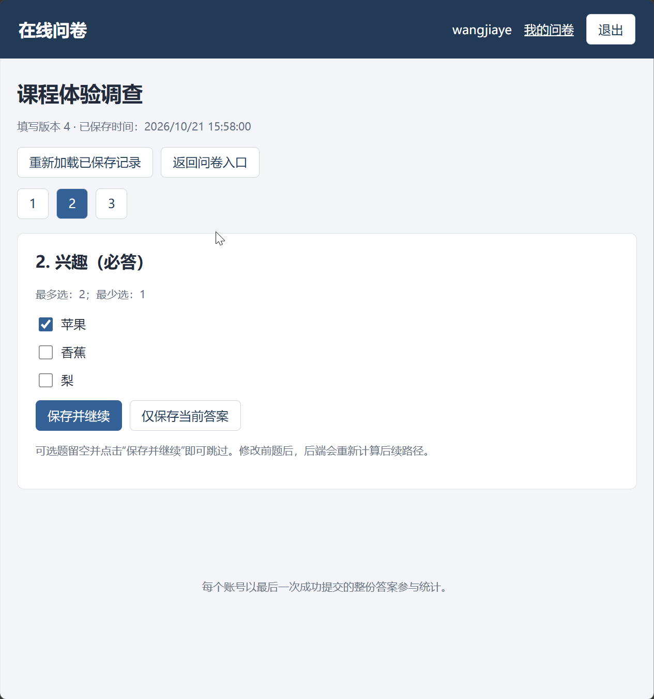
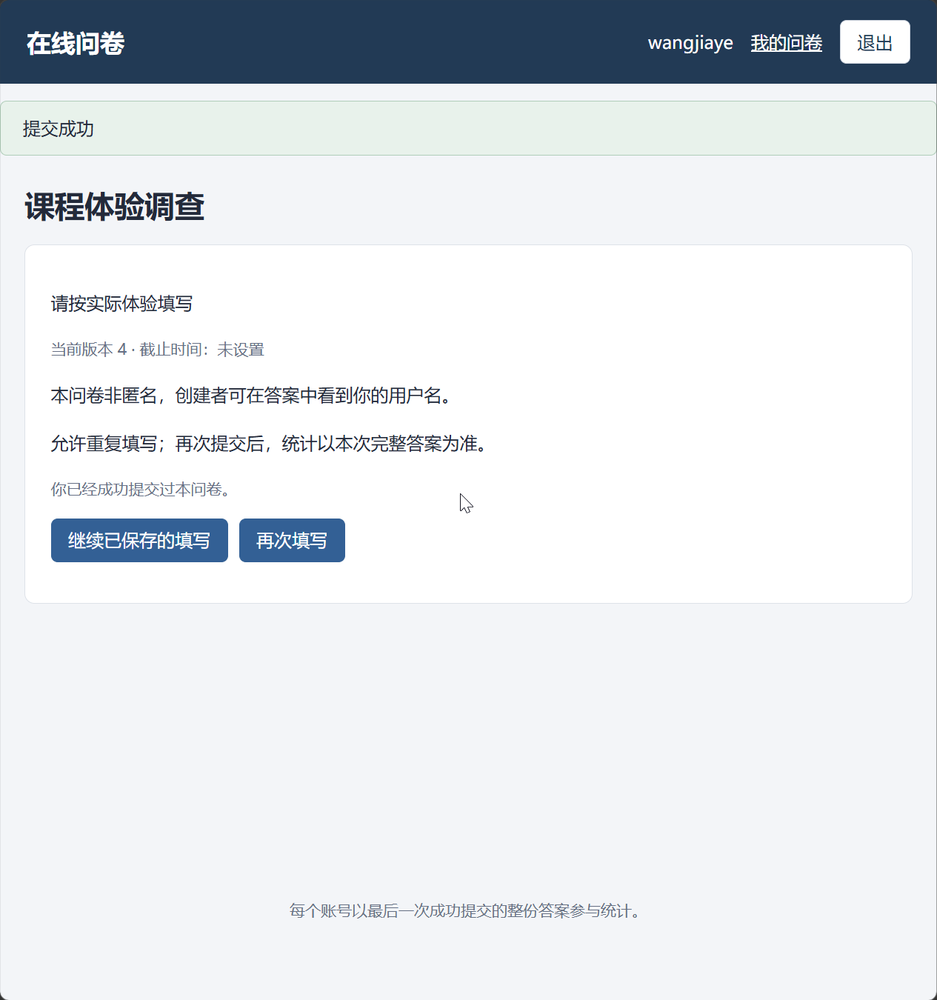

# 提交问卷：测试用例

共14项；每项直接列出步骤、输入、输出与测试结果，无需跨文件跳转。


<a id="tc05-a01"></a>

## TC05-A01 开始、保存、恢复和独立填写

执行方式：API自动化。


### 测试步骤

#### 前置条件

- 专用测试库和支持事务的 MongoDB 副本集已启动。A=创建者，B=另一创建者，U1/U2/U3=填写者，各账号独立 Cookie 会话；账号以运行批次后缀保证唯一，默认密码 TestPass!2026。API 基础路径 /api/v1；写请求带该会话 X-CSRF-Token，管理/填写修改带最新 If-Match。每个用例独立建卷，不继承其他用例的运行结果。
- 新建 S，顺序包含 Q1 单选必答（继续/结束）、Q2 多选必答（苹果/香蕉/梨，minSelections=1,maxSelections=2）、Q3 文本可选（minLength=2,maxLength=10）、Q4 数字必答（minValue=0,maxValue=120,integerOnly=true）。无跳转，发布 V1，无截止，允许重复。Q1～Q4和选项名称均映射为服务端生成的真实ID；不是把名称直接发作ID。

#### 操作步骤

1. U1创建T1/T2，U2创建T3
2. 分别保存并GET恢复
3. 旧ETag再次保存T1

### 输入

#### 规定输入

```json
{
  "T1": {
    "Q1": "继续"
  },
  "T2": {
    "Q1": "结束"
  }
}
```

#### 实际请求输入

实际请求按执行顺序完整列出（包含准备动作，凭据已脱敏）：

**请求 1：POST /auth/register**

```json
{
  "序号": 1,
  "method": "POST",
  "path": "/auth/register",
  "input": {
    "username": "api_101d124066244cd8a2c8e5361481c831",
    "password": "<redacted>"
  },
  "headers": {
    "Origin": "http://127.0.0.1:61374"
  }
}
```

**请求 2：POST /auth/login**

```json
{
  "序号": 2,
  "method": "POST",
  "path": "/auth/login",
  "input": {
    "username": "api_101d124066244cd8a2c8e5361481c831",
    "password": "<redacted>"
  },
  "headers": {
    "Origin": "http://127.0.0.1:61374"
  }
}
```

**请求 3：POST /surveys**

```json
{
  "序号": 3,
  "method": "POST",
  "path": "/surveys",
  "input": {
    "title": "课程体验调查",
    "allowRepeat": true
  },
  "headers": {
    "Origin": "http://127.0.0.1:61374",
    "X-CSRF-Token": "<redacted>"
  }
}
```

**请求 4：POST /surveys/6ad8936237b03374ae337f89/questions**

```json
{
  "序号": 4,
  "method": "POST",
  "path": "/surveys/6ad8936237b03374ae337f89/questions",
  "input": {
    "type": "SINGLE",
    "title": "Q1",
    "required": true,
    "options": [
      {
        "label": "继续"
      },
      {
        "label": "结束"
      }
    ]
  },
  "headers": {
    "Origin": "http://127.0.0.1:61374",
    "X-CSRF-Token": "<redacted>",
    "If-Match": "\"definition-1-control-0\""
  }
}
```

**请求 5：POST /surveys/6ad8936237b03374ae337f89/questions**

```json
{
  "序号": 5,
  "method": "POST",
  "path": "/surveys/6ad8936237b03374ae337f89/questions",
  "input": {
    "type": "MULTIPLE",
    "title": "Q2",
    "required": true,
    "options": [
      {
        "label": "苹果"
      },
      {
        "label": "香蕉"
      },
      {
        "label": "梨"
      }
    ],
    "validation": {
      "minSelections": 1,
      "maxSelections": 2
    }
  },
  "headers": {
    "Origin": "http://127.0.0.1:61374",
    "X-CSRF-Token": "<redacted>",
    "If-Match": "\"definition-2-control-1\""
  }
}
```

**请求 6：POST /surveys/6ad8936237b03374ae337f89/questions**

```json
{
  "序号": 6,
  "method": "POST",
  "path": "/surveys/6ad8936237b03374ae337f89/questions",
  "input": {
    "type": "TEXT",
    "title": "Q3",
    "required": false,
    "validation": {
      "minLength": 2,
      "maxLength": 10
    }
  },
  "headers": {
    "Origin": "http://127.0.0.1:61374",
    "X-CSRF-Token": "<redacted>",
    "If-Match": "\"definition-3-control-2\""
  }
}
```

**请求 7：POST /surveys/6ad8936237b03374ae337f89/questions**

```json
{
  "序号": 7,
  "method": "POST",
  "path": "/surveys/6ad8936237b03374ae337f89/questions",
  "input": {
    "type": "NUMBER",
    "title": "Q4",
    "required": true,
    "validation": {
      "minValue": "0",
      "maxValue": "120",
      "integerOnly": true
    }
  },
  "headers": {
    "Origin": "http://127.0.0.1:61374",
    "X-CSRF-Token": "<redacted>",
    "If-Match": "\"definition-4-control-3\""
  }
}
```

**请求 8：POST /surveys/6ad8936237b03374ae337f89/publish**

```json
{
  "序号": 8,
  "method": "POST",
  "path": "/surveys/6ad8936237b03374ae337f89/publish",
  "input": {},
  "headers": {
    "Origin": "http://127.0.0.1:61374",
    "X-CSRF-Token": "<redacted>",
    "If-Match": "\"definition-5-control-4\""
  }
}
```

**请求 9：POST /auth/register**

```json
{
  "序号": 9,
  "method": "POST",
  "path": "/auth/register",
  "input": {
    "username": "api_68856569a47a441d93d4b06688d0ade1",
    "password": "<redacted>"
  },
  "headers": {
    "Origin": "http://127.0.0.1:61374"
  }
}
```

**请求 10：POST /auth/login**

```json
{
  "序号": 10,
  "method": "POST",
  "path": "/auth/login",
  "input": {
    "username": "api_68856569a47a441d93d4b06688d0ade1",
    "password": "<redacted>"
  },
  "headers": {
    "Origin": "http://127.0.0.1:61374"
  }
}
```

**请求 11：POST /auth/register**

```json
{
  "序号": 11,
  "method": "POST",
  "path": "/auth/register",
  "input": {
    "username": "api_5ac10240a8dd4e72b13307b9fe1f5995",
    "password": "<redacted>"
  },
  "headers": {
    "Origin": "http://127.0.0.1:61374"
  }
}
```

**请求 12：POST /auth/login**

```json
{
  "序号": 12,
  "method": "POST",
  "path": "/auth/login",
  "input": {
    "username": "api_5ac10240a8dd4e72b13307b9fe1f5995",
    "password": "<redacted>"
  },
  "headers": {
    "Origin": "http://127.0.0.1:61374"
  }
}
```

**请求 13：POST /public-surveys/share_ecdd05f34b8b8d11abc67b2e/attempts**

```json
{
  "序号": 13,
  "method": "POST",
  "path": "/public-surveys/share_ecdd05f34b8b8d11abc67b2e/attempts",
  "input": {},
  "headers": {
    "Origin": "http://127.0.0.1:61374",
    "X-CSRF-Token": "<redacted>"
  }
}
```

**请求 14：POST /public-surveys/share_ecdd05f34b8b8d11abc67b2e/attempts**

```json
{
  "序号": 14,
  "method": "POST",
  "path": "/public-surveys/share_ecdd05f34b8b8d11abc67b2e/attempts",
  "input": {},
  "headers": {
    "Origin": "http://127.0.0.1:61374",
    "X-CSRF-Token": "<redacted>"
  }
}
```

**请求 15：POST /public-surveys/share_ecdd05f34b8b8d11abc67b2e/attempts**

```json
{
  "序号": 15,
  "method": "POST",
  "path": "/public-surveys/share_ecdd05f34b8b8d11abc67b2e/attempts",
  "input": {},
  "headers": {
    "Origin": "http://127.0.0.1:61374",
    "X-CSRF-Token": "<redacted>"
  }
}
```

**请求 16：PUT /attempts/6ad8936237b03374ae337f8f/answers**

```json
{
  "序号": 16,
  "method": "PUT",
  "path": "/attempts/6ad8936237b03374ae337f8f/answers",
  "input": {
    "answers": [
      {
        "questionId": "q_e6317780a957c959e654954d",
        "value": "opt_26bf21c882aff74815921013"
      }
    ]
  },
  "headers": {
    "Origin": "http://127.0.0.1:61374",
    "X-CSRF-Token": "<redacted>",
    "If-Match": "\"attempt-0\""
  }
}
```

**请求 17：PUT /attempts/6ad8936237b03374ae337f90/answers**

```json
{
  "序号": 17,
  "method": "PUT",
  "path": "/attempts/6ad8936237b03374ae337f90/answers",
  "input": {
    "answers": [
      {
        "questionId": "q_e6317780a957c959e654954d",
        "value": "opt_33204191159b138645f2ac2a"
      }
    ]
  },
  "headers": {
    "Origin": "http://127.0.0.1:61374",
    "X-CSRF-Token": "<redacted>",
    "If-Match": "\"attempt-0\""
  }
}
```

**请求 18：PUT /attempts/6ad8936237b03374ae337f91/answers**

```json
{
  "序号": 18,
  "method": "PUT",
  "path": "/attempts/6ad8936237b03374ae337f91/answers",
  "input": {
    "answers": [
      {
        "questionId": "q_e6317780a957c959e654954d",
        "value": "opt_26bf21c882aff74815921013"
      }
    ]
  },
  "headers": {
    "Origin": "http://127.0.0.1:61374",
    "X-CSRF-Token": "<redacted>",
    "If-Match": "\"attempt-0\""
  }
}
```

**请求 19：POST /auth/login**

```json
{
  "序号": 19,
  "method": "POST",
  "path": "/auth/login",
  "input": {
    "username": "api_68856569a47a441d93d4b06688d0ade1",
    "password": "<redacted>"
  },
  "headers": {
    "Origin": "http://127.0.0.1:61374",
    "X-CSRF-Token": "<redacted>"
  }
}
```

**请求 20：GET /attempts/6ad8936237b03374ae337f8f**

```json
{
  "序号": 20,
  "method": "GET",
  "path": "/attempts/6ad8936237b03374ae337f8f",
  "input": null,
  "headers": {
    "Origin": "http://127.0.0.1:61374",
    "X-CSRF-Token": "<redacted>"
  }
}
```

**请求 21：GET /attempts/6ad8936237b03374ae337f90**

```json
{
  "序号": 21,
  "method": "GET",
  "path": "/attempts/6ad8936237b03374ae337f90",
  "input": null,
  "headers": {
    "Origin": "http://127.0.0.1:61374",
    "X-CSRF-Token": "<redacted>"
  }
}
```

**请求 22：PUT /attempts/6ad8936237b03374ae337f8f/answers**

```json
{
  "序号": 22,
  "method": "PUT",
  "path": "/attempts/6ad8936237b03374ae337f8f/answers",
  "input": {
    "answers": []
  },
  "headers": {
    "Origin": "http://127.0.0.1:61374",
    "X-CSRF-Token": "<redacted>",
    "If-Match": "\"attempt-0\""
  }
}
```

**请求 23：GET /attempts/6ad8936237b03374ae337f8f**

```json
{
  "序号": 23,
  "method": "GET",
  "path": "/attempts/6ad8936237b03374ae337f8f",
  "input": null,
  "headers": {
    "Origin": "http://127.0.0.1:61374",
    "X-CSRF-Token": "<redacted>"
  }
}
```


### 输出

#### 预期输出

1. 各201，ID不同且绑定账号/S/V1
2. 各自答案独立，revision递增，互不覆盖
3. 409 VERSION_CONFLICT，最新数据不变

- 保存草稿不生成responses。

#### 实际输出

本轮实际请求状态分布：HTTP 200：11次；HTTP 201：11次；HTTP 409：1次。

**请求 1：POST /auth/register**

```json
{
  "序号": 1,
  "method": "POST",
  "path": "/auth/register",
  "status": 201,
  "output": {
    "data": {
      "createdAt": "2026-10-21T10:26:41.902Z",
      "userId": "6ad8936137b03374ae337f87",
      "username": "api_101d124066244cd8a2c8e5361481c831"
    },
    "requestId": "req_f48c1f9c470cf6de8e85"
  },
  "responseHeaders": {
    "Server": "Werkzeug/3.1.9 Python/3.14.7",
    "Date": "Wed, 21 Oct 2026 10:26:41 GMT",
    "Content-Type": "application/json",
    "Content-Length": "175",
    "X-Request-ID": "req_f48c1f9c470cf6de8e85",
    "X-Content-Type-Options": "nosniff",
    "Referrer-Policy": "same-origin",
    "X-Frame-Options": "DENY",
    "Content-Security-Policy": "default-src 'self'; script-src 'self'; style-src 'self'; img-src 'self' data:; connect-src 'self'; frame-ancestors 'none'; base-uri 'self'; form-action 'self'",
    "Cache-Control": "no-store",
    "Connection": "close"
  }
}
```

**请求 2：POST /auth/login**

```json
{
  "序号": 2,
  "method": "POST",
  "path": "/auth/login",
  "status": 200,
  "output": {
    "data": {
      "csrfToken": "<redacted>",
      "user": {
        "createdAt": "2026-10-21T10:26:41.902Z",
        "userId": "6ad8936137b03374ae337f87",
        "username": "api_101d124066244cd8a2c8e5361481c831"
      }
    },
    "requestId": "req_5a59e4f940700deebbb7"
  },
  "responseHeaders": {
    "Server": "Werkzeug/3.1.9 Python/3.14.7",
    "Date": "Wed, 21 Oct 2026 10:26:42 GMT",
    "Content-Type": "application/json",
    "Content-Length": "242",
    "Set-Cookie": "<redacted>",
    "X-Request-ID": "req_5a59e4f940700deebbb7",
    "X-Content-Type-Options": "nosniff",
    "Referrer-Policy": "same-origin",
    "X-Frame-Options": "DENY",
    "Content-Security-Policy": "default-src 'self'; script-src 'self'; style-src 'self'; img-src 'self' data:; connect-src 'self'; frame-ancestors 'none'; base-uri 'self'; form-action 'self'",
    "Cache-Control": "no-store",
    "Connection": "close"
  }
}
```

**请求 3：POST /surveys**

```json
{
  "序号": 3,
  "method": "POST",
  "path": "/surveys",
  "status": 201,
  "output": {
    "data": {
      "controlRevision": 0,
      "createdAt": "2026-10-21T10:26:42.020Z",
      "deadlineAt": null,
      "definitionVersion": 1,
      "draft": {
        "description": "",
        "policy": {
          "allowRepeat": true,
          "anonymous": false
        },
        "questions": [],
        "title": "课程体验调查"
      },
      "effectiveState": "DRAFT",
      "publicCode": "share_ecdd05f34b8b8d11abc67b2e",
      "publishedVersion": null,
      "shareUrl": "/survey/share_ecdd05f34b8b8d11abc67b2e",
      "state": "DRAFT",
      "surveyId": "6ad8936237b03374ae337f89",
      "updatedAt": "2026-10-21T10:26:42.020Z"
    },
    "requestId": "req_c233e279de9b12b57d5a"
  },
  "responseHeaders": {
    "Server": "Werkzeug/3.1.9 Python/3.14.7",
    "Date": "Wed, 21 Oct 2026 10:26:42 GMT",
    "Content-Type": "application/json",
    "Content-Length": "508",
    "ETag": "\"definition-1-control-0\"",
    "X-Request-ID": "req_c233e279de9b12b57d5a",
    "X-Content-Type-Options": "nosniff",
    "Referrer-Policy": "same-origin",
    "X-Frame-Options": "DENY",
    "Content-Security-Policy": "default-src 'self'; script-src 'self'; style-src 'self'; img-src 'self' data:; connect-src 'self'; frame-ancestors 'none'; base-uri 'self'; form-action 'self'",
    "Cache-Control": "no-store",
    "Connection": "close"
  }
}
```

**请求 4：POST /surveys/6ad8936237b03374ae337f89/questions**

```json
{
  "序号": 4,
  "method": "POST",
  "path": "/surveys/6ad8936237b03374ae337f89/questions",
  "status": 201,
  "output": {
    "data": {
      "controlRevision": 1,
      "createdAt": "2026-10-21T10:26:42.020Z",
      "deadlineAt": null,
      "definitionVersion": 2,
      "draft": {
        "description": "",
        "policy": {
          "allowRepeat": true,
          "anonymous": false
        },
        "questions": [
          {
            "jumpRules": [],
            "options": [
              {
                "label": "继续",
                "optionId": "opt_26bf21c882aff74815921013"
              },
              {
                "label": "结束",
                "optionId": "opt_33204191159b138645f2ac2a"
              }
            ],
            "questionId": "q_e6317780a957c959e654954d",
            "required": true,
            "title": "Q1",
            "type": "SINGLE",
            "validation": {}
          }
        ],
        "title": "课程体验调查"
      },
      "effectiveState": "DRAFT",
      "publicCode": "share_ecdd05f34b8b8d11abc67b2e",
      "publishedVersion": null,
      "shareUrl": "/survey/share_ecdd05f34b8b8d11abc67b2e",
      "state": "DRAFT",
      "surveyId": "6ad8936237b03374ae337f89",
      "updatedAt": "2026-10-21T10:26:42.068Z"
    },
    "requestId": "req_e04df3cac6e05289294b"
  },
  "responseHeaders": {
    "Server": "Werkzeug/3.1.9 Python/3.14.7",
    "Date": "Wed, 21 Oct 2026 10:26:42 GMT",
    "Content-Type": "application/json",
    "Content-Length": "761",
    "ETag": "\"definition-2-control-1\"",
    "X-Request-ID": "req_e04df3cac6e05289294b",
    "X-Content-Type-Options": "nosniff",
    "Referrer-Policy": "same-origin",
    "X-Frame-Options": "DENY",
    "Content-Security-Policy": "default-src 'self'; script-src 'self'; style-src 'self'; img-src 'self' data:; connect-src 'self'; frame-ancestors 'none'; base-uri 'self'; form-action 'self'",
    "Cache-Control": "no-store",
    "Connection": "close"
  }
}
```

**请求 5：POST /surveys/6ad8936237b03374ae337f89/questions**

```json
{
  "序号": 5,
  "method": "POST",
  "path": "/surveys/6ad8936237b03374ae337f89/questions",
  "status": 201,
  "output": {
    "data": {
      "controlRevision": 2,
      "createdAt": "2026-10-21T10:26:42.020Z",
      "deadlineAt": null,
      "definitionVersion": 3,
      "draft": {
        "description": "",
        "policy": {
          "allowRepeat": true,
          "anonymous": false
        },
        "questions": [
          {
            "jumpRules": [],
            "options": [
              {
                "label": "继续",
                "optionId": "opt_26bf21c882aff74815921013"
              },
              {
                "label": "结束",
                "optionId": "opt_33204191159b138645f2ac2a"
              }
            ],
            "questionId": "q_e6317780a957c959e654954d",
            "required": true,
            "title": "Q1",
            "type": "SINGLE",
            "validation": {}
          },
          {
            "jumpRules": [],
            "options": [
              {
                "label": "苹果",
                "optionId": "opt_f84861c24bdd901076425ac9"
              },
              {
                "label": "香蕉",
                "optionId": "opt_920019eadd273f1f84c4d4f8"
              },
              {
                "label": "梨",
                "optionId": "opt_5ce7a9bb9b7472064df23e4f"
              }
            ],
            "questionId": "q_82d0e2e71c9152038ba89757",
            "required": true,
            "title": "Q2",
            "type": "MULTIPLE",
            "validation": {
              "maxSelections": 2,
              "minSelections": 1
            }
          }
        ],
        "title": "课程体验调查"
      },
      "effectiveState": "DRAFT",
      "publicCode": "share_ecdd05f34b8b8d11abc67b2e",
      "publishedVersion": null,
      "shareUrl": "/survey/share_ecdd05f34b8b8d11abc67b2e",
      "state": "DRAFT",
      "surveyId": "6ad8936237b03374ae337f89",
      "updatedAt": "2026-10-21T10:26:42.092Z"
    },
    "requestId": "req_0f0d6a4694ffb94460c5"
  },
  "responseHeaders": {
    "Server": "Werkzeug/3.1.9 Python/3.14.7",
    "Date": "Wed, 21 Oct 2026 10:26:42 GMT",
    "Content-Type": "application/json",
    "Content-Length": "1110",
    "ETag": "\"definition-3-control-2\"",
    "X-Request-ID": "req_0f0d6a4694ffb94460c5",
    "X-Content-Type-Options": "nosniff",
    "Referrer-Policy": "same-origin",
    "X-Frame-Options": "DENY",
    "Content-Security-Policy": "default-src 'self'; script-src 'self'; style-src 'self'; img-src 'self' data:; connect-src 'self'; frame-ancestors 'none'; base-uri 'self'; form-action 'self'",
    "Cache-Control": "no-store",
    "Connection": "close"
  }
}
```

**请求 6：POST /surveys/6ad8936237b03374ae337f89/questions**

```json
{
  "序号": 6,
  "method": "POST",
  "path": "/surveys/6ad8936237b03374ae337f89/questions",
  "status": 201,
  "output": {
    "data": {
      "controlRevision": 3,
      "createdAt": "2026-10-21T10:26:42.020Z",
      "deadlineAt": null,
      "definitionVersion": 4,
      "draft": {
        "description": "",
        "policy": {
          "allowRepeat": true,
          "anonymous": false
        },
        "questions": [
          {
            "jumpRules": [],
            "options": [
              {
                "label": "继续",
                "optionId": "opt_26bf21c882aff74815921013"
              },
              {
                "label": "结束",
                "optionId": "opt_33204191159b138645f2ac2a"
              }
            ],
            "questionId": "q_e6317780a957c959e654954d",
            "required": true,
            "title": "Q1",
            "type": "SINGLE",
            "validation": {}
          },
          {
            "jumpRules": [],
            "options": [
              {
                "label": "苹果",
                "optionId": "opt_f84861c24bdd901076425ac9"
              },
              {
                "label": "香蕉",
                "optionId": "opt_920019eadd273f1f84c4d4f8"
              },
              {
                "label": "梨",
                "optionId": "opt_5ce7a9bb9b7472064df23e4f"
              }
            ],
            "questionId": "q_82d0e2e71c9152038ba89757",
            "required": true,
            "title": "Q2",
            "type": "MULTIPLE",
            "validation": {
              "maxSelections": 2,
              "minSelections": 1
            }
          },
          {
            "jumpRules": [],
            "questionId": "q_a0d99f1efb296e817c505449",
            "required": false,
            "title": "Q3",
            "type": "TEXT",
            "validation": {
              "maxLength": 10,
              "minLength": 2
            }
          }
        ],
        "title": "课程体验调查"
      },
      "effectiveState": "DRAFT",
      "publicCode": "share_ecdd05f34b8b8d11abc67b2e",
      "publishedVersion": null,
      "shareUrl": "/survey/share_ecdd05f34b8b8d11abc67b2e",
      "state": "DRAFT",
      "surveyId": "6ad8936237b03374ae337f89",
      "updatedAt": "2026-10-21T10:26:42.108Z"
    },
    "requestId": "req_58dcca1d215a5af4cf40"
  },
  "responseHeaders": {
    "Server": "Werkzeug/3.1.9 Python/3.14.7",
    "Date": "Wed, 21 Oct 2026 10:26:42 GMT",
    "Content-Type": "application/json",
    "Content-Length": "1257",
    "ETag": "\"definition-4-control-3\"",
    "X-Request-ID": "req_58dcca1d215a5af4cf40",
    "X-Content-Type-Options": "nosniff",
    "Referrer-Policy": "same-origin",
    "X-Frame-Options": "DENY",
    "Content-Security-Policy": "default-src 'self'; script-src 'self'; style-src 'self'; img-src 'self' data:; connect-src 'self'; frame-ancestors 'none'; base-uri 'self'; form-action 'self'",
    "Cache-Control": "no-store",
    "Connection": "close"
  }
}
```

**请求 7：POST /surveys/6ad8936237b03374ae337f89/questions**

```json
{
  "序号": 7,
  "method": "POST",
  "path": "/surveys/6ad8936237b03374ae337f89/questions",
  "status": 201,
  "output": {
    "data": {
      "controlRevision": 4,
      "createdAt": "2026-10-21T10:26:42.020Z",
      "deadlineAt": null,
      "definitionVersion": 5,
      "draft": {
        "description": "",
        "policy": {
          "allowRepeat": true,
          "anonymous": false
        },
        "questions": [
          {
            "jumpRules": [],
            "options": [
              {
                "label": "继续",
                "optionId": "opt_26bf21c882aff74815921013"
              },
              {
                "label": "结束",
                "optionId": "opt_33204191159b138645f2ac2a"
              }
            ],
            "questionId": "q_e6317780a957c959e654954d",
            "required": true,
            "title": "Q1",
            "type": "SINGLE",
            "validation": {}
          },
          {
            "jumpRules": [],
            "options": [
              {
                "label": "苹果",
                "optionId": "opt_f84861c24bdd901076425ac9"
              },
              {
                "label": "香蕉",
                "optionId": "opt_920019eadd273f1f84c4d4f8"
              },
              {
                "label": "梨",
                "optionId": "opt_5ce7a9bb9b7472064df23e4f"
              }
            ],
            "questionId": "q_82d0e2e71c9152038ba89757",
            "required": true,
            "title": "Q2",
            "type": "MULTIPLE",
            "validation": {
              "maxSelections": 2,
              "minSelections": 1
            }
          },
          {
            "jumpRules": [],
            "questionId": "q_a0d99f1efb296e817c505449",
            "required": false,
            "title": "Q3",
            "type": "TEXT",
            "validation": {
              "maxLength": 10,
              "minLength": 2
            }
          },
          {
            "jumpRules": [],
            "questionId": "q_edf6e88e149026cc3e60bfcf",
            "required": true,
            "title": "Q4",
            "type": "NUMBER",
            "validation": {
              "integerOnly": true,
              "maxValue": "120",
              "minValue": "0"
            }
          }
        ],
        "title": "课程体验调查"
      },
      "effectiveState": "DRAFT",
      "publicCode": "share_ecdd05f34b8b8d11abc67b2e",
      "publishedVersion": null,
      "shareUrl": "/survey/share_ecdd05f34b8b8d11abc67b2e",
      "state": "DRAFT",
      "surveyId": "6ad8936237b03374ae337f89",
      "updatedAt": "2026-10-21T10:26:42.147Z"
    },
    "requestId": "req_9fa01515ad1d5fac9f15"
  },
  "responseHeaders": {
    "Server": "Werkzeug/3.1.9 Python/3.14.7",
    "Date": "Wed, 21 Oct 2026 10:26:42 GMT",
    "Content-Type": "application/json",
    "Content-Length": "1427",
    "ETag": "\"definition-5-control-4\"",
    "X-Request-ID": "req_9fa01515ad1d5fac9f15",
    "X-Content-Type-Options": "nosniff",
    "Referrer-Policy": "same-origin",
    "X-Frame-Options": "DENY",
    "Content-Security-Policy": "default-src 'self'; script-src 'self'; style-src 'self'; img-src 'self' data:; connect-src 'self'; frame-ancestors 'none'; base-uri 'self'; form-action 'self'",
    "Cache-Control": "no-store",
    "Connection": "close"
  }
}
```

**请求 8：POST /surveys/6ad8936237b03374ae337f89/publish**

```json
{
  "序号": 8,
  "method": "POST",
  "path": "/surveys/6ad8936237b03374ae337f89/publish",
  "status": 200,
  "output": {
    "data": {
      "controlRevision": 5,
      "createdAt": "2026-10-21T10:26:42.020Z",
      "deadlineAt": null,
      "definitionVersion": 5,
      "draft": {
        "description": "",
        "policy": {
          "allowRepeat": true,
          "anonymous": false
        },
        "questions": [
          {
            "jumpRules": [],
            "options": [
              {
                "label": "继续",
                "optionId": "opt_26bf21c882aff74815921013"
              },
              {
                "label": "结束",
                "optionId": "opt_33204191159b138645f2ac2a"
              }
            ],
            "questionId": "q_e6317780a957c959e654954d",
            "required": true,
            "title": "Q1",
            "type": "SINGLE",
            "validation": {}
          },
          {
            "jumpRules": [],
            "options": [
              {
                "label": "苹果",
                "optionId": "opt_f84861c24bdd901076425ac9"
              },
              {
                "label": "香蕉",
                "optionId": "opt_920019eadd273f1f84c4d4f8"
              },
              {
                "label": "梨",
                "optionId": "opt_5ce7a9bb9b7472064df23e4f"
              }
            ],
            "questionId": "q_82d0e2e71c9152038ba89757",
            "required": true,
            "title": "Q2",
            "type": "MULTIPLE",
            "validation": {
              "maxSelections": 2,
              "minSelections": 1
            }
          },
          {
            "jumpRules": [],
            "questionId": "q_a0d99f1efb296e817c505449",
            "required": false,
            "title": "Q3",
            "type": "TEXT",
            "validation": {
              "maxLength": 10,
              "minLength": 2
            }
          },
          {
            "jumpRules": [],
            "questionId": "q_edf6e88e149026cc3e60bfcf",
            "required": true,
            "title": "Q4",
            "type": "NUMBER",
            "validation": {
              "integerOnly": true,
              "maxValue": "120",
              "minValue": "0"
            }
          }
        ],
        "title": "课程体验调查"
      },
      "effectiveState": "PUBLISHED",
      "publicCode": "share_ecdd05f34b8b8d11abc67b2e",
      "publishedVersion": 1,
      "shareUrl": "/survey/share_ecdd05f34b8b8d11abc67b2e",
      "state": "PUBLISHED",
      "surveyId": "6ad8936237b03374ae337f89",
      "updatedAt": "2026-10-21T10:26:42.165Z"
    },
    "requestId": "req_af43d3fbfea658c0eb85"
  },
  "responseHeaders": {
    "Server": "Werkzeug/3.1.9 Python/3.14.7",
    "Date": "Wed, 21 Oct 2026 10:26:42 GMT",
    "Content-Type": "application/json",
    "Content-Length": "1432",
    "ETag": "\"definition-5-control-5\"",
    "X-Request-ID": "req_af43d3fbfea658c0eb85",
    "X-Content-Type-Options": "nosniff",
    "Referrer-Policy": "same-origin",
    "X-Frame-Options": "DENY",
    "Content-Security-Policy": "default-src 'self'; script-src 'self'; style-src 'self'; img-src 'self' data:; connect-src 'self'; frame-ancestors 'none'; base-uri 'self'; form-action 'self'",
    "Cache-Control": "no-store",
    "Connection": "close"
  }
}
```

**请求 9：POST /auth/register**

```json
{
  "序号": 9,
  "method": "POST",
  "path": "/auth/register",
  "status": 201,
  "output": {
    "data": {
      "createdAt": "2026-10-21T10:26:42.245Z",
      "userId": "6ad8936237b03374ae337f8b",
      "username": "api_68856569a47a441d93d4b06688d0ade1"
    },
    "requestId": "req_5b93cd5c4ec10b8617e8"
  },
  "responseHeaders": {
    "Server": "Werkzeug/3.1.9 Python/3.14.7",
    "Date": "Wed, 21 Oct 2026 10:26:42 GMT",
    "Content-Type": "application/json",
    "Content-Length": "175",
    "X-Request-ID": "req_5b93cd5c4ec10b8617e8",
    "X-Content-Type-Options": "nosniff",
    "Referrer-Policy": "same-origin",
    "X-Frame-Options": "DENY",
    "Content-Security-Policy": "default-src 'self'; script-src 'self'; style-src 'self'; img-src 'self' data:; connect-src 'self'; frame-ancestors 'none'; base-uri 'self'; form-action 'self'",
    "Cache-Control": "no-store",
    "Connection": "close"
  }
}
```

**请求 10：POST /auth/login**

```json
{
  "序号": 10,
  "method": "POST",
  "path": "/auth/login",
  "status": 200,
  "output": {
    "data": {
      "csrfToken": "<redacted>",
      "user": {
        "createdAt": "2026-10-21T10:26:42.245Z",
        "userId": "6ad8936237b03374ae337f8b",
        "username": "api_68856569a47a441d93d4b06688d0ade1"
      }
    },
    "requestId": "req_7f0363a5ba16ba27463b"
  },
  "responseHeaders": {
    "Server": "Werkzeug/3.1.9 Python/3.14.7",
    "Date": "Wed, 21 Oct 2026 10:26:42 GMT",
    "Content-Type": "application/json",
    "Content-Length": "242",
    "Set-Cookie": "<redacted>",
    "X-Request-ID": "req_7f0363a5ba16ba27463b",
    "X-Content-Type-Options": "nosniff",
    "Referrer-Policy": "same-origin",
    "X-Frame-Options": "DENY",
    "Content-Security-Policy": "default-src 'self'; script-src 'self'; style-src 'self'; img-src 'self' data:; connect-src 'self'; frame-ancestors 'none'; base-uri 'self'; form-action 'self'",
    "Cache-Control": "no-store",
    "Connection": "close"
  }
}
```

**请求 11：POST /auth/register**

```json
{
  "序号": 11,
  "method": "POST",
  "path": "/auth/register",
  "status": 201,
  "output": {
    "data": {
      "createdAt": "2026-10-21T10:26:42.401Z",
      "userId": "6ad8936237b03374ae337f8d",
      "username": "api_5ac10240a8dd4e72b13307b9fe1f5995"
    },
    "requestId": "req_d273c1c7e77b1fd998a6"
  },
  "responseHeaders": {
    "Server": "Werkzeug/3.1.9 Python/3.14.7",
    "Date": "Wed, 21 Oct 2026 10:26:42 GMT",
    "Content-Type": "application/json",
    "Content-Length": "175",
    "X-Request-ID": "req_d273c1c7e77b1fd998a6",
    "X-Content-Type-Options": "nosniff",
    "Referrer-Policy": "same-origin",
    "X-Frame-Options": "DENY",
    "Content-Security-Policy": "default-src 'self'; script-src 'self'; style-src 'self'; img-src 'self' data:; connect-src 'self'; frame-ancestors 'none'; base-uri 'self'; form-action 'self'",
    "Cache-Control": "no-store",
    "Connection": "close"
  }
}
```

**请求 12：POST /auth/login**

```json
{
  "序号": 12,
  "method": "POST",
  "path": "/auth/login",
  "status": 200,
  "output": {
    "data": {
      "csrfToken": "<redacted>",
      "user": {
        "createdAt": "2026-10-21T10:26:42.401Z",
        "userId": "6ad8936237b03374ae337f8d",
        "username": "api_5ac10240a8dd4e72b13307b9fe1f5995"
      }
    },
    "requestId": "req_eb6c7cfd2209fcd071d0"
  },
  "responseHeaders": {
    "Server": "Werkzeug/3.1.9 Python/3.14.7",
    "Date": "Wed, 21 Oct 2026 10:26:42 GMT",
    "Content-Type": "application/json",
    "Content-Length": "242",
    "Set-Cookie": "<redacted>",
    "X-Request-ID": "req_eb6c7cfd2209fcd071d0",
    "X-Content-Type-Options": "nosniff",
    "Referrer-Policy": "same-origin",
    "X-Frame-Options": "DENY",
    "Content-Security-Policy": "default-src 'self'; script-src 'self'; style-src 'self'; img-src 'self' data:; connect-src 'self'; frame-ancestors 'none'; base-uri 'self'; form-action 'self'",
    "Cache-Control": "no-store",
    "Connection": "close"
  }
}
```

**请求 13：POST /public-surveys/share_ecdd05f34b8b8d11abc67b2e/attempts**

```json
{
  "序号": 13,
  "method": "POST",
  "path": "/public-surveys/share_ecdd05f34b8b8d11abc67b2e/attempts",
  "status": 201,
  "output": {
    "data": {
      "anonymous": false,
      "answers": [],
      "attemptId": "6ad8936237b03374ae337f8f",
      "definition": {
        "description": "",
        "policy": {
          "allowRepeat": true,
          "anonymous": false
        },
        "questions": [
          {
            "jumpRules": [],
            "options": [
              {
                "label": "继续",
                "optionId": "opt_26bf21c882aff74815921013"
              },
              {
                "label": "结束",
                "optionId": "opt_33204191159b138645f2ac2a"
              }
            ],
            "questionId": "q_e6317780a957c959e654954d",
            "required": true,
            "title": "Q1",
            "type": "SINGLE",
            "validation": {}
          },
          {
            "jumpRules": [],
            "options": [
              {
                "label": "苹果",
                "optionId": "opt_f84861c24bdd901076425ac9"
              },
              {
                "label": "香蕉",
                "optionId": "opt_920019eadd273f1f84c4d4f8"
              },
              {
                "label": "梨",
                "optionId": "opt_5ce7a9bb9b7472064df23e4f"
              }
            ],
            "questionId": "q_82d0e2e71c9152038ba89757",
            "required": true,
            "title": "Q2",
            "type": "MULTIPLE",
            "validation": {
              "maxSelections": 2,
              "minSelections": 1
            }
          },
          {
            "jumpRules": [],
            "questionId": "q_a0d99f1efb296e817c505449",
            "required": false,
            "title": "Q3",
            "type": "TEXT",
            "validation": {
              "maxLength": 10,
              "minLength": 2
            }
          },
          {
            "jumpRules": [],
            "questionId": "q_edf6e88e149026cc3e60bfcf",
            "required": true,
            "title": "Q4",
            "type": "NUMBER",
            "validation": {
              "integerOnly": true,
              "maxValue": "120",
              "minValue": "0"
            }
          }
        ],
        "title": "课程体验调查"
      },
      "nextQuestionId": "q_e6317780a957c959e654954d",
      "publishedVersion": 1,
      "responseId": null,
      "revision": 0,
      "status": "IN_PROGRESS",
      "submittedAt": null,
      "surveyId": "6ad8936237b03374ae337f89",
      "updatedAt": "2026-10-21T10:26:42.485Z",
      "visitedQuestionIds": []
    },
    "requestId": "req_5162f28e2a2629f772fc"
  },
  "responseHeaders": {
    "Server": "Werkzeug/3.1.9 Python/3.14.7",
    "Date": "Wed, 21 Oct 2026 10:26:42 GMT",
    "Content-Type": "application/json",
    "Content-Length": "1404",
    "ETag": "\"attempt-0\"",
    "X-Request-ID": "req_5162f28e2a2629f772fc",
    "X-Content-Type-Options": "nosniff",
    "Referrer-Policy": "same-origin",
    "X-Frame-Options": "DENY",
    "Content-Security-Policy": "default-src 'self'; script-src 'self'; style-src 'self'; img-src 'self' data:; connect-src 'self'; frame-ancestors 'none'; base-uri 'self'; form-action 'self'",
    "Cache-Control": "no-store",
    "Connection": "close"
  }
}
```

**请求 14：POST /public-surveys/share_ecdd05f34b8b8d11abc67b2e/attempts**

```json
{
  "序号": 14,
  "method": "POST",
  "path": "/public-surveys/share_ecdd05f34b8b8d11abc67b2e/attempts",
  "status": 201,
  "output": {
    "data": {
      "anonymous": false,
      "answers": [],
      "attemptId": "6ad8936237b03374ae337f90",
      "definition": {
        "description": "",
        "policy": {
          "allowRepeat": true,
          "anonymous": false
        },
        "questions": [
          {
            "jumpRules": [],
            "options": [
              {
                "label": "继续",
                "optionId": "opt_26bf21c882aff74815921013"
              },
              {
                "label": "结束",
                "optionId": "opt_33204191159b138645f2ac2a"
              }
            ],
            "questionId": "q_e6317780a957c959e654954d",
            "required": true,
            "title": "Q1",
            "type": "SINGLE",
            "validation": {}
          },
          {
            "jumpRules": [],
            "options": [
              {
                "label": "苹果",
                "optionId": "opt_f84861c24bdd901076425ac9"
              },
              {
                "label": "香蕉",
                "optionId": "opt_920019eadd273f1f84c4d4f8"
              },
              {
                "label": "梨",
                "optionId": "opt_5ce7a9bb9b7472064df23e4f"
              }
            ],
            "questionId": "q_82d0e2e71c9152038ba89757",
            "required": true,
            "title": "Q2",
            "type": "MULTIPLE",
            "validation": {
              "maxSelections": 2,
              "minSelections": 1
            }
          },
          {
            "jumpRules": [],
            "questionId": "q_a0d99f1efb296e817c505449",
            "required": false,
            "title": "Q3",
            "type": "TEXT",
            "validation": {
              "maxLength": 10,
              "minLength": 2
            }
          },
          {
            "jumpRules": [],
            "questionId": "q_edf6e88e149026cc3e60bfcf",
            "required": true,
            "title": "Q4",
            "type": "NUMBER",
            "validation": {
              "integerOnly": true,
              "maxValue": "120",
              "minValue": "0"
            }
          }
        ],
        "title": "课程体验调查"
      },
      "nextQuestionId": "q_e6317780a957c959e654954d",
      "publishedVersion": 1,
      "responseId": null,
      "revision": 0,
      "status": "IN_PROGRESS",
      "submittedAt": null,
      "surveyId": "6ad8936237b03374ae337f89",
      "updatedAt": "2026-10-21T10:26:42.510Z",
      "visitedQuestionIds": []
    },
    "requestId": "req_498786e4ede802ae3868"
  },
  "responseHeaders": {
    "Server": "Werkzeug/3.1.9 Python/3.14.7",
    "Date": "Wed, 21 Oct 2026 10:26:42 GMT",
    "Content-Type": "application/json",
    "Content-Length": "1404",
    "ETag": "\"attempt-0\"",
    "X-Request-ID": "req_498786e4ede802ae3868",
    "X-Content-Type-Options": "nosniff",
    "Referrer-Policy": "same-origin",
    "X-Frame-Options": "DENY",
    "Content-Security-Policy": "default-src 'self'; script-src 'self'; style-src 'self'; img-src 'self' data:; connect-src 'self'; frame-ancestors 'none'; base-uri 'self'; form-action 'self'",
    "Cache-Control": "no-store",
    "Connection": "close"
  }
}
```

**请求 15：POST /public-surveys/share_ecdd05f34b8b8d11abc67b2e/attempts**

```json
{
  "序号": 15,
  "method": "POST",
  "path": "/public-surveys/share_ecdd05f34b8b8d11abc67b2e/attempts",
  "status": 201,
  "output": {
    "data": {
      "anonymous": false,
      "answers": [],
      "attemptId": "6ad8936237b03374ae337f91",
      "definition": {
        "description": "",
        "policy": {
          "allowRepeat": true,
          "anonymous": false
        },
        "questions": [
          {
            "jumpRules": [],
            "options": [
              {
                "label": "继续",
                "optionId": "opt_26bf21c882aff74815921013"
              },
              {
                "label": "结束",
                "optionId": "opt_33204191159b138645f2ac2a"
              }
            ],
            "questionId": "q_e6317780a957c959e654954d",
            "required": true,
            "title": "Q1",
            "type": "SINGLE",
            "validation": {}
          },
          {
            "jumpRules": [],
            "options": [
              {
                "label": "苹果",
                "optionId": "opt_f84861c24bdd901076425ac9"
              },
              {
                "label": "香蕉",
                "optionId": "opt_920019eadd273f1f84c4d4f8"
              },
              {
                "label": "梨",
                "optionId": "opt_5ce7a9bb9b7472064df23e4f"
              }
            ],
            "questionId": "q_82d0e2e71c9152038ba89757",
            "required": true,
            "title": "Q2",
            "type": "MULTIPLE",
            "validation": {
              "maxSelections": 2,
              "minSelections": 1
            }
          },
          {
            "jumpRules": [],
            "questionId": "q_a0d99f1efb296e817c505449",
            "required": false,
            "title": "Q3",
            "type": "TEXT",
            "validation": {
              "maxLength": 10,
              "minLength": 2
            }
          },
          {
            "jumpRules": [],
            "questionId": "q_edf6e88e149026cc3e60bfcf",
            "required": true,
            "title": "Q4",
            "type": "NUMBER",
            "validation": {
              "integerOnly": true,
              "maxValue": "120",
              "minValue": "0"
            }
          }
        ],
        "title": "课程体验调查"
      },
      "nextQuestionId": "q_e6317780a957c959e654954d",
      "publishedVersion": 1,
      "responseId": null,
      "revision": 0,
      "status": "IN_PROGRESS",
      "submittedAt": null,
      "surveyId": "6ad8936237b03374ae337f89",
      "updatedAt": "2026-10-21T10:26:42.534Z",
      "visitedQuestionIds": []
    },
    "requestId": "req_64e82af0224cdd83863c"
  },
  "responseHeaders": {
    "Server": "Werkzeug/3.1.9 Python/3.14.7",
    "Date": "Wed, 21 Oct 2026 10:26:42 GMT",
    "Content-Type": "application/json",
    "Content-Length": "1404",
    "ETag": "\"attempt-0\"",
    "X-Request-ID": "req_64e82af0224cdd83863c",
    "X-Content-Type-Options": "nosniff",
    "Referrer-Policy": "same-origin",
    "X-Frame-Options": "DENY",
    "Content-Security-Policy": "default-src 'self'; script-src 'self'; style-src 'self'; img-src 'self' data:; connect-src 'self'; frame-ancestors 'none'; base-uri 'self'; form-action 'self'",
    "Cache-Control": "no-store",
    "Connection": "close"
  }
}
```

**请求 16：PUT /attempts/6ad8936237b03374ae337f8f/answers**

```json
{
  "序号": 16,
  "method": "PUT",
  "path": "/attempts/6ad8936237b03374ae337f8f/answers",
  "status": 200,
  "output": {
    "data": {
      "anonymous": false,
      "answers": [
        {
          "questionId": "q_e6317780a957c959e654954d",
          "type": "SINGLE",
          "value": "opt_26bf21c882aff74815921013"
        }
      ],
      "attemptId": "6ad8936237b03374ae337f8f",
      "nextQuestionId": "q_82d0e2e71c9152038ba89757",
      "publishedVersion": 1,
      "removedQuestionIds": [],
      "responseId": null,
      "revision": 1,
      "status": "IN_PROGRESS",
      "submittedAt": null,
      "surveyId": "6ad8936237b03374ae337f89",
      "updatedAt": "2026-10-21T10:26:42.552Z",
      "visitedQuestionIds": [
        "q_e6317780a957c959e654954d",
        "q_82d0e2e71c9152038ba89757"
      ]
    },
    "requestId": "req_1129cd07d56f04b5f607"
  },
  "responseHeaders": {
    "Server": "Werkzeug/3.1.9 Python/3.14.7",
    "Date": "Wed, 21 Oct 2026 10:26:42 GMT",
    "Content-Type": "application/json",
    "Content-Length": "540",
    "ETag": "\"attempt-1\"",
    "X-Request-ID": "req_1129cd07d56f04b5f607",
    "X-Content-Type-Options": "nosniff",
    "Referrer-Policy": "same-origin",
    "X-Frame-Options": "DENY",
    "Content-Security-Policy": "default-src 'self'; script-src 'self'; style-src 'self'; img-src 'self' data:; connect-src 'self'; frame-ancestors 'none'; base-uri 'self'; form-action 'self'",
    "Cache-Control": "no-store",
    "Connection": "close"
  }
}
```

**请求 17：PUT /attempts/6ad8936237b03374ae337f90/answers**

```json
{
  "序号": 17,
  "method": "PUT",
  "path": "/attempts/6ad8936237b03374ae337f90/answers",
  "status": 200,
  "output": {
    "data": {
      "anonymous": false,
      "answers": [
        {
          "questionId": "q_e6317780a957c959e654954d",
          "type": "SINGLE",
          "value": "opt_33204191159b138645f2ac2a"
        }
      ],
      "attemptId": "6ad8936237b03374ae337f90",
      "nextQuestionId": "q_82d0e2e71c9152038ba89757",
      "publishedVersion": 1,
      "removedQuestionIds": [],
      "responseId": null,
      "revision": 1,
      "status": "IN_PROGRESS",
      "submittedAt": null,
      "surveyId": "6ad8936237b03374ae337f89",
      "updatedAt": "2026-10-21T10:26:42.581Z",
      "visitedQuestionIds": [
        "q_e6317780a957c959e654954d",
        "q_82d0e2e71c9152038ba89757"
      ]
    },
    "requestId": "req_5f759b03bfd814fc2269"
  },
  "responseHeaders": {
    "Server": "Werkzeug/3.1.9 Python/3.14.7",
    "Date": "Wed, 21 Oct 2026 10:26:42 GMT",
    "Content-Type": "application/json",
    "Content-Length": "540",
    "ETag": "\"attempt-1\"",
    "X-Request-ID": "req_5f759b03bfd814fc2269",
    "X-Content-Type-Options": "nosniff",
    "Referrer-Policy": "same-origin",
    "X-Frame-Options": "DENY",
    "Content-Security-Policy": "default-src 'self'; script-src 'self'; style-src 'self'; img-src 'self' data:; connect-src 'self'; frame-ancestors 'none'; base-uri 'self'; form-action 'self'",
    "Cache-Control": "no-store",
    "Connection": "close"
  }
}
```

**请求 18：PUT /attempts/6ad8936237b03374ae337f91/answers**

```json
{
  "序号": 18,
  "method": "PUT",
  "path": "/attempts/6ad8936237b03374ae337f91/answers",
  "status": 200,
  "output": {
    "data": {
      "anonymous": false,
      "answers": [
        {
          "questionId": "q_e6317780a957c959e654954d",
          "type": "SINGLE",
          "value": "opt_26bf21c882aff74815921013"
        }
      ],
      "attemptId": "6ad8936237b03374ae337f91",
      "nextQuestionId": "q_82d0e2e71c9152038ba89757",
      "publishedVersion": 1,
      "removedQuestionIds": [],
      "responseId": null,
      "revision": 1,
      "status": "IN_PROGRESS",
      "submittedAt": null,
      "surveyId": "6ad8936237b03374ae337f89",
      "updatedAt": "2026-10-21T10:26:42.596Z",
      "visitedQuestionIds": [
        "q_e6317780a957c959e654954d",
        "q_82d0e2e71c9152038ba89757"
      ]
    },
    "requestId": "req_6bae56ad6f17104d8084"
  },
  "responseHeaders": {
    "Server": "Werkzeug/3.1.9 Python/3.14.7",
    "Date": "Wed, 21 Oct 2026 10:26:42 GMT",
    "Content-Type": "application/json",
    "Content-Length": "540",
    "ETag": "\"attempt-1\"",
    "X-Request-ID": "req_6bae56ad6f17104d8084",
    "X-Content-Type-Options": "nosniff",
    "Referrer-Policy": "same-origin",
    "X-Frame-Options": "DENY",
    "Content-Security-Policy": "default-src 'self'; script-src 'self'; style-src 'self'; img-src 'self' data:; connect-src 'self'; frame-ancestors 'none'; base-uri 'self'; form-action 'self'",
    "Cache-Control": "no-store",
    "Connection": "close"
  }
}
```

**请求 19：POST /auth/login**

```json
{
  "序号": 19,
  "method": "POST",
  "path": "/auth/login",
  "status": 200,
  "output": {
    "data": {
      "csrfToken": "<redacted>",
      "user": {
        "createdAt": "2026-10-21T10:26:42.245Z",
        "userId": "6ad8936237b03374ae337f8b",
        "username": "api_68856569a47a441d93d4b06688d0ade1"
      }
    },
    "requestId": "req_5aa259c98dfed40fd2bb"
  },
  "responseHeaders": {
    "Server": "Werkzeug/3.1.9 Python/3.14.7",
    "Date": "Wed, 21 Oct 2026 10:26:42 GMT",
    "Content-Type": "application/json",
    "Content-Length": "242",
    "Set-Cookie": "<redacted>",
    "X-Request-ID": "req_5aa259c98dfed40fd2bb",
    "X-Content-Type-Options": "nosniff",
    "Referrer-Policy": "same-origin",
    "X-Frame-Options": "DENY",
    "Content-Security-Policy": "default-src 'self'; script-src 'self'; style-src 'self'; img-src 'self' data:; connect-src 'self'; frame-ancestors 'none'; base-uri 'self'; form-action 'self'",
    "Cache-Control": "no-store",
    "Connection": "close"
  }
}
```

**请求 20：GET /attempts/6ad8936237b03374ae337f8f**

```json
{
  "序号": 20,
  "method": "GET",
  "path": "/attempts/6ad8936237b03374ae337f8f",
  "status": 200,
  "output": {
    "data": {
      "anonymous": false,
      "answers": [
        {
          "questionId": "q_e6317780a957c959e654954d",
          "type": "SINGLE",
          "value": "opt_26bf21c882aff74815921013"
        }
      ],
      "attemptId": "6ad8936237b03374ae337f8f",
      "definition": {
        "description": "",
        "policy": {
          "allowRepeat": true,
          "anonymous": false
        },
        "questions": [
          {
            "jumpRules": [],
            "options": [
              {
                "label": "继续",
                "optionId": "opt_26bf21c882aff74815921013"
              },
              {
                "label": "结束",
                "optionId": "opt_33204191159b138645f2ac2a"
              }
            ],
            "questionId": "q_e6317780a957c959e654954d",
            "required": true,
            "title": "Q1",
            "type": "SINGLE",
            "validation": {}
          },
          {
            "jumpRules": [],
            "options": [
              {
                "label": "苹果",
                "optionId": "opt_f84861c24bdd901076425ac9"
              },
              {
                "label": "香蕉",
                "optionId": "opt_920019eadd273f1f84c4d4f8"
              },
              {
                "label": "梨",
                "optionId": "opt_5ce7a9bb9b7472064df23e4f"
              }
            ],
            "questionId": "q_82d0e2e71c9152038ba89757",
            "required": true,
            "title": "Q2",
            "type": "MULTIPLE",
            "validation": {
              "maxSelections": 2,
              "minSelections": 1
            }
          },
          {
            "jumpRules": [],
            "questionId": "q_a0d99f1efb296e817c505449",
            "required": false,
            "title": "Q3",
            "type": "TEXT",
            "validation": {
              "maxLength": 10,
              "minLength": 2
            }
          },
          {
            "jumpRules": [],
            "questionId": "q_edf6e88e149026cc3e60bfcf",
            "required": true,
            "title": "Q4",
            "type": "NUMBER",
            "validation": {
              "integerOnly": true,
              "maxValue": "120",
              "minValue": "0"
            }
          }
        ],
        "title": "课程体验调查"
      },
      "nextQuestionId": "q_82d0e2e71c9152038ba89757",
      "publishedVersion": 1,
      "responseId": null,
      "revision": 1,
      "status": "IN_PROGRESS",
      "submittedAt": null,
      "surveyId": "6ad8936237b03374ae337f89",
      "updatedAt": "2026-10-21T10:26:42.552Z",
      "visitedQuestionIds": [
        "q_e6317780a957c959e654954d",
        "q_82d0e2e71c9152038ba89757"
      ]
    },
    "requestId": "req_df569fb01a0189779728"
  },
  "responseHeaders": {
    "Server": "Werkzeug/3.1.9 Python/3.14.7",
    "Date": "Wed, 21 Oct 2026 10:26:42 GMT",
    "Content-Type": "application/json",
    "Content-Length": "1559",
    "ETag": "\"attempt-1\"",
    "X-Request-ID": "req_df569fb01a0189779728",
    "X-Content-Type-Options": "nosniff",
    "Referrer-Policy": "same-origin",
    "X-Frame-Options": "DENY",
    "Content-Security-Policy": "default-src 'self'; script-src 'self'; style-src 'self'; img-src 'self' data:; connect-src 'self'; frame-ancestors 'none'; base-uri 'self'; form-action 'self'",
    "Cache-Control": "no-store",
    "Connection": "close"
  }
}
```

**请求 21：GET /attempts/6ad8936237b03374ae337f90**

```json
{
  "序号": 21,
  "method": "GET",
  "path": "/attempts/6ad8936237b03374ae337f90",
  "status": 200,
  "output": {
    "data": {
      "anonymous": false,
      "answers": [
        {
          "questionId": "q_e6317780a957c959e654954d",
          "type": "SINGLE",
          "value": "opt_33204191159b138645f2ac2a"
        }
      ],
      "attemptId": "6ad8936237b03374ae337f90",
      "definition": {
        "description": "",
        "policy": {
          "allowRepeat": true,
          "anonymous": false
        },
        "questions": [
          {
            "jumpRules": [],
            "options": [
              {
                "label": "继续",
                "optionId": "opt_26bf21c882aff74815921013"
              },
              {
                "label": "结束",
                "optionId": "opt_33204191159b138645f2ac2a"
              }
            ],
            "questionId": "q_e6317780a957c959e654954d",
            "required": true,
            "title": "Q1",
            "type": "SINGLE",
            "validation": {}
          },
          {
            "jumpRules": [],
            "options": [
              {
                "label": "苹果",
                "optionId": "opt_f84861c24bdd901076425ac9"
              },
              {
                "label": "香蕉",
                "optionId": "opt_920019eadd273f1f84c4d4f8"
              },
              {
                "label": "梨",
                "optionId": "opt_5ce7a9bb9b7472064df23e4f"
              }
            ],
            "questionId": "q_82d0e2e71c9152038ba89757",
            "required": true,
            "title": "Q2",
            "type": "MULTIPLE",
            "validation": {
              "maxSelections": 2,
              "minSelections": 1
            }
          },
          {
            "jumpRules": [],
            "questionId": "q_a0d99f1efb296e817c505449",
            "required": false,
            "title": "Q3",
            "type": "TEXT",
            "validation": {
              "maxLength": 10,
              "minLength": 2
            }
          },
          {
            "jumpRules": [],
            "questionId": "q_edf6e88e149026cc3e60bfcf",
            "required": true,
            "title": "Q4",
            "type": "NUMBER",
            "validation": {
              "integerOnly": true,
              "maxValue": "120",
              "minValue": "0"
            }
          }
        ],
        "title": "课程体验调查"
      },
      "nextQuestionId": "q_82d0e2e71c9152038ba89757",
      "publishedVersion": 1,
      "responseId": null,
      "revision": 1,
      "status": "IN_PROGRESS",
      "submittedAt": null,
      "surveyId": "6ad8936237b03374ae337f89",
      "updatedAt": "2026-10-21T10:26:42.581Z",
      "visitedQuestionIds": [
        "q_e6317780a957c959e654954d",
        "q_82d0e2e71c9152038ba89757"
      ]
    },
    "requestId": "req_f443ac1f354874ed43d0"
  },
  "responseHeaders": {
    "Server": "Werkzeug/3.1.9 Python/3.14.7",
    "Date": "Wed, 21 Oct 2026 10:26:42 GMT",
    "Content-Type": "application/json",
    "Content-Length": "1559",
    "ETag": "\"attempt-1\"",
    "X-Request-ID": "req_f443ac1f354874ed43d0",
    "X-Content-Type-Options": "nosniff",
    "Referrer-Policy": "same-origin",
    "X-Frame-Options": "DENY",
    "Content-Security-Policy": "default-src 'self'; script-src 'self'; style-src 'self'; img-src 'self' data:; connect-src 'self'; frame-ancestors 'none'; base-uri 'self'; form-action 'self'",
    "Cache-Control": "no-store",
    "Connection": "close"
  }
}
```

**请求 22：PUT /attempts/6ad8936237b03374ae337f8f/answers**

```json
{
  "序号": 22,
  "method": "PUT",
  "path": "/attempts/6ad8936237b03374ae337f8f/answers",
  "status": 409,
  "output": {
    "error": {
      "code": "VERSION_CONFLICT",
      "message": "答案已被其他操作修改，请重新加载"
    },
    "requestId": "req_e1ba12d20861aeeb9bcc"
  },
  "responseHeaders": {
    "Server": "Werkzeug/3.1.9 Python/3.14.7",
    "Date": "Wed, 21 Oct 2026 10:26:42 GMT",
    "Content-Type": "application/json",
    "Content-Length": "138",
    "X-Request-ID": "req_e1ba12d20861aeeb9bcc",
    "X-Content-Type-Options": "nosniff",
    "Referrer-Policy": "same-origin",
    "X-Frame-Options": "DENY",
    "Content-Security-Policy": "default-src 'self'; script-src 'self'; style-src 'self'; img-src 'self' data:; connect-src 'self'; frame-ancestors 'none'; base-uri 'self'; form-action 'self'",
    "Cache-Control": "no-store",
    "Connection": "close"
  }
}
```

**请求 23：GET /attempts/6ad8936237b03374ae337f8f**

```json
{
  "序号": 23,
  "method": "GET",
  "path": "/attempts/6ad8936237b03374ae337f8f",
  "status": 200,
  "output": {
    "data": {
      "anonymous": false,
      "answers": [
        {
          "questionId": "q_e6317780a957c959e654954d",
          "type": "SINGLE",
          "value": "opt_26bf21c882aff74815921013"
        }
      ],
      "attemptId": "6ad8936237b03374ae337f8f",
      "definition": {
        "description": "",
        "policy": {
          "allowRepeat": true,
          "anonymous": false
        },
        "questions": [
          {
            "jumpRules": [],
            "options": [
              {
                "label": "继续",
                "optionId": "opt_26bf21c882aff74815921013"
              },
              {
                "label": "结束",
                "optionId": "opt_33204191159b138645f2ac2a"
              }
            ],
            "questionId": "q_e6317780a957c959e654954d",
            "required": true,
            "title": "Q1",
            "type": "SINGLE",
            "validation": {}
          },
          {
            "jumpRules": [],
            "options": [
              {
                "label": "苹果",
                "optionId": "opt_f84861c24bdd901076425ac9"
              },
              {
                "label": "香蕉",
                "optionId": "opt_920019eadd273f1f84c4d4f8"
              },
              {
                "label": "梨",
                "optionId": "opt_5ce7a9bb9b7472064df23e4f"
              }
            ],
            "questionId": "q_82d0e2e71c9152038ba89757",
            "required": true,
            "title": "Q2",
            "type": "MULTIPLE",
            "validation": {
              "maxSelections": 2,
              "minSelections": 1
            }
          },
          {
            "jumpRules": [],
            "questionId": "q_a0d99f1efb296e817c505449",
            "required": false,
            "title": "Q3",
            "type": "TEXT",
            "validation": {
              "maxLength": 10,
              "minLength": 2
            }
          },
          {
            "jumpRules": [],
            "questionId": "q_edf6e88e149026cc3e60bfcf",
            "required": true,
            "title": "Q4",
            "type": "NUMBER",
            "validation": {
              "integerOnly": true,
              "maxValue": "120",
              "minValue": "0"
            }
          }
        ],
        "title": "课程体验调查"
      },
      "nextQuestionId": "q_82d0e2e71c9152038ba89757",
      "publishedVersion": 1,
      "responseId": null,
      "revision": 1,
      "status": "IN_PROGRESS",
      "submittedAt": null,
      "surveyId": "6ad8936237b03374ae337f89",
      "updatedAt": "2026-10-21T10:26:42.552Z",
      "visitedQuestionIds": [
        "q_e6317780a957c959e654954d",
        "q_82d0e2e71c9152038ba89757"
      ]
    },
    "requestId": "req_0f3c1174b7a73dfd0082"
  },
  "responseHeaders": {
    "Server": "Werkzeug/3.1.9 Python/3.14.7",
    "Date": "Wed, 21 Oct 2026 10:26:42 GMT",
    "Content-Type": "application/json",
    "Content-Length": "1559",
    "ETag": "\"attempt-1\"",
    "X-Request-ID": "req_0f3c1174b7a73dfd0082",
    "X-Content-Type-Options": "nosniff",
    "Referrer-Policy": "same-origin",
    "X-Frame-Options": "DENY",
    "Content-Security-Policy": "default-src 'self'; script-src 'self'; style-src 'self'; img-src 'self' data:; connect-src 'self'; frame-ancestors 'none'; base-uri 'self'; form-action 'self'",
    "Cache-Control": "no-store",
    "Connection": "close"
  }
}
```

序号与输入层对应；包含账号、问卷和填写准备请求，不能将首条准备请求当作本例目标接口。

**本例问卷持久化摘要**

```json
[
  {
    "surveyId": {
      "$oid": "6ad8936237b03374ae337f89"
    },
    "responses": 0,
    "guards": 0,
    "versions": 1,
    "attempts": 3
  }
]
```


### 测试结果

**判定：通过**。

```text
本轮脚本断言通过。实际返回及数据库核对见输出层和Allure附件。
```

**原始测试规格**

```json
{
  "id": "TC05-A01",
  "moduleId": 5,
  "module": "提交问卷",
  "title": "开始、保存、恢复和独立填写",
  "execution": "api",
  "priority": "P1",
  "sourceSteps": [
    1
  ],
  "preconditions": [
    "专用测试库和支持事务的 MongoDB 副本集已启动。A=创建者，B=另一创建者，U1/U2/U3=填写者，各账号独立 Cookie 会话；账号以运行批次后缀保证唯一，默认密码 TestPass!2026。API 基础路径 /api/v1；写请求带该会话 X-CSRF-Token，管理/填写修改带最新 If-Match。每个用例独立建卷，不继承其他用例的运行结果。",
    "新建 S，顺序包含 Q1 单选必答（继续/结束）、Q2 多选必答（苹果/香蕉/梨，minSelections=1,maxSelections=2）、Q3 文本可选（minLength=2,maxLength=10）、Q4 数字必答（minValue=0,maxValue=120,integerOnly=true）。无跳转，发布 V1，无截止，允许重复。Q1～Q4和选项名称均映射为服务端生成的真实ID；不是把名称直接发作ID。"
  ],
  "input": {
    "T1": {
      "Q1": "继续"
    },
    "T2": {
      "Q1": "结束"
    }
  },
  "steps": [
    {
      "action": "U1创建T1/T2，U2创建T3",
      "expected": "各201，ID不同且绑定账号/S/V1"
    },
    {
      "action": "分别保存并GET恢复",
      "expected": "各自答案独立，revision递增，互不覆盖"
    },
    {
      "action": "旧ETag再次保存T1",
      "expected": "409 VERSION_CONFLICT，最新数据不变"
    }
  ],
  "expected": [
    "保存草稿不生成responses。"
  ]
}
```

**HTTP 请求与响应（凭据已脱敏）**

```json
[
  {
    "method": "POST",
    "path": "/auth/register",
    "input": {
      "username": "api_101d124066244cd8a2c8e5361481c831",
      "password": "<redacted>"
    },
    "headers": {
      "Origin": "http://127.0.0.1:61374"
    },
    "status": 201,
    "output": {
      "data": {
        "createdAt": "2026-10-21T10:26:41.902Z",
        "userId": "6ad8936137b03374ae337f87",
        "username": "api_101d124066244cd8a2c8e5361481c831"
      },
      "requestId": "req_f48c1f9c470cf6de8e85"
    },
    "responseHeaders": {
      "Server": "Werkzeug/3.1.9 Python/3.14.7",
      "Date": "Wed, 21 Oct 2026 10:26:41 GMT",
      "Content-Type": "application/json",
      "Content-Length": "175",
      "X-Request-ID": "req_f48c1f9c470cf6de8e85",
      "X-Content-Type-Options": "nosniff",
      "Referrer-Policy": "same-origin",
      "X-Frame-Options": "DENY",
      "Content-Security-Policy": "default-src 'self'; script-src 'self'; style-src 'self'; img-src 'self' data:; connect-src 'self'; frame-ancestors 'none'; base-uri 'self'; form-action 'self'",
      "Cache-Control": "no-store",
      "Connection": "close"
    }
  },
  {
    "method": "POST",
    "path": "/auth/login",
    "input": {
      "username": "api_101d124066244cd8a2c8e5361481c831",
      "password": "<redacted>"
    },
    "headers": {
      "Origin": "http://127.0.0.1:61374"
    },
    "status": 200,
    "output": {
      "data": {
        "csrfToken": "<redacted>",
        "user": {
          "createdAt": "2026-10-21T10:26:41.902Z",
          "userId": "6ad8936137b03374ae337f87",
          "username": "api_101d124066244cd8a2c8e5361481c831"
        }
      },
      "requestId": "req_5a59e4f940700deebbb7"
    },
    "responseHeaders": {
      "Server": "Werkzeug/3.1.9 Python/3.14.7",
      "Date": "Wed, 21 Oct 2026 10:26:42 GMT",
      "Content-Type": "application/json",
      "Content-Length": "242",
      "Set-Cookie": "<redacted>",
      "X-Request-ID": "req_5a59e4f940700deebbb7",
      "X-Content-Type-Options": "nosniff",
      "Referrer-Policy": "same-origin",
      "X-Frame-Options": "DENY",
      "Content-Security-Policy": "default-src 'self'; script-src 'self'; style-src 'self'; img-src 'self' data:; connect-src 'self'; frame-ancestors 'none'; base-uri 'self'; form-action 'self'",
      "Cache-Control": "no-store",
      "Connection": "close"
    }
  },
  {
    "method": "POST",
    "path": "/surveys",
    "input": {
      "title": "课程体验调查",
      "allowRepeat": true
    },
    "headers": {
      "Origin": "http://127.0.0.1:61374",
      "X-CSRF-Token": "<redacted>"
    },
    "status": 201,
    "output": {
      "data": {
        "controlRevision": 0,
        "createdAt": "2026-10-21T10:26:42.020Z",
        "deadlineAt": null,
        "definitionVersion": 1,
        "draft": {
          "description": "",
          "policy": {
            "allowRepeat": true,
            "anonymous": false
          },
          "questions": [],
          "title": "课程体验调查"
        },
        "effectiveState": "DRAFT",
        "publicCode": "share_ecdd05f34b8b8d11abc67b2e",
        "publishedVersion": null,
        "shareUrl": "/survey/share_ecdd05f34b8b8d11abc67b2e",
        "state": "DRAFT",
        "surveyId": "6ad8936237b03374ae337f89",
        "updatedAt": "2026-10-21T10:26:42.020Z"
      },
      "requestId": "req_c233e279de9b12b57d5a"
    },
    "responseHeaders": {
      "Server": "Werkzeug/3.1.9 Python/3.14.7",
      "Date": "Wed, 21 Oct 2026 10:26:42 GMT",
      "Content-Type": "application/json",
      "Content-Length": "508",
      "ETag": "\"definition-1-control-0\"",
      "X-Request-ID": "req_c233e279de9b12b57d5a",
      "X-Content-Type-Options": "nosniff",
      "Referrer-Policy": "same-origin",
      "X-Frame-Options": "DENY",
      "Content-Security-Policy": "default-src 'self'; script-src 'self'; style-src 'self'; img-src 'self' data:; connect-src 'self'; frame-ancestors 'none'; base-uri 'self'; form-action 'self'",
      "Cache-Control": "no-store",
      "Connection": "close"
    }
  },
  {
    "method": "POST",
    "path": "/surveys/6ad8936237b03374ae337f89/questions",
    "input": {
      "type": "SINGLE",
      "title": "Q1",
      "required": true,
      "options": [
        {
          "label": "继续"
        },
        {
          "label": "结束"
        }
      ]
    },
    "headers": {
      "Origin": "http://127.0.0.1:61374",
      "X-CSRF-Token": "<redacted>",
      "If-Match": "\"definition-1-control-0\""
    },
    "status": 201,
    "output": {
      "data": {
        "controlRevision": 1,
        "createdAt": "2026-10-21T10:26:42.020Z",
        "deadlineAt": null,
        "definitionVersion": 2,
        "draft": {
          "description": "",
          "policy": {
            "allowRepeat": true,
            "anonymous": false
          },
          "questions": [
            {
              "jumpRules": [],
              "options": [
                {
                  "label": "继续",
                  "optionId": "opt_26bf21c882aff74815921013"
                },
                {
                  "label": "结束",
                  "optionId": "opt_33204191159b138645f2ac2a"
                }
              ],
              "questionId": "q_e6317780a957c959e654954d",
              "required": true,
              "title": "Q1",
              "type": "SINGLE",
              "validation": {}
            }
          ],
          "title": "课程体验调查"
        },
        "effectiveState": "DRAFT",
        "publicCode": "share_ecdd05f34b8b8d11abc67b2e",
        "publishedVersion": null,
        "shareUrl": "/survey/share_ecdd05f34b8b8d11abc67b2e",
        "state": "DRAFT",
        "surveyId": "6ad8936237b03374ae337f89",
        "updatedAt": "2026-10-21T10:26:42.068Z"
      },
      "requestId": "req_e04df3cac6e05289294b"
    },
    "responseHeaders": {
      "Server": "Werkzeug/3.1.9 Python/3.14.7",
      "Date": "Wed, 21 Oct 2026 10:26:42 GMT",
      "Content-Type": "application/json",
      "Content-Length": "761",
      "ETag": "\"definition-2-control-1\"",
      "X-Request-ID": "req_e04df3cac6e05289294b",
      "X-Content-Type-Options": "nosniff",
      "Referrer-Policy": "same-origin",
      "X-Frame-Options": "DENY",
      "Content-Security-Policy": "default-src 'self'; script-src 'self'; style-src 'self'; img-src 'self' data:; connect-src 'self'; frame-ancestors 'none'; base-uri 'self'; form-action 'self'",
      "Cache-Control": "no-store",
      "Connection": "close"
    }
  },
  {
    "method": "POST",
    "path": "/surveys/6ad8936237b03374ae337f89/questions",
    "input": {
      "type": "MULTIPLE",
      "title": "Q2",
      "required": true,
      "options": [
        {
          "label": "苹果"
        },
        {
          "label": "香蕉"
        },
        {
          "label": "梨"
        }
      ],
      "validation": {
        "minSelections": 1,
        "maxSelections": 2
      }
    },
    "headers": {
      "Origin": "http://127.0.0.1:61374",
      "X-CSRF-Token": "<redacted>",
      "If-Match": "\"definition-2-control-1\""
    },
    "status": 201,
    "output": {
      "data": {
        "controlRevision": 2,
        "createdAt": "2026-10-21T10:26:42.020Z",
        "deadlineAt": null,
        "definitionVersion": 3,
        "draft": {
          "description": "",
          "policy": {
            "allowRepeat": true,
            "anonymous": false
          },
          "questions": [
            {
              "jumpRules": [],
              "options": [
                {
                  "label": "继续",
                  "optionId": "opt_26bf21c882aff74815921013"
                },
                {
                  "label": "结束",
                  "optionId": "opt_33204191159b138645f2ac2a"
                }
              ],
              "questionId": "q_e6317780a957c959e654954d",
              "required": true,
              "title": "Q1",
              "type": "SINGLE",
              "validation": {}
            },
            {
              "jumpRules": [],
              "options": [
                {
                  "label": "苹果",
                  "optionId": "opt_f84861c24bdd901076425ac9"
                },
                {
                  "label": "香蕉",
                  "optionId": "opt_920019eadd273f1f84c4d4f8"
                },
                {
                  "label": "梨",
                  "optionId": "opt_5ce7a9bb9b7472064df23e4f"
                }
              ],
              "questionId": "q_82d0e2e71c9152038ba89757",
              "required": true,
              "title": "Q2",
              "type": "MULTIPLE",
              "validation": {
                "maxSelections": 2,
                "minSelections": 1
              }
            }
          ],
          "title": "课程体验调查"
        },
        "effectiveState": "DRAFT",
        "publicCode": "share_ecdd05f34b8b8d11abc67b2e",
        "publishedVersion": null,
        "shareUrl": "/survey/share_ecdd05f34b8b8d11abc67b2e",
        "state": "DRAFT",
        "surveyId": "6ad8936237b03374ae337f89",
        "updatedAt": "2026-10-21T10:26:42.092Z"
      },
      "requestId": "req_0f0d6a4694ffb94460c5"
    },
    "responseHeaders": {
      "Server": "Werkzeug/3.1.9 Python/3.14.7",
      "Date": "Wed, 21 Oct 2026 10:26:42 GMT",
      "Content-Type": "application/json",
      "Content-Length": "1110",
      "ETag": "\"definition-3-control-2\"",
      "X-Request-ID": "req_0f0d6a4694ffb94460c5",
      "X-Content-Type-Options": "nosniff",
      "Referrer-Policy": "same-origin",
      "X-Frame-Options": "DENY",
      "Content-Security-Policy": "default-src 'self'; script-src 'self'; style-src 'self'; img-src 'self' data:; connect-src 'self'; frame-ancestors 'none'; base-uri 'self'; form-action 'self'",
      "Cache-Control": "no-store",
      "Connection": "close"
    }
  },
  {
    "method": "POST",
    "path": "/surveys/6ad8936237b03374ae337f89/questions",
    "input": {
      "type": "TEXT",
      "title": "Q3",
      "required": false,
      "validation": {
        "minLength": 2,
        "maxLength": 10
      }
    },
    "headers": {
      "Origin": "http://127.0.0.1:61374",
      "X-CSRF-Token": "<redacted>",
      "If-Match": "\"definition-3-control-2\""
    },
    "status": 201,
    "output": {
      "data": {
        "controlRevision": 3,
        "createdAt": "2026-10-21T10:26:42.020Z",
        "deadlineAt": null,
        "definitionVersion": 4,
        "draft": {
          "description": "",
          "policy": {
            "allowRepeat": true,
            "anonymous": false
          },
          "questions": [
            {
              "jumpRules": [],
              "options": [
                {
                  "label": "继续",
                  "optionId": "opt_26bf21c882aff74815921013"
                },
                {
                  "label": "结束",
                  "optionId": "opt_33204191159b138645f2ac2a"
                }
              ],
              "questionId": "q_e6317780a957c959e654954d",
              "required": true,
              "title": "Q1",
              "type": "SINGLE",
              "validation": {}
            },
            {
              "jumpRules": [],
              "options": [
                {
                  "label": "苹果",
                  "optionId": "opt_f84861c24bdd901076425ac9"
                },
                {
                  "label": "香蕉",
                  "optionId": "opt_920019eadd273f1f84c4d4f8"
                },
                {
                  "label": "梨",
                  "optionId": "opt_5ce7a9bb9b7472064df23e4f"
                }
              ],
              "questionId": "q_82d0e2e71c9152038ba89757",
              "required": true,
              "title": "Q2",
              "type": "MULTIPLE",
              "validation": {
                "maxSelections": 2,
                "minSelections": 1
              }
            },
            {
              "jumpRules": [],
              "questionId": "q_a0d99f1efb296e817c505449",
              "required": false,
              "title": "Q3",
              "type": "TEXT",
              "validation": {
                "maxLength": 10,
                "minLength": 2
              }
            }
          ],
          "title": "课程体验调查"
        },
        "effectiveState": "DRAFT",
        "publicCode": "share_ecdd05f34b8b8d11abc67b2e",
        "publishedVersion": null,
        "shareUrl": "/survey/share_ecdd05f34b8b8d11abc67b2e",
        "state": "DRAFT",
        "surveyId": "6ad8936237b03374ae337f89",
        "updatedAt": "2026-10-21T10:26:42.108Z"
      },
      "requestId": "req_58dcca1d215a5af4cf40"
    },
    "responseHeaders": {
      "Server": "Werkzeug/3.1.9 Python/3.14.7",
      "Date": "Wed, 21 Oct 2026 10:26:42 GMT",
      "Content-Type": "application/json",
      "Content-Length": "1257",
      "ETag": "\"definition-4-control-3\"",
      "X-Request-ID": "req_58dcca1d215a5af4cf40",
      "X-Content-Type-Options": "nosniff",
      "Referrer-Policy": "same-origin",
      "X-Frame-Options": "DENY",
      "Content-Security-Policy": "default-src 'self'; script-src 'self'; style-src 'self'; img-src 'self' data:; connect-src 'self'; frame-ancestors 'none'; base-uri 'self'; form-action 'self'",
      "Cache-Control": "no-store",
      "Connection": "close"
    }
  },
  {
    "method": "POST",
    "path": "/surveys/6ad8936237b03374ae337f89/questions",
    "input": {
      "type": "NUMBER",
      "title": "Q4",
      "required": true,
      "validation": {
        "minValue": "0",
        "maxValue": "120",
        "integerOnly": true
      }
    },
    "headers": {
      "Origin": "http://127.0.0.1:61374",
      "X-CSRF-Token": "<redacted>",
      "If-Match": "\"definition-4-control-3\""
    },
    "status": 201,
    "output": {
      "data": {
        "controlRevision": 4,
        "createdAt": "2026-10-21T10:26:42.020Z",
        "deadlineAt": null,
        "definitionVersion": 5,
        "draft": {
          "description": "",
          "policy": {
            "allowRepeat": true,
            "anonymous": false
          },
          "questions": [
            {
              "jumpRules": [],
              "options": [
                {
                  "label": "继续",
                  "optionId": "opt_26bf21c882aff74815921013"
                },
                {
                  "label": "结束",
                  "optionId": "opt_33204191159b138645f2ac2a"
                }
              ],
              "questionId": "q_e6317780a957c959e654954d",
              "required": true,
              "title": "Q1",
              "type": "SINGLE",
              "validation": {}
            },
            {
              "jumpRules": [],
              "options": [
                {
                  "label": "苹果",
                  "optionId": "opt_f84861c24bdd901076425ac9"
                },
                {
                  "label": "香蕉",
                  "optionId": "opt_920019eadd273f1f84c4d4f8"
                },
                {
                  "label": "梨",
                  "optionId": "opt_5ce7a9bb9b7472064df23e4f"
                }
              ],
              "questionId": "q_82d0e2e71c9152038ba89757",
              "required": true,
              "title": "Q2",
              "type": "MULTIPLE",
              "validation": {
                "maxSelections": 2,
                "minSelections": 1
              }
            },
            {
              "jumpRules": [],
              "questionId": "q_a0d99f1efb296e817c505449",
              "required": false,
              "title": "Q3",
              "type": "TEXT",
              "validation": {
                "maxLength": 10,
                "minLength": 2
              }
            },
            {
              "jumpRules": [],
              "questionId": "q_edf6e88e149026cc3e60bfcf",
              "required": true,
              "title": "Q4",
              "type": "NUMBER",
              "validation": {
                "integerOnly": true,
                "maxValue": "120",
                "minValue": "0"
              }
            }
          ],
          "title": "课程体验调查"
        },
        "effectiveState": "DRAFT",
        "publicCode": "share_ecdd05f34b8b8d11abc67b2e",
        "publishedVersion": null,
        "shareUrl": "/survey/share_ecdd05f34b8b8d11abc67b2e",
        "state": "DRAFT",
        "surveyId": "6ad8936237b03374ae337f89",
        "updatedAt": "2026-10-21T10:26:42.147Z"
      },
      "requestId": "req_9fa01515ad1d5fac9f15"
    },
    "responseHeaders": {
      "Server": "Werkzeug/3.1.9 Python/3.14.7",
      "Date": "Wed, 21 Oct 2026 10:26:42 GMT",
      "Content-Type": "application/json",
      "Content-Length": "1427",
      "ETag": "\"definition-5-control-4\"",
      "X-Request-ID": "req_9fa01515ad1d5fac9f15",
      "X-Content-Type-Options": "nosniff",
      "Referrer-Policy": "same-origin",
      "X-Frame-Options": "DENY",
      "Content-Security-Policy": "default-src 'self'; script-src 'self'; style-src 'self'; img-src 'self' data:; connect-src 'self'; frame-ancestors 'none'; base-uri 'self'; form-action 'self'",
      "Cache-Control": "no-store",
      "Connection": "close"
    }
  },
  {
    "method": "POST",
    "path": "/surveys/6ad8936237b03374ae337f89/publish",
    "input": {},
    "headers": {
      "Origin": "http://127.0.0.1:61374",
      "X-CSRF-Token": "<redacted>",
      "If-Match": "\"definition-5-control-4\""
    },
    "status": 200,
    "output": {
      "data": {
        "controlRevision": 5,
        "createdAt": "2026-10-21T10:26:42.020Z",
        "deadlineAt": null,
        "definitionVersion": 5,
        "draft": {
          "description": "",
          "policy": {
            "allowRepeat": true,
            "anonymous": false
          },
          "questions": [
            {
              "jumpRules": [],
              "options": [
                {
                  "label": "继续",
                  "optionId": "opt_26bf21c882aff74815921013"
                },
                {
                  "label": "结束",
                  "optionId": "opt_33204191159b138645f2ac2a"
                }
              ],
              "questionId": "q_e6317780a957c959e654954d",
              "required": true,
              "title": "Q1",
              "type": "SINGLE",
              "validation": {}
            },
            {
              "jumpRules": [],
              "options": [
                {
                  "label": "苹果",
                  "optionId": "opt_f84861c24bdd901076425ac9"
                },
                {
                  "label": "香蕉",
                  "optionId": "opt_920019eadd273f1f84c4d4f8"
                },
                {
                  "label": "梨",
                  "optionId": "opt_5ce7a9bb9b7472064df23e4f"
                }
              ],
              "questionId": "q_82d0e2e71c9152038ba89757",
              "required": true,
              "title": "Q2",
              "type": "MULTIPLE",
              "validation": {
                "maxSelections": 2,
                "minSelections": 1
              }
            },
            {
              "jumpRules": [],
              "questionId": "q_a0d99f1efb296e817c505449",
              "required": false,
              "title": "Q3",
              "type": "TEXT",
              "validation": {
                "maxLength": 10,
                "minLength": 2
              }
            },
            {
              "jumpRules": [],
              "questionId": "q_edf6e88e149026cc3e60bfcf",
              "required": true,
              "title": "Q4",
              "type": "NUMBER",
              "validation": {
                "integerOnly": true,
                "maxValue": "120",
                "minValue": "0"
              }
            }
          ],
          "title": "课程体验调查"
        },
        "effectiveState": "PUBLISHED",
        "publicCode": "share_ecdd05f34b8b8d11abc67b2e",
        "publishedVersion": 1,
        "shareUrl": "/survey/share_ecdd05f34b8b8d11abc67b2e",
        "state": "PUBLISHED",
        "surveyId": "6ad8936237b03374ae337f89",
        "updatedAt": "2026-10-21T10:26:42.165Z"
      },
      "requestId": "req_af43d3fbfea658c0eb85"
    },
    "responseHeaders": {
      "Server": "Werkzeug/3.1.9 Python/3.14.7",
      "Date": "Wed, 21 Oct 2026 10:26:42 GMT",
      "Content-Type": "application/json",
      "Content-Length": "1432",
      "ETag": "\"definition-5-control-5\"",
      "X-Request-ID": "req_af43d3fbfea658c0eb85",
      "X-Content-Type-Options": "nosniff",
      "Referrer-Policy": "same-origin",
      "X-Frame-Options": "DENY",
      "Content-Security-Policy": "default-src 'self'; script-src 'self'; style-src 'self'; img-src 'self' data:; connect-src 'self'; frame-ancestors 'none'; base-uri 'self'; form-action 'self'",
      "Cache-Control": "no-store",
      "Connection": "close"
    }
  },
  {
    "method": "POST",
    "path": "/auth/register",
    "input": {
      "username": "api_68856569a47a441d93d4b06688d0ade1",
      "password": "<redacted>"
    },
    "headers": {
      "Origin": "http://127.0.0.1:61374"
    },
    "status": 201,
    "output": {
      "data": {
        "createdAt": "2026-10-21T10:26:42.245Z",
        "userId": "6ad8936237b03374ae337f8b",
        "username": "api_68856569a47a441d93d4b06688d0ade1"
      },
      "requestId": "req_5b93cd5c4ec10b8617e8"
    },
    "responseHeaders": {
      "Server": "Werkzeug/3.1.9 Python/3.14.7",
      "Date": "Wed, 21 Oct 2026 10:26:42 GMT",
      "Content-Type": "application/json",
      "Content-Length": "175",
      "X-Request-ID": "req_5b93cd5c4ec10b8617e8",
      "X-Content-Type-Options": "nosniff",
      "Referrer-Policy": "same-origin",
      "X-Frame-Options": "DENY",
      "Content-Security-Policy": "default-src 'self'; script-src 'self'; style-src 'self'; img-src 'self' data:; connect-src 'self'; frame-ancestors 'none'; base-uri 'self'; form-action 'self'",
      "Cache-Control": "no-store",
      "Connection": "close"
    }
  },
  {
    "method": "POST",
    "path": "/auth/login",
    "input": {
      "username": "api_68856569a47a441d93d4b06688d0ade1",
      "password": "<redacted>"
    },
    "headers": {
      "Origin": "http://127.0.0.1:61374"
    },
    "status": 200,
    "output": {
      "data": {
        "csrfToken": "<redacted>",
        "user": {
          "createdAt": "2026-10-21T10:26:42.245Z",
          "userId": "6ad8936237b03374ae337f8b",
          "username": "api_68856569a47a441d93d4b06688d0ade1"
        }
      },
      "requestId": "req_7f0363a5ba16ba27463b"
    },
    "responseHeaders": {
      "Server": "Werkzeug/3.1.9 Python/3.14.7",
      "Date": "Wed, 21 Oct 2026 10:26:42 GMT",
      "Content-Type": "application/json",
      "Content-Length": "242",
      "Set-Cookie": "<redacted>",
      "X-Request-ID": "req_7f0363a5ba16ba27463b",
      "X-Content-Type-Options": "nosniff",
      "Referrer-Policy": "same-origin",
      "X-Frame-Options": "DENY",
      "Content-Security-Policy": "default-src 'self'; script-src 'self'; style-src 'self'; img-src 'self' data:; connect-src 'self'; frame-ancestors 'none'; base-uri 'self'; form-action 'self'",
      "Cache-Control": "no-store",
      "Connection": "close"
    }
  },
  {
    "method": "POST",
    "path": "/auth/register",
    "input": {
      "username": "api_5ac10240a8dd4e72b13307b9fe1f5995",
      "password": "<redacted>"
    },
    "headers": {
      "Origin": "http://127.0.0.1:61374"
    },
    "status": 201,
    "output": {
      "data": {
        "createdAt": "2026-10-21T10:26:42.401Z",
        "userId": "6ad8936237b03374ae337f8d",
        "username": "api_5ac10240a8dd4e72b13307b9fe1f5995"
      },
      "requestId": "req_d273c1c7e77b1fd998a6"
    },
    "responseHeaders": {
      "Server": "Werkzeug/3.1.9 Python/3.14.7",
      "Date": "Wed, 21 Oct 2026 10:26:42 GMT",
      "Content-Type": "application/json",
      "Content-Length": "175",
      "X-Request-ID": "req_d273c1c7e77b1fd998a6",
      "X-Content-Type-Options": "nosniff",
      "Referrer-Policy": "same-origin",
      "X-Frame-Options": "DENY",
      "Content-Security-Policy": "default-src 'self'; script-src 'self'; style-src 'self'; img-src 'self' data:; connect-src 'self'; frame-ancestors 'none'; base-uri 'self'; form-action 'self'",
      "Cache-Control": "no-store",
      "Connection": "close"
    }
  },
  {
    "method": "POST",
    "path": "/auth/login",
    "input": {
      "username": "api_5ac10240a8dd4e72b13307b9fe1f5995",
      "password": "<redacted>"
    },
    "headers": {
      "Origin": "http://127.0.0.1:61374"
    },
    "status": 200,
    "output": {
      "data": {
        "csrfToken": "<redacted>",
        "user": {
          "createdAt": "2026-10-21T10:26:42.401Z",
          "userId": "6ad8936237b03374ae337f8d",
          "username": "api_5ac10240a8dd4e72b13307b9fe1f5995"
        }
      },
      "requestId": "req_eb6c7cfd2209fcd071d0"
    },
    "responseHeaders": {
      "Server": "Werkzeug/3.1.9 Python/3.14.7",
      "Date": "Wed, 21 Oct 2026 10:26:42 GMT",
      "Content-Type": "application/json",
      "Content-Length": "242",
      "Set-Cookie": "<redacted>",
      "X-Request-ID": "req_eb6c7cfd2209fcd071d0",
      "X-Content-Type-Options": "nosniff",
      "Referrer-Policy": "same-origin",
      "X-Frame-Options": "DENY",
      "Content-Security-Policy": "default-src 'self'; script-src 'self'; style-src 'self'; img-src 'self' data:; connect-src 'self'; frame-ancestors 'none'; base-uri 'self'; form-action 'self'",
      "Cache-Control": "no-store",
      "Connection": "close"
    }
  },
  {
    "method": "POST",
    "path": "/public-surveys/share_ecdd05f34b8b8d11abc67b2e/attempts",
    "input": {},
    "headers": {
      "Origin": "http://127.0.0.1:61374",
      "X-CSRF-Token": "<redacted>"
    },
    "status": 201,
    "output": {
      "data": {
        "anonymous": false,
        "answers": [],
        "attemptId": "6ad8936237b03374ae337f8f",
        "definition": {
          "description": "",
          "policy": {
            "allowRepeat": true,
            "anonymous": false
          },
          "questions": [
            {
              "jumpRules": [],
              "options": [
                {
                  "label": "继续",
                  "optionId": "opt_26bf21c882aff74815921013"
                },
                {
                  "label": "结束",
                  "optionId": "opt_33204191159b138645f2ac2a"
                }
              ],
              "questionId": "q_e6317780a957c959e654954d",
              "required": true,
              "title": "Q1",
              "type": "SINGLE",
              "validation": {}
            },
            {
              "jumpRules": [],
              "options": [
                {
                  "label": "苹果",
                  "optionId": "opt_f84861c24bdd901076425ac9"
                },
                {
                  "label": "香蕉",
                  "optionId": "opt_920019eadd273f1f84c4d4f8"
                },
                {
                  "label": "梨",
                  "optionId": "opt_5ce7a9bb9b7472064df23e4f"
                }
              ],
              "questionId": "q_82d0e2e71c9152038ba89757",
              "required": true,
              "title": "Q2",
              "type": "MULTIPLE",
              "validation": {
                "maxSelections": 2,
                "minSelections": 1
              }
            },
            {
              "jumpRules": [],
              "questionId": "q_a0d99f1efb296e817c505449",
              "required": false,
              "title": "Q3",
              "type": "TEXT",
              "validation": {
                "maxLength": 10,
                "minLength": 2
              }
            },
            {
              "jumpRules": [],
              "questionId": "q_edf6e88e149026cc3e60bfcf",
              "required": true,
              "title": "Q4",
              "type": "NUMBER",
              "validation": {
                "integerOnly": true,
                "maxValue": "120",
                "minValue": "0"
              }
            }
          ],
          "title": "课程体验调查"
        },
        "nextQuestionId": "q_e6317780a957c959e654954d",
        "publishedVersion": 1,
        "responseId": null,
        "revision": 0,
        "status": "IN_PROGRESS",
        "submittedAt": null,
        "surveyId": "6ad8936237b03374ae337f89",
        "updatedAt": "2026-10-21T10:26:42.485Z",
        "visitedQuestionIds": []
      },
      "requestId": "req_5162f28e2a2629f772fc"
    },
    "responseHeaders": {
      "Server": "Werkzeug/3.1.9 Python/3.14.7",
      "Date": "Wed, 21 Oct 2026 10:26:42 GMT",
      "Content-Type": "application/json",
      "Content-Length": "1404",
      "ETag": "\"attempt-0\"",
      "X-Request-ID": "req_5162f28e2a2629f772fc",
      "X-Content-Type-Options": "nosniff",
      "Referrer-Policy": "same-origin",
      "X-Frame-Options": "DENY",
      "Content-Security-Policy": "default-src 'self'; script-src 'self'; style-src 'self'; img-src 'self' data:; connect-src 'self'; frame-ancestors 'none'; base-uri 'self'; form-action 'self'",
      "Cache-Control": "no-store",
      "Connection": "close"
    }
  },
  {
    "method": "POST",
    "path": "/public-surveys/share_ecdd05f34b8b8d11abc67b2e/attempts",
    "input": {},
    "headers": {
      "Origin": "http://127.0.0.1:61374",
      "X-CSRF-Token": "<redacted>"
    },
    "status": 201,
    "output": {
      "data": {
        "anonymous": false,
        "answers": [],
        "attemptId": "6ad8936237b03374ae337f90",
        "definition": {
          "description": "",
          "policy": {
            "allowRepeat": true,
            "anonymous": false
          },
          "questions": [
            {
              "jumpRules": [],
              "options": [
                {
                  "label": "继续",
                  "optionId": "opt_26bf21c882aff74815921013"
                },
                {
                  "label": "结束",
                  "optionId": "opt_33204191159b138645f2ac2a"
                }
              ],
              "questionId": "q_e6317780a957c959e654954d",
              "required": true,
              "title": "Q1",
              "type": "SINGLE",
              "validation": {}
            },
            {
              "jumpRules": [],
              "options": [
                {
                  "label": "苹果",
                  "optionId": "opt_f84861c24bdd901076425ac9"
                },
                {
                  "label": "香蕉",
                  "optionId": "opt_920019eadd273f1f84c4d4f8"
                },
                {
                  "label": "梨",
                  "optionId": "opt_5ce7a9bb9b7472064df23e4f"
                }
              ],
              "questionId": "q_82d0e2e71c9152038ba89757",
              "required": true,
              "title": "Q2",
              "type": "MULTIPLE",
              "validation": {
                "maxSelections": 2,
                "minSelections": 1
              }
            },
            {
              "jumpRules": [],
              "questionId": "q_a0d99f1efb296e817c505449",
              "required": false,
              "title": "Q3",
              "type": "TEXT",
              "validation": {
                "maxLength": 10,
                "minLength": 2
              }
            },
            {
              "jumpRules": [],
              "questionId": "q_edf6e88e149026cc3e60bfcf",
              "required": true,
              "title": "Q4",
              "type": "NUMBER",
              "validation": {
                "integerOnly": true,
                "maxValue": "120",
                "minValue": "0"
              }
            }
          ],
          "title": "课程体验调查"
        },
        "nextQuestionId": "q_e6317780a957c959e654954d",
        "publishedVersion": 1,
        "responseId": null,
        "revision": 0,
        "status": "IN_PROGRESS",
        "submittedAt": null,
        "surveyId": "6ad8936237b03374ae337f89",
        "updatedAt": "2026-10-21T10:26:42.510Z",
        "visitedQuestionIds": []
      },
      "requestId": "req_498786e4ede802ae3868"
    },
    "responseHeaders": {
      "Server": "Werkzeug/3.1.9 Python/3.14.7",
      "Date": "Wed, 21 Oct 2026 10:26:42 GMT",
      "Content-Type": "application/json",
      "Content-Length": "1404",
      "ETag": "\"attempt-0\"",
      "X-Request-ID": "req_498786e4ede802ae3868",
      "X-Content-Type-Options": "nosniff",
      "Referrer-Policy": "same-origin",
      "X-Frame-Options": "DENY",
      "Content-Security-Policy": "default-src 'self'; script-src 'self'; style-src 'self'; img-src 'self' data:; connect-src 'self'; frame-ancestors 'none'; base-uri 'self'; form-action 'self'",
      "Cache-Control": "no-store",
      "Connection": "close"
    }
  },
  {
    "method": "POST",
    "path": "/public-surveys/share_ecdd05f34b8b8d11abc67b2e/attempts",
    "input": {},
    "headers": {
      "Origin": "http://127.0.0.1:61374",
      "X-CSRF-Token": "<redacted>"
    },
    "status": 201,
    "output": {
      "data": {
        "anonymous": false,
        "answers": [],
        "attemptId": "6ad8936237b03374ae337f91",
        "definition": {
          "description": "",
          "policy": {
            "allowRepeat": true,
            "anonymous": false
          },
          "questions": [
            {
              "jumpRules": [],
              "options": [
                {
                  "label": "继续",
                  "optionId": "opt_26bf21c882aff74815921013"
                },
                {
                  "label": "结束",
                  "optionId": "opt_33204191159b138645f2ac2a"
                }
              ],
              "questionId": "q_e6317780a957c959e654954d",
              "required": true,
              "title": "Q1",
              "type": "SINGLE",
              "validation": {}
            },
            {
              "jumpRules": [],
              "options": [
                {
                  "label": "苹果",
                  "optionId": "opt_f84861c24bdd901076425ac9"
                },
                {
                  "label": "香蕉",
                  "optionId": "opt_920019eadd273f1f84c4d4f8"
                },
                {
                  "label": "梨",
                  "optionId": "opt_5ce7a9bb9b7472064df23e4f"
                }
              ],
              "questionId": "q_82d0e2e71c9152038ba89757",
              "required": true,
              "title": "Q2",
              "type": "MULTIPLE",
              "validation": {
                "maxSelections": 2,
                "minSelections": 1
              }
            },
            {
              "jumpRules": [],
              "questionId": "q_a0d99f1efb296e817c505449",
              "required": false,
              "title": "Q3",
              "type": "TEXT",
              "validation": {
                "maxLength": 10,
                "minLength": 2
              }
            },
            {
              "jumpRules": [],
              "questionId": "q_edf6e88e149026cc3e60bfcf",
              "required": true,
              "title": "Q4",
              "type": "NUMBER",
              "validation": {
                "integerOnly": true,
                "maxValue": "120",
                "minValue": "0"
              }
            }
          ],
          "title": "课程体验调查"
        },
        "nextQuestionId": "q_e6317780a957c959e654954d",
        "publishedVersion": 1,
        "responseId": null,
        "revision": 0,
        "status": "IN_PROGRESS",
        "submittedAt": null,
        "surveyId": "6ad8936237b03374ae337f89",
        "updatedAt": "2026-10-21T10:26:42.534Z",
        "visitedQuestionIds": []
      },
      "requestId": "req_64e82af0224cdd83863c"
    },
    "responseHeaders": {
      "Server": "Werkzeug/3.1.9 Python/3.14.7",
      "Date": "Wed, 21 Oct 2026 10:26:42 GMT",
      "Content-Type": "application/json",
      "Content-Length": "1404",
      "ETag": "\"attempt-0\"",
      "X-Request-ID": "req_64e82af0224cdd83863c",
      "X-Content-Type-Options": "nosniff",
      "Referrer-Policy": "same-origin",
      "X-Frame-Options": "DENY",
      "Content-Security-Policy": "default-src 'self'; script-src 'self'; style-src 'self'; img-src 'self' data:; connect-src 'self'; frame-ancestors 'none'; base-uri 'self'; form-action 'self'",
      "Cache-Control": "no-store",
      "Connection": "close"
    }
  },
  {
    "method": "PUT",
    "path": "/attempts/6ad8936237b03374ae337f8f/answers",
    "input": {
      "answers": [
        {
          "questionId": "q_e6317780a957c959e654954d",
          "value": "opt_26bf21c882aff74815921013"
        }
      ]
    },
    "headers": {
      "Origin": "http://127.0.0.1:61374",
      "X-CSRF-Token": "<redacted>",
      "If-Match": "\"attempt-0\""
    },
    "status": 200,
    "output": {
      "data": {
        "anonymous": false,
        "answers": [
          {
            "questionId": "q_e6317780a957c959e654954d",
            "type": "SINGLE",
            "value": "opt_26bf21c882aff74815921013"
          }
        ],
        "attemptId": "6ad8936237b03374ae337f8f",
        "nextQuestionId": "q_82d0e2e71c9152038ba89757",
        "publishedVersion": 1,
        "removedQuestionIds": [],
        "responseId": null,
        "revision": 1,
        "status": "IN_PROGRESS",
        "submittedAt": null,
        "surveyId": "6ad8936237b03374ae337f89",
        "updatedAt": "2026-10-21T10:26:42.552Z",
        "visitedQuestionIds": [
          "q_e6317780a957c959e654954d",
          "q_82d0e2e71c9152038ba89757"
        ]
      },
      "requestId": "req_1129cd07d56f04b5f607"
    },
    "responseHeaders": {
      "Server": "Werkzeug/3.1.9 Python/3.14.7",
      "Date": "Wed, 21 Oct 2026 10:26:42 GMT",
      "Content-Type": "application/json",
      "Content-Length": "540",
      "ETag": "\"attempt-1\"",
      "X-Request-ID": "req_1129cd07d56f04b5f607",
      "X-Content-Type-Options": "nosniff",
      "Referrer-Policy": "same-origin",
      "X-Frame-Options": "DENY",
      "Content-Security-Policy": "default-src 'self'; script-src 'self'; style-src 'self'; img-src 'self' data:; connect-src 'self'; frame-ancestors 'none'; base-uri 'self'; form-action 'self'",
      "Cache-Control": "no-store",
      "Connection": "close"
    }
  },
  {
    "method": "PUT",
    "path": "/attempts/6ad8936237b03374ae337f90/answers",
    "input": {
      "answers": [
        {
          "questionId": "q_e6317780a957c959e654954d",
          "value": "opt_33204191159b138645f2ac2a"
        }
      ]
    },
    "headers": {
      "Origin": "http://127.0.0.1:61374",
      "X-CSRF-Token": "<redacted>",
      "If-Match": "\"attempt-0\""
    },
    "status": 200,
    "output": {
      "data": {
        "anonymous": false,
        "answers": [
          {
            "questionId": "q_e6317780a957c959e654954d",
            "type": "SINGLE",
            "value": "opt_33204191159b138645f2ac2a"
          }
        ],
        "attemptId": "6ad8936237b03374ae337f90",
        "nextQuestionId": "q_82d0e2e71c9152038ba89757",
        "publishedVersion": 1,
        "removedQuestionIds": [],
        "responseId": null,
        "revision": 1,
        "status": "IN_PROGRESS",
        "submittedAt": null,
        "surveyId": "6ad8936237b03374ae337f89",
        "updatedAt": "2026-10-21T10:26:42.581Z",
        "visitedQuestionIds": [
          "q_e6317780a957c959e654954d",
          "q_82d0e2e71c9152038ba89757"
        ]
      },
      "requestId": "req_5f759b03bfd814fc2269"
    },
    "responseHeaders": {
      "Server": "Werkzeug/3.1.9 Python/3.14.7",
      "Date": "Wed, 21 Oct 2026 10:26:42 GMT",
      "Content-Type": "application/json",
      "Content-Length": "540",
      "ETag": "\"attempt-1\"",
      "X-Request-ID": "req_5f759b03bfd814fc2269",
      "X-Content-Type-Options": "nosniff",
      "Referrer-Policy": "same-origin",
      "X-Frame-Options": "DENY",
      "Content-Security-Policy": "default-src 'self'; script-src 'self'; style-src 'self'; img-src 'self' data:; connect-src 'self'; frame-ancestors 'none'; base-uri 'self'; form-action 'self'",
      "Cache-Control": "no-store",
      "Connection": "close"
    }
  },
  {
    "method": "PUT",
    "path": "/attempts/6ad8936237b03374ae337f91/answers",
    "input": {
      "answers": [
        {
          "questionId": "q_e6317780a957c959e654954d",
          "value": "opt_26bf21c882aff74815921013"
        }
      ]
    },
    "headers": {
      "Origin": "http://127.0.0.1:61374",
      "X-CSRF-Token": "<redacted>",
      "If-Match": "\"attempt-0\""
    },
    "status": 200,
    "output": {
      "data": {
        "anonymous": false,
        "answers": [
          {
            "questionId": "q_e6317780a957c959e654954d",
            "type": "SINGLE",
            "value": "opt_26bf21c882aff74815921013"
          }
        ],
        "attemptId": "6ad8936237b03374ae337f91",
        "nextQuestionId": "q_82d0e2e71c9152038ba89757",
        "publishedVersion": 1,
        "removedQuestionIds": [],
        "responseId": null,
        "revision": 1,
        "status": "IN_PROGRESS",
        "submittedAt": null,
        "surveyId": "6ad8936237b03374ae337f89",
        "updatedAt": "2026-10-21T10:26:42.596Z",
        "visitedQuestionIds": [
          "q_e6317780a957c959e654954d",
          "q_82d0e2e71c9152038ba89757"
        ]
      },
      "requestId": "req_6bae56ad6f17104d8084"
    },
    "responseHeaders": {
      "Server": "Werkzeug/3.1.9 Python/3.14.7",
      "Date": "Wed, 21 Oct 2026 10:26:42 GMT",
      "Content-Type": "application/json",
      "Content-Length": "540",
      "ETag": "\"attempt-1\"",
      "X-Request-ID": "req_6bae56ad6f17104d8084",
      "X-Content-Type-Options": "nosniff",
      "Referrer-Policy": "same-origin",
      "X-Frame-Options": "DENY",
      "Content-Security-Policy": "default-src 'self'; script-src 'self'; style-src 'self'; img-src 'self' data:; connect-src 'self'; frame-ancestors 'none'; base-uri 'self'; form-action 'self'",
      "Cache-Control": "no-store",
      "Connection": "close"
    }
  },
  {
    "method": "POST",
    "path": "/auth/login",
    "input": {
      "username": "api_68856569a47a441d93d4b06688d0ade1",
      "password": "<redacted>"
    },
    "headers": {
      "Origin": "http://127.0.0.1:61374",
      "X-CSRF-Token": "<redacted>"
    },
    "status": 200,
    "output": {
      "data": {
        "csrfToken": "<redacted>",
        "user": {
          "createdAt": "2026-10-21T10:26:42.245Z",
          "userId": "6ad8936237b03374ae337f8b",
          "username": "api_68856569a47a441d93d4b06688d0ade1"
        }
      },
      "requestId": "req_5aa259c98dfed40fd2bb"
    },
    "responseHeaders": {
      "Server": "Werkzeug/3.1.9 Python/3.14.7",
      "Date": "Wed, 21 Oct 2026 10:26:42 GMT",
      "Content-Type": "application/json",
      "Content-Length": "242",
      "Set-Cookie": "<redacted>",
      "X-Request-ID": "req_5aa259c98dfed40fd2bb",
      "X-Content-Type-Options": "nosniff",
      "Referrer-Policy": "same-origin",
      "X-Frame-Options": "DENY",
      "Content-Security-Policy": "default-src 'self'; script-src 'self'; style-src 'self'; img-src 'self' data:; connect-src 'self'; frame-ancestors 'none'; base-uri 'self'; form-action 'self'",
      "Cache-Control": "no-store",
      "Connection": "close"
    }
  },
  {
    "method": "GET",
    "path": "/attempts/6ad8936237b03374ae337f8f",
    "input": null,
    "headers": {
      "Origin": "http://127.0.0.1:61374",
      "X-CSRF-Token": "<redacted>"
    },
    "status": 200,
    "output": {
      "data": {
        "anonymous": false,
        "answers": [
          {
            "questionId": "q_e6317780a957c959e654954d",
            "type": "SINGLE",
            "value": "opt_26bf21c882aff74815921013"
          }
        ],
        "attemptId": "6ad8936237b03374ae337f8f",
        "definition": {
          "description": "",
          "policy": {
            "allowRepeat": true,
            "anonymous": false
          },
          "questions": [
            {
              "jumpRules": [],
              "options": [
                {
                  "label": "继续",
                  "optionId": "opt_26bf21c882aff74815921013"
                },
                {
                  "label": "结束",
                  "optionId": "opt_33204191159b138645f2ac2a"
                }
              ],
              "questionId": "q_e6317780a957c959e654954d",
              "required": true,
              "title": "Q1",
              "type": "SINGLE",
              "validation": {}
            },
            {
              "jumpRules": [],
              "options": [
                {
                  "label": "苹果",
                  "optionId": "opt_f84861c24bdd901076425ac9"
                },
                {
                  "label": "香蕉",
                  "optionId": "opt_920019eadd273f1f84c4d4f8"
                },
                {
                  "label": "梨",
                  "optionId": "opt_5ce7a9bb9b7472064df23e4f"
                }
              ],
              "questionId": "q_82d0e2e71c9152038ba89757",
              "required": true,
              "title": "Q2",
              "type": "MULTIPLE",
              "validation": {
                "maxSelections": 2,
                "minSelections": 1
              }
            },
            {
              "jumpRules": [],
              "questionId": "q_a0d99f1efb296e817c505449",
              "required": false,
              "title": "Q3",
              "type": "TEXT",
              "validation": {
                "maxLength": 10,
                "minLength": 2
              }
            },
            {
              "jumpRules": [],
              "questionId": "q_edf6e88e149026cc3e60bfcf",
              "required": true,
              "title": "Q4",
              "type": "NUMBER",
              "validation": {
                "integerOnly": true,
                "maxValue": "120",
                "minValue": "0"
              }
            }
          ],
          "title": "课程体验调查"
        },
        "nextQuestionId": "q_82d0e2e71c9152038ba89757",
        "publishedVersion": 1,
        "responseId": null,
        "revision": 1,
        "status": "IN_PROGRESS",
        "submittedAt": null,
        "surveyId": "6ad8936237b03374ae337f89",
        "updatedAt": "2026-10-21T10:26:42.552Z",
        "visitedQuestionIds": [
          "q_e6317780a957c959e654954d",
          "q_82d0e2e71c9152038ba89757"
        ]
      },
      "requestId": "req_df569fb01a0189779728"
    },
    "responseHeaders": {
      "Server": "Werkzeug/3.1.9 Python/3.14.7",
      "Date": "Wed, 21 Oct 2026 10:26:42 GMT",
      "Content-Type": "application/json",
      "Content-Length": "1559",
      "ETag": "\"attempt-1\"",
      "X-Request-ID": "req_df569fb01a0189779728",
      "X-Content-Type-Options": "nosniff",
      "Referrer-Policy": "same-origin",
      "X-Frame-Options": "DENY",
      "Content-Security-Policy": "default-src 'self'; script-src 'self'; style-src 'self'; img-src 'self' data:; connect-src 'self'; frame-ancestors 'none'; base-uri 'self'; form-action 'self'",
      "Cache-Control": "no-store",
      "Connection": "close"
    }
  },
  {
    "method": "GET",
    "path": "/attempts/6ad8936237b03374ae337f90",
    "input": null,
    "headers": {
      "Origin": "http://127.0.0.1:61374",
      "X-CSRF-Token": "<redacted>"
    },
    "status": 200,
    "output": {
      "data": {
        "anonymous": false,
        "answers": [
          {
            "questionId": "q_e6317780a957c959e654954d",
            "type": "SINGLE",
            "value": "opt_33204191159b138645f2ac2a"
          }
        ],
        "attemptId": "6ad8936237b03374ae337f90",
        "definition": {
          "description": "",
          "policy": {
            "allowRepeat": true,
            "anonymous": false
          },
          "questions": [
            {
              "jumpRules": [],
              "options": [
                {
                  "label": "继续",
                  "optionId": "opt_26bf21c882aff74815921013"
                },
                {
                  "label": "结束",
                  "optionId": "opt_33204191159b138645f2ac2a"
                }
              ],
              "questionId": "q_e6317780a957c959e654954d",
              "required": true,
              "title": "Q1",
              "type": "SINGLE",
              "validation": {}
            },
            {
              "jumpRules": [],
              "options": [
                {
                  "label": "苹果",
                  "optionId": "opt_f84861c24bdd901076425ac9"
                },
                {
                  "label": "香蕉",
                  "optionId": "opt_920019eadd273f1f84c4d4f8"
                },
                {
                  "label": "梨",
                  "optionId": "opt_5ce7a9bb9b7472064df23e4f"
                }
              ],
              "questionId": "q_82d0e2e71c9152038ba89757",
              "required": true,
              "title": "Q2",
              "type": "MULTIPLE",
              "validation": {
                "maxSelections": 2,
                "minSelections": 1
              }
            },
            {
              "jumpRules": [],
              "questionId": "q_a0d99f1efb296e817c505449",
              "required": false,
              "title": "Q3",
              "type": "TEXT",
              "validation": {
                "maxLength": 10,
                "minLength": 2
              }
            },
            {
              "jumpRules": [],
              "questionId": "q_edf6e88e149026cc3e60bfcf",
              "required": true,
              "title": "Q4",
              "type": "NUMBER",
              "validation": {
                "integerOnly": true,
                "maxValue": "120",
                "minValue": "0"
              }
            }
          ],
          "title": "课程体验调查"
        },
        "nextQuestionId": "q_82d0e2e71c9152038ba89757",
        "publishedVersion": 1,
        "responseId": null,
        "revision": 1,
        "status": "IN_PROGRESS",
        "submittedAt": null,
        "surveyId": "6ad8936237b03374ae337f89",
        "updatedAt": "2026-10-21T10:26:42.581Z",
        "visitedQuestionIds": [
          "q_e6317780a957c959e654954d",
          "q_82d0e2e71c9152038ba89757"
        ]
      },
      "requestId": "req_f443ac1f354874ed43d0"
    },
    "responseHeaders": {
      "Server": "Werkzeug/3.1.9 Python/3.14.7",
      "Date": "Wed, 21 Oct 2026 10:26:42 GMT",
      "Content-Type": "application/json",
      "Content-Length": "1559",
      "ETag": "\"attempt-1\"",
      "X-Request-ID": "req_f443ac1f354874ed43d0",
      "X-Content-Type-Options": "nosniff",
      "Referrer-Policy": "same-origin",
      "X-Frame-Options": "DENY",
      "Content-Security-Policy": "default-src 'self'; script-src 'self'; style-src 'self'; img-src 'self' data:; connect-src 'self'; frame-ancestors 'none'; base-uri 'self'; form-action 'self'",
      "Cache-Control": "no-store",
      "Connection": "close"
    }
  },
  {
    "method": "PUT",
    "path": "/attempts/6ad8936237b03374ae337f8f/answers",
    "input": {
      "answers": []
    },
    "headers": {
      "Origin": "http://127.0.0.1:61374",
      "X-CSRF-Token": "<redacted>",
      "If-Match": "\"attempt-0\""
    },
    "status": 409,
    "output": {
      "error": {
        "code": "VERSION_CONFLICT",
        "message": "答案已被其他操作修改，请重新加载"
      },
      "requestId": "req_e1ba12d20861aeeb9bcc"
    },
    "responseHeaders": {
      "Server": "Werkzeug/3.1.9 Python/3.14.7",
      "Date": "Wed, 21 Oct 2026 10:26:42 GMT",
      "Content-Type": "application/json",
      "Content-Length": "138",
      "X-Request-ID": "req_e1ba12d20861aeeb9bcc",
      "X-Content-Type-Options": "nosniff",
      "Referrer-Policy": "same-origin",
      "X-Frame-Options": "DENY",
      "Content-Security-Policy": "default-src 'self'; script-src 'self'; style-src 'self'; img-src 'self' data:; connect-src 'self'; frame-ancestors 'none'; base-uri 'self'; form-action 'self'",
      "Cache-Control": "no-store",
      "Connection": "close"
    }
  },
  {
    "method": "GET",
    "path": "/attempts/6ad8936237b03374ae337f8f",
    "input": null,
    "headers": {
      "Origin": "http://127.0.0.1:61374",
      "X-CSRF-Token": "<redacted>"
    },
    "status": 200,
    "output": {
      "data": {
        "anonymous": false,
        "answers": [
          {
            "questionId": "q_e6317780a957c959e654954d",
            "type": "SINGLE",
            "value": "opt_26bf21c882aff74815921013"
          }
        ],
        "attemptId": "6ad8936237b03374ae337f8f",
        "definition": {
          "description": "",
          "policy": {
            "allowRepeat": true,
            "anonymous": false
          },
          "questions": [
            {
              "jumpRules": [],
              "options": [
                {
                  "label": "继续",
                  "optionId": "opt_26bf21c882aff74815921013"
                },
                {
                  "label": "结束",
                  "optionId": "opt_33204191159b138645f2ac2a"
                }
              ],
              "questionId": "q_e6317780a957c959e654954d",
              "required": true,
              "title": "Q1",
              "type": "SINGLE",
              "validation": {}
            },
            {
              "jumpRules": [],
              "options": [
                {
                  "label": "苹果",
                  "optionId": "opt_f84861c24bdd901076425ac9"
                },
                {
                  "label": "香蕉",
                  "optionId": "opt_920019eadd273f1f84c4d4f8"
                },
                {
                  "label": "梨",
                  "optionId": "opt_5ce7a9bb9b7472064df23e4f"
                }
              ],
              "questionId": "q_82d0e2e71c9152038ba89757",
              "required": true,
              "title": "Q2",
              "type": "MULTIPLE",
              "validation": {
                "maxSelections": 2,
                "minSelections": 1
              }
            },
            {
              "jumpRules": [],
              "questionId": "q_a0d99f1efb296e817c505449",
              "required": false,
              "title": "Q3",
              "type": "TEXT",
              "validation": {
                "maxLength": 10,
                "minLength": 2
              }
            },
            {
              "jumpRules": [],
              "questionId": "q_edf6e88e149026cc3e60bfcf",
              "required": true,
              "title": "Q4",
              "type": "NUMBER",
              "validation": {
                "integerOnly": true,
                "maxValue": "120",
                "minValue": "0"
              }
            }
          ],
          "title": "课程体验调查"
        },
        "nextQuestionId": "q_82d0e2e71c9152038ba89757",
        "publishedVersion": 1,
        "responseId": null,
        "revision": 1,
        "status": "IN_PROGRESS",
        "submittedAt": null,
        "surveyId": "6ad8936237b03374ae337f89",
        "updatedAt": "2026-10-21T10:26:42.552Z",
        "visitedQuestionIds": [
          "q_e6317780a957c959e654954d",
          "q_82d0e2e71c9152038ba89757"
        ]
      },
      "requestId": "req_0f3c1174b7a73dfd0082"
    },
    "responseHeaders": {
      "Server": "Werkzeug/3.1.9 Python/3.14.7",
      "Date": "Wed, 21 Oct 2026 10:26:42 GMT",
      "Content-Type": "application/json",
      "Content-Length": "1559",
      "ETag": "\"attempt-1\"",
      "X-Request-ID": "req_0f3c1174b7a73dfd0082",
      "X-Content-Type-Options": "nosniff",
      "Referrer-Policy": "same-origin",
      "X-Frame-Options": "DENY",
      "Content-Security-Policy": "default-src 'self'; script-src 'self'; style-src 'self'; img-src 'self' data:; connect-src 'self'; frame-ancestors 'none'; base-uri 'self'; form-action 'self'",
      "Cache-Control": "no-store",
      "Connection": "close"
    }
  }
]
```

**本例问卷持久化摘要**

```json
[
  {
    "surveyId": {
      "$oid": "6ad8936237b03374ae337f89"
    },
    "responses": 0,
    "guards": 0,
    "versions": 1,
    "attempts": 3
  }
]
```


<a id="tc05-a02"></a>

## TC05-A02 完整提交和事务数据一致

执行方式：API自动化。


### 测试步骤

#### 前置条件

- 专用测试库和支持事务的 MongoDB 副本集已启动。A=创建者，B=另一创建者，U1/U2/U3=填写者，各账号独立 Cookie 会话；账号以运行批次后缀保证唯一，默认密码 TestPass!2026。API 基础路径 /api/v1；写请求带该会话 X-CSRF-Token，管理/填写修改带最新 If-Match。每个用例独立建卷，不继承其他用例的运行结果。
- 新建 S，顺序包含 Q1 单选必答（继续/结束）、Q2 多选必答（苹果/香蕉/梨，minSelections=1,maxSelections=2）、Q3 文本可选（minLength=2,maxLength=10）、Q4 数字必答（minValue=0,maxValue=120,integerOnly=true）。无跳转，发布 V1，无截止，允许重复。Q1～Q4和选项名称均映射为服务端生成的真实ID；不是把名称直接发作ID。
- U1 在 S/V1 开始独立填写 T，记录 attemptId 及填写 ETag；本用例尚无成功答卷。
- T 已保存完整合法答案 Q1=继续、Q2=[苹果]、Q3=很好、Q4=字符串18，nextQuestionId=null。记录最新填写 ETag E；新幂等键 K=submit-后拼ASCII批次后缀与用例ID，长度16～128个可打印ASCII字符。

#### 操作步骤

1. POST T/submit
2. GET T并只读核对四集合
3. 再保存T

### 输入

#### 规定输入

```json
{
  "If-Match": "E",
  "Idempotency-Key": "K",
  "body": {}
}
```

#### 实际请求输入

实际请求按执行顺序完整列出（包含准备动作，凭据已脱敏）：

**请求 1：POST /auth/register**

```json
{
  "序号": 1,
  "method": "POST",
  "path": "/auth/register",
  "input": {
    "username": "api_7e6c987b398a4ccabafdb786ced9e68b",
    "password": "<redacted>"
  },
  "headers": {
    "Origin": "http://127.0.0.1:61374"
  }
}
```

**请求 2：POST /auth/login**

```json
{
  "序号": 2,
  "method": "POST",
  "path": "/auth/login",
  "input": {
    "username": "api_7e6c987b398a4ccabafdb786ced9e68b",
    "password": "<redacted>"
  },
  "headers": {
    "Origin": "http://127.0.0.1:61374"
  }
}
```

**请求 3：POST /surveys**

```json
{
  "序号": 3,
  "method": "POST",
  "path": "/surveys",
  "input": {
    "title": "课程体验调查",
    "allowRepeat": true
  },
  "headers": {
    "Origin": "http://127.0.0.1:61374",
    "X-CSRF-Token": "<redacted>"
  }
}
```

**请求 4：POST /surveys/6ad8936237b03374ae337f95/questions**

```json
{
  "序号": 4,
  "method": "POST",
  "path": "/surveys/6ad8936237b03374ae337f95/questions",
  "input": {
    "type": "SINGLE",
    "title": "Q1",
    "required": true,
    "options": [
      {
        "label": "继续"
      },
      {
        "label": "结束"
      }
    ]
  },
  "headers": {
    "Origin": "http://127.0.0.1:61374",
    "X-CSRF-Token": "<redacted>",
    "If-Match": "\"definition-1-control-0\""
  }
}
```

**请求 5：POST /surveys/6ad8936237b03374ae337f95/questions**

```json
{
  "序号": 5,
  "method": "POST",
  "path": "/surveys/6ad8936237b03374ae337f95/questions",
  "input": {
    "type": "MULTIPLE",
    "title": "Q2",
    "required": true,
    "options": [
      {
        "label": "苹果"
      },
      {
        "label": "香蕉"
      },
      {
        "label": "梨"
      }
    ],
    "validation": {
      "minSelections": 1,
      "maxSelections": 2
    }
  },
  "headers": {
    "Origin": "http://127.0.0.1:61374",
    "X-CSRF-Token": "<redacted>",
    "If-Match": "\"definition-2-control-1\""
  }
}
```

**请求 6：POST /surveys/6ad8936237b03374ae337f95/questions**

```json
{
  "序号": 6,
  "method": "POST",
  "path": "/surveys/6ad8936237b03374ae337f95/questions",
  "input": {
    "type": "TEXT",
    "title": "Q3",
    "required": false,
    "validation": {
      "minLength": 2,
      "maxLength": 10
    }
  },
  "headers": {
    "Origin": "http://127.0.0.1:61374",
    "X-CSRF-Token": "<redacted>",
    "If-Match": "\"definition-3-control-2\""
  }
}
```

**请求 7：POST /surveys/6ad8936237b03374ae337f95/questions**

```json
{
  "序号": 7,
  "method": "POST",
  "path": "/surveys/6ad8936237b03374ae337f95/questions",
  "input": {
    "type": "NUMBER",
    "title": "Q4",
    "required": true,
    "validation": {
      "minValue": "0",
      "maxValue": "120",
      "integerOnly": true
    }
  },
  "headers": {
    "Origin": "http://127.0.0.1:61374",
    "X-CSRF-Token": "<redacted>",
    "If-Match": "\"definition-4-control-3\""
  }
}
```

**请求 8：POST /surveys/6ad8936237b03374ae337f95/publish**

```json
{
  "序号": 8,
  "method": "POST",
  "path": "/surveys/6ad8936237b03374ae337f95/publish",
  "input": {},
  "headers": {
    "Origin": "http://127.0.0.1:61374",
    "X-CSRF-Token": "<redacted>",
    "If-Match": "\"definition-5-control-4\""
  }
}
```

**请求 9：POST /auth/register**

```json
{
  "序号": 9,
  "method": "POST",
  "path": "/auth/register",
  "input": {
    "username": "api_4b59c7a766384681a2986346b0c9b662",
    "password": "<redacted>"
  },
  "headers": {
    "Origin": "http://127.0.0.1:61374"
  }
}
```

**请求 10：POST /auth/login**

```json
{
  "序号": 10,
  "method": "POST",
  "path": "/auth/login",
  "input": {
    "username": "api_4b59c7a766384681a2986346b0c9b662",
    "password": "<redacted>"
  },
  "headers": {
    "Origin": "http://127.0.0.1:61374"
  }
}
```

**请求 11：POST /public-surveys/share_577b3a15370df4cf372ba1fd/attempts**

```json
{
  "序号": 11,
  "method": "POST",
  "path": "/public-surveys/share_577b3a15370df4cf372ba1fd/attempts",
  "input": {},
  "headers": {
    "Origin": "http://127.0.0.1:61374",
    "X-CSRF-Token": "<redacted>"
  }
}
```

**请求 12：PUT /attempts/6ad8936337b03374ae337f99/answers**

```json
{
  "序号": 12,
  "method": "PUT",
  "path": "/attempts/6ad8936337b03374ae337f99/answers",
  "input": {
    "answers": [
      {
        "questionId": "q_d69e55d26f4f52fd57b94798",
        "value": "opt_ccfd460db43939a4e8c53774"
      },
      {
        "questionId": "q_15c760c4317a75c9a8495f46",
        "value": [
          "opt_cff04201e00d80c695d5c7ac"
        ]
      },
      {
        "questionId": "q_4c32fd1840a20669f57ed486",
        "value": "很好"
      },
      {
        "questionId": "q_1ff7031bfc32885bacf27c40",
        "value": "18"
      }
    ]
  },
  "headers": {
    "Origin": "http://127.0.0.1:61374",
    "X-CSRF-Token": "<redacted>",
    "If-Match": "\"attempt-0\""
  }
}
```

**请求 13：POST /attempts/6ad8936337b03374ae337f99/submit**

```json
{
  "序号": 13,
  "method": "POST",
  "path": "/attempts/6ad8936337b03374ae337f99/submit",
  "input": {},
  "headers": {
    "Origin": "http://127.0.0.1:61374",
    "X-CSRF-Token": "<redacted>",
    "If-Match": "\"attempt-1\"",
    "Idempotency-Key": "be50ef1f107c48f4b0dac451c865808b"
  }
}
```

**请求 14：GET /attempts/6ad8936337b03374ae337f99**

```json
{
  "序号": 14,
  "method": "GET",
  "path": "/attempts/6ad8936337b03374ae337f99",
  "input": null,
  "headers": {
    "Origin": "http://127.0.0.1:61374",
    "X-CSRF-Token": "<redacted>"
  }
}
```

**请求 15：PUT /attempts/6ad8936337b03374ae337f99/answers**

```json
{
  "序号": 15,
  "method": "PUT",
  "path": "/attempts/6ad8936337b03374ae337f99/answers",
  "input": {
    "answers": [
      {
        "questionId": "q_d69e55d26f4f52fd57b94798",
        "value": "opt_ccfd460db43939a4e8c53774"
      },
      {
        "questionId": "q_15c760c4317a75c9a8495f46",
        "value": [
          "opt_cff04201e00d80c695d5c7ac"
        ]
      },
      {
        "questionId": "q_4c32fd1840a20669f57ed486",
        "value": "很好"
      },
      {
        "questionId": "q_1ff7031bfc32885bacf27c40",
        "value": "18"
      }
    ]
  },
  "headers": {
    "Origin": "http://127.0.0.1:61374",
    "X-CSRF-Token": "<redacted>",
    "If-Match": "\"attempt-2\""
  }
}
```


### 输出

#### 预期输出

1. 201，responseId、submittedAt非空
2. T SUBMITTED，revision+1；response匹配版本/路径/答案；guard计数和sequence=1；key回执对应同一答卷
3. 409 ATTEMPT_SUBMITTED

- 所有记录同次提交一致；历史答卷不可原地编辑。

#### 实际输出

本轮实际请求状态分布：HTTP 200：5次；HTTP 201：9次；HTTP 409：1次。

**请求 1：POST /auth/register**

```json
{
  "序号": 1,
  "method": "POST",
  "path": "/auth/register",
  "status": 201,
  "output": {
    "data": {
      "createdAt": "2026-10-21T10:26:42.891Z",
      "userId": "6ad8936237b03374ae337f93",
      "username": "api_7e6c987b398a4ccabafdb786ced9e68b"
    },
    "requestId": "req_6a35b762e23b94d4633b"
  },
  "responseHeaders": {
    "Server": "Werkzeug/3.1.9 Python/3.14.7",
    "Date": "Wed, 21 Oct 2026 10:26:42 GMT",
    "Content-Type": "application/json",
    "Content-Length": "175",
    "X-Request-ID": "req_6a35b762e23b94d4633b",
    "X-Content-Type-Options": "nosniff",
    "Referrer-Policy": "same-origin",
    "X-Frame-Options": "DENY",
    "Content-Security-Policy": "default-src 'self'; script-src 'self'; style-src 'self'; img-src 'self' data:; connect-src 'self'; frame-ancestors 'none'; base-uri 'self'; form-action 'self'",
    "Cache-Control": "no-store",
    "Connection": "close"
  }
}
```

**请求 2：POST /auth/login**

```json
{
  "序号": 2,
  "method": "POST",
  "path": "/auth/login",
  "status": 200,
  "output": {
    "data": {
      "csrfToken": "<redacted>",
      "user": {
        "createdAt": "2026-10-21T10:26:42.891Z",
        "userId": "6ad8936237b03374ae337f93",
        "username": "api_7e6c987b398a4ccabafdb786ced9e68b"
      }
    },
    "requestId": "req_7de7a77963949b001f86"
  },
  "responseHeaders": {
    "Server": "Werkzeug/3.1.9 Python/3.14.7",
    "Date": "Wed, 21 Oct 2026 10:26:42 GMT",
    "Content-Type": "application/json",
    "Content-Length": "242",
    "Set-Cookie": "<redacted>",
    "X-Request-ID": "req_7de7a77963949b001f86",
    "X-Content-Type-Options": "nosniff",
    "Referrer-Policy": "same-origin",
    "X-Frame-Options": "DENY",
    "Content-Security-Policy": "default-src 'self'; script-src 'self'; style-src 'self'; img-src 'self' data:; connect-src 'self'; frame-ancestors 'none'; base-uri 'self'; form-action 'self'",
    "Cache-Control": "no-store",
    "Connection": "close"
  }
}
```

**请求 3：POST /surveys**

```json
{
  "序号": 3,
  "method": "POST",
  "path": "/surveys",
  "status": 201,
  "output": {
    "data": {
      "controlRevision": 0,
      "createdAt": "2026-10-21T10:26:42.992Z",
      "deadlineAt": null,
      "definitionVersion": 1,
      "draft": {
        "description": "",
        "policy": {
          "allowRepeat": true,
          "anonymous": false
        },
        "questions": [],
        "title": "课程体验调查"
      },
      "effectiveState": "DRAFT",
      "publicCode": "share_577b3a15370df4cf372ba1fd",
      "publishedVersion": null,
      "shareUrl": "/survey/share_577b3a15370df4cf372ba1fd",
      "state": "DRAFT",
      "surveyId": "6ad8936237b03374ae337f95",
      "updatedAt": "2026-10-21T10:26:42.992Z"
    },
    "requestId": "req_4ae5e56cbac4c98f6622"
  },
  "responseHeaders": {
    "Server": "Werkzeug/3.1.9 Python/3.14.7",
    "Date": "Wed, 21 Oct 2026 10:26:43 GMT",
    "Content-Type": "application/json",
    "Content-Length": "508",
    "ETag": "\"definition-1-control-0\"",
    "X-Request-ID": "req_4ae5e56cbac4c98f6622",
    "X-Content-Type-Options": "nosniff",
    "Referrer-Policy": "same-origin",
    "X-Frame-Options": "DENY",
    "Content-Security-Policy": "default-src 'self'; script-src 'self'; style-src 'self'; img-src 'self' data:; connect-src 'self'; frame-ancestors 'none'; base-uri 'self'; form-action 'self'",
    "Cache-Control": "no-store",
    "Connection": "close"
  }
}
```

**请求 4：POST /surveys/6ad8936237b03374ae337f95/questions**

```json
{
  "序号": 4,
  "method": "POST",
  "path": "/surveys/6ad8936237b03374ae337f95/questions",
  "status": 201,
  "output": {
    "data": {
      "controlRevision": 1,
      "createdAt": "2026-10-21T10:26:42.992Z",
      "deadlineAt": null,
      "definitionVersion": 2,
      "draft": {
        "description": "",
        "policy": {
          "allowRepeat": true,
          "anonymous": false
        },
        "questions": [
          {
            "jumpRules": [],
            "options": [
              {
                "label": "继续",
                "optionId": "opt_ccfd460db43939a4e8c53774"
              },
              {
                "label": "结束",
                "optionId": "opt_9d82d358d945603e938795ac"
              }
            ],
            "questionId": "q_d69e55d26f4f52fd57b94798",
            "required": true,
            "title": "Q1",
            "type": "SINGLE",
            "validation": {}
          }
        ],
        "title": "课程体验调查"
      },
      "effectiveState": "DRAFT",
      "publicCode": "share_577b3a15370df4cf372ba1fd",
      "publishedVersion": null,
      "shareUrl": "/survey/share_577b3a15370df4cf372ba1fd",
      "state": "DRAFT",
      "surveyId": "6ad8936237b03374ae337f95",
      "updatedAt": "2026-10-21T10:26:43.040Z"
    },
    "requestId": "req_631966eb1add72d25b79"
  },
  "responseHeaders": {
    "Server": "Werkzeug/3.1.9 Python/3.14.7",
    "Date": "Wed, 21 Oct 2026 10:26:43 GMT",
    "Content-Type": "application/json",
    "Content-Length": "761",
    "ETag": "\"definition-2-control-1\"",
    "X-Request-ID": "req_631966eb1add72d25b79",
    "X-Content-Type-Options": "nosniff",
    "Referrer-Policy": "same-origin",
    "X-Frame-Options": "DENY",
    "Content-Security-Policy": "default-src 'self'; script-src 'self'; style-src 'self'; img-src 'self' data:; connect-src 'self'; frame-ancestors 'none'; base-uri 'self'; form-action 'self'",
    "Cache-Control": "no-store",
    "Connection": "close"
  }
}
```

**请求 5：POST /surveys/6ad8936237b03374ae337f95/questions**

```json
{
  "序号": 5,
  "method": "POST",
  "path": "/surveys/6ad8936237b03374ae337f95/questions",
  "status": 201,
  "output": {
    "data": {
      "controlRevision": 2,
      "createdAt": "2026-10-21T10:26:42.992Z",
      "deadlineAt": null,
      "definitionVersion": 3,
      "draft": {
        "description": "",
        "policy": {
          "allowRepeat": true,
          "anonymous": false
        },
        "questions": [
          {
            "jumpRules": [],
            "options": [
              {
                "label": "继续",
                "optionId": "opt_ccfd460db43939a4e8c53774"
              },
              {
                "label": "结束",
                "optionId": "opt_9d82d358d945603e938795ac"
              }
            ],
            "questionId": "q_d69e55d26f4f52fd57b94798",
            "required": true,
            "title": "Q1",
            "type": "SINGLE",
            "validation": {}
          },
          {
            "jumpRules": [],
            "options": [
              {
                "label": "苹果",
                "optionId": "opt_cff04201e00d80c695d5c7ac"
              },
              {
                "label": "香蕉",
                "optionId": "opt_e3254aea777448aff02fbc43"
              },
              {
                "label": "梨",
                "optionId": "opt_27e4b29832dee85149c05fec"
              }
            ],
            "questionId": "q_15c760c4317a75c9a8495f46",
            "required": true,
            "title": "Q2",
            "type": "MULTIPLE",
            "validation": {
              "maxSelections": 2,
              "minSelections": 1
            }
          }
        ],
        "title": "课程体验调查"
      },
      "effectiveState": "DRAFT",
      "publicCode": "share_577b3a15370df4cf372ba1fd",
      "publishedVersion": null,
      "shareUrl": "/survey/share_577b3a15370df4cf372ba1fd",
      "state": "DRAFT",
      "surveyId": "6ad8936237b03374ae337f95",
      "updatedAt": "2026-10-21T10:26:43.087Z"
    },
    "requestId": "req_f6de2f91012bdc8d2dac"
  },
  "responseHeaders": {
    "Server": "Werkzeug/3.1.9 Python/3.14.7",
    "Date": "Wed, 21 Oct 2026 10:26:43 GMT",
    "Content-Type": "application/json",
    "Content-Length": "1110",
    "ETag": "\"definition-3-control-2\"",
    "X-Request-ID": "req_f6de2f91012bdc8d2dac",
    "X-Content-Type-Options": "nosniff",
    "Referrer-Policy": "same-origin",
    "X-Frame-Options": "DENY",
    "Content-Security-Policy": "default-src 'self'; script-src 'self'; style-src 'self'; img-src 'self' data:; connect-src 'self'; frame-ancestors 'none'; base-uri 'self'; form-action 'self'",
    "Cache-Control": "no-store",
    "Connection": "close"
  }
}
```

**请求 6：POST /surveys/6ad8936237b03374ae337f95/questions**

```json
{
  "序号": 6,
  "method": "POST",
  "path": "/surveys/6ad8936237b03374ae337f95/questions",
  "status": 201,
  "output": {
    "data": {
      "controlRevision": 3,
      "createdAt": "2026-10-21T10:26:42.992Z",
      "deadlineAt": null,
      "definitionVersion": 4,
      "draft": {
        "description": "",
        "policy": {
          "allowRepeat": true,
          "anonymous": false
        },
        "questions": [
          {
            "jumpRules": [],
            "options": [
              {
                "label": "继续",
                "optionId": "opt_ccfd460db43939a4e8c53774"
              },
              {
                "label": "结束",
                "optionId": "opt_9d82d358d945603e938795ac"
              }
            ],
            "questionId": "q_d69e55d26f4f52fd57b94798",
            "required": true,
            "title": "Q1",
            "type": "SINGLE",
            "validation": {}
          },
          {
            "jumpRules": [],
            "options": [
              {
                "label": "苹果",
                "optionId": "opt_cff04201e00d80c695d5c7ac"
              },
              {
                "label": "香蕉",
                "optionId": "opt_e3254aea777448aff02fbc43"
              },
              {
                "label": "梨",
                "optionId": "opt_27e4b29832dee85149c05fec"
              }
            ],
            "questionId": "q_15c760c4317a75c9a8495f46",
            "required": true,
            "title": "Q2",
            "type": "MULTIPLE",
            "validation": {
              "maxSelections": 2,
              "minSelections": 1
            }
          },
          {
            "jumpRules": [],
            "questionId": "q_4c32fd1840a20669f57ed486",
            "required": false,
            "title": "Q3",
            "type": "TEXT",
            "validation": {
              "maxLength": 10,
              "minLength": 2
            }
          }
        ],
        "title": "课程体验调查"
      },
      "effectiveState": "DRAFT",
      "publicCode": "share_577b3a15370df4cf372ba1fd",
      "publishedVersion": null,
      "shareUrl": "/survey/share_577b3a15370df4cf372ba1fd",
      "state": "DRAFT",
      "surveyId": "6ad8936237b03374ae337f95",
      "updatedAt": "2026-10-21T10:26:43.111Z"
    },
    "requestId": "req_596c3f25a3a61b742f36"
  },
  "responseHeaders": {
    "Server": "Werkzeug/3.1.9 Python/3.14.7",
    "Date": "Wed, 21 Oct 2026 10:26:43 GMT",
    "Content-Type": "application/json",
    "Content-Length": "1257",
    "ETag": "\"definition-4-control-3\"",
    "X-Request-ID": "req_596c3f25a3a61b742f36",
    "X-Content-Type-Options": "nosniff",
    "Referrer-Policy": "same-origin",
    "X-Frame-Options": "DENY",
    "Content-Security-Policy": "default-src 'self'; script-src 'self'; style-src 'self'; img-src 'self' data:; connect-src 'self'; frame-ancestors 'none'; base-uri 'self'; form-action 'self'",
    "Cache-Control": "no-store",
    "Connection": "close"
  }
}
```

**请求 7：POST /surveys/6ad8936237b03374ae337f95/questions**

```json
{
  "序号": 7,
  "method": "POST",
  "path": "/surveys/6ad8936237b03374ae337f95/questions",
  "status": 201,
  "output": {
    "data": {
      "controlRevision": 4,
      "createdAt": "2026-10-21T10:26:42.992Z",
      "deadlineAt": null,
      "definitionVersion": 5,
      "draft": {
        "description": "",
        "policy": {
          "allowRepeat": true,
          "anonymous": false
        },
        "questions": [
          {
            "jumpRules": [],
            "options": [
              {
                "label": "继续",
                "optionId": "opt_ccfd460db43939a4e8c53774"
              },
              {
                "label": "结束",
                "optionId": "opt_9d82d358d945603e938795ac"
              }
            ],
            "questionId": "q_d69e55d26f4f52fd57b94798",
            "required": true,
            "title": "Q1",
            "type": "SINGLE",
            "validation": {}
          },
          {
            "jumpRules": [],
            "options": [
              {
                "label": "苹果",
                "optionId": "opt_cff04201e00d80c695d5c7ac"
              },
              {
                "label": "香蕉",
                "optionId": "opt_e3254aea777448aff02fbc43"
              },
              {
                "label": "梨",
                "optionId": "opt_27e4b29832dee85149c05fec"
              }
            ],
            "questionId": "q_15c760c4317a75c9a8495f46",
            "required": true,
            "title": "Q2",
            "type": "MULTIPLE",
            "validation": {
              "maxSelections": 2,
              "minSelections": 1
            }
          },
          {
            "jumpRules": [],
            "questionId": "q_4c32fd1840a20669f57ed486",
            "required": false,
            "title": "Q3",
            "type": "TEXT",
            "validation": {
              "maxLength": 10,
              "minLength": 2
            }
          },
          {
            "jumpRules": [],
            "questionId": "q_1ff7031bfc32885bacf27c40",
            "required": true,
            "title": "Q4",
            "type": "NUMBER",
            "validation": {
              "integerOnly": true,
              "maxValue": "120",
              "minValue": "0"
            }
          }
        ],
        "title": "课程体验调查"
      },
      "effectiveState": "DRAFT",
      "publicCode": "share_577b3a15370df4cf372ba1fd",
      "publishedVersion": null,
      "shareUrl": "/survey/share_577b3a15370df4cf372ba1fd",
      "state": "DRAFT",
      "surveyId": "6ad8936237b03374ae337f95",
      "updatedAt": "2026-10-21T10:26:43.125Z"
    },
    "requestId": "req_3aca028744c815dc0243"
  },
  "responseHeaders": {
    "Server": "Werkzeug/3.1.9 Python/3.14.7",
    "Date": "Wed, 21 Oct 2026 10:26:43 GMT",
    "Content-Type": "application/json",
    "Content-Length": "1427",
    "ETag": "\"definition-5-control-4\"",
    "X-Request-ID": "req_3aca028744c815dc0243",
    "X-Content-Type-Options": "nosniff",
    "Referrer-Policy": "same-origin",
    "X-Frame-Options": "DENY",
    "Content-Security-Policy": "default-src 'self'; script-src 'self'; style-src 'self'; img-src 'self' data:; connect-src 'self'; frame-ancestors 'none'; base-uri 'self'; form-action 'self'",
    "Cache-Control": "no-store",
    "Connection": "close"
  }
}
```

**请求 8：POST /surveys/6ad8936237b03374ae337f95/publish**

```json
{
  "序号": 8,
  "method": "POST",
  "path": "/surveys/6ad8936237b03374ae337f95/publish",
  "status": 200,
  "output": {
    "data": {
      "controlRevision": 5,
      "createdAt": "2026-10-21T10:26:42.992Z",
      "deadlineAt": null,
      "definitionVersion": 5,
      "draft": {
        "description": "",
        "policy": {
          "allowRepeat": true,
          "anonymous": false
        },
        "questions": [
          {
            "jumpRules": [],
            "options": [
              {
                "label": "继续",
                "optionId": "opt_ccfd460db43939a4e8c53774"
              },
              {
                "label": "结束",
                "optionId": "opt_9d82d358d945603e938795ac"
              }
            ],
            "questionId": "q_d69e55d26f4f52fd57b94798",
            "required": true,
            "title": "Q1",
            "type": "SINGLE",
            "validation": {}
          },
          {
            "jumpRules": [],
            "options": [
              {
                "label": "苹果",
                "optionId": "opt_cff04201e00d80c695d5c7ac"
              },
              {
                "label": "香蕉",
                "optionId": "opt_e3254aea777448aff02fbc43"
              },
              {
                "label": "梨",
                "optionId": "opt_27e4b29832dee85149c05fec"
              }
            ],
            "questionId": "q_15c760c4317a75c9a8495f46",
            "required": true,
            "title": "Q2",
            "type": "MULTIPLE",
            "validation": {
              "maxSelections": 2,
              "minSelections": 1
            }
          },
          {
            "jumpRules": [],
            "questionId": "q_4c32fd1840a20669f57ed486",
            "required": false,
            "title": "Q3",
            "type": "TEXT",
            "validation": {
              "maxLength": 10,
              "minLength": 2
            }
          },
          {
            "jumpRules": [],
            "questionId": "q_1ff7031bfc32885bacf27c40",
            "required": true,
            "title": "Q4",
            "type": "NUMBER",
            "validation": {
              "integerOnly": true,
              "maxValue": "120",
              "minValue": "0"
            }
          }
        ],
        "title": "课程体验调查"
      },
      "effectiveState": "PUBLISHED",
      "publicCode": "share_577b3a15370df4cf372ba1fd",
      "publishedVersion": 1,
      "shareUrl": "/survey/share_577b3a15370df4cf372ba1fd",
      "state": "PUBLISHED",
      "surveyId": "6ad8936237b03374ae337f95",
      "updatedAt": "2026-10-21T10:26:43.143Z"
    },
    "requestId": "req_8b6f5f8b3e0d30279042"
  },
  "responseHeaders": {
    "Server": "Werkzeug/3.1.9 Python/3.14.7",
    "Date": "Wed, 21 Oct 2026 10:26:43 GMT",
    "Content-Type": "application/json",
    "Content-Length": "1432",
    "ETag": "\"definition-5-control-5\"",
    "X-Request-ID": "req_8b6f5f8b3e0d30279042",
    "X-Content-Type-Options": "nosniff",
    "Referrer-Policy": "same-origin",
    "X-Frame-Options": "DENY",
    "Content-Security-Policy": "default-src 'self'; script-src 'self'; style-src 'self'; img-src 'self' data:; connect-src 'self'; frame-ancestors 'none'; base-uri 'self'; form-action 'self'",
    "Cache-Control": "no-store",
    "Connection": "close"
  }
}
```

**请求 9：POST /auth/register**

```json
{
  "序号": 9,
  "method": "POST",
  "path": "/auth/register",
  "status": 201,
  "output": {
    "data": {
      "createdAt": "2026-10-21T10:26:43.221Z",
      "userId": "6ad8936337b03374ae337f97",
      "username": "api_4b59c7a766384681a2986346b0c9b662"
    },
    "requestId": "req_f8de80490721364772fd"
  },
  "responseHeaders": {
    "Server": "Werkzeug/3.1.9 Python/3.14.7",
    "Date": "Wed, 21 Oct 2026 10:26:43 GMT",
    "Content-Type": "application/json",
    "Content-Length": "175",
    "X-Request-ID": "req_f8de80490721364772fd",
    "X-Content-Type-Options": "nosniff",
    "Referrer-Policy": "same-origin",
    "X-Frame-Options": "DENY",
    "Content-Security-Policy": "default-src 'self'; script-src 'self'; style-src 'self'; img-src 'self' data:; connect-src 'self'; frame-ancestors 'none'; base-uri 'self'; form-action 'self'",
    "Cache-Control": "no-store",
    "Connection": "close"
  }
}
```

**请求 10：POST /auth/login**

```json
{
  "序号": 10,
  "method": "POST",
  "path": "/auth/login",
  "status": 200,
  "output": {
    "data": {
      "csrfToken": "<redacted>",
      "user": {
        "createdAt": "2026-10-21T10:26:43.221Z",
        "userId": "6ad8936337b03374ae337f97",
        "username": "api_4b59c7a766384681a2986346b0c9b662"
      }
    },
    "requestId": "req_ffd54e07a593b60196b2"
  },
  "responseHeaders": {
    "Server": "Werkzeug/3.1.9 Python/3.14.7",
    "Date": "Wed, 21 Oct 2026 10:26:43 GMT",
    "Content-Type": "application/json",
    "Content-Length": "242",
    "Set-Cookie": "<redacted>",
    "X-Request-ID": "req_ffd54e07a593b60196b2",
    "X-Content-Type-Options": "nosniff",
    "Referrer-Policy": "same-origin",
    "X-Frame-Options": "DENY",
    "Content-Security-Policy": "default-src 'self'; script-src 'self'; style-src 'self'; img-src 'self' data:; connect-src 'self'; frame-ancestors 'none'; base-uri 'self'; form-action 'self'",
    "Cache-Control": "no-store",
    "Connection": "close"
  }
}
```

**请求 11：POST /public-surveys/share_577b3a15370df4cf372ba1fd/attempts**

```json
{
  "序号": 11,
  "method": "POST",
  "path": "/public-surveys/share_577b3a15370df4cf372ba1fd/attempts",
  "status": 201,
  "output": {
    "data": {
      "anonymous": false,
      "answers": [],
      "attemptId": "6ad8936337b03374ae337f99",
      "definition": {
        "description": "",
        "policy": {
          "allowRepeat": true,
          "anonymous": false
        },
        "questions": [
          {
            "jumpRules": [],
            "options": [
              {
                "label": "继续",
                "optionId": "opt_ccfd460db43939a4e8c53774"
              },
              {
                "label": "结束",
                "optionId": "opt_9d82d358d945603e938795ac"
              }
            ],
            "questionId": "q_d69e55d26f4f52fd57b94798",
            "required": true,
            "title": "Q1",
            "type": "SINGLE",
            "validation": {}
          },
          {
            "jumpRules": [],
            "options": [
              {
                "label": "苹果",
                "optionId": "opt_cff04201e00d80c695d5c7ac"
              },
              {
                "label": "香蕉",
                "optionId": "opt_e3254aea777448aff02fbc43"
              },
              {
                "label": "梨",
                "optionId": "opt_27e4b29832dee85149c05fec"
              }
            ],
            "questionId": "q_15c760c4317a75c9a8495f46",
            "required": true,
            "title": "Q2",
            "type": "MULTIPLE",
            "validation": {
              "maxSelections": 2,
              "minSelections": 1
            }
          },
          {
            "jumpRules": [],
            "questionId": "q_4c32fd1840a20669f57ed486",
            "required": false,
            "title": "Q3",
            "type": "TEXT",
            "validation": {
              "maxLength": 10,
              "minLength": 2
            }
          },
          {
            "jumpRules": [],
            "questionId": "q_1ff7031bfc32885bacf27c40",
            "required": true,
            "title": "Q4",
            "type": "NUMBER",
            "validation": {
              "integerOnly": true,
              "maxValue": "120",
              "minValue": "0"
            }
          }
        ],
        "title": "课程体验调查"
      },
      "nextQuestionId": "q_d69e55d26f4f52fd57b94798",
      "publishedVersion": 1,
      "responseId": null,
      "revision": 0,
      "status": "IN_PROGRESS",
      "submittedAt": null,
      "surveyId": "6ad8936237b03374ae337f95",
      "updatedAt": "2026-10-21T10:26:43.322Z",
      "visitedQuestionIds": []
    },
    "requestId": "req_763db9e440c14ecf4424"
  },
  "responseHeaders": {
    "Server": "Werkzeug/3.1.9 Python/3.14.7",
    "Date": "Wed, 21 Oct 2026 10:26:43 GMT",
    "Content-Type": "application/json",
    "Content-Length": "1404",
    "ETag": "\"attempt-0\"",
    "X-Request-ID": "req_763db9e440c14ecf4424",
    "X-Content-Type-Options": "nosniff",
    "Referrer-Policy": "same-origin",
    "X-Frame-Options": "DENY",
    "Content-Security-Policy": "default-src 'self'; script-src 'self'; style-src 'self'; img-src 'self' data:; connect-src 'self'; frame-ancestors 'none'; base-uri 'self'; form-action 'self'",
    "Cache-Control": "no-store",
    "Connection": "close"
  }
}
```

**请求 12：PUT /attempts/6ad8936337b03374ae337f99/answers**

```json
{
  "序号": 12,
  "method": "PUT",
  "path": "/attempts/6ad8936337b03374ae337f99/answers",
  "status": 200,
  "output": {
    "data": {
      "anonymous": false,
      "answers": [
        {
          "questionId": "q_d69e55d26f4f52fd57b94798",
          "type": "SINGLE",
          "value": "opt_ccfd460db43939a4e8c53774"
        },
        {
          "questionId": "q_15c760c4317a75c9a8495f46",
          "type": "MULTIPLE",
          "value": [
            "opt_cff04201e00d80c695d5c7ac"
          ]
        },
        {
          "questionId": "q_4c32fd1840a20669f57ed486",
          "type": "TEXT",
          "value": "很好"
        },
        {
          "questionId": "q_1ff7031bfc32885bacf27c40",
          "type": "NUMBER",
          "value": "18"
        }
      ],
      "attemptId": "6ad8936337b03374ae337f99",
      "nextQuestionId": null,
      "publishedVersion": 1,
      "removedQuestionIds": [],
      "responseId": null,
      "revision": 1,
      "status": "IN_PROGRESS",
      "submittedAt": null,
      "surveyId": "6ad8936237b03374ae337f95",
      "updatedAt": "2026-10-21T10:26:43.344Z",
      "visitedQuestionIds": [
        "q_d69e55d26f4f52fd57b94798",
        "q_15c760c4317a75c9a8495f46",
        "q_4c32fd1840a20669f57ed486",
        "q_1ff7031bfc32885bacf27c40"
      ]
    },
    "requestId": "req_908567352bd05abf9635"
  },
  "responseHeaders": {
    "Server": "Werkzeug/3.1.9 Python/3.14.7",
    "Date": "Wed, 21 Oct 2026 10:26:43 GMT",
    "Content-Type": "application/json",
    "Content-Length": "825",
    "ETag": "\"attempt-1\"",
    "X-Request-ID": "req_908567352bd05abf9635",
    "X-Content-Type-Options": "nosniff",
    "Referrer-Policy": "same-origin",
    "X-Frame-Options": "DENY",
    "Content-Security-Policy": "default-src 'self'; script-src 'self'; style-src 'self'; img-src 'self' data:; connect-src 'self'; frame-ancestors 'none'; base-uri 'self'; form-action 'self'",
    "Cache-Control": "no-store",
    "Connection": "close"
  }
}
```

**请求 13：POST /attempts/6ad8936337b03374ae337f99/submit**

```json
{
  "序号": 13,
  "method": "POST",
  "path": "/attempts/6ad8936337b03374ae337f99/submit",
  "status": 201,
  "output": {
    "data": {
      "replayed": false,
      "responseId": "6ad8936337b03374ae337f9a",
      "submittedAt": "2026-10-21T10:26:43.377Z"
    },
    "requestId": "req_d85467621ab854ce0e7f"
  },
  "responseHeaders": {
    "Server": "Werkzeug/3.1.9 Python/3.14.7",
    "Date": "Wed, 21 Oct 2026 10:26:43 GMT",
    "Content-Type": "application/json",
    "Content-Length": "148",
    "X-Request-ID": "req_d85467621ab854ce0e7f",
    "X-Content-Type-Options": "nosniff",
    "Referrer-Policy": "same-origin",
    "X-Frame-Options": "DENY",
    "Content-Security-Policy": "default-src 'self'; script-src 'self'; style-src 'self'; img-src 'self' data:; connect-src 'self'; frame-ancestors 'none'; base-uri 'self'; form-action 'self'",
    "Cache-Control": "no-store",
    "Connection": "close"
  }
}
```

**请求 14：GET /attempts/6ad8936337b03374ae337f99**

```json
{
  "序号": 14,
  "method": "GET",
  "path": "/attempts/6ad8936337b03374ae337f99",
  "status": 200,
  "output": {
    "data": {
      "anonymous": false,
      "answers": [
        {
          "questionId": "q_d69e55d26f4f52fd57b94798",
          "type": "SINGLE",
          "value": "opt_ccfd460db43939a4e8c53774"
        },
        {
          "questionId": "q_15c760c4317a75c9a8495f46",
          "type": "MULTIPLE",
          "value": [
            "opt_cff04201e00d80c695d5c7ac"
          ]
        },
        {
          "questionId": "q_4c32fd1840a20669f57ed486",
          "type": "TEXT",
          "value": "很好"
        },
        {
          "questionId": "q_1ff7031bfc32885bacf27c40",
          "type": "NUMBER",
          "value": "18"
        }
      ],
      "attemptId": "6ad8936337b03374ae337f99",
      "definition": {
        "description": "",
        "policy": {
          "allowRepeat": true,
          "anonymous": false
        },
        "questions": [
          {
            "jumpRules": [],
            "options": [
              {
                "label": "继续",
                "optionId": "opt_ccfd460db43939a4e8c53774"
              },
              {
                "label": "结束",
                "optionId": "opt_9d82d358d945603e938795ac"
              }
            ],
            "questionId": "q_d69e55d26f4f52fd57b94798",
            "required": true,
            "title": "Q1",
            "type": "SINGLE",
            "validation": {}
          },
          {
            "jumpRules": [],
            "options": [
              {
                "label": "苹果",
                "optionId": "opt_cff04201e00d80c695d5c7ac"
              },
              {
                "label": "香蕉",
                "optionId": "opt_e3254aea777448aff02fbc43"
              },
              {
                "label": "梨",
                "optionId": "opt_27e4b29832dee85149c05fec"
              }
            ],
            "questionId": "q_15c760c4317a75c9a8495f46",
            "required": true,
            "title": "Q2",
            "type": "MULTIPLE",
            "validation": {
              "maxSelections": 2,
              "minSelections": 1
            }
          },
          {
            "jumpRules": [],
            "questionId": "q_4c32fd1840a20669f57ed486",
            "required": false,
            "title": "Q3",
            "type": "TEXT",
            "validation": {
              "maxLength": 10,
              "minLength": 2
            }
          },
          {
            "jumpRules": [],
            "questionId": "q_1ff7031bfc32885bacf27c40",
            "required": true,
            "title": "Q4",
            "type": "NUMBER",
            "validation": {
              "integerOnly": true,
              "maxValue": "120",
              "minValue": "0"
            }
          }
        ],
        "title": "课程体验调查"
      },
      "nextQuestionId": null,
      "publishedVersion": 1,
      "responseId": "6ad8936337b03374ae337f9a",
      "revision": 2,
      "status": "SUBMITTED",
      "submittedAt": "2026-10-21T10:26:43.377Z",
      "surveyId": "6ad8936237b03374ae337f95",
      "updatedAt": "2026-10-21T10:26:43.377Z",
      "visitedQuestionIds": [
        "q_d69e55d26f4f52fd57b94798",
        "q_15c760c4317a75c9a8495f46",
        "q_4c32fd1840a20669f57ed486",
        "q_1ff7031bfc32885bacf27c40"
      ]
    },
    "requestId": "req_9af7d11266e9a62363ea"
  },
  "responseHeaders": {
    "Server": "Werkzeug/3.1.9 Python/3.14.7",
    "Date": "Wed, 21 Oct 2026 10:26:43 GMT",
    "Content-Type": "application/json",
    "Content-Length": "1886",
    "ETag": "\"attempt-2\"",
    "X-Request-ID": "req_9af7d11266e9a62363ea",
    "X-Content-Type-Options": "nosniff",
    "Referrer-Policy": "same-origin",
    "X-Frame-Options": "DENY",
    "Content-Security-Policy": "default-src 'self'; script-src 'self'; style-src 'self'; img-src 'self' data:; connect-src 'self'; frame-ancestors 'none'; base-uri 'self'; form-action 'self'",
    "Cache-Control": "no-store",
    "Connection": "close"
  }
}
```

**请求 15：PUT /attempts/6ad8936337b03374ae337f99/answers**

```json
{
  "序号": 15,
  "method": "PUT",
  "path": "/attempts/6ad8936337b03374ae337f99/answers",
  "status": 409,
  "output": {
    "error": {
      "code": "ATTEMPT_SUBMITTED",
      "message": "这次填写已提交，请新建填写"
    },
    "requestId": "req_8df3d337a52f49df8120"
  },
  "responseHeaders": {
    "Server": "Werkzeug/3.1.9 Python/3.14.7",
    "Date": "Wed, 21 Oct 2026 10:26:43 GMT",
    "Content-Type": "application/json",
    "Content-Length": "130",
    "X-Request-ID": "req_8df3d337a52f49df8120",
    "X-Content-Type-Options": "nosniff",
    "Referrer-Policy": "same-origin",
    "X-Frame-Options": "DENY",
    "Content-Security-Policy": "default-src 'self'; script-src 'self'; style-src 'self'; img-src 'self' data:; connect-src 'self'; frame-ancestors 'none'; base-uri 'self'; form-action 'self'",
    "Cache-Control": "no-store",
    "Connection": "close"
  }
}
```

序号与输入层对应；包含账号、问卷和填写准备请求，不能将首条准备请求当作本例目标接口。

**本例问卷持久化摘要**

```json
[
  {
    "surveyId": {
      "$oid": "6ad8936237b03374ae337f95"
    },
    "responses": 1,
    "guards": 1,
    "versions": 1,
    "attempts": 1
  }
]
```


### 测试结果

**判定：通过**。

```text
本轮脚本断言通过。实际返回及数据库核对见输出层和Allure附件。
```

**提交四集合一致性**

```json
{
  "response": {
    "_id": {
      "$oid": "6ad8936337b03374ae337f9a"
    },
    "schemaVersion": 2,
    "surveyId": {
      "$oid": "6ad8936237b03374ae337f95"
    },
    "attemptId": {
      "$oid": "6ad8936337b03374ae337f99"
    },
    "participationId": {
      "$oid": "6ad893632a4fb444caa68faa"
    },
    "submissionSequence": 1,
    "publishedVersion": 1,
    "anonymous": false,
    "answers": [
      {
        "questionId": "q_d69e55d26f4f52fd57b94798",
        "type": "SINGLE",
        "value": "opt_ccfd460db43939a4e8c53774"
      },
      {
        "questionId": "q_15c760c4317a75c9a8495f46",
        "type": "MULTIPLE",
        "value": [
          "opt_cff04201e00d80c695d5c7ac"
        ]
      },
      {
        "questionId": "q_4c32fd1840a20669f57ed486",
        "type": "TEXT",
        "value": "很好"
      },
      {
        "questionId": "q_1ff7031bfc32885bacf27c40",
        "type": "NUMBER",
        "value": {
          "$numberDecimal": "18"
        }
      }
    ],
    "visitedQuestionIds": [
      "q_d69e55d26f4f52fd57b94798",
      "q_15c760c4317a75c9a8495f46",
      "q_4c32fd1840a20669f57ed486",
      "q_1ff7031bfc32885bacf27c40"
    ],
    "acceptedAt": {
      "$date": "2026-10-21T10:26:43.377Z"
    },
    "respondentUserId": {
      "$oid": "6ad8936337b03374ae337f97"
    }
  },
  "guard": {
    "_id": {
      "$oid": "6ad893632a4fb444caa68faa"
    },
    "surveyId": {
      "$oid": "6ad8936237b03374ae337f95"
    },
    "userId": {
      "$oid": "6ad8936337b03374ae337f97"
    },
    "acceptedCount": 1,
    "schemaVersion": 1,
    "updatedAt": {
      "$date": "2026-10-21T10:26:43.377Z"
    }
  },
  "receipt": {
    "_id": {
      "$oid": "6ad8936337b03374ae337f9b"
    },
    "schemaVersion": 1,
    "userId": {
      "$oid": "6ad8936337b03374ae337f97"
    },
    "keyHash": "fdd622e0300fc5089f2dc23e7efaf7a069f19258e6a7ce14abe99d3f15f24311",
    "requestFingerprint": "db5e25037df1cc9686506dbdcb2c1a58fec13e7aa876179d826fcc1b7e453415",
    "attemptId": {
      "$oid": "6ad8936337b03374ae337f99"
    },
    "responseId": {
      "$oid": "6ad8936337b03374ae337f9a"
    },
    "submittedIfMatch": "\"attempt-1\"",
    "createdAt": {
      "$date": "2026-10-21T10:26:43.377Z"
    }
  }
}
```

**原始测试规格**

```json
{
  "id": "TC05-A02",
  "moduleId": 5,
  "module": "提交问卷",
  "title": "完整提交和事务数据一致",
  "execution": "api",
  "priority": "P0",
  "sourceSteps": [
    2,
    3
  ],
  "preconditions": [
    "专用测试库和支持事务的 MongoDB 副本集已启动。A=创建者，B=另一创建者，U1/U2/U3=填写者，各账号独立 Cookie 会话；账号以运行批次后缀保证唯一，默认密码 TestPass!2026。API 基础路径 /api/v1；写请求带该会话 X-CSRF-Token，管理/填写修改带最新 If-Match。每个用例独立建卷，不继承其他用例的运行结果。",
    "新建 S，顺序包含 Q1 单选必答（继续/结束）、Q2 多选必答（苹果/香蕉/梨，minSelections=1,maxSelections=2）、Q3 文本可选（minLength=2,maxLength=10）、Q4 数字必答（minValue=0,maxValue=120,integerOnly=true）。无跳转，发布 V1，无截止，允许重复。Q1～Q4和选项名称均映射为服务端生成的真实ID；不是把名称直接发作ID。",
    "U1 在 S/V1 开始独立填写 T，记录 attemptId 及填写 ETag；本用例尚无成功答卷。",
    "T 已保存完整合法答案 Q1=继续、Q2=[苹果]、Q3=很好、Q4=字符串18，nextQuestionId=null。记录最新填写 ETag E；新幂等键 K=submit-后拼ASCII批次后缀与用例ID，长度16～128个可打印ASCII字符。"
  ],
  "input": {
    "If-Match": "E",
    "Idempotency-Key": "K",
    "body": {}
  },
  "steps": [
    {
      "action": "POST T/submit",
      "expected": "201，responseId、submittedAt非空"
    },
    {
      "action": "GET T并只读核对四集合",
      "expected": "T SUBMITTED，revision+1；response匹配版本/路径/答案；guard计数和sequence=1；key回执对应同一答卷"
    },
    {
      "action": "再保存T",
      "expected": "409 ATTEMPT_SUBMITTED"
    }
  ],
  "expected": [
    "所有记录同次提交一致；历史答卷不可原地编辑。"
  ]
}
```

**HTTP 请求与响应（凭据已脱敏）**

```json
[
  {
    "method": "POST",
    "path": "/auth/register",
    "input": {
      "username": "api_7e6c987b398a4ccabafdb786ced9e68b",
      "password": "<redacted>"
    },
    "headers": {
      "Origin": "http://127.0.0.1:61374"
    },
    "status": 201,
    "output": {
      "data": {
        "createdAt": "2026-10-21T10:26:42.891Z",
        "userId": "6ad8936237b03374ae337f93",
        "username": "api_7e6c987b398a4ccabafdb786ced9e68b"
      },
      "requestId": "req_6a35b762e23b94d4633b"
    },
    "responseHeaders": {
      "Server": "Werkzeug/3.1.9 Python/3.14.7",
      "Date": "Wed, 21 Oct 2026 10:26:42 GMT",
      "Content-Type": "application/json",
      "Content-Length": "175",
      "X-Request-ID": "req_6a35b762e23b94d4633b",
      "X-Content-Type-Options": "nosniff",
      "Referrer-Policy": "same-origin",
      "X-Frame-Options": "DENY",
      "Content-Security-Policy": "default-src 'self'; script-src 'self'; style-src 'self'; img-src 'self' data:; connect-src 'self'; frame-ancestors 'none'; base-uri 'self'; form-action 'self'",
      "Cache-Control": "no-store",
      "Connection": "close"
    }
  },
  {
    "method": "POST",
    "path": "/auth/login",
    "input": {
      "username": "api_7e6c987b398a4ccabafdb786ced9e68b",
      "password": "<redacted>"
    },
    "headers": {
      "Origin": "http://127.0.0.1:61374"
    },
    "status": 200,
    "output": {
      "data": {
        "csrfToken": "<redacted>",
        "user": {
          "createdAt": "2026-10-21T10:26:42.891Z",
          "userId": "6ad8936237b03374ae337f93",
          "username": "api_7e6c987b398a4ccabafdb786ced9e68b"
        }
      },
      "requestId": "req_7de7a77963949b001f86"
    },
    "responseHeaders": {
      "Server": "Werkzeug/3.1.9 Python/3.14.7",
      "Date": "Wed, 21 Oct 2026 10:26:42 GMT",
      "Content-Type": "application/json",
      "Content-Length": "242",
      "Set-Cookie": "<redacted>",
      "X-Request-ID": "req_7de7a77963949b001f86",
      "X-Content-Type-Options": "nosniff",
      "Referrer-Policy": "same-origin",
      "X-Frame-Options": "DENY",
      "Content-Security-Policy": "default-src 'self'; script-src 'self'; style-src 'self'; img-src 'self' data:; connect-src 'self'; frame-ancestors 'none'; base-uri 'self'; form-action 'self'",
      "Cache-Control": "no-store",
      "Connection": "close"
    }
  },
  {
    "method": "POST",
    "path": "/surveys",
    "input": {
      "title": "课程体验调查",
      "allowRepeat": true
    },
    "headers": {
      "Origin": "http://127.0.0.1:61374",
      "X-CSRF-Token": "<redacted>"
    },
    "status": 201,
    "output": {
      "data": {
        "controlRevision": 0,
        "createdAt": "2026-10-21T10:26:42.992Z",
        "deadlineAt": null,
        "definitionVersion": 1,
        "draft": {
          "description": "",
          "policy": {
            "allowRepeat": true,
            "anonymous": false
          },
          "questions": [],
          "title": "课程体验调查"
        },
        "effectiveState": "DRAFT",
        "publicCode": "share_577b3a15370df4cf372ba1fd",
        "publishedVersion": null,
        "shareUrl": "/survey/share_577b3a15370df4cf372ba1fd",
        "state": "DRAFT",
        "surveyId": "6ad8936237b03374ae337f95",
        "updatedAt": "2026-10-21T10:26:42.992Z"
      },
      "requestId": "req_4ae5e56cbac4c98f6622"
    },
    "responseHeaders": {
      "Server": "Werkzeug/3.1.9 Python/3.14.7",
      "Date": "Wed, 21 Oct 2026 10:26:43 GMT",
      "Content-Type": "application/json",
      "Content-Length": "508",
      "ETag": "\"definition-1-control-0\"",
      "X-Request-ID": "req_4ae5e56cbac4c98f6622",
      "X-Content-Type-Options": "nosniff",
      "Referrer-Policy": "same-origin",
      "X-Frame-Options": "DENY",
      "Content-Security-Policy": "default-src 'self'; script-src 'self'; style-src 'self'; img-src 'self' data:; connect-src 'self'; frame-ancestors 'none'; base-uri 'self'; form-action 'self'",
      "Cache-Control": "no-store",
      "Connection": "close"
    }
  },
  {
    "method": "POST",
    "path": "/surveys/6ad8936237b03374ae337f95/questions",
    "input": {
      "type": "SINGLE",
      "title": "Q1",
      "required": true,
      "options": [
        {
          "label": "继续"
        },
        {
          "label": "结束"
        }
      ]
    },
    "headers": {
      "Origin": "http://127.0.0.1:61374",
      "X-CSRF-Token": "<redacted>",
      "If-Match": "\"definition-1-control-0\""
    },
    "status": 201,
    "output": {
      "data": {
        "controlRevision": 1,
        "createdAt": "2026-10-21T10:26:42.992Z",
        "deadlineAt": null,
        "definitionVersion": 2,
        "draft": {
          "description": "",
          "policy": {
            "allowRepeat": true,
            "anonymous": false
          },
          "questions": [
            {
              "jumpRules": [],
              "options": [
                {
                  "label": "继续",
                  "optionId": "opt_ccfd460db43939a4e8c53774"
                },
                {
                  "label": "结束",
                  "optionId": "opt_9d82d358d945603e938795ac"
                }
              ],
              "questionId": "q_d69e55d26f4f52fd57b94798",
              "required": true,
              "title": "Q1",
              "type": "SINGLE",
              "validation": {}
            }
          ],
          "title": "课程体验调查"
        },
        "effectiveState": "DRAFT",
        "publicCode": "share_577b3a15370df4cf372ba1fd",
        "publishedVersion": null,
        "shareUrl": "/survey/share_577b3a15370df4cf372ba1fd",
        "state": "DRAFT",
        "surveyId": "6ad8936237b03374ae337f95",
        "updatedAt": "2026-10-21T10:26:43.040Z"
      },
      "requestId": "req_631966eb1add72d25b79"
    },
    "responseHeaders": {
      "Server": "Werkzeug/3.1.9 Python/3.14.7",
      "Date": "Wed, 21 Oct 2026 10:26:43 GMT",
      "Content-Type": "application/json",
      "Content-Length": "761",
      "ETag": "\"definition-2-control-1\"",
      "X-Request-ID": "req_631966eb1add72d25b79",
      "X-Content-Type-Options": "nosniff",
      "Referrer-Policy": "same-origin",
      "X-Frame-Options": "DENY",
      "Content-Security-Policy": "default-src 'self'; script-src 'self'; style-src 'self'; img-src 'self' data:; connect-src 'self'; frame-ancestors 'none'; base-uri 'self'; form-action 'self'",
      "Cache-Control": "no-store",
      "Connection": "close"
    }
  },
  {
    "method": "POST",
    "path": "/surveys/6ad8936237b03374ae337f95/questions",
    "input": {
      "type": "MULTIPLE",
      "title": "Q2",
      "required": true,
      "options": [
        {
          "label": "苹果"
        },
        {
          "label": "香蕉"
        },
        {
          "label": "梨"
        }
      ],
      "validation": {
        "minSelections": 1,
        "maxSelections": 2
      }
    },
    "headers": {
      "Origin": "http://127.0.0.1:61374",
      "X-CSRF-Token": "<redacted>",
      "If-Match": "\"definition-2-control-1\""
    },
    "status": 201,
    "output": {
      "data": {
        "controlRevision": 2,
        "createdAt": "2026-10-21T10:26:42.992Z",
        "deadlineAt": null,
        "definitionVersion": 3,
        "draft": {
          "description": "",
          "policy": {
            "allowRepeat": true,
            "anonymous": false
          },
          "questions": [
            {
              "jumpRules": [],
              "options": [
                {
                  "label": "继续",
                  "optionId": "opt_ccfd460db43939a4e8c53774"
                },
                {
                  "label": "结束",
                  "optionId": "opt_9d82d358d945603e938795ac"
                }
              ],
              "questionId": "q_d69e55d26f4f52fd57b94798",
              "required": true,
              "title": "Q1",
              "type": "SINGLE",
              "validation": {}
            },
            {
              "jumpRules": [],
              "options": [
                {
                  "label": "苹果",
                  "optionId": "opt_cff04201e00d80c695d5c7ac"
                },
                {
                  "label": "香蕉",
                  "optionId": "opt_e3254aea777448aff02fbc43"
                },
                {
                  "label": "梨",
                  "optionId": "opt_27e4b29832dee85149c05fec"
                }
              ],
              "questionId": "q_15c760c4317a75c9a8495f46",
              "required": true,
              "title": "Q2",
              "type": "MULTIPLE",
              "validation": {
                "maxSelections": 2,
                "minSelections": 1
              }
            }
          ],
          "title": "课程体验调查"
        },
        "effectiveState": "DRAFT",
        "publicCode": "share_577b3a15370df4cf372ba1fd",
        "publishedVersion": null,
        "shareUrl": "/survey/share_577b3a15370df4cf372ba1fd",
        "state": "DRAFT",
        "surveyId": "6ad8936237b03374ae337f95",
        "updatedAt": "2026-10-21T10:26:43.087Z"
      },
      "requestId": "req_f6de2f91012bdc8d2dac"
    },
    "responseHeaders": {
      "Server": "Werkzeug/3.1.9 Python/3.14.7",
      "Date": "Wed, 21 Oct 2026 10:26:43 GMT",
      "Content-Type": "application/json",
      "Content-Length": "1110",
      "ETag": "\"definition-3-control-2\"",
      "X-Request-ID": "req_f6de2f91012bdc8d2dac",
      "X-Content-Type-Options": "nosniff",
      "Referrer-Policy": "same-origin",
      "X-Frame-Options": "DENY",
      "Content-Security-Policy": "default-src 'self'; script-src 'self'; style-src 'self'; img-src 'self' data:; connect-src 'self'; frame-ancestors 'none'; base-uri 'self'; form-action 'self'",
      "Cache-Control": "no-store",
      "Connection": "close"
    }
  },
  {
    "method": "POST",
    "path": "/surveys/6ad8936237b03374ae337f95/questions",
    "input": {
      "type": "TEXT",
      "title": "Q3",
      "required": false,
      "validation": {
        "minLength": 2,
        "maxLength": 10
      }
    },
    "headers": {
      "Origin": "http://127.0.0.1:61374",
      "X-CSRF-Token": "<redacted>",
      "If-Match": "\"definition-3-control-2\""
    },
    "status": 201,
    "output": {
      "data": {
        "controlRevision": 3,
        "createdAt": "2026-10-21T10:26:42.992Z",
        "deadlineAt": null,
        "definitionVersion": 4,
        "draft": {
          "description": "",
          "policy": {
            "allowRepeat": true,
            "anonymous": false
          },
          "questions": [
            {
              "jumpRules": [],
              "options": [
                {
                  "label": "继续",
                  "optionId": "opt_ccfd460db43939a4e8c53774"
                },
                {
                  "label": "结束",
                  "optionId": "opt_9d82d358d945603e938795ac"
                }
              ],
              "questionId": "q_d69e55d26f4f52fd57b94798",
              "required": true,
              "title": "Q1",
              "type": "SINGLE",
              "validation": {}
            },
            {
              "jumpRules": [],
              "options": [
                {
                  "label": "苹果",
                  "optionId": "opt_cff04201e00d80c695d5c7ac"
                },
                {
                  "label": "香蕉",
                  "optionId": "opt_e3254aea777448aff02fbc43"
                },
                {
                  "label": "梨",
                  "optionId": "opt_27e4b29832dee85149c05fec"
                }
              ],
              "questionId": "q_15c760c4317a75c9a8495f46",
              "required": true,
              "title": "Q2",
              "type": "MULTIPLE",
              "validation": {
                "maxSelections": 2,
                "minSelections": 1
              }
            },
            {
              "jumpRules": [],
              "questionId": "q_4c32fd1840a20669f57ed486",
              "required": false,
              "title": "Q3",
              "type": "TEXT",
              "validation": {
                "maxLength": 10,
                "minLength": 2
              }
            }
          ],
          "title": "课程体验调查"
        },
        "effectiveState": "DRAFT",
        "publicCode": "share_577b3a15370df4cf372ba1fd",
        "publishedVersion": null,
        "shareUrl": "/survey/share_577b3a15370df4cf372ba1fd",
        "state": "DRAFT",
        "surveyId": "6ad8936237b03374ae337f95",
        "updatedAt": "2026-10-21T10:26:43.111Z"
      },
      "requestId": "req_596c3f25a3a61b742f36"
    },
    "responseHeaders": {
      "Server": "Werkzeug/3.1.9 Python/3.14.7",
      "Date": "Wed, 21 Oct 2026 10:26:43 GMT",
      "Content-Type": "application/json",
      "Content-Length": "1257",
      "ETag": "\"definition-4-control-3\"",
      "X-Request-ID": "req_596c3f25a3a61b742f36",
      "X-Content-Type-Options": "nosniff",
      "Referrer-Policy": "same-origin",
      "X-Frame-Options": "DENY",
      "Content-Security-Policy": "default-src 'self'; script-src 'self'; style-src 'self'; img-src 'self' data:; connect-src 'self'; frame-ancestors 'none'; base-uri 'self'; form-action 'self'",
      "Cache-Control": "no-store",
      "Connection": "close"
    }
  },
  {
    "method": "POST",
    "path": "/surveys/6ad8936237b03374ae337f95/questions",
    "input": {
      "type": "NUMBER",
      "title": "Q4",
      "required": true,
      "validation": {
        "minValue": "0",
        "maxValue": "120",
        "integerOnly": true
      }
    },
    "headers": {
      "Origin": "http://127.0.0.1:61374",
      "X-CSRF-Token": "<redacted>",
      "If-Match": "\"definition-4-control-3\""
    },
    "status": 201,
    "output": {
      "data": {
        "controlRevision": 4,
        "createdAt": "2026-10-21T10:26:42.992Z",
        "deadlineAt": null,
        "definitionVersion": 5,
        "draft": {
          "description": "",
          "policy": {
            "allowRepeat": true,
            "anonymous": false
          },
          "questions": [
            {
              "jumpRules": [],
              "options": [
                {
                  "label": "继续",
                  "optionId": "opt_ccfd460db43939a4e8c53774"
                },
                {
                  "label": "结束",
                  "optionId": "opt_9d82d358d945603e938795ac"
                }
              ],
              "questionId": "q_d69e55d26f4f52fd57b94798",
              "required": true,
              "title": "Q1",
              "type": "SINGLE",
              "validation": {}
            },
            {
              "jumpRules": [],
              "options": [
                {
                  "label": "苹果",
                  "optionId": "opt_cff04201e00d80c695d5c7ac"
                },
                {
                  "label": "香蕉",
                  "optionId": "opt_e3254aea777448aff02fbc43"
                },
                {
                  "label": "梨",
                  "optionId": "opt_27e4b29832dee85149c05fec"
                }
              ],
              "questionId": "q_15c760c4317a75c9a8495f46",
              "required": true,
              "title": "Q2",
              "type": "MULTIPLE",
              "validation": {
                "maxSelections": 2,
                "minSelections": 1
              }
            },
            {
              "jumpRules": [],
              "questionId": "q_4c32fd1840a20669f57ed486",
              "required": false,
              "title": "Q3",
              "type": "TEXT",
              "validation": {
                "maxLength": 10,
                "minLength": 2
              }
            },
            {
              "jumpRules": [],
              "questionId": "q_1ff7031bfc32885bacf27c40",
              "required": true,
              "title": "Q4",
              "type": "NUMBER",
              "validation": {
                "integerOnly": true,
                "maxValue": "120",
                "minValue": "0"
              }
            }
          ],
          "title": "课程体验调查"
        },
        "effectiveState": "DRAFT",
        "publicCode": "share_577b3a15370df4cf372ba1fd",
        "publishedVersion": null,
        "shareUrl": "/survey/share_577b3a15370df4cf372ba1fd",
        "state": "DRAFT",
        "surveyId": "6ad8936237b03374ae337f95",
        "updatedAt": "2026-10-21T10:26:43.125Z"
      },
      "requestId": "req_3aca028744c815dc0243"
    },
    "responseHeaders": {
      "Server": "Werkzeug/3.1.9 Python/3.14.7",
      "Date": "Wed, 21 Oct 2026 10:26:43 GMT",
      "Content-Type": "application/json",
      "Content-Length": "1427",
      "ETag": "\"definition-5-control-4\"",
      "X-Request-ID": "req_3aca028744c815dc0243",
      "X-Content-Type-Options": "nosniff",
      "Referrer-Policy": "same-origin",
      "X-Frame-Options": "DENY",
      "Content-Security-Policy": "default-src 'self'; script-src 'self'; style-src 'self'; img-src 'self' data:; connect-src 'self'; frame-ancestors 'none'; base-uri 'self'; form-action 'self'",
      "Cache-Control": "no-store",
      "Connection": "close"
    }
  },
  {
    "method": "POST",
    "path": "/surveys/6ad8936237b03374ae337f95/publish",
    "input": {},
    "headers": {
      "Origin": "http://127.0.0.1:61374",
      "X-CSRF-Token": "<redacted>",
      "If-Match": "\"definition-5-control-4\""
    },
    "status": 200,
    "output": {
      "data": {
        "controlRevision": 5,
        "createdAt": "2026-10-21T10:26:42.992Z",
        "deadlineAt": null,
        "definitionVersion": 5,
        "draft": {
          "description": "",
          "policy": {
            "allowRepeat": true,
            "anonymous": false
          },
          "questions": [
            {
              "jumpRules": [],
              "options": [
                {
                  "label": "继续",
                  "optionId": "opt_ccfd460db43939a4e8c53774"
                },
                {
                  "label": "结束",
                  "optionId": "opt_9d82d358d945603e938795ac"
                }
              ],
              "questionId": "q_d69e55d26f4f52fd57b94798",
              "required": true,
              "title": "Q1",
              "type": "SINGLE",
              "validation": {}
            },
            {
              "jumpRules": [],
              "options": [
                {
                  "label": "苹果",
                  "optionId": "opt_cff04201e00d80c695d5c7ac"
                },
                {
                  "label": "香蕉",
                  "optionId": "opt_e3254aea777448aff02fbc43"
                },
                {
                  "label": "梨",
                  "optionId": "opt_27e4b29832dee85149c05fec"
                }
              ],
              "questionId": "q_15c760c4317a75c9a8495f46",
              "required": true,
              "title": "Q2",
              "type": "MULTIPLE",
              "validation": {
                "maxSelections": 2,
                "minSelections": 1
              }
            },
            {
              "jumpRules": [],
              "questionId": "q_4c32fd1840a20669f57ed486",
              "required": false,
              "title": "Q3",
              "type": "TEXT",
              "validation": {
                "maxLength": 10,
                "minLength": 2
              }
            },
            {
              "jumpRules": [],
              "questionId": "q_1ff7031bfc32885bacf27c40",
              "required": true,
              "title": "Q4",
              "type": "NUMBER",
              "validation": {
                "integerOnly": true,
                "maxValue": "120",
                "minValue": "0"
              }
            }
          ],
          "title": "课程体验调查"
        },
        "effectiveState": "PUBLISHED",
        "publicCode": "share_577b3a15370df4cf372ba1fd",
        "publishedVersion": 1,
        "shareUrl": "/survey/share_577b3a15370df4cf372ba1fd",
        "state": "PUBLISHED",
        "surveyId": "6ad8936237b03374ae337f95",
        "updatedAt": "2026-10-21T10:26:43.143Z"
      },
      "requestId": "req_8b6f5f8b3e0d30279042"
    },
    "responseHeaders": {
      "Server": "Werkzeug/3.1.9 Python/3.14.7",
      "Date": "Wed, 21 Oct 2026 10:26:43 GMT",
      "Content-Type": "application/json",
      "Content-Length": "1432",
      "ETag": "\"definition-5-control-5\"",
      "X-Request-ID": "req_8b6f5f8b3e0d30279042",
      "X-Content-Type-Options": "nosniff",
      "Referrer-Policy": "same-origin",
      "X-Frame-Options": "DENY",
      "Content-Security-Policy": "default-src 'self'; script-src 'self'; style-src 'self'; img-src 'self' data:; connect-src 'self'; frame-ancestors 'none'; base-uri 'self'; form-action 'self'",
      "Cache-Control": "no-store",
      "Connection": "close"
    }
  },
  {
    "method": "POST",
    "path": "/auth/register",
    "input": {
      "username": "api_4b59c7a766384681a2986346b0c9b662",
      "password": "<redacted>"
    },
    "headers": {
      "Origin": "http://127.0.0.1:61374"
    },
    "status": 201,
    "output": {
      "data": {
        "createdAt": "2026-10-21T10:26:43.221Z",
        "userId": "6ad8936337b03374ae337f97",
        "username": "api_4b59c7a766384681a2986346b0c9b662"
      },
      "requestId": "req_f8de80490721364772fd"
    },
    "responseHeaders": {
      "Server": "Werkzeug/3.1.9 Python/3.14.7",
      "Date": "Wed, 21 Oct 2026 10:26:43 GMT",
      "Content-Type": "application/json",
      "Content-Length": "175",
      "X-Request-ID": "req_f8de80490721364772fd",
      "X-Content-Type-Options": "nosniff",
      "Referrer-Policy": "same-origin",
      "X-Frame-Options": "DENY",
      "Content-Security-Policy": "default-src 'self'; script-src 'self'; style-src 'self'; img-src 'self' data:; connect-src 'self'; frame-ancestors 'none'; base-uri 'self'; form-action 'self'",
      "Cache-Control": "no-store",
      "Connection": "close"
    }
  },
  {
    "method": "POST",
    "path": "/auth/login",
    "input": {
      "username": "api_4b59c7a766384681a2986346b0c9b662",
      "password": "<redacted>"
    },
    "headers": {
      "Origin": "http://127.0.0.1:61374"
    },
    "status": 200,
    "output": {
      "data": {
        "csrfToken": "<redacted>",
        "user": {
          "createdAt": "2026-10-21T10:26:43.221Z",
          "userId": "6ad8936337b03374ae337f97",
          "username": "api_4b59c7a766384681a2986346b0c9b662"
        }
      },
      "requestId": "req_ffd54e07a593b60196b2"
    },
    "responseHeaders": {
      "Server": "Werkzeug/3.1.9 Python/3.14.7",
      "Date": "Wed, 21 Oct 2026 10:26:43 GMT",
      "Content-Type": "application/json",
      "Content-Length": "242",
      "Set-Cookie": "<redacted>",
      "X-Request-ID": "req_ffd54e07a593b60196b2",
      "X-Content-Type-Options": "nosniff",
      "Referrer-Policy": "same-origin",
      "X-Frame-Options": "DENY",
      "Content-Security-Policy": "default-src 'self'; script-src 'self'; style-src 'self'; img-src 'self' data:; connect-src 'self'; frame-ancestors 'none'; base-uri 'self'; form-action 'self'",
      "Cache-Control": "no-store",
      "Connection": "close"
    }
  },
  {
    "method": "POST",
    "path": "/public-surveys/share_577b3a15370df4cf372ba1fd/attempts",
    "input": {},
    "headers": {
      "Origin": "http://127.0.0.1:61374",
      "X-CSRF-Token": "<redacted>"
    },
    "status": 201,
    "output": {
      "data": {
        "anonymous": false,
        "answers": [],
        "attemptId": "6ad8936337b03374ae337f99",
        "definition": {
          "description": "",
          "policy": {
            "allowRepeat": true,
            "anonymous": false
          },
          "questions": [
            {
              "jumpRules": [],
              "options": [
                {
                  "label": "继续",
                  "optionId": "opt_ccfd460db43939a4e8c53774"
                },
                {
                  "label": "结束",
                  "optionId": "opt_9d82d358d945603e938795ac"
                }
              ],
              "questionId": "q_d69e55d26f4f52fd57b94798",
              "required": true,
              "title": "Q1",
              "type": "SINGLE",
              "validation": {}
            },
            {
              "jumpRules": [],
              "options": [
                {
                  "label": "苹果",
                  "optionId": "opt_cff04201e00d80c695d5c7ac"
                },
                {
                  "label": "香蕉",
                  "optionId": "opt_e3254aea777448aff02fbc43"
                },
                {
                  "label": "梨",
                  "optionId": "opt_27e4b29832dee85149c05fec"
                }
              ],
              "questionId": "q_15c760c4317a75c9a8495f46",
              "required": true,
              "title": "Q2",
              "type": "MULTIPLE",
              "validation": {
                "maxSelections": 2,
                "minSelections": 1
              }
            },
            {
              "jumpRules": [],
              "questionId": "q_4c32fd1840a20669f57ed486",
              "required": false,
              "title": "Q3",
              "type": "TEXT",
              "validation": {
                "maxLength": 10,
                "minLength": 2
              }
            },
            {
              "jumpRules": [],
              "questionId": "q_1ff7031bfc32885bacf27c40",
              "required": true,
              "title": "Q4",
              "type": "NUMBER",
              "validation": {
                "integerOnly": true,
                "maxValue": "120",
                "minValue": "0"
              }
            }
          ],
          "title": "课程体验调查"
        },
        "nextQuestionId": "q_d69e55d26f4f52fd57b94798",
        "publishedVersion": 1,
        "responseId": null,
        "revision": 0,
        "status": "IN_PROGRESS",
        "submittedAt": null,
        "surveyId": "6ad8936237b03374ae337f95",
        "updatedAt": "2026-10-21T10:26:43.322Z",
        "visitedQuestionIds": []
      },
      "requestId": "req_763db9e440c14ecf4424"
    },
    "responseHeaders": {
      "Server": "Werkzeug/3.1.9 Python/3.14.7",
      "Date": "Wed, 21 Oct 2026 10:26:43 GMT",
      "Content-Type": "application/json",
      "Content-Length": "1404",
      "ETag": "\"attempt-0\"",
      "X-Request-ID": "req_763db9e440c14ecf4424",
      "X-Content-Type-Options": "nosniff",
      "Referrer-Policy": "same-origin",
      "X-Frame-Options": "DENY",
      "Content-Security-Policy": "default-src 'self'; script-src 'self'; style-src 'self'; img-src 'self' data:; connect-src 'self'; frame-ancestors 'none'; base-uri 'self'; form-action 'self'",
      "Cache-Control": "no-store",
      "Connection": "close"
    }
  },
  {
    "method": "PUT",
    "path": "/attempts/6ad8936337b03374ae337f99/answers",
    "input": {
      "answers": [
        {
          "questionId": "q_d69e55d26f4f52fd57b94798",
          "value": "opt_ccfd460db43939a4e8c53774"
        },
        {
          "questionId": "q_15c760c4317a75c9a8495f46",
          "value": [
            "opt_cff04201e00d80c695d5c7ac"
          ]
        },
        {
          "questionId": "q_4c32fd1840a20669f57ed486",
          "value": "很好"
        },
        {
          "questionId": "q_1ff7031bfc32885bacf27c40",
          "value": "18"
        }
      ]
    },
    "headers": {
      "Origin": "http://127.0.0.1:61374",
      "X-CSRF-Token": "<redacted>",
      "If-Match": "\"attempt-0\""
    },
    "status": 200,
    "output": {
      "data": {
        "anonymous": false,
        "answers": [
          {
            "questionId": "q_d69e55d26f4f52fd57b94798",
            "type": "SINGLE",
            "value": "opt_ccfd460db43939a4e8c53774"
          },
          {
            "questionId": "q_15c760c4317a75c9a8495f46",
            "type": "MULTIPLE",
            "value": [
              "opt_cff04201e00d80c695d5c7ac"
            ]
          },
          {
            "questionId": "q_4c32fd1840a20669f57ed486",
            "type": "TEXT",
            "value": "很好"
          },
          {
            "questionId": "q_1ff7031bfc32885bacf27c40",
            "type": "NUMBER",
            "value": "18"
          }
        ],
        "attemptId": "6ad8936337b03374ae337f99",
        "nextQuestionId": null,
        "publishedVersion": 1,
        "removedQuestionIds": [],
        "responseId": null,
        "revision": 1,
        "status": "IN_PROGRESS",
        "submittedAt": null,
        "surveyId": "6ad8936237b03374ae337f95",
        "updatedAt": "2026-10-21T10:26:43.344Z",
        "visitedQuestionIds": [
          "q_d69e55d26f4f52fd57b94798",
          "q_15c760c4317a75c9a8495f46",
          "q_4c32fd1840a20669f57ed486",
          "q_1ff7031bfc32885bacf27c40"
        ]
      },
      "requestId": "req_908567352bd05abf9635"
    },
    "responseHeaders": {
      "Server": "Werkzeug/3.1.9 Python/3.14.7",
      "Date": "Wed, 21 Oct 2026 10:26:43 GMT",
      "Content-Type": "application/json",
      "Content-Length": "825",
      "ETag": "\"attempt-1\"",
      "X-Request-ID": "req_908567352bd05abf9635",
      "X-Content-Type-Options": "nosniff",
      "Referrer-Policy": "same-origin",
      "X-Frame-Options": "DENY",
      "Content-Security-Policy": "default-src 'self'; script-src 'self'; style-src 'self'; img-src 'self' data:; connect-src 'self'; frame-ancestors 'none'; base-uri 'self'; form-action 'self'",
      "Cache-Control": "no-store",
      "Connection": "close"
    }
  },
  {
    "method": "POST",
    "path": "/attempts/6ad8936337b03374ae337f99/submit",
    "input": {},
    "headers": {
      "Origin": "http://127.0.0.1:61374",
      "X-CSRF-Token": "<redacted>",
      "If-Match": "\"attempt-1\"",
      "Idempotency-Key": "be50ef1f107c48f4b0dac451c865808b"
    },
    "status": 201,
    "output": {
      "data": {
        "replayed": false,
        "responseId": "6ad8936337b03374ae337f9a",
        "submittedAt": "2026-10-21T10:26:43.377Z"
      },
      "requestId": "req_d85467621ab854ce0e7f"
    },
    "responseHeaders": {
      "Server": "Werkzeug/3.1.9 Python/3.14.7",
      "Date": "Wed, 21 Oct 2026 10:26:43 GMT",
      "Content-Type": "application/json",
      "Content-Length": "148",
      "X-Request-ID": "req_d85467621ab854ce0e7f",
      "X-Content-Type-Options": "nosniff",
      "Referrer-Policy": "same-origin",
      "X-Frame-Options": "DENY",
      "Content-Security-Policy": "default-src 'self'; script-src 'self'; style-src 'self'; img-src 'self' data:; connect-src 'self'; frame-ancestors 'none'; base-uri 'self'; form-action 'self'",
      "Cache-Control": "no-store",
      "Connection": "close"
    }
  },
  {
    "method": "GET",
    "path": "/attempts/6ad8936337b03374ae337f99",
    "input": null,
    "headers": {
      "Origin": "http://127.0.0.1:61374",
      "X-CSRF-Token": "<redacted>"
    },
    "status": 200,
    "output": {
      "data": {
        "anonymous": false,
        "answers": [
          {
            "questionId": "q_d69e55d26f4f52fd57b94798",
            "type": "SINGLE",
            "value": "opt_ccfd460db43939a4e8c53774"
          },
          {
            "questionId": "q_15c760c4317a75c9a8495f46",
            "type": "MULTIPLE",
            "value": [
              "opt_cff04201e00d80c695d5c7ac"
            ]
          },
          {
            "questionId": "q_4c32fd1840a20669f57ed486",
            "type": "TEXT",
            "value": "很好"
          },
          {
            "questionId": "q_1ff7031bfc32885bacf27c40",
            "type": "NUMBER",
            "value": "18"
          }
        ],
        "attemptId": "6ad8936337b03374ae337f99",
        "definition": {
          "description": "",
          "policy": {
            "allowRepeat": true,
            "anonymous": false
          },
          "questions": [
            {
              "jumpRules": [],
              "options": [
                {
                  "label": "继续",
                  "optionId": "opt_ccfd460db43939a4e8c53774"
                },
                {
                  "label": "结束",
                  "optionId": "opt_9d82d358d945603e938795ac"
                }
              ],
              "questionId": "q_d69e55d26f4f52fd57b94798",
              "required": true,
              "title": "Q1",
              "type": "SINGLE",
              "validation": {}
            },
            {
              "jumpRules": [],
              "options": [
                {
                  "label": "苹果",
                  "optionId": "opt_cff04201e00d80c695d5c7ac"
                },
                {
                  "label": "香蕉",
                  "optionId": "opt_e3254aea777448aff02fbc43"
                },
                {
                  "label": "梨",
                  "optionId": "opt_27e4b29832dee85149c05fec"
                }
              ],
              "questionId": "q_15c760c4317a75c9a8495f46",
              "required": true,
              "title": "Q2",
              "type": "MULTIPLE",
              "validation": {
                "maxSelections": 2,
                "minSelections": 1
              }
            },
            {
              "jumpRules": [],
              "questionId": "q_4c32fd1840a20669f57ed486",
              "required": false,
              "title": "Q3",
              "type": "TEXT",
              "validation": {
                "maxLength": 10,
                "minLength": 2
              }
            },
            {
              "jumpRules": [],
              "questionId": "q_1ff7031bfc32885bacf27c40",
              "required": true,
              "title": "Q4",
              "type": "NUMBER",
              "validation": {
                "integerOnly": true,
                "maxValue": "120",
                "minValue": "0"
              }
            }
          ],
          "title": "课程体验调查"
        },
        "nextQuestionId": null,
        "publishedVersion": 1,
        "responseId": "6ad8936337b03374ae337f9a",
        "revision": 2,
        "status": "SUBMITTED",
        "submittedAt": "2026-10-21T10:26:43.377Z",
        "surveyId": "6ad8936237b03374ae337f95",
        "updatedAt": "2026-10-21T10:26:43.377Z",
        "visitedQuestionIds": [
          "q_d69e55d26f4f52fd57b94798",
          "q_15c760c4317a75c9a8495f46",
          "q_4c32fd1840a20669f57ed486",
          "q_1ff7031bfc32885bacf27c40"
        ]
      },
      "requestId": "req_9af7d11266e9a62363ea"
    },
    "responseHeaders": {
      "Server": "Werkzeug/3.1.9 Python/3.14.7",
      "Date": "Wed, 21 Oct 2026 10:26:43 GMT",
      "Content-Type": "application/json",
      "Content-Length": "1886",
      "ETag": "\"attempt-2\"",
      "X-Request-ID": "req_9af7d11266e9a62363ea",
      "X-Content-Type-Options": "nosniff",
      "Referrer-Policy": "same-origin",
      "X-Frame-Options": "DENY",
      "Content-Security-Policy": "default-src 'self'; script-src 'self'; style-src 'self'; img-src 'self' data:; connect-src 'self'; frame-ancestors 'none'; base-uri 'self'; form-action 'self'",
      "Cache-Control": "no-store",
      "Connection": "close"
    }
  },
  {
    "method": "PUT",
    "path": "/attempts/6ad8936337b03374ae337f99/answers",
    "input": {
      "answers": [
        {
          "questionId": "q_d69e55d26f4f52fd57b94798",
          "value": "opt_ccfd460db43939a4e8c53774"
        },
        {
          "questionId": "q_15c760c4317a75c9a8495f46",
          "value": [
            "opt_cff04201e00d80c695d5c7ac"
          ]
        },
        {
          "questionId": "q_4c32fd1840a20669f57ed486",
          "value": "很好"
        },
        {
          "questionId": "q_1ff7031bfc32885bacf27c40",
          "value": "18"
        }
      ]
    },
    "headers": {
      "Origin": "http://127.0.0.1:61374",
      "X-CSRF-Token": "<redacted>",
      "If-Match": "\"attempt-2\""
    },
    "status": 409,
    "output": {
      "error": {
        "code": "ATTEMPT_SUBMITTED",
        "message": "这次填写已提交，请新建填写"
      },
      "requestId": "req_8df3d337a52f49df8120"
    },
    "responseHeaders": {
      "Server": "Werkzeug/3.1.9 Python/3.14.7",
      "Date": "Wed, 21 Oct 2026 10:26:43 GMT",
      "Content-Type": "application/json",
      "Content-Length": "130",
      "X-Request-ID": "req_8df3d337a52f49df8120",
      "X-Content-Type-Options": "nosniff",
      "Referrer-Policy": "same-origin",
      "X-Frame-Options": "DENY",
      "Content-Security-Policy": "default-src 'self'; script-src 'self'; style-src 'self'; img-src 'self' data:; connect-src 'self'; frame-ancestors 'none'; base-uri 'self'; form-action 'self'",
      "Cache-Control": "no-store",
      "Connection": "close"
    }
  }
]
```

**本例问卷持久化摘要**

```json
[
  {
    "surveyId": {
      "$oid": "6ad8936237b03374ae337f95"
    },
    "responses": 1,
    "guards": 1,
    "versions": 1,
    "attempts": 1
  }
]
```


<a id="tc05-a03"></a>

## TC05-A03 缺少版本

执行方式：API自动化。


### 测试步骤

#### 前置条件

- 专用测试库和支持事务的 MongoDB 副本集已启动。A=创建者，B=另一创建者，U1/U2/U3=填写者，各账号独立 Cookie 会话；账号以运行批次后缀保证唯一，默认密码 TestPass!2026。API 基础路径 /api/v1；写请求带该会话 X-CSRF-Token，管理/填写修改带最新 If-Match。每个用例独立建卷，不继承其他用例的运行结果。
- 新建 S，顺序包含 Q1 单选必答（继续/结束）、Q2 多选必答（苹果/香蕉/梨，minSelections=1,maxSelections=2）、Q3 文本可选（minLength=2,maxLength=10）、Q4 数字必答（minValue=0,maxValue=120,integerOnly=true）。无跳转，发布 V1，无截止，允许重复。Q1～Q4和选项名称均映射为服务端生成的真实ID；不是把名称直接发作ID。
- U1 在 S/V1 开始独立填写 T，记录 attemptId 及填写 ETag；本用例尚无成功答卷。
- T 已保存完整合法答案 Q1=继续、Q2=[苹果]、Q3=很好、Q4=字符串18，nextQuestionId=null。记录最新填写 ETag E；新幂等键 K=submit-后拼ASCII批次后缀与用例ID，长度16～128个可打印ASCII字符。

#### 操作步骤

1. 按输入请求submit
2. 查T、responses、guard及keys

### 输入

#### 规定输入

```json
{
  "headers": {
    "Idempotency-Key": "K"
  },
  "body": {}
}
```

#### 实际请求输入

实际请求按执行顺序完整列出（包含准备动作，凭据已脱敏）：

**请求 1：POST /auth/register**

```json
{
  "序号": 1,
  "method": "POST",
  "path": "/auth/register",
  "input": {
    "username": "api_0eaa01412437476cbacf5f81f059f206",
    "password": "<redacted>"
  },
  "headers": {
    "Origin": "http://127.0.0.1:61374"
  }
}
```

**请求 2：POST /auth/login**

```json
{
  "序号": 2,
  "method": "POST",
  "path": "/auth/login",
  "input": {
    "username": "api_0eaa01412437476cbacf5f81f059f206",
    "password": "<redacted>"
  },
  "headers": {
    "Origin": "http://127.0.0.1:61374"
  }
}
```

**请求 3：POST /surveys**

```json
{
  "序号": 3,
  "method": "POST",
  "path": "/surveys",
  "input": {
    "title": "课程体验调查",
    "allowRepeat": true
  },
  "headers": {
    "Origin": "http://127.0.0.1:61374",
    "X-CSRF-Token": "<redacted>"
  }
}
```

**请求 4：POST /surveys/6ad8936337b03374ae337f9e/questions**

```json
{
  "序号": 4,
  "method": "POST",
  "path": "/surveys/6ad8936337b03374ae337f9e/questions",
  "input": {
    "type": "SINGLE",
    "title": "Q1",
    "required": true,
    "options": [
      {
        "label": "继续"
      },
      {
        "label": "结束"
      }
    ]
  },
  "headers": {
    "Origin": "http://127.0.0.1:61374",
    "X-CSRF-Token": "<redacted>",
    "If-Match": "\"definition-1-control-0\""
  }
}
```

**请求 5：POST /surveys/6ad8936337b03374ae337f9e/questions**

```json
{
  "序号": 5,
  "method": "POST",
  "path": "/surveys/6ad8936337b03374ae337f9e/questions",
  "input": {
    "type": "MULTIPLE",
    "title": "Q2",
    "required": true,
    "options": [
      {
        "label": "苹果"
      },
      {
        "label": "香蕉"
      },
      {
        "label": "梨"
      }
    ],
    "validation": {
      "minSelections": 1,
      "maxSelections": 2
    }
  },
  "headers": {
    "Origin": "http://127.0.0.1:61374",
    "X-CSRF-Token": "<redacted>",
    "If-Match": "\"definition-2-control-1\""
  }
}
```

**请求 6：POST /surveys/6ad8936337b03374ae337f9e/questions**

```json
{
  "序号": 6,
  "method": "POST",
  "path": "/surveys/6ad8936337b03374ae337f9e/questions",
  "input": {
    "type": "TEXT",
    "title": "Q3",
    "required": false,
    "validation": {
      "minLength": 2,
      "maxLength": 10
    }
  },
  "headers": {
    "Origin": "http://127.0.0.1:61374",
    "X-CSRF-Token": "<redacted>",
    "If-Match": "\"definition-3-control-2\""
  }
}
```

**请求 7：POST /surveys/6ad8936337b03374ae337f9e/questions**

```json
{
  "序号": 7,
  "method": "POST",
  "path": "/surveys/6ad8936337b03374ae337f9e/questions",
  "input": {
    "type": "NUMBER",
    "title": "Q4",
    "required": true,
    "validation": {
      "minValue": "0",
      "maxValue": "120",
      "integerOnly": true
    }
  },
  "headers": {
    "Origin": "http://127.0.0.1:61374",
    "X-CSRF-Token": "<redacted>",
    "If-Match": "\"definition-4-control-3\""
  }
}
```

**请求 8：POST /surveys/6ad8936337b03374ae337f9e/publish**

```json
{
  "序号": 8,
  "method": "POST",
  "path": "/surveys/6ad8936337b03374ae337f9e/publish",
  "input": {},
  "headers": {
    "Origin": "http://127.0.0.1:61374",
    "X-CSRF-Token": "<redacted>",
    "If-Match": "\"definition-5-control-4\""
  }
}
```

**请求 9：POST /auth/register**

```json
{
  "序号": 9,
  "method": "POST",
  "path": "/auth/register",
  "input": {
    "username": "api_4addf7f1843a44f68f69617b62c03f10",
    "password": "<redacted>"
  },
  "headers": {
    "Origin": "http://127.0.0.1:61374"
  }
}
```

**请求 10：POST /auth/login**

```json
{
  "序号": 10,
  "method": "POST",
  "path": "/auth/login",
  "input": {
    "username": "api_4addf7f1843a44f68f69617b62c03f10",
    "password": "<redacted>"
  },
  "headers": {
    "Origin": "http://127.0.0.1:61374"
  }
}
```

**请求 11：POST /public-surveys/share_e3eeaf0d28758fa618a080f3/attempts**

```json
{
  "序号": 11,
  "method": "POST",
  "path": "/public-surveys/share_e3eeaf0d28758fa618a080f3/attempts",
  "input": {},
  "headers": {
    "Origin": "http://127.0.0.1:61374",
    "X-CSRF-Token": "<redacted>"
  }
}
```

**请求 12：PUT /attempts/6ad8936337b03374ae337fa2/answers**

```json
{
  "序号": 12,
  "method": "PUT",
  "path": "/attempts/6ad8936337b03374ae337fa2/answers",
  "input": {
    "answers": [
      {
        "questionId": "q_31422b6e24cedc65cac8860d",
        "value": "opt_02e1eb509d21f43b9bc7ffe0"
      },
      {
        "questionId": "q_c06b717e8dfbfea863839cea",
        "value": [
          "opt_c6d71b4173d1365fd7d3e3d2"
        ]
      },
      {
        "questionId": "q_3d7514402a0ce52a390783fc",
        "value": "很好"
      },
      {
        "questionId": "q_d712ccb9dec943397ffb82c1",
        "value": "18"
      }
    ]
  },
  "headers": {
    "Origin": "http://127.0.0.1:61374",
    "X-CSRF-Token": "<redacted>",
    "If-Match": "\"attempt-0\""
  }
}
```

**请求 13：POST /attempts/6ad8936337b03374ae337fa2/submit**

```json
{
  "序号": 13,
  "method": "POST",
  "path": "/attempts/6ad8936337b03374ae337fa2/submit",
  "input": {},
  "headers": {
    "Origin": "http://127.0.0.1:61374",
    "X-CSRF-Token": "<redacted>",
    "Idempotency-Key": "5a98227fbfd64eed86e751ed10dafc48"
  }
}
```

**请求 14：GET /attempts/6ad8936337b03374ae337fa2**

```json
{
  "序号": 14,
  "method": "GET",
  "path": "/attempts/6ad8936337b03374ae337fa2",
  "input": null,
  "headers": {
    "Origin": "http://127.0.0.1:61374",
    "X-CSRF-Token": "<redacted>"
  }
}
```


### 输出

#### 预期输出

1. 428 PRECONDITION_REQUIRED
2. 无新答卷、无新序号、无成功回执，T仍进行中

- E用真实ETag，attempt-0按协议带双引号；VALID已至少保存一次。

#### 实际输出

本轮实际请求状态分布：HTTP 200：5次；HTTP 201：8次；HTTP 428：1次。

**请求 1：POST /auth/register**

```json
{
  "序号": 1,
  "method": "POST",
  "path": "/auth/register",
  "status": 201,
  "output": {
    "data": {
      "createdAt": "2026-10-21T10:26:43.517Z",
      "userId": "6ad8936337b03374ae337f9c",
      "username": "api_0eaa01412437476cbacf5f81f059f206"
    },
    "requestId": "req_ee2719b4763d6b8c7826"
  },
  "responseHeaders": {
    "Server": "Werkzeug/3.1.9 Python/3.14.7",
    "Date": "Wed, 21 Oct 2026 10:26:43 GMT",
    "Content-Type": "application/json",
    "Content-Length": "175",
    "X-Request-ID": "req_ee2719b4763d6b8c7826",
    "X-Content-Type-Options": "nosniff",
    "Referrer-Policy": "same-origin",
    "X-Frame-Options": "DENY",
    "Content-Security-Policy": "default-src 'self'; script-src 'self'; style-src 'self'; img-src 'self' data:; connect-src 'self'; frame-ancestors 'none'; base-uri 'self'; form-action 'self'",
    "Cache-Control": "no-store",
    "Connection": "close"
  }
}
```

**请求 2：POST /auth/login**

```json
{
  "序号": 2,
  "method": "POST",
  "path": "/auth/login",
  "status": 200,
  "output": {
    "data": {
      "csrfToken": "<redacted>",
      "user": {
        "createdAt": "2026-10-21T10:26:43.517Z",
        "userId": "6ad8936337b03374ae337f9c",
        "username": "api_0eaa01412437476cbacf5f81f059f206"
      }
    },
    "requestId": "req_f34bd3ddb5205da8687f"
  },
  "responseHeaders": {
    "Server": "Werkzeug/3.1.9 Python/3.14.7",
    "Date": "Wed, 21 Oct 2026 10:26:43 GMT",
    "Content-Type": "application/json",
    "Content-Length": "242",
    "Set-Cookie": "<redacted>",
    "X-Request-ID": "req_f34bd3ddb5205da8687f",
    "X-Content-Type-Options": "nosniff",
    "Referrer-Policy": "same-origin",
    "X-Frame-Options": "DENY",
    "Content-Security-Policy": "default-src 'self'; script-src 'self'; style-src 'self'; img-src 'self' data:; connect-src 'self'; frame-ancestors 'none'; base-uri 'self'; form-action 'self'",
    "Cache-Control": "no-store",
    "Connection": "close"
  }
}
```

**请求 3：POST /surveys**

```json
{
  "序号": 3,
  "method": "POST",
  "path": "/surveys",
  "status": 201,
  "output": {
    "data": {
      "controlRevision": 0,
      "createdAt": "2026-10-21T10:26:43.639Z",
      "deadlineAt": null,
      "definitionVersion": 1,
      "draft": {
        "description": "",
        "policy": {
          "allowRepeat": true,
          "anonymous": false
        },
        "questions": [],
        "title": "课程体验调查"
      },
      "effectiveState": "DRAFT",
      "publicCode": "share_e3eeaf0d28758fa618a080f3",
      "publishedVersion": null,
      "shareUrl": "/survey/share_e3eeaf0d28758fa618a080f3",
      "state": "DRAFT",
      "surveyId": "6ad8936337b03374ae337f9e",
      "updatedAt": "2026-10-21T10:26:43.639Z"
    },
    "requestId": "req_86806e98926b7c1faf87"
  },
  "responseHeaders": {
    "Server": "Werkzeug/3.1.9 Python/3.14.7",
    "Date": "Wed, 21 Oct 2026 10:26:43 GMT",
    "Content-Type": "application/json",
    "Content-Length": "508",
    "ETag": "\"definition-1-control-0\"",
    "X-Request-ID": "req_86806e98926b7c1faf87",
    "X-Content-Type-Options": "nosniff",
    "Referrer-Policy": "same-origin",
    "X-Frame-Options": "DENY",
    "Content-Security-Policy": "default-src 'self'; script-src 'self'; style-src 'self'; img-src 'self' data:; connect-src 'self'; frame-ancestors 'none'; base-uri 'self'; form-action 'self'",
    "Cache-Control": "no-store",
    "Connection": "close"
  }
}
```

**请求 4：POST /surveys/6ad8936337b03374ae337f9e/questions**

```json
{
  "序号": 4,
  "method": "POST",
  "path": "/surveys/6ad8936337b03374ae337f9e/questions",
  "status": 201,
  "output": {
    "data": {
      "controlRevision": 1,
      "createdAt": "2026-10-21T10:26:43.639Z",
      "deadlineAt": null,
      "definitionVersion": 2,
      "draft": {
        "description": "",
        "policy": {
          "allowRepeat": true,
          "anonymous": false
        },
        "questions": [
          {
            "jumpRules": [],
            "options": [
              {
                "label": "继续",
                "optionId": "opt_02e1eb509d21f43b9bc7ffe0"
              },
              {
                "label": "结束",
                "optionId": "opt_0f95fddae84c6fca8a14d0e3"
              }
            ],
            "questionId": "q_31422b6e24cedc65cac8860d",
            "required": true,
            "title": "Q1",
            "type": "SINGLE",
            "validation": {}
          }
        ],
        "title": "课程体验调查"
      },
      "effectiveState": "DRAFT",
      "publicCode": "share_e3eeaf0d28758fa618a080f3",
      "publishedVersion": null,
      "shareUrl": "/survey/share_e3eeaf0d28758fa618a080f3",
      "state": "DRAFT",
      "surveyId": "6ad8936337b03374ae337f9e",
      "updatedAt": "2026-10-21T10:26:43.654Z"
    },
    "requestId": "req_799351a0d102474b1d8b"
  },
  "responseHeaders": {
    "Server": "Werkzeug/3.1.9 Python/3.14.7",
    "Date": "Wed, 21 Oct 2026 10:26:43 GMT",
    "Content-Type": "application/json",
    "Content-Length": "761",
    "ETag": "\"definition-2-control-1\"",
    "X-Request-ID": "req_799351a0d102474b1d8b",
    "X-Content-Type-Options": "nosniff",
    "Referrer-Policy": "same-origin",
    "X-Frame-Options": "DENY",
    "Content-Security-Policy": "default-src 'self'; script-src 'self'; style-src 'self'; img-src 'self' data:; connect-src 'self'; frame-ancestors 'none'; base-uri 'self'; form-action 'self'",
    "Cache-Control": "no-store",
    "Connection": "close"
  }
}
```

**请求 5：POST /surveys/6ad8936337b03374ae337f9e/questions**

```json
{
  "序号": 5,
  "method": "POST",
  "path": "/surveys/6ad8936337b03374ae337f9e/questions",
  "status": 201,
  "output": {
    "data": {
      "controlRevision": 2,
      "createdAt": "2026-10-21T10:26:43.639Z",
      "deadlineAt": null,
      "definitionVersion": 3,
      "draft": {
        "description": "",
        "policy": {
          "allowRepeat": true,
          "anonymous": false
        },
        "questions": [
          {
            "jumpRules": [],
            "options": [
              {
                "label": "继续",
                "optionId": "opt_02e1eb509d21f43b9bc7ffe0"
              },
              {
                "label": "结束",
                "optionId": "opt_0f95fddae84c6fca8a14d0e3"
              }
            ],
            "questionId": "q_31422b6e24cedc65cac8860d",
            "required": true,
            "title": "Q1",
            "type": "SINGLE",
            "validation": {}
          },
          {
            "jumpRules": [],
            "options": [
              {
                "label": "苹果",
                "optionId": "opt_c6d71b4173d1365fd7d3e3d2"
              },
              {
                "label": "香蕉",
                "optionId": "opt_e11da75f644fc36736278249"
              },
              {
                "label": "梨",
                "optionId": "opt_059949afc5aa200b11a5c569"
              }
            ],
            "questionId": "q_c06b717e8dfbfea863839cea",
            "required": true,
            "title": "Q2",
            "type": "MULTIPLE",
            "validation": {
              "maxSelections": 2,
              "minSelections": 1
            }
          }
        ],
        "title": "课程体验调查"
      },
      "effectiveState": "DRAFT",
      "publicCode": "share_e3eeaf0d28758fa618a080f3",
      "publishedVersion": null,
      "shareUrl": "/survey/share_e3eeaf0d28758fa618a080f3",
      "state": "DRAFT",
      "surveyId": "6ad8936337b03374ae337f9e",
      "updatedAt": "2026-10-21T10:26:43.680Z"
    },
    "requestId": "req_eba760b05c9526100691"
  },
  "responseHeaders": {
    "Server": "Werkzeug/3.1.9 Python/3.14.7",
    "Date": "Wed, 21 Oct 2026 10:26:43 GMT",
    "Content-Type": "application/json",
    "Content-Length": "1110",
    "ETag": "\"definition-3-control-2\"",
    "X-Request-ID": "req_eba760b05c9526100691",
    "X-Content-Type-Options": "nosniff",
    "Referrer-Policy": "same-origin",
    "X-Frame-Options": "DENY",
    "Content-Security-Policy": "default-src 'self'; script-src 'self'; style-src 'self'; img-src 'self' data:; connect-src 'self'; frame-ancestors 'none'; base-uri 'self'; form-action 'self'",
    "Cache-Control": "no-store",
    "Connection": "close"
  }
}
```

**请求 6：POST /surveys/6ad8936337b03374ae337f9e/questions**

```json
{
  "序号": 6,
  "method": "POST",
  "path": "/surveys/6ad8936337b03374ae337f9e/questions",
  "status": 201,
  "output": {
    "data": {
      "controlRevision": 3,
      "createdAt": "2026-10-21T10:26:43.639Z",
      "deadlineAt": null,
      "definitionVersion": 4,
      "draft": {
        "description": "",
        "policy": {
          "allowRepeat": true,
          "anonymous": false
        },
        "questions": [
          {
            "jumpRules": [],
            "options": [
              {
                "label": "继续",
                "optionId": "opt_02e1eb509d21f43b9bc7ffe0"
              },
              {
                "label": "结束",
                "optionId": "opt_0f95fddae84c6fca8a14d0e3"
              }
            ],
            "questionId": "q_31422b6e24cedc65cac8860d",
            "required": true,
            "title": "Q1",
            "type": "SINGLE",
            "validation": {}
          },
          {
            "jumpRules": [],
            "options": [
              {
                "label": "苹果",
                "optionId": "opt_c6d71b4173d1365fd7d3e3d2"
              },
              {
                "label": "香蕉",
                "optionId": "opt_e11da75f644fc36736278249"
              },
              {
                "label": "梨",
                "optionId": "opt_059949afc5aa200b11a5c569"
              }
            ],
            "questionId": "q_c06b717e8dfbfea863839cea",
            "required": true,
            "title": "Q2",
            "type": "MULTIPLE",
            "validation": {
              "maxSelections": 2,
              "minSelections": 1
            }
          },
          {
            "jumpRules": [],
            "questionId": "q_3d7514402a0ce52a390783fc",
            "required": false,
            "title": "Q3",
            "type": "TEXT",
            "validation": {
              "maxLength": 10,
              "minLength": 2
            }
          }
        ],
        "title": "课程体验调查"
      },
      "effectiveState": "DRAFT",
      "publicCode": "share_e3eeaf0d28758fa618a080f3",
      "publishedVersion": null,
      "shareUrl": "/survey/share_e3eeaf0d28758fa618a080f3",
      "state": "DRAFT",
      "surveyId": "6ad8936337b03374ae337f9e",
      "updatedAt": "2026-10-21T10:26:43.693Z"
    },
    "requestId": "req_9dbdcae45d45a94ad924"
  },
  "responseHeaders": {
    "Server": "Werkzeug/3.1.9 Python/3.14.7",
    "Date": "Wed, 21 Oct 2026 10:26:43 GMT",
    "Content-Type": "application/json",
    "Content-Length": "1257",
    "ETag": "\"definition-4-control-3\"",
    "X-Request-ID": "req_9dbdcae45d45a94ad924",
    "X-Content-Type-Options": "nosniff",
    "Referrer-Policy": "same-origin",
    "X-Frame-Options": "DENY",
    "Content-Security-Policy": "default-src 'self'; script-src 'self'; style-src 'self'; img-src 'self' data:; connect-src 'self'; frame-ancestors 'none'; base-uri 'self'; form-action 'self'",
    "Cache-Control": "no-store",
    "Connection": "close"
  }
}
```

**请求 7：POST /surveys/6ad8936337b03374ae337f9e/questions**

```json
{
  "序号": 7,
  "method": "POST",
  "path": "/surveys/6ad8936337b03374ae337f9e/questions",
  "status": 201,
  "output": {
    "data": {
      "controlRevision": 4,
      "createdAt": "2026-10-21T10:26:43.639Z",
      "deadlineAt": null,
      "definitionVersion": 5,
      "draft": {
        "description": "",
        "policy": {
          "allowRepeat": true,
          "anonymous": false
        },
        "questions": [
          {
            "jumpRules": [],
            "options": [
              {
                "label": "继续",
                "optionId": "opt_02e1eb509d21f43b9bc7ffe0"
              },
              {
                "label": "结束",
                "optionId": "opt_0f95fddae84c6fca8a14d0e3"
              }
            ],
            "questionId": "q_31422b6e24cedc65cac8860d",
            "required": true,
            "title": "Q1",
            "type": "SINGLE",
            "validation": {}
          },
          {
            "jumpRules": [],
            "options": [
              {
                "label": "苹果",
                "optionId": "opt_c6d71b4173d1365fd7d3e3d2"
              },
              {
                "label": "香蕉",
                "optionId": "opt_e11da75f644fc36736278249"
              },
              {
                "label": "梨",
                "optionId": "opt_059949afc5aa200b11a5c569"
              }
            ],
            "questionId": "q_c06b717e8dfbfea863839cea",
            "required": true,
            "title": "Q2",
            "type": "MULTIPLE",
            "validation": {
              "maxSelections": 2,
              "minSelections": 1
            }
          },
          {
            "jumpRules": [],
            "questionId": "q_3d7514402a0ce52a390783fc",
            "required": false,
            "title": "Q3",
            "type": "TEXT",
            "validation": {
              "maxLength": 10,
              "minLength": 2
            }
          },
          {
            "jumpRules": [],
            "questionId": "q_d712ccb9dec943397ffb82c1",
            "required": true,
            "title": "Q4",
            "type": "NUMBER",
            "validation": {
              "integerOnly": true,
              "maxValue": "120",
              "minValue": "0"
            }
          }
        ],
        "title": "课程体验调查"
      },
      "effectiveState": "DRAFT",
      "publicCode": "share_e3eeaf0d28758fa618a080f3",
      "publishedVersion": null,
      "shareUrl": "/survey/share_e3eeaf0d28758fa618a080f3",
      "state": "DRAFT",
      "surveyId": "6ad8936337b03374ae337f9e",
      "updatedAt": "2026-10-21T10:26:43.716Z"
    },
    "requestId": "req_6d52ece521d145f9e9a3"
  },
  "responseHeaders": {
    "Server": "Werkzeug/3.1.9 Python/3.14.7",
    "Date": "Wed, 21 Oct 2026 10:26:43 GMT",
    "Content-Type": "application/json",
    "Content-Length": "1427",
    "ETag": "\"definition-5-control-4\"",
    "X-Request-ID": "req_6d52ece521d145f9e9a3",
    "X-Content-Type-Options": "nosniff",
    "Referrer-Policy": "same-origin",
    "X-Frame-Options": "DENY",
    "Content-Security-Policy": "default-src 'self'; script-src 'self'; style-src 'self'; img-src 'self' data:; connect-src 'self'; frame-ancestors 'none'; base-uri 'self'; form-action 'self'",
    "Cache-Control": "no-store",
    "Connection": "close"
  }
}
```

**请求 8：POST /surveys/6ad8936337b03374ae337f9e/publish**

```json
{
  "序号": 8,
  "method": "POST",
  "path": "/surveys/6ad8936337b03374ae337f9e/publish",
  "status": 200,
  "output": {
    "data": {
      "controlRevision": 5,
      "createdAt": "2026-10-21T10:26:43.639Z",
      "deadlineAt": null,
      "definitionVersion": 5,
      "draft": {
        "description": "",
        "policy": {
          "allowRepeat": true,
          "anonymous": false
        },
        "questions": [
          {
            "jumpRules": [],
            "options": [
              {
                "label": "继续",
                "optionId": "opt_02e1eb509d21f43b9bc7ffe0"
              },
              {
                "label": "结束",
                "optionId": "opt_0f95fddae84c6fca8a14d0e3"
              }
            ],
            "questionId": "q_31422b6e24cedc65cac8860d",
            "required": true,
            "title": "Q1",
            "type": "SINGLE",
            "validation": {}
          },
          {
            "jumpRules": [],
            "options": [
              {
                "label": "苹果",
                "optionId": "opt_c6d71b4173d1365fd7d3e3d2"
              },
              {
                "label": "香蕉",
                "optionId": "opt_e11da75f644fc36736278249"
              },
              {
                "label": "梨",
                "optionId": "opt_059949afc5aa200b11a5c569"
              }
            ],
            "questionId": "q_c06b717e8dfbfea863839cea",
            "required": true,
            "title": "Q2",
            "type": "MULTIPLE",
            "validation": {
              "maxSelections": 2,
              "minSelections": 1
            }
          },
          {
            "jumpRules": [],
            "questionId": "q_3d7514402a0ce52a390783fc",
            "required": false,
            "title": "Q3",
            "type": "TEXT",
            "validation": {
              "maxLength": 10,
              "minLength": 2
            }
          },
          {
            "jumpRules": [],
            "questionId": "q_d712ccb9dec943397ffb82c1",
            "required": true,
            "title": "Q4",
            "type": "NUMBER",
            "validation": {
              "integerOnly": true,
              "maxValue": "120",
              "minValue": "0"
            }
          }
        ],
        "title": "课程体验调查"
      },
      "effectiveState": "PUBLISHED",
      "publicCode": "share_e3eeaf0d28758fa618a080f3",
      "publishedVersion": 1,
      "shareUrl": "/survey/share_e3eeaf0d28758fa618a080f3",
      "state": "PUBLISHED",
      "surveyId": "6ad8936337b03374ae337f9e",
      "updatedAt": "2026-10-21T10:26:43.735Z"
    },
    "requestId": "req_e8a0fae5f89bf8e795af"
  },
  "responseHeaders": {
    "Server": "Werkzeug/3.1.9 Python/3.14.7",
    "Date": "Wed, 21 Oct 2026 10:26:43 GMT",
    "Content-Type": "application/json",
    "Content-Length": "1432",
    "ETag": "\"definition-5-control-5\"",
    "X-Request-ID": "req_e8a0fae5f89bf8e795af",
    "X-Content-Type-Options": "nosniff",
    "Referrer-Policy": "same-origin",
    "X-Frame-Options": "DENY",
    "Content-Security-Policy": "default-src 'self'; script-src 'self'; style-src 'self'; img-src 'self' data:; connect-src 'self'; frame-ancestors 'none'; base-uri 'self'; form-action 'self'",
    "Cache-Control": "no-store",
    "Connection": "close"
  }
}
```

**请求 9：POST /auth/register**

```json
{
  "序号": 9,
  "method": "POST",
  "path": "/auth/register",
  "status": 201,
  "output": {
    "data": {
      "createdAt": "2026-10-21T10:26:43.831Z",
      "userId": "6ad8936337b03374ae337fa0",
      "username": "api_4addf7f1843a44f68f69617b62c03f10"
    },
    "requestId": "req_40dccb46e2a2ba1893b2"
  },
  "responseHeaders": {
    "Server": "Werkzeug/3.1.9 Python/3.14.7",
    "Date": "Wed, 21 Oct 2026 10:26:43 GMT",
    "Content-Type": "application/json",
    "Content-Length": "175",
    "X-Request-ID": "req_40dccb46e2a2ba1893b2",
    "X-Content-Type-Options": "nosniff",
    "Referrer-Policy": "same-origin",
    "X-Frame-Options": "DENY",
    "Content-Security-Policy": "default-src 'self'; script-src 'self'; style-src 'self'; img-src 'self' data:; connect-src 'self'; frame-ancestors 'none'; base-uri 'self'; form-action 'self'",
    "Cache-Control": "no-store",
    "Connection": "close"
  }
}
```

**请求 10：POST /auth/login**

```json
{
  "序号": 10,
  "method": "POST",
  "path": "/auth/login",
  "status": 200,
  "output": {
    "data": {
      "csrfToken": "<redacted>",
      "user": {
        "createdAt": "2026-10-21T10:26:43.831Z",
        "userId": "6ad8936337b03374ae337fa0",
        "username": "api_4addf7f1843a44f68f69617b62c03f10"
      }
    },
    "requestId": "req_fed116a1730537426b23"
  },
  "responseHeaders": {
    "Server": "Werkzeug/3.1.9 Python/3.14.7",
    "Date": "Wed, 21 Oct 2026 10:26:43 GMT",
    "Content-Type": "application/json",
    "Content-Length": "242",
    "Set-Cookie": "<redacted>",
    "X-Request-ID": "req_fed116a1730537426b23",
    "X-Content-Type-Options": "nosniff",
    "Referrer-Policy": "same-origin",
    "X-Frame-Options": "DENY",
    "Content-Security-Policy": "default-src 'self'; script-src 'self'; style-src 'self'; img-src 'self' data:; connect-src 'self'; frame-ancestors 'none'; base-uri 'self'; form-action 'self'",
    "Cache-Control": "no-store",
    "Connection": "close"
  }
}
```

**请求 11：POST /public-surveys/share_e3eeaf0d28758fa618a080f3/attempts**

```json
{
  "序号": 11,
  "method": "POST",
  "path": "/public-surveys/share_e3eeaf0d28758fa618a080f3/attempts",
  "status": 201,
  "output": {
    "data": {
      "anonymous": false,
      "answers": [],
      "attemptId": "6ad8936337b03374ae337fa2",
      "definition": {
        "description": "",
        "policy": {
          "allowRepeat": true,
          "anonymous": false
        },
        "questions": [
          {
            "jumpRules": [],
            "options": [
              {
                "label": "继续",
                "optionId": "opt_02e1eb509d21f43b9bc7ffe0"
              },
              {
                "label": "结束",
                "optionId": "opt_0f95fddae84c6fca8a14d0e3"
              }
            ],
            "questionId": "q_31422b6e24cedc65cac8860d",
            "required": true,
            "title": "Q1",
            "type": "SINGLE",
            "validation": {}
          },
          {
            "jumpRules": [],
            "options": [
              {
                "label": "苹果",
                "optionId": "opt_c6d71b4173d1365fd7d3e3d2"
              },
              {
                "label": "香蕉",
                "optionId": "opt_e11da75f644fc36736278249"
              },
              {
                "label": "梨",
                "optionId": "opt_059949afc5aa200b11a5c569"
              }
            ],
            "questionId": "q_c06b717e8dfbfea863839cea",
            "required": true,
            "title": "Q2",
            "type": "MULTIPLE",
            "validation": {
              "maxSelections": 2,
              "minSelections": 1
            }
          },
          {
            "jumpRules": [],
            "questionId": "q_3d7514402a0ce52a390783fc",
            "required": false,
            "title": "Q3",
            "type": "TEXT",
            "validation": {
              "maxLength": 10,
              "minLength": 2
            }
          },
          {
            "jumpRules": [],
            "questionId": "q_d712ccb9dec943397ffb82c1",
            "required": true,
            "title": "Q4",
            "type": "NUMBER",
            "validation": {
              "integerOnly": true,
              "maxValue": "120",
              "minValue": "0"
            }
          }
        ],
        "title": "课程体验调查"
      },
      "nextQuestionId": "q_31422b6e24cedc65cac8860d",
      "publishedVersion": 1,
      "responseId": null,
      "revision": 0,
      "status": "IN_PROGRESS",
      "submittedAt": null,
      "surveyId": "6ad8936337b03374ae337f9e",
      "updatedAt": "2026-10-21T10:26:43.941Z",
      "visitedQuestionIds": []
    },
    "requestId": "req_60fe2e50f0c3afd1624b"
  },
  "responseHeaders": {
    "Server": "Werkzeug/3.1.9 Python/3.14.7",
    "Date": "Wed, 21 Oct 2026 10:26:43 GMT",
    "Content-Type": "application/json",
    "Content-Length": "1404",
    "ETag": "\"attempt-0\"",
    "X-Request-ID": "req_60fe2e50f0c3afd1624b",
    "X-Content-Type-Options": "nosniff",
    "Referrer-Policy": "same-origin",
    "X-Frame-Options": "DENY",
    "Content-Security-Policy": "default-src 'self'; script-src 'self'; style-src 'self'; img-src 'self' data:; connect-src 'self'; frame-ancestors 'none'; base-uri 'self'; form-action 'self'",
    "Cache-Control": "no-store",
    "Connection": "close"
  }
}
```

**请求 12：PUT /attempts/6ad8936337b03374ae337fa2/answers**

```json
{
  "序号": 12,
  "method": "PUT",
  "path": "/attempts/6ad8936337b03374ae337fa2/answers",
  "status": 200,
  "output": {
    "data": {
      "anonymous": false,
      "answers": [
        {
          "questionId": "q_31422b6e24cedc65cac8860d",
          "type": "SINGLE",
          "value": "opt_02e1eb509d21f43b9bc7ffe0"
        },
        {
          "questionId": "q_c06b717e8dfbfea863839cea",
          "type": "MULTIPLE",
          "value": [
            "opt_c6d71b4173d1365fd7d3e3d2"
          ]
        },
        {
          "questionId": "q_3d7514402a0ce52a390783fc",
          "type": "TEXT",
          "value": "很好"
        },
        {
          "questionId": "q_d712ccb9dec943397ffb82c1",
          "type": "NUMBER",
          "value": "18"
        }
      ],
      "attemptId": "6ad8936337b03374ae337fa2",
      "nextQuestionId": null,
      "publishedVersion": 1,
      "removedQuestionIds": [],
      "responseId": null,
      "revision": 1,
      "status": "IN_PROGRESS",
      "submittedAt": null,
      "surveyId": "6ad8936337b03374ae337f9e",
      "updatedAt": "2026-10-21T10:26:43.971Z",
      "visitedQuestionIds": [
        "q_31422b6e24cedc65cac8860d",
        "q_c06b717e8dfbfea863839cea",
        "q_3d7514402a0ce52a390783fc",
        "q_d712ccb9dec943397ffb82c1"
      ]
    },
    "requestId": "req_6253326b25097ab8c87c"
  },
  "responseHeaders": {
    "Server": "Werkzeug/3.1.9 Python/3.14.7",
    "Date": "Wed, 21 Oct 2026 10:26:43 GMT",
    "Content-Type": "application/json",
    "Content-Length": "825",
    "ETag": "\"attempt-1\"",
    "X-Request-ID": "req_6253326b25097ab8c87c",
    "X-Content-Type-Options": "nosniff",
    "Referrer-Policy": "same-origin",
    "X-Frame-Options": "DENY",
    "Content-Security-Policy": "default-src 'self'; script-src 'self'; style-src 'self'; img-src 'self' data:; connect-src 'self'; frame-ancestors 'none'; base-uri 'self'; form-action 'self'",
    "Cache-Control": "no-store",
    "Connection": "close"
  }
}
```

**请求 13：POST /attempts/6ad8936337b03374ae337fa2/submit**

```json
{
  "序号": 13,
  "method": "POST",
  "path": "/attempts/6ad8936337b03374ae337fa2/submit",
  "status": 428,
  "output": {
    "error": {
      "code": "PRECONDITION_REQUIRED",
      "message": "请携带最新 If-Match 版本"
    },
    "requestId": "req_69a6b02bbebedc4d83a8"
  },
  "responseHeaders": {
    "Server": "Werkzeug/3.1.9 Python/3.14.7",
    "Date": "Wed, 21 Oct 2026 10:26:44 GMT",
    "Content-Type": "application/json",
    "Content-Length": "126",
    "X-Request-ID": "req_69a6b02bbebedc4d83a8",
    "X-Content-Type-Options": "nosniff",
    "Referrer-Policy": "same-origin",
    "X-Frame-Options": "DENY",
    "Content-Security-Policy": "default-src 'self'; script-src 'self'; style-src 'self'; img-src 'self' data:; connect-src 'self'; frame-ancestors 'none'; base-uri 'self'; form-action 'self'",
    "Cache-Control": "no-store",
    "Connection": "close"
  }
}
```

**请求 14：GET /attempts/6ad8936337b03374ae337fa2**

```json
{
  "序号": 14,
  "method": "GET",
  "path": "/attempts/6ad8936337b03374ae337fa2",
  "status": 200,
  "output": {
    "data": {
      "anonymous": false,
      "answers": [
        {
          "questionId": "q_31422b6e24cedc65cac8860d",
          "type": "SINGLE",
          "value": "opt_02e1eb509d21f43b9bc7ffe0"
        },
        {
          "questionId": "q_c06b717e8dfbfea863839cea",
          "type": "MULTIPLE",
          "value": [
            "opt_c6d71b4173d1365fd7d3e3d2"
          ]
        },
        {
          "questionId": "q_3d7514402a0ce52a390783fc",
          "type": "TEXT",
          "value": "很好"
        },
        {
          "questionId": "q_d712ccb9dec943397ffb82c1",
          "type": "NUMBER",
          "value": "18"
        }
      ],
      "attemptId": "6ad8936337b03374ae337fa2",
      "definition": {
        "description": "",
        "policy": {
          "allowRepeat": true,
          "anonymous": false
        },
        "questions": [
          {
            "jumpRules": [],
            "options": [
              {
                "label": "继续",
                "optionId": "opt_02e1eb509d21f43b9bc7ffe0"
              },
              {
                "label": "结束",
                "optionId": "opt_0f95fddae84c6fca8a14d0e3"
              }
            ],
            "questionId": "q_31422b6e24cedc65cac8860d",
            "required": true,
            "title": "Q1",
            "type": "SINGLE",
            "validation": {}
          },
          {
            "jumpRules": [],
            "options": [
              {
                "label": "苹果",
                "optionId": "opt_c6d71b4173d1365fd7d3e3d2"
              },
              {
                "label": "香蕉",
                "optionId": "opt_e11da75f644fc36736278249"
              },
              {
                "label": "梨",
                "optionId": "opt_059949afc5aa200b11a5c569"
              }
            ],
            "questionId": "q_c06b717e8dfbfea863839cea",
            "required": true,
            "title": "Q2",
            "type": "MULTIPLE",
            "validation": {
              "maxSelections": 2,
              "minSelections": 1
            }
          },
          {
            "jumpRules": [],
            "questionId": "q_3d7514402a0ce52a390783fc",
            "required": false,
            "title": "Q3",
            "type": "TEXT",
            "validation": {
              "maxLength": 10,
              "minLength": 2
            }
          },
          {
            "jumpRules": [],
            "questionId": "q_d712ccb9dec943397ffb82c1",
            "required": true,
            "title": "Q4",
            "type": "NUMBER",
            "validation": {
              "integerOnly": true,
              "maxValue": "120",
              "minValue": "0"
            }
          }
        ],
        "title": "课程体验调查"
      },
      "nextQuestionId": null,
      "publishedVersion": 1,
      "responseId": null,
      "revision": 1,
      "status": "IN_PROGRESS",
      "submittedAt": null,
      "surveyId": "6ad8936337b03374ae337f9e",
      "updatedAt": "2026-10-21T10:26:43.971Z",
      "visitedQuestionIds": [
        "q_31422b6e24cedc65cac8860d",
        "q_c06b717e8dfbfea863839cea",
        "q_3d7514402a0ce52a390783fc",
        "q_d712ccb9dec943397ffb82c1"
      ]
    },
    "requestId": "req_086787b5a03985ac6aff"
  },
  "responseHeaders": {
    "Server": "Werkzeug/3.1.9 Python/3.14.7",
    "Date": "Wed, 21 Oct 2026 10:26:44 GMT",
    "Content-Type": "application/json",
    "Content-Length": "1844",
    "ETag": "\"attempt-1\"",
    "X-Request-ID": "req_086787b5a03985ac6aff",
    "X-Content-Type-Options": "nosniff",
    "Referrer-Policy": "same-origin",
    "X-Frame-Options": "DENY",
    "Content-Security-Policy": "default-src 'self'; script-src 'self'; style-src 'self'; img-src 'self' data:; connect-src 'self'; frame-ancestors 'none'; base-uri 'self'; form-action 'self'",
    "Cache-Control": "no-store",
    "Connection": "close"
  }
}
```

序号与输入层对应；包含账号、问卷和填写准备请求，不能将首条准备请求当作本例目标接口。

**本例问卷持久化摘要**

```json
[
  {
    "surveyId": {
      "$oid": "6ad8936337b03374ae337f9e"
    },
    "responses": 0,
    "guards": 0,
    "versions": 1,
    "attempts": 1
  }
]
```


### 测试结果

**判定：通过**。

```text
本轮脚本断言通过。实际返回及数据库核对见输出层和Allure附件。
```

**原始测试规格**

```json
{
  "id": "TC05-A03",
  "moduleId": 5,
  "module": "提交问卷",
  "title": "缺少版本",
  "execution": "api",
  "priority": "P1",
  "sourceSteps": [
    2
  ],
  "preconditions": [
    "专用测试库和支持事务的 MongoDB 副本集已启动。A=创建者，B=另一创建者，U1/U2/U3=填写者，各账号独立 Cookie 会话；账号以运行批次后缀保证唯一，默认密码 TestPass!2026。API 基础路径 /api/v1；写请求带该会话 X-CSRF-Token，管理/填写修改带最新 If-Match。每个用例独立建卷，不继承其他用例的运行结果。",
    "新建 S，顺序包含 Q1 单选必答（继续/结束）、Q2 多选必答（苹果/香蕉/梨，minSelections=1,maxSelections=2）、Q3 文本可选（minLength=2,maxLength=10）、Q4 数字必答（minValue=0,maxValue=120,integerOnly=true）。无跳转，发布 V1，无截止，允许重复。Q1～Q4和选项名称均映射为服务端生成的真实ID；不是把名称直接发作ID。",
    "U1 在 S/V1 开始独立填写 T，记录 attemptId 及填写 ETag；本用例尚无成功答卷。",
    "T 已保存完整合法答案 Q1=继续、Q2=[苹果]、Q3=很好、Q4=字符串18，nextQuestionId=null。记录最新填写 ETag E；新幂等键 K=submit-后拼ASCII批次后缀与用例ID，长度16～128个可打印ASCII字符。"
  ],
  "input": {
    "headers": {
      "Idempotency-Key": "K"
    },
    "body": {}
  },
  "steps": [
    {
      "action": "按输入请求submit",
      "expected": "428 PRECONDITION_REQUIRED"
    },
    {
      "action": "查T、responses、guard及keys",
      "expected": "无新答卷、无新序号、无成功回执，T仍进行中"
    }
  ],
  "expected": [
    "E用真实ETag，attempt-0按协议带双引号；VALID已至少保存一次。"
  ]
}
```

**HTTP 请求与响应（凭据已脱敏）**

```json
[
  {
    "method": "POST",
    "path": "/auth/register",
    "input": {
      "username": "api_0eaa01412437476cbacf5f81f059f206",
      "password": "<redacted>"
    },
    "headers": {
      "Origin": "http://127.0.0.1:61374"
    },
    "status": 201,
    "output": {
      "data": {
        "createdAt": "2026-10-21T10:26:43.517Z",
        "userId": "6ad8936337b03374ae337f9c",
        "username": "api_0eaa01412437476cbacf5f81f059f206"
      },
      "requestId": "req_ee2719b4763d6b8c7826"
    },
    "responseHeaders": {
      "Server": "Werkzeug/3.1.9 Python/3.14.7",
      "Date": "Wed, 21 Oct 2026 10:26:43 GMT",
      "Content-Type": "application/json",
      "Content-Length": "175",
      "X-Request-ID": "req_ee2719b4763d6b8c7826",
      "X-Content-Type-Options": "nosniff",
      "Referrer-Policy": "same-origin",
      "X-Frame-Options": "DENY",
      "Content-Security-Policy": "default-src 'self'; script-src 'self'; style-src 'self'; img-src 'self' data:; connect-src 'self'; frame-ancestors 'none'; base-uri 'self'; form-action 'self'",
      "Cache-Control": "no-store",
      "Connection": "close"
    }
  },
  {
    "method": "POST",
    "path": "/auth/login",
    "input": {
      "username": "api_0eaa01412437476cbacf5f81f059f206",
      "password": "<redacted>"
    },
    "headers": {
      "Origin": "http://127.0.0.1:61374"
    },
    "status": 200,
    "output": {
      "data": {
        "csrfToken": "<redacted>",
        "user": {
          "createdAt": "2026-10-21T10:26:43.517Z",
          "userId": "6ad8936337b03374ae337f9c",
          "username": "api_0eaa01412437476cbacf5f81f059f206"
        }
      },
      "requestId": "req_f34bd3ddb5205da8687f"
    },
    "responseHeaders": {
      "Server": "Werkzeug/3.1.9 Python/3.14.7",
      "Date": "Wed, 21 Oct 2026 10:26:43 GMT",
      "Content-Type": "application/json",
      "Content-Length": "242",
      "Set-Cookie": "<redacted>",
      "X-Request-ID": "req_f34bd3ddb5205da8687f",
      "X-Content-Type-Options": "nosniff",
      "Referrer-Policy": "same-origin",
      "X-Frame-Options": "DENY",
      "Content-Security-Policy": "default-src 'self'; script-src 'self'; style-src 'self'; img-src 'self' data:; connect-src 'self'; frame-ancestors 'none'; base-uri 'self'; form-action 'self'",
      "Cache-Control": "no-store",
      "Connection": "close"
    }
  },
  {
    "method": "POST",
    "path": "/surveys",
    "input": {
      "title": "课程体验调查",
      "allowRepeat": true
    },
    "headers": {
      "Origin": "http://127.0.0.1:61374",
      "X-CSRF-Token": "<redacted>"
    },
    "status": 201,
    "output": {
      "data": {
        "controlRevision": 0,
        "createdAt": "2026-10-21T10:26:43.639Z",
        "deadlineAt": null,
        "definitionVersion": 1,
        "draft": {
          "description": "",
          "policy": {
            "allowRepeat": true,
            "anonymous": false
          },
          "questions": [],
          "title": "课程体验调查"
        },
        "effectiveState": "DRAFT",
        "publicCode": "share_e3eeaf0d28758fa618a080f3",
        "publishedVersion": null,
        "shareUrl": "/survey/share_e3eeaf0d28758fa618a080f3",
        "state": "DRAFT",
        "surveyId": "6ad8936337b03374ae337f9e",
        "updatedAt": "2026-10-21T10:26:43.639Z"
      },
      "requestId": "req_86806e98926b7c1faf87"
    },
    "responseHeaders": {
      "Server": "Werkzeug/3.1.9 Python/3.14.7",
      "Date": "Wed, 21 Oct 2026 10:26:43 GMT",
      "Content-Type": "application/json",
      "Content-Length": "508",
      "ETag": "\"definition-1-control-0\"",
      "X-Request-ID": "req_86806e98926b7c1faf87",
      "X-Content-Type-Options": "nosniff",
      "Referrer-Policy": "same-origin",
      "X-Frame-Options": "DENY",
      "Content-Security-Policy": "default-src 'self'; script-src 'self'; style-src 'self'; img-src 'self' data:; connect-src 'self'; frame-ancestors 'none'; base-uri 'self'; form-action 'self'",
      "Cache-Control": "no-store",
      "Connection": "close"
    }
  },
  {
    "method": "POST",
    "path": "/surveys/6ad8936337b03374ae337f9e/questions",
    "input": {
      "type": "SINGLE",
      "title": "Q1",
      "required": true,
      "options": [
        {
          "label": "继续"
        },
        {
          "label": "结束"
        }
      ]
    },
    "headers": {
      "Origin": "http://127.0.0.1:61374",
      "X-CSRF-Token": "<redacted>",
      "If-Match": "\"definition-1-control-0\""
    },
    "status": 201,
    "output": {
      "data": {
        "controlRevision": 1,
        "createdAt": "2026-10-21T10:26:43.639Z",
        "deadlineAt": null,
        "definitionVersion": 2,
        "draft": {
          "description": "",
          "policy": {
            "allowRepeat": true,
            "anonymous": false
          },
          "questions": [
            {
              "jumpRules": [],
              "options": [
                {
                  "label": "继续",
                  "optionId": "opt_02e1eb509d21f43b9bc7ffe0"
                },
                {
                  "label": "结束",
                  "optionId": "opt_0f95fddae84c6fca8a14d0e3"
                }
              ],
              "questionId": "q_31422b6e24cedc65cac8860d",
              "required": true,
              "title": "Q1",
              "type": "SINGLE",
              "validation": {}
            }
          ],
          "title": "课程体验调查"
        },
        "effectiveState": "DRAFT",
        "publicCode": "share_e3eeaf0d28758fa618a080f3",
        "publishedVersion": null,
        "shareUrl": "/survey/share_e3eeaf0d28758fa618a080f3",
        "state": "DRAFT",
        "surveyId": "6ad8936337b03374ae337f9e",
        "updatedAt": "2026-10-21T10:26:43.654Z"
      },
      "requestId": "req_799351a0d102474b1d8b"
    },
    "responseHeaders": {
      "Server": "Werkzeug/3.1.9 Python/3.14.7",
      "Date": "Wed, 21 Oct 2026 10:26:43 GMT",
      "Content-Type": "application/json",
      "Content-Length": "761",
      "ETag": "\"definition-2-control-1\"",
      "X-Request-ID": "req_799351a0d102474b1d8b",
      "X-Content-Type-Options": "nosniff",
      "Referrer-Policy": "same-origin",
      "X-Frame-Options": "DENY",
      "Content-Security-Policy": "default-src 'self'; script-src 'self'; style-src 'self'; img-src 'self' data:; connect-src 'self'; frame-ancestors 'none'; base-uri 'self'; form-action 'self'",
      "Cache-Control": "no-store",
      "Connection": "close"
    }
  },
  {
    "method": "POST",
    "path": "/surveys/6ad8936337b03374ae337f9e/questions",
    "input": {
      "type": "MULTIPLE",
      "title": "Q2",
      "required": true,
      "options": [
        {
          "label": "苹果"
        },
        {
          "label": "香蕉"
        },
        {
          "label": "梨"
        }
      ],
      "validation": {
        "minSelections": 1,
        "maxSelections": 2
      }
    },
    "headers": {
      "Origin": "http://127.0.0.1:61374",
      "X-CSRF-Token": "<redacted>",
      "If-Match": "\"definition-2-control-1\""
    },
    "status": 201,
    "output": {
      "data": {
        "controlRevision": 2,
        "createdAt": "2026-10-21T10:26:43.639Z",
        "deadlineAt": null,
        "definitionVersion": 3,
        "draft": {
          "description": "",
          "policy": {
            "allowRepeat": true,
            "anonymous": false
          },
          "questions": [
            {
              "jumpRules": [],
              "options": [
                {
                  "label": "继续",
                  "optionId": "opt_02e1eb509d21f43b9bc7ffe0"
                },
                {
                  "label": "结束",
                  "optionId": "opt_0f95fddae84c6fca8a14d0e3"
                }
              ],
              "questionId": "q_31422b6e24cedc65cac8860d",
              "required": true,
              "title": "Q1",
              "type": "SINGLE",
              "validation": {}
            },
            {
              "jumpRules": [],
              "options": [
                {
                  "label": "苹果",
                  "optionId": "opt_c6d71b4173d1365fd7d3e3d2"
                },
                {
                  "label": "香蕉",
                  "optionId": "opt_e11da75f644fc36736278249"
                },
                {
                  "label": "梨",
                  "optionId": "opt_059949afc5aa200b11a5c569"
                }
              ],
              "questionId": "q_c06b717e8dfbfea863839cea",
              "required": true,
              "title": "Q2",
              "type": "MULTIPLE",
              "validation": {
                "maxSelections": 2,
                "minSelections": 1
              }
            }
          ],
          "title": "课程体验调查"
        },
        "effectiveState": "DRAFT",
        "publicCode": "share_e3eeaf0d28758fa618a080f3",
        "publishedVersion": null,
        "shareUrl": "/survey/share_e3eeaf0d28758fa618a080f3",
        "state": "DRAFT",
        "surveyId": "6ad8936337b03374ae337f9e",
        "updatedAt": "2026-10-21T10:26:43.680Z"
      },
      "requestId": "req_eba760b05c9526100691"
    },
    "responseHeaders": {
      "Server": "Werkzeug/3.1.9 Python/3.14.7",
      "Date": "Wed, 21 Oct 2026 10:26:43 GMT",
      "Content-Type": "application/json",
      "Content-Length": "1110",
      "ETag": "\"definition-3-control-2\"",
      "X-Request-ID": "req_eba760b05c9526100691",
      "X-Content-Type-Options": "nosniff",
      "Referrer-Policy": "same-origin",
      "X-Frame-Options": "DENY",
      "Content-Security-Policy": "default-src 'self'; script-src 'self'; style-src 'self'; img-src 'self' data:; connect-src 'self'; frame-ancestors 'none'; base-uri 'self'; form-action 'self'",
      "Cache-Control": "no-store",
      "Connection": "close"
    }
  },
  {
    "method": "POST",
    "path": "/surveys/6ad8936337b03374ae337f9e/questions",
    "input": {
      "type": "TEXT",
      "title": "Q3",
      "required": false,
      "validation": {
        "minLength": 2,
        "maxLength": 10
      }
    },
    "headers": {
      "Origin": "http://127.0.0.1:61374",
      "X-CSRF-Token": "<redacted>",
      "If-Match": "\"definition-3-control-2\""
    },
    "status": 201,
    "output": {
      "data": {
        "controlRevision": 3,
        "createdAt": "2026-10-21T10:26:43.639Z",
        "deadlineAt": null,
        "definitionVersion": 4,
        "draft": {
          "description": "",
          "policy": {
            "allowRepeat": true,
            "anonymous": false
          },
          "questions": [
            {
              "jumpRules": [],
              "options": [
                {
                  "label": "继续",
                  "optionId": "opt_02e1eb509d21f43b9bc7ffe0"
                },
                {
                  "label": "结束",
                  "optionId": "opt_0f95fddae84c6fca8a14d0e3"
                }
              ],
              "questionId": "q_31422b6e24cedc65cac8860d",
              "required": true,
              "title": "Q1",
              "type": "SINGLE",
              "validation": {}
            },
            {
              "jumpRules": [],
              "options": [
                {
                  "label": "苹果",
                  "optionId": "opt_c6d71b4173d1365fd7d3e3d2"
                },
                {
                  "label": "香蕉",
                  "optionId": "opt_e11da75f644fc36736278249"
                },
                {
                  "label": "梨",
                  "optionId": "opt_059949afc5aa200b11a5c569"
                }
              ],
              "questionId": "q_c06b717e8dfbfea863839cea",
              "required": true,
              "title": "Q2",
              "type": "MULTIPLE",
              "validation": {
                "maxSelections": 2,
                "minSelections": 1
              }
            },
            {
              "jumpRules": [],
              "questionId": "q_3d7514402a0ce52a390783fc",
              "required": false,
              "title": "Q3",
              "type": "TEXT",
              "validation": {
                "maxLength": 10,
                "minLength": 2
              }
            }
          ],
          "title": "课程体验调查"
        },
        "effectiveState": "DRAFT",
        "publicCode": "share_e3eeaf0d28758fa618a080f3",
        "publishedVersion": null,
        "shareUrl": "/survey/share_e3eeaf0d28758fa618a080f3",
        "state": "DRAFT",
        "surveyId": "6ad8936337b03374ae337f9e",
        "updatedAt": "2026-10-21T10:26:43.693Z"
      },
      "requestId": "req_9dbdcae45d45a94ad924"
    },
    "responseHeaders": {
      "Server": "Werkzeug/3.1.9 Python/3.14.7",
      "Date": "Wed, 21 Oct 2026 10:26:43 GMT",
      "Content-Type": "application/json",
      "Content-Length": "1257",
      "ETag": "\"definition-4-control-3\"",
      "X-Request-ID": "req_9dbdcae45d45a94ad924",
      "X-Content-Type-Options": "nosniff",
      "Referrer-Policy": "same-origin",
      "X-Frame-Options": "DENY",
      "Content-Security-Policy": "default-src 'self'; script-src 'self'; style-src 'self'; img-src 'self' data:; connect-src 'self'; frame-ancestors 'none'; base-uri 'self'; form-action 'self'",
      "Cache-Control": "no-store",
      "Connection": "close"
    }
  },
  {
    "method": "POST",
    "path": "/surveys/6ad8936337b03374ae337f9e/questions",
    "input": {
      "type": "NUMBER",
      "title": "Q4",
      "required": true,
      "validation": {
        "minValue": "0",
        "maxValue": "120",
        "integerOnly": true
      }
    },
    "headers": {
      "Origin": "http://127.0.0.1:61374",
      "X-CSRF-Token": "<redacted>",
      "If-Match": "\"definition-4-control-3\""
    },
    "status": 201,
    "output": {
      "data": {
        "controlRevision": 4,
        "createdAt": "2026-10-21T10:26:43.639Z",
        "deadlineAt": null,
        "definitionVersion": 5,
        "draft": {
          "description": "",
          "policy": {
            "allowRepeat": true,
            "anonymous": false
          },
          "questions": [
            {
              "jumpRules": [],
              "options": [
                {
                  "label": "继续",
                  "optionId": "opt_02e1eb509d21f43b9bc7ffe0"
                },
                {
                  "label": "结束",
                  "optionId": "opt_0f95fddae84c6fca8a14d0e3"
                }
              ],
              "questionId": "q_31422b6e24cedc65cac8860d",
              "required": true,
              "title": "Q1",
              "type": "SINGLE",
              "validation": {}
            },
            {
              "jumpRules": [],
              "options": [
                {
                  "label": "苹果",
                  "optionId": "opt_c6d71b4173d1365fd7d3e3d2"
                },
                {
                  "label": "香蕉",
                  "optionId": "opt_e11da75f644fc36736278249"
                },
                {
                  "label": "梨",
                  "optionId": "opt_059949afc5aa200b11a5c569"
                }
              ],
              "questionId": "q_c06b717e8dfbfea863839cea",
              "required": true,
              "title": "Q2",
              "type": "MULTIPLE",
              "validation": {
                "maxSelections": 2,
                "minSelections": 1
              }
            },
            {
              "jumpRules": [],
              "questionId": "q_3d7514402a0ce52a390783fc",
              "required": false,
              "title": "Q3",
              "type": "TEXT",
              "validation": {
                "maxLength": 10,
                "minLength": 2
              }
            },
            {
              "jumpRules": [],
              "questionId": "q_d712ccb9dec943397ffb82c1",
              "required": true,
              "title": "Q4",
              "type": "NUMBER",
              "validation": {
                "integerOnly": true,
                "maxValue": "120",
                "minValue": "0"
              }
            }
          ],
          "title": "课程体验调查"
        },
        "effectiveState": "DRAFT",
        "publicCode": "share_e3eeaf0d28758fa618a080f3",
        "publishedVersion": null,
        "shareUrl": "/survey/share_e3eeaf0d28758fa618a080f3",
        "state": "DRAFT",
        "surveyId": "6ad8936337b03374ae337f9e",
        "updatedAt": "2026-10-21T10:26:43.716Z"
      },
      "requestId": "req_6d52ece521d145f9e9a3"
    },
    "responseHeaders": {
      "Server": "Werkzeug/3.1.9 Python/3.14.7",
      "Date": "Wed, 21 Oct 2026 10:26:43 GMT",
      "Content-Type": "application/json",
      "Content-Length": "1427",
      "ETag": "\"definition-5-control-4\"",
      "X-Request-ID": "req_6d52ece521d145f9e9a3",
      "X-Content-Type-Options": "nosniff",
      "Referrer-Policy": "same-origin",
      "X-Frame-Options": "DENY",
      "Content-Security-Policy": "default-src 'self'; script-src 'self'; style-src 'self'; img-src 'self' data:; connect-src 'self'; frame-ancestors 'none'; base-uri 'self'; form-action 'self'",
      "Cache-Control": "no-store",
      "Connection": "close"
    }
  },
  {
    "method": "POST",
    "path": "/surveys/6ad8936337b03374ae337f9e/publish",
    "input": {},
    "headers": {
      "Origin": "http://127.0.0.1:61374",
      "X-CSRF-Token": "<redacted>",
      "If-Match": "\"definition-5-control-4\""
    },
    "status": 200,
    "output": {
      "data": {
        "controlRevision": 5,
        "createdAt": "2026-10-21T10:26:43.639Z",
        "deadlineAt": null,
        "definitionVersion": 5,
        "draft": {
          "description": "",
          "policy": {
            "allowRepeat": true,
            "anonymous": false
          },
          "questions": [
            {
              "jumpRules": [],
              "options": [
                {
                  "label": "继续",
                  "optionId": "opt_02e1eb509d21f43b9bc7ffe0"
                },
                {
                  "label": "结束",
                  "optionId": "opt_0f95fddae84c6fca8a14d0e3"
                }
              ],
              "questionId": "q_31422b6e24cedc65cac8860d",
              "required": true,
              "title": "Q1",
              "type": "SINGLE",
              "validation": {}
            },
            {
              "jumpRules": [],
              "options": [
                {
                  "label": "苹果",
                  "optionId": "opt_c6d71b4173d1365fd7d3e3d2"
                },
                {
                  "label": "香蕉",
                  "optionId": "opt_e11da75f644fc36736278249"
                },
                {
                  "label": "梨",
                  "optionId": "opt_059949afc5aa200b11a5c569"
                }
              ],
              "questionId": "q_c06b717e8dfbfea863839cea",
              "required": true,
              "title": "Q2",
              "type": "MULTIPLE",
              "validation": {
                "maxSelections": 2,
                "minSelections": 1
              }
            },
            {
              "jumpRules": [],
              "questionId": "q_3d7514402a0ce52a390783fc",
              "required": false,
              "title": "Q3",
              "type": "TEXT",
              "validation": {
                "maxLength": 10,
                "minLength": 2
              }
            },
            {
              "jumpRules": [],
              "questionId": "q_d712ccb9dec943397ffb82c1",
              "required": true,
              "title": "Q4",
              "type": "NUMBER",
              "validation": {
                "integerOnly": true,
                "maxValue": "120",
                "minValue": "0"
              }
            }
          ],
          "title": "课程体验调查"
        },
        "effectiveState": "PUBLISHED",
        "publicCode": "share_e3eeaf0d28758fa618a080f3",
        "publishedVersion": 1,
        "shareUrl": "/survey/share_e3eeaf0d28758fa618a080f3",
        "state": "PUBLISHED",
        "surveyId": "6ad8936337b03374ae337f9e",
        "updatedAt": "2026-10-21T10:26:43.735Z"
      },
      "requestId": "req_e8a0fae5f89bf8e795af"
    },
    "responseHeaders": {
      "Server": "Werkzeug/3.1.9 Python/3.14.7",
      "Date": "Wed, 21 Oct 2026 10:26:43 GMT",
      "Content-Type": "application/json",
      "Content-Length": "1432",
      "ETag": "\"definition-5-control-5\"",
      "X-Request-ID": "req_e8a0fae5f89bf8e795af",
      "X-Content-Type-Options": "nosniff",
      "Referrer-Policy": "same-origin",
      "X-Frame-Options": "DENY",
      "Content-Security-Policy": "default-src 'self'; script-src 'self'; style-src 'self'; img-src 'self' data:; connect-src 'self'; frame-ancestors 'none'; base-uri 'self'; form-action 'self'",
      "Cache-Control": "no-store",
      "Connection": "close"
    }
  },
  {
    "method": "POST",
    "path": "/auth/register",
    "input": {
      "username": "api_4addf7f1843a44f68f69617b62c03f10",
      "password": "<redacted>"
    },
    "headers": {
      "Origin": "http://127.0.0.1:61374"
    },
    "status": 201,
    "output": {
      "data": {
        "createdAt": "2026-10-21T10:26:43.831Z",
        "userId": "6ad8936337b03374ae337fa0",
        "username": "api_4addf7f1843a44f68f69617b62c03f10"
      },
      "requestId": "req_40dccb46e2a2ba1893b2"
    },
    "responseHeaders": {
      "Server": "Werkzeug/3.1.9 Python/3.14.7",
      "Date": "Wed, 21 Oct 2026 10:26:43 GMT",
      "Content-Type": "application/json",
      "Content-Length": "175",
      "X-Request-ID": "req_40dccb46e2a2ba1893b2",
      "X-Content-Type-Options": "nosniff",
      "Referrer-Policy": "same-origin",
      "X-Frame-Options": "DENY",
      "Content-Security-Policy": "default-src 'self'; script-src 'self'; style-src 'self'; img-src 'self' data:; connect-src 'self'; frame-ancestors 'none'; base-uri 'self'; form-action 'self'",
      "Cache-Control": "no-store",
      "Connection": "close"
    }
  },
  {
    "method": "POST",
    "path": "/auth/login",
    "input": {
      "username": "api_4addf7f1843a44f68f69617b62c03f10",
      "password": "<redacted>"
    },
    "headers": {
      "Origin": "http://127.0.0.1:61374"
    },
    "status": 200,
    "output": {
      "data": {
        "csrfToken": "<redacted>",
        "user": {
          "createdAt": "2026-10-21T10:26:43.831Z",
          "userId": "6ad8936337b03374ae337fa0",
          "username": "api_4addf7f1843a44f68f69617b62c03f10"
        }
      },
      "requestId": "req_fed116a1730537426b23"
    },
    "responseHeaders": {
      "Server": "Werkzeug/3.1.9 Python/3.14.7",
      "Date": "Wed, 21 Oct 2026 10:26:43 GMT",
      "Content-Type": "application/json",
      "Content-Length": "242",
      "Set-Cookie": "<redacted>",
      "X-Request-ID": "req_fed116a1730537426b23",
      "X-Content-Type-Options": "nosniff",
      "Referrer-Policy": "same-origin",
      "X-Frame-Options": "DENY",
      "Content-Security-Policy": "default-src 'self'; script-src 'self'; style-src 'self'; img-src 'self' data:; connect-src 'self'; frame-ancestors 'none'; base-uri 'self'; form-action 'self'",
      "Cache-Control": "no-store",
      "Connection": "close"
    }
  },
  {
    "method": "POST",
    "path": "/public-surveys/share_e3eeaf0d28758fa618a080f3/attempts",
    "input": {},
    "headers": {
      "Origin": "http://127.0.0.1:61374",
      "X-CSRF-Token": "<redacted>"
    },
    "status": 201,
    "output": {
      "data": {
        "anonymous": false,
        "answers": [],
        "attemptId": "6ad8936337b03374ae337fa2",
        "definition": {
          "description": "",
          "policy": {
            "allowRepeat": true,
            "anonymous": false
          },
          "questions": [
            {
              "jumpRules": [],
              "options": [
                {
                  "label": "继续",
                  "optionId": "opt_02e1eb509d21f43b9bc7ffe0"
                },
                {
                  "label": "结束",
                  "optionId": "opt_0f95fddae84c6fca8a14d0e3"
                }
              ],
              "questionId": "q_31422b6e24cedc65cac8860d",
              "required": true,
              "title": "Q1",
              "type": "SINGLE",
              "validation": {}
            },
            {
              "jumpRules": [],
              "options": [
                {
                  "label": "苹果",
                  "optionId": "opt_c6d71b4173d1365fd7d3e3d2"
                },
                {
                  "label": "香蕉",
                  "optionId": "opt_e11da75f644fc36736278249"
                },
                {
                  "label": "梨",
                  "optionId": "opt_059949afc5aa200b11a5c569"
                }
              ],
              "questionId": "q_c06b717e8dfbfea863839cea",
              "required": true,
              "title": "Q2",
              "type": "MULTIPLE",
              "validation": {
                "maxSelections": 2,
                "minSelections": 1
              }
            },
            {
              "jumpRules": [],
              "questionId": "q_3d7514402a0ce52a390783fc",
              "required": false,
              "title": "Q3",
              "type": "TEXT",
              "validation": {
                "maxLength": 10,
                "minLength": 2
              }
            },
            {
              "jumpRules": [],
              "questionId": "q_d712ccb9dec943397ffb82c1",
              "required": true,
              "title": "Q4",
              "type": "NUMBER",
              "validation": {
                "integerOnly": true,
                "maxValue": "120",
                "minValue": "0"
              }
            }
          ],
          "title": "课程体验调查"
        },
        "nextQuestionId": "q_31422b6e24cedc65cac8860d",
        "publishedVersion": 1,
        "responseId": null,
        "revision": 0,
        "status": "IN_PROGRESS",
        "submittedAt": null,
        "surveyId": "6ad8936337b03374ae337f9e",
        "updatedAt": "2026-10-21T10:26:43.941Z",
        "visitedQuestionIds": []
      },
      "requestId": "req_60fe2e50f0c3afd1624b"
    },
    "responseHeaders": {
      "Server": "Werkzeug/3.1.9 Python/3.14.7",
      "Date": "Wed, 21 Oct 2026 10:26:43 GMT",
      "Content-Type": "application/json",
      "Content-Length": "1404",
      "ETag": "\"attempt-0\"",
      "X-Request-ID": "req_60fe2e50f0c3afd1624b",
      "X-Content-Type-Options": "nosniff",
      "Referrer-Policy": "same-origin",
      "X-Frame-Options": "DENY",
      "Content-Security-Policy": "default-src 'self'; script-src 'self'; style-src 'self'; img-src 'self' data:; connect-src 'self'; frame-ancestors 'none'; base-uri 'self'; form-action 'self'",
      "Cache-Control": "no-store",
      "Connection": "close"
    }
  },
  {
    "method": "PUT",
    "path": "/attempts/6ad8936337b03374ae337fa2/answers",
    "input": {
      "answers": [
        {
          "questionId": "q_31422b6e24cedc65cac8860d",
          "value": "opt_02e1eb509d21f43b9bc7ffe0"
        },
        {
          "questionId": "q_c06b717e8dfbfea863839cea",
          "value": [
            "opt_c6d71b4173d1365fd7d3e3d2"
          ]
        },
        {
          "questionId": "q_3d7514402a0ce52a390783fc",
          "value": "很好"
        },
        {
          "questionId": "q_d712ccb9dec943397ffb82c1",
          "value": "18"
        }
      ]
    },
    "headers": {
      "Origin": "http://127.0.0.1:61374",
      "X-CSRF-Token": "<redacted>",
      "If-Match": "\"attempt-0\""
    },
    "status": 200,
    "output": {
      "data": {
        "anonymous": false,
        "answers": [
          {
            "questionId": "q_31422b6e24cedc65cac8860d",
            "type": "SINGLE",
            "value": "opt_02e1eb509d21f43b9bc7ffe0"
          },
          {
            "questionId": "q_c06b717e8dfbfea863839cea",
            "type": "MULTIPLE",
            "value": [
              "opt_c6d71b4173d1365fd7d3e3d2"
            ]
          },
          {
            "questionId": "q_3d7514402a0ce52a390783fc",
            "type": "TEXT",
            "value": "很好"
          },
          {
            "questionId": "q_d712ccb9dec943397ffb82c1",
            "type": "NUMBER",
            "value": "18"
          }
        ],
        "attemptId": "6ad8936337b03374ae337fa2",
        "nextQuestionId": null,
        "publishedVersion": 1,
        "removedQuestionIds": [],
        "responseId": null,
        "revision": 1,
        "status": "IN_PROGRESS",
        "submittedAt": null,
        "surveyId": "6ad8936337b03374ae337f9e",
        "updatedAt": "2026-10-21T10:26:43.971Z",
        "visitedQuestionIds": [
          "q_31422b6e24cedc65cac8860d",
          "q_c06b717e8dfbfea863839cea",
          "q_3d7514402a0ce52a390783fc",
          "q_d712ccb9dec943397ffb82c1"
        ]
      },
      "requestId": "req_6253326b25097ab8c87c"
    },
    "responseHeaders": {
      "Server": "Werkzeug/3.1.9 Python/3.14.7",
      "Date": "Wed, 21 Oct 2026 10:26:43 GMT",
      "Content-Type": "application/json",
      "Content-Length": "825",
      "ETag": "\"attempt-1\"",
      "X-Request-ID": "req_6253326b25097ab8c87c",
      "X-Content-Type-Options": "nosniff",
      "Referrer-Policy": "same-origin",
      "X-Frame-Options": "DENY",
      "Content-Security-Policy": "default-src 'self'; script-src 'self'; style-src 'self'; img-src 'self' data:; connect-src 'self'; frame-ancestors 'none'; base-uri 'self'; form-action 'self'",
      "Cache-Control": "no-store",
      "Connection": "close"
    }
  },
  {
    "method": "POST",
    "path": "/attempts/6ad8936337b03374ae337fa2/submit",
    "input": {},
    "headers": {
      "Origin": "http://127.0.0.1:61374",
      "X-CSRF-Token": "<redacted>",
      "Idempotency-Key": "5a98227fbfd64eed86e751ed10dafc48"
    },
    "status": 428,
    "output": {
      "error": {
        "code": "PRECONDITION_REQUIRED",
        "message": "请携带最新 If-Match 版本"
      },
      "requestId": "req_69a6b02bbebedc4d83a8"
    },
    "responseHeaders": {
      "Server": "Werkzeug/3.1.9 Python/3.14.7",
      "Date": "Wed, 21 Oct 2026 10:26:44 GMT",
      "Content-Type": "application/json",
      "Content-Length": "126",
      "X-Request-ID": "req_69a6b02bbebedc4d83a8",
      "X-Content-Type-Options": "nosniff",
      "Referrer-Policy": "same-origin",
      "X-Frame-Options": "DENY",
      "Content-Security-Policy": "default-src 'self'; script-src 'self'; style-src 'self'; img-src 'self' data:; connect-src 'self'; frame-ancestors 'none'; base-uri 'self'; form-action 'self'",
      "Cache-Control": "no-store",
      "Connection": "close"
    }
  },
  {
    "method": "GET",
    "path": "/attempts/6ad8936337b03374ae337fa2",
    "input": null,
    "headers": {
      "Origin": "http://127.0.0.1:61374",
      "X-CSRF-Token": "<redacted>"
    },
    "status": 200,
    "output": {
      "data": {
        "anonymous": false,
        "answers": [
          {
            "questionId": "q_31422b6e24cedc65cac8860d",
            "type": "SINGLE",
            "value": "opt_02e1eb509d21f43b9bc7ffe0"
          },
          {
            "questionId": "q_c06b717e8dfbfea863839cea",
            "type": "MULTIPLE",
            "value": [
              "opt_c6d71b4173d1365fd7d3e3d2"
            ]
          },
          {
            "questionId": "q_3d7514402a0ce52a390783fc",
            "type": "TEXT",
            "value": "很好"
          },
          {
            "questionId": "q_d712ccb9dec943397ffb82c1",
            "type": "NUMBER",
            "value": "18"
          }
        ],
        "attemptId": "6ad8936337b03374ae337fa2",
        "definition": {
          "description": "",
          "policy": {
            "allowRepeat": true,
            "anonymous": false
          },
          "questions": [
            {
              "jumpRules": [],
              "options": [
                {
                  "label": "继续",
                  "optionId": "opt_02e1eb509d21f43b9bc7ffe0"
                },
                {
                  "label": "结束",
                  "optionId": "opt_0f95fddae84c6fca8a14d0e3"
                }
              ],
              "questionId": "q_31422b6e24cedc65cac8860d",
              "required": true,
              "title": "Q1",
              "type": "SINGLE",
              "validation": {}
            },
            {
              "jumpRules": [],
              "options": [
                {
                  "label": "苹果",
                  "optionId": "opt_c6d71b4173d1365fd7d3e3d2"
                },
                {
                  "label": "香蕉",
                  "optionId": "opt_e11da75f644fc36736278249"
                },
                {
                  "label": "梨",
                  "optionId": "opt_059949afc5aa200b11a5c569"
                }
              ],
              "questionId": "q_c06b717e8dfbfea863839cea",
              "required": true,
              "title": "Q2",
              "type": "MULTIPLE",
              "validation": {
                "maxSelections": 2,
                "minSelections": 1
              }
            },
            {
              "jumpRules": [],
              "questionId": "q_3d7514402a0ce52a390783fc",
              "required": false,
              "title": "Q3",
              "type": "TEXT",
              "validation": {
                "maxLength": 10,
                "minLength": 2
              }
            },
            {
              "jumpRules": [],
              "questionId": "q_d712ccb9dec943397ffb82c1",
              "required": true,
              "title": "Q4",
              "type": "NUMBER",
              "validation": {
                "integerOnly": true,
                "maxValue": "120",
                "minValue": "0"
              }
            }
          ],
          "title": "课程体验调查"
        },
        "nextQuestionId": null,
        "publishedVersion": 1,
        "responseId": null,
        "revision": 1,
        "status": "IN_PROGRESS",
        "submittedAt": null,
        "surveyId": "6ad8936337b03374ae337f9e",
        "updatedAt": "2026-10-21T10:26:43.971Z",
        "visitedQuestionIds": [
          "q_31422b6e24cedc65cac8860d",
          "q_c06b717e8dfbfea863839cea",
          "q_3d7514402a0ce52a390783fc",
          "q_d712ccb9dec943397ffb82c1"
        ]
      },
      "requestId": "req_086787b5a03985ac6aff"
    },
    "responseHeaders": {
      "Server": "Werkzeug/3.1.9 Python/3.14.7",
      "Date": "Wed, 21 Oct 2026 10:26:44 GMT",
      "Content-Type": "application/json",
      "Content-Length": "1844",
      "ETag": "\"attempt-1\"",
      "X-Request-ID": "req_086787b5a03985ac6aff",
      "X-Content-Type-Options": "nosniff",
      "Referrer-Policy": "same-origin",
      "X-Frame-Options": "DENY",
      "Content-Security-Policy": "default-src 'self'; script-src 'self'; style-src 'self'; img-src 'self' data:; connect-src 'self'; frame-ancestors 'none'; base-uri 'self'; form-action 'self'",
      "Cache-Control": "no-store",
      "Connection": "close"
    }
  }
]
```

**本例问卷持久化摘要**

```json
[
  {
    "surveyId": {
      "$oid": "6ad8936337b03374ae337f9e"
    },
    "responses": 0,
    "guards": 0,
    "versions": 1,
    "attempts": 1
  }
]
```


<a id="tc05-a04"></a>

## TC05-A04 缺少幂等键

执行方式：API自动化。


### 测试步骤

#### 前置条件

- 专用测试库和支持事务的 MongoDB 副本集已启动。A=创建者，B=另一创建者，U1/U2/U3=填写者，各账号独立 Cookie 会话；账号以运行批次后缀保证唯一，默认密码 TestPass!2026。API 基础路径 /api/v1；写请求带该会话 X-CSRF-Token，管理/填写修改带最新 If-Match。每个用例独立建卷，不继承其他用例的运行结果。
- 新建 S，顺序包含 Q1 单选必答（继续/结束）、Q2 多选必答（苹果/香蕉/梨，minSelections=1,maxSelections=2）、Q3 文本可选（minLength=2,maxLength=10）、Q4 数字必答（minValue=0,maxValue=120,integerOnly=true）。无跳转，发布 V1，无截止，允许重复。Q1～Q4和选项名称均映射为服务端生成的真实ID；不是把名称直接发作ID。
- U1 在 S/V1 开始独立填写 T，记录 attemptId 及填写 ETag；本用例尚无成功答卷。
- T 已保存完整合法答案 Q1=继续、Q2=[苹果]、Q3=很好、Q4=字符串18，nextQuestionId=null。记录最新填写 ETag E；新幂等键 K=submit-后拼ASCII批次后缀与用例ID，长度16～128个可打印ASCII字符。

#### 操作步骤

1. 按输入请求submit
2. 查T、responses、guard及keys

### 输入

#### 规定输入

```json
{
  "headers": {
    "If-Match": "E"
  },
  "body": {}
}
```

#### 实际请求输入

实际请求按执行顺序完整列出（包含准备动作，凭据已脱敏）：

**请求 1：POST /auth/register**

```json
{
  "序号": 1,
  "method": "POST",
  "path": "/auth/register",
  "input": {
    "username": "api_9dd16d90d92c4865877cf4c140a108f3",
    "password": "<redacted>"
  },
  "headers": {
    "Origin": "http://127.0.0.1:61374"
  }
}
```

**请求 2：POST /auth/login**

```json
{
  "序号": 2,
  "method": "POST",
  "path": "/auth/login",
  "input": {
    "username": "api_9dd16d90d92c4865877cf4c140a108f3",
    "password": "<redacted>"
  },
  "headers": {
    "Origin": "http://127.0.0.1:61374"
  }
}
```

**请求 3：POST /surveys**

```json
{
  "序号": 3,
  "method": "POST",
  "path": "/surveys",
  "input": {
    "title": "课程体验调查",
    "allowRepeat": true
  },
  "headers": {
    "Origin": "http://127.0.0.1:61374",
    "X-CSRF-Token": "<redacted>"
  }
}
```

**请求 4：POST /surveys/6ad8936437b03374ae337fa5/questions**

```json
{
  "序号": 4,
  "method": "POST",
  "path": "/surveys/6ad8936437b03374ae337fa5/questions",
  "input": {
    "type": "SINGLE",
    "title": "Q1",
    "required": true,
    "options": [
      {
        "label": "继续"
      },
      {
        "label": "结束"
      }
    ]
  },
  "headers": {
    "Origin": "http://127.0.0.1:61374",
    "X-CSRF-Token": "<redacted>",
    "If-Match": "\"definition-1-control-0\""
  }
}
```

**请求 5：POST /surveys/6ad8936437b03374ae337fa5/questions**

```json
{
  "序号": 5,
  "method": "POST",
  "path": "/surveys/6ad8936437b03374ae337fa5/questions",
  "input": {
    "type": "MULTIPLE",
    "title": "Q2",
    "required": true,
    "options": [
      {
        "label": "苹果"
      },
      {
        "label": "香蕉"
      },
      {
        "label": "梨"
      }
    ],
    "validation": {
      "minSelections": 1,
      "maxSelections": 2
    }
  },
  "headers": {
    "Origin": "http://127.0.0.1:61374",
    "X-CSRF-Token": "<redacted>",
    "If-Match": "\"definition-2-control-1\""
  }
}
```

**请求 6：POST /surveys/6ad8936437b03374ae337fa5/questions**

```json
{
  "序号": 6,
  "method": "POST",
  "path": "/surveys/6ad8936437b03374ae337fa5/questions",
  "input": {
    "type": "TEXT",
    "title": "Q3",
    "required": false,
    "validation": {
      "minLength": 2,
      "maxLength": 10
    }
  },
  "headers": {
    "Origin": "http://127.0.0.1:61374",
    "X-CSRF-Token": "<redacted>",
    "If-Match": "\"definition-3-control-2\""
  }
}
```

**请求 7：POST /surveys/6ad8936437b03374ae337fa5/questions**

```json
{
  "序号": 7,
  "method": "POST",
  "path": "/surveys/6ad8936437b03374ae337fa5/questions",
  "input": {
    "type": "NUMBER",
    "title": "Q4",
    "required": true,
    "validation": {
      "minValue": "0",
      "maxValue": "120",
      "integerOnly": true
    }
  },
  "headers": {
    "Origin": "http://127.0.0.1:61374",
    "X-CSRF-Token": "<redacted>",
    "If-Match": "\"definition-4-control-3\""
  }
}
```

**请求 8：POST /surveys/6ad8936437b03374ae337fa5/publish**

```json
{
  "序号": 8,
  "method": "POST",
  "path": "/surveys/6ad8936437b03374ae337fa5/publish",
  "input": {},
  "headers": {
    "Origin": "http://127.0.0.1:61374",
    "X-CSRF-Token": "<redacted>",
    "If-Match": "\"definition-5-control-4\""
  }
}
```

**请求 9：POST /auth/register**

```json
{
  "序号": 9,
  "method": "POST",
  "path": "/auth/register",
  "input": {
    "username": "api_4b4d2369979f452b98f78d6da175f807",
    "password": "<redacted>"
  },
  "headers": {
    "Origin": "http://127.0.0.1:61374"
  }
}
```

**请求 10：POST /auth/login**

```json
{
  "序号": 10,
  "method": "POST",
  "path": "/auth/login",
  "input": {
    "username": "api_4b4d2369979f452b98f78d6da175f807",
    "password": "<redacted>"
  },
  "headers": {
    "Origin": "http://127.0.0.1:61374"
  }
}
```

**请求 11：POST /public-surveys/share_54f52bb113af2ed6c6764c5b/attempts**

```json
{
  "序号": 11,
  "method": "POST",
  "path": "/public-surveys/share_54f52bb113af2ed6c6764c5b/attempts",
  "input": {},
  "headers": {
    "Origin": "http://127.0.0.1:61374",
    "X-CSRF-Token": "<redacted>"
  }
}
```

**请求 12：PUT /attempts/6ad8936437b03374ae337fa9/answers**

```json
{
  "序号": 12,
  "method": "PUT",
  "path": "/attempts/6ad8936437b03374ae337fa9/answers",
  "input": {
    "answers": [
      {
        "questionId": "q_726eb8d874d0a3ede1c3035f",
        "value": "opt_fdb176679478f6a1c160de75"
      },
      {
        "questionId": "q_8146edbfcc2264d7bc5d5086",
        "value": [
          "opt_745cdb4ad64dee1b59c8d68a"
        ]
      },
      {
        "questionId": "q_42a4d573796263f521ed2cda",
        "value": "很好"
      },
      {
        "questionId": "q_308b3400b9f659bd8326a9d6",
        "value": "18"
      }
    ]
  },
  "headers": {
    "Origin": "http://127.0.0.1:61374",
    "X-CSRF-Token": "<redacted>",
    "If-Match": "\"attempt-0\""
  }
}
```

**请求 13：POST /attempts/6ad8936437b03374ae337fa9/submit**

```json
{
  "序号": 13,
  "method": "POST",
  "path": "/attempts/6ad8936437b03374ae337fa9/submit",
  "input": {},
  "headers": {
    "Origin": "http://127.0.0.1:61374",
    "X-CSRF-Token": "<redacted>",
    "If-Match": "\"attempt-1\""
  }
}
```

**请求 14：GET /attempts/6ad8936437b03374ae337fa9**

```json
{
  "序号": 14,
  "method": "GET",
  "path": "/attempts/6ad8936437b03374ae337fa9",
  "input": null,
  "headers": {
    "Origin": "http://127.0.0.1:61374",
    "X-CSRF-Token": "<redacted>"
  }
}
```


### 输出

#### 预期输出

1. 400 IDEMPOTENCY_REQUIRED
2. 无新答卷、无新序号、无成功回执，T仍进行中

- E用真实ETag，attempt-0按协议带双引号；VALID已至少保存一次。

#### 实际输出

本轮实际请求状态分布：HTTP 200：5次；HTTP 201：8次；HTTP 400：1次。

**请求 1：POST /auth/register**

```json
{
  "序号": 1,
  "method": "POST",
  "path": "/auth/register",
  "status": 201,
  "output": {
    "data": {
      "createdAt": "2026-10-21T10:26:44.111Z",
      "userId": "6ad8936437b03374ae337fa3",
      "username": "api_9dd16d90d92c4865877cf4c140a108f3"
    },
    "requestId": "req_43e96715ad89acccb940"
  },
  "responseHeaders": {
    "Server": "Werkzeug/3.1.9 Python/3.14.7",
    "Date": "Wed, 21 Oct 2026 10:26:44 GMT",
    "Content-Type": "application/json",
    "Content-Length": "175",
    "X-Request-ID": "req_43e96715ad89acccb940",
    "X-Content-Type-Options": "nosniff",
    "Referrer-Policy": "same-origin",
    "X-Frame-Options": "DENY",
    "Content-Security-Policy": "default-src 'self'; script-src 'self'; style-src 'self'; img-src 'self' data:; connect-src 'self'; frame-ancestors 'none'; base-uri 'self'; form-action 'self'",
    "Cache-Control": "no-store",
    "Connection": "close"
  }
}
```

**请求 2：POST /auth/login**

```json
{
  "序号": 2,
  "method": "POST",
  "path": "/auth/login",
  "status": 200,
  "output": {
    "data": {
      "csrfToken": "<redacted>",
      "user": {
        "createdAt": "2026-10-21T10:26:44.111Z",
        "userId": "6ad8936437b03374ae337fa3",
        "username": "api_9dd16d90d92c4865877cf4c140a108f3"
      }
    },
    "requestId": "req_b512966e765431bc3504"
  },
  "responseHeaders": {
    "Server": "Werkzeug/3.1.9 Python/3.14.7",
    "Date": "Wed, 21 Oct 2026 10:26:44 GMT",
    "Content-Type": "application/json",
    "Content-Length": "242",
    "Set-Cookie": "<redacted>",
    "X-Request-ID": "req_b512966e765431bc3504",
    "X-Content-Type-Options": "nosniff",
    "Referrer-Policy": "same-origin",
    "X-Frame-Options": "DENY",
    "Content-Security-Policy": "default-src 'self'; script-src 'self'; style-src 'self'; img-src 'self' data:; connect-src 'self'; frame-ancestors 'none'; base-uri 'self'; form-action 'self'",
    "Cache-Control": "no-store",
    "Connection": "close"
  }
}
```

**请求 3：POST /surveys**

```json
{
  "序号": 3,
  "method": "POST",
  "path": "/surveys",
  "status": 201,
  "output": {
    "data": {
      "controlRevision": 0,
      "createdAt": "2026-10-21T10:26:44.238Z",
      "deadlineAt": null,
      "definitionVersion": 1,
      "draft": {
        "description": "",
        "policy": {
          "allowRepeat": true,
          "anonymous": false
        },
        "questions": [],
        "title": "课程体验调查"
      },
      "effectiveState": "DRAFT",
      "publicCode": "share_54f52bb113af2ed6c6764c5b",
      "publishedVersion": null,
      "shareUrl": "/survey/share_54f52bb113af2ed6c6764c5b",
      "state": "DRAFT",
      "surveyId": "6ad8936437b03374ae337fa5",
      "updatedAt": "2026-10-21T10:26:44.238Z"
    },
    "requestId": "req_79e5d8a9ec5b8565178b"
  },
  "responseHeaders": {
    "Server": "Werkzeug/3.1.9 Python/3.14.7",
    "Date": "Wed, 21 Oct 2026 10:26:44 GMT",
    "Content-Type": "application/json",
    "Content-Length": "508",
    "ETag": "\"definition-1-control-0\"",
    "X-Request-ID": "req_79e5d8a9ec5b8565178b",
    "X-Content-Type-Options": "nosniff",
    "Referrer-Policy": "same-origin",
    "X-Frame-Options": "DENY",
    "Content-Security-Policy": "default-src 'self'; script-src 'self'; style-src 'self'; img-src 'self' data:; connect-src 'self'; frame-ancestors 'none'; base-uri 'self'; form-action 'self'",
    "Cache-Control": "no-store",
    "Connection": "close"
  }
}
```

**请求 4：POST /surveys/6ad8936437b03374ae337fa5/questions**

```json
{
  "序号": 4,
  "method": "POST",
  "path": "/surveys/6ad8936437b03374ae337fa5/questions",
  "status": 201,
  "output": {
    "data": {
      "controlRevision": 1,
      "createdAt": "2026-10-21T10:26:44.238Z",
      "deadlineAt": null,
      "definitionVersion": 2,
      "draft": {
        "description": "",
        "policy": {
          "allowRepeat": true,
          "anonymous": false
        },
        "questions": [
          {
            "jumpRules": [],
            "options": [
              {
                "label": "继续",
                "optionId": "opt_fdb176679478f6a1c160de75"
              },
              {
                "label": "结束",
                "optionId": "opt_5eaabb924c0051899c408196"
              }
            ],
            "questionId": "q_726eb8d874d0a3ede1c3035f",
            "required": true,
            "title": "Q1",
            "type": "SINGLE",
            "validation": {}
          }
        ],
        "title": "课程体验调查"
      },
      "effectiveState": "DRAFT",
      "publicCode": "share_54f52bb113af2ed6c6764c5b",
      "publishedVersion": null,
      "shareUrl": "/survey/share_54f52bb113af2ed6c6764c5b",
      "state": "DRAFT",
      "surveyId": "6ad8936437b03374ae337fa5",
      "updatedAt": "2026-10-21T10:26:44.255Z"
    },
    "requestId": "req_7cc4461ec9b6efb75d16"
  },
  "responseHeaders": {
    "Server": "Werkzeug/3.1.9 Python/3.14.7",
    "Date": "Wed, 21 Oct 2026 10:26:44 GMT",
    "Content-Type": "application/json",
    "Content-Length": "761",
    "ETag": "\"definition-2-control-1\"",
    "X-Request-ID": "req_7cc4461ec9b6efb75d16",
    "X-Content-Type-Options": "nosniff",
    "Referrer-Policy": "same-origin",
    "X-Frame-Options": "DENY",
    "Content-Security-Policy": "default-src 'self'; script-src 'self'; style-src 'self'; img-src 'self' data:; connect-src 'self'; frame-ancestors 'none'; base-uri 'self'; form-action 'self'",
    "Cache-Control": "no-store",
    "Connection": "close"
  }
}
```

**请求 5：POST /surveys/6ad8936437b03374ae337fa5/questions**

```json
{
  "序号": 5,
  "method": "POST",
  "path": "/surveys/6ad8936437b03374ae337fa5/questions",
  "status": 201,
  "output": {
    "data": {
      "controlRevision": 2,
      "createdAt": "2026-10-21T10:26:44.238Z",
      "deadlineAt": null,
      "definitionVersion": 3,
      "draft": {
        "description": "",
        "policy": {
          "allowRepeat": true,
          "anonymous": false
        },
        "questions": [
          {
            "jumpRules": [],
            "options": [
              {
                "label": "继续",
                "optionId": "opt_fdb176679478f6a1c160de75"
              },
              {
                "label": "结束",
                "optionId": "opt_5eaabb924c0051899c408196"
              }
            ],
            "questionId": "q_726eb8d874d0a3ede1c3035f",
            "required": true,
            "title": "Q1",
            "type": "SINGLE",
            "validation": {}
          },
          {
            "jumpRules": [],
            "options": [
              {
                "label": "苹果",
                "optionId": "opt_745cdb4ad64dee1b59c8d68a"
              },
              {
                "label": "香蕉",
                "optionId": "opt_44d6b56fe07304ba78bd3311"
              },
              {
                "label": "梨",
                "optionId": "opt_9214efb229d2f8fb829c2eda"
              }
            ],
            "questionId": "q_8146edbfcc2264d7bc5d5086",
            "required": true,
            "title": "Q2",
            "type": "MULTIPLE",
            "validation": {
              "maxSelections": 2,
              "minSelections": 1
            }
          }
        ],
        "title": "课程体验调查"
      },
      "effectiveState": "DRAFT",
      "publicCode": "share_54f52bb113af2ed6c6764c5b",
      "publishedVersion": null,
      "shareUrl": "/survey/share_54f52bb113af2ed6c6764c5b",
      "state": "DRAFT",
      "surveyId": "6ad8936437b03374ae337fa5",
      "updatedAt": "2026-10-21T10:26:44.266Z"
    },
    "requestId": "req_0ff724ba5991a9fd96d8"
  },
  "responseHeaders": {
    "Server": "Werkzeug/3.1.9 Python/3.14.7",
    "Date": "Wed, 21 Oct 2026 10:26:44 GMT",
    "Content-Type": "application/json",
    "Content-Length": "1110",
    "ETag": "\"definition-3-control-2\"",
    "X-Request-ID": "req_0ff724ba5991a9fd96d8",
    "X-Content-Type-Options": "nosniff",
    "Referrer-Policy": "same-origin",
    "X-Frame-Options": "DENY",
    "Content-Security-Policy": "default-src 'self'; script-src 'self'; style-src 'self'; img-src 'self' data:; connect-src 'self'; frame-ancestors 'none'; base-uri 'self'; form-action 'self'",
    "Cache-Control": "no-store",
    "Connection": "close"
  }
}
```

**请求 6：POST /surveys/6ad8936437b03374ae337fa5/questions**

```json
{
  "序号": 6,
  "method": "POST",
  "path": "/surveys/6ad8936437b03374ae337fa5/questions",
  "status": 201,
  "output": {
    "data": {
      "controlRevision": 3,
      "createdAt": "2026-10-21T10:26:44.238Z",
      "deadlineAt": null,
      "definitionVersion": 4,
      "draft": {
        "description": "",
        "policy": {
          "allowRepeat": true,
          "anonymous": false
        },
        "questions": [
          {
            "jumpRules": [],
            "options": [
              {
                "label": "继续",
                "optionId": "opt_fdb176679478f6a1c160de75"
              },
              {
                "label": "结束",
                "optionId": "opt_5eaabb924c0051899c408196"
              }
            ],
            "questionId": "q_726eb8d874d0a3ede1c3035f",
            "required": true,
            "title": "Q1",
            "type": "SINGLE",
            "validation": {}
          },
          {
            "jumpRules": [],
            "options": [
              {
                "label": "苹果",
                "optionId": "opt_745cdb4ad64dee1b59c8d68a"
              },
              {
                "label": "香蕉",
                "optionId": "opt_44d6b56fe07304ba78bd3311"
              },
              {
                "label": "梨",
                "optionId": "opt_9214efb229d2f8fb829c2eda"
              }
            ],
            "questionId": "q_8146edbfcc2264d7bc5d5086",
            "required": true,
            "title": "Q2",
            "type": "MULTIPLE",
            "validation": {
              "maxSelections": 2,
              "minSelections": 1
            }
          },
          {
            "jumpRules": [],
            "questionId": "q_42a4d573796263f521ed2cda",
            "required": false,
            "title": "Q3",
            "type": "TEXT",
            "validation": {
              "maxLength": 10,
              "minLength": 2
            }
          }
        ],
        "title": "课程体验调查"
      },
      "effectiveState": "DRAFT",
      "publicCode": "share_54f52bb113af2ed6c6764c5b",
      "publishedVersion": null,
      "shareUrl": "/survey/share_54f52bb113af2ed6c6764c5b",
      "state": "DRAFT",
      "surveyId": "6ad8936437b03374ae337fa5",
      "updatedAt": "2026-10-21T10:26:44.286Z"
    },
    "requestId": "req_62c61685b4e52c31289d"
  },
  "responseHeaders": {
    "Server": "Werkzeug/3.1.9 Python/3.14.7",
    "Date": "Wed, 21 Oct 2026 10:26:44 GMT",
    "Content-Type": "application/json",
    "Content-Length": "1257",
    "ETag": "\"definition-4-control-3\"",
    "X-Request-ID": "req_62c61685b4e52c31289d",
    "X-Content-Type-Options": "nosniff",
    "Referrer-Policy": "same-origin",
    "X-Frame-Options": "DENY",
    "Content-Security-Policy": "default-src 'self'; script-src 'self'; style-src 'self'; img-src 'self' data:; connect-src 'self'; frame-ancestors 'none'; base-uri 'self'; form-action 'self'",
    "Cache-Control": "no-store",
    "Connection": "close"
  }
}
```

**请求 7：POST /surveys/6ad8936437b03374ae337fa5/questions**

```json
{
  "序号": 7,
  "method": "POST",
  "path": "/surveys/6ad8936437b03374ae337fa5/questions",
  "status": 201,
  "output": {
    "data": {
      "controlRevision": 4,
      "createdAt": "2026-10-21T10:26:44.238Z",
      "deadlineAt": null,
      "definitionVersion": 5,
      "draft": {
        "description": "",
        "policy": {
          "allowRepeat": true,
          "anonymous": false
        },
        "questions": [
          {
            "jumpRules": [],
            "options": [
              {
                "label": "继续",
                "optionId": "opt_fdb176679478f6a1c160de75"
              },
              {
                "label": "结束",
                "optionId": "opt_5eaabb924c0051899c408196"
              }
            ],
            "questionId": "q_726eb8d874d0a3ede1c3035f",
            "required": true,
            "title": "Q1",
            "type": "SINGLE",
            "validation": {}
          },
          {
            "jumpRules": [],
            "options": [
              {
                "label": "苹果",
                "optionId": "opt_745cdb4ad64dee1b59c8d68a"
              },
              {
                "label": "香蕉",
                "optionId": "opt_44d6b56fe07304ba78bd3311"
              },
              {
                "label": "梨",
                "optionId": "opt_9214efb229d2f8fb829c2eda"
              }
            ],
            "questionId": "q_8146edbfcc2264d7bc5d5086",
            "required": true,
            "title": "Q2",
            "type": "MULTIPLE",
            "validation": {
              "maxSelections": 2,
              "minSelections": 1
            }
          },
          {
            "jumpRules": [],
            "questionId": "q_42a4d573796263f521ed2cda",
            "required": false,
            "title": "Q3",
            "type": "TEXT",
            "validation": {
              "maxLength": 10,
              "minLength": 2
            }
          },
          {
            "jumpRules": [],
            "questionId": "q_308b3400b9f659bd8326a9d6",
            "required": true,
            "title": "Q4",
            "type": "NUMBER",
            "validation": {
              "integerOnly": true,
              "maxValue": "120",
              "minValue": "0"
            }
          }
        ],
        "title": "课程体验调查"
      },
      "effectiveState": "DRAFT",
      "publicCode": "share_54f52bb113af2ed6c6764c5b",
      "publishedVersion": null,
      "shareUrl": "/survey/share_54f52bb113af2ed6c6764c5b",
      "state": "DRAFT",
      "surveyId": "6ad8936437b03374ae337fa5",
      "updatedAt": "2026-10-21T10:26:44.311Z"
    },
    "requestId": "req_25c7aad1661acbe50e8c"
  },
  "responseHeaders": {
    "Server": "Werkzeug/3.1.9 Python/3.14.7",
    "Date": "Wed, 21 Oct 2026 10:26:44 GMT",
    "Content-Type": "application/json",
    "Content-Length": "1427",
    "ETag": "\"definition-5-control-4\"",
    "X-Request-ID": "req_25c7aad1661acbe50e8c",
    "X-Content-Type-Options": "nosniff",
    "Referrer-Policy": "same-origin",
    "X-Frame-Options": "DENY",
    "Content-Security-Policy": "default-src 'self'; script-src 'self'; style-src 'self'; img-src 'self' data:; connect-src 'self'; frame-ancestors 'none'; base-uri 'self'; form-action 'self'",
    "Cache-Control": "no-store",
    "Connection": "close"
  }
}
```

**请求 8：POST /surveys/6ad8936437b03374ae337fa5/publish**

```json
{
  "序号": 8,
  "method": "POST",
  "path": "/surveys/6ad8936437b03374ae337fa5/publish",
  "status": 200,
  "output": {
    "data": {
      "controlRevision": 5,
      "createdAt": "2026-10-21T10:26:44.238Z",
      "deadlineAt": null,
      "definitionVersion": 5,
      "draft": {
        "description": "",
        "policy": {
          "allowRepeat": true,
          "anonymous": false
        },
        "questions": [
          {
            "jumpRules": [],
            "options": [
              {
                "label": "继续",
                "optionId": "opt_fdb176679478f6a1c160de75"
              },
              {
                "label": "结束",
                "optionId": "opt_5eaabb924c0051899c408196"
              }
            ],
            "questionId": "q_726eb8d874d0a3ede1c3035f",
            "required": true,
            "title": "Q1",
            "type": "SINGLE",
            "validation": {}
          },
          {
            "jumpRules": [],
            "options": [
              {
                "label": "苹果",
                "optionId": "opt_745cdb4ad64dee1b59c8d68a"
              },
              {
                "label": "香蕉",
                "optionId": "opt_44d6b56fe07304ba78bd3311"
              },
              {
                "label": "梨",
                "optionId": "opt_9214efb229d2f8fb829c2eda"
              }
            ],
            "questionId": "q_8146edbfcc2264d7bc5d5086",
            "required": true,
            "title": "Q2",
            "type": "MULTIPLE",
            "validation": {
              "maxSelections": 2,
              "minSelections": 1
            }
          },
          {
            "jumpRules": [],
            "questionId": "q_42a4d573796263f521ed2cda",
            "required": false,
            "title": "Q3",
            "type": "TEXT",
            "validation": {
              "maxLength": 10,
              "minLength": 2
            }
          },
          {
            "jumpRules": [],
            "questionId": "q_308b3400b9f659bd8326a9d6",
            "required": true,
            "title": "Q4",
            "type": "NUMBER",
            "validation": {
              "integerOnly": true,
              "maxValue": "120",
              "minValue": "0"
            }
          }
        ],
        "title": "课程体验调查"
      },
      "effectiveState": "PUBLISHED",
      "publicCode": "share_54f52bb113af2ed6c6764c5b",
      "publishedVersion": 1,
      "shareUrl": "/survey/share_54f52bb113af2ed6c6764c5b",
      "state": "PUBLISHED",
      "surveyId": "6ad8936437b03374ae337fa5",
      "updatedAt": "2026-10-21T10:26:44.327Z"
    },
    "requestId": "req_d559d8f07734af17a413"
  },
  "responseHeaders": {
    "Server": "Werkzeug/3.1.9 Python/3.14.7",
    "Date": "Wed, 21 Oct 2026 10:26:44 GMT",
    "Content-Type": "application/json",
    "Content-Length": "1432",
    "ETag": "\"definition-5-control-5\"",
    "X-Request-ID": "req_d559d8f07734af17a413",
    "X-Content-Type-Options": "nosniff",
    "Referrer-Policy": "same-origin",
    "X-Frame-Options": "DENY",
    "Content-Security-Policy": "default-src 'self'; script-src 'self'; style-src 'self'; img-src 'self' data:; connect-src 'self'; frame-ancestors 'none'; base-uri 'self'; form-action 'self'",
    "Cache-Control": "no-store",
    "Connection": "close"
  }
}
```

**请求 9：POST /auth/register**

```json
{
  "序号": 9,
  "method": "POST",
  "path": "/auth/register",
  "status": 201,
  "output": {
    "data": {
      "createdAt": "2026-10-21T10:26:44.426Z",
      "userId": "6ad8936437b03374ae337fa7",
      "username": "api_4b4d2369979f452b98f78d6da175f807"
    },
    "requestId": "req_612d94e95b9a5f1fa60c"
  },
  "responseHeaders": {
    "Server": "Werkzeug/3.1.9 Python/3.14.7",
    "Date": "Wed, 21 Oct 2026 10:26:44 GMT",
    "Content-Type": "application/json",
    "Content-Length": "175",
    "X-Request-ID": "req_612d94e95b9a5f1fa60c",
    "X-Content-Type-Options": "nosniff",
    "Referrer-Policy": "same-origin",
    "X-Frame-Options": "DENY",
    "Content-Security-Policy": "default-src 'self'; script-src 'self'; style-src 'self'; img-src 'self' data:; connect-src 'self'; frame-ancestors 'none'; base-uri 'self'; form-action 'self'",
    "Cache-Control": "no-store",
    "Connection": "close"
  }
}
```

**请求 10：POST /auth/login**

```json
{
  "序号": 10,
  "method": "POST",
  "path": "/auth/login",
  "status": 200,
  "output": {
    "data": {
      "csrfToken": "<redacted>",
      "user": {
        "createdAt": "2026-10-21T10:26:44.426Z",
        "userId": "6ad8936437b03374ae337fa7",
        "username": "api_4b4d2369979f452b98f78d6da175f807"
      }
    },
    "requestId": "req_7c11727e84b81aba85cd"
  },
  "responseHeaders": {
    "Server": "Werkzeug/3.1.9 Python/3.14.7",
    "Date": "Wed, 21 Oct 2026 10:26:44 GMT",
    "Content-Type": "application/json",
    "Content-Length": "242",
    "Set-Cookie": "<redacted>",
    "X-Request-ID": "req_7c11727e84b81aba85cd",
    "X-Content-Type-Options": "nosniff",
    "Referrer-Policy": "same-origin",
    "X-Frame-Options": "DENY",
    "Content-Security-Policy": "default-src 'self'; script-src 'self'; style-src 'self'; img-src 'self' data:; connect-src 'self'; frame-ancestors 'none'; base-uri 'self'; form-action 'self'",
    "Cache-Control": "no-store",
    "Connection": "close"
  }
}
```

**请求 11：POST /public-surveys/share_54f52bb113af2ed6c6764c5b/attempts**

```json
{
  "序号": 11,
  "method": "POST",
  "path": "/public-surveys/share_54f52bb113af2ed6c6764c5b/attempts",
  "status": 201,
  "output": {
    "data": {
      "anonymous": false,
      "answers": [],
      "attemptId": "6ad8936437b03374ae337fa9",
      "definition": {
        "description": "",
        "policy": {
          "allowRepeat": true,
          "anonymous": false
        },
        "questions": [
          {
            "jumpRules": [],
            "options": [
              {
                "label": "继续",
                "optionId": "opt_fdb176679478f6a1c160de75"
              },
              {
                "label": "结束",
                "optionId": "opt_5eaabb924c0051899c408196"
              }
            ],
            "questionId": "q_726eb8d874d0a3ede1c3035f",
            "required": true,
            "title": "Q1",
            "type": "SINGLE",
            "validation": {}
          },
          {
            "jumpRules": [],
            "options": [
              {
                "label": "苹果",
                "optionId": "opt_745cdb4ad64dee1b59c8d68a"
              },
              {
                "label": "香蕉",
                "optionId": "opt_44d6b56fe07304ba78bd3311"
              },
              {
                "label": "梨",
                "optionId": "opt_9214efb229d2f8fb829c2eda"
              }
            ],
            "questionId": "q_8146edbfcc2264d7bc5d5086",
            "required": true,
            "title": "Q2",
            "type": "MULTIPLE",
            "validation": {
              "maxSelections": 2,
              "minSelections": 1
            }
          },
          {
            "jumpRules": [],
            "questionId": "q_42a4d573796263f521ed2cda",
            "required": false,
            "title": "Q3",
            "type": "TEXT",
            "validation": {
              "maxLength": 10,
              "minLength": 2
            }
          },
          {
            "jumpRules": [],
            "questionId": "q_308b3400b9f659bd8326a9d6",
            "required": true,
            "title": "Q4",
            "type": "NUMBER",
            "validation": {
              "integerOnly": true,
              "maxValue": "120",
              "minValue": "0"
            }
          }
        ],
        "title": "课程体验调查"
      },
      "nextQuestionId": "q_726eb8d874d0a3ede1c3035f",
      "publishedVersion": 1,
      "responseId": null,
      "revision": 0,
      "status": "IN_PROGRESS",
      "submittedAt": null,
      "surveyId": "6ad8936437b03374ae337fa5",
      "updatedAt": "2026-10-21T10:26:44.544Z",
      "visitedQuestionIds": []
    },
    "requestId": "req_ae673d268f703cd21e6a"
  },
  "responseHeaders": {
    "Server": "Werkzeug/3.1.9 Python/3.14.7",
    "Date": "Wed, 21 Oct 2026 10:26:44 GMT",
    "Content-Type": "application/json",
    "Content-Length": "1404",
    "ETag": "\"attempt-0\"",
    "X-Request-ID": "req_ae673d268f703cd21e6a",
    "X-Content-Type-Options": "nosniff",
    "Referrer-Policy": "same-origin",
    "X-Frame-Options": "DENY",
    "Content-Security-Policy": "default-src 'self'; script-src 'self'; style-src 'self'; img-src 'self' data:; connect-src 'self'; frame-ancestors 'none'; base-uri 'self'; form-action 'self'",
    "Cache-Control": "no-store",
    "Connection": "close"
  }
}
```

**请求 12：PUT /attempts/6ad8936437b03374ae337fa9/answers**

```json
{
  "序号": 12,
  "method": "PUT",
  "path": "/attempts/6ad8936437b03374ae337fa9/answers",
  "status": 200,
  "output": {
    "data": {
      "anonymous": false,
      "answers": [
        {
          "questionId": "q_726eb8d874d0a3ede1c3035f",
          "type": "SINGLE",
          "value": "opt_fdb176679478f6a1c160de75"
        },
        {
          "questionId": "q_8146edbfcc2264d7bc5d5086",
          "type": "MULTIPLE",
          "value": [
            "opt_745cdb4ad64dee1b59c8d68a"
          ]
        },
        {
          "questionId": "q_42a4d573796263f521ed2cda",
          "type": "TEXT",
          "value": "很好"
        },
        {
          "questionId": "q_308b3400b9f659bd8326a9d6",
          "type": "NUMBER",
          "value": "18"
        }
      ],
      "attemptId": "6ad8936437b03374ae337fa9",
      "nextQuestionId": null,
      "publishedVersion": 1,
      "removedQuestionIds": [],
      "responseId": null,
      "revision": 1,
      "status": "IN_PROGRESS",
      "submittedAt": null,
      "surveyId": "6ad8936437b03374ae337fa5",
      "updatedAt": "2026-10-21T10:26:44.571Z",
      "visitedQuestionIds": [
        "q_726eb8d874d0a3ede1c3035f",
        "q_8146edbfcc2264d7bc5d5086",
        "q_42a4d573796263f521ed2cda",
        "q_308b3400b9f659bd8326a9d6"
      ]
    },
    "requestId": "req_002dbe1b99747c2142c4"
  },
  "responseHeaders": {
    "Server": "Werkzeug/3.1.9 Python/3.14.7",
    "Date": "Wed, 21 Oct 2026 10:26:44 GMT",
    "Content-Type": "application/json",
    "Content-Length": "825",
    "ETag": "\"attempt-1\"",
    "X-Request-ID": "req_002dbe1b99747c2142c4",
    "X-Content-Type-Options": "nosniff",
    "Referrer-Policy": "same-origin",
    "X-Frame-Options": "DENY",
    "Content-Security-Policy": "default-src 'self'; script-src 'self'; style-src 'self'; img-src 'self' data:; connect-src 'self'; frame-ancestors 'none'; base-uri 'self'; form-action 'self'",
    "Cache-Control": "no-store",
    "Connection": "close"
  }
}
```

**请求 13：POST /attempts/6ad8936437b03374ae337fa9/submit**

```json
{
  "序号": 13,
  "method": "POST",
  "path": "/attempts/6ad8936437b03374ae337fa9/submit",
  "status": 400,
  "output": {
    "error": {
      "code": "IDEMPOTENCY_REQUIRED",
      "message": "Idempotency-Key 应为 16～128 位可打印 ASCII 字符"
    },
    "requestId": "req_844867ce6b5b41efcb6b"
  },
  "responseHeaders": {
    "Server": "Werkzeug/3.1.9 Python/3.14.7",
    "Date": "Wed, 21 Oct 2026 10:26:44 GMT",
    "Content-Type": "application/json",
    "Content-Length": "151",
    "X-Request-ID": "req_844867ce6b5b41efcb6b",
    "X-Content-Type-Options": "nosniff",
    "Referrer-Policy": "same-origin",
    "X-Frame-Options": "DENY",
    "Content-Security-Policy": "default-src 'self'; script-src 'self'; style-src 'self'; img-src 'self' data:; connect-src 'self'; frame-ancestors 'none'; base-uri 'self'; form-action 'self'",
    "Cache-Control": "no-store",
    "Connection": "close"
  }
}
```

**请求 14：GET /attempts/6ad8936437b03374ae337fa9**

```json
{
  "序号": 14,
  "method": "GET",
  "path": "/attempts/6ad8936437b03374ae337fa9",
  "status": 200,
  "output": {
    "data": {
      "anonymous": false,
      "answers": [
        {
          "questionId": "q_726eb8d874d0a3ede1c3035f",
          "type": "SINGLE",
          "value": "opt_fdb176679478f6a1c160de75"
        },
        {
          "questionId": "q_8146edbfcc2264d7bc5d5086",
          "type": "MULTIPLE",
          "value": [
            "opt_745cdb4ad64dee1b59c8d68a"
          ]
        },
        {
          "questionId": "q_42a4d573796263f521ed2cda",
          "type": "TEXT",
          "value": "很好"
        },
        {
          "questionId": "q_308b3400b9f659bd8326a9d6",
          "type": "NUMBER",
          "value": "18"
        }
      ],
      "attemptId": "6ad8936437b03374ae337fa9",
      "definition": {
        "description": "",
        "policy": {
          "allowRepeat": true,
          "anonymous": false
        },
        "questions": [
          {
            "jumpRules": [],
            "options": [
              {
                "label": "继续",
                "optionId": "opt_fdb176679478f6a1c160de75"
              },
              {
                "label": "结束",
                "optionId": "opt_5eaabb924c0051899c408196"
              }
            ],
            "questionId": "q_726eb8d874d0a3ede1c3035f",
            "required": true,
            "title": "Q1",
            "type": "SINGLE",
            "validation": {}
          },
          {
            "jumpRules": [],
            "options": [
              {
                "label": "苹果",
                "optionId": "opt_745cdb4ad64dee1b59c8d68a"
              },
              {
                "label": "香蕉",
                "optionId": "opt_44d6b56fe07304ba78bd3311"
              },
              {
                "label": "梨",
                "optionId": "opt_9214efb229d2f8fb829c2eda"
              }
            ],
            "questionId": "q_8146edbfcc2264d7bc5d5086",
            "required": true,
            "title": "Q2",
            "type": "MULTIPLE",
            "validation": {
              "maxSelections": 2,
              "minSelections": 1
            }
          },
          {
            "jumpRules": [],
            "questionId": "q_42a4d573796263f521ed2cda",
            "required": false,
            "title": "Q3",
            "type": "TEXT",
            "validation": {
              "maxLength": 10,
              "minLength": 2
            }
          },
          {
            "jumpRules": [],
            "questionId": "q_308b3400b9f659bd8326a9d6",
            "required": true,
            "title": "Q4",
            "type": "NUMBER",
            "validation": {
              "integerOnly": true,
              "maxValue": "120",
              "minValue": "0"
            }
          }
        ],
        "title": "课程体验调查"
      },
      "nextQuestionId": null,
      "publishedVersion": 1,
      "responseId": null,
      "revision": 1,
      "status": "IN_PROGRESS",
      "submittedAt": null,
      "surveyId": "6ad8936437b03374ae337fa5",
      "updatedAt": "2026-10-21T10:26:44.571Z",
      "visitedQuestionIds": [
        "q_726eb8d874d0a3ede1c3035f",
        "q_8146edbfcc2264d7bc5d5086",
        "q_42a4d573796263f521ed2cda",
        "q_308b3400b9f659bd8326a9d6"
      ]
    },
    "requestId": "req_61b42ea4ae0fec6d54cf"
  },
  "responseHeaders": {
    "Server": "Werkzeug/3.1.9 Python/3.14.7",
    "Date": "Wed, 21 Oct 2026 10:26:44 GMT",
    "Content-Type": "application/json",
    "Content-Length": "1844",
    "ETag": "\"attempt-1\"",
    "X-Request-ID": "req_61b42ea4ae0fec6d54cf",
    "X-Content-Type-Options": "nosniff",
    "Referrer-Policy": "same-origin",
    "X-Frame-Options": "DENY",
    "Content-Security-Policy": "default-src 'self'; script-src 'self'; style-src 'self'; img-src 'self' data:; connect-src 'self'; frame-ancestors 'none'; base-uri 'self'; form-action 'self'",
    "Cache-Control": "no-store",
    "Connection": "close"
  }
}
```

序号与输入层对应；包含账号、问卷和填写准备请求，不能将首条准备请求当作本例目标接口。

**本例问卷持久化摘要**

```json
[
  {
    "surveyId": {
      "$oid": "6ad8936437b03374ae337fa5"
    },
    "responses": 0,
    "guards": 0,
    "versions": 1,
    "attempts": 1
  }
]
```


### 测试结果

**判定：通过**。

```text
本轮脚本断言通过。实际返回及数据库核对见输出层和Allure附件。
```

**原始测试规格**

```json
{
  "id": "TC05-A04",
  "moduleId": 5,
  "module": "提交问卷",
  "title": "缺少幂等键",
  "execution": "api",
  "priority": "P1",
  "sourceSteps": [
    2
  ],
  "preconditions": [
    "专用测试库和支持事务的 MongoDB 副本集已启动。A=创建者，B=另一创建者，U1/U2/U3=填写者，各账号独立 Cookie 会话；账号以运行批次后缀保证唯一，默认密码 TestPass!2026。API 基础路径 /api/v1；写请求带该会话 X-CSRF-Token，管理/填写修改带最新 If-Match。每个用例独立建卷，不继承其他用例的运行结果。",
    "新建 S，顺序包含 Q1 单选必答（继续/结束）、Q2 多选必答（苹果/香蕉/梨，minSelections=1,maxSelections=2）、Q3 文本可选（minLength=2,maxLength=10）、Q4 数字必答（minValue=0,maxValue=120,integerOnly=true）。无跳转，发布 V1，无截止，允许重复。Q1～Q4和选项名称均映射为服务端生成的真实ID；不是把名称直接发作ID。",
    "U1 在 S/V1 开始独立填写 T，记录 attemptId 及填写 ETag；本用例尚无成功答卷。",
    "T 已保存完整合法答案 Q1=继续、Q2=[苹果]、Q3=很好、Q4=字符串18，nextQuestionId=null。记录最新填写 ETag E；新幂等键 K=submit-后拼ASCII批次后缀与用例ID，长度16～128个可打印ASCII字符。"
  ],
  "input": {
    "headers": {
      "If-Match": "E"
    },
    "body": {}
  },
  "steps": [
    {
      "action": "按输入请求submit",
      "expected": "400 IDEMPOTENCY_REQUIRED"
    },
    {
      "action": "查T、responses、guard及keys",
      "expected": "无新答卷、无新序号、无成功回执，T仍进行中"
    }
  ],
  "expected": [
    "E用真实ETag，attempt-0按协议带双引号；VALID已至少保存一次。"
  ]
}
```

**HTTP 请求与响应（凭据已脱敏）**

```json
[
  {
    "method": "POST",
    "path": "/auth/register",
    "input": {
      "username": "api_9dd16d90d92c4865877cf4c140a108f3",
      "password": "<redacted>"
    },
    "headers": {
      "Origin": "http://127.0.0.1:61374"
    },
    "status": 201,
    "output": {
      "data": {
        "createdAt": "2026-10-21T10:26:44.111Z",
        "userId": "6ad8936437b03374ae337fa3",
        "username": "api_9dd16d90d92c4865877cf4c140a108f3"
      },
      "requestId": "req_43e96715ad89acccb940"
    },
    "responseHeaders": {
      "Server": "Werkzeug/3.1.9 Python/3.14.7",
      "Date": "Wed, 21 Oct 2026 10:26:44 GMT",
      "Content-Type": "application/json",
      "Content-Length": "175",
      "X-Request-ID": "req_43e96715ad89acccb940",
      "X-Content-Type-Options": "nosniff",
      "Referrer-Policy": "same-origin",
      "X-Frame-Options": "DENY",
      "Content-Security-Policy": "default-src 'self'; script-src 'self'; style-src 'self'; img-src 'self' data:; connect-src 'self'; frame-ancestors 'none'; base-uri 'self'; form-action 'self'",
      "Cache-Control": "no-store",
      "Connection": "close"
    }
  },
  {
    "method": "POST",
    "path": "/auth/login",
    "input": {
      "username": "api_9dd16d90d92c4865877cf4c140a108f3",
      "password": "<redacted>"
    },
    "headers": {
      "Origin": "http://127.0.0.1:61374"
    },
    "status": 200,
    "output": {
      "data": {
        "csrfToken": "<redacted>",
        "user": {
          "createdAt": "2026-10-21T10:26:44.111Z",
          "userId": "6ad8936437b03374ae337fa3",
          "username": "api_9dd16d90d92c4865877cf4c140a108f3"
        }
      },
      "requestId": "req_b512966e765431bc3504"
    },
    "responseHeaders": {
      "Server": "Werkzeug/3.1.9 Python/3.14.7",
      "Date": "Wed, 21 Oct 2026 10:26:44 GMT",
      "Content-Type": "application/json",
      "Content-Length": "242",
      "Set-Cookie": "<redacted>",
      "X-Request-ID": "req_b512966e765431bc3504",
      "X-Content-Type-Options": "nosniff",
      "Referrer-Policy": "same-origin",
      "X-Frame-Options": "DENY",
      "Content-Security-Policy": "default-src 'self'; script-src 'self'; style-src 'self'; img-src 'self' data:; connect-src 'self'; frame-ancestors 'none'; base-uri 'self'; form-action 'self'",
      "Cache-Control": "no-store",
      "Connection": "close"
    }
  },
  {
    "method": "POST",
    "path": "/surveys",
    "input": {
      "title": "课程体验调查",
      "allowRepeat": true
    },
    "headers": {
      "Origin": "http://127.0.0.1:61374",
      "X-CSRF-Token": "<redacted>"
    },
    "status": 201,
    "output": {
      "data": {
        "controlRevision": 0,
        "createdAt": "2026-10-21T10:26:44.238Z",
        "deadlineAt": null,
        "definitionVersion": 1,
        "draft": {
          "description": "",
          "policy": {
            "allowRepeat": true,
            "anonymous": false
          },
          "questions": [],
          "title": "课程体验调查"
        },
        "effectiveState": "DRAFT",
        "publicCode": "share_54f52bb113af2ed6c6764c5b",
        "publishedVersion": null,
        "shareUrl": "/survey/share_54f52bb113af2ed6c6764c5b",
        "state": "DRAFT",
        "surveyId": "6ad8936437b03374ae337fa5",
        "updatedAt": "2026-10-21T10:26:44.238Z"
      },
      "requestId": "req_79e5d8a9ec5b8565178b"
    },
    "responseHeaders": {
      "Server": "Werkzeug/3.1.9 Python/3.14.7",
      "Date": "Wed, 21 Oct 2026 10:26:44 GMT",
      "Content-Type": "application/json",
      "Content-Length": "508",
      "ETag": "\"definition-1-control-0\"",
      "X-Request-ID": "req_79e5d8a9ec5b8565178b",
      "X-Content-Type-Options": "nosniff",
      "Referrer-Policy": "same-origin",
      "X-Frame-Options": "DENY",
      "Content-Security-Policy": "default-src 'self'; script-src 'self'; style-src 'self'; img-src 'self' data:; connect-src 'self'; frame-ancestors 'none'; base-uri 'self'; form-action 'self'",
      "Cache-Control": "no-store",
      "Connection": "close"
    }
  },
  {
    "method": "POST",
    "path": "/surveys/6ad8936437b03374ae337fa5/questions",
    "input": {
      "type": "SINGLE",
      "title": "Q1",
      "required": true,
      "options": [
        {
          "label": "继续"
        },
        {
          "label": "结束"
        }
      ]
    },
    "headers": {
      "Origin": "http://127.0.0.1:61374",
      "X-CSRF-Token": "<redacted>",
      "If-Match": "\"definition-1-control-0\""
    },
    "status": 201,
    "output": {
      "data": {
        "controlRevision": 1,
        "createdAt": "2026-10-21T10:26:44.238Z",
        "deadlineAt": null,
        "definitionVersion": 2,
        "draft": {
          "description": "",
          "policy": {
            "allowRepeat": true,
            "anonymous": false
          },
          "questions": [
            {
              "jumpRules": [],
              "options": [
                {
                  "label": "继续",
                  "optionId": "opt_fdb176679478f6a1c160de75"
                },
                {
                  "label": "结束",
                  "optionId": "opt_5eaabb924c0051899c408196"
                }
              ],
              "questionId": "q_726eb8d874d0a3ede1c3035f",
              "required": true,
              "title": "Q1",
              "type": "SINGLE",
              "validation": {}
            }
          ],
          "title": "课程体验调查"
        },
        "effectiveState": "DRAFT",
        "publicCode": "share_54f52bb113af2ed6c6764c5b",
        "publishedVersion": null,
        "shareUrl": "/survey/share_54f52bb113af2ed6c6764c5b",
        "state": "DRAFT",
        "surveyId": "6ad8936437b03374ae337fa5",
        "updatedAt": "2026-10-21T10:26:44.255Z"
      },
      "requestId": "req_7cc4461ec9b6efb75d16"
    },
    "responseHeaders": {
      "Server": "Werkzeug/3.1.9 Python/3.14.7",
      "Date": "Wed, 21 Oct 2026 10:26:44 GMT",
      "Content-Type": "application/json",
      "Content-Length": "761",
      "ETag": "\"definition-2-control-1\"",
      "X-Request-ID": "req_7cc4461ec9b6efb75d16",
      "X-Content-Type-Options": "nosniff",
      "Referrer-Policy": "same-origin",
      "X-Frame-Options": "DENY",
      "Content-Security-Policy": "default-src 'self'; script-src 'self'; style-src 'self'; img-src 'self' data:; connect-src 'self'; frame-ancestors 'none'; base-uri 'self'; form-action 'self'",
      "Cache-Control": "no-store",
      "Connection": "close"
    }
  },
  {
    "method": "POST",
    "path": "/surveys/6ad8936437b03374ae337fa5/questions",
    "input": {
      "type": "MULTIPLE",
      "title": "Q2",
      "required": true,
      "options": [
        {
          "label": "苹果"
        },
        {
          "label": "香蕉"
        },
        {
          "label": "梨"
        }
      ],
      "validation": {
        "minSelections": 1,
        "maxSelections": 2
      }
    },
    "headers": {
      "Origin": "http://127.0.0.1:61374",
      "X-CSRF-Token": "<redacted>",
      "If-Match": "\"definition-2-control-1\""
    },
    "status": 201,
    "output": {
      "data": {
        "controlRevision": 2,
        "createdAt": "2026-10-21T10:26:44.238Z",
        "deadlineAt": null,
        "definitionVersion": 3,
        "draft": {
          "description": "",
          "policy": {
            "allowRepeat": true,
            "anonymous": false
          },
          "questions": [
            {
              "jumpRules": [],
              "options": [
                {
                  "label": "继续",
                  "optionId": "opt_fdb176679478f6a1c160de75"
                },
                {
                  "label": "结束",
                  "optionId": "opt_5eaabb924c0051899c408196"
                }
              ],
              "questionId": "q_726eb8d874d0a3ede1c3035f",
              "required": true,
              "title": "Q1",
              "type": "SINGLE",
              "validation": {}
            },
            {
              "jumpRules": [],
              "options": [
                {
                  "label": "苹果",
                  "optionId": "opt_745cdb4ad64dee1b59c8d68a"
                },
                {
                  "label": "香蕉",
                  "optionId": "opt_44d6b56fe07304ba78bd3311"
                },
                {
                  "label": "梨",
                  "optionId": "opt_9214efb229d2f8fb829c2eda"
                }
              ],
              "questionId": "q_8146edbfcc2264d7bc5d5086",
              "required": true,
              "title": "Q2",
              "type": "MULTIPLE",
              "validation": {
                "maxSelections": 2,
                "minSelections": 1
              }
            }
          ],
          "title": "课程体验调查"
        },
        "effectiveState": "DRAFT",
        "publicCode": "share_54f52bb113af2ed6c6764c5b",
        "publishedVersion": null,
        "shareUrl": "/survey/share_54f52bb113af2ed6c6764c5b",
        "state": "DRAFT",
        "surveyId": "6ad8936437b03374ae337fa5",
        "updatedAt": "2026-10-21T10:26:44.266Z"
      },
      "requestId": "req_0ff724ba5991a9fd96d8"
    },
    "responseHeaders": {
      "Server": "Werkzeug/3.1.9 Python/3.14.7",
      "Date": "Wed, 21 Oct 2026 10:26:44 GMT",
      "Content-Type": "application/json",
      "Content-Length": "1110",
      "ETag": "\"definition-3-control-2\"",
      "X-Request-ID": "req_0ff724ba5991a9fd96d8",
      "X-Content-Type-Options": "nosniff",
      "Referrer-Policy": "same-origin",
      "X-Frame-Options": "DENY",
      "Content-Security-Policy": "default-src 'self'; script-src 'self'; style-src 'self'; img-src 'self' data:; connect-src 'self'; frame-ancestors 'none'; base-uri 'self'; form-action 'self'",
      "Cache-Control": "no-store",
      "Connection": "close"
    }
  },
  {
    "method": "POST",
    "path": "/surveys/6ad8936437b03374ae337fa5/questions",
    "input": {
      "type": "TEXT",
      "title": "Q3",
      "required": false,
      "validation": {
        "minLength": 2,
        "maxLength": 10
      }
    },
    "headers": {
      "Origin": "http://127.0.0.1:61374",
      "X-CSRF-Token": "<redacted>",
      "If-Match": "\"definition-3-control-2\""
    },
    "status": 201,
    "output": {
      "data": {
        "controlRevision": 3,
        "createdAt": "2026-10-21T10:26:44.238Z",
        "deadlineAt": null,
        "definitionVersion": 4,
        "draft": {
          "description": "",
          "policy": {
            "allowRepeat": true,
            "anonymous": false
          },
          "questions": [
            {
              "jumpRules": [],
              "options": [
                {
                  "label": "继续",
                  "optionId": "opt_fdb176679478f6a1c160de75"
                },
                {
                  "label": "结束",
                  "optionId": "opt_5eaabb924c0051899c408196"
                }
              ],
              "questionId": "q_726eb8d874d0a3ede1c3035f",
              "required": true,
              "title": "Q1",
              "type": "SINGLE",
              "validation": {}
            },
            {
              "jumpRules": [],
              "options": [
                {
                  "label": "苹果",
                  "optionId": "opt_745cdb4ad64dee1b59c8d68a"
                },
                {
                  "label": "香蕉",
                  "optionId": "opt_44d6b56fe07304ba78bd3311"
                },
                {
                  "label": "梨",
                  "optionId": "opt_9214efb229d2f8fb829c2eda"
                }
              ],
              "questionId": "q_8146edbfcc2264d7bc5d5086",
              "required": true,
              "title": "Q2",
              "type": "MULTIPLE",
              "validation": {
                "maxSelections": 2,
                "minSelections": 1
              }
            },
            {
              "jumpRules": [],
              "questionId": "q_42a4d573796263f521ed2cda",
              "required": false,
              "title": "Q3",
              "type": "TEXT",
              "validation": {
                "maxLength": 10,
                "minLength": 2
              }
            }
          ],
          "title": "课程体验调查"
        },
        "effectiveState": "DRAFT",
        "publicCode": "share_54f52bb113af2ed6c6764c5b",
        "publishedVersion": null,
        "shareUrl": "/survey/share_54f52bb113af2ed6c6764c5b",
        "state": "DRAFT",
        "surveyId": "6ad8936437b03374ae337fa5",
        "updatedAt": "2026-10-21T10:26:44.286Z"
      },
      "requestId": "req_62c61685b4e52c31289d"
    },
    "responseHeaders": {
      "Server": "Werkzeug/3.1.9 Python/3.14.7",
      "Date": "Wed, 21 Oct 2026 10:26:44 GMT",
      "Content-Type": "application/json",
      "Content-Length": "1257",
      "ETag": "\"definition-4-control-3\"",
      "X-Request-ID": "req_62c61685b4e52c31289d",
      "X-Content-Type-Options": "nosniff",
      "Referrer-Policy": "same-origin",
      "X-Frame-Options": "DENY",
      "Content-Security-Policy": "default-src 'self'; script-src 'self'; style-src 'self'; img-src 'self' data:; connect-src 'self'; frame-ancestors 'none'; base-uri 'self'; form-action 'self'",
      "Cache-Control": "no-store",
      "Connection": "close"
    }
  },
  {
    "method": "POST",
    "path": "/surveys/6ad8936437b03374ae337fa5/questions",
    "input": {
      "type": "NUMBER",
      "title": "Q4",
      "required": true,
      "validation": {
        "minValue": "0",
        "maxValue": "120",
        "integerOnly": true
      }
    },
    "headers": {
      "Origin": "http://127.0.0.1:61374",
      "X-CSRF-Token": "<redacted>",
      "If-Match": "\"definition-4-control-3\""
    },
    "status": 201,
    "output": {
      "data": {
        "controlRevision": 4,
        "createdAt": "2026-10-21T10:26:44.238Z",
        "deadlineAt": null,
        "definitionVersion": 5,
        "draft": {
          "description": "",
          "policy": {
            "allowRepeat": true,
            "anonymous": false
          },
          "questions": [
            {
              "jumpRules": [],
              "options": [
                {
                  "label": "继续",
                  "optionId": "opt_fdb176679478f6a1c160de75"
                },
                {
                  "label": "结束",
                  "optionId": "opt_5eaabb924c0051899c408196"
                }
              ],
              "questionId": "q_726eb8d874d0a3ede1c3035f",
              "required": true,
              "title": "Q1",
              "type": "SINGLE",
              "validation": {}
            },
            {
              "jumpRules": [],
              "options": [
                {
                  "label": "苹果",
                  "optionId": "opt_745cdb4ad64dee1b59c8d68a"
                },
                {
                  "label": "香蕉",
                  "optionId": "opt_44d6b56fe07304ba78bd3311"
                },
                {
                  "label": "梨",
                  "optionId": "opt_9214efb229d2f8fb829c2eda"
                }
              ],
              "questionId": "q_8146edbfcc2264d7bc5d5086",
              "required": true,
              "title": "Q2",
              "type": "MULTIPLE",
              "validation": {
                "maxSelections": 2,
                "minSelections": 1
              }
            },
            {
              "jumpRules": [],
              "questionId": "q_42a4d573796263f521ed2cda",
              "required": false,
              "title": "Q3",
              "type": "TEXT",
              "validation": {
                "maxLength": 10,
                "minLength": 2
              }
            },
            {
              "jumpRules": [],
              "questionId": "q_308b3400b9f659bd8326a9d6",
              "required": true,
              "title": "Q4",
              "type": "NUMBER",
              "validation": {
                "integerOnly": true,
                "maxValue": "120",
                "minValue": "0"
              }
            }
          ],
          "title": "课程体验调查"
        },
        "effectiveState": "DRAFT",
        "publicCode": "share_54f52bb113af2ed6c6764c5b",
        "publishedVersion": null,
        "shareUrl": "/survey/share_54f52bb113af2ed6c6764c5b",
        "state": "DRAFT",
        "surveyId": "6ad8936437b03374ae337fa5",
        "updatedAt": "2026-10-21T10:26:44.311Z"
      },
      "requestId": "req_25c7aad1661acbe50e8c"
    },
    "responseHeaders": {
      "Server": "Werkzeug/3.1.9 Python/3.14.7",
      "Date": "Wed, 21 Oct 2026 10:26:44 GMT",
      "Content-Type": "application/json",
      "Content-Length": "1427",
      "ETag": "\"definition-5-control-4\"",
      "X-Request-ID": "req_25c7aad1661acbe50e8c",
      "X-Content-Type-Options": "nosniff",
      "Referrer-Policy": "same-origin",
      "X-Frame-Options": "DENY",
      "Content-Security-Policy": "default-src 'self'; script-src 'self'; style-src 'self'; img-src 'self' data:; connect-src 'self'; frame-ancestors 'none'; base-uri 'self'; form-action 'self'",
      "Cache-Control": "no-store",
      "Connection": "close"
    }
  },
  {
    "method": "POST",
    "path": "/surveys/6ad8936437b03374ae337fa5/publish",
    "input": {},
    "headers": {
      "Origin": "http://127.0.0.1:61374",
      "X-CSRF-Token": "<redacted>",
      "If-Match": "\"definition-5-control-4\""
    },
    "status": 200,
    "output": {
      "data": {
        "controlRevision": 5,
        "createdAt": "2026-10-21T10:26:44.238Z",
        "deadlineAt": null,
        "definitionVersion": 5,
        "draft": {
          "description": "",
          "policy": {
            "allowRepeat": true,
            "anonymous": false
          },
          "questions": [
            {
              "jumpRules": [],
              "options": [
                {
                  "label": "继续",
                  "optionId": "opt_fdb176679478f6a1c160de75"
                },
                {
                  "label": "结束",
                  "optionId": "opt_5eaabb924c0051899c408196"
                }
              ],
              "questionId": "q_726eb8d874d0a3ede1c3035f",
              "required": true,
              "title": "Q1",
              "type": "SINGLE",
              "validation": {}
            },
            {
              "jumpRules": [],
              "options": [
                {
                  "label": "苹果",
                  "optionId": "opt_745cdb4ad64dee1b59c8d68a"
                },
                {
                  "label": "香蕉",
                  "optionId": "opt_44d6b56fe07304ba78bd3311"
                },
                {
                  "label": "梨",
                  "optionId": "opt_9214efb229d2f8fb829c2eda"
                }
              ],
              "questionId": "q_8146edbfcc2264d7bc5d5086",
              "required": true,
              "title": "Q2",
              "type": "MULTIPLE",
              "validation": {
                "maxSelections": 2,
                "minSelections": 1
              }
            },
            {
              "jumpRules": [],
              "questionId": "q_42a4d573796263f521ed2cda",
              "required": false,
              "title": "Q3",
              "type": "TEXT",
              "validation": {
                "maxLength": 10,
                "minLength": 2
              }
            },
            {
              "jumpRules": [],
              "questionId": "q_308b3400b9f659bd8326a9d6",
              "required": true,
              "title": "Q4",
              "type": "NUMBER",
              "validation": {
                "integerOnly": true,
                "maxValue": "120",
                "minValue": "0"
              }
            }
          ],
          "title": "课程体验调查"
        },
        "effectiveState": "PUBLISHED",
        "publicCode": "share_54f52bb113af2ed6c6764c5b",
        "publishedVersion": 1,
        "shareUrl": "/survey/share_54f52bb113af2ed6c6764c5b",
        "state": "PUBLISHED",
        "surveyId": "6ad8936437b03374ae337fa5",
        "updatedAt": "2026-10-21T10:26:44.327Z"
      },
      "requestId": "req_d559d8f07734af17a413"
    },
    "responseHeaders": {
      "Server": "Werkzeug/3.1.9 Python/3.14.7",
      "Date": "Wed, 21 Oct 2026 10:26:44 GMT",
      "Content-Type": "application/json",
      "Content-Length": "1432",
      "ETag": "\"definition-5-control-5\"",
      "X-Request-ID": "req_d559d8f07734af17a413",
      "X-Content-Type-Options": "nosniff",
      "Referrer-Policy": "same-origin",
      "X-Frame-Options": "DENY",
      "Content-Security-Policy": "default-src 'self'; script-src 'self'; style-src 'self'; img-src 'self' data:; connect-src 'self'; frame-ancestors 'none'; base-uri 'self'; form-action 'self'",
      "Cache-Control": "no-store",
      "Connection": "close"
    }
  },
  {
    "method": "POST",
    "path": "/auth/register",
    "input": {
      "username": "api_4b4d2369979f452b98f78d6da175f807",
      "password": "<redacted>"
    },
    "headers": {
      "Origin": "http://127.0.0.1:61374"
    },
    "status": 201,
    "output": {
      "data": {
        "createdAt": "2026-10-21T10:26:44.426Z",
        "userId": "6ad8936437b03374ae337fa7",
        "username": "api_4b4d2369979f452b98f78d6da175f807"
      },
      "requestId": "req_612d94e95b9a5f1fa60c"
    },
    "responseHeaders": {
      "Server": "Werkzeug/3.1.9 Python/3.14.7",
      "Date": "Wed, 21 Oct 2026 10:26:44 GMT",
      "Content-Type": "application/json",
      "Content-Length": "175",
      "X-Request-ID": "req_612d94e95b9a5f1fa60c",
      "X-Content-Type-Options": "nosniff",
      "Referrer-Policy": "same-origin",
      "X-Frame-Options": "DENY",
      "Content-Security-Policy": "default-src 'self'; script-src 'self'; style-src 'self'; img-src 'self' data:; connect-src 'self'; frame-ancestors 'none'; base-uri 'self'; form-action 'self'",
      "Cache-Control": "no-store",
      "Connection": "close"
    }
  },
  {
    "method": "POST",
    "path": "/auth/login",
    "input": {
      "username": "api_4b4d2369979f452b98f78d6da175f807",
      "password": "<redacted>"
    },
    "headers": {
      "Origin": "http://127.0.0.1:61374"
    },
    "status": 200,
    "output": {
      "data": {
        "csrfToken": "<redacted>",
        "user": {
          "createdAt": "2026-10-21T10:26:44.426Z",
          "userId": "6ad8936437b03374ae337fa7",
          "username": "api_4b4d2369979f452b98f78d6da175f807"
        }
      },
      "requestId": "req_7c11727e84b81aba85cd"
    },
    "responseHeaders": {
      "Server": "Werkzeug/3.1.9 Python/3.14.7",
      "Date": "Wed, 21 Oct 2026 10:26:44 GMT",
      "Content-Type": "application/json",
      "Content-Length": "242",
      "Set-Cookie": "<redacted>",
      "X-Request-ID": "req_7c11727e84b81aba85cd",
      "X-Content-Type-Options": "nosniff",
      "Referrer-Policy": "same-origin",
      "X-Frame-Options": "DENY",
      "Content-Security-Policy": "default-src 'self'; script-src 'self'; style-src 'self'; img-src 'self' data:; connect-src 'self'; frame-ancestors 'none'; base-uri 'self'; form-action 'self'",
      "Cache-Control": "no-store",
      "Connection": "close"
    }
  },
  {
    "method": "POST",
    "path": "/public-surveys/share_54f52bb113af2ed6c6764c5b/attempts",
    "input": {},
    "headers": {
      "Origin": "http://127.0.0.1:61374",
      "X-CSRF-Token": "<redacted>"
    },
    "status": 201,
    "output": {
      "data": {
        "anonymous": false,
        "answers": [],
        "attemptId": "6ad8936437b03374ae337fa9",
        "definition": {
          "description": "",
          "policy": {
            "allowRepeat": true,
            "anonymous": false
          },
          "questions": [
            {
              "jumpRules": [],
              "options": [
                {
                  "label": "继续",
                  "optionId": "opt_fdb176679478f6a1c160de75"
                },
                {
                  "label": "结束",
                  "optionId": "opt_5eaabb924c0051899c408196"
                }
              ],
              "questionId": "q_726eb8d874d0a3ede1c3035f",
              "required": true,
              "title": "Q1",
              "type": "SINGLE",
              "validation": {}
            },
            {
              "jumpRules": [],
              "options": [
                {
                  "label": "苹果",
                  "optionId": "opt_745cdb4ad64dee1b59c8d68a"
                },
                {
                  "label": "香蕉",
                  "optionId": "opt_44d6b56fe07304ba78bd3311"
                },
                {
                  "label": "梨",
                  "optionId": "opt_9214efb229d2f8fb829c2eda"
                }
              ],
              "questionId": "q_8146edbfcc2264d7bc5d5086",
              "required": true,
              "title": "Q2",
              "type": "MULTIPLE",
              "validation": {
                "maxSelections": 2,
                "minSelections": 1
              }
            },
            {
              "jumpRules": [],
              "questionId": "q_42a4d573796263f521ed2cda",
              "required": false,
              "title": "Q3",
              "type": "TEXT",
              "validation": {
                "maxLength": 10,
                "minLength": 2
              }
            },
            {
              "jumpRules": [],
              "questionId": "q_308b3400b9f659bd8326a9d6",
              "required": true,
              "title": "Q4",
              "type": "NUMBER",
              "validation": {
                "integerOnly": true,
                "maxValue": "120",
                "minValue": "0"
              }
            }
          ],
          "title": "课程体验调查"
        },
        "nextQuestionId": "q_726eb8d874d0a3ede1c3035f",
        "publishedVersion": 1,
        "responseId": null,
        "revision": 0,
        "status": "IN_PROGRESS",
        "submittedAt": null,
        "surveyId": "6ad8936437b03374ae337fa5",
        "updatedAt": "2026-10-21T10:26:44.544Z",
        "visitedQuestionIds": []
      },
      "requestId": "req_ae673d268f703cd21e6a"
    },
    "responseHeaders": {
      "Server": "Werkzeug/3.1.9 Python/3.14.7",
      "Date": "Wed, 21 Oct 2026 10:26:44 GMT",
      "Content-Type": "application/json",
      "Content-Length": "1404",
      "ETag": "\"attempt-0\"",
      "X-Request-ID": "req_ae673d268f703cd21e6a",
      "X-Content-Type-Options": "nosniff",
      "Referrer-Policy": "same-origin",
      "X-Frame-Options": "DENY",
      "Content-Security-Policy": "default-src 'self'; script-src 'self'; style-src 'self'; img-src 'self' data:; connect-src 'self'; frame-ancestors 'none'; base-uri 'self'; form-action 'self'",
      "Cache-Control": "no-store",
      "Connection": "close"
    }
  },
  {
    "method": "PUT",
    "path": "/attempts/6ad8936437b03374ae337fa9/answers",
    "input": {
      "answers": [
        {
          "questionId": "q_726eb8d874d0a3ede1c3035f",
          "value": "opt_fdb176679478f6a1c160de75"
        },
        {
          "questionId": "q_8146edbfcc2264d7bc5d5086",
          "value": [
            "opt_745cdb4ad64dee1b59c8d68a"
          ]
        },
        {
          "questionId": "q_42a4d573796263f521ed2cda",
          "value": "很好"
        },
        {
          "questionId": "q_308b3400b9f659bd8326a9d6",
          "value": "18"
        }
      ]
    },
    "headers": {
      "Origin": "http://127.0.0.1:61374",
      "X-CSRF-Token": "<redacted>",
      "If-Match": "\"attempt-0\""
    },
    "status": 200,
    "output": {
      "data": {
        "anonymous": false,
        "answers": [
          {
            "questionId": "q_726eb8d874d0a3ede1c3035f",
            "type": "SINGLE",
            "value": "opt_fdb176679478f6a1c160de75"
          },
          {
            "questionId": "q_8146edbfcc2264d7bc5d5086",
            "type": "MULTIPLE",
            "value": [
              "opt_745cdb4ad64dee1b59c8d68a"
            ]
          },
          {
            "questionId": "q_42a4d573796263f521ed2cda",
            "type": "TEXT",
            "value": "很好"
          },
          {
            "questionId": "q_308b3400b9f659bd8326a9d6",
            "type": "NUMBER",
            "value": "18"
          }
        ],
        "attemptId": "6ad8936437b03374ae337fa9",
        "nextQuestionId": null,
        "publishedVersion": 1,
        "removedQuestionIds": [],
        "responseId": null,
        "revision": 1,
        "status": "IN_PROGRESS",
        "submittedAt": null,
        "surveyId": "6ad8936437b03374ae337fa5",
        "updatedAt": "2026-10-21T10:26:44.571Z",
        "visitedQuestionIds": [
          "q_726eb8d874d0a3ede1c3035f",
          "q_8146edbfcc2264d7bc5d5086",
          "q_42a4d573796263f521ed2cda",
          "q_308b3400b9f659bd8326a9d6"
        ]
      },
      "requestId": "req_002dbe1b99747c2142c4"
    },
    "responseHeaders": {
      "Server": "Werkzeug/3.1.9 Python/3.14.7",
      "Date": "Wed, 21 Oct 2026 10:26:44 GMT",
      "Content-Type": "application/json",
      "Content-Length": "825",
      "ETag": "\"attempt-1\"",
      "X-Request-ID": "req_002dbe1b99747c2142c4",
      "X-Content-Type-Options": "nosniff",
      "Referrer-Policy": "same-origin",
      "X-Frame-Options": "DENY",
      "Content-Security-Policy": "default-src 'self'; script-src 'self'; style-src 'self'; img-src 'self' data:; connect-src 'self'; frame-ancestors 'none'; base-uri 'self'; form-action 'self'",
      "Cache-Control": "no-store",
      "Connection": "close"
    }
  },
  {
    "method": "POST",
    "path": "/attempts/6ad8936437b03374ae337fa9/submit",
    "input": {},
    "headers": {
      "Origin": "http://127.0.0.1:61374",
      "X-CSRF-Token": "<redacted>",
      "If-Match": "\"attempt-1\""
    },
    "status": 400,
    "output": {
      "error": {
        "code": "IDEMPOTENCY_REQUIRED",
        "message": "Idempotency-Key 应为 16～128 位可打印 ASCII 字符"
      },
      "requestId": "req_844867ce6b5b41efcb6b"
    },
    "responseHeaders": {
      "Server": "Werkzeug/3.1.9 Python/3.14.7",
      "Date": "Wed, 21 Oct 2026 10:26:44 GMT",
      "Content-Type": "application/json",
      "Content-Length": "151",
      "X-Request-ID": "req_844867ce6b5b41efcb6b",
      "X-Content-Type-Options": "nosniff",
      "Referrer-Policy": "same-origin",
      "X-Frame-Options": "DENY",
      "Content-Security-Policy": "default-src 'self'; script-src 'self'; style-src 'self'; img-src 'self' data:; connect-src 'self'; frame-ancestors 'none'; base-uri 'self'; form-action 'self'",
      "Cache-Control": "no-store",
      "Connection": "close"
    }
  },
  {
    "method": "GET",
    "path": "/attempts/6ad8936437b03374ae337fa9",
    "input": null,
    "headers": {
      "Origin": "http://127.0.0.1:61374",
      "X-CSRF-Token": "<redacted>"
    },
    "status": 200,
    "output": {
      "data": {
        "anonymous": false,
        "answers": [
          {
            "questionId": "q_726eb8d874d0a3ede1c3035f",
            "type": "SINGLE",
            "value": "opt_fdb176679478f6a1c160de75"
          },
          {
            "questionId": "q_8146edbfcc2264d7bc5d5086",
            "type": "MULTIPLE",
            "value": [
              "opt_745cdb4ad64dee1b59c8d68a"
            ]
          },
          {
            "questionId": "q_42a4d573796263f521ed2cda",
            "type": "TEXT",
            "value": "很好"
          },
          {
            "questionId": "q_308b3400b9f659bd8326a9d6",
            "type": "NUMBER",
            "value": "18"
          }
        ],
        "attemptId": "6ad8936437b03374ae337fa9",
        "definition": {
          "description": "",
          "policy": {
            "allowRepeat": true,
            "anonymous": false
          },
          "questions": [
            {
              "jumpRules": [],
              "options": [
                {
                  "label": "继续",
                  "optionId": "opt_fdb176679478f6a1c160de75"
                },
                {
                  "label": "结束",
                  "optionId": "opt_5eaabb924c0051899c408196"
                }
              ],
              "questionId": "q_726eb8d874d0a3ede1c3035f",
              "required": true,
              "title": "Q1",
              "type": "SINGLE",
              "validation": {}
            },
            {
              "jumpRules": [],
              "options": [
                {
                  "label": "苹果",
                  "optionId": "opt_745cdb4ad64dee1b59c8d68a"
                },
                {
                  "label": "香蕉",
                  "optionId": "opt_44d6b56fe07304ba78bd3311"
                },
                {
                  "label": "梨",
                  "optionId": "opt_9214efb229d2f8fb829c2eda"
                }
              ],
              "questionId": "q_8146edbfcc2264d7bc5d5086",
              "required": true,
              "title": "Q2",
              "type": "MULTIPLE",
              "validation": {
                "maxSelections": 2,
                "minSelections": 1
              }
            },
            {
              "jumpRules": [],
              "questionId": "q_42a4d573796263f521ed2cda",
              "required": false,
              "title": "Q3",
              "type": "TEXT",
              "validation": {
                "maxLength": 10,
                "minLength": 2
              }
            },
            {
              "jumpRules": [],
              "questionId": "q_308b3400b9f659bd8326a9d6",
              "required": true,
              "title": "Q4",
              "type": "NUMBER",
              "validation": {
                "integerOnly": true,
                "maxValue": "120",
                "minValue": "0"
              }
            }
          ],
          "title": "课程体验调查"
        },
        "nextQuestionId": null,
        "publishedVersion": 1,
        "responseId": null,
        "revision": 1,
        "status": "IN_PROGRESS",
        "submittedAt": null,
        "surveyId": "6ad8936437b03374ae337fa5",
        "updatedAt": "2026-10-21T10:26:44.571Z",
        "visitedQuestionIds": [
          "q_726eb8d874d0a3ede1c3035f",
          "q_8146edbfcc2264d7bc5d5086",
          "q_42a4d573796263f521ed2cda",
          "q_308b3400b9f659bd8326a9d6"
        ]
      },
      "requestId": "req_61b42ea4ae0fec6d54cf"
    },
    "responseHeaders": {
      "Server": "Werkzeug/3.1.9 Python/3.14.7",
      "Date": "Wed, 21 Oct 2026 10:26:44 GMT",
      "Content-Type": "application/json",
      "Content-Length": "1844",
      "ETag": "\"attempt-1\"",
      "X-Request-ID": "req_61b42ea4ae0fec6d54cf",
      "X-Content-Type-Options": "nosniff",
      "Referrer-Policy": "same-origin",
      "X-Frame-Options": "DENY",
      "Content-Security-Policy": "default-src 'self'; script-src 'self'; style-src 'self'; img-src 'self' data:; connect-src 'self'; frame-ancestors 'none'; base-uri 'self'; form-action 'self'",
      "Cache-Control": "no-store",
      "Connection": "close"
    }
  }
]
```

**本例问卷持久化摘要**

```json
[
  {
    "surveyId": {
      "$oid": "6ad8936437b03374ae337fa5"
    },
    "responses": 0,
    "guards": 0,
    "versions": 1,
    "attempts": 1
  }
]
```


<a id="tc05-a05"></a>

## TC05-A05 幂等键过短

执行方式：API自动化。


### 测试步骤

#### 前置条件

- 专用测试库和支持事务的 MongoDB 副本集已启动。A=创建者，B=另一创建者，U1/U2/U3=填写者，各账号独立 Cookie 会话；账号以运行批次后缀保证唯一，默认密码 TestPass!2026。API 基础路径 /api/v1；写请求带该会话 X-CSRF-Token，管理/填写修改带最新 If-Match。每个用例独立建卷，不继承其他用例的运行结果。
- 新建 S，顺序包含 Q1 单选必答（继续/结束）、Q2 多选必答（苹果/香蕉/梨，minSelections=1,maxSelections=2）、Q3 文本可选（minLength=2,maxLength=10）、Q4 数字必答（minValue=0,maxValue=120,integerOnly=true）。无跳转，发布 V1，无截止，允许重复。Q1～Q4和选项名称均映射为服务端生成的真实ID；不是把名称直接发作ID。
- U1 在 S/V1 开始独立填写 T，记录 attemptId 及填写 ETag；本用例尚无成功答卷。
- T 已保存完整合法答案 Q1=继续、Q2=[苹果]、Q3=很好、Q4=字符串18，nextQuestionId=null。记录最新填写 ETag E；新幂等键 K=submit-后拼ASCII批次后缀与用例ID，长度16～128个可打印ASCII字符。

#### 操作步骤

1. 按输入请求submit
2. 查T、responses、guard及keys

### 输入

#### 规定输入

```json
{
  "headers": {
    "If-Match": "E",
    "Idempotency-Key": "short"
  },
  "body": {}
}
```

#### 实际请求输入

实际请求按执行顺序完整列出（包含准备动作，凭据已脱敏）：

**请求 1：POST /auth/register**

```json
{
  "序号": 1,
  "method": "POST",
  "path": "/auth/register",
  "input": {
    "username": "api_e3623ba4fba94614ac78de5211647bd2",
    "password": "<redacted>"
  },
  "headers": {
    "Origin": "http://127.0.0.1:61374"
  }
}
```

**请求 2：POST /auth/login**

```json
{
  "序号": 2,
  "method": "POST",
  "path": "/auth/login",
  "input": {
    "username": "api_e3623ba4fba94614ac78de5211647bd2",
    "password": "<redacted>"
  },
  "headers": {
    "Origin": "http://127.0.0.1:61374"
  }
}
```

**请求 3：POST /surveys**

```json
{
  "序号": 3,
  "method": "POST",
  "path": "/surveys",
  "input": {
    "title": "课程体验调查",
    "allowRepeat": true
  },
  "headers": {
    "Origin": "http://127.0.0.1:61374",
    "X-CSRF-Token": "<redacted>"
  }
}
```

**请求 4：POST /surveys/6ad8936437b03374ae337fac/questions**

```json
{
  "序号": 4,
  "method": "POST",
  "path": "/surveys/6ad8936437b03374ae337fac/questions",
  "input": {
    "type": "SINGLE",
    "title": "Q1",
    "required": true,
    "options": [
      {
        "label": "继续"
      },
      {
        "label": "结束"
      }
    ]
  },
  "headers": {
    "Origin": "http://127.0.0.1:61374",
    "X-CSRF-Token": "<redacted>",
    "If-Match": "\"definition-1-control-0\""
  }
}
```

**请求 5：POST /surveys/6ad8936437b03374ae337fac/questions**

```json
{
  "序号": 5,
  "method": "POST",
  "path": "/surveys/6ad8936437b03374ae337fac/questions",
  "input": {
    "type": "MULTIPLE",
    "title": "Q2",
    "required": true,
    "options": [
      {
        "label": "苹果"
      },
      {
        "label": "香蕉"
      },
      {
        "label": "梨"
      }
    ],
    "validation": {
      "minSelections": 1,
      "maxSelections": 2
    }
  },
  "headers": {
    "Origin": "http://127.0.0.1:61374",
    "X-CSRF-Token": "<redacted>",
    "If-Match": "\"definition-2-control-1\""
  }
}
```

**请求 6：POST /surveys/6ad8936437b03374ae337fac/questions**

```json
{
  "序号": 6,
  "method": "POST",
  "path": "/surveys/6ad8936437b03374ae337fac/questions",
  "input": {
    "type": "TEXT",
    "title": "Q3",
    "required": false,
    "validation": {
      "minLength": 2,
      "maxLength": 10
    }
  },
  "headers": {
    "Origin": "http://127.0.0.1:61374",
    "X-CSRF-Token": "<redacted>",
    "If-Match": "\"definition-3-control-2\""
  }
}
```

**请求 7：POST /surveys/6ad8936437b03374ae337fac/questions**

```json
{
  "序号": 7,
  "method": "POST",
  "path": "/surveys/6ad8936437b03374ae337fac/questions",
  "input": {
    "type": "NUMBER",
    "title": "Q4",
    "required": true,
    "validation": {
      "minValue": "0",
      "maxValue": "120",
      "integerOnly": true
    }
  },
  "headers": {
    "Origin": "http://127.0.0.1:61374",
    "X-CSRF-Token": "<redacted>",
    "If-Match": "\"definition-4-control-3\""
  }
}
```

**请求 8：POST /surveys/6ad8936437b03374ae337fac/publish**

```json
{
  "序号": 8,
  "method": "POST",
  "path": "/surveys/6ad8936437b03374ae337fac/publish",
  "input": {},
  "headers": {
    "Origin": "http://127.0.0.1:61374",
    "X-CSRF-Token": "<redacted>",
    "If-Match": "\"definition-5-control-4\""
  }
}
```

**请求 9：POST /auth/register**

```json
{
  "序号": 9,
  "method": "POST",
  "path": "/auth/register",
  "input": {
    "username": "api_08f2a26e771e4908838d9f81bde7e7bc",
    "password": "<redacted>"
  },
  "headers": {
    "Origin": "http://127.0.0.1:61374"
  }
}
```

**请求 10：POST /auth/login**

```json
{
  "序号": 10,
  "method": "POST",
  "path": "/auth/login",
  "input": {
    "username": "api_08f2a26e771e4908838d9f81bde7e7bc",
    "password": "<redacted>"
  },
  "headers": {
    "Origin": "http://127.0.0.1:61374"
  }
}
```

**请求 11：POST /public-surveys/share_3a1e610836d14d57d014744a/attempts**

```json
{
  "序号": 11,
  "method": "POST",
  "path": "/public-surveys/share_3a1e610836d14d57d014744a/attempts",
  "input": {},
  "headers": {
    "Origin": "http://127.0.0.1:61374",
    "X-CSRF-Token": "<redacted>"
  }
}
```

**请求 12：PUT /attempts/6ad8936537b03374ae337fb0/answers**

```json
{
  "序号": 12,
  "method": "PUT",
  "path": "/attempts/6ad8936537b03374ae337fb0/answers",
  "input": {
    "answers": [
      {
        "questionId": "q_25281e1338691a258535183f",
        "value": "opt_4388c2b693fa81113467a160"
      },
      {
        "questionId": "q_5ce72de5bf78cd617b6f7a08",
        "value": [
          "opt_0b537bfdbb0642007d456466"
        ]
      },
      {
        "questionId": "q_e52d81996ae4b886c4fd335e",
        "value": "很好"
      },
      {
        "questionId": "q_5143a6a17562bf80cacb14d4",
        "value": "18"
      }
    ]
  },
  "headers": {
    "Origin": "http://127.0.0.1:61374",
    "X-CSRF-Token": "<redacted>",
    "If-Match": "\"attempt-0\""
  }
}
```

**请求 13：POST /attempts/6ad8936537b03374ae337fb0/submit**

```json
{
  "序号": 13,
  "method": "POST",
  "path": "/attempts/6ad8936537b03374ae337fb0/submit",
  "input": {},
  "headers": {
    "Origin": "http://127.0.0.1:61374",
    "X-CSRF-Token": "<redacted>",
    "If-Match": "\"attempt-1\"",
    "Idempotency-Key": "short"
  }
}
```

**请求 14：GET /attempts/6ad8936537b03374ae337fb0**

```json
{
  "序号": 14,
  "method": "GET",
  "path": "/attempts/6ad8936537b03374ae337fb0",
  "input": null,
  "headers": {
    "Origin": "http://127.0.0.1:61374",
    "X-CSRF-Token": "<redacted>"
  }
}
```


### 输出

#### 预期输出

1. 400 IDEMPOTENCY_REQUIRED
2. 无新答卷、无新序号、无成功回执，T仍进行中

- E用真实ETag，attempt-0按协议带双引号；VALID已至少保存一次。

#### 实际输出

本轮实际请求状态分布：HTTP 200：5次；HTTP 201：8次；HTTP 400：1次。

**请求 1：POST /auth/register**

```json
{
  "序号": 1,
  "method": "POST",
  "path": "/auth/register",
  "status": 201,
  "output": {
    "data": {
      "createdAt": "2026-10-21T10:26:44.748Z",
      "userId": "6ad8936437b03374ae337faa",
      "username": "api_e3623ba4fba94614ac78de5211647bd2"
    },
    "requestId": "req_744721670d27474b4481"
  },
  "responseHeaders": {
    "Server": "Werkzeug/3.1.9 Python/3.14.7",
    "Date": "Wed, 21 Oct 2026 10:26:44 GMT",
    "Content-Type": "application/json",
    "Content-Length": "175",
    "X-Request-ID": "req_744721670d27474b4481",
    "X-Content-Type-Options": "nosniff",
    "Referrer-Policy": "same-origin",
    "X-Frame-Options": "DENY",
    "Content-Security-Policy": "default-src 'self'; script-src 'self'; style-src 'self'; img-src 'self' data:; connect-src 'self'; frame-ancestors 'none'; base-uri 'self'; form-action 'self'",
    "Cache-Control": "no-store",
    "Connection": "close"
  }
}
```

**请求 2：POST /auth/login**

```json
{
  "序号": 2,
  "method": "POST",
  "path": "/auth/login",
  "status": 200,
  "output": {
    "data": {
      "csrfToken": "<redacted>",
      "user": {
        "createdAt": "2026-10-21T10:26:44.748Z",
        "userId": "6ad8936437b03374ae337faa",
        "username": "api_e3623ba4fba94614ac78de5211647bd2"
      }
    },
    "requestId": "req_5a4d26098b6812872a65"
  },
  "responseHeaders": {
    "Server": "Werkzeug/3.1.9 Python/3.14.7",
    "Date": "Wed, 21 Oct 2026 10:26:44 GMT",
    "Content-Type": "application/json",
    "Content-Length": "242",
    "Set-Cookie": "<redacted>",
    "X-Request-ID": "req_5a4d26098b6812872a65",
    "X-Content-Type-Options": "nosniff",
    "Referrer-Policy": "same-origin",
    "X-Frame-Options": "DENY",
    "Content-Security-Policy": "default-src 'self'; script-src 'self'; style-src 'self'; img-src 'self' data:; connect-src 'self'; frame-ancestors 'none'; base-uri 'self'; form-action 'self'",
    "Cache-Control": "no-store",
    "Connection": "close"
  }
}
```

**请求 3：POST /surveys**

```json
{
  "序号": 3,
  "method": "POST",
  "path": "/surveys",
  "status": 201,
  "output": {
    "data": {
      "controlRevision": 0,
      "createdAt": "2026-10-21T10:26:44.862Z",
      "deadlineAt": null,
      "definitionVersion": 1,
      "draft": {
        "description": "",
        "policy": {
          "allowRepeat": true,
          "anonymous": false
        },
        "questions": [],
        "title": "课程体验调查"
      },
      "effectiveState": "DRAFT",
      "publicCode": "share_3a1e610836d14d57d014744a",
      "publishedVersion": null,
      "shareUrl": "/survey/share_3a1e610836d14d57d014744a",
      "state": "DRAFT",
      "surveyId": "6ad8936437b03374ae337fac",
      "updatedAt": "2026-10-21T10:26:44.862Z"
    },
    "requestId": "req_88e7e50275d9174a9a3d"
  },
  "responseHeaders": {
    "Server": "Werkzeug/3.1.9 Python/3.14.7",
    "Date": "Wed, 21 Oct 2026 10:26:44 GMT",
    "Content-Type": "application/json",
    "Content-Length": "508",
    "ETag": "\"definition-1-control-0\"",
    "X-Request-ID": "req_88e7e50275d9174a9a3d",
    "X-Content-Type-Options": "nosniff",
    "Referrer-Policy": "same-origin",
    "X-Frame-Options": "DENY",
    "Content-Security-Policy": "default-src 'self'; script-src 'self'; style-src 'self'; img-src 'self' data:; connect-src 'self'; frame-ancestors 'none'; base-uri 'self'; form-action 'self'",
    "Cache-Control": "no-store",
    "Connection": "close"
  }
}
```

**请求 4：POST /surveys/6ad8936437b03374ae337fac/questions**

```json
{
  "序号": 4,
  "method": "POST",
  "path": "/surveys/6ad8936437b03374ae337fac/questions",
  "status": 201,
  "output": {
    "data": {
      "controlRevision": 1,
      "createdAt": "2026-10-21T10:26:44.862Z",
      "deadlineAt": null,
      "definitionVersion": 2,
      "draft": {
        "description": "",
        "policy": {
          "allowRepeat": true,
          "anonymous": false
        },
        "questions": [
          {
            "jumpRules": [],
            "options": [
              {
                "label": "继续",
                "optionId": "opt_4388c2b693fa81113467a160"
              },
              {
                "label": "结束",
                "optionId": "opt_b6ff8d647a2594bbc9df59bb"
              }
            ],
            "questionId": "q_25281e1338691a258535183f",
            "required": true,
            "title": "Q1",
            "type": "SINGLE",
            "validation": {}
          }
        ],
        "title": "课程体验调查"
      },
      "effectiveState": "DRAFT",
      "publicCode": "share_3a1e610836d14d57d014744a",
      "publishedVersion": null,
      "shareUrl": "/survey/share_3a1e610836d14d57d014744a",
      "state": "DRAFT",
      "surveyId": "6ad8936437b03374ae337fac",
      "updatedAt": "2026-10-21T10:26:44.895Z"
    },
    "requestId": "req_ab9bcc3fa2661aecb538"
  },
  "responseHeaders": {
    "Server": "Werkzeug/3.1.9 Python/3.14.7",
    "Date": "Wed, 21 Oct 2026 10:26:44 GMT",
    "Content-Type": "application/json",
    "Content-Length": "761",
    "ETag": "\"definition-2-control-1\"",
    "X-Request-ID": "req_ab9bcc3fa2661aecb538",
    "X-Content-Type-Options": "nosniff",
    "Referrer-Policy": "same-origin",
    "X-Frame-Options": "DENY",
    "Content-Security-Policy": "default-src 'self'; script-src 'self'; style-src 'self'; img-src 'self' data:; connect-src 'self'; frame-ancestors 'none'; base-uri 'self'; form-action 'self'",
    "Cache-Control": "no-store",
    "Connection": "close"
  }
}
```

**请求 5：POST /surveys/6ad8936437b03374ae337fac/questions**

```json
{
  "序号": 5,
  "method": "POST",
  "path": "/surveys/6ad8936437b03374ae337fac/questions",
  "status": 201,
  "output": {
    "data": {
      "controlRevision": 2,
      "createdAt": "2026-10-21T10:26:44.862Z",
      "deadlineAt": null,
      "definitionVersion": 3,
      "draft": {
        "description": "",
        "policy": {
          "allowRepeat": true,
          "anonymous": false
        },
        "questions": [
          {
            "jumpRules": [],
            "options": [
              {
                "label": "继续",
                "optionId": "opt_4388c2b693fa81113467a160"
              },
              {
                "label": "结束",
                "optionId": "opt_b6ff8d647a2594bbc9df59bb"
              }
            ],
            "questionId": "q_25281e1338691a258535183f",
            "required": true,
            "title": "Q1",
            "type": "SINGLE",
            "validation": {}
          },
          {
            "jumpRules": [],
            "options": [
              {
                "label": "苹果",
                "optionId": "opt_0b537bfdbb0642007d456466"
              },
              {
                "label": "香蕉",
                "optionId": "opt_cabfa39aa72171b82221162a"
              },
              {
                "label": "梨",
                "optionId": "opt_bed0a5f6987954d351829b88"
              }
            ],
            "questionId": "q_5ce72de5bf78cd617b6f7a08",
            "required": true,
            "title": "Q2",
            "type": "MULTIPLE",
            "validation": {
              "maxSelections": 2,
              "minSelections": 1
            }
          }
        ],
        "title": "课程体验调查"
      },
      "effectiveState": "DRAFT",
      "publicCode": "share_3a1e610836d14d57d014744a",
      "publishedVersion": null,
      "shareUrl": "/survey/share_3a1e610836d14d57d014744a",
      "state": "DRAFT",
      "surveyId": "6ad8936437b03374ae337fac",
      "updatedAt": "2026-10-21T10:26:44.919Z"
    },
    "requestId": "req_c119999b0be65eb35315"
  },
  "responseHeaders": {
    "Server": "Werkzeug/3.1.9 Python/3.14.7",
    "Date": "Wed, 21 Oct 2026 10:26:44 GMT",
    "Content-Type": "application/json",
    "Content-Length": "1110",
    "ETag": "\"definition-3-control-2\"",
    "X-Request-ID": "req_c119999b0be65eb35315",
    "X-Content-Type-Options": "nosniff",
    "Referrer-Policy": "same-origin",
    "X-Frame-Options": "DENY",
    "Content-Security-Policy": "default-src 'self'; script-src 'self'; style-src 'self'; img-src 'self' data:; connect-src 'self'; frame-ancestors 'none'; base-uri 'self'; form-action 'self'",
    "Cache-Control": "no-store",
    "Connection": "close"
  }
}
```

**请求 6：POST /surveys/6ad8936437b03374ae337fac/questions**

```json
{
  "序号": 6,
  "method": "POST",
  "path": "/surveys/6ad8936437b03374ae337fac/questions",
  "status": 201,
  "output": {
    "data": {
      "controlRevision": 3,
      "createdAt": "2026-10-21T10:26:44.862Z",
      "deadlineAt": null,
      "definitionVersion": 4,
      "draft": {
        "description": "",
        "policy": {
          "allowRepeat": true,
          "anonymous": false
        },
        "questions": [
          {
            "jumpRules": [],
            "options": [
              {
                "label": "继续",
                "optionId": "opt_4388c2b693fa81113467a160"
              },
              {
                "label": "结束",
                "optionId": "opt_b6ff8d647a2594bbc9df59bb"
              }
            ],
            "questionId": "q_25281e1338691a258535183f",
            "required": true,
            "title": "Q1",
            "type": "SINGLE",
            "validation": {}
          },
          {
            "jumpRules": [],
            "options": [
              {
                "label": "苹果",
                "optionId": "opt_0b537bfdbb0642007d456466"
              },
              {
                "label": "香蕉",
                "optionId": "opt_cabfa39aa72171b82221162a"
              },
              {
                "label": "梨",
                "optionId": "opt_bed0a5f6987954d351829b88"
              }
            ],
            "questionId": "q_5ce72de5bf78cd617b6f7a08",
            "required": true,
            "title": "Q2",
            "type": "MULTIPLE",
            "validation": {
              "maxSelections": 2,
              "minSelections": 1
            }
          },
          {
            "jumpRules": [],
            "questionId": "q_e52d81996ae4b886c4fd335e",
            "required": false,
            "title": "Q3",
            "type": "TEXT",
            "validation": {
              "maxLength": 10,
              "minLength": 2
            }
          }
        ],
        "title": "课程体验调查"
      },
      "effectiveState": "DRAFT",
      "publicCode": "share_3a1e610836d14d57d014744a",
      "publishedVersion": null,
      "shareUrl": "/survey/share_3a1e610836d14d57d014744a",
      "state": "DRAFT",
      "surveyId": "6ad8936437b03374ae337fac",
      "updatedAt": "2026-10-21T10:26:44.936Z"
    },
    "requestId": "req_1260c06dbfa61b1b46b6"
  },
  "responseHeaders": {
    "Server": "Werkzeug/3.1.9 Python/3.14.7",
    "Date": "Wed, 21 Oct 2026 10:26:44 GMT",
    "Content-Type": "application/json",
    "Content-Length": "1257",
    "ETag": "\"definition-4-control-3\"",
    "X-Request-ID": "req_1260c06dbfa61b1b46b6",
    "X-Content-Type-Options": "nosniff",
    "Referrer-Policy": "same-origin",
    "X-Frame-Options": "DENY",
    "Content-Security-Policy": "default-src 'self'; script-src 'self'; style-src 'self'; img-src 'self' data:; connect-src 'self'; frame-ancestors 'none'; base-uri 'self'; form-action 'self'",
    "Cache-Control": "no-store",
    "Connection": "close"
  }
}
```

**请求 7：POST /surveys/6ad8936437b03374ae337fac/questions**

```json
{
  "序号": 7,
  "method": "POST",
  "path": "/surveys/6ad8936437b03374ae337fac/questions",
  "status": 201,
  "output": {
    "data": {
      "controlRevision": 4,
      "createdAt": "2026-10-21T10:26:44.862Z",
      "deadlineAt": null,
      "definitionVersion": 5,
      "draft": {
        "description": "",
        "policy": {
          "allowRepeat": true,
          "anonymous": false
        },
        "questions": [
          {
            "jumpRules": [],
            "options": [
              {
                "label": "继续",
                "optionId": "opt_4388c2b693fa81113467a160"
              },
              {
                "label": "结束",
                "optionId": "opt_b6ff8d647a2594bbc9df59bb"
              }
            ],
            "questionId": "q_25281e1338691a258535183f",
            "required": true,
            "title": "Q1",
            "type": "SINGLE",
            "validation": {}
          },
          {
            "jumpRules": [],
            "options": [
              {
                "label": "苹果",
                "optionId": "opt_0b537bfdbb0642007d456466"
              },
              {
                "label": "香蕉",
                "optionId": "opt_cabfa39aa72171b82221162a"
              },
              {
                "label": "梨",
                "optionId": "opt_bed0a5f6987954d351829b88"
              }
            ],
            "questionId": "q_5ce72de5bf78cd617b6f7a08",
            "required": true,
            "title": "Q2",
            "type": "MULTIPLE",
            "validation": {
              "maxSelections": 2,
              "minSelections": 1
            }
          },
          {
            "jumpRules": [],
            "questionId": "q_e52d81996ae4b886c4fd335e",
            "required": false,
            "title": "Q3",
            "type": "TEXT",
            "validation": {
              "maxLength": 10,
              "minLength": 2
            }
          },
          {
            "jumpRules": [],
            "questionId": "q_5143a6a17562bf80cacb14d4",
            "required": true,
            "title": "Q4",
            "type": "NUMBER",
            "validation": {
              "integerOnly": true,
              "maxValue": "120",
              "minValue": "0"
            }
          }
        ],
        "title": "课程体验调查"
      },
      "effectiveState": "DRAFT",
      "publicCode": "share_3a1e610836d14d57d014744a",
      "publishedVersion": null,
      "shareUrl": "/survey/share_3a1e610836d14d57d014744a",
      "state": "DRAFT",
      "surveyId": "6ad8936437b03374ae337fac",
      "updatedAt": "2026-10-21T10:26:44.974Z"
    },
    "requestId": "req_0a83966f4100d38a17c0"
  },
  "responseHeaders": {
    "Server": "Werkzeug/3.1.9 Python/3.14.7",
    "Date": "Wed, 21 Oct 2026 10:26:44 GMT",
    "Content-Type": "application/json",
    "Content-Length": "1427",
    "ETag": "\"definition-5-control-4\"",
    "X-Request-ID": "req_0a83966f4100d38a17c0",
    "X-Content-Type-Options": "nosniff",
    "Referrer-Policy": "same-origin",
    "X-Frame-Options": "DENY",
    "Content-Security-Policy": "default-src 'self'; script-src 'self'; style-src 'self'; img-src 'self' data:; connect-src 'self'; frame-ancestors 'none'; base-uri 'self'; form-action 'self'",
    "Cache-Control": "no-store",
    "Connection": "close"
  }
}
```

**请求 8：POST /surveys/6ad8936437b03374ae337fac/publish**

```json
{
  "序号": 8,
  "method": "POST",
  "path": "/surveys/6ad8936437b03374ae337fac/publish",
  "status": 200,
  "output": {
    "data": {
      "controlRevision": 5,
      "createdAt": "2026-10-21T10:26:44.862Z",
      "deadlineAt": null,
      "definitionVersion": 5,
      "draft": {
        "description": "",
        "policy": {
          "allowRepeat": true,
          "anonymous": false
        },
        "questions": [
          {
            "jumpRules": [],
            "options": [
              {
                "label": "继续",
                "optionId": "opt_4388c2b693fa81113467a160"
              },
              {
                "label": "结束",
                "optionId": "opt_b6ff8d647a2594bbc9df59bb"
              }
            ],
            "questionId": "q_25281e1338691a258535183f",
            "required": true,
            "title": "Q1",
            "type": "SINGLE",
            "validation": {}
          },
          {
            "jumpRules": [],
            "options": [
              {
                "label": "苹果",
                "optionId": "opt_0b537bfdbb0642007d456466"
              },
              {
                "label": "香蕉",
                "optionId": "opt_cabfa39aa72171b82221162a"
              },
              {
                "label": "梨",
                "optionId": "opt_bed0a5f6987954d351829b88"
              }
            ],
            "questionId": "q_5ce72de5bf78cd617b6f7a08",
            "required": true,
            "title": "Q2",
            "type": "MULTIPLE",
            "validation": {
              "maxSelections": 2,
              "minSelections": 1
            }
          },
          {
            "jumpRules": [],
            "questionId": "q_e52d81996ae4b886c4fd335e",
            "required": false,
            "title": "Q3",
            "type": "TEXT",
            "validation": {
              "maxLength": 10,
              "minLength": 2
            }
          },
          {
            "jumpRules": [],
            "questionId": "q_5143a6a17562bf80cacb14d4",
            "required": true,
            "title": "Q4",
            "type": "NUMBER",
            "validation": {
              "integerOnly": true,
              "maxValue": "120",
              "minValue": "0"
            }
          }
        ],
        "title": "课程体验调查"
      },
      "effectiveState": "PUBLISHED",
      "publicCode": "share_3a1e610836d14d57d014744a",
      "publishedVersion": 1,
      "shareUrl": "/survey/share_3a1e610836d14d57d014744a",
      "state": "PUBLISHED",
      "surveyId": "6ad8936437b03374ae337fac",
      "updatedAt": "2026-10-21T10:26:45.000Z"
    },
    "requestId": "req_cf59ab59c2ca9e739c51"
  },
  "responseHeaders": {
    "Server": "Werkzeug/3.1.9 Python/3.14.7",
    "Date": "Wed, 21 Oct 2026 10:26:45 GMT",
    "Content-Type": "application/json",
    "Content-Length": "1432",
    "ETag": "\"definition-5-control-5\"",
    "X-Request-ID": "req_cf59ab59c2ca9e739c51",
    "X-Content-Type-Options": "nosniff",
    "Referrer-Policy": "same-origin",
    "X-Frame-Options": "DENY",
    "Content-Security-Policy": "default-src 'self'; script-src 'self'; style-src 'self'; img-src 'self' data:; connect-src 'self'; frame-ancestors 'none'; base-uri 'self'; form-action 'self'",
    "Cache-Control": "no-store",
    "Connection": "close"
  }
}
```

**请求 9：POST /auth/register**

```json
{
  "序号": 9,
  "method": "POST",
  "path": "/auth/register",
  "status": 201,
  "output": {
    "data": {
      "createdAt": "2026-10-21T10:26:45.094Z",
      "userId": "6ad8936537b03374ae337fae",
      "username": "api_08f2a26e771e4908838d9f81bde7e7bc"
    },
    "requestId": "req_5a74930ba387bb61b07b"
  },
  "responseHeaders": {
    "Server": "Werkzeug/3.1.9 Python/3.14.7",
    "Date": "Wed, 21 Oct 2026 10:26:45 GMT",
    "Content-Type": "application/json",
    "Content-Length": "175",
    "X-Request-ID": "req_5a74930ba387bb61b07b",
    "X-Content-Type-Options": "nosniff",
    "Referrer-Policy": "same-origin",
    "X-Frame-Options": "DENY",
    "Content-Security-Policy": "default-src 'self'; script-src 'self'; style-src 'self'; img-src 'self' data:; connect-src 'self'; frame-ancestors 'none'; base-uri 'self'; form-action 'self'",
    "Cache-Control": "no-store",
    "Connection": "close"
  }
}
```

**请求 10：POST /auth/login**

```json
{
  "序号": 10,
  "method": "POST",
  "path": "/auth/login",
  "status": 200,
  "output": {
    "data": {
      "csrfToken": "<redacted>",
      "user": {
        "createdAt": "2026-10-21T10:26:45.094Z",
        "userId": "6ad8936537b03374ae337fae",
        "username": "api_08f2a26e771e4908838d9f81bde7e7bc"
      }
    },
    "requestId": "req_8d66eef63948f11792a8"
  },
  "responseHeaders": {
    "Server": "Werkzeug/3.1.9 Python/3.14.7",
    "Date": "Wed, 21 Oct 2026 10:26:45 GMT",
    "Content-Type": "application/json",
    "Content-Length": "242",
    "Set-Cookie": "<redacted>",
    "X-Request-ID": "req_8d66eef63948f11792a8",
    "X-Content-Type-Options": "nosniff",
    "Referrer-Policy": "same-origin",
    "X-Frame-Options": "DENY",
    "Content-Security-Policy": "default-src 'self'; script-src 'self'; style-src 'self'; img-src 'self' data:; connect-src 'self'; frame-ancestors 'none'; base-uri 'self'; form-action 'self'",
    "Cache-Control": "no-store",
    "Connection": "close"
  }
}
```

**请求 11：POST /public-surveys/share_3a1e610836d14d57d014744a/attempts**

```json
{
  "序号": 11,
  "method": "POST",
  "path": "/public-surveys/share_3a1e610836d14d57d014744a/attempts",
  "status": 201,
  "output": {
    "data": {
      "anonymous": false,
      "answers": [],
      "attemptId": "6ad8936537b03374ae337fb0",
      "definition": {
        "description": "",
        "policy": {
          "allowRepeat": true,
          "anonymous": false
        },
        "questions": [
          {
            "jumpRules": [],
            "options": [
              {
                "label": "继续",
                "optionId": "opt_4388c2b693fa81113467a160"
              },
              {
                "label": "结束",
                "optionId": "opt_b6ff8d647a2594bbc9df59bb"
              }
            ],
            "questionId": "q_25281e1338691a258535183f",
            "required": true,
            "title": "Q1",
            "type": "SINGLE",
            "validation": {}
          },
          {
            "jumpRules": [],
            "options": [
              {
                "label": "苹果",
                "optionId": "opt_0b537bfdbb0642007d456466"
              },
              {
                "label": "香蕉",
                "optionId": "opt_cabfa39aa72171b82221162a"
              },
              {
                "label": "梨",
                "optionId": "opt_bed0a5f6987954d351829b88"
              }
            ],
            "questionId": "q_5ce72de5bf78cd617b6f7a08",
            "required": true,
            "title": "Q2",
            "type": "MULTIPLE",
            "validation": {
              "maxSelections": 2,
              "minSelections": 1
            }
          },
          {
            "jumpRules": [],
            "questionId": "q_e52d81996ae4b886c4fd335e",
            "required": false,
            "title": "Q3",
            "type": "TEXT",
            "validation": {
              "maxLength": 10,
              "minLength": 2
            }
          },
          {
            "jumpRules": [],
            "questionId": "q_5143a6a17562bf80cacb14d4",
            "required": true,
            "title": "Q4",
            "type": "NUMBER",
            "validation": {
              "integerOnly": true,
              "maxValue": "120",
              "minValue": "0"
            }
          }
        ],
        "title": "课程体验调查"
      },
      "nextQuestionId": "q_25281e1338691a258535183f",
      "publishedVersion": 1,
      "responseId": null,
      "revision": 0,
      "status": "IN_PROGRESS",
      "submittedAt": null,
      "surveyId": "6ad8936437b03374ae337fac",
      "updatedAt": "2026-10-21T10:26:45.186Z",
      "visitedQuestionIds": []
    },
    "requestId": "req_35c8876d4f5c0a52531f"
  },
  "responseHeaders": {
    "Server": "Werkzeug/3.1.9 Python/3.14.7",
    "Date": "Wed, 21 Oct 2026 10:26:45 GMT",
    "Content-Type": "application/json",
    "Content-Length": "1404",
    "ETag": "\"attempt-0\"",
    "X-Request-ID": "req_35c8876d4f5c0a52531f",
    "X-Content-Type-Options": "nosniff",
    "Referrer-Policy": "same-origin",
    "X-Frame-Options": "DENY",
    "Content-Security-Policy": "default-src 'self'; script-src 'self'; style-src 'self'; img-src 'self' data:; connect-src 'self'; frame-ancestors 'none'; base-uri 'self'; form-action 'self'",
    "Cache-Control": "no-store",
    "Connection": "close"
  }
}
```

**请求 12：PUT /attempts/6ad8936537b03374ae337fb0/answers**

```json
{
  "序号": 12,
  "method": "PUT",
  "path": "/attempts/6ad8936537b03374ae337fb0/answers",
  "status": 200,
  "output": {
    "data": {
      "anonymous": false,
      "answers": [
        {
          "questionId": "q_25281e1338691a258535183f",
          "type": "SINGLE",
          "value": "opt_4388c2b693fa81113467a160"
        },
        {
          "questionId": "q_5ce72de5bf78cd617b6f7a08",
          "type": "MULTIPLE",
          "value": [
            "opt_0b537bfdbb0642007d456466"
          ]
        },
        {
          "questionId": "q_e52d81996ae4b886c4fd335e",
          "type": "TEXT",
          "value": "很好"
        },
        {
          "questionId": "q_5143a6a17562bf80cacb14d4",
          "type": "NUMBER",
          "value": "18"
        }
      ],
      "attemptId": "6ad8936537b03374ae337fb0",
      "nextQuestionId": null,
      "publishedVersion": 1,
      "removedQuestionIds": [],
      "responseId": null,
      "revision": 1,
      "status": "IN_PROGRESS",
      "submittedAt": null,
      "surveyId": "6ad8936437b03374ae337fac",
      "updatedAt": "2026-10-21T10:26:45.203Z",
      "visitedQuestionIds": [
        "q_25281e1338691a258535183f",
        "q_5ce72de5bf78cd617b6f7a08",
        "q_e52d81996ae4b886c4fd335e",
        "q_5143a6a17562bf80cacb14d4"
      ]
    },
    "requestId": "req_1d46c8dff857b38602da"
  },
  "responseHeaders": {
    "Server": "Werkzeug/3.1.9 Python/3.14.7",
    "Date": "Wed, 21 Oct 2026 10:26:45 GMT",
    "Content-Type": "application/json",
    "Content-Length": "825",
    "ETag": "\"attempt-1\"",
    "X-Request-ID": "req_1d46c8dff857b38602da",
    "X-Content-Type-Options": "nosniff",
    "Referrer-Policy": "same-origin",
    "X-Frame-Options": "DENY",
    "Content-Security-Policy": "default-src 'self'; script-src 'self'; style-src 'self'; img-src 'self' data:; connect-src 'self'; frame-ancestors 'none'; base-uri 'self'; form-action 'self'",
    "Cache-Control": "no-store",
    "Connection": "close"
  }
}
```

**请求 13：POST /attempts/6ad8936537b03374ae337fb0/submit**

```json
{
  "序号": 13,
  "method": "POST",
  "path": "/attempts/6ad8936537b03374ae337fb0/submit",
  "status": 400,
  "output": {
    "error": {
      "code": "IDEMPOTENCY_REQUIRED",
      "message": "Idempotency-Key 应为 16～128 位可打印 ASCII 字符"
    },
    "requestId": "req_3ad9085294442a1b6dd2"
  },
  "responseHeaders": {
    "Server": "Werkzeug/3.1.9 Python/3.14.7",
    "Date": "Wed, 21 Oct 2026 10:26:45 GMT",
    "Content-Type": "application/json",
    "Content-Length": "151",
    "X-Request-ID": "req_3ad9085294442a1b6dd2",
    "X-Content-Type-Options": "nosniff",
    "Referrer-Policy": "same-origin",
    "X-Frame-Options": "DENY",
    "Content-Security-Policy": "default-src 'self'; script-src 'self'; style-src 'self'; img-src 'self' data:; connect-src 'self'; frame-ancestors 'none'; base-uri 'self'; form-action 'self'",
    "Cache-Control": "no-store",
    "Connection": "close"
  }
}
```

**请求 14：GET /attempts/6ad8936537b03374ae337fb0**

```json
{
  "序号": 14,
  "method": "GET",
  "path": "/attempts/6ad8936537b03374ae337fb0",
  "status": 200,
  "output": {
    "data": {
      "anonymous": false,
      "answers": [
        {
          "questionId": "q_25281e1338691a258535183f",
          "type": "SINGLE",
          "value": "opt_4388c2b693fa81113467a160"
        },
        {
          "questionId": "q_5ce72de5bf78cd617b6f7a08",
          "type": "MULTIPLE",
          "value": [
            "opt_0b537bfdbb0642007d456466"
          ]
        },
        {
          "questionId": "q_e52d81996ae4b886c4fd335e",
          "type": "TEXT",
          "value": "很好"
        },
        {
          "questionId": "q_5143a6a17562bf80cacb14d4",
          "type": "NUMBER",
          "value": "18"
        }
      ],
      "attemptId": "6ad8936537b03374ae337fb0",
      "definition": {
        "description": "",
        "policy": {
          "allowRepeat": true,
          "anonymous": false
        },
        "questions": [
          {
            "jumpRules": [],
            "options": [
              {
                "label": "继续",
                "optionId": "opt_4388c2b693fa81113467a160"
              },
              {
                "label": "结束",
                "optionId": "opt_b6ff8d647a2594bbc9df59bb"
              }
            ],
            "questionId": "q_25281e1338691a258535183f",
            "required": true,
            "title": "Q1",
            "type": "SINGLE",
            "validation": {}
          },
          {
            "jumpRules": [],
            "options": [
              {
                "label": "苹果",
                "optionId": "opt_0b537bfdbb0642007d456466"
              },
              {
                "label": "香蕉",
                "optionId": "opt_cabfa39aa72171b82221162a"
              },
              {
                "label": "梨",
                "optionId": "opt_bed0a5f6987954d351829b88"
              }
            ],
            "questionId": "q_5ce72de5bf78cd617b6f7a08",
            "required": true,
            "title": "Q2",
            "type": "MULTIPLE",
            "validation": {
              "maxSelections": 2,
              "minSelections": 1
            }
          },
          {
            "jumpRules": [],
            "questionId": "q_e52d81996ae4b886c4fd335e",
            "required": false,
            "title": "Q3",
            "type": "TEXT",
            "validation": {
              "maxLength": 10,
              "minLength": 2
            }
          },
          {
            "jumpRules": [],
            "questionId": "q_5143a6a17562bf80cacb14d4",
            "required": true,
            "title": "Q4",
            "type": "NUMBER",
            "validation": {
              "integerOnly": true,
              "maxValue": "120",
              "minValue": "0"
            }
          }
        ],
        "title": "课程体验调查"
      },
      "nextQuestionId": null,
      "publishedVersion": 1,
      "responseId": null,
      "revision": 1,
      "status": "IN_PROGRESS",
      "submittedAt": null,
      "surveyId": "6ad8936437b03374ae337fac",
      "updatedAt": "2026-10-21T10:26:45.203Z",
      "visitedQuestionIds": [
        "q_25281e1338691a258535183f",
        "q_5ce72de5bf78cd617b6f7a08",
        "q_e52d81996ae4b886c4fd335e",
        "q_5143a6a17562bf80cacb14d4"
      ]
    },
    "requestId": "req_2f6404a295535be3169b"
  },
  "responseHeaders": {
    "Server": "Werkzeug/3.1.9 Python/3.14.7",
    "Date": "Wed, 21 Oct 2026 10:26:45 GMT",
    "Content-Type": "application/json",
    "Content-Length": "1844",
    "ETag": "\"attempt-1\"",
    "X-Request-ID": "req_2f6404a295535be3169b",
    "X-Content-Type-Options": "nosniff",
    "Referrer-Policy": "same-origin",
    "X-Frame-Options": "DENY",
    "Content-Security-Policy": "default-src 'self'; script-src 'self'; style-src 'self'; img-src 'self' data:; connect-src 'self'; frame-ancestors 'none'; base-uri 'self'; form-action 'self'",
    "Cache-Control": "no-store",
    "Connection": "close"
  }
}
```

序号与输入层对应；包含账号、问卷和填写准备请求，不能将首条准备请求当作本例目标接口。

**本例问卷持久化摘要**

```json
[
  {
    "surveyId": {
      "$oid": "6ad8936437b03374ae337fac"
    },
    "responses": 0,
    "guards": 0,
    "versions": 1,
    "attempts": 1
  }
]
```


### 测试结果

**判定：通过**。

```text
本轮脚本断言通过。实际返回及数据库核对见输出层和Allure附件。
```

**原始测试规格**

```json
{
  "id": "TC05-A05",
  "moduleId": 5,
  "module": "提交问卷",
  "title": "幂等键过短",
  "execution": "api",
  "priority": "P1",
  "sourceSteps": [
    2
  ],
  "preconditions": [
    "专用测试库和支持事务的 MongoDB 副本集已启动。A=创建者，B=另一创建者，U1/U2/U3=填写者，各账号独立 Cookie 会话；账号以运行批次后缀保证唯一，默认密码 TestPass!2026。API 基础路径 /api/v1；写请求带该会话 X-CSRF-Token，管理/填写修改带最新 If-Match。每个用例独立建卷，不继承其他用例的运行结果。",
    "新建 S，顺序包含 Q1 单选必答（继续/结束）、Q2 多选必答（苹果/香蕉/梨，minSelections=1,maxSelections=2）、Q3 文本可选（minLength=2,maxLength=10）、Q4 数字必答（minValue=0,maxValue=120,integerOnly=true）。无跳转，发布 V1，无截止，允许重复。Q1～Q4和选项名称均映射为服务端生成的真实ID；不是把名称直接发作ID。",
    "U1 在 S/V1 开始独立填写 T，记录 attemptId 及填写 ETag；本用例尚无成功答卷。",
    "T 已保存完整合法答案 Q1=继续、Q2=[苹果]、Q3=很好、Q4=字符串18，nextQuestionId=null。记录最新填写 ETag E；新幂等键 K=submit-后拼ASCII批次后缀与用例ID，长度16～128个可打印ASCII字符。"
  ],
  "input": {
    "headers": {
      "If-Match": "E",
      "Idempotency-Key": "short"
    },
    "body": {}
  },
  "steps": [
    {
      "action": "按输入请求submit",
      "expected": "400 IDEMPOTENCY_REQUIRED"
    },
    {
      "action": "查T、responses、guard及keys",
      "expected": "无新答卷、无新序号、无成功回执，T仍进行中"
    }
  ],
  "expected": [
    "E用真实ETag，attempt-0按协议带双引号；VALID已至少保存一次。"
  ]
}
```

**HTTP 请求与响应（凭据已脱敏）**

```json
[
  {
    "method": "POST",
    "path": "/auth/register",
    "input": {
      "username": "api_e3623ba4fba94614ac78de5211647bd2",
      "password": "<redacted>"
    },
    "headers": {
      "Origin": "http://127.0.0.1:61374"
    },
    "status": 201,
    "output": {
      "data": {
        "createdAt": "2026-10-21T10:26:44.748Z",
        "userId": "6ad8936437b03374ae337faa",
        "username": "api_e3623ba4fba94614ac78de5211647bd2"
      },
      "requestId": "req_744721670d27474b4481"
    },
    "responseHeaders": {
      "Server": "Werkzeug/3.1.9 Python/3.14.7",
      "Date": "Wed, 21 Oct 2026 10:26:44 GMT",
      "Content-Type": "application/json",
      "Content-Length": "175",
      "X-Request-ID": "req_744721670d27474b4481",
      "X-Content-Type-Options": "nosniff",
      "Referrer-Policy": "same-origin",
      "X-Frame-Options": "DENY",
      "Content-Security-Policy": "default-src 'self'; script-src 'self'; style-src 'self'; img-src 'self' data:; connect-src 'self'; frame-ancestors 'none'; base-uri 'self'; form-action 'self'",
      "Cache-Control": "no-store",
      "Connection": "close"
    }
  },
  {
    "method": "POST",
    "path": "/auth/login",
    "input": {
      "username": "api_e3623ba4fba94614ac78de5211647bd2",
      "password": "<redacted>"
    },
    "headers": {
      "Origin": "http://127.0.0.1:61374"
    },
    "status": 200,
    "output": {
      "data": {
        "csrfToken": "<redacted>",
        "user": {
          "createdAt": "2026-10-21T10:26:44.748Z",
          "userId": "6ad8936437b03374ae337faa",
          "username": "api_e3623ba4fba94614ac78de5211647bd2"
        }
      },
      "requestId": "req_5a4d26098b6812872a65"
    },
    "responseHeaders": {
      "Server": "Werkzeug/3.1.9 Python/3.14.7",
      "Date": "Wed, 21 Oct 2026 10:26:44 GMT",
      "Content-Type": "application/json",
      "Content-Length": "242",
      "Set-Cookie": "<redacted>",
      "X-Request-ID": "req_5a4d26098b6812872a65",
      "X-Content-Type-Options": "nosniff",
      "Referrer-Policy": "same-origin",
      "X-Frame-Options": "DENY",
      "Content-Security-Policy": "default-src 'self'; script-src 'self'; style-src 'self'; img-src 'self' data:; connect-src 'self'; frame-ancestors 'none'; base-uri 'self'; form-action 'self'",
      "Cache-Control": "no-store",
      "Connection": "close"
    }
  },
  {
    "method": "POST",
    "path": "/surveys",
    "input": {
      "title": "课程体验调查",
      "allowRepeat": true
    },
    "headers": {
      "Origin": "http://127.0.0.1:61374",
      "X-CSRF-Token": "<redacted>"
    },
    "status": 201,
    "output": {
      "data": {
        "controlRevision": 0,
        "createdAt": "2026-10-21T10:26:44.862Z",
        "deadlineAt": null,
        "definitionVersion": 1,
        "draft": {
          "description": "",
          "policy": {
            "allowRepeat": true,
            "anonymous": false
          },
          "questions": [],
          "title": "课程体验调查"
        },
        "effectiveState": "DRAFT",
        "publicCode": "share_3a1e610836d14d57d014744a",
        "publishedVersion": null,
        "shareUrl": "/survey/share_3a1e610836d14d57d014744a",
        "state": "DRAFT",
        "surveyId": "6ad8936437b03374ae337fac",
        "updatedAt": "2026-10-21T10:26:44.862Z"
      },
      "requestId": "req_88e7e50275d9174a9a3d"
    },
    "responseHeaders": {
      "Server": "Werkzeug/3.1.9 Python/3.14.7",
      "Date": "Wed, 21 Oct 2026 10:26:44 GMT",
      "Content-Type": "application/json",
      "Content-Length": "508",
      "ETag": "\"definition-1-control-0\"",
      "X-Request-ID": "req_88e7e50275d9174a9a3d",
      "X-Content-Type-Options": "nosniff",
      "Referrer-Policy": "same-origin",
      "X-Frame-Options": "DENY",
      "Content-Security-Policy": "default-src 'self'; script-src 'self'; style-src 'self'; img-src 'self' data:; connect-src 'self'; frame-ancestors 'none'; base-uri 'self'; form-action 'self'",
      "Cache-Control": "no-store",
      "Connection": "close"
    }
  },
  {
    "method": "POST",
    "path": "/surveys/6ad8936437b03374ae337fac/questions",
    "input": {
      "type": "SINGLE",
      "title": "Q1",
      "required": true,
      "options": [
        {
          "label": "继续"
        },
        {
          "label": "结束"
        }
      ]
    },
    "headers": {
      "Origin": "http://127.0.0.1:61374",
      "X-CSRF-Token": "<redacted>",
      "If-Match": "\"definition-1-control-0\""
    },
    "status": 201,
    "output": {
      "data": {
        "controlRevision": 1,
        "createdAt": "2026-10-21T10:26:44.862Z",
        "deadlineAt": null,
        "definitionVersion": 2,
        "draft": {
          "description": "",
          "policy": {
            "allowRepeat": true,
            "anonymous": false
          },
          "questions": [
            {
              "jumpRules": [],
              "options": [
                {
                  "label": "继续",
                  "optionId": "opt_4388c2b693fa81113467a160"
                },
                {
                  "label": "结束",
                  "optionId": "opt_b6ff8d647a2594bbc9df59bb"
                }
              ],
              "questionId": "q_25281e1338691a258535183f",
              "required": true,
              "title": "Q1",
              "type": "SINGLE",
              "validation": {}
            }
          ],
          "title": "课程体验调查"
        },
        "effectiveState": "DRAFT",
        "publicCode": "share_3a1e610836d14d57d014744a",
        "publishedVersion": null,
        "shareUrl": "/survey/share_3a1e610836d14d57d014744a",
        "state": "DRAFT",
        "surveyId": "6ad8936437b03374ae337fac",
        "updatedAt": "2026-10-21T10:26:44.895Z"
      },
      "requestId": "req_ab9bcc3fa2661aecb538"
    },
    "responseHeaders": {
      "Server": "Werkzeug/3.1.9 Python/3.14.7",
      "Date": "Wed, 21 Oct 2026 10:26:44 GMT",
      "Content-Type": "application/json",
      "Content-Length": "761",
      "ETag": "\"definition-2-control-1\"",
      "X-Request-ID": "req_ab9bcc3fa2661aecb538",
      "X-Content-Type-Options": "nosniff",
      "Referrer-Policy": "same-origin",
      "X-Frame-Options": "DENY",
      "Content-Security-Policy": "default-src 'self'; script-src 'self'; style-src 'self'; img-src 'self' data:; connect-src 'self'; frame-ancestors 'none'; base-uri 'self'; form-action 'self'",
      "Cache-Control": "no-store",
      "Connection": "close"
    }
  },
  {
    "method": "POST",
    "path": "/surveys/6ad8936437b03374ae337fac/questions",
    "input": {
      "type": "MULTIPLE",
      "title": "Q2",
      "required": true,
      "options": [
        {
          "label": "苹果"
        },
        {
          "label": "香蕉"
        },
        {
          "label": "梨"
        }
      ],
      "validation": {
        "minSelections": 1,
        "maxSelections": 2
      }
    },
    "headers": {
      "Origin": "http://127.0.0.1:61374",
      "X-CSRF-Token": "<redacted>",
      "If-Match": "\"definition-2-control-1\""
    },
    "status": 201,
    "output": {
      "data": {
        "controlRevision": 2,
        "createdAt": "2026-10-21T10:26:44.862Z",
        "deadlineAt": null,
        "definitionVersion": 3,
        "draft": {
          "description": "",
          "policy": {
            "allowRepeat": true,
            "anonymous": false
          },
          "questions": [
            {
              "jumpRules": [],
              "options": [
                {
                  "label": "继续",
                  "optionId": "opt_4388c2b693fa81113467a160"
                },
                {
                  "label": "结束",
                  "optionId": "opt_b6ff8d647a2594bbc9df59bb"
                }
              ],
              "questionId": "q_25281e1338691a258535183f",
              "required": true,
              "title": "Q1",
              "type": "SINGLE",
              "validation": {}
            },
            {
              "jumpRules": [],
              "options": [
                {
                  "label": "苹果",
                  "optionId": "opt_0b537bfdbb0642007d456466"
                },
                {
                  "label": "香蕉",
                  "optionId": "opt_cabfa39aa72171b82221162a"
                },
                {
                  "label": "梨",
                  "optionId": "opt_bed0a5f6987954d351829b88"
                }
              ],
              "questionId": "q_5ce72de5bf78cd617b6f7a08",
              "required": true,
              "title": "Q2",
              "type": "MULTIPLE",
              "validation": {
                "maxSelections": 2,
                "minSelections": 1
              }
            }
          ],
          "title": "课程体验调查"
        },
        "effectiveState": "DRAFT",
        "publicCode": "share_3a1e610836d14d57d014744a",
        "publishedVersion": null,
        "shareUrl": "/survey/share_3a1e610836d14d57d014744a",
        "state": "DRAFT",
        "surveyId": "6ad8936437b03374ae337fac",
        "updatedAt": "2026-10-21T10:26:44.919Z"
      },
      "requestId": "req_c119999b0be65eb35315"
    },
    "responseHeaders": {
      "Server": "Werkzeug/3.1.9 Python/3.14.7",
      "Date": "Wed, 21 Oct 2026 10:26:44 GMT",
      "Content-Type": "application/json",
      "Content-Length": "1110",
      "ETag": "\"definition-3-control-2\"",
      "X-Request-ID": "req_c119999b0be65eb35315",
      "X-Content-Type-Options": "nosniff",
      "Referrer-Policy": "same-origin",
      "X-Frame-Options": "DENY",
      "Content-Security-Policy": "default-src 'self'; script-src 'self'; style-src 'self'; img-src 'self' data:; connect-src 'self'; frame-ancestors 'none'; base-uri 'self'; form-action 'self'",
      "Cache-Control": "no-store",
      "Connection": "close"
    }
  },
  {
    "method": "POST",
    "path": "/surveys/6ad8936437b03374ae337fac/questions",
    "input": {
      "type": "TEXT",
      "title": "Q3",
      "required": false,
      "validation": {
        "minLength": 2,
        "maxLength": 10
      }
    },
    "headers": {
      "Origin": "http://127.0.0.1:61374",
      "X-CSRF-Token": "<redacted>",
      "If-Match": "\"definition-3-control-2\""
    },
    "status": 201,
    "output": {
      "data": {
        "controlRevision": 3,
        "createdAt": "2026-10-21T10:26:44.862Z",
        "deadlineAt": null,
        "definitionVersion": 4,
        "draft": {
          "description": "",
          "policy": {
            "allowRepeat": true,
            "anonymous": false
          },
          "questions": [
            {
              "jumpRules": [],
              "options": [
                {
                  "label": "继续",
                  "optionId": "opt_4388c2b693fa81113467a160"
                },
                {
                  "label": "结束",
                  "optionId": "opt_b6ff8d647a2594bbc9df59bb"
                }
              ],
              "questionId": "q_25281e1338691a258535183f",
              "required": true,
              "title": "Q1",
              "type": "SINGLE",
              "validation": {}
            },
            {
              "jumpRules": [],
              "options": [
                {
                  "label": "苹果",
                  "optionId": "opt_0b537bfdbb0642007d456466"
                },
                {
                  "label": "香蕉",
                  "optionId": "opt_cabfa39aa72171b82221162a"
                },
                {
                  "label": "梨",
                  "optionId": "opt_bed0a5f6987954d351829b88"
                }
              ],
              "questionId": "q_5ce72de5bf78cd617b6f7a08",
              "required": true,
              "title": "Q2",
              "type": "MULTIPLE",
              "validation": {
                "maxSelections": 2,
                "minSelections": 1
              }
            },
            {
              "jumpRules": [],
              "questionId": "q_e52d81996ae4b886c4fd335e",
              "required": false,
              "title": "Q3",
              "type": "TEXT",
              "validation": {
                "maxLength": 10,
                "minLength": 2
              }
            }
          ],
          "title": "课程体验调查"
        },
        "effectiveState": "DRAFT",
        "publicCode": "share_3a1e610836d14d57d014744a",
        "publishedVersion": null,
        "shareUrl": "/survey/share_3a1e610836d14d57d014744a",
        "state": "DRAFT",
        "surveyId": "6ad8936437b03374ae337fac",
        "updatedAt": "2026-10-21T10:26:44.936Z"
      },
      "requestId": "req_1260c06dbfa61b1b46b6"
    },
    "responseHeaders": {
      "Server": "Werkzeug/3.1.9 Python/3.14.7",
      "Date": "Wed, 21 Oct 2026 10:26:44 GMT",
      "Content-Type": "application/json",
      "Content-Length": "1257",
      "ETag": "\"definition-4-control-3\"",
      "X-Request-ID": "req_1260c06dbfa61b1b46b6",
      "X-Content-Type-Options": "nosniff",
      "Referrer-Policy": "same-origin",
      "X-Frame-Options": "DENY",
      "Content-Security-Policy": "default-src 'self'; script-src 'self'; style-src 'self'; img-src 'self' data:; connect-src 'self'; frame-ancestors 'none'; base-uri 'self'; form-action 'self'",
      "Cache-Control": "no-store",
      "Connection": "close"
    }
  },
  {
    "method": "POST",
    "path": "/surveys/6ad8936437b03374ae337fac/questions",
    "input": {
      "type": "NUMBER",
      "title": "Q4",
      "required": true,
      "validation": {
        "minValue": "0",
        "maxValue": "120",
        "integerOnly": true
      }
    },
    "headers": {
      "Origin": "http://127.0.0.1:61374",
      "X-CSRF-Token": "<redacted>",
      "If-Match": "\"definition-4-control-3\""
    },
    "status": 201,
    "output": {
      "data": {
        "controlRevision": 4,
        "createdAt": "2026-10-21T10:26:44.862Z",
        "deadlineAt": null,
        "definitionVersion": 5,
        "draft": {
          "description": "",
          "policy": {
            "allowRepeat": true,
            "anonymous": false
          },
          "questions": [
            {
              "jumpRules": [],
              "options": [
                {
                  "label": "继续",
                  "optionId": "opt_4388c2b693fa81113467a160"
                },
                {
                  "label": "结束",
                  "optionId": "opt_b6ff8d647a2594bbc9df59bb"
                }
              ],
              "questionId": "q_25281e1338691a258535183f",
              "required": true,
              "title": "Q1",
              "type": "SINGLE",
              "validation": {}
            },
            {
              "jumpRules": [],
              "options": [
                {
                  "label": "苹果",
                  "optionId": "opt_0b537bfdbb0642007d456466"
                },
                {
                  "label": "香蕉",
                  "optionId": "opt_cabfa39aa72171b82221162a"
                },
                {
                  "label": "梨",
                  "optionId": "opt_bed0a5f6987954d351829b88"
                }
              ],
              "questionId": "q_5ce72de5bf78cd617b6f7a08",
              "required": true,
              "title": "Q2",
              "type": "MULTIPLE",
              "validation": {
                "maxSelections": 2,
                "minSelections": 1
              }
            },
            {
              "jumpRules": [],
              "questionId": "q_e52d81996ae4b886c4fd335e",
              "required": false,
              "title": "Q3",
              "type": "TEXT",
              "validation": {
                "maxLength": 10,
                "minLength": 2
              }
            },
            {
              "jumpRules": [],
              "questionId": "q_5143a6a17562bf80cacb14d4",
              "required": true,
              "title": "Q4",
              "type": "NUMBER",
              "validation": {
                "integerOnly": true,
                "maxValue": "120",
                "minValue": "0"
              }
            }
          ],
          "title": "课程体验调查"
        },
        "effectiveState": "DRAFT",
        "publicCode": "share_3a1e610836d14d57d014744a",
        "publishedVersion": null,
        "shareUrl": "/survey/share_3a1e610836d14d57d014744a",
        "state": "DRAFT",
        "surveyId": "6ad8936437b03374ae337fac",
        "updatedAt": "2026-10-21T10:26:44.974Z"
      },
      "requestId": "req_0a83966f4100d38a17c0"
    },
    "responseHeaders": {
      "Server": "Werkzeug/3.1.9 Python/3.14.7",
      "Date": "Wed, 21 Oct 2026 10:26:44 GMT",
      "Content-Type": "application/json",
      "Content-Length": "1427",
      "ETag": "\"definition-5-control-4\"",
      "X-Request-ID": "req_0a83966f4100d38a17c0",
      "X-Content-Type-Options": "nosniff",
      "Referrer-Policy": "same-origin",
      "X-Frame-Options": "DENY",
      "Content-Security-Policy": "default-src 'self'; script-src 'self'; style-src 'self'; img-src 'self' data:; connect-src 'self'; frame-ancestors 'none'; base-uri 'self'; form-action 'self'",
      "Cache-Control": "no-store",
      "Connection": "close"
    }
  },
  {
    "method": "POST",
    "path": "/surveys/6ad8936437b03374ae337fac/publish",
    "input": {},
    "headers": {
      "Origin": "http://127.0.0.1:61374",
      "X-CSRF-Token": "<redacted>",
      "If-Match": "\"definition-5-control-4\""
    },
    "status": 200,
    "output": {
      "data": {
        "controlRevision": 5,
        "createdAt": "2026-10-21T10:26:44.862Z",
        "deadlineAt": null,
        "definitionVersion": 5,
        "draft": {
          "description": "",
          "policy": {
            "allowRepeat": true,
            "anonymous": false
          },
          "questions": [
            {
              "jumpRules": [],
              "options": [
                {
                  "label": "继续",
                  "optionId": "opt_4388c2b693fa81113467a160"
                },
                {
                  "label": "结束",
                  "optionId": "opt_b6ff8d647a2594bbc9df59bb"
                }
              ],
              "questionId": "q_25281e1338691a258535183f",
              "required": true,
              "title": "Q1",
              "type": "SINGLE",
              "validation": {}
            },
            {
              "jumpRules": [],
              "options": [
                {
                  "label": "苹果",
                  "optionId": "opt_0b537bfdbb0642007d456466"
                },
                {
                  "label": "香蕉",
                  "optionId": "opt_cabfa39aa72171b82221162a"
                },
                {
                  "label": "梨",
                  "optionId": "opt_bed0a5f6987954d351829b88"
                }
              ],
              "questionId": "q_5ce72de5bf78cd617b6f7a08",
              "required": true,
              "title": "Q2",
              "type": "MULTIPLE",
              "validation": {
                "maxSelections": 2,
                "minSelections": 1
              }
            },
            {
              "jumpRules": [],
              "questionId": "q_e52d81996ae4b886c4fd335e",
              "required": false,
              "title": "Q3",
              "type": "TEXT",
              "validation": {
                "maxLength": 10,
                "minLength": 2
              }
            },
            {
              "jumpRules": [],
              "questionId": "q_5143a6a17562bf80cacb14d4",
              "required": true,
              "title": "Q4",
              "type": "NUMBER",
              "validation": {
                "integerOnly": true,
                "maxValue": "120",
                "minValue": "0"
              }
            }
          ],
          "title": "课程体验调查"
        },
        "effectiveState": "PUBLISHED",
        "publicCode": "share_3a1e610836d14d57d014744a",
        "publishedVersion": 1,
        "shareUrl": "/survey/share_3a1e610836d14d57d014744a",
        "state": "PUBLISHED",
        "surveyId": "6ad8936437b03374ae337fac",
        "updatedAt": "2026-10-21T10:26:45.000Z"
      },
      "requestId": "req_cf59ab59c2ca9e739c51"
    },
    "responseHeaders": {
      "Server": "Werkzeug/3.1.9 Python/3.14.7",
      "Date": "Wed, 21 Oct 2026 10:26:45 GMT",
      "Content-Type": "application/json",
      "Content-Length": "1432",
      "ETag": "\"definition-5-control-5\"",
      "X-Request-ID": "req_cf59ab59c2ca9e739c51",
      "X-Content-Type-Options": "nosniff",
      "Referrer-Policy": "same-origin",
      "X-Frame-Options": "DENY",
      "Content-Security-Policy": "default-src 'self'; script-src 'self'; style-src 'self'; img-src 'self' data:; connect-src 'self'; frame-ancestors 'none'; base-uri 'self'; form-action 'self'",
      "Cache-Control": "no-store",
      "Connection": "close"
    }
  },
  {
    "method": "POST",
    "path": "/auth/register",
    "input": {
      "username": "api_08f2a26e771e4908838d9f81bde7e7bc",
      "password": "<redacted>"
    },
    "headers": {
      "Origin": "http://127.0.0.1:61374"
    },
    "status": 201,
    "output": {
      "data": {
        "createdAt": "2026-10-21T10:26:45.094Z",
        "userId": "6ad8936537b03374ae337fae",
        "username": "api_08f2a26e771e4908838d9f81bde7e7bc"
      },
      "requestId": "req_5a74930ba387bb61b07b"
    },
    "responseHeaders": {
      "Server": "Werkzeug/3.1.9 Python/3.14.7",
      "Date": "Wed, 21 Oct 2026 10:26:45 GMT",
      "Content-Type": "application/json",
      "Content-Length": "175",
      "X-Request-ID": "req_5a74930ba387bb61b07b",
      "X-Content-Type-Options": "nosniff",
      "Referrer-Policy": "same-origin",
      "X-Frame-Options": "DENY",
      "Content-Security-Policy": "default-src 'self'; script-src 'self'; style-src 'self'; img-src 'self' data:; connect-src 'self'; frame-ancestors 'none'; base-uri 'self'; form-action 'self'",
      "Cache-Control": "no-store",
      "Connection": "close"
    }
  },
  {
    "method": "POST",
    "path": "/auth/login",
    "input": {
      "username": "api_08f2a26e771e4908838d9f81bde7e7bc",
      "password": "<redacted>"
    },
    "headers": {
      "Origin": "http://127.0.0.1:61374"
    },
    "status": 200,
    "output": {
      "data": {
        "csrfToken": "<redacted>",
        "user": {
          "createdAt": "2026-10-21T10:26:45.094Z",
          "userId": "6ad8936537b03374ae337fae",
          "username": "api_08f2a26e771e4908838d9f81bde7e7bc"
        }
      },
      "requestId": "req_8d66eef63948f11792a8"
    },
    "responseHeaders": {
      "Server": "Werkzeug/3.1.9 Python/3.14.7",
      "Date": "Wed, 21 Oct 2026 10:26:45 GMT",
      "Content-Type": "application/json",
      "Content-Length": "242",
      "Set-Cookie": "<redacted>",
      "X-Request-ID": "req_8d66eef63948f11792a8",
      "X-Content-Type-Options": "nosniff",
      "Referrer-Policy": "same-origin",
      "X-Frame-Options": "DENY",
      "Content-Security-Policy": "default-src 'self'; script-src 'self'; style-src 'self'; img-src 'self' data:; connect-src 'self'; frame-ancestors 'none'; base-uri 'self'; form-action 'self'",
      "Cache-Control": "no-store",
      "Connection": "close"
    }
  },
  {
    "method": "POST",
    "path": "/public-surveys/share_3a1e610836d14d57d014744a/attempts",
    "input": {},
    "headers": {
      "Origin": "http://127.0.0.1:61374",
      "X-CSRF-Token": "<redacted>"
    },
    "status": 201,
    "output": {
      "data": {
        "anonymous": false,
        "answers": [],
        "attemptId": "6ad8936537b03374ae337fb0",
        "definition": {
          "description": "",
          "policy": {
            "allowRepeat": true,
            "anonymous": false
          },
          "questions": [
            {
              "jumpRules": [],
              "options": [
                {
                  "label": "继续",
                  "optionId": "opt_4388c2b693fa81113467a160"
                },
                {
                  "label": "结束",
                  "optionId": "opt_b6ff8d647a2594bbc9df59bb"
                }
              ],
              "questionId": "q_25281e1338691a258535183f",
              "required": true,
              "title": "Q1",
              "type": "SINGLE",
              "validation": {}
            },
            {
              "jumpRules": [],
              "options": [
                {
                  "label": "苹果",
                  "optionId": "opt_0b537bfdbb0642007d456466"
                },
                {
                  "label": "香蕉",
                  "optionId": "opt_cabfa39aa72171b82221162a"
                },
                {
                  "label": "梨",
                  "optionId": "opt_bed0a5f6987954d351829b88"
                }
              ],
              "questionId": "q_5ce72de5bf78cd617b6f7a08",
              "required": true,
              "title": "Q2",
              "type": "MULTIPLE",
              "validation": {
                "maxSelections": 2,
                "minSelections": 1
              }
            },
            {
              "jumpRules": [],
              "questionId": "q_e52d81996ae4b886c4fd335e",
              "required": false,
              "title": "Q3",
              "type": "TEXT",
              "validation": {
                "maxLength": 10,
                "minLength": 2
              }
            },
            {
              "jumpRules": [],
              "questionId": "q_5143a6a17562bf80cacb14d4",
              "required": true,
              "title": "Q4",
              "type": "NUMBER",
              "validation": {
                "integerOnly": true,
                "maxValue": "120",
                "minValue": "0"
              }
            }
          ],
          "title": "课程体验调查"
        },
        "nextQuestionId": "q_25281e1338691a258535183f",
        "publishedVersion": 1,
        "responseId": null,
        "revision": 0,
        "status": "IN_PROGRESS",
        "submittedAt": null,
        "surveyId": "6ad8936437b03374ae337fac",
        "updatedAt": "2026-10-21T10:26:45.186Z",
        "visitedQuestionIds": []
      },
      "requestId": "req_35c8876d4f5c0a52531f"
    },
    "responseHeaders": {
      "Server": "Werkzeug/3.1.9 Python/3.14.7",
      "Date": "Wed, 21 Oct 2026 10:26:45 GMT",
      "Content-Type": "application/json",
      "Content-Length": "1404",
      "ETag": "\"attempt-0\"",
      "X-Request-ID": "req_35c8876d4f5c0a52531f",
      "X-Content-Type-Options": "nosniff",
      "Referrer-Policy": "same-origin",
      "X-Frame-Options": "DENY",
      "Content-Security-Policy": "default-src 'self'; script-src 'self'; style-src 'self'; img-src 'self' data:; connect-src 'self'; frame-ancestors 'none'; base-uri 'self'; form-action 'self'",
      "Cache-Control": "no-store",
      "Connection": "close"
    }
  },
  {
    "method": "PUT",
    "path": "/attempts/6ad8936537b03374ae337fb0/answers",
    "input": {
      "answers": [
        {
          "questionId": "q_25281e1338691a258535183f",
          "value": "opt_4388c2b693fa81113467a160"
        },
        {
          "questionId": "q_5ce72de5bf78cd617b6f7a08",
          "value": [
            "opt_0b537bfdbb0642007d456466"
          ]
        },
        {
          "questionId": "q_e52d81996ae4b886c4fd335e",
          "value": "很好"
        },
        {
          "questionId": "q_5143a6a17562bf80cacb14d4",
          "value": "18"
        }
      ]
    },
    "headers": {
      "Origin": "http://127.0.0.1:61374",
      "X-CSRF-Token": "<redacted>",
      "If-Match": "\"attempt-0\""
    },
    "status": 200,
    "output": {
      "data": {
        "anonymous": false,
        "answers": [
          {
            "questionId": "q_25281e1338691a258535183f",
            "type": "SINGLE",
            "value": "opt_4388c2b693fa81113467a160"
          },
          {
            "questionId": "q_5ce72de5bf78cd617b6f7a08",
            "type": "MULTIPLE",
            "value": [
              "opt_0b537bfdbb0642007d456466"
            ]
          },
          {
            "questionId": "q_e52d81996ae4b886c4fd335e",
            "type": "TEXT",
            "value": "很好"
          },
          {
            "questionId": "q_5143a6a17562bf80cacb14d4",
            "type": "NUMBER",
            "value": "18"
          }
        ],
        "attemptId": "6ad8936537b03374ae337fb0",
        "nextQuestionId": null,
        "publishedVersion": 1,
        "removedQuestionIds": [],
        "responseId": null,
        "revision": 1,
        "status": "IN_PROGRESS",
        "submittedAt": null,
        "surveyId": "6ad8936437b03374ae337fac",
        "updatedAt": "2026-10-21T10:26:45.203Z",
        "visitedQuestionIds": [
          "q_25281e1338691a258535183f",
          "q_5ce72de5bf78cd617b6f7a08",
          "q_e52d81996ae4b886c4fd335e",
          "q_5143a6a17562bf80cacb14d4"
        ]
      },
      "requestId": "req_1d46c8dff857b38602da"
    },
    "responseHeaders": {
      "Server": "Werkzeug/3.1.9 Python/3.14.7",
      "Date": "Wed, 21 Oct 2026 10:26:45 GMT",
      "Content-Type": "application/json",
      "Content-Length": "825",
      "ETag": "\"attempt-1\"",
      "X-Request-ID": "req_1d46c8dff857b38602da",
      "X-Content-Type-Options": "nosniff",
      "Referrer-Policy": "same-origin",
      "X-Frame-Options": "DENY",
      "Content-Security-Policy": "default-src 'self'; script-src 'self'; style-src 'self'; img-src 'self' data:; connect-src 'self'; frame-ancestors 'none'; base-uri 'self'; form-action 'self'",
      "Cache-Control": "no-store",
      "Connection": "close"
    }
  },
  {
    "method": "POST",
    "path": "/attempts/6ad8936537b03374ae337fb0/submit",
    "input": {},
    "headers": {
      "Origin": "http://127.0.0.1:61374",
      "X-CSRF-Token": "<redacted>",
      "If-Match": "\"attempt-1\"",
      "Idempotency-Key": "short"
    },
    "status": 400,
    "output": {
      "error": {
        "code": "IDEMPOTENCY_REQUIRED",
        "message": "Idempotency-Key 应为 16～128 位可打印 ASCII 字符"
      },
      "requestId": "req_3ad9085294442a1b6dd2"
    },
    "responseHeaders": {
      "Server": "Werkzeug/3.1.9 Python/3.14.7",
      "Date": "Wed, 21 Oct 2026 10:26:45 GMT",
      "Content-Type": "application/json",
      "Content-Length": "151",
      "X-Request-ID": "req_3ad9085294442a1b6dd2",
      "X-Content-Type-Options": "nosniff",
      "Referrer-Policy": "same-origin",
      "X-Frame-Options": "DENY",
      "Content-Security-Policy": "default-src 'self'; script-src 'self'; style-src 'self'; img-src 'self' data:; connect-src 'self'; frame-ancestors 'none'; base-uri 'self'; form-action 'self'",
      "Cache-Control": "no-store",
      "Connection": "close"
    }
  },
  {
    "method": "GET",
    "path": "/attempts/6ad8936537b03374ae337fb0",
    "input": null,
    "headers": {
      "Origin": "http://127.0.0.1:61374",
      "X-CSRF-Token": "<redacted>"
    },
    "status": 200,
    "output": {
      "data": {
        "anonymous": false,
        "answers": [
          {
            "questionId": "q_25281e1338691a258535183f",
            "type": "SINGLE",
            "value": "opt_4388c2b693fa81113467a160"
          },
          {
            "questionId": "q_5ce72de5bf78cd617b6f7a08",
            "type": "MULTIPLE",
            "value": [
              "opt_0b537bfdbb0642007d456466"
            ]
          },
          {
            "questionId": "q_e52d81996ae4b886c4fd335e",
            "type": "TEXT",
            "value": "很好"
          },
          {
            "questionId": "q_5143a6a17562bf80cacb14d4",
            "type": "NUMBER",
            "value": "18"
          }
        ],
        "attemptId": "6ad8936537b03374ae337fb0",
        "definition": {
          "description": "",
          "policy": {
            "allowRepeat": true,
            "anonymous": false
          },
          "questions": [
            {
              "jumpRules": [],
              "options": [
                {
                  "label": "继续",
                  "optionId": "opt_4388c2b693fa81113467a160"
                },
                {
                  "label": "结束",
                  "optionId": "opt_b6ff8d647a2594bbc9df59bb"
                }
              ],
              "questionId": "q_25281e1338691a258535183f",
              "required": true,
              "title": "Q1",
              "type": "SINGLE",
              "validation": {}
            },
            {
              "jumpRules": [],
              "options": [
                {
                  "label": "苹果",
                  "optionId": "opt_0b537bfdbb0642007d456466"
                },
                {
                  "label": "香蕉",
                  "optionId": "opt_cabfa39aa72171b82221162a"
                },
                {
                  "label": "梨",
                  "optionId": "opt_bed0a5f6987954d351829b88"
                }
              ],
              "questionId": "q_5ce72de5bf78cd617b6f7a08",
              "required": true,
              "title": "Q2",
              "type": "MULTIPLE",
              "validation": {
                "maxSelections": 2,
                "minSelections": 1
              }
            },
            {
              "jumpRules": [],
              "questionId": "q_e52d81996ae4b886c4fd335e",
              "required": false,
              "title": "Q3",
              "type": "TEXT",
              "validation": {
                "maxLength": 10,
                "minLength": 2
              }
            },
            {
              "jumpRules": [],
              "questionId": "q_5143a6a17562bf80cacb14d4",
              "required": true,
              "title": "Q4",
              "type": "NUMBER",
              "validation": {
                "integerOnly": true,
                "maxValue": "120",
                "minValue": "0"
              }
            }
          ],
          "title": "课程体验调查"
        },
        "nextQuestionId": null,
        "publishedVersion": 1,
        "responseId": null,
        "revision": 1,
        "status": "IN_PROGRESS",
        "submittedAt": null,
        "surveyId": "6ad8936437b03374ae337fac",
        "updatedAt": "2026-10-21T10:26:45.203Z",
        "visitedQuestionIds": [
          "q_25281e1338691a258535183f",
          "q_5ce72de5bf78cd617b6f7a08",
          "q_e52d81996ae4b886c4fd335e",
          "q_5143a6a17562bf80cacb14d4"
        ]
      },
      "requestId": "req_2f6404a295535be3169b"
    },
    "responseHeaders": {
      "Server": "Werkzeug/3.1.9 Python/3.14.7",
      "Date": "Wed, 21 Oct 2026 10:26:45 GMT",
      "Content-Type": "application/json",
      "Content-Length": "1844",
      "ETag": "\"attempt-1\"",
      "X-Request-ID": "req_2f6404a295535be3169b",
      "X-Content-Type-Options": "nosniff",
      "Referrer-Policy": "same-origin",
      "X-Frame-Options": "DENY",
      "Content-Security-Policy": "default-src 'self'; script-src 'self'; style-src 'self'; img-src 'self' data:; connect-src 'self'; frame-ancestors 'none'; base-uri 'self'; form-action 'self'",
      "Cache-Control": "no-store",
      "Connection": "close"
    }
  }
]
```

**本例问卷持久化摘要**

```json
[
  {
    "surveyId": {
      "$oid": "6ad8936437b03374ae337fac"
    },
    "responses": 0,
    "guards": 0,
    "versions": 1,
    "attempts": 1
  }
]
```


<a id="tc05-a06"></a>

## TC05-A06 旧填写版本

执行方式：API自动化。


### 测试步骤

#### 前置条件

- 专用测试库和支持事务的 MongoDB 副本集已启动。A=创建者，B=另一创建者，U1/U2/U3=填写者，各账号独立 Cookie 会话；账号以运行批次后缀保证唯一，默认密码 TestPass!2026。API 基础路径 /api/v1；写请求带该会话 X-CSRF-Token，管理/填写修改带最新 If-Match。每个用例独立建卷，不继承其他用例的运行结果。
- 新建 S，顺序包含 Q1 单选必答（继续/结束）、Q2 多选必答（苹果/香蕉/梨，minSelections=1,maxSelections=2）、Q3 文本可选（minLength=2,maxLength=10）、Q4 数字必答（minValue=0,maxValue=120,integerOnly=true）。无跳转，发布 V1，无截止，允许重复。Q1～Q4和选项名称均映射为服务端生成的真实ID；不是把名称直接发作ID。
- U1 在 S/V1 开始独立填写 T，记录 attemptId 及填写 ETag；本用例尚无成功答卷。
- T 已保存完整合法答案 Q1=继续、Q2=[苹果]、Q3=很好、Q4=字符串18，nextQuestionId=null。记录最新填写 ETag E；新幂等键 K=submit-后拼ASCII批次后缀与用例ID，长度16～128个可打印ASCII字符。

#### 操作步骤

1. 按输入请求submit
2. 查T、responses、guard及keys

### 输入

#### 规定输入

```json
{
  "headers": {
    "If-Match": "attempt-0",
    "Idempotency-Key": "K"
  },
  "body": {}
}
```

#### 实际请求输入

实际请求按执行顺序完整列出（包含准备动作，凭据已脱敏）：

**请求 1：POST /auth/register**

```json
{
  "序号": 1,
  "method": "POST",
  "path": "/auth/register",
  "input": {
    "username": "api_c114256b9c404f78b13e59dbd80d374a",
    "password": "<redacted>"
  },
  "headers": {
    "Origin": "http://127.0.0.1:61374"
  }
}
```

**请求 2：POST /auth/login**

```json
{
  "序号": 2,
  "method": "POST",
  "path": "/auth/login",
  "input": {
    "username": "api_c114256b9c404f78b13e59dbd80d374a",
    "password": "<redacted>"
  },
  "headers": {
    "Origin": "http://127.0.0.1:61374"
  }
}
```

**请求 3：POST /surveys**

```json
{
  "序号": 3,
  "method": "POST",
  "path": "/surveys",
  "input": {
    "title": "课程体验调查",
    "allowRepeat": true
  },
  "headers": {
    "Origin": "http://127.0.0.1:61374",
    "X-CSRF-Token": "<redacted>"
  }
}
```

**请求 4：POST /surveys/6ad8936537b03374ae337fb3/questions**

```json
{
  "序号": 4,
  "method": "POST",
  "path": "/surveys/6ad8936537b03374ae337fb3/questions",
  "input": {
    "type": "SINGLE",
    "title": "Q1",
    "required": true,
    "options": [
      {
        "label": "继续"
      },
      {
        "label": "结束"
      }
    ]
  },
  "headers": {
    "Origin": "http://127.0.0.1:61374",
    "X-CSRF-Token": "<redacted>",
    "If-Match": "\"definition-1-control-0\""
  }
}
```

**请求 5：POST /surveys/6ad8936537b03374ae337fb3/questions**

```json
{
  "序号": 5,
  "method": "POST",
  "path": "/surveys/6ad8936537b03374ae337fb3/questions",
  "input": {
    "type": "MULTIPLE",
    "title": "Q2",
    "required": true,
    "options": [
      {
        "label": "苹果"
      },
      {
        "label": "香蕉"
      },
      {
        "label": "梨"
      }
    ],
    "validation": {
      "minSelections": 1,
      "maxSelections": 2
    }
  },
  "headers": {
    "Origin": "http://127.0.0.1:61374",
    "X-CSRF-Token": "<redacted>",
    "If-Match": "\"definition-2-control-1\""
  }
}
```

**请求 6：POST /surveys/6ad8936537b03374ae337fb3/questions**

```json
{
  "序号": 6,
  "method": "POST",
  "path": "/surveys/6ad8936537b03374ae337fb3/questions",
  "input": {
    "type": "TEXT",
    "title": "Q3",
    "required": false,
    "validation": {
      "minLength": 2,
      "maxLength": 10
    }
  },
  "headers": {
    "Origin": "http://127.0.0.1:61374",
    "X-CSRF-Token": "<redacted>",
    "If-Match": "\"definition-3-control-2\""
  }
}
```

**请求 7：POST /surveys/6ad8936537b03374ae337fb3/questions**

```json
{
  "序号": 7,
  "method": "POST",
  "path": "/surveys/6ad8936537b03374ae337fb3/questions",
  "input": {
    "type": "NUMBER",
    "title": "Q4",
    "required": true,
    "validation": {
      "minValue": "0",
      "maxValue": "120",
      "integerOnly": true
    }
  },
  "headers": {
    "Origin": "http://127.0.0.1:61374",
    "X-CSRF-Token": "<redacted>",
    "If-Match": "\"definition-4-control-3\""
  }
}
```

**请求 8：POST /surveys/6ad8936537b03374ae337fb3/publish**

```json
{
  "序号": 8,
  "method": "POST",
  "path": "/surveys/6ad8936537b03374ae337fb3/publish",
  "input": {},
  "headers": {
    "Origin": "http://127.0.0.1:61374",
    "X-CSRF-Token": "<redacted>",
    "If-Match": "\"definition-5-control-4\""
  }
}
```

**请求 9：POST /auth/register**

```json
{
  "序号": 9,
  "method": "POST",
  "path": "/auth/register",
  "input": {
    "username": "api_a4595a8fb36445e6899f1c0aa757b6bf",
    "password": "<redacted>"
  },
  "headers": {
    "Origin": "http://127.0.0.1:61374"
  }
}
```

**请求 10：POST /auth/login**

```json
{
  "序号": 10,
  "method": "POST",
  "path": "/auth/login",
  "input": {
    "username": "api_a4595a8fb36445e6899f1c0aa757b6bf",
    "password": "<redacted>"
  },
  "headers": {
    "Origin": "http://127.0.0.1:61374"
  }
}
```

**请求 11：POST /public-surveys/share_8455cb2b90c456bf6f559706/attempts**

```json
{
  "序号": 11,
  "method": "POST",
  "path": "/public-surveys/share_8455cb2b90c456bf6f559706/attempts",
  "input": {},
  "headers": {
    "Origin": "http://127.0.0.1:61374",
    "X-CSRF-Token": "<redacted>"
  }
}
```

**请求 12：PUT /attempts/6ad8936537b03374ae337fb7/answers**

```json
{
  "序号": 12,
  "method": "PUT",
  "path": "/attempts/6ad8936537b03374ae337fb7/answers",
  "input": {
    "answers": [
      {
        "questionId": "q_779e7931481572a54e4b255f",
        "value": "opt_1fc4130523f0ad4853ce325f"
      },
      {
        "questionId": "q_30ad175dddfb031f3bc53c20",
        "value": [
          "opt_0f8613b362316ff6303ba92c"
        ]
      },
      {
        "questionId": "q_f1bcc635a8ea3f5fc50114c6",
        "value": "很好"
      },
      {
        "questionId": "q_e71ebd99c89d44bf3d502752",
        "value": "18"
      }
    ]
  },
  "headers": {
    "Origin": "http://127.0.0.1:61374",
    "X-CSRF-Token": "<redacted>",
    "If-Match": "\"attempt-0\""
  }
}
```

**请求 13：POST /attempts/6ad8936537b03374ae337fb7/submit**

```json
{
  "序号": 13,
  "method": "POST",
  "path": "/attempts/6ad8936537b03374ae337fb7/submit",
  "input": {},
  "headers": {
    "Origin": "http://127.0.0.1:61374",
    "X-CSRF-Token": "<redacted>",
    "If-Match": "\"attempt-0\"",
    "Idempotency-Key": "64c205ce312c491e9d0dad20d200ee59"
  }
}
```

**请求 14：GET /attempts/6ad8936537b03374ae337fb7**

```json
{
  "序号": 14,
  "method": "GET",
  "path": "/attempts/6ad8936537b03374ae337fb7",
  "input": null,
  "headers": {
    "Origin": "http://127.0.0.1:61374",
    "X-CSRF-Token": "<redacted>"
  }
}
```


### 输出

#### 预期输出

1. 409 VERSION_CONFLICT
2. 无新答卷、无新序号、无成功回执，T仍进行中

- E用真实ETag，attempt-0按协议带双引号；VALID已至少保存一次。

#### 实际输出

本轮实际请求状态分布：HTTP 200：5次；HTTP 201：8次；HTTP 409：1次。

**请求 1：POST /auth/register**

```json
{
  "序号": 1,
  "method": "POST",
  "path": "/auth/register",
  "status": 201,
  "output": {
    "data": {
      "createdAt": "2026-10-21T10:26:45.330Z",
      "userId": "6ad8936537b03374ae337fb1",
      "username": "api_c114256b9c404f78b13e59dbd80d374a"
    },
    "requestId": "req_fd92d50d209c3c2f33bf"
  },
  "responseHeaders": {
    "Server": "Werkzeug/3.1.9 Python/3.14.7",
    "Date": "Wed, 21 Oct 2026 10:26:45 GMT",
    "Content-Type": "application/json",
    "Content-Length": "175",
    "X-Request-ID": "req_fd92d50d209c3c2f33bf",
    "X-Content-Type-Options": "nosniff",
    "Referrer-Policy": "same-origin",
    "X-Frame-Options": "DENY",
    "Content-Security-Policy": "default-src 'self'; script-src 'self'; style-src 'self'; img-src 'self' data:; connect-src 'self'; frame-ancestors 'none'; base-uri 'self'; form-action 'self'",
    "Cache-Control": "no-store",
    "Connection": "close"
  }
}
```

**请求 2：POST /auth/login**

```json
{
  "序号": 2,
  "method": "POST",
  "path": "/auth/login",
  "status": 200,
  "output": {
    "data": {
      "csrfToken": "<redacted>",
      "user": {
        "createdAt": "2026-10-21T10:26:45.330Z",
        "userId": "6ad8936537b03374ae337fb1",
        "username": "api_c114256b9c404f78b13e59dbd80d374a"
      }
    },
    "requestId": "req_912b11d12994fa480ecc"
  },
  "responseHeaders": {
    "Server": "Werkzeug/3.1.9 Python/3.14.7",
    "Date": "Wed, 21 Oct 2026 10:26:45 GMT",
    "Content-Type": "application/json",
    "Content-Length": "242",
    "Set-Cookie": "<redacted>",
    "X-Request-ID": "req_912b11d12994fa480ecc",
    "X-Content-Type-Options": "nosniff",
    "Referrer-Policy": "same-origin",
    "X-Frame-Options": "DENY",
    "Content-Security-Policy": "default-src 'self'; script-src 'self'; style-src 'self'; img-src 'self' data:; connect-src 'self'; frame-ancestors 'none'; base-uri 'self'; form-action 'self'",
    "Cache-Control": "no-store",
    "Connection": "close"
  }
}
```

**请求 3：POST /surveys**

```json
{
  "序号": 3,
  "method": "POST",
  "path": "/surveys",
  "status": 201,
  "output": {
    "data": {
      "controlRevision": 0,
      "createdAt": "2026-10-21T10:26:45.439Z",
      "deadlineAt": null,
      "definitionVersion": 1,
      "draft": {
        "description": "",
        "policy": {
          "allowRepeat": true,
          "anonymous": false
        },
        "questions": [],
        "title": "课程体验调查"
      },
      "effectiveState": "DRAFT",
      "publicCode": "share_8455cb2b90c456bf6f559706",
      "publishedVersion": null,
      "shareUrl": "/survey/share_8455cb2b90c456bf6f559706",
      "state": "DRAFT",
      "surveyId": "6ad8936537b03374ae337fb3",
      "updatedAt": "2026-10-21T10:26:45.439Z"
    },
    "requestId": "req_0bcbf0a1fc618e85a21c"
  },
  "responseHeaders": {
    "Server": "Werkzeug/3.1.9 Python/3.14.7",
    "Date": "Wed, 21 Oct 2026 10:26:45 GMT",
    "Content-Type": "application/json",
    "Content-Length": "508",
    "ETag": "\"definition-1-control-0\"",
    "X-Request-ID": "req_0bcbf0a1fc618e85a21c",
    "X-Content-Type-Options": "nosniff",
    "Referrer-Policy": "same-origin",
    "X-Frame-Options": "DENY",
    "Content-Security-Policy": "default-src 'self'; script-src 'self'; style-src 'self'; img-src 'self' data:; connect-src 'self'; frame-ancestors 'none'; base-uri 'self'; form-action 'self'",
    "Cache-Control": "no-store",
    "Connection": "close"
  }
}
```

**请求 4：POST /surveys/6ad8936537b03374ae337fb3/questions**

```json
{
  "序号": 4,
  "method": "POST",
  "path": "/surveys/6ad8936537b03374ae337fb3/questions",
  "status": 201,
  "output": {
    "data": {
      "controlRevision": 1,
      "createdAt": "2026-10-21T10:26:45.439Z",
      "deadlineAt": null,
      "definitionVersion": 2,
      "draft": {
        "description": "",
        "policy": {
          "allowRepeat": true,
          "anonymous": false
        },
        "questions": [
          {
            "jumpRules": [],
            "options": [
              {
                "label": "继续",
                "optionId": "opt_1fc4130523f0ad4853ce325f"
              },
              {
                "label": "结束",
                "optionId": "opt_35d083fbc769df8708da4605"
              }
            ],
            "questionId": "q_779e7931481572a54e4b255f",
            "required": true,
            "title": "Q1",
            "type": "SINGLE",
            "validation": {}
          }
        ],
        "title": "课程体验调查"
      },
      "effectiveState": "DRAFT",
      "publicCode": "share_8455cb2b90c456bf6f559706",
      "publishedVersion": null,
      "shareUrl": "/survey/share_8455cb2b90c456bf6f559706",
      "state": "DRAFT",
      "surveyId": "6ad8936537b03374ae337fb3",
      "updatedAt": "2026-10-21T10:26:45.453Z"
    },
    "requestId": "req_06b27d05760af49a4c13"
  },
  "responseHeaders": {
    "Server": "Werkzeug/3.1.9 Python/3.14.7",
    "Date": "Wed, 21 Oct 2026 10:26:45 GMT",
    "Content-Type": "application/json",
    "Content-Length": "761",
    "ETag": "\"definition-2-control-1\"",
    "X-Request-ID": "req_06b27d05760af49a4c13",
    "X-Content-Type-Options": "nosniff",
    "Referrer-Policy": "same-origin",
    "X-Frame-Options": "DENY",
    "Content-Security-Policy": "default-src 'self'; script-src 'self'; style-src 'self'; img-src 'self' data:; connect-src 'self'; frame-ancestors 'none'; base-uri 'self'; form-action 'self'",
    "Cache-Control": "no-store",
    "Connection": "close"
  }
}
```

**请求 5：POST /surveys/6ad8936537b03374ae337fb3/questions**

```json
{
  "序号": 5,
  "method": "POST",
  "path": "/surveys/6ad8936537b03374ae337fb3/questions",
  "status": 201,
  "output": {
    "data": {
      "controlRevision": 2,
      "createdAt": "2026-10-21T10:26:45.439Z",
      "deadlineAt": null,
      "definitionVersion": 3,
      "draft": {
        "description": "",
        "policy": {
          "allowRepeat": true,
          "anonymous": false
        },
        "questions": [
          {
            "jumpRules": [],
            "options": [
              {
                "label": "继续",
                "optionId": "opt_1fc4130523f0ad4853ce325f"
              },
              {
                "label": "结束",
                "optionId": "opt_35d083fbc769df8708da4605"
              }
            ],
            "questionId": "q_779e7931481572a54e4b255f",
            "required": true,
            "title": "Q1",
            "type": "SINGLE",
            "validation": {}
          },
          {
            "jumpRules": [],
            "options": [
              {
                "label": "苹果",
                "optionId": "opt_0f8613b362316ff6303ba92c"
              },
              {
                "label": "香蕉",
                "optionId": "opt_338ce8f36bebf41578c18fc1"
              },
              {
                "label": "梨",
                "optionId": "opt_2b6189e8d7596fa773bc6c54"
              }
            ],
            "questionId": "q_30ad175dddfb031f3bc53c20",
            "required": true,
            "title": "Q2",
            "type": "MULTIPLE",
            "validation": {
              "maxSelections": 2,
              "minSelections": 1
            }
          }
        ],
        "title": "课程体验调查"
      },
      "effectiveState": "DRAFT",
      "publicCode": "share_8455cb2b90c456bf6f559706",
      "publishedVersion": null,
      "shareUrl": "/survey/share_8455cb2b90c456bf6f559706",
      "state": "DRAFT",
      "surveyId": "6ad8936537b03374ae337fb3",
      "updatedAt": "2026-10-21T10:26:45.465Z"
    },
    "requestId": "req_505c00f7a540a9d43068"
  },
  "responseHeaders": {
    "Server": "Werkzeug/3.1.9 Python/3.14.7",
    "Date": "Wed, 21 Oct 2026 10:26:45 GMT",
    "Content-Type": "application/json",
    "Content-Length": "1110",
    "ETag": "\"definition-3-control-2\"",
    "X-Request-ID": "req_505c00f7a540a9d43068",
    "X-Content-Type-Options": "nosniff",
    "Referrer-Policy": "same-origin",
    "X-Frame-Options": "DENY",
    "Content-Security-Policy": "default-src 'self'; script-src 'self'; style-src 'self'; img-src 'self' data:; connect-src 'self'; frame-ancestors 'none'; base-uri 'self'; form-action 'self'",
    "Cache-Control": "no-store",
    "Connection": "close"
  }
}
```

**请求 6：POST /surveys/6ad8936537b03374ae337fb3/questions**

```json
{
  "序号": 6,
  "method": "POST",
  "path": "/surveys/6ad8936537b03374ae337fb3/questions",
  "status": 201,
  "output": {
    "data": {
      "controlRevision": 3,
      "createdAt": "2026-10-21T10:26:45.439Z",
      "deadlineAt": null,
      "definitionVersion": 4,
      "draft": {
        "description": "",
        "policy": {
          "allowRepeat": true,
          "anonymous": false
        },
        "questions": [
          {
            "jumpRules": [],
            "options": [
              {
                "label": "继续",
                "optionId": "opt_1fc4130523f0ad4853ce325f"
              },
              {
                "label": "结束",
                "optionId": "opt_35d083fbc769df8708da4605"
              }
            ],
            "questionId": "q_779e7931481572a54e4b255f",
            "required": true,
            "title": "Q1",
            "type": "SINGLE",
            "validation": {}
          },
          {
            "jumpRules": [],
            "options": [
              {
                "label": "苹果",
                "optionId": "opt_0f8613b362316ff6303ba92c"
              },
              {
                "label": "香蕉",
                "optionId": "opt_338ce8f36bebf41578c18fc1"
              },
              {
                "label": "梨",
                "optionId": "opt_2b6189e8d7596fa773bc6c54"
              }
            ],
            "questionId": "q_30ad175dddfb031f3bc53c20",
            "required": true,
            "title": "Q2",
            "type": "MULTIPLE",
            "validation": {
              "maxSelections": 2,
              "minSelections": 1
            }
          },
          {
            "jumpRules": [],
            "questionId": "q_f1bcc635a8ea3f5fc50114c6",
            "required": false,
            "title": "Q3",
            "type": "TEXT",
            "validation": {
              "maxLength": 10,
              "minLength": 2
            }
          }
        ],
        "title": "课程体验调查"
      },
      "effectiveState": "DRAFT",
      "publicCode": "share_8455cb2b90c456bf6f559706",
      "publishedVersion": null,
      "shareUrl": "/survey/share_8455cb2b90c456bf6f559706",
      "state": "DRAFT",
      "surveyId": "6ad8936537b03374ae337fb3",
      "updatedAt": "2026-10-21T10:26:45.487Z"
    },
    "requestId": "req_28a521e200e545536920"
  },
  "responseHeaders": {
    "Server": "Werkzeug/3.1.9 Python/3.14.7",
    "Date": "Wed, 21 Oct 2026 10:26:45 GMT",
    "Content-Type": "application/json",
    "Content-Length": "1257",
    "ETag": "\"definition-4-control-3\"",
    "X-Request-ID": "req_28a521e200e545536920",
    "X-Content-Type-Options": "nosniff",
    "Referrer-Policy": "same-origin",
    "X-Frame-Options": "DENY",
    "Content-Security-Policy": "default-src 'self'; script-src 'self'; style-src 'self'; img-src 'self' data:; connect-src 'self'; frame-ancestors 'none'; base-uri 'self'; form-action 'self'",
    "Cache-Control": "no-store",
    "Connection": "close"
  }
}
```

**请求 7：POST /surveys/6ad8936537b03374ae337fb3/questions**

```json
{
  "序号": 7,
  "method": "POST",
  "path": "/surveys/6ad8936537b03374ae337fb3/questions",
  "status": 201,
  "output": {
    "data": {
      "controlRevision": 4,
      "createdAt": "2026-10-21T10:26:45.439Z",
      "deadlineAt": null,
      "definitionVersion": 5,
      "draft": {
        "description": "",
        "policy": {
          "allowRepeat": true,
          "anonymous": false
        },
        "questions": [
          {
            "jumpRules": [],
            "options": [
              {
                "label": "继续",
                "optionId": "opt_1fc4130523f0ad4853ce325f"
              },
              {
                "label": "结束",
                "optionId": "opt_35d083fbc769df8708da4605"
              }
            ],
            "questionId": "q_779e7931481572a54e4b255f",
            "required": true,
            "title": "Q1",
            "type": "SINGLE",
            "validation": {}
          },
          {
            "jumpRules": [],
            "options": [
              {
                "label": "苹果",
                "optionId": "opt_0f8613b362316ff6303ba92c"
              },
              {
                "label": "香蕉",
                "optionId": "opt_338ce8f36bebf41578c18fc1"
              },
              {
                "label": "梨",
                "optionId": "opt_2b6189e8d7596fa773bc6c54"
              }
            ],
            "questionId": "q_30ad175dddfb031f3bc53c20",
            "required": true,
            "title": "Q2",
            "type": "MULTIPLE",
            "validation": {
              "maxSelections": 2,
              "minSelections": 1
            }
          },
          {
            "jumpRules": [],
            "questionId": "q_f1bcc635a8ea3f5fc50114c6",
            "required": false,
            "title": "Q3",
            "type": "TEXT",
            "validation": {
              "maxLength": 10,
              "minLength": 2
            }
          },
          {
            "jumpRules": [],
            "questionId": "q_e71ebd99c89d44bf3d502752",
            "required": true,
            "title": "Q4",
            "type": "NUMBER",
            "validation": {
              "integerOnly": true,
              "maxValue": "120",
              "minValue": "0"
            }
          }
        ],
        "title": "课程体验调查"
      },
      "effectiveState": "DRAFT",
      "publicCode": "share_8455cb2b90c456bf6f559706",
      "publishedVersion": null,
      "shareUrl": "/survey/share_8455cb2b90c456bf6f559706",
      "state": "DRAFT",
      "surveyId": "6ad8936537b03374ae337fb3",
      "updatedAt": "2026-10-21T10:26:45.505Z"
    },
    "requestId": "req_b189faee8c42801a4298"
  },
  "responseHeaders": {
    "Server": "Werkzeug/3.1.9 Python/3.14.7",
    "Date": "Wed, 21 Oct 2026 10:26:45 GMT",
    "Content-Type": "application/json",
    "Content-Length": "1427",
    "ETag": "\"definition-5-control-4\"",
    "X-Request-ID": "req_b189faee8c42801a4298",
    "X-Content-Type-Options": "nosniff",
    "Referrer-Policy": "same-origin",
    "X-Frame-Options": "DENY",
    "Content-Security-Policy": "default-src 'self'; script-src 'self'; style-src 'self'; img-src 'self' data:; connect-src 'self'; frame-ancestors 'none'; base-uri 'self'; form-action 'self'",
    "Cache-Control": "no-store",
    "Connection": "close"
  }
}
```

**请求 8：POST /surveys/6ad8936537b03374ae337fb3/publish**

```json
{
  "序号": 8,
  "method": "POST",
  "path": "/surveys/6ad8936537b03374ae337fb3/publish",
  "status": 200,
  "output": {
    "data": {
      "controlRevision": 5,
      "createdAt": "2026-10-21T10:26:45.439Z",
      "deadlineAt": null,
      "definitionVersion": 5,
      "draft": {
        "description": "",
        "policy": {
          "allowRepeat": true,
          "anonymous": false
        },
        "questions": [
          {
            "jumpRules": [],
            "options": [
              {
                "label": "继续",
                "optionId": "opt_1fc4130523f0ad4853ce325f"
              },
              {
                "label": "结束",
                "optionId": "opt_35d083fbc769df8708da4605"
              }
            ],
            "questionId": "q_779e7931481572a54e4b255f",
            "required": true,
            "title": "Q1",
            "type": "SINGLE",
            "validation": {}
          },
          {
            "jumpRules": [],
            "options": [
              {
                "label": "苹果",
                "optionId": "opt_0f8613b362316ff6303ba92c"
              },
              {
                "label": "香蕉",
                "optionId": "opt_338ce8f36bebf41578c18fc1"
              },
              {
                "label": "梨",
                "optionId": "opt_2b6189e8d7596fa773bc6c54"
              }
            ],
            "questionId": "q_30ad175dddfb031f3bc53c20",
            "required": true,
            "title": "Q2",
            "type": "MULTIPLE",
            "validation": {
              "maxSelections": 2,
              "minSelections": 1
            }
          },
          {
            "jumpRules": [],
            "questionId": "q_f1bcc635a8ea3f5fc50114c6",
            "required": false,
            "title": "Q3",
            "type": "TEXT",
            "validation": {
              "maxLength": 10,
              "minLength": 2
            }
          },
          {
            "jumpRules": [],
            "questionId": "q_e71ebd99c89d44bf3d502752",
            "required": true,
            "title": "Q4",
            "type": "NUMBER",
            "validation": {
              "integerOnly": true,
              "maxValue": "120",
              "minValue": "0"
            }
          }
        ],
        "title": "课程体验调查"
      },
      "effectiveState": "PUBLISHED",
      "publicCode": "share_8455cb2b90c456bf6f559706",
      "publishedVersion": 1,
      "shareUrl": "/survey/share_8455cb2b90c456bf6f559706",
      "state": "PUBLISHED",
      "surveyId": "6ad8936537b03374ae337fb3",
      "updatedAt": "2026-10-21T10:26:45.523Z"
    },
    "requestId": "req_4024ba34036b92450bad"
  },
  "responseHeaders": {
    "Server": "Werkzeug/3.1.9 Python/3.14.7",
    "Date": "Wed, 21 Oct 2026 10:26:45 GMT",
    "Content-Type": "application/json",
    "Content-Length": "1432",
    "ETag": "\"definition-5-control-5\"",
    "X-Request-ID": "req_4024ba34036b92450bad",
    "X-Content-Type-Options": "nosniff",
    "Referrer-Policy": "same-origin",
    "X-Frame-Options": "DENY",
    "Content-Security-Policy": "default-src 'self'; script-src 'self'; style-src 'self'; img-src 'self' data:; connect-src 'self'; frame-ancestors 'none'; base-uri 'self'; form-action 'self'",
    "Cache-Control": "no-store",
    "Connection": "close"
  }
}
```

**请求 9：POST /auth/register**

```json
{
  "序号": 9,
  "method": "POST",
  "path": "/auth/register",
  "status": 201,
  "output": {
    "data": {
      "createdAt": "2026-10-21T10:26:45.630Z",
      "userId": "6ad8936537b03374ae337fb5",
      "username": "api_a4595a8fb36445e6899f1c0aa757b6bf"
    },
    "requestId": "req_73cd4d5beca9cf28142f"
  },
  "responseHeaders": {
    "Server": "Werkzeug/3.1.9 Python/3.14.7",
    "Date": "Wed, 21 Oct 2026 10:26:45 GMT",
    "Content-Type": "application/json",
    "Content-Length": "175",
    "X-Request-ID": "req_73cd4d5beca9cf28142f",
    "X-Content-Type-Options": "nosniff",
    "Referrer-Policy": "same-origin",
    "X-Frame-Options": "DENY",
    "Content-Security-Policy": "default-src 'self'; script-src 'self'; style-src 'self'; img-src 'self' data:; connect-src 'self'; frame-ancestors 'none'; base-uri 'self'; form-action 'self'",
    "Cache-Control": "no-store",
    "Connection": "close"
  }
}
```

**请求 10：POST /auth/login**

```json
{
  "序号": 10,
  "method": "POST",
  "path": "/auth/login",
  "status": 200,
  "output": {
    "data": {
      "csrfToken": "<redacted>",
      "user": {
        "createdAt": "2026-10-21T10:26:45.630Z",
        "userId": "6ad8936537b03374ae337fb5",
        "username": "api_a4595a8fb36445e6899f1c0aa757b6bf"
      }
    },
    "requestId": "req_c5346e014f4e4e5f0613"
  },
  "responseHeaders": {
    "Server": "Werkzeug/3.1.9 Python/3.14.7",
    "Date": "Wed, 21 Oct 2026 10:26:45 GMT",
    "Content-Type": "application/json",
    "Content-Length": "242",
    "Set-Cookie": "<redacted>",
    "X-Request-ID": "req_c5346e014f4e4e5f0613",
    "X-Content-Type-Options": "nosniff",
    "Referrer-Policy": "same-origin",
    "X-Frame-Options": "DENY",
    "Content-Security-Policy": "default-src 'self'; script-src 'self'; style-src 'self'; img-src 'self' data:; connect-src 'self'; frame-ancestors 'none'; base-uri 'self'; form-action 'self'",
    "Cache-Control": "no-store",
    "Connection": "close"
  }
}
```

**请求 11：POST /public-surveys/share_8455cb2b90c456bf6f559706/attempts**

```json
{
  "序号": 11,
  "method": "POST",
  "path": "/public-surveys/share_8455cb2b90c456bf6f559706/attempts",
  "status": 201,
  "output": {
    "data": {
      "anonymous": false,
      "answers": [],
      "attemptId": "6ad8936537b03374ae337fb7",
      "definition": {
        "description": "",
        "policy": {
          "allowRepeat": true,
          "anonymous": false
        },
        "questions": [
          {
            "jumpRules": [],
            "options": [
              {
                "label": "继续",
                "optionId": "opt_1fc4130523f0ad4853ce325f"
              },
              {
                "label": "结束",
                "optionId": "opt_35d083fbc769df8708da4605"
              }
            ],
            "questionId": "q_779e7931481572a54e4b255f",
            "required": true,
            "title": "Q1",
            "type": "SINGLE",
            "validation": {}
          },
          {
            "jumpRules": [],
            "options": [
              {
                "label": "苹果",
                "optionId": "opt_0f8613b362316ff6303ba92c"
              },
              {
                "label": "香蕉",
                "optionId": "opt_338ce8f36bebf41578c18fc1"
              },
              {
                "label": "梨",
                "optionId": "opt_2b6189e8d7596fa773bc6c54"
              }
            ],
            "questionId": "q_30ad175dddfb031f3bc53c20",
            "required": true,
            "title": "Q2",
            "type": "MULTIPLE",
            "validation": {
              "maxSelections": 2,
              "minSelections": 1
            }
          },
          {
            "jumpRules": [],
            "questionId": "q_f1bcc635a8ea3f5fc50114c6",
            "required": false,
            "title": "Q3",
            "type": "TEXT",
            "validation": {
              "maxLength": 10,
              "minLength": 2
            }
          },
          {
            "jumpRules": [],
            "questionId": "q_e71ebd99c89d44bf3d502752",
            "required": true,
            "title": "Q4",
            "type": "NUMBER",
            "validation": {
              "integerOnly": true,
              "maxValue": "120",
              "minValue": "0"
            }
          }
        ],
        "title": "课程体验调查"
      },
      "nextQuestionId": "q_779e7931481572a54e4b255f",
      "publishedVersion": 1,
      "responseId": null,
      "revision": 0,
      "status": "IN_PROGRESS",
      "submittedAt": null,
      "surveyId": "6ad8936537b03374ae337fb3",
      "updatedAt": "2026-10-21T10:26:45.745Z",
      "visitedQuestionIds": []
    },
    "requestId": "req_b06fb6be0ecf1bc86884"
  },
  "responseHeaders": {
    "Server": "Werkzeug/3.1.9 Python/3.14.7",
    "Date": "Wed, 21 Oct 2026 10:26:45 GMT",
    "Content-Type": "application/json",
    "Content-Length": "1404",
    "ETag": "\"attempt-0\"",
    "X-Request-ID": "req_b06fb6be0ecf1bc86884",
    "X-Content-Type-Options": "nosniff",
    "Referrer-Policy": "same-origin",
    "X-Frame-Options": "DENY",
    "Content-Security-Policy": "default-src 'self'; script-src 'self'; style-src 'self'; img-src 'self' data:; connect-src 'self'; frame-ancestors 'none'; base-uri 'self'; form-action 'self'",
    "Cache-Control": "no-store",
    "Connection": "close"
  }
}
```

**请求 12：PUT /attempts/6ad8936537b03374ae337fb7/answers**

```json
{
  "序号": 12,
  "method": "PUT",
  "path": "/attempts/6ad8936537b03374ae337fb7/answers",
  "status": 200,
  "output": {
    "data": {
      "anonymous": false,
      "answers": [
        {
          "questionId": "q_779e7931481572a54e4b255f",
          "type": "SINGLE",
          "value": "opt_1fc4130523f0ad4853ce325f"
        },
        {
          "questionId": "q_30ad175dddfb031f3bc53c20",
          "type": "MULTIPLE",
          "value": [
            "opt_0f8613b362316ff6303ba92c"
          ]
        },
        {
          "questionId": "q_f1bcc635a8ea3f5fc50114c6",
          "type": "TEXT",
          "value": "很好"
        },
        {
          "questionId": "q_e71ebd99c89d44bf3d502752",
          "type": "NUMBER",
          "value": "18"
        }
      ],
      "attemptId": "6ad8936537b03374ae337fb7",
      "nextQuestionId": null,
      "publishedVersion": 1,
      "removedQuestionIds": [],
      "responseId": null,
      "revision": 1,
      "status": "IN_PROGRESS",
      "submittedAt": null,
      "surveyId": "6ad8936537b03374ae337fb3",
      "updatedAt": "2026-10-21T10:26:45.773Z",
      "visitedQuestionIds": [
        "q_779e7931481572a54e4b255f",
        "q_30ad175dddfb031f3bc53c20",
        "q_f1bcc635a8ea3f5fc50114c6",
        "q_e71ebd99c89d44bf3d502752"
      ]
    },
    "requestId": "req_edd4f68059a5c1e7da38"
  },
  "responseHeaders": {
    "Server": "Werkzeug/3.1.9 Python/3.14.7",
    "Date": "Wed, 21 Oct 2026 10:26:45 GMT",
    "Content-Type": "application/json",
    "Content-Length": "825",
    "ETag": "\"attempt-1\"",
    "X-Request-ID": "req_edd4f68059a5c1e7da38",
    "X-Content-Type-Options": "nosniff",
    "Referrer-Policy": "same-origin",
    "X-Frame-Options": "DENY",
    "Content-Security-Policy": "default-src 'self'; script-src 'self'; style-src 'self'; img-src 'self' data:; connect-src 'self'; frame-ancestors 'none'; base-uri 'self'; form-action 'self'",
    "Cache-Control": "no-store",
    "Connection": "close"
  }
}
```

**请求 13：POST /attempts/6ad8936537b03374ae337fb7/submit**

```json
{
  "序号": 13,
  "method": "POST",
  "path": "/attempts/6ad8936537b03374ae337fb7/submit",
  "status": 409,
  "output": {
    "error": {
      "code": "VERSION_CONFLICT",
      "message": "请先保存并使用最新答案版本提交"
    },
    "requestId": "req_bb7b9f84211346c413dc"
  },
  "responseHeaders": {
    "Server": "Werkzeug/3.1.9 Python/3.14.7",
    "Date": "Wed, 21 Oct 2026 10:26:45 GMT",
    "Content-Type": "application/json",
    "Content-Length": "135",
    "X-Request-ID": "req_bb7b9f84211346c413dc",
    "X-Content-Type-Options": "nosniff",
    "Referrer-Policy": "same-origin",
    "X-Frame-Options": "DENY",
    "Content-Security-Policy": "default-src 'self'; script-src 'self'; style-src 'self'; img-src 'self' data:; connect-src 'self'; frame-ancestors 'none'; base-uri 'self'; form-action 'self'",
    "Cache-Control": "no-store",
    "Connection": "close"
  }
}
```

**请求 14：GET /attempts/6ad8936537b03374ae337fb7**

```json
{
  "序号": 14,
  "method": "GET",
  "path": "/attempts/6ad8936537b03374ae337fb7",
  "status": 200,
  "output": {
    "data": {
      "anonymous": false,
      "answers": [
        {
          "questionId": "q_779e7931481572a54e4b255f",
          "type": "SINGLE",
          "value": "opt_1fc4130523f0ad4853ce325f"
        },
        {
          "questionId": "q_30ad175dddfb031f3bc53c20",
          "type": "MULTIPLE",
          "value": [
            "opt_0f8613b362316ff6303ba92c"
          ]
        },
        {
          "questionId": "q_f1bcc635a8ea3f5fc50114c6",
          "type": "TEXT",
          "value": "很好"
        },
        {
          "questionId": "q_e71ebd99c89d44bf3d502752",
          "type": "NUMBER",
          "value": "18"
        }
      ],
      "attemptId": "6ad8936537b03374ae337fb7",
      "definition": {
        "description": "",
        "policy": {
          "allowRepeat": true,
          "anonymous": false
        },
        "questions": [
          {
            "jumpRules": [],
            "options": [
              {
                "label": "继续",
                "optionId": "opt_1fc4130523f0ad4853ce325f"
              },
              {
                "label": "结束",
                "optionId": "opt_35d083fbc769df8708da4605"
              }
            ],
            "questionId": "q_779e7931481572a54e4b255f",
            "required": true,
            "title": "Q1",
            "type": "SINGLE",
            "validation": {}
          },
          {
            "jumpRules": [],
            "options": [
              {
                "label": "苹果",
                "optionId": "opt_0f8613b362316ff6303ba92c"
              },
              {
                "label": "香蕉",
                "optionId": "opt_338ce8f36bebf41578c18fc1"
              },
              {
                "label": "梨",
                "optionId": "opt_2b6189e8d7596fa773bc6c54"
              }
            ],
            "questionId": "q_30ad175dddfb031f3bc53c20",
            "required": true,
            "title": "Q2",
            "type": "MULTIPLE",
            "validation": {
              "maxSelections": 2,
              "minSelections": 1
            }
          },
          {
            "jumpRules": [],
            "questionId": "q_f1bcc635a8ea3f5fc50114c6",
            "required": false,
            "title": "Q3",
            "type": "TEXT",
            "validation": {
              "maxLength": 10,
              "minLength": 2
            }
          },
          {
            "jumpRules": [],
            "questionId": "q_e71ebd99c89d44bf3d502752",
            "required": true,
            "title": "Q4",
            "type": "NUMBER",
            "validation": {
              "integerOnly": true,
              "maxValue": "120",
              "minValue": "0"
            }
          }
        ],
        "title": "课程体验调查"
      },
      "nextQuestionId": null,
      "publishedVersion": 1,
      "responseId": null,
      "revision": 1,
      "status": "IN_PROGRESS",
      "submittedAt": null,
      "surveyId": "6ad8936537b03374ae337fb3",
      "updatedAt": "2026-10-21T10:26:45.773Z",
      "visitedQuestionIds": [
        "q_779e7931481572a54e4b255f",
        "q_30ad175dddfb031f3bc53c20",
        "q_f1bcc635a8ea3f5fc50114c6",
        "q_e71ebd99c89d44bf3d502752"
      ]
    },
    "requestId": "req_083b92551dfba90719ee"
  },
  "responseHeaders": {
    "Server": "Werkzeug/3.1.9 Python/3.14.7",
    "Date": "Wed, 21 Oct 2026 10:26:45 GMT",
    "Content-Type": "application/json",
    "Content-Length": "1844",
    "ETag": "\"attempt-1\"",
    "X-Request-ID": "req_083b92551dfba90719ee",
    "X-Content-Type-Options": "nosniff",
    "Referrer-Policy": "same-origin",
    "X-Frame-Options": "DENY",
    "Content-Security-Policy": "default-src 'self'; script-src 'self'; style-src 'self'; img-src 'self' data:; connect-src 'self'; frame-ancestors 'none'; base-uri 'self'; form-action 'self'",
    "Cache-Control": "no-store",
    "Connection": "close"
  }
}
```

序号与输入层对应；包含账号、问卷和填写准备请求，不能将首条准备请求当作本例目标接口。

**本例问卷持久化摘要**

```json
[
  {
    "surveyId": {
      "$oid": "6ad8936537b03374ae337fb3"
    },
    "responses": 0,
    "guards": 0,
    "versions": 1,
    "attempts": 1
  }
]
```


### 测试结果

**判定：通过**。

```text
本轮脚本断言通过。实际返回及数据库核对见输出层和Allure附件。
```

**原始测试规格**

```json
{
  "id": "TC05-A06",
  "moduleId": 5,
  "module": "提交问卷",
  "title": "旧填写版本",
  "execution": "api",
  "priority": "P1",
  "sourceSteps": [
    2
  ],
  "preconditions": [
    "专用测试库和支持事务的 MongoDB 副本集已启动。A=创建者，B=另一创建者，U1/U2/U3=填写者，各账号独立 Cookie 会话；账号以运行批次后缀保证唯一，默认密码 TestPass!2026。API 基础路径 /api/v1；写请求带该会话 X-CSRF-Token，管理/填写修改带最新 If-Match。每个用例独立建卷，不继承其他用例的运行结果。",
    "新建 S，顺序包含 Q1 单选必答（继续/结束）、Q2 多选必答（苹果/香蕉/梨，minSelections=1,maxSelections=2）、Q3 文本可选（minLength=2,maxLength=10）、Q4 数字必答（minValue=0,maxValue=120,integerOnly=true）。无跳转，发布 V1，无截止，允许重复。Q1～Q4和选项名称均映射为服务端生成的真实ID；不是把名称直接发作ID。",
    "U1 在 S/V1 开始独立填写 T，记录 attemptId 及填写 ETag；本用例尚无成功答卷。",
    "T 已保存完整合法答案 Q1=继续、Q2=[苹果]、Q3=很好、Q4=字符串18，nextQuestionId=null。记录最新填写 ETag E；新幂等键 K=submit-后拼ASCII批次后缀与用例ID，长度16～128个可打印ASCII字符。"
  ],
  "input": {
    "headers": {
      "If-Match": "attempt-0",
      "Idempotency-Key": "K"
    },
    "body": {}
  },
  "steps": [
    {
      "action": "按输入请求submit",
      "expected": "409 VERSION_CONFLICT"
    },
    {
      "action": "查T、responses、guard及keys",
      "expected": "无新答卷、无新序号、无成功回执，T仍进行中"
    }
  ],
  "expected": [
    "E用真实ETag，attempt-0按协议带双引号；VALID已至少保存一次。"
  ]
}
```

**HTTP 请求与响应（凭据已脱敏）**

```json
[
  {
    "method": "POST",
    "path": "/auth/register",
    "input": {
      "username": "api_c114256b9c404f78b13e59dbd80d374a",
      "password": "<redacted>"
    },
    "headers": {
      "Origin": "http://127.0.0.1:61374"
    },
    "status": 201,
    "output": {
      "data": {
        "createdAt": "2026-10-21T10:26:45.330Z",
        "userId": "6ad8936537b03374ae337fb1",
        "username": "api_c114256b9c404f78b13e59dbd80d374a"
      },
      "requestId": "req_fd92d50d209c3c2f33bf"
    },
    "responseHeaders": {
      "Server": "Werkzeug/3.1.9 Python/3.14.7",
      "Date": "Wed, 21 Oct 2026 10:26:45 GMT",
      "Content-Type": "application/json",
      "Content-Length": "175",
      "X-Request-ID": "req_fd92d50d209c3c2f33bf",
      "X-Content-Type-Options": "nosniff",
      "Referrer-Policy": "same-origin",
      "X-Frame-Options": "DENY",
      "Content-Security-Policy": "default-src 'self'; script-src 'self'; style-src 'self'; img-src 'self' data:; connect-src 'self'; frame-ancestors 'none'; base-uri 'self'; form-action 'self'",
      "Cache-Control": "no-store",
      "Connection": "close"
    }
  },
  {
    "method": "POST",
    "path": "/auth/login",
    "input": {
      "username": "api_c114256b9c404f78b13e59dbd80d374a",
      "password": "<redacted>"
    },
    "headers": {
      "Origin": "http://127.0.0.1:61374"
    },
    "status": 200,
    "output": {
      "data": {
        "csrfToken": "<redacted>",
        "user": {
          "createdAt": "2026-10-21T10:26:45.330Z",
          "userId": "6ad8936537b03374ae337fb1",
          "username": "api_c114256b9c404f78b13e59dbd80d374a"
        }
      },
      "requestId": "req_912b11d12994fa480ecc"
    },
    "responseHeaders": {
      "Server": "Werkzeug/3.1.9 Python/3.14.7",
      "Date": "Wed, 21 Oct 2026 10:26:45 GMT",
      "Content-Type": "application/json",
      "Content-Length": "242",
      "Set-Cookie": "<redacted>",
      "X-Request-ID": "req_912b11d12994fa480ecc",
      "X-Content-Type-Options": "nosniff",
      "Referrer-Policy": "same-origin",
      "X-Frame-Options": "DENY",
      "Content-Security-Policy": "default-src 'self'; script-src 'self'; style-src 'self'; img-src 'self' data:; connect-src 'self'; frame-ancestors 'none'; base-uri 'self'; form-action 'self'",
      "Cache-Control": "no-store",
      "Connection": "close"
    }
  },
  {
    "method": "POST",
    "path": "/surveys",
    "input": {
      "title": "课程体验调查",
      "allowRepeat": true
    },
    "headers": {
      "Origin": "http://127.0.0.1:61374",
      "X-CSRF-Token": "<redacted>"
    },
    "status": 201,
    "output": {
      "data": {
        "controlRevision": 0,
        "createdAt": "2026-10-21T10:26:45.439Z",
        "deadlineAt": null,
        "definitionVersion": 1,
        "draft": {
          "description": "",
          "policy": {
            "allowRepeat": true,
            "anonymous": false
          },
          "questions": [],
          "title": "课程体验调查"
        },
        "effectiveState": "DRAFT",
        "publicCode": "share_8455cb2b90c456bf6f559706",
        "publishedVersion": null,
        "shareUrl": "/survey/share_8455cb2b90c456bf6f559706",
        "state": "DRAFT",
        "surveyId": "6ad8936537b03374ae337fb3",
        "updatedAt": "2026-10-21T10:26:45.439Z"
      },
      "requestId": "req_0bcbf0a1fc618e85a21c"
    },
    "responseHeaders": {
      "Server": "Werkzeug/3.1.9 Python/3.14.7",
      "Date": "Wed, 21 Oct 2026 10:26:45 GMT",
      "Content-Type": "application/json",
      "Content-Length": "508",
      "ETag": "\"definition-1-control-0\"",
      "X-Request-ID": "req_0bcbf0a1fc618e85a21c",
      "X-Content-Type-Options": "nosniff",
      "Referrer-Policy": "same-origin",
      "X-Frame-Options": "DENY",
      "Content-Security-Policy": "default-src 'self'; script-src 'self'; style-src 'self'; img-src 'self' data:; connect-src 'self'; frame-ancestors 'none'; base-uri 'self'; form-action 'self'",
      "Cache-Control": "no-store",
      "Connection": "close"
    }
  },
  {
    "method": "POST",
    "path": "/surveys/6ad8936537b03374ae337fb3/questions",
    "input": {
      "type": "SINGLE",
      "title": "Q1",
      "required": true,
      "options": [
        {
          "label": "继续"
        },
        {
          "label": "结束"
        }
      ]
    },
    "headers": {
      "Origin": "http://127.0.0.1:61374",
      "X-CSRF-Token": "<redacted>",
      "If-Match": "\"definition-1-control-0\""
    },
    "status": 201,
    "output": {
      "data": {
        "controlRevision": 1,
        "createdAt": "2026-10-21T10:26:45.439Z",
        "deadlineAt": null,
        "definitionVersion": 2,
        "draft": {
          "description": "",
          "policy": {
            "allowRepeat": true,
            "anonymous": false
          },
          "questions": [
            {
              "jumpRules": [],
              "options": [
                {
                  "label": "继续",
                  "optionId": "opt_1fc4130523f0ad4853ce325f"
                },
                {
                  "label": "结束",
                  "optionId": "opt_35d083fbc769df8708da4605"
                }
              ],
              "questionId": "q_779e7931481572a54e4b255f",
              "required": true,
              "title": "Q1",
              "type": "SINGLE",
              "validation": {}
            }
          ],
          "title": "课程体验调查"
        },
        "effectiveState": "DRAFT",
        "publicCode": "share_8455cb2b90c456bf6f559706",
        "publishedVersion": null,
        "shareUrl": "/survey/share_8455cb2b90c456bf6f559706",
        "state": "DRAFT",
        "surveyId": "6ad8936537b03374ae337fb3",
        "updatedAt": "2026-10-21T10:26:45.453Z"
      },
      "requestId": "req_06b27d05760af49a4c13"
    },
    "responseHeaders": {
      "Server": "Werkzeug/3.1.9 Python/3.14.7",
      "Date": "Wed, 21 Oct 2026 10:26:45 GMT",
      "Content-Type": "application/json",
      "Content-Length": "761",
      "ETag": "\"definition-2-control-1\"",
      "X-Request-ID": "req_06b27d05760af49a4c13",
      "X-Content-Type-Options": "nosniff",
      "Referrer-Policy": "same-origin",
      "X-Frame-Options": "DENY",
      "Content-Security-Policy": "default-src 'self'; script-src 'self'; style-src 'self'; img-src 'self' data:; connect-src 'self'; frame-ancestors 'none'; base-uri 'self'; form-action 'self'",
      "Cache-Control": "no-store",
      "Connection": "close"
    }
  },
  {
    "method": "POST",
    "path": "/surveys/6ad8936537b03374ae337fb3/questions",
    "input": {
      "type": "MULTIPLE",
      "title": "Q2",
      "required": true,
      "options": [
        {
          "label": "苹果"
        },
        {
          "label": "香蕉"
        },
        {
          "label": "梨"
        }
      ],
      "validation": {
        "minSelections": 1,
        "maxSelections": 2
      }
    },
    "headers": {
      "Origin": "http://127.0.0.1:61374",
      "X-CSRF-Token": "<redacted>",
      "If-Match": "\"definition-2-control-1\""
    },
    "status": 201,
    "output": {
      "data": {
        "controlRevision": 2,
        "createdAt": "2026-10-21T10:26:45.439Z",
        "deadlineAt": null,
        "definitionVersion": 3,
        "draft": {
          "description": "",
          "policy": {
            "allowRepeat": true,
            "anonymous": false
          },
          "questions": [
            {
              "jumpRules": [],
              "options": [
                {
                  "label": "继续",
                  "optionId": "opt_1fc4130523f0ad4853ce325f"
                },
                {
                  "label": "结束",
                  "optionId": "opt_35d083fbc769df8708da4605"
                }
              ],
              "questionId": "q_779e7931481572a54e4b255f",
              "required": true,
              "title": "Q1",
              "type": "SINGLE",
              "validation": {}
            },
            {
              "jumpRules": [],
              "options": [
                {
                  "label": "苹果",
                  "optionId": "opt_0f8613b362316ff6303ba92c"
                },
                {
                  "label": "香蕉",
                  "optionId": "opt_338ce8f36bebf41578c18fc1"
                },
                {
                  "label": "梨",
                  "optionId": "opt_2b6189e8d7596fa773bc6c54"
                }
              ],
              "questionId": "q_30ad175dddfb031f3bc53c20",
              "required": true,
              "title": "Q2",
              "type": "MULTIPLE",
              "validation": {
                "maxSelections": 2,
                "minSelections": 1
              }
            }
          ],
          "title": "课程体验调查"
        },
        "effectiveState": "DRAFT",
        "publicCode": "share_8455cb2b90c456bf6f559706",
        "publishedVersion": null,
        "shareUrl": "/survey/share_8455cb2b90c456bf6f559706",
        "state": "DRAFT",
        "surveyId": "6ad8936537b03374ae337fb3",
        "updatedAt": "2026-10-21T10:26:45.465Z"
      },
      "requestId": "req_505c00f7a540a9d43068"
    },
    "responseHeaders": {
      "Server": "Werkzeug/3.1.9 Python/3.14.7",
      "Date": "Wed, 21 Oct 2026 10:26:45 GMT",
      "Content-Type": "application/json",
      "Content-Length": "1110",
      "ETag": "\"definition-3-control-2\"",
      "X-Request-ID": "req_505c00f7a540a9d43068",
      "X-Content-Type-Options": "nosniff",
      "Referrer-Policy": "same-origin",
      "X-Frame-Options": "DENY",
      "Content-Security-Policy": "default-src 'self'; script-src 'self'; style-src 'self'; img-src 'self' data:; connect-src 'self'; frame-ancestors 'none'; base-uri 'self'; form-action 'self'",
      "Cache-Control": "no-store",
      "Connection": "close"
    }
  },
  {
    "method": "POST",
    "path": "/surveys/6ad8936537b03374ae337fb3/questions",
    "input": {
      "type": "TEXT",
      "title": "Q3",
      "required": false,
      "validation": {
        "minLength": 2,
        "maxLength": 10
      }
    },
    "headers": {
      "Origin": "http://127.0.0.1:61374",
      "X-CSRF-Token": "<redacted>",
      "If-Match": "\"definition-3-control-2\""
    },
    "status": 201,
    "output": {
      "data": {
        "controlRevision": 3,
        "createdAt": "2026-10-21T10:26:45.439Z",
        "deadlineAt": null,
        "definitionVersion": 4,
        "draft": {
          "description": "",
          "policy": {
            "allowRepeat": true,
            "anonymous": false
          },
          "questions": [
            {
              "jumpRules": [],
              "options": [
                {
                  "label": "继续",
                  "optionId": "opt_1fc4130523f0ad4853ce325f"
                },
                {
                  "label": "结束",
                  "optionId": "opt_35d083fbc769df8708da4605"
                }
              ],
              "questionId": "q_779e7931481572a54e4b255f",
              "required": true,
              "title": "Q1",
              "type": "SINGLE",
              "validation": {}
            },
            {
              "jumpRules": [],
              "options": [
                {
                  "label": "苹果",
                  "optionId": "opt_0f8613b362316ff6303ba92c"
                },
                {
                  "label": "香蕉",
                  "optionId": "opt_338ce8f36bebf41578c18fc1"
                },
                {
                  "label": "梨",
                  "optionId": "opt_2b6189e8d7596fa773bc6c54"
                }
              ],
              "questionId": "q_30ad175dddfb031f3bc53c20",
              "required": true,
              "title": "Q2",
              "type": "MULTIPLE",
              "validation": {
                "maxSelections": 2,
                "minSelections": 1
              }
            },
            {
              "jumpRules": [],
              "questionId": "q_f1bcc635a8ea3f5fc50114c6",
              "required": false,
              "title": "Q3",
              "type": "TEXT",
              "validation": {
                "maxLength": 10,
                "minLength": 2
              }
            }
          ],
          "title": "课程体验调查"
        },
        "effectiveState": "DRAFT",
        "publicCode": "share_8455cb2b90c456bf6f559706",
        "publishedVersion": null,
        "shareUrl": "/survey/share_8455cb2b90c456bf6f559706",
        "state": "DRAFT",
        "surveyId": "6ad8936537b03374ae337fb3",
        "updatedAt": "2026-10-21T10:26:45.487Z"
      },
      "requestId": "req_28a521e200e545536920"
    },
    "responseHeaders": {
      "Server": "Werkzeug/3.1.9 Python/3.14.7",
      "Date": "Wed, 21 Oct 2026 10:26:45 GMT",
      "Content-Type": "application/json",
      "Content-Length": "1257",
      "ETag": "\"definition-4-control-3\"",
      "X-Request-ID": "req_28a521e200e545536920",
      "X-Content-Type-Options": "nosniff",
      "Referrer-Policy": "same-origin",
      "X-Frame-Options": "DENY",
      "Content-Security-Policy": "default-src 'self'; script-src 'self'; style-src 'self'; img-src 'self' data:; connect-src 'self'; frame-ancestors 'none'; base-uri 'self'; form-action 'self'",
      "Cache-Control": "no-store",
      "Connection": "close"
    }
  },
  {
    "method": "POST",
    "path": "/surveys/6ad8936537b03374ae337fb3/questions",
    "input": {
      "type": "NUMBER",
      "title": "Q4",
      "required": true,
      "validation": {
        "minValue": "0",
        "maxValue": "120",
        "integerOnly": true
      }
    },
    "headers": {
      "Origin": "http://127.0.0.1:61374",
      "X-CSRF-Token": "<redacted>",
      "If-Match": "\"definition-4-control-3\""
    },
    "status": 201,
    "output": {
      "data": {
        "controlRevision": 4,
        "createdAt": "2026-10-21T10:26:45.439Z",
        "deadlineAt": null,
        "definitionVersion": 5,
        "draft": {
          "description": "",
          "policy": {
            "allowRepeat": true,
            "anonymous": false
          },
          "questions": [
            {
              "jumpRules": [],
              "options": [
                {
                  "label": "继续",
                  "optionId": "opt_1fc4130523f0ad4853ce325f"
                },
                {
                  "label": "结束",
                  "optionId": "opt_35d083fbc769df8708da4605"
                }
              ],
              "questionId": "q_779e7931481572a54e4b255f",
              "required": true,
              "title": "Q1",
              "type": "SINGLE",
              "validation": {}
            },
            {
              "jumpRules": [],
              "options": [
                {
                  "label": "苹果",
                  "optionId": "opt_0f8613b362316ff6303ba92c"
                },
                {
                  "label": "香蕉",
                  "optionId": "opt_338ce8f36bebf41578c18fc1"
                },
                {
                  "label": "梨",
                  "optionId": "opt_2b6189e8d7596fa773bc6c54"
                }
              ],
              "questionId": "q_30ad175dddfb031f3bc53c20",
              "required": true,
              "title": "Q2",
              "type": "MULTIPLE",
              "validation": {
                "maxSelections": 2,
                "minSelections": 1
              }
            },
            {
              "jumpRules": [],
              "questionId": "q_f1bcc635a8ea3f5fc50114c6",
              "required": false,
              "title": "Q3",
              "type": "TEXT",
              "validation": {
                "maxLength": 10,
                "minLength": 2
              }
            },
            {
              "jumpRules": [],
              "questionId": "q_e71ebd99c89d44bf3d502752",
              "required": true,
              "title": "Q4",
              "type": "NUMBER",
              "validation": {
                "integerOnly": true,
                "maxValue": "120",
                "minValue": "0"
              }
            }
          ],
          "title": "课程体验调查"
        },
        "effectiveState": "DRAFT",
        "publicCode": "share_8455cb2b90c456bf6f559706",
        "publishedVersion": null,
        "shareUrl": "/survey/share_8455cb2b90c456bf6f559706",
        "state": "DRAFT",
        "surveyId": "6ad8936537b03374ae337fb3",
        "updatedAt": "2026-10-21T10:26:45.505Z"
      },
      "requestId": "req_b189faee8c42801a4298"
    },
    "responseHeaders": {
      "Server": "Werkzeug/3.1.9 Python/3.14.7",
      "Date": "Wed, 21 Oct 2026 10:26:45 GMT",
      "Content-Type": "application/json",
      "Content-Length": "1427",
      "ETag": "\"definition-5-control-4\"",
      "X-Request-ID": "req_b189faee8c42801a4298",
      "X-Content-Type-Options": "nosniff",
      "Referrer-Policy": "same-origin",
      "X-Frame-Options": "DENY",
      "Content-Security-Policy": "default-src 'self'; script-src 'self'; style-src 'self'; img-src 'self' data:; connect-src 'self'; frame-ancestors 'none'; base-uri 'self'; form-action 'self'",
      "Cache-Control": "no-store",
      "Connection": "close"
    }
  },
  {
    "method": "POST",
    "path": "/surveys/6ad8936537b03374ae337fb3/publish",
    "input": {},
    "headers": {
      "Origin": "http://127.0.0.1:61374",
      "X-CSRF-Token": "<redacted>",
      "If-Match": "\"definition-5-control-4\""
    },
    "status": 200,
    "output": {
      "data": {
        "controlRevision": 5,
        "createdAt": "2026-10-21T10:26:45.439Z",
        "deadlineAt": null,
        "definitionVersion": 5,
        "draft": {
          "description": "",
          "policy": {
            "allowRepeat": true,
            "anonymous": false
          },
          "questions": [
            {
              "jumpRules": [],
              "options": [
                {
                  "label": "继续",
                  "optionId": "opt_1fc4130523f0ad4853ce325f"
                },
                {
                  "label": "结束",
                  "optionId": "opt_35d083fbc769df8708da4605"
                }
              ],
              "questionId": "q_779e7931481572a54e4b255f",
              "required": true,
              "title": "Q1",
              "type": "SINGLE",
              "validation": {}
            },
            {
              "jumpRules": [],
              "options": [
                {
                  "label": "苹果",
                  "optionId": "opt_0f8613b362316ff6303ba92c"
                },
                {
                  "label": "香蕉",
                  "optionId": "opt_338ce8f36bebf41578c18fc1"
                },
                {
                  "label": "梨",
                  "optionId": "opt_2b6189e8d7596fa773bc6c54"
                }
              ],
              "questionId": "q_30ad175dddfb031f3bc53c20",
              "required": true,
              "title": "Q2",
              "type": "MULTIPLE",
              "validation": {
                "maxSelections": 2,
                "minSelections": 1
              }
            },
            {
              "jumpRules": [],
              "questionId": "q_f1bcc635a8ea3f5fc50114c6",
              "required": false,
              "title": "Q3",
              "type": "TEXT",
              "validation": {
                "maxLength": 10,
                "minLength": 2
              }
            },
            {
              "jumpRules": [],
              "questionId": "q_e71ebd99c89d44bf3d502752",
              "required": true,
              "title": "Q4",
              "type": "NUMBER",
              "validation": {
                "integerOnly": true,
                "maxValue": "120",
                "minValue": "0"
              }
            }
          ],
          "title": "课程体验调查"
        },
        "effectiveState": "PUBLISHED",
        "publicCode": "share_8455cb2b90c456bf6f559706",
        "publishedVersion": 1,
        "shareUrl": "/survey/share_8455cb2b90c456bf6f559706",
        "state": "PUBLISHED",
        "surveyId": "6ad8936537b03374ae337fb3",
        "updatedAt": "2026-10-21T10:26:45.523Z"
      },
      "requestId": "req_4024ba34036b92450bad"
    },
    "responseHeaders": {
      "Server": "Werkzeug/3.1.9 Python/3.14.7",
      "Date": "Wed, 21 Oct 2026 10:26:45 GMT",
      "Content-Type": "application/json",
      "Content-Length": "1432",
      "ETag": "\"definition-5-control-5\"",
      "X-Request-ID": "req_4024ba34036b92450bad",
      "X-Content-Type-Options": "nosniff",
      "Referrer-Policy": "same-origin",
      "X-Frame-Options": "DENY",
      "Content-Security-Policy": "default-src 'self'; script-src 'self'; style-src 'self'; img-src 'self' data:; connect-src 'self'; frame-ancestors 'none'; base-uri 'self'; form-action 'self'",
      "Cache-Control": "no-store",
      "Connection": "close"
    }
  },
  {
    "method": "POST",
    "path": "/auth/register",
    "input": {
      "username": "api_a4595a8fb36445e6899f1c0aa757b6bf",
      "password": "<redacted>"
    },
    "headers": {
      "Origin": "http://127.0.0.1:61374"
    },
    "status": 201,
    "output": {
      "data": {
        "createdAt": "2026-10-21T10:26:45.630Z",
        "userId": "6ad8936537b03374ae337fb5",
        "username": "api_a4595a8fb36445e6899f1c0aa757b6bf"
      },
      "requestId": "req_73cd4d5beca9cf28142f"
    },
    "responseHeaders": {
      "Server": "Werkzeug/3.1.9 Python/3.14.7",
      "Date": "Wed, 21 Oct 2026 10:26:45 GMT",
      "Content-Type": "application/json",
      "Content-Length": "175",
      "X-Request-ID": "req_73cd4d5beca9cf28142f",
      "X-Content-Type-Options": "nosniff",
      "Referrer-Policy": "same-origin",
      "X-Frame-Options": "DENY",
      "Content-Security-Policy": "default-src 'self'; script-src 'self'; style-src 'self'; img-src 'self' data:; connect-src 'self'; frame-ancestors 'none'; base-uri 'self'; form-action 'self'",
      "Cache-Control": "no-store",
      "Connection": "close"
    }
  },
  {
    "method": "POST",
    "path": "/auth/login",
    "input": {
      "username": "api_a4595a8fb36445e6899f1c0aa757b6bf",
      "password": "<redacted>"
    },
    "headers": {
      "Origin": "http://127.0.0.1:61374"
    },
    "status": 200,
    "output": {
      "data": {
        "csrfToken": "<redacted>",
        "user": {
          "createdAt": "2026-10-21T10:26:45.630Z",
          "userId": "6ad8936537b03374ae337fb5",
          "username": "api_a4595a8fb36445e6899f1c0aa757b6bf"
        }
      },
      "requestId": "req_c5346e014f4e4e5f0613"
    },
    "responseHeaders": {
      "Server": "Werkzeug/3.1.9 Python/3.14.7",
      "Date": "Wed, 21 Oct 2026 10:26:45 GMT",
      "Content-Type": "application/json",
      "Content-Length": "242",
      "Set-Cookie": "<redacted>",
      "X-Request-ID": "req_c5346e014f4e4e5f0613",
      "X-Content-Type-Options": "nosniff",
      "Referrer-Policy": "same-origin",
      "X-Frame-Options": "DENY",
      "Content-Security-Policy": "default-src 'self'; script-src 'self'; style-src 'self'; img-src 'self' data:; connect-src 'self'; frame-ancestors 'none'; base-uri 'self'; form-action 'self'",
      "Cache-Control": "no-store",
      "Connection": "close"
    }
  },
  {
    "method": "POST",
    "path": "/public-surveys/share_8455cb2b90c456bf6f559706/attempts",
    "input": {},
    "headers": {
      "Origin": "http://127.0.0.1:61374",
      "X-CSRF-Token": "<redacted>"
    },
    "status": 201,
    "output": {
      "data": {
        "anonymous": false,
        "answers": [],
        "attemptId": "6ad8936537b03374ae337fb7",
        "definition": {
          "description": "",
          "policy": {
            "allowRepeat": true,
            "anonymous": false
          },
          "questions": [
            {
              "jumpRules": [],
              "options": [
                {
                  "label": "继续",
                  "optionId": "opt_1fc4130523f0ad4853ce325f"
                },
                {
                  "label": "结束",
                  "optionId": "opt_35d083fbc769df8708da4605"
                }
              ],
              "questionId": "q_779e7931481572a54e4b255f",
              "required": true,
              "title": "Q1",
              "type": "SINGLE",
              "validation": {}
            },
            {
              "jumpRules": [],
              "options": [
                {
                  "label": "苹果",
                  "optionId": "opt_0f8613b362316ff6303ba92c"
                },
                {
                  "label": "香蕉",
                  "optionId": "opt_338ce8f36bebf41578c18fc1"
                },
                {
                  "label": "梨",
                  "optionId": "opt_2b6189e8d7596fa773bc6c54"
                }
              ],
              "questionId": "q_30ad175dddfb031f3bc53c20",
              "required": true,
              "title": "Q2",
              "type": "MULTIPLE",
              "validation": {
                "maxSelections": 2,
                "minSelections": 1
              }
            },
            {
              "jumpRules": [],
              "questionId": "q_f1bcc635a8ea3f5fc50114c6",
              "required": false,
              "title": "Q3",
              "type": "TEXT",
              "validation": {
                "maxLength": 10,
                "minLength": 2
              }
            },
            {
              "jumpRules": [],
              "questionId": "q_e71ebd99c89d44bf3d502752",
              "required": true,
              "title": "Q4",
              "type": "NUMBER",
              "validation": {
                "integerOnly": true,
                "maxValue": "120",
                "minValue": "0"
              }
            }
          ],
          "title": "课程体验调查"
        },
        "nextQuestionId": "q_779e7931481572a54e4b255f",
        "publishedVersion": 1,
        "responseId": null,
        "revision": 0,
        "status": "IN_PROGRESS",
        "submittedAt": null,
        "surveyId": "6ad8936537b03374ae337fb3",
        "updatedAt": "2026-10-21T10:26:45.745Z",
        "visitedQuestionIds": []
      },
      "requestId": "req_b06fb6be0ecf1bc86884"
    },
    "responseHeaders": {
      "Server": "Werkzeug/3.1.9 Python/3.14.7",
      "Date": "Wed, 21 Oct 2026 10:26:45 GMT",
      "Content-Type": "application/json",
      "Content-Length": "1404",
      "ETag": "\"attempt-0\"",
      "X-Request-ID": "req_b06fb6be0ecf1bc86884",
      "X-Content-Type-Options": "nosniff",
      "Referrer-Policy": "same-origin",
      "X-Frame-Options": "DENY",
      "Content-Security-Policy": "default-src 'self'; script-src 'self'; style-src 'self'; img-src 'self' data:; connect-src 'self'; frame-ancestors 'none'; base-uri 'self'; form-action 'self'",
      "Cache-Control": "no-store",
      "Connection": "close"
    }
  },
  {
    "method": "PUT",
    "path": "/attempts/6ad8936537b03374ae337fb7/answers",
    "input": {
      "answers": [
        {
          "questionId": "q_779e7931481572a54e4b255f",
          "value": "opt_1fc4130523f0ad4853ce325f"
        },
        {
          "questionId": "q_30ad175dddfb031f3bc53c20",
          "value": [
            "opt_0f8613b362316ff6303ba92c"
          ]
        },
        {
          "questionId": "q_f1bcc635a8ea3f5fc50114c6",
          "value": "很好"
        },
        {
          "questionId": "q_e71ebd99c89d44bf3d502752",
          "value": "18"
        }
      ]
    },
    "headers": {
      "Origin": "http://127.0.0.1:61374",
      "X-CSRF-Token": "<redacted>",
      "If-Match": "\"attempt-0\""
    },
    "status": 200,
    "output": {
      "data": {
        "anonymous": false,
        "answers": [
          {
            "questionId": "q_779e7931481572a54e4b255f",
            "type": "SINGLE",
            "value": "opt_1fc4130523f0ad4853ce325f"
          },
          {
            "questionId": "q_30ad175dddfb031f3bc53c20",
            "type": "MULTIPLE",
            "value": [
              "opt_0f8613b362316ff6303ba92c"
            ]
          },
          {
            "questionId": "q_f1bcc635a8ea3f5fc50114c6",
            "type": "TEXT",
            "value": "很好"
          },
          {
            "questionId": "q_e71ebd99c89d44bf3d502752",
            "type": "NUMBER",
            "value": "18"
          }
        ],
        "attemptId": "6ad8936537b03374ae337fb7",
        "nextQuestionId": null,
        "publishedVersion": 1,
        "removedQuestionIds": [],
        "responseId": null,
        "revision": 1,
        "status": "IN_PROGRESS",
        "submittedAt": null,
        "surveyId": "6ad8936537b03374ae337fb3",
        "updatedAt": "2026-10-21T10:26:45.773Z",
        "visitedQuestionIds": [
          "q_779e7931481572a54e4b255f",
          "q_30ad175dddfb031f3bc53c20",
          "q_f1bcc635a8ea3f5fc50114c6",
          "q_e71ebd99c89d44bf3d502752"
        ]
      },
      "requestId": "req_edd4f68059a5c1e7da38"
    },
    "responseHeaders": {
      "Server": "Werkzeug/3.1.9 Python/3.14.7",
      "Date": "Wed, 21 Oct 2026 10:26:45 GMT",
      "Content-Type": "application/json",
      "Content-Length": "825",
      "ETag": "\"attempt-1\"",
      "X-Request-ID": "req_edd4f68059a5c1e7da38",
      "X-Content-Type-Options": "nosniff",
      "Referrer-Policy": "same-origin",
      "X-Frame-Options": "DENY",
      "Content-Security-Policy": "default-src 'self'; script-src 'self'; style-src 'self'; img-src 'self' data:; connect-src 'self'; frame-ancestors 'none'; base-uri 'self'; form-action 'self'",
      "Cache-Control": "no-store",
      "Connection": "close"
    }
  },
  {
    "method": "POST",
    "path": "/attempts/6ad8936537b03374ae337fb7/submit",
    "input": {},
    "headers": {
      "Origin": "http://127.0.0.1:61374",
      "X-CSRF-Token": "<redacted>",
      "If-Match": "\"attempt-0\"",
      "Idempotency-Key": "64c205ce312c491e9d0dad20d200ee59"
    },
    "status": 409,
    "output": {
      "error": {
        "code": "VERSION_CONFLICT",
        "message": "请先保存并使用最新答案版本提交"
      },
      "requestId": "req_bb7b9f84211346c413dc"
    },
    "responseHeaders": {
      "Server": "Werkzeug/3.1.9 Python/3.14.7",
      "Date": "Wed, 21 Oct 2026 10:26:45 GMT",
      "Content-Type": "application/json",
      "Content-Length": "135",
      "X-Request-ID": "req_bb7b9f84211346c413dc",
      "X-Content-Type-Options": "nosniff",
      "Referrer-Policy": "same-origin",
      "X-Frame-Options": "DENY",
      "Content-Security-Policy": "default-src 'self'; script-src 'self'; style-src 'self'; img-src 'self' data:; connect-src 'self'; frame-ancestors 'none'; base-uri 'self'; form-action 'self'",
      "Cache-Control": "no-store",
      "Connection": "close"
    }
  },
  {
    "method": "GET",
    "path": "/attempts/6ad8936537b03374ae337fb7",
    "input": null,
    "headers": {
      "Origin": "http://127.0.0.1:61374",
      "X-CSRF-Token": "<redacted>"
    },
    "status": 200,
    "output": {
      "data": {
        "anonymous": false,
        "answers": [
          {
            "questionId": "q_779e7931481572a54e4b255f",
            "type": "SINGLE",
            "value": "opt_1fc4130523f0ad4853ce325f"
          },
          {
            "questionId": "q_30ad175dddfb031f3bc53c20",
            "type": "MULTIPLE",
            "value": [
              "opt_0f8613b362316ff6303ba92c"
            ]
          },
          {
            "questionId": "q_f1bcc635a8ea3f5fc50114c6",
            "type": "TEXT",
            "value": "很好"
          },
          {
            "questionId": "q_e71ebd99c89d44bf3d502752",
            "type": "NUMBER",
            "value": "18"
          }
        ],
        "attemptId": "6ad8936537b03374ae337fb7",
        "definition": {
          "description": "",
          "policy": {
            "allowRepeat": true,
            "anonymous": false
          },
          "questions": [
            {
              "jumpRules": [],
              "options": [
                {
                  "label": "继续",
                  "optionId": "opt_1fc4130523f0ad4853ce325f"
                },
                {
                  "label": "结束",
                  "optionId": "opt_35d083fbc769df8708da4605"
                }
              ],
              "questionId": "q_779e7931481572a54e4b255f",
              "required": true,
              "title": "Q1",
              "type": "SINGLE",
              "validation": {}
            },
            {
              "jumpRules": [],
              "options": [
                {
                  "label": "苹果",
                  "optionId": "opt_0f8613b362316ff6303ba92c"
                },
                {
                  "label": "香蕉",
                  "optionId": "opt_338ce8f36bebf41578c18fc1"
                },
                {
                  "label": "梨",
                  "optionId": "opt_2b6189e8d7596fa773bc6c54"
                }
              ],
              "questionId": "q_30ad175dddfb031f3bc53c20",
              "required": true,
              "title": "Q2",
              "type": "MULTIPLE",
              "validation": {
                "maxSelections": 2,
                "minSelections": 1
              }
            },
            {
              "jumpRules": [],
              "questionId": "q_f1bcc635a8ea3f5fc50114c6",
              "required": false,
              "title": "Q3",
              "type": "TEXT",
              "validation": {
                "maxLength": 10,
                "minLength": 2
              }
            },
            {
              "jumpRules": [],
              "questionId": "q_e71ebd99c89d44bf3d502752",
              "required": true,
              "title": "Q4",
              "type": "NUMBER",
              "validation": {
                "integerOnly": true,
                "maxValue": "120",
                "minValue": "0"
              }
            }
          ],
          "title": "课程体验调查"
        },
        "nextQuestionId": null,
        "publishedVersion": 1,
        "responseId": null,
        "revision": 1,
        "status": "IN_PROGRESS",
        "submittedAt": null,
        "surveyId": "6ad8936537b03374ae337fb3",
        "updatedAt": "2026-10-21T10:26:45.773Z",
        "visitedQuestionIds": [
          "q_779e7931481572a54e4b255f",
          "q_30ad175dddfb031f3bc53c20",
          "q_f1bcc635a8ea3f5fc50114c6",
          "q_e71ebd99c89d44bf3d502752"
        ]
      },
      "requestId": "req_083b92551dfba90719ee"
    },
    "responseHeaders": {
      "Server": "Werkzeug/3.1.9 Python/3.14.7",
      "Date": "Wed, 21 Oct 2026 10:26:45 GMT",
      "Content-Type": "application/json",
      "Content-Length": "1844",
      "ETag": "\"attempt-1\"",
      "X-Request-ID": "req_083b92551dfba90719ee",
      "X-Content-Type-Options": "nosniff",
      "Referrer-Policy": "same-origin",
      "X-Frame-Options": "DENY",
      "Content-Security-Policy": "default-src 'self'; script-src 'self'; style-src 'self'; img-src 'self' data:; connect-src 'self'; frame-ancestors 'none'; base-uri 'self'; form-action 'self'",
      "Cache-Control": "no-store",
      "Connection": "close"
    }
  }
]
```

**本例问卷持久化摘要**

```json
[
  {
    "surveyId": {
      "$oid": "6ad8936537b03374ae337fb3"
    },
    "responses": 0,
    "guards": 0,
    "versions": 1,
    "attempts": 1
  }
]
```


<a id="tc05-a07"></a>

## TC05-A07 未完成或关闭时提交不替换成功结果

执行方式：API自动化。


### 测试步骤

#### 前置条件

- 专用测试库和支持事务的 MongoDB 副本集已启动。A=创建者，B=另一创建者，U1/U2/U3=填写者，各账号独立 Cookie 会话；账号以运行批次后缀保证唯一，默认密码 TestPass!2026。API 基础路径 /api/v1；写请求带该会话 X-CSRF-Token，管理/填写修改带最新 If-Match。每个用例独立建卷，不继承其他用例的运行结果。
- 新建 S，顺序包含 Q1 单选必答（继续/结束）、Q2 多选必答（苹果/香蕉/梨，minSelections=1,maxSelections=2）、Q3 文本可选（minLength=2,maxLength=10）、Q4 数字必答（minValue=0,maxValue=120,integerOnly=true）。无跳转，发布 V1，无截止，允许重复。Q1～Q4和选项名称均映射为服务端生成的真实ID；不是把名称直接发作ID。
- U1已有一次成功答卷R1，再开T2。

#### 操作步骤

1. 提交未完成T2
2. 补全T2后A关闭S再提交
3. 查询统计及历史

### 输入

#### 规定输入

```json
{
  "T2": "只保存Q1=继续"
}
```

#### 实际请求输入

实际请求按执行顺序完整列出（包含准备动作，凭据已脱敏）：

**请求 1：POST /auth/register**

```json
{
  "序号": 1,
  "method": "POST",
  "path": "/auth/register",
  "input": {
    "username": "api_fb9416754cf34a518f029c3cec2d87c0",
    "password": "<redacted>"
  },
  "headers": {
    "Origin": "http://127.0.0.1:61374"
  }
}
```

**请求 2：POST /auth/login**

```json
{
  "序号": 2,
  "method": "POST",
  "path": "/auth/login",
  "input": {
    "username": "api_fb9416754cf34a518f029c3cec2d87c0",
    "password": "<redacted>"
  },
  "headers": {
    "Origin": "http://127.0.0.1:61374"
  }
}
```

**请求 3：POST /surveys**

```json
{
  "序号": 3,
  "method": "POST",
  "path": "/surveys",
  "input": {
    "title": "课程体验调查",
    "allowRepeat": true
  },
  "headers": {
    "Origin": "http://127.0.0.1:61374",
    "X-CSRF-Token": "<redacted>"
  }
}
```

**请求 4：POST /surveys/6ad8936637b03374ae337fba/questions**

```json
{
  "序号": 4,
  "method": "POST",
  "path": "/surveys/6ad8936637b03374ae337fba/questions",
  "input": {
    "type": "SINGLE",
    "title": "Q1",
    "required": true,
    "options": [
      {
        "label": "继续"
      },
      {
        "label": "结束"
      }
    ]
  },
  "headers": {
    "Origin": "http://127.0.0.1:61374",
    "X-CSRF-Token": "<redacted>",
    "If-Match": "\"definition-1-control-0\""
  }
}
```

**请求 5：POST /surveys/6ad8936637b03374ae337fba/questions**

```json
{
  "序号": 5,
  "method": "POST",
  "path": "/surveys/6ad8936637b03374ae337fba/questions",
  "input": {
    "type": "MULTIPLE",
    "title": "Q2",
    "required": true,
    "options": [
      {
        "label": "苹果"
      },
      {
        "label": "香蕉"
      },
      {
        "label": "梨"
      }
    ],
    "validation": {
      "minSelections": 1,
      "maxSelections": 2
    }
  },
  "headers": {
    "Origin": "http://127.0.0.1:61374",
    "X-CSRF-Token": "<redacted>",
    "If-Match": "\"definition-2-control-1\""
  }
}
```

**请求 6：POST /surveys/6ad8936637b03374ae337fba/questions**

```json
{
  "序号": 6,
  "method": "POST",
  "path": "/surveys/6ad8936637b03374ae337fba/questions",
  "input": {
    "type": "TEXT",
    "title": "Q3",
    "required": false,
    "validation": {
      "minLength": 2,
      "maxLength": 10
    }
  },
  "headers": {
    "Origin": "http://127.0.0.1:61374",
    "X-CSRF-Token": "<redacted>",
    "If-Match": "\"definition-3-control-2\""
  }
}
```

**请求 7：POST /surveys/6ad8936637b03374ae337fba/questions**

```json
{
  "序号": 7,
  "method": "POST",
  "path": "/surveys/6ad8936637b03374ae337fba/questions",
  "input": {
    "type": "NUMBER",
    "title": "Q4",
    "required": true,
    "validation": {
      "minValue": "0",
      "maxValue": "120",
      "integerOnly": true
    }
  },
  "headers": {
    "Origin": "http://127.0.0.1:61374",
    "X-CSRF-Token": "<redacted>",
    "If-Match": "\"definition-4-control-3\""
  }
}
```

**请求 8：POST /surveys/6ad8936637b03374ae337fba/publish**

```json
{
  "序号": 8,
  "method": "POST",
  "path": "/surveys/6ad8936637b03374ae337fba/publish",
  "input": {},
  "headers": {
    "Origin": "http://127.0.0.1:61374",
    "X-CSRF-Token": "<redacted>",
    "If-Match": "\"definition-5-control-4\""
  }
}
```

**请求 9：POST /auth/register**

```json
{
  "序号": 9,
  "method": "POST",
  "path": "/auth/register",
  "input": {
    "username": "api_64560b4a08e94c90825d2242cf2eb401",
    "password": "<redacted>"
  },
  "headers": {
    "Origin": "http://127.0.0.1:61374"
  }
}
```

**请求 10：POST /auth/login**

```json
{
  "序号": 10,
  "method": "POST",
  "path": "/auth/login",
  "input": {
    "username": "api_64560b4a08e94c90825d2242cf2eb401",
    "password": "<redacted>"
  },
  "headers": {
    "Origin": "http://127.0.0.1:61374"
  }
}
```

**请求 11：POST /public-surveys/share_0e4d3f506be31f3f36c6842a/attempts**

```json
{
  "序号": 11,
  "method": "POST",
  "path": "/public-surveys/share_0e4d3f506be31f3f36c6842a/attempts",
  "input": {},
  "headers": {
    "Origin": "http://127.0.0.1:61374",
    "X-CSRF-Token": "<redacted>"
  }
}
```

**请求 12：PUT /attempts/6ad8936637b03374ae337fbe/answers**

```json
{
  "序号": 12,
  "method": "PUT",
  "path": "/attempts/6ad8936637b03374ae337fbe/answers",
  "input": {
    "answers": [
      {
        "questionId": "q_c37ac27f0368b9d8cf838415",
        "value": "opt_0d028883f1633c03ba6f4be7"
      },
      {
        "questionId": "q_65b0016509d44d605101bfe6",
        "value": [
          "opt_a3317897912dc8388b6f5a6e"
        ]
      },
      {
        "questionId": "q_2a1cdcd5d0705ae553d01506",
        "value": "很好"
      },
      {
        "questionId": "q_7afb9c1205d7abd968c4160c",
        "value": "18"
      }
    ]
  },
  "headers": {
    "Origin": "http://127.0.0.1:61374",
    "X-CSRF-Token": "<redacted>",
    "If-Match": "\"attempt-0\""
  }
}
```

**请求 13：POST /attempts/6ad8936637b03374ae337fbe/submit**

```json
{
  "序号": 13,
  "method": "POST",
  "path": "/attempts/6ad8936637b03374ae337fbe/submit",
  "input": {},
  "headers": {
    "Origin": "http://127.0.0.1:61374",
    "X-CSRF-Token": "<redacted>",
    "If-Match": "\"attempt-1\"",
    "Idempotency-Key": "5b17d2d187734398bc92bc48316e4e88"
  }
}
```

**请求 14：POST /public-surveys/share_0e4d3f506be31f3f36c6842a/attempts**

```json
{
  "序号": 14,
  "method": "POST",
  "path": "/public-surveys/share_0e4d3f506be31f3f36c6842a/attempts",
  "input": {},
  "headers": {
    "Origin": "http://127.0.0.1:61374",
    "X-CSRF-Token": "<redacted>"
  }
}
```

**请求 15：PUT /attempts/6ad8936637b03374ae337fc1/answers**

```json
{
  "序号": 15,
  "method": "PUT",
  "path": "/attempts/6ad8936637b03374ae337fc1/answers",
  "input": {
    "answers": [
      {
        "questionId": "q_c37ac27f0368b9d8cf838415",
        "value": "opt_0d028883f1633c03ba6f4be7"
      }
    ]
  },
  "headers": {
    "Origin": "http://127.0.0.1:61374",
    "X-CSRF-Token": "<redacted>",
    "If-Match": "\"attempt-0\""
  }
}
```

**请求 16：POST /attempts/6ad8936637b03374ae337fc1/submit**

```json
{
  "序号": 16,
  "method": "POST",
  "path": "/attempts/6ad8936637b03374ae337fc1/submit",
  "input": {},
  "headers": {
    "Origin": "http://127.0.0.1:61374",
    "X-CSRF-Token": "<redacted>",
    "If-Match": "\"attempt-1\"",
    "Idempotency-Key": "e4ff2bc249b04bf48803a694f8b7d1fd"
  }
}
```

**请求 17：PUT /attempts/6ad8936637b03374ae337fc1/answers**

```json
{
  "序号": 17,
  "method": "PUT",
  "path": "/attempts/6ad8936637b03374ae337fc1/answers",
  "input": {
    "answers": [
      {
        "questionId": "q_c37ac27f0368b9d8cf838415",
        "value": "opt_0d028883f1633c03ba6f4be7"
      },
      {
        "questionId": "q_65b0016509d44d605101bfe6",
        "value": [
          "opt_a3317897912dc8388b6f5a6e"
        ]
      },
      {
        "questionId": "q_2a1cdcd5d0705ae553d01506",
        "value": "很好"
      },
      {
        "questionId": "q_7afb9c1205d7abd968c4160c",
        "value": "18"
      }
    ]
  },
  "headers": {
    "Origin": "http://127.0.0.1:61374",
    "X-CSRF-Token": "<redacted>",
    "If-Match": "\"attempt-1\""
  }
}
```

**请求 18：POST /surveys/6ad8936637b03374ae337fba/close**

```json
{
  "序号": 18,
  "method": "POST",
  "path": "/surveys/6ad8936637b03374ae337fba/close",
  "input": {},
  "headers": {
    "Origin": "http://127.0.0.1:61374",
    "X-CSRF-Token": "<redacted>",
    "If-Match": "\"definition-5-control-5\""
  }
}
```

**请求 19：POST /attempts/6ad8936637b03374ae337fc1/submit**

```json
{
  "序号": 19,
  "method": "POST",
  "path": "/attempts/6ad8936637b03374ae337fc1/submit",
  "input": {},
  "headers": {
    "Origin": "http://127.0.0.1:61374",
    "X-CSRF-Token": "<redacted>",
    "If-Match": "\"attempt-2\"",
    "Idempotency-Key": "669f477ea6a2427d848aee8110f9bbe6"
  }
}
```

**请求 20：GET /surveys/6ad8936637b03374ae337fba/statistics**

```json
{
  "序号": 20,
  "method": "GET",
  "path": "/surveys/6ad8936637b03374ae337fba/statistics",
  "input": null,
  "headers": {
    "Origin": "http://127.0.0.1:61374",
    "X-CSRF-Token": "<redacted>"
  }
}
```


### 输出

#### 预期输出

1. 422 ANSWER_REQUIRED
2. 409 NOT_COLLECTING
3. R1仍有效，T2无response/key/新增sequence

- 失败不替换先前成功整卷。

#### 实际输出

本轮实际请求状态分布：HTTP 200：8次；HTTP 201：10次；HTTP 409：1次；HTTP 422：1次。

**请求 1：POST /auth/register**

```json
{
  "序号": 1,
  "method": "POST",
  "path": "/auth/register",
  "status": 201,
  "output": {
    "data": {
      "createdAt": "2026-10-21T10:26:45.919Z",
      "userId": "6ad8936537b03374ae337fb8",
      "username": "api_fb9416754cf34a518f029c3cec2d87c0"
    },
    "requestId": "req_e4142fae91fa57c31a45"
  },
  "responseHeaders": {
    "Server": "Werkzeug/3.1.9 Python/3.14.7",
    "Date": "Wed, 21 Oct 2026 10:26:45 GMT",
    "Content-Type": "application/json",
    "Content-Length": "175",
    "X-Request-ID": "req_e4142fae91fa57c31a45",
    "X-Content-Type-Options": "nosniff",
    "Referrer-Policy": "same-origin",
    "X-Frame-Options": "DENY",
    "Content-Security-Policy": "default-src 'self'; script-src 'self'; style-src 'self'; img-src 'self' data:; connect-src 'self'; frame-ancestors 'none'; base-uri 'self'; form-action 'self'",
    "Cache-Control": "no-store",
    "Connection": "close"
  }
}
```

**请求 2：POST /auth/login**

```json
{
  "序号": 2,
  "method": "POST",
  "path": "/auth/login",
  "status": 200,
  "output": {
    "data": {
      "csrfToken": "<redacted>",
      "user": {
        "createdAt": "2026-10-21T10:26:45.919Z",
        "userId": "6ad8936537b03374ae337fb8",
        "username": "api_fb9416754cf34a518f029c3cec2d87c0"
      }
    },
    "requestId": "req_52b50a595a14fa17d394"
  },
  "responseHeaders": {
    "Server": "Werkzeug/3.1.9 Python/3.14.7",
    "Date": "Wed, 21 Oct 2026 10:26:46 GMT",
    "Content-Type": "application/json",
    "Content-Length": "242",
    "Set-Cookie": "<redacted>",
    "X-Request-ID": "req_52b50a595a14fa17d394",
    "X-Content-Type-Options": "nosniff",
    "Referrer-Policy": "same-origin",
    "X-Frame-Options": "DENY",
    "Content-Security-Policy": "default-src 'self'; script-src 'self'; style-src 'self'; img-src 'self' data:; connect-src 'self'; frame-ancestors 'none'; base-uri 'self'; form-action 'self'",
    "Cache-Control": "no-store",
    "Connection": "close"
  }
}
```

**请求 3：POST /surveys**

```json
{
  "序号": 3,
  "method": "POST",
  "path": "/surveys",
  "status": 201,
  "output": {
    "data": {
      "controlRevision": 0,
      "createdAt": "2026-10-21T10:26:46.026Z",
      "deadlineAt": null,
      "definitionVersion": 1,
      "draft": {
        "description": "",
        "policy": {
          "allowRepeat": true,
          "anonymous": false
        },
        "questions": [],
        "title": "课程体验调查"
      },
      "effectiveState": "DRAFT",
      "publicCode": "share_0e4d3f506be31f3f36c6842a",
      "publishedVersion": null,
      "shareUrl": "/survey/share_0e4d3f506be31f3f36c6842a",
      "state": "DRAFT",
      "surveyId": "6ad8936637b03374ae337fba",
      "updatedAt": "2026-10-21T10:26:46.026Z"
    },
    "requestId": "req_6fb25a26837919530081"
  },
  "responseHeaders": {
    "Server": "Werkzeug/3.1.9 Python/3.14.7",
    "Date": "Wed, 21 Oct 2026 10:26:46 GMT",
    "Content-Type": "application/json",
    "Content-Length": "508",
    "ETag": "\"definition-1-control-0\"",
    "X-Request-ID": "req_6fb25a26837919530081",
    "X-Content-Type-Options": "nosniff",
    "Referrer-Policy": "same-origin",
    "X-Frame-Options": "DENY",
    "Content-Security-Policy": "default-src 'self'; script-src 'self'; style-src 'self'; img-src 'self' data:; connect-src 'self'; frame-ancestors 'none'; base-uri 'self'; form-action 'self'",
    "Cache-Control": "no-store",
    "Connection": "close"
  }
}
```

**请求 4：POST /surveys/6ad8936637b03374ae337fba/questions**

```json
{
  "序号": 4,
  "method": "POST",
  "path": "/surveys/6ad8936637b03374ae337fba/questions",
  "status": 201,
  "output": {
    "data": {
      "controlRevision": 1,
      "createdAt": "2026-10-21T10:26:46.026Z",
      "deadlineAt": null,
      "definitionVersion": 2,
      "draft": {
        "description": "",
        "policy": {
          "allowRepeat": true,
          "anonymous": false
        },
        "questions": [
          {
            "jumpRules": [],
            "options": [
              {
                "label": "继续",
                "optionId": "opt_0d028883f1633c03ba6f4be7"
              },
              {
                "label": "结束",
                "optionId": "opt_84d7ba964b676bcdf5ee2b19"
              }
            ],
            "questionId": "q_c37ac27f0368b9d8cf838415",
            "required": true,
            "title": "Q1",
            "type": "SINGLE",
            "validation": {}
          }
        ],
        "title": "课程体验调查"
      },
      "effectiveState": "DRAFT",
      "publicCode": "share_0e4d3f506be31f3f36c6842a",
      "publishedVersion": null,
      "shareUrl": "/survey/share_0e4d3f506be31f3f36c6842a",
      "state": "DRAFT",
      "surveyId": "6ad8936637b03374ae337fba",
      "updatedAt": "2026-10-21T10:26:46.058Z"
    },
    "requestId": "req_89af917e9ccef71185aa"
  },
  "responseHeaders": {
    "Server": "Werkzeug/3.1.9 Python/3.14.7",
    "Date": "Wed, 21 Oct 2026 10:26:46 GMT",
    "Content-Type": "application/json",
    "Content-Length": "761",
    "ETag": "\"definition-2-control-1\"",
    "X-Request-ID": "req_89af917e9ccef71185aa",
    "X-Content-Type-Options": "nosniff",
    "Referrer-Policy": "same-origin",
    "X-Frame-Options": "DENY",
    "Content-Security-Policy": "default-src 'self'; script-src 'self'; style-src 'self'; img-src 'self' data:; connect-src 'self'; frame-ancestors 'none'; base-uri 'self'; form-action 'self'",
    "Cache-Control": "no-store",
    "Connection": "close"
  }
}
```

**请求 5：POST /surveys/6ad8936637b03374ae337fba/questions**

```json
{
  "序号": 5,
  "method": "POST",
  "path": "/surveys/6ad8936637b03374ae337fba/questions",
  "status": 201,
  "output": {
    "data": {
      "controlRevision": 2,
      "createdAt": "2026-10-21T10:26:46.026Z",
      "deadlineAt": null,
      "definitionVersion": 3,
      "draft": {
        "description": "",
        "policy": {
          "allowRepeat": true,
          "anonymous": false
        },
        "questions": [
          {
            "jumpRules": [],
            "options": [
              {
                "label": "继续",
                "optionId": "opt_0d028883f1633c03ba6f4be7"
              },
              {
                "label": "结束",
                "optionId": "opt_84d7ba964b676bcdf5ee2b19"
              }
            ],
            "questionId": "q_c37ac27f0368b9d8cf838415",
            "required": true,
            "title": "Q1",
            "type": "SINGLE",
            "validation": {}
          },
          {
            "jumpRules": [],
            "options": [
              {
                "label": "苹果",
                "optionId": "opt_a3317897912dc8388b6f5a6e"
              },
              {
                "label": "香蕉",
                "optionId": "opt_d59f1bb416094ac1ee3eb88e"
              },
              {
                "label": "梨",
                "optionId": "opt_9658c1d43fff708e55240cfe"
              }
            ],
            "questionId": "q_65b0016509d44d605101bfe6",
            "required": true,
            "title": "Q2",
            "type": "MULTIPLE",
            "validation": {
              "maxSelections": 2,
              "minSelections": 1
            }
          }
        ],
        "title": "课程体验调查"
      },
      "effectiveState": "DRAFT",
      "publicCode": "share_0e4d3f506be31f3f36c6842a",
      "publishedVersion": null,
      "shareUrl": "/survey/share_0e4d3f506be31f3f36c6842a",
      "state": "DRAFT",
      "surveyId": "6ad8936637b03374ae337fba",
      "updatedAt": "2026-10-21T10:26:46.086Z"
    },
    "requestId": "req_b01f8980c8a1fd741be2"
  },
  "responseHeaders": {
    "Server": "Werkzeug/3.1.9 Python/3.14.7",
    "Date": "Wed, 21 Oct 2026 10:26:46 GMT",
    "Content-Type": "application/json",
    "Content-Length": "1110",
    "ETag": "\"definition-3-control-2\"",
    "X-Request-ID": "req_b01f8980c8a1fd741be2",
    "X-Content-Type-Options": "nosniff",
    "Referrer-Policy": "same-origin",
    "X-Frame-Options": "DENY",
    "Content-Security-Policy": "default-src 'self'; script-src 'self'; style-src 'self'; img-src 'self' data:; connect-src 'self'; frame-ancestors 'none'; base-uri 'self'; form-action 'self'",
    "Cache-Control": "no-store",
    "Connection": "close"
  }
}
```

**请求 6：POST /surveys/6ad8936637b03374ae337fba/questions**

```json
{
  "序号": 6,
  "method": "POST",
  "path": "/surveys/6ad8936637b03374ae337fba/questions",
  "status": 201,
  "output": {
    "data": {
      "controlRevision": 3,
      "createdAt": "2026-10-21T10:26:46.026Z",
      "deadlineAt": null,
      "definitionVersion": 4,
      "draft": {
        "description": "",
        "policy": {
          "allowRepeat": true,
          "anonymous": false
        },
        "questions": [
          {
            "jumpRules": [],
            "options": [
              {
                "label": "继续",
                "optionId": "opt_0d028883f1633c03ba6f4be7"
              },
              {
                "label": "结束",
                "optionId": "opt_84d7ba964b676bcdf5ee2b19"
              }
            ],
            "questionId": "q_c37ac27f0368b9d8cf838415",
            "required": true,
            "title": "Q1",
            "type": "SINGLE",
            "validation": {}
          },
          {
            "jumpRules": [],
            "options": [
              {
                "label": "苹果",
                "optionId": "opt_a3317897912dc8388b6f5a6e"
              },
              {
                "label": "香蕉",
                "optionId": "opt_d59f1bb416094ac1ee3eb88e"
              },
              {
                "label": "梨",
                "optionId": "opt_9658c1d43fff708e55240cfe"
              }
            ],
            "questionId": "q_65b0016509d44d605101bfe6",
            "required": true,
            "title": "Q2",
            "type": "MULTIPLE",
            "validation": {
              "maxSelections": 2,
              "minSelections": 1
            }
          },
          {
            "jumpRules": [],
            "questionId": "q_2a1cdcd5d0705ae553d01506",
            "required": false,
            "title": "Q3",
            "type": "TEXT",
            "validation": {
              "maxLength": 10,
              "minLength": 2
            }
          }
        ],
        "title": "课程体验调查"
      },
      "effectiveState": "DRAFT",
      "publicCode": "share_0e4d3f506be31f3f36c6842a",
      "publishedVersion": null,
      "shareUrl": "/survey/share_0e4d3f506be31f3f36c6842a",
      "state": "DRAFT",
      "surveyId": "6ad8936637b03374ae337fba",
      "updatedAt": "2026-10-21T10:26:46.101Z"
    },
    "requestId": "req_a6e5377841e64172d0c3"
  },
  "responseHeaders": {
    "Server": "Werkzeug/3.1.9 Python/3.14.7",
    "Date": "Wed, 21 Oct 2026 10:26:46 GMT",
    "Content-Type": "application/json",
    "Content-Length": "1257",
    "ETag": "\"definition-4-control-3\"",
    "X-Request-ID": "req_a6e5377841e64172d0c3",
    "X-Content-Type-Options": "nosniff",
    "Referrer-Policy": "same-origin",
    "X-Frame-Options": "DENY",
    "Content-Security-Policy": "default-src 'self'; script-src 'self'; style-src 'self'; img-src 'self' data:; connect-src 'self'; frame-ancestors 'none'; base-uri 'self'; form-action 'self'",
    "Cache-Control": "no-store",
    "Connection": "close"
  }
}
```

**请求 7：POST /surveys/6ad8936637b03374ae337fba/questions**

```json
{
  "序号": 7,
  "method": "POST",
  "path": "/surveys/6ad8936637b03374ae337fba/questions",
  "status": 201,
  "output": {
    "data": {
      "controlRevision": 4,
      "createdAt": "2026-10-21T10:26:46.026Z",
      "deadlineAt": null,
      "definitionVersion": 5,
      "draft": {
        "description": "",
        "policy": {
          "allowRepeat": true,
          "anonymous": false
        },
        "questions": [
          {
            "jumpRules": [],
            "options": [
              {
                "label": "继续",
                "optionId": "opt_0d028883f1633c03ba6f4be7"
              },
              {
                "label": "结束",
                "optionId": "opt_84d7ba964b676bcdf5ee2b19"
              }
            ],
            "questionId": "q_c37ac27f0368b9d8cf838415",
            "required": true,
            "title": "Q1",
            "type": "SINGLE",
            "validation": {}
          },
          {
            "jumpRules": [],
            "options": [
              {
                "label": "苹果",
                "optionId": "opt_a3317897912dc8388b6f5a6e"
              },
              {
                "label": "香蕉",
                "optionId": "opt_d59f1bb416094ac1ee3eb88e"
              },
              {
                "label": "梨",
                "optionId": "opt_9658c1d43fff708e55240cfe"
              }
            ],
            "questionId": "q_65b0016509d44d605101bfe6",
            "required": true,
            "title": "Q2",
            "type": "MULTIPLE",
            "validation": {
              "maxSelections": 2,
              "minSelections": 1
            }
          },
          {
            "jumpRules": [],
            "questionId": "q_2a1cdcd5d0705ae553d01506",
            "required": false,
            "title": "Q3",
            "type": "TEXT",
            "validation": {
              "maxLength": 10,
              "minLength": 2
            }
          },
          {
            "jumpRules": [],
            "questionId": "q_7afb9c1205d7abd968c4160c",
            "required": true,
            "title": "Q4",
            "type": "NUMBER",
            "validation": {
              "integerOnly": true,
              "maxValue": "120",
              "minValue": "0"
            }
          }
        ],
        "title": "课程体验调查"
      },
      "effectiveState": "DRAFT",
      "publicCode": "share_0e4d3f506be31f3f36c6842a",
      "publishedVersion": null,
      "shareUrl": "/survey/share_0e4d3f506be31f3f36c6842a",
      "state": "DRAFT",
      "surveyId": "6ad8936637b03374ae337fba",
      "updatedAt": "2026-10-21T10:26:46.116Z"
    },
    "requestId": "req_5acc72f668cde4727919"
  },
  "responseHeaders": {
    "Server": "Werkzeug/3.1.9 Python/3.14.7",
    "Date": "Wed, 21 Oct 2026 10:26:46 GMT",
    "Content-Type": "application/json",
    "Content-Length": "1427",
    "ETag": "\"definition-5-control-4\"",
    "X-Request-ID": "req_5acc72f668cde4727919",
    "X-Content-Type-Options": "nosniff",
    "Referrer-Policy": "same-origin",
    "X-Frame-Options": "DENY",
    "Content-Security-Policy": "default-src 'self'; script-src 'self'; style-src 'self'; img-src 'self' data:; connect-src 'self'; frame-ancestors 'none'; base-uri 'self'; form-action 'self'",
    "Cache-Control": "no-store",
    "Connection": "close"
  }
}
```

**请求 8：POST /surveys/6ad8936637b03374ae337fba/publish**

```json
{
  "序号": 8,
  "method": "POST",
  "path": "/surveys/6ad8936637b03374ae337fba/publish",
  "status": 200,
  "output": {
    "data": {
      "controlRevision": 5,
      "createdAt": "2026-10-21T10:26:46.026Z",
      "deadlineAt": null,
      "definitionVersion": 5,
      "draft": {
        "description": "",
        "policy": {
          "allowRepeat": true,
          "anonymous": false
        },
        "questions": [
          {
            "jumpRules": [],
            "options": [
              {
                "label": "继续",
                "optionId": "opt_0d028883f1633c03ba6f4be7"
              },
              {
                "label": "结束",
                "optionId": "opt_84d7ba964b676bcdf5ee2b19"
              }
            ],
            "questionId": "q_c37ac27f0368b9d8cf838415",
            "required": true,
            "title": "Q1",
            "type": "SINGLE",
            "validation": {}
          },
          {
            "jumpRules": [],
            "options": [
              {
                "label": "苹果",
                "optionId": "opt_a3317897912dc8388b6f5a6e"
              },
              {
                "label": "香蕉",
                "optionId": "opt_d59f1bb416094ac1ee3eb88e"
              },
              {
                "label": "梨",
                "optionId": "opt_9658c1d43fff708e55240cfe"
              }
            ],
            "questionId": "q_65b0016509d44d605101bfe6",
            "required": true,
            "title": "Q2",
            "type": "MULTIPLE",
            "validation": {
              "maxSelections": 2,
              "minSelections": 1
            }
          },
          {
            "jumpRules": [],
            "questionId": "q_2a1cdcd5d0705ae553d01506",
            "required": false,
            "title": "Q3",
            "type": "TEXT",
            "validation": {
              "maxLength": 10,
              "minLength": 2
            }
          },
          {
            "jumpRules": [],
            "questionId": "q_7afb9c1205d7abd968c4160c",
            "required": true,
            "title": "Q4",
            "type": "NUMBER",
            "validation": {
              "integerOnly": true,
              "maxValue": "120",
              "minValue": "0"
            }
          }
        ],
        "title": "课程体验调查"
      },
      "effectiveState": "PUBLISHED",
      "publicCode": "share_0e4d3f506be31f3f36c6842a",
      "publishedVersion": 1,
      "shareUrl": "/survey/share_0e4d3f506be31f3f36c6842a",
      "state": "PUBLISHED",
      "surveyId": "6ad8936637b03374ae337fba",
      "updatedAt": "2026-10-21T10:26:46.132Z"
    },
    "requestId": "req_0f0cafaeeacc9d938dad"
  },
  "responseHeaders": {
    "Server": "Werkzeug/3.1.9 Python/3.14.7",
    "Date": "Wed, 21 Oct 2026 10:26:46 GMT",
    "Content-Type": "application/json",
    "Content-Length": "1432",
    "ETag": "\"definition-5-control-5\"",
    "X-Request-ID": "req_0f0cafaeeacc9d938dad",
    "X-Content-Type-Options": "nosniff",
    "Referrer-Policy": "same-origin",
    "X-Frame-Options": "DENY",
    "Content-Security-Policy": "default-src 'self'; script-src 'self'; style-src 'self'; img-src 'self' data:; connect-src 'self'; frame-ancestors 'none'; base-uri 'self'; form-action 'self'",
    "Cache-Control": "no-store",
    "Connection": "close"
  }
}
```

**请求 9：POST /auth/register**

```json
{
  "序号": 9,
  "method": "POST",
  "path": "/auth/register",
  "status": 201,
  "output": {
    "data": {
      "createdAt": "2026-10-21T10:26:46.218Z",
      "userId": "6ad8936637b03374ae337fbc",
      "username": "api_64560b4a08e94c90825d2242cf2eb401"
    },
    "requestId": "req_d33f69f1e4826dd05801"
  },
  "responseHeaders": {
    "Server": "Werkzeug/3.1.9 Python/3.14.7",
    "Date": "Wed, 21 Oct 2026 10:26:46 GMT",
    "Content-Type": "application/json",
    "Content-Length": "175",
    "X-Request-ID": "req_d33f69f1e4826dd05801",
    "X-Content-Type-Options": "nosniff",
    "Referrer-Policy": "same-origin",
    "X-Frame-Options": "DENY",
    "Content-Security-Policy": "default-src 'self'; script-src 'self'; style-src 'self'; img-src 'self' data:; connect-src 'self'; frame-ancestors 'none'; base-uri 'self'; form-action 'self'",
    "Cache-Control": "no-store",
    "Connection": "close"
  }
}
```

**请求 10：POST /auth/login**

```json
{
  "序号": 10,
  "method": "POST",
  "path": "/auth/login",
  "status": 200,
  "output": {
    "data": {
      "csrfToken": "<redacted>",
      "user": {
        "createdAt": "2026-10-21T10:26:46.218Z",
        "userId": "6ad8936637b03374ae337fbc",
        "username": "api_64560b4a08e94c90825d2242cf2eb401"
      }
    },
    "requestId": "req_93fef6630d416049b1e0"
  },
  "responseHeaders": {
    "Server": "Werkzeug/3.1.9 Python/3.14.7",
    "Date": "Wed, 21 Oct 2026 10:26:46 GMT",
    "Content-Type": "application/json",
    "Content-Length": "242",
    "Set-Cookie": "<redacted>",
    "X-Request-ID": "req_93fef6630d416049b1e0",
    "X-Content-Type-Options": "nosniff",
    "Referrer-Policy": "same-origin",
    "X-Frame-Options": "DENY",
    "Content-Security-Policy": "default-src 'self'; script-src 'self'; style-src 'self'; img-src 'self' data:; connect-src 'self'; frame-ancestors 'none'; base-uri 'self'; form-action 'self'",
    "Cache-Control": "no-store",
    "Connection": "close"
  }
}
```

**请求 11：POST /public-surveys/share_0e4d3f506be31f3f36c6842a/attempts**

```json
{
  "序号": 11,
  "method": "POST",
  "path": "/public-surveys/share_0e4d3f506be31f3f36c6842a/attempts",
  "status": 201,
  "output": {
    "data": {
      "anonymous": false,
      "answers": [],
      "attemptId": "6ad8936637b03374ae337fbe",
      "definition": {
        "description": "",
        "policy": {
          "allowRepeat": true,
          "anonymous": false
        },
        "questions": [
          {
            "jumpRules": [],
            "options": [
              {
                "label": "继续",
                "optionId": "opt_0d028883f1633c03ba6f4be7"
              },
              {
                "label": "结束",
                "optionId": "opt_84d7ba964b676bcdf5ee2b19"
              }
            ],
            "questionId": "q_c37ac27f0368b9d8cf838415",
            "required": true,
            "title": "Q1",
            "type": "SINGLE",
            "validation": {}
          },
          {
            "jumpRules": [],
            "options": [
              {
                "label": "苹果",
                "optionId": "opt_a3317897912dc8388b6f5a6e"
              },
              {
                "label": "香蕉",
                "optionId": "opt_d59f1bb416094ac1ee3eb88e"
              },
              {
                "label": "梨",
                "optionId": "opt_9658c1d43fff708e55240cfe"
              }
            ],
            "questionId": "q_65b0016509d44d605101bfe6",
            "required": true,
            "title": "Q2",
            "type": "MULTIPLE",
            "validation": {
              "maxSelections": 2,
              "minSelections": 1
            }
          },
          {
            "jumpRules": [],
            "questionId": "q_2a1cdcd5d0705ae553d01506",
            "required": false,
            "title": "Q3",
            "type": "TEXT",
            "validation": {
              "maxLength": 10,
              "minLength": 2
            }
          },
          {
            "jumpRules": [],
            "questionId": "q_7afb9c1205d7abd968c4160c",
            "required": true,
            "title": "Q4",
            "type": "NUMBER",
            "validation": {
              "integerOnly": true,
              "maxValue": "120",
              "minValue": "0"
            }
          }
        ],
        "title": "课程体验调查"
      },
      "nextQuestionId": "q_c37ac27f0368b9d8cf838415",
      "publishedVersion": 1,
      "responseId": null,
      "revision": 0,
      "status": "IN_PROGRESS",
      "submittedAt": null,
      "surveyId": "6ad8936637b03374ae337fba",
      "updatedAt": "2026-10-21T10:26:46.336Z",
      "visitedQuestionIds": []
    },
    "requestId": "req_b6ad757585f04458d0cd"
  },
  "responseHeaders": {
    "Server": "Werkzeug/3.1.9 Python/3.14.7",
    "Date": "Wed, 21 Oct 2026 10:26:46 GMT",
    "Content-Type": "application/json",
    "Content-Length": "1404",
    "ETag": "\"attempt-0\"",
    "X-Request-ID": "req_b6ad757585f04458d0cd",
    "X-Content-Type-Options": "nosniff",
    "Referrer-Policy": "same-origin",
    "X-Frame-Options": "DENY",
    "Content-Security-Policy": "default-src 'self'; script-src 'self'; style-src 'self'; img-src 'self' data:; connect-src 'self'; frame-ancestors 'none'; base-uri 'self'; form-action 'self'",
    "Cache-Control": "no-store",
    "Connection": "close"
  }
}
```

**请求 12：PUT /attempts/6ad8936637b03374ae337fbe/answers**

```json
{
  "序号": 12,
  "method": "PUT",
  "path": "/attempts/6ad8936637b03374ae337fbe/answers",
  "status": 200,
  "output": {
    "data": {
      "anonymous": false,
      "answers": [
        {
          "questionId": "q_c37ac27f0368b9d8cf838415",
          "type": "SINGLE",
          "value": "opt_0d028883f1633c03ba6f4be7"
        },
        {
          "questionId": "q_65b0016509d44d605101bfe6",
          "type": "MULTIPLE",
          "value": [
            "opt_a3317897912dc8388b6f5a6e"
          ]
        },
        {
          "questionId": "q_2a1cdcd5d0705ae553d01506",
          "type": "TEXT",
          "value": "很好"
        },
        {
          "questionId": "q_7afb9c1205d7abd968c4160c",
          "type": "NUMBER",
          "value": "18"
        }
      ],
      "attemptId": "6ad8936637b03374ae337fbe",
      "nextQuestionId": null,
      "publishedVersion": 1,
      "removedQuestionIds": [],
      "responseId": null,
      "revision": 1,
      "status": "IN_PROGRESS",
      "submittedAt": null,
      "surveyId": "6ad8936637b03374ae337fba",
      "updatedAt": "2026-10-21T10:26:46.372Z",
      "visitedQuestionIds": [
        "q_c37ac27f0368b9d8cf838415",
        "q_65b0016509d44d605101bfe6",
        "q_2a1cdcd5d0705ae553d01506",
        "q_7afb9c1205d7abd968c4160c"
      ]
    },
    "requestId": "req_792db92bf9a1773ff760"
  },
  "responseHeaders": {
    "Server": "Werkzeug/3.1.9 Python/3.14.7",
    "Date": "Wed, 21 Oct 2026 10:26:46 GMT",
    "Content-Type": "application/json",
    "Content-Length": "825",
    "ETag": "\"attempt-1\"",
    "X-Request-ID": "req_792db92bf9a1773ff760",
    "X-Content-Type-Options": "nosniff",
    "Referrer-Policy": "same-origin",
    "X-Frame-Options": "DENY",
    "Content-Security-Policy": "default-src 'self'; script-src 'self'; style-src 'self'; img-src 'self' data:; connect-src 'self'; frame-ancestors 'none'; base-uri 'self'; form-action 'self'",
    "Cache-Control": "no-store",
    "Connection": "close"
  }
}
```

**请求 13：POST /attempts/6ad8936637b03374ae337fbe/submit**

```json
{
  "序号": 13,
  "method": "POST",
  "path": "/attempts/6ad8936637b03374ae337fbe/submit",
  "status": 201,
  "output": {
    "data": {
      "replayed": false,
      "responseId": "6ad8936637b03374ae337fbf",
      "submittedAt": "2026-10-21T10:26:46.397Z"
    },
    "requestId": "req_47b2cdd82b57c42456b9"
  },
  "responseHeaders": {
    "Server": "Werkzeug/3.1.9 Python/3.14.7",
    "Date": "Wed, 21 Oct 2026 10:26:46 GMT",
    "Content-Type": "application/json",
    "Content-Length": "148",
    "X-Request-ID": "req_47b2cdd82b57c42456b9",
    "X-Content-Type-Options": "nosniff",
    "Referrer-Policy": "same-origin",
    "X-Frame-Options": "DENY",
    "Content-Security-Policy": "default-src 'self'; script-src 'self'; style-src 'self'; img-src 'self' data:; connect-src 'self'; frame-ancestors 'none'; base-uri 'self'; form-action 'self'",
    "Cache-Control": "no-store",
    "Connection": "close"
  }
}
```

**请求 14：POST /public-surveys/share_0e4d3f506be31f3f36c6842a/attempts**

```json
{
  "序号": 14,
  "method": "POST",
  "path": "/public-surveys/share_0e4d3f506be31f3f36c6842a/attempts",
  "status": 201,
  "output": {
    "data": {
      "anonymous": false,
      "answers": [],
      "attemptId": "6ad8936637b03374ae337fc1",
      "definition": {
        "description": "",
        "policy": {
          "allowRepeat": true,
          "anonymous": false
        },
        "questions": [
          {
            "jumpRules": [],
            "options": [
              {
                "label": "继续",
                "optionId": "opt_0d028883f1633c03ba6f4be7"
              },
              {
                "label": "结束",
                "optionId": "opt_84d7ba964b676bcdf5ee2b19"
              }
            ],
            "questionId": "q_c37ac27f0368b9d8cf838415",
            "required": true,
            "title": "Q1",
            "type": "SINGLE",
            "validation": {}
          },
          {
            "jumpRules": [],
            "options": [
              {
                "label": "苹果",
                "optionId": "opt_a3317897912dc8388b6f5a6e"
              },
              {
                "label": "香蕉",
                "optionId": "opt_d59f1bb416094ac1ee3eb88e"
              },
              {
                "label": "梨",
                "optionId": "opt_9658c1d43fff708e55240cfe"
              }
            ],
            "questionId": "q_65b0016509d44d605101bfe6",
            "required": true,
            "title": "Q2",
            "type": "MULTIPLE",
            "validation": {
              "maxSelections": 2,
              "minSelections": 1
            }
          },
          {
            "jumpRules": [],
            "questionId": "q_2a1cdcd5d0705ae553d01506",
            "required": false,
            "title": "Q3",
            "type": "TEXT",
            "validation": {
              "maxLength": 10,
              "minLength": 2
            }
          },
          {
            "jumpRules": [],
            "questionId": "q_7afb9c1205d7abd968c4160c",
            "required": true,
            "title": "Q4",
            "type": "NUMBER",
            "validation": {
              "integerOnly": true,
              "maxValue": "120",
              "minValue": "0"
            }
          }
        ],
        "title": "课程体验调查"
      },
      "nextQuestionId": "q_c37ac27f0368b9d8cf838415",
      "publishedVersion": 1,
      "responseId": null,
      "revision": 0,
      "status": "IN_PROGRESS",
      "submittedAt": null,
      "surveyId": "6ad8936637b03374ae337fba",
      "updatedAt": "2026-10-21T10:26:46.428Z",
      "visitedQuestionIds": []
    },
    "requestId": "req_cb202046714c5b00ce15"
  },
  "responseHeaders": {
    "Server": "Werkzeug/3.1.9 Python/3.14.7",
    "Date": "Wed, 21 Oct 2026 10:26:46 GMT",
    "Content-Type": "application/json",
    "Content-Length": "1404",
    "ETag": "\"attempt-0\"",
    "X-Request-ID": "req_cb202046714c5b00ce15",
    "X-Content-Type-Options": "nosniff",
    "Referrer-Policy": "same-origin",
    "X-Frame-Options": "DENY",
    "Content-Security-Policy": "default-src 'self'; script-src 'self'; style-src 'self'; img-src 'self' data:; connect-src 'self'; frame-ancestors 'none'; base-uri 'self'; form-action 'self'",
    "Cache-Control": "no-store",
    "Connection": "close"
  }
}
```

**请求 15：PUT /attempts/6ad8936637b03374ae337fc1/answers**

```json
{
  "序号": 15,
  "method": "PUT",
  "path": "/attempts/6ad8936637b03374ae337fc1/answers",
  "status": 200,
  "output": {
    "data": {
      "anonymous": false,
      "answers": [
        {
          "questionId": "q_c37ac27f0368b9d8cf838415",
          "type": "SINGLE",
          "value": "opt_0d028883f1633c03ba6f4be7"
        }
      ],
      "attemptId": "6ad8936637b03374ae337fc1",
      "nextQuestionId": "q_65b0016509d44d605101bfe6",
      "publishedVersion": 1,
      "removedQuestionIds": [],
      "responseId": null,
      "revision": 1,
      "status": "IN_PROGRESS",
      "submittedAt": null,
      "surveyId": "6ad8936637b03374ae337fba",
      "updatedAt": "2026-10-21T10:26:46.443Z",
      "visitedQuestionIds": [
        "q_c37ac27f0368b9d8cf838415",
        "q_65b0016509d44d605101bfe6"
      ]
    },
    "requestId": "req_90e04a23c1d53f241b59"
  },
  "responseHeaders": {
    "Server": "Werkzeug/3.1.9 Python/3.14.7",
    "Date": "Wed, 21 Oct 2026 10:26:46 GMT",
    "Content-Type": "application/json",
    "Content-Length": "540",
    "ETag": "\"attempt-1\"",
    "X-Request-ID": "req_90e04a23c1d53f241b59",
    "X-Content-Type-Options": "nosniff",
    "Referrer-Policy": "same-origin",
    "X-Frame-Options": "DENY",
    "Content-Security-Policy": "default-src 'self'; script-src 'self'; style-src 'self'; img-src 'self' data:; connect-src 'self'; frame-ancestors 'none'; base-uri 'self'; form-action 'self'",
    "Cache-Control": "no-store",
    "Connection": "close"
  }
}
```

**请求 16：POST /attempts/6ad8936637b03374ae337fc1/submit**

```json
{
  "序号": 16,
  "method": "POST",
  "path": "/attempts/6ad8936637b03374ae337fc1/submit",
  "status": 422,
  "output": {
    "error": {
      "code": "ANSWER_REQUIRED",
      "details": [
        {
          "code": "ANSWER_REQUIRED",
          "questionId": "q_65b0016509d44d605101bfe6"
        }
      ],
      "message": "请完成实际填写路径中的必答题，并明确跳过可选题"
    },
    "requestId": "req_3b5715cd8341b18bda51"
  },
  "responseHeaders": {
    "Server": "Werkzeug/3.1.9 Python/3.14.7",
    "Date": "Wed, 21 Oct 2026 10:26:46 GMT",
    "Content-Type": "application/json",
    "Content-Length": "239",
    "X-Request-ID": "req_3b5715cd8341b18bda51",
    "X-Content-Type-Options": "nosniff",
    "Referrer-Policy": "same-origin",
    "X-Frame-Options": "DENY",
    "Content-Security-Policy": "default-src 'self'; script-src 'self'; style-src 'self'; img-src 'self' data:; connect-src 'self'; frame-ancestors 'none'; base-uri 'self'; form-action 'self'",
    "Cache-Control": "no-store",
    "Connection": "close"
  }
}
```

**请求 17：PUT /attempts/6ad8936637b03374ae337fc1/answers**

```json
{
  "序号": 17,
  "method": "PUT",
  "path": "/attempts/6ad8936637b03374ae337fc1/answers",
  "status": 200,
  "output": {
    "data": {
      "anonymous": false,
      "answers": [
        {
          "questionId": "q_c37ac27f0368b9d8cf838415",
          "type": "SINGLE",
          "value": "opt_0d028883f1633c03ba6f4be7"
        },
        {
          "questionId": "q_65b0016509d44d605101bfe6",
          "type": "MULTIPLE",
          "value": [
            "opt_a3317897912dc8388b6f5a6e"
          ]
        },
        {
          "questionId": "q_2a1cdcd5d0705ae553d01506",
          "type": "TEXT",
          "value": "很好"
        },
        {
          "questionId": "q_7afb9c1205d7abd968c4160c",
          "type": "NUMBER",
          "value": "18"
        }
      ],
      "attemptId": "6ad8936637b03374ae337fc1",
      "nextQuestionId": null,
      "publishedVersion": 1,
      "removedQuestionIds": [],
      "responseId": null,
      "revision": 2,
      "status": "IN_PROGRESS",
      "submittedAt": null,
      "surveyId": "6ad8936637b03374ae337fba",
      "updatedAt": "2026-10-21T10:26:46.471Z",
      "visitedQuestionIds": [
        "q_c37ac27f0368b9d8cf838415",
        "q_65b0016509d44d605101bfe6",
        "q_2a1cdcd5d0705ae553d01506",
        "q_7afb9c1205d7abd968c4160c"
      ]
    },
    "requestId": "req_ff2fc879553516b9dbc6"
  },
  "responseHeaders": {
    "Server": "Werkzeug/3.1.9 Python/3.14.7",
    "Date": "Wed, 21 Oct 2026 10:26:46 GMT",
    "Content-Type": "application/json",
    "Content-Length": "825",
    "ETag": "\"attempt-2\"",
    "X-Request-ID": "req_ff2fc879553516b9dbc6",
    "X-Content-Type-Options": "nosniff",
    "Referrer-Policy": "same-origin",
    "X-Frame-Options": "DENY",
    "Content-Security-Policy": "default-src 'self'; script-src 'self'; style-src 'self'; img-src 'self' data:; connect-src 'self'; frame-ancestors 'none'; base-uri 'self'; form-action 'self'",
    "Cache-Control": "no-store",
    "Connection": "close"
  }
}
```

**请求 18：POST /surveys/6ad8936637b03374ae337fba/close**

```json
{
  "序号": 18,
  "method": "POST",
  "path": "/surveys/6ad8936637b03374ae337fba/close",
  "status": 200,
  "output": {
    "data": {
      "controlRevision": 6,
      "createdAt": "2026-10-21T10:26:46.026Z",
      "deadlineAt": null,
      "definitionVersion": 5,
      "draft": {
        "description": "",
        "policy": {
          "allowRepeat": true,
          "anonymous": false
        },
        "questions": [
          {
            "jumpRules": [],
            "options": [
              {
                "label": "继续",
                "optionId": "opt_0d028883f1633c03ba6f4be7"
              },
              {
                "label": "结束",
                "optionId": "opt_84d7ba964b676bcdf5ee2b19"
              }
            ],
            "questionId": "q_c37ac27f0368b9d8cf838415",
            "required": true,
            "title": "Q1",
            "type": "SINGLE",
            "validation": {}
          },
          {
            "jumpRules": [],
            "options": [
              {
                "label": "苹果",
                "optionId": "opt_a3317897912dc8388b6f5a6e"
              },
              {
                "label": "香蕉",
                "optionId": "opt_d59f1bb416094ac1ee3eb88e"
              },
              {
                "label": "梨",
                "optionId": "opt_9658c1d43fff708e55240cfe"
              }
            ],
            "questionId": "q_65b0016509d44d605101bfe6",
            "required": true,
            "title": "Q2",
            "type": "MULTIPLE",
            "validation": {
              "maxSelections": 2,
              "minSelections": 1
            }
          },
          {
            "jumpRules": [],
            "questionId": "q_2a1cdcd5d0705ae553d01506",
            "required": false,
            "title": "Q3",
            "type": "TEXT",
            "validation": {
              "maxLength": 10,
              "minLength": 2
            }
          },
          {
            "jumpRules": [],
            "questionId": "q_7afb9c1205d7abd968c4160c",
            "required": true,
            "title": "Q4",
            "type": "NUMBER",
            "validation": {
              "integerOnly": true,
              "maxValue": "120",
              "minValue": "0"
            }
          }
        ],
        "title": "课程体验调查"
      },
      "effectiveState": "CLOSED",
      "publicCode": "share_0e4d3f506be31f3f36c6842a",
      "publishedVersion": 1,
      "shareUrl": "/survey/share_0e4d3f506be31f3f36c6842a",
      "state": "CLOSED",
      "surveyId": "6ad8936637b03374ae337fba",
      "updatedAt": "2026-10-21T10:26:46.489Z"
    },
    "requestId": "req_83026fb19dcbf260e936"
  },
  "responseHeaders": {
    "Server": "Werkzeug/3.1.9 Python/3.14.7",
    "Date": "Wed, 21 Oct 2026 10:26:46 GMT",
    "Content-Type": "application/json",
    "Content-Length": "1426",
    "ETag": "\"definition-5-control-6\"",
    "X-Request-ID": "req_83026fb19dcbf260e936",
    "X-Content-Type-Options": "nosniff",
    "Referrer-Policy": "same-origin",
    "X-Frame-Options": "DENY",
    "Content-Security-Policy": "default-src 'self'; script-src 'self'; style-src 'self'; img-src 'self' data:; connect-src 'self'; frame-ancestors 'none'; base-uri 'self'; form-action 'self'",
    "Cache-Control": "no-store",
    "Connection": "close"
  }
}
```

**请求 19：POST /attempts/6ad8936637b03374ae337fc1/submit**

```json
{
  "序号": 19,
  "method": "POST",
  "path": "/attempts/6ad8936637b03374ae337fc1/submit",
  "status": 409,
  "output": {
    "error": {
      "code": "NOT_COLLECTING",
      "message": "问卷尚未发布、已关闭或已截止"
    },
    "requestId": "req_f18d3c04d58287d80dc2"
  },
  "responseHeaders": {
    "Server": "Werkzeug/3.1.9 Python/3.14.7",
    "Date": "Wed, 21 Oct 2026 10:26:46 GMT",
    "Content-Type": "application/json",
    "Content-Length": "130",
    "X-Request-ID": "req_f18d3c04d58287d80dc2",
    "X-Content-Type-Options": "nosniff",
    "Referrer-Policy": "same-origin",
    "X-Frame-Options": "DENY",
    "Content-Security-Policy": "default-src 'self'; script-src 'self'; style-src 'self'; img-src 'self' data:; connect-src 'self'; frame-ancestors 'none'; base-uri 'self'; form-action 'self'",
    "Cache-Control": "no-store",
    "Connection": "close"
  }
}
```

**请求 20：GET /surveys/6ad8936637b03374ae337fba/statistics**

```json
{
  "序号": 20,
  "method": "GET",
  "path": "/surveys/6ad8936637b03374ae337fba/statistics",
  "status": 200,
  "output": {
    "data": {
      "generatedAt": "2026-10-21T10:26:46.518Z",
      "nextVersionCursor": null,
      "submittedCount": 1,
      "versions": [
        {
          "publishedVersion": 1,
          "questions": [
            {
              "answeredCount": 1,
              "options": [
                {
                  "count": 1,
                  "label": "继续",
                  "optionId": "opt_0d028883f1633c03ba6f4be7"
                },
                {
                  "count": 0,
                  "label": "结束",
                  "optionId": "opt_84d7ba964b676bcdf5ee2b19"
                }
              ],
              "questionId": "q_c37ac27f0368b9d8cf838415",
              "reachedCount": 1,
              "title": "Q1",
              "type": "SINGLE"
            },
            {
              "answeredCount": 1,
              "options": [
                {
                  "count": 1,
                  "label": "苹果",
                  "optionId": "opt_a3317897912dc8388b6f5a6e"
                },
                {
                  "count": 0,
                  "label": "香蕉",
                  "optionId": "opt_d59f1bb416094ac1ee3eb88e"
                },
                {
                  "count": 0,
                  "label": "梨",
                  "optionId": "opt_9658c1d43fff708e55240cfe"
                }
              ],
              "questionId": "q_65b0016509d44d605101bfe6",
              "reachedCount": 1,
              "title": "Q2",
              "type": "MULTIPLE"
            },
            {
              "answeredCount": 1,
              "questionId": "q_2a1cdcd5d0705ae553d01506",
              "reachedCount": 1,
              "title": "Q3",
              "type": "TEXT"
            },
            {
              "answeredCount": 1,
              "average": "18",
              "questionId": "q_7afb9c1205d7abd968c4160c",
              "reachedCount": 1,
              "title": "Q4",
              "type": "NUMBER"
            }
          ],
          "submittedCount": 1,
          "title": "课程体验调查"
        }
      ]
    },
    "requestId": "req_806243a9ea3de0898097"
  },
  "responseHeaders": {
    "Server": "Werkzeug/3.1.9 Python/3.14.7",
    "Date": "Wed, 21 Oct 2026 10:26:46 GMT",
    "Content-Type": "application/json",
    "Content-Length": "1056",
    "X-Request-ID": "req_806243a9ea3de0898097",
    "X-Content-Type-Options": "nosniff",
    "Referrer-Policy": "same-origin",
    "X-Frame-Options": "DENY",
    "Content-Security-Policy": "default-src 'self'; script-src 'self'; style-src 'self'; img-src 'self' data:; connect-src 'self'; frame-ancestors 'none'; base-uri 'self'; form-action 'self'",
    "Cache-Control": "no-store",
    "Connection": "close"
  }
}
```

序号与输入层对应；包含账号、问卷和填写准备请求，不能将首条准备请求当作本例目标接口。

**本例问卷持久化摘要**

```json
[
  {
    "surveyId": {
      "$oid": "6ad8936637b03374ae337fba"
    },
    "responses": 1,
    "guards": 1,
    "versions": 1,
    "attempts": 2
  }
]
```


### 测试结果

**判定：通过**。

```text
本轮脚本断言通过。实际返回及数据库核对见输出层和Allure附件。
```

**原始测试规格**

```json
{
  "id": "TC05-A07",
  "moduleId": 5,
  "module": "提交问卷",
  "title": "未完成或关闭时提交不替换成功结果",
  "execution": "api",
  "priority": "P1",
  "sourceSteps": [
    2,
    4
  ],
  "preconditions": [
    "专用测试库和支持事务的 MongoDB 副本集已启动。A=创建者，B=另一创建者，U1/U2/U3=填写者，各账号独立 Cookie 会话；账号以运行批次后缀保证唯一，默认密码 TestPass!2026。API 基础路径 /api/v1；写请求带该会话 X-CSRF-Token，管理/填写修改带最新 If-Match。每个用例独立建卷，不继承其他用例的运行结果。",
    "新建 S，顺序包含 Q1 单选必答（继续/结束）、Q2 多选必答（苹果/香蕉/梨，minSelections=1,maxSelections=2）、Q3 文本可选（minLength=2,maxLength=10）、Q4 数字必答（minValue=0,maxValue=120,integerOnly=true）。无跳转，发布 V1，无截止，允许重复。Q1～Q4和选项名称均映射为服务端生成的真实ID；不是把名称直接发作ID。",
    "U1已有一次成功答卷R1，再开T2。"
  ],
  "input": {
    "T2": "只保存Q1=继续"
  },
  "steps": [
    {
      "action": "提交未完成T2",
      "expected": "422 ANSWER_REQUIRED"
    },
    {
      "action": "补全T2后A关闭S再提交",
      "expected": "409 NOT_COLLECTING"
    },
    {
      "action": "查询统计及历史",
      "expected": "R1仍有效，T2无response/key/新增sequence"
    }
  ],
  "expected": [
    "失败不替换先前成功整卷。"
  ]
}
```

**HTTP 请求与响应（凭据已脱敏）**

```json
[
  {
    "method": "POST",
    "path": "/auth/register",
    "input": {
      "username": "api_fb9416754cf34a518f029c3cec2d87c0",
      "password": "<redacted>"
    },
    "headers": {
      "Origin": "http://127.0.0.1:61374"
    },
    "status": 201,
    "output": {
      "data": {
        "createdAt": "2026-10-21T10:26:45.919Z",
        "userId": "6ad8936537b03374ae337fb8",
        "username": "api_fb9416754cf34a518f029c3cec2d87c0"
      },
      "requestId": "req_e4142fae91fa57c31a45"
    },
    "responseHeaders": {
      "Server": "Werkzeug/3.1.9 Python/3.14.7",
      "Date": "Wed, 21 Oct 2026 10:26:45 GMT",
      "Content-Type": "application/json",
      "Content-Length": "175",
      "X-Request-ID": "req_e4142fae91fa57c31a45",
      "X-Content-Type-Options": "nosniff",
      "Referrer-Policy": "same-origin",
      "X-Frame-Options": "DENY",
      "Content-Security-Policy": "default-src 'self'; script-src 'self'; style-src 'self'; img-src 'self' data:; connect-src 'self'; frame-ancestors 'none'; base-uri 'self'; form-action 'self'",
      "Cache-Control": "no-store",
      "Connection": "close"
    }
  },
  {
    "method": "POST",
    "path": "/auth/login",
    "input": {
      "username": "api_fb9416754cf34a518f029c3cec2d87c0",
      "password": "<redacted>"
    },
    "headers": {
      "Origin": "http://127.0.0.1:61374"
    },
    "status": 200,
    "output": {
      "data": {
        "csrfToken": "<redacted>",
        "user": {
          "createdAt": "2026-10-21T10:26:45.919Z",
          "userId": "6ad8936537b03374ae337fb8",
          "username": "api_fb9416754cf34a518f029c3cec2d87c0"
        }
      },
      "requestId": "req_52b50a595a14fa17d394"
    },
    "responseHeaders": {
      "Server": "Werkzeug/3.1.9 Python/3.14.7",
      "Date": "Wed, 21 Oct 2026 10:26:46 GMT",
      "Content-Type": "application/json",
      "Content-Length": "242",
      "Set-Cookie": "<redacted>",
      "X-Request-ID": "req_52b50a595a14fa17d394",
      "X-Content-Type-Options": "nosniff",
      "Referrer-Policy": "same-origin",
      "X-Frame-Options": "DENY",
      "Content-Security-Policy": "default-src 'self'; script-src 'self'; style-src 'self'; img-src 'self' data:; connect-src 'self'; frame-ancestors 'none'; base-uri 'self'; form-action 'self'",
      "Cache-Control": "no-store",
      "Connection": "close"
    }
  },
  {
    "method": "POST",
    "path": "/surveys",
    "input": {
      "title": "课程体验调查",
      "allowRepeat": true
    },
    "headers": {
      "Origin": "http://127.0.0.1:61374",
      "X-CSRF-Token": "<redacted>"
    },
    "status": 201,
    "output": {
      "data": {
        "controlRevision": 0,
        "createdAt": "2026-10-21T10:26:46.026Z",
        "deadlineAt": null,
        "definitionVersion": 1,
        "draft": {
          "description": "",
          "policy": {
            "allowRepeat": true,
            "anonymous": false
          },
          "questions": [],
          "title": "课程体验调查"
        },
        "effectiveState": "DRAFT",
        "publicCode": "share_0e4d3f506be31f3f36c6842a",
        "publishedVersion": null,
        "shareUrl": "/survey/share_0e4d3f506be31f3f36c6842a",
        "state": "DRAFT",
        "surveyId": "6ad8936637b03374ae337fba",
        "updatedAt": "2026-10-21T10:26:46.026Z"
      },
      "requestId": "req_6fb25a26837919530081"
    },
    "responseHeaders": {
      "Server": "Werkzeug/3.1.9 Python/3.14.7",
      "Date": "Wed, 21 Oct 2026 10:26:46 GMT",
      "Content-Type": "application/json",
      "Content-Length": "508",
      "ETag": "\"definition-1-control-0\"",
      "X-Request-ID": "req_6fb25a26837919530081",
      "X-Content-Type-Options": "nosniff",
      "Referrer-Policy": "same-origin",
      "X-Frame-Options": "DENY",
      "Content-Security-Policy": "default-src 'self'; script-src 'self'; style-src 'self'; img-src 'self' data:; connect-src 'self'; frame-ancestors 'none'; base-uri 'self'; form-action 'self'",
      "Cache-Control": "no-store",
      "Connection": "close"
    }
  },
  {
    "method": "POST",
    "path": "/surveys/6ad8936637b03374ae337fba/questions",
    "input": {
      "type": "SINGLE",
      "title": "Q1",
      "required": true,
      "options": [
        {
          "label": "继续"
        },
        {
          "label": "结束"
        }
      ]
    },
    "headers": {
      "Origin": "http://127.0.0.1:61374",
      "X-CSRF-Token": "<redacted>",
      "If-Match": "\"definition-1-control-0\""
    },
    "status": 201,
    "output": {
      "data": {
        "controlRevision": 1,
        "createdAt": "2026-10-21T10:26:46.026Z",
        "deadlineAt": null,
        "definitionVersion": 2,
        "draft": {
          "description": "",
          "policy": {
            "allowRepeat": true,
            "anonymous": false
          },
          "questions": [
            {
              "jumpRules": [],
              "options": [
                {
                  "label": "继续",
                  "optionId": "opt_0d028883f1633c03ba6f4be7"
                },
                {
                  "label": "结束",
                  "optionId": "opt_84d7ba964b676bcdf5ee2b19"
                }
              ],
              "questionId": "q_c37ac27f0368b9d8cf838415",
              "required": true,
              "title": "Q1",
              "type": "SINGLE",
              "validation": {}
            }
          ],
          "title": "课程体验调查"
        },
        "effectiveState": "DRAFT",
        "publicCode": "share_0e4d3f506be31f3f36c6842a",
        "publishedVersion": null,
        "shareUrl": "/survey/share_0e4d3f506be31f3f36c6842a",
        "state": "DRAFT",
        "surveyId": "6ad8936637b03374ae337fba",
        "updatedAt": "2026-10-21T10:26:46.058Z"
      },
      "requestId": "req_89af917e9ccef71185aa"
    },
    "responseHeaders": {
      "Server": "Werkzeug/3.1.9 Python/3.14.7",
      "Date": "Wed, 21 Oct 2026 10:26:46 GMT",
      "Content-Type": "application/json",
      "Content-Length": "761",
      "ETag": "\"definition-2-control-1\"",
      "X-Request-ID": "req_89af917e9ccef71185aa",
      "X-Content-Type-Options": "nosniff",
      "Referrer-Policy": "same-origin",
      "X-Frame-Options": "DENY",
      "Content-Security-Policy": "default-src 'self'; script-src 'self'; style-src 'self'; img-src 'self' data:; connect-src 'self'; frame-ancestors 'none'; base-uri 'self'; form-action 'self'",
      "Cache-Control": "no-store",
      "Connection": "close"
    }
  },
  {
    "method": "POST",
    "path": "/surveys/6ad8936637b03374ae337fba/questions",
    "input": {
      "type": "MULTIPLE",
      "title": "Q2",
      "required": true,
      "options": [
        {
          "label": "苹果"
        },
        {
          "label": "香蕉"
        },
        {
          "label": "梨"
        }
      ],
      "validation": {
        "minSelections": 1,
        "maxSelections": 2
      }
    },
    "headers": {
      "Origin": "http://127.0.0.1:61374",
      "X-CSRF-Token": "<redacted>",
      "If-Match": "\"definition-2-control-1\""
    },
    "status": 201,
    "output": {
      "data": {
        "controlRevision": 2,
        "createdAt": "2026-10-21T10:26:46.026Z",
        "deadlineAt": null,
        "definitionVersion": 3,
        "draft": {
          "description": "",
          "policy": {
            "allowRepeat": true,
            "anonymous": false
          },
          "questions": [
            {
              "jumpRules": [],
              "options": [
                {
                  "label": "继续",
                  "optionId": "opt_0d028883f1633c03ba6f4be7"
                },
                {
                  "label": "结束",
                  "optionId": "opt_84d7ba964b676bcdf5ee2b19"
                }
              ],
              "questionId": "q_c37ac27f0368b9d8cf838415",
              "required": true,
              "title": "Q1",
              "type": "SINGLE",
              "validation": {}
            },
            {
              "jumpRules": [],
              "options": [
                {
                  "label": "苹果",
                  "optionId": "opt_a3317897912dc8388b6f5a6e"
                },
                {
                  "label": "香蕉",
                  "optionId": "opt_d59f1bb416094ac1ee3eb88e"
                },
                {
                  "label": "梨",
                  "optionId": "opt_9658c1d43fff708e55240cfe"
                }
              ],
              "questionId": "q_65b0016509d44d605101bfe6",
              "required": true,
              "title": "Q2",
              "type": "MULTIPLE",
              "validation": {
                "maxSelections": 2,
                "minSelections": 1
              }
            }
          ],
          "title": "课程体验调查"
        },
        "effectiveState": "DRAFT",
        "publicCode": "share_0e4d3f506be31f3f36c6842a",
        "publishedVersion": null,
        "shareUrl": "/survey/share_0e4d3f506be31f3f36c6842a",
        "state": "DRAFT",
        "surveyId": "6ad8936637b03374ae337fba",
        "updatedAt": "2026-10-21T10:26:46.086Z"
      },
      "requestId": "req_b01f8980c8a1fd741be2"
    },
    "responseHeaders": {
      "Server": "Werkzeug/3.1.9 Python/3.14.7",
      "Date": "Wed, 21 Oct 2026 10:26:46 GMT",
      "Content-Type": "application/json",
      "Content-Length": "1110",
      "ETag": "\"definition-3-control-2\"",
      "X-Request-ID": "req_b01f8980c8a1fd741be2",
      "X-Content-Type-Options": "nosniff",
      "Referrer-Policy": "same-origin",
      "X-Frame-Options": "DENY",
      "Content-Security-Policy": "default-src 'self'; script-src 'self'; style-src 'self'; img-src 'self' data:; connect-src 'self'; frame-ancestors 'none'; base-uri 'self'; form-action 'self'",
      "Cache-Control": "no-store",
      "Connection": "close"
    }
  },
  {
    "method": "POST",
    "path": "/surveys/6ad8936637b03374ae337fba/questions",
    "input": {
      "type": "TEXT",
      "title": "Q3",
      "required": false,
      "validation": {
        "minLength": 2,
        "maxLength": 10
      }
    },
    "headers": {
      "Origin": "http://127.0.0.1:61374",
      "X-CSRF-Token": "<redacted>",
      "If-Match": "\"definition-3-control-2\""
    },
    "status": 201,
    "output": {
      "data": {
        "controlRevision": 3,
        "createdAt": "2026-10-21T10:26:46.026Z",
        "deadlineAt": null,
        "definitionVersion": 4,
        "draft": {
          "description": "",
          "policy": {
            "allowRepeat": true,
            "anonymous": false
          },
          "questions": [
            {
              "jumpRules": [],
              "options": [
                {
                  "label": "继续",
                  "optionId": "opt_0d028883f1633c03ba6f4be7"
                },
                {
                  "label": "结束",
                  "optionId": "opt_84d7ba964b676bcdf5ee2b19"
                }
              ],
              "questionId": "q_c37ac27f0368b9d8cf838415",
              "required": true,
              "title": "Q1",
              "type": "SINGLE",
              "validation": {}
            },
            {
              "jumpRules": [],
              "options": [
                {
                  "label": "苹果",
                  "optionId": "opt_a3317897912dc8388b6f5a6e"
                },
                {
                  "label": "香蕉",
                  "optionId": "opt_d59f1bb416094ac1ee3eb88e"
                },
                {
                  "label": "梨",
                  "optionId": "opt_9658c1d43fff708e55240cfe"
                }
              ],
              "questionId": "q_65b0016509d44d605101bfe6",
              "required": true,
              "title": "Q2",
              "type": "MULTIPLE",
              "validation": {
                "maxSelections": 2,
                "minSelections": 1
              }
            },
            {
              "jumpRules": [],
              "questionId": "q_2a1cdcd5d0705ae553d01506",
              "required": false,
              "title": "Q3",
              "type": "TEXT",
              "validation": {
                "maxLength": 10,
                "minLength": 2
              }
            }
          ],
          "title": "课程体验调查"
        },
        "effectiveState": "DRAFT",
        "publicCode": "share_0e4d3f506be31f3f36c6842a",
        "publishedVersion": null,
        "shareUrl": "/survey/share_0e4d3f506be31f3f36c6842a",
        "state": "DRAFT",
        "surveyId": "6ad8936637b03374ae337fba",
        "updatedAt": "2026-10-21T10:26:46.101Z"
      },
      "requestId": "req_a6e5377841e64172d0c3"
    },
    "responseHeaders": {
      "Server": "Werkzeug/3.1.9 Python/3.14.7",
      "Date": "Wed, 21 Oct 2026 10:26:46 GMT",
      "Content-Type": "application/json",
      "Content-Length": "1257",
      "ETag": "\"definition-4-control-3\"",
      "X-Request-ID": "req_a6e5377841e64172d0c3",
      "X-Content-Type-Options": "nosniff",
      "Referrer-Policy": "same-origin",
      "X-Frame-Options": "DENY",
      "Content-Security-Policy": "default-src 'self'; script-src 'self'; style-src 'self'; img-src 'self' data:; connect-src 'self'; frame-ancestors 'none'; base-uri 'self'; form-action 'self'",
      "Cache-Control": "no-store",
      "Connection": "close"
    }
  },
  {
    "method": "POST",
    "path": "/surveys/6ad8936637b03374ae337fba/questions",
    "input": {
      "type": "NUMBER",
      "title": "Q4",
      "required": true,
      "validation": {
        "minValue": "0",
        "maxValue": "120",
        "integerOnly": true
      }
    },
    "headers": {
      "Origin": "http://127.0.0.1:61374",
      "X-CSRF-Token": "<redacted>",
      "If-Match": "\"definition-4-control-3\""
    },
    "status": 201,
    "output": {
      "data": {
        "controlRevision": 4,
        "createdAt": "2026-10-21T10:26:46.026Z",
        "deadlineAt": null,
        "definitionVersion": 5,
        "draft": {
          "description": "",
          "policy": {
            "allowRepeat": true,
            "anonymous": false
          },
          "questions": [
            {
              "jumpRules": [],
              "options": [
                {
                  "label": "继续",
                  "optionId": "opt_0d028883f1633c03ba6f4be7"
                },
                {
                  "label": "结束",
                  "optionId": "opt_84d7ba964b676bcdf5ee2b19"
                }
              ],
              "questionId": "q_c37ac27f0368b9d8cf838415",
              "required": true,
              "title": "Q1",
              "type": "SINGLE",
              "validation": {}
            },
            {
              "jumpRules": [],
              "options": [
                {
                  "label": "苹果",
                  "optionId": "opt_a3317897912dc8388b6f5a6e"
                },
                {
                  "label": "香蕉",
                  "optionId": "opt_d59f1bb416094ac1ee3eb88e"
                },
                {
                  "label": "梨",
                  "optionId": "opt_9658c1d43fff708e55240cfe"
                }
              ],
              "questionId": "q_65b0016509d44d605101bfe6",
              "required": true,
              "title": "Q2",
              "type": "MULTIPLE",
              "validation": {
                "maxSelections": 2,
                "minSelections": 1
              }
            },
            {
              "jumpRules": [],
              "questionId": "q_2a1cdcd5d0705ae553d01506",
              "required": false,
              "title": "Q3",
              "type": "TEXT",
              "validation": {
                "maxLength": 10,
                "minLength": 2
              }
            },
            {
              "jumpRules": [],
              "questionId": "q_7afb9c1205d7abd968c4160c",
              "required": true,
              "title": "Q4",
              "type": "NUMBER",
              "validation": {
                "integerOnly": true,
                "maxValue": "120",
                "minValue": "0"
              }
            }
          ],
          "title": "课程体验调查"
        },
        "effectiveState": "DRAFT",
        "publicCode": "share_0e4d3f506be31f3f36c6842a",
        "publishedVersion": null,
        "shareUrl": "/survey/share_0e4d3f506be31f3f36c6842a",
        "state": "DRAFT",
        "surveyId": "6ad8936637b03374ae337fba",
        "updatedAt": "2026-10-21T10:26:46.116Z"
      },
      "requestId": "req_5acc72f668cde4727919"
    },
    "responseHeaders": {
      "Server": "Werkzeug/3.1.9 Python/3.14.7",
      "Date": "Wed, 21 Oct 2026 10:26:46 GMT",
      "Content-Type": "application/json",
      "Content-Length": "1427",
      "ETag": "\"definition-5-control-4\"",
      "X-Request-ID": "req_5acc72f668cde4727919",
      "X-Content-Type-Options": "nosniff",
      "Referrer-Policy": "same-origin",
      "X-Frame-Options": "DENY",
      "Content-Security-Policy": "default-src 'self'; script-src 'self'; style-src 'self'; img-src 'self' data:; connect-src 'self'; frame-ancestors 'none'; base-uri 'self'; form-action 'self'",
      "Cache-Control": "no-store",
      "Connection": "close"
    }
  },
  {
    "method": "POST",
    "path": "/surveys/6ad8936637b03374ae337fba/publish",
    "input": {},
    "headers": {
      "Origin": "http://127.0.0.1:61374",
      "X-CSRF-Token": "<redacted>",
      "If-Match": "\"definition-5-control-4\""
    },
    "status": 200,
    "output": {
      "data": {
        "controlRevision": 5,
        "createdAt": "2026-10-21T10:26:46.026Z",
        "deadlineAt": null,
        "definitionVersion": 5,
        "draft": {
          "description": "",
          "policy": {
            "allowRepeat": true,
            "anonymous": false
          },
          "questions": [
            {
              "jumpRules": [],
              "options": [
                {
                  "label": "继续",
                  "optionId": "opt_0d028883f1633c03ba6f4be7"
                },
                {
                  "label": "结束",
                  "optionId": "opt_84d7ba964b676bcdf5ee2b19"
                }
              ],
              "questionId": "q_c37ac27f0368b9d8cf838415",
              "required": true,
              "title": "Q1",
              "type": "SINGLE",
              "validation": {}
            },
            {
              "jumpRules": [],
              "options": [
                {
                  "label": "苹果",
                  "optionId": "opt_a3317897912dc8388b6f5a6e"
                },
                {
                  "label": "香蕉",
                  "optionId": "opt_d59f1bb416094ac1ee3eb88e"
                },
                {
                  "label": "梨",
                  "optionId": "opt_9658c1d43fff708e55240cfe"
                }
              ],
              "questionId": "q_65b0016509d44d605101bfe6",
              "required": true,
              "title": "Q2",
              "type": "MULTIPLE",
              "validation": {
                "maxSelections": 2,
                "minSelections": 1
              }
            },
            {
              "jumpRules": [],
              "questionId": "q_2a1cdcd5d0705ae553d01506",
              "required": false,
              "title": "Q3",
              "type": "TEXT",
              "validation": {
                "maxLength": 10,
                "minLength": 2
              }
            },
            {
              "jumpRules": [],
              "questionId": "q_7afb9c1205d7abd968c4160c",
              "required": true,
              "title": "Q4",
              "type": "NUMBER",
              "validation": {
                "integerOnly": true,
                "maxValue": "120",
                "minValue": "0"
              }
            }
          ],
          "title": "课程体验调查"
        },
        "effectiveState": "PUBLISHED",
        "publicCode": "share_0e4d3f506be31f3f36c6842a",
        "publishedVersion": 1,
        "shareUrl": "/survey/share_0e4d3f506be31f3f36c6842a",
        "state": "PUBLISHED",
        "surveyId": "6ad8936637b03374ae337fba",
        "updatedAt": "2026-10-21T10:26:46.132Z"
      },
      "requestId": "req_0f0cafaeeacc9d938dad"
    },
    "responseHeaders": {
      "Server": "Werkzeug/3.1.9 Python/3.14.7",
      "Date": "Wed, 21 Oct 2026 10:26:46 GMT",
      "Content-Type": "application/json",
      "Content-Length": "1432",
      "ETag": "\"definition-5-control-5\"",
      "X-Request-ID": "req_0f0cafaeeacc9d938dad",
      "X-Content-Type-Options": "nosniff",
      "Referrer-Policy": "same-origin",
      "X-Frame-Options": "DENY",
      "Content-Security-Policy": "default-src 'self'; script-src 'self'; style-src 'self'; img-src 'self' data:; connect-src 'self'; frame-ancestors 'none'; base-uri 'self'; form-action 'self'",
      "Cache-Control": "no-store",
      "Connection": "close"
    }
  },
  {
    "method": "POST",
    "path": "/auth/register",
    "input": {
      "username": "api_64560b4a08e94c90825d2242cf2eb401",
      "password": "<redacted>"
    },
    "headers": {
      "Origin": "http://127.0.0.1:61374"
    },
    "status": 201,
    "output": {
      "data": {
        "createdAt": "2026-10-21T10:26:46.218Z",
        "userId": "6ad8936637b03374ae337fbc",
        "username": "api_64560b4a08e94c90825d2242cf2eb401"
      },
      "requestId": "req_d33f69f1e4826dd05801"
    },
    "responseHeaders": {
      "Server": "Werkzeug/3.1.9 Python/3.14.7",
      "Date": "Wed, 21 Oct 2026 10:26:46 GMT",
      "Content-Type": "application/json",
      "Content-Length": "175",
      "X-Request-ID": "req_d33f69f1e4826dd05801",
      "X-Content-Type-Options": "nosniff",
      "Referrer-Policy": "same-origin",
      "X-Frame-Options": "DENY",
      "Content-Security-Policy": "default-src 'self'; script-src 'self'; style-src 'self'; img-src 'self' data:; connect-src 'self'; frame-ancestors 'none'; base-uri 'self'; form-action 'self'",
      "Cache-Control": "no-store",
      "Connection": "close"
    }
  },
  {
    "method": "POST",
    "path": "/auth/login",
    "input": {
      "username": "api_64560b4a08e94c90825d2242cf2eb401",
      "password": "<redacted>"
    },
    "headers": {
      "Origin": "http://127.0.0.1:61374"
    },
    "status": 200,
    "output": {
      "data": {
        "csrfToken": "<redacted>",
        "user": {
          "createdAt": "2026-10-21T10:26:46.218Z",
          "userId": "6ad8936637b03374ae337fbc",
          "username": "api_64560b4a08e94c90825d2242cf2eb401"
        }
      },
      "requestId": "req_93fef6630d416049b1e0"
    },
    "responseHeaders": {
      "Server": "Werkzeug/3.1.9 Python/3.14.7",
      "Date": "Wed, 21 Oct 2026 10:26:46 GMT",
      "Content-Type": "application/json",
      "Content-Length": "242",
      "Set-Cookie": "<redacted>",
      "X-Request-ID": "req_93fef6630d416049b1e0",
      "X-Content-Type-Options": "nosniff",
      "Referrer-Policy": "same-origin",
      "X-Frame-Options": "DENY",
      "Content-Security-Policy": "default-src 'self'; script-src 'self'; style-src 'self'; img-src 'self' data:; connect-src 'self'; frame-ancestors 'none'; base-uri 'self'; form-action 'self'",
      "Cache-Control": "no-store",
      "Connection": "close"
    }
  },
  {
    "method": "POST",
    "path": "/public-surveys/share_0e4d3f506be31f3f36c6842a/attempts",
    "input": {},
    "headers": {
      "Origin": "http://127.0.0.1:61374",
      "X-CSRF-Token": "<redacted>"
    },
    "status": 201,
    "output": {
      "data": {
        "anonymous": false,
        "answers": [],
        "attemptId": "6ad8936637b03374ae337fbe",
        "definition": {
          "description": "",
          "policy": {
            "allowRepeat": true,
            "anonymous": false
          },
          "questions": [
            {
              "jumpRules": [],
              "options": [
                {
                  "label": "继续",
                  "optionId": "opt_0d028883f1633c03ba6f4be7"
                },
                {
                  "label": "结束",
                  "optionId": "opt_84d7ba964b676bcdf5ee2b19"
                }
              ],
              "questionId": "q_c37ac27f0368b9d8cf838415",
              "required": true,
              "title": "Q1",
              "type": "SINGLE",
              "validation": {}
            },
            {
              "jumpRules": [],
              "options": [
                {
                  "label": "苹果",
                  "optionId": "opt_a3317897912dc8388b6f5a6e"
                },
                {
                  "label": "香蕉",
                  "optionId": "opt_d59f1bb416094ac1ee3eb88e"
                },
                {
                  "label": "梨",
                  "optionId": "opt_9658c1d43fff708e55240cfe"
                }
              ],
              "questionId": "q_65b0016509d44d605101bfe6",
              "required": true,
              "title": "Q2",
              "type": "MULTIPLE",
              "validation": {
                "maxSelections": 2,
                "minSelections": 1
              }
            },
            {
              "jumpRules": [],
              "questionId": "q_2a1cdcd5d0705ae553d01506",
              "required": false,
              "title": "Q3",
              "type": "TEXT",
              "validation": {
                "maxLength": 10,
                "minLength": 2
              }
            },
            {
              "jumpRules": [],
              "questionId": "q_7afb9c1205d7abd968c4160c",
              "required": true,
              "title": "Q4",
              "type": "NUMBER",
              "validation": {
                "integerOnly": true,
                "maxValue": "120",
                "minValue": "0"
              }
            }
          ],
          "title": "课程体验调查"
        },
        "nextQuestionId": "q_c37ac27f0368b9d8cf838415",
        "publishedVersion": 1,
        "responseId": null,
        "revision": 0,
        "status": "IN_PROGRESS",
        "submittedAt": null,
        "surveyId": "6ad8936637b03374ae337fba",
        "updatedAt": "2026-10-21T10:26:46.336Z",
        "visitedQuestionIds": []
      },
      "requestId": "req_b6ad757585f04458d0cd"
    },
    "responseHeaders": {
      "Server": "Werkzeug/3.1.9 Python/3.14.7",
      "Date": "Wed, 21 Oct 2026 10:26:46 GMT",
      "Content-Type": "application/json",
      "Content-Length": "1404",
      "ETag": "\"attempt-0\"",
      "X-Request-ID": "req_b6ad757585f04458d0cd",
      "X-Content-Type-Options": "nosniff",
      "Referrer-Policy": "same-origin",
      "X-Frame-Options": "DENY",
      "Content-Security-Policy": "default-src 'self'; script-src 'self'; style-src 'self'; img-src 'self' data:; connect-src 'self'; frame-ancestors 'none'; base-uri 'self'; form-action 'self'",
      "Cache-Control": "no-store",
      "Connection": "close"
    }
  },
  {
    "method": "PUT",
    "path": "/attempts/6ad8936637b03374ae337fbe/answers",
    "input": {
      "answers": [
        {
          "questionId": "q_c37ac27f0368b9d8cf838415",
          "value": "opt_0d028883f1633c03ba6f4be7"
        },
        {
          "questionId": "q_65b0016509d44d605101bfe6",
          "value": [
            "opt_a3317897912dc8388b6f5a6e"
          ]
        },
        {
          "questionId": "q_2a1cdcd5d0705ae553d01506",
          "value": "很好"
        },
        {
          "questionId": "q_7afb9c1205d7abd968c4160c",
          "value": "18"
        }
      ]
    },
    "headers": {
      "Origin": "http://127.0.0.1:61374",
      "X-CSRF-Token": "<redacted>",
      "If-Match": "\"attempt-0\""
    },
    "status": 200,
    "output": {
      "data": {
        "anonymous": false,
        "answers": [
          {
            "questionId": "q_c37ac27f0368b9d8cf838415",
            "type": "SINGLE",
            "value": "opt_0d028883f1633c03ba6f4be7"
          },
          {
            "questionId": "q_65b0016509d44d605101bfe6",
            "type": "MULTIPLE",
            "value": [
              "opt_a3317897912dc8388b6f5a6e"
            ]
          },
          {
            "questionId": "q_2a1cdcd5d0705ae553d01506",
            "type": "TEXT",
            "value": "很好"
          },
          {
            "questionId": "q_7afb9c1205d7abd968c4160c",
            "type": "NUMBER",
            "value": "18"
          }
        ],
        "attemptId": "6ad8936637b03374ae337fbe",
        "nextQuestionId": null,
        "publishedVersion": 1,
        "removedQuestionIds": [],
        "responseId": null,
        "revision": 1,
        "status": "IN_PROGRESS",
        "submittedAt": null,
        "surveyId": "6ad8936637b03374ae337fba",
        "updatedAt": "2026-10-21T10:26:46.372Z",
        "visitedQuestionIds": [
          "q_c37ac27f0368b9d8cf838415",
          "q_65b0016509d44d605101bfe6",
          "q_2a1cdcd5d0705ae553d01506",
          "q_7afb9c1205d7abd968c4160c"
        ]
      },
      "requestId": "req_792db92bf9a1773ff760"
    },
    "responseHeaders": {
      "Server": "Werkzeug/3.1.9 Python/3.14.7",
      "Date": "Wed, 21 Oct 2026 10:26:46 GMT",
      "Content-Type": "application/json",
      "Content-Length": "825",
      "ETag": "\"attempt-1\"",
      "X-Request-ID": "req_792db92bf9a1773ff760",
      "X-Content-Type-Options": "nosniff",
      "Referrer-Policy": "same-origin",
      "X-Frame-Options": "DENY",
      "Content-Security-Policy": "default-src 'self'; script-src 'self'; style-src 'self'; img-src 'self' data:; connect-src 'self'; frame-ancestors 'none'; base-uri 'self'; form-action 'self'",
      "Cache-Control": "no-store",
      "Connection": "close"
    }
  },
  {
    "method": "POST",
    "path": "/attempts/6ad8936637b03374ae337fbe/submit",
    "input": {},
    "headers": {
      "Origin": "http://127.0.0.1:61374",
      "X-CSRF-Token": "<redacted>",
      "If-Match": "\"attempt-1\"",
      "Idempotency-Key": "5b17d2d187734398bc92bc48316e4e88"
    },
    "status": 201,
    "output": {
      "data": {
        "replayed": false,
        "responseId": "6ad8936637b03374ae337fbf",
        "submittedAt": "2026-10-21T10:26:46.397Z"
      },
      "requestId": "req_47b2cdd82b57c42456b9"
    },
    "responseHeaders": {
      "Server": "Werkzeug/3.1.9 Python/3.14.7",
      "Date": "Wed, 21 Oct 2026 10:26:46 GMT",
      "Content-Type": "application/json",
      "Content-Length": "148",
      "X-Request-ID": "req_47b2cdd82b57c42456b9",
      "X-Content-Type-Options": "nosniff",
      "Referrer-Policy": "same-origin",
      "X-Frame-Options": "DENY",
      "Content-Security-Policy": "default-src 'self'; script-src 'self'; style-src 'self'; img-src 'self' data:; connect-src 'self'; frame-ancestors 'none'; base-uri 'self'; form-action 'self'",
      "Cache-Control": "no-store",
      "Connection": "close"
    }
  },
  {
    "method": "POST",
    "path": "/public-surveys/share_0e4d3f506be31f3f36c6842a/attempts",
    "input": {},
    "headers": {
      "Origin": "http://127.0.0.1:61374",
      "X-CSRF-Token": "<redacted>"
    },
    "status": 201,
    "output": {
      "data": {
        "anonymous": false,
        "answers": [],
        "attemptId": "6ad8936637b03374ae337fc1",
        "definition": {
          "description": "",
          "policy": {
            "allowRepeat": true,
            "anonymous": false
          },
          "questions": [
            {
              "jumpRules": [],
              "options": [
                {
                  "label": "继续",
                  "optionId": "opt_0d028883f1633c03ba6f4be7"
                },
                {
                  "label": "结束",
                  "optionId": "opt_84d7ba964b676bcdf5ee2b19"
                }
              ],
              "questionId": "q_c37ac27f0368b9d8cf838415",
              "required": true,
              "title": "Q1",
              "type": "SINGLE",
              "validation": {}
            },
            {
              "jumpRules": [],
              "options": [
                {
                  "label": "苹果",
                  "optionId": "opt_a3317897912dc8388b6f5a6e"
                },
                {
                  "label": "香蕉",
                  "optionId": "opt_d59f1bb416094ac1ee3eb88e"
                },
                {
                  "label": "梨",
                  "optionId": "opt_9658c1d43fff708e55240cfe"
                }
              ],
              "questionId": "q_65b0016509d44d605101bfe6",
              "required": true,
              "title": "Q2",
              "type": "MULTIPLE",
              "validation": {
                "maxSelections": 2,
                "minSelections": 1
              }
            },
            {
              "jumpRules": [],
              "questionId": "q_2a1cdcd5d0705ae553d01506",
              "required": false,
              "title": "Q3",
              "type": "TEXT",
              "validation": {
                "maxLength": 10,
                "minLength": 2
              }
            },
            {
              "jumpRules": [],
              "questionId": "q_7afb9c1205d7abd968c4160c",
              "required": true,
              "title": "Q4",
              "type": "NUMBER",
              "validation": {
                "integerOnly": true,
                "maxValue": "120",
                "minValue": "0"
              }
            }
          ],
          "title": "课程体验调查"
        },
        "nextQuestionId": "q_c37ac27f0368b9d8cf838415",
        "publishedVersion": 1,
        "responseId": null,
        "revision": 0,
        "status": "IN_PROGRESS",
        "submittedAt": null,
        "surveyId": "6ad8936637b03374ae337fba",
        "updatedAt": "2026-10-21T10:26:46.428Z",
        "visitedQuestionIds": []
      },
      "requestId": "req_cb202046714c5b00ce15"
    },
    "responseHeaders": {
      "Server": "Werkzeug/3.1.9 Python/3.14.7",
      "Date": "Wed, 21 Oct 2026 10:26:46 GMT",
      "Content-Type": "application/json",
      "Content-Length": "1404",
      "ETag": "\"attempt-0\"",
      "X-Request-ID": "req_cb202046714c5b00ce15",
      "X-Content-Type-Options": "nosniff",
      "Referrer-Policy": "same-origin",
      "X-Frame-Options": "DENY",
      "Content-Security-Policy": "default-src 'self'; script-src 'self'; style-src 'self'; img-src 'self' data:; connect-src 'self'; frame-ancestors 'none'; base-uri 'self'; form-action 'self'",
      "Cache-Control": "no-store",
      "Connection": "close"
    }
  },
  {
    "method": "PUT",
    "path": "/attempts/6ad8936637b03374ae337fc1/answers",
    "input": {
      "answers": [
        {
          "questionId": "q_c37ac27f0368b9d8cf838415",
          "value": "opt_0d028883f1633c03ba6f4be7"
        }
      ]
    },
    "headers": {
      "Origin": "http://127.0.0.1:61374",
      "X-CSRF-Token": "<redacted>",
      "If-Match": "\"attempt-0\""
    },
    "status": 200,
    "output": {
      "data": {
        "anonymous": false,
        "answers": [
          {
            "questionId": "q_c37ac27f0368b9d8cf838415",
            "type": "SINGLE",
            "value": "opt_0d028883f1633c03ba6f4be7"
          }
        ],
        "attemptId": "6ad8936637b03374ae337fc1",
        "nextQuestionId": "q_65b0016509d44d605101bfe6",
        "publishedVersion": 1,
        "removedQuestionIds": [],
        "responseId": null,
        "revision": 1,
        "status": "IN_PROGRESS",
        "submittedAt": null,
        "surveyId": "6ad8936637b03374ae337fba",
        "updatedAt": "2026-10-21T10:26:46.443Z",
        "visitedQuestionIds": [
          "q_c37ac27f0368b9d8cf838415",
          "q_65b0016509d44d605101bfe6"
        ]
      },
      "requestId": "req_90e04a23c1d53f241b59"
    },
    "responseHeaders": {
      "Server": "Werkzeug/3.1.9 Python/3.14.7",
      "Date": "Wed, 21 Oct 2026 10:26:46 GMT",
      "Content-Type": "application/json",
      "Content-Length": "540",
      "ETag": "\"attempt-1\"",
      "X-Request-ID": "req_90e04a23c1d53f241b59",
      "X-Content-Type-Options": "nosniff",
      "Referrer-Policy": "same-origin",
      "X-Frame-Options": "DENY",
      "Content-Security-Policy": "default-src 'self'; script-src 'self'; style-src 'self'; img-src 'self' data:; connect-src 'self'; frame-ancestors 'none'; base-uri 'self'; form-action 'self'",
      "Cache-Control": "no-store",
      "Connection": "close"
    }
  },
  {
    "method": "POST",
    "path": "/attempts/6ad8936637b03374ae337fc1/submit",
    "input": {},
    "headers": {
      "Origin": "http://127.0.0.1:61374",
      "X-CSRF-Token": "<redacted>",
      "If-Match": "\"attempt-1\"",
      "Idempotency-Key": "e4ff2bc249b04bf48803a694f8b7d1fd"
    },
    "status": 422,
    "output": {
      "error": {
        "code": "ANSWER_REQUIRED",
        "details": [
          {
            "code": "ANSWER_REQUIRED",
            "questionId": "q_65b0016509d44d605101bfe6"
          }
        ],
        "message": "请完成实际填写路径中的必答题，并明确跳过可选题"
      },
      "requestId": "req_3b5715cd8341b18bda51"
    },
    "responseHeaders": {
      "Server": "Werkzeug/3.1.9 Python/3.14.7",
      "Date": "Wed, 21 Oct 2026 10:26:46 GMT",
      "Content-Type": "application/json",
      "Content-Length": "239",
      "X-Request-ID": "req_3b5715cd8341b18bda51",
      "X-Content-Type-Options": "nosniff",
      "Referrer-Policy": "same-origin",
      "X-Frame-Options": "DENY",
      "Content-Security-Policy": "default-src 'self'; script-src 'self'; style-src 'self'; img-src 'self' data:; connect-src 'self'; frame-ancestors 'none'; base-uri 'self'; form-action 'self'",
      "Cache-Control": "no-store",
      "Connection": "close"
    }
  },
  {
    "method": "PUT",
    "path": "/attempts/6ad8936637b03374ae337fc1/answers",
    "input": {
      "answers": [
        {
          "questionId": "q_c37ac27f0368b9d8cf838415",
          "value": "opt_0d028883f1633c03ba6f4be7"
        },
        {
          "questionId": "q_65b0016509d44d605101bfe6",
          "value": [
            "opt_a3317897912dc8388b6f5a6e"
          ]
        },
        {
          "questionId": "q_2a1cdcd5d0705ae553d01506",
          "value": "很好"
        },
        {
          "questionId": "q_7afb9c1205d7abd968c4160c",
          "value": "18"
        }
      ]
    },
    "headers": {
      "Origin": "http://127.0.0.1:61374",
      "X-CSRF-Token": "<redacted>",
      "If-Match": "\"attempt-1\""
    },
    "status": 200,
    "output": {
      "data": {
        "anonymous": false,
        "answers": [
          {
            "questionId": "q_c37ac27f0368b9d8cf838415",
            "type": "SINGLE",
            "value": "opt_0d028883f1633c03ba6f4be7"
          },
          {
            "questionId": "q_65b0016509d44d605101bfe6",
            "type": "MULTIPLE",
            "value": [
              "opt_a3317897912dc8388b6f5a6e"
            ]
          },
          {
            "questionId": "q_2a1cdcd5d0705ae553d01506",
            "type": "TEXT",
            "value": "很好"
          },
          {
            "questionId": "q_7afb9c1205d7abd968c4160c",
            "type": "NUMBER",
            "value": "18"
          }
        ],
        "attemptId": "6ad8936637b03374ae337fc1",
        "nextQuestionId": null,
        "publishedVersion": 1,
        "removedQuestionIds": [],
        "responseId": null,
        "revision": 2,
        "status": "IN_PROGRESS",
        "submittedAt": null,
        "surveyId": "6ad8936637b03374ae337fba",
        "updatedAt": "2026-10-21T10:26:46.471Z",
        "visitedQuestionIds": [
          "q_c37ac27f0368b9d8cf838415",
          "q_65b0016509d44d605101bfe6",
          "q_2a1cdcd5d0705ae553d01506",
          "q_7afb9c1205d7abd968c4160c"
        ]
      },
      "requestId": "req_ff2fc879553516b9dbc6"
    },
    "responseHeaders": {
      "Server": "Werkzeug/3.1.9 Python/3.14.7",
      "Date": "Wed, 21 Oct 2026 10:26:46 GMT",
      "Content-Type": "application/json",
      "Content-Length": "825",
      "ETag": "\"attempt-2\"",
      "X-Request-ID": "req_ff2fc879553516b9dbc6",
      "X-Content-Type-Options": "nosniff",
      "Referrer-Policy": "same-origin",
      "X-Frame-Options": "DENY",
      "Content-Security-Policy": "default-src 'self'; script-src 'self'; style-src 'self'; img-src 'self' data:; connect-src 'self'; frame-ancestors 'none'; base-uri 'self'; form-action 'self'",
      "Cache-Control": "no-store",
      "Connection": "close"
    }
  },
  {
    "method": "POST",
    "path": "/surveys/6ad8936637b03374ae337fba/close",
    "input": {},
    "headers": {
      "Origin": "http://127.0.0.1:61374",
      "X-CSRF-Token": "<redacted>",
      "If-Match": "\"definition-5-control-5\""
    },
    "status": 200,
    "output": {
      "data": {
        "controlRevision": 6,
        "createdAt": "2026-10-21T10:26:46.026Z",
        "deadlineAt": null,
        "definitionVersion": 5,
        "draft": {
          "description": "",
          "policy": {
            "allowRepeat": true,
            "anonymous": false
          },
          "questions": [
            {
              "jumpRules": [],
              "options": [
                {
                  "label": "继续",
                  "optionId": "opt_0d028883f1633c03ba6f4be7"
                },
                {
                  "label": "结束",
                  "optionId": "opt_84d7ba964b676bcdf5ee2b19"
                }
              ],
              "questionId": "q_c37ac27f0368b9d8cf838415",
              "required": true,
              "title": "Q1",
              "type": "SINGLE",
              "validation": {}
            },
            {
              "jumpRules": [],
              "options": [
                {
                  "label": "苹果",
                  "optionId": "opt_a3317897912dc8388b6f5a6e"
                },
                {
                  "label": "香蕉",
                  "optionId": "opt_d59f1bb416094ac1ee3eb88e"
                },
                {
                  "label": "梨",
                  "optionId": "opt_9658c1d43fff708e55240cfe"
                }
              ],
              "questionId": "q_65b0016509d44d605101bfe6",
              "required": true,
              "title": "Q2",
              "type": "MULTIPLE",
              "validation": {
                "maxSelections": 2,
                "minSelections": 1
              }
            },
            {
              "jumpRules": [],
              "questionId": "q_2a1cdcd5d0705ae553d01506",
              "required": false,
              "title": "Q3",
              "type": "TEXT",
              "validation": {
                "maxLength": 10,
                "minLength": 2
              }
            },
            {
              "jumpRules": [],
              "questionId": "q_7afb9c1205d7abd968c4160c",
              "required": true,
              "title": "Q4",
              "type": "NUMBER",
              "validation": {
                "integerOnly": true,
                "maxValue": "120",
                "minValue": "0"
              }
            }
          ],
          "title": "课程体验调查"
        },
        "effectiveState": "CLOSED",
        "publicCode": "share_0e4d3f506be31f3f36c6842a",
        "publishedVersion": 1,
        "shareUrl": "/survey/share_0e4d3f506be31f3f36c6842a",
        "state": "CLOSED",
        "surveyId": "6ad8936637b03374ae337fba",
        "updatedAt": "2026-10-21T10:26:46.489Z"
      },
      "requestId": "req_83026fb19dcbf260e936"
    },
    "responseHeaders": {
      "Server": "Werkzeug/3.1.9 Python/3.14.7",
      "Date": "Wed, 21 Oct 2026 10:26:46 GMT",
      "Content-Type": "application/json",
      "Content-Length": "1426",
      "ETag": "\"definition-5-control-6\"",
      "X-Request-ID": "req_83026fb19dcbf260e936",
      "X-Content-Type-Options": "nosniff",
      "Referrer-Policy": "same-origin",
      "X-Frame-Options": "DENY",
      "Content-Security-Policy": "default-src 'self'; script-src 'self'; style-src 'self'; img-src 'self' data:; connect-src 'self'; frame-ancestors 'none'; base-uri 'self'; form-action 'self'",
      "Cache-Control": "no-store",
      "Connection": "close"
    }
  },
  {
    "method": "POST",
    "path": "/attempts/6ad8936637b03374ae337fc1/submit",
    "input": {},
    "headers": {
      "Origin": "http://127.0.0.1:61374",
      "X-CSRF-Token": "<redacted>",
      "If-Match": "\"attempt-2\"",
      "Idempotency-Key": "669f477ea6a2427d848aee8110f9bbe6"
    },
    "status": 409,
    "output": {
      "error": {
        "code": "NOT_COLLECTING",
        "message": "问卷尚未发布、已关闭或已截止"
      },
      "requestId": "req_f18d3c04d58287d80dc2"
    },
    "responseHeaders": {
      "Server": "Werkzeug/3.1.9 Python/3.14.7",
      "Date": "Wed, 21 Oct 2026 10:26:46 GMT",
      "Content-Type": "application/json",
      "Content-Length": "130",
      "X-Request-ID": "req_f18d3c04d58287d80dc2",
      "X-Content-Type-Options": "nosniff",
      "Referrer-Policy": "same-origin",
      "X-Frame-Options": "DENY",
      "Content-Security-Policy": "default-src 'self'; script-src 'self'; style-src 'self'; img-src 'self' data:; connect-src 'self'; frame-ancestors 'none'; base-uri 'self'; form-action 'self'",
      "Cache-Control": "no-store",
      "Connection": "close"
    }
  },
  {
    "method": "GET",
    "path": "/surveys/6ad8936637b03374ae337fba/statistics",
    "input": null,
    "headers": {
      "Origin": "http://127.0.0.1:61374",
      "X-CSRF-Token": "<redacted>"
    },
    "status": 200,
    "output": {
      "data": {
        "generatedAt": "2026-10-21T10:26:46.518Z",
        "nextVersionCursor": null,
        "submittedCount": 1,
        "versions": [
          {
            "publishedVersion": 1,
            "questions": [
              {
                "answeredCount": 1,
                "options": [
                  {
                    "count": 1,
                    "label": "继续",
                    "optionId": "opt_0d028883f1633c03ba6f4be7"
                  },
                  {
                    "count": 0,
                    "label": "结束",
                    "optionId": "opt_84d7ba964b676bcdf5ee2b19"
                  }
                ],
                "questionId": "q_c37ac27f0368b9d8cf838415",
                "reachedCount": 1,
                "title": "Q1",
                "type": "SINGLE"
              },
              {
                "answeredCount": 1,
                "options": [
                  {
                    "count": 1,
                    "label": "苹果",
                    "optionId": "opt_a3317897912dc8388b6f5a6e"
                  },
                  {
                    "count": 0,
                    "label": "香蕉",
                    "optionId": "opt_d59f1bb416094ac1ee3eb88e"
                  },
                  {
                    "count": 0,
                    "label": "梨",
                    "optionId": "opt_9658c1d43fff708e55240cfe"
                  }
                ],
                "questionId": "q_65b0016509d44d605101bfe6",
                "reachedCount": 1,
                "title": "Q2",
                "type": "MULTIPLE"
              },
              {
                "answeredCount": 1,
                "questionId": "q_2a1cdcd5d0705ae553d01506",
                "reachedCount": 1,
                "title": "Q3",
                "type": "TEXT"
              },
              {
                "answeredCount": 1,
                "average": "18",
                "questionId": "q_7afb9c1205d7abd968c4160c",
                "reachedCount": 1,
                "title": "Q4",
                "type": "NUMBER"
              }
            ],
            "submittedCount": 1,
            "title": "课程体验调查"
          }
        ]
      },
      "requestId": "req_806243a9ea3de0898097"
    },
    "responseHeaders": {
      "Server": "Werkzeug/3.1.9 Python/3.14.7",
      "Date": "Wed, 21 Oct 2026 10:26:46 GMT",
      "Content-Type": "application/json",
      "Content-Length": "1056",
      "X-Request-ID": "req_806243a9ea3de0898097",
      "X-Content-Type-Options": "nosniff",
      "Referrer-Policy": "same-origin",
      "X-Frame-Options": "DENY",
      "Content-Security-Policy": "default-src 'self'; script-src 'self'; style-src 'self'; img-src 'self' data:; connect-src 'self'; frame-ancestors 'none'; base-uri 'self'; form-action 'self'",
      "Cache-Control": "no-store",
      "Connection": "close"
    }
  }
]
```

**本例问卷持久化摘要**

```json
[
  {
    "surveyId": {
      "$oid": "6ad8936637b03374ae337fba"
    },
    "responses": 1,
    "guards": 1,
    "versions": 1,
    "attempts": 2
  }
]
```


<a id="tc05-a08"></a>

## TC05-A08 禁止重复跨会话跨版本仍限制

执行方式：API自动化。


### 测试步骤

#### 前置条件

- 专用测试库和支持事务的 MongoDB 副本集已启动。A=创建者，B=另一创建者，U1/U2/U3=填写者，各账号独立 Cookie 会话；账号以运行批次后缀保证唯一，默认密码 TestPass!2026。API 基础路径 /api/v1；写请求带该会话 X-CSRF-Token，管理/填写修改带最新 If-Match。每个用例独立建卷，不继承其他用例的运行结果。
- 新建 S，顺序包含 Q1 单选必答（继续/结束）、Q2 多选必答（苹果/香蕉/梨，minSelections=1,maxSelections=2）、Q3 文本可选（minLength=2,maxLength=10）、Q4 数字必答（minValue=0,maxValue=120,integerOnly=true）。无跳转，发布 V1，无截止，允许重复。Q1～Q4和选项名称均映射为服务端生成的真实ID；不是把名称直接发作ID。
- 将allowRepeat=false发布；U1先开T1和T2，成功提交T1。

#### 操作步骤

1. 再次POST attempts
2. 用未提交T2合法答案submit
3. 发布V2后U1再尝试开始

### 输入

#### 规定输入

```json
{
  "操作": "新会话/U1，另发新填写及提交T2；再发布新版本后重试"
}
```

#### 实际请求输入

实际请求按执行顺序完整列出（包含准备动作，凭据已脱敏）：

**请求 1：POST /auth/register**

```json
{
  "序号": 1,
  "method": "POST",
  "path": "/auth/register",
  "input": {
    "username": "api_19545db813eb4cf6b8a636a8a8a01e7c",
    "password": "<redacted>"
  },
  "headers": {
    "Origin": "http://127.0.0.1:61374"
  }
}
```

**请求 2：POST /auth/login**

```json
{
  "序号": 2,
  "method": "POST",
  "path": "/auth/login",
  "input": {
    "username": "api_19545db813eb4cf6b8a636a8a8a01e7c",
    "password": "<redacted>"
  },
  "headers": {
    "Origin": "http://127.0.0.1:61374"
  }
}
```

**请求 3：POST /surveys**

```json
{
  "序号": 3,
  "method": "POST",
  "path": "/surveys",
  "input": {
    "title": "课程体验调查",
    "allowRepeat": false
  },
  "headers": {
    "Origin": "http://127.0.0.1:61374",
    "X-CSRF-Token": "<redacted>"
  }
}
```

**请求 4：POST /surveys/6ad8936637b03374ae337fc4/questions**

```json
{
  "序号": 4,
  "method": "POST",
  "path": "/surveys/6ad8936637b03374ae337fc4/questions",
  "input": {
    "type": "SINGLE",
    "title": "Q1",
    "required": true,
    "options": [
      {
        "label": "继续"
      },
      {
        "label": "结束"
      }
    ]
  },
  "headers": {
    "Origin": "http://127.0.0.1:61374",
    "X-CSRF-Token": "<redacted>",
    "If-Match": "\"definition-1-control-0\""
  }
}
```

**请求 5：POST /surveys/6ad8936637b03374ae337fc4/questions**

```json
{
  "序号": 5,
  "method": "POST",
  "path": "/surveys/6ad8936637b03374ae337fc4/questions",
  "input": {
    "type": "MULTIPLE",
    "title": "Q2",
    "required": true,
    "options": [
      {
        "label": "苹果"
      },
      {
        "label": "香蕉"
      },
      {
        "label": "梨"
      }
    ],
    "validation": {
      "minSelections": 1,
      "maxSelections": 2
    }
  },
  "headers": {
    "Origin": "http://127.0.0.1:61374",
    "X-CSRF-Token": "<redacted>",
    "If-Match": "\"definition-2-control-1\""
  }
}
```

**请求 6：POST /surveys/6ad8936637b03374ae337fc4/questions**

```json
{
  "序号": 6,
  "method": "POST",
  "path": "/surveys/6ad8936637b03374ae337fc4/questions",
  "input": {
    "type": "TEXT",
    "title": "Q3",
    "required": false,
    "validation": {
      "minLength": 2,
      "maxLength": 10
    }
  },
  "headers": {
    "Origin": "http://127.0.0.1:61374",
    "X-CSRF-Token": "<redacted>",
    "If-Match": "\"definition-3-control-2\""
  }
}
```

**请求 7：POST /surveys/6ad8936637b03374ae337fc4/questions**

```json
{
  "序号": 7,
  "method": "POST",
  "path": "/surveys/6ad8936637b03374ae337fc4/questions",
  "input": {
    "type": "NUMBER",
    "title": "Q4",
    "required": true,
    "validation": {
      "minValue": "0",
      "maxValue": "120",
      "integerOnly": true
    }
  },
  "headers": {
    "Origin": "http://127.0.0.1:61374",
    "X-CSRF-Token": "<redacted>",
    "If-Match": "\"definition-4-control-3\""
  }
}
```

**请求 8：POST /surveys/6ad8936637b03374ae337fc4/publish**

```json
{
  "序号": 8,
  "method": "POST",
  "path": "/surveys/6ad8936637b03374ae337fc4/publish",
  "input": {},
  "headers": {
    "Origin": "http://127.0.0.1:61374",
    "X-CSRF-Token": "<redacted>",
    "If-Match": "\"definition-5-control-4\""
  }
}
```

**请求 9：POST /auth/register**

```json
{
  "序号": 9,
  "method": "POST",
  "path": "/auth/register",
  "input": {
    "username": "api_7a9f0b7c922645ada2ebbb413b5bfc0a",
    "password": "<redacted>"
  },
  "headers": {
    "Origin": "http://127.0.0.1:61374"
  }
}
```

**请求 10：POST /auth/login**

```json
{
  "序号": 10,
  "method": "POST",
  "path": "/auth/login",
  "input": {
    "username": "api_7a9f0b7c922645ada2ebbb413b5bfc0a",
    "password": "<redacted>"
  },
  "headers": {
    "Origin": "http://127.0.0.1:61374"
  }
}
```

**请求 11：POST /public-surveys/share_42c09553f2164485672b8209/attempts**

```json
{
  "序号": 11,
  "method": "POST",
  "path": "/public-surveys/share_42c09553f2164485672b8209/attempts",
  "input": {},
  "headers": {
    "Origin": "http://127.0.0.1:61374",
    "X-CSRF-Token": "<redacted>"
  }
}
```

**请求 12：PUT /attempts/6ad8936737b03374ae337fc8/answers**

```json
{
  "序号": 12,
  "method": "PUT",
  "path": "/attempts/6ad8936737b03374ae337fc8/answers",
  "input": {
    "answers": [
      {
        "questionId": "q_aee82c7e636a9528e950a72e",
        "value": "opt_d0dd63bb3b47891c0e448a58"
      },
      {
        "questionId": "q_0278120c2fafe6b33a5cbbe6",
        "value": [
          "opt_ef70ac5bf3d78a804779b062"
        ]
      },
      {
        "questionId": "q_6374feb26e9c59e5ccfd719d",
        "value": "很好"
      },
      {
        "questionId": "q_3f06eb3336920e6f4d0ee6c4",
        "value": "18"
      }
    ]
  },
  "headers": {
    "Origin": "http://127.0.0.1:61374",
    "X-CSRF-Token": "<redacted>",
    "If-Match": "\"attempt-0\""
  }
}
```

**请求 13：POST /public-surveys/share_42c09553f2164485672b8209/attempts**

```json
{
  "序号": 13,
  "method": "POST",
  "path": "/public-surveys/share_42c09553f2164485672b8209/attempts",
  "input": {},
  "headers": {
    "Origin": "http://127.0.0.1:61374",
    "X-CSRF-Token": "<redacted>"
  }
}
```

**请求 14：PUT /attempts/6ad8936737b03374ae337fc9/answers**

```json
{
  "序号": 14,
  "method": "PUT",
  "path": "/attempts/6ad8936737b03374ae337fc9/answers",
  "input": {
    "answers": [
      {
        "questionId": "q_aee82c7e636a9528e950a72e",
        "value": "opt_d0dd63bb3b47891c0e448a58"
      },
      {
        "questionId": "q_0278120c2fafe6b33a5cbbe6",
        "value": [
          "opt_ef70ac5bf3d78a804779b062"
        ]
      },
      {
        "questionId": "q_6374feb26e9c59e5ccfd719d",
        "value": "很好"
      },
      {
        "questionId": "q_3f06eb3336920e6f4d0ee6c4",
        "value": "18"
      }
    ]
  },
  "headers": {
    "Origin": "http://127.0.0.1:61374",
    "X-CSRF-Token": "<redacted>",
    "If-Match": "\"attempt-0\""
  }
}
```

**请求 15：POST /attempts/6ad8936737b03374ae337fc8/submit**

```json
{
  "序号": 15,
  "method": "POST",
  "path": "/attempts/6ad8936737b03374ae337fc8/submit",
  "input": {},
  "headers": {
    "Origin": "http://127.0.0.1:61374",
    "X-CSRF-Token": "<redacted>",
    "If-Match": "\"attempt-1\"",
    "Idempotency-Key": "f3f96ef091a44c558a335b86870d26f6"
  }
}
```

**请求 16：POST /auth/login**

```json
{
  "序号": 16,
  "method": "POST",
  "path": "/auth/login",
  "input": {
    "username": "api_7a9f0b7c922645ada2ebbb413b5bfc0a",
    "password": "<redacted>"
  },
  "headers": {
    "Origin": "http://127.0.0.1:61374",
    "X-CSRF-Token": "<redacted>"
  }
}
```

**请求 17：POST /public-surveys/share_42c09553f2164485672b8209/attempts**

```json
{
  "序号": 17,
  "method": "POST",
  "path": "/public-surveys/share_42c09553f2164485672b8209/attempts",
  "input": {},
  "headers": {
    "Origin": "http://127.0.0.1:61374",
    "X-CSRF-Token": "<redacted>"
  }
}
```

**请求 18：POST /attempts/6ad8936737b03374ae337fc9/submit**

```json
{
  "序号": 18,
  "method": "POST",
  "path": "/attempts/6ad8936737b03374ae337fc9/submit",
  "input": {},
  "headers": {
    "Origin": "http://127.0.0.1:61374",
    "X-CSRF-Token": "<redacted>",
    "If-Match": "\"attempt-1\"",
    "Idempotency-Key": "a168cbc1eb62492386e92eb114c6a049"
  }
}
```

**请求 19：PATCH /surveys/6ad8936637b03374ae337fc4**

```json
{
  "序号": 19,
  "method": "PATCH",
  "path": "/surveys/6ad8936637b03374ae337fc4",
  "input": {
    "title": "第二版"
  },
  "headers": {
    "Origin": "http://127.0.0.1:61374",
    "X-CSRF-Token": "<redacted>",
    "If-Match": "\"definition-5-control-5\""
  }
}
```

**请求 20：POST /surveys/6ad8936637b03374ae337fc4/publish**

```json
{
  "序号": 20,
  "method": "POST",
  "path": "/surveys/6ad8936637b03374ae337fc4/publish",
  "input": {},
  "headers": {
    "Origin": "http://127.0.0.1:61374",
    "X-CSRF-Token": "<redacted>",
    "If-Match": "\"definition-6-control-6\""
  }
}
```

**请求 21：POST /public-surveys/share_42c09553f2164485672b8209/attempts**

```json
{
  "序号": 21,
  "method": "POST",
  "path": "/public-surveys/share_42c09553f2164485672b8209/attempts",
  "input": {},
  "headers": {
    "Origin": "http://127.0.0.1:61374",
    "X-CSRF-Token": "<redacted>"
  }
}
```

**请求 22：GET /public-surveys/share_42c09553f2164485672b8209**

```json
{
  "序号": 22,
  "method": "GET",
  "path": "/public-surveys/share_42c09553f2164485672b8209",
  "input": null,
  "headers": {
    "Origin": "http://127.0.0.1:61374",
    "X-CSRF-Token": "<redacted>"
  }
}
```

**请求 23：GET /public-surveys/share_42c09553f2164485672b8209**

```json
{
  "序号": 23,
  "method": "GET",
  "path": "/public-surveys/share_42c09553f2164485672b8209",
  "input": null,
  "headers": {
    "Origin": "http://127.0.0.1:61374",
    "X-CSRF-Token": "<redacted>"
  }
}
```

**请求 24：POST /auth/register**

```json
{
  "序号": 24,
  "method": "POST",
  "path": "/auth/register",
  "input": {
    "username": "api_153061f0cb014e76added3f5271e3117",
    "password": "<redacted>"
  },
  "headers": {
    "Origin": "http://127.0.0.1:61374"
  }
}
```

**请求 25：POST /auth/login**

```json
{
  "序号": 25,
  "method": "POST",
  "path": "/auth/login",
  "input": {
    "username": "api_153061f0cb014e76added3f5271e3117",
    "password": "<redacted>"
  },
  "headers": {
    "Origin": "http://127.0.0.1:61374"
  }
}
```

**请求 26：POST /public-surveys/share_42c09553f2164485672b8209/attempts**

```json
{
  "序号": 26,
  "method": "POST",
  "path": "/public-surveys/share_42c09553f2164485672b8209/attempts",
  "input": {},
  "headers": {
    "Origin": "http://127.0.0.1:61374",
    "X-CSRF-Token": "<redacted>"
  }
}
```

**请求 27：PUT /attempts/6ad8936737b03374ae337fd0/answers**

```json
{
  "序号": 27,
  "method": "PUT",
  "path": "/attempts/6ad8936737b03374ae337fd0/answers",
  "input": {
    "answers": [
      {
        "questionId": "q_aee82c7e636a9528e950a72e",
        "value": "opt_d0dd63bb3b47891c0e448a58"
      },
      {
        "questionId": "q_0278120c2fafe6b33a5cbbe6",
        "value": [
          "opt_ef70ac5bf3d78a804779b062"
        ]
      },
      {
        "questionId": "q_6374feb26e9c59e5ccfd719d",
        "value": "很好"
      },
      {
        "questionId": "q_3f06eb3336920e6f4d0ee6c4",
        "value": "18"
      }
    ]
  },
  "headers": {
    "Origin": "http://127.0.0.1:61374",
    "X-CSRF-Token": "<redacted>",
    "If-Match": "\"attempt-0\""
  }
}
```

**请求 28：POST /public-surveys/share_42c09553f2164485672b8209/attempts**

```json
{
  "序号": 28,
  "method": "POST",
  "path": "/public-surveys/share_42c09553f2164485672b8209/attempts",
  "input": {},
  "headers": {
    "Origin": "http://127.0.0.1:61374",
    "X-CSRF-Token": "<redacted>"
  }
}
```

**请求 29：PUT /attempts/6ad8936737b03374ae337fd1/answers**

```json
{
  "序号": 29,
  "method": "PUT",
  "path": "/attempts/6ad8936737b03374ae337fd1/answers",
  "input": {
    "answers": [
      {
        "questionId": "q_aee82c7e636a9528e950a72e",
        "value": "opt_d0dd63bb3b47891c0e448a58"
      },
      {
        "questionId": "q_0278120c2fafe6b33a5cbbe6",
        "value": [
          "opt_ef70ac5bf3d78a804779b062"
        ]
      },
      {
        "questionId": "q_6374feb26e9c59e5ccfd719d",
        "value": "很好"
      },
      {
        "questionId": "q_3f06eb3336920e6f4d0ee6c4",
        "value": "18"
      }
    ]
  },
  "headers": {
    "Origin": "http://127.0.0.1:61374",
    "X-CSRF-Token": "<redacted>",
    "If-Match": "\"attempt-0\""
  }
}
```

**请求 30：POST /attempts/6ad8936737b03374ae337fd1/submit**

```json
{
  "序号": 30,
  "method": "POST",
  "path": "/attempts/6ad8936737b03374ae337fd1/submit",
  "input": {},
  "headers": {
    "Origin": "http://127.0.0.1:61374",
    "X-CSRF-Token": "<redacted>",
    "If-Match": "\"attempt-1\"",
    "Idempotency-Key": "4d0e18e932ff4efa8476934b2540b366"
  }
}
```

**请求 31：POST /attempts/6ad8936737b03374ae337fd0/submit**

```json
{
  "序号": 31,
  "method": "POST",
  "path": "/attempts/6ad8936737b03374ae337fd0/submit",
  "input": {},
  "headers": {
    "Origin": "http://127.0.0.1:61374",
    "X-CSRF-Token": "<redacted>",
    "If-Match": "\"attempt-1\"",
    "Idempotency-Key": "1c837020d8384227ac58aae97c94c4eb"
  }
}
```


### 输出

#### 预期输出

1. 409 ALREADY_SUBMITTED
2. 409 ALREADY_SUBMITTED
3. 仍409

- 一个成功历史答卷；不能以新版本或新填写绕过。

#### 实际输出

本轮实际请求状态分布：HTTP 200：13次；HTTP 201：14次；HTTP 409：4次。

**请求 1：POST /auth/register**

```json
{
  "序号": 1,
  "method": "POST",
  "path": "/auth/register",
  "status": 201,
  "output": {
    "data": {
      "createdAt": "2026-10-21T10:26:46.619Z",
      "userId": "6ad8936637b03374ae337fc2",
      "username": "api_19545db813eb4cf6b8a636a8a8a01e7c"
    },
    "requestId": "req_946d94d2bbd558a64b35"
  },
  "responseHeaders": {
    "Server": "Werkzeug/3.1.9 Python/3.14.7",
    "Date": "Wed, 21 Oct 2026 10:26:46 GMT",
    "Content-Type": "application/json",
    "Content-Length": "175",
    "X-Request-ID": "req_946d94d2bbd558a64b35",
    "X-Content-Type-Options": "nosniff",
    "Referrer-Policy": "same-origin",
    "X-Frame-Options": "DENY",
    "Content-Security-Policy": "default-src 'self'; script-src 'self'; style-src 'self'; img-src 'self' data:; connect-src 'self'; frame-ancestors 'none'; base-uri 'self'; form-action 'self'",
    "Cache-Control": "no-store",
    "Connection": "close"
  }
}
```

**请求 2：POST /auth/login**

```json
{
  "序号": 2,
  "method": "POST",
  "path": "/auth/login",
  "status": 200,
  "output": {
    "data": {
      "csrfToken": "<redacted>",
      "user": {
        "createdAt": "2026-10-21T10:26:46.619Z",
        "userId": "6ad8936637b03374ae337fc2",
        "username": "api_19545db813eb4cf6b8a636a8a8a01e7c"
      }
    },
    "requestId": "req_69f0c550391a210e13de"
  },
  "responseHeaders": {
    "Server": "Werkzeug/3.1.9 Python/3.14.7",
    "Date": "Wed, 21 Oct 2026 10:26:46 GMT",
    "Content-Type": "application/json",
    "Content-Length": "242",
    "Set-Cookie": "<redacted>",
    "X-Request-ID": "req_69f0c550391a210e13de",
    "X-Content-Type-Options": "nosniff",
    "Referrer-Policy": "same-origin",
    "X-Frame-Options": "DENY",
    "Content-Security-Policy": "default-src 'self'; script-src 'self'; style-src 'self'; img-src 'self' data:; connect-src 'self'; frame-ancestors 'none'; base-uri 'self'; form-action 'self'",
    "Cache-Control": "no-store",
    "Connection": "close"
  }
}
```

**请求 3：POST /surveys**

```json
{
  "序号": 3,
  "method": "POST",
  "path": "/surveys",
  "status": 201,
  "output": {
    "data": {
      "controlRevision": 0,
      "createdAt": "2026-10-21T10:26:46.741Z",
      "deadlineAt": null,
      "definitionVersion": 1,
      "draft": {
        "description": "",
        "policy": {
          "allowRepeat": false,
          "anonymous": false
        },
        "questions": [],
        "title": "课程体验调查"
      },
      "effectiveState": "DRAFT",
      "publicCode": "share_42c09553f2164485672b8209",
      "publishedVersion": null,
      "shareUrl": "/survey/share_42c09553f2164485672b8209",
      "state": "DRAFT",
      "surveyId": "6ad8936637b03374ae337fc4",
      "updatedAt": "2026-10-21T10:26:46.741Z"
    },
    "requestId": "req_d24fd0feb7148c598868"
  },
  "responseHeaders": {
    "Server": "Werkzeug/3.1.9 Python/3.14.7",
    "Date": "Wed, 21 Oct 2026 10:26:46 GMT",
    "Content-Type": "application/json",
    "Content-Length": "509",
    "ETag": "\"definition-1-control-0\"",
    "X-Request-ID": "req_d24fd0feb7148c598868",
    "X-Content-Type-Options": "nosniff",
    "Referrer-Policy": "same-origin",
    "X-Frame-Options": "DENY",
    "Content-Security-Policy": "default-src 'self'; script-src 'self'; style-src 'self'; img-src 'self' data:; connect-src 'self'; frame-ancestors 'none'; base-uri 'self'; form-action 'self'",
    "Cache-Control": "no-store",
    "Connection": "close"
  }
}
```

**请求 4：POST /surveys/6ad8936637b03374ae337fc4/questions**

```json
{
  "序号": 4,
  "method": "POST",
  "path": "/surveys/6ad8936637b03374ae337fc4/questions",
  "status": 201,
  "output": {
    "data": {
      "controlRevision": 1,
      "createdAt": "2026-10-21T10:26:46.741Z",
      "deadlineAt": null,
      "definitionVersion": 2,
      "draft": {
        "description": "",
        "policy": {
          "allowRepeat": false,
          "anonymous": false
        },
        "questions": [
          {
            "jumpRules": [],
            "options": [
              {
                "label": "继续",
                "optionId": "opt_d0dd63bb3b47891c0e448a58"
              },
              {
                "label": "结束",
                "optionId": "opt_78ef157dd5f93f1f2d5037cc"
              }
            ],
            "questionId": "q_aee82c7e636a9528e950a72e",
            "required": true,
            "title": "Q1",
            "type": "SINGLE",
            "validation": {}
          }
        ],
        "title": "课程体验调查"
      },
      "effectiveState": "DRAFT",
      "publicCode": "share_42c09553f2164485672b8209",
      "publishedVersion": null,
      "shareUrl": "/survey/share_42c09553f2164485672b8209",
      "state": "DRAFT",
      "surveyId": "6ad8936637b03374ae337fc4",
      "updatedAt": "2026-10-21T10:26:46.754Z"
    },
    "requestId": "req_fe9e4f5523c8c414b2c9"
  },
  "responseHeaders": {
    "Server": "Werkzeug/3.1.9 Python/3.14.7",
    "Date": "Wed, 21 Oct 2026 10:26:46 GMT",
    "Content-Type": "application/json",
    "Content-Length": "762",
    "ETag": "\"definition-2-control-1\"",
    "X-Request-ID": "req_fe9e4f5523c8c414b2c9",
    "X-Content-Type-Options": "nosniff",
    "Referrer-Policy": "same-origin",
    "X-Frame-Options": "DENY",
    "Content-Security-Policy": "default-src 'self'; script-src 'self'; style-src 'self'; img-src 'self' data:; connect-src 'self'; frame-ancestors 'none'; base-uri 'self'; form-action 'self'",
    "Cache-Control": "no-store",
    "Connection": "close"
  }
}
```

**请求 5：POST /surveys/6ad8936637b03374ae337fc4/questions**

```json
{
  "序号": 5,
  "method": "POST",
  "path": "/surveys/6ad8936637b03374ae337fc4/questions",
  "status": 201,
  "output": {
    "data": {
      "controlRevision": 2,
      "createdAt": "2026-10-21T10:26:46.741Z",
      "deadlineAt": null,
      "definitionVersion": 3,
      "draft": {
        "description": "",
        "policy": {
          "allowRepeat": false,
          "anonymous": false
        },
        "questions": [
          {
            "jumpRules": [],
            "options": [
              {
                "label": "继续",
                "optionId": "opt_d0dd63bb3b47891c0e448a58"
              },
              {
                "label": "结束",
                "optionId": "opt_78ef157dd5f93f1f2d5037cc"
              }
            ],
            "questionId": "q_aee82c7e636a9528e950a72e",
            "required": true,
            "title": "Q1",
            "type": "SINGLE",
            "validation": {}
          },
          {
            "jumpRules": [],
            "options": [
              {
                "label": "苹果",
                "optionId": "opt_ef70ac5bf3d78a804779b062"
              },
              {
                "label": "香蕉",
                "optionId": "opt_708bd8422a92c4087981a38a"
              },
              {
                "label": "梨",
                "optionId": "opt_73df8e65ffa4af790ea9e20b"
              }
            ],
            "questionId": "q_0278120c2fafe6b33a5cbbe6",
            "required": true,
            "title": "Q2",
            "type": "MULTIPLE",
            "validation": {
              "maxSelections": 2,
              "minSelections": 1
            }
          }
        ],
        "title": "课程体验调查"
      },
      "effectiveState": "DRAFT",
      "publicCode": "share_42c09553f2164485672b8209",
      "publishedVersion": null,
      "shareUrl": "/survey/share_42c09553f2164485672b8209",
      "state": "DRAFT",
      "surveyId": "6ad8936637b03374ae337fc4",
      "updatedAt": "2026-10-21T10:26:46.771Z"
    },
    "requestId": "req_60809a11167fdccbd903"
  },
  "responseHeaders": {
    "Server": "Werkzeug/3.1.9 Python/3.14.7",
    "Date": "Wed, 21 Oct 2026 10:26:46 GMT",
    "Content-Type": "application/json",
    "Content-Length": "1111",
    "ETag": "\"definition-3-control-2\"",
    "X-Request-ID": "req_60809a11167fdccbd903",
    "X-Content-Type-Options": "nosniff",
    "Referrer-Policy": "same-origin",
    "X-Frame-Options": "DENY",
    "Content-Security-Policy": "default-src 'self'; script-src 'self'; style-src 'self'; img-src 'self' data:; connect-src 'self'; frame-ancestors 'none'; base-uri 'self'; form-action 'self'",
    "Cache-Control": "no-store",
    "Connection": "close"
  }
}
```

**请求 6：POST /surveys/6ad8936637b03374ae337fc4/questions**

```json
{
  "序号": 6,
  "method": "POST",
  "path": "/surveys/6ad8936637b03374ae337fc4/questions",
  "status": 201,
  "output": {
    "data": {
      "controlRevision": 3,
      "createdAt": "2026-10-21T10:26:46.741Z",
      "deadlineAt": null,
      "definitionVersion": 4,
      "draft": {
        "description": "",
        "policy": {
          "allowRepeat": false,
          "anonymous": false
        },
        "questions": [
          {
            "jumpRules": [],
            "options": [
              {
                "label": "继续",
                "optionId": "opt_d0dd63bb3b47891c0e448a58"
              },
              {
                "label": "结束",
                "optionId": "opt_78ef157dd5f93f1f2d5037cc"
              }
            ],
            "questionId": "q_aee82c7e636a9528e950a72e",
            "required": true,
            "title": "Q1",
            "type": "SINGLE",
            "validation": {}
          },
          {
            "jumpRules": [],
            "options": [
              {
                "label": "苹果",
                "optionId": "opt_ef70ac5bf3d78a804779b062"
              },
              {
                "label": "香蕉",
                "optionId": "opt_708bd8422a92c4087981a38a"
              },
              {
                "label": "梨",
                "optionId": "opt_73df8e65ffa4af790ea9e20b"
              }
            ],
            "questionId": "q_0278120c2fafe6b33a5cbbe6",
            "required": true,
            "title": "Q2",
            "type": "MULTIPLE",
            "validation": {
              "maxSelections": 2,
              "minSelections": 1
            }
          },
          {
            "jumpRules": [],
            "questionId": "q_6374feb26e9c59e5ccfd719d",
            "required": false,
            "title": "Q3",
            "type": "TEXT",
            "validation": {
              "maxLength": 10,
              "minLength": 2
            }
          }
        ],
        "title": "课程体验调查"
      },
      "effectiveState": "DRAFT",
      "publicCode": "share_42c09553f2164485672b8209",
      "publishedVersion": null,
      "shareUrl": "/survey/share_42c09553f2164485672b8209",
      "state": "DRAFT",
      "surveyId": "6ad8936637b03374ae337fc4",
      "updatedAt": "2026-10-21T10:26:46.783Z"
    },
    "requestId": "req_0751f6475a29d3cd31f0"
  },
  "responseHeaders": {
    "Server": "Werkzeug/3.1.9 Python/3.14.7",
    "Date": "Wed, 21 Oct 2026 10:26:46 GMT",
    "Content-Type": "application/json",
    "Content-Length": "1258",
    "ETag": "\"definition-4-control-3\"",
    "X-Request-ID": "req_0751f6475a29d3cd31f0",
    "X-Content-Type-Options": "nosniff",
    "Referrer-Policy": "same-origin",
    "X-Frame-Options": "DENY",
    "Content-Security-Policy": "default-src 'self'; script-src 'self'; style-src 'self'; img-src 'self' data:; connect-src 'self'; frame-ancestors 'none'; base-uri 'self'; form-action 'self'",
    "Cache-Control": "no-store",
    "Connection": "close"
  }
}
```

**请求 7：POST /surveys/6ad8936637b03374ae337fc4/questions**

```json
{
  "序号": 7,
  "method": "POST",
  "path": "/surveys/6ad8936637b03374ae337fc4/questions",
  "status": 201,
  "output": {
    "data": {
      "controlRevision": 4,
      "createdAt": "2026-10-21T10:26:46.741Z",
      "deadlineAt": null,
      "definitionVersion": 5,
      "draft": {
        "description": "",
        "policy": {
          "allowRepeat": false,
          "anonymous": false
        },
        "questions": [
          {
            "jumpRules": [],
            "options": [
              {
                "label": "继续",
                "optionId": "opt_d0dd63bb3b47891c0e448a58"
              },
              {
                "label": "结束",
                "optionId": "opt_78ef157dd5f93f1f2d5037cc"
              }
            ],
            "questionId": "q_aee82c7e636a9528e950a72e",
            "required": true,
            "title": "Q1",
            "type": "SINGLE",
            "validation": {}
          },
          {
            "jumpRules": [],
            "options": [
              {
                "label": "苹果",
                "optionId": "opt_ef70ac5bf3d78a804779b062"
              },
              {
                "label": "香蕉",
                "optionId": "opt_708bd8422a92c4087981a38a"
              },
              {
                "label": "梨",
                "optionId": "opt_73df8e65ffa4af790ea9e20b"
              }
            ],
            "questionId": "q_0278120c2fafe6b33a5cbbe6",
            "required": true,
            "title": "Q2",
            "type": "MULTIPLE",
            "validation": {
              "maxSelections": 2,
              "minSelections": 1
            }
          },
          {
            "jumpRules": [],
            "questionId": "q_6374feb26e9c59e5ccfd719d",
            "required": false,
            "title": "Q3",
            "type": "TEXT",
            "validation": {
              "maxLength": 10,
              "minLength": 2
            }
          },
          {
            "jumpRules": [],
            "questionId": "q_3f06eb3336920e6f4d0ee6c4",
            "required": true,
            "title": "Q4",
            "type": "NUMBER",
            "validation": {
              "integerOnly": true,
              "maxValue": "120",
              "minValue": "0"
            }
          }
        ],
        "title": "课程体验调查"
      },
      "effectiveState": "DRAFT",
      "publicCode": "share_42c09553f2164485672b8209",
      "publishedVersion": null,
      "shareUrl": "/survey/share_42c09553f2164485672b8209",
      "state": "DRAFT",
      "surveyId": "6ad8936637b03374ae337fc4",
      "updatedAt": "2026-10-21T10:26:46.804Z"
    },
    "requestId": "req_1fae998d94b184154769"
  },
  "responseHeaders": {
    "Server": "Werkzeug/3.1.9 Python/3.14.7",
    "Date": "Wed, 21 Oct 2026 10:26:46 GMT",
    "Content-Type": "application/json",
    "Content-Length": "1428",
    "ETag": "\"definition-5-control-4\"",
    "X-Request-ID": "req_1fae998d94b184154769",
    "X-Content-Type-Options": "nosniff",
    "Referrer-Policy": "same-origin",
    "X-Frame-Options": "DENY",
    "Content-Security-Policy": "default-src 'self'; script-src 'self'; style-src 'self'; img-src 'self' data:; connect-src 'self'; frame-ancestors 'none'; base-uri 'self'; form-action 'self'",
    "Cache-Control": "no-store",
    "Connection": "close"
  }
}
```

**请求 8：POST /surveys/6ad8936637b03374ae337fc4/publish**

```json
{
  "序号": 8,
  "method": "POST",
  "path": "/surveys/6ad8936637b03374ae337fc4/publish",
  "status": 200,
  "output": {
    "data": {
      "controlRevision": 5,
      "createdAt": "2026-10-21T10:26:46.741Z",
      "deadlineAt": null,
      "definitionVersion": 5,
      "draft": {
        "description": "",
        "policy": {
          "allowRepeat": false,
          "anonymous": false
        },
        "questions": [
          {
            "jumpRules": [],
            "options": [
              {
                "label": "继续",
                "optionId": "opt_d0dd63bb3b47891c0e448a58"
              },
              {
                "label": "结束",
                "optionId": "opt_78ef157dd5f93f1f2d5037cc"
              }
            ],
            "questionId": "q_aee82c7e636a9528e950a72e",
            "required": true,
            "title": "Q1",
            "type": "SINGLE",
            "validation": {}
          },
          {
            "jumpRules": [],
            "options": [
              {
                "label": "苹果",
                "optionId": "opt_ef70ac5bf3d78a804779b062"
              },
              {
                "label": "香蕉",
                "optionId": "opt_708bd8422a92c4087981a38a"
              },
              {
                "label": "梨",
                "optionId": "opt_73df8e65ffa4af790ea9e20b"
              }
            ],
            "questionId": "q_0278120c2fafe6b33a5cbbe6",
            "required": true,
            "title": "Q2",
            "type": "MULTIPLE",
            "validation": {
              "maxSelections": 2,
              "minSelections": 1
            }
          },
          {
            "jumpRules": [],
            "questionId": "q_6374feb26e9c59e5ccfd719d",
            "required": false,
            "title": "Q3",
            "type": "TEXT",
            "validation": {
              "maxLength": 10,
              "minLength": 2
            }
          },
          {
            "jumpRules": [],
            "questionId": "q_3f06eb3336920e6f4d0ee6c4",
            "required": true,
            "title": "Q4",
            "type": "NUMBER",
            "validation": {
              "integerOnly": true,
              "maxValue": "120",
              "minValue": "0"
            }
          }
        ],
        "title": "课程体验调查"
      },
      "effectiveState": "PUBLISHED",
      "publicCode": "share_42c09553f2164485672b8209",
      "publishedVersion": 1,
      "shareUrl": "/survey/share_42c09553f2164485672b8209",
      "state": "PUBLISHED",
      "surveyId": "6ad8936637b03374ae337fc4",
      "updatedAt": "2026-10-21T10:26:46.819Z"
    },
    "requestId": "req_f5dc0ab03678a03f6239"
  },
  "responseHeaders": {
    "Server": "Werkzeug/3.1.9 Python/3.14.7",
    "Date": "Wed, 21 Oct 2026 10:26:46 GMT",
    "Content-Type": "application/json",
    "Content-Length": "1433",
    "ETag": "\"definition-5-control-5\"",
    "X-Request-ID": "req_f5dc0ab03678a03f6239",
    "X-Content-Type-Options": "nosniff",
    "Referrer-Policy": "same-origin",
    "X-Frame-Options": "DENY",
    "Content-Security-Policy": "default-src 'self'; script-src 'self'; style-src 'self'; img-src 'self' data:; connect-src 'self'; frame-ancestors 'none'; base-uri 'self'; form-action 'self'",
    "Cache-Control": "no-store",
    "Connection": "close"
  }
}
```

**请求 9：POST /auth/register**

```json
{
  "序号": 9,
  "method": "POST",
  "path": "/auth/register",
  "status": 201,
  "output": {
    "data": {
      "createdAt": "2026-10-21T10:26:46.899Z",
      "userId": "6ad8936637b03374ae337fc6",
      "username": "api_7a9f0b7c922645ada2ebbb413b5bfc0a"
    },
    "requestId": "req_21c4a6cb94628113867c"
  },
  "responseHeaders": {
    "Server": "Werkzeug/3.1.9 Python/3.14.7",
    "Date": "Wed, 21 Oct 2026 10:26:46 GMT",
    "Content-Type": "application/json",
    "Content-Length": "175",
    "X-Request-ID": "req_21c4a6cb94628113867c",
    "X-Content-Type-Options": "nosniff",
    "Referrer-Policy": "same-origin",
    "X-Frame-Options": "DENY",
    "Content-Security-Policy": "default-src 'self'; script-src 'self'; style-src 'self'; img-src 'self' data:; connect-src 'self'; frame-ancestors 'none'; base-uri 'self'; form-action 'self'",
    "Cache-Control": "no-store",
    "Connection": "close"
  }
}
```

**请求 10：POST /auth/login**

```json
{
  "序号": 10,
  "method": "POST",
  "path": "/auth/login",
  "status": 200,
  "output": {
    "data": {
      "csrfToken": "<redacted>",
      "user": {
        "createdAt": "2026-10-21T10:26:46.899Z",
        "userId": "6ad8936637b03374ae337fc6",
        "username": "api_7a9f0b7c922645ada2ebbb413b5bfc0a"
      }
    },
    "requestId": "req_5797c149757a1dabadda"
  },
  "responseHeaders": {
    "Server": "Werkzeug/3.1.9 Python/3.14.7",
    "Date": "Wed, 21 Oct 2026 10:26:47 GMT",
    "Content-Type": "application/json",
    "Content-Length": "242",
    "Set-Cookie": "<redacted>",
    "X-Request-ID": "req_5797c149757a1dabadda",
    "X-Content-Type-Options": "nosniff",
    "Referrer-Policy": "same-origin",
    "X-Frame-Options": "DENY",
    "Content-Security-Policy": "default-src 'self'; script-src 'self'; style-src 'self'; img-src 'self' data:; connect-src 'self'; frame-ancestors 'none'; base-uri 'self'; form-action 'self'",
    "Cache-Control": "no-store",
    "Connection": "close"
  }
}
```

**请求 11：POST /public-surveys/share_42c09553f2164485672b8209/attempts**

```json
{
  "序号": 11,
  "method": "POST",
  "path": "/public-surveys/share_42c09553f2164485672b8209/attempts",
  "status": 201,
  "output": {
    "data": {
      "anonymous": false,
      "answers": [],
      "attemptId": "6ad8936737b03374ae337fc8",
      "definition": {
        "description": "",
        "policy": {
          "allowRepeat": false,
          "anonymous": false
        },
        "questions": [
          {
            "jumpRules": [],
            "options": [
              {
                "label": "继续",
                "optionId": "opt_d0dd63bb3b47891c0e448a58"
              },
              {
                "label": "结束",
                "optionId": "opt_78ef157dd5f93f1f2d5037cc"
              }
            ],
            "questionId": "q_aee82c7e636a9528e950a72e",
            "required": true,
            "title": "Q1",
            "type": "SINGLE",
            "validation": {}
          },
          {
            "jumpRules": [],
            "options": [
              {
                "label": "苹果",
                "optionId": "opt_ef70ac5bf3d78a804779b062"
              },
              {
                "label": "香蕉",
                "optionId": "opt_708bd8422a92c4087981a38a"
              },
              {
                "label": "梨",
                "optionId": "opt_73df8e65ffa4af790ea9e20b"
              }
            ],
            "questionId": "q_0278120c2fafe6b33a5cbbe6",
            "required": true,
            "title": "Q2",
            "type": "MULTIPLE",
            "validation": {
              "maxSelections": 2,
              "minSelections": 1
            }
          },
          {
            "jumpRules": [],
            "questionId": "q_6374feb26e9c59e5ccfd719d",
            "required": false,
            "title": "Q3",
            "type": "TEXT",
            "validation": {
              "maxLength": 10,
              "minLength": 2
            }
          },
          {
            "jumpRules": [],
            "questionId": "q_3f06eb3336920e6f4d0ee6c4",
            "required": true,
            "title": "Q4",
            "type": "NUMBER",
            "validation": {
              "integerOnly": true,
              "maxValue": "120",
              "minValue": "0"
            }
          }
        ],
        "title": "课程体验调查"
      },
      "nextQuestionId": "q_aee82c7e636a9528e950a72e",
      "publishedVersion": 1,
      "responseId": null,
      "revision": 0,
      "status": "IN_PROGRESS",
      "submittedAt": null,
      "surveyId": "6ad8936637b03374ae337fc4",
      "updatedAt": "2026-10-21T10:26:47.017Z",
      "visitedQuestionIds": []
    },
    "requestId": "req_a6bb437aa12a7e7971a4"
  },
  "responseHeaders": {
    "Server": "Werkzeug/3.1.9 Python/3.14.7",
    "Date": "Wed, 21 Oct 2026 10:26:47 GMT",
    "Content-Type": "application/json",
    "Content-Length": "1405",
    "ETag": "\"attempt-0\"",
    "X-Request-ID": "req_a6bb437aa12a7e7971a4",
    "X-Content-Type-Options": "nosniff",
    "Referrer-Policy": "same-origin",
    "X-Frame-Options": "DENY",
    "Content-Security-Policy": "default-src 'self'; script-src 'self'; style-src 'self'; img-src 'self' data:; connect-src 'self'; frame-ancestors 'none'; base-uri 'self'; form-action 'self'",
    "Cache-Control": "no-store",
    "Connection": "close"
  }
}
```

**请求 12：PUT /attempts/6ad8936737b03374ae337fc8/answers**

```json
{
  "序号": 12,
  "method": "PUT",
  "path": "/attempts/6ad8936737b03374ae337fc8/answers",
  "status": 200,
  "output": {
    "data": {
      "anonymous": false,
      "answers": [
        {
          "questionId": "q_aee82c7e636a9528e950a72e",
          "type": "SINGLE",
          "value": "opt_d0dd63bb3b47891c0e448a58"
        },
        {
          "questionId": "q_0278120c2fafe6b33a5cbbe6",
          "type": "MULTIPLE",
          "value": [
            "opt_ef70ac5bf3d78a804779b062"
          ]
        },
        {
          "questionId": "q_6374feb26e9c59e5ccfd719d",
          "type": "TEXT",
          "value": "很好"
        },
        {
          "questionId": "q_3f06eb3336920e6f4d0ee6c4",
          "type": "NUMBER",
          "value": "18"
        }
      ],
      "attemptId": "6ad8936737b03374ae337fc8",
      "nextQuestionId": null,
      "publishedVersion": 1,
      "removedQuestionIds": [],
      "responseId": null,
      "revision": 1,
      "status": "IN_PROGRESS",
      "submittedAt": null,
      "surveyId": "6ad8936637b03374ae337fc4",
      "updatedAt": "2026-10-21T10:26:47.028Z",
      "visitedQuestionIds": [
        "q_aee82c7e636a9528e950a72e",
        "q_0278120c2fafe6b33a5cbbe6",
        "q_6374feb26e9c59e5ccfd719d",
        "q_3f06eb3336920e6f4d0ee6c4"
      ]
    },
    "requestId": "req_c7c9c232f42781d512f5"
  },
  "responseHeaders": {
    "Server": "Werkzeug/3.1.9 Python/3.14.7",
    "Date": "Wed, 21 Oct 2026 10:26:47 GMT",
    "Content-Type": "application/json",
    "Content-Length": "825",
    "ETag": "\"attempt-1\"",
    "X-Request-ID": "req_c7c9c232f42781d512f5",
    "X-Content-Type-Options": "nosniff",
    "Referrer-Policy": "same-origin",
    "X-Frame-Options": "DENY",
    "Content-Security-Policy": "default-src 'self'; script-src 'self'; style-src 'self'; img-src 'self' data:; connect-src 'self'; frame-ancestors 'none'; base-uri 'self'; form-action 'self'",
    "Cache-Control": "no-store",
    "Connection": "close"
  }
}
```

**请求 13：POST /public-surveys/share_42c09553f2164485672b8209/attempts**

```json
{
  "序号": 13,
  "method": "POST",
  "path": "/public-surveys/share_42c09553f2164485672b8209/attempts",
  "status": 201,
  "output": {
    "data": {
      "anonymous": false,
      "answers": [],
      "attemptId": "6ad8936737b03374ae337fc9",
      "definition": {
        "description": "",
        "policy": {
          "allowRepeat": false,
          "anonymous": false
        },
        "questions": [
          {
            "jumpRules": [],
            "options": [
              {
                "label": "继续",
                "optionId": "opt_d0dd63bb3b47891c0e448a58"
              },
              {
                "label": "结束",
                "optionId": "opt_78ef157dd5f93f1f2d5037cc"
              }
            ],
            "questionId": "q_aee82c7e636a9528e950a72e",
            "required": true,
            "title": "Q1",
            "type": "SINGLE",
            "validation": {}
          },
          {
            "jumpRules": [],
            "options": [
              {
                "label": "苹果",
                "optionId": "opt_ef70ac5bf3d78a804779b062"
              },
              {
                "label": "香蕉",
                "optionId": "opt_708bd8422a92c4087981a38a"
              },
              {
                "label": "梨",
                "optionId": "opt_73df8e65ffa4af790ea9e20b"
              }
            ],
            "questionId": "q_0278120c2fafe6b33a5cbbe6",
            "required": true,
            "title": "Q2",
            "type": "MULTIPLE",
            "validation": {
              "maxSelections": 2,
              "minSelections": 1
            }
          },
          {
            "jumpRules": [],
            "questionId": "q_6374feb26e9c59e5ccfd719d",
            "required": false,
            "title": "Q3",
            "type": "TEXT",
            "validation": {
              "maxLength": 10,
              "minLength": 2
            }
          },
          {
            "jumpRules": [],
            "questionId": "q_3f06eb3336920e6f4d0ee6c4",
            "required": true,
            "title": "Q4",
            "type": "NUMBER",
            "validation": {
              "integerOnly": true,
              "maxValue": "120",
              "minValue": "0"
            }
          }
        ],
        "title": "课程体验调查"
      },
      "nextQuestionId": "q_aee82c7e636a9528e950a72e",
      "publishedVersion": 1,
      "responseId": null,
      "revision": 0,
      "status": "IN_PROGRESS",
      "submittedAt": null,
      "surveyId": "6ad8936637b03374ae337fc4",
      "updatedAt": "2026-10-21T10:26:47.056Z",
      "visitedQuestionIds": []
    },
    "requestId": "req_9ea5eaf5fb191947bd70"
  },
  "responseHeaders": {
    "Server": "Werkzeug/3.1.9 Python/3.14.7",
    "Date": "Wed, 21 Oct 2026 10:26:47 GMT",
    "Content-Type": "application/json",
    "Content-Length": "1405",
    "ETag": "\"attempt-0\"",
    "X-Request-ID": "req_9ea5eaf5fb191947bd70",
    "X-Content-Type-Options": "nosniff",
    "Referrer-Policy": "same-origin",
    "X-Frame-Options": "DENY",
    "Content-Security-Policy": "default-src 'self'; script-src 'self'; style-src 'self'; img-src 'self' data:; connect-src 'self'; frame-ancestors 'none'; base-uri 'self'; form-action 'self'",
    "Cache-Control": "no-store",
    "Connection": "close"
  }
}
```

**请求 14：PUT /attempts/6ad8936737b03374ae337fc9/answers**

```json
{
  "序号": 14,
  "method": "PUT",
  "path": "/attempts/6ad8936737b03374ae337fc9/answers",
  "status": 200,
  "output": {
    "data": {
      "anonymous": false,
      "answers": [
        {
          "questionId": "q_aee82c7e636a9528e950a72e",
          "type": "SINGLE",
          "value": "opt_d0dd63bb3b47891c0e448a58"
        },
        {
          "questionId": "q_0278120c2fafe6b33a5cbbe6",
          "type": "MULTIPLE",
          "value": [
            "opt_ef70ac5bf3d78a804779b062"
          ]
        },
        {
          "questionId": "q_6374feb26e9c59e5ccfd719d",
          "type": "TEXT",
          "value": "很好"
        },
        {
          "questionId": "q_3f06eb3336920e6f4d0ee6c4",
          "type": "NUMBER",
          "value": "18"
        }
      ],
      "attemptId": "6ad8936737b03374ae337fc9",
      "nextQuestionId": null,
      "publishedVersion": 1,
      "removedQuestionIds": [],
      "responseId": null,
      "revision": 1,
      "status": "IN_PROGRESS",
      "submittedAt": null,
      "surveyId": "6ad8936637b03374ae337fc4",
      "updatedAt": "2026-10-21T10:26:47.114Z",
      "visitedQuestionIds": [
        "q_aee82c7e636a9528e950a72e",
        "q_0278120c2fafe6b33a5cbbe6",
        "q_6374feb26e9c59e5ccfd719d",
        "q_3f06eb3336920e6f4d0ee6c4"
      ]
    },
    "requestId": "req_a3d6c733499552cd4d11"
  },
  "responseHeaders": {
    "Server": "Werkzeug/3.1.9 Python/3.14.7",
    "Date": "Wed, 21 Oct 2026 10:26:47 GMT",
    "Content-Type": "application/json",
    "Content-Length": "825",
    "ETag": "\"attempt-1\"",
    "X-Request-ID": "req_a3d6c733499552cd4d11",
    "X-Content-Type-Options": "nosniff",
    "Referrer-Policy": "same-origin",
    "X-Frame-Options": "DENY",
    "Content-Security-Policy": "default-src 'self'; script-src 'self'; style-src 'self'; img-src 'self' data:; connect-src 'self'; frame-ancestors 'none'; base-uri 'self'; form-action 'self'",
    "Cache-Control": "no-store",
    "Connection": "close"
  }
}
```

**请求 15：POST /attempts/6ad8936737b03374ae337fc8/submit**

```json
{
  "序号": 15,
  "method": "POST",
  "path": "/attempts/6ad8936737b03374ae337fc8/submit",
  "status": 201,
  "output": {
    "data": {
      "replayed": false,
      "responseId": "6ad8936737b03374ae337fca",
      "submittedAt": "2026-10-21T10:26:47.138Z"
    },
    "requestId": "req_fda2fa8e990ad2d3be3f"
  },
  "responseHeaders": {
    "Server": "Werkzeug/3.1.9 Python/3.14.7",
    "Date": "Wed, 21 Oct 2026 10:26:47 GMT",
    "Content-Type": "application/json",
    "Content-Length": "148",
    "X-Request-ID": "req_fda2fa8e990ad2d3be3f",
    "X-Content-Type-Options": "nosniff",
    "Referrer-Policy": "same-origin",
    "X-Frame-Options": "DENY",
    "Content-Security-Policy": "default-src 'self'; script-src 'self'; style-src 'self'; img-src 'self' data:; connect-src 'self'; frame-ancestors 'none'; base-uri 'self'; form-action 'self'",
    "Cache-Control": "no-store",
    "Connection": "close"
  }
}
```

**请求 16：POST /auth/login**

```json
{
  "序号": 16,
  "method": "POST",
  "path": "/auth/login",
  "status": 200,
  "output": {
    "data": {
      "csrfToken": "<redacted>",
      "user": {
        "createdAt": "2026-10-21T10:26:46.899Z",
        "userId": "6ad8936637b03374ae337fc6",
        "username": "api_7a9f0b7c922645ada2ebbb413b5bfc0a"
      }
    },
    "requestId": "req_93a376d018f01acb7c32"
  },
  "responseHeaders": {
    "Server": "Werkzeug/3.1.9 Python/3.14.7",
    "Date": "Wed, 21 Oct 2026 10:26:47 GMT",
    "Content-Type": "application/json",
    "Content-Length": "242",
    "Set-Cookie": "<redacted>",
    "X-Request-ID": "req_93a376d018f01acb7c32",
    "X-Content-Type-Options": "nosniff",
    "Referrer-Policy": "same-origin",
    "X-Frame-Options": "DENY",
    "Content-Security-Policy": "default-src 'self'; script-src 'self'; style-src 'self'; img-src 'self' data:; connect-src 'self'; frame-ancestors 'none'; base-uri 'self'; form-action 'self'",
    "Cache-Control": "no-store",
    "Connection": "close"
  }
}
```

**请求 17：POST /public-surveys/share_42c09553f2164485672b8209/attempts**

```json
{
  "序号": 17,
  "method": "POST",
  "path": "/public-surveys/share_42c09553f2164485672b8209/attempts",
  "status": 409,
  "output": {
    "error": {
      "code": "ALREADY_SUBMITTED",
      "message": "你已提交过本问卷，当前设置不允许重复填写"
    },
    "requestId": "req_7ac0ac423f4d5cf70eee"
  },
  "responseHeaders": {
    "Server": "Werkzeug/3.1.9 Python/3.14.7",
    "Date": "Wed, 21 Oct 2026 10:26:47 GMT",
    "Content-Type": "application/json",
    "Content-Length": "151",
    "X-Request-ID": "req_7ac0ac423f4d5cf70eee",
    "X-Content-Type-Options": "nosniff",
    "Referrer-Policy": "same-origin",
    "X-Frame-Options": "DENY",
    "Content-Security-Policy": "default-src 'self'; script-src 'self'; style-src 'self'; img-src 'self' data:; connect-src 'self'; frame-ancestors 'none'; base-uri 'self'; form-action 'self'",
    "Cache-Control": "no-store",
    "Connection": "close"
  }
}
```

**请求 18：POST /attempts/6ad8936737b03374ae337fc9/submit**

```json
{
  "序号": 18,
  "method": "POST",
  "path": "/attempts/6ad8936737b03374ae337fc9/submit",
  "status": 409,
  "output": {
    "error": {
      "code": "ALREADY_SUBMITTED",
      "message": "你已提交过本问卷，当前设置不允许重复填写"
    },
    "requestId": "req_8470cc78303dfd6b2065"
  },
  "responseHeaders": {
    "Server": "Werkzeug/3.1.9 Python/3.14.7",
    "Date": "Wed, 21 Oct 2026 10:26:47 GMT",
    "Content-Type": "application/json",
    "Content-Length": "151",
    "X-Request-ID": "req_8470cc78303dfd6b2065",
    "X-Content-Type-Options": "nosniff",
    "Referrer-Policy": "same-origin",
    "X-Frame-Options": "DENY",
    "Content-Security-Policy": "default-src 'self'; script-src 'self'; style-src 'self'; img-src 'self' data:; connect-src 'self'; frame-ancestors 'none'; base-uri 'self'; form-action 'self'",
    "Cache-Control": "no-store",
    "Connection": "close"
  }
}
```

**请求 19：PATCH /surveys/6ad8936637b03374ae337fc4**

```json
{
  "序号": 19,
  "method": "PATCH",
  "path": "/surveys/6ad8936637b03374ae337fc4",
  "status": 200,
  "output": {
    "data": {
      "controlRevision": 6,
      "createdAt": "2026-10-21T10:26:46.741Z",
      "deadlineAt": null,
      "definitionVersion": 6,
      "draft": {
        "description": "",
        "policy": {
          "allowRepeat": false,
          "anonymous": false
        },
        "questions": [
          {
            "jumpRules": [],
            "options": [
              {
                "label": "继续",
                "optionId": "opt_d0dd63bb3b47891c0e448a58"
              },
              {
                "label": "结束",
                "optionId": "opt_78ef157dd5f93f1f2d5037cc"
              }
            ],
            "questionId": "q_aee82c7e636a9528e950a72e",
            "required": true,
            "title": "Q1",
            "type": "SINGLE",
            "validation": {}
          },
          {
            "jumpRules": [],
            "options": [
              {
                "label": "苹果",
                "optionId": "opt_ef70ac5bf3d78a804779b062"
              },
              {
                "label": "香蕉",
                "optionId": "opt_708bd8422a92c4087981a38a"
              },
              {
                "label": "梨",
                "optionId": "opt_73df8e65ffa4af790ea9e20b"
              }
            ],
            "questionId": "q_0278120c2fafe6b33a5cbbe6",
            "required": true,
            "title": "Q2",
            "type": "MULTIPLE",
            "validation": {
              "maxSelections": 2,
              "minSelections": 1
            }
          },
          {
            "jumpRules": [],
            "questionId": "q_6374feb26e9c59e5ccfd719d",
            "required": false,
            "title": "Q3",
            "type": "TEXT",
            "validation": {
              "maxLength": 10,
              "minLength": 2
            }
          },
          {
            "jumpRules": [],
            "questionId": "q_3f06eb3336920e6f4d0ee6c4",
            "required": true,
            "title": "Q4",
            "type": "NUMBER",
            "validation": {
              "integerOnly": true,
              "maxValue": "120",
              "minValue": "0"
            }
          }
        ],
        "title": "第二版"
      },
      "effectiveState": "PUBLISHED",
      "publicCode": "share_42c09553f2164485672b8209",
      "publishedVersion": 1,
      "shareUrl": "/survey/share_42c09553f2164485672b8209",
      "state": "PUBLISHED",
      "surveyId": "6ad8936637b03374ae337fc4",
      "updatedAt": "2026-10-21T10:26:47.299Z"
    },
    "requestId": "req_963852ca07d26a7491af"
  },
  "responseHeaders": {
    "Server": "Werkzeug/3.1.9 Python/3.14.7",
    "Date": "Wed, 21 Oct 2026 10:26:47 GMT",
    "Content-Type": "application/json",
    "Content-Length": "1424",
    "ETag": "\"definition-6-control-6\"",
    "X-Request-ID": "req_963852ca07d26a7491af",
    "X-Content-Type-Options": "nosniff",
    "Referrer-Policy": "same-origin",
    "X-Frame-Options": "DENY",
    "Content-Security-Policy": "default-src 'self'; script-src 'self'; style-src 'self'; img-src 'self' data:; connect-src 'self'; frame-ancestors 'none'; base-uri 'self'; form-action 'self'",
    "Cache-Control": "no-store",
    "Connection": "close"
  }
}
```

**请求 20：POST /surveys/6ad8936637b03374ae337fc4/publish**

```json
{
  "序号": 20,
  "method": "POST",
  "path": "/surveys/6ad8936637b03374ae337fc4/publish",
  "status": 200,
  "output": {
    "data": {
      "controlRevision": 7,
      "createdAt": "2026-10-21T10:26:46.741Z",
      "deadlineAt": null,
      "definitionVersion": 6,
      "draft": {
        "description": "",
        "policy": {
          "allowRepeat": false,
          "anonymous": false
        },
        "questions": [
          {
            "jumpRules": [],
            "options": [
              {
                "label": "继续",
                "optionId": "opt_d0dd63bb3b47891c0e448a58"
              },
              {
                "label": "结束",
                "optionId": "opt_78ef157dd5f93f1f2d5037cc"
              }
            ],
            "questionId": "q_aee82c7e636a9528e950a72e",
            "required": true,
            "title": "Q1",
            "type": "SINGLE",
            "validation": {}
          },
          {
            "jumpRules": [],
            "options": [
              {
                "label": "苹果",
                "optionId": "opt_ef70ac5bf3d78a804779b062"
              },
              {
                "label": "香蕉",
                "optionId": "opt_708bd8422a92c4087981a38a"
              },
              {
                "label": "梨",
                "optionId": "opt_73df8e65ffa4af790ea9e20b"
              }
            ],
            "questionId": "q_0278120c2fafe6b33a5cbbe6",
            "required": true,
            "title": "Q2",
            "type": "MULTIPLE",
            "validation": {
              "maxSelections": 2,
              "minSelections": 1
            }
          },
          {
            "jumpRules": [],
            "questionId": "q_6374feb26e9c59e5ccfd719d",
            "required": false,
            "title": "Q3",
            "type": "TEXT",
            "validation": {
              "maxLength": 10,
              "minLength": 2
            }
          },
          {
            "jumpRules": [],
            "questionId": "q_3f06eb3336920e6f4d0ee6c4",
            "required": true,
            "title": "Q4",
            "type": "NUMBER",
            "validation": {
              "integerOnly": true,
              "maxValue": "120",
              "minValue": "0"
            }
          }
        ],
        "title": "第二版"
      },
      "effectiveState": "PUBLISHED",
      "publicCode": "share_42c09553f2164485672b8209",
      "publishedVersion": 2,
      "shareUrl": "/survey/share_42c09553f2164485672b8209",
      "state": "PUBLISHED",
      "surveyId": "6ad8936637b03374ae337fc4",
      "updatedAt": "2026-10-21T10:26:47.329Z"
    },
    "requestId": "req_85dd278a1887902f91de"
  },
  "responseHeaders": {
    "Server": "Werkzeug/3.1.9 Python/3.14.7",
    "Date": "Wed, 21 Oct 2026 10:26:47 GMT",
    "Content-Type": "application/json",
    "Content-Length": "1424",
    "ETag": "\"definition-6-control-7\"",
    "X-Request-ID": "req_85dd278a1887902f91de",
    "X-Content-Type-Options": "nosniff",
    "Referrer-Policy": "same-origin",
    "X-Frame-Options": "DENY",
    "Content-Security-Policy": "default-src 'self'; script-src 'self'; style-src 'self'; img-src 'self' data:; connect-src 'self'; frame-ancestors 'none'; base-uri 'self'; form-action 'self'",
    "Cache-Control": "no-store",
    "Connection": "close"
  }
}
```

**请求 21：POST /public-surveys/share_42c09553f2164485672b8209/attempts**

```json
{
  "序号": 21,
  "method": "POST",
  "path": "/public-surveys/share_42c09553f2164485672b8209/attempts",
  "status": 409,
  "output": {
    "error": {
      "code": "ALREADY_SUBMITTED",
      "message": "你已提交过本问卷，当前设置不允许重复填写"
    },
    "requestId": "req_349e43f8bf8884fc2996"
  },
  "responseHeaders": {
    "Server": "Werkzeug/3.1.9 Python/3.14.7",
    "Date": "Wed, 21 Oct 2026 10:26:47 GMT",
    "Content-Type": "application/json",
    "Content-Length": "151",
    "X-Request-ID": "req_349e43f8bf8884fc2996",
    "X-Content-Type-Options": "nosniff",
    "Referrer-Policy": "same-origin",
    "X-Frame-Options": "DENY",
    "Content-Security-Policy": "default-src 'self'; script-src 'self'; style-src 'self'; img-src 'self' data:; connect-src 'self'; frame-ancestors 'none'; base-uri 'self'; form-action 'self'",
    "Cache-Control": "no-store",
    "Connection": "close"
  }
}
```

**请求 22：GET /public-surveys/share_42c09553f2164485672b8209**

```json
{
  "序号": 22,
  "method": "GET",
  "path": "/public-surveys/share_42c09553f2164485672b8209",
  "status": 200,
  "output": {
    "data": {
      "canStart": false,
      "deadlineAt": null,
      "definition": {
        "description": "",
        "policy": {
          "allowRepeat": false,
          "anonymous": false
        },
        "questions": [
          {
            "jumpRules": [],
            "options": [
              {
                "label": "继续",
                "optionId": "opt_d0dd63bb3b47891c0e448a58"
              },
              {
                "label": "结束",
                "optionId": "opt_78ef157dd5f93f1f2d5037cc"
              }
            ],
            "questionId": "q_aee82c7e636a9528e950a72e",
            "required": true,
            "title": "Q1",
            "type": "SINGLE",
            "validation": {}
          },
          {
            "jumpRules": [],
            "options": [
              {
                "label": "苹果",
                "optionId": "opt_ef70ac5bf3d78a804779b062"
              },
              {
                "label": "香蕉",
                "optionId": "opt_708bd8422a92c4087981a38a"
              },
              {
                "label": "梨",
                "optionId": "opt_73df8e65ffa4af790ea9e20b"
              }
            ],
            "questionId": "q_0278120c2fafe6b33a5cbbe6",
            "required": true,
            "title": "Q2",
            "type": "MULTIPLE",
            "validation": {
              "maxSelections": 2,
              "minSelections": 1
            }
          },
          {
            "jumpRules": [],
            "questionId": "q_6374feb26e9c59e5ccfd719d",
            "required": false,
            "title": "Q3",
            "type": "TEXT",
            "validation": {
              "maxLength": 10,
              "minLength": 2
            }
          },
          {
            "jumpRules": [],
            "questionId": "q_3f06eb3336920e6f4d0ee6c4",
            "required": true,
            "title": "Q4",
            "type": "NUMBER",
            "validation": {
              "integerOnly": true,
              "maxValue": "120",
              "minValue": "0"
            }
          }
        ],
        "title": "第二版"
      },
      "hasSubmitted": true,
      "publicCode": "share_42c09553f2164485672b8209",
      "publishedVersion": 2,
      "resumeAttemptId": "6ad8936737b03374ae337fc9",
      "serverNow": "2026-10-21T10:26:47.369Z"
    },
    "requestId": "req_8b25768154adca0054de"
  },
  "responseHeaders": {
    "Server": "Werkzeug/3.1.9 Python/3.14.7",
    "Date": "Wed, 21 Oct 2026 10:26:47 GMT",
    "Content-Type": "application/json",
    "Content-Length": "1291",
    "X-Request-ID": "req_8b25768154adca0054de",
    "X-Content-Type-Options": "nosniff",
    "Referrer-Policy": "same-origin",
    "X-Frame-Options": "DENY",
    "Content-Security-Policy": "default-src 'self'; script-src 'self'; style-src 'self'; img-src 'self' data:; connect-src 'self'; frame-ancestors 'none'; base-uri 'self'; form-action 'self'",
    "Cache-Control": "no-store",
    "Connection": "close"
  }
}
```

**请求 23：GET /public-surveys/share_42c09553f2164485672b8209**

```json
{
  "序号": 23,
  "method": "GET",
  "path": "/public-surveys/share_42c09553f2164485672b8209",
  "status": 200,
  "output": {
    "data": {
      "canStart": false,
      "deadlineAt": null,
      "definition": {
        "description": "",
        "policy": {
          "allowRepeat": false,
          "anonymous": false
        },
        "questions": [
          {
            "jumpRules": [],
            "options": [
              {
                "label": "继续",
                "optionId": "opt_d0dd63bb3b47891c0e448a58"
              },
              {
                "label": "结束",
                "optionId": "opt_78ef157dd5f93f1f2d5037cc"
              }
            ],
            "questionId": "q_aee82c7e636a9528e950a72e",
            "required": true,
            "title": "Q1",
            "type": "SINGLE",
            "validation": {}
          },
          {
            "jumpRules": [],
            "options": [
              {
                "label": "苹果",
                "optionId": "opt_ef70ac5bf3d78a804779b062"
              },
              {
                "label": "香蕉",
                "optionId": "opt_708bd8422a92c4087981a38a"
              },
              {
                "label": "梨",
                "optionId": "opt_73df8e65ffa4af790ea9e20b"
              }
            ],
            "questionId": "q_0278120c2fafe6b33a5cbbe6",
            "required": true,
            "title": "Q2",
            "type": "MULTIPLE",
            "validation": {
              "maxSelections": 2,
              "minSelections": 1
            }
          },
          {
            "jumpRules": [],
            "questionId": "q_6374feb26e9c59e5ccfd719d",
            "required": false,
            "title": "Q3",
            "type": "TEXT",
            "validation": {
              "maxLength": 10,
              "minLength": 2
            }
          },
          {
            "jumpRules": [],
            "questionId": "q_3f06eb3336920e6f4d0ee6c4",
            "required": true,
            "title": "Q4",
            "type": "NUMBER",
            "validation": {
              "integerOnly": true,
              "maxValue": "120",
              "minValue": "0"
            }
          }
        ],
        "title": "第二版"
      },
      "hasSubmitted": true,
      "publicCode": "share_42c09553f2164485672b8209",
      "publishedVersion": 2,
      "resumeAttemptId": "6ad8936737b03374ae337fc9",
      "serverNow": "2026-10-21T10:26:47.389Z"
    },
    "requestId": "req_850c2b426bc1440d7f35"
  },
  "responseHeaders": {
    "Server": "Werkzeug/3.1.9 Python/3.14.7",
    "Date": "Wed, 21 Oct 2026 10:26:47 GMT",
    "Content-Type": "application/json",
    "Content-Length": "1291",
    "X-Request-ID": "req_850c2b426bc1440d7f35",
    "X-Content-Type-Options": "nosniff",
    "Referrer-Policy": "same-origin",
    "X-Frame-Options": "DENY",
    "Content-Security-Policy": "default-src 'self'; script-src 'self'; style-src 'self'; img-src 'self' data:; connect-src 'self'; frame-ancestors 'none'; base-uri 'self'; form-action 'self'",
    "Cache-Control": "no-store",
    "Connection": "close"
  }
}
```

**请求 24：POST /auth/register**

```json
{
  "序号": 24,
  "method": "POST",
  "path": "/auth/register",
  "status": 201,
  "output": {
    "data": {
      "createdAt": "2026-10-21T10:26:47.514Z",
      "userId": "6ad8936737b03374ae337fce",
      "username": "api_153061f0cb014e76added3f5271e3117"
    },
    "requestId": "req_a858061018cc9e5b7c64"
  },
  "responseHeaders": {
    "Server": "Werkzeug/3.1.9 Python/3.14.7",
    "Date": "Wed, 21 Oct 2026 10:26:47 GMT",
    "Content-Type": "application/json",
    "Content-Length": "175",
    "X-Request-ID": "req_a858061018cc9e5b7c64",
    "X-Content-Type-Options": "nosniff",
    "Referrer-Policy": "same-origin",
    "X-Frame-Options": "DENY",
    "Content-Security-Policy": "default-src 'self'; script-src 'self'; style-src 'self'; img-src 'self' data:; connect-src 'self'; frame-ancestors 'none'; base-uri 'self'; form-action 'self'",
    "Cache-Control": "no-store",
    "Connection": "close"
  }
}
```

**请求 25：POST /auth/login**

```json
{
  "序号": 25,
  "method": "POST",
  "path": "/auth/login",
  "status": 200,
  "output": {
    "data": {
      "csrfToken": "<redacted>",
      "user": {
        "createdAt": "2026-10-21T10:26:47.514Z",
        "userId": "6ad8936737b03374ae337fce",
        "username": "api_153061f0cb014e76added3f5271e3117"
      }
    },
    "requestId": "req_4d4c8756171ba520676f"
  },
  "responseHeaders": {
    "Server": "Werkzeug/3.1.9 Python/3.14.7",
    "Date": "Wed, 21 Oct 2026 10:26:47 GMT",
    "Content-Type": "application/json",
    "Content-Length": "242",
    "Set-Cookie": "<redacted>",
    "X-Request-ID": "req_4d4c8756171ba520676f",
    "X-Content-Type-Options": "nosniff",
    "Referrer-Policy": "same-origin",
    "X-Frame-Options": "DENY",
    "Content-Security-Policy": "default-src 'self'; script-src 'self'; style-src 'self'; img-src 'self' data:; connect-src 'self'; frame-ancestors 'none'; base-uri 'self'; form-action 'self'",
    "Cache-Control": "no-store",
    "Connection": "close"
  }
}
```

**请求 26：POST /public-surveys/share_42c09553f2164485672b8209/attempts**

```json
{
  "序号": 26,
  "method": "POST",
  "path": "/public-surveys/share_42c09553f2164485672b8209/attempts",
  "status": 201,
  "output": {
    "data": {
      "anonymous": false,
      "answers": [],
      "attemptId": "6ad8936737b03374ae337fd0",
      "definition": {
        "description": "",
        "policy": {
          "allowRepeat": false,
          "anonymous": false
        },
        "questions": [
          {
            "jumpRules": [],
            "options": [
              {
                "label": "继续",
                "optionId": "opt_d0dd63bb3b47891c0e448a58"
              },
              {
                "label": "结束",
                "optionId": "opt_78ef157dd5f93f1f2d5037cc"
              }
            ],
            "questionId": "q_aee82c7e636a9528e950a72e",
            "required": true,
            "title": "Q1",
            "type": "SINGLE",
            "validation": {}
          },
          {
            "jumpRules": [],
            "options": [
              {
                "label": "苹果",
                "optionId": "opt_ef70ac5bf3d78a804779b062"
              },
              {
                "label": "香蕉",
                "optionId": "opt_708bd8422a92c4087981a38a"
              },
              {
                "label": "梨",
                "optionId": "opt_73df8e65ffa4af790ea9e20b"
              }
            ],
            "questionId": "q_0278120c2fafe6b33a5cbbe6",
            "required": true,
            "title": "Q2",
            "type": "MULTIPLE",
            "validation": {
              "maxSelections": 2,
              "minSelections": 1
            }
          },
          {
            "jumpRules": [],
            "questionId": "q_6374feb26e9c59e5ccfd719d",
            "required": false,
            "title": "Q3",
            "type": "TEXT",
            "validation": {
              "maxLength": 10,
              "minLength": 2
            }
          },
          {
            "jumpRules": [],
            "questionId": "q_3f06eb3336920e6f4d0ee6c4",
            "required": true,
            "title": "Q4",
            "type": "NUMBER",
            "validation": {
              "integerOnly": true,
              "maxValue": "120",
              "minValue": "0"
            }
          }
        ],
        "title": "第二版"
      },
      "nextQuestionId": "q_aee82c7e636a9528e950a72e",
      "publishedVersion": 2,
      "responseId": null,
      "revision": 0,
      "status": "IN_PROGRESS",
      "submittedAt": null,
      "surveyId": "6ad8936637b03374ae337fc4",
      "updatedAt": "2026-10-21T10:26:47.606Z",
      "visitedQuestionIds": []
    },
    "requestId": "req_c8bc47fa0854c88c8089"
  },
  "responseHeaders": {
    "Server": "Werkzeug/3.1.9 Python/3.14.7",
    "Date": "Wed, 21 Oct 2026 10:26:47 GMT",
    "Content-Type": "application/json",
    "Content-Length": "1396",
    "ETag": "\"attempt-0\"",
    "X-Request-ID": "req_c8bc47fa0854c88c8089",
    "X-Content-Type-Options": "nosniff",
    "Referrer-Policy": "same-origin",
    "X-Frame-Options": "DENY",
    "Content-Security-Policy": "default-src 'self'; script-src 'self'; style-src 'self'; img-src 'self' data:; connect-src 'self'; frame-ancestors 'none'; base-uri 'self'; form-action 'self'",
    "Cache-Control": "no-store",
    "Connection": "close"
  }
}
```

**请求 27：PUT /attempts/6ad8936737b03374ae337fd0/answers**

```json
{
  "序号": 27,
  "method": "PUT",
  "path": "/attempts/6ad8936737b03374ae337fd0/answers",
  "status": 200,
  "output": {
    "data": {
      "anonymous": false,
      "answers": [
        {
          "questionId": "q_aee82c7e636a9528e950a72e",
          "type": "SINGLE",
          "value": "opt_d0dd63bb3b47891c0e448a58"
        },
        {
          "questionId": "q_0278120c2fafe6b33a5cbbe6",
          "type": "MULTIPLE",
          "value": [
            "opt_ef70ac5bf3d78a804779b062"
          ]
        },
        {
          "questionId": "q_6374feb26e9c59e5ccfd719d",
          "type": "TEXT",
          "value": "很好"
        },
        {
          "questionId": "q_3f06eb3336920e6f4d0ee6c4",
          "type": "NUMBER",
          "value": "18"
        }
      ],
      "attemptId": "6ad8936737b03374ae337fd0",
      "nextQuestionId": null,
      "publishedVersion": 2,
      "removedQuestionIds": [],
      "responseId": null,
      "revision": 1,
      "status": "IN_PROGRESS",
      "submittedAt": null,
      "surveyId": "6ad8936637b03374ae337fc4",
      "updatedAt": "2026-10-21T10:26:47.625Z",
      "visitedQuestionIds": [
        "q_aee82c7e636a9528e950a72e",
        "q_0278120c2fafe6b33a5cbbe6",
        "q_6374feb26e9c59e5ccfd719d",
        "q_3f06eb3336920e6f4d0ee6c4"
      ]
    },
    "requestId": "req_1b4ff13d26aee974aa66"
  },
  "responseHeaders": {
    "Server": "Werkzeug/3.1.9 Python/3.14.7",
    "Date": "Wed, 21 Oct 2026 10:26:47 GMT",
    "Content-Type": "application/json",
    "Content-Length": "825",
    "ETag": "\"attempt-1\"",
    "X-Request-ID": "req_1b4ff13d26aee974aa66",
    "X-Content-Type-Options": "nosniff",
    "Referrer-Policy": "same-origin",
    "X-Frame-Options": "DENY",
    "Content-Security-Policy": "default-src 'self'; script-src 'self'; style-src 'self'; img-src 'self' data:; connect-src 'self'; frame-ancestors 'none'; base-uri 'self'; form-action 'self'",
    "Cache-Control": "no-store",
    "Connection": "close"
  }
}
```

**请求 28：POST /public-surveys/share_42c09553f2164485672b8209/attempts**

```json
{
  "序号": 28,
  "method": "POST",
  "path": "/public-surveys/share_42c09553f2164485672b8209/attempts",
  "status": 201,
  "output": {
    "data": {
      "anonymous": false,
      "answers": [],
      "attemptId": "6ad8936737b03374ae337fd1",
      "definition": {
        "description": "",
        "policy": {
          "allowRepeat": false,
          "anonymous": false
        },
        "questions": [
          {
            "jumpRules": [],
            "options": [
              {
                "label": "继续",
                "optionId": "opt_d0dd63bb3b47891c0e448a58"
              },
              {
                "label": "结束",
                "optionId": "opt_78ef157dd5f93f1f2d5037cc"
              }
            ],
            "questionId": "q_aee82c7e636a9528e950a72e",
            "required": true,
            "title": "Q1",
            "type": "SINGLE",
            "validation": {}
          },
          {
            "jumpRules": [],
            "options": [
              {
                "label": "苹果",
                "optionId": "opt_ef70ac5bf3d78a804779b062"
              },
              {
                "label": "香蕉",
                "optionId": "opt_708bd8422a92c4087981a38a"
              },
              {
                "label": "梨",
                "optionId": "opt_73df8e65ffa4af790ea9e20b"
              }
            ],
            "questionId": "q_0278120c2fafe6b33a5cbbe6",
            "required": true,
            "title": "Q2",
            "type": "MULTIPLE",
            "validation": {
              "maxSelections": 2,
              "minSelections": 1
            }
          },
          {
            "jumpRules": [],
            "questionId": "q_6374feb26e9c59e5ccfd719d",
            "required": false,
            "title": "Q3",
            "type": "TEXT",
            "validation": {
              "maxLength": 10,
              "minLength": 2
            }
          },
          {
            "jumpRules": [],
            "questionId": "q_3f06eb3336920e6f4d0ee6c4",
            "required": true,
            "title": "Q4",
            "type": "NUMBER",
            "validation": {
              "integerOnly": true,
              "maxValue": "120",
              "minValue": "0"
            }
          }
        ],
        "title": "第二版"
      },
      "nextQuestionId": "q_aee82c7e636a9528e950a72e",
      "publishedVersion": 2,
      "responseId": null,
      "revision": 0,
      "status": "IN_PROGRESS",
      "submittedAt": null,
      "surveyId": "6ad8936637b03374ae337fc4",
      "updatedAt": "2026-10-21T10:26:47.640Z",
      "visitedQuestionIds": []
    },
    "requestId": "req_792a2f80f68bb1936987"
  },
  "responseHeaders": {
    "Server": "Werkzeug/3.1.9 Python/3.14.7",
    "Date": "Wed, 21 Oct 2026 10:26:47 GMT",
    "Content-Type": "application/json",
    "Content-Length": "1396",
    "ETag": "\"attempt-0\"",
    "X-Request-ID": "req_792a2f80f68bb1936987",
    "X-Content-Type-Options": "nosniff",
    "Referrer-Policy": "same-origin",
    "X-Frame-Options": "DENY",
    "Content-Security-Policy": "default-src 'self'; script-src 'self'; style-src 'self'; img-src 'self' data:; connect-src 'self'; frame-ancestors 'none'; base-uri 'self'; form-action 'self'",
    "Cache-Control": "no-store",
    "Connection": "close"
  }
}
```

**请求 29：PUT /attempts/6ad8936737b03374ae337fd1/answers**

```json
{
  "序号": 29,
  "method": "PUT",
  "path": "/attempts/6ad8936737b03374ae337fd1/answers",
  "status": 200,
  "output": {
    "data": {
      "anonymous": false,
      "answers": [
        {
          "questionId": "q_aee82c7e636a9528e950a72e",
          "type": "SINGLE",
          "value": "opt_d0dd63bb3b47891c0e448a58"
        },
        {
          "questionId": "q_0278120c2fafe6b33a5cbbe6",
          "type": "MULTIPLE",
          "value": [
            "opt_ef70ac5bf3d78a804779b062"
          ]
        },
        {
          "questionId": "q_6374feb26e9c59e5ccfd719d",
          "type": "TEXT",
          "value": "很好"
        },
        {
          "questionId": "q_3f06eb3336920e6f4d0ee6c4",
          "type": "NUMBER",
          "value": "18"
        }
      ],
      "attemptId": "6ad8936737b03374ae337fd1",
      "nextQuestionId": null,
      "publishedVersion": 2,
      "removedQuestionIds": [],
      "responseId": null,
      "revision": 1,
      "status": "IN_PROGRESS",
      "submittedAt": null,
      "surveyId": "6ad8936637b03374ae337fc4",
      "updatedAt": "2026-10-21T10:26:47.657Z",
      "visitedQuestionIds": [
        "q_aee82c7e636a9528e950a72e",
        "q_0278120c2fafe6b33a5cbbe6",
        "q_6374feb26e9c59e5ccfd719d",
        "q_3f06eb3336920e6f4d0ee6c4"
      ]
    },
    "requestId": "req_a524c8e6376715745477"
  },
  "responseHeaders": {
    "Server": "Werkzeug/3.1.9 Python/3.14.7",
    "Date": "Wed, 21 Oct 2026 10:26:47 GMT",
    "Content-Type": "application/json",
    "Content-Length": "825",
    "ETag": "\"attempt-1\"",
    "X-Request-ID": "req_a524c8e6376715745477",
    "X-Content-Type-Options": "nosniff",
    "Referrer-Policy": "same-origin",
    "X-Frame-Options": "DENY",
    "Content-Security-Policy": "default-src 'self'; script-src 'self'; style-src 'self'; img-src 'self' data:; connect-src 'self'; frame-ancestors 'none'; base-uri 'self'; form-action 'self'",
    "Cache-Control": "no-store",
    "Connection": "close"
  }
}
```

**请求 30：POST /attempts/6ad8936737b03374ae337fd1/submit**

```json
{
  "序号": 30,
  "method": "POST",
  "path": "/attempts/6ad8936737b03374ae337fd1/submit",
  "status": 201,
  "output": {
    "data": {
      "replayed": false,
      "responseId": "6ad8936737b03374ae337fd2",
      "submittedAt": "2026-10-21T10:26:47.679Z"
    },
    "requestId": "req_52c803dd3bd2050fabe5"
  },
  "responseHeaders": {
    "Server": "Werkzeug/3.1.9 Python/3.14.7",
    "Date": "Wed, 21 Oct 2026 10:26:47 GMT",
    "Content-Type": "application/json",
    "Content-Length": "148",
    "X-Request-ID": "req_52c803dd3bd2050fabe5",
    "X-Content-Type-Options": "nosniff",
    "Referrer-Policy": "same-origin",
    "X-Frame-Options": "DENY",
    "Content-Security-Policy": "default-src 'self'; script-src 'self'; style-src 'self'; img-src 'self' data:; connect-src 'self'; frame-ancestors 'none'; base-uri 'self'; form-action 'self'",
    "Cache-Control": "no-store",
    "Connection": "close"
  }
}
```

**请求 31：POST /attempts/6ad8936737b03374ae337fd0/submit**

```json
{
  "序号": 31,
  "method": "POST",
  "path": "/attempts/6ad8936737b03374ae337fd0/submit",
  "status": 409,
  "output": {
    "error": {
      "code": "ALREADY_SUBMITTED",
      "message": "你已提交过本问卷，当前设置不允许重复填写"
    },
    "requestId": "req_f9234ac6fe1efefa640f"
  },
  "responseHeaders": {
    "Server": "Werkzeug/3.1.9 Python/3.14.7",
    "Date": "Wed, 21 Oct 2026 10:26:47 GMT",
    "Content-Type": "application/json",
    "Content-Length": "151",
    "X-Request-ID": "req_f9234ac6fe1efefa640f",
    "X-Content-Type-Options": "nosniff",
    "Referrer-Policy": "same-origin",
    "X-Frame-Options": "DENY",
    "Content-Security-Policy": "default-src 'self'; script-src 'self'; style-src 'self'; img-src 'self' data:; connect-src 'self'; frame-ancestors 'none'; base-uri 'self'; form-action 'self'",
    "Cache-Control": "no-store",
    "Connection": "close"
  }
}
```

序号与输入层对应；包含账号、问卷和填写准备请求，不能将首条准备请求当作本例目标接口。

**本例问卷持久化摘要**

```json
[
  {
    "surveyId": {
      "$oid": "6ad8936637b03374ae337fc4"
    },
    "responses": 2,
    "guards": 2,
    "versions": 2,
    "attempts": 4
  }
]
```


### 测试结果

**判定：通过**。

```text
本轮脚本断言通过。实际返回及数据库核对见输出层和Allure附件。
```

**原始测试规格**

```json
{
  "id": "TC05-A08",
  "moduleId": 5,
  "module": "提交问卷",
  "title": "禁止重复跨会话跨版本仍限制",
  "execution": "api",
  "priority": "P0",
  "sourceSteps": [
    4
  ],
  "preconditions": [
    "专用测试库和支持事务的 MongoDB 副本集已启动。A=创建者，B=另一创建者，U1/U2/U3=填写者，各账号独立 Cookie 会话；账号以运行批次后缀保证唯一，默认密码 TestPass!2026。API 基础路径 /api/v1；写请求带该会话 X-CSRF-Token，管理/填写修改带最新 If-Match。每个用例独立建卷，不继承其他用例的运行结果。",
    "新建 S，顺序包含 Q1 单选必答（继续/结束）、Q2 多选必答（苹果/香蕉/梨，minSelections=1,maxSelections=2）、Q3 文本可选（minLength=2,maxLength=10）、Q4 数字必答（minValue=0,maxValue=120,integerOnly=true）。无跳转，发布 V1，无截止，允许重复。Q1～Q4和选项名称均映射为服务端生成的真实ID；不是把名称直接发作ID。",
    "将allowRepeat=false发布；U1先开T1和T2，成功提交T1。"
  ],
  "input": {
    "操作": "新会话/U1，另发新填写及提交T2；再发布新版本后重试"
  },
  "steps": [
    {
      "action": "再次POST attempts",
      "expected": "409 ALREADY_SUBMITTED"
    },
    {
      "action": "用未提交T2合法答案submit",
      "expected": "409 ALREADY_SUBMITTED"
    },
    {
      "action": "发布V2后U1再尝试开始",
      "expected": "仍409"
    }
  ],
  "expected": [
    "一个成功历史答卷；不能以新版本或新填写绕过。"
  ]
}
```

**HTTP 请求与响应（凭据已脱敏）**

```json
[
  {
    "method": "POST",
    "path": "/auth/register",
    "input": {
      "username": "api_19545db813eb4cf6b8a636a8a8a01e7c",
      "password": "<redacted>"
    },
    "headers": {
      "Origin": "http://127.0.0.1:61374"
    },
    "status": 201,
    "output": {
      "data": {
        "createdAt": "2026-10-21T10:26:46.619Z",
        "userId": "6ad8936637b03374ae337fc2",
        "username": "api_19545db813eb4cf6b8a636a8a8a01e7c"
      },
      "requestId": "req_946d94d2bbd558a64b35"
    },
    "responseHeaders": {
      "Server": "Werkzeug/3.1.9 Python/3.14.7",
      "Date": "Wed, 21 Oct 2026 10:26:46 GMT",
      "Content-Type": "application/json",
      "Content-Length": "175",
      "X-Request-ID": "req_946d94d2bbd558a64b35",
      "X-Content-Type-Options": "nosniff",
      "Referrer-Policy": "same-origin",
      "X-Frame-Options": "DENY",
      "Content-Security-Policy": "default-src 'self'; script-src 'self'; style-src 'self'; img-src 'self' data:; connect-src 'self'; frame-ancestors 'none'; base-uri 'self'; form-action 'self'",
      "Cache-Control": "no-store",
      "Connection": "close"
    }
  },
  {
    "method": "POST",
    "path": "/auth/login",
    "input": {
      "username": "api_19545db813eb4cf6b8a636a8a8a01e7c",
      "password": "<redacted>"
    },
    "headers": {
      "Origin": "http://127.0.0.1:61374"
    },
    "status": 200,
    "output": {
      "data": {
        "csrfToken": "<redacted>",
        "user": {
          "createdAt": "2026-10-21T10:26:46.619Z",
          "userId": "6ad8936637b03374ae337fc2",
          "username": "api_19545db813eb4cf6b8a636a8a8a01e7c"
        }
      },
      "requestId": "req_69f0c550391a210e13de"
    },
    "responseHeaders": {
      "Server": "Werkzeug/3.1.9 Python/3.14.7",
      "Date": "Wed, 21 Oct 2026 10:26:46 GMT",
      "Content-Type": "application/json",
      "Content-Length": "242",
      "Set-Cookie": "<redacted>",
      "X-Request-ID": "req_69f0c550391a210e13de",
      "X-Content-Type-Options": "nosniff",
      "Referrer-Policy": "same-origin",
      "X-Frame-Options": "DENY",
      "Content-Security-Policy": "default-src 'self'; script-src 'self'; style-src 'self'; img-src 'self' data:; connect-src 'self'; frame-ancestors 'none'; base-uri 'self'; form-action 'self'",
      "Cache-Control": "no-store",
      "Connection": "close"
    }
  },
  {
    "method": "POST",
    "path": "/surveys",
    "input": {
      "title": "课程体验调查",
      "allowRepeat": false
    },
    "headers": {
      "Origin": "http://127.0.0.1:61374",
      "X-CSRF-Token": "<redacted>"
    },
    "status": 201,
    "output": {
      "data": {
        "controlRevision": 0,
        "createdAt": "2026-10-21T10:26:46.741Z",
        "deadlineAt": null,
        "definitionVersion": 1,
        "draft": {
          "description": "",
          "policy": {
            "allowRepeat": false,
            "anonymous": false
          },
          "questions": [],
          "title": "课程体验调查"
        },
        "effectiveState": "DRAFT",
        "publicCode": "share_42c09553f2164485672b8209",
        "publishedVersion": null,
        "shareUrl": "/survey/share_42c09553f2164485672b8209",
        "state": "DRAFT",
        "surveyId": "6ad8936637b03374ae337fc4",
        "updatedAt": "2026-10-21T10:26:46.741Z"
      },
      "requestId": "req_d24fd0feb7148c598868"
    },
    "responseHeaders": {
      "Server": "Werkzeug/3.1.9 Python/3.14.7",
      "Date": "Wed, 21 Oct 2026 10:26:46 GMT",
      "Content-Type": "application/json",
      "Content-Length": "509",
      "ETag": "\"definition-1-control-0\"",
      "X-Request-ID": "req_d24fd0feb7148c598868",
      "X-Content-Type-Options": "nosniff",
      "Referrer-Policy": "same-origin",
      "X-Frame-Options": "DENY",
      "Content-Security-Policy": "default-src 'self'; script-src 'self'; style-src 'self'; img-src 'self' data:; connect-src 'self'; frame-ancestors 'none'; base-uri 'self'; form-action 'self'",
      "Cache-Control": "no-store",
      "Connection": "close"
    }
  },
  {
    "method": "POST",
    "path": "/surveys/6ad8936637b03374ae337fc4/questions",
    "input": {
      "type": "SINGLE",
      "title": "Q1",
      "required": true,
      "options": [
        {
          "label": "继续"
        },
        {
          "label": "结束"
        }
      ]
    },
    "headers": {
      "Origin": "http://127.0.0.1:61374",
      "X-CSRF-Token": "<redacted>",
      "If-Match": "\"definition-1-control-0\""
    },
    "status": 201,
    "output": {
      "data": {
        "controlRevision": 1,
        "createdAt": "2026-10-21T10:26:46.741Z",
        "deadlineAt": null,
        "definitionVersion": 2,
        "draft": {
          "description": "",
          "policy": {
            "allowRepeat": false,
            "anonymous": false
          },
          "questions": [
            {
              "jumpRules": [],
              "options": [
                {
                  "label": "继续",
                  "optionId": "opt_d0dd63bb3b47891c0e448a58"
                },
                {
                  "label": "结束",
                  "optionId": "opt_78ef157dd5f93f1f2d5037cc"
                }
              ],
              "questionId": "q_aee82c7e636a9528e950a72e",
              "required": true,
              "title": "Q1",
              "type": "SINGLE",
              "validation": {}
            }
          ],
          "title": "课程体验调查"
        },
        "effectiveState": "DRAFT",
        "publicCode": "share_42c09553f2164485672b8209",
        "publishedVersion": null,
        "shareUrl": "/survey/share_42c09553f2164485672b8209",
        "state": "DRAFT",
        "surveyId": "6ad8936637b03374ae337fc4",
        "updatedAt": "2026-10-21T10:26:46.754Z"
      },
      "requestId": "req_fe9e4f5523c8c414b2c9"
    },
    "responseHeaders": {
      "Server": "Werkzeug/3.1.9 Python/3.14.7",
      "Date": "Wed, 21 Oct 2026 10:26:46 GMT",
      "Content-Type": "application/json",
      "Content-Length": "762",
      "ETag": "\"definition-2-control-1\"",
      "X-Request-ID": "req_fe9e4f5523c8c414b2c9",
      "X-Content-Type-Options": "nosniff",
      "Referrer-Policy": "same-origin",
      "X-Frame-Options": "DENY",
      "Content-Security-Policy": "default-src 'self'; script-src 'self'; style-src 'self'; img-src 'self' data:; connect-src 'self'; frame-ancestors 'none'; base-uri 'self'; form-action 'self'",
      "Cache-Control": "no-store",
      "Connection": "close"
    }
  },
  {
    "method": "POST",
    "path": "/surveys/6ad8936637b03374ae337fc4/questions",
    "input": {
      "type": "MULTIPLE",
      "title": "Q2",
      "required": true,
      "options": [
        {
          "label": "苹果"
        },
        {
          "label": "香蕉"
        },
        {
          "label": "梨"
        }
      ],
      "validation": {
        "minSelections": 1,
        "maxSelections": 2
      }
    },
    "headers": {
      "Origin": "http://127.0.0.1:61374",
      "X-CSRF-Token": "<redacted>",
      "If-Match": "\"definition-2-control-1\""
    },
    "status": 201,
    "output": {
      "data": {
        "controlRevision": 2,
        "createdAt": "2026-10-21T10:26:46.741Z",
        "deadlineAt": null,
        "definitionVersion": 3,
        "draft": {
          "description": "",
          "policy": {
            "allowRepeat": false,
            "anonymous": false
          },
          "questions": [
            {
              "jumpRules": [],
              "options": [
                {
                  "label": "继续",
                  "optionId": "opt_d0dd63bb3b47891c0e448a58"
                },
                {
                  "label": "结束",
                  "optionId": "opt_78ef157dd5f93f1f2d5037cc"
                }
              ],
              "questionId": "q_aee82c7e636a9528e950a72e",
              "required": true,
              "title": "Q1",
              "type": "SINGLE",
              "validation": {}
            },
            {
              "jumpRules": [],
              "options": [
                {
                  "label": "苹果",
                  "optionId": "opt_ef70ac5bf3d78a804779b062"
                },
                {
                  "label": "香蕉",
                  "optionId": "opt_708bd8422a92c4087981a38a"
                },
                {
                  "label": "梨",
                  "optionId": "opt_73df8e65ffa4af790ea9e20b"
                }
              ],
              "questionId": "q_0278120c2fafe6b33a5cbbe6",
              "required": true,
              "title": "Q2",
              "type": "MULTIPLE",
              "validation": {
                "maxSelections": 2,
                "minSelections": 1
              }
            }
          ],
          "title": "课程体验调查"
        },
        "effectiveState": "DRAFT",
        "publicCode": "share_42c09553f2164485672b8209",
        "publishedVersion": null,
        "shareUrl": "/survey/share_42c09553f2164485672b8209",
        "state": "DRAFT",
        "surveyId": "6ad8936637b03374ae337fc4",
        "updatedAt": "2026-10-21T10:26:46.771Z"
      },
      "requestId": "req_60809a11167fdccbd903"
    },
    "responseHeaders": {
      "Server": "Werkzeug/3.1.9 Python/3.14.7",
      "Date": "Wed, 21 Oct 2026 10:26:46 GMT",
      "Content-Type": "application/json",
      "Content-Length": "1111",
      "ETag": "\"definition-3-control-2\"",
      "X-Request-ID": "req_60809a11167fdccbd903",
      "X-Content-Type-Options": "nosniff",
      "Referrer-Policy": "same-origin",
      "X-Frame-Options": "DENY",
      "Content-Security-Policy": "default-src 'self'; script-src 'self'; style-src 'self'; img-src 'self' data:; connect-src 'self'; frame-ancestors 'none'; base-uri 'self'; form-action 'self'",
      "Cache-Control": "no-store",
      "Connection": "close"
    }
  },
  {
    "method": "POST",
    "path": "/surveys/6ad8936637b03374ae337fc4/questions",
    "input": {
      "type": "TEXT",
      "title": "Q3",
      "required": false,
      "validation": {
        "minLength": 2,
        "maxLength": 10
      }
    },
    "headers": {
      "Origin": "http://127.0.0.1:61374",
      "X-CSRF-Token": "<redacted>",
      "If-Match": "\"definition-3-control-2\""
    },
    "status": 201,
    "output": {
      "data": {
        "controlRevision": 3,
        "createdAt": "2026-10-21T10:26:46.741Z",
        "deadlineAt": null,
        "definitionVersion": 4,
        "draft": {
          "description": "",
          "policy": {
            "allowRepeat": false,
            "anonymous": false
          },
          "questions": [
            {
              "jumpRules": [],
              "options": [
                {
                  "label": "继续",
                  "optionId": "opt_d0dd63bb3b47891c0e448a58"
                },
                {
                  "label": "结束",
                  "optionId": "opt_78ef157dd5f93f1f2d5037cc"
                }
              ],
              "questionId": "q_aee82c7e636a9528e950a72e",
              "required": true,
              "title": "Q1",
              "type": "SINGLE",
              "validation": {}
            },
            {
              "jumpRules": [],
              "options": [
                {
                  "label": "苹果",
                  "optionId": "opt_ef70ac5bf3d78a804779b062"
                },
                {
                  "label": "香蕉",
                  "optionId": "opt_708bd8422a92c4087981a38a"
                },
                {
                  "label": "梨",
                  "optionId": "opt_73df8e65ffa4af790ea9e20b"
                }
              ],
              "questionId": "q_0278120c2fafe6b33a5cbbe6",
              "required": true,
              "title": "Q2",
              "type": "MULTIPLE",
              "validation": {
                "maxSelections": 2,
                "minSelections": 1
              }
            },
            {
              "jumpRules": [],
              "questionId": "q_6374feb26e9c59e5ccfd719d",
              "required": false,
              "title": "Q3",
              "type": "TEXT",
              "validation": {
                "maxLength": 10,
                "minLength": 2
              }
            }
          ],
          "title": "课程体验调查"
        },
        "effectiveState": "DRAFT",
        "publicCode": "share_42c09553f2164485672b8209",
        "publishedVersion": null,
        "shareUrl": "/survey/share_42c09553f2164485672b8209",
        "state": "DRAFT",
        "surveyId": "6ad8936637b03374ae337fc4",
        "updatedAt": "2026-10-21T10:26:46.783Z"
      },
      "requestId": "req_0751f6475a29d3cd31f0"
    },
    "responseHeaders": {
      "Server": "Werkzeug/3.1.9 Python/3.14.7",
      "Date": "Wed, 21 Oct 2026 10:26:46 GMT",
      "Content-Type": "application/json",
      "Content-Length": "1258",
      "ETag": "\"definition-4-control-3\"",
      "X-Request-ID": "req_0751f6475a29d3cd31f0",
      "X-Content-Type-Options": "nosniff",
      "Referrer-Policy": "same-origin",
      "X-Frame-Options": "DENY",
      "Content-Security-Policy": "default-src 'self'; script-src 'self'; style-src 'self'; img-src 'self' data:; connect-src 'self'; frame-ancestors 'none'; base-uri 'self'; form-action 'self'",
      "Cache-Control": "no-store",
      "Connection": "close"
    }
  },
  {
    "method": "POST",
    "path": "/surveys/6ad8936637b03374ae337fc4/questions",
    "input": {
      "type": "NUMBER",
      "title": "Q4",
      "required": true,
      "validation": {
        "minValue": "0",
        "maxValue": "120",
        "integerOnly": true
      }
    },
    "headers": {
      "Origin": "http://127.0.0.1:61374",
      "X-CSRF-Token": "<redacted>",
      "If-Match": "\"definition-4-control-3\""
    },
    "status": 201,
    "output": {
      "data": {
        "controlRevision": 4,
        "createdAt": "2026-10-21T10:26:46.741Z",
        "deadlineAt": null,
        "definitionVersion": 5,
        "draft": {
          "description": "",
          "policy": {
            "allowRepeat": false,
            "anonymous": false
          },
          "questions": [
            {
              "jumpRules": [],
              "options": [
                {
                  "label": "继续",
                  "optionId": "opt_d0dd63bb3b47891c0e448a58"
                },
                {
                  "label": "结束",
                  "optionId": "opt_78ef157dd5f93f1f2d5037cc"
                }
              ],
              "questionId": "q_aee82c7e636a9528e950a72e",
              "required": true,
              "title": "Q1",
              "type": "SINGLE",
              "validation": {}
            },
            {
              "jumpRules": [],
              "options": [
                {
                  "label": "苹果",
                  "optionId": "opt_ef70ac5bf3d78a804779b062"
                },
                {
                  "label": "香蕉",
                  "optionId": "opt_708bd8422a92c4087981a38a"
                },
                {
                  "label": "梨",
                  "optionId": "opt_73df8e65ffa4af790ea9e20b"
                }
              ],
              "questionId": "q_0278120c2fafe6b33a5cbbe6",
              "required": true,
              "title": "Q2",
              "type": "MULTIPLE",
              "validation": {
                "maxSelections": 2,
                "minSelections": 1
              }
            },
            {
              "jumpRules": [],
              "questionId": "q_6374feb26e9c59e5ccfd719d",
              "required": false,
              "title": "Q3",
              "type": "TEXT",
              "validation": {
                "maxLength": 10,
                "minLength": 2
              }
            },
            {
              "jumpRules": [],
              "questionId": "q_3f06eb3336920e6f4d0ee6c4",
              "required": true,
              "title": "Q4",
              "type": "NUMBER",
              "validation": {
                "integerOnly": true,
                "maxValue": "120",
                "minValue": "0"
              }
            }
          ],
          "title": "课程体验调查"
        },
        "effectiveState": "DRAFT",
        "publicCode": "share_42c09553f2164485672b8209",
        "publishedVersion": null,
        "shareUrl": "/survey/share_42c09553f2164485672b8209",
        "state": "DRAFT",
        "surveyId": "6ad8936637b03374ae337fc4",
        "updatedAt": "2026-10-21T10:26:46.804Z"
      },
      "requestId": "req_1fae998d94b184154769"
    },
    "responseHeaders": {
      "Server": "Werkzeug/3.1.9 Python/3.14.7",
      "Date": "Wed, 21 Oct 2026 10:26:46 GMT",
      "Content-Type": "application/json",
      "Content-Length": "1428",
      "ETag": "\"definition-5-control-4\"",
      "X-Request-ID": "req_1fae998d94b184154769",
      "X-Content-Type-Options": "nosniff",
      "Referrer-Policy": "same-origin",
      "X-Frame-Options": "DENY",
      "Content-Security-Policy": "default-src 'self'; script-src 'self'; style-src 'self'; img-src 'self' data:; connect-src 'self'; frame-ancestors 'none'; base-uri 'self'; form-action 'self'",
      "Cache-Control": "no-store",
      "Connection": "close"
    }
  },
  {
    "method": "POST",
    "path": "/surveys/6ad8936637b03374ae337fc4/publish",
    "input": {},
    "headers": {
      "Origin": "http://127.0.0.1:61374",
      "X-CSRF-Token": "<redacted>",
      "If-Match": "\"definition-5-control-4\""
    },
    "status": 200,
    "output": {
      "data": {
        "controlRevision": 5,
        "createdAt": "2026-10-21T10:26:46.741Z",
        "deadlineAt": null,
        "definitionVersion": 5,
        "draft": {
          "description": "",
          "policy": {
            "allowRepeat": false,
            "anonymous": false
          },
          "questions": [
            {
              "jumpRules": [],
              "options": [
                {
                  "label": "继续",
                  "optionId": "opt_d0dd63bb3b47891c0e448a58"
                },
                {
                  "label": "结束",
                  "optionId": "opt_78ef157dd5f93f1f2d5037cc"
                }
              ],
              "questionId": "q_aee82c7e636a9528e950a72e",
              "required": true,
              "title": "Q1",
              "type": "SINGLE",
              "validation": {}
            },
            {
              "jumpRules": [],
              "options": [
                {
                  "label": "苹果",
                  "optionId": "opt_ef70ac5bf3d78a804779b062"
                },
                {
                  "label": "香蕉",
                  "optionId": "opt_708bd8422a92c4087981a38a"
                },
                {
                  "label": "梨",
                  "optionId": "opt_73df8e65ffa4af790ea9e20b"
                }
              ],
              "questionId": "q_0278120c2fafe6b33a5cbbe6",
              "required": true,
              "title": "Q2",
              "type": "MULTIPLE",
              "validation": {
                "maxSelections": 2,
                "minSelections": 1
              }
            },
            {
              "jumpRules": [],
              "questionId": "q_6374feb26e9c59e5ccfd719d",
              "required": false,
              "title": "Q3",
              "type": "TEXT",
              "validation": {
                "maxLength": 10,
                "minLength": 2
              }
            },
            {
              "jumpRules": [],
              "questionId": "q_3f06eb3336920e6f4d0ee6c4",
              "required": true,
              "title": "Q4",
              "type": "NUMBER",
              "validation": {
                "integerOnly": true,
                "maxValue": "120",
                "minValue": "0"
              }
            }
          ],
          "title": "课程体验调查"
        },
        "effectiveState": "PUBLISHED",
        "publicCode": "share_42c09553f2164485672b8209",
        "publishedVersion": 1,
        "shareUrl": "/survey/share_42c09553f2164485672b8209",
        "state": "PUBLISHED",
        "surveyId": "6ad8936637b03374ae337fc4",
        "updatedAt": "2026-10-21T10:26:46.819Z"
      },
      "requestId": "req_f5dc0ab03678a03f6239"
    },
    "responseHeaders": {
      "Server": "Werkzeug/3.1.9 Python/3.14.7",
      "Date": "Wed, 21 Oct 2026 10:26:46 GMT",
      "Content-Type": "application/json",
      "Content-Length": "1433",
      "ETag": "\"definition-5-control-5\"",
      "X-Request-ID": "req_f5dc0ab03678a03f6239",
      "X-Content-Type-Options": "nosniff",
      "Referrer-Policy": "same-origin",
      "X-Frame-Options": "DENY",
      "Content-Security-Policy": "default-src 'self'; script-src 'self'; style-src 'self'; img-src 'self' data:; connect-src 'self'; frame-ancestors 'none'; base-uri 'self'; form-action 'self'",
      "Cache-Control": "no-store",
      "Connection": "close"
    }
  },
  {
    "method": "POST",
    "path": "/auth/register",
    "input": {
      "username": "api_7a9f0b7c922645ada2ebbb413b5bfc0a",
      "password": "<redacted>"
    },
    "headers": {
      "Origin": "http://127.0.0.1:61374"
    },
    "status": 201,
    "output": {
      "data": {
        "createdAt": "2026-10-21T10:26:46.899Z",
        "userId": "6ad8936637b03374ae337fc6",
        "username": "api_7a9f0b7c922645ada2ebbb413b5bfc0a"
      },
      "requestId": "req_21c4a6cb94628113867c"
    },
    "responseHeaders": {
      "Server": "Werkzeug/3.1.9 Python/3.14.7",
      "Date": "Wed, 21 Oct 2026 10:26:46 GMT",
      "Content-Type": "application/json",
      "Content-Length": "175",
      "X-Request-ID": "req_21c4a6cb94628113867c",
      "X-Content-Type-Options": "nosniff",
      "Referrer-Policy": "same-origin",
      "X-Frame-Options": "DENY",
      "Content-Security-Policy": "default-src 'self'; script-src 'self'; style-src 'self'; img-src 'self' data:; connect-src 'self'; frame-ancestors 'none'; base-uri 'self'; form-action 'self'",
      "Cache-Control": "no-store",
      "Connection": "close"
    }
  },
  {
    "method": "POST",
    "path": "/auth/login",
    "input": {
      "username": "api_7a9f0b7c922645ada2ebbb413b5bfc0a",
      "password": "<redacted>"
    },
    "headers": {
      "Origin": "http://127.0.0.1:61374"
    },
    "status": 200,
    "output": {
      "data": {
        "csrfToken": "<redacted>",
        "user": {
          "createdAt": "2026-10-21T10:26:46.899Z",
          "userId": "6ad8936637b03374ae337fc6",
          "username": "api_7a9f0b7c922645ada2ebbb413b5bfc0a"
        }
      },
      "requestId": "req_5797c149757a1dabadda"
    },
    "responseHeaders": {
      "Server": "Werkzeug/3.1.9 Python/3.14.7",
      "Date": "Wed, 21 Oct 2026 10:26:47 GMT",
      "Content-Type": "application/json",
      "Content-Length": "242",
      "Set-Cookie": "<redacted>",
      "X-Request-ID": "req_5797c149757a1dabadda",
      "X-Content-Type-Options": "nosniff",
      "Referrer-Policy": "same-origin",
      "X-Frame-Options": "DENY",
      "Content-Security-Policy": "default-src 'self'; script-src 'self'; style-src 'self'; img-src 'self' data:; connect-src 'self'; frame-ancestors 'none'; base-uri 'self'; form-action 'self'",
      "Cache-Control": "no-store",
      "Connection": "close"
    }
  },
  {
    "method": "POST",
    "path": "/public-surveys/share_42c09553f2164485672b8209/attempts",
    "input": {},
    "headers": {
      "Origin": "http://127.0.0.1:61374",
      "X-CSRF-Token": "<redacted>"
    },
    "status": 201,
    "output": {
      "data": {
        "anonymous": false,
        "answers": [],
        "attemptId": "6ad8936737b03374ae337fc8",
        "definition": {
          "description": "",
          "policy": {
            "allowRepeat": false,
            "anonymous": false
          },
          "questions": [
            {
              "jumpRules": [],
              "options": [
                {
                  "label": "继续",
                  "optionId": "opt_d0dd63bb3b47891c0e448a58"
                },
                {
                  "label": "结束",
                  "optionId": "opt_78ef157dd5f93f1f2d5037cc"
                }
              ],
              "questionId": "q_aee82c7e636a9528e950a72e",
              "required": true,
              "title": "Q1",
              "type": "SINGLE",
              "validation": {}
            },
            {
              "jumpRules": [],
              "options": [
                {
                  "label": "苹果",
                  "optionId": "opt_ef70ac5bf3d78a804779b062"
                },
                {
                  "label": "香蕉",
                  "optionId": "opt_708bd8422a92c4087981a38a"
                },
                {
                  "label": "梨",
                  "optionId": "opt_73df8e65ffa4af790ea9e20b"
                }
              ],
              "questionId": "q_0278120c2fafe6b33a5cbbe6",
              "required": true,
              "title": "Q2",
              "type": "MULTIPLE",
              "validation": {
                "maxSelections": 2,
                "minSelections": 1
              }
            },
            {
              "jumpRules": [],
              "questionId": "q_6374feb26e9c59e5ccfd719d",
              "required": false,
              "title": "Q3",
              "type": "TEXT",
              "validation": {
                "maxLength": 10,
                "minLength": 2
              }
            },
            {
              "jumpRules": [],
              "questionId": "q_3f06eb3336920e6f4d0ee6c4",
              "required": true,
              "title": "Q4",
              "type": "NUMBER",
              "validation": {
                "integerOnly": true,
                "maxValue": "120",
                "minValue": "0"
              }
            }
          ],
          "title": "课程体验调查"
        },
        "nextQuestionId": "q_aee82c7e636a9528e950a72e",
        "publishedVersion": 1,
        "responseId": null,
        "revision": 0,
        "status": "IN_PROGRESS",
        "submittedAt": null,
        "surveyId": "6ad8936637b03374ae337fc4",
        "updatedAt": "2026-10-21T10:26:47.017Z",
        "visitedQuestionIds": []
      },
      "requestId": "req_a6bb437aa12a7e7971a4"
    },
    "responseHeaders": {
      "Server": "Werkzeug/3.1.9 Python/3.14.7",
      "Date": "Wed, 21 Oct 2026 10:26:47 GMT",
      "Content-Type": "application/json",
      "Content-Length": "1405",
      "ETag": "\"attempt-0\"",
      "X-Request-ID": "req_a6bb437aa12a7e7971a4",
      "X-Content-Type-Options": "nosniff",
      "Referrer-Policy": "same-origin",
      "X-Frame-Options": "DENY",
      "Content-Security-Policy": "default-src 'self'; script-src 'self'; style-src 'self'; img-src 'self' data:; connect-src 'self'; frame-ancestors 'none'; base-uri 'self'; form-action 'self'",
      "Cache-Control": "no-store",
      "Connection": "close"
    }
  },
  {
    "method": "PUT",
    "path": "/attempts/6ad8936737b03374ae337fc8/answers",
    "input": {
      "answers": [
        {
          "questionId": "q_aee82c7e636a9528e950a72e",
          "value": "opt_d0dd63bb3b47891c0e448a58"
        },
        {
          "questionId": "q_0278120c2fafe6b33a5cbbe6",
          "value": [
            "opt_ef70ac5bf3d78a804779b062"
          ]
        },
        {
          "questionId": "q_6374feb26e9c59e5ccfd719d",
          "value": "很好"
        },
        {
          "questionId": "q_3f06eb3336920e6f4d0ee6c4",
          "value": "18"
        }
      ]
    },
    "headers": {
      "Origin": "http://127.0.0.1:61374",
      "X-CSRF-Token": "<redacted>",
      "If-Match": "\"attempt-0\""
    },
    "status": 200,
    "output": {
      "data": {
        "anonymous": false,
        "answers": [
          {
            "questionId": "q_aee82c7e636a9528e950a72e",
            "type": "SINGLE",
            "value": "opt_d0dd63bb3b47891c0e448a58"
          },
          {
            "questionId": "q_0278120c2fafe6b33a5cbbe6",
            "type": "MULTIPLE",
            "value": [
              "opt_ef70ac5bf3d78a804779b062"
            ]
          },
          {
            "questionId": "q_6374feb26e9c59e5ccfd719d",
            "type": "TEXT",
            "value": "很好"
          },
          {
            "questionId": "q_3f06eb3336920e6f4d0ee6c4",
            "type": "NUMBER",
            "value": "18"
          }
        ],
        "attemptId": "6ad8936737b03374ae337fc8",
        "nextQuestionId": null,
        "publishedVersion": 1,
        "removedQuestionIds": [],
        "responseId": null,
        "revision": 1,
        "status": "IN_PROGRESS",
        "submittedAt": null,
        "surveyId": "6ad8936637b03374ae337fc4",
        "updatedAt": "2026-10-21T10:26:47.028Z",
        "visitedQuestionIds": [
          "q_aee82c7e636a9528e950a72e",
          "q_0278120c2fafe6b33a5cbbe6",
          "q_6374feb26e9c59e5ccfd719d",
          "q_3f06eb3336920e6f4d0ee6c4"
        ]
      },
      "requestId": "req_c7c9c232f42781d512f5"
    },
    "responseHeaders": {
      "Server": "Werkzeug/3.1.9 Python/3.14.7",
      "Date": "Wed, 21 Oct 2026 10:26:47 GMT",
      "Content-Type": "application/json",
      "Content-Length": "825",
      "ETag": "\"attempt-1\"",
      "X-Request-ID": "req_c7c9c232f42781d512f5",
      "X-Content-Type-Options": "nosniff",
      "Referrer-Policy": "same-origin",
      "X-Frame-Options": "DENY",
      "Content-Security-Policy": "default-src 'self'; script-src 'self'; style-src 'self'; img-src 'self' data:; connect-src 'self'; frame-ancestors 'none'; base-uri 'self'; form-action 'self'",
      "Cache-Control": "no-store",
      "Connection": "close"
    }
  },
  {
    "method": "POST",
    "path": "/public-surveys/share_42c09553f2164485672b8209/attempts",
    "input": {},
    "headers": {
      "Origin": "http://127.0.0.1:61374",
      "X-CSRF-Token": "<redacted>"
    },
    "status": 201,
    "output": {
      "data": {
        "anonymous": false,
        "answers": [],
        "attemptId": "6ad8936737b03374ae337fc9",
        "definition": {
          "description": "",
          "policy": {
            "allowRepeat": false,
            "anonymous": false
          },
          "questions": [
            {
              "jumpRules": [],
              "options": [
                {
                  "label": "继续",
                  "optionId": "opt_d0dd63bb3b47891c0e448a58"
                },
                {
                  "label": "结束",
                  "optionId": "opt_78ef157dd5f93f1f2d5037cc"
                }
              ],
              "questionId": "q_aee82c7e636a9528e950a72e",
              "required": true,
              "title": "Q1",
              "type": "SINGLE",
              "validation": {}
            },
            {
              "jumpRules": [],
              "options": [
                {
                  "label": "苹果",
                  "optionId": "opt_ef70ac5bf3d78a804779b062"
                },
                {
                  "label": "香蕉",
                  "optionId": "opt_708bd8422a92c4087981a38a"
                },
                {
                  "label": "梨",
                  "optionId": "opt_73df8e65ffa4af790ea9e20b"
                }
              ],
              "questionId": "q_0278120c2fafe6b33a5cbbe6",
              "required": true,
              "title": "Q2",
              "type": "MULTIPLE",
              "validation": {
                "maxSelections": 2,
                "minSelections": 1
              }
            },
            {
              "jumpRules": [],
              "questionId": "q_6374feb26e9c59e5ccfd719d",
              "required": false,
              "title": "Q3",
              "type": "TEXT",
              "validation": {
                "maxLength": 10,
                "minLength": 2
              }
            },
            {
              "jumpRules": [],
              "questionId": "q_3f06eb3336920e6f4d0ee6c4",
              "required": true,
              "title": "Q4",
              "type": "NUMBER",
              "validation": {
                "integerOnly": true,
                "maxValue": "120",
                "minValue": "0"
              }
            }
          ],
          "title": "课程体验调查"
        },
        "nextQuestionId": "q_aee82c7e636a9528e950a72e",
        "publishedVersion": 1,
        "responseId": null,
        "revision": 0,
        "status": "IN_PROGRESS",
        "submittedAt": null,
        "surveyId": "6ad8936637b03374ae337fc4",
        "updatedAt": "2026-10-21T10:26:47.056Z",
        "visitedQuestionIds": []
      },
      "requestId": "req_9ea5eaf5fb191947bd70"
    },
    "responseHeaders": {
      "Server": "Werkzeug/3.1.9 Python/3.14.7",
      "Date": "Wed, 21 Oct 2026 10:26:47 GMT",
      "Content-Type": "application/json",
      "Content-Length": "1405",
      "ETag": "\"attempt-0\"",
      "X-Request-ID": "req_9ea5eaf5fb191947bd70",
      "X-Content-Type-Options": "nosniff",
      "Referrer-Policy": "same-origin",
      "X-Frame-Options": "DENY",
      "Content-Security-Policy": "default-src 'self'; script-src 'self'; style-src 'self'; img-src 'self' data:; connect-src 'self'; frame-ancestors 'none'; base-uri 'self'; form-action 'self'",
      "Cache-Control": "no-store",
      "Connection": "close"
    }
  },
  {
    "method": "PUT",
    "path": "/attempts/6ad8936737b03374ae337fc9/answers",
    "input": {
      "answers": [
        {
          "questionId": "q_aee82c7e636a9528e950a72e",
          "value": "opt_d0dd63bb3b47891c0e448a58"
        },
        {
          "questionId": "q_0278120c2fafe6b33a5cbbe6",
          "value": [
            "opt_ef70ac5bf3d78a804779b062"
          ]
        },
        {
          "questionId": "q_6374feb26e9c59e5ccfd719d",
          "value": "很好"
        },
        {
          "questionId": "q_3f06eb3336920e6f4d0ee6c4",
          "value": "18"
        }
      ]
    },
    "headers": {
      "Origin": "http://127.0.0.1:61374",
      "X-CSRF-Token": "<redacted>",
      "If-Match": "\"attempt-0\""
    },
    "status": 200,
    "output": {
      "data": {
        "anonymous": false,
        "answers": [
          {
            "questionId": "q_aee82c7e636a9528e950a72e",
            "type": "SINGLE",
            "value": "opt_d0dd63bb3b47891c0e448a58"
          },
          {
            "questionId": "q_0278120c2fafe6b33a5cbbe6",
            "type": "MULTIPLE",
            "value": [
              "opt_ef70ac5bf3d78a804779b062"
            ]
          },
          {
            "questionId": "q_6374feb26e9c59e5ccfd719d",
            "type": "TEXT",
            "value": "很好"
          },
          {
            "questionId": "q_3f06eb3336920e6f4d0ee6c4",
            "type": "NUMBER",
            "value": "18"
          }
        ],
        "attemptId": "6ad8936737b03374ae337fc9",
        "nextQuestionId": null,
        "publishedVersion": 1,
        "removedQuestionIds": [],
        "responseId": null,
        "revision": 1,
        "status": "IN_PROGRESS",
        "submittedAt": null,
        "surveyId": "6ad8936637b03374ae337fc4",
        "updatedAt": "2026-10-21T10:26:47.114Z",
        "visitedQuestionIds": [
          "q_aee82c7e636a9528e950a72e",
          "q_0278120c2fafe6b33a5cbbe6",
          "q_6374feb26e9c59e5ccfd719d",
          "q_3f06eb3336920e6f4d0ee6c4"
        ]
      },
      "requestId": "req_a3d6c733499552cd4d11"
    },
    "responseHeaders": {
      "Server": "Werkzeug/3.1.9 Python/3.14.7",
      "Date": "Wed, 21 Oct 2026 10:26:47 GMT",
      "Content-Type": "application/json",
      "Content-Length": "825",
      "ETag": "\"attempt-1\"",
      "X-Request-ID": "req_a3d6c733499552cd4d11",
      "X-Content-Type-Options": "nosniff",
      "Referrer-Policy": "same-origin",
      "X-Frame-Options": "DENY",
      "Content-Security-Policy": "default-src 'self'; script-src 'self'; style-src 'self'; img-src 'self' data:; connect-src 'self'; frame-ancestors 'none'; base-uri 'self'; form-action 'self'",
      "Cache-Control": "no-store",
      "Connection": "close"
    }
  },
  {
    "method": "POST",
    "path": "/attempts/6ad8936737b03374ae337fc8/submit",
    "input": {},
    "headers": {
      "Origin": "http://127.0.0.1:61374",
      "X-CSRF-Token": "<redacted>",
      "If-Match": "\"attempt-1\"",
      "Idempotency-Key": "f3f96ef091a44c558a335b86870d26f6"
    },
    "status": 201,
    "output": {
      "data": {
        "replayed": false,
        "responseId": "6ad8936737b03374ae337fca",
        "submittedAt": "2026-10-21T10:26:47.138Z"
      },
      "requestId": "req_fda2fa8e990ad2d3be3f"
    },
    "responseHeaders": {
      "Server": "Werkzeug/3.1.9 Python/3.14.7",
      "Date": "Wed, 21 Oct 2026 10:26:47 GMT",
      "Content-Type": "application/json",
      "Content-Length": "148",
      "X-Request-ID": "req_fda2fa8e990ad2d3be3f",
      "X-Content-Type-Options": "nosniff",
      "Referrer-Policy": "same-origin",
      "X-Frame-Options": "DENY",
      "Content-Security-Policy": "default-src 'self'; script-src 'self'; style-src 'self'; img-src 'self' data:; connect-src 'self'; frame-ancestors 'none'; base-uri 'self'; form-action 'self'",
      "Cache-Control": "no-store",
      "Connection": "close"
    }
  },
  {
    "method": "POST",
    "path": "/auth/login",
    "input": {
      "username": "api_7a9f0b7c922645ada2ebbb413b5bfc0a",
      "password": "<redacted>"
    },
    "headers": {
      "Origin": "http://127.0.0.1:61374",
      "X-CSRF-Token": "<redacted>"
    },
    "status": 200,
    "output": {
      "data": {
        "csrfToken": "<redacted>",
        "user": {
          "createdAt": "2026-10-21T10:26:46.899Z",
          "userId": "6ad8936637b03374ae337fc6",
          "username": "api_7a9f0b7c922645ada2ebbb413b5bfc0a"
        }
      },
      "requestId": "req_93a376d018f01acb7c32"
    },
    "responseHeaders": {
      "Server": "Werkzeug/3.1.9 Python/3.14.7",
      "Date": "Wed, 21 Oct 2026 10:26:47 GMT",
      "Content-Type": "application/json",
      "Content-Length": "242",
      "Set-Cookie": "<redacted>",
      "X-Request-ID": "req_93a376d018f01acb7c32",
      "X-Content-Type-Options": "nosniff",
      "Referrer-Policy": "same-origin",
      "X-Frame-Options": "DENY",
      "Content-Security-Policy": "default-src 'self'; script-src 'self'; style-src 'self'; img-src 'self' data:; connect-src 'self'; frame-ancestors 'none'; base-uri 'self'; form-action 'self'",
      "Cache-Control": "no-store",
      "Connection": "close"
    }
  },
  {
    "method": "POST",
    "path": "/public-surveys/share_42c09553f2164485672b8209/attempts",
    "input": {},
    "headers": {
      "Origin": "http://127.0.0.1:61374",
      "X-CSRF-Token": "<redacted>"
    },
    "status": 409,
    "output": {
      "error": {
        "code": "ALREADY_SUBMITTED",
        "message": "你已提交过本问卷，当前设置不允许重复填写"
      },
      "requestId": "req_7ac0ac423f4d5cf70eee"
    },
    "responseHeaders": {
      "Server": "Werkzeug/3.1.9 Python/3.14.7",
      "Date": "Wed, 21 Oct 2026 10:26:47 GMT",
      "Content-Type": "application/json",
      "Content-Length": "151",
      "X-Request-ID": "req_7ac0ac423f4d5cf70eee",
      "X-Content-Type-Options": "nosniff",
      "Referrer-Policy": "same-origin",
      "X-Frame-Options": "DENY",
      "Content-Security-Policy": "default-src 'self'; script-src 'self'; style-src 'self'; img-src 'self' data:; connect-src 'self'; frame-ancestors 'none'; base-uri 'self'; form-action 'self'",
      "Cache-Control": "no-store",
      "Connection": "close"
    }
  },
  {
    "method": "POST",
    "path": "/attempts/6ad8936737b03374ae337fc9/submit",
    "input": {},
    "headers": {
      "Origin": "http://127.0.0.1:61374",
      "X-CSRF-Token": "<redacted>",
      "If-Match": "\"attempt-1\"",
      "Idempotency-Key": "a168cbc1eb62492386e92eb114c6a049"
    },
    "status": 409,
    "output": {
      "error": {
        "code": "ALREADY_SUBMITTED",
        "message": "你已提交过本问卷，当前设置不允许重复填写"
      },
      "requestId": "req_8470cc78303dfd6b2065"
    },
    "responseHeaders": {
      "Server": "Werkzeug/3.1.9 Python/3.14.7",
      "Date": "Wed, 21 Oct 2026 10:26:47 GMT",
      "Content-Type": "application/json",
      "Content-Length": "151",
      "X-Request-ID": "req_8470cc78303dfd6b2065",
      "X-Content-Type-Options": "nosniff",
      "Referrer-Policy": "same-origin",
      "X-Frame-Options": "DENY",
      "Content-Security-Policy": "default-src 'self'; script-src 'self'; style-src 'self'; img-src 'self' data:; connect-src 'self'; frame-ancestors 'none'; base-uri 'self'; form-action 'self'",
      "Cache-Control": "no-store",
      "Connection": "close"
    }
  },
  {
    "method": "PATCH",
    "path": "/surveys/6ad8936637b03374ae337fc4",
    "input": {
      "title": "第二版"
    },
    "headers": {
      "Origin": "http://127.0.0.1:61374",
      "X-CSRF-Token": "<redacted>",
      "If-Match": "\"definition-5-control-5\""
    },
    "status": 200,
    "output": {
      "data": {
        "controlRevision": 6,
        "createdAt": "2026-10-21T10:26:46.741Z",
        "deadlineAt": null,
        "definitionVersion": 6,
        "draft": {
          "description": "",
          "policy": {
            "allowRepeat": false,
            "anonymous": false
          },
          "questions": [
            {
              "jumpRules": [],
              "options": [
                {
                  "label": "继续",
                  "optionId": "opt_d0dd63bb3b47891c0e448a58"
                },
                {
                  "label": "结束",
                  "optionId": "opt_78ef157dd5f93f1f2d5037cc"
                }
              ],
              "questionId": "q_aee82c7e636a9528e950a72e",
              "required": true,
              "title": "Q1",
              "type": "SINGLE",
              "validation": {}
            },
            {
              "jumpRules": [],
              "options": [
                {
                  "label": "苹果",
                  "optionId": "opt_ef70ac5bf3d78a804779b062"
                },
                {
                  "label": "香蕉",
                  "optionId": "opt_708bd8422a92c4087981a38a"
                },
                {
                  "label": "梨",
                  "optionId": "opt_73df8e65ffa4af790ea9e20b"
                }
              ],
              "questionId": "q_0278120c2fafe6b33a5cbbe6",
              "required": true,
              "title": "Q2",
              "type": "MULTIPLE",
              "validation": {
                "maxSelections": 2,
                "minSelections": 1
              }
            },
            {
              "jumpRules": [],
              "questionId": "q_6374feb26e9c59e5ccfd719d",
              "required": false,
              "title": "Q3",
              "type": "TEXT",
              "validation": {
                "maxLength": 10,
                "minLength": 2
              }
            },
            {
              "jumpRules": [],
              "questionId": "q_3f06eb3336920e6f4d0ee6c4",
              "required": true,
              "title": "Q4",
              "type": "NUMBER",
              "validation": {
                "integerOnly": true,
                "maxValue": "120",
                "minValue": "0"
              }
            }
          ],
          "title": "第二版"
        },
        "effectiveState": "PUBLISHED",
        "publicCode": "share_42c09553f2164485672b8209",
        "publishedVersion": 1,
        "shareUrl": "/survey/share_42c09553f2164485672b8209",
        "state": "PUBLISHED",
        "surveyId": "6ad8936637b03374ae337fc4",
        "updatedAt": "2026-10-21T10:26:47.299Z"
      },
      "requestId": "req_963852ca07d26a7491af"
    },
    "responseHeaders": {
      "Server": "Werkzeug/3.1.9 Python/3.14.7",
      "Date": "Wed, 21 Oct 2026 10:26:47 GMT",
      "Content-Type": "application/json",
      "Content-Length": "1424",
      "ETag": "\"definition-6-control-6\"",
      "X-Request-ID": "req_963852ca07d26a7491af",
      "X-Content-Type-Options": "nosniff",
      "Referrer-Policy": "same-origin",
      "X-Frame-Options": "DENY",
      "Content-Security-Policy": "default-src 'self'; script-src 'self'; style-src 'self'; img-src 'self' data:; connect-src 'self'; frame-ancestors 'none'; base-uri 'self'; form-action 'self'",
      "Cache-Control": "no-store",
      "Connection": "close"
    }
  },
  {
    "method": "POST",
    "path": "/surveys/6ad8936637b03374ae337fc4/publish",
    "input": {},
    "headers": {
      "Origin": "http://127.0.0.1:61374",
      "X-CSRF-Token": "<redacted>",
      "If-Match": "\"definition-6-control-6\""
    },
    "status": 200,
    "output": {
      "data": {
        "controlRevision": 7,
        "createdAt": "2026-10-21T10:26:46.741Z",
        "deadlineAt": null,
        "definitionVersion": 6,
        "draft": {
          "description": "",
          "policy": {
            "allowRepeat": false,
            "anonymous": false
          },
          "questions": [
            {
              "jumpRules": [],
              "options": [
                {
                  "label": "继续",
                  "optionId": "opt_d0dd63bb3b47891c0e448a58"
                },
                {
                  "label": "结束",
                  "optionId": "opt_78ef157dd5f93f1f2d5037cc"
                }
              ],
              "questionId": "q_aee82c7e636a9528e950a72e",
              "required": true,
              "title": "Q1",
              "type": "SINGLE",
              "validation": {}
            },
            {
              "jumpRules": [],
              "options": [
                {
                  "label": "苹果",
                  "optionId": "opt_ef70ac5bf3d78a804779b062"
                },
                {
                  "label": "香蕉",
                  "optionId": "opt_708bd8422a92c4087981a38a"
                },
                {
                  "label": "梨",
                  "optionId": "opt_73df8e65ffa4af790ea9e20b"
                }
              ],
              "questionId": "q_0278120c2fafe6b33a5cbbe6",
              "required": true,
              "title": "Q2",
              "type": "MULTIPLE",
              "validation": {
                "maxSelections": 2,
                "minSelections": 1
              }
            },
            {
              "jumpRules": [],
              "questionId": "q_6374feb26e9c59e5ccfd719d",
              "required": false,
              "title": "Q3",
              "type": "TEXT",
              "validation": {
                "maxLength": 10,
                "minLength": 2
              }
            },
            {
              "jumpRules": [],
              "questionId": "q_3f06eb3336920e6f4d0ee6c4",
              "required": true,
              "title": "Q4",
              "type": "NUMBER",
              "validation": {
                "integerOnly": true,
                "maxValue": "120",
                "minValue": "0"
              }
            }
          ],
          "title": "第二版"
        },
        "effectiveState": "PUBLISHED",
        "publicCode": "share_42c09553f2164485672b8209",
        "publishedVersion": 2,
        "shareUrl": "/survey/share_42c09553f2164485672b8209",
        "state": "PUBLISHED",
        "surveyId": "6ad8936637b03374ae337fc4",
        "updatedAt": "2026-10-21T10:26:47.329Z"
      },
      "requestId": "req_85dd278a1887902f91de"
    },
    "responseHeaders": {
      "Server": "Werkzeug/3.1.9 Python/3.14.7",
      "Date": "Wed, 21 Oct 2026 10:26:47 GMT",
      "Content-Type": "application/json",
      "Content-Length": "1424",
      "ETag": "\"definition-6-control-7\"",
      "X-Request-ID": "req_85dd278a1887902f91de",
      "X-Content-Type-Options": "nosniff",
      "Referrer-Policy": "same-origin",
      "X-Frame-Options": "DENY",
      "Content-Security-Policy": "default-src 'self'; script-src 'self'; style-src 'self'; img-src 'self' data:; connect-src 'self'; frame-ancestors 'none'; base-uri 'self'; form-action 'self'",
      "Cache-Control": "no-store",
      "Connection": "close"
    }
  },
  {
    "method": "POST",
    "path": "/public-surveys/share_42c09553f2164485672b8209/attempts",
    "input": {},
    "headers": {
      "Origin": "http://127.0.0.1:61374",
      "X-CSRF-Token": "<redacted>"
    },
    "status": 409,
    "output": {
      "error": {
        "code": "ALREADY_SUBMITTED",
        "message": "你已提交过本问卷，当前设置不允许重复填写"
      },
      "requestId": "req_349e43f8bf8884fc2996"
    },
    "responseHeaders": {
      "Server": "Werkzeug/3.1.9 Python/3.14.7",
      "Date": "Wed, 21 Oct 2026 10:26:47 GMT",
      "Content-Type": "application/json",
      "Content-Length": "151",
      "X-Request-ID": "req_349e43f8bf8884fc2996",
      "X-Content-Type-Options": "nosniff",
      "Referrer-Policy": "same-origin",
      "X-Frame-Options": "DENY",
      "Content-Security-Policy": "default-src 'self'; script-src 'self'; style-src 'self'; img-src 'self' data:; connect-src 'self'; frame-ancestors 'none'; base-uri 'self'; form-action 'self'",
      "Cache-Control": "no-store",
      "Connection": "close"
    }
  },
  {
    "method": "GET",
    "path": "/public-surveys/share_42c09553f2164485672b8209",
    "input": null,
    "headers": {
      "Origin": "http://127.0.0.1:61374",
      "X-CSRF-Token": "<redacted>"
    },
    "status": 200,
    "output": {
      "data": {
        "canStart": false,
        "deadlineAt": null,
        "definition": {
          "description": "",
          "policy": {
            "allowRepeat": false,
            "anonymous": false
          },
          "questions": [
            {
              "jumpRules": [],
              "options": [
                {
                  "label": "继续",
                  "optionId": "opt_d0dd63bb3b47891c0e448a58"
                },
                {
                  "label": "结束",
                  "optionId": "opt_78ef157dd5f93f1f2d5037cc"
                }
              ],
              "questionId": "q_aee82c7e636a9528e950a72e",
              "required": true,
              "title": "Q1",
              "type": "SINGLE",
              "validation": {}
            },
            {
              "jumpRules": [],
              "options": [
                {
                  "label": "苹果",
                  "optionId": "opt_ef70ac5bf3d78a804779b062"
                },
                {
                  "label": "香蕉",
                  "optionId": "opt_708bd8422a92c4087981a38a"
                },
                {
                  "label": "梨",
                  "optionId": "opt_73df8e65ffa4af790ea9e20b"
                }
              ],
              "questionId": "q_0278120c2fafe6b33a5cbbe6",
              "required": true,
              "title": "Q2",
              "type": "MULTIPLE",
              "validation": {
                "maxSelections": 2,
                "minSelections": 1
              }
            },
            {
              "jumpRules": [],
              "questionId": "q_6374feb26e9c59e5ccfd719d",
              "required": false,
              "title": "Q3",
              "type": "TEXT",
              "validation": {
                "maxLength": 10,
                "minLength": 2
              }
            },
            {
              "jumpRules": [],
              "questionId": "q_3f06eb3336920e6f4d0ee6c4",
              "required": true,
              "title": "Q4",
              "type": "NUMBER",
              "validation": {
                "integerOnly": true,
                "maxValue": "120",
                "minValue": "0"
              }
            }
          ],
          "title": "第二版"
        },
        "hasSubmitted": true,
        "publicCode": "share_42c09553f2164485672b8209",
        "publishedVersion": 2,
        "resumeAttemptId": "6ad8936737b03374ae337fc9",
        "serverNow": "2026-10-21T10:26:47.369Z"
      },
      "requestId": "req_8b25768154adca0054de"
    },
    "responseHeaders": {
      "Server": "Werkzeug/3.1.9 Python/3.14.7",
      "Date": "Wed, 21 Oct 2026 10:26:47 GMT",
      "Content-Type": "application/json",
      "Content-Length": "1291",
      "X-Request-ID": "req_8b25768154adca0054de",
      "X-Content-Type-Options": "nosniff",
      "Referrer-Policy": "same-origin",
      "X-Frame-Options": "DENY",
      "Content-Security-Policy": "default-src 'self'; script-src 'self'; style-src 'self'; img-src 'self' data:; connect-src 'self'; frame-ancestors 'none'; base-uri 'self'; form-action 'self'",
      "Cache-Control": "no-store",
      "Connection": "close"
    }
  },
  {
    "method": "GET",
    "path": "/public-surveys/share_42c09553f2164485672b8209",
    "input": null,
    "headers": {
      "Origin": "http://127.0.0.1:61374",
      "X-CSRF-Token": "<redacted>"
    },
    "status": 200,
    "output": {
      "data": {
        "canStart": false,
        "deadlineAt": null,
        "definition": {
          "description": "",
          "policy": {
            "allowRepeat": false,
            "anonymous": false
          },
          "questions": [
            {
              "jumpRules": [],
              "options": [
                {
                  "label": "继续",
                  "optionId": "opt_d0dd63bb3b47891c0e448a58"
                },
                {
                  "label": "结束",
                  "optionId": "opt_78ef157dd5f93f1f2d5037cc"
                }
              ],
              "questionId": "q_aee82c7e636a9528e950a72e",
              "required": true,
              "title": "Q1",
              "type": "SINGLE",
              "validation": {}
            },
            {
              "jumpRules": [],
              "options": [
                {
                  "label": "苹果",
                  "optionId": "opt_ef70ac5bf3d78a804779b062"
                },
                {
                  "label": "香蕉",
                  "optionId": "opt_708bd8422a92c4087981a38a"
                },
                {
                  "label": "梨",
                  "optionId": "opt_73df8e65ffa4af790ea9e20b"
                }
              ],
              "questionId": "q_0278120c2fafe6b33a5cbbe6",
              "required": true,
              "title": "Q2",
              "type": "MULTIPLE",
              "validation": {
                "maxSelections": 2,
                "minSelections": 1
              }
            },
            {
              "jumpRules": [],
              "questionId": "q_6374feb26e9c59e5ccfd719d",
              "required": false,
              "title": "Q3",
              "type": "TEXT",
              "validation": {
                "maxLength": 10,
                "minLength": 2
              }
            },
            {
              "jumpRules": [],
              "questionId": "q_3f06eb3336920e6f4d0ee6c4",
              "required": true,
              "title": "Q4",
              "type": "NUMBER",
              "validation": {
                "integerOnly": true,
                "maxValue": "120",
                "minValue": "0"
              }
            }
          ],
          "title": "第二版"
        },
        "hasSubmitted": true,
        "publicCode": "share_42c09553f2164485672b8209",
        "publishedVersion": 2,
        "resumeAttemptId": "6ad8936737b03374ae337fc9",
        "serverNow": "2026-10-21T10:26:47.389Z"
      },
      "requestId": "req_850c2b426bc1440d7f35"
    },
    "responseHeaders": {
      "Server": "Werkzeug/3.1.9 Python/3.14.7",
      "Date": "Wed, 21 Oct 2026 10:26:47 GMT",
      "Content-Type": "application/json",
      "Content-Length": "1291",
      "X-Request-ID": "req_850c2b426bc1440d7f35",
      "X-Content-Type-Options": "nosniff",
      "Referrer-Policy": "same-origin",
      "X-Frame-Options": "DENY",
      "Content-Security-Policy": "default-src 'self'; script-src 'self'; style-src 'self'; img-src 'self' data:; connect-src 'self'; frame-ancestors 'none'; base-uri 'self'; form-action 'self'",
      "Cache-Control": "no-store",
      "Connection": "close"
    }
  },
  {
    "method": "POST",
    "path": "/auth/register",
    "input": {
      "username": "api_153061f0cb014e76added3f5271e3117",
      "password": "<redacted>"
    },
    "headers": {
      "Origin": "http://127.0.0.1:61374"
    },
    "status": 201,
    "output": {
      "data": {
        "createdAt": "2026-10-21T10:26:47.514Z",
        "userId": "6ad8936737b03374ae337fce",
        "username": "api_153061f0cb014e76added3f5271e3117"
      },
      "requestId": "req_a858061018cc9e5b7c64"
    },
    "responseHeaders": {
      "Server": "Werkzeug/3.1.9 Python/3.14.7",
      "Date": "Wed, 21 Oct 2026 10:26:47 GMT",
      "Content-Type": "application/json",
      "Content-Length": "175",
      "X-Request-ID": "req_a858061018cc9e5b7c64",
      "X-Content-Type-Options": "nosniff",
      "Referrer-Policy": "same-origin",
      "X-Frame-Options": "DENY",
      "Content-Security-Policy": "default-src 'self'; script-src 'self'; style-src 'self'; img-src 'self' data:; connect-src 'self'; frame-ancestors 'none'; base-uri 'self'; form-action 'self'",
      "Cache-Control": "no-store",
      "Connection": "close"
    }
  },
  {
    "method": "POST",
    "path": "/auth/login",
    "input": {
      "username": "api_153061f0cb014e76added3f5271e3117",
      "password": "<redacted>"
    },
    "headers": {
      "Origin": "http://127.0.0.1:61374"
    },
    "status": 200,
    "output": {
      "data": {
        "csrfToken": "<redacted>",
        "user": {
          "createdAt": "2026-10-21T10:26:47.514Z",
          "userId": "6ad8936737b03374ae337fce",
          "username": "api_153061f0cb014e76added3f5271e3117"
        }
      },
      "requestId": "req_4d4c8756171ba520676f"
    },
    "responseHeaders": {
      "Server": "Werkzeug/3.1.9 Python/3.14.7",
      "Date": "Wed, 21 Oct 2026 10:26:47 GMT",
      "Content-Type": "application/json",
      "Content-Length": "242",
      "Set-Cookie": "<redacted>",
      "X-Request-ID": "req_4d4c8756171ba520676f",
      "X-Content-Type-Options": "nosniff",
      "Referrer-Policy": "same-origin",
      "X-Frame-Options": "DENY",
      "Content-Security-Policy": "default-src 'self'; script-src 'self'; style-src 'self'; img-src 'self' data:; connect-src 'self'; frame-ancestors 'none'; base-uri 'self'; form-action 'self'",
      "Cache-Control": "no-store",
      "Connection": "close"
    }
  },
  {
    "method": "POST",
    "path": "/public-surveys/share_42c09553f2164485672b8209/attempts",
    "input": {},
    "headers": {
      "Origin": "http://127.0.0.1:61374",
      "X-CSRF-Token": "<redacted>"
    },
    "status": 201,
    "output": {
      "data": {
        "anonymous": false,
        "answers": [],
        "attemptId": "6ad8936737b03374ae337fd0",
        "definition": {
          "description": "",
          "policy": {
            "allowRepeat": false,
            "anonymous": false
          },
          "questions": [
            {
              "jumpRules": [],
              "options": [
                {
                  "label": "继续",
                  "optionId": "opt_d0dd63bb3b47891c0e448a58"
                },
                {
                  "label": "结束",
                  "optionId": "opt_78ef157dd5f93f1f2d5037cc"
                }
              ],
              "questionId": "q_aee82c7e636a9528e950a72e",
              "required": true,
              "title": "Q1",
              "type": "SINGLE",
              "validation": {}
            },
            {
              "jumpRules": [],
              "options": [
                {
                  "label": "苹果",
                  "optionId": "opt_ef70ac5bf3d78a804779b062"
                },
                {
                  "label": "香蕉",
                  "optionId": "opt_708bd8422a92c4087981a38a"
                },
                {
                  "label": "梨",
                  "optionId": "opt_73df8e65ffa4af790ea9e20b"
                }
              ],
              "questionId": "q_0278120c2fafe6b33a5cbbe6",
              "required": true,
              "title": "Q2",
              "type": "MULTIPLE",
              "validation": {
                "maxSelections": 2,
                "minSelections": 1
              }
            },
            {
              "jumpRules": [],
              "questionId": "q_6374feb26e9c59e5ccfd719d",
              "required": false,
              "title": "Q3",
              "type": "TEXT",
              "validation": {
                "maxLength": 10,
                "minLength": 2
              }
            },
            {
              "jumpRules": [],
              "questionId": "q_3f06eb3336920e6f4d0ee6c4",
              "required": true,
              "title": "Q4",
              "type": "NUMBER",
              "validation": {
                "integerOnly": true,
                "maxValue": "120",
                "minValue": "0"
              }
            }
          ],
          "title": "第二版"
        },
        "nextQuestionId": "q_aee82c7e636a9528e950a72e",
        "publishedVersion": 2,
        "responseId": null,
        "revision": 0,
        "status": "IN_PROGRESS",
        "submittedAt": null,
        "surveyId": "6ad8936637b03374ae337fc4",
        "updatedAt": "2026-10-21T10:26:47.606Z",
        "visitedQuestionIds": []
      },
      "requestId": "req_c8bc47fa0854c88c8089"
    },
    "responseHeaders": {
      "Server": "Werkzeug/3.1.9 Python/3.14.7",
      "Date": "Wed, 21 Oct 2026 10:26:47 GMT",
      "Content-Type": "application/json",
      "Content-Length": "1396",
      "ETag": "\"attempt-0\"",
      "X-Request-ID": "req_c8bc47fa0854c88c8089",
      "X-Content-Type-Options": "nosniff",
      "Referrer-Policy": "same-origin",
      "X-Frame-Options": "DENY",
      "Content-Security-Policy": "default-src 'self'; script-src 'self'; style-src 'self'; img-src 'self' data:; connect-src 'self'; frame-ancestors 'none'; base-uri 'self'; form-action 'self'",
      "Cache-Control": "no-store",
      "Connection": "close"
    }
  },
  {
    "method": "PUT",
    "path": "/attempts/6ad8936737b03374ae337fd0/answers",
    "input": {
      "answers": [
        {
          "questionId": "q_aee82c7e636a9528e950a72e",
          "value": "opt_d0dd63bb3b47891c0e448a58"
        },
        {
          "questionId": "q_0278120c2fafe6b33a5cbbe6",
          "value": [
            "opt_ef70ac5bf3d78a804779b062"
          ]
        },
        {
          "questionId": "q_6374feb26e9c59e5ccfd719d",
          "value": "很好"
        },
        {
          "questionId": "q_3f06eb3336920e6f4d0ee6c4",
          "value": "18"
        }
      ]
    },
    "headers": {
      "Origin": "http://127.0.0.1:61374",
      "X-CSRF-Token": "<redacted>",
      "If-Match": "\"attempt-0\""
    },
    "status": 200,
    "output": {
      "data": {
        "anonymous": false,
        "answers": [
          {
            "questionId": "q_aee82c7e636a9528e950a72e",
            "type": "SINGLE",
            "value": "opt_d0dd63bb3b47891c0e448a58"
          },
          {
            "questionId": "q_0278120c2fafe6b33a5cbbe6",
            "type": "MULTIPLE",
            "value": [
              "opt_ef70ac5bf3d78a804779b062"
            ]
          },
          {
            "questionId": "q_6374feb26e9c59e5ccfd719d",
            "type": "TEXT",
            "value": "很好"
          },
          {
            "questionId": "q_3f06eb3336920e6f4d0ee6c4",
            "type": "NUMBER",
            "value": "18"
          }
        ],
        "attemptId": "6ad8936737b03374ae337fd0",
        "nextQuestionId": null,
        "publishedVersion": 2,
        "removedQuestionIds": [],
        "responseId": null,
        "revision": 1,
        "status": "IN_PROGRESS",
        "submittedAt": null,
        "surveyId": "6ad8936637b03374ae337fc4",
        "updatedAt": "2026-10-21T10:26:47.625Z",
        "visitedQuestionIds": [
          "q_aee82c7e636a9528e950a72e",
          "q_0278120c2fafe6b33a5cbbe6",
          "q_6374feb26e9c59e5ccfd719d",
          "q_3f06eb3336920e6f4d0ee6c4"
        ]
      },
      "requestId": "req_1b4ff13d26aee974aa66"
    },
    "responseHeaders": {
      "Server": "Werkzeug/3.1.9 Python/3.14.7",
      "Date": "Wed, 21 Oct 2026 10:26:47 GMT",
      "Content-Type": "application/json",
      "Content-Length": "825",
      "ETag": "\"attempt-1\"",
      "X-Request-ID": "req_1b4ff13d26aee974aa66",
      "X-Content-Type-Options": "nosniff",
      "Referrer-Policy": "same-origin",
      "X-Frame-Options": "DENY",
      "Content-Security-Policy": "default-src 'self'; script-src 'self'; style-src 'self'; img-src 'self' data:; connect-src 'self'; frame-ancestors 'none'; base-uri 'self'; form-action 'self'",
      "Cache-Control": "no-store",
      "Connection": "close"
    }
  },
  {
    "method": "POST",
    "path": "/public-surveys/share_42c09553f2164485672b8209/attempts",
    "input": {},
    "headers": {
      "Origin": "http://127.0.0.1:61374",
      "X-CSRF-Token": "<redacted>"
    },
    "status": 201,
    "output": {
      "data": {
        "anonymous": false,
        "answers": [],
        "attemptId": "6ad8936737b03374ae337fd1",
        "definition": {
          "description": "",
          "policy": {
            "allowRepeat": false,
            "anonymous": false
          },
          "questions": [
            {
              "jumpRules": [],
              "options": [
                {
                  "label": "继续",
                  "optionId": "opt_d0dd63bb3b47891c0e448a58"
                },
                {
                  "label": "结束",
                  "optionId": "opt_78ef157dd5f93f1f2d5037cc"
                }
              ],
              "questionId": "q_aee82c7e636a9528e950a72e",
              "required": true,
              "title": "Q1",
              "type": "SINGLE",
              "validation": {}
            },
            {
              "jumpRules": [],
              "options": [
                {
                  "label": "苹果",
                  "optionId": "opt_ef70ac5bf3d78a804779b062"
                },
                {
                  "label": "香蕉",
                  "optionId": "opt_708bd8422a92c4087981a38a"
                },
                {
                  "label": "梨",
                  "optionId": "opt_73df8e65ffa4af790ea9e20b"
                }
              ],
              "questionId": "q_0278120c2fafe6b33a5cbbe6",
              "required": true,
              "title": "Q2",
              "type": "MULTIPLE",
              "validation": {
                "maxSelections": 2,
                "minSelections": 1
              }
            },
            {
              "jumpRules": [],
              "questionId": "q_6374feb26e9c59e5ccfd719d",
              "required": false,
              "title": "Q3",
              "type": "TEXT",
              "validation": {
                "maxLength": 10,
                "minLength": 2
              }
            },
            {
              "jumpRules": [],
              "questionId": "q_3f06eb3336920e6f4d0ee6c4",
              "required": true,
              "title": "Q4",
              "type": "NUMBER",
              "validation": {
                "integerOnly": true,
                "maxValue": "120",
                "minValue": "0"
              }
            }
          ],
          "title": "第二版"
        },
        "nextQuestionId": "q_aee82c7e636a9528e950a72e",
        "publishedVersion": 2,
        "responseId": null,
        "revision": 0,
        "status": "IN_PROGRESS",
        "submittedAt": null,
        "surveyId": "6ad8936637b03374ae337fc4",
        "updatedAt": "2026-10-21T10:26:47.640Z",
        "visitedQuestionIds": []
      },
      "requestId": "req_792a2f80f68bb1936987"
    },
    "responseHeaders": {
      "Server": "Werkzeug/3.1.9 Python/3.14.7",
      "Date": "Wed, 21 Oct 2026 10:26:47 GMT",
      "Content-Type": "application/json",
      "Content-Length": "1396",
      "ETag": "\"attempt-0\"",
      "X-Request-ID": "req_792a2f80f68bb1936987",
      "X-Content-Type-Options": "nosniff",
      "Referrer-Policy": "same-origin",
      "X-Frame-Options": "DENY",
      "Content-Security-Policy": "default-src 'self'; script-src 'self'; style-src 'self'; img-src 'self' data:; connect-src 'self'; frame-ancestors 'none'; base-uri 'self'; form-action 'self'",
      "Cache-Control": "no-store",
      "Connection": "close"
    }
  },
  {
    "method": "PUT",
    "path": "/attempts/6ad8936737b03374ae337fd1/answers",
    "input": {
      "answers": [
        {
          "questionId": "q_aee82c7e636a9528e950a72e",
          "value": "opt_d0dd63bb3b47891c0e448a58"
        },
        {
          "questionId": "q_0278120c2fafe6b33a5cbbe6",
          "value": [
            "opt_ef70ac5bf3d78a804779b062"
          ]
        },
        {
          "questionId": "q_6374feb26e9c59e5ccfd719d",
          "value": "很好"
        },
        {
          "questionId": "q_3f06eb3336920e6f4d0ee6c4",
          "value": "18"
        }
      ]
    },
    "headers": {
      "Origin": "http://127.0.0.1:61374",
      "X-CSRF-Token": "<redacted>",
      "If-Match": "\"attempt-0\""
    },
    "status": 200,
    "output": {
      "data": {
        "anonymous": false,
        "answers": [
          {
            "questionId": "q_aee82c7e636a9528e950a72e",
            "type": "SINGLE",
            "value": "opt_d0dd63bb3b47891c0e448a58"
          },
          {
            "questionId": "q_0278120c2fafe6b33a5cbbe6",
            "type": "MULTIPLE",
            "value": [
              "opt_ef70ac5bf3d78a804779b062"
            ]
          },
          {
            "questionId": "q_6374feb26e9c59e5ccfd719d",
            "type": "TEXT",
            "value": "很好"
          },
          {
            "questionId": "q_3f06eb3336920e6f4d0ee6c4",
            "type": "NUMBER",
            "value": "18"
          }
        ],
        "attemptId": "6ad8936737b03374ae337fd1",
        "nextQuestionId": null,
        "publishedVersion": 2,
        "removedQuestionIds": [],
        "responseId": null,
        "revision": 1,
        "status": "IN_PROGRESS",
        "submittedAt": null,
        "surveyId": "6ad8936637b03374ae337fc4",
        "updatedAt": "2026-10-21T10:26:47.657Z",
        "visitedQuestionIds": [
          "q_aee82c7e636a9528e950a72e",
          "q_0278120c2fafe6b33a5cbbe6",
          "q_6374feb26e9c59e5ccfd719d",
          "q_3f06eb3336920e6f4d0ee6c4"
        ]
      },
      "requestId": "req_a524c8e6376715745477"
    },
    "responseHeaders": {
      "Server": "Werkzeug/3.1.9 Python/3.14.7",
      "Date": "Wed, 21 Oct 2026 10:26:47 GMT",
      "Content-Type": "application/json",
      "Content-Length": "825",
      "ETag": "\"attempt-1\"",
      "X-Request-ID": "req_a524c8e6376715745477",
      "X-Content-Type-Options": "nosniff",
      "Referrer-Policy": "same-origin",
      "X-Frame-Options": "DENY",
      "Content-Security-Policy": "default-src 'self'; script-src 'self'; style-src 'self'; img-src 'self' data:; connect-src 'self'; frame-ancestors 'none'; base-uri 'self'; form-action 'self'",
      "Cache-Control": "no-store",
      "Connection": "close"
    }
  },
  {
    "method": "POST",
    "path": "/attempts/6ad8936737b03374ae337fd1/submit",
    "input": {},
    "headers": {
      "Origin": "http://127.0.0.1:61374",
      "X-CSRF-Token": "<redacted>",
      "If-Match": "\"attempt-1\"",
      "Idempotency-Key": "4d0e18e932ff4efa8476934b2540b366"
    },
    "status": 201,
    "output": {
      "data": {
        "replayed": false,
        "responseId": "6ad8936737b03374ae337fd2",
        "submittedAt": "2026-10-21T10:26:47.679Z"
      },
      "requestId": "req_52c803dd3bd2050fabe5"
    },
    "responseHeaders": {
      "Server": "Werkzeug/3.1.9 Python/3.14.7",
      "Date": "Wed, 21 Oct 2026 10:26:47 GMT",
      "Content-Type": "application/json",
      "Content-Length": "148",
      "X-Request-ID": "req_52c803dd3bd2050fabe5",
      "X-Content-Type-Options": "nosniff",
      "Referrer-Policy": "same-origin",
      "X-Frame-Options": "DENY",
      "Content-Security-Policy": "default-src 'self'; script-src 'self'; style-src 'self'; img-src 'self' data:; connect-src 'self'; frame-ancestors 'none'; base-uri 'self'; form-action 'self'",
      "Cache-Control": "no-store",
      "Connection": "close"
    }
  },
  {
    "method": "POST",
    "path": "/attempts/6ad8936737b03374ae337fd0/submit",
    "input": {},
    "headers": {
      "Origin": "http://127.0.0.1:61374",
      "X-CSRF-Token": "<redacted>",
      "If-Match": "\"attempt-1\"",
      "Idempotency-Key": "1c837020d8384227ac58aae97c94c4eb"
    },
    "status": 409,
    "output": {
      "error": {
        "code": "ALREADY_SUBMITTED",
        "message": "你已提交过本问卷，当前设置不允许重复填写"
      },
      "requestId": "req_f9234ac6fe1efefa640f"
    },
    "responseHeaders": {
      "Server": "Werkzeug/3.1.9 Python/3.14.7",
      "Date": "Wed, 21 Oct 2026 10:26:47 GMT",
      "Content-Type": "application/json",
      "Content-Length": "151",
      "X-Request-ID": "req_f9234ac6fe1efefa640f",
      "X-Content-Type-Options": "nosniff",
      "Referrer-Policy": "same-origin",
      "X-Frame-Options": "DENY",
      "Content-Security-Policy": "default-src 'self'; script-src 'self'; style-src 'self'; img-src 'self' data:; connect-src 'self'; frame-ancestors 'none'; base-uri 'self'; form-action 'self'",
      "Cache-Control": "no-store",
      "Connection": "close"
    }
  }
]
```

**本例问卷持久化摘要**

```json
[
  {
    "surveyId": {
      "$oid": "6ad8936637b03374ae337fc4"
    },
    "responses": 2,
    "guards": 2,
    "versions": 2,
    "attempts": 4
  }
]
```


<a id="tc05-a09"></a>

## TC05-A09 允许重复保留历史，未提交不替换

执行方式：API自动化。


### 测试步骤

#### 前置条件

- 专用测试库和支持事务的 MongoDB 副本集已启动。A=创建者，B=另一创建者，U1/U2/U3=填写者，各账号独立 Cookie 会话；账号以运行批次后缀保证唯一，默认密码 TestPass!2026。API 基础路径 /api/v1；写请求带该会话 X-CSRF-Token，管理/填写修改带最新 If-Match。每个用例独立建卷，不继承其他用例的运行结果。
- 新建 S，顺序包含 Q1 单选必答（继续/结束）、Q2 多选必答（苹果/香蕉/梨，minSelections=1,maxSelections=2）、Q3 文本可选（minLength=2,maxLength=10）、Q4 数字必答（minValue=0,maxValue=120,integerOnly=true）。无跳转，发布 V1，无截止，允许重复。Q1～Q4和选项名称均映射为服务端生成的真实ID；不是把名称直接发作ID。

#### 操作步骤

1. 两次独立T依次成功
2. 保存第三T后查询

### 输入

#### 规定输入

```json
{
  "U1两份成功": "18后20",
  "第三份": "保存99但不提交"
}
```

#### 实际请求输入

实际请求按执行顺序完整列出（包含准备动作，凭据已脱敏）：

**请求 1：POST /auth/register**

```json
{
  "序号": 1,
  "method": "POST",
  "path": "/auth/register",
  "input": {
    "username": "api_ff209fd4fd124d6e9084b5eb7950598d",
    "password": "<redacted>"
  },
  "headers": {
    "Origin": "http://127.0.0.1:61374"
  }
}
```

**请求 2：POST /auth/login**

```json
{
  "序号": 2,
  "method": "POST",
  "path": "/auth/login",
  "input": {
    "username": "api_ff209fd4fd124d6e9084b5eb7950598d",
    "password": "<redacted>"
  },
  "headers": {
    "Origin": "http://127.0.0.1:61374"
  }
}
```

**请求 3：POST /surveys**

```json
{
  "序号": 3,
  "method": "POST",
  "path": "/surveys",
  "input": {
    "title": "课程体验调查",
    "allowRepeat": true
  },
  "headers": {
    "Origin": "http://127.0.0.1:61374",
    "X-CSRF-Token": "<redacted>"
  }
}
```

**请求 4：POST /surveys/6ad8936737b03374ae337fd6/questions**

```json
{
  "序号": 4,
  "method": "POST",
  "path": "/surveys/6ad8936737b03374ae337fd6/questions",
  "input": {
    "type": "SINGLE",
    "title": "Q1",
    "required": true,
    "options": [
      {
        "label": "继续"
      },
      {
        "label": "结束"
      }
    ]
  },
  "headers": {
    "Origin": "http://127.0.0.1:61374",
    "X-CSRF-Token": "<redacted>",
    "If-Match": "\"definition-1-control-0\""
  }
}
```

**请求 5：POST /surveys/6ad8936737b03374ae337fd6/questions**

```json
{
  "序号": 5,
  "method": "POST",
  "path": "/surveys/6ad8936737b03374ae337fd6/questions",
  "input": {
    "type": "MULTIPLE",
    "title": "Q2",
    "required": true,
    "options": [
      {
        "label": "苹果"
      },
      {
        "label": "香蕉"
      },
      {
        "label": "梨"
      }
    ],
    "validation": {
      "minSelections": 1,
      "maxSelections": 2
    }
  },
  "headers": {
    "Origin": "http://127.0.0.1:61374",
    "X-CSRF-Token": "<redacted>",
    "If-Match": "\"definition-2-control-1\""
  }
}
```

**请求 6：POST /surveys/6ad8936737b03374ae337fd6/questions**

```json
{
  "序号": 6,
  "method": "POST",
  "path": "/surveys/6ad8936737b03374ae337fd6/questions",
  "input": {
    "type": "TEXT",
    "title": "Q3",
    "required": false,
    "validation": {
      "minLength": 2,
      "maxLength": 10
    }
  },
  "headers": {
    "Origin": "http://127.0.0.1:61374",
    "X-CSRF-Token": "<redacted>",
    "If-Match": "\"definition-3-control-2\""
  }
}
```

**请求 7：POST /surveys/6ad8936737b03374ae337fd6/questions**

```json
{
  "序号": 7,
  "method": "POST",
  "path": "/surveys/6ad8936737b03374ae337fd6/questions",
  "input": {
    "type": "NUMBER",
    "title": "Q4",
    "required": true,
    "validation": {
      "minValue": "0",
      "maxValue": "120",
      "integerOnly": true
    }
  },
  "headers": {
    "Origin": "http://127.0.0.1:61374",
    "X-CSRF-Token": "<redacted>",
    "If-Match": "\"definition-4-control-3\""
  }
}
```

**请求 8：POST /surveys/6ad8936737b03374ae337fd6/publish**

```json
{
  "序号": 8,
  "method": "POST",
  "path": "/surveys/6ad8936737b03374ae337fd6/publish",
  "input": {},
  "headers": {
    "Origin": "http://127.0.0.1:61374",
    "X-CSRF-Token": "<redacted>",
    "If-Match": "\"definition-5-control-4\""
  }
}
```

**请求 9：POST /auth/register**

```json
{
  "序号": 9,
  "method": "POST",
  "path": "/auth/register",
  "input": {
    "username": "api_fb5ef6dc6ec6407bbdb7158bff688038",
    "password": "<redacted>"
  },
  "headers": {
    "Origin": "http://127.0.0.1:61374"
  }
}
```

**请求 10：POST /auth/login**

```json
{
  "序号": 10,
  "method": "POST",
  "path": "/auth/login",
  "input": {
    "username": "api_fb5ef6dc6ec6407bbdb7158bff688038",
    "password": "<redacted>"
  },
  "headers": {
    "Origin": "http://127.0.0.1:61374"
  }
}
```

**请求 11：POST /public-surveys/share_6407c6b332923cd3554cb131/attempts**

```json
{
  "序号": 11,
  "method": "POST",
  "path": "/public-surveys/share_6407c6b332923cd3554cb131/attempts",
  "input": {},
  "headers": {
    "Origin": "http://127.0.0.1:61374",
    "X-CSRF-Token": "<redacted>"
  }
}
```

**请求 12：PUT /attempts/6ad8936837b03374ae337fda/answers**

```json
{
  "序号": 12,
  "method": "PUT",
  "path": "/attempts/6ad8936837b03374ae337fda/answers",
  "input": {
    "answers": [
      {
        "questionId": "q_aca3ca9d57fbd78ab5a6dbeb",
        "value": "opt_18ee1970aba8cc33a92376f1"
      },
      {
        "questionId": "q_7d0afd24734ad01454292b7c",
        "value": [
          "opt_193829898754ca1d82af383a"
        ]
      },
      {
        "questionId": "q_bd9f68995adaaa1858beba90",
        "value": "很好"
      },
      {
        "questionId": "q_75984b535fcd3cfa05d470c6",
        "value": "18"
      }
    ]
  },
  "headers": {
    "Origin": "http://127.0.0.1:61374",
    "X-CSRF-Token": "<redacted>",
    "If-Match": "\"attempt-0\""
  }
}
```

**请求 13：POST /attempts/6ad8936837b03374ae337fda/submit**

```json
{
  "序号": 13,
  "method": "POST",
  "path": "/attempts/6ad8936837b03374ae337fda/submit",
  "input": {},
  "headers": {
    "Origin": "http://127.0.0.1:61374",
    "X-CSRF-Token": "<redacted>",
    "If-Match": "\"attempt-1\"",
    "Idempotency-Key": "0731ab413c454750bf41213e20ff417f"
  }
}
```

**请求 14：POST /public-surveys/share_6407c6b332923cd3554cb131/attempts**

```json
{
  "序号": 14,
  "method": "POST",
  "path": "/public-surveys/share_6407c6b332923cd3554cb131/attempts",
  "input": {},
  "headers": {
    "Origin": "http://127.0.0.1:61374",
    "X-CSRF-Token": "<redacted>"
  }
}
```

**请求 15：PUT /attempts/6ad8936837b03374ae337fdd/answers**

```json
{
  "序号": 15,
  "method": "PUT",
  "path": "/attempts/6ad8936837b03374ae337fdd/answers",
  "input": {
    "answers": [
      {
        "questionId": "q_aca3ca9d57fbd78ab5a6dbeb",
        "value": "opt_18ee1970aba8cc33a92376f1"
      },
      {
        "questionId": "q_7d0afd24734ad01454292b7c",
        "value": [
          "opt_193829898754ca1d82af383a"
        ]
      },
      {
        "questionId": "q_bd9f68995adaaa1858beba90",
        "value": "很好"
      },
      {
        "questionId": "q_75984b535fcd3cfa05d470c6",
        "value": "20"
      }
    ]
  },
  "headers": {
    "Origin": "http://127.0.0.1:61374",
    "X-CSRF-Token": "<redacted>",
    "If-Match": "\"attempt-0\""
  }
}
```

**请求 16：POST /attempts/6ad8936837b03374ae337fdd/submit**

```json
{
  "序号": 16,
  "method": "POST",
  "path": "/attempts/6ad8936837b03374ae337fdd/submit",
  "input": {},
  "headers": {
    "Origin": "http://127.0.0.1:61374",
    "X-CSRF-Token": "<redacted>",
    "If-Match": "\"attempt-1\"",
    "Idempotency-Key": "29ad30b036aa496cbd6336f0d8581a6f"
  }
}
```

**请求 17：POST /public-surveys/share_6407c6b332923cd3554cb131/attempts**

```json
{
  "序号": 17,
  "method": "POST",
  "path": "/public-surveys/share_6407c6b332923cd3554cb131/attempts",
  "input": {},
  "headers": {
    "Origin": "http://127.0.0.1:61374",
    "X-CSRF-Token": "<redacted>"
  }
}
```

**请求 18：PUT /attempts/6ad8936837b03374ae337fe0/answers**

```json
{
  "序号": 18,
  "method": "PUT",
  "path": "/attempts/6ad8936837b03374ae337fe0/answers",
  "input": {
    "answers": [
      {
        "questionId": "q_aca3ca9d57fbd78ab5a6dbeb",
        "value": "opt_18ee1970aba8cc33a92376f1"
      },
      {
        "questionId": "q_7d0afd24734ad01454292b7c",
        "value": [
          "opt_193829898754ca1d82af383a"
        ]
      },
      {
        "questionId": "q_bd9f68995adaaa1858beba90",
        "value": "很好"
      },
      {
        "questionId": "q_75984b535fcd3cfa05d470c6",
        "value": "99"
      }
    ]
  },
  "headers": {
    "Origin": "http://127.0.0.1:61374",
    "X-CSRF-Token": "<redacted>",
    "If-Match": "\"attempt-0\""
  }
}
```

**请求 19：GET /surveys/6ad8936737b03374ae337fd6/statistics**

```json
{
  "序号": 19,
  "method": "GET",
  "path": "/surveys/6ad8936737b03374ae337fd6/statistics",
  "input": null,
  "headers": {
    "Origin": "http://127.0.0.1:61374",
    "X-CSRF-Token": "<redacted>"
  }
}
```

**请求 20：GET /surveys/6ad8936737b03374ae337fd6/statistics**

```json
{
  "序号": 20,
  "method": "GET",
  "path": "/surveys/6ad8936737b03374ae337fd6/statistics",
  "input": null,
  "headers": {
    "Origin": "http://127.0.0.1:61374",
    "X-CSRF-Token": "<redacted>"
  }
}
```


### 输出

#### 预期输出

1. 均201，不同response，sequence=1/2
2. 历史2，人数1，均值20

- 第三草稿不产生sequence3；历史不可被覆盖。

#### 实际输出

本轮实际请求状态分布：HTTP 200：8次；HTTP 201：12次。

**请求 1：POST /auth/register**

```json
{
  "序号": 1,
  "method": "POST",
  "path": "/auth/register",
  "status": 201,
  "output": {
    "data": {
      "createdAt": "2026-10-21T10:26:47.799Z",
      "userId": "6ad8936737b03374ae337fd4",
      "username": "api_ff209fd4fd124d6e9084b5eb7950598d"
    },
    "requestId": "req_584890862835a86f5d15"
  },
  "responseHeaders": {
    "Server": "Werkzeug/3.1.9 Python/3.14.7",
    "Date": "Wed, 21 Oct 2026 10:26:47 GMT",
    "Content-Type": "application/json",
    "Content-Length": "175",
    "X-Request-ID": "req_584890862835a86f5d15",
    "X-Content-Type-Options": "nosniff",
    "Referrer-Policy": "same-origin",
    "X-Frame-Options": "DENY",
    "Content-Security-Policy": "default-src 'self'; script-src 'self'; style-src 'self'; img-src 'self' data:; connect-src 'self'; frame-ancestors 'none'; base-uri 'self'; form-action 'self'",
    "Cache-Control": "no-store",
    "Connection": "close"
  }
}
```

**请求 2：POST /auth/login**

```json
{
  "序号": 2,
  "method": "POST",
  "path": "/auth/login",
  "status": 200,
  "output": {
    "data": {
      "csrfToken": "<redacted>",
      "user": {
        "createdAt": "2026-10-21T10:26:47.799Z",
        "userId": "6ad8936737b03374ae337fd4",
        "username": "api_ff209fd4fd124d6e9084b5eb7950598d"
      }
    },
    "requestId": "req_61e26802cd34353d4233"
  },
  "responseHeaders": {
    "Server": "Werkzeug/3.1.9 Python/3.14.7",
    "Date": "Wed, 21 Oct 2026 10:26:47 GMT",
    "Content-Type": "application/json",
    "Content-Length": "242",
    "Set-Cookie": "<redacted>",
    "X-Request-ID": "req_61e26802cd34353d4233",
    "X-Content-Type-Options": "nosniff",
    "Referrer-Policy": "same-origin",
    "X-Frame-Options": "DENY",
    "Content-Security-Policy": "default-src 'self'; script-src 'self'; style-src 'self'; img-src 'self' data:; connect-src 'self'; frame-ancestors 'none'; base-uri 'self'; form-action 'self'",
    "Cache-Control": "no-store",
    "Connection": "close"
  }
}
```

**请求 3：POST /surveys**

```json
{
  "序号": 3,
  "method": "POST",
  "path": "/surveys",
  "status": 201,
  "output": {
    "data": {
      "controlRevision": 0,
      "createdAt": "2026-10-21T10:26:47.917Z",
      "deadlineAt": null,
      "definitionVersion": 1,
      "draft": {
        "description": "",
        "policy": {
          "allowRepeat": true,
          "anonymous": false
        },
        "questions": [],
        "title": "课程体验调查"
      },
      "effectiveState": "DRAFT",
      "publicCode": "share_6407c6b332923cd3554cb131",
      "publishedVersion": null,
      "shareUrl": "/survey/share_6407c6b332923cd3554cb131",
      "state": "DRAFT",
      "surveyId": "6ad8936737b03374ae337fd6",
      "updatedAt": "2026-10-21T10:26:47.917Z"
    },
    "requestId": "req_627e24b599adb254ca66"
  },
  "responseHeaders": {
    "Server": "Werkzeug/3.1.9 Python/3.14.7",
    "Date": "Wed, 21 Oct 2026 10:26:47 GMT",
    "Content-Type": "application/json",
    "Content-Length": "508",
    "ETag": "\"definition-1-control-0\"",
    "X-Request-ID": "req_627e24b599adb254ca66",
    "X-Content-Type-Options": "nosniff",
    "Referrer-Policy": "same-origin",
    "X-Frame-Options": "DENY",
    "Content-Security-Policy": "default-src 'self'; script-src 'self'; style-src 'self'; img-src 'self' data:; connect-src 'self'; frame-ancestors 'none'; base-uri 'self'; form-action 'self'",
    "Cache-Control": "no-store",
    "Connection": "close"
  }
}
```

**请求 4：POST /surveys/6ad8936737b03374ae337fd6/questions**

```json
{
  "序号": 4,
  "method": "POST",
  "path": "/surveys/6ad8936737b03374ae337fd6/questions",
  "status": 201,
  "output": {
    "data": {
      "controlRevision": 1,
      "createdAt": "2026-10-21T10:26:47.917Z",
      "deadlineAt": null,
      "definitionVersion": 2,
      "draft": {
        "description": "",
        "policy": {
          "allowRepeat": true,
          "anonymous": false
        },
        "questions": [
          {
            "jumpRules": [],
            "options": [
              {
                "label": "继续",
                "optionId": "opt_18ee1970aba8cc33a92376f1"
              },
              {
                "label": "结束",
                "optionId": "opt_c6fd84bca4021403e94ccac5"
              }
            ],
            "questionId": "q_aca3ca9d57fbd78ab5a6dbeb",
            "required": true,
            "title": "Q1",
            "type": "SINGLE",
            "validation": {}
          }
        ],
        "title": "课程体验调查"
      },
      "effectiveState": "DRAFT",
      "publicCode": "share_6407c6b332923cd3554cb131",
      "publishedVersion": null,
      "shareUrl": "/survey/share_6407c6b332923cd3554cb131",
      "state": "DRAFT",
      "surveyId": "6ad8936737b03374ae337fd6",
      "updatedAt": "2026-10-21T10:26:47.936Z"
    },
    "requestId": "req_47060a64c3bac06878d4"
  },
  "responseHeaders": {
    "Server": "Werkzeug/3.1.9 Python/3.14.7",
    "Date": "Wed, 21 Oct 2026 10:26:47 GMT",
    "Content-Type": "application/json",
    "Content-Length": "761",
    "ETag": "\"definition-2-control-1\"",
    "X-Request-ID": "req_47060a64c3bac06878d4",
    "X-Content-Type-Options": "nosniff",
    "Referrer-Policy": "same-origin",
    "X-Frame-Options": "DENY",
    "Content-Security-Policy": "default-src 'self'; script-src 'self'; style-src 'self'; img-src 'self' data:; connect-src 'self'; frame-ancestors 'none'; base-uri 'self'; form-action 'self'",
    "Cache-Control": "no-store",
    "Connection": "close"
  }
}
```

**请求 5：POST /surveys/6ad8936737b03374ae337fd6/questions**

```json
{
  "序号": 5,
  "method": "POST",
  "path": "/surveys/6ad8936737b03374ae337fd6/questions",
  "status": 201,
  "output": {
    "data": {
      "controlRevision": 2,
      "createdAt": "2026-10-21T10:26:47.917Z",
      "deadlineAt": null,
      "definitionVersion": 3,
      "draft": {
        "description": "",
        "policy": {
          "allowRepeat": true,
          "anonymous": false
        },
        "questions": [
          {
            "jumpRules": [],
            "options": [
              {
                "label": "继续",
                "optionId": "opt_18ee1970aba8cc33a92376f1"
              },
              {
                "label": "结束",
                "optionId": "opt_c6fd84bca4021403e94ccac5"
              }
            ],
            "questionId": "q_aca3ca9d57fbd78ab5a6dbeb",
            "required": true,
            "title": "Q1",
            "type": "SINGLE",
            "validation": {}
          },
          {
            "jumpRules": [],
            "options": [
              {
                "label": "苹果",
                "optionId": "opt_193829898754ca1d82af383a"
              },
              {
                "label": "香蕉",
                "optionId": "opt_2fe9075cd4866160638ca6f3"
              },
              {
                "label": "梨",
                "optionId": "opt_4e27c848760593baf198dea2"
              }
            ],
            "questionId": "q_7d0afd24734ad01454292b7c",
            "required": true,
            "title": "Q2",
            "type": "MULTIPLE",
            "validation": {
              "maxSelections": 2,
              "minSelections": 1
            }
          }
        ],
        "title": "课程体验调查"
      },
      "effectiveState": "DRAFT",
      "publicCode": "share_6407c6b332923cd3554cb131",
      "publishedVersion": null,
      "shareUrl": "/survey/share_6407c6b332923cd3554cb131",
      "state": "DRAFT",
      "surveyId": "6ad8936737b03374ae337fd6",
      "updatedAt": "2026-10-21T10:26:47.954Z"
    },
    "requestId": "req_350d28804165d0e1d0f5"
  },
  "responseHeaders": {
    "Server": "Werkzeug/3.1.9 Python/3.14.7",
    "Date": "Wed, 21 Oct 2026 10:26:47 GMT",
    "Content-Type": "application/json",
    "Content-Length": "1110",
    "ETag": "\"definition-3-control-2\"",
    "X-Request-ID": "req_350d28804165d0e1d0f5",
    "X-Content-Type-Options": "nosniff",
    "Referrer-Policy": "same-origin",
    "X-Frame-Options": "DENY",
    "Content-Security-Policy": "default-src 'self'; script-src 'self'; style-src 'self'; img-src 'self' data:; connect-src 'self'; frame-ancestors 'none'; base-uri 'self'; form-action 'self'",
    "Cache-Control": "no-store",
    "Connection": "close"
  }
}
```

**请求 6：POST /surveys/6ad8936737b03374ae337fd6/questions**

```json
{
  "序号": 6,
  "method": "POST",
  "path": "/surveys/6ad8936737b03374ae337fd6/questions",
  "status": 201,
  "output": {
    "data": {
      "controlRevision": 3,
      "createdAt": "2026-10-21T10:26:47.917Z",
      "deadlineAt": null,
      "definitionVersion": 4,
      "draft": {
        "description": "",
        "policy": {
          "allowRepeat": true,
          "anonymous": false
        },
        "questions": [
          {
            "jumpRules": [],
            "options": [
              {
                "label": "继续",
                "optionId": "opt_18ee1970aba8cc33a92376f1"
              },
              {
                "label": "结束",
                "optionId": "opt_c6fd84bca4021403e94ccac5"
              }
            ],
            "questionId": "q_aca3ca9d57fbd78ab5a6dbeb",
            "required": true,
            "title": "Q1",
            "type": "SINGLE",
            "validation": {}
          },
          {
            "jumpRules": [],
            "options": [
              {
                "label": "苹果",
                "optionId": "opt_193829898754ca1d82af383a"
              },
              {
                "label": "香蕉",
                "optionId": "opt_2fe9075cd4866160638ca6f3"
              },
              {
                "label": "梨",
                "optionId": "opt_4e27c848760593baf198dea2"
              }
            ],
            "questionId": "q_7d0afd24734ad01454292b7c",
            "required": true,
            "title": "Q2",
            "type": "MULTIPLE",
            "validation": {
              "maxSelections": 2,
              "minSelections": 1
            }
          },
          {
            "jumpRules": [],
            "questionId": "q_bd9f68995adaaa1858beba90",
            "required": false,
            "title": "Q3",
            "type": "TEXT",
            "validation": {
              "maxLength": 10,
              "minLength": 2
            }
          }
        ],
        "title": "课程体验调查"
      },
      "effectiveState": "DRAFT",
      "publicCode": "share_6407c6b332923cd3554cb131",
      "publishedVersion": null,
      "shareUrl": "/survey/share_6407c6b332923cd3554cb131",
      "state": "DRAFT",
      "surveyId": "6ad8936737b03374ae337fd6",
      "updatedAt": "2026-10-21T10:26:47.967Z"
    },
    "requestId": "req_aac4ac4310b50c6bf59f"
  },
  "responseHeaders": {
    "Server": "Werkzeug/3.1.9 Python/3.14.7",
    "Date": "Wed, 21 Oct 2026 10:26:47 GMT",
    "Content-Type": "application/json",
    "Content-Length": "1257",
    "ETag": "\"definition-4-control-3\"",
    "X-Request-ID": "req_aac4ac4310b50c6bf59f",
    "X-Content-Type-Options": "nosniff",
    "Referrer-Policy": "same-origin",
    "X-Frame-Options": "DENY",
    "Content-Security-Policy": "default-src 'self'; script-src 'self'; style-src 'self'; img-src 'self' data:; connect-src 'self'; frame-ancestors 'none'; base-uri 'self'; form-action 'self'",
    "Cache-Control": "no-store",
    "Connection": "close"
  }
}
```

**请求 7：POST /surveys/6ad8936737b03374ae337fd6/questions**

```json
{
  "序号": 7,
  "method": "POST",
  "path": "/surveys/6ad8936737b03374ae337fd6/questions",
  "status": 201,
  "output": {
    "data": {
      "controlRevision": 4,
      "createdAt": "2026-10-21T10:26:47.917Z",
      "deadlineAt": null,
      "definitionVersion": 5,
      "draft": {
        "description": "",
        "policy": {
          "allowRepeat": true,
          "anonymous": false
        },
        "questions": [
          {
            "jumpRules": [],
            "options": [
              {
                "label": "继续",
                "optionId": "opt_18ee1970aba8cc33a92376f1"
              },
              {
                "label": "结束",
                "optionId": "opt_c6fd84bca4021403e94ccac5"
              }
            ],
            "questionId": "q_aca3ca9d57fbd78ab5a6dbeb",
            "required": true,
            "title": "Q1",
            "type": "SINGLE",
            "validation": {}
          },
          {
            "jumpRules": [],
            "options": [
              {
                "label": "苹果",
                "optionId": "opt_193829898754ca1d82af383a"
              },
              {
                "label": "香蕉",
                "optionId": "opt_2fe9075cd4866160638ca6f3"
              },
              {
                "label": "梨",
                "optionId": "opt_4e27c848760593baf198dea2"
              }
            ],
            "questionId": "q_7d0afd24734ad01454292b7c",
            "required": true,
            "title": "Q2",
            "type": "MULTIPLE",
            "validation": {
              "maxSelections": 2,
              "minSelections": 1
            }
          },
          {
            "jumpRules": [],
            "questionId": "q_bd9f68995adaaa1858beba90",
            "required": false,
            "title": "Q3",
            "type": "TEXT",
            "validation": {
              "maxLength": 10,
              "minLength": 2
            }
          },
          {
            "jumpRules": [],
            "questionId": "q_75984b535fcd3cfa05d470c6",
            "required": true,
            "title": "Q4",
            "type": "NUMBER",
            "validation": {
              "integerOnly": true,
              "maxValue": "120",
              "minValue": "0"
            }
          }
        ],
        "title": "课程体验调查"
      },
      "effectiveState": "DRAFT",
      "publicCode": "share_6407c6b332923cd3554cb131",
      "publishedVersion": null,
      "shareUrl": "/survey/share_6407c6b332923cd3554cb131",
      "state": "DRAFT",
      "surveyId": "6ad8936737b03374ae337fd6",
      "updatedAt": "2026-10-21T10:26:48.008Z"
    },
    "requestId": "req_5df394190b97392d02a4"
  },
  "responseHeaders": {
    "Server": "Werkzeug/3.1.9 Python/3.14.7",
    "Date": "Wed, 21 Oct 2026 10:26:48 GMT",
    "Content-Type": "application/json",
    "Content-Length": "1427",
    "ETag": "\"definition-5-control-4\"",
    "X-Request-ID": "req_5df394190b97392d02a4",
    "X-Content-Type-Options": "nosniff",
    "Referrer-Policy": "same-origin",
    "X-Frame-Options": "DENY",
    "Content-Security-Policy": "default-src 'self'; script-src 'self'; style-src 'self'; img-src 'self' data:; connect-src 'self'; frame-ancestors 'none'; base-uri 'self'; form-action 'self'",
    "Cache-Control": "no-store",
    "Connection": "close"
  }
}
```

**请求 8：POST /surveys/6ad8936737b03374ae337fd6/publish**

```json
{
  "序号": 8,
  "method": "POST",
  "path": "/surveys/6ad8936737b03374ae337fd6/publish",
  "status": 200,
  "output": {
    "data": {
      "controlRevision": 5,
      "createdAt": "2026-10-21T10:26:47.917Z",
      "deadlineAt": null,
      "definitionVersion": 5,
      "draft": {
        "description": "",
        "policy": {
          "allowRepeat": true,
          "anonymous": false
        },
        "questions": [
          {
            "jumpRules": [],
            "options": [
              {
                "label": "继续",
                "optionId": "opt_18ee1970aba8cc33a92376f1"
              },
              {
                "label": "结束",
                "optionId": "opt_c6fd84bca4021403e94ccac5"
              }
            ],
            "questionId": "q_aca3ca9d57fbd78ab5a6dbeb",
            "required": true,
            "title": "Q1",
            "type": "SINGLE",
            "validation": {}
          },
          {
            "jumpRules": [],
            "options": [
              {
                "label": "苹果",
                "optionId": "opt_193829898754ca1d82af383a"
              },
              {
                "label": "香蕉",
                "optionId": "opt_2fe9075cd4866160638ca6f3"
              },
              {
                "label": "梨",
                "optionId": "opt_4e27c848760593baf198dea2"
              }
            ],
            "questionId": "q_7d0afd24734ad01454292b7c",
            "required": true,
            "title": "Q2",
            "type": "MULTIPLE",
            "validation": {
              "maxSelections": 2,
              "minSelections": 1
            }
          },
          {
            "jumpRules": [],
            "questionId": "q_bd9f68995adaaa1858beba90",
            "required": false,
            "title": "Q3",
            "type": "TEXT",
            "validation": {
              "maxLength": 10,
              "minLength": 2
            }
          },
          {
            "jumpRules": [],
            "questionId": "q_75984b535fcd3cfa05d470c6",
            "required": true,
            "title": "Q4",
            "type": "NUMBER",
            "validation": {
              "integerOnly": true,
              "maxValue": "120",
              "minValue": "0"
            }
          }
        ],
        "title": "课程体验调查"
      },
      "effectiveState": "PUBLISHED",
      "publicCode": "share_6407c6b332923cd3554cb131",
      "publishedVersion": 1,
      "shareUrl": "/survey/share_6407c6b332923cd3554cb131",
      "state": "PUBLISHED",
      "surveyId": "6ad8936737b03374ae337fd6",
      "updatedAt": "2026-10-21T10:26:48.059Z"
    },
    "requestId": "req_16295eaeab020866b6a1"
  },
  "responseHeaders": {
    "Server": "Werkzeug/3.1.9 Python/3.14.7",
    "Date": "Wed, 21 Oct 2026 10:26:48 GMT",
    "Content-Type": "application/json",
    "Content-Length": "1432",
    "ETag": "\"definition-5-control-5\"",
    "X-Request-ID": "req_16295eaeab020866b6a1",
    "X-Content-Type-Options": "nosniff",
    "Referrer-Policy": "same-origin",
    "X-Frame-Options": "DENY",
    "Content-Security-Policy": "default-src 'self'; script-src 'self'; style-src 'self'; img-src 'self' data:; connect-src 'self'; frame-ancestors 'none'; base-uri 'self'; form-action 'self'",
    "Cache-Control": "no-store",
    "Connection": "close"
  }
}
```

**请求 9：POST /auth/register**

```json
{
  "序号": 9,
  "method": "POST",
  "path": "/auth/register",
  "status": 201,
  "output": {
    "data": {
      "createdAt": "2026-10-21T10:26:48.146Z",
      "userId": "6ad8936837b03374ae337fd8",
      "username": "api_fb5ef6dc6ec6407bbdb7158bff688038"
    },
    "requestId": "req_7b544db6c99186538822"
  },
  "responseHeaders": {
    "Server": "Werkzeug/3.1.9 Python/3.14.7",
    "Date": "Wed, 21 Oct 2026 10:26:48 GMT",
    "Content-Type": "application/json",
    "Content-Length": "175",
    "X-Request-ID": "req_7b544db6c99186538822",
    "X-Content-Type-Options": "nosniff",
    "Referrer-Policy": "same-origin",
    "X-Frame-Options": "DENY",
    "Content-Security-Policy": "default-src 'self'; script-src 'self'; style-src 'self'; img-src 'self' data:; connect-src 'self'; frame-ancestors 'none'; base-uri 'self'; form-action 'self'",
    "Cache-Control": "no-store",
    "Connection": "close"
  }
}
```

**请求 10：POST /auth/login**

```json
{
  "序号": 10,
  "method": "POST",
  "path": "/auth/login",
  "status": 200,
  "output": {
    "data": {
      "csrfToken": "<redacted>",
      "user": {
        "createdAt": "2026-10-21T10:26:48.146Z",
        "userId": "6ad8936837b03374ae337fd8",
        "username": "api_fb5ef6dc6ec6407bbdb7158bff688038"
      }
    },
    "requestId": "req_294614bc0bd24f0ebbf3"
  },
  "responseHeaders": {
    "Server": "Werkzeug/3.1.9 Python/3.14.7",
    "Date": "Wed, 21 Oct 2026 10:26:48 GMT",
    "Content-Type": "application/json",
    "Content-Length": "242",
    "Set-Cookie": "<redacted>",
    "X-Request-ID": "req_294614bc0bd24f0ebbf3",
    "X-Content-Type-Options": "nosniff",
    "Referrer-Policy": "same-origin",
    "X-Frame-Options": "DENY",
    "Content-Security-Policy": "default-src 'self'; script-src 'self'; style-src 'self'; img-src 'self' data:; connect-src 'self'; frame-ancestors 'none'; base-uri 'self'; form-action 'self'",
    "Cache-Control": "no-store",
    "Connection": "close"
  }
}
```

**请求 11：POST /public-surveys/share_6407c6b332923cd3554cb131/attempts**

```json
{
  "序号": 11,
  "method": "POST",
  "path": "/public-surveys/share_6407c6b332923cd3554cb131/attempts",
  "status": 201,
  "output": {
    "data": {
      "anonymous": false,
      "answers": [],
      "attemptId": "6ad8936837b03374ae337fda",
      "definition": {
        "description": "",
        "policy": {
          "allowRepeat": true,
          "anonymous": false
        },
        "questions": [
          {
            "jumpRules": [],
            "options": [
              {
                "label": "继续",
                "optionId": "opt_18ee1970aba8cc33a92376f1"
              },
              {
                "label": "结束",
                "optionId": "opt_c6fd84bca4021403e94ccac5"
              }
            ],
            "questionId": "q_aca3ca9d57fbd78ab5a6dbeb",
            "required": true,
            "title": "Q1",
            "type": "SINGLE",
            "validation": {}
          },
          {
            "jumpRules": [],
            "options": [
              {
                "label": "苹果",
                "optionId": "opt_193829898754ca1d82af383a"
              },
              {
                "label": "香蕉",
                "optionId": "opt_2fe9075cd4866160638ca6f3"
              },
              {
                "label": "梨",
                "optionId": "opt_4e27c848760593baf198dea2"
              }
            ],
            "questionId": "q_7d0afd24734ad01454292b7c",
            "required": true,
            "title": "Q2",
            "type": "MULTIPLE",
            "validation": {
              "maxSelections": 2,
              "minSelections": 1
            }
          },
          {
            "jumpRules": [],
            "questionId": "q_bd9f68995adaaa1858beba90",
            "required": false,
            "title": "Q3",
            "type": "TEXT",
            "validation": {
              "maxLength": 10,
              "minLength": 2
            }
          },
          {
            "jumpRules": [],
            "questionId": "q_75984b535fcd3cfa05d470c6",
            "required": true,
            "title": "Q4",
            "type": "NUMBER",
            "validation": {
              "integerOnly": true,
              "maxValue": "120",
              "minValue": "0"
            }
          }
        ],
        "title": "课程体验调查"
      },
      "nextQuestionId": "q_aca3ca9d57fbd78ab5a6dbeb",
      "publishedVersion": 1,
      "responseId": null,
      "revision": 0,
      "status": "IN_PROGRESS",
      "submittedAt": null,
      "surveyId": "6ad8936737b03374ae337fd6",
      "updatedAt": "2026-10-21T10:26:48.288Z",
      "visitedQuestionIds": []
    },
    "requestId": "req_8c31986b971aa1a47adf"
  },
  "responseHeaders": {
    "Server": "Werkzeug/3.1.9 Python/3.14.7",
    "Date": "Wed, 21 Oct 2026 10:26:48 GMT",
    "Content-Type": "application/json",
    "Content-Length": "1404",
    "ETag": "\"attempt-0\"",
    "X-Request-ID": "req_8c31986b971aa1a47adf",
    "X-Content-Type-Options": "nosniff",
    "Referrer-Policy": "same-origin",
    "X-Frame-Options": "DENY",
    "Content-Security-Policy": "default-src 'self'; script-src 'self'; style-src 'self'; img-src 'self' data:; connect-src 'self'; frame-ancestors 'none'; base-uri 'self'; form-action 'self'",
    "Cache-Control": "no-store",
    "Connection": "close"
  }
}
```

**请求 12：PUT /attempts/6ad8936837b03374ae337fda/answers**

```json
{
  "序号": 12,
  "method": "PUT",
  "path": "/attempts/6ad8936837b03374ae337fda/answers",
  "status": 200,
  "output": {
    "data": {
      "anonymous": false,
      "answers": [
        {
          "questionId": "q_aca3ca9d57fbd78ab5a6dbeb",
          "type": "SINGLE",
          "value": "opt_18ee1970aba8cc33a92376f1"
        },
        {
          "questionId": "q_7d0afd24734ad01454292b7c",
          "type": "MULTIPLE",
          "value": [
            "opt_193829898754ca1d82af383a"
          ]
        },
        {
          "questionId": "q_bd9f68995adaaa1858beba90",
          "type": "TEXT",
          "value": "很好"
        },
        {
          "questionId": "q_75984b535fcd3cfa05d470c6",
          "type": "NUMBER",
          "value": "18"
        }
      ],
      "attemptId": "6ad8936837b03374ae337fda",
      "nextQuestionId": null,
      "publishedVersion": 1,
      "removedQuestionIds": [],
      "responseId": null,
      "revision": 1,
      "status": "IN_PROGRESS",
      "submittedAt": null,
      "surveyId": "6ad8936737b03374ae337fd6",
      "updatedAt": "2026-10-21T10:26:48.305Z",
      "visitedQuestionIds": [
        "q_aca3ca9d57fbd78ab5a6dbeb",
        "q_7d0afd24734ad01454292b7c",
        "q_bd9f68995adaaa1858beba90",
        "q_75984b535fcd3cfa05d470c6"
      ]
    },
    "requestId": "req_ff02a7921568976ef920"
  },
  "responseHeaders": {
    "Server": "Werkzeug/3.1.9 Python/3.14.7",
    "Date": "Wed, 21 Oct 2026 10:26:48 GMT",
    "Content-Type": "application/json",
    "Content-Length": "825",
    "ETag": "\"attempt-1\"",
    "X-Request-ID": "req_ff02a7921568976ef920",
    "X-Content-Type-Options": "nosniff",
    "Referrer-Policy": "same-origin",
    "X-Frame-Options": "DENY",
    "Content-Security-Policy": "default-src 'self'; script-src 'self'; style-src 'self'; img-src 'self' data:; connect-src 'self'; frame-ancestors 'none'; base-uri 'self'; form-action 'self'",
    "Cache-Control": "no-store",
    "Connection": "close"
  }
}
```

**请求 13：POST /attempts/6ad8936837b03374ae337fda/submit**

```json
{
  "序号": 13,
  "method": "POST",
  "path": "/attempts/6ad8936837b03374ae337fda/submit",
  "status": 201,
  "output": {
    "data": {
      "replayed": false,
      "responseId": "6ad8936837b03374ae337fdb",
      "submittedAt": "2026-10-21T10:26:48.331Z"
    },
    "requestId": "req_3b4e47dfdf2e769d6a4d"
  },
  "responseHeaders": {
    "Server": "Werkzeug/3.1.9 Python/3.14.7",
    "Date": "Wed, 21 Oct 2026 10:26:48 GMT",
    "Content-Type": "application/json",
    "Content-Length": "148",
    "X-Request-ID": "req_3b4e47dfdf2e769d6a4d",
    "X-Content-Type-Options": "nosniff",
    "Referrer-Policy": "same-origin",
    "X-Frame-Options": "DENY",
    "Content-Security-Policy": "default-src 'self'; script-src 'self'; style-src 'self'; img-src 'self' data:; connect-src 'self'; frame-ancestors 'none'; base-uri 'self'; form-action 'self'",
    "Cache-Control": "no-store",
    "Connection": "close"
  }
}
```

**请求 14：POST /public-surveys/share_6407c6b332923cd3554cb131/attempts**

```json
{
  "序号": 14,
  "method": "POST",
  "path": "/public-surveys/share_6407c6b332923cd3554cb131/attempts",
  "status": 201,
  "output": {
    "data": {
      "anonymous": false,
      "answers": [],
      "attemptId": "6ad8936837b03374ae337fdd",
      "definition": {
        "description": "",
        "policy": {
          "allowRepeat": true,
          "anonymous": false
        },
        "questions": [
          {
            "jumpRules": [],
            "options": [
              {
                "label": "继续",
                "optionId": "opt_18ee1970aba8cc33a92376f1"
              },
              {
                "label": "结束",
                "optionId": "opt_c6fd84bca4021403e94ccac5"
              }
            ],
            "questionId": "q_aca3ca9d57fbd78ab5a6dbeb",
            "required": true,
            "title": "Q1",
            "type": "SINGLE",
            "validation": {}
          },
          {
            "jumpRules": [],
            "options": [
              {
                "label": "苹果",
                "optionId": "opt_193829898754ca1d82af383a"
              },
              {
                "label": "香蕉",
                "optionId": "opt_2fe9075cd4866160638ca6f3"
              },
              {
                "label": "梨",
                "optionId": "opt_4e27c848760593baf198dea2"
              }
            ],
            "questionId": "q_7d0afd24734ad01454292b7c",
            "required": true,
            "title": "Q2",
            "type": "MULTIPLE",
            "validation": {
              "maxSelections": 2,
              "minSelections": 1
            }
          },
          {
            "jumpRules": [],
            "questionId": "q_bd9f68995adaaa1858beba90",
            "required": false,
            "title": "Q3",
            "type": "TEXT",
            "validation": {
              "maxLength": 10,
              "minLength": 2
            }
          },
          {
            "jumpRules": [],
            "questionId": "q_75984b535fcd3cfa05d470c6",
            "required": true,
            "title": "Q4",
            "type": "NUMBER",
            "validation": {
              "integerOnly": true,
              "maxValue": "120",
              "minValue": "0"
            }
          }
        ],
        "title": "课程体验调查"
      },
      "nextQuestionId": "q_aca3ca9d57fbd78ab5a6dbeb",
      "publishedVersion": 1,
      "responseId": null,
      "revision": 0,
      "status": "IN_PROGRESS",
      "submittedAt": null,
      "surveyId": "6ad8936737b03374ae337fd6",
      "updatedAt": "2026-10-21T10:26:48.359Z",
      "visitedQuestionIds": []
    },
    "requestId": "req_e2b499e9524ee53dbf96"
  },
  "responseHeaders": {
    "Server": "Werkzeug/3.1.9 Python/3.14.7",
    "Date": "Wed, 21 Oct 2026 10:26:48 GMT",
    "Content-Type": "application/json",
    "Content-Length": "1404",
    "ETag": "\"attempt-0\"",
    "X-Request-ID": "req_e2b499e9524ee53dbf96",
    "X-Content-Type-Options": "nosniff",
    "Referrer-Policy": "same-origin",
    "X-Frame-Options": "DENY",
    "Content-Security-Policy": "default-src 'self'; script-src 'self'; style-src 'self'; img-src 'self' data:; connect-src 'self'; frame-ancestors 'none'; base-uri 'self'; form-action 'self'",
    "Cache-Control": "no-store",
    "Connection": "close"
  }
}
```

**请求 15：PUT /attempts/6ad8936837b03374ae337fdd/answers**

```json
{
  "序号": 15,
  "method": "PUT",
  "path": "/attempts/6ad8936837b03374ae337fdd/answers",
  "status": 200,
  "output": {
    "data": {
      "anonymous": false,
      "answers": [
        {
          "questionId": "q_aca3ca9d57fbd78ab5a6dbeb",
          "type": "SINGLE",
          "value": "opt_18ee1970aba8cc33a92376f1"
        },
        {
          "questionId": "q_7d0afd24734ad01454292b7c",
          "type": "MULTIPLE",
          "value": [
            "opt_193829898754ca1d82af383a"
          ]
        },
        {
          "questionId": "q_bd9f68995adaaa1858beba90",
          "type": "TEXT",
          "value": "很好"
        },
        {
          "questionId": "q_75984b535fcd3cfa05d470c6",
          "type": "NUMBER",
          "value": "20"
        }
      ],
      "attemptId": "6ad8936837b03374ae337fdd",
      "nextQuestionId": null,
      "publishedVersion": 1,
      "removedQuestionIds": [],
      "responseId": null,
      "revision": 1,
      "status": "IN_PROGRESS",
      "submittedAt": null,
      "surveyId": "6ad8936737b03374ae337fd6",
      "updatedAt": "2026-10-21T10:26:48.401Z",
      "visitedQuestionIds": [
        "q_aca3ca9d57fbd78ab5a6dbeb",
        "q_7d0afd24734ad01454292b7c",
        "q_bd9f68995adaaa1858beba90",
        "q_75984b535fcd3cfa05d470c6"
      ]
    },
    "requestId": "req_101489d2ab40c3350fde"
  },
  "responseHeaders": {
    "Server": "Werkzeug/3.1.9 Python/3.14.7",
    "Date": "Wed, 21 Oct 2026 10:26:48 GMT",
    "Content-Type": "application/json",
    "Content-Length": "825",
    "ETag": "\"attempt-1\"",
    "X-Request-ID": "req_101489d2ab40c3350fde",
    "X-Content-Type-Options": "nosniff",
    "Referrer-Policy": "same-origin",
    "X-Frame-Options": "DENY",
    "Content-Security-Policy": "default-src 'self'; script-src 'self'; style-src 'self'; img-src 'self' data:; connect-src 'self'; frame-ancestors 'none'; base-uri 'self'; form-action 'self'",
    "Cache-Control": "no-store",
    "Connection": "close"
  }
}
```

**请求 16：POST /attempts/6ad8936837b03374ae337fdd/submit**

```json
{
  "序号": 16,
  "method": "POST",
  "path": "/attempts/6ad8936837b03374ae337fdd/submit",
  "status": 201,
  "output": {
    "data": {
      "replayed": false,
      "responseId": "6ad8936837b03374ae337fde",
      "submittedAt": "2026-10-21T10:26:48.424Z"
    },
    "requestId": "req_29713e912b70ee8bb5f3"
  },
  "responseHeaders": {
    "Server": "Werkzeug/3.1.9 Python/3.14.7",
    "Date": "Wed, 21 Oct 2026 10:26:48 GMT",
    "Content-Type": "application/json",
    "Content-Length": "148",
    "X-Request-ID": "req_29713e912b70ee8bb5f3",
    "X-Content-Type-Options": "nosniff",
    "Referrer-Policy": "same-origin",
    "X-Frame-Options": "DENY",
    "Content-Security-Policy": "default-src 'self'; script-src 'self'; style-src 'self'; img-src 'self' data:; connect-src 'self'; frame-ancestors 'none'; base-uri 'self'; form-action 'self'",
    "Cache-Control": "no-store",
    "Connection": "close"
  }
}
```

**请求 17：POST /public-surveys/share_6407c6b332923cd3554cb131/attempts**

```json
{
  "序号": 17,
  "method": "POST",
  "path": "/public-surveys/share_6407c6b332923cd3554cb131/attempts",
  "status": 201,
  "output": {
    "data": {
      "anonymous": false,
      "answers": [],
      "attemptId": "6ad8936837b03374ae337fe0",
      "definition": {
        "description": "",
        "policy": {
          "allowRepeat": true,
          "anonymous": false
        },
        "questions": [
          {
            "jumpRules": [],
            "options": [
              {
                "label": "继续",
                "optionId": "opt_18ee1970aba8cc33a92376f1"
              },
              {
                "label": "结束",
                "optionId": "opt_c6fd84bca4021403e94ccac5"
              }
            ],
            "questionId": "q_aca3ca9d57fbd78ab5a6dbeb",
            "required": true,
            "title": "Q1",
            "type": "SINGLE",
            "validation": {}
          },
          {
            "jumpRules": [],
            "options": [
              {
                "label": "苹果",
                "optionId": "opt_193829898754ca1d82af383a"
              },
              {
                "label": "香蕉",
                "optionId": "opt_2fe9075cd4866160638ca6f3"
              },
              {
                "label": "梨",
                "optionId": "opt_4e27c848760593baf198dea2"
              }
            ],
            "questionId": "q_7d0afd24734ad01454292b7c",
            "required": true,
            "title": "Q2",
            "type": "MULTIPLE",
            "validation": {
              "maxSelections": 2,
              "minSelections": 1
            }
          },
          {
            "jumpRules": [],
            "questionId": "q_bd9f68995adaaa1858beba90",
            "required": false,
            "title": "Q3",
            "type": "TEXT",
            "validation": {
              "maxLength": 10,
              "minLength": 2
            }
          },
          {
            "jumpRules": [],
            "questionId": "q_75984b535fcd3cfa05d470c6",
            "required": true,
            "title": "Q4",
            "type": "NUMBER",
            "validation": {
              "integerOnly": true,
              "maxValue": "120",
              "minValue": "0"
            }
          }
        ],
        "title": "课程体验调查"
      },
      "nextQuestionId": "q_aca3ca9d57fbd78ab5a6dbeb",
      "publishedVersion": 1,
      "responseId": null,
      "revision": 0,
      "status": "IN_PROGRESS",
      "submittedAt": null,
      "surveyId": "6ad8936737b03374ae337fd6",
      "updatedAt": "2026-10-21T10:26:48.478Z",
      "visitedQuestionIds": []
    },
    "requestId": "req_d99e4c378e43feb8610e"
  },
  "responseHeaders": {
    "Server": "Werkzeug/3.1.9 Python/3.14.7",
    "Date": "Wed, 21 Oct 2026 10:26:48 GMT",
    "Content-Type": "application/json",
    "Content-Length": "1404",
    "ETag": "\"attempt-0\"",
    "X-Request-ID": "req_d99e4c378e43feb8610e",
    "X-Content-Type-Options": "nosniff",
    "Referrer-Policy": "same-origin",
    "X-Frame-Options": "DENY",
    "Content-Security-Policy": "default-src 'self'; script-src 'self'; style-src 'self'; img-src 'self' data:; connect-src 'self'; frame-ancestors 'none'; base-uri 'self'; form-action 'self'",
    "Cache-Control": "no-store",
    "Connection": "close"
  }
}
```

**请求 18：PUT /attempts/6ad8936837b03374ae337fe0/answers**

```json
{
  "序号": 18,
  "method": "PUT",
  "path": "/attempts/6ad8936837b03374ae337fe0/answers",
  "status": 200,
  "output": {
    "data": {
      "anonymous": false,
      "answers": [
        {
          "questionId": "q_aca3ca9d57fbd78ab5a6dbeb",
          "type": "SINGLE",
          "value": "opt_18ee1970aba8cc33a92376f1"
        },
        {
          "questionId": "q_7d0afd24734ad01454292b7c",
          "type": "MULTIPLE",
          "value": [
            "opt_193829898754ca1d82af383a"
          ]
        },
        {
          "questionId": "q_bd9f68995adaaa1858beba90",
          "type": "TEXT",
          "value": "很好"
        },
        {
          "questionId": "q_75984b535fcd3cfa05d470c6",
          "type": "NUMBER",
          "value": "99"
        }
      ],
      "attemptId": "6ad8936837b03374ae337fe0",
      "nextQuestionId": null,
      "publishedVersion": 1,
      "removedQuestionIds": [],
      "responseId": null,
      "revision": 1,
      "status": "IN_PROGRESS",
      "submittedAt": null,
      "surveyId": "6ad8936737b03374ae337fd6",
      "updatedAt": "2026-10-21T10:26:48.502Z",
      "visitedQuestionIds": [
        "q_aca3ca9d57fbd78ab5a6dbeb",
        "q_7d0afd24734ad01454292b7c",
        "q_bd9f68995adaaa1858beba90",
        "q_75984b535fcd3cfa05d470c6"
      ]
    },
    "requestId": "req_5e1b6982c24048c2ccd8"
  },
  "responseHeaders": {
    "Server": "Werkzeug/3.1.9 Python/3.14.7",
    "Date": "Wed, 21 Oct 2026 10:26:48 GMT",
    "Content-Type": "application/json",
    "Content-Length": "825",
    "ETag": "\"attempt-1\"",
    "X-Request-ID": "req_5e1b6982c24048c2ccd8",
    "X-Content-Type-Options": "nosniff",
    "Referrer-Policy": "same-origin",
    "X-Frame-Options": "DENY",
    "Content-Security-Policy": "default-src 'self'; script-src 'self'; style-src 'self'; img-src 'self' data:; connect-src 'self'; frame-ancestors 'none'; base-uri 'self'; form-action 'self'",
    "Cache-Control": "no-store",
    "Connection": "close"
  }
}
```

**请求 19：GET /surveys/6ad8936737b03374ae337fd6/statistics**

```json
{
  "序号": 19,
  "method": "GET",
  "path": "/surveys/6ad8936737b03374ae337fd6/statistics",
  "status": 200,
  "output": {
    "data": {
      "generatedAt": "2026-10-21T10:26:48.542Z",
      "nextVersionCursor": null,
      "submittedCount": 1,
      "versions": [
        {
          "publishedVersion": 1,
          "questions": [
            {
              "answeredCount": 1,
              "options": [
                {
                  "count": 1,
                  "label": "继续",
                  "optionId": "opt_18ee1970aba8cc33a92376f1"
                },
                {
                  "count": 0,
                  "label": "结束",
                  "optionId": "opt_c6fd84bca4021403e94ccac5"
                }
              ],
              "questionId": "q_aca3ca9d57fbd78ab5a6dbeb",
              "reachedCount": 1,
              "title": "Q1",
              "type": "SINGLE"
            },
            {
              "answeredCount": 1,
              "options": [
                {
                  "count": 1,
                  "label": "苹果",
                  "optionId": "opt_193829898754ca1d82af383a"
                },
                {
                  "count": 0,
                  "label": "香蕉",
                  "optionId": "opt_2fe9075cd4866160638ca6f3"
                },
                {
                  "count": 0,
                  "label": "梨",
                  "optionId": "opt_4e27c848760593baf198dea2"
                }
              ],
              "questionId": "q_7d0afd24734ad01454292b7c",
              "reachedCount": 1,
              "title": "Q2",
              "type": "MULTIPLE"
            },
            {
              "answeredCount": 1,
              "questionId": "q_bd9f68995adaaa1858beba90",
              "reachedCount": 1,
              "title": "Q3",
              "type": "TEXT"
            },
            {
              "answeredCount": 1,
              "average": "20",
              "questionId": "q_75984b535fcd3cfa05d470c6",
              "reachedCount": 1,
              "title": "Q4",
              "type": "NUMBER"
            }
          ],
          "submittedCount": 1,
          "title": "课程体验调查"
        }
      ]
    },
    "requestId": "req_13bfa7d8f6ba409fbed6"
  },
  "responseHeaders": {
    "Server": "Werkzeug/3.1.9 Python/3.14.7",
    "Date": "Wed, 21 Oct 2026 10:26:48 GMT",
    "Content-Type": "application/json",
    "Content-Length": "1056",
    "X-Request-ID": "req_13bfa7d8f6ba409fbed6",
    "X-Content-Type-Options": "nosniff",
    "Referrer-Policy": "same-origin",
    "X-Frame-Options": "DENY",
    "Content-Security-Policy": "default-src 'self'; script-src 'self'; style-src 'self'; img-src 'self' data:; connect-src 'self'; frame-ancestors 'none'; base-uri 'self'; form-action 'self'",
    "Cache-Control": "no-store",
    "Connection": "close"
  }
}
```

**请求 20：GET /surveys/6ad8936737b03374ae337fd6/statistics**

```json
{
  "序号": 20,
  "method": "GET",
  "path": "/surveys/6ad8936737b03374ae337fd6/statistics",
  "status": 200,
  "output": {
    "data": {
      "generatedAt": "2026-10-21T10:26:48.558Z",
      "nextVersionCursor": null,
      "submittedCount": 1,
      "versions": [
        {
          "publishedVersion": 1,
          "questions": [
            {
              "answeredCount": 1,
              "options": [
                {
                  "count": 1,
                  "label": "继续",
                  "optionId": "opt_18ee1970aba8cc33a92376f1"
                },
                {
                  "count": 0,
                  "label": "结束",
                  "optionId": "opt_c6fd84bca4021403e94ccac5"
                }
              ],
              "questionId": "q_aca3ca9d57fbd78ab5a6dbeb",
              "reachedCount": 1,
              "title": "Q1",
              "type": "SINGLE"
            },
            {
              "answeredCount": 1,
              "options": [
                {
                  "count": 1,
                  "label": "苹果",
                  "optionId": "opt_193829898754ca1d82af383a"
                },
                {
                  "count": 0,
                  "label": "香蕉",
                  "optionId": "opt_2fe9075cd4866160638ca6f3"
                },
                {
                  "count": 0,
                  "label": "梨",
                  "optionId": "opt_4e27c848760593baf198dea2"
                }
              ],
              "questionId": "q_7d0afd24734ad01454292b7c",
              "reachedCount": 1,
              "title": "Q2",
              "type": "MULTIPLE"
            },
            {
              "answeredCount": 1,
              "questionId": "q_bd9f68995adaaa1858beba90",
              "reachedCount": 1,
              "title": "Q3",
              "type": "TEXT"
            },
            {
              "answeredCount": 1,
              "average": "20",
              "questionId": "q_75984b535fcd3cfa05d470c6",
              "reachedCount": 1,
              "title": "Q4",
              "type": "NUMBER"
            }
          ],
          "submittedCount": 1,
          "title": "课程体验调查"
        }
      ]
    },
    "requestId": "req_d463b5826d5ec504ff85"
  },
  "responseHeaders": {
    "Server": "Werkzeug/3.1.9 Python/3.14.7",
    "Date": "Wed, 21 Oct 2026 10:26:48 GMT",
    "Content-Type": "application/json",
    "Content-Length": "1056",
    "X-Request-ID": "req_d463b5826d5ec504ff85",
    "X-Content-Type-Options": "nosniff",
    "Referrer-Policy": "same-origin",
    "X-Frame-Options": "DENY",
    "Content-Security-Policy": "default-src 'self'; script-src 'self'; style-src 'self'; img-src 'self' data:; connect-src 'self'; frame-ancestors 'none'; base-uri 'self'; form-action 'self'",
    "Cache-Control": "no-store",
    "Connection": "close"
  }
}
```

序号与输入层对应；包含账号、问卷和填写准备请求，不能将首条准备请求当作本例目标接口。

**本例问卷持久化摘要**

```json
[
  {
    "surveyId": {
      "$oid": "6ad8936737b03374ae337fd6"
    },
    "responses": 2,
    "guards": 1,
    "versions": 1,
    "attempts": 3
  }
]
```


### 测试结果

**判定：通过**。

```text
本轮脚本断言通过。实际返回及数据库核对见输出层和Allure附件。
```

**原始测试规格**

```json
{
  "id": "TC05-A09",
  "moduleId": 5,
  "module": "提交问卷",
  "title": "允许重复保留历史，未提交不替换",
  "execution": "api",
  "priority": "P1",
  "sourceSteps": [
    4
  ],
  "preconditions": [
    "专用测试库和支持事务的 MongoDB 副本集已启动。A=创建者，B=另一创建者，U1/U2/U3=填写者，各账号独立 Cookie 会话；账号以运行批次后缀保证唯一，默认密码 TestPass!2026。API 基础路径 /api/v1；写请求带该会话 X-CSRF-Token，管理/填写修改带最新 If-Match。每个用例独立建卷，不继承其他用例的运行结果。",
    "新建 S，顺序包含 Q1 单选必答（继续/结束）、Q2 多选必答（苹果/香蕉/梨，minSelections=1,maxSelections=2）、Q3 文本可选（minLength=2,maxLength=10）、Q4 数字必答（minValue=0,maxValue=120,integerOnly=true）。无跳转，发布 V1，无截止，允许重复。Q1～Q4和选项名称均映射为服务端生成的真实ID；不是把名称直接发作ID。"
  ],
  "input": {
    "U1两份成功": "18后20",
    "第三份": "保存99但不提交"
  },
  "steps": [
    {
      "action": "两次独立T依次成功",
      "expected": "均201，不同response，sequence=1/2"
    },
    {
      "action": "保存第三T后查询",
      "expected": "历史2，人数1，均值20"
    }
  ],
  "expected": [
    "第三草稿不产生sequence3；历史不可被覆盖。"
  ]
}
```

**HTTP 请求与响应（凭据已脱敏）**

```json
[
  {
    "method": "POST",
    "path": "/auth/register",
    "input": {
      "username": "api_ff209fd4fd124d6e9084b5eb7950598d",
      "password": "<redacted>"
    },
    "headers": {
      "Origin": "http://127.0.0.1:61374"
    },
    "status": 201,
    "output": {
      "data": {
        "createdAt": "2026-10-21T10:26:47.799Z",
        "userId": "6ad8936737b03374ae337fd4",
        "username": "api_ff209fd4fd124d6e9084b5eb7950598d"
      },
      "requestId": "req_584890862835a86f5d15"
    },
    "responseHeaders": {
      "Server": "Werkzeug/3.1.9 Python/3.14.7",
      "Date": "Wed, 21 Oct 2026 10:26:47 GMT",
      "Content-Type": "application/json",
      "Content-Length": "175",
      "X-Request-ID": "req_584890862835a86f5d15",
      "X-Content-Type-Options": "nosniff",
      "Referrer-Policy": "same-origin",
      "X-Frame-Options": "DENY",
      "Content-Security-Policy": "default-src 'self'; script-src 'self'; style-src 'self'; img-src 'self' data:; connect-src 'self'; frame-ancestors 'none'; base-uri 'self'; form-action 'self'",
      "Cache-Control": "no-store",
      "Connection": "close"
    }
  },
  {
    "method": "POST",
    "path": "/auth/login",
    "input": {
      "username": "api_ff209fd4fd124d6e9084b5eb7950598d",
      "password": "<redacted>"
    },
    "headers": {
      "Origin": "http://127.0.0.1:61374"
    },
    "status": 200,
    "output": {
      "data": {
        "csrfToken": "<redacted>",
        "user": {
          "createdAt": "2026-10-21T10:26:47.799Z",
          "userId": "6ad8936737b03374ae337fd4",
          "username": "api_ff209fd4fd124d6e9084b5eb7950598d"
        }
      },
      "requestId": "req_61e26802cd34353d4233"
    },
    "responseHeaders": {
      "Server": "Werkzeug/3.1.9 Python/3.14.7",
      "Date": "Wed, 21 Oct 2026 10:26:47 GMT",
      "Content-Type": "application/json",
      "Content-Length": "242",
      "Set-Cookie": "<redacted>",
      "X-Request-ID": "req_61e26802cd34353d4233",
      "X-Content-Type-Options": "nosniff",
      "Referrer-Policy": "same-origin",
      "X-Frame-Options": "DENY",
      "Content-Security-Policy": "default-src 'self'; script-src 'self'; style-src 'self'; img-src 'self' data:; connect-src 'self'; frame-ancestors 'none'; base-uri 'self'; form-action 'self'",
      "Cache-Control": "no-store",
      "Connection": "close"
    }
  },
  {
    "method": "POST",
    "path": "/surveys",
    "input": {
      "title": "课程体验调查",
      "allowRepeat": true
    },
    "headers": {
      "Origin": "http://127.0.0.1:61374",
      "X-CSRF-Token": "<redacted>"
    },
    "status": 201,
    "output": {
      "data": {
        "controlRevision": 0,
        "createdAt": "2026-10-21T10:26:47.917Z",
        "deadlineAt": null,
        "definitionVersion": 1,
        "draft": {
          "description": "",
          "policy": {
            "allowRepeat": true,
            "anonymous": false
          },
          "questions": [],
          "title": "课程体验调查"
        },
        "effectiveState": "DRAFT",
        "publicCode": "share_6407c6b332923cd3554cb131",
        "publishedVersion": null,
        "shareUrl": "/survey/share_6407c6b332923cd3554cb131",
        "state": "DRAFT",
        "surveyId": "6ad8936737b03374ae337fd6",
        "updatedAt": "2026-10-21T10:26:47.917Z"
      },
      "requestId": "req_627e24b599adb254ca66"
    },
    "responseHeaders": {
      "Server": "Werkzeug/3.1.9 Python/3.14.7",
      "Date": "Wed, 21 Oct 2026 10:26:47 GMT",
      "Content-Type": "application/json",
      "Content-Length": "508",
      "ETag": "\"definition-1-control-0\"",
      "X-Request-ID": "req_627e24b599adb254ca66",
      "X-Content-Type-Options": "nosniff",
      "Referrer-Policy": "same-origin",
      "X-Frame-Options": "DENY",
      "Content-Security-Policy": "default-src 'self'; script-src 'self'; style-src 'self'; img-src 'self' data:; connect-src 'self'; frame-ancestors 'none'; base-uri 'self'; form-action 'self'",
      "Cache-Control": "no-store",
      "Connection": "close"
    }
  },
  {
    "method": "POST",
    "path": "/surveys/6ad8936737b03374ae337fd6/questions",
    "input": {
      "type": "SINGLE",
      "title": "Q1",
      "required": true,
      "options": [
        {
          "label": "继续"
        },
        {
          "label": "结束"
        }
      ]
    },
    "headers": {
      "Origin": "http://127.0.0.1:61374",
      "X-CSRF-Token": "<redacted>",
      "If-Match": "\"definition-1-control-0\""
    },
    "status": 201,
    "output": {
      "data": {
        "controlRevision": 1,
        "createdAt": "2026-10-21T10:26:47.917Z",
        "deadlineAt": null,
        "definitionVersion": 2,
        "draft": {
          "description": "",
          "policy": {
            "allowRepeat": true,
            "anonymous": false
          },
          "questions": [
            {
              "jumpRules": [],
              "options": [
                {
                  "label": "继续",
                  "optionId": "opt_18ee1970aba8cc33a92376f1"
                },
                {
                  "label": "结束",
                  "optionId": "opt_c6fd84bca4021403e94ccac5"
                }
              ],
              "questionId": "q_aca3ca9d57fbd78ab5a6dbeb",
              "required": true,
              "title": "Q1",
              "type": "SINGLE",
              "validation": {}
            }
          ],
          "title": "课程体验调查"
        },
        "effectiveState": "DRAFT",
        "publicCode": "share_6407c6b332923cd3554cb131",
        "publishedVersion": null,
        "shareUrl": "/survey/share_6407c6b332923cd3554cb131",
        "state": "DRAFT",
        "surveyId": "6ad8936737b03374ae337fd6",
        "updatedAt": "2026-10-21T10:26:47.936Z"
      },
      "requestId": "req_47060a64c3bac06878d4"
    },
    "responseHeaders": {
      "Server": "Werkzeug/3.1.9 Python/3.14.7",
      "Date": "Wed, 21 Oct 2026 10:26:47 GMT",
      "Content-Type": "application/json",
      "Content-Length": "761",
      "ETag": "\"definition-2-control-1\"",
      "X-Request-ID": "req_47060a64c3bac06878d4",
      "X-Content-Type-Options": "nosniff",
      "Referrer-Policy": "same-origin",
      "X-Frame-Options": "DENY",
      "Content-Security-Policy": "default-src 'self'; script-src 'self'; style-src 'self'; img-src 'self' data:; connect-src 'self'; frame-ancestors 'none'; base-uri 'self'; form-action 'self'",
      "Cache-Control": "no-store",
      "Connection": "close"
    }
  },
  {
    "method": "POST",
    "path": "/surveys/6ad8936737b03374ae337fd6/questions",
    "input": {
      "type": "MULTIPLE",
      "title": "Q2",
      "required": true,
      "options": [
        {
          "label": "苹果"
        },
        {
          "label": "香蕉"
        },
        {
          "label": "梨"
        }
      ],
      "validation": {
        "minSelections": 1,
        "maxSelections": 2
      }
    },
    "headers": {
      "Origin": "http://127.0.0.1:61374",
      "X-CSRF-Token": "<redacted>",
      "If-Match": "\"definition-2-control-1\""
    },
    "status": 201,
    "output": {
      "data": {
        "controlRevision": 2,
        "createdAt": "2026-10-21T10:26:47.917Z",
        "deadlineAt": null,
        "definitionVersion": 3,
        "draft": {
          "description": "",
          "policy": {
            "allowRepeat": true,
            "anonymous": false
          },
          "questions": [
            {
              "jumpRules": [],
              "options": [
                {
                  "label": "继续",
                  "optionId": "opt_18ee1970aba8cc33a92376f1"
                },
                {
                  "label": "结束",
                  "optionId": "opt_c6fd84bca4021403e94ccac5"
                }
              ],
              "questionId": "q_aca3ca9d57fbd78ab5a6dbeb",
              "required": true,
              "title": "Q1",
              "type": "SINGLE",
              "validation": {}
            },
            {
              "jumpRules": [],
              "options": [
                {
                  "label": "苹果",
                  "optionId": "opt_193829898754ca1d82af383a"
                },
                {
                  "label": "香蕉",
                  "optionId": "opt_2fe9075cd4866160638ca6f3"
                },
                {
                  "label": "梨",
                  "optionId": "opt_4e27c848760593baf198dea2"
                }
              ],
              "questionId": "q_7d0afd24734ad01454292b7c",
              "required": true,
              "title": "Q2",
              "type": "MULTIPLE",
              "validation": {
                "maxSelections": 2,
                "minSelections": 1
              }
            }
          ],
          "title": "课程体验调查"
        },
        "effectiveState": "DRAFT",
        "publicCode": "share_6407c6b332923cd3554cb131",
        "publishedVersion": null,
        "shareUrl": "/survey/share_6407c6b332923cd3554cb131",
        "state": "DRAFT",
        "surveyId": "6ad8936737b03374ae337fd6",
        "updatedAt": "2026-10-21T10:26:47.954Z"
      },
      "requestId": "req_350d28804165d0e1d0f5"
    },
    "responseHeaders": {
      "Server": "Werkzeug/3.1.9 Python/3.14.7",
      "Date": "Wed, 21 Oct 2026 10:26:47 GMT",
      "Content-Type": "application/json",
      "Content-Length": "1110",
      "ETag": "\"definition-3-control-2\"",
      "X-Request-ID": "req_350d28804165d0e1d0f5",
      "X-Content-Type-Options": "nosniff",
      "Referrer-Policy": "same-origin",
      "X-Frame-Options": "DENY",
      "Content-Security-Policy": "default-src 'self'; script-src 'self'; style-src 'self'; img-src 'self' data:; connect-src 'self'; frame-ancestors 'none'; base-uri 'self'; form-action 'self'",
      "Cache-Control": "no-store",
      "Connection": "close"
    }
  },
  {
    "method": "POST",
    "path": "/surveys/6ad8936737b03374ae337fd6/questions",
    "input": {
      "type": "TEXT",
      "title": "Q3",
      "required": false,
      "validation": {
        "minLength": 2,
        "maxLength": 10
      }
    },
    "headers": {
      "Origin": "http://127.0.0.1:61374",
      "X-CSRF-Token": "<redacted>",
      "If-Match": "\"definition-3-control-2\""
    },
    "status": 201,
    "output": {
      "data": {
        "controlRevision": 3,
        "createdAt": "2026-10-21T10:26:47.917Z",
        "deadlineAt": null,
        "definitionVersion": 4,
        "draft": {
          "description": "",
          "policy": {
            "allowRepeat": true,
            "anonymous": false
          },
          "questions": [
            {
              "jumpRules": [],
              "options": [
                {
                  "label": "继续",
                  "optionId": "opt_18ee1970aba8cc33a92376f1"
                },
                {
                  "label": "结束",
                  "optionId": "opt_c6fd84bca4021403e94ccac5"
                }
              ],
              "questionId": "q_aca3ca9d57fbd78ab5a6dbeb",
              "required": true,
              "title": "Q1",
              "type": "SINGLE",
              "validation": {}
            },
            {
              "jumpRules": [],
              "options": [
                {
                  "label": "苹果",
                  "optionId": "opt_193829898754ca1d82af383a"
                },
                {
                  "label": "香蕉",
                  "optionId": "opt_2fe9075cd4866160638ca6f3"
                },
                {
                  "label": "梨",
                  "optionId": "opt_4e27c848760593baf198dea2"
                }
              ],
              "questionId": "q_7d0afd24734ad01454292b7c",
              "required": true,
              "title": "Q2",
              "type": "MULTIPLE",
              "validation": {
                "maxSelections": 2,
                "minSelections": 1
              }
            },
            {
              "jumpRules": [],
              "questionId": "q_bd9f68995adaaa1858beba90",
              "required": false,
              "title": "Q3",
              "type": "TEXT",
              "validation": {
                "maxLength": 10,
                "minLength": 2
              }
            }
          ],
          "title": "课程体验调查"
        },
        "effectiveState": "DRAFT",
        "publicCode": "share_6407c6b332923cd3554cb131",
        "publishedVersion": null,
        "shareUrl": "/survey/share_6407c6b332923cd3554cb131",
        "state": "DRAFT",
        "surveyId": "6ad8936737b03374ae337fd6",
        "updatedAt": "2026-10-21T10:26:47.967Z"
      },
      "requestId": "req_aac4ac4310b50c6bf59f"
    },
    "responseHeaders": {
      "Server": "Werkzeug/3.1.9 Python/3.14.7",
      "Date": "Wed, 21 Oct 2026 10:26:47 GMT",
      "Content-Type": "application/json",
      "Content-Length": "1257",
      "ETag": "\"definition-4-control-3\"",
      "X-Request-ID": "req_aac4ac4310b50c6bf59f",
      "X-Content-Type-Options": "nosniff",
      "Referrer-Policy": "same-origin",
      "X-Frame-Options": "DENY",
      "Content-Security-Policy": "default-src 'self'; script-src 'self'; style-src 'self'; img-src 'self' data:; connect-src 'self'; frame-ancestors 'none'; base-uri 'self'; form-action 'self'",
      "Cache-Control": "no-store",
      "Connection": "close"
    }
  },
  {
    "method": "POST",
    "path": "/surveys/6ad8936737b03374ae337fd6/questions",
    "input": {
      "type": "NUMBER",
      "title": "Q4",
      "required": true,
      "validation": {
        "minValue": "0",
        "maxValue": "120",
        "integerOnly": true
      }
    },
    "headers": {
      "Origin": "http://127.0.0.1:61374",
      "X-CSRF-Token": "<redacted>",
      "If-Match": "\"definition-4-control-3\""
    },
    "status": 201,
    "output": {
      "data": {
        "controlRevision": 4,
        "createdAt": "2026-10-21T10:26:47.917Z",
        "deadlineAt": null,
        "definitionVersion": 5,
        "draft": {
          "description": "",
          "policy": {
            "allowRepeat": true,
            "anonymous": false
          },
          "questions": [
            {
              "jumpRules": [],
              "options": [
                {
                  "label": "继续",
                  "optionId": "opt_18ee1970aba8cc33a92376f1"
                },
                {
                  "label": "结束",
                  "optionId": "opt_c6fd84bca4021403e94ccac5"
                }
              ],
              "questionId": "q_aca3ca9d57fbd78ab5a6dbeb",
              "required": true,
              "title": "Q1",
              "type": "SINGLE",
              "validation": {}
            },
            {
              "jumpRules": [],
              "options": [
                {
                  "label": "苹果",
                  "optionId": "opt_193829898754ca1d82af383a"
                },
                {
                  "label": "香蕉",
                  "optionId": "opt_2fe9075cd4866160638ca6f3"
                },
                {
                  "label": "梨",
                  "optionId": "opt_4e27c848760593baf198dea2"
                }
              ],
              "questionId": "q_7d0afd24734ad01454292b7c",
              "required": true,
              "title": "Q2",
              "type": "MULTIPLE",
              "validation": {
                "maxSelections": 2,
                "minSelections": 1
              }
            },
            {
              "jumpRules": [],
              "questionId": "q_bd9f68995adaaa1858beba90",
              "required": false,
              "title": "Q3",
              "type": "TEXT",
              "validation": {
                "maxLength": 10,
                "minLength": 2
              }
            },
            {
              "jumpRules": [],
              "questionId": "q_75984b535fcd3cfa05d470c6",
              "required": true,
              "title": "Q4",
              "type": "NUMBER",
              "validation": {
                "integerOnly": true,
                "maxValue": "120",
                "minValue": "0"
              }
            }
          ],
          "title": "课程体验调查"
        },
        "effectiveState": "DRAFT",
        "publicCode": "share_6407c6b332923cd3554cb131",
        "publishedVersion": null,
        "shareUrl": "/survey/share_6407c6b332923cd3554cb131",
        "state": "DRAFT",
        "surveyId": "6ad8936737b03374ae337fd6",
        "updatedAt": "2026-10-21T10:26:48.008Z"
      },
      "requestId": "req_5df394190b97392d02a4"
    },
    "responseHeaders": {
      "Server": "Werkzeug/3.1.9 Python/3.14.7",
      "Date": "Wed, 21 Oct 2026 10:26:48 GMT",
      "Content-Type": "application/json",
      "Content-Length": "1427",
      "ETag": "\"definition-5-control-4\"",
      "X-Request-ID": "req_5df394190b97392d02a4",
      "X-Content-Type-Options": "nosniff",
      "Referrer-Policy": "same-origin",
      "X-Frame-Options": "DENY",
      "Content-Security-Policy": "default-src 'self'; script-src 'self'; style-src 'self'; img-src 'self' data:; connect-src 'self'; frame-ancestors 'none'; base-uri 'self'; form-action 'self'",
      "Cache-Control": "no-store",
      "Connection": "close"
    }
  },
  {
    "method": "POST",
    "path": "/surveys/6ad8936737b03374ae337fd6/publish",
    "input": {},
    "headers": {
      "Origin": "http://127.0.0.1:61374",
      "X-CSRF-Token": "<redacted>",
      "If-Match": "\"definition-5-control-4\""
    },
    "status": 200,
    "output": {
      "data": {
        "controlRevision": 5,
        "createdAt": "2026-10-21T10:26:47.917Z",
        "deadlineAt": null,
        "definitionVersion": 5,
        "draft": {
          "description": "",
          "policy": {
            "allowRepeat": true,
            "anonymous": false
          },
          "questions": [
            {
              "jumpRules": [],
              "options": [
                {
                  "label": "继续",
                  "optionId": "opt_18ee1970aba8cc33a92376f1"
                },
                {
                  "label": "结束",
                  "optionId": "opt_c6fd84bca4021403e94ccac5"
                }
              ],
              "questionId": "q_aca3ca9d57fbd78ab5a6dbeb",
              "required": true,
              "title": "Q1",
              "type": "SINGLE",
              "validation": {}
            },
            {
              "jumpRules": [],
              "options": [
                {
                  "label": "苹果",
                  "optionId": "opt_193829898754ca1d82af383a"
                },
                {
                  "label": "香蕉",
                  "optionId": "opt_2fe9075cd4866160638ca6f3"
                },
                {
                  "label": "梨",
                  "optionId": "opt_4e27c848760593baf198dea2"
                }
              ],
              "questionId": "q_7d0afd24734ad01454292b7c",
              "required": true,
              "title": "Q2",
              "type": "MULTIPLE",
              "validation": {
                "maxSelections": 2,
                "minSelections": 1
              }
            },
            {
              "jumpRules": [],
              "questionId": "q_bd9f68995adaaa1858beba90",
              "required": false,
              "title": "Q3",
              "type": "TEXT",
              "validation": {
                "maxLength": 10,
                "minLength": 2
              }
            },
            {
              "jumpRules": [],
              "questionId": "q_75984b535fcd3cfa05d470c6",
              "required": true,
              "title": "Q4",
              "type": "NUMBER",
              "validation": {
                "integerOnly": true,
                "maxValue": "120",
                "minValue": "0"
              }
            }
          ],
          "title": "课程体验调查"
        },
        "effectiveState": "PUBLISHED",
        "publicCode": "share_6407c6b332923cd3554cb131",
        "publishedVersion": 1,
        "shareUrl": "/survey/share_6407c6b332923cd3554cb131",
        "state": "PUBLISHED",
        "surveyId": "6ad8936737b03374ae337fd6",
        "updatedAt": "2026-10-21T10:26:48.059Z"
      },
      "requestId": "req_16295eaeab020866b6a1"
    },
    "responseHeaders": {
      "Server": "Werkzeug/3.1.9 Python/3.14.7",
      "Date": "Wed, 21 Oct 2026 10:26:48 GMT",
      "Content-Type": "application/json",
      "Content-Length": "1432",
      "ETag": "\"definition-5-control-5\"",
      "X-Request-ID": "req_16295eaeab020866b6a1",
      "X-Content-Type-Options": "nosniff",
      "Referrer-Policy": "same-origin",
      "X-Frame-Options": "DENY",
      "Content-Security-Policy": "default-src 'self'; script-src 'self'; style-src 'self'; img-src 'self' data:; connect-src 'self'; frame-ancestors 'none'; base-uri 'self'; form-action 'self'",
      "Cache-Control": "no-store",
      "Connection": "close"
    }
  },
  {
    "method": "POST",
    "path": "/auth/register",
    "input": {
      "username": "api_fb5ef6dc6ec6407bbdb7158bff688038",
      "password": "<redacted>"
    },
    "headers": {
      "Origin": "http://127.0.0.1:61374"
    },
    "status": 201,
    "output": {
      "data": {
        "createdAt": "2026-10-21T10:26:48.146Z",
        "userId": "6ad8936837b03374ae337fd8",
        "username": "api_fb5ef6dc6ec6407bbdb7158bff688038"
      },
      "requestId": "req_7b544db6c99186538822"
    },
    "responseHeaders": {
      "Server": "Werkzeug/3.1.9 Python/3.14.7",
      "Date": "Wed, 21 Oct 2026 10:26:48 GMT",
      "Content-Type": "application/json",
      "Content-Length": "175",
      "X-Request-ID": "req_7b544db6c99186538822",
      "X-Content-Type-Options": "nosniff",
      "Referrer-Policy": "same-origin",
      "X-Frame-Options": "DENY",
      "Content-Security-Policy": "default-src 'self'; script-src 'self'; style-src 'self'; img-src 'self' data:; connect-src 'self'; frame-ancestors 'none'; base-uri 'self'; form-action 'self'",
      "Cache-Control": "no-store",
      "Connection": "close"
    }
  },
  {
    "method": "POST",
    "path": "/auth/login",
    "input": {
      "username": "api_fb5ef6dc6ec6407bbdb7158bff688038",
      "password": "<redacted>"
    },
    "headers": {
      "Origin": "http://127.0.0.1:61374"
    },
    "status": 200,
    "output": {
      "data": {
        "csrfToken": "<redacted>",
        "user": {
          "createdAt": "2026-10-21T10:26:48.146Z",
          "userId": "6ad8936837b03374ae337fd8",
          "username": "api_fb5ef6dc6ec6407bbdb7158bff688038"
        }
      },
      "requestId": "req_294614bc0bd24f0ebbf3"
    },
    "responseHeaders": {
      "Server": "Werkzeug/3.1.9 Python/3.14.7",
      "Date": "Wed, 21 Oct 2026 10:26:48 GMT",
      "Content-Type": "application/json",
      "Content-Length": "242",
      "Set-Cookie": "<redacted>",
      "X-Request-ID": "req_294614bc0bd24f0ebbf3",
      "X-Content-Type-Options": "nosniff",
      "Referrer-Policy": "same-origin",
      "X-Frame-Options": "DENY",
      "Content-Security-Policy": "default-src 'self'; script-src 'self'; style-src 'self'; img-src 'self' data:; connect-src 'self'; frame-ancestors 'none'; base-uri 'self'; form-action 'self'",
      "Cache-Control": "no-store",
      "Connection": "close"
    }
  },
  {
    "method": "POST",
    "path": "/public-surveys/share_6407c6b332923cd3554cb131/attempts",
    "input": {},
    "headers": {
      "Origin": "http://127.0.0.1:61374",
      "X-CSRF-Token": "<redacted>"
    },
    "status": 201,
    "output": {
      "data": {
        "anonymous": false,
        "answers": [],
        "attemptId": "6ad8936837b03374ae337fda",
        "definition": {
          "description": "",
          "policy": {
            "allowRepeat": true,
            "anonymous": false
          },
          "questions": [
            {
              "jumpRules": [],
              "options": [
                {
                  "label": "继续",
                  "optionId": "opt_18ee1970aba8cc33a92376f1"
                },
                {
                  "label": "结束",
                  "optionId": "opt_c6fd84bca4021403e94ccac5"
                }
              ],
              "questionId": "q_aca3ca9d57fbd78ab5a6dbeb",
              "required": true,
              "title": "Q1",
              "type": "SINGLE",
              "validation": {}
            },
            {
              "jumpRules": [],
              "options": [
                {
                  "label": "苹果",
                  "optionId": "opt_193829898754ca1d82af383a"
                },
                {
                  "label": "香蕉",
                  "optionId": "opt_2fe9075cd4866160638ca6f3"
                },
                {
                  "label": "梨",
                  "optionId": "opt_4e27c848760593baf198dea2"
                }
              ],
              "questionId": "q_7d0afd24734ad01454292b7c",
              "required": true,
              "title": "Q2",
              "type": "MULTIPLE",
              "validation": {
                "maxSelections": 2,
                "minSelections": 1
              }
            },
            {
              "jumpRules": [],
              "questionId": "q_bd9f68995adaaa1858beba90",
              "required": false,
              "title": "Q3",
              "type": "TEXT",
              "validation": {
                "maxLength": 10,
                "minLength": 2
              }
            },
            {
              "jumpRules": [],
              "questionId": "q_75984b535fcd3cfa05d470c6",
              "required": true,
              "title": "Q4",
              "type": "NUMBER",
              "validation": {
                "integerOnly": true,
                "maxValue": "120",
                "minValue": "0"
              }
            }
          ],
          "title": "课程体验调查"
        },
        "nextQuestionId": "q_aca3ca9d57fbd78ab5a6dbeb",
        "publishedVersion": 1,
        "responseId": null,
        "revision": 0,
        "status": "IN_PROGRESS",
        "submittedAt": null,
        "surveyId": "6ad8936737b03374ae337fd6",
        "updatedAt": "2026-10-21T10:26:48.288Z",
        "visitedQuestionIds": []
      },
      "requestId": "req_8c31986b971aa1a47adf"
    },
    "responseHeaders": {
      "Server": "Werkzeug/3.1.9 Python/3.14.7",
      "Date": "Wed, 21 Oct 2026 10:26:48 GMT",
      "Content-Type": "application/json",
      "Content-Length": "1404",
      "ETag": "\"attempt-0\"",
      "X-Request-ID": "req_8c31986b971aa1a47adf",
      "X-Content-Type-Options": "nosniff",
      "Referrer-Policy": "same-origin",
      "X-Frame-Options": "DENY",
      "Content-Security-Policy": "default-src 'self'; script-src 'self'; style-src 'self'; img-src 'self' data:; connect-src 'self'; frame-ancestors 'none'; base-uri 'self'; form-action 'self'",
      "Cache-Control": "no-store",
      "Connection": "close"
    }
  },
  {
    "method": "PUT",
    "path": "/attempts/6ad8936837b03374ae337fda/answers",
    "input": {
      "answers": [
        {
          "questionId": "q_aca3ca9d57fbd78ab5a6dbeb",
          "value": "opt_18ee1970aba8cc33a92376f1"
        },
        {
          "questionId": "q_7d0afd24734ad01454292b7c",
          "value": [
            "opt_193829898754ca1d82af383a"
          ]
        },
        {
          "questionId": "q_bd9f68995adaaa1858beba90",
          "value": "很好"
        },
        {
          "questionId": "q_75984b535fcd3cfa05d470c6",
          "value": "18"
        }
      ]
    },
    "headers": {
      "Origin": "http://127.0.0.1:61374",
      "X-CSRF-Token": "<redacted>",
      "If-Match": "\"attempt-0\""
    },
    "status": 200,
    "output": {
      "data": {
        "anonymous": false,
        "answers": [
          {
            "questionId": "q_aca3ca9d57fbd78ab5a6dbeb",
            "type": "SINGLE",
            "value": "opt_18ee1970aba8cc33a92376f1"
          },
          {
            "questionId": "q_7d0afd24734ad01454292b7c",
            "type": "MULTIPLE",
            "value": [
              "opt_193829898754ca1d82af383a"
            ]
          },
          {
            "questionId": "q_bd9f68995adaaa1858beba90",
            "type": "TEXT",
            "value": "很好"
          },
          {
            "questionId": "q_75984b535fcd3cfa05d470c6",
            "type": "NUMBER",
            "value": "18"
          }
        ],
        "attemptId": "6ad8936837b03374ae337fda",
        "nextQuestionId": null,
        "publishedVersion": 1,
        "removedQuestionIds": [],
        "responseId": null,
        "revision": 1,
        "status": "IN_PROGRESS",
        "submittedAt": null,
        "surveyId": "6ad8936737b03374ae337fd6",
        "updatedAt": "2026-10-21T10:26:48.305Z",
        "visitedQuestionIds": [
          "q_aca3ca9d57fbd78ab5a6dbeb",
          "q_7d0afd24734ad01454292b7c",
          "q_bd9f68995adaaa1858beba90",
          "q_75984b535fcd3cfa05d470c6"
        ]
      },
      "requestId": "req_ff02a7921568976ef920"
    },
    "responseHeaders": {
      "Server": "Werkzeug/3.1.9 Python/3.14.7",
      "Date": "Wed, 21 Oct 2026 10:26:48 GMT",
      "Content-Type": "application/json",
      "Content-Length": "825",
      "ETag": "\"attempt-1\"",
      "X-Request-ID": "req_ff02a7921568976ef920",
      "X-Content-Type-Options": "nosniff",
      "Referrer-Policy": "same-origin",
      "X-Frame-Options": "DENY",
      "Content-Security-Policy": "default-src 'self'; script-src 'self'; style-src 'self'; img-src 'self' data:; connect-src 'self'; frame-ancestors 'none'; base-uri 'self'; form-action 'self'",
      "Cache-Control": "no-store",
      "Connection": "close"
    }
  },
  {
    "method": "POST",
    "path": "/attempts/6ad8936837b03374ae337fda/submit",
    "input": {},
    "headers": {
      "Origin": "http://127.0.0.1:61374",
      "X-CSRF-Token": "<redacted>",
      "If-Match": "\"attempt-1\"",
      "Idempotency-Key": "0731ab413c454750bf41213e20ff417f"
    },
    "status": 201,
    "output": {
      "data": {
        "replayed": false,
        "responseId": "6ad8936837b03374ae337fdb",
        "submittedAt": "2026-10-21T10:26:48.331Z"
      },
      "requestId": "req_3b4e47dfdf2e769d6a4d"
    },
    "responseHeaders": {
      "Server": "Werkzeug/3.1.9 Python/3.14.7",
      "Date": "Wed, 21 Oct 2026 10:26:48 GMT",
      "Content-Type": "application/json",
      "Content-Length": "148",
      "X-Request-ID": "req_3b4e47dfdf2e769d6a4d",
      "X-Content-Type-Options": "nosniff",
      "Referrer-Policy": "same-origin",
      "X-Frame-Options": "DENY",
      "Content-Security-Policy": "default-src 'self'; script-src 'self'; style-src 'self'; img-src 'self' data:; connect-src 'self'; frame-ancestors 'none'; base-uri 'self'; form-action 'self'",
      "Cache-Control": "no-store",
      "Connection": "close"
    }
  },
  {
    "method": "POST",
    "path": "/public-surveys/share_6407c6b332923cd3554cb131/attempts",
    "input": {},
    "headers": {
      "Origin": "http://127.0.0.1:61374",
      "X-CSRF-Token": "<redacted>"
    },
    "status": 201,
    "output": {
      "data": {
        "anonymous": false,
        "answers": [],
        "attemptId": "6ad8936837b03374ae337fdd",
        "definition": {
          "description": "",
          "policy": {
            "allowRepeat": true,
            "anonymous": false
          },
          "questions": [
            {
              "jumpRules": [],
              "options": [
                {
                  "label": "继续",
                  "optionId": "opt_18ee1970aba8cc33a92376f1"
                },
                {
                  "label": "结束",
                  "optionId": "opt_c6fd84bca4021403e94ccac5"
                }
              ],
              "questionId": "q_aca3ca9d57fbd78ab5a6dbeb",
              "required": true,
              "title": "Q1",
              "type": "SINGLE",
              "validation": {}
            },
            {
              "jumpRules": [],
              "options": [
                {
                  "label": "苹果",
                  "optionId": "opt_193829898754ca1d82af383a"
                },
                {
                  "label": "香蕉",
                  "optionId": "opt_2fe9075cd4866160638ca6f3"
                },
                {
                  "label": "梨",
                  "optionId": "opt_4e27c848760593baf198dea2"
                }
              ],
              "questionId": "q_7d0afd24734ad01454292b7c",
              "required": true,
              "title": "Q2",
              "type": "MULTIPLE",
              "validation": {
                "maxSelections": 2,
                "minSelections": 1
              }
            },
            {
              "jumpRules": [],
              "questionId": "q_bd9f68995adaaa1858beba90",
              "required": false,
              "title": "Q3",
              "type": "TEXT",
              "validation": {
                "maxLength": 10,
                "minLength": 2
              }
            },
            {
              "jumpRules": [],
              "questionId": "q_75984b535fcd3cfa05d470c6",
              "required": true,
              "title": "Q4",
              "type": "NUMBER",
              "validation": {
                "integerOnly": true,
                "maxValue": "120",
                "minValue": "0"
              }
            }
          ],
          "title": "课程体验调查"
        },
        "nextQuestionId": "q_aca3ca9d57fbd78ab5a6dbeb",
        "publishedVersion": 1,
        "responseId": null,
        "revision": 0,
        "status": "IN_PROGRESS",
        "submittedAt": null,
        "surveyId": "6ad8936737b03374ae337fd6",
        "updatedAt": "2026-10-21T10:26:48.359Z",
        "visitedQuestionIds": []
      },
      "requestId": "req_e2b499e9524ee53dbf96"
    },
    "responseHeaders": {
      "Server": "Werkzeug/3.1.9 Python/3.14.7",
      "Date": "Wed, 21 Oct 2026 10:26:48 GMT",
      "Content-Type": "application/json",
      "Content-Length": "1404",
      "ETag": "\"attempt-0\"",
      "X-Request-ID": "req_e2b499e9524ee53dbf96",
      "X-Content-Type-Options": "nosniff",
      "Referrer-Policy": "same-origin",
      "X-Frame-Options": "DENY",
      "Content-Security-Policy": "default-src 'self'; script-src 'self'; style-src 'self'; img-src 'self' data:; connect-src 'self'; frame-ancestors 'none'; base-uri 'self'; form-action 'self'",
      "Cache-Control": "no-store",
      "Connection": "close"
    }
  },
  {
    "method": "PUT",
    "path": "/attempts/6ad8936837b03374ae337fdd/answers",
    "input": {
      "answers": [
        {
          "questionId": "q_aca3ca9d57fbd78ab5a6dbeb",
          "value": "opt_18ee1970aba8cc33a92376f1"
        },
        {
          "questionId": "q_7d0afd24734ad01454292b7c",
          "value": [
            "opt_193829898754ca1d82af383a"
          ]
        },
        {
          "questionId": "q_bd9f68995adaaa1858beba90",
          "value": "很好"
        },
        {
          "questionId": "q_75984b535fcd3cfa05d470c6",
          "value": "20"
        }
      ]
    },
    "headers": {
      "Origin": "http://127.0.0.1:61374",
      "X-CSRF-Token": "<redacted>",
      "If-Match": "\"attempt-0\""
    },
    "status": 200,
    "output": {
      "data": {
        "anonymous": false,
        "answers": [
          {
            "questionId": "q_aca3ca9d57fbd78ab5a6dbeb",
            "type": "SINGLE",
            "value": "opt_18ee1970aba8cc33a92376f1"
          },
          {
            "questionId": "q_7d0afd24734ad01454292b7c",
            "type": "MULTIPLE",
            "value": [
              "opt_193829898754ca1d82af383a"
            ]
          },
          {
            "questionId": "q_bd9f68995adaaa1858beba90",
            "type": "TEXT",
            "value": "很好"
          },
          {
            "questionId": "q_75984b535fcd3cfa05d470c6",
            "type": "NUMBER",
            "value": "20"
          }
        ],
        "attemptId": "6ad8936837b03374ae337fdd",
        "nextQuestionId": null,
        "publishedVersion": 1,
        "removedQuestionIds": [],
        "responseId": null,
        "revision": 1,
        "status": "IN_PROGRESS",
        "submittedAt": null,
        "surveyId": "6ad8936737b03374ae337fd6",
        "updatedAt": "2026-10-21T10:26:48.401Z",
        "visitedQuestionIds": [
          "q_aca3ca9d57fbd78ab5a6dbeb",
          "q_7d0afd24734ad01454292b7c",
          "q_bd9f68995adaaa1858beba90",
          "q_75984b535fcd3cfa05d470c6"
        ]
      },
      "requestId": "req_101489d2ab40c3350fde"
    },
    "responseHeaders": {
      "Server": "Werkzeug/3.1.9 Python/3.14.7",
      "Date": "Wed, 21 Oct 2026 10:26:48 GMT",
      "Content-Type": "application/json",
      "Content-Length": "825",
      "ETag": "\"attempt-1\"",
      "X-Request-ID": "req_101489d2ab40c3350fde",
      "X-Content-Type-Options": "nosniff",
      "Referrer-Policy": "same-origin",
      "X-Frame-Options": "DENY",
      "Content-Security-Policy": "default-src 'self'; script-src 'self'; style-src 'self'; img-src 'self' data:; connect-src 'self'; frame-ancestors 'none'; base-uri 'self'; form-action 'self'",
      "Cache-Control": "no-store",
      "Connection": "close"
    }
  },
  {
    "method": "POST",
    "path": "/attempts/6ad8936837b03374ae337fdd/submit",
    "input": {},
    "headers": {
      "Origin": "http://127.0.0.1:61374",
      "X-CSRF-Token": "<redacted>",
      "If-Match": "\"attempt-1\"",
      "Idempotency-Key": "29ad30b036aa496cbd6336f0d8581a6f"
    },
    "status": 201,
    "output": {
      "data": {
        "replayed": false,
        "responseId": "6ad8936837b03374ae337fde",
        "submittedAt": "2026-10-21T10:26:48.424Z"
      },
      "requestId": "req_29713e912b70ee8bb5f3"
    },
    "responseHeaders": {
      "Server": "Werkzeug/3.1.9 Python/3.14.7",
      "Date": "Wed, 21 Oct 2026 10:26:48 GMT",
      "Content-Type": "application/json",
      "Content-Length": "148",
      "X-Request-ID": "req_29713e912b70ee8bb5f3",
      "X-Content-Type-Options": "nosniff",
      "Referrer-Policy": "same-origin",
      "X-Frame-Options": "DENY",
      "Content-Security-Policy": "default-src 'self'; script-src 'self'; style-src 'self'; img-src 'self' data:; connect-src 'self'; frame-ancestors 'none'; base-uri 'self'; form-action 'self'",
      "Cache-Control": "no-store",
      "Connection": "close"
    }
  },
  {
    "method": "POST",
    "path": "/public-surveys/share_6407c6b332923cd3554cb131/attempts",
    "input": {},
    "headers": {
      "Origin": "http://127.0.0.1:61374",
      "X-CSRF-Token": "<redacted>"
    },
    "status": 201,
    "output": {
      "data": {
        "anonymous": false,
        "answers": [],
        "attemptId": "6ad8936837b03374ae337fe0",
        "definition": {
          "description": "",
          "policy": {
            "allowRepeat": true,
            "anonymous": false
          },
          "questions": [
            {
              "jumpRules": [],
              "options": [
                {
                  "label": "继续",
                  "optionId": "opt_18ee1970aba8cc33a92376f1"
                },
                {
                  "label": "结束",
                  "optionId": "opt_c6fd84bca4021403e94ccac5"
                }
              ],
              "questionId": "q_aca3ca9d57fbd78ab5a6dbeb",
              "required": true,
              "title": "Q1",
              "type": "SINGLE",
              "validation": {}
            },
            {
              "jumpRules": [],
              "options": [
                {
                  "label": "苹果",
                  "optionId": "opt_193829898754ca1d82af383a"
                },
                {
                  "label": "香蕉",
                  "optionId": "opt_2fe9075cd4866160638ca6f3"
                },
                {
                  "label": "梨",
                  "optionId": "opt_4e27c848760593baf198dea2"
                }
              ],
              "questionId": "q_7d0afd24734ad01454292b7c",
              "required": true,
              "title": "Q2",
              "type": "MULTIPLE",
              "validation": {
                "maxSelections": 2,
                "minSelections": 1
              }
            },
            {
              "jumpRules": [],
              "questionId": "q_bd9f68995adaaa1858beba90",
              "required": false,
              "title": "Q3",
              "type": "TEXT",
              "validation": {
                "maxLength": 10,
                "minLength": 2
              }
            },
            {
              "jumpRules": [],
              "questionId": "q_75984b535fcd3cfa05d470c6",
              "required": true,
              "title": "Q4",
              "type": "NUMBER",
              "validation": {
                "integerOnly": true,
                "maxValue": "120",
                "minValue": "0"
              }
            }
          ],
          "title": "课程体验调查"
        },
        "nextQuestionId": "q_aca3ca9d57fbd78ab5a6dbeb",
        "publishedVersion": 1,
        "responseId": null,
        "revision": 0,
        "status": "IN_PROGRESS",
        "submittedAt": null,
        "surveyId": "6ad8936737b03374ae337fd6",
        "updatedAt": "2026-10-21T10:26:48.478Z",
        "visitedQuestionIds": []
      },
      "requestId": "req_d99e4c378e43feb8610e"
    },
    "responseHeaders": {
      "Server": "Werkzeug/3.1.9 Python/3.14.7",
      "Date": "Wed, 21 Oct 2026 10:26:48 GMT",
      "Content-Type": "application/json",
      "Content-Length": "1404",
      "ETag": "\"attempt-0\"",
      "X-Request-ID": "req_d99e4c378e43feb8610e",
      "X-Content-Type-Options": "nosniff",
      "Referrer-Policy": "same-origin",
      "X-Frame-Options": "DENY",
      "Content-Security-Policy": "default-src 'self'; script-src 'self'; style-src 'self'; img-src 'self' data:; connect-src 'self'; frame-ancestors 'none'; base-uri 'self'; form-action 'self'",
      "Cache-Control": "no-store",
      "Connection": "close"
    }
  },
  {
    "method": "PUT",
    "path": "/attempts/6ad8936837b03374ae337fe0/answers",
    "input": {
      "answers": [
        {
          "questionId": "q_aca3ca9d57fbd78ab5a6dbeb",
          "value": "opt_18ee1970aba8cc33a92376f1"
        },
        {
          "questionId": "q_7d0afd24734ad01454292b7c",
          "value": [
            "opt_193829898754ca1d82af383a"
          ]
        },
        {
          "questionId": "q_bd9f68995adaaa1858beba90",
          "value": "很好"
        },
        {
          "questionId": "q_75984b535fcd3cfa05d470c6",
          "value": "99"
        }
      ]
    },
    "headers": {
      "Origin": "http://127.0.0.1:61374",
      "X-CSRF-Token": "<redacted>",
      "If-Match": "\"attempt-0\""
    },
    "status": 200,
    "output": {
      "data": {
        "anonymous": false,
        "answers": [
          {
            "questionId": "q_aca3ca9d57fbd78ab5a6dbeb",
            "type": "SINGLE",
            "value": "opt_18ee1970aba8cc33a92376f1"
          },
          {
            "questionId": "q_7d0afd24734ad01454292b7c",
            "type": "MULTIPLE",
            "value": [
              "opt_193829898754ca1d82af383a"
            ]
          },
          {
            "questionId": "q_bd9f68995adaaa1858beba90",
            "type": "TEXT",
            "value": "很好"
          },
          {
            "questionId": "q_75984b535fcd3cfa05d470c6",
            "type": "NUMBER",
            "value": "99"
          }
        ],
        "attemptId": "6ad8936837b03374ae337fe0",
        "nextQuestionId": null,
        "publishedVersion": 1,
        "removedQuestionIds": [],
        "responseId": null,
        "revision": 1,
        "status": "IN_PROGRESS",
        "submittedAt": null,
        "surveyId": "6ad8936737b03374ae337fd6",
        "updatedAt": "2026-10-21T10:26:48.502Z",
        "visitedQuestionIds": [
          "q_aca3ca9d57fbd78ab5a6dbeb",
          "q_7d0afd24734ad01454292b7c",
          "q_bd9f68995adaaa1858beba90",
          "q_75984b535fcd3cfa05d470c6"
        ]
      },
      "requestId": "req_5e1b6982c24048c2ccd8"
    },
    "responseHeaders": {
      "Server": "Werkzeug/3.1.9 Python/3.14.7",
      "Date": "Wed, 21 Oct 2026 10:26:48 GMT",
      "Content-Type": "application/json",
      "Content-Length": "825",
      "ETag": "\"attempt-1\"",
      "X-Request-ID": "req_5e1b6982c24048c2ccd8",
      "X-Content-Type-Options": "nosniff",
      "Referrer-Policy": "same-origin",
      "X-Frame-Options": "DENY",
      "Content-Security-Policy": "default-src 'self'; script-src 'self'; style-src 'self'; img-src 'self' data:; connect-src 'self'; frame-ancestors 'none'; base-uri 'self'; form-action 'self'",
      "Cache-Control": "no-store",
      "Connection": "close"
    }
  },
  {
    "method": "GET",
    "path": "/surveys/6ad8936737b03374ae337fd6/statistics",
    "input": null,
    "headers": {
      "Origin": "http://127.0.0.1:61374",
      "X-CSRF-Token": "<redacted>"
    },
    "status": 200,
    "output": {
      "data": {
        "generatedAt": "2026-10-21T10:26:48.542Z",
        "nextVersionCursor": null,
        "submittedCount": 1,
        "versions": [
          {
            "publishedVersion": 1,
            "questions": [
              {
                "answeredCount": 1,
                "options": [
                  {
                    "count": 1,
                    "label": "继续",
                    "optionId": "opt_18ee1970aba8cc33a92376f1"
                  },
                  {
                    "count": 0,
                    "label": "结束",
                    "optionId": "opt_c6fd84bca4021403e94ccac5"
                  }
                ],
                "questionId": "q_aca3ca9d57fbd78ab5a6dbeb",
                "reachedCount": 1,
                "title": "Q1",
                "type": "SINGLE"
              },
              {
                "answeredCount": 1,
                "options": [
                  {
                    "count": 1,
                    "label": "苹果",
                    "optionId": "opt_193829898754ca1d82af383a"
                  },
                  {
                    "count": 0,
                    "label": "香蕉",
                    "optionId": "opt_2fe9075cd4866160638ca6f3"
                  },
                  {
                    "count": 0,
                    "label": "梨",
                    "optionId": "opt_4e27c848760593baf198dea2"
                  }
                ],
                "questionId": "q_7d0afd24734ad01454292b7c",
                "reachedCount": 1,
                "title": "Q2",
                "type": "MULTIPLE"
              },
              {
                "answeredCount": 1,
                "questionId": "q_bd9f68995adaaa1858beba90",
                "reachedCount": 1,
                "title": "Q3",
                "type": "TEXT"
              },
              {
                "answeredCount": 1,
                "average": "20",
                "questionId": "q_75984b535fcd3cfa05d470c6",
                "reachedCount": 1,
                "title": "Q4",
                "type": "NUMBER"
              }
            ],
            "submittedCount": 1,
            "title": "课程体验调查"
          }
        ]
      },
      "requestId": "req_13bfa7d8f6ba409fbed6"
    },
    "responseHeaders": {
      "Server": "Werkzeug/3.1.9 Python/3.14.7",
      "Date": "Wed, 21 Oct 2026 10:26:48 GMT",
      "Content-Type": "application/json",
      "Content-Length": "1056",
      "X-Request-ID": "req_13bfa7d8f6ba409fbed6",
      "X-Content-Type-Options": "nosniff",
      "Referrer-Policy": "same-origin",
      "X-Frame-Options": "DENY",
      "Content-Security-Policy": "default-src 'self'; script-src 'self'; style-src 'self'; img-src 'self' data:; connect-src 'self'; frame-ancestors 'none'; base-uri 'self'; form-action 'self'",
      "Cache-Control": "no-store",
      "Connection": "close"
    }
  },
  {
    "method": "GET",
    "path": "/surveys/6ad8936737b03374ae337fd6/statistics",
    "input": null,
    "headers": {
      "Origin": "http://127.0.0.1:61374",
      "X-CSRF-Token": "<redacted>"
    },
    "status": 200,
    "output": {
      "data": {
        "generatedAt": "2026-10-21T10:26:48.558Z",
        "nextVersionCursor": null,
        "submittedCount": 1,
        "versions": [
          {
            "publishedVersion": 1,
            "questions": [
              {
                "answeredCount": 1,
                "options": [
                  {
                    "count": 1,
                    "label": "继续",
                    "optionId": "opt_18ee1970aba8cc33a92376f1"
                  },
                  {
                    "count": 0,
                    "label": "结束",
                    "optionId": "opt_c6fd84bca4021403e94ccac5"
                  }
                ],
                "questionId": "q_aca3ca9d57fbd78ab5a6dbeb",
                "reachedCount": 1,
                "title": "Q1",
                "type": "SINGLE"
              },
              {
                "answeredCount": 1,
                "options": [
                  {
                    "count": 1,
                    "label": "苹果",
                    "optionId": "opt_193829898754ca1d82af383a"
                  },
                  {
                    "count": 0,
                    "label": "香蕉",
                    "optionId": "opt_2fe9075cd4866160638ca6f3"
                  },
                  {
                    "count": 0,
                    "label": "梨",
                    "optionId": "opt_4e27c848760593baf198dea2"
                  }
                ],
                "questionId": "q_7d0afd24734ad01454292b7c",
                "reachedCount": 1,
                "title": "Q2",
                "type": "MULTIPLE"
              },
              {
                "answeredCount": 1,
                "questionId": "q_bd9f68995adaaa1858beba90",
                "reachedCount": 1,
                "title": "Q3",
                "type": "TEXT"
              },
              {
                "answeredCount": 1,
                "average": "20",
                "questionId": "q_75984b535fcd3cfa05d470c6",
                "reachedCount": 1,
                "title": "Q4",
                "type": "NUMBER"
              }
            ],
            "submittedCount": 1,
            "title": "课程体验调查"
          }
        ]
      },
      "requestId": "req_d463b5826d5ec504ff85"
    },
    "responseHeaders": {
      "Server": "Werkzeug/3.1.9 Python/3.14.7",
      "Date": "Wed, 21 Oct 2026 10:26:48 GMT",
      "Content-Type": "application/json",
      "Content-Length": "1056",
      "X-Request-ID": "req_d463b5826d5ec504ff85",
      "X-Content-Type-Options": "nosniff",
      "Referrer-Policy": "same-origin",
      "X-Frame-Options": "DENY",
      "Content-Security-Policy": "default-src 'self'; script-src 'self'; style-src 'self'; img-src 'self' data:; connect-src 'self'; frame-ancestors 'none'; base-uri 'self'; form-action 'self'",
      "Cache-Control": "no-store",
      "Connection": "close"
    }
  }
]
```

**本例问卷持久化摘要**

```json
[
  {
    "surveyId": {
      "$oid": "6ad8936737b03374ae337fd6"
    },
    "responses": 2,
    "guards": 1,
    "versions": 1,
    "attempts": 3
  }
]
```


<a id="tc05-a10"></a>

## TC05-A10 同键重放、换键及键冲突

执行方式：API自动化。


### 测试步骤

#### 前置条件

- 专用测试库和支持事务的 MongoDB 副本集已启动。A=创建者，B=另一创建者，U1/U2/U3=填写者，各账号独立 Cookie 会话；账号以运行批次后缀保证唯一，默认密码 TestPass!2026。API 基础路径 /api/v1；写请求带该会话 X-CSRF-Token，管理/填写修改带最新 If-Match。每个用例独立建卷，不继承其他用例的运行结果。
- 新建 S，顺序包含 Q1 单选必答（继续/结束）、Q2 多选必答（苹果/香蕉/梨，minSelections=1,maxSelections=2）、Q3 文本可选（minLength=2,maxLength=10）、Q4 数字必答（minValue=0,maxValue=120,integerOnly=true）。无跳转，发布 V1，无截止，允许重复。Q1～Q4和选项名称均映射为服务端生成的真实ID；不是把名称直接发作ID。
- U1 在 S/V1 开始独立填写 T，记录 attemptId 及填写 ETag；本用例尚无成功答卷。
- T 已保存完整合法答案 Q1=继续、Q2=[苹果]、Q3=很好、Q4=字符串18，nextQuestionId=null。记录最新填写 ETag E；新幂等键 K=submit-后拼ASCII批次后缀与用例ID，长度16～128个可打印ASCII字符。

#### 操作步骤

1. 首次submit后完全相同重放
2. 同K绑定其他请求
3. 原T用新K提交

### 输入

#### 规定输入

```json
{
  "首次": "E/K/空body",
  "重放": "相同E/K",
  "冲突": "相同K但另一T或另一E；原T换新K"
}
```

#### 实际请求输入

实际请求按执行顺序完整列出（包含准备动作，凭据已脱敏）：

**请求 1：POST /auth/register**

```json
{
  "序号": 1,
  "method": "POST",
  "path": "/auth/register",
  "input": {
    "username": "api_9b1d6b75aa3b4c81b4044201611f2c65",
    "password": "<redacted>"
  },
  "headers": {
    "Origin": "http://127.0.0.1:61374"
  }
}
```

**请求 2：POST /auth/login**

```json
{
  "序号": 2,
  "method": "POST",
  "path": "/auth/login",
  "input": {
    "username": "api_9b1d6b75aa3b4c81b4044201611f2c65",
    "password": "<redacted>"
  },
  "headers": {
    "Origin": "http://127.0.0.1:61374"
  }
}
```

**请求 3：POST /surveys**

```json
{
  "序号": 3,
  "method": "POST",
  "path": "/surveys",
  "input": {
    "title": "课程体验调查",
    "allowRepeat": true
  },
  "headers": {
    "Origin": "http://127.0.0.1:61374",
    "X-CSRF-Token": "<redacted>"
  }
}
```

**请求 4：POST /surveys/6ad8936837b03374ae337fe3/questions**

```json
{
  "序号": 4,
  "method": "POST",
  "path": "/surveys/6ad8936837b03374ae337fe3/questions",
  "input": {
    "type": "SINGLE",
    "title": "Q1",
    "required": true,
    "options": [
      {
        "label": "继续"
      },
      {
        "label": "结束"
      }
    ]
  },
  "headers": {
    "Origin": "http://127.0.0.1:61374",
    "X-CSRF-Token": "<redacted>",
    "If-Match": "\"definition-1-control-0\""
  }
}
```

**请求 5：POST /surveys/6ad8936837b03374ae337fe3/questions**

```json
{
  "序号": 5,
  "method": "POST",
  "path": "/surveys/6ad8936837b03374ae337fe3/questions",
  "input": {
    "type": "MULTIPLE",
    "title": "Q2",
    "required": true,
    "options": [
      {
        "label": "苹果"
      },
      {
        "label": "香蕉"
      },
      {
        "label": "梨"
      }
    ],
    "validation": {
      "minSelections": 1,
      "maxSelections": 2
    }
  },
  "headers": {
    "Origin": "http://127.0.0.1:61374",
    "X-CSRF-Token": "<redacted>",
    "If-Match": "\"definition-2-control-1\""
  }
}
```

**请求 6：POST /surveys/6ad8936837b03374ae337fe3/questions**

```json
{
  "序号": 6,
  "method": "POST",
  "path": "/surveys/6ad8936837b03374ae337fe3/questions",
  "input": {
    "type": "TEXT",
    "title": "Q3",
    "required": false,
    "validation": {
      "minLength": 2,
      "maxLength": 10
    }
  },
  "headers": {
    "Origin": "http://127.0.0.1:61374",
    "X-CSRF-Token": "<redacted>",
    "If-Match": "\"definition-3-control-2\""
  }
}
```

**请求 7：POST /surveys/6ad8936837b03374ae337fe3/questions**

```json
{
  "序号": 7,
  "method": "POST",
  "path": "/surveys/6ad8936837b03374ae337fe3/questions",
  "input": {
    "type": "NUMBER",
    "title": "Q4",
    "required": true,
    "validation": {
      "minValue": "0",
      "maxValue": "120",
      "integerOnly": true
    }
  },
  "headers": {
    "Origin": "http://127.0.0.1:61374",
    "X-CSRF-Token": "<redacted>",
    "If-Match": "\"definition-4-control-3\""
  }
}
```

**请求 8：POST /surveys/6ad8936837b03374ae337fe3/publish**

```json
{
  "序号": 8,
  "method": "POST",
  "path": "/surveys/6ad8936837b03374ae337fe3/publish",
  "input": {},
  "headers": {
    "Origin": "http://127.0.0.1:61374",
    "X-CSRF-Token": "<redacted>",
    "If-Match": "\"definition-5-control-4\""
  }
}
```

**请求 9：POST /auth/register**

```json
{
  "序号": 9,
  "method": "POST",
  "path": "/auth/register",
  "input": {
    "username": "api_4aa7a66caa7c4950bedbc28269a049b9",
    "password": "<redacted>"
  },
  "headers": {
    "Origin": "http://127.0.0.1:61374"
  }
}
```

**请求 10：POST /auth/login**

```json
{
  "序号": 10,
  "method": "POST",
  "path": "/auth/login",
  "input": {
    "username": "api_4aa7a66caa7c4950bedbc28269a049b9",
    "password": "<redacted>"
  },
  "headers": {
    "Origin": "http://127.0.0.1:61374"
  }
}
```

**请求 11：POST /public-surveys/share_48ab09ad8f1727c6f8f46085/attempts**

```json
{
  "序号": 11,
  "method": "POST",
  "path": "/public-surveys/share_48ab09ad8f1727c6f8f46085/attempts",
  "input": {},
  "headers": {
    "Origin": "http://127.0.0.1:61374",
    "X-CSRF-Token": "<redacted>"
  }
}
```

**请求 12：PUT /attempts/6ad8936937b03374ae337fe7/answers**

```json
{
  "序号": 12,
  "method": "PUT",
  "path": "/attempts/6ad8936937b03374ae337fe7/answers",
  "input": {
    "answers": [
      {
        "questionId": "q_f5572d2c5aef942340438942",
        "value": "opt_dc73e69bda7c200092c7b2d0"
      },
      {
        "questionId": "q_a7e155f03c755fd6c433d543",
        "value": [
          "opt_88bd3414c5026c36852a13e5"
        ]
      },
      {
        "questionId": "q_fc02edd488aca04372def55b",
        "value": "很好"
      },
      {
        "questionId": "q_7e3a43b6844a4683e67d5429",
        "value": "18"
      }
    ]
  },
  "headers": {
    "Origin": "http://127.0.0.1:61374",
    "X-CSRF-Token": "<redacted>",
    "If-Match": "\"attempt-0\""
  }
}
```

**请求 13：POST /attempts/6ad8936937b03374ae337fe7/submit**

```json
{
  "序号": 13,
  "method": "POST",
  "path": "/attempts/6ad8936937b03374ae337fe7/submit",
  "input": {},
  "headers": {
    "Origin": "http://127.0.0.1:61374",
    "X-CSRF-Token": "<redacted>",
    "If-Match": "\"attempt-1\"",
    "Idempotency-Key": "d129da53a61e4383a393dcf36175b839"
  }
}
```

**请求 14：POST /attempts/6ad8936937b03374ae337fe7/submit**

```json
{
  "序号": 14,
  "method": "POST",
  "path": "/attempts/6ad8936937b03374ae337fe7/submit",
  "input": {},
  "headers": {
    "Origin": "http://127.0.0.1:61374",
    "X-CSRF-Token": "<redacted>",
    "If-Match": "\"attempt-1\"",
    "Idempotency-Key": "d129da53a61e4383a393dcf36175b839"
  }
}
```

**请求 15：POST /public-surveys/share_48ab09ad8f1727c6f8f46085/attempts**

```json
{
  "序号": 15,
  "method": "POST",
  "path": "/public-surveys/share_48ab09ad8f1727c6f8f46085/attempts",
  "input": {},
  "headers": {
    "Origin": "http://127.0.0.1:61374",
    "X-CSRF-Token": "<redacted>"
  }
}
```

**请求 16：PUT /attempts/6ad8936937b03374ae337fea/answers**

```json
{
  "序号": 16,
  "method": "PUT",
  "path": "/attempts/6ad8936937b03374ae337fea/answers",
  "input": {
    "answers": [
      {
        "questionId": "q_f5572d2c5aef942340438942",
        "value": "opt_dc73e69bda7c200092c7b2d0"
      },
      {
        "questionId": "q_a7e155f03c755fd6c433d543",
        "value": [
          "opt_88bd3414c5026c36852a13e5"
        ]
      },
      {
        "questionId": "q_fc02edd488aca04372def55b",
        "value": "很好"
      },
      {
        "questionId": "q_7e3a43b6844a4683e67d5429",
        "value": "18"
      }
    ]
  },
  "headers": {
    "Origin": "http://127.0.0.1:61374",
    "X-CSRF-Token": "<redacted>",
    "If-Match": "\"attempt-0\""
  }
}
```

**请求 17：POST /attempts/6ad8936937b03374ae337fea/submit**

```json
{
  "序号": 17,
  "method": "POST",
  "path": "/attempts/6ad8936937b03374ae337fea/submit",
  "input": {},
  "headers": {
    "Origin": "http://127.0.0.1:61374",
    "X-CSRF-Token": "<redacted>",
    "If-Match": "\"attempt-1\"",
    "Idempotency-Key": "d129da53a61e4383a393dcf36175b839"
  }
}
```

**请求 18：POST /attempts/6ad8936937b03374ae337fe7/submit**

```json
{
  "序号": 18,
  "method": "POST",
  "path": "/attempts/6ad8936937b03374ae337fe7/submit",
  "input": {},
  "headers": {
    "Origin": "http://127.0.0.1:61374",
    "X-CSRF-Token": "<redacted>",
    "If-Match": "\"attempt-999\"",
    "Idempotency-Key": "d129da53a61e4383a393dcf36175b839"
  }
}
```

**请求 19：POST /attempts/6ad8936937b03374ae337fe7/submit**

```json
{
  "序号": 19,
  "method": "POST",
  "path": "/attempts/6ad8936937b03374ae337fe7/submit",
  "input": {},
  "headers": {
    "Origin": "http://127.0.0.1:61374",
    "X-CSRF-Token": "<redacted>",
    "If-Match": "\"attempt-1\"",
    "Idempotency-Key": "8b39d48d61184551855d01522f46dc6c"
  }
}
```

**请求 20：POST /surveys/6ad8936837b03374ae337fe3/close**

```json
{
  "序号": 20,
  "method": "POST",
  "path": "/surveys/6ad8936837b03374ae337fe3/close",
  "input": {},
  "headers": {
    "Origin": "http://127.0.0.1:61374",
    "X-CSRF-Token": "<redacted>",
    "If-Match": "\"definition-5-control-5\""
  }
}
```

**请求 21：POST /attempts/6ad8936937b03374ae337fe7/submit**

```json
{
  "序号": 21,
  "method": "POST",
  "path": "/attempts/6ad8936937b03374ae337fe7/submit",
  "input": {},
  "headers": {
    "Origin": "http://127.0.0.1:61374",
    "X-CSRF-Token": "<redacted>",
    "If-Match": "\"attempt-1\"",
    "Idempotency-Key": "d129da53a61e4383a393dcf36175b839"
  }
}
```


### 输出

#### 预期输出

1. 201后200，同responseId
2. 409 IDEMPOTENCY_CONFLICT
3. 409 ATTEMPT_SUBMITTED

- 只1答卷/1序号；重放优先于当前状态。

#### 实际输出

本轮实际请求状态分布：HTTP 200：8次；HTTP 201：10次；HTTP 409：3次。

**请求 1：POST /auth/register**

```json
{
  "序号": 1,
  "method": "POST",
  "path": "/auth/register",
  "status": 201,
  "output": {
    "data": {
      "createdAt": "2026-10-21T10:26:48.692Z",
      "userId": "6ad8936837b03374ae337fe1",
      "username": "api_9b1d6b75aa3b4c81b4044201611f2c65"
    },
    "requestId": "req_f1e391e04eb9e5ca526f"
  },
  "responseHeaders": {
    "Server": "Werkzeug/3.1.9 Python/3.14.7",
    "Date": "Wed, 21 Oct 2026 10:26:48 GMT",
    "Content-Type": "application/json",
    "Content-Length": "175",
    "X-Request-ID": "req_f1e391e04eb9e5ca526f",
    "X-Content-Type-Options": "nosniff",
    "Referrer-Policy": "same-origin",
    "X-Frame-Options": "DENY",
    "Content-Security-Policy": "default-src 'self'; script-src 'self'; style-src 'self'; img-src 'self' data:; connect-src 'self'; frame-ancestors 'none'; base-uri 'self'; form-action 'self'",
    "Cache-Control": "no-store",
    "Connection": "close"
  }
}
```

**请求 2：POST /auth/login**

```json
{
  "序号": 2,
  "method": "POST",
  "path": "/auth/login",
  "status": 200,
  "output": {
    "data": {
      "csrfToken": "<redacted>",
      "user": {
        "createdAt": "2026-10-21T10:26:48.692Z",
        "userId": "6ad8936837b03374ae337fe1",
        "username": "api_9b1d6b75aa3b4c81b4044201611f2c65"
      }
    },
    "requestId": "req_c846b46a3d993385dfa9"
  },
  "responseHeaders": {
    "Server": "Werkzeug/3.1.9 Python/3.14.7",
    "Date": "Wed, 21 Oct 2026 10:26:48 GMT",
    "Content-Type": "application/json",
    "Content-Length": "242",
    "Set-Cookie": "<redacted>",
    "X-Request-ID": "req_c846b46a3d993385dfa9",
    "X-Content-Type-Options": "nosniff",
    "Referrer-Policy": "same-origin",
    "X-Frame-Options": "DENY",
    "Content-Security-Policy": "default-src 'self'; script-src 'self'; style-src 'self'; img-src 'self' data:; connect-src 'self'; frame-ancestors 'none'; base-uri 'self'; form-action 'self'",
    "Cache-Control": "no-store",
    "Connection": "close"
  }
}
```

**请求 3：POST /surveys**

```json
{
  "序号": 3,
  "method": "POST",
  "path": "/surveys",
  "status": 201,
  "output": {
    "data": {
      "controlRevision": 0,
      "createdAt": "2026-10-21T10:26:48.795Z",
      "deadlineAt": null,
      "definitionVersion": 1,
      "draft": {
        "description": "",
        "policy": {
          "allowRepeat": true,
          "anonymous": false
        },
        "questions": [],
        "title": "课程体验调查"
      },
      "effectiveState": "DRAFT",
      "publicCode": "share_48ab09ad8f1727c6f8f46085",
      "publishedVersion": null,
      "shareUrl": "/survey/share_48ab09ad8f1727c6f8f46085",
      "state": "DRAFT",
      "surveyId": "6ad8936837b03374ae337fe3",
      "updatedAt": "2026-10-21T10:26:48.795Z"
    },
    "requestId": "req_d31e545ea619e45ef05f"
  },
  "responseHeaders": {
    "Server": "Werkzeug/3.1.9 Python/3.14.7",
    "Date": "Wed, 21 Oct 2026 10:26:48 GMT",
    "Content-Type": "application/json",
    "Content-Length": "508",
    "ETag": "\"definition-1-control-0\"",
    "X-Request-ID": "req_d31e545ea619e45ef05f",
    "X-Content-Type-Options": "nosniff",
    "Referrer-Policy": "same-origin",
    "X-Frame-Options": "DENY",
    "Content-Security-Policy": "default-src 'self'; script-src 'self'; style-src 'self'; img-src 'self' data:; connect-src 'self'; frame-ancestors 'none'; base-uri 'self'; form-action 'self'",
    "Cache-Control": "no-store",
    "Connection": "close"
  }
}
```

**请求 4：POST /surveys/6ad8936837b03374ae337fe3/questions**

```json
{
  "序号": 4,
  "method": "POST",
  "path": "/surveys/6ad8936837b03374ae337fe3/questions",
  "status": 201,
  "output": {
    "data": {
      "controlRevision": 1,
      "createdAt": "2026-10-21T10:26:48.795Z",
      "deadlineAt": null,
      "definitionVersion": 2,
      "draft": {
        "description": "",
        "policy": {
          "allowRepeat": true,
          "anonymous": false
        },
        "questions": [
          {
            "jumpRules": [],
            "options": [
              {
                "label": "继续",
                "optionId": "opt_dc73e69bda7c200092c7b2d0"
              },
              {
                "label": "结束",
                "optionId": "opt_0d8fe1eb0ebbbaba57e67f9a"
              }
            ],
            "questionId": "q_f5572d2c5aef942340438942",
            "required": true,
            "title": "Q1",
            "type": "SINGLE",
            "validation": {}
          }
        ],
        "title": "课程体验调查"
      },
      "effectiveState": "DRAFT",
      "publicCode": "share_48ab09ad8f1727c6f8f46085",
      "publishedVersion": null,
      "shareUrl": "/survey/share_48ab09ad8f1727c6f8f46085",
      "state": "DRAFT",
      "surveyId": "6ad8936837b03374ae337fe3",
      "updatedAt": "2026-10-21T10:26:48.816Z"
    },
    "requestId": "req_17d23c74804dc0953f4c"
  },
  "responseHeaders": {
    "Server": "Werkzeug/3.1.9 Python/3.14.7",
    "Date": "Wed, 21 Oct 2026 10:26:48 GMT",
    "Content-Type": "application/json",
    "Content-Length": "761",
    "ETag": "\"definition-2-control-1\"",
    "X-Request-ID": "req_17d23c74804dc0953f4c",
    "X-Content-Type-Options": "nosniff",
    "Referrer-Policy": "same-origin",
    "X-Frame-Options": "DENY",
    "Content-Security-Policy": "default-src 'self'; script-src 'self'; style-src 'self'; img-src 'self' data:; connect-src 'self'; frame-ancestors 'none'; base-uri 'self'; form-action 'self'",
    "Cache-Control": "no-store",
    "Connection": "close"
  }
}
```

**请求 5：POST /surveys/6ad8936837b03374ae337fe3/questions**

```json
{
  "序号": 5,
  "method": "POST",
  "path": "/surveys/6ad8936837b03374ae337fe3/questions",
  "status": 201,
  "output": {
    "data": {
      "controlRevision": 2,
      "createdAt": "2026-10-21T10:26:48.795Z",
      "deadlineAt": null,
      "definitionVersion": 3,
      "draft": {
        "description": "",
        "policy": {
          "allowRepeat": true,
          "anonymous": false
        },
        "questions": [
          {
            "jumpRules": [],
            "options": [
              {
                "label": "继续",
                "optionId": "opt_dc73e69bda7c200092c7b2d0"
              },
              {
                "label": "结束",
                "optionId": "opt_0d8fe1eb0ebbbaba57e67f9a"
              }
            ],
            "questionId": "q_f5572d2c5aef942340438942",
            "required": true,
            "title": "Q1",
            "type": "SINGLE",
            "validation": {}
          },
          {
            "jumpRules": [],
            "options": [
              {
                "label": "苹果",
                "optionId": "opt_88bd3414c5026c36852a13e5"
              },
              {
                "label": "香蕉",
                "optionId": "opt_6068993939c8db604442ed69"
              },
              {
                "label": "梨",
                "optionId": "opt_93863a74bdf3231dc6a8283b"
              }
            ],
            "questionId": "q_a7e155f03c755fd6c433d543",
            "required": true,
            "title": "Q2",
            "type": "MULTIPLE",
            "validation": {
              "maxSelections": 2,
              "minSelections": 1
            }
          }
        ],
        "title": "课程体验调查"
      },
      "effectiveState": "DRAFT",
      "publicCode": "share_48ab09ad8f1727c6f8f46085",
      "publishedVersion": null,
      "shareUrl": "/survey/share_48ab09ad8f1727c6f8f46085",
      "state": "DRAFT",
      "surveyId": "6ad8936837b03374ae337fe3",
      "updatedAt": "2026-10-21T10:26:48.832Z"
    },
    "requestId": "req_0e33b5ae7ba47bf88483"
  },
  "responseHeaders": {
    "Server": "Werkzeug/3.1.9 Python/3.14.7",
    "Date": "Wed, 21 Oct 2026 10:26:48 GMT",
    "Content-Type": "application/json",
    "Content-Length": "1110",
    "ETag": "\"definition-3-control-2\"",
    "X-Request-ID": "req_0e33b5ae7ba47bf88483",
    "X-Content-Type-Options": "nosniff",
    "Referrer-Policy": "same-origin",
    "X-Frame-Options": "DENY",
    "Content-Security-Policy": "default-src 'self'; script-src 'self'; style-src 'self'; img-src 'self' data:; connect-src 'self'; frame-ancestors 'none'; base-uri 'self'; form-action 'self'",
    "Cache-Control": "no-store",
    "Connection": "close"
  }
}
```

**请求 6：POST /surveys/6ad8936837b03374ae337fe3/questions**

```json
{
  "序号": 6,
  "method": "POST",
  "path": "/surveys/6ad8936837b03374ae337fe3/questions",
  "status": 201,
  "output": {
    "data": {
      "controlRevision": 3,
      "createdAt": "2026-10-21T10:26:48.795Z",
      "deadlineAt": null,
      "definitionVersion": 4,
      "draft": {
        "description": "",
        "policy": {
          "allowRepeat": true,
          "anonymous": false
        },
        "questions": [
          {
            "jumpRules": [],
            "options": [
              {
                "label": "继续",
                "optionId": "opt_dc73e69bda7c200092c7b2d0"
              },
              {
                "label": "结束",
                "optionId": "opt_0d8fe1eb0ebbbaba57e67f9a"
              }
            ],
            "questionId": "q_f5572d2c5aef942340438942",
            "required": true,
            "title": "Q1",
            "type": "SINGLE",
            "validation": {}
          },
          {
            "jumpRules": [],
            "options": [
              {
                "label": "苹果",
                "optionId": "opt_88bd3414c5026c36852a13e5"
              },
              {
                "label": "香蕉",
                "optionId": "opt_6068993939c8db604442ed69"
              },
              {
                "label": "梨",
                "optionId": "opt_93863a74bdf3231dc6a8283b"
              }
            ],
            "questionId": "q_a7e155f03c755fd6c433d543",
            "required": true,
            "title": "Q2",
            "type": "MULTIPLE",
            "validation": {
              "maxSelections": 2,
              "minSelections": 1
            }
          },
          {
            "jumpRules": [],
            "questionId": "q_fc02edd488aca04372def55b",
            "required": false,
            "title": "Q3",
            "type": "TEXT",
            "validation": {
              "maxLength": 10,
              "minLength": 2
            }
          }
        ],
        "title": "课程体验调查"
      },
      "effectiveState": "DRAFT",
      "publicCode": "share_48ab09ad8f1727c6f8f46085",
      "publishedVersion": null,
      "shareUrl": "/survey/share_48ab09ad8f1727c6f8f46085",
      "state": "DRAFT",
      "surveyId": "6ad8936837b03374ae337fe3",
      "updatedAt": "2026-10-21T10:26:48.846Z"
    },
    "requestId": "req_3ab2a469ab6cf4c66f63"
  },
  "responseHeaders": {
    "Server": "Werkzeug/3.1.9 Python/3.14.7",
    "Date": "Wed, 21 Oct 2026 10:26:48 GMT",
    "Content-Type": "application/json",
    "Content-Length": "1257",
    "ETag": "\"definition-4-control-3\"",
    "X-Request-ID": "req_3ab2a469ab6cf4c66f63",
    "X-Content-Type-Options": "nosniff",
    "Referrer-Policy": "same-origin",
    "X-Frame-Options": "DENY",
    "Content-Security-Policy": "default-src 'self'; script-src 'self'; style-src 'self'; img-src 'self' data:; connect-src 'self'; frame-ancestors 'none'; base-uri 'self'; form-action 'self'",
    "Cache-Control": "no-store",
    "Connection": "close"
  }
}
```

**请求 7：POST /surveys/6ad8936837b03374ae337fe3/questions**

```json
{
  "序号": 7,
  "method": "POST",
  "path": "/surveys/6ad8936837b03374ae337fe3/questions",
  "status": 201,
  "output": {
    "data": {
      "controlRevision": 4,
      "createdAt": "2026-10-21T10:26:48.795Z",
      "deadlineAt": null,
      "definitionVersion": 5,
      "draft": {
        "description": "",
        "policy": {
          "allowRepeat": true,
          "anonymous": false
        },
        "questions": [
          {
            "jumpRules": [],
            "options": [
              {
                "label": "继续",
                "optionId": "opt_dc73e69bda7c200092c7b2d0"
              },
              {
                "label": "结束",
                "optionId": "opt_0d8fe1eb0ebbbaba57e67f9a"
              }
            ],
            "questionId": "q_f5572d2c5aef942340438942",
            "required": true,
            "title": "Q1",
            "type": "SINGLE",
            "validation": {}
          },
          {
            "jumpRules": [],
            "options": [
              {
                "label": "苹果",
                "optionId": "opt_88bd3414c5026c36852a13e5"
              },
              {
                "label": "香蕉",
                "optionId": "opt_6068993939c8db604442ed69"
              },
              {
                "label": "梨",
                "optionId": "opt_93863a74bdf3231dc6a8283b"
              }
            ],
            "questionId": "q_a7e155f03c755fd6c433d543",
            "required": true,
            "title": "Q2",
            "type": "MULTIPLE",
            "validation": {
              "maxSelections": 2,
              "minSelections": 1
            }
          },
          {
            "jumpRules": [],
            "questionId": "q_fc02edd488aca04372def55b",
            "required": false,
            "title": "Q3",
            "type": "TEXT",
            "validation": {
              "maxLength": 10,
              "minLength": 2
            }
          },
          {
            "jumpRules": [],
            "questionId": "q_7e3a43b6844a4683e67d5429",
            "required": true,
            "title": "Q4",
            "type": "NUMBER",
            "validation": {
              "integerOnly": true,
              "maxValue": "120",
              "minValue": "0"
            }
          }
        ],
        "title": "课程体验调查"
      },
      "effectiveState": "DRAFT",
      "publicCode": "share_48ab09ad8f1727c6f8f46085",
      "publishedVersion": null,
      "shareUrl": "/survey/share_48ab09ad8f1727c6f8f46085",
      "state": "DRAFT",
      "surveyId": "6ad8936837b03374ae337fe3",
      "updatedAt": "2026-10-21T10:26:48.863Z"
    },
    "requestId": "req_5f558bff42644e971acd"
  },
  "responseHeaders": {
    "Server": "Werkzeug/3.1.9 Python/3.14.7",
    "Date": "Wed, 21 Oct 2026 10:26:48 GMT",
    "Content-Type": "application/json",
    "Content-Length": "1427",
    "ETag": "\"definition-5-control-4\"",
    "X-Request-ID": "req_5f558bff42644e971acd",
    "X-Content-Type-Options": "nosniff",
    "Referrer-Policy": "same-origin",
    "X-Frame-Options": "DENY",
    "Content-Security-Policy": "default-src 'self'; script-src 'self'; style-src 'self'; img-src 'self' data:; connect-src 'self'; frame-ancestors 'none'; base-uri 'self'; form-action 'self'",
    "Cache-Control": "no-store",
    "Connection": "close"
  }
}
```

**请求 8：POST /surveys/6ad8936837b03374ae337fe3/publish**

```json
{
  "序号": 8,
  "method": "POST",
  "path": "/surveys/6ad8936837b03374ae337fe3/publish",
  "status": 200,
  "output": {
    "data": {
      "controlRevision": 5,
      "createdAt": "2026-10-21T10:26:48.795Z",
      "deadlineAt": null,
      "definitionVersion": 5,
      "draft": {
        "description": "",
        "policy": {
          "allowRepeat": true,
          "anonymous": false
        },
        "questions": [
          {
            "jumpRules": [],
            "options": [
              {
                "label": "继续",
                "optionId": "opt_dc73e69bda7c200092c7b2d0"
              },
              {
                "label": "结束",
                "optionId": "opt_0d8fe1eb0ebbbaba57e67f9a"
              }
            ],
            "questionId": "q_f5572d2c5aef942340438942",
            "required": true,
            "title": "Q1",
            "type": "SINGLE",
            "validation": {}
          },
          {
            "jumpRules": [],
            "options": [
              {
                "label": "苹果",
                "optionId": "opt_88bd3414c5026c36852a13e5"
              },
              {
                "label": "香蕉",
                "optionId": "opt_6068993939c8db604442ed69"
              },
              {
                "label": "梨",
                "optionId": "opt_93863a74bdf3231dc6a8283b"
              }
            ],
            "questionId": "q_a7e155f03c755fd6c433d543",
            "required": true,
            "title": "Q2",
            "type": "MULTIPLE",
            "validation": {
              "maxSelections": 2,
              "minSelections": 1
            }
          },
          {
            "jumpRules": [],
            "questionId": "q_fc02edd488aca04372def55b",
            "required": false,
            "title": "Q3",
            "type": "TEXT",
            "validation": {
              "maxLength": 10,
              "minLength": 2
            }
          },
          {
            "jumpRules": [],
            "questionId": "q_7e3a43b6844a4683e67d5429",
            "required": true,
            "title": "Q4",
            "type": "NUMBER",
            "validation": {
              "integerOnly": true,
              "maxValue": "120",
              "minValue": "0"
            }
          }
        ],
        "title": "课程体验调查"
      },
      "effectiveState": "PUBLISHED",
      "publicCode": "share_48ab09ad8f1727c6f8f46085",
      "publishedVersion": 1,
      "shareUrl": "/survey/share_48ab09ad8f1727c6f8f46085",
      "state": "PUBLISHED",
      "surveyId": "6ad8936837b03374ae337fe3",
      "updatedAt": "2026-10-21T10:26:48.880Z"
    },
    "requestId": "req_5ef9acf21713cc69e712"
  },
  "responseHeaders": {
    "Server": "Werkzeug/3.1.9 Python/3.14.7",
    "Date": "Wed, 21 Oct 2026 10:26:48 GMT",
    "Content-Type": "application/json",
    "Content-Length": "1432",
    "ETag": "\"definition-5-control-5\"",
    "X-Request-ID": "req_5ef9acf21713cc69e712",
    "X-Content-Type-Options": "nosniff",
    "Referrer-Policy": "same-origin",
    "X-Frame-Options": "DENY",
    "Content-Security-Policy": "default-src 'self'; script-src 'self'; style-src 'self'; img-src 'self' data:; connect-src 'self'; frame-ancestors 'none'; base-uri 'self'; form-action 'self'",
    "Cache-Control": "no-store",
    "Connection": "close"
  }
}
```

**请求 9：POST /auth/register**

```json
{
  "序号": 9,
  "method": "POST",
  "path": "/auth/register",
  "status": 201,
  "output": {
    "data": {
      "createdAt": "2026-10-21T10:26:48.960Z",
      "userId": "6ad8936837b03374ae337fe5",
      "username": "api_4aa7a66caa7c4950bedbc28269a049b9"
    },
    "requestId": "req_2c7ac50d39a438af732f"
  },
  "responseHeaders": {
    "Server": "Werkzeug/3.1.9 Python/3.14.7",
    "Date": "Wed, 21 Oct 2026 10:26:48 GMT",
    "Content-Type": "application/json",
    "Content-Length": "175",
    "X-Request-ID": "req_2c7ac50d39a438af732f",
    "X-Content-Type-Options": "nosniff",
    "Referrer-Policy": "same-origin",
    "X-Frame-Options": "DENY",
    "Content-Security-Policy": "default-src 'self'; script-src 'self'; style-src 'self'; img-src 'self' data:; connect-src 'self'; frame-ancestors 'none'; base-uri 'self'; form-action 'self'",
    "Cache-Control": "no-store",
    "Connection": "close"
  }
}
```

**请求 10：POST /auth/login**

```json
{
  "序号": 10,
  "method": "POST",
  "path": "/auth/login",
  "status": 200,
  "output": {
    "data": {
      "csrfToken": "<redacted>",
      "user": {
        "createdAt": "2026-10-21T10:26:48.960Z",
        "userId": "6ad8936837b03374ae337fe5",
        "username": "api_4aa7a66caa7c4950bedbc28269a049b9"
      }
    },
    "requestId": "req_df38c21a1f4cc983b1ee"
  },
  "responseHeaders": {
    "Server": "Werkzeug/3.1.9 Python/3.14.7",
    "Date": "Wed, 21 Oct 2026 10:26:49 GMT",
    "Content-Type": "application/json",
    "Content-Length": "242",
    "Set-Cookie": "<redacted>",
    "X-Request-ID": "req_df38c21a1f4cc983b1ee",
    "X-Content-Type-Options": "nosniff",
    "Referrer-Policy": "same-origin",
    "X-Frame-Options": "DENY",
    "Content-Security-Policy": "default-src 'self'; script-src 'self'; style-src 'self'; img-src 'self' data:; connect-src 'self'; frame-ancestors 'none'; base-uri 'self'; form-action 'self'",
    "Cache-Control": "no-store",
    "Connection": "close"
  }
}
```

**请求 11：POST /public-surveys/share_48ab09ad8f1727c6f8f46085/attempts**

```json
{
  "序号": 11,
  "method": "POST",
  "path": "/public-surveys/share_48ab09ad8f1727c6f8f46085/attempts",
  "status": 201,
  "output": {
    "data": {
      "anonymous": false,
      "answers": [],
      "attemptId": "6ad8936937b03374ae337fe7",
      "definition": {
        "description": "",
        "policy": {
          "allowRepeat": true,
          "anonymous": false
        },
        "questions": [
          {
            "jumpRules": [],
            "options": [
              {
                "label": "继续",
                "optionId": "opt_dc73e69bda7c200092c7b2d0"
              },
              {
                "label": "结束",
                "optionId": "opt_0d8fe1eb0ebbbaba57e67f9a"
              }
            ],
            "questionId": "q_f5572d2c5aef942340438942",
            "required": true,
            "title": "Q1",
            "type": "SINGLE",
            "validation": {}
          },
          {
            "jumpRules": [],
            "options": [
              {
                "label": "苹果",
                "optionId": "opt_88bd3414c5026c36852a13e5"
              },
              {
                "label": "香蕉",
                "optionId": "opt_6068993939c8db604442ed69"
              },
              {
                "label": "梨",
                "optionId": "opt_93863a74bdf3231dc6a8283b"
              }
            ],
            "questionId": "q_a7e155f03c755fd6c433d543",
            "required": true,
            "title": "Q2",
            "type": "MULTIPLE",
            "validation": {
              "maxSelections": 2,
              "minSelections": 1
            }
          },
          {
            "jumpRules": [],
            "questionId": "q_fc02edd488aca04372def55b",
            "required": false,
            "title": "Q3",
            "type": "TEXT",
            "validation": {
              "maxLength": 10,
              "minLength": 2
            }
          },
          {
            "jumpRules": [],
            "questionId": "q_7e3a43b6844a4683e67d5429",
            "required": true,
            "title": "Q4",
            "type": "NUMBER",
            "validation": {
              "integerOnly": true,
              "maxValue": "120",
              "minValue": "0"
            }
          }
        ],
        "title": "课程体验调查"
      },
      "nextQuestionId": "q_f5572d2c5aef942340438942",
      "publishedVersion": 1,
      "responseId": null,
      "revision": 0,
      "status": "IN_PROGRESS",
      "submittedAt": null,
      "surveyId": "6ad8936837b03374ae337fe3",
      "updatedAt": "2026-10-21T10:26:49.082Z",
      "visitedQuestionIds": []
    },
    "requestId": "req_58e10adf024eb91212dd"
  },
  "responseHeaders": {
    "Server": "Werkzeug/3.1.9 Python/3.14.7",
    "Date": "Wed, 21 Oct 2026 10:26:49 GMT",
    "Content-Type": "application/json",
    "Content-Length": "1404",
    "ETag": "\"attempt-0\"",
    "X-Request-ID": "req_58e10adf024eb91212dd",
    "X-Content-Type-Options": "nosniff",
    "Referrer-Policy": "same-origin",
    "X-Frame-Options": "DENY",
    "Content-Security-Policy": "default-src 'self'; script-src 'self'; style-src 'self'; img-src 'self' data:; connect-src 'self'; frame-ancestors 'none'; base-uri 'self'; form-action 'self'",
    "Cache-Control": "no-store",
    "Connection": "close"
  }
}
```

**请求 12：PUT /attempts/6ad8936937b03374ae337fe7/answers**

```json
{
  "序号": 12,
  "method": "PUT",
  "path": "/attempts/6ad8936937b03374ae337fe7/answers",
  "status": 200,
  "output": {
    "data": {
      "anonymous": false,
      "answers": [
        {
          "questionId": "q_f5572d2c5aef942340438942",
          "type": "SINGLE",
          "value": "opt_dc73e69bda7c200092c7b2d0"
        },
        {
          "questionId": "q_a7e155f03c755fd6c433d543",
          "type": "MULTIPLE",
          "value": [
            "opt_88bd3414c5026c36852a13e5"
          ]
        },
        {
          "questionId": "q_fc02edd488aca04372def55b",
          "type": "TEXT",
          "value": "很好"
        },
        {
          "questionId": "q_7e3a43b6844a4683e67d5429",
          "type": "NUMBER",
          "value": "18"
        }
      ],
      "attemptId": "6ad8936937b03374ae337fe7",
      "nextQuestionId": null,
      "publishedVersion": 1,
      "removedQuestionIds": [],
      "responseId": null,
      "revision": 1,
      "status": "IN_PROGRESS",
      "submittedAt": null,
      "surveyId": "6ad8936837b03374ae337fe3",
      "updatedAt": "2026-10-21T10:26:49.137Z",
      "visitedQuestionIds": [
        "q_f5572d2c5aef942340438942",
        "q_a7e155f03c755fd6c433d543",
        "q_fc02edd488aca04372def55b",
        "q_7e3a43b6844a4683e67d5429"
      ]
    },
    "requestId": "req_49c7e3e252ba5ce09c09"
  },
  "responseHeaders": {
    "Server": "Werkzeug/3.1.9 Python/3.14.7",
    "Date": "Wed, 21 Oct 2026 10:26:49 GMT",
    "Content-Type": "application/json",
    "Content-Length": "825",
    "ETag": "\"attempt-1\"",
    "X-Request-ID": "req_49c7e3e252ba5ce09c09",
    "X-Content-Type-Options": "nosniff",
    "Referrer-Policy": "same-origin",
    "X-Frame-Options": "DENY",
    "Content-Security-Policy": "default-src 'self'; script-src 'self'; style-src 'self'; img-src 'self' data:; connect-src 'self'; frame-ancestors 'none'; base-uri 'self'; form-action 'self'",
    "Cache-Control": "no-store",
    "Connection": "close"
  }
}
```

**请求 13：POST /attempts/6ad8936937b03374ae337fe7/submit**

```json
{
  "序号": 13,
  "method": "POST",
  "path": "/attempts/6ad8936937b03374ae337fe7/submit",
  "status": 201,
  "output": {
    "data": {
      "replayed": false,
      "responseId": "6ad8936937b03374ae337fe8",
      "submittedAt": "2026-10-21T10:26:49.163Z"
    },
    "requestId": "req_7d9d1a40f42771bc975d"
  },
  "responseHeaders": {
    "Server": "Werkzeug/3.1.9 Python/3.14.7",
    "Date": "Wed, 21 Oct 2026 10:26:49 GMT",
    "Content-Type": "application/json",
    "Content-Length": "148",
    "X-Request-ID": "req_7d9d1a40f42771bc975d",
    "X-Content-Type-Options": "nosniff",
    "Referrer-Policy": "same-origin",
    "X-Frame-Options": "DENY",
    "Content-Security-Policy": "default-src 'self'; script-src 'self'; style-src 'self'; img-src 'self' data:; connect-src 'self'; frame-ancestors 'none'; base-uri 'self'; form-action 'self'",
    "Cache-Control": "no-store",
    "Connection": "close"
  }
}
```

**请求 14：POST /attempts/6ad8936937b03374ae337fe7/submit**

```json
{
  "序号": 14,
  "method": "POST",
  "path": "/attempts/6ad8936937b03374ae337fe7/submit",
  "status": 200,
  "output": {
    "data": {
      "replayed": true,
      "responseId": "6ad8936937b03374ae337fe8",
      "submittedAt": "2026-10-21T10:26:49.163Z"
    },
    "requestId": "req_34cc15af54149d43cf09"
  },
  "responseHeaders": {
    "Server": "Werkzeug/3.1.9 Python/3.14.7",
    "Date": "Wed, 21 Oct 2026 10:26:49 GMT",
    "Content-Type": "application/json",
    "Content-Length": "147",
    "X-Request-ID": "req_34cc15af54149d43cf09",
    "X-Content-Type-Options": "nosniff",
    "Referrer-Policy": "same-origin",
    "X-Frame-Options": "DENY",
    "Content-Security-Policy": "default-src 'self'; script-src 'self'; style-src 'self'; img-src 'self' data:; connect-src 'self'; frame-ancestors 'none'; base-uri 'self'; form-action 'self'",
    "Cache-Control": "no-store",
    "Connection": "close"
  }
}
```

**请求 15：POST /public-surveys/share_48ab09ad8f1727c6f8f46085/attempts**

```json
{
  "序号": 15,
  "method": "POST",
  "path": "/public-surveys/share_48ab09ad8f1727c6f8f46085/attempts",
  "status": 201,
  "output": {
    "data": {
      "anonymous": false,
      "answers": [],
      "attemptId": "6ad8936937b03374ae337fea",
      "definition": {
        "description": "",
        "policy": {
          "allowRepeat": true,
          "anonymous": false
        },
        "questions": [
          {
            "jumpRules": [],
            "options": [
              {
                "label": "继续",
                "optionId": "opt_dc73e69bda7c200092c7b2d0"
              },
              {
                "label": "结束",
                "optionId": "opt_0d8fe1eb0ebbbaba57e67f9a"
              }
            ],
            "questionId": "q_f5572d2c5aef942340438942",
            "required": true,
            "title": "Q1",
            "type": "SINGLE",
            "validation": {}
          },
          {
            "jumpRules": [],
            "options": [
              {
                "label": "苹果",
                "optionId": "opt_88bd3414c5026c36852a13e5"
              },
              {
                "label": "香蕉",
                "optionId": "opt_6068993939c8db604442ed69"
              },
              {
                "label": "梨",
                "optionId": "opt_93863a74bdf3231dc6a8283b"
              }
            ],
            "questionId": "q_a7e155f03c755fd6c433d543",
            "required": true,
            "title": "Q2",
            "type": "MULTIPLE",
            "validation": {
              "maxSelections": 2,
              "minSelections": 1
            }
          },
          {
            "jumpRules": [],
            "questionId": "q_fc02edd488aca04372def55b",
            "required": false,
            "title": "Q3",
            "type": "TEXT",
            "validation": {
              "maxLength": 10,
              "minLength": 2
            }
          },
          {
            "jumpRules": [],
            "questionId": "q_7e3a43b6844a4683e67d5429",
            "required": true,
            "title": "Q4",
            "type": "NUMBER",
            "validation": {
              "integerOnly": true,
              "maxValue": "120",
              "minValue": "0"
            }
          }
        ],
        "title": "课程体验调查"
      },
      "nextQuestionId": "q_f5572d2c5aef942340438942",
      "publishedVersion": 1,
      "responseId": null,
      "revision": 0,
      "status": "IN_PROGRESS",
      "submittedAt": null,
      "surveyId": "6ad8936837b03374ae337fe3",
      "updatedAt": "2026-10-21T10:26:49.204Z",
      "visitedQuestionIds": []
    },
    "requestId": "req_613e9b145cf27aa7087b"
  },
  "responseHeaders": {
    "Server": "Werkzeug/3.1.9 Python/3.14.7",
    "Date": "Wed, 21 Oct 2026 10:26:49 GMT",
    "Content-Type": "application/json",
    "Content-Length": "1404",
    "ETag": "\"attempt-0\"",
    "X-Request-ID": "req_613e9b145cf27aa7087b",
    "X-Content-Type-Options": "nosniff",
    "Referrer-Policy": "same-origin",
    "X-Frame-Options": "DENY",
    "Content-Security-Policy": "default-src 'self'; script-src 'self'; style-src 'self'; img-src 'self' data:; connect-src 'self'; frame-ancestors 'none'; base-uri 'self'; form-action 'self'",
    "Cache-Control": "no-store",
    "Connection": "close"
  }
}
```

**请求 16：PUT /attempts/6ad8936937b03374ae337fea/answers**

```json
{
  "序号": 16,
  "method": "PUT",
  "path": "/attempts/6ad8936937b03374ae337fea/answers",
  "status": 200,
  "output": {
    "data": {
      "anonymous": false,
      "answers": [
        {
          "questionId": "q_f5572d2c5aef942340438942",
          "type": "SINGLE",
          "value": "opt_dc73e69bda7c200092c7b2d0"
        },
        {
          "questionId": "q_a7e155f03c755fd6c433d543",
          "type": "MULTIPLE",
          "value": [
            "opt_88bd3414c5026c36852a13e5"
          ]
        },
        {
          "questionId": "q_fc02edd488aca04372def55b",
          "type": "TEXT",
          "value": "很好"
        },
        {
          "questionId": "q_7e3a43b6844a4683e67d5429",
          "type": "NUMBER",
          "value": "18"
        }
      ],
      "attemptId": "6ad8936937b03374ae337fea",
      "nextQuestionId": null,
      "publishedVersion": 1,
      "removedQuestionIds": [],
      "responseId": null,
      "revision": 1,
      "status": "IN_PROGRESS",
      "submittedAt": null,
      "surveyId": "6ad8936837b03374ae337fe3",
      "updatedAt": "2026-10-21T10:26:49.245Z",
      "visitedQuestionIds": [
        "q_f5572d2c5aef942340438942",
        "q_a7e155f03c755fd6c433d543",
        "q_fc02edd488aca04372def55b",
        "q_7e3a43b6844a4683e67d5429"
      ]
    },
    "requestId": "req_fceeb220c09fbb62152a"
  },
  "responseHeaders": {
    "Server": "Werkzeug/3.1.9 Python/3.14.7",
    "Date": "Wed, 21 Oct 2026 10:26:49 GMT",
    "Content-Type": "application/json",
    "Content-Length": "825",
    "ETag": "\"attempt-1\"",
    "X-Request-ID": "req_fceeb220c09fbb62152a",
    "X-Content-Type-Options": "nosniff",
    "Referrer-Policy": "same-origin",
    "X-Frame-Options": "DENY",
    "Content-Security-Policy": "default-src 'self'; script-src 'self'; style-src 'self'; img-src 'self' data:; connect-src 'self'; frame-ancestors 'none'; base-uri 'self'; form-action 'self'",
    "Cache-Control": "no-store",
    "Connection": "close"
  }
}
```

**请求 17：POST /attempts/6ad8936937b03374ae337fea/submit**

```json
{
  "序号": 17,
  "method": "POST",
  "path": "/attempts/6ad8936937b03374ae337fea/submit",
  "status": 409,
  "output": {
    "error": {
      "code": "IDEMPOTENCY_CONFLICT",
      "message": "该幂等键已用于其他请求"
    },
    "requestId": "req_0145ef9f979a044b4ae2"
  },
  "responseHeaders": {
    "Server": "Werkzeug/3.1.9 Python/3.14.7",
    "Date": "Wed, 21 Oct 2026 10:26:49 GMT",
    "Content-Type": "application/json",
    "Content-Length": "127",
    "X-Request-ID": "req_0145ef9f979a044b4ae2",
    "X-Content-Type-Options": "nosniff",
    "Referrer-Policy": "same-origin",
    "X-Frame-Options": "DENY",
    "Content-Security-Policy": "default-src 'self'; script-src 'self'; style-src 'self'; img-src 'self' data:; connect-src 'self'; frame-ancestors 'none'; base-uri 'self'; form-action 'self'",
    "Cache-Control": "no-store",
    "Connection": "close"
  }
}
```

**请求 18：POST /attempts/6ad8936937b03374ae337fe7/submit**

```json
{
  "序号": 18,
  "method": "POST",
  "path": "/attempts/6ad8936937b03374ae337fe7/submit",
  "status": 409,
  "output": {
    "error": {
      "code": "IDEMPOTENCY_CONFLICT",
      "message": "该幂等键已用于其他请求"
    },
    "requestId": "req_c07b8856f082d014558f"
  },
  "responseHeaders": {
    "Server": "Werkzeug/3.1.9 Python/3.14.7",
    "Date": "Wed, 21 Oct 2026 10:26:49 GMT",
    "Content-Type": "application/json",
    "Content-Length": "127",
    "X-Request-ID": "req_c07b8856f082d014558f",
    "X-Content-Type-Options": "nosniff",
    "Referrer-Policy": "same-origin",
    "X-Frame-Options": "DENY",
    "Content-Security-Policy": "default-src 'self'; script-src 'self'; style-src 'self'; img-src 'self' data:; connect-src 'self'; frame-ancestors 'none'; base-uri 'self'; form-action 'self'",
    "Cache-Control": "no-store",
    "Connection": "close"
  }
}
```

**请求 19：POST /attempts/6ad8936937b03374ae337fe7/submit**

```json
{
  "序号": 19,
  "method": "POST",
  "path": "/attempts/6ad8936937b03374ae337fe7/submit",
  "status": 409,
  "output": {
    "error": {
      "code": "ATTEMPT_SUBMITTED",
      "message": "这次填写已提交，请勿换键重提；重复填写应新建填写"
    },
    "requestId": "req_6f82e597951095d30e85"
  },
  "responseHeaders": {
    "Server": "Werkzeug/3.1.9 Python/3.14.7",
    "Date": "Wed, 21 Oct 2026 10:26:49 GMT",
    "Content-Type": "application/json",
    "Content-Length": "163",
    "X-Request-ID": "req_6f82e597951095d30e85",
    "X-Content-Type-Options": "nosniff",
    "Referrer-Policy": "same-origin",
    "X-Frame-Options": "DENY",
    "Content-Security-Policy": "default-src 'self'; script-src 'self'; style-src 'self'; img-src 'self' data:; connect-src 'self'; frame-ancestors 'none'; base-uri 'self'; form-action 'self'",
    "Cache-Control": "no-store",
    "Connection": "close"
  }
}
```

**请求 20：POST /surveys/6ad8936837b03374ae337fe3/close**

```json
{
  "序号": 20,
  "method": "POST",
  "path": "/surveys/6ad8936837b03374ae337fe3/close",
  "status": 200,
  "output": {
    "data": {
      "controlRevision": 6,
      "createdAt": "2026-10-21T10:26:48.795Z",
      "deadlineAt": null,
      "definitionVersion": 5,
      "draft": {
        "description": "",
        "policy": {
          "allowRepeat": true,
          "anonymous": false
        },
        "questions": [
          {
            "jumpRules": [],
            "options": [
              {
                "label": "继续",
                "optionId": "opt_dc73e69bda7c200092c7b2d0"
              },
              {
                "label": "结束",
                "optionId": "opt_0d8fe1eb0ebbbaba57e67f9a"
              }
            ],
            "questionId": "q_f5572d2c5aef942340438942",
            "required": true,
            "title": "Q1",
            "type": "SINGLE",
            "validation": {}
          },
          {
            "jumpRules": [],
            "options": [
              {
                "label": "苹果",
                "optionId": "opt_88bd3414c5026c36852a13e5"
              },
              {
                "label": "香蕉",
                "optionId": "opt_6068993939c8db604442ed69"
              },
              {
                "label": "梨",
                "optionId": "opt_93863a74bdf3231dc6a8283b"
              }
            ],
            "questionId": "q_a7e155f03c755fd6c433d543",
            "required": true,
            "title": "Q2",
            "type": "MULTIPLE",
            "validation": {
              "maxSelections": 2,
              "minSelections": 1
            }
          },
          {
            "jumpRules": [],
            "questionId": "q_fc02edd488aca04372def55b",
            "required": false,
            "title": "Q3",
            "type": "TEXT",
            "validation": {
              "maxLength": 10,
              "minLength": 2
            }
          },
          {
            "jumpRules": [],
            "questionId": "q_7e3a43b6844a4683e67d5429",
            "required": true,
            "title": "Q4",
            "type": "NUMBER",
            "validation": {
              "integerOnly": true,
              "maxValue": "120",
              "minValue": "0"
            }
          }
        ],
        "title": "课程体验调查"
      },
      "effectiveState": "CLOSED",
      "publicCode": "share_48ab09ad8f1727c6f8f46085",
      "publishedVersion": 1,
      "shareUrl": "/survey/share_48ab09ad8f1727c6f8f46085",
      "state": "CLOSED",
      "surveyId": "6ad8936837b03374ae337fe3",
      "updatedAt": "2026-10-21T10:26:49.317Z"
    },
    "requestId": "req_934ea236d6afd7ef1e15"
  },
  "responseHeaders": {
    "Server": "Werkzeug/3.1.9 Python/3.14.7",
    "Date": "Wed, 21 Oct 2026 10:26:49 GMT",
    "Content-Type": "application/json",
    "Content-Length": "1426",
    "ETag": "\"definition-5-control-6\"",
    "X-Request-ID": "req_934ea236d6afd7ef1e15",
    "X-Content-Type-Options": "nosniff",
    "Referrer-Policy": "same-origin",
    "X-Frame-Options": "DENY",
    "Content-Security-Policy": "default-src 'self'; script-src 'self'; style-src 'self'; img-src 'self' data:; connect-src 'self'; frame-ancestors 'none'; base-uri 'self'; form-action 'self'",
    "Cache-Control": "no-store",
    "Connection": "close"
  }
}
```

**请求 21：POST /attempts/6ad8936937b03374ae337fe7/submit**

```json
{
  "序号": 21,
  "method": "POST",
  "path": "/attempts/6ad8936937b03374ae337fe7/submit",
  "status": 200,
  "output": {
    "data": {
      "replayed": true,
      "responseId": "6ad8936937b03374ae337fe8",
      "submittedAt": "2026-10-21T10:26:49.163Z"
    },
    "requestId": "req_3259bf22d491d8222291"
  },
  "responseHeaders": {
    "Server": "Werkzeug/3.1.9 Python/3.14.7",
    "Date": "Wed, 21 Oct 2026 10:26:49 GMT",
    "Content-Type": "application/json",
    "Content-Length": "147",
    "X-Request-ID": "req_3259bf22d491d8222291",
    "X-Content-Type-Options": "nosniff",
    "Referrer-Policy": "same-origin",
    "X-Frame-Options": "DENY",
    "Content-Security-Policy": "default-src 'self'; script-src 'self'; style-src 'self'; img-src 'self' data:; connect-src 'self'; frame-ancestors 'none'; base-uri 'self'; form-action 'self'",
    "Cache-Control": "no-store",
    "Connection": "close"
  }
}
```

序号与输入层对应；包含账号、问卷和填写准备请求，不能将首条准备请求当作本例目标接口。

**本例问卷持久化摘要**

```json
[
  {
    "surveyId": {
      "$oid": "6ad8936837b03374ae337fe3"
    },
    "responses": 1,
    "guards": 1,
    "versions": 1,
    "attempts": 2
  }
]
```


### 测试结果

**判定：通过**。

```text
本轮脚本断言通过。实际返回及数据库核对见输出层和Allure附件。
```

**原始测试规格**

```json
{
  "id": "TC05-A10",
  "moduleId": 5,
  "module": "提交问卷",
  "title": "同键重放、换键及键冲突",
  "execution": "api",
  "priority": "P0",
  "sourceSteps": [
    5
  ],
  "preconditions": [
    "专用测试库和支持事务的 MongoDB 副本集已启动。A=创建者，B=另一创建者，U1/U2/U3=填写者，各账号独立 Cookie 会话；账号以运行批次后缀保证唯一，默认密码 TestPass!2026。API 基础路径 /api/v1；写请求带该会话 X-CSRF-Token，管理/填写修改带最新 If-Match。每个用例独立建卷，不继承其他用例的运行结果。",
    "新建 S，顺序包含 Q1 单选必答（继续/结束）、Q2 多选必答（苹果/香蕉/梨，minSelections=1,maxSelections=2）、Q3 文本可选（minLength=2,maxLength=10）、Q4 数字必答（minValue=0,maxValue=120,integerOnly=true）。无跳转，发布 V1，无截止，允许重复。Q1～Q4和选项名称均映射为服务端生成的真实ID；不是把名称直接发作ID。",
    "U1 在 S/V1 开始独立填写 T，记录 attemptId 及填写 ETag；本用例尚无成功答卷。",
    "T 已保存完整合法答案 Q1=继续、Q2=[苹果]、Q3=很好、Q4=字符串18，nextQuestionId=null。记录最新填写 ETag E；新幂等键 K=submit-后拼ASCII批次后缀与用例ID，长度16～128个可打印ASCII字符。"
  ],
  "input": {
    "首次": "E/K/空body",
    "重放": "相同E/K",
    "冲突": "相同K但另一T或另一E；原T换新K"
  },
  "steps": [
    {
      "action": "首次submit后完全相同重放",
      "expected": "201后200，同responseId"
    },
    {
      "action": "同K绑定其他请求",
      "expected": "409 IDEMPOTENCY_CONFLICT"
    },
    {
      "action": "原T用新K提交",
      "expected": "409 ATTEMPT_SUBMITTED"
    }
  ],
  "expected": [
    "只1答卷/1序号；重放优先于当前状态。"
  ]
}
```

**HTTP 请求与响应（凭据已脱敏）**

```json
[
  {
    "method": "POST",
    "path": "/auth/register",
    "input": {
      "username": "api_9b1d6b75aa3b4c81b4044201611f2c65",
      "password": "<redacted>"
    },
    "headers": {
      "Origin": "http://127.0.0.1:61374"
    },
    "status": 201,
    "output": {
      "data": {
        "createdAt": "2026-10-21T10:26:48.692Z",
        "userId": "6ad8936837b03374ae337fe1",
        "username": "api_9b1d6b75aa3b4c81b4044201611f2c65"
      },
      "requestId": "req_f1e391e04eb9e5ca526f"
    },
    "responseHeaders": {
      "Server": "Werkzeug/3.1.9 Python/3.14.7",
      "Date": "Wed, 21 Oct 2026 10:26:48 GMT",
      "Content-Type": "application/json",
      "Content-Length": "175",
      "X-Request-ID": "req_f1e391e04eb9e5ca526f",
      "X-Content-Type-Options": "nosniff",
      "Referrer-Policy": "same-origin",
      "X-Frame-Options": "DENY",
      "Content-Security-Policy": "default-src 'self'; script-src 'self'; style-src 'self'; img-src 'self' data:; connect-src 'self'; frame-ancestors 'none'; base-uri 'self'; form-action 'self'",
      "Cache-Control": "no-store",
      "Connection": "close"
    }
  },
  {
    "method": "POST",
    "path": "/auth/login",
    "input": {
      "username": "api_9b1d6b75aa3b4c81b4044201611f2c65",
      "password": "<redacted>"
    },
    "headers": {
      "Origin": "http://127.0.0.1:61374"
    },
    "status": 200,
    "output": {
      "data": {
        "csrfToken": "<redacted>",
        "user": {
          "createdAt": "2026-10-21T10:26:48.692Z",
          "userId": "6ad8936837b03374ae337fe1",
          "username": "api_9b1d6b75aa3b4c81b4044201611f2c65"
        }
      },
      "requestId": "req_c846b46a3d993385dfa9"
    },
    "responseHeaders": {
      "Server": "Werkzeug/3.1.9 Python/3.14.7",
      "Date": "Wed, 21 Oct 2026 10:26:48 GMT",
      "Content-Type": "application/json",
      "Content-Length": "242",
      "Set-Cookie": "<redacted>",
      "X-Request-ID": "req_c846b46a3d993385dfa9",
      "X-Content-Type-Options": "nosniff",
      "Referrer-Policy": "same-origin",
      "X-Frame-Options": "DENY",
      "Content-Security-Policy": "default-src 'self'; script-src 'self'; style-src 'self'; img-src 'self' data:; connect-src 'self'; frame-ancestors 'none'; base-uri 'self'; form-action 'self'",
      "Cache-Control": "no-store",
      "Connection": "close"
    }
  },
  {
    "method": "POST",
    "path": "/surveys",
    "input": {
      "title": "课程体验调查",
      "allowRepeat": true
    },
    "headers": {
      "Origin": "http://127.0.0.1:61374",
      "X-CSRF-Token": "<redacted>"
    },
    "status": 201,
    "output": {
      "data": {
        "controlRevision": 0,
        "createdAt": "2026-10-21T10:26:48.795Z",
        "deadlineAt": null,
        "definitionVersion": 1,
        "draft": {
          "description": "",
          "policy": {
            "allowRepeat": true,
            "anonymous": false
          },
          "questions": [],
          "title": "课程体验调查"
        },
        "effectiveState": "DRAFT",
        "publicCode": "share_48ab09ad8f1727c6f8f46085",
        "publishedVersion": null,
        "shareUrl": "/survey/share_48ab09ad8f1727c6f8f46085",
        "state": "DRAFT",
        "surveyId": "6ad8936837b03374ae337fe3",
        "updatedAt": "2026-10-21T10:26:48.795Z"
      },
      "requestId": "req_d31e545ea619e45ef05f"
    },
    "responseHeaders": {
      "Server": "Werkzeug/3.1.9 Python/3.14.7",
      "Date": "Wed, 21 Oct 2026 10:26:48 GMT",
      "Content-Type": "application/json",
      "Content-Length": "508",
      "ETag": "\"definition-1-control-0\"",
      "X-Request-ID": "req_d31e545ea619e45ef05f",
      "X-Content-Type-Options": "nosniff",
      "Referrer-Policy": "same-origin",
      "X-Frame-Options": "DENY",
      "Content-Security-Policy": "default-src 'self'; script-src 'self'; style-src 'self'; img-src 'self' data:; connect-src 'self'; frame-ancestors 'none'; base-uri 'self'; form-action 'self'",
      "Cache-Control": "no-store",
      "Connection": "close"
    }
  },
  {
    "method": "POST",
    "path": "/surveys/6ad8936837b03374ae337fe3/questions",
    "input": {
      "type": "SINGLE",
      "title": "Q1",
      "required": true,
      "options": [
        {
          "label": "继续"
        },
        {
          "label": "结束"
        }
      ]
    },
    "headers": {
      "Origin": "http://127.0.0.1:61374",
      "X-CSRF-Token": "<redacted>",
      "If-Match": "\"definition-1-control-0\""
    },
    "status": 201,
    "output": {
      "data": {
        "controlRevision": 1,
        "createdAt": "2026-10-21T10:26:48.795Z",
        "deadlineAt": null,
        "definitionVersion": 2,
        "draft": {
          "description": "",
          "policy": {
            "allowRepeat": true,
            "anonymous": false
          },
          "questions": [
            {
              "jumpRules": [],
              "options": [
                {
                  "label": "继续",
                  "optionId": "opt_dc73e69bda7c200092c7b2d0"
                },
                {
                  "label": "结束",
                  "optionId": "opt_0d8fe1eb0ebbbaba57e67f9a"
                }
              ],
              "questionId": "q_f5572d2c5aef942340438942",
              "required": true,
              "title": "Q1",
              "type": "SINGLE",
              "validation": {}
            }
          ],
          "title": "课程体验调查"
        },
        "effectiveState": "DRAFT",
        "publicCode": "share_48ab09ad8f1727c6f8f46085",
        "publishedVersion": null,
        "shareUrl": "/survey/share_48ab09ad8f1727c6f8f46085",
        "state": "DRAFT",
        "surveyId": "6ad8936837b03374ae337fe3",
        "updatedAt": "2026-10-21T10:26:48.816Z"
      },
      "requestId": "req_17d23c74804dc0953f4c"
    },
    "responseHeaders": {
      "Server": "Werkzeug/3.1.9 Python/3.14.7",
      "Date": "Wed, 21 Oct 2026 10:26:48 GMT",
      "Content-Type": "application/json",
      "Content-Length": "761",
      "ETag": "\"definition-2-control-1\"",
      "X-Request-ID": "req_17d23c74804dc0953f4c",
      "X-Content-Type-Options": "nosniff",
      "Referrer-Policy": "same-origin",
      "X-Frame-Options": "DENY",
      "Content-Security-Policy": "default-src 'self'; script-src 'self'; style-src 'self'; img-src 'self' data:; connect-src 'self'; frame-ancestors 'none'; base-uri 'self'; form-action 'self'",
      "Cache-Control": "no-store",
      "Connection": "close"
    }
  },
  {
    "method": "POST",
    "path": "/surveys/6ad8936837b03374ae337fe3/questions",
    "input": {
      "type": "MULTIPLE",
      "title": "Q2",
      "required": true,
      "options": [
        {
          "label": "苹果"
        },
        {
          "label": "香蕉"
        },
        {
          "label": "梨"
        }
      ],
      "validation": {
        "minSelections": 1,
        "maxSelections": 2
      }
    },
    "headers": {
      "Origin": "http://127.0.0.1:61374",
      "X-CSRF-Token": "<redacted>",
      "If-Match": "\"definition-2-control-1\""
    },
    "status": 201,
    "output": {
      "data": {
        "controlRevision": 2,
        "createdAt": "2026-10-21T10:26:48.795Z",
        "deadlineAt": null,
        "definitionVersion": 3,
        "draft": {
          "description": "",
          "policy": {
            "allowRepeat": true,
            "anonymous": false
          },
          "questions": [
            {
              "jumpRules": [],
              "options": [
                {
                  "label": "继续",
                  "optionId": "opt_dc73e69bda7c200092c7b2d0"
                },
                {
                  "label": "结束",
                  "optionId": "opt_0d8fe1eb0ebbbaba57e67f9a"
                }
              ],
              "questionId": "q_f5572d2c5aef942340438942",
              "required": true,
              "title": "Q1",
              "type": "SINGLE",
              "validation": {}
            },
            {
              "jumpRules": [],
              "options": [
                {
                  "label": "苹果",
                  "optionId": "opt_88bd3414c5026c36852a13e5"
                },
                {
                  "label": "香蕉",
                  "optionId": "opt_6068993939c8db604442ed69"
                },
                {
                  "label": "梨",
                  "optionId": "opt_93863a74bdf3231dc6a8283b"
                }
              ],
              "questionId": "q_a7e155f03c755fd6c433d543",
              "required": true,
              "title": "Q2",
              "type": "MULTIPLE",
              "validation": {
                "maxSelections": 2,
                "minSelections": 1
              }
            }
          ],
          "title": "课程体验调查"
        },
        "effectiveState": "DRAFT",
        "publicCode": "share_48ab09ad8f1727c6f8f46085",
        "publishedVersion": null,
        "shareUrl": "/survey/share_48ab09ad8f1727c6f8f46085",
        "state": "DRAFT",
        "surveyId": "6ad8936837b03374ae337fe3",
        "updatedAt": "2026-10-21T10:26:48.832Z"
      },
      "requestId": "req_0e33b5ae7ba47bf88483"
    },
    "responseHeaders": {
      "Server": "Werkzeug/3.1.9 Python/3.14.7",
      "Date": "Wed, 21 Oct 2026 10:26:48 GMT",
      "Content-Type": "application/json",
      "Content-Length": "1110",
      "ETag": "\"definition-3-control-2\"",
      "X-Request-ID": "req_0e33b5ae7ba47bf88483",
      "X-Content-Type-Options": "nosniff",
      "Referrer-Policy": "same-origin",
      "X-Frame-Options": "DENY",
      "Content-Security-Policy": "default-src 'self'; script-src 'self'; style-src 'self'; img-src 'self' data:; connect-src 'self'; frame-ancestors 'none'; base-uri 'self'; form-action 'self'",
      "Cache-Control": "no-store",
      "Connection": "close"
    }
  },
  {
    "method": "POST",
    "path": "/surveys/6ad8936837b03374ae337fe3/questions",
    "input": {
      "type": "TEXT",
      "title": "Q3",
      "required": false,
      "validation": {
        "minLength": 2,
        "maxLength": 10
      }
    },
    "headers": {
      "Origin": "http://127.0.0.1:61374",
      "X-CSRF-Token": "<redacted>",
      "If-Match": "\"definition-3-control-2\""
    },
    "status": 201,
    "output": {
      "data": {
        "controlRevision": 3,
        "createdAt": "2026-10-21T10:26:48.795Z",
        "deadlineAt": null,
        "definitionVersion": 4,
        "draft": {
          "description": "",
          "policy": {
            "allowRepeat": true,
            "anonymous": false
          },
          "questions": [
            {
              "jumpRules": [],
              "options": [
                {
                  "label": "继续",
                  "optionId": "opt_dc73e69bda7c200092c7b2d0"
                },
                {
                  "label": "结束",
                  "optionId": "opt_0d8fe1eb0ebbbaba57e67f9a"
                }
              ],
              "questionId": "q_f5572d2c5aef942340438942",
              "required": true,
              "title": "Q1",
              "type": "SINGLE",
              "validation": {}
            },
            {
              "jumpRules": [],
              "options": [
                {
                  "label": "苹果",
                  "optionId": "opt_88bd3414c5026c36852a13e5"
                },
                {
                  "label": "香蕉",
                  "optionId": "opt_6068993939c8db604442ed69"
                },
                {
                  "label": "梨",
                  "optionId": "opt_93863a74bdf3231dc6a8283b"
                }
              ],
              "questionId": "q_a7e155f03c755fd6c433d543",
              "required": true,
              "title": "Q2",
              "type": "MULTIPLE",
              "validation": {
                "maxSelections": 2,
                "minSelections": 1
              }
            },
            {
              "jumpRules": [],
              "questionId": "q_fc02edd488aca04372def55b",
              "required": false,
              "title": "Q3",
              "type": "TEXT",
              "validation": {
                "maxLength": 10,
                "minLength": 2
              }
            }
          ],
          "title": "课程体验调查"
        },
        "effectiveState": "DRAFT",
        "publicCode": "share_48ab09ad8f1727c6f8f46085",
        "publishedVersion": null,
        "shareUrl": "/survey/share_48ab09ad8f1727c6f8f46085",
        "state": "DRAFT",
        "surveyId": "6ad8936837b03374ae337fe3",
        "updatedAt": "2026-10-21T10:26:48.846Z"
      },
      "requestId": "req_3ab2a469ab6cf4c66f63"
    },
    "responseHeaders": {
      "Server": "Werkzeug/3.1.9 Python/3.14.7",
      "Date": "Wed, 21 Oct 2026 10:26:48 GMT",
      "Content-Type": "application/json",
      "Content-Length": "1257",
      "ETag": "\"definition-4-control-3\"",
      "X-Request-ID": "req_3ab2a469ab6cf4c66f63",
      "X-Content-Type-Options": "nosniff",
      "Referrer-Policy": "same-origin",
      "X-Frame-Options": "DENY",
      "Content-Security-Policy": "default-src 'self'; script-src 'self'; style-src 'self'; img-src 'self' data:; connect-src 'self'; frame-ancestors 'none'; base-uri 'self'; form-action 'self'",
      "Cache-Control": "no-store",
      "Connection": "close"
    }
  },
  {
    "method": "POST",
    "path": "/surveys/6ad8936837b03374ae337fe3/questions",
    "input": {
      "type": "NUMBER",
      "title": "Q4",
      "required": true,
      "validation": {
        "minValue": "0",
        "maxValue": "120",
        "integerOnly": true
      }
    },
    "headers": {
      "Origin": "http://127.0.0.1:61374",
      "X-CSRF-Token": "<redacted>",
      "If-Match": "\"definition-4-control-3\""
    },
    "status": 201,
    "output": {
      "data": {
        "controlRevision": 4,
        "createdAt": "2026-10-21T10:26:48.795Z",
        "deadlineAt": null,
        "definitionVersion": 5,
        "draft": {
          "description": "",
          "policy": {
            "allowRepeat": true,
            "anonymous": false
          },
          "questions": [
            {
              "jumpRules": [],
              "options": [
                {
                  "label": "继续",
                  "optionId": "opt_dc73e69bda7c200092c7b2d0"
                },
                {
                  "label": "结束",
                  "optionId": "opt_0d8fe1eb0ebbbaba57e67f9a"
                }
              ],
              "questionId": "q_f5572d2c5aef942340438942",
              "required": true,
              "title": "Q1",
              "type": "SINGLE",
              "validation": {}
            },
            {
              "jumpRules": [],
              "options": [
                {
                  "label": "苹果",
                  "optionId": "opt_88bd3414c5026c36852a13e5"
                },
                {
                  "label": "香蕉",
                  "optionId": "opt_6068993939c8db604442ed69"
                },
                {
                  "label": "梨",
                  "optionId": "opt_93863a74bdf3231dc6a8283b"
                }
              ],
              "questionId": "q_a7e155f03c755fd6c433d543",
              "required": true,
              "title": "Q2",
              "type": "MULTIPLE",
              "validation": {
                "maxSelections": 2,
                "minSelections": 1
              }
            },
            {
              "jumpRules": [],
              "questionId": "q_fc02edd488aca04372def55b",
              "required": false,
              "title": "Q3",
              "type": "TEXT",
              "validation": {
                "maxLength": 10,
                "minLength": 2
              }
            },
            {
              "jumpRules": [],
              "questionId": "q_7e3a43b6844a4683e67d5429",
              "required": true,
              "title": "Q4",
              "type": "NUMBER",
              "validation": {
                "integerOnly": true,
                "maxValue": "120",
                "minValue": "0"
              }
            }
          ],
          "title": "课程体验调查"
        },
        "effectiveState": "DRAFT",
        "publicCode": "share_48ab09ad8f1727c6f8f46085",
        "publishedVersion": null,
        "shareUrl": "/survey/share_48ab09ad8f1727c6f8f46085",
        "state": "DRAFT",
        "surveyId": "6ad8936837b03374ae337fe3",
        "updatedAt": "2026-10-21T10:26:48.863Z"
      },
      "requestId": "req_5f558bff42644e971acd"
    },
    "responseHeaders": {
      "Server": "Werkzeug/3.1.9 Python/3.14.7",
      "Date": "Wed, 21 Oct 2026 10:26:48 GMT",
      "Content-Type": "application/json",
      "Content-Length": "1427",
      "ETag": "\"definition-5-control-4\"",
      "X-Request-ID": "req_5f558bff42644e971acd",
      "X-Content-Type-Options": "nosniff",
      "Referrer-Policy": "same-origin",
      "X-Frame-Options": "DENY",
      "Content-Security-Policy": "default-src 'self'; script-src 'self'; style-src 'self'; img-src 'self' data:; connect-src 'self'; frame-ancestors 'none'; base-uri 'self'; form-action 'self'",
      "Cache-Control": "no-store",
      "Connection": "close"
    }
  },
  {
    "method": "POST",
    "path": "/surveys/6ad8936837b03374ae337fe3/publish",
    "input": {},
    "headers": {
      "Origin": "http://127.0.0.1:61374",
      "X-CSRF-Token": "<redacted>",
      "If-Match": "\"definition-5-control-4\""
    },
    "status": 200,
    "output": {
      "data": {
        "controlRevision": 5,
        "createdAt": "2026-10-21T10:26:48.795Z",
        "deadlineAt": null,
        "definitionVersion": 5,
        "draft": {
          "description": "",
          "policy": {
            "allowRepeat": true,
            "anonymous": false
          },
          "questions": [
            {
              "jumpRules": [],
              "options": [
                {
                  "label": "继续",
                  "optionId": "opt_dc73e69bda7c200092c7b2d0"
                },
                {
                  "label": "结束",
                  "optionId": "opt_0d8fe1eb0ebbbaba57e67f9a"
                }
              ],
              "questionId": "q_f5572d2c5aef942340438942",
              "required": true,
              "title": "Q1",
              "type": "SINGLE",
              "validation": {}
            },
            {
              "jumpRules": [],
              "options": [
                {
                  "label": "苹果",
                  "optionId": "opt_88bd3414c5026c36852a13e5"
                },
                {
                  "label": "香蕉",
                  "optionId": "opt_6068993939c8db604442ed69"
                },
                {
                  "label": "梨",
                  "optionId": "opt_93863a74bdf3231dc6a8283b"
                }
              ],
              "questionId": "q_a7e155f03c755fd6c433d543",
              "required": true,
              "title": "Q2",
              "type": "MULTIPLE",
              "validation": {
                "maxSelections": 2,
                "minSelections": 1
              }
            },
            {
              "jumpRules": [],
              "questionId": "q_fc02edd488aca04372def55b",
              "required": false,
              "title": "Q3",
              "type": "TEXT",
              "validation": {
                "maxLength": 10,
                "minLength": 2
              }
            },
            {
              "jumpRules": [],
              "questionId": "q_7e3a43b6844a4683e67d5429",
              "required": true,
              "title": "Q4",
              "type": "NUMBER",
              "validation": {
                "integerOnly": true,
                "maxValue": "120",
                "minValue": "0"
              }
            }
          ],
          "title": "课程体验调查"
        },
        "effectiveState": "PUBLISHED",
        "publicCode": "share_48ab09ad8f1727c6f8f46085",
        "publishedVersion": 1,
        "shareUrl": "/survey/share_48ab09ad8f1727c6f8f46085",
        "state": "PUBLISHED",
        "surveyId": "6ad8936837b03374ae337fe3",
        "updatedAt": "2026-10-21T10:26:48.880Z"
      },
      "requestId": "req_5ef9acf21713cc69e712"
    },
    "responseHeaders": {
      "Server": "Werkzeug/3.1.9 Python/3.14.7",
      "Date": "Wed, 21 Oct 2026 10:26:48 GMT",
      "Content-Type": "application/json",
      "Content-Length": "1432",
      "ETag": "\"definition-5-control-5\"",
      "X-Request-ID": "req_5ef9acf21713cc69e712",
      "X-Content-Type-Options": "nosniff",
      "Referrer-Policy": "same-origin",
      "X-Frame-Options": "DENY",
      "Content-Security-Policy": "default-src 'self'; script-src 'self'; style-src 'self'; img-src 'self' data:; connect-src 'self'; frame-ancestors 'none'; base-uri 'self'; form-action 'self'",
      "Cache-Control": "no-store",
      "Connection": "close"
    }
  },
  {
    "method": "POST",
    "path": "/auth/register",
    "input": {
      "username": "api_4aa7a66caa7c4950bedbc28269a049b9",
      "password": "<redacted>"
    },
    "headers": {
      "Origin": "http://127.0.0.1:61374"
    },
    "status": 201,
    "output": {
      "data": {
        "createdAt": "2026-10-21T10:26:48.960Z",
        "userId": "6ad8936837b03374ae337fe5",
        "username": "api_4aa7a66caa7c4950bedbc28269a049b9"
      },
      "requestId": "req_2c7ac50d39a438af732f"
    },
    "responseHeaders": {
      "Server": "Werkzeug/3.1.9 Python/3.14.7",
      "Date": "Wed, 21 Oct 2026 10:26:48 GMT",
      "Content-Type": "application/json",
      "Content-Length": "175",
      "X-Request-ID": "req_2c7ac50d39a438af732f",
      "X-Content-Type-Options": "nosniff",
      "Referrer-Policy": "same-origin",
      "X-Frame-Options": "DENY",
      "Content-Security-Policy": "default-src 'self'; script-src 'self'; style-src 'self'; img-src 'self' data:; connect-src 'self'; frame-ancestors 'none'; base-uri 'self'; form-action 'self'",
      "Cache-Control": "no-store",
      "Connection": "close"
    }
  },
  {
    "method": "POST",
    "path": "/auth/login",
    "input": {
      "username": "api_4aa7a66caa7c4950bedbc28269a049b9",
      "password": "<redacted>"
    },
    "headers": {
      "Origin": "http://127.0.0.1:61374"
    },
    "status": 200,
    "output": {
      "data": {
        "csrfToken": "<redacted>",
        "user": {
          "createdAt": "2026-10-21T10:26:48.960Z",
          "userId": "6ad8936837b03374ae337fe5",
          "username": "api_4aa7a66caa7c4950bedbc28269a049b9"
        }
      },
      "requestId": "req_df38c21a1f4cc983b1ee"
    },
    "responseHeaders": {
      "Server": "Werkzeug/3.1.9 Python/3.14.7",
      "Date": "Wed, 21 Oct 2026 10:26:49 GMT",
      "Content-Type": "application/json",
      "Content-Length": "242",
      "Set-Cookie": "<redacted>",
      "X-Request-ID": "req_df38c21a1f4cc983b1ee",
      "X-Content-Type-Options": "nosniff",
      "Referrer-Policy": "same-origin",
      "X-Frame-Options": "DENY",
      "Content-Security-Policy": "default-src 'self'; script-src 'self'; style-src 'self'; img-src 'self' data:; connect-src 'self'; frame-ancestors 'none'; base-uri 'self'; form-action 'self'",
      "Cache-Control": "no-store",
      "Connection": "close"
    }
  },
  {
    "method": "POST",
    "path": "/public-surveys/share_48ab09ad8f1727c6f8f46085/attempts",
    "input": {},
    "headers": {
      "Origin": "http://127.0.0.1:61374",
      "X-CSRF-Token": "<redacted>"
    },
    "status": 201,
    "output": {
      "data": {
        "anonymous": false,
        "answers": [],
        "attemptId": "6ad8936937b03374ae337fe7",
        "definition": {
          "description": "",
          "policy": {
            "allowRepeat": true,
            "anonymous": false
          },
          "questions": [
            {
              "jumpRules": [],
              "options": [
                {
                  "label": "继续",
                  "optionId": "opt_dc73e69bda7c200092c7b2d0"
                },
                {
                  "label": "结束",
                  "optionId": "opt_0d8fe1eb0ebbbaba57e67f9a"
                }
              ],
              "questionId": "q_f5572d2c5aef942340438942",
              "required": true,
              "title": "Q1",
              "type": "SINGLE",
              "validation": {}
            },
            {
              "jumpRules": [],
              "options": [
                {
                  "label": "苹果",
                  "optionId": "opt_88bd3414c5026c36852a13e5"
                },
                {
                  "label": "香蕉",
                  "optionId": "opt_6068993939c8db604442ed69"
                },
                {
                  "label": "梨",
                  "optionId": "opt_93863a74bdf3231dc6a8283b"
                }
              ],
              "questionId": "q_a7e155f03c755fd6c433d543",
              "required": true,
              "title": "Q2",
              "type": "MULTIPLE",
              "validation": {
                "maxSelections": 2,
                "minSelections": 1
              }
            },
            {
              "jumpRules": [],
              "questionId": "q_fc02edd488aca04372def55b",
              "required": false,
              "title": "Q3",
              "type": "TEXT",
              "validation": {
                "maxLength": 10,
                "minLength": 2
              }
            },
            {
              "jumpRules": [],
              "questionId": "q_7e3a43b6844a4683e67d5429",
              "required": true,
              "title": "Q4",
              "type": "NUMBER",
              "validation": {
                "integerOnly": true,
                "maxValue": "120",
                "minValue": "0"
              }
            }
          ],
          "title": "课程体验调查"
        },
        "nextQuestionId": "q_f5572d2c5aef942340438942",
        "publishedVersion": 1,
        "responseId": null,
        "revision": 0,
        "status": "IN_PROGRESS",
        "submittedAt": null,
        "surveyId": "6ad8936837b03374ae337fe3",
        "updatedAt": "2026-10-21T10:26:49.082Z",
        "visitedQuestionIds": []
      },
      "requestId": "req_58e10adf024eb91212dd"
    },
    "responseHeaders": {
      "Server": "Werkzeug/3.1.9 Python/3.14.7",
      "Date": "Wed, 21 Oct 2026 10:26:49 GMT",
      "Content-Type": "application/json",
      "Content-Length": "1404",
      "ETag": "\"attempt-0\"",
      "X-Request-ID": "req_58e10adf024eb91212dd",
      "X-Content-Type-Options": "nosniff",
      "Referrer-Policy": "same-origin",
      "X-Frame-Options": "DENY",
      "Content-Security-Policy": "default-src 'self'; script-src 'self'; style-src 'self'; img-src 'self' data:; connect-src 'self'; frame-ancestors 'none'; base-uri 'self'; form-action 'self'",
      "Cache-Control": "no-store",
      "Connection": "close"
    }
  },
  {
    "method": "PUT",
    "path": "/attempts/6ad8936937b03374ae337fe7/answers",
    "input": {
      "answers": [
        {
          "questionId": "q_f5572d2c5aef942340438942",
          "value": "opt_dc73e69bda7c200092c7b2d0"
        },
        {
          "questionId": "q_a7e155f03c755fd6c433d543",
          "value": [
            "opt_88bd3414c5026c36852a13e5"
          ]
        },
        {
          "questionId": "q_fc02edd488aca04372def55b",
          "value": "很好"
        },
        {
          "questionId": "q_7e3a43b6844a4683e67d5429",
          "value": "18"
        }
      ]
    },
    "headers": {
      "Origin": "http://127.0.0.1:61374",
      "X-CSRF-Token": "<redacted>",
      "If-Match": "\"attempt-0\""
    },
    "status": 200,
    "output": {
      "data": {
        "anonymous": false,
        "answers": [
          {
            "questionId": "q_f5572d2c5aef942340438942",
            "type": "SINGLE",
            "value": "opt_dc73e69bda7c200092c7b2d0"
          },
          {
            "questionId": "q_a7e155f03c755fd6c433d543",
            "type": "MULTIPLE",
            "value": [
              "opt_88bd3414c5026c36852a13e5"
            ]
          },
          {
            "questionId": "q_fc02edd488aca04372def55b",
            "type": "TEXT",
            "value": "很好"
          },
          {
            "questionId": "q_7e3a43b6844a4683e67d5429",
            "type": "NUMBER",
            "value": "18"
          }
        ],
        "attemptId": "6ad8936937b03374ae337fe7",
        "nextQuestionId": null,
        "publishedVersion": 1,
        "removedQuestionIds": [],
        "responseId": null,
        "revision": 1,
        "status": "IN_PROGRESS",
        "submittedAt": null,
        "surveyId": "6ad8936837b03374ae337fe3",
        "updatedAt": "2026-10-21T10:26:49.137Z",
        "visitedQuestionIds": [
          "q_f5572d2c5aef942340438942",
          "q_a7e155f03c755fd6c433d543",
          "q_fc02edd488aca04372def55b",
          "q_7e3a43b6844a4683e67d5429"
        ]
      },
      "requestId": "req_49c7e3e252ba5ce09c09"
    },
    "responseHeaders": {
      "Server": "Werkzeug/3.1.9 Python/3.14.7",
      "Date": "Wed, 21 Oct 2026 10:26:49 GMT",
      "Content-Type": "application/json",
      "Content-Length": "825",
      "ETag": "\"attempt-1\"",
      "X-Request-ID": "req_49c7e3e252ba5ce09c09",
      "X-Content-Type-Options": "nosniff",
      "Referrer-Policy": "same-origin",
      "X-Frame-Options": "DENY",
      "Content-Security-Policy": "default-src 'self'; script-src 'self'; style-src 'self'; img-src 'self' data:; connect-src 'self'; frame-ancestors 'none'; base-uri 'self'; form-action 'self'",
      "Cache-Control": "no-store",
      "Connection": "close"
    }
  },
  {
    "method": "POST",
    "path": "/attempts/6ad8936937b03374ae337fe7/submit",
    "input": {},
    "headers": {
      "Origin": "http://127.0.0.1:61374",
      "X-CSRF-Token": "<redacted>",
      "If-Match": "\"attempt-1\"",
      "Idempotency-Key": "d129da53a61e4383a393dcf36175b839"
    },
    "status": 201,
    "output": {
      "data": {
        "replayed": false,
        "responseId": "6ad8936937b03374ae337fe8",
        "submittedAt": "2026-10-21T10:26:49.163Z"
      },
      "requestId": "req_7d9d1a40f42771bc975d"
    },
    "responseHeaders": {
      "Server": "Werkzeug/3.1.9 Python/3.14.7",
      "Date": "Wed, 21 Oct 2026 10:26:49 GMT",
      "Content-Type": "application/json",
      "Content-Length": "148",
      "X-Request-ID": "req_7d9d1a40f42771bc975d",
      "X-Content-Type-Options": "nosniff",
      "Referrer-Policy": "same-origin",
      "X-Frame-Options": "DENY",
      "Content-Security-Policy": "default-src 'self'; script-src 'self'; style-src 'self'; img-src 'self' data:; connect-src 'self'; frame-ancestors 'none'; base-uri 'self'; form-action 'self'",
      "Cache-Control": "no-store",
      "Connection": "close"
    }
  },
  {
    "method": "POST",
    "path": "/attempts/6ad8936937b03374ae337fe7/submit",
    "input": {},
    "headers": {
      "Origin": "http://127.0.0.1:61374",
      "X-CSRF-Token": "<redacted>",
      "If-Match": "\"attempt-1\"",
      "Idempotency-Key": "d129da53a61e4383a393dcf36175b839"
    },
    "status": 200,
    "output": {
      "data": {
        "replayed": true,
        "responseId": "6ad8936937b03374ae337fe8",
        "submittedAt": "2026-10-21T10:26:49.163Z"
      },
      "requestId": "req_34cc15af54149d43cf09"
    },
    "responseHeaders": {
      "Server": "Werkzeug/3.1.9 Python/3.14.7",
      "Date": "Wed, 21 Oct 2026 10:26:49 GMT",
      "Content-Type": "application/json",
      "Content-Length": "147",
      "X-Request-ID": "req_34cc15af54149d43cf09",
      "X-Content-Type-Options": "nosniff",
      "Referrer-Policy": "same-origin",
      "X-Frame-Options": "DENY",
      "Content-Security-Policy": "default-src 'self'; script-src 'self'; style-src 'self'; img-src 'self' data:; connect-src 'self'; frame-ancestors 'none'; base-uri 'self'; form-action 'self'",
      "Cache-Control": "no-store",
      "Connection": "close"
    }
  },
  {
    "method": "POST",
    "path": "/public-surveys/share_48ab09ad8f1727c6f8f46085/attempts",
    "input": {},
    "headers": {
      "Origin": "http://127.0.0.1:61374",
      "X-CSRF-Token": "<redacted>"
    },
    "status": 201,
    "output": {
      "data": {
        "anonymous": false,
        "answers": [],
        "attemptId": "6ad8936937b03374ae337fea",
        "definition": {
          "description": "",
          "policy": {
            "allowRepeat": true,
            "anonymous": false
          },
          "questions": [
            {
              "jumpRules": [],
              "options": [
                {
                  "label": "继续",
                  "optionId": "opt_dc73e69bda7c200092c7b2d0"
                },
                {
                  "label": "结束",
                  "optionId": "opt_0d8fe1eb0ebbbaba57e67f9a"
                }
              ],
              "questionId": "q_f5572d2c5aef942340438942",
              "required": true,
              "title": "Q1",
              "type": "SINGLE",
              "validation": {}
            },
            {
              "jumpRules": [],
              "options": [
                {
                  "label": "苹果",
                  "optionId": "opt_88bd3414c5026c36852a13e5"
                },
                {
                  "label": "香蕉",
                  "optionId": "opt_6068993939c8db604442ed69"
                },
                {
                  "label": "梨",
                  "optionId": "opt_93863a74bdf3231dc6a8283b"
                }
              ],
              "questionId": "q_a7e155f03c755fd6c433d543",
              "required": true,
              "title": "Q2",
              "type": "MULTIPLE",
              "validation": {
                "maxSelections": 2,
                "minSelections": 1
              }
            },
            {
              "jumpRules": [],
              "questionId": "q_fc02edd488aca04372def55b",
              "required": false,
              "title": "Q3",
              "type": "TEXT",
              "validation": {
                "maxLength": 10,
                "minLength": 2
              }
            },
            {
              "jumpRules": [],
              "questionId": "q_7e3a43b6844a4683e67d5429",
              "required": true,
              "title": "Q4",
              "type": "NUMBER",
              "validation": {
                "integerOnly": true,
                "maxValue": "120",
                "minValue": "0"
              }
            }
          ],
          "title": "课程体验调查"
        },
        "nextQuestionId": "q_f5572d2c5aef942340438942",
        "publishedVersion": 1,
        "responseId": null,
        "revision": 0,
        "status": "IN_PROGRESS",
        "submittedAt": null,
        "surveyId": "6ad8936837b03374ae337fe3",
        "updatedAt": "2026-10-21T10:26:49.204Z",
        "visitedQuestionIds": []
      },
      "requestId": "req_613e9b145cf27aa7087b"
    },
    "responseHeaders": {
      "Server": "Werkzeug/3.1.9 Python/3.14.7",
      "Date": "Wed, 21 Oct 2026 10:26:49 GMT",
      "Content-Type": "application/json",
      "Content-Length": "1404",
      "ETag": "\"attempt-0\"",
      "X-Request-ID": "req_613e9b145cf27aa7087b",
      "X-Content-Type-Options": "nosniff",
      "Referrer-Policy": "same-origin",
      "X-Frame-Options": "DENY",
      "Content-Security-Policy": "default-src 'self'; script-src 'self'; style-src 'self'; img-src 'self' data:; connect-src 'self'; frame-ancestors 'none'; base-uri 'self'; form-action 'self'",
      "Cache-Control": "no-store",
      "Connection": "close"
    }
  },
  {
    "method": "PUT",
    "path": "/attempts/6ad8936937b03374ae337fea/answers",
    "input": {
      "answers": [
        {
          "questionId": "q_f5572d2c5aef942340438942",
          "value": "opt_dc73e69bda7c200092c7b2d0"
        },
        {
          "questionId": "q_a7e155f03c755fd6c433d543",
          "value": [
            "opt_88bd3414c5026c36852a13e5"
          ]
        },
        {
          "questionId": "q_fc02edd488aca04372def55b",
          "value": "很好"
        },
        {
          "questionId": "q_7e3a43b6844a4683e67d5429",
          "value": "18"
        }
      ]
    },
    "headers": {
      "Origin": "http://127.0.0.1:61374",
      "X-CSRF-Token": "<redacted>",
      "If-Match": "\"attempt-0\""
    },
    "status": 200,
    "output": {
      "data": {
        "anonymous": false,
        "answers": [
          {
            "questionId": "q_f5572d2c5aef942340438942",
            "type": "SINGLE",
            "value": "opt_dc73e69bda7c200092c7b2d0"
          },
          {
            "questionId": "q_a7e155f03c755fd6c433d543",
            "type": "MULTIPLE",
            "value": [
              "opt_88bd3414c5026c36852a13e5"
            ]
          },
          {
            "questionId": "q_fc02edd488aca04372def55b",
            "type": "TEXT",
            "value": "很好"
          },
          {
            "questionId": "q_7e3a43b6844a4683e67d5429",
            "type": "NUMBER",
            "value": "18"
          }
        ],
        "attemptId": "6ad8936937b03374ae337fea",
        "nextQuestionId": null,
        "publishedVersion": 1,
        "removedQuestionIds": [],
        "responseId": null,
        "revision": 1,
        "status": "IN_PROGRESS",
        "submittedAt": null,
        "surveyId": "6ad8936837b03374ae337fe3",
        "updatedAt": "2026-10-21T10:26:49.245Z",
        "visitedQuestionIds": [
          "q_f5572d2c5aef942340438942",
          "q_a7e155f03c755fd6c433d543",
          "q_fc02edd488aca04372def55b",
          "q_7e3a43b6844a4683e67d5429"
        ]
      },
      "requestId": "req_fceeb220c09fbb62152a"
    },
    "responseHeaders": {
      "Server": "Werkzeug/3.1.9 Python/3.14.7",
      "Date": "Wed, 21 Oct 2026 10:26:49 GMT",
      "Content-Type": "application/json",
      "Content-Length": "825",
      "ETag": "\"attempt-1\"",
      "X-Request-ID": "req_fceeb220c09fbb62152a",
      "X-Content-Type-Options": "nosniff",
      "Referrer-Policy": "same-origin",
      "X-Frame-Options": "DENY",
      "Content-Security-Policy": "default-src 'self'; script-src 'self'; style-src 'self'; img-src 'self' data:; connect-src 'self'; frame-ancestors 'none'; base-uri 'self'; form-action 'self'",
      "Cache-Control": "no-store",
      "Connection": "close"
    }
  },
  {
    "method": "POST",
    "path": "/attempts/6ad8936937b03374ae337fea/submit",
    "input": {},
    "headers": {
      "Origin": "http://127.0.0.1:61374",
      "X-CSRF-Token": "<redacted>",
      "If-Match": "\"attempt-1\"",
      "Idempotency-Key": "d129da53a61e4383a393dcf36175b839"
    },
    "status": 409,
    "output": {
      "error": {
        "code": "IDEMPOTENCY_CONFLICT",
        "message": "该幂等键已用于其他请求"
      },
      "requestId": "req_0145ef9f979a044b4ae2"
    },
    "responseHeaders": {
      "Server": "Werkzeug/3.1.9 Python/3.14.7",
      "Date": "Wed, 21 Oct 2026 10:26:49 GMT",
      "Content-Type": "application/json",
      "Content-Length": "127",
      "X-Request-ID": "req_0145ef9f979a044b4ae2",
      "X-Content-Type-Options": "nosniff",
      "Referrer-Policy": "same-origin",
      "X-Frame-Options": "DENY",
      "Content-Security-Policy": "default-src 'self'; script-src 'self'; style-src 'self'; img-src 'self' data:; connect-src 'self'; frame-ancestors 'none'; base-uri 'self'; form-action 'self'",
      "Cache-Control": "no-store",
      "Connection": "close"
    }
  },
  {
    "method": "POST",
    "path": "/attempts/6ad8936937b03374ae337fe7/submit",
    "input": {},
    "headers": {
      "Origin": "http://127.0.0.1:61374",
      "X-CSRF-Token": "<redacted>",
      "If-Match": "\"attempt-999\"",
      "Idempotency-Key": "d129da53a61e4383a393dcf36175b839"
    },
    "status": 409,
    "output": {
      "error": {
        "code": "IDEMPOTENCY_CONFLICT",
        "message": "该幂等键已用于其他请求"
      },
      "requestId": "req_c07b8856f082d014558f"
    },
    "responseHeaders": {
      "Server": "Werkzeug/3.1.9 Python/3.14.7",
      "Date": "Wed, 21 Oct 2026 10:26:49 GMT",
      "Content-Type": "application/json",
      "Content-Length": "127",
      "X-Request-ID": "req_c07b8856f082d014558f",
      "X-Content-Type-Options": "nosniff",
      "Referrer-Policy": "same-origin",
      "X-Frame-Options": "DENY",
      "Content-Security-Policy": "default-src 'self'; script-src 'self'; style-src 'self'; img-src 'self' data:; connect-src 'self'; frame-ancestors 'none'; base-uri 'self'; form-action 'self'",
      "Cache-Control": "no-store",
      "Connection": "close"
    }
  },
  {
    "method": "POST",
    "path": "/attempts/6ad8936937b03374ae337fe7/submit",
    "input": {},
    "headers": {
      "Origin": "http://127.0.0.1:61374",
      "X-CSRF-Token": "<redacted>",
      "If-Match": "\"attempt-1\"",
      "Idempotency-Key": "8b39d48d61184551855d01522f46dc6c"
    },
    "status": 409,
    "output": {
      "error": {
        "code": "ATTEMPT_SUBMITTED",
        "message": "这次填写已提交，请勿换键重提；重复填写应新建填写"
      },
      "requestId": "req_6f82e597951095d30e85"
    },
    "responseHeaders": {
      "Server": "Werkzeug/3.1.9 Python/3.14.7",
      "Date": "Wed, 21 Oct 2026 10:26:49 GMT",
      "Content-Type": "application/json",
      "Content-Length": "163",
      "X-Request-ID": "req_6f82e597951095d30e85",
      "X-Content-Type-Options": "nosniff",
      "Referrer-Policy": "same-origin",
      "X-Frame-Options": "DENY",
      "Content-Security-Policy": "default-src 'self'; script-src 'self'; style-src 'self'; img-src 'self' data:; connect-src 'self'; frame-ancestors 'none'; base-uri 'self'; form-action 'self'",
      "Cache-Control": "no-store",
      "Connection": "close"
    }
  },
  {
    "method": "POST",
    "path": "/surveys/6ad8936837b03374ae337fe3/close",
    "input": {},
    "headers": {
      "Origin": "http://127.0.0.1:61374",
      "X-CSRF-Token": "<redacted>",
      "If-Match": "\"definition-5-control-5\""
    },
    "status": 200,
    "output": {
      "data": {
        "controlRevision": 6,
        "createdAt": "2026-10-21T10:26:48.795Z",
        "deadlineAt": null,
        "definitionVersion": 5,
        "draft": {
          "description": "",
          "policy": {
            "allowRepeat": true,
            "anonymous": false
          },
          "questions": [
            {
              "jumpRules": [],
              "options": [
                {
                  "label": "继续",
                  "optionId": "opt_dc73e69bda7c200092c7b2d0"
                },
                {
                  "label": "结束",
                  "optionId": "opt_0d8fe1eb0ebbbaba57e67f9a"
                }
              ],
              "questionId": "q_f5572d2c5aef942340438942",
              "required": true,
              "title": "Q1",
              "type": "SINGLE",
              "validation": {}
            },
            {
              "jumpRules": [],
              "options": [
                {
                  "label": "苹果",
                  "optionId": "opt_88bd3414c5026c36852a13e5"
                },
                {
                  "label": "香蕉",
                  "optionId": "opt_6068993939c8db604442ed69"
                },
                {
                  "label": "梨",
                  "optionId": "opt_93863a74bdf3231dc6a8283b"
                }
              ],
              "questionId": "q_a7e155f03c755fd6c433d543",
              "required": true,
              "title": "Q2",
              "type": "MULTIPLE",
              "validation": {
                "maxSelections": 2,
                "minSelections": 1
              }
            },
            {
              "jumpRules": [],
              "questionId": "q_fc02edd488aca04372def55b",
              "required": false,
              "title": "Q3",
              "type": "TEXT",
              "validation": {
                "maxLength": 10,
                "minLength": 2
              }
            },
            {
              "jumpRules": [],
              "questionId": "q_7e3a43b6844a4683e67d5429",
              "required": true,
              "title": "Q4",
              "type": "NUMBER",
              "validation": {
                "integerOnly": true,
                "maxValue": "120",
                "minValue": "0"
              }
            }
          ],
          "title": "课程体验调查"
        },
        "effectiveState": "CLOSED",
        "publicCode": "share_48ab09ad8f1727c6f8f46085",
        "publishedVersion": 1,
        "shareUrl": "/survey/share_48ab09ad8f1727c6f8f46085",
        "state": "CLOSED",
        "surveyId": "6ad8936837b03374ae337fe3",
        "updatedAt": "2026-10-21T10:26:49.317Z"
      },
      "requestId": "req_934ea236d6afd7ef1e15"
    },
    "responseHeaders": {
      "Server": "Werkzeug/3.1.9 Python/3.14.7",
      "Date": "Wed, 21 Oct 2026 10:26:49 GMT",
      "Content-Type": "application/json",
      "Content-Length": "1426",
      "ETag": "\"definition-5-control-6\"",
      "X-Request-ID": "req_934ea236d6afd7ef1e15",
      "X-Content-Type-Options": "nosniff",
      "Referrer-Policy": "same-origin",
      "X-Frame-Options": "DENY",
      "Content-Security-Policy": "default-src 'self'; script-src 'self'; style-src 'self'; img-src 'self' data:; connect-src 'self'; frame-ancestors 'none'; base-uri 'self'; form-action 'self'",
      "Cache-Control": "no-store",
      "Connection": "close"
    }
  },
  {
    "method": "POST",
    "path": "/attempts/6ad8936937b03374ae337fe7/submit",
    "input": {},
    "headers": {
      "Origin": "http://127.0.0.1:61374",
      "X-CSRF-Token": "<redacted>",
      "If-Match": "\"attempt-1\"",
      "Idempotency-Key": "d129da53a61e4383a393dcf36175b839"
    },
    "status": 200,
    "output": {
      "data": {
        "replayed": true,
        "responseId": "6ad8936937b03374ae337fe8",
        "submittedAt": "2026-10-21T10:26:49.163Z"
      },
      "requestId": "req_3259bf22d491d8222291"
    },
    "responseHeaders": {
      "Server": "Werkzeug/3.1.9 Python/3.14.7",
      "Date": "Wed, 21 Oct 2026 10:26:49 GMT",
      "Content-Type": "application/json",
      "Content-Length": "147",
      "X-Request-ID": "req_3259bf22d491d8222291",
      "X-Content-Type-Options": "nosniff",
      "Referrer-Policy": "same-origin",
      "X-Frame-Options": "DENY",
      "Content-Security-Policy": "default-src 'self'; script-src 'self'; style-src 'self'; img-src 'self' data:; connect-src 'self'; frame-ancestors 'none'; base-uri 'self'; form-action 'self'",
      "Cache-Control": "no-store",
      "Connection": "close"
    }
  }
]
```

**本例问卷持久化摘要**

```json
[
  {
    "surveyId": {
      "$oid": "6ad8936837b03374ae337fe3"
    },
    "responses": 1,
    "guards": 1,
    "versions": 1,
    "attempts": 2
  }
]
```


<a id="tc05-a11"></a>

## TC05-A11 同填写同键并发双击

执行方式：API自动化。


### 测试步骤

#### 前置条件

- 专用测试库和支持事务的 MongoDB 副本集已启动。A=创建者，B=另一创建者，U1/U2/U3=填写者，各账号独立 Cookie 会话；账号以运行批次后缀保证唯一，默认密码 TestPass!2026。API 基础路径 /api/v1；写请求带该会话 X-CSRF-Token，管理/填写修改带最新 If-Match。每个用例独立建卷，不继承其他用例的运行结果。
- 新建 S，顺序包含 Q1 单选必答（继续/结束）、Q2 多选必答（苹果/香蕉/梨，minSelections=1,maxSelections=2）、Q3 文本可选（minLength=2,maxLength=10）、Q4 数字必答（minValue=0,maxValue=120,integerOnly=true）。无跳转，发布 V1，无截止，允许重复。Q1～Q4和选项名称均映射为服务端生成的真实ID；不是把名称直接发作ID。
- U1 在 S/V1 开始独立填写 T，记录 attemptId 及填写 ETag；本用例尚无成功答卷。
- T 已保存完整合法答案 Q1=继续、Q2=[苹果]、Q3=很好、Q4=字符串18，nextQuestionId=null。记录最新填写 ETag E；新幂等键 K=submit-后拼ASCII批次后缀与用例ID，长度16～128个可打印ASCII字符。

#### 操作步骤

1. 同步发送两次submit
2. 查数据库及统计

### 输入

#### 规定输入

```json
{
  "并发": "两线程同账号/T/E/K"
}
```

#### 实际请求输入

实际请求按执行顺序完整列出（包含准备动作，凭据已脱敏）：

**请求 1：POST /auth/register**

```json
{
  "序号": 1,
  "method": "POST",
  "path": "/auth/register",
  "input": {
    "username": "api_eedb7109ea624adaabc835855eb5be9c",
    "password": "<redacted>"
  },
  "headers": {
    "Origin": "http://127.0.0.1:61374"
  }
}
```

**请求 2：POST /auth/login**

```json
{
  "序号": 2,
  "method": "POST",
  "path": "/auth/login",
  "input": {
    "username": "api_eedb7109ea624adaabc835855eb5be9c",
    "password": "<redacted>"
  },
  "headers": {
    "Origin": "http://127.0.0.1:61374"
  }
}
```

**请求 3：POST /surveys**

```json
{
  "序号": 3,
  "method": "POST",
  "path": "/surveys",
  "input": {
    "title": "课程体验调查",
    "allowRepeat": true
  },
  "headers": {
    "Origin": "http://127.0.0.1:61374",
    "X-CSRF-Token": "<redacted>"
  }
}
```

**请求 4：POST /surveys/6ad8936937b03374ae337fed/questions**

```json
{
  "序号": 4,
  "method": "POST",
  "path": "/surveys/6ad8936937b03374ae337fed/questions",
  "input": {
    "type": "SINGLE",
    "title": "Q1",
    "required": true,
    "options": [
      {
        "label": "继续"
      },
      {
        "label": "结束"
      }
    ]
  },
  "headers": {
    "Origin": "http://127.0.0.1:61374",
    "X-CSRF-Token": "<redacted>",
    "If-Match": "\"definition-1-control-0\""
  }
}
```

**请求 5：POST /surveys/6ad8936937b03374ae337fed/questions**

```json
{
  "序号": 5,
  "method": "POST",
  "path": "/surveys/6ad8936937b03374ae337fed/questions",
  "input": {
    "type": "MULTIPLE",
    "title": "Q2",
    "required": true,
    "options": [
      {
        "label": "苹果"
      },
      {
        "label": "香蕉"
      },
      {
        "label": "梨"
      }
    ],
    "validation": {
      "minSelections": 1,
      "maxSelections": 2
    }
  },
  "headers": {
    "Origin": "http://127.0.0.1:61374",
    "X-CSRF-Token": "<redacted>",
    "If-Match": "\"definition-2-control-1\""
  }
}
```

**请求 6：POST /surveys/6ad8936937b03374ae337fed/questions**

```json
{
  "序号": 6,
  "method": "POST",
  "path": "/surveys/6ad8936937b03374ae337fed/questions",
  "input": {
    "type": "TEXT",
    "title": "Q3",
    "required": false,
    "validation": {
      "minLength": 2,
      "maxLength": 10
    }
  },
  "headers": {
    "Origin": "http://127.0.0.1:61374",
    "X-CSRF-Token": "<redacted>",
    "If-Match": "\"definition-3-control-2\""
  }
}
```

**请求 7：POST /surveys/6ad8936937b03374ae337fed/questions**

```json
{
  "序号": 7,
  "method": "POST",
  "path": "/surveys/6ad8936937b03374ae337fed/questions",
  "input": {
    "type": "NUMBER",
    "title": "Q4",
    "required": true,
    "validation": {
      "minValue": "0",
      "maxValue": "120",
      "integerOnly": true
    }
  },
  "headers": {
    "Origin": "http://127.0.0.1:61374",
    "X-CSRF-Token": "<redacted>",
    "If-Match": "\"definition-4-control-3\""
  }
}
```

**请求 8：POST /surveys/6ad8936937b03374ae337fed/publish**

```json
{
  "序号": 8,
  "method": "POST",
  "path": "/surveys/6ad8936937b03374ae337fed/publish",
  "input": {},
  "headers": {
    "Origin": "http://127.0.0.1:61374",
    "X-CSRF-Token": "<redacted>",
    "If-Match": "\"definition-5-control-4\""
  }
}
```

**请求 9：POST /auth/register**

```json
{
  "序号": 9,
  "method": "POST",
  "path": "/auth/register",
  "input": {
    "username": "api_41d9d3b55b0e4f08a4a98fc6c0433624",
    "password": "<redacted>"
  },
  "headers": {
    "Origin": "http://127.0.0.1:61374"
  }
}
```

**请求 10：POST /auth/login**

```json
{
  "序号": 10,
  "method": "POST",
  "path": "/auth/login",
  "input": {
    "username": "api_41d9d3b55b0e4f08a4a98fc6c0433624",
    "password": "<redacted>"
  },
  "headers": {
    "Origin": "http://127.0.0.1:61374"
  }
}
```

**请求 11：POST /public-surveys/share_d6f5ab9d5e90712075c52bf5/attempts**

```json
{
  "序号": 11,
  "method": "POST",
  "path": "/public-surveys/share_d6f5ab9d5e90712075c52bf5/attempts",
  "input": {},
  "headers": {
    "Origin": "http://127.0.0.1:61374",
    "X-CSRF-Token": "<redacted>"
  }
}
```

**请求 12：PUT /attempts/6ad8936937b03374ae337ff1/answers**

```json
{
  "序号": 12,
  "method": "PUT",
  "path": "/attempts/6ad8936937b03374ae337ff1/answers",
  "input": {
    "answers": [
      {
        "questionId": "q_035955ccc00cb73b7f912b41",
        "value": "opt_4a8e61ad81a3605fb14e0709"
      },
      {
        "questionId": "q_e367c47f24c9e6807bb4b03c",
        "value": [
          "opt_6f8e9bc96204c1583f2546d0"
        ]
      },
      {
        "questionId": "q_0be4bca16ca5b384a359026c",
        "value": "很好"
      },
      {
        "questionId": "q_004e4f5ff45d2225acc01222",
        "value": "18"
      }
    ]
  },
  "headers": {
    "Origin": "http://127.0.0.1:61374",
    "X-CSRF-Token": "<redacted>",
    "If-Match": "\"attempt-0\""
  }
}
```

**请求 13：POST /attempts/6ad8936937b03374ae337ff1/submit**

```json
{
  "序号": 13,
  "method": "POST",
  "path": "/attempts/6ad8936937b03374ae337ff1/submit",
  "input": {},
  "headers": {
    "Origin": "http://127.0.0.1:61374",
    "X-CSRF-Token": "<redacted>",
    "If-Match": "\"attempt-1\"",
    "Idempotency-Key": "1cec211dd0b1444fa961054c94489779"
  }
}
```

**请求 14：POST /attempts/6ad8936937b03374ae337ff1/submit**

```json
{
  "序号": 14,
  "method": "POST",
  "path": "/attempts/6ad8936937b03374ae337ff1/submit",
  "input": {},
  "headers": {
    "Origin": "http://127.0.0.1:61374",
    "X-CSRF-Token": "<redacted>",
    "If-Match": "\"attempt-1\"",
    "Idempotency-Key": "1cec211dd0b1444fa961054c94489779"
  }
}
```

**请求 15：GET /surveys/6ad8936937b03374ae337fed/statistics**

```json
{
  "序号": 15,
  "method": "GET",
  "path": "/surveys/6ad8936937b03374ae337fed/statistics",
  "input": null,
  "headers": {
    "Origin": "http://127.0.0.1:61374",
    "X-CSRF-Token": "<redacted>"
  }
}
```


### 输出

#### 预期输出

1. 状态集合[201,200]，responseId相同
2. 单response、单receipt、acceptedCount=1、人数1

- 重试不重复接纳。

#### 实际输出

本轮实际请求状态分布：HTTP 200：6次；HTTP 201：9次。

**请求 1：POST /auth/register**

```json
{
  "序号": 1,
  "method": "POST",
  "path": "/auth/register",
  "status": 201,
  "output": {
    "data": {
      "createdAt": "2026-10-21T10:26:49.456Z",
      "userId": "6ad8936937b03374ae337feb",
      "username": "api_eedb7109ea624adaabc835855eb5be9c"
    },
    "requestId": "req_79f495d834d9157e56f0"
  },
  "responseHeaders": {
    "Server": "Werkzeug/3.1.9 Python/3.14.7",
    "Date": "Wed, 21 Oct 2026 10:26:49 GMT",
    "Content-Type": "application/json",
    "Content-Length": "175",
    "X-Request-ID": "req_79f495d834d9157e56f0",
    "X-Content-Type-Options": "nosniff",
    "Referrer-Policy": "same-origin",
    "X-Frame-Options": "DENY",
    "Content-Security-Policy": "default-src 'self'; script-src 'self'; style-src 'self'; img-src 'self' data:; connect-src 'self'; frame-ancestors 'none'; base-uri 'self'; form-action 'self'",
    "Cache-Control": "no-store",
    "Connection": "close"
  }
}
```

**请求 2：POST /auth/login**

```json
{
  "序号": 2,
  "method": "POST",
  "path": "/auth/login",
  "status": 200,
  "output": {
    "data": {
      "csrfToken": "<redacted>",
      "user": {
        "createdAt": "2026-10-21T10:26:49.456Z",
        "userId": "6ad8936937b03374ae337feb",
        "username": "api_eedb7109ea624adaabc835855eb5be9c"
      }
    },
    "requestId": "req_300fc2d80ab3b4995a16"
  },
  "responseHeaders": {
    "Server": "Werkzeug/3.1.9 Python/3.14.7",
    "Date": "Wed, 21 Oct 2026 10:26:49 GMT",
    "Content-Type": "application/json",
    "Content-Length": "242",
    "Set-Cookie": "<redacted>",
    "X-Request-ID": "req_300fc2d80ab3b4995a16",
    "X-Content-Type-Options": "nosniff",
    "Referrer-Policy": "same-origin",
    "X-Frame-Options": "DENY",
    "Content-Security-Policy": "default-src 'self'; script-src 'self'; style-src 'self'; img-src 'self' data:; connect-src 'self'; frame-ancestors 'none'; base-uri 'self'; form-action 'self'",
    "Cache-Control": "no-store",
    "Connection": "close"
  }
}
```

**请求 3：POST /surveys**

```json
{
  "序号": 3,
  "method": "POST",
  "path": "/surveys",
  "status": 201,
  "output": {
    "data": {
      "controlRevision": 0,
      "createdAt": "2026-10-21T10:26:49.590Z",
      "deadlineAt": null,
      "definitionVersion": 1,
      "draft": {
        "description": "",
        "policy": {
          "allowRepeat": true,
          "anonymous": false
        },
        "questions": [],
        "title": "课程体验调查"
      },
      "effectiveState": "DRAFT",
      "publicCode": "share_d6f5ab9d5e90712075c52bf5",
      "publishedVersion": null,
      "shareUrl": "/survey/share_d6f5ab9d5e90712075c52bf5",
      "state": "DRAFT",
      "surveyId": "6ad8936937b03374ae337fed",
      "updatedAt": "2026-10-21T10:26:49.590Z"
    },
    "requestId": "req_6c6edd0f77dd8d37f0af"
  },
  "responseHeaders": {
    "Server": "Werkzeug/3.1.9 Python/3.14.7",
    "Date": "Wed, 21 Oct 2026 10:26:49 GMT",
    "Content-Type": "application/json",
    "Content-Length": "508",
    "ETag": "\"definition-1-control-0\"",
    "X-Request-ID": "req_6c6edd0f77dd8d37f0af",
    "X-Content-Type-Options": "nosniff",
    "Referrer-Policy": "same-origin",
    "X-Frame-Options": "DENY",
    "Content-Security-Policy": "default-src 'self'; script-src 'self'; style-src 'self'; img-src 'self' data:; connect-src 'self'; frame-ancestors 'none'; base-uri 'self'; form-action 'self'",
    "Cache-Control": "no-store",
    "Connection": "close"
  }
}
```

**请求 4：POST /surveys/6ad8936937b03374ae337fed/questions**

```json
{
  "序号": 4,
  "method": "POST",
  "path": "/surveys/6ad8936937b03374ae337fed/questions",
  "status": 201,
  "output": {
    "data": {
      "controlRevision": 1,
      "createdAt": "2026-10-21T10:26:49.590Z",
      "deadlineAt": null,
      "definitionVersion": 2,
      "draft": {
        "description": "",
        "policy": {
          "allowRepeat": true,
          "anonymous": false
        },
        "questions": [
          {
            "jumpRules": [],
            "options": [
              {
                "label": "继续",
                "optionId": "opt_4a8e61ad81a3605fb14e0709"
              },
              {
                "label": "结束",
                "optionId": "opt_9fd205a47892ab6c36fb1578"
              }
            ],
            "questionId": "q_035955ccc00cb73b7f912b41",
            "required": true,
            "title": "Q1",
            "type": "SINGLE",
            "validation": {}
          }
        ],
        "title": "课程体验调查"
      },
      "effectiveState": "DRAFT",
      "publicCode": "share_d6f5ab9d5e90712075c52bf5",
      "publishedVersion": null,
      "shareUrl": "/survey/share_d6f5ab9d5e90712075c52bf5",
      "state": "DRAFT",
      "surveyId": "6ad8936937b03374ae337fed",
      "updatedAt": "2026-10-21T10:26:49.623Z"
    },
    "requestId": "req_cf6dd5fdd266235d3844"
  },
  "responseHeaders": {
    "Server": "Werkzeug/3.1.9 Python/3.14.7",
    "Date": "Wed, 21 Oct 2026 10:26:49 GMT",
    "Content-Type": "application/json",
    "Content-Length": "761",
    "ETag": "\"definition-2-control-1\"",
    "X-Request-ID": "req_cf6dd5fdd266235d3844",
    "X-Content-Type-Options": "nosniff",
    "Referrer-Policy": "same-origin",
    "X-Frame-Options": "DENY",
    "Content-Security-Policy": "default-src 'self'; script-src 'self'; style-src 'self'; img-src 'self' data:; connect-src 'self'; frame-ancestors 'none'; base-uri 'self'; form-action 'self'",
    "Cache-Control": "no-store",
    "Connection": "close"
  }
}
```

**请求 5：POST /surveys/6ad8936937b03374ae337fed/questions**

```json
{
  "序号": 5,
  "method": "POST",
  "path": "/surveys/6ad8936937b03374ae337fed/questions",
  "status": 201,
  "output": {
    "data": {
      "controlRevision": 2,
      "createdAt": "2026-10-21T10:26:49.590Z",
      "deadlineAt": null,
      "definitionVersion": 3,
      "draft": {
        "description": "",
        "policy": {
          "allowRepeat": true,
          "anonymous": false
        },
        "questions": [
          {
            "jumpRules": [],
            "options": [
              {
                "label": "继续",
                "optionId": "opt_4a8e61ad81a3605fb14e0709"
              },
              {
                "label": "结束",
                "optionId": "opt_9fd205a47892ab6c36fb1578"
              }
            ],
            "questionId": "q_035955ccc00cb73b7f912b41",
            "required": true,
            "title": "Q1",
            "type": "SINGLE",
            "validation": {}
          },
          {
            "jumpRules": [],
            "options": [
              {
                "label": "苹果",
                "optionId": "opt_6f8e9bc96204c1583f2546d0"
              },
              {
                "label": "香蕉",
                "optionId": "opt_c1a823b05a047ed225f4f78a"
              },
              {
                "label": "梨",
                "optionId": "opt_9e962c6acb4f0ff2b81f4337"
              }
            ],
            "questionId": "q_e367c47f24c9e6807bb4b03c",
            "required": true,
            "title": "Q2",
            "type": "MULTIPLE",
            "validation": {
              "maxSelections": 2,
              "minSelections": 1
            }
          }
        ],
        "title": "课程体验调查"
      },
      "effectiveState": "DRAFT",
      "publicCode": "share_d6f5ab9d5e90712075c52bf5",
      "publishedVersion": null,
      "shareUrl": "/survey/share_d6f5ab9d5e90712075c52bf5",
      "state": "DRAFT",
      "surveyId": "6ad8936937b03374ae337fed",
      "updatedAt": "2026-10-21T10:26:49.654Z"
    },
    "requestId": "req_fa0533840b6253ad241b"
  },
  "responseHeaders": {
    "Server": "Werkzeug/3.1.9 Python/3.14.7",
    "Date": "Wed, 21 Oct 2026 10:26:49 GMT",
    "Content-Type": "application/json",
    "Content-Length": "1110",
    "ETag": "\"definition-3-control-2\"",
    "X-Request-ID": "req_fa0533840b6253ad241b",
    "X-Content-Type-Options": "nosniff",
    "Referrer-Policy": "same-origin",
    "X-Frame-Options": "DENY",
    "Content-Security-Policy": "default-src 'self'; script-src 'self'; style-src 'self'; img-src 'self' data:; connect-src 'self'; frame-ancestors 'none'; base-uri 'self'; form-action 'self'",
    "Cache-Control": "no-store",
    "Connection": "close"
  }
}
```

**请求 6：POST /surveys/6ad8936937b03374ae337fed/questions**

```json
{
  "序号": 6,
  "method": "POST",
  "path": "/surveys/6ad8936937b03374ae337fed/questions",
  "status": 201,
  "output": {
    "data": {
      "controlRevision": 3,
      "createdAt": "2026-10-21T10:26:49.590Z",
      "deadlineAt": null,
      "definitionVersion": 4,
      "draft": {
        "description": "",
        "policy": {
          "allowRepeat": true,
          "anonymous": false
        },
        "questions": [
          {
            "jumpRules": [],
            "options": [
              {
                "label": "继续",
                "optionId": "opt_4a8e61ad81a3605fb14e0709"
              },
              {
                "label": "结束",
                "optionId": "opt_9fd205a47892ab6c36fb1578"
              }
            ],
            "questionId": "q_035955ccc00cb73b7f912b41",
            "required": true,
            "title": "Q1",
            "type": "SINGLE",
            "validation": {}
          },
          {
            "jumpRules": [],
            "options": [
              {
                "label": "苹果",
                "optionId": "opt_6f8e9bc96204c1583f2546d0"
              },
              {
                "label": "香蕉",
                "optionId": "opt_c1a823b05a047ed225f4f78a"
              },
              {
                "label": "梨",
                "optionId": "opt_9e962c6acb4f0ff2b81f4337"
              }
            ],
            "questionId": "q_e367c47f24c9e6807bb4b03c",
            "required": true,
            "title": "Q2",
            "type": "MULTIPLE",
            "validation": {
              "maxSelections": 2,
              "minSelections": 1
            }
          },
          {
            "jumpRules": [],
            "questionId": "q_0be4bca16ca5b384a359026c",
            "required": false,
            "title": "Q3",
            "type": "TEXT",
            "validation": {
              "maxLength": 10,
              "minLength": 2
            }
          }
        ],
        "title": "课程体验调查"
      },
      "effectiveState": "DRAFT",
      "publicCode": "share_d6f5ab9d5e90712075c52bf5",
      "publishedVersion": null,
      "shareUrl": "/survey/share_d6f5ab9d5e90712075c52bf5",
      "state": "DRAFT",
      "surveyId": "6ad8936937b03374ae337fed",
      "updatedAt": "2026-10-21T10:26:49.670Z"
    },
    "requestId": "req_8a7b8d5082af10bcf639"
  },
  "responseHeaders": {
    "Server": "Werkzeug/3.1.9 Python/3.14.7",
    "Date": "Wed, 21 Oct 2026 10:26:49 GMT",
    "Content-Type": "application/json",
    "Content-Length": "1257",
    "ETag": "\"definition-4-control-3\"",
    "X-Request-ID": "req_8a7b8d5082af10bcf639",
    "X-Content-Type-Options": "nosniff",
    "Referrer-Policy": "same-origin",
    "X-Frame-Options": "DENY",
    "Content-Security-Policy": "default-src 'self'; script-src 'self'; style-src 'self'; img-src 'self' data:; connect-src 'self'; frame-ancestors 'none'; base-uri 'self'; form-action 'self'",
    "Cache-Control": "no-store",
    "Connection": "close"
  }
}
```

**请求 7：POST /surveys/6ad8936937b03374ae337fed/questions**

```json
{
  "序号": 7,
  "method": "POST",
  "path": "/surveys/6ad8936937b03374ae337fed/questions",
  "status": 201,
  "output": {
    "data": {
      "controlRevision": 4,
      "createdAt": "2026-10-21T10:26:49.590Z",
      "deadlineAt": null,
      "definitionVersion": 5,
      "draft": {
        "description": "",
        "policy": {
          "allowRepeat": true,
          "anonymous": false
        },
        "questions": [
          {
            "jumpRules": [],
            "options": [
              {
                "label": "继续",
                "optionId": "opt_4a8e61ad81a3605fb14e0709"
              },
              {
                "label": "结束",
                "optionId": "opt_9fd205a47892ab6c36fb1578"
              }
            ],
            "questionId": "q_035955ccc00cb73b7f912b41",
            "required": true,
            "title": "Q1",
            "type": "SINGLE",
            "validation": {}
          },
          {
            "jumpRules": [],
            "options": [
              {
                "label": "苹果",
                "optionId": "opt_6f8e9bc96204c1583f2546d0"
              },
              {
                "label": "香蕉",
                "optionId": "opt_c1a823b05a047ed225f4f78a"
              },
              {
                "label": "梨",
                "optionId": "opt_9e962c6acb4f0ff2b81f4337"
              }
            ],
            "questionId": "q_e367c47f24c9e6807bb4b03c",
            "required": true,
            "title": "Q2",
            "type": "MULTIPLE",
            "validation": {
              "maxSelections": 2,
              "minSelections": 1
            }
          },
          {
            "jumpRules": [],
            "questionId": "q_0be4bca16ca5b384a359026c",
            "required": false,
            "title": "Q3",
            "type": "TEXT",
            "validation": {
              "maxLength": 10,
              "minLength": 2
            }
          },
          {
            "jumpRules": [],
            "questionId": "q_004e4f5ff45d2225acc01222",
            "required": true,
            "title": "Q4",
            "type": "NUMBER",
            "validation": {
              "integerOnly": true,
              "maxValue": "120",
              "minValue": "0"
            }
          }
        ],
        "title": "课程体验调查"
      },
      "effectiveState": "DRAFT",
      "publicCode": "share_d6f5ab9d5e90712075c52bf5",
      "publishedVersion": null,
      "shareUrl": "/survey/share_d6f5ab9d5e90712075c52bf5",
      "state": "DRAFT",
      "surveyId": "6ad8936937b03374ae337fed",
      "updatedAt": "2026-10-21T10:26:49.715Z"
    },
    "requestId": "req_423d753eef7669a17529"
  },
  "responseHeaders": {
    "Server": "Werkzeug/3.1.9 Python/3.14.7",
    "Date": "Wed, 21 Oct 2026 10:26:49 GMT",
    "Content-Type": "application/json",
    "Content-Length": "1427",
    "ETag": "\"definition-5-control-4\"",
    "X-Request-ID": "req_423d753eef7669a17529",
    "X-Content-Type-Options": "nosniff",
    "Referrer-Policy": "same-origin",
    "X-Frame-Options": "DENY",
    "Content-Security-Policy": "default-src 'self'; script-src 'self'; style-src 'self'; img-src 'self' data:; connect-src 'self'; frame-ancestors 'none'; base-uri 'self'; form-action 'self'",
    "Cache-Control": "no-store",
    "Connection": "close"
  }
}
```

**请求 8：POST /surveys/6ad8936937b03374ae337fed/publish**

```json
{
  "序号": 8,
  "method": "POST",
  "path": "/surveys/6ad8936937b03374ae337fed/publish",
  "status": 200,
  "output": {
    "data": {
      "controlRevision": 5,
      "createdAt": "2026-10-21T10:26:49.590Z",
      "deadlineAt": null,
      "definitionVersion": 5,
      "draft": {
        "description": "",
        "policy": {
          "allowRepeat": true,
          "anonymous": false
        },
        "questions": [
          {
            "jumpRules": [],
            "options": [
              {
                "label": "继续",
                "optionId": "opt_4a8e61ad81a3605fb14e0709"
              },
              {
                "label": "结束",
                "optionId": "opt_9fd205a47892ab6c36fb1578"
              }
            ],
            "questionId": "q_035955ccc00cb73b7f912b41",
            "required": true,
            "title": "Q1",
            "type": "SINGLE",
            "validation": {}
          },
          {
            "jumpRules": [],
            "options": [
              {
                "label": "苹果",
                "optionId": "opt_6f8e9bc96204c1583f2546d0"
              },
              {
                "label": "香蕉",
                "optionId": "opt_c1a823b05a047ed225f4f78a"
              },
              {
                "label": "梨",
                "optionId": "opt_9e962c6acb4f0ff2b81f4337"
              }
            ],
            "questionId": "q_e367c47f24c9e6807bb4b03c",
            "required": true,
            "title": "Q2",
            "type": "MULTIPLE",
            "validation": {
              "maxSelections": 2,
              "minSelections": 1
            }
          },
          {
            "jumpRules": [],
            "questionId": "q_0be4bca16ca5b384a359026c",
            "required": false,
            "title": "Q3",
            "type": "TEXT",
            "validation": {
              "maxLength": 10,
              "minLength": 2
            }
          },
          {
            "jumpRules": [],
            "questionId": "q_004e4f5ff45d2225acc01222",
            "required": true,
            "title": "Q4",
            "type": "NUMBER",
            "validation": {
              "integerOnly": true,
              "maxValue": "120",
              "minValue": "0"
            }
          }
        ],
        "title": "课程体验调查"
      },
      "effectiveState": "PUBLISHED",
      "publicCode": "share_d6f5ab9d5e90712075c52bf5",
      "publishedVersion": 1,
      "shareUrl": "/survey/share_d6f5ab9d5e90712075c52bf5",
      "state": "PUBLISHED",
      "surveyId": "6ad8936937b03374ae337fed",
      "updatedAt": "2026-10-21T10:26:49.764Z"
    },
    "requestId": "req_5bee22b3e5a89599227a"
  },
  "responseHeaders": {
    "Server": "Werkzeug/3.1.9 Python/3.14.7",
    "Date": "Wed, 21 Oct 2026 10:26:49 GMT",
    "Content-Type": "application/json",
    "Content-Length": "1432",
    "ETag": "\"definition-5-control-5\"",
    "X-Request-ID": "req_5bee22b3e5a89599227a",
    "X-Content-Type-Options": "nosniff",
    "Referrer-Policy": "same-origin",
    "X-Frame-Options": "DENY",
    "Content-Security-Policy": "default-src 'self'; script-src 'self'; style-src 'self'; img-src 'self' data:; connect-src 'self'; frame-ancestors 'none'; base-uri 'self'; form-action 'self'",
    "Cache-Control": "no-store",
    "Connection": "close"
  }
}
```

**请求 9：POST /auth/register**

```json
{
  "序号": 9,
  "method": "POST",
  "path": "/auth/register",
  "status": 201,
  "output": {
    "data": {
      "createdAt": "2026-10-21T10:26:49.855Z",
      "userId": "6ad8936937b03374ae337fef",
      "username": "api_41d9d3b55b0e4f08a4a98fc6c0433624"
    },
    "requestId": "req_5ad4ec234a53eaa582dd"
  },
  "responseHeaders": {
    "Server": "Werkzeug/3.1.9 Python/3.14.7",
    "Date": "Wed, 21 Oct 2026 10:26:49 GMT",
    "Content-Type": "application/json",
    "Content-Length": "175",
    "X-Request-ID": "req_5ad4ec234a53eaa582dd",
    "X-Content-Type-Options": "nosniff",
    "Referrer-Policy": "same-origin",
    "X-Frame-Options": "DENY",
    "Content-Security-Policy": "default-src 'self'; script-src 'self'; style-src 'self'; img-src 'self' data:; connect-src 'self'; frame-ancestors 'none'; base-uri 'self'; form-action 'self'",
    "Cache-Control": "no-store",
    "Connection": "close"
  }
}
```

**请求 10：POST /auth/login**

```json
{
  "序号": 10,
  "method": "POST",
  "path": "/auth/login",
  "status": 200,
  "output": {
    "data": {
      "csrfToken": "<redacted>",
      "user": {
        "createdAt": "2026-10-21T10:26:49.855Z",
        "userId": "6ad8936937b03374ae337fef",
        "username": "api_41d9d3b55b0e4f08a4a98fc6c0433624"
      }
    },
    "requestId": "req_d68ba719cc3cff50f408"
  },
  "responseHeaders": {
    "Server": "Werkzeug/3.1.9 Python/3.14.7",
    "Date": "Wed, 21 Oct 2026 10:26:49 GMT",
    "Content-Type": "application/json",
    "Content-Length": "242",
    "Set-Cookie": "<redacted>",
    "X-Request-ID": "req_d68ba719cc3cff50f408",
    "X-Content-Type-Options": "nosniff",
    "Referrer-Policy": "same-origin",
    "X-Frame-Options": "DENY",
    "Content-Security-Policy": "default-src 'self'; script-src 'self'; style-src 'self'; img-src 'self' data:; connect-src 'self'; frame-ancestors 'none'; base-uri 'self'; form-action 'self'",
    "Cache-Control": "no-store",
    "Connection": "close"
  }
}
```

**请求 11：POST /public-surveys/share_d6f5ab9d5e90712075c52bf5/attempts**

```json
{
  "序号": 11,
  "method": "POST",
  "path": "/public-surveys/share_d6f5ab9d5e90712075c52bf5/attempts",
  "status": 201,
  "output": {
    "data": {
      "anonymous": false,
      "answers": [],
      "attemptId": "6ad8936937b03374ae337ff1",
      "definition": {
        "description": "",
        "policy": {
          "allowRepeat": true,
          "anonymous": false
        },
        "questions": [
          {
            "jumpRules": [],
            "options": [
              {
                "label": "继续",
                "optionId": "opt_4a8e61ad81a3605fb14e0709"
              },
              {
                "label": "结束",
                "optionId": "opt_9fd205a47892ab6c36fb1578"
              }
            ],
            "questionId": "q_035955ccc00cb73b7f912b41",
            "required": true,
            "title": "Q1",
            "type": "SINGLE",
            "validation": {}
          },
          {
            "jumpRules": [],
            "options": [
              {
                "label": "苹果",
                "optionId": "opt_6f8e9bc96204c1583f2546d0"
              },
              {
                "label": "香蕉",
                "optionId": "opt_c1a823b05a047ed225f4f78a"
              },
              {
                "label": "梨",
                "optionId": "opt_9e962c6acb4f0ff2b81f4337"
              }
            ],
            "questionId": "q_e367c47f24c9e6807bb4b03c",
            "required": true,
            "title": "Q2",
            "type": "MULTIPLE",
            "validation": {
              "maxSelections": 2,
              "minSelections": 1
            }
          },
          {
            "jumpRules": [],
            "questionId": "q_0be4bca16ca5b384a359026c",
            "required": false,
            "title": "Q3",
            "type": "TEXT",
            "validation": {
              "maxLength": 10,
              "minLength": 2
            }
          },
          {
            "jumpRules": [],
            "questionId": "q_004e4f5ff45d2225acc01222",
            "required": true,
            "title": "Q4",
            "type": "NUMBER",
            "validation": {
              "integerOnly": true,
              "maxValue": "120",
              "minValue": "0"
            }
          }
        ],
        "title": "课程体验调查"
      },
      "nextQuestionId": "q_035955ccc00cb73b7f912b41",
      "publishedVersion": 1,
      "responseId": null,
      "revision": 0,
      "status": "IN_PROGRESS",
      "submittedAt": null,
      "surveyId": "6ad8936937b03374ae337fed",
      "updatedAt": "2026-10-21T10:26:49.974Z",
      "visitedQuestionIds": []
    },
    "requestId": "req_5d5bc88985b34e2e0d91"
  },
  "responseHeaders": {
    "Server": "Werkzeug/3.1.9 Python/3.14.7",
    "Date": "Wed, 21 Oct 2026 10:26:49 GMT",
    "Content-Type": "application/json",
    "Content-Length": "1404",
    "ETag": "\"attempt-0\"",
    "X-Request-ID": "req_5d5bc88985b34e2e0d91",
    "X-Content-Type-Options": "nosniff",
    "Referrer-Policy": "same-origin",
    "X-Frame-Options": "DENY",
    "Content-Security-Policy": "default-src 'self'; script-src 'self'; style-src 'self'; img-src 'self' data:; connect-src 'self'; frame-ancestors 'none'; base-uri 'self'; form-action 'self'",
    "Cache-Control": "no-store",
    "Connection": "close"
  }
}
```

**请求 12：PUT /attempts/6ad8936937b03374ae337ff1/answers**

```json
{
  "序号": 12,
  "method": "PUT",
  "path": "/attempts/6ad8936937b03374ae337ff1/answers",
  "status": 200,
  "output": {
    "data": {
      "anonymous": false,
      "answers": [
        {
          "questionId": "q_035955ccc00cb73b7f912b41",
          "type": "SINGLE",
          "value": "opt_4a8e61ad81a3605fb14e0709"
        },
        {
          "questionId": "q_e367c47f24c9e6807bb4b03c",
          "type": "MULTIPLE",
          "value": [
            "opt_6f8e9bc96204c1583f2546d0"
          ]
        },
        {
          "questionId": "q_0be4bca16ca5b384a359026c",
          "type": "TEXT",
          "value": "很好"
        },
        {
          "questionId": "q_004e4f5ff45d2225acc01222",
          "type": "NUMBER",
          "value": "18"
        }
      ],
      "attemptId": "6ad8936937b03374ae337ff1",
      "nextQuestionId": null,
      "publishedVersion": 1,
      "removedQuestionIds": [],
      "responseId": null,
      "revision": 1,
      "status": "IN_PROGRESS",
      "submittedAt": null,
      "surveyId": "6ad8936937b03374ae337fed",
      "updatedAt": "2026-10-21T10:26:50.004Z",
      "visitedQuestionIds": [
        "q_035955ccc00cb73b7f912b41",
        "q_e367c47f24c9e6807bb4b03c",
        "q_0be4bca16ca5b384a359026c",
        "q_004e4f5ff45d2225acc01222"
      ]
    },
    "requestId": "req_55991b7f2ef167893a82"
  },
  "responseHeaders": {
    "Server": "Werkzeug/3.1.9 Python/3.14.7",
    "Date": "Wed, 21 Oct 2026 10:26:50 GMT",
    "Content-Type": "application/json",
    "Content-Length": "825",
    "ETag": "\"attempt-1\"",
    "X-Request-ID": "req_55991b7f2ef167893a82",
    "X-Content-Type-Options": "nosniff",
    "Referrer-Policy": "same-origin",
    "X-Frame-Options": "DENY",
    "Content-Security-Policy": "default-src 'self'; script-src 'self'; style-src 'self'; img-src 'self' data:; connect-src 'self'; frame-ancestors 'none'; base-uri 'self'; form-action 'self'",
    "Cache-Control": "no-store",
    "Connection": "close"
  }
}
```

**请求 13：POST /attempts/6ad8936937b03374ae337ff1/submit**

```json
{
  "序号": 13,
  "method": "POST",
  "path": "/attempts/6ad8936937b03374ae337ff1/submit",
  "status": 201,
  "output": {
    "data": {
      "replayed": false,
      "responseId": "6ad8936a37b03374ae337ff2",
      "submittedAt": "2026-10-21T10:26:50.046Z"
    },
    "requestId": "req_fd19f467ad9aa46f01ce"
  },
  "responseHeaders": {
    "Server": "Werkzeug/3.1.9 Python/3.14.7",
    "Date": "Wed, 21 Oct 2026 10:26:50 GMT",
    "Content-Type": "application/json",
    "Content-Length": "148",
    "X-Request-ID": "req_fd19f467ad9aa46f01ce",
    "X-Content-Type-Options": "nosniff",
    "Referrer-Policy": "same-origin",
    "X-Frame-Options": "DENY",
    "Content-Security-Policy": "default-src 'self'; script-src 'self'; style-src 'self'; img-src 'self' data:; connect-src 'self'; frame-ancestors 'none'; base-uri 'self'; form-action 'self'",
    "Cache-Control": "no-store",
    "Connection": "close"
  }
}
```

**请求 14：POST /attempts/6ad8936937b03374ae337ff1/submit**

```json
{
  "序号": 14,
  "method": "POST",
  "path": "/attempts/6ad8936937b03374ae337ff1/submit",
  "status": 200,
  "output": {
    "data": {
      "replayed": true,
      "responseId": "6ad8936a37b03374ae337ff2",
      "submittedAt": "2026-10-21T10:26:50.046Z"
    },
    "requestId": "req_d38dc99876fe6b645f84"
  },
  "responseHeaders": {
    "Server": "Werkzeug/3.1.9 Python/3.14.7",
    "Date": "Wed, 21 Oct 2026 10:26:50 GMT",
    "Content-Type": "application/json",
    "Content-Length": "147",
    "X-Request-ID": "req_d38dc99876fe6b645f84",
    "X-Content-Type-Options": "nosniff",
    "Referrer-Policy": "same-origin",
    "X-Frame-Options": "DENY",
    "Content-Security-Policy": "default-src 'self'; script-src 'self'; style-src 'self'; img-src 'self' data:; connect-src 'self'; frame-ancestors 'none'; base-uri 'self'; form-action 'self'",
    "Cache-Control": "no-store",
    "Connection": "close"
  }
}
```

**请求 15：GET /surveys/6ad8936937b03374ae337fed/statistics**

```json
{
  "序号": 15,
  "method": "GET",
  "path": "/surveys/6ad8936937b03374ae337fed/statistics",
  "status": 200,
  "output": {
    "data": {
      "generatedAt": "2026-10-21T10:26:50.110Z",
      "nextVersionCursor": null,
      "submittedCount": 1,
      "versions": [
        {
          "publishedVersion": 1,
          "questions": [
            {
              "answeredCount": 1,
              "options": [
                {
                  "count": 1,
                  "label": "继续",
                  "optionId": "opt_4a8e61ad81a3605fb14e0709"
                },
                {
                  "count": 0,
                  "label": "结束",
                  "optionId": "opt_9fd205a47892ab6c36fb1578"
                }
              ],
              "questionId": "q_035955ccc00cb73b7f912b41",
              "reachedCount": 1,
              "title": "Q1",
              "type": "SINGLE"
            },
            {
              "answeredCount": 1,
              "options": [
                {
                  "count": 1,
                  "label": "苹果",
                  "optionId": "opt_6f8e9bc96204c1583f2546d0"
                },
                {
                  "count": 0,
                  "label": "香蕉",
                  "optionId": "opt_c1a823b05a047ed225f4f78a"
                },
                {
                  "count": 0,
                  "label": "梨",
                  "optionId": "opt_9e962c6acb4f0ff2b81f4337"
                }
              ],
              "questionId": "q_e367c47f24c9e6807bb4b03c",
              "reachedCount": 1,
              "title": "Q2",
              "type": "MULTIPLE"
            },
            {
              "answeredCount": 1,
              "questionId": "q_0be4bca16ca5b384a359026c",
              "reachedCount": 1,
              "title": "Q3",
              "type": "TEXT"
            },
            {
              "answeredCount": 1,
              "average": "18",
              "questionId": "q_004e4f5ff45d2225acc01222",
              "reachedCount": 1,
              "title": "Q4",
              "type": "NUMBER"
            }
          ],
          "submittedCount": 1,
          "title": "课程体验调查"
        }
      ]
    },
    "requestId": "req_3193b1892b60fe72af74"
  },
  "responseHeaders": {
    "Server": "Werkzeug/3.1.9 Python/3.14.7",
    "Date": "Wed, 21 Oct 2026 10:26:50 GMT",
    "Content-Type": "application/json",
    "Content-Length": "1056",
    "X-Request-ID": "req_3193b1892b60fe72af74",
    "X-Content-Type-Options": "nosniff",
    "Referrer-Policy": "same-origin",
    "X-Frame-Options": "DENY",
    "Content-Security-Policy": "default-src 'self'; script-src 'self'; style-src 'self'; img-src 'self' data:; connect-src 'self'; frame-ancestors 'none'; base-uri 'self'; form-action 'self'",
    "Cache-Control": "no-store",
    "Connection": "close"
  }
}
```

序号与输入层对应；包含账号、问卷和填写准备请求，不能将首条准备请求当作本例目标接口。

**本例问卷持久化摘要**

```json
[
  {
    "surveyId": {
      "$oid": "6ad8936937b03374ae337fed"
    },
    "responses": 1,
    "guards": 1,
    "versions": 1,
    "attempts": 1
  }
]
```


### 测试结果

**判定：通过**。

```text
本轮脚本断言通过。实际返回及数据库核对见输出层和Allure附件。
```

**原始测试规格**

```json
{
  "id": "TC05-A11",
  "moduleId": 5,
  "module": "提交问卷",
  "title": "同填写同键并发双击",
  "execution": "api",
  "priority": "P0",
  "sourceSteps": [
    6
  ],
  "preconditions": [
    "专用测试库和支持事务的 MongoDB 副本集已启动。A=创建者，B=另一创建者，U1/U2/U3=填写者，各账号独立 Cookie 会话；账号以运行批次后缀保证唯一，默认密码 TestPass!2026。API 基础路径 /api/v1；写请求带该会话 X-CSRF-Token，管理/填写修改带最新 If-Match。每个用例独立建卷，不继承其他用例的运行结果。",
    "新建 S，顺序包含 Q1 单选必答（继续/结束）、Q2 多选必答（苹果/香蕉/梨，minSelections=1,maxSelections=2）、Q3 文本可选（minLength=2,maxLength=10）、Q4 数字必答（minValue=0,maxValue=120,integerOnly=true）。无跳转，发布 V1，无截止，允许重复。Q1～Q4和选项名称均映射为服务端生成的真实ID；不是把名称直接发作ID。",
    "U1 在 S/V1 开始独立填写 T，记录 attemptId 及填写 ETag；本用例尚无成功答卷。",
    "T 已保存完整合法答案 Q1=继续、Q2=[苹果]、Q3=很好、Q4=字符串18，nextQuestionId=null。记录最新填写 ETag E；新幂等键 K=submit-后拼ASCII批次后缀与用例ID，长度16～128个可打印ASCII字符。"
  ],
  "input": {
    "并发": "两线程同账号/T/E/K"
  },
  "steps": [
    {
      "action": "同步发送两次submit",
      "expected": "状态集合[201,200]，responseId相同"
    },
    {
      "action": "查数据库及统计",
      "expected": "单response、单receipt、acceptedCount=1、人数1"
    }
  ],
  "expected": [
    "重试不重复接纳。"
  ]
}
```

**HTTP 请求与响应（凭据已脱敏）**

```json
[
  {
    "method": "POST",
    "path": "/auth/register",
    "input": {
      "username": "api_eedb7109ea624adaabc835855eb5be9c",
      "password": "<redacted>"
    },
    "headers": {
      "Origin": "http://127.0.0.1:61374"
    },
    "status": 201,
    "output": {
      "data": {
        "createdAt": "2026-10-21T10:26:49.456Z",
        "userId": "6ad8936937b03374ae337feb",
        "username": "api_eedb7109ea624adaabc835855eb5be9c"
      },
      "requestId": "req_79f495d834d9157e56f0"
    },
    "responseHeaders": {
      "Server": "Werkzeug/3.1.9 Python/3.14.7",
      "Date": "Wed, 21 Oct 2026 10:26:49 GMT",
      "Content-Type": "application/json",
      "Content-Length": "175",
      "X-Request-ID": "req_79f495d834d9157e56f0",
      "X-Content-Type-Options": "nosniff",
      "Referrer-Policy": "same-origin",
      "X-Frame-Options": "DENY",
      "Content-Security-Policy": "default-src 'self'; script-src 'self'; style-src 'self'; img-src 'self' data:; connect-src 'self'; frame-ancestors 'none'; base-uri 'self'; form-action 'self'",
      "Cache-Control": "no-store",
      "Connection": "close"
    }
  },
  {
    "method": "POST",
    "path": "/auth/login",
    "input": {
      "username": "api_eedb7109ea624adaabc835855eb5be9c",
      "password": "<redacted>"
    },
    "headers": {
      "Origin": "http://127.0.0.1:61374"
    },
    "status": 200,
    "output": {
      "data": {
        "csrfToken": "<redacted>",
        "user": {
          "createdAt": "2026-10-21T10:26:49.456Z",
          "userId": "6ad8936937b03374ae337feb",
          "username": "api_eedb7109ea624adaabc835855eb5be9c"
        }
      },
      "requestId": "req_300fc2d80ab3b4995a16"
    },
    "responseHeaders": {
      "Server": "Werkzeug/3.1.9 Python/3.14.7",
      "Date": "Wed, 21 Oct 2026 10:26:49 GMT",
      "Content-Type": "application/json",
      "Content-Length": "242",
      "Set-Cookie": "<redacted>",
      "X-Request-ID": "req_300fc2d80ab3b4995a16",
      "X-Content-Type-Options": "nosniff",
      "Referrer-Policy": "same-origin",
      "X-Frame-Options": "DENY",
      "Content-Security-Policy": "default-src 'self'; script-src 'self'; style-src 'self'; img-src 'self' data:; connect-src 'self'; frame-ancestors 'none'; base-uri 'self'; form-action 'self'",
      "Cache-Control": "no-store",
      "Connection": "close"
    }
  },
  {
    "method": "POST",
    "path": "/surveys",
    "input": {
      "title": "课程体验调查",
      "allowRepeat": true
    },
    "headers": {
      "Origin": "http://127.0.0.1:61374",
      "X-CSRF-Token": "<redacted>"
    },
    "status": 201,
    "output": {
      "data": {
        "controlRevision": 0,
        "createdAt": "2026-10-21T10:26:49.590Z",
        "deadlineAt": null,
        "definitionVersion": 1,
        "draft": {
          "description": "",
          "policy": {
            "allowRepeat": true,
            "anonymous": false
          },
          "questions": [],
          "title": "课程体验调查"
        },
        "effectiveState": "DRAFT",
        "publicCode": "share_d6f5ab9d5e90712075c52bf5",
        "publishedVersion": null,
        "shareUrl": "/survey/share_d6f5ab9d5e90712075c52bf5",
        "state": "DRAFT",
        "surveyId": "6ad8936937b03374ae337fed",
        "updatedAt": "2026-10-21T10:26:49.590Z"
      },
      "requestId": "req_6c6edd0f77dd8d37f0af"
    },
    "responseHeaders": {
      "Server": "Werkzeug/3.1.9 Python/3.14.7",
      "Date": "Wed, 21 Oct 2026 10:26:49 GMT",
      "Content-Type": "application/json",
      "Content-Length": "508",
      "ETag": "\"definition-1-control-0\"",
      "X-Request-ID": "req_6c6edd0f77dd8d37f0af",
      "X-Content-Type-Options": "nosniff",
      "Referrer-Policy": "same-origin",
      "X-Frame-Options": "DENY",
      "Content-Security-Policy": "default-src 'self'; script-src 'self'; style-src 'self'; img-src 'self' data:; connect-src 'self'; frame-ancestors 'none'; base-uri 'self'; form-action 'self'",
      "Cache-Control": "no-store",
      "Connection": "close"
    }
  },
  {
    "method": "POST",
    "path": "/surveys/6ad8936937b03374ae337fed/questions",
    "input": {
      "type": "SINGLE",
      "title": "Q1",
      "required": true,
      "options": [
        {
          "label": "继续"
        },
        {
          "label": "结束"
        }
      ]
    },
    "headers": {
      "Origin": "http://127.0.0.1:61374",
      "X-CSRF-Token": "<redacted>",
      "If-Match": "\"definition-1-control-0\""
    },
    "status": 201,
    "output": {
      "data": {
        "controlRevision": 1,
        "createdAt": "2026-10-21T10:26:49.590Z",
        "deadlineAt": null,
        "definitionVersion": 2,
        "draft": {
          "description": "",
          "policy": {
            "allowRepeat": true,
            "anonymous": false
          },
          "questions": [
            {
              "jumpRules": [],
              "options": [
                {
                  "label": "继续",
                  "optionId": "opt_4a8e61ad81a3605fb14e0709"
                },
                {
                  "label": "结束",
                  "optionId": "opt_9fd205a47892ab6c36fb1578"
                }
              ],
              "questionId": "q_035955ccc00cb73b7f912b41",
              "required": true,
              "title": "Q1",
              "type": "SINGLE",
              "validation": {}
            }
          ],
          "title": "课程体验调查"
        },
        "effectiveState": "DRAFT",
        "publicCode": "share_d6f5ab9d5e90712075c52bf5",
        "publishedVersion": null,
        "shareUrl": "/survey/share_d6f5ab9d5e90712075c52bf5",
        "state": "DRAFT",
        "surveyId": "6ad8936937b03374ae337fed",
        "updatedAt": "2026-10-21T10:26:49.623Z"
      },
      "requestId": "req_cf6dd5fdd266235d3844"
    },
    "responseHeaders": {
      "Server": "Werkzeug/3.1.9 Python/3.14.7",
      "Date": "Wed, 21 Oct 2026 10:26:49 GMT",
      "Content-Type": "application/json",
      "Content-Length": "761",
      "ETag": "\"definition-2-control-1\"",
      "X-Request-ID": "req_cf6dd5fdd266235d3844",
      "X-Content-Type-Options": "nosniff",
      "Referrer-Policy": "same-origin",
      "X-Frame-Options": "DENY",
      "Content-Security-Policy": "default-src 'self'; script-src 'self'; style-src 'self'; img-src 'self' data:; connect-src 'self'; frame-ancestors 'none'; base-uri 'self'; form-action 'self'",
      "Cache-Control": "no-store",
      "Connection": "close"
    }
  },
  {
    "method": "POST",
    "path": "/surveys/6ad8936937b03374ae337fed/questions",
    "input": {
      "type": "MULTIPLE",
      "title": "Q2",
      "required": true,
      "options": [
        {
          "label": "苹果"
        },
        {
          "label": "香蕉"
        },
        {
          "label": "梨"
        }
      ],
      "validation": {
        "minSelections": 1,
        "maxSelections": 2
      }
    },
    "headers": {
      "Origin": "http://127.0.0.1:61374",
      "X-CSRF-Token": "<redacted>",
      "If-Match": "\"definition-2-control-1\""
    },
    "status": 201,
    "output": {
      "data": {
        "controlRevision": 2,
        "createdAt": "2026-10-21T10:26:49.590Z",
        "deadlineAt": null,
        "definitionVersion": 3,
        "draft": {
          "description": "",
          "policy": {
            "allowRepeat": true,
            "anonymous": false
          },
          "questions": [
            {
              "jumpRules": [],
              "options": [
                {
                  "label": "继续",
                  "optionId": "opt_4a8e61ad81a3605fb14e0709"
                },
                {
                  "label": "结束",
                  "optionId": "opt_9fd205a47892ab6c36fb1578"
                }
              ],
              "questionId": "q_035955ccc00cb73b7f912b41",
              "required": true,
              "title": "Q1",
              "type": "SINGLE",
              "validation": {}
            },
            {
              "jumpRules": [],
              "options": [
                {
                  "label": "苹果",
                  "optionId": "opt_6f8e9bc96204c1583f2546d0"
                },
                {
                  "label": "香蕉",
                  "optionId": "opt_c1a823b05a047ed225f4f78a"
                },
                {
                  "label": "梨",
                  "optionId": "opt_9e962c6acb4f0ff2b81f4337"
                }
              ],
              "questionId": "q_e367c47f24c9e6807bb4b03c",
              "required": true,
              "title": "Q2",
              "type": "MULTIPLE",
              "validation": {
                "maxSelections": 2,
                "minSelections": 1
              }
            }
          ],
          "title": "课程体验调查"
        },
        "effectiveState": "DRAFT",
        "publicCode": "share_d6f5ab9d5e90712075c52bf5",
        "publishedVersion": null,
        "shareUrl": "/survey/share_d6f5ab9d5e90712075c52bf5",
        "state": "DRAFT",
        "surveyId": "6ad8936937b03374ae337fed",
        "updatedAt": "2026-10-21T10:26:49.654Z"
      },
      "requestId": "req_fa0533840b6253ad241b"
    },
    "responseHeaders": {
      "Server": "Werkzeug/3.1.9 Python/3.14.7",
      "Date": "Wed, 21 Oct 2026 10:26:49 GMT",
      "Content-Type": "application/json",
      "Content-Length": "1110",
      "ETag": "\"definition-3-control-2\"",
      "X-Request-ID": "req_fa0533840b6253ad241b",
      "X-Content-Type-Options": "nosniff",
      "Referrer-Policy": "same-origin",
      "X-Frame-Options": "DENY",
      "Content-Security-Policy": "default-src 'self'; script-src 'self'; style-src 'self'; img-src 'self' data:; connect-src 'self'; frame-ancestors 'none'; base-uri 'self'; form-action 'self'",
      "Cache-Control": "no-store",
      "Connection": "close"
    }
  },
  {
    "method": "POST",
    "path": "/surveys/6ad8936937b03374ae337fed/questions",
    "input": {
      "type": "TEXT",
      "title": "Q3",
      "required": false,
      "validation": {
        "minLength": 2,
        "maxLength": 10
      }
    },
    "headers": {
      "Origin": "http://127.0.0.1:61374",
      "X-CSRF-Token": "<redacted>",
      "If-Match": "\"definition-3-control-2\""
    },
    "status": 201,
    "output": {
      "data": {
        "controlRevision": 3,
        "createdAt": "2026-10-21T10:26:49.590Z",
        "deadlineAt": null,
        "definitionVersion": 4,
        "draft": {
          "description": "",
          "policy": {
            "allowRepeat": true,
            "anonymous": false
          },
          "questions": [
            {
              "jumpRules": [],
              "options": [
                {
                  "label": "继续",
                  "optionId": "opt_4a8e61ad81a3605fb14e0709"
                },
                {
                  "label": "结束",
                  "optionId": "opt_9fd205a47892ab6c36fb1578"
                }
              ],
              "questionId": "q_035955ccc00cb73b7f912b41",
              "required": true,
              "title": "Q1",
              "type": "SINGLE",
              "validation": {}
            },
            {
              "jumpRules": [],
              "options": [
                {
                  "label": "苹果",
                  "optionId": "opt_6f8e9bc96204c1583f2546d0"
                },
                {
                  "label": "香蕉",
                  "optionId": "opt_c1a823b05a047ed225f4f78a"
                },
                {
                  "label": "梨",
                  "optionId": "opt_9e962c6acb4f0ff2b81f4337"
                }
              ],
              "questionId": "q_e367c47f24c9e6807bb4b03c",
              "required": true,
              "title": "Q2",
              "type": "MULTIPLE",
              "validation": {
                "maxSelections": 2,
                "minSelections": 1
              }
            },
            {
              "jumpRules": [],
              "questionId": "q_0be4bca16ca5b384a359026c",
              "required": false,
              "title": "Q3",
              "type": "TEXT",
              "validation": {
                "maxLength": 10,
                "minLength": 2
              }
            }
          ],
          "title": "课程体验调查"
        },
        "effectiveState": "DRAFT",
        "publicCode": "share_d6f5ab9d5e90712075c52bf5",
        "publishedVersion": null,
        "shareUrl": "/survey/share_d6f5ab9d5e90712075c52bf5",
        "state": "DRAFT",
        "surveyId": "6ad8936937b03374ae337fed",
        "updatedAt": "2026-10-21T10:26:49.670Z"
      },
      "requestId": "req_8a7b8d5082af10bcf639"
    },
    "responseHeaders": {
      "Server": "Werkzeug/3.1.9 Python/3.14.7",
      "Date": "Wed, 21 Oct 2026 10:26:49 GMT",
      "Content-Type": "application/json",
      "Content-Length": "1257",
      "ETag": "\"definition-4-control-3\"",
      "X-Request-ID": "req_8a7b8d5082af10bcf639",
      "X-Content-Type-Options": "nosniff",
      "Referrer-Policy": "same-origin",
      "X-Frame-Options": "DENY",
      "Content-Security-Policy": "default-src 'self'; script-src 'self'; style-src 'self'; img-src 'self' data:; connect-src 'self'; frame-ancestors 'none'; base-uri 'self'; form-action 'self'",
      "Cache-Control": "no-store",
      "Connection": "close"
    }
  },
  {
    "method": "POST",
    "path": "/surveys/6ad8936937b03374ae337fed/questions",
    "input": {
      "type": "NUMBER",
      "title": "Q4",
      "required": true,
      "validation": {
        "minValue": "0",
        "maxValue": "120",
        "integerOnly": true
      }
    },
    "headers": {
      "Origin": "http://127.0.0.1:61374",
      "X-CSRF-Token": "<redacted>",
      "If-Match": "\"definition-4-control-3\""
    },
    "status": 201,
    "output": {
      "data": {
        "controlRevision": 4,
        "createdAt": "2026-10-21T10:26:49.590Z",
        "deadlineAt": null,
        "definitionVersion": 5,
        "draft": {
          "description": "",
          "policy": {
            "allowRepeat": true,
            "anonymous": false
          },
          "questions": [
            {
              "jumpRules": [],
              "options": [
                {
                  "label": "继续",
                  "optionId": "opt_4a8e61ad81a3605fb14e0709"
                },
                {
                  "label": "结束",
                  "optionId": "opt_9fd205a47892ab6c36fb1578"
                }
              ],
              "questionId": "q_035955ccc00cb73b7f912b41",
              "required": true,
              "title": "Q1",
              "type": "SINGLE",
              "validation": {}
            },
            {
              "jumpRules": [],
              "options": [
                {
                  "label": "苹果",
                  "optionId": "opt_6f8e9bc96204c1583f2546d0"
                },
                {
                  "label": "香蕉",
                  "optionId": "opt_c1a823b05a047ed225f4f78a"
                },
                {
                  "label": "梨",
                  "optionId": "opt_9e962c6acb4f0ff2b81f4337"
                }
              ],
              "questionId": "q_e367c47f24c9e6807bb4b03c",
              "required": true,
              "title": "Q2",
              "type": "MULTIPLE",
              "validation": {
                "maxSelections": 2,
                "minSelections": 1
              }
            },
            {
              "jumpRules": [],
              "questionId": "q_0be4bca16ca5b384a359026c",
              "required": false,
              "title": "Q3",
              "type": "TEXT",
              "validation": {
                "maxLength": 10,
                "minLength": 2
              }
            },
            {
              "jumpRules": [],
              "questionId": "q_004e4f5ff45d2225acc01222",
              "required": true,
              "title": "Q4",
              "type": "NUMBER",
              "validation": {
                "integerOnly": true,
                "maxValue": "120",
                "minValue": "0"
              }
            }
          ],
          "title": "课程体验调查"
        },
        "effectiveState": "DRAFT",
        "publicCode": "share_d6f5ab9d5e90712075c52bf5",
        "publishedVersion": null,
        "shareUrl": "/survey/share_d6f5ab9d5e90712075c52bf5",
        "state": "DRAFT",
        "surveyId": "6ad8936937b03374ae337fed",
        "updatedAt": "2026-10-21T10:26:49.715Z"
      },
      "requestId": "req_423d753eef7669a17529"
    },
    "responseHeaders": {
      "Server": "Werkzeug/3.1.9 Python/3.14.7",
      "Date": "Wed, 21 Oct 2026 10:26:49 GMT",
      "Content-Type": "application/json",
      "Content-Length": "1427",
      "ETag": "\"definition-5-control-4\"",
      "X-Request-ID": "req_423d753eef7669a17529",
      "X-Content-Type-Options": "nosniff",
      "Referrer-Policy": "same-origin",
      "X-Frame-Options": "DENY",
      "Content-Security-Policy": "default-src 'self'; script-src 'self'; style-src 'self'; img-src 'self' data:; connect-src 'self'; frame-ancestors 'none'; base-uri 'self'; form-action 'self'",
      "Cache-Control": "no-store",
      "Connection": "close"
    }
  },
  {
    "method": "POST",
    "path": "/surveys/6ad8936937b03374ae337fed/publish",
    "input": {},
    "headers": {
      "Origin": "http://127.0.0.1:61374",
      "X-CSRF-Token": "<redacted>",
      "If-Match": "\"definition-5-control-4\""
    },
    "status": 200,
    "output": {
      "data": {
        "controlRevision": 5,
        "createdAt": "2026-10-21T10:26:49.590Z",
        "deadlineAt": null,
        "definitionVersion": 5,
        "draft": {
          "description": "",
          "policy": {
            "allowRepeat": true,
            "anonymous": false
          },
          "questions": [
            {
              "jumpRules": [],
              "options": [
                {
                  "label": "继续",
                  "optionId": "opt_4a8e61ad81a3605fb14e0709"
                },
                {
                  "label": "结束",
                  "optionId": "opt_9fd205a47892ab6c36fb1578"
                }
              ],
              "questionId": "q_035955ccc00cb73b7f912b41",
              "required": true,
              "title": "Q1",
              "type": "SINGLE",
              "validation": {}
            },
            {
              "jumpRules": [],
              "options": [
                {
                  "label": "苹果",
                  "optionId": "opt_6f8e9bc96204c1583f2546d0"
                },
                {
                  "label": "香蕉",
                  "optionId": "opt_c1a823b05a047ed225f4f78a"
                },
                {
                  "label": "梨",
                  "optionId": "opt_9e962c6acb4f0ff2b81f4337"
                }
              ],
              "questionId": "q_e367c47f24c9e6807bb4b03c",
              "required": true,
              "title": "Q2",
              "type": "MULTIPLE",
              "validation": {
                "maxSelections": 2,
                "minSelections": 1
              }
            },
            {
              "jumpRules": [],
              "questionId": "q_0be4bca16ca5b384a359026c",
              "required": false,
              "title": "Q3",
              "type": "TEXT",
              "validation": {
                "maxLength": 10,
                "minLength": 2
              }
            },
            {
              "jumpRules": [],
              "questionId": "q_004e4f5ff45d2225acc01222",
              "required": true,
              "title": "Q4",
              "type": "NUMBER",
              "validation": {
                "integerOnly": true,
                "maxValue": "120",
                "minValue": "0"
              }
            }
          ],
          "title": "课程体验调查"
        },
        "effectiveState": "PUBLISHED",
        "publicCode": "share_d6f5ab9d5e90712075c52bf5",
        "publishedVersion": 1,
        "shareUrl": "/survey/share_d6f5ab9d5e90712075c52bf5",
        "state": "PUBLISHED",
        "surveyId": "6ad8936937b03374ae337fed",
        "updatedAt": "2026-10-21T10:26:49.764Z"
      },
      "requestId": "req_5bee22b3e5a89599227a"
    },
    "responseHeaders": {
      "Server": "Werkzeug/3.1.9 Python/3.14.7",
      "Date": "Wed, 21 Oct 2026 10:26:49 GMT",
      "Content-Type": "application/json",
      "Content-Length": "1432",
      "ETag": "\"definition-5-control-5\"",
      "X-Request-ID": "req_5bee22b3e5a89599227a",
      "X-Content-Type-Options": "nosniff",
      "Referrer-Policy": "same-origin",
      "X-Frame-Options": "DENY",
      "Content-Security-Policy": "default-src 'self'; script-src 'self'; style-src 'self'; img-src 'self' data:; connect-src 'self'; frame-ancestors 'none'; base-uri 'self'; form-action 'self'",
      "Cache-Control": "no-store",
      "Connection": "close"
    }
  },
  {
    "method": "POST",
    "path": "/auth/register",
    "input": {
      "username": "api_41d9d3b55b0e4f08a4a98fc6c0433624",
      "password": "<redacted>"
    },
    "headers": {
      "Origin": "http://127.0.0.1:61374"
    },
    "status": 201,
    "output": {
      "data": {
        "createdAt": "2026-10-21T10:26:49.855Z",
        "userId": "6ad8936937b03374ae337fef",
        "username": "api_41d9d3b55b0e4f08a4a98fc6c0433624"
      },
      "requestId": "req_5ad4ec234a53eaa582dd"
    },
    "responseHeaders": {
      "Server": "Werkzeug/3.1.9 Python/3.14.7",
      "Date": "Wed, 21 Oct 2026 10:26:49 GMT",
      "Content-Type": "application/json",
      "Content-Length": "175",
      "X-Request-ID": "req_5ad4ec234a53eaa582dd",
      "X-Content-Type-Options": "nosniff",
      "Referrer-Policy": "same-origin",
      "X-Frame-Options": "DENY",
      "Content-Security-Policy": "default-src 'self'; script-src 'self'; style-src 'self'; img-src 'self' data:; connect-src 'self'; frame-ancestors 'none'; base-uri 'self'; form-action 'self'",
      "Cache-Control": "no-store",
      "Connection": "close"
    }
  },
  {
    "method": "POST",
    "path": "/auth/login",
    "input": {
      "username": "api_41d9d3b55b0e4f08a4a98fc6c0433624",
      "password": "<redacted>"
    },
    "headers": {
      "Origin": "http://127.0.0.1:61374"
    },
    "status": 200,
    "output": {
      "data": {
        "csrfToken": "<redacted>",
        "user": {
          "createdAt": "2026-10-21T10:26:49.855Z",
          "userId": "6ad8936937b03374ae337fef",
          "username": "api_41d9d3b55b0e4f08a4a98fc6c0433624"
        }
      },
      "requestId": "req_d68ba719cc3cff50f408"
    },
    "responseHeaders": {
      "Server": "Werkzeug/3.1.9 Python/3.14.7",
      "Date": "Wed, 21 Oct 2026 10:26:49 GMT",
      "Content-Type": "application/json",
      "Content-Length": "242",
      "Set-Cookie": "<redacted>",
      "X-Request-ID": "req_d68ba719cc3cff50f408",
      "X-Content-Type-Options": "nosniff",
      "Referrer-Policy": "same-origin",
      "X-Frame-Options": "DENY",
      "Content-Security-Policy": "default-src 'self'; script-src 'self'; style-src 'self'; img-src 'self' data:; connect-src 'self'; frame-ancestors 'none'; base-uri 'self'; form-action 'self'",
      "Cache-Control": "no-store",
      "Connection": "close"
    }
  },
  {
    "method": "POST",
    "path": "/public-surveys/share_d6f5ab9d5e90712075c52bf5/attempts",
    "input": {},
    "headers": {
      "Origin": "http://127.0.0.1:61374",
      "X-CSRF-Token": "<redacted>"
    },
    "status": 201,
    "output": {
      "data": {
        "anonymous": false,
        "answers": [],
        "attemptId": "6ad8936937b03374ae337ff1",
        "definition": {
          "description": "",
          "policy": {
            "allowRepeat": true,
            "anonymous": false
          },
          "questions": [
            {
              "jumpRules": [],
              "options": [
                {
                  "label": "继续",
                  "optionId": "opt_4a8e61ad81a3605fb14e0709"
                },
                {
                  "label": "结束",
                  "optionId": "opt_9fd205a47892ab6c36fb1578"
                }
              ],
              "questionId": "q_035955ccc00cb73b7f912b41",
              "required": true,
              "title": "Q1",
              "type": "SINGLE",
              "validation": {}
            },
            {
              "jumpRules": [],
              "options": [
                {
                  "label": "苹果",
                  "optionId": "opt_6f8e9bc96204c1583f2546d0"
                },
                {
                  "label": "香蕉",
                  "optionId": "opt_c1a823b05a047ed225f4f78a"
                },
                {
                  "label": "梨",
                  "optionId": "opt_9e962c6acb4f0ff2b81f4337"
                }
              ],
              "questionId": "q_e367c47f24c9e6807bb4b03c",
              "required": true,
              "title": "Q2",
              "type": "MULTIPLE",
              "validation": {
                "maxSelections": 2,
                "minSelections": 1
              }
            },
            {
              "jumpRules": [],
              "questionId": "q_0be4bca16ca5b384a359026c",
              "required": false,
              "title": "Q3",
              "type": "TEXT",
              "validation": {
                "maxLength": 10,
                "minLength": 2
              }
            },
            {
              "jumpRules": [],
              "questionId": "q_004e4f5ff45d2225acc01222",
              "required": true,
              "title": "Q4",
              "type": "NUMBER",
              "validation": {
                "integerOnly": true,
                "maxValue": "120",
                "minValue": "0"
              }
            }
          ],
          "title": "课程体验调查"
        },
        "nextQuestionId": "q_035955ccc00cb73b7f912b41",
        "publishedVersion": 1,
        "responseId": null,
        "revision": 0,
        "status": "IN_PROGRESS",
        "submittedAt": null,
        "surveyId": "6ad8936937b03374ae337fed",
        "updatedAt": "2026-10-21T10:26:49.974Z",
        "visitedQuestionIds": []
      },
      "requestId": "req_5d5bc88985b34e2e0d91"
    },
    "responseHeaders": {
      "Server": "Werkzeug/3.1.9 Python/3.14.7",
      "Date": "Wed, 21 Oct 2026 10:26:49 GMT",
      "Content-Type": "application/json",
      "Content-Length": "1404",
      "ETag": "\"attempt-0\"",
      "X-Request-ID": "req_5d5bc88985b34e2e0d91",
      "X-Content-Type-Options": "nosniff",
      "Referrer-Policy": "same-origin",
      "X-Frame-Options": "DENY",
      "Content-Security-Policy": "default-src 'self'; script-src 'self'; style-src 'self'; img-src 'self' data:; connect-src 'self'; frame-ancestors 'none'; base-uri 'self'; form-action 'self'",
      "Cache-Control": "no-store",
      "Connection": "close"
    }
  },
  {
    "method": "PUT",
    "path": "/attempts/6ad8936937b03374ae337ff1/answers",
    "input": {
      "answers": [
        {
          "questionId": "q_035955ccc00cb73b7f912b41",
          "value": "opt_4a8e61ad81a3605fb14e0709"
        },
        {
          "questionId": "q_e367c47f24c9e6807bb4b03c",
          "value": [
            "opt_6f8e9bc96204c1583f2546d0"
          ]
        },
        {
          "questionId": "q_0be4bca16ca5b384a359026c",
          "value": "很好"
        },
        {
          "questionId": "q_004e4f5ff45d2225acc01222",
          "value": "18"
        }
      ]
    },
    "headers": {
      "Origin": "http://127.0.0.1:61374",
      "X-CSRF-Token": "<redacted>",
      "If-Match": "\"attempt-0\""
    },
    "status": 200,
    "output": {
      "data": {
        "anonymous": false,
        "answers": [
          {
            "questionId": "q_035955ccc00cb73b7f912b41",
            "type": "SINGLE",
            "value": "opt_4a8e61ad81a3605fb14e0709"
          },
          {
            "questionId": "q_e367c47f24c9e6807bb4b03c",
            "type": "MULTIPLE",
            "value": [
              "opt_6f8e9bc96204c1583f2546d0"
            ]
          },
          {
            "questionId": "q_0be4bca16ca5b384a359026c",
            "type": "TEXT",
            "value": "很好"
          },
          {
            "questionId": "q_004e4f5ff45d2225acc01222",
            "type": "NUMBER",
            "value": "18"
          }
        ],
        "attemptId": "6ad8936937b03374ae337ff1",
        "nextQuestionId": null,
        "publishedVersion": 1,
        "removedQuestionIds": [],
        "responseId": null,
        "revision": 1,
        "status": "IN_PROGRESS",
        "submittedAt": null,
        "surveyId": "6ad8936937b03374ae337fed",
        "updatedAt": "2026-10-21T10:26:50.004Z",
        "visitedQuestionIds": [
          "q_035955ccc00cb73b7f912b41",
          "q_e367c47f24c9e6807bb4b03c",
          "q_0be4bca16ca5b384a359026c",
          "q_004e4f5ff45d2225acc01222"
        ]
      },
      "requestId": "req_55991b7f2ef167893a82"
    },
    "responseHeaders": {
      "Server": "Werkzeug/3.1.9 Python/3.14.7",
      "Date": "Wed, 21 Oct 2026 10:26:50 GMT",
      "Content-Type": "application/json",
      "Content-Length": "825",
      "ETag": "\"attempt-1\"",
      "X-Request-ID": "req_55991b7f2ef167893a82",
      "X-Content-Type-Options": "nosniff",
      "Referrer-Policy": "same-origin",
      "X-Frame-Options": "DENY",
      "Content-Security-Policy": "default-src 'self'; script-src 'self'; style-src 'self'; img-src 'self' data:; connect-src 'self'; frame-ancestors 'none'; base-uri 'self'; form-action 'self'",
      "Cache-Control": "no-store",
      "Connection": "close"
    }
  },
  {
    "method": "POST",
    "path": "/attempts/6ad8936937b03374ae337ff1/submit",
    "input": {},
    "headers": {
      "Origin": "http://127.0.0.1:61374",
      "X-CSRF-Token": "<redacted>",
      "If-Match": "\"attempt-1\"",
      "Idempotency-Key": "1cec211dd0b1444fa961054c94489779"
    },
    "status": 201,
    "output": {
      "data": {
        "replayed": false,
        "responseId": "6ad8936a37b03374ae337ff2",
        "submittedAt": "2026-10-21T10:26:50.046Z"
      },
      "requestId": "req_fd19f467ad9aa46f01ce"
    },
    "responseHeaders": {
      "Server": "Werkzeug/3.1.9 Python/3.14.7",
      "Date": "Wed, 21 Oct 2026 10:26:50 GMT",
      "Content-Type": "application/json",
      "Content-Length": "148",
      "X-Request-ID": "req_fd19f467ad9aa46f01ce",
      "X-Content-Type-Options": "nosniff",
      "Referrer-Policy": "same-origin",
      "X-Frame-Options": "DENY",
      "Content-Security-Policy": "default-src 'self'; script-src 'self'; style-src 'self'; img-src 'self' data:; connect-src 'self'; frame-ancestors 'none'; base-uri 'self'; form-action 'self'",
      "Cache-Control": "no-store",
      "Connection": "close"
    }
  },
  {
    "method": "POST",
    "path": "/attempts/6ad8936937b03374ae337ff1/submit",
    "input": {},
    "headers": {
      "Origin": "http://127.0.0.1:61374",
      "X-CSRF-Token": "<redacted>",
      "If-Match": "\"attempt-1\"",
      "Idempotency-Key": "1cec211dd0b1444fa961054c94489779"
    },
    "status": 200,
    "output": {
      "data": {
        "replayed": true,
        "responseId": "6ad8936a37b03374ae337ff2",
        "submittedAt": "2026-10-21T10:26:50.046Z"
      },
      "requestId": "req_d38dc99876fe6b645f84"
    },
    "responseHeaders": {
      "Server": "Werkzeug/3.1.9 Python/3.14.7",
      "Date": "Wed, 21 Oct 2026 10:26:50 GMT",
      "Content-Type": "application/json",
      "Content-Length": "147",
      "X-Request-ID": "req_d38dc99876fe6b645f84",
      "X-Content-Type-Options": "nosniff",
      "Referrer-Policy": "same-origin",
      "X-Frame-Options": "DENY",
      "Content-Security-Policy": "default-src 'self'; script-src 'self'; style-src 'self'; img-src 'self' data:; connect-src 'self'; frame-ancestors 'none'; base-uri 'self'; form-action 'self'",
      "Cache-Control": "no-store",
      "Connection": "close"
    }
  },
  {
    "method": "GET",
    "path": "/surveys/6ad8936937b03374ae337fed/statistics",
    "input": null,
    "headers": {
      "Origin": "http://127.0.0.1:61374",
      "X-CSRF-Token": "<redacted>"
    },
    "status": 200,
    "output": {
      "data": {
        "generatedAt": "2026-10-21T10:26:50.110Z",
        "nextVersionCursor": null,
        "submittedCount": 1,
        "versions": [
          {
            "publishedVersion": 1,
            "questions": [
              {
                "answeredCount": 1,
                "options": [
                  {
                    "count": 1,
                    "label": "继续",
                    "optionId": "opt_4a8e61ad81a3605fb14e0709"
                  },
                  {
                    "count": 0,
                    "label": "结束",
                    "optionId": "opt_9fd205a47892ab6c36fb1578"
                  }
                ],
                "questionId": "q_035955ccc00cb73b7f912b41",
                "reachedCount": 1,
                "title": "Q1",
                "type": "SINGLE"
              },
              {
                "answeredCount": 1,
                "options": [
                  {
                    "count": 1,
                    "label": "苹果",
                    "optionId": "opt_6f8e9bc96204c1583f2546d0"
                  },
                  {
                    "count": 0,
                    "label": "香蕉",
                    "optionId": "opt_c1a823b05a047ed225f4f78a"
                  },
                  {
                    "count": 0,
                    "label": "梨",
                    "optionId": "opt_9e962c6acb4f0ff2b81f4337"
                  }
                ],
                "questionId": "q_e367c47f24c9e6807bb4b03c",
                "reachedCount": 1,
                "title": "Q2",
                "type": "MULTIPLE"
              },
              {
                "answeredCount": 1,
                "questionId": "q_0be4bca16ca5b384a359026c",
                "reachedCount": 1,
                "title": "Q3",
                "type": "TEXT"
              },
              {
                "answeredCount": 1,
                "average": "18",
                "questionId": "q_004e4f5ff45d2225acc01222",
                "reachedCount": 1,
                "title": "Q4",
                "type": "NUMBER"
              }
            ],
            "submittedCount": 1,
            "title": "课程体验调查"
          }
        ]
      },
      "requestId": "req_3193b1892b60fe72af74"
    },
    "responseHeaders": {
      "Server": "Werkzeug/3.1.9 Python/3.14.7",
      "Date": "Wed, 21 Oct 2026 10:26:50 GMT",
      "Content-Type": "application/json",
      "Content-Length": "1056",
      "X-Request-ID": "req_3193b1892b60fe72af74",
      "X-Content-Type-Options": "nosniff",
      "Referrer-Policy": "same-origin",
      "X-Frame-Options": "DENY",
      "Content-Security-Policy": "default-src 'self'; script-src 'self'; style-src 'self'; img-src 'self' data:; connect-src 'self'; frame-ancestors 'none'; base-uri 'self'; form-action 'self'",
      "Cache-Control": "no-store",
      "Connection": "close"
    }
  }
]
```

**本例问卷持久化摘要**

```json
[
  {
    "surveyId": {
      "$oid": "6ad8936937b03374ae337fed"
    },
    "responses": 1,
    "guards": 1,
    "versions": 1,
    "attempts": 1
  }
]
```


<a id="tc05-a12"></a>

## TC05-A12 不同账号及同账号不同填写并发

执行方式：API自动化。


### 测试步骤

#### 前置条件

- 专用测试库和支持事务的 MongoDB 副本集已启动。A=创建者，B=另一创建者，U1/U2/U3=填写者，各账号独立 Cookie 会话；账号以运行批次后缀保证唯一，默认密码 TestPass!2026。API 基础路径 /api/v1；写请求带该会话 X-CSRF-Token，管理/填写修改带最新 If-Match。每个用例独立建卷，不继承其他用例的运行结果。
- 新建 S，顺序包含 Q1 单选必答（继续/结束）、Q2 多选必答（苹果/香蕉/梨，minSelections=1,maxSelections=2）、Q3 文本可选（minLength=2,maxLength=10）、Q4 数字必答（minValue=0,maxValue=120,integerOnly=true）。无跳转，发布 V1，无截止，允许重复。Q1～Q4和选项名称均映射为服务端生成的真实ID；不是把名称直接发作ID。
- U1建T1/T2、U2建T3，全部合法保存。

#### 操作步骤

1. 同步提交三份
2. 查响应/guard/sequence及统计

### 输入

#### 规定输入

```json
{
  "并发": "T1/T2/T3分别新K和本T ETag"
}
```

#### 实际请求输入

实际请求按执行顺序完整列出（包含准备动作，凭据已脱敏）：

**请求 1：POST /auth/register**

```json
{
  "序号": 1,
  "method": "POST",
  "path": "/auth/register",
  "input": {
    "username": "api_43e592b8de3b4cb493938fbd5c33f235",
    "password": "<redacted>"
  },
  "headers": {
    "Origin": "http://127.0.0.1:61374"
  }
}
```

**请求 2：POST /auth/login**

```json
{
  "序号": 2,
  "method": "POST",
  "path": "/auth/login",
  "input": {
    "username": "api_43e592b8de3b4cb493938fbd5c33f235",
    "password": "<redacted>"
  },
  "headers": {
    "Origin": "http://127.0.0.1:61374"
  }
}
```

**请求 3：POST /surveys**

```json
{
  "序号": 3,
  "method": "POST",
  "path": "/surveys",
  "input": {
    "title": "课程体验调查",
    "allowRepeat": true
  },
  "headers": {
    "Origin": "http://127.0.0.1:61374",
    "X-CSRF-Token": "<redacted>"
  }
}
```

**请求 4：POST /surveys/6ad8936a37b03374ae337ff6/questions**

```json
{
  "序号": 4,
  "method": "POST",
  "path": "/surveys/6ad8936a37b03374ae337ff6/questions",
  "input": {
    "type": "SINGLE",
    "title": "Q1",
    "required": true,
    "options": [
      {
        "label": "继续"
      },
      {
        "label": "结束"
      }
    ]
  },
  "headers": {
    "Origin": "http://127.0.0.1:61374",
    "X-CSRF-Token": "<redacted>",
    "If-Match": "\"definition-1-control-0\""
  }
}
```

**请求 5：POST /surveys/6ad8936a37b03374ae337ff6/questions**

```json
{
  "序号": 5,
  "method": "POST",
  "path": "/surveys/6ad8936a37b03374ae337ff6/questions",
  "input": {
    "type": "MULTIPLE",
    "title": "Q2",
    "required": true,
    "options": [
      {
        "label": "苹果"
      },
      {
        "label": "香蕉"
      },
      {
        "label": "梨"
      }
    ],
    "validation": {
      "minSelections": 1,
      "maxSelections": 2
    }
  },
  "headers": {
    "Origin": "http://127.0.0.1:61374",
    "X-CSRF-Token": "<redacted>",
    "If-Match": "\"definition-2-control-1\""
  }
}
```

**请求 6：POST /surveys/6ad8936a37b03374ae337ff6/questions**

```json
{
  "序号": 6,
  "method": "POST",
  "path": "/surveys/6ad8936a37b03374ae337ff6/questions",
  "input": {
    "type": "TEXT",
    "title": "Q3",
    "required": false,
    "validation": {
      "minLength": 2,
      "maxLength": 10
    }
  },
  "headers": {
    "Origin": "http://127.0.0.1:61374",
    "X-CSRF-Token": "<redacted>",
    "If-Match": "\"definition-3-control-2\""
  }
}
```

**请求 7：POST /surveys/6ad8936a37b03374ae337ff6/questions**

```json
{
  "序号": 7,
  "method": "POST",
  "path": "/surveys/6ad8936a37b03374ae337ff6/questions",
  "input": {
    "type": "NUMBER",
    "title": "Q4",
    "required": true,
    "validation": {
      "minValue": "0",
      "maxValue": "120",
      "integerOnly": true
    }
  },
  "headers": {
    "Origin": "http://127.0.0.1:61374",
    "X-CSRF-Token": "<redacted>",
    "If-Match": "\"definition-4-control-3\""
  }
}
```

**请求 8：POST /surveys/6ad8936a37b03374ae337ff6/publish**

```json
{
  "序号": 8,
  "method": "POST",
  "path": "/surveys/6ad8936a37b03374ae337ff6/publish",
  "input": {},
  "headers": {
    "Origin": "http://127.0.0.1:61374",
    "X-CSRF-Token": "<redacted>",
    "If-Match": "\"definition-5-control-4\""
  }
}
```

**请求 9：POST /auth/register**

```json
{
  "序号": 9,
  "method": "POST",
  "path": "/auth/register",
  "input": {
    "username": "api_2344f1496aba4f528a67f8e015a46051",
    "password": "<redacted>"
  },
  "headers": {
    "Origin": "http://127.0.0.1:61374"
  }
}
```

**请求 10：POST /auth/login**

```json
{
  "序号": 10,
  "method": "POST",
  "path": "/auth/login",
  "input": {
    "username": "api_2344f1496aba4f528a67f8e015a46051",
    "password": "<redacted>"
  },
  "headers": {
    "Origin": "http://127.0.0.1:61374"
  }
}
```

**请求 11：POST /public-surveys/share_4da41ef5a5868dfc8520be36/attempts**

```json
{
  "序号": 11,
  "method": "POST",
  "path": "/public-surveys/share_4da41ef5a5868dfc8520be36/attempts",
  "input": {},
  "headers": {
    "Origin": "http://127.0.0.1:61374",
    "X-CSRF-Token": "<redacted>"
  }
}
```

**请求 12：PUT /attempts/6ad8936a37b03374ae337ffa/answers**

```json
{
  "序号": 12,
  "method": "PUT",
  "path": "/attempts/6ad8936a37b03374ae337ffa/answers",
  "input": {
    "answers": [
      {
        "questionId": "q_0576c1f179d43fd9b7638a87",
        "value": "opt_f0f12ac74b05724201496a07"
      },
      {
        "questionId": "q_418534a89c2a0e8adaa0ca5e",
        "value": [
          "opt_3ecc8bc517678c78ebcabca0"
        ]
      },
      {
        "questionId": "q_1d765809ffcade65c7729dd8",
        "value": "很好"
      },
      {
        "questionId": "q_e9d93ae20c66f06dacd59a32",
        "value": "18"
      }
    ]
  },
  "headers": {
    "Origin": "http://127.0.0.1:61374",
    "X-CSRF-Token": "<redacted>",
    "If-Match": "\"attempt-0\""
  }
}
```

**请求 13：POST /public-surveys/share_4da41ef5a5868dfc8520be36/attempts**

```json
{
  "序号": 13,
  "method": "POST",
  "path": "/public-surveys/share_4da41ef5a5868dfc8520be36/attempts",
  "input": {},
  "headers": {
    "Origin": "http://127.0.0.1:61374",
    "X-CSRF-Token": "<redacted>"
  }
}
```

**请求 14：PUT /attempts/6ad8936a37b03374ae337ffb/answers**

```json
{
  "序号": 14,
  "method": "PUT",
  "path": "/attempts/6ad8936a37b03374ae337ffb/answers",
  "input": {
    "answers": [
      {
        "questionId": "q_0576c1f179d43fd9b7638a87",
        "value": "opt_f0f12ac74b05724201496a07"
      },
      {
        "questionId": "q_418534a89c2a0e8adaa0ca5e",
        "value": [
          "opt_3ecc8bc517678c78ebcabca0"
        ]
      },
      {
        "questionId": "q_1d765809ffcade65c7729dd8",
        "value": "很好"
      },
      {
        "questionId": "q_e9d93ae20c66f06dacd59a32",
        "value": "20"
      }
    ]
  },
  "headers": {
    "Origin": "http://127.0.0.1:61374",
    "X-CSRF-Token": "<redacted>",
    "If-Match": "\"attempt-0\""
  }
}
```

**请求 15：POST /auth/register**

```json
{
  "序号": 15,
  "method": "POST",
  "path": "/auth/register",
  "input": {
    "username": "api_aea25d10791b412cab9ad19b7f113782",
    "password": "<redacted>"
  },
  "headers": {
    "Origin": "http://127.0.0.1:61374"
  }
}
```

**请求 16：POST /auth/login**

```json
{
  "序号": 16,
  "method": "POST",
  "path": "/auth/login",
  "input": {
    "username": "api_aea25d10791b412cab9ad19b7f113782",
    "password": "<redacted>"
  },
  "headers": {
    "Origin": "http://127.0.0.1:61374"
  }
}
```

**请求 17：POST /public-surveys/share_4da41ef5a5868dfc8520be36/attempts**

```json
{
  "序号": 17,
  "method": "POST",
  "path": "/public-surveys/share_4da41ef5a5868dfc8520be36/attempts",
  "input": {},
  "headers": {
    "Origin": "http://127.0.0.1:61374",
    "X-CSRF-Token": "<redacted>"
  }
}
```

**请求 18：PUT /attempts/6ad8936a37b03374ae337ffe/answers**

```json
{
  "序号": 18,
  "method": "PUT",
  "path": "/attempts/6ad8936a37b03374ae337ffe/answers",
  "input": {
    "answers": [
      {
        "questionId": "q_0576c1f179d43fd9b7638a87",
        "value": "opt_f0f12ac74b05724201496a07"
      },
      {
        "questionId": "q_418534a89c2a0e8adaa0ca5e",
        "value": [
          "opt_3ecc8bc517678c78ebcabca0"
        ]
      },
      {
        "questionId": "q_1d765809ffcade65c7729dd8",
        "value": "很好"
      },
      {
        "questionId": "q_e9d93ae20c66f06dacd59a32",
        "value": "30"
      }
    ]
  },
  "headers": {
    "Origin": "http://127.0.0.1:61374",
    "X-CSRF-Token": "<redacted>",
    "If-Match": "\"attempt-0\""
  }
}
```

**请求 19：POST /attempts/6ad8936a37b03374ae337ffb/submit**

```json
{
  "序号": 19,
  "method": "POST",
  "path": "/attempts/6ad8936a37b03374ae337ffb/submit",
  "input": {},
  "headers": {
    "Origin": "http://127.0.0.1:61374",
    "X-CSRF-Token": "<redacted>",
    "If-Match": "\"attempt-1\"",
    "Idempotency-Key": "9c870ea1f8e448769a1d4a635f647c03"
  }
}
```

**请求 20：POST /attempts/6ad8936a37b03374ae337ffe/submit**

```json
{
  "序号": 20,
  "method": "POST",
  "path": "/attempts/6ad8936a37b03374ae337ffe/submit",
  "input": {},
  "headers": {
    "Origin": "http://127.0.0.1:61374",
    "X-CSRF-Token": "<redacted>",
    "If-Match": "\"attempt-1\"",
    "Idempotency-Key": "38f3f4b8dc474ed6b11a57c37bbcd487"
  }
}
```

**请求 21：POST /attempts/6ad8936a37b03374ae337ffa/submit**

```json
{
  "序号": 21,
  "method": "POST",
  "path": "/attempts/6ad8936a37b03374ae337ffa/submit",
  "input": {},
  "headers": {
    "Origin": "http://127.0.0.1:61374",
    "X-CSRF-Token": "<redacted>",
    "If-Match": "\"attempt-1\"",
    "Idempotency-Key": "02493924ea8a4256a233de3e23c85bfc"
  }
}
```

**请求 22：GET /surveys/6ad8936a37b03374ae337ff6/statistics**

```json
{
  "序号": 22,
  "method": "GET",
  "path": "/surveys/6ad8936a37b03374ae337ff6/statistics",
  "input": null,
  "headers": {
    "Origin": "http://127.0.0.1:61374",
    "X-CSRF-Token": "<redacted>"
  }
}
```

**请求 23：GET /surveys/6ad8936a37b03374ae337ff6/statistics**

```json
{
  "序号": 23,
  "method": "GET",
  "path": "/surveys/6ad8936a37b03374ae337ff6/statistics",
  "input": null,
  "headers": {
    "Origin": "http://127.0.0.1:61374",
    "X-CSRF-Token": "<redacted>"
  }
}
```


### 输出

#### 预期输出

1. 全部201
2. U1序号1/2连续、U2为1；历史3、人数2；U1贡献最大sequence那份

- 响应返回先后不决定最新。

#### 实际输出

本轮实际请求状态分布：HTTP 200：9次；HTTP 201：14次。

**请求 1：POST /auth/register**

```json
{
  "序号": 1,
  "method": "POST",
  "path": "/auth/register",
  "status": 201,
  "output": {
    "data": {
      "createdAt": "2026-10-21T10:26:50.206Z",
      "userId": "6ad8936a37b03374ae337ff4",
      "username": "api_43e592b8de3b4cb493938fbd5c33f235"
    },
    "requestId": "req_ddd36ebf409790e34f84"
  },
  "responseHeaders": {
    "Server": "Werkzeug/3.1.9 Python/3.14.7",
    "Date": "Wed, 21 Oct 2026 10:26:50 GMT",
    "Content-Type": "application/json",
    "Content-Length": "175",
    "X-Request-ID": "req_ddd36ebf409790e34f84",
    "X-Content-Type-Options": "nosniff",
    "Referrer-Policy": "same-origin",
    "X-Frame-Options": "DENY",
    "Content-Security-Policy": "default-src 'self'; script-src 'self'; style-src 'self'; img-src 'self' data:; connect-src 'self'; frame-ancestors 'none'; base-uri 'self'; form-action 'self'",
    "Cache-Control": "no-store",
    "Connection": "close"
  }
}
```

**请求 2：POST /auth/login**

```json
{
  "序号": 2,
  "method": "POST",
  "path": "/auth/login",
  "status": 200,
  "output": {
    "data": {
      "csrfToken": "<redacted>",
      "user": {
        "createdAt": "2026-10-21T10:26:50.206Z",
        "userId": "6ad8936a37b03374ae337ff4",
        "username": "api_43e592b8de3b4cb493938fbd5c33f235"
      }
    },
    "requestId": "req_9e96d606329d2c1c71ef"
  },
  "responseHeaders": {
    "Server": "Werkzeug/3.1.9 Python/3.14.7",
    "Date": "Wed, 21 Oct 2026 10:26:50 GMT",
    "Content-Type": "application/json",
    "Content-Length": "242",
    "Set-Cookie": "<redacted>",
    "X-Request-ID": "req_9e96d606329d2c1c71ef",
    "X-Content-Type-Options": "nosniff",
    "Referrer-Policy": "same-origin",
    "X-Frame-Options": "DENY",
    "Content-Security-Policy": "default-src 'self'; script-src 'self'; style-src 'self'; img-src 'self' data:; connect-src 'self'; frame-ancestors 'none'; base-uri 'self'; form-action 'self'",
    "Cache-Control": "no-store",
    "Connection": "close"
  }
}
```

**请求 3：POST /surveys**

```json
{
  "序号": 3,
  "method": "POST",
  "path": "/surveys",
  "status": 201,
  "output": {
    "data": {
      "controlRevision": 0,
      "createdAt": "2026-10-21T10:26:50.325Z",
      "deadlineAt": null,
      "definitionVersion": 1,
      "draft": {
        "description": "",
        "policy": {
          "allowRepeat": true,
          "anonymous": false
        },
        "questions": [],
        "title": "课程体验调查"
      },
      "effectiveState": "DRAFT",
      "publicCode": "share_4da41ef5a5868dfc8520be36",
      "publishedVersion": null,
      "shareUrl": "/survey/share_4da41ef5a5868dfc8520be36",
      "state": "DRAFT",
      "surveyId": "6ad8936a37b03374ae337ff6",
      "updatedAt": "2026-10-21T10:26:50.325Z"
    },
    "requestId": "req_58ad4d7236c457aae1da"
  },
  "responseHeaders": {
    "Server": "Werkzeug/3.1.9 Python/3.14.7",
    "Date": "Wed, 21 Oct 2026 10:26:50 GMT",
    "Content-Type": "application/json",
    "Content-Length": "508",
    "ETag": "\"definition-1-control-0\"",
    "X-Request-ID": "req_58ad4d7236c457aae1da",
    "X-Content-Type-Options": "nosniff",
    "Referrer-Policy": "same-origin",
    "X-Frame-Options": "DENY",
    "Content-Security-Policy": "default-src 'self'; script-src 'self'; style-src 'self'; img-src 'self' data:; connect-src 'self'; frame-ancestors 'none'; base-uri 'self'; form-action 'self'",
    "Cache-Control": "no-store",
    "Connection": "close"
  }
}
```

**请求 4：POST /surveys/6ad8936a37b03374ae337ff6/questions**

```json
{
  "序号": 4,
  "method": "POST",
  "path": "/surveys/6ad8936a37b03374ae337ff6/questions",
  "status": 201,
  "output": {
    "data": {
      "controlRevision": 1,
      "createdAt": "2026-10-21T10:26:50.325Z",
      "deadlineAt": null,
      "definitionVersion": 2,
      "draft": {
        "description": "",
        "policy": {
          "allowRepeat": true,
          "anonymous": false
        },
        "questions": [
          {
            "jumpRules": [],
            "options": [
              {
                "label": "继续",
                "optionId": "opt_f0f12ac74b05724201496a07"
              },
              {
                "label": "结束",
                "optionId": "opt_947e75f368f6641cca2b1c12"
              }
            ],
            "questionId": "q_0576c1f179d43fd9b7638a87",
            "required": true,
            "title": "Q1",
            "type": "SINGLE",
            "validation": {}
          }
        ],
        "title": "课程体验调查"
      },
      "effectiveState": "DRAFT",
      "publicCode": "share_4da41ef5a5868dfc8520be36",
      "publishedVersion": null,
      "shareUrl": "/survey/share_4da41ef5a5868dfc8520be36",
      "state": "DRAFT",
      "surveyId": "6ad8936a37b03374ae337ff6",
      "updatedAt": "2026-10-21T10:26:50.350Z"
    },
    "requestId": "req_55f34201ba51584175e9"
  },
  "responseHeaders": {
    "Server": "Werkzeug/3.1.9 Python/3.14.7",
    "Date": "Wed, 21 Oct 2026 10:26:50 GMT",
    "Content-Type": "application/json",
    "Content-Length": "761",
    "ETag": "\"definition-2-control-1\"",
    "X-Request-ID": "req_55f34201ba51584175e9",
    "X-Content-Type-Options": "nosniff",
    "Referrer-Policy": "same-origin",
    "X-Frame-Options": "DENY",
    "Content-Security-Policy": "default-src 'self'; script-src 'self'; style-src 'self'; img-src 'self' data:; connect-src 'self'; frame-ancestors 'none'; base-uri 'self'; form-action 'self'",
    "Cache-Control": "no-store",
    "Connection": "close"
  }
}
```

**请求 5：POST /surveys/6ad8936a37b03374ae337ff6/questions**

```json
{
  "序号": 5,
  "method": "POST",
  "path": "/surveys/6ad8936a37b03374ae337ff6/questions",
  "status": 201,
  "output": {
    "data": {
      "controlRevision": 2,
      "createdAt": "2026-10-21T10:26:50.325Z",
      "deadlineAt": null,
      "definitionVersion": 3,
      "draft": {
        "description": "",
        "policy": {
          "allowRepeat": true,
          "anonymous": false
        },
        "questions": [
          {
            "jumpRules": [],
            "options": [
              {
                "label": "继续",
                "optionId": "opt_f0f12ac74b05724201496a07"
              },
              {
                "label": "结束",
                "optionId": "opt_947e75f368f6641cca2b1c12"
              }
            ],
            "questionId": "q_0576c1f179d43fd9b7638a87",
            "required": true,
            "title": "Q1",
            "type": "SINGLE",
            "validation": {}
          },
          {
            "jumpRules": [],
            "options": [
              {
                "label": "苹果",
                "optionId": "opt_3ecc8bc517678c78ebcabca0"
              },
              {
                "label": "香蕉",
                "optionId": "opt_fcb9222323bdd4fd4be66a86"
              },
              {
                "label": "梨",
                "optionId": "opt_a16eb9078225c0688bf8974f"
              }
            ],
            "questionId": "q_418534a89c2a0e8adaa0ca5e",
            "required": true,
            "title": "Q2",
            "type": "MULTIPLE",
            "validation": {
              "maxSelections": 2,
              "minSelections": 1
            }
          }
        ],
        "title": "课程体验调查"
      },
      "effectiveState": "DRAFT",
      "publicCode": "share_4da41ef5a5868dfc8520be36",
      "publishedVersion": null,
      "shareUrl": "/survey/share_4da41ef5a5868dfc8520be36",
      "state": "DRAFT",
      "surveyId": "6ad8936a37b03374ae337ff6",
      "updatedAt": "2026-10-21T10:26:50.382Z"
    },
    "requestId": "req_6e05c200a8ee153a9807"
  },
  "responseHeaders": {
    "Server": "Werkzeug/3.1.9 Python/3.14.7",
    "Date": "Wed, 21 Oct 2026 10:26:50 GMT",
    "Content-Type": "application/json",
    "Content-Length": "1110",
    "ETag": "\"definition-3-control-2\"",
    "X-Request-ID": "req_6e05c200a8ee153a9807",
    "X-Content-Type-Options": "nosniff",
    "Referrer-Policy": "same-origin",
    "X-Frame-Options": "DENY",
    "Content-Security-Policy": "default-src 'self'; script-src 'self'; style-src 'self'; img-src 'self' data:; connect-src 'self'; frame-ancestors 'none'; base-uri 'self'; form-action 'self'",
    "Cache-Control": "no-store",
    "Connection": "close"
  }
}
```

**请求 6：POST /surveys/6ad8936a37b03374ae337ff6/questions**

```json
{
  "序号": 6,
  "method": "POST",
  "path": "/surveys/6ad8936a37b03374ae337ff6/questions",
  "status": 201,
  "output": {
    "data": {
      "controlRevision": 3,
      "createdAt": "2026-10-21T10:26:50.325Z",
      "deadlineAt": null,
      "definitionVersion": 4,
      "draft": {
        "description": "",
        "policy": {
          "allowRepeat": true,
          "anonymous": false
        },
        "questions": [
          {
            "jumpRules": [],
            "options": [
              {
                "label": "继续",
                "optionId": "opt_f0f12ac74b05724201496a07"
              },
              {
                "label": "结束",
                "optionId": "opt_947e75f368f6641cca2b1c12"
              }
            ],
            "questionId": "q_0576c1f179d43fd9b7638a87",
            "required": true,
            "title": "Q1",
            "type": "SINGLE",
            "validation": {}
          },
          {
            "jumpRules": [],
            "options": [
              {
                "label": "苹果",
                "optionId": "opt_3ecc8bc517678c78ebcabca0"
              },
              {
                "label": "香蕉",
                "optionId": "opt_fcb9222323bdd4fd4be66a86"
              },
              {
                "label": "梨",
                "optionId": "opt_a16eb9078225c0688bf8974f"
              }
            ],
            "questionId": "q_418534a89c2a0e8adaa0ca5e",
            "required": true,
            "title": "Q2",
            "type": "MULTIPLE",
            "validation": {
              "maxSelections": 2,
              "minSelections": 1
            }
          },
          {
            "jumpRules": [],
            "questionId": "q_1d765809ffcade65c7729dd8",
            "required": false,
            "title": "Q3",
            "type": "TEXT",
            "validation": {
              "maxLength": 10,
              "minLength": 2
            }
          }
        ],
        "title": "课程体验调查"
      },
      "effectiveState": "DRAFT",
      "publicCode": "share_4da41ef5a5868dfc8520be36",
      "publishedVersion": null,
      "shareUrl": "/survey/share_4da41ef5a5868dfc8520be36",
      "state": "DRAFT",
      "surveyId": "6ad8936a37b03374ae337ff6",
      "updatedAt": "2026-10-21T10:26:50.394Z"
    },
    "requestId": "req_6acdd03aae30f71ebed2"
  },
  "responseHeaders": {
    "Server": "Werkzeug/3.1.9 Python/3.14.7",
    "Date": "Wed, 21 Oct 2026 10:26:50 GMT",
    "Content-Type": "application/json",
    "Content-Length": "1257",
    "ETag": "\"definition-4-control-3\"",
    "X-Request-ID": "req_6acdd03aae30f71ebed2",
    "X-Content-Type-Options": "nosniff",
    "Referrer-Policy": "same-origin",
    "X-Frame-Options": "DENY",
    "Content-Security-Policy": "default-src 'self'; script-src 'self'; style-src 'self'; img-src 'self' data:; connect-src 'self'; frame-ancestors 'none'; base-uri 'self'; form-action 'self'",
    "Cache-Control": "no-store",
    "Connection": "close"
  }
}
```

**请求 7：POST /surveys/6ad8936a37b03374ae337ff6/questions**

```json
{
  "序号": 7,
  "method": "POST",
  "path": "/surveys/6ad8936a37b03374ae337ff6/questions",
  "status": 201,
  "output": {
    "data": {
      "controlRevision": 4,
      "createdAt": "2026-10-21T10:26:50.325Z",
      "deadlineAt": null,
      "definitionVersion": 5,
      "draft": {
        "description": "",
        "policy": {
          "allowRepeat": true,
          "anonymous": false
        },
        "questions": [
          {
            "jumpRules": [],
            "options": [
              {
                "label": "继续",
                "optionId": "opt_f0f12ac74b05724201496a07"
              },
              {
                "label": "结束",
                "optionId": "opt_947e75f368f6641cca2b1c12"
              }
            ],
            "questionId": "q_0576c1f179d43fd9b7638a87",
            "required": true,
            "title": "Q1",
            "type": "SINGLE",
            "validation": {}
          },
          {
            "jumpRules": [],
            "options": [
              {
                "label": "苹果",
                "optionId": "opt_3ecc8bc517678c78ebcabca0"
              },
              {
                "label": "香蕉",
                "optionId": "opt_fcb9222323bdd4fd4be66a86"
              },
              {
                "label": "梨",
                "optionId": "opt_a16eb9078225c0688bf8974f"
              }
            ],
            "questionId": "q_418534a89c2a0e8adaa0ca5e",
            "required": true,
            "title": "Q2",
            "type": "MULTIPLE",
            "validation": {
              "maxSelections": 2,
              "minSelections": 1
            }
          },
          {
            "jumpRules": [],
            "questionId": "q_1d765809ffcade65c7729dd8",
            "required": false,
            "title": "Q3",
            "type": "TEXT",
            "validation": {
              "maxLength": 10,
              "minLength": 2
            }
          },
          {
            "jumpRules": [],
            "questionId": "q_e9d93ae20c66f06dacd59a32",
            "required": true,
            "title": "Q4",
            "type": "NUMBER",
            "validation": {
              "integerOnly": true,
              "maxValue": "120",
              "minValue": "0"
            }
          }
        ],
        "title": "课程体验调查"
      },
      "effectiveState": "DRAFT",
      "publicCode": "share_4da41ef5a5868dfc8520be36",
      "publishedVersion": null,
      "shareUrl": "/survey/share_4da41ef5a5868dfc8520be36",
      "state": "DRAFT",
      "surveyId": "6ad8936a37b03374ae337ff6",
      "updatedAt": "2026-10-21T10:26:50.407Z"
    },
    "requestId": "req_6797136dba3d3c852186"
  },
  "responseHeaders": {
    "Server": "Werkzeug/3.1.9 Python/3.14.7",
    "Date": "Wed, 21 Oct 2026 10:26:50 GMT",
    "Content-Type": "application/json",
    "Content-Length": "1427",
    "ETag": "\"definition-5-control-4\"",
    "X-Request-ID": "req_6797136dba3d3c852186",
    "X-Content-Type-Options": "nosniff",
    "Referrer-Policy": "same-origin",
    "X-Frame-Options": "DENY",
    "Content-Security-Policy": "default-src 'self'; script-src 'self'; style-src 'self'; img-src 'self' data:; connect-src 'self'; frame-ancestors 'none'; base-uri 'self'; form-action 'self'",
    "Cache-Control": "no-store",
    "Connection": "close"
  }
}
```

**请求 8：POST /surveys/6ad8936a37b03374ae337ff6/publish**

```json
{
  "序号": 8,
  "method": "POST",
  "path": "/surveys/6ad8936a37b03374ae337ff6/publish",
  "status": 200,
  "output": {
    "data": {
      "controlRevision": 5,
      "createdAt": "2026-10-21T10:26:50.325Z",
      "deadlineAt": null,
      "definitionVersion": 5,
      "draft": {
        "description": "",
        "policy": {
          "allowRepeat": true,
          "anonymous": false
        },
        "questions": [
          {
            "jumpRules": [],
            "options": [
              {
                "label": "继续",
                "optionId": "opt_f0f12ac74b05724201496a07"
              },
              {
                "label": "结束",
                "optionId": "opt_947e75f368f6641cca2b1c12"
              }
            ],
            "questionId": "q_0576c1f179d43fd9b7638a87",
            "required": true,
            "title": "Q1",
            "type": "SINGLE",
            "validation": {}
          },
          {
            "jumpRules": [],
            "options": [
              {
                "label": "苹果",
                "optionId": "opt_3ecc8bc517678c78ebcabca0"
              },
              {
                "label": "香蕉",
                "optionId": "opt_fcb9222323bdd4fd4be66a86"
              },
              {
                "label": "梨",
                "optionId": "opt_a16eb9078225c0688bf8974f"
              }
            ],
            "questionId": "q_418534a89c2a0e8adaa0ca5e",
            "required": true,
            "title": "Q2",
            "type": "MULTIPLE",
            "validation": {
              "maxSelections": 2,
              "minSelections": 1
            }
          },
          {
            "jumpRules": [],
            "questionId": "q_1d765809ffcade65c7729dd8",
            "required": false,
            "title": "Q3",
            "type": "TEXT",
            "validation": {
              "maxLength": 10,
              "minLength": 2
            }
          },
          {
            "jumpRules": [],
            "questionId": "q_e9d93ae20c66f06dacd59a32",
            "required": true,
            "title": "Q4",
            "type": "NUMBER",
            "validation": {
              "integerOnly": true,
              "maxValue": "120",
              "minValue": "0"
            }
          }
        ],
        "title": "课程体验调查"
      },
      "effectiveState": "PUBLISHED",
      "publicCode": "share_4da41ef5a5868dfc8520be36",
      "publishedVersion": 1,
      "shareUrl": "/survey/share_4da41ef5a5868dfc8520be36",
      "state": "PUBLISHED",
      "surveyId": "6ad8936a37b03374ae337ff6",
      "updatedAt": "2026-10-21T10:26:50.431Z"
    },
    "requestId": "req_b2e60120483e812b9af5"
  },
  "responseHeaders": {
    "Server": "Werkzeug/3.1.9 Python/3.14.7",
    "Date": "Wed, 21 Oct 2026 10:26:50 GMT",
    "Content-Type": "application/json",
    "Content-Length": "1432",
    "ETag": "\"definition-5-control-5\"",
    "X-Request-ID": "req_b2e60120483e812b9af5",
    "X-Content-Type-Options": "nosniff",
    "Referrer-Policy": "same-origin",
    "X-Frame-Options": "DENY",
    "Content-Security-Policy": "default-src 'self'; script-src 'self'; style-src 'self'; img-src 'self' data:; connect-src 'self'; frame-ancestors 'none'; base-uri 'self'; form-action 'self'",
    "Cache-Control": "no-store",
    "Connection": "close"
  }
}
```

**请求 9：POST /auth/register**

```json
{
  "序号": 9,
  "method": "POST",
  "path": "/auth/register",
  "status": 201,
  "output": {
    "data": {
      "createdAt": "2026-10-21T10:26:50.550Z",
      "userId": "6ad8936a37b03374ae337ff8",
      "username": "api_2344f1496aba4f528a67f8e015a46051"
    },
    "requestId": "req_956cd598d8b80ac1e686"
  },
  "responseHeaders": {
    "Server": "Werkzeug/3.1.9 Python/3.14.7",
    "Date": "Wed, 21 Oct 2026 10:26:50 GMT",
    "Content-Type": "application/json",
    "Content-Length": "175",
    "X-Request-ID": "req_956cd598d8b80ac1e686",
    "X-Content-Type-Options": "nosniff",
    "Referrer-Policy": "same-origin",
    "X-Frame-Options": "DENY",
    "Content-Security-Policy": "default-src 'self'; script-src 'self'; style-src 'self'; img-src 'self' data:; connect-src 'self'; frame-ancestors 'none'; base-uri 'self'; form-action 'self'",
    "Cache-Control": "no-store",
    "Connection": "close"
  }
}
```

**请求 10：POST /auth/login**

```json
{
  "序号": 10,
  "method": "POST",
  "path": "/auth/login",
  "status": 200,
  "output": {
    "data": {
      "csrfToken": "<redacted>",
      "user": {
        "createdAt": "2026-10-21T10:26:50.550Z",
        "userId": "6ad8936a37b03374ae337ff8",
        "username": "api_2344f1496aba4f528a67f8e015a46051"
      }
    },
    "requestId": "req_e111ae1c7c95bbfb3866"
  },
  "responseHeaders": {
    "Server": "Werkzeug/3.1.9 Python/3.14.7",
    "Date": "Wed, 21 Oct 2026 10:26:50 GMT",
    "Content-Type": "application/json",
    "Content-Length": "242",
    "Set-Cookie": "<redacted>",
    "X-Request-ID": "req_e111ae1c7c95bbfb3866",
    "X-Content-Type-Options": "nosniff",
    "Referrer-Policy": "same-origin",
    "X-Frame-Options": "DENY",
    "Content-Security-Policy": "default-src 'self'; script-src 'self'; style-src 'self'; img-src 'self' data:; connect-src 'self'; frame-ancestors 'none'; base-uri 'self'; form-action 'self'",
    "Cache-Control": "no-store",
    "Connection": "close"
  }
}
```

**请求 11：POST /public-surveys/share_4da41ef5a5868dfc8520be36/attempts**

```json
{
  "序号": 11,
  "method": "POST",
  "path": "/public-surveys/share_4da41ef5a5868dfc8520be36/attempts",
  "status": 201,
  "output": {
    "data": {
      "anonymous": false,
      "answers": [],
      "attemptId": "6ad8936a37b03374ae337ffa",
      "definition": {
        "description": "",
        "policy": {
          "allowRepeat": true,
          "anonymous": false
        },
        "questions": [
          {
            "jumpRules": [],
            "options": [
              {
                "label": "继续",
                "optionId": "opt_f0f12ac74b05724201496a07"
              },
              {
                "label": "结束",
                "optionId": "opt_947e75f368f6641cca2b1c12"
              }
            ],
            "questionId": "q_0576c1f179d43fd9b7638a87",
            "required": true,
            "title": "Q1",
            "type": "SINGLE",
            "validation": {}
          },
          {
            "jumpRules": [],
            "options": [
              {
                "label": "苹果",
                "optionId": "opt_3ecc8bc517678c78ebcabca0"
              },
              {
                "label": "香蕉",
                "optionId": "opt_fcb9222323bdd4fd4be66a86"
              },
              {
                "label": "梨",
                "optionId": "opt_a16eb9078225c0688bf8974f"
              }
            ],
            "questionId": "q_418534a89c2a0e8adaa0ca5e",
            "required": true,
            "title": "Q2",
            "type": "MULTIPLE",
            "validation": {
              "maxSelections": 2,
              "minSelections": 1
            }
          },
          {
            "jumpRules": [],
            "questionId": "q_1d765809ffcade65c7729dd8",
            "required": false,
            "title": "Q3",
            "type": "TEXT",
            "validation": {
              "maxLength": 10,
              "minLength": 2
            }
          },
          {
            "jumpRules": [],
            "questionId": "q_e9d93ae20c66f06dacd59a32",
            "required": true,
            "title": "Q4",
            "type": "NUMBER",
            "validation": {
              "integerOnly": true,
              "maxValue": "120",
              "minValue": "0"
            }
          }
        ],
        "title": "课程体验调查"
      },
      "nextQuestionId": "q_0576c1f179d43fd9b7638a87",
      "publishedVersion": 1,
      "responseId": null,
      "revision": 0,
      "status": "IN_PROGRESS",
      "submittedAt": null,
      "surveyId": "6ad8936a37b03374ae337ff6",
      "updatedAt": "2026-10-21T10:26:50.666Z",
      "visitedQuestionIds": []
    },
    "requestId": "req_d6feb1795c5c98f01c29"
  },
  "responseHeaders": {
    "Server": "Werkzeug/3.1.9 Python/3.14.7",
    "Date": "Wed, 21 Oct 2026 10:26:50 GMT",
    "Content-Type": "application/json",
    "Content-Length": "1404",
    "ETag": "\"attempt-0\"",
    "X-Request-ID": "req_d6feb1795c5c98f01c29",
    "X-Content-Type-Options": "nosniff",
    "Referrer-Policy": "same-origin",
    "X-Frame-Options": "DENY",
    "Content-Security-Policy": "default-src 'self'; script-src 'self'; style-src 'self'; img-src 'self' data:; connect-src 'self'; frame-ancestors 'none'; base-uri 'self'; form-action 'self'",
    "Cache-Control": "no-store",
    "Connection": "close"
  }
}
```

**请求 12：PUT /attempts/6ad8936a37b03374ae337ffa/answers**

```json
{
  "序号": 12,
  "method": "PUT",
  "path": "/attempts/6ad8936a37b03374ae337ffa/answers",
  "status": 200,
  "output": {
    "data": {
      "anonymous": false,
      "answers": [
        {
          "questionId": "q_0576c1f179d43fd9b7638a87",
          "type": "SINGLE",
          "value": "opt_f0f12ac74b05724201496a07"
        },
        {
          "questionId": "q_418534a89c2a0e8adaa0ca5e",
          "type": "MULTIPLE",
          "value": [
            "opt_3ecc8bc517678c78ebcabca0"
          ]
        },
        {
          "questionId": "q_1d765809ffcade65c7729dd8",
          "type": "TEXT",
          "value": "很好"
        },
        {
          "questionId": "q_e9d93ae20c66f06dacd59a32",
          "type": "NUMBER",
          "value": "18"
        }
      ],
      "attemptId": "6ad8936a37b03374ae337ffa",
      "nextQuestionId": null,
      "publishedVersion": 1,
      "removedQuestionIds": [],
      "responseId": null,
      "revision": 1,
      "status": "IN_PROGRESS",
      "submittedAt": null,
      "surveyId": "6ad8936a37b03374ae337ff6",
      "updatedAt": "2026-10-21T10:26:50.720Z",
      "visitedQuestionIds": [
        "q_0576c1f179d43fd9b7638a87",
        "q_418534a89c2a0e8adaa0ca5e",
        "q_1d765809ffcade65c7729dd8",
        "q_e9d93ae20c66f06dacd59a32"
      ]
    },
    "requestId": "req_97ba76eb1bdf8e0140f2"
  },
  "responseHeaders": {
    "Server": "Werkzeug/3.1.9 Python/3.14.7",
    "Date": "Wed, 21 Oct 2026 10:26:50 GMT",
    "Content-Type": "application/json",
    "Content-Length": "825",
    "ETag": "\"attempt-1\"",
    "X-Request-ID": "req_97ba76eb1bdf8e0140f2",
    "X-Content-Type-Options": "nosniff",
    "Referrer-Policy": "same-origin",
    "X-Frame-Options": "DENY",
    "Content-Security-Policy": "default-src 'self'; script-src 'self'; style-src 'self'; img-src 'self' data:; connect-src 'self'; frame-ancestors 'none'; base-uri 'self'; form-action 'self'",
    "Cache-Control": "no-store",
    "Connection": "close"
  }
}
```

**请求 13：POST /public-surveys/share_4da41ef5a5868dfc8520be36/attempts**

```json
{
  "序号": 13,
  "method": "POST",
  "path": "/public-surveys/share_4da41ef5a5868dfc8520be36/attempts",
  "status": 201,
  "output": {
    "data": {
      "anonymous": false,
      "answers": [],
      "attemptId": "6ad8936a37b03374ae337ffb",
      "definition": {
        "description": "",
        "policy": {
          "allowRepeat": true,
          "anonymous": false
        },
        "questions": [
          {
            "jumpRules": [],
            "options": [
              {
                "label": "继续",
                "optionId": "opt_f0f12ac74b05724201496a07"
              },
              {
                "label": "结束",
                "optionId": "opt_947e75f368f6641cca2b1c12"
              }
            ],
            "questionId": "q_0576c1f179d43fd9b7638a87",
            "required": true,
            "title": "Q1",
            "type": "SINGLE",
            "validation": {}
          },
          {
            "jumpRules": [],
            "options": [
              {
                "label": "苹果",
                "optionId": "opt_3ecc8bc517678c78ebcabca0"
              },
              {
                "label": "香蕉",
                "optionId": "opt_fcb9222323bdd4fd4be66a86"
              },
              {
                "label": "梨",
                "optionId": "opt_a16eb9078225c0688bf8974f"
              }
            ],
            "questionId": "q_418534a89c2a0e8adaa0ca5e",
            "required": true,
            "title": "Q2",
            "type": "MULTIPLE",
            "validation": {
              "maxSelections": 2,
              "minSelections": 1
            }
          },
          {
            "jumpRules": [],
            "questionId": "q_1d765809ffcade65c7729dd8",
            "required": false,
            "title": "Q3",
            "type": "TEXT",
            "validation": {
              "maxLength": 10,
              "minLength": 2
            }
          },
          {
            "jumpRules": [],
            "questionId": "q_e9d93ae20c66f06dacd59a32",
            "required": true,
            "title": "Q4",
            "type": "NUMBER",
            "validation": {
              "integerOnly": true,
              "maxValue": "120",
              "minValue": "0"
            }
          }
        ],
        "title": "课程体验调查"
      },
      "nextQuestionId": "q_0576c1f179d43fd9b7638a87",
      "publishedVersion": 1,
      "responseId": null,
      "revision": 0,
      "status": "IN_PROGRESS",
      "submittedAt": null,
      "surveyId": "6ad8936a37b03374ae337ff6",
      "updatedAt": "2026-10-21T10:26:50.742Z",
      "visitedQuestionIds": []
    },
    "requestId": "req_505c8ab9aaba1b9799a9"
  },
  "responseHeaders": {
    "Server": "Werkzeug/3.1.9 Python/3.14.7",
    "Date": "Wed, 21 Oct 2026 10:26:50 GMT",
    "Content-Type": "application/json",
    "Content-Length": "1404",
    "ETag": "\"attempt-0\"",
    "X-Request-ID": "req_505c8ab9aaba1b9799a9",
    "X-Content-Type-Options": "nosniff",
    "Referrer-Policy": "same-origin",
    "X-Frame-Options": "DENY",
    "Content-Security-Policy": "default-src 'self'; script-src 'self'; style-src 'self'; img-src 'self' data:; connect-src 'self'; frame-ancestors 'none'; base-uri 'self'; form-action 'self'",
    "Cache-Control": "no-store",
    "Connection": "close"
  }
}
```

**请求 14：PUT /attempts/6ad8936a37b03374ae337ffb/answers**

```json
{
  "序号": 14,
  "method": "PUT",
  "path": "/attempts/6ad8936a37b03374ae337ffb/answers",
  "status": 200,
  "output": {
    "data": {
      "anonymous": false,
      "answers": [
        {
          "questionId": "q_0576c1f179d43fd9b7638a87",
          "type": "SINGLE",
          "value": "opt_f0f12ac74b05724201496a07"
        },
        {
          "questionId": "q_418534a89c2a0e8adaa0ca5e",
          "type": "MULTIPLE",
          "value": [
            "opt_3ecc8bc517678c78ebcabca0"
          ]
        },
        {
          "questionId": "q_1d765809ffcade65c7729dd8",
          "type": "TEXT",
          "value": "很好"
        },
        {
          "questionId": "q_e9d93ae20c66f06dacd59a32",
          "type": "NUMBER",
          "value": "20"
        }
      ],
      "attemptId": "6ad8936a37b03374ae337ffb",
      "nextQuestionId": null,
      "publishedVersion": 1,
      "removedQuestionIds": [],
      "responseId": null,
      "revision": 1,
      "status": "IN_PROGRESS",
      "submittedAt": null,
      "surveyId": "6ad8936a37b03374ae337ff6",
      "updatedAt": "2026-10-21T10:26:50.759Z",
      "visitedQuestionIds": [
        "q_0576c1f179d43fd9b7638a87",
        "q_418534a89c2a0e8adaa0ca5e",
        "q_1d765809ffcade65c7729dd8",
        "q_e9d93ae20c66f06dacd59a32"
      ]
    },
    "requestId": "req_bce982f08071880eb012"
  },
  "responseHeaders": {
    "Server": "Werkzeug/3.1.9 Python/3.14.7",
    "Date": "Wed, 21 Oct 2026 10:26:50 GMT",
    "Content-Type": "application/json",
    "Content-Length": "825",
    "ETag": "\"attempt-1\"",
    "X-Request-ID": "req_bce982f08071880eb012",
    "X-Content-Type-Options": "nosniff",
    "Referrer-Policy": "same-origin",
    "X-Frame-Options": "DENY",
    "Content-Security-Policy": "default-src 'self'; script-src 'self'; style-src 'self'; img-src 'self' data:; connect-src 'self'; frame-ancestors 'none'; base-uri 'self'; form-action 'self'",
    "Cache-Control": "no-store",
    "Connection": "close"
  }
}
```

**请求 15：POST /auth/register**

```json
{
  "序号": 15,
  "method": "POST",
  "path": "/auth/register",
  "status": 201,
  "output": {
    "data": {
      "createdAt": "2026-10-21T10:26:50.841Z",
      "userId": "6ad8936a37b03374ae337ffc",
      "username": "api_aea25d10791b412cab9ad19b7f113782"
    },
    "requestId": "req_a5d2d7147bb288fd711b"
  },
  "responseHeaders": {
    "Server": "Werkzeug/3.1.9 Python/3.14.7",
    "Date": "Wed, 21 Oct 2026 10:26:50 GMT",
    "Content-Type": "application/json",
    "Content-Length": "175",
    "X-Request-ID": "req_a5d2d7147bb288fd711b",
    "X-Content-Type-Options": "nosniff",
    "Referrer-Policy": "same-origin",
    "X-Frame-Options": "DENY",
    "Content-Security-Policy": "default-src 'self'; script-src 'self'; style-src 'self'; img-src 'self' data:; connect-src 'self'; frame-ancestors 'none'; base-uri 'self'; form-action 'self'",
    "Cache-Control": "no-store",
    "Connection": "close"
  }
}
```

**请求 16：POST /auth/login**

```json
{
  "序号": 16,
  "method": "POST",
  "path": "/auth/login",
  "status": 200,
  "output": {
    "data": {
      "csrfToken": "<redacted>",
      "user": {
        "createdAt": "2026-10-21T10:26:50.841Z",
        "userId": "6ad8936a37b03374ae337ffc",
        "username": "api_aea25d10791b412cab9ad19b7f113782"
      }
    },
    "requestId": "req_6fc4efc59a9a32ec91f7"
  },
  "responseHeaders": {
    "Server": "Werkzeug/3.1.9 Python/3.14.7",
    "Date": "Wed, 21 Oct 2026 10:26:50 GMT",
    "Content-Type": "application/json",
    "Content-Length": "242",
    "Set-Cookie": "<redacted>",
    "X-Request-ID": "req_6fc4efc59a9a32ec91f7",
    "X-Content-Type-Options": "nosniff",
    "Referrer-Policy": "same-origin",
    "X-Frame-Options": "DENY",
    "Content-Security-Policy": "default-src 'self'; script-src 'self'; style-src 'self'; img-src 'self' data:; connect-src 'self'; frame-ancestors 'none'; base-uri 'self'; form-action 'self'",
    "Cache-Control": "no-store",
    "Connection": "close"
  }
}
```

**请求 17：POST /public-surveys/share_4da41ef5a5868dfc8520be36/attempts**

```json
{
  "序号": 17,
  "method": "POST",
  "path": "/public-surveys/share_4da41ef5a5868dfc8520be36/attempts",
  "status": 201,
  "output": {
    "data": {
      "anonymous": false,
      "answers": [],
      "attemptId": "6ad8936a37b03374ae337ffe",
      "definition": {
        "description": "",
        "policy": {
          "allowRepeat": true,
          "anonymous": false
        },
        "questions": [
          {
            "jumpRules": [],
            "options": [
              {
                "label": "继续",
                "optionId": "opt_f0f12ac74b05724201496a07"
              },
              {
                "label": "结束",
                "optionId": "opt_947e75f368f6641cca2b1c12"
              }
            ],
            "questionId": "q_0576c1f179d43fd9b7638a87",
            "required": true,
            "title": "Q1",
            "type": "SINGLE",
            "validation": {}
          },
          {
            "jumpRules": [],
            "options": [
              {
                "label": "苹果",
                "optionId": "opt_3ecc8bc517678c78ebcabca0"
              },
              {
                "label": "香蕉",
                "optionId": "opt_fcb9222323bdd4fd4be66a86"
              },
              {
                "label": "梨",
                "optionId": "opt_a16eb9078225c0688bf8974f"
              }
            ],
            "questionId": "q_418534a89c2a0e8adaa0ca5e",
            "required": true,
            "title": "Q2",
            "type": "MULTIPLE",
            "validation": {
              "maxSelections": 2,
              "minSelections": 1
            }
          },
          {
            "jumpRules": [],
            "questionId": "q_1d765809ffcade65c7729dd8",
            "required": false,
            "title": "Q3",
            "type": "TEXT",
            "validation": {
              "maxLength": 10,
              "minLength": 2
            }
          },
          {
            "jumpRules": [],
            "questionId": "q_e9d93ae20c66f06dacd59a32",
            "required": true,
            "title": "Q4",
            "type": "NUMBER",
            "validation": {
              "integerOnly": true,
              "maxValue": "120",
              "minValue": "0"
            }
          }
        ],
        "title": "课程体验调查"
      },
      "nextQuestionId": "q_0576c1f179d43fd9b7638a87",
      "publishedVersion": 1,
      "responseId": null,
      "revision": 0,
      "status": "IN_PROGRESS",
      "submittedAt": null,
      "surveyId": "6ad8936a37b03374ae337ff6",
      "updatedAt": "2026-10-21T10:26:50.988Z",
      "visitedQuestionIds": []
    },
    "requestId": "req_df966398f24537bc0ffc"
  },
  "responseHeaders": {
    "Server": "Werkzeug/3.1.9 Python/3.14.7",
    "Date": "Wed, 21 Oct 2026 10:26:51 GMT",
    "Content-Type": "application/json",
    "Content-Length": "1404",
    "ETag": "\"attempt-0\"",
    "X-Request-ID": "req_df966398f24537bc0ffc",
    "X-Content-Type-Options": "nosniff",
    "Referrer-Policy": "same-origin",
    "X-Frame-Options": "DENY",
    "Content-Security-Policy": "default-src 'self'; script-src 'self'; style-src 'self'; img-src 'self' data:; connect-src 'self'; frame-ancestors 'none'; base-uri 'self'; form-action 'self'",
    "Cache-Control": "no-store",
    "Connection": "close"
  }
}
```

**请求 18：PUT /attempts/6ad8936a37b03374ae337ffe/answers**

```json
{
  "序号": 18,
  "method": "PUT",
  "path": "/attempts/6ad8936a37b03374ae337ffe/answers",
  "status": 200,
  "output": {
    "data": {
      "anonymous": false,
      "answers": [
        {
          "questionId": "q_0576c1f179d43fd9b7638a87",
          "type": "SINGLE",
          "value": "opt_f0f12ac74b05724201496a07"
        },
        {
          "questionId": "q_418534a89c2a0e8adaa0ca5e",
          "type": "MULTIPLE",
          "value": [
            "opt_3ecc8bc517678c78ebcabca0"
          ]
        },
        {
          "questionId": "q_1d765809ffcade65c7729dd8",
          "type": "TEXT",
          "value": "很好"
        },
        {
          "questionId": "q_e9d93ae20c66f06dacd59a32",
          "type": "NUMBER",
          "value": "30"
        }
      ],
      "attemptId": "6ad8936a37b03374ae337ffe",
      "nextQuestionId": null,
      "publishedVersion": 1,
      "removedQuestionIds": [],
      "responseId": null,
      "revision": 1,
      "status": "IN_PROGRESS",
      "submittedAt": null,
      "surveyId": "6ad8936a37b03374ae337ff6",
      "updatedAt": "2026-10-21T10:26:51.034Z",
      "visitedQuestionIds": [
        "q_0576c1f179d43fd9b7638a87",
        "q_418534a89c2a0e8adaa0ca5e",
        "q_1d765809ffcade65c7729dd8",
        "q_e9d93ae20c66f06dacd59a32"
      ]
    },
    "requestId": "req_cc41d0052b2b9bd39f05"
  },
  "responseHeaders": {
    "Server": "Werkzeug/3.1.9 Python/3.14.7",
    "Date": "Wed, 21 Oct 2026 10:26:51 GMT",
    "Content-Type": "application/json",
    "Content-Length": "825",
    "ETag": "\"attempt-1\"",
    "X-Request-ID": "req_cc41d0052b2b9bd39f05",
    "X-Content-Type-Options": "nosniff",
    "Referrer-Policy": "same-origin",
    "X-Frame-Options": "DENY",
    "Content-Security-Policy": "default-src 'self'; script-src 'self'; style-src 'self'; img-src 'self' data:; connect-src 'self'; frame-ancestors 'none'; base-uri 'self'; form-action 'self'",
    "Cache-Control": "no-store",
    "Connection": "close"
  }
}
```

**请求 19：POST /attempts/6ad8936a37b03374ae337ffb/submit**

```json
{
  "序号": 19,
  "method": "POST",
  "path": "/attempts/6ad8936a37b03374ae337ffb/submit",
  "status": 201,
  "output": {
    "data": {
      "replayed": false,
      "responseId": "6ad8936b37b03374ae337fff",
      "submittedAt": "2026-10-21T10:26:51.057Z"
    },
    "requestId": "req_05a8200c6560587ae619"
  },
  "responseHeaders": {
    "Server": "Werkzeug/3.1.9 Python/3.14.7",
    "Date": "Wed, 21 Oct 2026 10:26:51 GMT",
    "Content-Type": "application/json",
    "Content-Length": "148",
    "X-Request-ID": "req_05a8200c6560587ae619",
    "X-Content-Type-Options": "nosniff",
    "Referrer-Policy": "same-origin",
    "X-Frame-Options": "DENY",
    "Content-Security-Policy": "default-src 'self'; script-src 'self'; style-src 'self'; img-src 'self' data:; connect-src 'self'; frame-ancestors 'none'; base-uri 'self'; form-action 'self'",
    "Cache-Control": "no-store",
    "Connection": "close"
  }
}
```

**请求 20：POST /attempts/6ad8936a37b03374ae337ffe/submit**

```json
{
  "序号": 20,
  "method": "POST",
  "path": "/attempts/6ad8936a37b03374ae337ffe/submit",
  "status": 201,
  "output": {
    "data": {
      "replayed": false,
      "responseId": "6ad8936b37b03374ae338001",
      "submittedAt": "2026-10-21T10:26:51.079Z"
    },
    "requestId": "req_f3dd3967df3cfb85c518"
  },
  "responseHeaders": {
    "Server": "Werkzeug/3.1.9 Python/3.14.7",
    "Date": "Wed, 21 Oct 2026 10:26:51 GMT",
    "Content-Type": "application/json",
    "Content-Length": "148",
    "X-Request-ID": "req_f3dd3967df3cfb85c518",
    "X-Content-Type-Options": "nosniff",
    "Referrer-Policy": "same-origin",
    "X-Frame-Options": "DENY",
    "Content-Security-Policy": "default-src 'self'; script-src 'self'; style-src 'self'; img-src 'self' data:; connect-src 'self'; frame-ancestors 'none'; base-uri 'self'; form-action 'self'",
    "Cache-Control": "no-store",
    "Connection": "close"
  }
}
```

**请求 21：POST /attempts/6ad8936a37b03374ae337ffa/submit**

```json
{
  "序号": 21,
  "method": "POST",
  "path": "/attempts/6ad8936a37b03374ae337ffa/submit",
  "status": 201,
  "output": {
    "data": {
      "replayed": false,
      "responseId": "6ad8936b37b03374ae338003",
      "submittedAt": "2026-10-21T10:26:51.096Z"
    },
    "requestId": "req_d32a06696f740ee03f87"
  },
  "responseHeaders": {
    "Server": "Werkzeug/3.1.9 Python/3.14.7",
    "Date": "Wed, 21 Oct 2026 10:26:51 GMT",
    "Content-Type": "application/json",
    "Content-Length": "148",
    "X-Request-ID": "req_d32a06696f740ee03f87",
    "X-Content-Type-Options": "nosniff",
    "Referrer-Policy": "same-origin",
    "X-Frame-Options": "DENY",
    "Content-Security-Policy": "default-src 'self'; script-src 'self'; style-src 'self'; img-src 'self' data:; connect-src 'self'; frame-ancestors 'none'; base-uri 'self'; form-action 'self'",
    "Cache-Control": "no-store",
    "Connection": "close"
  }
}
```

**请求 22：GET /surveys/6ad8936a37b03374ae337ff6/statistics**

```json
{
  "序号": 22,
  "method": "GET",
  "path": "/surveys/6ad8936a37b03374ae337ff6/statistics",
  "status": 200,
  "output": {
    "data": {
      "generatedAt": "2026-10-21T10:26:51.122Z",
      "nextVersionCursor": null,
      "submittedCount": 2,
      "versions": [
        {
          "publishedVersion": 1,
          "questions": [
            {
              "answeredCount": 2,
              "options": [
                {
                  "count": 2,
                  "label": "继续",
                  "optionId": "opt_f0f12ac74b05724201496a07"
                },
                {
                  "count": 0,
                  "label": "结束",
                  "optionId": "opt_947e75f368f6641cca2b1c12"
                }
              ],
              "questionId": "q_0576c1f179d43fd9b7638a87",
              "reachedCount": 2,
              "title": "Q1",
              "type": "SINGLE"
            },
            {
              "answeredCount": 2,
              "options": [
                {
                  "count": 2,
                  "label": "苹果",
                  "optionId": "opt_3ecc8bc517678c78ebcabca0"
                },
                {
                  "count": 0,
                  "label": "香蕉",
                  "optionId": "opt_fcb9222323bdd4fd4be66a86"
                },
                {
                  "count": 0,
                  "label": "梨",
                  "optionId": "opt_a16eb9078225c0688bf8974f"
                }
              ],
              "questionId": "q_418534a89c2a0e8adaa0ca5e",
              "reachedCount": 2,
              "title": "Q2",
              "type": "MULTIPLE"
            },
            {
              "answeredCount": 2,
              "questionId": "q_1d765809ffcade65c7729dd8",
              "reachedCount": 2,
              "title": "Q3",
              "type": "TEXT"
            },
            {
              "answeredCount": 2,
              "average": "24",
              "questionId": "q_e9d93ae20c66f06dacd59a32",
              "reachedCount": 2,
              "title": "Q4",
              "type": "NUMBER"
            }
          ],
          "submittedCount": 2,
          "title": "课程体验调查"
        }
      ]
    },
    "requestId": "req_4301b254f73aae04a30d"
  },
  "responseHeaders": {
    "Server": "Werkzeug/3.1.9 Python/3.14.7",
    "Date": "Wed, 21 Oct 2026 10:26:51 GMT",
    "Content-Type": "application/json",
    "Content-Length": "1056",
    "X-Request-ID": "req_4301b254f73aae04a30d",
    "X-Content-Type-Options": "nosniff",
    "Referrer-Policy": "same-origin",
    "X-Frame-Options": "DENY",
    "Content-Security-Policy": "default-src 'self'; script-src 'self'; style-src 'self'; img-src 'self' data:; connect-src 'self'; frame-ancestors 'none'; base-uri 'self'; form-action 'self'",
    "Cache-Control": "no-store",
    "Connection": "close"
  }
}
```

**请求 23：GET /surveys/6ad8936a37b03374ae337ff6/statistics**

```json
{
  "序号": 23,
  "method": "GET",
  "path": "/surveys/6ad8936a37b03374ae337ff6/statistics",
  "status": 200,
  "output": {
    "data": {
      "generatedAt": "2026-10-21T10:26:51.151Z",
      "nextVersionCursor": null,
      "submittedCount": 2,
      "versions": [
        {
          "publishedVersion": 1,
          "questions": [
            {
              "answeredCount": 2,
              "options": [
                {
                  "count": 2,
                  "label": "继续",
                  "optionId": "opt_f0f12ac74b05724201496a07"
                },
                {
                  "count": 0,
                  "label": "结束",
                  "optionId": "opt_947e75f368f6641cca2b1c12"
                }
              ],
              "questionId": "q_0576c1f179d43fd9b7638a87",
              "reachedCount": 2,
              "title": "Q1",
              "type": "SINGLE"
            },
            {
              "answeredCount": 2,
              "options": [
                {
                  "count": 2,
                  "label": "苹果",
                  "optionId": "opt_3ecc8bc517678c78ebcabca0"
                },
                {
                  "count": 0,
                  "label": "香蕉",
                  "optionId": "opt_fcb9222323bdd4fd4be66a86"
                },
                {
                  "count": 0,
                  "label": "梨",
                  "optionId": "opt_a16eb9078225c0688bf8974f"
                }
              ],
              "questionId": "q_418534a89c2a0e8adaa0ca5e",
              "reachedCount": 2,
              "title": "Q2",
              "type": "MULTIPLE"
            },
            {
              "answeredCount": 2,
              "questionId": "q_1d765809ffcade65c7729dd8",
              "reachedCount": 2,
              "title": "Q3",
              "type": "TEXT"
            },
            {
              "answeredCount": 2,
              "average": "24",
              "questionId": "q_e9d93ae20c66f06dacd59a32",
              "reachedCount": 2,
              "title": "Q4",
              "type": "NUMBER"
            }
          ],
          "submittedCount": 2,
          "title": "课程体验调查"
        }
      ]
    },
    "requestId": "req_9b9313ee50c7d43293d9"
  },
  "responseHeaders": {
    "Server": "Werkzeug/3.1.9 Python/3.14.7",
    "Date": "Wed, 21 Oct 2026 10:26:51 GMT",
    "Content-Type": "application/json",
    "Content-Length": "1056",
    "X-Request-ID": "req_9b9313ee50c7d43293d9",
    "X-Content-Type-Options": "nosniff",
    "Referrer-Policy": "same-origin",
    "X-Frame-Options": "DENY",
    "Content-Security-Policy": "default-src 'self'; script-src 'self'; style-src 'self'; img-src 'self' data:; connect-src 'self'; frame-ancestors 'none'; base-uri 'self'; form-action 'self'",
    "Cache-Control": "no-store",
    "Connection": "close"
  }
}
```

序号与输入层对应；包含账号、问卷和填写准备请求，不能将首条准备请求当作本例目标接口。

**本例问卷持久化摘要**

```json
[
  {
    "surveyId": {
      "$oid": "6ad8936a37b03374ae337ff6"
    },
    "responses": 3,
    "guards": 2,
    "versions": 1,
    "attempts": 3
  }
]
```


### 测试结果

**判定：通过**。

```text
本轮脚本断言通过。实际返回及数据库核对见输出层和Allure附件。
```

**原始测试规格**

```json
{
  "id": "TC05-A12",
  "moduleId": 5,
  "module": "提交问卷",
  "title": "不同账号及同账号不同填写并发",
  "execution": "api",
  "priority": "P1",
  "sourceSteps": [
    6
  ],
  "preconditions": [
    "专用测试库和支持事务的 MongoDB 副本集已启动。A=创建者，B=另一创建者，U1/U2/U3=填写者，各账号独立 Cookie 会话；账号以运行批次后缀保证唯一，默认密码 TestPass!2026。API 基础路径 /api/v1；写请求带该会话 X-CSRF-Token，管理/填写修改带最新 If-Match。每个用例独立建卷，不继承其他用例的运行结果。",
    "新建 S，顺序包含 Q1 单选必答（继续/结束）、Q2 多选必答（苹果/香蕉/梨，minSelections=1,maxSelections=2）、Q3 文本可选（minLength=2,maxLength=10）、Q4 数字必答（minValue=0,maxValue=120,integerOnly=true）。无跳转，发布 V1，无截止，允许重复。Q1～Q4和选项名称均映射为服务端生成的真实ID；不是把名称直接发作ID。",
    "U1建T1/T2、U2建T3，全部合法保存。"
  ],
  "input": {
    "并发": "T1/T2/T3分别新K和本T ETag"
  },
  "steps": [
    {
      "action": "同步提交三份",
      "expected": "全部201"
    },
    {
      "action": "查响应/guard/sequence及统计",
      "expected": "U1序号1/2连续、U2为1；历史3、人数2；U1贡献最大sequence那份"
    }
  ],
  "expected": [
    "响应返回先后不决定最新。"
  ]
}
```

**HTTP 请求与响应（凭据已脱敏）**

```json
[
  {
    "method": "POST",
    "path": "/auth/register",
    "input": {
      "username": "api_43e592b8de3b4cb493938fbd5c33f235",
      "password": "<redacted>"
    },
    "headers": {
      "Origin": "http://127.0.0.1:61374"
    },
    "status": 201,
    "output": {
      "data": {
        "createdAt": "2026-10-21T10:26:50.206Z",
        "userId": "6ad8936a37b03374ae337ff4",
        "username": "api_43e592b8de3b4cb493938fbd5c33f235"
      },
      "requestId": "req_ddd36ebf409790e34f84"
    },
    "responseHeaders": {
      "Server": "Werkzeug/3.1.9 Python/3.14.7",
      "Date": "Wed, 21 Oct 2026 10:26:50 GMT",
      "Content-Type": "application/json",
      "Content-Length": "175",
      "X-Request-ID": "req_ddd36ebf409790e34f84",
      "X-Content-Type-Options": "nosniff",
      "Referrer-Policy": "same-origin",
      "X-Frame-Options": "DENY",
      "Content-Security-Policy": "default-src 'self'; script-src 'self'; style-src 'self'; img-src 'self' data:; connect-src 'self'; frame-ancestors 'none'; base-uri 'self'; form-action 'self'",
      "Cache-Control": "no-store",
      "Connection": "close"
    }
  },
  {
    "method": "POST",
    "path": "/auth/login",
    "input": {
      "username": "api_43e592b8de3b4cb493938fbd5c33f235",
      "password": "<redacted>"
    },
    "headers": {
      "Origin": "http://127.0.0.1:61374"
    },
    "status": 200,
    "output": {
      "data": {
        "csrfToken": "<redacted>",
        "user": {
          "createdAt": "2026-10-21T10:26:50.206Z",
          "userId": "6ad8936a37b03374ae337ff4",
          "username": "api_43e592b8de3b4cb493938fbd5c33f235"
        }
      },
      "requestId": "req_9e96d606329d2c1c71ef"
    },
    "responseHeaders": {
      "Server": "Werkzeug/3.1.9 Python/3.14.7",
      "Date": "Wed, 21 Oct 2026 10:26:50 GMT",
      "Content-Type": "application/json",
      "Content-Length": "242",
      "Set-Cookie": "<redacted>",
      "X-Request-ID": "req_9e96d606329d2c1c71ef",
      "X-Content-Type-Options": "nosniff",
      "Referrer-Policy": "same-origin",
      "X-Frame-Options": "DENY",
      "Content-Security-Policy": "default-src 'self'; script-src 'self'; style-src 'self'; img-src 'self' data:; connect-src 'self'; frame-ancestors 'none'; base-uri 'self'; form-action 'self'",
      "Cache-Control": "no-store",
      "Connection": "close"
    }
  },
  {
    "method": "POST",
    "path": "/surveys",
    "input": {
      "title": "课程体验调查",
      "allowRepeat": true
    },
    "headers": {
      "Origin": "http://127.0.0.1:61374",
      "X-CSRF-Token": "<redacted>"
    },
    "status": 201,
    "output": {
      "data": {
        "controlRevision": 0,
        "createdAt": "2026-10-21T10:26:50.325Z",
        "deadlineAt": null,
        "definitionVersion": 1,
        "draft": {
          "description": "",
          "policy": {
            "allowRepeat": true,
            "anonymous": false
          },
          "questions": [],
          "title": "课程体验调查"
        },
        "effectiveState": "DRAFT",
        "publicCode": "share_4da41ef5a5868dfc8520be36",
        "publishedVersion": null,
        "shareUrl": "/survey/share_4da41ef5a5868dfc8520be36",
        "state": "DRAFT",
        "surveyId": "6ad8936a37b03374ae337ff6",
        "updatedAt": "2026-10-21T10:26:50.325Z"
      },
      "requestId": "req_58ad4d7236c457aae1da"
    },
    "responseHeaders": {
      "Server": "Werkzeug/3.1.9 Python/3.14.7",
      "Date": "Wed, 21 Oct 2026 10:26:50 GMT",
      "Content-Type": "application/json",
      "Content-Length": "508",
      "ETag": "\"definition-1-control-0\"",
      "X-Request-ID": "req_58ad4d7236c457aae1da",
      "X-Content-Type-Options": "nosniff",
      "Referrer-Policy": "same-origin",
      "X-Frame-Options": "DENY",
      "Content-Security-Policy": "default-src 'self'; script-src 'self'; style-src 'self'; img-src 'self' data:; connect-src 'self'; frame-ancestors 'none'; base-uri 'self'; form-action 'self'",
      "Cache-Control": "no-store",
      "Connection": "close"
    }
  },
  {
    "method": "POST",
    "path": "/surveys/6ad8936a37b03374ae337ff6/questions",
    "input": {
      "type": "SINGLE",
      "title": "Q1",
      "required": true,
      "options": [
        {
          "label": "继续"
        },
        {
          "label": "结束"
        }
      ]
    },
    "headers": {
      "Origin": "http://127.0.0.1:61374",
      "X-CSRF-Token": "<redacted>",
      "If-Match": "\"definition-1-control-0\""
    },
    "status": 201,
    "output": {
      "data": {
        "controlRevision": 1,
        "createdAt": "2026-10-21T10:26:50.325Z",
        "deadlineAt": null,
        "definitionVersion": 2,
        "draft": {
          "description": "",
          "policy": {
            "allowRepeat": true,
            "anonymous": false
          },
          "questions": [
            {
              "jumpRules": [],
              "options": [
                {
                  "label": "继续",
                  "optionId": "opt_f0f12ac74b05724201496a07"
                },
                {
                  "label": "结束",
                  "optionId": "opt_947e75f368f6641cca2b1c12"
                }
              ],
              "questionId": "q_0576c1f179d43fd9b7638a87",
              "required": true,
              "title": "Q1",
              "type": "SINGLE",
              "validation": {}
            }
          ],
          "title": "课程体验调查"
        },
        "effectiveState": "DRAFT",
        "publicCode": "share_4da41ef5a5868dfc8520be36",
        "publishedVersion": null,
        "shareUrl": "/survey/share_4da41ef5a5868dfc8520be36",
        "state": "DRAFT",
        "surveyId": "6ad8936a37b03374ae337ff6",
        "updatedAt": "2026-10-21T10:26:50.350Z"
      },
      "requestId": "req_55f34201ba51584175e9"
    },
    "responseHeaders": {
      "Server": "Werkzeug/3.1.9 Python/3.14.7",
      "Date": "Wed, 21 Oct 2026 10:26:50 GMT",
      "Content-Type": "application/json",
      "Content-Length": "761",
      "ETag": "\"definition-2-control-1\"",
      "X-Request-ID": "req_55f34201ba51584175e9",
      "X-Content-Type-Options": "nosniff",
      "Referrer-Policy": "same-origin",
      "X-Frame-Options": "DENY",
      "Content-Security-Policy": "default-src 'self'; script-src 'self'; style-src 'self'; img-src 'self' data:; connect-src 'self'; frame-ancestors 'none'; base-uri 'self'; form-action 'self'",
      "Cache-Control": "no-store",
      "Connection": "close"
    }
  },
  {
    "method": "POST",
    "path": "/surveys/6ad8936a37b03374ae337ff6/questions",
    "input": {
      "type": "MULTIPLE",
      "title": "Q2",
      "required": true,
      "options": [
        {
          "label": "苹果"
        },
        {
          "label": "香蕉"
        },
        {
          "label": "梨"
        }
      ],
      "validation": {
        "minSelections": 1,
        "maxSelections": 2
      }
    },
    "headers": {
      "Origin": "http://127.0.0.1:61374",
      "X-CSRF-Token": "<redacted>",
      "If-Match": "\"definition-2-control-1\""
    },
    "status": 201,
    "output": {
      "data": {
        "controlRevision": 2,
        "createdAt": "2026-10-21T10:26:50.325Z",
        "deadlineAt": null,
        "definitionVersion": 3,
        "draft": {
          "description": "",
          "policy": {
            "allowRepeat": true,
            "anonymous": false
          },
          "questions": [
            {
              "jumpRules": [],
              "options": [
                {
                  "label": "继续",
                  "optionId": "opt_f0f12ac74b05724201496a07"
                },
                {
                  "label": "结束",
                  "optionId": "opt_947e75f368f6641cca2b1c12"
                }
              ],
              "questionId": "q_0576c1f179d43fd9b7638a87",
              "required": true,
              "title": "Q1",
              "type": "SINGLE",
              "validation": {}
            },
            {
              "jumpRules": [],
              "options": [
                {
                  "label": "苹果",
                  "optionId": "opt_3ecc8bc517678c78ebcabca0"
                },
                {
                  "label": "香蕉",
                  "optionId": "opt_fcb9222323bdd4fd4be66a86"
                },
                {
                  "label": "梨",
                  "optionId": "opt_a16eb9078225c0688bf8974f"
                }
              ],
              "questionId": "q_418534a89c2a0e8adaa0ca5e",
              "required": true,
              "title": "Q2",
              "type": "MULTIPLE",
              "validation": {
                "maxSelections": 2,
                "minSelections": 1
              }
            }
          ],
          "title": "课程体验调查"
        },
        "effectiveState": "DRAFT",
        "publicCode": "share_4da41ef5a5868dfc8520be36",
        "publishedVersion": null,
        "shareUrl": "/survey/share_4da41ef5a5868dfc8520be36",
        "state": "DRAFT",
        "surveyId": "6ad8936a37b03374ae337ff6",
        "updatedAt": "2026-10-21T10:26:50.382Z"
      },
      "requestId": "req_6e05c200a8ee153a9807"
    },
    "responseHeaders": {
      "Server": "Werkzeug/3.1.9 Python/3.14.7",
      "Date": "Wed, 21 Oct 2026 10:26:50 GMT",
      "Content-Type": "application/json",
      "Content-Length": "1110",
      "ETag": "\"definition-3-control-2\"",
      "X-Request-ID": "req_6e05c200a8ee153a9807",
      "X-Content-Type-Options": "nosniff",
      "Referrer-Policy": "same-origin",
      "X-Frame-Options": "DENY",
      "Content-Security-Policy": "default-src 'self'; script-src 'self'; style-src 'self'; img-src 'self' data:; connect-src 'self'; frame-ancestors 'none'; base-uri 'self'; form-action 'self'",
      "Cache-Control": "no-store",
      "Connection": "close"
    }
  },
  {
    "method": "POST",
    "path": "/surveys/6ad8936a37b03374ae337ff6/questions",
    "input": {
      "type": "TEXT",
      "title": "Q3",
      "required": false,
      "validation": {
        "minLength": 2,
        "maxLength": 10
      }
    },
    "headers": {
      "Origin": "http://127.0.0.1:61374",
      "X-CSRF-Token": "<redacted>",
      "If-Match": "\"definition-3-control-2\""
    },
    "status": 201,
    "output": {
      "data": {
        "controlRevision": 3,
        "createdAt": "2026-10-21T10:26:50.325Z",
        "deadlineAt": null,
        "definitionVersion": 4,
        "draft": {
          "description": "",
          "policy": {
            "allowRepeat": true,
            "anonymous": false
          },
          "questions": [
            {
              "jumpRules": [],
              "options": [
                {
                  "label": "继续",
                  "optionId": "opt_f0f12ac74b05724201496a07"
                },
                {
                  "label": "结束",
                  "optionId": "opt_947e75f368f6641cca2b1c12"
                }
              ],
              "questionId": "q_0576c1f179d43fd9b7638a87",
              "required": true,
              "title": "Q1",
              "type": "SINGLE",
              "validation": {}
            },
            {
              "jumpRules": [],
              "options": [
                {
                  "label": "苹果",
                  "optionId": "opt_3ecc8bc517678c78ebcabca0"
                },
                {
                  "label": "香蕉",
                  "optionId": "opt_fcb9222323bdd4fd4be66a86"
                },
                {
                  "label": "梨",
                  "optionId": "opt_a16eb9078225c0688bf8974f"
                }
              ],
              "questionId": "q_418534a89c2a0e8adaa0ca5e",
              "required": true,
              "title": "Q2",
              "type": "MULTIPLE",
              "validation": {
                "maxSelections": 2,
                "minSelections": 1
              }
            },
            {
              "jumpRules": [],
              "questionId": "q_1d765809ffcade65c7729dd8",
              "required": false,
              "title": "Q3",
              "type": "TEXT",
              "validation": {
                "maxLength": 10,
                "minLength": 2
              }
            }
          ],
          "title": "课程体验调查"
        },
        "effectiveState": "DRAFT",
        "publicCode": "share_4da41ef5a5868dfc8520be36",
        "publishedVersion": null,
        "shareUrl": "/survey/share_4da41ef5a5868dfc8520be36",
        "state": "DRAFT",
        "surveyId": "6ad8936a37b03374ae337ff6",
        "updatedAt": "2026-10-21T10:26:50.394Z"
      },
      "requestId": "req_6acdd03aae30f71ebed2"
    },
    "responseHeaders": {
      "Server": "Werkzeug/3.1.9 Python/3.14.7",
      "Date": "Wed, 21 Oct 2026 10:26:50 GMT",
      "Content-Type": "application/json",
      "Content-Length": "1257",
      "ETag": "\"definition-4-control-3\"",
      "X-Request-ID": "req_6acdd03aae30f71ebed2",
      "X-Content-Type-Options": "nosniff",
      "Referrer-Policy": "same-origin",
      "X-Frame-Options": "DENY",
      "Content-Security-Policy": "default-src 'self'; script-src 'self'; style-src 'self'; img-src 'self' data:; connect-src 'self'; frame-ancestors 'none'; base-uri 'self'; form-action 'self'",
      "Cache-Control": "no-store",
      "Connection": "close"
    }
  },
  {
    "method": "POST",
    "path": "/surveys/6ad8936a37b03374ae337ff6/questions",
    "input": {
      "type": "NUMBER",
      "title": "Q4",
      "required": true,
      "validation": {
        "minValue": "0",
        "maxValue": "120",
        "integerOnly": true
      }
    },
    "headers": {
      "Origin": "http://127.0.0.1:61374",
      "X-CSRF-Token": "<redacted>",
      "If-Match": "\"definition-4-control-3\""
    },
    "status": 201,
    "output": {
      "data": {
        "controlRevision": 4,
        "createdAt": "2026-10-21T10:26:50.325Z",
        "deadlineAt": null,
        "definitionVersion": 5,
        "draft": {
          "description": "",
          "policy": {
            "allowRepeat": true,
            "anonymous": false
          },
          "questions": [
            {
              "jumpRules": [],
              "options": [
                {
                  "label": "继续",
                  "optionId": "opt_f0f12ac74b05724201496a07"
                },
                {
                  "label": "结束",
                  "optionId": "opt_947e75f368f6641cca2b1c12"
                }
              ],
              "questionId": "q_0576c1f179d43fd9b7638a87",
              "required": true,
              "title": "Q1",
              "type": "SINGLE",
              "validation": {}
            },
            {
              "jumpRules": [],
              "options": [
                {
                  "label": "苹果",
                  "optionId": "opt_3ecc8bc517678c78ebcabca0"
                },
                {
                  "label": "香蕉",
                  "optionId": "opt_fcb9222323bdd4fd4be66a86"
                },
                {
                  "label": "梨",
                  "optionId": "opt_a16eb9078225c0688bf8974f"
                }
              ],
              "questionId": "q_418534a89c2a0e8adaa0ca5e",
              "required": true,
              "title": "Q2",
              "type": "MULTIPLE",
              "validation": {
                "maxSelections": 2,
                "minSelections": 1
              }
            },
            {
              "jumpRules": [],
              "questionId": "q_1d765809ffcade65c7729dd8",
              "required": false,
              "title": "Q3",
              "type": "TEXT",
              "validation": {
                "maxLength": 10,
                "minLength": 2
              }
            },
            {
              "jumpRules": [],
              "questionId": "q_e9d93ae20c66f06dacd59a32",
              "required": true,
              "title": "Q4",
              "type": "NUMBER",
              "validation": {
                "integerOnly": true,
                "maxValue": "120",
                "minValue": "0"
              }
            }
          ],
          "title": "课程体验调查"
        },
        "effectiveState": "DRAFT",
        "publicCode": "share_4da41ef5a5868dfc8520be36",
        "publishedVersion": null,
        "shareUrl": "/survey/share_4da41ef5a5868dfc8520be36",
        "state": "DRAFT",
        "surveyId": "6ad8936a37b03374ae337ff6",
        "updatedAt": "2026-10-21T10:26:50.407Z"
      },
      "requestId": "req_6797136dba3d3c852186"
    },
    "responseHeaders": {
      "Server": "Werkzeug/3.1.9 Python/3.14.7",
      "Date": "Wed, 21 Oct 2026 10:26:50 GMT",
      "Content-Type": "application/json",
      "Content-Length": "1427",
      "ETag": "\"definition-5-control-4\"",
      "X-Request-ID": "req_6797136dba3d3c852186",
      "X-Content-Type-Options": "nosniff",
      "Referrer-Policy": "same-origin",
      "X-Frame-Options": "DENY",
      "Content-Security-Policy": "default-src 'self'; script-src 'self'; style-src 'self'; img-src 'self' data:; connect-src 'self'; frame-ancestors 'none'; base-uri 'self'; form-action 'self'",
      "Cache-Control": "no-store",
      "Connection": "close"
    }
  },
  {
    "method": "POST",
    "path": "/surveys/6ad8936a37b03374ae337ff6/publish",
    "input": {},
    "headers": {
      "Origin": "http://127.0.0.1:61374",
      "X-CSRF-Token": "<redacted>",
      "If-Match": "\"definition-5-control-4\""
    },
    "status": 200,
    "output": {
      "data": {
        "controlRevision": 5,
        "createdAt": "2026-10-21T10:26:50.325Z",
        "deadlineAt": null,
        "definitionVersion": 5,
        "draft": {
          "description": "",
          "policy": {
            "allowRepeat": true,
            "anonymous": false
          },
          "questions": [
            {
              "jumpRules": [],
              "options": [
                {
                  "label": "继续",
                  "optionId": "opt_f0f12ac74b05724201496a07"
                },
                {
                  "label": "结束",
                  "optionId": "opt_947e75f368f6641cca2b1c12"
                }
              ],
              "questionId": "q_0576c1f179d43fd9b7638a87",
              "required": true,
              "title": "Q1",
              "type": "SINGLE",
              "validation": {}
            },
            {
              "jumpRules": [],
              "options": [
                {
                  "label": "苹果",
                  "optionId": "opt_3ecc8bc517678c78ebcabca0"
                },
                {
                  "label": "香蕉",
                  "optionId": "opt_fcb9222323bdd4fd4be66a86"
                },
                {
                  "label": "梨",
                  "optionId": "opt_a16eb9078225c0688bf8974f"
                }
              ],
              "questionId": "q_418534a89c2a0e8adaa0ca5e",
              "required": true,
              "title": "Q2",
              "type": "MULTIPLE",
              "validation": {
                "maxSelections": 2,
                "minSelections": 1
              }
            },
            {
              "jumpRules": [],
              "questionId": "q_1d765809ffcade65c7729dd8",
              "required": false,
              "title": "Q3",
              "type": "TEXT",
              "validation": {
                "maxLength": 10,
                "minLength": 2
              }
            },
            {
              "jumpRules": [],
              "questionId": "q_e9d93ae20c66f06dacd59a32",
              "required": true,
              "title": "Q4",
              "type": "NUMBER",
              "validation": {
                "integerOnly": true,
                "maxValue": "120",
                "minValue": "0"
              }
            }
          ],
          "title": "课程体验调查"
        },
        "effectiveState": "PUBLISHED",
        "publicCode": "share_4da41ef5a5868dfc8520be36",
        "publishedVersion": 1,
        "shareUrl": "/survey/share_4da41ef5a5868dfc8520be36",
        "state": "PUBLISHED",
        "surveyId": "6ad8936a37b03374ae337ff6",
        "updatedAt": "2026-10-21T10:26:50.431Z"
      },
      "requestId": "req_b2e60120483e812b9af5"
    },
    "responseHeaders": {
      "Server": "Werkzeug/3.1.9 Python/3.14.7",
      "Date": "Wed, 21 Oct 2026 10:26:50 GMT",
      "Content-Type": "application/json",
      "Content-Length": "1432",
      "ETag": "\"definition-5-control-5\"",
      "X-Request-ID": "req_b2e60120483e812b9af5",
      "X-Content-Type-Options": "nosniff",
      "Referrer-Policy": "same-origin",
      "X-Frame-Options": "DENY",
      "Content-Security-Policy": "default-src 'self'; script-src 'self'; style-src 'self'; img-src 'self' data:; connect-src 'self'; frame-ancestors 'none'; base-uri 'self'; form-action 'self'",
      "Cache-Control": "no-store",
      "Connection": "close"
    }
  },
  {
    "method": "POST",
    "path": "/auth/register",
    "input": {
      "username": "api_2344f1496aba4f528a67f8e015a46051",
      "password": "<redacted>"
    },
    "headers": {
      "Origin": "http://127.0.0.1:61374"
    },
    "status": 201,
    "output": {
      "data": {
        "createdAt": "2026-10-21T10:26:50.550Z",
        "userId": "6ad8936a37b03374ae337ff8",
        "username": "api_2344f1496aba4f528a67f8e015a46051"
      },
      "requestId": "req_956cd598d8b80ac1e686"
    },
    "responseHeaders": {
      "Server": "Werkzeug/3.1.9 Python/3.14.7",
      "Date": "Wed, 21 Oct 2026 10:26:50 GMT",
      "Content-Type": "application/json",
      "Content-Length": "175",
      "X-Request-ID": "req_956cd598d8b80ac1e686",
      "X-Content-Type-Options": "nosniff",
      "Referrer-Policy": "same-origin",
      "X-Frame-Options": "DENY",
      "Content-Security-Policy": "default-src 'self'; script-src 'self'; style-src 'self'; img-src 'self' data:; connect-src 'self'; frame-ancestors 'none'; base-uri 'self'; form-action 'self'",
      "Cache-Control": "no-store",
      "Connection": "close"
    }
  },
  {
    "method": "POST",
    "path": "/auth/login",
    "input": {
      "username": "api_2344f1496aba4f528a67f8e015a46051",
      "password": "<redacted>"
    },
    "headers": {
      "Origin": "http://127.0.0.1:61374"
    },
    "status": 200,
    "output": {
      "data": {
        "csrfToken": "<redacted>",
        "user": {
          "createdAt": "2026-10-21T10:26:50.550Z",
          "userId": "6ad8936a37b03374ae337ff8",
          "username": "api_2344f1496aba4f528a67f8e015a46051"
        }
      },
      "requestId": "req_e111ae1c7c95bbfb3866"
    },
    "responseHeaders": {
      "Server": "Werkzeug/3.1.9 Python/3.14.7",
      "Date": "Wed, 21 Oct 2026 10:26:50 GMT",
      "Content-Type": "application/json",
      "Content-Length": "242",
      "Set-Cookie": "<redacted>",
      "X-Request-ID": "req_e111ae1c7c95bbfb3866",
      "X-Content-Type-Options": "nosniff",
      "Referrer-Policy": "same-origin",
      "X-Frame-Options": "DENY",
      "Content-Security-Policy": "default-src 'self'; script-src 'self'; style-src 'self'; img-src 'self' data:; connect-src 'self'; frame-ancestors 'none'; base-uri 'self'; form-action 'self'",
      "Cache-Control": "no-store",
      "Connection": "close"
    }
  },
  {
    "method": "POST",
    "path": "/public-surveys/share_4da41ef5a5868dfc8520be36/attempts",
    "input": {},
    "headers": {
      "Origin": "http://127.0.0.1:61374",
      "X-CSRF-Token": "<redacted>"
    },
    "status": 201,
    "output": {
      "data": {
        "anonymous": false,
        "answers": [],
        "attemptId": "6ad8936a37b03374ae337ffa",
        "definition": {
          "description": "",
          "policy": {
            "allowRepeat": true,
            "anonymous": false
          },
          "questions": [
            {
              "jumpRules": [],
              "options": [
                {
                  "label": "继续",
                  "optionId": "opt_f0f12ac74b05724201496a07"
                },
                {
                  "label": "结束",
                  "optionId": "opt_947e75f368f6641cca2b1c12"
                }
              ],
              "questionId": "q_0576c1f179d43fd9b7638a87",
              "required": true,
              "title": "Q1",
              "type": "SINGLE",
              "validation": {}
            },
            {
              "jumpRules": [],
              "options": [
                {
                  "label": "苹果",
                  "optionId": "opt_3ecc8bc517678c78ebcabca0"
                },
                {
                  "label": "香蕉",
                  "optionId": "opt_fcb9222323bdd4fd4be66a86"
                },
                {
                  "label": "梨",
                  "optionId": "opt_a16eb9078225c0688bf8974f"
                }
              ],
              "questionId": "q_418534a89c2a0e8adaa0ca5e",
              "required": true,
              "title": "Q2",
              "type": "MULTIPLE",
              "validation": {
                "maxSelections": 2,
                "minSelections": 1
              }
            },
            {
              "jumpRules": [],
              "questionId": "q_1d765809ffcade65c7729dd8",
              "required": false,
              "title": "Q3",
              "type": "TEXT",
              "validation": {
                "maxLength": 10,
                "minLength": 2
              }
            },
            {
              "jumpRules": [],
              "questionId": "q_e9d93ae20c66f06dacd59a32",
              "required": true,
              "title": "Q4",
              "type": "NUMBER",
              "validation": {
                "integerOnly": true,
                "maxValue": "120",
                "minValue": "0"
              }
            }
          ],
          "title": "课程体验调查"
        },
        "nextQuestionId": "q_0576c1f179d43fd9b7638a87",
        "publishedVersion": 1,
        "responseId": null,
        "revision": 0,
        "status": "IN_PROGRESS",
        "submittedAt": null,
        "surveyId": "6ad8936a37b03374ae337ff6",
        "updatedAt": "2026-10-21T10:26:50.666Z",
        "visitedQuestionIds": []
      },
      "requestId": "req_d6feb1795c5c98f01c29"
    },
    "responseHeaders": {
      "Server": "Werkzeug/3.1.9 Python/3.14.7",
      "Date": "Wed, 21 Oct 2026 10:26:50 GMT",
      "Content-Type": "application/json",
      "Content-Length": "1404",
      "ETag": "\"attempt-0\"",
      "X-Request-ID": "req_d6feb1795c5c98f01c29",
      "X-Content-Type-Options": "nosniff",
      "Referrer-Policy": "same-origin",
      "X-Frame-Options": "DENY",
      "Content-Security-Policy": "default-src 'self'; script-src 'self'; style-src 'self'; img-src 'self' data:; connect-src 'self'; frame-ancestors 'none'; base-uri 'self'; form-action 'self'",
      "Cache-Control": "no-store",
      "Connection": "close"
    }
  },
  {
    "method": "PUT",
    "path": "/attempts/6ad8936a37b03374ae337ffa/answers",
    "input": {
      "answers": [
        {
          "questionId": "q_0576c1f179d43fd9b7638a87",
          "value": "opt_f0f12ac74b05724201496a07"
        },
        {
          "questionId": "q_418534a89c2a0e8adaa0ca5e",
          "value": [
            "opt_3ecc8bc517678c78ebcabca0"
          ]
        },
        {
          "questionId": "q_1d765809ffcade65c7729dd8",
          "value": "很好"
        },
        {
          "questionId": "q_e9d93ae20c66f06dacd59a32",
          "value": "18"
        }
      ]
    },
    "headers": {
      "Origin": "http://127.0.0.1:61374",
      "X-CSRF-Token": "<redacted>",
      "If-Match": "\"attempt-0\""
    },
    "status": 200,
    "output": {
      "data": {
        "anonymous": false,
        "answers": [
          {
            "questionId": "q_0576c1f179d43fd9b7638a87",
            "type": "SINGLE",
            "value": "opt_f0f12ac74b05724201496a07"
          },
          {
            "questionId": "q_418534a89c2a0e8adaa0ca5e",
            "type": "MULTIPLE",
            "value": [
              "opt_3ecc8bc517678c78ebcabca0"
            ]
          },
          {
            "questionId": "q_1d765809ffcade65c7729dd8",
            "type": "TEXT",
            "value": "很好"
          },
          {
            "questionId": "q_e9d93ae20c66f06dacd59a32",
            "type": "NUMBER",
            "value": "18"
          }
        ],
        "attemptId": "6ad8936a37b03374ae337ffa",
        "nextQuestionId": null,
        "publishedVersion": 1,
        "removedQuestionIds": [],
        "responseId": null,
        "revision": 1,
        "status": "IN_PROGRESS",
        "submittedAt": null,
        "surveyId": "6ad8936a37b03374ae337ff6",
        "updatedAt": "2026-10-21T10:26:50.720Z",
        "visitedQuestionIds": [
          "q_0576c1f179d43fd9b7638a87",
          "q_418534a89c2a0e8adaa0ca5e",
          "q_1d765809ffcade65c7729dd8",
          "q_e9d93ae20c66f06dacd59a32"
        ]
      },
      "requestId": "req_97ba76eb1bdf8e0140f2"
    },
    "responseHeaders": {
      "Server": "Werkzeug/3.1.9 Python/3.14.7",
      "Date": "Wed, 21 Oct 2026 10:26:50 GMT",
      "Content-Type": "application/json",
      "Content-Length": "825",
      "ETag": "\"attempt-1\"",
      "X-Request-ID": "req_97ba76eb1bdf8e0140f2",
      "X-Content-Type-Options": "nosniff",
      "Referrer-Policy": "same-origin",
      "X-Frame-Options": "DENY",
      "Content-Security-Policy": "default-src 'self'; script-src 'self'; style-src 'self'; img-src 'self' data:; connect-src 'self'; frame-ancestors 'none'; base-uri 'self'; form-action 'self'",
      "Cache-Control": "no-store",
      "Connection": "close"
    }
  },
  {
    "method": "POST",
    "path": "/public-surveys/share_4da41ef5a5868dfc8520be36/attempts",
    "input": {},
    "headers": {
      "Origin": "http://127.0.0.1:61374",
      "X-CSRF-Token": "<redacted>"
    },
    "status": 201,
    "output": {
      "data": {
        "anonymous": false,
        "answers": [],
        "attemptId": "6ad8936a37b03374ae337ffb",
        "definition": {
          "description": "",
          "policy": {
            "allowRepeat": true,
            "anonymous": false
          },
          "questions": [
            {
              "jumpRules": [],
              "options": [
                {
                  "label": "继续",
                  "optionId": "opt_f0f12ac74b05724201496a07"
                },
                {
                  "label": "结束",
                  "optionId": "opt_947e75f368f6641cca2b1c12"
                }
              ],
              "questionId": "q_0576c1f179d43fd9b7638a87",
              "required": true,
              "title": "Q1",
              "type": "SINGLE",
              "validation": {}
            },
            {
              "jumpRules": [],
              "options": [
                {
                  "label": "苹果",
                  "optionId": "opt_3ecc8bc517678c78ebcabca0"
                },
                {
                  "label": "香蕉",
                  "optionId": "opt_fcb9222323bdd4fd4be66a86"
                },
                {
                  "label": "梨",
                  "optionId": "opt_a16eb9078225c0688bf8974f"
                }
              ],
              "questionId": "q_418534a89c2a0e8adaa0ca5e",
              "required": true,
              "title": "Q2",
              "type": "MULTIPLE",
              "validation": {
                "maxSelections": 2,
                "minSelections": 1
              }
            },
            {
              "jumpRules": [],
              "questionId": "q_1d765809ffcade65c7729dd8",
              "required": false,
              "title": "Q3",
              "type": "TEXT",
              "validation": {
                "maxLength": 10,
                "minLength": 2
              }
            },
            {
              "jumpRules": [],
              "questionId": "q_e9d93ae20c66f06dacd59a32",
              "required": true,
              "title": "Q4",
              "type": "NUMBER",
              "validation": {
                "integerOnly": true,
                "maxValue": "120",
                "minValue": "0"
              }
            }
          ],
          "title": "课程体验调查"
        },
        "nextQuestionId": "q_0576c1f179d43fd9b7638a87",
        "publishedVersion": 1,
        "responseId": null,
        "revision": 0,
        "status": "IN_PROGRESS",
        "submittedAt": null,
        "surveyId": "6ad8936a37b03374ae337ff6",
        "updatedAt": "2026-10-21T10:26:50.742Z",
        "visitedQuestionIds": []
      },
      "requestId": "req_505c8ab9aaba1b9799a9"
    },
    "responseHeaders": {
      "Server": "Werkzeug/3.1.9 Python/3.14.7",
      "Date": "Wed, 21 Oct 2026 10:26:50 GMT",
      "Content-Type": "application/json",
      "Content-Length": "1404",
      "ETag": "\"attempt-0\"",
      "X-Request-ID": "req_505c8ab9aaba1b9799a9",
      "X-Content-Type-Options": "nosniff",
      "Referrer-Policy": "same-origin",
      "X-Frame-Options": "DENY",
      "Content-Security-Policy": "default-src 'self'; script-src 'self'; style-src 'self'; img-src 'self' data:; connect-src 'self'; frame-ancestors 'none'; base-uri 'self'; form-action 'self'",
      "Cache-Control": "no-store",
      "Connection": "close"
    }
  },
  {
    "method": "PUT",
    "path": "/attempts/6ad8936a37b03374ae337ffb/answers",
    "input": {
      "answers": [
        {
          "questionId": "q_0576c1f179d43fd9b7638a87",
          "value": "opt_f0f12ac74b05724201496a07"
        },
        {
          "questionId": "q_418534a89c2a0e8adaa0ca5e",
          "value": [
            "opt_3ecc8bc517678c78ebcabca0"
          ]
        },
        {
          "questionId": "q_1d765809ffcade65c7729dd8",
          "value": "很好"
        },
        {
          "questionId": "q_e9d93ae20c66f06dacd59a32",
          "value": "20"
        }
      ]
    },
    "headers": {
      "Origin": "http://127.0.0.1:61374",
      "X-CSRF-Token": "<redacted>",
      "If-Match": "\"attempt-0\""
    },
    "status": 200,
    "output": {
      "data": {
        "anonymous": false,
        "answers": [
          {
            "questionId": "q_0576c1f179d43fd9b7638a87",
            "type": "SINGLE",
            "value": "opt_f0f12ac74b05724201496a07"
          },
          {
            "questionId": "q_418534a89c2a0e8adaa0ca5e",
            "type": "MULTIPLE",
            "value": [
              "opt_3ecc8bc517678c78ebcabca0"
            ]
          },
          {
            "questionId": "q_1d765809ffcade65c7729dd8",
            "type": "TEXT",
            "value": "很好"
          },
          {
            "questionId": "q_e9d93ae20c66f06dacd59a32",
            "type": "NUMBER",
            "value": "20"
          }
        ],
        "attemptId": "6ad8936a37b03374ae337ffb",
        "nextQuestionId": null,
        "publishedVersion": 1,
        "removedQuestionIds": [],
        "responseId": null,
        "revision": 1,
        "status": "IN_PROGRESS",
        "submittedAt": null,
        "surveyId": "6ad8936a37b03374ae337ff6",
        "updatedAt": "2026-10-21T10:26:50.759Z",
        "visitedQuestionIds": [
          "q_0576c1f179d43fd9b7638a87",
          "q_418534a89c2a0e8adaa0ca5e",
          "q_1d765809ffcade65c7729dd8",
          "q_e9d93ae20c66f06dacd59a32"
        ]
      },
      "requestId": "req_bce982f08071880eb012"
    },
    "responseHeaders": {
      "Server": "Werkzeug/3.1.9 Python/3.14.7",
      "Date": "Wed, 21 Oct 2026 10:26:50 GMT",
      "Content-Type": "application/json",
      "Content-Length": "825",
      "ETag": "\"attempt-1\"",
      "X-Request-ID": "req_bce982f08071880eb012",
      "X-Content-Type-Options": "nosniff",
      "Referrer-Policy": "same-origin",
      "X-Frame-Options": "DENY",
      "Content-Security-Policy": "default-src 'self'; script-src 'self'; style-src 'self'; img-src 'self' data:; connect-src 'self'; frame-ancestors 'none'; base-uri 'self'; form-action 'self'",
      "Cache-Control": "no-store",
      "Connection": "close"
    }
  },
  {
    "method": "POST",
    "path": "/auth/register",
    "input": {
      "username": "api_aea25d10791b412cab9ad19b7f113782",
      "password": "<redacted>"
    },
    "headers": {
      "Origin": "http://127.0.0.1:61374"
    },
    "status": 201,
    "output": {
      "data": {
        "createdAt": "2026-10-21T10:26:50.841Z",
        "userId": "6ad8936a37b03374ae337ffc",
        "username": "api_aea25d10791b412cab9ad19b7f113782"
      },
      "requestId": "req_a5d2d7147bb288fd711b"
    },
    "responseHeaders": {
      "Server": "Werkzeug/3.1.9 Python/3.14.7",
      "Date": "Wed, 21 Oct 2026 10:26:50 GMT",
      "Content-Type": "application/json",
      "Content-Length": "175",
      "X-Request-ID": "req_a5d2d7147bb288fd711b",
      "X-Content-Type-Options": "nosniff",
      "Referrer-Policy": "same-origin",
      "X-Frame-Options": "DENY",
      "Content-Security-Policy": "default-src 'self'; script-src 'self'; style-src 'self'; img-src 'self' data:; connect-src 'self'; frame-ancestors 'none'; base-uri 'self'; form-action 'self'",
      "Cache-Control": "no-store",
      "Connection": "close"
    }
  },
  {
    "method": "POST",
    "path": "/auth/login",
    "input": {
      "username": "api_aea25d10791b412cab9ad19b7f113782",
      "password": "<redacted>"
    },
    "headers": {
      "Origin": "http://127.0.0.1:61374"
    },
    "status": 200,
    "output": {
      "data": {
        "csrfToken": "<redacted>",
        "user": {
          "createdAt": "2026-10-21T10:26:50.841Z",
          "userId": "6ad8936a37b03374ae337ffc",
          "username": "api_aea25d10791b412cab9ad19b7f113782"
        }
      },
      "requestId": "req_6fc4efc59a9a32ec91f7"
    },
    "responseHeaders": {
      "Server": "Werkzeug/3.1.9 Python/3.14.7",
      "Date": "Wed, 21 Oct 2026 10:26:50 GMT",
      "Content-Type": "application/json",
      "Content-Length": "242",
      "Set-Cookie": "<redacted>",
      "X-Request-ID": "req_6fc4efc59a9a32ec91f7",
      "X-Content-Type-Options": "nosniff",
      "Referrer-Policy": "same-origin",
      "X-Frame-Options": "DENY",
      "Content-Security-Policy": "default-src 'self'; script-src 'self'; style-src 'self'; img-src 'self' data:; connect-src 'self'; frame-ancestors 'none'; base-uri 'self'; form-action 'self'",
      "Cache-Control": "no-store",
      "Connection": "close"
    }
  },
  {
    "method": "POST",
    "path": "/public-surveys/share_4da41ef5a5868dfc8520be36/attempts",
    "input": {},
    "headers": {
      "Origin": "http://127.0.0.1:61374",
      "X-CSRF-Token": "<redacted>"
    },
    "status": 201,
    "output": {
      "data": {
        "anonymous": false,
        "answers": [],
        "attemptId": "6ad8936a37b03374ae337ffe",
        "definition": {
          "description": "",
          "policy": {
            "allowRepeat": true,
            "anonymous": false
          },
          "questions": [
            {
              "jumpRules": [],
              "options": [
                {
                  "label": "继续",
                  "optionId": "opt_f0f12ac74b05724201496a07"
                },
                {
                  "label": "结束",
                  "optionId": "opt_947e75f368f6641cca2b1c12"
                }
              ],
              "questionId": "q_0576c1f179d43fd9b7638a87",
              "required": true,
              "title": "Q1",
              "type": "SINGLE",
              "validation": {}
            },
            {
              "jumpRules": [],
              "options": [
                {
                  "label": "苹果",
                  "optionId": "opt_3ecc8bc517678c78ebcabca0"
                },
                {
                  "label": "香蕉",
                  "optionId": "opt_fcb9222323bdd4fd4be66a86"
                },
                {
                  "label": "梨",
                  "optionId": "opt_a16eb9078225c0688bf8974f"
                }
              ],
              "questionId": "q_418534a89c2a0e8adaa0ca5e",
              "required": true,
              "title": "Q2",
              "type": "MULTIPLE",
              "validation": {
                "maxSelections": 2,
                "minSelections": 1
              }
            },
            {
              "jumpRules": [],
              "questionId": "q_1d765809ffcade65c7729dd8",
              "required": false,
              "title": "Q3",
              "type": "TEXT",
              "validation": {
                "maxLength": 10,
                "minLength": 2
              }
            },
            {
              "jumpRules": [],
              "questionId": "q_e9d93ae20c66f06dacd59a32",
              "required": true,
              "title": "Q4",
              "type": "NUMBER",
              "validation": {
                "integerOnly": true,
                "maxValue": "120",
                "minValue": "0"
              }
            }
          ],
          "title": "课程体验调查"
        },
        "nextQuestionId": "q_0576c1f179d43fd9b7638a87",
        "publishedVersion": 1,
        "responseId": null,
        "revision": 0,
        "status": "IN_PROGRESS",
        "submittedAt": null,
        "surveyId": "6ad8936a37b03374ae337ff6",
        "updatedAt": "2026-10-21T10:26:50.988Z",
        "visitedQuestionIds": []
      },
      "requestId": "req_df966398f24537bc0ffc"
    },
    "responseHeaders": {
      "Server": "Werkzeug/3.1.9 Python/3.14.7",
      "Date": "Wed, 21 Oct 2026 10:26:51 GMT",
      "Content-Type": "application/json",
      "Content-Length": "1404",
      "ETag": "\"attempt-0\"",
      "X-Request-ID": "req_df966398f24537bc0ffc",
      "X-Content-Type-Options": "nosniff",
      "Referrer-Policy": "same-origin",
      "X-Frame-Options": "DENY",
      "Content-Security-Policy": "default-src 'self'; script-src 'self'; style-src 'self'; img-src 'self' data:; connect-src 'self'; frame-ancestors 'none'; base-uri 'self'; form-action 'self'",
      "Cache-Control": "no-store",
      "Connection": "close"
    }
  },
  {
    "method": "PUT",
    "path": "/attempts/6ad8936a37b03374ae337ffe/answers",
    "input": {
      "answers": [
        {
          "questionId": "q_0576c1f179d43fd9b7638a87",
          "value": "opt_f0f12ac74b05724201496a07"
        },
        {
          "questionId": "q_418534a89c2a0e8adaa0ca5e",
          "value": [
            "opt_3ecc8bc517678c78ebcabca0"
          ]
        },
        {
          "questionId": "q_1d765809ffcade65c7729dd8",
          "value": "很好"
        },
        {
          "questionId": "q_e9d93ae20c66f06dacd59a32",
          "value": "30"
        }
      ]
    },
    "headers": {
      "Origin": "http://127.0.0.1:61374",
      "X-CSRF-Token": "<redacted>",
      "If-Match": "\"attempt-0\""
    },
    "status": 200,
    "output": {
      "data": {
        "anonymous": false,
        "answers": [
          {
            "questionId": "q_0576c1f179d43fd9b7638a87",
            "type": "SINGLE",
            "value": "opt_f0f12ac74b05724201496a07"
          },
          {
            "questionId": "q_418534a89c2a0e8adaa0ca5e",
            "type": "MULTIPLE",
            "value": [
              "opt_3ecc8bc517678c78ebcabca0"
            ]
          },
          {
            "questionId": "q_1d765809ffcade65c7729dd8",
            "type": "TEXT",
            "value": "很好"
          },
          {
            "questionId": "q_e9d93ae20c66f06dacd59a32",
            "type": "NUMBER",
            "value": "30"
          }
        ],
        "attemptId": "6ad8936a37b03374ae337ffe",
        "nextQuestionId": null,
        "publishedVersion": 1,
        "removedQuestionIds": [],
        "responseId": null,
        "revision": 1,
        "status": "IN_PROGRESS",
        "submittedAt": null,
        "surveyId": "6ad8936a37b03374ae337ff6",
        "updatedAt": "2026-10-21T10:26:51.034Z",
        "visitedQuestionIds": [
          "q_0576c1f179d43fd9b7638a87",
          "q_418534a89c2a0e8adaa0ca5e",
          "q_1d765809ffcade65c7729dd8",
          "q_e9d93ae20c66f06dacd59a32"
        ]
      },
      "requestId": "req_cc41d0052b2b9bd39f05"
    },
    "responseHeaders": {
      "Server": "Werkzeug/3.1.9 Python/3.14.7",
      "Date": "Wed, 21 Oct 2026 10:26:51 GMT",
      "Content-Type": "application/json",
      "Content-Length": "825",
      "ETag": "\"attempt-1\"",
      "X-Request-ID": "req_cc41d0052b2b9bd39f05",
      "X-Content-Type-Options": "nosniff",
      "Referrer-Policy": "same-origin",
      "X-Frame-Options": "DENY",
      "Content-Security-Policy": "default-src 'self'; script-src 'self'; style-src 'self'; img-src 'self' data:; connect-src 'self'; frame-ancestors 'none'; base-uri 'self'; form-action 'self'",
      "Cache-Control": "no-store",
      "Connection": "close"
    }
  },
  {
    "method": "POST",
    "path": "/attempts/6ad8936a37b03374ae337ffb/submit",
    "input": {},
    "headers": {
      "Origin": "http://127.0.0.1:61374",
      "X-CSRF-Token": "<redacted>",
      "If-Match": "\"attempt-1\"",
      "Idempotency-Key": "9c870ea1f8e448769a1d4a635f647c03"
    },
    "status": 201,
    "output": {
      "data": {
        "replayed": false,
        "responseId": "6ad8936b37b03374ae337fff",
        "submittedAt": "2026-10-21T10:26:51.057Z"
      },
      "requestId": "req_05a8200c6560587ae619"
    },
    "responseHeaders": {
      "Server": "Werkzeug/3.1.9 Python/3.14.7",
      "Date": "Wed, 21 Oct 2026 10:26:51 GMT",
      "Content-Type": "application/json",
      "Content-Length": "148",
      "X-Request-ID": "req_05a8200c6560587ae619",
      "X-Content-Type-Options": "nosniff",
      "Referrer-Policy": "same-origin",
      "X-Frame-Options": "DENY",
      "Content-Security-Policy": "default-src 'self'; script-src 'self'; style-src 'self'; img-src 'self' data:; connect-src 'self'; frame-ancestors 'none'; base-uri 'self'; form-action 'self'",
      "Cache-Control": "no-store",
      "Connection": "close"
    }
  },
  {
    "method": "POST",
    "path": "/attempts/6ad8936a37b03374ae337ffe/submit",
    "input": {},
    "headers": {
      "Origin": "http://127.0.0.1:61374",
      "X-CSRF-Token": "<redacted>",
      "If-Match": "\"attempt-1\"",
      "Idempotency-Key": "38f3f4b8dc474ed6b11a57c37bbcd487"
    },
    "status": 201,
    "output": {
      "data": {
        "replayed": false,
        "responseId": "6ad8936b37b03374ae338001",
        "submittedAt": "2026-10-21T10:26:51.079Z"
      },
      "requestId": "req_f3dd3967df3cfb85c518"
    },
    "responseHeaders": {
      "Server": "Werkzeug/3.1.9 Python/3.14.7",
      "Date": "Wed, 21 Oct 2026 10:26:51 GMT",
      "Content-Type": "application/json",
      "Content-Length": "148",
      "X-Request-ID": "req_f3dd3967df3cfb85c518",
      "X-Content-Type-Options": "nosniff",
      "Referrer-Policy": "same-origin",
      "X-Frame-Options": "DENY",
      "Content-Security-Policy": "default-src 'self'; script-src 'self'; style-src 'self'; img-src 'self' data:; connect-src 'self'; frame-ancestors 'none'; base-uri 'self'; form-action 'self'",
      "Cache-Control": "no-store",
      "Connection": "close"
    }
  },
  {
    "method": "POST",
    "path": "/attempts/6ad8936a37b03374ae337ffa/submit",
    "input": {},
    "headers": {
      "Origin": "http://127.0.0.1:61374",
      "X-CSRF-Token": "<redacted>",
      "If-Match": "\"attempt-1\"",
      "Idempotency-Key": "02493924ea8a4256a233de3e23c85bfc"
    },
    "status": 201,
    "output": {
      "data": {
        "replayed": false,
        "responseId": "6ad8936b37b03374ae338003",
        "submittedAt": "2026-10-21T10:26:51.096Z"
      },
      "requestId": "req_d32a06696f740ee03f87"
    },
    "responseHeaders": {
      "Server": "Werkzeug/3.1.9 Python/3.14.7",
      "Date": "Wed, 21 Oct 2026 10:26:51 GMT",
      "Content-Type": "application/json",
      "Content-Length": "148",
      "X-Request-ID": "req_d32a06696f740ee03f87",
      "X-Content-Type-Options": "nosniff",
      "Referrer-Policy": "same-origin",
      "X-Frame-Options": "DENY",
      "Content-Security-Policy": "default-src 'self'; script-src 'self'; style-src 'self'; img-src 'self' data:; connect-src 'self'; frame-ancestors 'none'; base-uri 'self'; form-action 'self'",
      "Cache-Control": "no-store",
      "Connection": "close"
    }
  },
  {
    "method": "GET",
    "path": "/surveys/6ad8936a37b03374ae337ff6/statistics",
    "input": null,
    "headers": {
      "Origin": "http://127.0.0.1:61374",
      "X-CSRF-Token": "<redacted>"
    },
    "status": 200,
    "output": {
      "data": {
        "generatedAt": "2026-10-21T10:26:51.122Z",
        "nextVersionCursor": null,
        "submittedCount": 2,
        "versions": [
          {
            "publishedVersion": 1,
            "questions": [
              {
                "answeredCount": 2,
                "options": [
                  {
                    "count": 2,
                    "label": "继续",
                    "optionId": "opt_f0f12ac74b05724201496a07"
                  },
                  {
                    "count": 0,
                    "label": "结束",
                    "optionId": "opt_947e75f368f6641cca2b1c12"
                  }
                ],
                "questionId": "q_0576c1f179d43fd9b7638a87",
                "reachedCount": 2,
                "title": "Q1",
                "type": "SINGLE"
              },
              {
                "answeredCount": 2,
                "options": [
                  {
                    "count": 2,
                    "label": "苹果",
                    "optionId": "opt_3ecc8bc517678c78ebcabca0"
                  },
                  {
                    "count": 0,
                    "label": "香蕉",
                    "optionId": "opt_fcb9222323bdd4fd4be66a86"
                  },
                  {
                    "count": 0,
                    "label": "梨",
                    "optionId": "opt_a16eb9078225c0688bf8974f"
                  }
                ],
                "questionId": "q_418534a89c2a0e8adaa0ca5e",
                "reachedCount": 2,
                "title": "Q2",
                "type": "MULTIPLE"
              },
              {
                "answeredCount": 2,
                "questionId": "q_1d765809ffcade65c7729dd8",
                "reachedCount": 2,
                "title": "Q3",
                "type": "TEXT"
              },
              {
                "answeredCount": 2,
                "average": "24",
                "questionId": "q_e9d93ae20c66f06dacd59a32",
                "reachedCount": 2,
                "title": "Q4",
                "type": "NUMBER"
              }
            ],
            "submittedCount": 2,
            "title": "课程体验调查"
          }
        ]
      },
      "requestId": "req_4301b254f73aae04a30d"
    },
    "responseHeaders": {
      "Server": "Werkzeug/3.1.9 Python/3.14.7",
      "Date": "Wed, 21 Oct 2026 10:26:51 GMT",
      "Content-Type": "application/json",
      "Content-Length": "1056",
      "X-Request-ID": "req_4301b254f73aae04a30d",
      "X-Content-Type-Options": "nosniff",
      "Referrer-Policy": "same-origin",
      "X-Frame-Options": "DENY",
      "Content-Security-Policy": "default-src 'self'; script-src 'self'; style-src 'self'; img-src 'self' data:; connect-src 'self'; frame-ancestors 'none'; base-uri 'self'; form-action 'self'",
      "Cache-Control": "no-store",
      "Connection": "close"
    }
  },
  {
    "method": "GET",
    "path": "/surveys/6ad8936a37b03374ae337ff6/statistics",
    "input": null,
    "headers": {
      "Origin": "http://127.0.0.1:61374",
      "X-CSRF-Token": "<redacted>"
    },
    "status": 200,
    "output": {
      "data": {
        "generatedAt": "2026-10-21T10:26:51.151Z",
        "nextVersionCursor": null,
        "submittedCount": 2,
        "versions": [
          {
            "publishedVersion": 1,
            "questions": [
              {
                "answeredCount": 2,
                "options": [
                  {
                    "count": 2,
                    "label": "继续",
                    "optionId": "opt_f0f12ac74b05724201496a07"
                  },
                  {
                    "count": 0,
                    "label": "结束",
                    "optionId": "opt_947e75f368f6641cca2b1c12"
                  }
                ],
                "questionId": "q_0576c1f179d43fd9b7638a87",
                "reachedCount": 2,
                "title": "Q1",
                "type": "SINGLE"
              },
              {
                "answeredCount": 2,
                "options": [
                  {
                    "count": 2,
                    "label": "苹果",
                    "optionId": "opt_3ecc8bc517678c78ebcabca0"
                  },
                  {
                    "count": 0,
                    "label": "香蕉",
                    "optionId": "opt_fcb9222323bdd4fd4be66a86"
                  },
                  {
                    "count": 0,
                    "label": "梨",
                    "optionId": "opt_a16eb9078225c0688bf8974f"
                  }
                ],
                "questionId": "q_418534a89c2a0e8adaa0ca5e",
                "reachedCount": 2,
                "title": "Q2",
                "type": "MULTIPLE"
              },
              {
                "answeredCount": 2,
                "questionId": "q_1d765809ffcade65c7729dd8",
                "reachedCount": 2,
                "title": "Q3",
                "type": "TEXT"
              },
              {
                "answeredCount": 2,
                "average": "24",
                "questionId": "q_e9d93ae20c66f06dacd59a32",
                "reachedCount": 2,
                "title": "Q4",
                "type": "NUMBER"
              }
            ],
            "submittedCount": 2,
            "title": "课程体验调查"
          }
        ]
      },
      "requestId": "req_9b9313ee50c7d43293d9"
    },
    "responseHeaders": {
      "Server": "Werkzeug/3.1.9 Python/3.14.7",
      "Date": "Wed, 21 Oct 2026 10:26:51 GMT",
      "Content-Type": "application/json",
      "Content-Length": "1056",
      "X-Request-ID": "req_9b9313ee50c7d43293d9",
      "X-Content-Type-Options": "nosniff",
      "Referrer-Policy": "same-origin",
      "X-Frame-Options": "DENY",
      "Content-Security-Policy": "default-src 'self'; script-src 'self'; style-src 'self'; img-src 'self' data:; connect-src 'self'; frame-ancestors 'none'; base-uri 'self'; form-action 'self'",
      "Cache-Control": "no-store",
      "Connection": "close"
    }
  }
]
```

**本例问卷持久化摘要**

```json
[
  {
    "surveyId": {
      "$oid": "6ad8936a37b03374ae337ff6"
    },
    "responses": 3,
    "guards": 2,
    "versions": 1,
    "attempts": 3
  }
]
```


<a id="tc05-a13"></a>

## TC05-A13 事务中途失败回滚及结果未知重试

执行方式：API自动化。


### 测试步骤

#### 前置条件

- 专用测试库和支持事务的 MongoDB 副本集已启动。A=创建者，B=另一创建者，U1/U2/U3=填写者，各账号独立 Cookie 会话；账号以运行批次后缀保证唯一，默认密码 TestPass!2026。API 基础路径 /api/v1；写请求带该会话 X-CSRF-Token，管理/填写修改带最新 If-Match。每个用例独立建卷，不继承其他用例的运行结果。
- 新建 S，顺序包含 Q1 单选必答（继续/结束）、Q2 多选必答（苹果/香蕉/梨，minSelections=1,maxSelections=2）、Q3 文本可选（minLength=2,maxLength=10）、Q4 数字必答（minValue=0,maxValue=120,integerOnly=true）。无跳转，发布 V1，无截止，允许重复。Q1～Q4和选项名称均映射为服务端生成的真实ID；不是把名称直接发作ID。
- U1 在 S/V1 开始独立填写 T，记录 attemptId 及填写 ETag；本用例尚无成功答卷。
- T 已保存完整合法答案 Q1=继续、Q2=[苹果]、Q3=很好、Q4=字符串18，nextQuestionId=null。记录最新填写 ETag E；新幂等键 K=submit-后拼ASCII批次后缀与用例ID，长度16～128个可打印ASCII字符。
- 仅在隔离副本集运行，允许测试框架对驱动响应/事务阶段做一次性受控故障注入，结束立即恢复。

#### 操作步骤

1. 分别注入明确终止错误后提交
2. 查四集合后移除故障，原请求重试
3. 模拟commit结果未知并以同键重试确认

### 输入

#### 规定输入

```json
{
  "故障点": "分配guard后、写response后但commit前；另模拟首次commit结果未知"
}
```

#### 实际请求输入

实际请求按执行顺序完整列出（包含准备动作，凭据已脱敏）：

**请求 1：POST /auth/register**

```json
{
  "序号": 1,
  "method": "POST",
  "path": "/auth/register",
  "input": {
    "username": "api_610517c77fe2446fad140d2846249d10",
    "password": "<redacted>"
  },
  "headers": {
    "Origin": "http://127.0.0.1:61374"
  }
}
```

**请求 2：POST /auth/login**

```json
{
  "序号": 2,
  "method": "POST",
  "path": "/auth/login",
  "input": {
    "username": "api_610517c77fe2446fad140d2846249d10",
    "password": "<redacted>"
  },
  "headers": {
    "Origin": "http://127.0.0.1:61374"
  }
}
```

**请求 3：POST /surveys**

```json
{
  "序号": 3,
  "method": "POST",
  "path": "/surveys",
  "input": {
    "title": "课程体验调查",
    "allowRepeat": true
  },
  "headers": {
    "Origin": "http://127.0.0.1:61374",
    "X-CSRF-Token": "<redacted>"
  }
}
```

**请求 4：POST /surveys/6ad8936b37b03374ae338007/questions**

```json
{
  "序号": 4,
  "method": "POST",
  "path": "/surveys/6ad8936b37b03374ae338007/questions",
  "input": {
    "type": "SINGLE",
    "title": "Q1",
    "required": true,
    "options": [
      {
        "label": "继续"
      },
      {
        "label": "结束"
      }
    ]
  },
  "headers": {
    "Origin": "http://127.0.0.1:61374",
    "X-CSRF-Token": "<redacted>",
    "If-Match": "\"definition-1-control-0\""
  }
}
```

**请求 5：POST /surveys/6ad8936b37b03374ae338007/questions**

```json
{
  "序号": 5,
  "method": "POST",
  "path": "/surveys/6ad8936b37b03374ae338007/questions",
  "input": {
    "type": "MULTIPLE",
    "title": "Q2",
    "required": true,
    "options": [
      {
        "label": "苹果"
      },
      {
        "label": "香蕉"
      },
      {
        "label": "梨"
      }
    ],
    "validation": {
      "minSelections": 1,
      "maxSelections": 2
    }
  },
  "headers": {
    "Origin": "http://127.0.0.1:61374",
    "X-CSRF-Token": "<redacted>",
    "If-Match": "\"definition-2-control-1\""
  }
}
```

**请求 6：POST /surveys/6ad8936b37b03374ae338007/questions**

```json
{
  "序号": 6,
  "method": "POST",
  "path": "/surveys/6ad8936b37b03374ae338007/questions",
  "input": {
    "type": "TEXT",
    "title": "Q3",
    "required": false,
    "validation": {
      "minLength": 2,
      "maxLength": 10
    }
  },
  "headers": {
    "Origin": "http://127.0.0.1:61374",
    "X-CSRF-Token": "<redacted>",
    "If-Match": "\"definition-3-control-2\""
  }
}
```

**请求 7：POST /surveys/6ad8936b37b03374ae338007/questions**

```json
{
  "序号": 7,
  "method": "POST",
  "path": "/surveys/6ad8936b37b03374ae338007/questions",
  "input": {
    "type": "NUMBER",
    "title": "Q4",
    "required": true,
    "validation": {
      "minValue": "0",
      "maxValue": "120",
      "integerOnly": true
    }
  },
  "headers": {
    "Origin": "http://127.0.0.1:61374",
    "X-CSRF-Token": "<redacted>",
    "If-Match": "\"definition-4-control-3\""
  }
}
```

**请求 8：POST /surveys/6ad8936b37b03374ae338007/publish**

```json
{
  "序号": 8,
  "method": "POST",
  "path": "/surveys/6ad8936b37b03374ae338007/publish",
  "input": {},
  "headers": {
    "Origin": "http://127.0.0.1:61374",
    "X-CSRF-Token": "<redacted>",
    "If-Match": "\"definition-5-control-4\""
  }
}
```

**请求 9：POST /auth/register**

```json
{
  "序号": 9,
  "method": "POST",
  "path": "/auth/register",
  "input": {
    "username": "api_683aa9055af940a086a025e417fb5440",
    "password": "<redacted>"
  },
  "headers": {
    "Origin": "http://127.0.0.1:61374"
  }
}
```

**请求 10：POST /auth/login**

```json
{
  "序号": 10,
  "method": "POST",
  "path": "/auth/login",
  "input": {
    "username": "api_683aa9055af940a086a025e417fb5440",
    "password": "<redacted>"
  },
  "headers": {
    "Origin": "http://127.0.0.1:61374"
  }
}
```

**请求 11：POST /public-surveys/share_16cbf66731df282ac54b92e6/attempts**

```json
{
  "序号": 11,
  "method": "POST",
  "path": "/public-surveys/share_16cbf66731df282ac54b92e6/attempts",
  "input": {},
  "headers": {
    "Origin": "http://127.0.0.1:61374",
    "X-CSRF-Token": "<redacted>"
  }
}
```

**请求 12：PUT /attempts/6ad8936b37b03374ae33800b/answers**

```json
{
  "序号": 12,
  "method": "PUT",
  "path": "/attempts/6ad8936b37b03374ae33800b/answers",
  "input": {
    "answers": [
      {
        "questionId": "q_440f8a2f970234d013be382a",
        "value": "opt_46b671fabf985f7974f56094"
      },
      {
        "questionId": "q_1f5284c530b652010f8a0d3c",
        "value": [
          "opt_be749133d804955d6de3435f"
        ]
      },
      {
        "questionId": "q_2f493fadf41cf90ce85e63af",
        "value": "很好"
      },
      {
        "questionId": "q_7e59c325d7af58fe2dd09328",
        "value": "18"
      }
    ]
  },
  "headers": {
    "Origin": "http://127.0.0.1:61374",
    "X-CSRF-Token": "<redacted>",
    "If-Match": "\"attempt-0\""
  }
}
```

**请求 13：POST /attempts/6ad8936b37b03374ae33800b/submit**

```json
{
  "序号": 13,
  "method": "POST",
  "path": "/attempts/6ad8936b37b03374ae33800b/submit",
  "input": {},
  "headers": {
    "Origin": "http://127.0.0.1:61374",
    "X-CSRF-Token": "<redacted>",
    "If-Match": "\"attempt-1\"",
    "Idempotency-Key": "f0f29b2a57c34d69ac76ed4d26cfc40f"
  }
}
```

**请求 14：GET /attempts/6ad8936b37b03374ae33800b**

```json
{
  "序号": 14,
  "method": "GET",
  "path": "/attempts/6ad8936b37b03374ae33800b",
  "input": null,
  "headers": {
    "Origin": "http://127.0.0.1:61374",
    "X-CSRF-Token": "<redacted>"
  }
}
```

**请求 15：POST /attempts/6ad8936b37b03374ae33800b/submit**

```json
{
  "序号": 15,
  "method": "POST",
  "path": "/attempts/6ad8936b37b03374ae33800b/submit",
  "input": {},
  "headers": {
    "Origin": "http://127.0.0.1:61374",
    "X-CSRF-Token": "<redacted>",
    "If-Match": "\"attempt-1\"",
    "Idempotency-Key": "f0f29b2a57c34d69ac76ed4d26cfc40f"
  }
}
```

**请求 16：GET /attempts/6ad8936b37b03374ae33800b**

```json
{
  "序号": 16,
  "method": "GET",
  "path": "/attempts/6ad8936b37b03374ae33800b",
  "input": null,
  "headers": {
    "Origin": "http://127.0.0.1:61374",
    "X-CSRF-Token": "<redacted>"
  }
}
```

**请求 17：POST /attempts/6ad8936b37b03374ae33800b/submit**

```json
{
  "序号": 17,
  "method": "POST",
  "path": "/attempts/6ad8936b37b03374ae33800b/submit",
  "input": {},
  "headers": {
    "Origin": "http://127.0.0.1:61374",
    "X-CSRF-Token": "<redacted>",
    "If-Match": "\"attempt-1\"",
    "Idempotency-Key": "f0f29b2a57c34d69ac76ed4d26cfc40f"
  }
}
```

**请求 18：POST /attempts/6ad8936b37b03374ae33800b/submit**

```json
{
  "序号": 18,
  "method": "POST",
  "path": "/attempts/6ad8936b37b03374ae33800b/submit",
  "input": {},
  "headers": {
    "Origin": "http://127.0.0.1:61374",
    "X-CSRF-Token": "<redacted>",
    "If-Match": "\"attempt-1\"",
    "Idempotency-Key": "f0f29b2a57c34d69ac76ed4d26cfc40f"
  }
}
```


### 输出

#### 预期输出

1. 返回非成功；事务全部回滚
2. 失败期间无部分答卷/回执/计数；重试只一份成功
3. 最终同一response，不另分配sequence

- 不得用任意异常当通过；记录注入点及实际错误/标签；无法注入时标阻塞，不冒充已验证。

#### 实际输出

本轮实际请求状态分布：HTTP 200：7次；HTTP 201：9次；HTTP 503：2次。

**请求 1：POST /auth/register**

```json
{
  "序号": 1,
  "method": "POST",
  "path": "/auth/register",
  "status": 201,
  "output": {
    "data": {
      "createdAt": "2026-10-21T10:26:51.246Z",
      "userId": "6ad8936b37b03374ae338005",
      "username": "api_610517c77fe2446fad140d2846249d10"
    },
    "requestId": "req_290ac3b345c7f3e17ccb"
  },
  "responseHeaders": {
    "Server": "Werkzeug/3.1.9 Python/3.14.7",
    "Date": "Wed, 21 Oct 2026 10:26:51 GMT",
    "Content-Type": "application/json",
    "Content-Length": "175",
    "X-Request-ID": "req_290ac3b345c7f3e17ccb",
    "X-Content-Type-Options": "nosniff",
    "Referrer-Policy": "same-origin",
    "X-Frame-Options": "DENY",
    "Content-Security-Policy": "default-src 'self'; script-src 'self'; style-src 'self'; img-src 'self' data:; connect-src 'self'; frame-ancestors 'none'; base-uri 'self'; form-action 'self'",
    "Cache-Control": "no-store",
    "Connection": "close"
  }
}
```

**请求 2：POST /auth/login**

```json
{
  "序号": 2,
  "method": "POST",
  "path": "/auth/login",
  "status": 200,
  "output": {
    "data": {
      "csrfToken": "<redacted>",
      "user": {
        "createdAt": "2026-10-21T10:26:51.246Z",
        "userId": "6ad8936b37b03374ae338005",
        "username": "api_610517c77fe2446fad140d2846249d10"
      }
    },
    "requestId": "req_8c4f440bfa1e7f8ce5ab"
  },
  "responseHeaders": {
    "Server": "Werkzeug/3.1.9 Python/3.14.7",
    "Date": "Wed, 21 Oct 2026 10:26:51 GMT",
    "Content-Type": "application/json",
    "Content-Length": "242",
    "Set-Cookie": "<redacted>",
    "X-Request-ID": "req_8c4f440bfa1e7f8ce5ab",
    "X-Content-Type-Options": "nosniff",
    "Referrer-Policy": "same-origin",
    "X-Frame-Options": "DENY",
    "Content-Security-Policy": "default-src 'self'; script-src 'self'; style-src 'self'; img-src 'self' data:; connect-src 'self'; frame-ancestors 'none'; base-uri 'self'; form-action 'self'",
    "Cache-Control": "no-store",
    "Connection": "close"
  }
}
```

**请求 3：POST /surveys**

```json
{
  "序号": 3,
  "method": "POST",
  "path": "/surveys",
  "status": 201,
  "output": {
    "data": {
      "controlRevision": 0,
      "createdAt": "2026-10-21T10:26:51.379Z",
      "deadlineAt": null,
      "definitionVersion": 1,
      "draft": {
        "description": "",
        "policy": {
          "allowRepeat": true,
          "anonymous": false
        },
        "questions": [],
        "title": "课程体验调查"
      },
      "effectiveState": "DRAFT",
      "publicCode": "share_16cbf66731df282ac54b92e6",
      "publishedVersion": null,
      "shareUrl": "/survey/share_16cbf66731df282ac54b92e6",
      "state": "DRAFT",
      "surveyId": "6ad8936b37b03374ae338007",
      "updatedAt": "2026-10-21T10:26:51.379Z"
    },
    "requestId": "req_a835e0037fa9a5a66b03"
  },
  "responseHeaders": {
    "Server": "Werkzeug/3.1.9 Python/3.14.7",
    "Date": "Wed, 21 Oct 2026 10:26:51 GMT",
    "Content-Type": "application/json",
    "Content-Length": "508",
    "ETag": "\"definition-1-control-0\"",
    "X-Request-ID": "req_a835e0037fa9a5a66b03",
    "X-Content-Type-Options": "nosniff",
    "Referrer-Policy": "same-origin",
    "X-Frame-Options": "DENY",
    "Content-Security-Policy": "default-src 'self'; script-src 'self'; style-src 'self'; img-src 'self' data:; connect-src 'self'; frame-ancestors 'none'; base-uri 'self'; form-action 'self'",
    "Cache-Control": "no-store",
    "Connection": "close"
  }
}
```

**请求 4：POST /surveys/6ad8936b37b03374ae338007/questions**

```json
{
  "序号": 4,
  "method": "POST",
  "path": "/surveys/6ad8936b37b03374ae338007/questions",
  "status": 201,
  "output": {
    "data": {
      "controlRevision": 1,
      "createdAt": "2026-10-21T10:26:51.379Z",
      "deadlineAt": null,
      "definitionVersion": 2,
      "draft": {
        "description": "",
        "policy": {
          "allowRepeat": true,
          "anonymous": false
        },
        "questions": [
          {
            "jumpRules": [],
            "options": [
              {
                "label": "继续",
                "optionId": "opt_46b671fabf985f7974f56094"
              },
              {
                "label": "结束",
                "optionId": "opt_9b4cd799e32348b8d6ee69a0"
              }
            ],
            "questionId": "q_440f8a2f970234d013be382a",
            "required": true,
            "title": "Q1",
            "type": "SINGLE",
            "validation": {}
          }
        ],
        "title": "课程体验调查"
      },
      "effectiveState": "DRAFT",
      "publicCode": "share_16cbf66731df282ac54b92e6",
      "publishedVersion": null,
      "shareUrl": "/survey/share_16cbf66731df282ac54b92e6",
      "state": "DRAFT",
      "surveyId": "6ad8936b37b03374ae338007",
      "updatedAt": "2026-10-21T10:26:51.398Z"
    },
    "requestId": "req_c9ead99c92e2ea6fc0cf"
  },
  "responseHeaders": {
    "Server": "Werkzeug/3.1.9 Python/3.14.7",
    "Date": "Wed, 21 Oct 2026 10:26:51 GMT",
    "Content-Type": "application/json",
    "Content-Length": "761",
    "ETag": "\"definition-2-control-1\"",
    "X-Request-ID": "req_c9ead99c92e2ea6fc0cf",
    "X-Content-Type-Options": "nosniff",
    "Referrer-Policy": "same-origin",
    "X-Frame-Options": "DENY",
    "Content-Security-Policy": "default-src 'self'; script-src 'self'; style-src 'self'; img-src 'self' data:; connect-src 'self'; frame-ancestors 'none'; base-uri 'self'; form-action 'self'",
    "Cache-Control": "no-store",
    "Connection": "close"
  }
}
```

**请求 5：POST /surveys/6ad8936b37b03374ae338007/questions**

```json
{
  "序号": 5,
  "method": "POST",
  "path": "/surveys/6ad8936b37b03374ae338007/questions",
  "status": 201,
  "output": {
    "data": {
      "controlRevision": 2,
      "createdAt": "2026-10-21T10:26:51.379Z",
      "deadlineAt": null,
      "definitionVersion": 3,
      "draft": {
        "description": "",
        "policy": {
          "allowRepeat": true,
          "anonymous": false
        },
        "questions": [
          {
            "jumpRules": [],
            "options": [
              {
                "label": "继续",
                "optionId": "opt_46b671fabf985f7974f56094"
              },
              {
                "label": "结束",
                "optionId": "opt_9b4cd799e32348b8d6ee69a0"
              }
            ],
            "questionId": "q_440f8a2f970234d013be382a",
            "required": true,
            "title": "Q1",
            "type": "SINGLE",
            "validation": {}
          },
          {
            "jumpRules": [],
            "options": [
              {
                "label": "苹果",
                "optionId": "opt_be749133d804955d6de3435f"
              },
              {
                "label": "香蕉",
                "optionId": "opt_f6d1a4504b755564f71e96cd"
              },
              {
                "label": "梨",
                "optionId": "opt_e9296dd8573e84c4c86bada1"
              }
            ],
            "questionId": "q_1f5284c530b652010f8a0d3c",
            "required": true,
            "title": "Q2",
            "type": "MULTIPLE",
            "validation": {
              "maxSelections": 2,
              "minSelections": 1
            }
          }
        ],
        "title": "课程体验调查"
      },
      "effectiveState": "DRAFT",
      "publicCode": "share_16cbf66731df282ac54b92e6",
      "publishedVersion": null,
      "shareUrl": "/survey/share_16cbf66731df282ac54b92e6",
      "state": "DRAFT",
      "surveyId": "6ad8936b37b03374ae338007",
      "updatedAt": "2026-10-21T10:26:51.410Z"
    },
    "requestId": "req_1b71c2ee147e01e7970c"
  },
  "responseHeaders": {
    "Server": "Werkzeug/3.1.9 Python/3.14.7",
    "Date": "Wed, 21 Oct 2026 10:26:51 GMT",
    "Content-Type": "application/json",
    "Content-Length": "1110",
    "ETag": "\"definition-3-control-2\"",
    "X-Request-ID": "req_1b71c2ee147e01e7970c",
    "X-Content-Type-Options": "nosniff",
    "Referrer-Policy": "same-origin",
    "X-Frame-Options": "DENY",
    "Content-Security-Policy": "default-src 'self'; script-src 'self'; style-src 'self'; img-src 'self' data:; connect-src 'self'; frame-ancestors 'none'; base-uri 'self'; form-action 'self'",
    "Cache-Control": "no-store",
    "Connection": "close"
  }
}
```

**请求 6：POST /surveys/6ad8936b37b03374ae338007/questions**

```json
{
  "序号": 6,
  "method": "POST",
  "path": "/surveys/6ad8936b37b03374ae338007/questions",
  "status": 201,
  "output": {
    "data": {
      "controlRevision": 3,
      "createdAt": "2026-10-21T10:26:51.379Z",
      "deadlineAt": null,
      "definitionVersion": 4,
      "draft": {
        "description": "",
        "policy": {
          "allowRepeat": true,
          "anonymous": false
        },
        "questions": [
          {
            "jumpRules": [],
            "options": [
              {
                "label": "继续",
                "optionId": "opt_46b671fabf985f7974f56094"
              },
              {
                "label": "结束",
                "optionId": "opt_9b4cd799e32348b8d6ee69a0"
              }
            ],
            "questionId": "q_440f8a2f970234d013be382a",
            "required": true,
            "title": "Q1",
            "type": "SINGLE",
            "validation": {}
          },
          {
            "jumpRules": [],
            "options": [
              {
                "label": "苹果",
                "optionId": "opt_be749133d804955d6de3435f"
              },
              {
                "label": "香蕉",
                "optionId": "opt_f6d1a4504b755564f71e96cd"
              },
              {
                "label": "梨",
                "optionId": "opt_e9296dd8573e84c4c86bada1"
              }
            ],
            "questionId": "q_1f5284c530b652010f8a0d3c",
            "required": true,
            "title": "Q2",
            "type": "MULTIPLE",
            "validation": {
              "maxSelections": 2,
              "minSelections": 1
            }
          },
          {
            "jumpRules": [],
            "questionId": "q_2f493fadf41cf90ce85e63af",
            "required": false,
            "title": "Q3",
            "type": "TEXT",
            "validation": {
              "maxLength": 10,
              "minLength": 2
            }
          }
        ],
        "title": "课程体验调查"
      },
      "effectiveState": "DRAFT",
      "publicCode": "share_16cbf66731df282ac54b92e6",
      "publishedVersion": null,
      "shareUrl": "/survey/share_16cbf66731df282ac54b92e6",
      "state": "DRAFT",
      "surveyId": "6ad8936b37b03374ae338007",
      "updatedAt": "2026-10-21T10:26:51.430Z"
    },
    "requestId": "req_c3965a12bb08e895b393"
  },
  "responseHeaders": {
    "Server": "Werkzeug/3.1.9 Python/3.14.7",
    "Date": "Wed, 21 Oct 2026 10:26:51 GMT",
    "Content-Type": "application/json",
    "Content-Length": "1257",
    "ETag": "\"definition-4-control-3\"",
    "X-Request-ID": "req_c3965a12bb08e895b393",
    "X-Content-Type-Options": "nosniff",
    "Referrer-Policy": "same-origin",
    "X-Frame-Options": "DENY",
    "Content-Security-Policy": "default-src 'self'; script-src 'self'; style-src 'self'; img-src 'self' data:; connect-src 'self'; frame-ancestors 'none'; base-uri 'self'; form-action 'self'",
    "Cache-Control": "no-store",
    "Connection": "close"
  }
}
```

**请求 7：POST /surveys/6ad8936b37b03374ae338007/questions**

```json
{
  "序号": 7,
  "method": "POST",
  "path": "/surveys/6ad8936b37b03374ae338007/questions",
  "status": 201,
  "output": {
    "data": {
      "controlRevision": 4,
      "createdAt": "2026-10-21T10:26:51.379Z",
      "deadlineAt": null,
      "definitionVersion": 5,
      "draft": {
        "description": "",
        "policy": {
          "allowRepeat": true,
          "anonymous": false
        },
        "questions": [
          {
            "jumpRules": [],
            "options": [
              {
                "label": "继续",
                "optionId": "opt_46b671fabf985f7974f56094"
              },
              {
                "label": "结束",
                "optionId": "opt_9b4cd799e32348b8d6ee69a0"
              }
            ],
            "questionId": "q_440f8a2f970234d013be382a",
            "required": true,
            "title": "Q1",
            "type": "SINGLE",
            "validation": {}
          },
          {
            "jumpRules": [],
            "options": [
              {
                "label": "苹果",
                "optionId": "opt_be749133d804955d6de3435f"
              },
              {
                "label": "香蕉",
                "optionId": "opt_f6d1a4504b755564f71e96cd"
              },
              {
                "label": "梨",
                "optionId": "opt_e9296dd8573e84c4c86bada1"
              }
            ],
            "questionId": "q_1f5284c530b652010f8a0d3c",
            "required": true,
            "title": "Q2",
            "type": "MULTIPLE",
            "validation": {
              "maxSelections": 2,
              "minSelections": 1
            }
          },
          {
            "jumpRules": [],
            "questionId": "q_2f493fadf41cf90ce85e63af",
            "required": false,
            "title": "Q3",
            "type": "TEXT",
            "validation": {
              "maxLength": 10,
              "minLength": 2
            }
          },
          {
            "jumpRules": [],
            "questionId": "q_7e59c325d7af58fe2dd09328",
            "required": true,
            "title": "Q4",
            "type": "NUMBER",
            "validation": {
              "integerOnly": true,
              "maxValue": "120",
              "minValue": "0"
            }
          }
        ],
        "title": "课程体验调查"
      },
      "effectiveState": "DRAFT",
      "publicCode": "share_16cbf66731df282ac54b92e6",
      "publishedVersion": null,
      "shareUrl": "/survey/share_16cbf66731df282ac54b92e6",
      "state": "DRAFT",
      "surveyId": "6ad8936b37b03374ae338007",
      "updatedAt": "2026-10-21T10:26:51.442Z"
    },
    "requestId": "req_4cdb7a535a5122afb042"
  },
  "responseHeaders": {
    "Server": "Werkzeug/3.1.9 Python/3.14.7",
    "Date": "Wed, 21 Oct 2026 10:26:51 GMT",
    "Content-Type": "application/json",
    "Content-Length": "1427",
    "ETag": "\"definition-5-control-4\"",
    "X-Request-ID": "req_4cdb7a535a5122afb042",
    "X-Content-Type-Options": "nosniff",
    "Referrer-Policy": "same-origin",
    "X-Frame-Options": "DENY",
    "Content-Security-Policy": "default-src 'self'; script-src 'self'; style-src 'self'; img-src 'self' data:; connect-src 'self'; frame-ancestors 'none'; base-uri 'self'; form-action 'self'",
    "Cache-Control": "no-store",
    "Connection": "close"
  }
}
```

**请求 8：POST /surveys/6ad8936b37b03374ae338007/publish**

```json
{
  "序号": 8,
  "method": "POST",
  "path": "/surveys/6ad8936b37b03374ae338007/publish",
  "status": 200,
  "output": {
    "data": {
      "controlRevision": 5,
      "createdAt": "2026-10-21T10:26:51.379Z",
      "deadlineAt": null,
      "definitionVersion": 5,
      "draft": {
        "description": "",
        "policy": {
          "allowRepeat": true,
          "anonymous": false
        },
        "questions": [
          {
            "jumpRules": [],
            "options": [
              {
                "label": "继续",
                "optionId": "opt_46b671fabf985f7974f56094"
              },
              {
                "label": "结束",
                "optionId": "opt_9b4cd799e32348b8d6ee69a0"
              }
            ],
            "questionId": "q_440f8a2f970234d013be382a",
            "required": true,
            "title": "Q1",
            "type": "SINGLE",
            "validation": {}
          },
          {
            "jumpRules": [],
            "options": [
              {
                "label": "苹果",
                "optionId": "opt_be749133d804955d6de3435f"
              },
              {
                "label": "香蕉",
                "optionId": "opt_f6d1a4504b755564f71e96cd"
              },
              {
                "label": "梨",
                "optionId": "opt_e9296dd8573e84c4c86bada1"
              }
            ],
            "questionId": "q_1f5284c530b652010f8a0d3c",
            "required": true,
            "title": "Q2",
            "type": "MULTIPLE",
            "validation": {
              "maxSelections": 2,
              "minSelections": 1
            }
          },
          {
            "jumpRules": [],
            "questionId": "q_2f493fadf41cf90ce85e63af",
            "required": false,
            "title": "Q3",
            "type": "TEXT",
            "validation": {
              "maxLength": 10,
              "minLength": 2
            }
          },
          {
            "jumpRules": [],
            "questionId": "q_7e59c325d7af58fe2dd09328",
            "required": true,
            "title": "Q4",
            "type": "NUMBER",
            "validation": {
              "integerOnly": true,
              "maxValue": "120",
              "minValue": "0"
            }
          }
        ],
        "title": "课程体验调查"
      },
      "effectiveState": "PUBLISHED",
      "publicCode": "share_16cbf66731df282ac54b92e6",
      "publishedVersion": 1,
      "shareUrl": "/survey/share_16cbf66731df282ac54b92e6",
      "state": "PUBLISHED",
      "surveyId": "6ad8936b37b03374ae338007",
      "updatedAt": "2026-10-21T10:26:51.473Z"
    },
    "requestId": "req_9975e5e9ff26b812b399"
  },
  "responseHeaders": {
    "Server": "Werkzeug/3.1.9 Python/3.14.7",
    "Date": "Wed, 21 Oct 2026 10:26:51 GMT",
    "Content-Type": "application/json",
    "Content-Length": "1432",
    "ETag": "\"definition-5-control-5\"",
    "X-Request-ID": "req_9975e5e9ff26b812b399",
    "X-Content-Type-Options": "nosniff",
    "Referrer-Policy": "same-origin",
    "X-Frame-Options": "DENY",
    "Content-Security-Policy": "default-src 'self'; script-src 'self'; style-src 'self'; img-src 'self' data:; connect-src 'self'; frame-ancestors 'none'; base-uri 'self'; form-action 'self'",
    "Cache-Control": "no-store",
    "Connection": "close"
  }
}
```

**请求 9：POST /auth/register**

```json
{
  "序号": 9,
  "method": "POST",
  "path": "/auth/register",
  "status": 201,
  "output": {
    "data": {
      "createdAt": "2026-10-21T10:26:51.559Z",
      "userId": "6ad8936b37b03374ae338009",
      "username": "api_683aa9055af940a086a025e417fb5440"
    },
    "requestId": "req_fd1ecca5b074df9ae8b0"
  },
  "responseHeaders": {
    "Server": "Werkzeug/3.1.9 Python/3.14.7",
    "Date": "Wed, 21 Oct 2026 10:26:51 GMT",
    "Content-Type": "application/json",
    "Content-Length": "175",
    "X-Request-ID": "req_fd1ecca5b074df9ae8b0",
    "X-Content-Type-Options": "nosniff",
    "Referrer-Policy": "same-origin",
    "X-Frame-Options": "DENY",
    "Content-Security-Policy": "default-src 'self'; script-src 'self'; style-src 'self'; img-src 'self' data:; connect-src 'self'; frame-ancestors 'none'; base-uri 'self'; form-action 'self'",
    "Cache-Control": "no-store",
    "Connection": "close"
  }
}
```

**请求 10：POST /auth/login**

```json
{
  "序号": 10,
  "method": "POST",
  "path": "/auth/login",
  "status": 200,
  "output": {
    "data": {
      "csrfToken": "<redacted>",
      "user": {
        "createdAt": "2026-10-21T10:26:51.559Z",
        "userId": "6ad8936b37b03374ae338009",
        "username": "api_683aa9055af940a086a025e417fb5440"
      }
    },
    "requestId": "req_d3efddf21a05d9ead260"
  },
  "responseHeaders": {
    "Server": "Werkzeug/3.1.9 Python/3.14.7",
    "Date": "Wed, 21 Oct 2026 10:26:51 GMT",
    "Content-Type": "application/json",
    "Content-Length": "242",
    "Set-Cookie": "<redacted>",
    "X-Request-ID": "req_d3efddf21a05d9ead260",
    "X-Content-Type-Options": "nosniff",
    "Referrer-Policy": "same-origin",
    "X-Frame-Options": "DENY",
    "Content-Security-Policy": "default-src 'self'; script-src 'self'; style-src 'self'; img-src 'self' data:; connect-src 'self'; frame-ancestors 'none'; base-uri 'self'; form-action 'self'",
    "Cache-Control": "no-store",
    "Connection": "close"
  }
}
```

**请求 11：POST /public-surveys/share_16cbf66731df282ac54b92e6/attempts**

```json
{
  "序号": 11,
  "method": "POST",
  "path": "/public-surveys/share_16cbf66731df282ac54b92e6/attempts",
  "status": 201,
  "output": {
    "data": {
      "anonymous": false,
      "answers": [],
      "attemptId": "6ad8936b37b03374ae33800b",
      "definition": {
        "description": "",
        "policy": {
          "allowRepeat": true,
          "anonymous": false
        },
        "questions": [
          {
            "jumpRules": [],
            "options": [
              {
                "label": "继续",
                "optionId": "opt_46b671fabf985f7974f56094"
              },
              {
                "label": "结束",
                "optionId": "opt_9b4cd799e32348b8d6ee69a0"
              }
            ],
            "questionId": "q_440f8a2f970234d013be382a",
            "required": true,
            "title": "Q1",
            "type": "SINGLE",
            "validation": {}
          },
          {
            "jumpRules": [],
            "options": [
              {
                "label": "苹果",
                "optionId": "opt_be749133d804955d6de3435f"
              },
              {
                "label": "香蕉",
                "optionId": "opt_f6d1a4504b755564f71e96cd"
              },
              {
                "label": "梨",
                "optionId": "opt_e9296dd8573e84c4c86bada1"
              }
            ],
            "questionId": "q_1f5284c530b652010f8a0d3c",
            "required": true,
            "title": "Q2",
            "type": "MULTIPLE",
            "validation": {
              "maxSelections": 2,
              "minSelections": 1
            }
          },
          {
            "jumpRules": [],
            "questionId": "q_2f493fadf41cf90ce85e63af",
            "required": false,
            "title": "Q3",
            "type": "TEXT",
            "validation": {
              "maxLength": 10,
              "minLength": 2
            }
          },
          {
            "jumpRules": [],
            "questionId": "q_7e59c325d7af58fe2dd09328",
            "required": true,
            "title": "Q4",
            "type": "NUMBER",
            "validation": {
              "integerOnly": true,
              "maxValue": "120",
              "minValue": "0"
            }
          }
        ],
        "title": "课程体验调查"
      },
      "nextQuestionId": "q_440f8a2f970234d013be382a",
      "publishedVersion": 1,
      "responseId": null,
      "revision": 0,
      "status": "IN_PROGRESS",
      "submittedAt": null,
      "surveyId": "6ad8936b37b03374ae338007",
      "updatedAt": "2026-10-21T10:26:51.648Z",
      "visitedQuestionIds": []
    },
    "requestId": "req_813479721cebfad4e61d"
  },
  "responseHeaders": {
    "Server": "Werkzeug/3.1.9 Python/3.14.7",
    "Date": "Wed, 21 Oct 2026 10:26:51 GMT",
    "Content-Type": "application/json",
    "Content-Length": "1404",
    "ETag": "\"attempt-0\"",
    "X-Request-ID": "req_813479721cebfad4e61d",
    "X-Content-Type-Options": "nosniff",
    "Referrer-Policy": "same-origin",
    "X-Frame-Options": "DENY",
    "Content-Security-Policy": "default-src 'self'; script-src 'self'; style-src 'self'; img-src 'self' data:; connect-src 'self'; frame-ancestors 'none'; base-uri 'self'; form-action 'self'",
    "Cache-Control": "no-store",
    "Connection": "close"
  }
}
```

**请求 12：PUT /attempts/6ad8936b37b03374ae33800b/answers**

```json
{
  "序号": 12,
  "method": "PUT",
  "path": "/attempts/6ad8936b37b03374ae33800b/answers",
  "status": 200,
  "output": {
    "data": {
      "anonymous": false,
      "answers": [
        {
          "questionId": "q_440f8a2f970234d013be382a",
          "type": "SINGLE",
          "value": "opt_46b671fabf985f7974f56094"
        },
        {
          "questionId": "q_1f5284c530b652010f8a0d3c",
          "type": "MULTIPLE",
          "value": [
            "opt_be749133d804955d6de3435f"
          ]
        },
        {
          "questionId": "q_2f493fadf41cf90ce85e63af",
          "type": "TEXT",
          "value": "很好"
        },
        {
          "questionId": "q_7e59c325d7af58fe2dd09328",
          "type": "NUMBER",
          "value": "18"
        }
      ],
      "attemptId": "6ad8936b37b03374ae33800b",
      "nextQuestionId": null,
      "publishedVersion": 1,
      "removedQuestionIds": [],
      "responseId": null,
      "revision": 1,
      "status": "IN_PROGRESS",
      "submittedAt": null,
      "surveyId": "6ad8936b37b03374ae338007",
      "updatedAt": "2026-10-21T10:26:51.667Z",
      "visitedQuestionIds": [
        "q_440f8a2f970234d013be382a",
        "q_1f5284c530b652010f8a0d3c",
        "q_2f493fadf41cf90ce85e63af",
        "q_7e59c325d7af58fe2dd09328"
      ]
    },
    "requestId": "req_1e57735532ac9dceb9c1"
  },
  "responseHeaders": {
    "Server": "Werkzeug/3.1.9 Python/3.14.7",
    "Date": "Wed, 21 Oct 2026 10:26:51 GMT",
    "Content-Type": "application/json",
    "Content-Length": "825",
    "ETag": "\"attempt-1\"",
    "X-Request-ID": "req_1e57735532ac9dceb9c1",
    "X-Content-Type-Options": "nosniff",
    "Referrer-Policy": "same-origin",
    "X-Frame-Options": "DENY",
    "Content-Security-Policy": "default-src 'self'; script-src 'self'; style-src 'self'; img-src 'self' data:; connect-src 'self'; frame-ancestors 'none'; base-uri 'self'; form-action 'self'",
    "Cache-Control": "no-store",
    "Connection": "close"
  }
}
```

**请求 13：POST /attempts/6ad8936b37b03374ae33800b/submit**

```json
{
  "序号": 13,
  "method": "POST",
  "path": "/attempts/6ad8936b37b03374ae33800b/submit",
  "status": 503,
  "output": {
    "error": {
      "code": "DATABASE_UNAVAILABLE",
      "message": "数据库操作失败，请稍后重试；提交请保留原幂等键"
    },
    "requestId": "req_72a962270af8c1305abb"
  },
  "responseHeaders": {
    "Server": "Werkzeug/3.1.9 Python/3.14.7",
    "Date": "Wed, 21 Oct 2026 10:26:51 GMT",
    "Content-Type": "application/json",
    "Content-Length": "163",
    "X-Request-ID": "req_72a962270af8c1305abb",
    "X-Content-Type-Options": "nosniff",
    "Referrer-Policy": "same-origin",
    "X-Frame-Options": "DENY",
    "Content-Security-Policy": "default-src 'self'; script-src 'self'; style-src 'self'; img-src 'self' data:; connect-src 'self'; frame-ancestors 'none'; base-uri 'self'; form-action 'self'",
    "Cache-Control": "no-store",
    "Connection": "close"
  }
}
```

**请求 14：GET /attempts/6ad8936b37b03374ae33800b**

```json
{
  "序号": 14,
  "method": "GET",
  "path": "/attempts/6ad8936b37b03374ae33800b",
  "status": 200,
  "output": {
    "data": {
      "anonymous": false,
      "answers": [
        {
          "questionId": "q_440f8a2f970234d013be382a",
          "type": "SINGLE",
          "value": "opt_46b671fabf985f7974f56094"
        },
        {
          "questionId": "q_1f5284c530b652010f8a0d3c",
          "type": "MULTIPLE",
          "value": [
            "opt_be749133d804955d6de3435f"
          ]
        },
        {
          "questionId": "q_2f493fadf41cf90ce85e63af",
          "type": "TEXT",
          "value": "很好"
        },
        {
          "questionId": "q_7e59c325d7af58fe2dd09328",
          "type": "NUMBER",
          "value": "18"
        }
      ],
      "attemptId": "6ad8936b37b03374ae33800b",
      "definition": {
        "description": "",
        "policy": {
          "allowRepeat": true,
          "anonymous": false
        },
        "questions": [
          {
            "jumpRules": [],
            "options": [
              {
                "label": "继续",
                "optionId": "opt_46b671fabf985f7974f56094"
              },
              {
                "label": "结束",
                "optionId": "opt_9b4cd799e32348b8d6ee69a0"
              }
            ],
            "questionId": "q_440f8a2f970234d013be382a",
            "required": true,
            "title": "Q1",
            "type": "SINGLE",
            "validation": {}
          },
          {
            "jumpRules": [],
            "options": [
              {
                "label": "苹果",
                "optionId": "opt_be749133d804955d6de3435f"
              },
              {
                "label": "香蕉",
                "optionId": "opt_f6d1a4504b755564f71e96cd"
              },
              {
                "label": "梨",
                "optionId": "opt_e9296dd8573e84c4c86bada1"
              }
            ],
            "questionId": "q_1f5284c530b652010f8a0d3c",
            "required": true,
            "title": "Q2",
            "type": "MULTIPLE",
            "validation": {
              "maxSelections": 2,
              "minSelections": 1
            }
          },
          {
            "jumpRules": [],
            "questionId": "q_2f493fadf41cf90ce85e63af",
            "required": false,
            "title": "Q3",
            "type": "TEXT",
            "validation": {
              "maxLength": 10,
              "minLength": 2
            }
          },
          {
            "jumpRules": [],
            "questionId": "q_7e59c325d7af58fe2dd09328",
            "required": true,
            "title": "Q4",
            "type": "NUMBER",
            "validation": {
              "integerOnly": true,
              "maxValue": "120",
              "minValue": "0"
            }
          }
        ],
        "title": "课程体验调查"
      },
      "nextQuestionId": null,
      "publishedVersion": 1,
      "responseId": null,
      "revision": 1,
      "status": "IN_PROGRESS",
      "submittedAt": null,
      "surveyId": "6ad8936b37b03374ae338007",
      "updatedAt": "2026-10-21T10:26:51.667Z",
      "visitedQuestionIds": [
        "q_440f8a2f970234d013be382a",
        "q_1f5284c530b652010f8a0d3c",
        "q_2f493fadf41cf90ce85e63af",
        "q_7e59c325d7af58fe2dd09328"
      ]
    },
    "requestId": "req_2aea1c915c1da81cf619"
  },
  "responseHeaders": {
    "Server": "Werkzeug/3.1.9 Python/3.14.7",
    "Date": "Wed, 21 Oct 2026 10:26:51 GMT",
    "Content-Type": "application/json",
    "Content-Length": "1844",
    "ETag": "\"attempt-1\"",
    "X-Request-ID": "req_2aea1c915c1da81cf619",
    "X-Content-Type-Options": "nosniff",
    "Referrer-Policy": "same-origin",
    "X-Frame-Options": "DENY",
    "Content-Security-Policy": "default-src 'self'; script-src 'self'; style-src 'self'; img-src 'self' data:; connect-src 'self'; frame-ancestors 'none'; base-uri 'self'; form-action 'self'",
    "Cache-Control": "no-store",
    "Connection": "close"
  }
}
```

**请求 15：POST /attempts/6ad8936b37b03374ae33800b/submit**

```json
{
  "序号": 15,
  "method": "POST",
  "path": "/attempts/6ad8936b37b03374ae33800b/submit",
  "status": 503,
  "output": {
    "error": {
      "code": "DATABASE_UNAVAILABLE",
      "message": "数据库操作失败，请稍后重试；提交请保留原幂等键"
    },
    "requestId": "req_a00c5badf3a67a76f345"
  },
  "responseHeaders": {
    "Server": "Werkzeug/3.1.9 Python/3.14.7",
    "Date": "Wed, 21 Oct 2026 10:26:51 GMT",
    "Content-Type": "application/json",
    "Content-Length": "163",
    "X-Request-ID": "req_a00c5badf3a67a76f345",
    "X-Content-Type-Options": "nosniff",
    "Referrer-Policy": "same-origin",
    "X-Frame-Options": "DENY",
    "Content-Security-Policy": "default-src 'self'; script-src 'self'; style-src 'self'; img-src 'self' data:; connect-src 'self'; frame-ancestors 'none'; base-uri 'self'; form-action 'self'",
    "Cache-Control": "no-store",
    "Connection": "close"
  }
}
```

**请求 16：GET /attempts/6ad8936b37b03374ae33800b**

```json
{
  "序号": 16,
  "method": "GET",
  "path": "/attempts/6ad8936b37b03374ae33800b",
  "status": 200,
  "output": {
    "data": {
      "anonymous": false,
      "answers": [
        {
          "questionId": "q_440f8a2f970234d013be382a",
          "type": "SINGLE",
          "value": "opt_46b671fabf985f7974f56094"
        },
        {
          "questionId": "q_1f5284c530b652010f8a0d3c",
          "type": "MULTIPLE",
          "value": [
            "opt_be749133d804955d6de3435f"
          ]
        },
        {
          "questionId": "q_2f493fadf41cf90ce85e63af",
          "type": "TEXT",
          "value": "很好"
        },
        {
          "questionId": "q_7e59c325d7af58fe2dd09328",
          "type": "NUMBER",
          "value": "18"
        }
      ],
      "attemptId": "6ad8936b37b03374ae33800b",
      "definition": {
        "description": "",
        "policy": {
          "allowRepeat": true,
          "anonymous": false
        },
        "questions": [
          {
            "jumpRules": [],
            "options": [
              {
                "label": "继续",
                "optionId": "opt_46b671fabf985f7974f56094"
              },
              {
                "label": "结束",
                "optionId": "opt_9b4cd799e32348b8d6ee69a0"
              }
            ],
            "questionId": "q_440f8a2f970234d013be382a",
            "required": true,
            "title": "Q1",
            "type": "SINGLE",
            "validation": {}
          },
          {
            "jumpRules": [],
            "options": [
              {
                "label": "苹果",
                "optionId": "opt_be749133d804955d6de3435f"
              },
              {
                "label": "香蕉",
                "optionId": "opt_f6d1a4504b755564f71e96cd"
              },
              {
                "label": "梨",
                "optionId": "opt_e9296dd8573e84c4c86bada1"
              }
            ],
            "questionId": "q_1f5284c530b652010f8a0d3c",
            "required": true,
            "title": "Q2",
            "type": "MULTIPLE",
            "validation": {
              "maxSelections": 2,
              "minSelections": 1
            }
          },
          {
            "jumpRules": [],
            "questionId": "q_2f493fadf41cf90ce85e63af",
            "required": false,
            "title": "Q3",
            "type": "TEXT",
            "validation": {
              "maxLength": 10,
              "minLength": 2
            }
          },
          {
            "jumpRules": [],
            "questionId": "q_7e59c325d7af58fe2dd09328",
            "required": true,
            "title": "Q4",
            "type": "NUMBER",
            "validation": {
              "integerOnly": true,
              "maxValue": "120",
              "minValue": "0"
            }
          }
        ],
        "title": "课程体验调查"
      },
      "nextQuestionId": null,
      "publishedVersion": 1,
      "responseId": null,
      "revision": 1,
      "status": "IN_PROGRESS",
      "submittedAt": null,
      "surveyId": "6ad8936b37b03374ae338007",
      "updatedAt": "2026-10-21T10:26:51.667Z",
      "visitedQuestionIds": [
        "q_440f8a2f970234d013be382a",
        "q_1f5284c530b652010f8a0d3c",
        "q_2f493fadf41cf90ce85e63af",
        "q_7e59c325d7af58fe2dd09328"
      ]
    },
    "requestId": "req_25af39b09d6b8c25db88"
  },
  "responseHeaders": {
    "Server": "Werkzeug/3.1.9 Python/3.14.7",
    "Date": "Wed, 21 Oct 2026 10:26:51 GMT",
    "Content-Type": "application/json",
    "Content-Length": "1844",
    "ETag": "\"attempt-1\"",
    "X-Request-ID": "req_25af39b09d6b8c25db88",
    "X-Content-Type-Options": "nosniff",
    "Referrer-Policy": "same-origin",
    "X-Frame-Options": "DENY",
    "Content-Security-Policy": "default-src 'self'; script-src 'self'; style-src 'self'; img-src 'self' data:; connect-src 'self'; frame-ancestors 'none'; base-uri 'self'; form-action 'self'",
    "Cache-Control": "no-store",
    "Connection": "close"
  }
}
```

**请求 17：POST /attempts/6ad8936b37b03374ae33800b/submit**

```json
{
  "序号": 17,
  "method": "POST",
  "path": "/attempts/6ad8936b37b03374ae33800b/submit",
  "status": 201,
  "output": {
    "data": {
      "replayed": false,
      "responseId": "6ad8936b37b03374ae33800e",
      "submittedAt": "2026-10-21T10:26:51.856Z"
    },
    "requestId": "req_7c4c32124b801ee8805c"
  },
  "responseHeaders": {
    "Server": "Werkzeug/3.1.9 Python/3.14.7",
    "Date": "Wed, 21 Oct 2026 10:26:51 GMT",
    "Content-Type": "application/json",
    "Content-Length": "148",
    "X-Request-ID": "req_7c4c32124b801ee8805c",
    "X-Content-Type-Options": "nosniff",
    "Referrer-Policy": "same-origin",
    "X-Frame-Options": "DENY",
    "Content-Security-Policy": "default-src 'self'; script-src 'self'; style-src 'self'; img-src 'self' data:; connect-src 'self'; frame-ancestors 'none'; base-uri 'self'; form-action 'self'",
    "Cache-Control": "no-store",
    "Connection": "close"
  }
}
```

**请求 18：POST /attempts/6ad8936b37b03374ae33800b/submit**

```json
{
  "序号": 18,
  "method": "POST",
  "path": "/attempts/6ad8936b37b03374ae33800b/submit",
  "status": 200,
  "output": {
    "data": {
      "replayed": true,
      "responseId": "6ad8936b37b03374ae33800e",
      "submittedAt": "2026-10-21T10:26:51.856Z"
    },
    "requestId": "req_8e22523c283a83409eae"
  },
  "responseHeaders": {
    "Server": "Werkzeug/3.1.9 Python/3.14.7",
    "Date": "Wed, 21 Oct 2026 10:26:51 GMT",
    "Content-Type": "application/json",
    "Content-Length": "147",
    "X-Request-ID": "req_8e22523c283a83409eae",
    "X-Content-Type-Options": "nosniff",
    "Referrer-Policy": "same-origin",
    "X-Frame-Options": "DENY",
    "Content-Security-Policy": "default-src 'self'; script-src 'self'; style-src 'self'; img-src 'self' data:; connect-src 'self'; frame-ancestors 'none'; base-uri 'self'; form-action 'self'",
    "Cache-Control": "no-store",
    "Connection": "close"
  }
}
```

序号与输入层对应；包含账号、问卷和填写准备请求，不能将首条准备请求当作本例目标接口。

**本例问卷持久化摘要**

```json
[
  {
    "surveyId": {
      "$oid": "6ad8936b37b03374ae338007"
    },
    "responses": 1,
    "guards": 1,
    "versions": 1,
    "attempts": 1
  }
]
```


### 测试结果

**判定：通过**。

```text
本轮脚本断言通过。实际返回及数据库核对见输出层和Allure附件。
```

**驱动层故障注入与同一事务commit重试**

```json
{
  "faults": [
    "after guard/before response",
    "after response/before receipt"
  ],
  "commits": [
    {
      "sessionId": "{'id': Binary(b'\\xa3\\x07\\x90\\xb3\\x085I7\\xb7\\x11\\xb8x\\xa2\\x11%\\xc6', 4)}",
      "transactionId": "22"
    },
    {
      "sessionId": "{'id': Binary(b'\\xa3\\x07\\x90\\xb3\\x085I7\\xb7\\x11\\xb8x\\xa2\\x11%\\xc6', 4)}",
      "transactionId": "22"
    }
  ]
}
```

**log**


**原始测试规格**

```json
{
  "id": "TC05-A13",
  "moduleId": 5,
  "module": "提交问卷",
  "title": "事务中途失败回滚及结果未知重试",
  "execution": "api",
  "priority": "P1",
  "sourceSteps": [
    6
  ],
  "preconditions": [
    "专用测试库和支持事务的 MongoDB 副本集已启动。A=创建者，B=另一创建者，U1/U2/U3=填写者，各账号独立 Cookie 会话；账号以运行批次后缀保证唯一，默认密码 TestPass!2026。API 基础路径 /api/v1；写请求带该会话 X-CSRF-Token，管理/填写修改带最新 If-Match。每个用例独立建卷，不继承其他用例的运行结果。",
    "新建 S，顺序包含 Q1 单选必答（继续/结束）、Q2 多选必答（苹果/香蕉/梨，minSelections=1,maxSelections=2）、Q3 文本可选（minLength=2,maxLength=10）、Q4 数字必答（minValue=0,maxValue=120,integerOnly=true）。无跳转，发布 V1，无截止，允许重复。Q1～Q4和选项名称均映射为服务端生成的真实ID；不是把名称直接发作ID。",
    "U1 在 S/V1 开始独立填写 T，记录 attemptId 及填写 ETag；本用例尚无成功答卷。",
    "T 已保存完整合法答案 Q1=继续、Q2=[苹果]、Q3=很好、Q4=字符串18，nextQuestionId=null。记录最新填写 ETag E；新幂等键 K=submit-后拼ASCII批次后缀与用例ID，长度16～128个可打印ASCII字符。",
    "仅在隔离副本集运行，允许测试框架对驱动响应/事务阶段做一次性受控故障注入，结束立即恢复。"
  ],
  "input": {
    "故障点": "分配guard后、写response后但commit前；另模拟首次commit结果未知"
  },
  "steps": [
    {
      "action": "分别注入明确终止错误后提交",
      "expected": "返回非成功；事务全部回滚"
    },
    {
      "action": "查四集合后移除故障，原请求重试",
      "expected": "失败期间无部分答卷/回执/计数；重试只一份成功"
    },
    {
      "action": "模拟commit结果未知并以同键重试确认",
      "expected": "最终同一response，不另分配sequence"
    }
  ],
  "expected": [
    "不得用任意异常当通过；记录注入点及实际错误/标签；无法注入时标阻塞，不冒充已验证。"
  ]
}
```

**HTTP 请求与响应（凭据已脱敏）**

```json
[
  {
    "method": "POST",
    "path": "/auth/register",
    "input": {
      "username": "api_610517c77fe2446fad140d2846249d10",
      "password": "<redacted>"
    },
    "headers": {
      "Origin": "http://127.0.0.1:61374"
    },
    "status": 201,
    "output": {
      "data": {
        "createdAt": "2026-10-21T10:26:51.246Z",
        "userId": "6ad8936b37b03374ae338005",
        "username": "api_610517c77fe2446fad140d2846249d10"
      },
      "requestId": "req_290ac3b345c7f3e17ccb"
    },
    "responseHeaders": {
      "Server": "Werkzeug/3.1.9 Python/3.14.7",
      "Date": "Wed, 21 Oct 2026 10:26:51 GMT",
      "Content-Type": "application/json",
      "Content-Length": "175",
      "X-Request-ID": "req_290ac3b345c7f3e17ccb",
      "X-Content-Type-Options": "nosniff",
      "Referrer-Policy": "same-origin",
      "X-Frame-Options": "DENY",
      "Content-Security-Policy": "default-src 'self'; script-src 'self'; style-src 'self'; img-src 'self' data:; connect-src 'self'; frame-ancestors 'none'; base-uri 'self'; form-action 'self'",
      "Cache-Control": "no-store",
      "Connection": "close"
    }
  },
  {
    "method": "POST",
    "path": "/auth/login",
    "input": {
      "username": "api_610517c77fe2446fad140d2846249d10",
      "password": "<redacted>"
    },
    "headers": {
      "Origin": "http://127.0.0.1:61374"
    },
    "status": 200,
    "output": {
      "data": {
        "csrfToken": "<redacted>",
        "user": {
          "createdAt": "2026-10-21T10:26:51.246Z",
          "userId": "6ad8936b37b03374ae338005",
          "username": "api_610517c77fe2446fad140d2846249d10"
        }
      },
      "requestId": "req_8c4f440bfa1e7f8ce5ab"
    },
    "responseHeaders": {
      "Server": "Werkzeug/3.1.9 Python/3.14.7",
      "Date": "Wed, 21 Oct 2026 10:26:51 GMT",
      "Content-Type": "application/json",
      "Content-Length": "242",
      "Set-Cookie": "<redacted>",
      "X-Request-ID": "req_8c4f440bfa1e7f8ce5ab",
      "X-Content-Type-Options": "nosniff",
      "Referrer-Policy": "same-origin",
      "X-Frame-Options": "DENY",
      "Content-Security-Policy": "default-src 'self'; script-src 'self'; style-src 'self'; img-src 'self' data:; connect-src 'self'; frame-ancestors 'none'; base-uri 'self'; form-action 'self'",
      "Cache-Control": "no-store",
      "Connection": "close"
    }
  },
  {
    "method": "POST",
    "path": "/surveys",
    "input": {
      "title": "课程体验调查",
      "allowRepeat": true
    },
    "headers": {
      "Origin": "http://127.0.0.1:61374",
      "X-CSRF-Token": "<redacted>"
    },
    "status": 201,
    "output": {
      "data": {
        "controlRevision": 0,
        "createdAt": "2026-10-21T10:26:51.379Z",
        "deadlineAt": null,
        "definitionVersion": 1,
        "draft": {
          "description": "",
          "policy": {
            "allowRepeat": true,
            "anonymous": false
          },
          "questions": [],
          "title": "课程体验调查"
        },
        "effectiveState": "DRAFT",
        "publicCode": "share_16cbf66731df282ac54b92e6",
        "publishedVersion": null,
        "shareUrl": "/survey/share_16cbf66731df282ac54b92e6",
        "state": "DRAFT",
        "surveyId": "6ad8936b37b03374ae338007",
        "updatedAt": "2026-10-21T10:26:51.379Z"
      },
      "requestId": "req_a835e0037fa9a5a66b03"
    },
    "responseHeaders": {
      "Server": "Werkzeug/3.1.9 Python/3.14.7",
      "Date": "Wed, 21 Oct 2026 10:26:51 GMT",
      "Content-Type": "application/json",
      "Content-Length": "508",
      "ETag": "\"definition-1-control-0\"",
      "X-Request-ID": "req_a835e0037fa9a5a66b03",
      "X-Content-Type-Options": "nosniff",
      "Referrer-Policy": "same-origin",
      "X-Frame-Options": "DENY",
      "Content-Security-Policy": "default-src 'self'; script-src 'self'; style-src 'self'; img-src 'self' data:; connect-src 'self'; frame-ancestors 'none'; base-uri 'self'; form-action 'self'",
      "Cache-Control": "no-store",
      "Connection": "close"
    }
  },
  {
    "method": "POST",
    "path": "/surveys/6ad8936b37b03374ae338007/questions",
    "input": {
      "type": "SINGLE",
      "title": "Q1",
      "required": true,
      "options": [
        {
          "label": "继续"
        },
        {
          "label": "结束"
        }
      ]
    },
    "headers": {
      "Origin": "http://127.0.0.1:61374",
      "X-CSRF-Token": "<redacted>",
      "If-Match": "\"definition-1-control-0\""
    },
    "status": 201,
    "output": {
      "data": {
        "controlRevision": 1,
        "createdAt": "2026-10-21T10:26:51.379Z",
        "deadlineAt": null,
        "definitionVersion": 2,
        "draft": {
          "description": "",
          "policy": {
            "allowRepeat": true,
            "anonymous": false
          },
          "questions": [
            {
              "jumpRules": [],
              "options": [
                {
                  "label": "继续",
                  "optionId": "opt_46b671fabf985f7974f56094"
                },
                {
                  "label": "结束",
                  "optionId": "opt_9b4cd799e32348b8d6ee69a0"
                }
              ],
              "questionId": "q_440f8a2f970234d013be382a",
              "required": true,
              "title": "Q1",
              "type": "SINGLE",
              "validation": {}
            }
          ],
          "title": "课程体验调查"
        },
        "effectiveState": "DRAFT",
        "publicCode": "share_16cbf66731df282ac54b92e6",
        "publishedVersion": null,
        "shareUrl": "/survey/share_16cbf66731df282ac54b92e6",
        "state": "DRAFT",
        "surveyId": "6ad8936b37b03374ae338007",
        "updatedAt": "2026-10-21T10:26:51.398Z"
      },
      "requestId": "req_c9ead99c92e2ea6fc0cf"
    },
    "responseHeaders": {
      "Server": "Werkzeug/3.1.9 Python/3.14.7",
      "Date": "Wed, 21 Oct 2026 10:26:51 GMT",
      "Content-Type": "application/json",
      "Content-Length": "761",
      "ETag": "\"definition-2-control-1\"",
      "X-Request-ID": "req_c9ead99c92e2ea6fc0cf",
      "X-Content-Type-Options": "nosniff",
      "Referrer-Policy": "same-origin",
      "X-Frame-Options": "DENY",
      "Content-Security-Policy": "default-src 'self'; script-src 'self'; style-src 'self'; img-src 'self' data:; connect-src 'self'; frame-ancestors 'none'; base-uri 'self'; form-action 'self'",
      "Cache-Control": "no-store",
      "Connection": "close"
    }
  },
  {
    "method": "POST",
    "path": "/surveys/6ad8936b37b03374ae338007/questions",
    "input": {
      "type": "MULTIPLE",
      "title": "Q2",
      "required": true,
      "options": [
        {
          "label": "苹果"
        },
        {
          "label": "香蕉"
        },
        {
          "label": "梨"
        }
      ],
      "validation": {
        "minSelections": 1,
        "maxSelections": 2
      }
    },
    "headers": {
      "Origin": "http://127.0.0.1:61374",
      "X-CSRF-Token": "<redacted>",
      "If-Match": "\"definition-2-control-1\""
    },
    "status": 201,
    "output": {
      "data": {
        "controlRevision": 2,
        "createdAt": "2026-10-21T10:26:51.379Z",
        "deadlineAt": null,
        "definitionVersion": 3,
        "draft": {
          "description": "",
          "policy": {
            "allowRepeat": true,
            "anonymous": false
          },
          "questions": [
            {
              "jumpRules": [],
              "options": [
                {
                  "label": "继续",
                  "optionId": "opt_46b671fabf985f7974f56094"
                },
                {
                  "label": "结束",
                  "optionId": "opt_9b4cd799e32348b8d6ee69a0"
                }
              ],
              "questionId": "q_440f8a2f970234d013be382a",
              "required": true,
              "title": "Q1",
              "type": "SINGLE",
              "validation": {}
            },
            {
              "jumpRules": [],
              "options": [
                {
                  "label": "苹果",
                  "optionId": "opt_be749133d804955d6de3435f"
                },
                {
                  "label": "香蕉",
                  "optionId": "opt_f6d1a4504b755564f71e96cd"
                },
                {
                  "label": "梨",
                  "optionId": "opt_e9296dd8573e84c4c86bada1"
                }
              ],
              "questionId": "q_1f5284c530b652010f8a0d3c",
              "required": true,
              "title": "Q2",
              "type": "MULTIPLE",
              "validation": {
                "maxSelections": 2,
                "minSelections": 1
              }
            }
          ],
          "title": "课程体验调查"
        },
        "effectiveState": "DRAFT",
        "publicCode": "share_16cbf66731df282ac54b92e6",
        "publishedVersion": null,
        "shareUrl": "/survey/share_16cbf66731df282ac54b92e6",
        "state": "DRAFT",
        "surveyId": "6ad8936b37b03374ae338007",
        "updatedAt": "2026-10-21T10:26:51.410Z"
      },
      "requestId": "req_1b71c2ee147e01e7970c"
    },
    "responseHeaders": {
      "Server": "Werkzeug/3.1.9 Python/3.14.7",
      "Date": "Wed, 21 Oct 2026 10:26:51 GMT",
      "Content-Type": "application/json",
      "Content-Length": "1110",
      "ETag": "\"definition-3-control-2\"",
      "X-Request-ID": "req_1b71c2ee147e01e7970c",
      "X-Content-Type-Options": "nosniff",
      "Referrer-Policy": "same-origin",
      "X-Frame-Options": "DENY",
      "Content-Security-Policy": "default-src 'self'; script-src 'self'; style-src 'self'; img-src 'self' data:; connect-src 'self'; frame-ancestors 'none'; base-uri 'self'; form-action 'self'",
      "Cache-Control": "no-store",
      "Connection": "close"
    }
  },
  {
    "method": "POST",
    "path": "/surveys/6ad8936b37b03374ae338007/questions",
    "input": {
      "type": "TEXT",
      "title": "Q3",
      "required": false,
      "validation": {
        "minLength": 2,
        "maxLength": 10
      }
    },
    "headers": {
      "Origin": "http://127.0.0.1:61374",
      "X-CSRF-Token": "<redacted>",
      "If-Match": "\"definition-3-control-2\""
    },
    "status": 201,
    "output": {
      "data": {
        "controlRevision": 3,
        "createdAt": "2026-10-21T10:26:51.379Z",
        "deadlineAt": null,
        "definitionVersion": 4,
        "draft": {
          "description": "",
          "policy": {
            "allowRepeat": true,
            "anonymous": false
          },
          "questions": [
            {
              "jumpRules": [],
              "options": [
                {
                  "label": "继续",
                  "optionId": "opt_46b671fabf985f7974f56094"
                },
                {
                  "label": "结束",
                  "optionId": "opt_9b4cd799e32348b8d6ee69a0"
                }
              ],
              "questionId": "q_440f8a2f970234d013be382a",
              "required": true,
              "title": "Q1",
              "type": "SINGLE",
              "validation": {}
            },
            {
              "jumpRules": [],
              "options": [
                {
                  "label": "苹果",
                  "optionId": "opt_be749133d804955d6de3435f"
                },
                {
                  "label": "香蕉",
                  "optionId": "opt_f6d1a4504b755564f71e96cd"
                },
                {
                  "label": "梨",
                  "optionId": "opt_e9296dd8573e84c4c86bada1"
                }
              ],
              "questionId": "q_1f5284c530b652010f8a0d3c",
              "required": true,
              "title": "Q2",
              "type": "MULTIPLE",
              "validation": {
                "maxSelections": 2,
                "minSelections": 1
              }
            },
            {
              "jumpRules": [],
              "questionId": "q_2f493fadf41cf90ce85e63af",
              "required": false,
              "title": "Q3",
              "type": "TEXT",
              "validation": {
                "maxLength": 10,
                "minLength": 2
              }
            }
          ],
          "title": "课程体验调查"
        },
        "effectiveState": "DRAFT",
        "publicCode": "share_16cbf66731df282ac54b92e6",
        "publishedVersion": null,
        "shareUrl": "/survey/share_16cbf66731df282ac54b92e6",
        "state": "DRAFT",
        "surveyId": "6ad8936b37b03374ae338007",
        "updatedAt": "2026-10-21T10:26:51.430Z"
      },
      "requestId": "req_c3965a12bb08e895b393"
    },
    "responseHeaders": {
      "Server": "Werkzeug/3.1.9 Python/3.14.7",
      "Date": "Wed, 21 Oct 2026 10:26:51 GMT",
      "Content-Type": "application/json",
      "Content-Length": "1257",
      "ETag": "\"definition-4-control-3\"",
      "X-Request-ID": "req_c3965a12bb08e895b393",
      "X-Content-Type-Options": "nosniff",
      "Referrer-Policy": "same-origin",
      "X-Frame-Options": "DENY",
      "Content-Security-Policy": "default-src 'self'; script-src 'self'; style-src 'self'; img-src 'self' data:; connect-src 'self'; frame-ancestors 'none'; base-uri 'self'; form-action 'self'",
      "Cache-Control": "no-store",
      "Connection": "close"
    }
  },
  {
    "method": "POST",
    "path": "/surveys/6ad8936b37b03374ae338007/questions",
    "input": {
      "type": "NUMBER",
      "title": "Q4",
      "required": true,
      "validation": {
        "minValue": "0",
        "maxValue": "120",
        "integerOnly": true
      }
    },
    "headers": {
      "Origin": "http://127.0.0.1:61374",
      "X-CSRF-Token": "<redacted>",
      "If-Match": "\"definition-4-control-3\""
    },
    "status": 201,
    "output": {
      "data": {
        "controlRevision": 4,
        "createdAt": "2026-10-21T10:26:51.379Z",
        "deadlineAt": null,
        "definitionVersion": 5,
        "draft": {
          "description": "",
          "policy": {
            "allowRepeat": true,
            "anonymous": false
          },
          "questions": [
            {
              "jumpRules": [],
              "options": [
                {
                  "label": "继续",
                  "optionId": "opt_46b671fabf985f7974f56094"
                },
                {
                  "label": "结束",
                  "optionId": "opt_9b4cd799e32348b8d6ee69a0"
                }
              ],
              "questionId": "q_440f8a2f970234d013be382a",
              "required": true,
              "title": "Q1",
              "type": "SINGLE",
              "validation": {}
            },
            {
              "jumpRules": [],
              "options": [
                {
                  "label": "苹果",
                  "optionId": "opt_be749133d804955d6de3435f"
                },
                {
                  "label": "香蕉",
                  "optionId": "opt_f6d1a4504b755564f71e96cd"
                },
                {
                  "label": "梨",
                  "optionId": "opt_e9296dd8573e84c4c86bada1"
                }
              ],
              "questionId": "q_1f5284c530b652010f8a0d3c",
              "required": true,
              "title": "Q2",
              "type": "MULTIPLE",
              "validation": {
                "maxSelections": 2,
                "minSelections": 1
              }
            },
            {
              "jumpRules": [],
              "questionId": "q_2f493fadf41cf90ce85e63af",
              "required": false,
              "title": "Q3",
              "type": "TEXT",
              "validation": {
                "maxLength": 10,
                "minLength": 2
              }
            },
            {
              "jumpRules": [],
              "questionId": "q_7e59c325d7af58fe2dd09328",
              "required": true,
              "title": "Q4",
              "type": "NUMBER",
              "validation": {
                "integerOnly": true,
                "maxValue": "120",
                "minValue": "0"
              }
            }
          ],
          "title": "课程体验调查"
        },
        "effectiveState": "DRAFT",
        "publicCode": "share_16cbf66731df282ac54b92e6",
        "publishedVersion": null,
        "shareUrl": "/survey/share_16cbf66731df282ac54b92e6",
        "state": "DRAFT",
        "surveyId": "6ad8936b37b03374ae338007",
        "updatedAt": "2026-10-21T10:26:51.442Z"
      },
      "requestId": "req_4cdb7a535a5122afb042"
    },
    "responseHeaders": {
      "Server": "Werkzeug/3.1.9 Python/3.14.7",
      "Date": "Wed, 21 Oct 2026 10:26:51 GMT",
      "Content-Type": "application/json",
      "Content-Length": "1427",
      "ETag": "\"definition-5-control-4\"",
      "X-Request-ID": "req_4cdb7a535a5122afb042",
      "X-Content-Type-Options": "nosniff",
      "Referrer-Policy": "same-origin",
      "X-Frame-Options": "DENY",
      "Content-Security-Policy": "default-src 'self'; script-src 'self'; style-src 'self'; img-src 'self' data:; connect-src 'self'; frame-ancestors 'none'; base-uri 'self'; form-action 'self'",
      "Cache-Control": "no-store",
      "Connection": "close"
    }
  },
  {
    "method": "POST",
    "path": "/surveys/6ad8936b37b03374ae338007/publish",
    "input": {},
    "headers": {
      "Origin": "http://127.0.0.1:61374",
      "X-CSRF-Token": "<redacted>",
      "If-Match": "\"definition-5-control-4\""
    },
    "status": 200,
    "output": {
      "data": {
        "controlRevision": 5,
        "createdAt": "2026-10-21T10:26:51.379Z",
        "deadlineAt": null,
        "definitionVersion": 5,
        "draft": {
          "description": "",
          "policy": {
            "allowRepeat": true,
            "anonymous": false
          },
          "questions": [
            {
              "jumpRules": [],
              "options": [
                {
                  "label": "继续",
                  "optionId": "opt_46b671fabf985f7974f56094"
                },
                {
                  "label": "结束",
                  "optionId": "opt_9b4cd799e32348b8d6ee69a0"
                }
              ],
              "questionId": "q_440f8a2f970234d013be382a",
              "required": true,
              "title": "Q1",
              "type": "SINGLE",
              "validation": {}
            },
            {
              "jumpRules": [],
              "options": [
                {
                  "label": "苹果",
                  "optionId": "opt_be749133d804955d6de3435f"
                },
                {
                  "label": "香蕉",
                  "optionId": "opt_f6d1a4504b755564f71e96cd"
                },
                {
                  "label": "梨",
                  "optionId": "opt_e9296dd8573e84c4c86bada1"
                }
              ],
              "questionId": "q_1f5284c530b652010f8a0d3c",
              "required": true,
              "title": "Q2",
              "type": "MULTIPLE",
              "validation": {
                "maxSelections": 2,
                "minSelections": 1
              }
            },
            {
              "jumpRules": [],
              "questionId": "q_2f493fadf41cf90ce85e63af",
              "required": false,
              "title": "Q3",
              "type": "TEXT",
              "validation": {
                "maxLength": 10,
                "minLength": 2
              }
            },
            {
              "jumpRules": [],
              "questionId": "q_7e59c325d7af58fe2dd09328",
              "required": true,
              "title": "Q4",
              "type": "NUMBER",
              "validation": {
                "integerOnly": true,
                "maxValue": "120",
                "minValue": "0"
              }
            }
          ],
          "title": "课程体验调查"
        },
        "effectiveState": "PUBLISHED",
        "publicCode": "share_16cbf66731df282ac54b92e6",
        "publishedVersion": 1,
        "shareUrl": "/survey/share_16cbf66731df282ac54b92e6",
        "state": "PUBLISHED",
        "surveyId": "6ad8936b37b03374ae338007",
        "updatedAt": "2026-10-21T10:26:51.473Z"
      },
      "requestId": "req_9975e5e9ff26b812b399"
    },
    "responseHeaders": {
      "Server": "Werkzeug/3.1.9 Python/3.14.7",
      "Date": "Wed, 21 Oct 2026 10:26:51 GMT",
      "Content-Type": "application/json",
      "Content-Length": "1432",
      "ETag": "\"definition-5-control-5\"",
      "X-Request-ID": "req_9975e5e9ff26b812b399",
      "X-Content-Type-Options": "nosniff",
      "Referrer-Policy": "same-origin",
      "X-Frame-Options": "DENY",
      "Content-Security-Policy": "default-src 'self'; script-src 'self'; style-src 'self'; img-src 'self' data:; connect-src 'self'; frame-ancestors 'none'; base-uri 'self'; form-action 'self'",
      "Cache-Control": "no-store",
      "Connection": "close"
    }
  },
  {
    "method": "POST",
    "path": "/auth/register",
    "input": {
      "username": "api_683aa9055af940a086a025e417fb5440",
      "password": "<redacted>"
    },
    "headers": {
      "Origin": "http://127.0.0.1:61374"
    },
    "status": 201,
    "output": {
      "data": {
        "createdAt": "2026-10-21T10:26:51.559Z",
        "userId": "6ad8936b37b03374ae338009",
        "username": "api_683aa9055af940a086a025e417fb5440"
      },
      "requestId": "req_fd1ecca5b074df9ae8b0"
    },
    "responseHeaders": {
      "Server": "Werkzeug/3.1.9 Python/3.14.7",
      "Date": "Wed, 21 Oct 2026 10:26:51 GMT",
      "Content-Type": "application/json",
      "Content-Length": "175",
      "X-Request-ID": "req_fd1ecca5b074df9ae8b0",
      "X-Content-Type-Options": "nosniff",
      "Referrer-Policy": "same-origin",
      "X-Frame-Options": "DENY",
      "Content-Security-Policy": "default-src 'self'; script-src 'self'; style-src 'self'; img-src 'self' data:; connect-src 'self'; frame-ancestors 'none'; base-uri 'self'; form-action 'self'",
      "Cache-Control": "no-store",
      "Connection": "close"
    }
  },
  {
    "method": "POST",
    "path": "/auth/login",
    "input": {
      "username": "api_683aa9055af940a086a025e417fb5440",
      "password": "<redacted>"
    },
    "headers": {
      "Origin": "http://127.0.0.1:61374"
    },
    "status": 200,
    "output": {
      "data": {
        "csrfToken": "<redacted>",
        "user": {
          "createdAt": "2026-10-21T10:26:51.559Z",
          "userId": "6ad8936b37b03374ae338009",
          "username": "api_683aa9055af940a086a025e417fb5440"
        }
      },
      "requestId": "req_d3efddf21a05d9ead260"
    },
    "responseHeaders": {
      "Server": "Werkzeug/3.1.9 Python/3.14.7",
      "Date": "Wed, 21 Oct 2026 10:26:51 GMT",
      "Content-Type": "application/json",
      "Content-Length": "242",
      "Set-Cookie": "<redacted>",
      "X-Request-ID": "req_d3efddf21a05d9ead260",
      "X-Content-Type-Options": "nosniff",
      "Referrer-Policy": "same-origin",
      "X-Frame-Options": "DENY",
      "Content-Security-Policy": "default-src 'self'; script-src 'self'; style-src 'self'; img-src 'self' data:; connect-src 'self'; frame-ancestors 'none'; base-uri 'self'; form-action 'self'",
      "Cache-Control": "no-store",
      "Connection": "close"
    }
  },
  {
    "method": "POST",
    "path": "/public-surveys/share_16cbf66731df282ac54b92e6/attempts",
    "input": {},
    "headers": {
      "Origin": "http://127.0.0.1:61374",
      "X-CSRF-Token": "<redacted>"
    },
    "status": 201,
    "output": {
      "data": {
        "anonymous": false,
        "answers": [],
        "attemptId": "6ad8936b37b03374ae33800b",
        "definition": {
          "description": "",
          "policy": {
            "allowRepeat": true,
            "anonymous": false
          },
          "questions": [
            {
              "jumpRules": [],
              "options": [
                {
                  "label": "继续",
                  "optionId": "opt_46b671fabf985f7974f56094"
                },
                {
                  "label": "结束",
                  "optionId": "opt_9b4cd799e32348b8d6ee69a0"
                }
              ],
              "questionId": "q_440f8a2f970234d013be382a",
              "required": true,
              "title": "Q1",
              "type": "SINGLE",
              "validation": {}
            },
            {
              "jumpRules": [],
              "options": [
                {
                  "label": "苹果",
                  "optionId": "opt_be749133d804955d6de3435f"
                },
                {
                  "label": "香蕉",
                  "optionId": "opt_f6d1a4504b755564f71e96cd"
                },
                {
                  "label": "梨",
                  "optionId": "opt_e9296dd8573e84c4c86bada1"
                }
              ],
              "questionId": "q_1f5284c530b652010f8a0d3c",
              "required": true,
              "title": "Q2",
              "type": "MULTIPLE",
              "validation": {
                "maxSelections": 2,
                "minSelections": 1
              }
            },
            {
              "jumpRules": [],
              "questionId": "q_2f493fadf41cf90ce85e63af",
              "required": false,
              "title": "Q3",
              "type": "TEXT",
              "validation": {
                "maxLength": 10,
                "minLength": 2
              }
            },
            {
              "jumpRules": [],
              "questionId": "q_7e59c325d7af58fe2dd09328",
              "required": true,
              "title": "Q4",
              "type": "NUMBER",
              "validation": {
                "integerOnly": true,
                "maxValue": "120",
                "minValue": "0"
              }
            }
          ],
          "title": "课程体验调查"
        },
        "nextQuestionId": "q_440f8a2f970234d013be382a",
        "publishedVersion": 1,
        "responseId": null,
        "revision": 0,
        "status": "IN_PROGRESS",
        "submittedAt": null,
        "surveyId": "6ad8936b37b03374ae338007",
        "updatedAt": "2026-10-21T10:26:51.648Z",
        "visitedQuestionIds": []
      },
      "requestId": "req_813479721cebfad4e61d"
    },
    "responseHeaders": {
      "Server": "Werkzeug/3.1.9 Python/3.14.7",
      "Date": "Wed, 21 Oct 2026 10:26:51 GMT",
      "Content-Type": "application/json",
      "Content-Length": "1404",
      "ETag": "\"attempt-0\"",
      "X-Request-ID": "req_813479721cebfad4e61d",
      "X-Content-Type-Options": "nosniff",
      "Referrer-Policy": "same-origin",
      "X-Frame-Options": "DENY",
      "Content-Security-Policy": "default-src 'self'; script-src 'self'; style-src 'self'; img-src 'self' data:; connect-src 'self'; frame-ancestors 'none'; base-uri 'self'; form-action 'self'",
      "Cache-Control": "no-store",
      "Connection": "close"
    }
  },
  {
    "method": "PUT",
    "path": "/attempts/6ad8936b37b03374ae33800b/answers",
    "input": {
      "answers": [
        {
          "questionId": "q_440f8a2f970234d013be382a",
          "value": "opt_46b671fabf985f7974f56094"
        },
        {
          "questionId": "q_1f5284c530b652010f8a0d3c",
          "value": [
            "opt_be749133d804955d6de3435f"
          ]
        },
        {
          "questionId": "q_2f493fadf41cf90ce85e63af",
          "value": "很好"
        },
        {
          "questionId": "q_7e59c325d7af58fe2dd09328",
          "value": "18"
        }
      ]
    },
    "headers": {
      "Origin": "http://127.0.0.1:61374",
      "X-CSRF-Token": "<redacted>",
      "If-Match": "\"attempt-0\""
    },
    "status": 200,
    "output": {
      "data": {
        "anonymous": false,
        "answers": [
          {
            "questionId": "q_440f8a2f970234d013be382a",
            "type": "SINGLE",
            "value": "opt_46b671fabf985f7974f56094"
          },
          {
            "questionId": "q_1f5284c530b652010f8a0d3c",
            "type": "MULTIPLE",
            "value": [
              "opt_be749133d804955d6de3435f"
            ]
          },
          {
            "questionId": "q_2f493fadf41cf90ce85e63af",
            "type": "TEXT",
            "value": "很好"
          },
          {
            "questionId": "q_7e59c325d7af58fe2dd09328",
            "type": "NUMBER",
            "value": "18"
          }
        ],
        "attemptId": "6ad8936b37b03374ae33800b",
        "nextQuestionId": null,
        "publishedVersion": 1,
        "removedQuestionIds": [],
        "responseId": null,
        "revision": 1,
        "status": "IN_PROGRESS",
        "submittedAt": null,
        "surveyId": "6ad8936b37b03374ae338007",
        "updatedAt": "2026-10-21T10:26:51.667Z",
        "visitedQuestionIds": [
          "q_440f8a2f970234d013be382a",
          "q_1f5284c530b652010f8a0d3c",
          "q_2f493fadf41cf90ce85e63af",
          "q_7e59c325d7af58fe2dd09328"
        ]
      },
      "requestId": "req_1e57735532ac9dceb9c1"
    },
    "responseHeaders": {
      "Server": "Werkzeug/3.1.9 Python/3.14.7",
      "Date": "Wed, 21 Oct 2026 10:26:51 GMT",
      "Content-Type": "application/json",
      "Content-Length": "825",
      "ETag": "\"attempt-1\"",
      "X-Request-ID": "req_1e57735532ac9dceb9c1",
      "X-Content-Type-Options": "nosniff",
      "Referrer-Policy": "same-origin",
      "X-Frame-Options": "DENY",
      "Content-Security-Policy": "default-src 'self'; script-src 'self'; style-src 'self'; img-src 'self' data:; connect-src 'self'; frame-ancestors 'none'; base-uri 'self'; form-action 'self'",
      "Cache-Control": "no-store",
      "Connection": "close"
    }
  },
  {
    "method": "POST",
    "path": "/attempts/6ad8936b37b03374ae33800b/submit",
    "input": {},
    "headers": {
      "Origin": "http://127.0.0.1:61374",
      "X-CSRF-Token": "<redacted>",
      "If-Match": "\"attempt-1\"",
      "Idempotency-Key": "f0f29b2a57c34d69ac76ed4d26cfc40f"
    },
    "status": 503,
    "output": {
      "error": {
        "code": "DATABASE_UNAVAILABLE",
        "message": "数据库操作失败，请稍后重试；提交请保留原幂等键"
      },
      "requestId": "req_72a962270af8c1305abb"
    },
    "responseHeaders": {
      "Server": "Werkzeug/3.1.9 Python/3.14.7",
      "Date": "Wed, 21 Oct 2026 10:26:51 GMT",
      "Content-Type": "application/json",
      "Content-Length": "163",
      "X-Request-ID": "req_72a962270af8c1305abb",
      "X-Content-Type-Options": "nosniff",
      "Referrer-Policy": "same-origin",
      "X-Frame-Options": "DENY",
      "Content-Security-Policy": "default-src 'self'; script-src 'self'; style-src 'self'; img-src 'self' data:; connect-src 'self'; frame-ancestors 'none'; base-uri 'self'; form-action 'self'",
      "Cache-Control": "no-store",
      "Connection": "close"
    }
  },
  {
    "method": "GET",
    "path": "/attempts/6ad8936b37b03374ae33800b",
    "input": null,
    "headers": {
      "Origin": "http://127.0.0.1:61374",
      "X-CSRF-Token": "<redacted>"
    },
    "status": 200,
    "output": {
      "data": {
        "anonymous": false,
        "answers": [
          {
            "questionId": "q_440f8a2f970234d013be382a",
            "type": "SINGLE",
            "value": "opt_46b671fabf985f7974f56094"
          },
          {
            "questionId": "q_1f5284c530b652010f8a0d3c",
            "type": "MULTIPLE",
            "value": [
              "opt_be749133d804955d6de3435f"
            ]
          },
          {
            "questionId": "q_2f493fadf41cf90ce85e63af",
            "type": "TEXT",
            "value": "很好"
          },
          {
            "questionId": "q_7e59c325d7af58fe2dd09328",
            "type": "NUMBER",
            "value": "18"
          }
        ],
        "attemptId": "6ad8936b37b03374ae33800b",
        "definition": {
          "description": "",
          "policy": {
            "allowRepeat": true,
            "anonymous": false
          },
          "questions": [
            {
              "jumpRules": [],
              "options": [
                {
                  "label": "继续",
                  "optionId": "opt_46b671fabf985f7974f56094"
                },
                {
                  "label": "结束",
                  "optionId": "opt_9b4cd799e32348b8d6ee69a0"
                }
              ],
              "questionId": "q_440f8a2f970234d013be382a",
              "required": true,
              "title": "Q1",
              "type": "SINGLE",
              "validation": {}
            },
            {
              "jumpRules": [],
              "options": [
                {
                  "label": "苹果",
                  "optionId": "opt_be749133d804955d6de3435f"
                },
                {
                  "label": "香蕉",
                  "optionId": "opt_f6d1a4504b755564f71e96cd"
                },
                {
                  "label": "梨",
                  "optionId": "opt_e9296dd8573e84c4c86bada1"
                }
              ],
              "questionId": "q_1f5284c530b652010f8a0d3c",
              "required": true,
              "title": "Q2",
              "type": "MULTIPLE",
              "validation": {
                "maxSelections": 2,
                "minSelections": 1
              }
            },
            {
              "jumpRules": [],
              "questionId": "q_2f493fadf41cf90ce85e63af",
              "required": false,
              "title": "Q3",
              "type": "TEXT",
              "validation": {
                "maxLength": 10,
                "minLength": 2
              }
            },
            {
              "jumpRules": [],
              "questionId": "q_7e59c325d7af58fe2dd09328",
              "required": true,
              "title": "Q4",
              "type": "NUMBER",
              "validation": {
                "integerOnly": true,
                "maxValue": "120",
                "minValue": "0"
              }
            }
          ],
          "title": "课程体验调查"
        },
        "nextQuestionId": null,
        "publishedVersion": 1,
        "responseId": null,
        "revision": 1,
        "status": "IN_PROGRESS",
        "submittedAt": null,
        "surveyId": "6ad8936b37b03374ae338007",
        "updatedAt": "2026-10-21T10:26:51.667Z",
        "visitedQuestionIds": [
          "q_440f8a2f970234d013be382a",
          "q_1f5284c530b652010f8a0d3c",
          "q_2f493fadf41cf90ce85e63af",
          "q_7e59c325d7af58fe2dd09328"
        ]
      },
      "requestId": "req_2aea1c915c1da81cf619"
    },
    "responseHeaders": {
      "Server": "Werkzeug/3.1.9 Python/3.14.7",
      "Date": "Wed, 21 Oct 2026 10:26:51 GMT",
      "Content-Type": "application/json",
      "Content-Length": "1844",
      "ETag": "\"attempt-1\"",
      "X-Request-ID": "req_2aea1c915c1da81cf619",
      "X-Content-Type-Options": "nosniff",
      "Referrer-Policy": "same-origin",
      "X-Frame-Options": "DENY",
      "Content-Security-Policy": "default-src 'self'; script-src 'self'; style-src 'self'; img-src 'self' data:; connect-src 'self'; frame-ancestors 'none'; base-uri 'self'; form-action 'self'",
      "Cache-Control": "no-store",
      "Connection": "close"
    }
  },
  {
    "method": "POST",
    "path": "/attempts/6ad8936b37b03374ae33800b/submit",
    "input": {},
    "headers": {
      "Origin": "http://127.0.0.1:61374",
      "X-CSRF-Token": "<redacted>",
      "If-Match": "\"attempt-1\"",
      "Idempotency-Key": "f0f29b2a57c34d69ac76ed4d26cfc40f"
    },
    "status": 503,
    "output": {
      "error": {
        "code": "DATABASE_UNAVAILABLE",
        "message": "数据库操作失败，请稍后重试；提交请保留原幂等键"
      },
      "requestId": "req_a00c5badf3a67a76f345"
    },
    "responseHeaders": {
      "Server": "Werkzeug/3.1.9 Python/3.14.7",
      "Date": "Wed, 21 Oct 2026 10:26:51 GMT",
      "Content-Type": "application/json",
      "Content-Length": "163",
      "X-Request-ID": "req_a00c5badf3a67a76f345",
      "X-Content-Type-Options": "nosniff",
      "Referrer-Policy": "same-origin",
      "X-Frame-Options": "DENY",
      "Content-Security-Policy": "default-src 'self'; script-src 'self'; style-src 'self'; img-src 'self' data:; connect-src 'self'; frame-ancestors 'none'; base-uri 'self'; form-action 'self'",
      "Cache-Control": "no-store",
      "Connection": "close"
    }
  },
  {
    "method": "GET",
    "path": "/attempts/6ad8936b37b03374ae33800b",
    "input": null,
    "headers": {
      "Origin": "http://127.0.0.1:61374",
      "X-CSRF-Token": "<redacted>"
    },
    "status": 200,
    "output": {
      "data": {
        "anonymous": false,
        "answers": [
          {
            "questionId": "q_440f8a2f970234d013be382a",
            "type": "SINGLE",
            "value": "opt_46b671fabf985f7974f56094"
          },
          {
            "questionId": "q_1f5284c530b652010f8a0d3c",
            "type": "MULTIPLE",
            "value": [
              "opt_be749133d804955d6de3435f"
            ]
          },
          {
            "questionId": "q_2f493fadf41cf90ce85e63af",
            "type": "TEXT",
            "value": "很好"
          },
          {
            "questionId": "q_7e59c325d7af58fe2dd09328",
            "type": "NUMBER",
            "value": "18"
          }
        ],
        "attemptId": "6ad8936b37b03374ae33800b",
        "definition": {
          "description": "",
          "policy": {
            "allowRepeat": true,
            "anonymous": false
          },
          "questions": [
            {
              "jumpRules": [],
              "options": [
                {
                  "label": "继续",
                  "optionId": "opt_46b671fabf985f7974f56094"
                },
                {
                  "label": "结束",
                  "optionId": "opt_9b4cd799e32348b8d6ee69a0"
                }
              ],
              "questionId": "q_440f8a2f970234d013be382a",
              "required": true,
              "title": "Q1",
              "type": "SINGLE",
              "validation": {}
            },
            {
              "jumpRules": [],
              "options": [
                {
                  "label": "苹果",
                  "optionId": "opt_be749133d804955d6de3435f"
                },
                {
                  "label": "香蕉",
                  "optionId": "opt_f6d1a4504b755564f71e96cd"
                },
                {
                  "label": "梨",
                  "optionId": "opt_e9296dd8573e84c4c86bada1"
                }
              ],
              "questionId": "q_1f5284c530b652010f8a0d3c",
              "required": true,
              "title": "Q2",
              "type": "MULTIPLE",
              "validation": {
                "maxSelections": 2,
                "minSelections": 1
              }
            },
            {
              "jumpRules": [],
              "questionId": "q_2f493fadf41cf90ce85e63af",
              "required": false,
              "title": "Q3",
              "type": "TEXT",
              "validation": {
                "maxLength": 10,
                "minLength": 2
              }
            },
            {
              "jumpRules": [],
              "questionId": "q_7e59c325d7af58fe2dd09328",
              "required": true,
              "title": "Q4",
              "type": "NUMBER",
              "validation": {
                "integerOnly": true,
                "maxValue": "120",
                "minValue": "0"
              }
            }
          ],
          "title": "课程体验调查"
        },
        "nextQuestionId": null,
        "publishedVersion": 1,
        "responseId": null,
        "revision": 1,
        "status": "IN_PROGRESS",
        "submittedAt": null,
        "surveyId": "6ad8936b37b03374ae338007",
        "updatedAt": "2026-10-21T10:26:51.667Z",
        "visitedQuestionIds": [
          "q_440f8a2f970234d013be382a",
          "q_1f5284c530b652010f8a0d3c",
          "q_2f493fadf41cf90ce85e63af",
          "q_7e59c325d7af58fe2dd09328"
        ]
      },
      "requestId": "req_25af39b09d6b8c25db88"
    },
    "responseHeaders": {
      "Server": "Werkzeug/3.1.9 Python/3.14.7",
      "Date": "Wed, 21 Oct 2026 10:26:51 GMT",
      "Content-Type": "application/json",
      "Content-Length": "1844",
      "ETag": "\"attempt-1\"",
      "X-Request-ID": "req_25af39b09d6b8c25db88",
      "X-Content-Type-Options": "nosniff",
      "Referrer-Policy": "same-origin",
      "X-Frame-Options": "DENY",
      "Content-Security-Policy": "default-src 'self'; script-src 'self'; style-src 'self'; img-src 'self' data:; connect-src 'self'; frame-ancestors 'none'; base-uri 'self'; form-action 'self'",
      "Cache-Control": "no-store",
      "Connection": "close"
    }
  },
  {
    "method": "POST",
    "path": "/attempts/6ad8936b37b03374ae33800b/submit",
    "input": {},
    "headers": {
      "Origin": "http://127.0.0.1:61374",
      "X-CSRF-Token": "<redacted>",
      "If-Match": "\"attempt-1\"",
      "Idempotency-Key": "f0f29b2a57c34d69ac76ed4d26cfc40f"
    },
    "status": 201,
    "output": {
      "data": {
        "replayed": false,
        "responseId": "6ad8936b37b03374ae33800e",
        "submittedAt": "2026-10-21T10:26:51.856Z"
      },
      "requestId": "req_7c4c32124b801ee8805c"
    },
    "responseHeaders": {
      "Server": "Werkzeug/3.1.9 Python/3.14.7",
      "Date": "Wed, 21 Oct 2026 10:26:51 GMT",
      "Content-Type": "application/json",
      "Content-Length": "148",
      "X-Request-ID": "req_7c4c32124b801ee8805c",
      "X-Content-Type-Options": "nosniff",
      "Referrer-Policy": "same-origin",
      "X-Frame-Options": "DENY",
      "Content-Security-Policy": "default-src 'self'; script-src 'self'; style-src 'self'; img-src 'self' data:; connect-src 'self'; frame-ancestors 'none'; base-uri 'self'; form-action 'self'",
      "Cache-Control": "no-store",
      "Connection": "close"
    }
  },
  {
    "method": "POST",
    "path": "/attempts/6ad8936b37b03374ae33800b/submit",
    "input": {},
    "headers": {
      "Origin": "http://127.0.0.1:61374",
      "X-CSRF-Token": "<redacted>",
      "If-Match": "\"attempt-1\"",
      "Idempotency-Key": "f0f29b2a57c34d69ac76ed4d26cfc40f"
    },
    "status": 200,
    "output": {
      "data": {
        "replayed": true,
        "responseId": "6ad8936b37b03374ae33800e",
        "submittedAt": "2026-10-21T10:26:51.856Z"
      },
      "requestId": "req_8e22523c283a83409eae"
    },
    "responseHeaders": {
      "Server": "Werkzeug/3.1.9 Python/3.14.7",
      "Date": "Wed, 21 Oct 2026 10:26:51 GMT",
      "Content-Type": "application/json",
      "Content-Length": "147",
      "X-Request-ID": "req_8e22523c283a83409eae",
      "X-Content-Type-Options": "nosniff",
      "Referrer-Policy": "same-origin",
      "X-Frame-Options": "DENY",
      "Content-Security-Policy": "default-src 'self'; script-src 'self'; style-src 'self'; img-src 'self' data:; connect-src 'self'; frame-ancestors 'none'; base-uri 'self'; form-action 'self'",
      "Cache-Control": "no-store",
      "Connection": "close"
    }
  }
]
```

**本例问卷持久化摘要**

```json
[
  {
    "surveyId": {
      "$oid": "6ad8936b37b03374ae338007"
    },
    "responses": 1,
    "guards": 1,
    "versions": 1,
    "attempts": 1
  }
]
```


<a id="tc05-m01"></a>

## TC05-M01 保存恢复、确认提交和结果未知重试提示

执行方式：手动。


### 测试步骤

#### 前置条件

- 问卷应用和测试数据库已启动，使用独立测试数据。A/B为创建者、U1/U2/U3为填写者，通过注册页面建立带批次后缀的账号，默认密码TestPass!2026。不同账号使用不同浏览器配置或独立无痕会话；除登录相关用例外先登录指定账号。
- 新建 S，顺序包含 Q1 单选必答（继续/结束）、Q2 多选必答（苹果/香蕉/梨，minSelections=1,maxSelections=2）、Q3 文本可选（minLength=2,maxLength=10）、Q4 数字必答（minValue=0,maxValue=120,integerOnly=true）。无跳转，发布 V1，无截止，允许重复。Q1～Q4和选项名称均映射为服务端生成的真实ID；不是把名称直接发作ID。

#### 操作步骤

1. 保存前两题，刷新，继续已保存填写
2. 答完并到确认页
3. 提交前切离线点击确认，再恢复网络重试
4. 提交后尝试返回改答案

### 输入

#### 规定输入

```json
{
  "答案": "继续/苹果/很好/18"
}
```

实际人工输入由规定输入及页面截图共同记录；没有接口逐请求日志，不补造精确输入。

### 输出

#### 预期输出

1. 恢复正确，不把未保存内容标成已保存
2. 确认动作与保存动作区分清楚
3. 提示待重试；重试成功显示一次提交结果
4. 本次已提交不可编辑，重复填写需新建

- 上传恢复、确认页、失败提示和成功页截图。

#### 实际输出

```text
刷新后存在已保存的填写；填写结束可以回到确认页
离线后仍可以提交问卷；
显示需要新建再次填写
```

**image.png**



**image.png**


**image.png**




### 测试结果

**判定：失败**。

```text
刷新后存在已保存的填写；填写结束可以回到确认页
离线后仍可以提交问卷；
显示需要新建再次填写
```

**image.png**


**image.png**


**image.png**


**用例规格**

```json
{
  "id": "TC05-M01",
  "moduleId": 5,
  "module": "提交问卷",
  "title": "保存恢复、确认提交和结果未知重试提示",
  "execution": "manual",
  "priority": "P1",
  "sourceSteps": [
    1,
    3,
    5
  ],
  "preconditions": [
    "问卷应用和测试数据库已启动，使用独立测试数据。A/B为创建者、U1/U2/U3为填写者，通过注册页面建立带批次后缀的账号，默认密码TestPass!2026。不同账号使用不同浏览器配置或独立无痕会话；除登录相关用例外先登录指定账号。",
    "新建 S，顺序包含 Q1 单选必答（继续/结束）、Q2 多选必答（苹果/香蕉/梨，minSelections=1,maxSelections=2）、Q3 文本可选（minLength=2,maxLength=10）、Q4 数字必答（minValue=0,maxValue=120,integerOnly=true）。无跳转，发布 V1，无截止，允许重复。Q1～Q4和选项名称均映射为服务端生成的真实ID；不是把名称直接发作ID。"
  ],
  "input": {
    "答案": "继续/苹果/很好/18"
  },
  "steps": [
    {
      "action": "保存前两题，刷新，继续已保存填写",
      "expected": "恢复正确，不把未保存内容标成已保存"
    },
    {
      "action": "答完并到确认页",
      "expected": "确认动作与保存动作区分清楚"
    },
    {
      "action": "提交前切离线点击确认，再恢复网络重试",
      "expected": "提示待重试；重试成功显示一次提交结果"
    },
    {
      "action": "提交后尝试返回改答案",
      "expected": "本次已提交不可编辑，重复填写需新建"
    }
  ],
  "expected": [
    "上传恢复、确认页、失败提示和成功页截图。"
  ]
}
```

**实际结果**

```json
{
  "status": "failed",
  "actual": "刷新后存在已保存的填写；填写结束可以回到确认页\n离线后仍可以提交问卷；\n显示需要新建再次填写",
  "startedAt": "2026-10-21T07:58:15.312Z",
  "updatedAt": "2026-10-21T08:00:53.963Z",
  "attachments": [
    {
      "id": "32d1ab3debc4489da819736b9e1adda7",
      "name": "image.png",
      "path": "bb209104-a3c4-44e9-a84e-c330eabea151-attachment.png",
      "contentType": "image/png",
      "size": 111984,
      "sha256": "bec5bb950c7ff4fc123c97e4d0aac8712fe4d636b1d63f09efd01e1b77a58880",
      "uploadedAt": "2026-10-21T07:58:15.312Z"
    },
    {
      "id": "fd2f8676fa434de794004f84a2e84e65",
      "name": "image.png",
      "path": "db2e2a8d-9093-41a3-b94a-2b0b0112f7de-attachment.png",
      "contentType": "image/png",
      "size": 124112,
      "sha256": "6dca96423198e97f3dd025a34965c40a8b92e0e7f711e276510fdf22ed30d56b",
      "uploadedAt": "2026-10-21T07:58:51.318Z"
    },
    {
      "id": "15b7b4dab7694630ab83426ac96c2d1a",
      "name": "image.png",
      "path": "e4803208-ba26-4272-8a1f-a99fea8931f6-attachment.png",
      "contentType": "image/png",
      "size": 112144,
      "sha256": "c76b2cbdf063b2aea3488ffde3581b535fa129551ec644715d2237452a40da78",
      "uploadedAt": "2026-10-21T08:00:35.522Z"
    }
  ]
}
```


